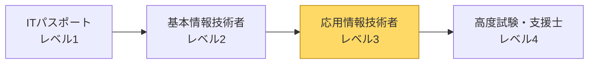
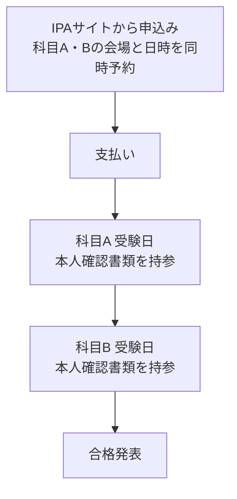

# 応用情報技術者試験（AP）の試験概要

> 2026年10月時点の情報です。日程・手数料・当日のルールは変更されることがあるため、申込み前に必ず [IPA公式サイト](https://www.ipa.go.jp/shiken/kubun/ap.html) で最新情報を確認してください。

## 目次

1. [どんな試験か](#1-どんな試験か)
2. [2026年度からの変更点（CBT化）](#2-2026年度からの変更点cbt化)
3. [試験の構成](#3-試験の構成)
4. [科目B（旧午後）の問題構成](#4-科目b旧午後の問題構成)
5. [合格基準](#5-合格基準)
6. [2026年度の日程](#6-2026年度の日程)
7. [CBT受験の流れと当日のルール](#7-cbt受験の流れと当日のルール)
8. [2027年度以降の制度見直し](#8-2027年度以降の制度見直し)

---

## 1. どんな試験か

- 経済産業省が認定し、IPA（独立行政法人 情報処理推進機構）が実施する国家試験「情報処理技術者試験」の一区分です。
- 共通キャリア・スキルフレームワークの **レベル3**。基本情報技術者（レベル2）の一つ上にあたります。
- 対象者像は「高度IT人材となるために必要な応用的知識・技能をもち、高度IT人材としての方向性を確立した者」です。
- 出題範囲は **テクノロジ系・マネジメント系・ストラテジ系** の3分野で、技術だけでなく、プロジェクト管理・経営・法務まで幅広く問われます。

## 2. 2026年度からの変更点（CBT化）

2026年度から、応用情報技術者試験は紙の試験から **CBT方式**（Computer Based Testing：テストセンターのパソコンで解答する方式）に移行しました。

| 項目 | 〜2025年度（ペーパー方式） | 2026年度〜（CBT方式） |
|---|---|---|
| 実施回数 | 春期（4月）・秋期（10月）の年2回 | **前期・後期** の年2回 |
| 実施日 | 全国一斉に1日 | 一定期間内の複数日から **会場と日時を選んで予約** |
| 科目名 | 午前・午後 | **科目A・科目B** |
| 解答方法 | マークシート・手書き | **マウス・キーボード入力**（記述式も入力） |
| 受験票 | 郵送 | **送付されない**（本人確認書類で入場） |
| 出題範囲・形式・問題数・試験時間 | — | **変更なし** |

⚠️ 科目A と 科目B は **別の期間** に実施されます（同じ日に続けて受けるのではありません）。

## 3. 試験の構成

| 科目 | 試験時間 | 出題形式 | 出題数・解答数 |
|---|---|---|---|
| **科目A**（旧午前） | 150分 | 多肢選択式（四肢択一） | 80問出題・80問すべて解答 |
| **科目B**（旧午後） | 150分 | 記述式 | 11問出題・**5問解答** |

### 科目A の出題分野の目安

| 分野 | 問題数の目安 | 主な内容 |
|---|---|---|
| テクノロジ系 | 約50問 | 基礎理論、アルゴリズム、コンピュータ、OS、DB、ネットワーク、セキュリティ、開発技術 |
| マネジメント系 | 約10問 | プロジェクトマネジメント、サービスマネジメント、システム監査 |
| ストラテジ系 | 約20問 | システム戦略、経営戦略、企業活動・会計、法務 |

💡 科目A は **過去問からの再出題（類題）が多い** のが特徴です。過去問演習が最も効率的な対策になります。

## 4. 科目B（旧午後）の問題構成

| 問番号 | 分野 | 区分 |
|---|---|---|
| 問1 | 情報セキュリティ | **必須** |
| 問2 | 経営戦略 | 選択 |
| 問3 | プログラミング（アルゴリズム） | 選択 |
| 問4 | システムアーキテクチャ | 選択 |
| 問5 | ネットワーク | 選択 |
| 問6 | データベース | 選択 |
| 問7 | 組込みシステム開発 | 選択 |
| 問8 | 情報システム開発 | 選択 |
| 問9 | プロジェクトマネジメント | 選択 |
| 問10 | サービスマネジメント | 選択 |
| 問11 | システム監査 | 選択 |

**問1（必須）＋ 問2〜11から4問選択 ＝ 合計5問** を解答します。1問あたり約30分が目安です。

選び方は [04_科目B対策/01_科目Bの全体戦略.md](../04_科目B対策/01_科目Bの全体戦略.md) を参照してください。

## 5. 合格基準

- 科目A・科目B **それぞれ 100点満点中 60点以上** で合格。
- 従来のルールでは、科目A（旧午前）が基準点に達しない場合、科目B（旧午後）は採点されません。
- 配点は、科目A が各問均等（80問 × 1.25点）、科目B は5問 × 各20点 ＝ 100点とされてきました。
- CBT化後の細かな採点ルールは、IPAの試験要綱で確認してください。

## 6. 2026年度の日程

| | 申込受付 | 科目A 実施期間 | 科目B 実施期間 |
|---|---|---|---|
| **前期** | 2026年10月6日〜11月7日 | 2026年10月28日〜11月10日 | 2026年11月24日〜12月6日 |
| **後期** | 2027年1月27日〜2月16日（予定） | 2027年2月6日〜2月19日（予定） | 2027年3月3日〜3月15日（予定） |

- 受験手数料：**7,500円（税込）**。クレジットカード、Pay-easy、バウチャーで支払い。
- 申込みは各期 **1回のみ**。科目A と 科目B は **同時に予約** します。
- 前期の合格発表は、2027年2月上旬の予定と報じられています。

## 7. CBT受験の流れと当日のルール

- **本人確認書類が必須**。提示できない場合は理由を問わず受験できません（有効な書類は [CBT-Solutionsのページ](https://cbt-s.com/page/itee_id) で確認）。
- 受験票は送られてきません。予約内容（日時・会場）は自分で控えておきましょう。
- 画面上に **メモ機能・電卓機能** があります。
- 入室時に **メモ用紙1枚と筆記用具** が配布されます（2026年9月にIPAが発表）。
- 科目B の記述式は **キーボード入力** です。普段からタイピングで答案を書く練習をしておくと安心です。

## 8. 2027年度以降の制度見直し

IPAは2027年度以降の情報処理技術者試験の見直しを進めています。

- 科目A の分野体系を「テクノロジ・マネジメント・ストラテジ」から「ビジネス」「テクノロジ」「セキュリティ・倫理」の3分野に再編する方針が示されています。
- 応用情報技術者試験そのものの今後の扱いについては、解説記事によって情報が分かれています。**検討中の内容も含まれるため、IPAの正式発表を確認** してください。

---

## 参考

- [IPA 応用情報技術者試験](https://www.ipa.go.jp/shiken/kubun/ap.html)
- [IPA 令和8年度前期 試験案内](https://www.ipa.go.jp/shiken/2026/r08zen_exam.html)
- [IPA プレス発表（2025年8月12日）CBT方式への移行予定](https://www.ipa.go.jp/pressrelease/2025/press20250812.html)
- [IPA 試験要綱・シラバス](https://www.ipa.go.jp/shiken/syllabus/gaiyou.html)
- [アイテック：令和8年度・令和9年度 制度変更の解説](https://www.itec.co.jp/examination/ap_koudo_sc-cbt.html)
- [＠IT：情報処理技術者試験が令和8年度からCBT方式に全面移行](https://atmarkit.itmedia.co.jp/ait/articles/2608/31/news097.html)
