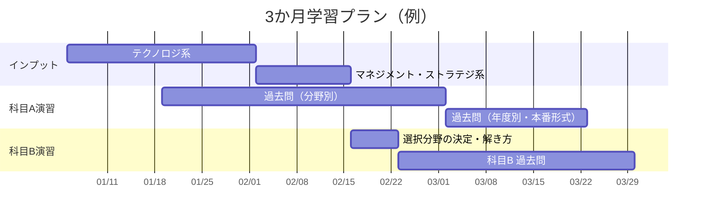

# 学習計画と勉強法

> 合格に必要な学習時間の目安は、基本情報技術者に合格済みの人で **約200時間**、IT初学者で **約500時間** とよく言われます。ここでは標準的な **3か月（約200〜250時間）プラン** を例に、このリポジトリの使い方を説明します。

## 目次

1. [基本方針](#1-基本方針)
2. [3か月学習プラン](#2-3か月学習プラン)
3. [このリポジトリの使い方](#3-このリポジトリの使い方)
4. [おすすめの無料教材](#4-おすすめの無料教材)
5. [直前期にやること](#5-直前期にやること)

---

## 1. 基本方針

| 方針 | 理由 |
|---|---|
| **科目A は過去問中心** | 過去問の類題がよく出る。解説を読んで「なぜ他の選択肢が誤りか」まで説明できるようにする |
| **科目B は早めに選択分野を決める** | 11分野すべては不要。必須のセキュリティ＋得意な4分野＋予備1〜2分野に集中する |
| **計算問題は手を動かす** | 稼働率・EVM・サブネット・損益分岐点などは、公式を覚えるより実際に解いて慣れるほうが早い |
| **インプット3：アウトプット7** | 解説を読むだけでは定着しない。確認問題・過去問を解いて弱点を見つける |
| **キーボードで記述する練習** | CBT化により科目B もキーボード入力。字数を意識しながら打つ練習をしておく |

## 2. 3か月学習プラン

| 期間 | やること | 使う資料 |
|---|---|---|
| **1〜4週目** | テクノロジ系を一通り読む。各章の確認問題を解く | `01_テクノロジ系/` |
| **5〜6週目** | マネジメント系・ストラテジ系を読む | `02_マネジメント系/` `03_ストラテジ系/` |
| **3〜8週目**（並行） | 科目A過去問を分野別に解く。1日20〜30問 | [四択クイズ](../06_インタラクティブ教材/quiz.html#past) の分野別演習、[分野別索引](../08_過去問解説/科目A/分野別索引.md) |
| **7週目** | 科目B の選択分野を決める。解き方を読む | `04_科目B対策/` |
| **8〜12週目** | 科目B 過去問を選択分野ごとに解く（1問30分）。解いたら解き方ガイドで答え合わせ | IPA の問題冊子 PDF ＋ [科目B 分野別ガイド](../08_過去問解説/科目B/README.md) |
| **10〜12週目** | 科目A を回別に本番形式（80問150分）で解き、75%以上を安定させる | [四択クイズ](../06_インタラクティブ教材/quiz.html#past) の回別演習（13回分） |
| **直前1週間** | 公式集・略語集・チェックリスト、[頻出キーワード](../08_過去問解説/README.md#繰り返し出題されているキーワード) を見直す | `05_まとめ・横断資料/`、`08_過去問解説/` |
| **毎日のスキマ時間** | 通勤・家事の間に音声講座と用語聞き流しを聞く | [聞き流し講座](../06_インタラクティブ教材/audio.html)（全40回＋用語14本） |

### 1日の学習例（平日2時間・休日5時間）

- 平日：資料を1テーマ読む（40分）→ 確認問題（20分）→ 科目A過去問20問（60分）
- 休日：科目B過去問を2問、時間を計って解く（60分）→ 解説を読み、模範解答と自分の答案を比べる（60分）→ 苦手分野の復習（残り）

## 3. このリポジトリの使い方

1. まず [01_試験概要.md](01_試験概要.md) で試験の全体像をつかむ。
2. 分野別資料は、各ファイル冒頭の **重要度（★）** を見て、★★★から優先して読む。
3. 各章末の **確認問題** を解き、解けなかった項目に戻る。
4. 計算問題で迷ったら [計算問題公式集](../05_まとめ・横断資料/01_計算問題公式集.md) を見る。
5. 知らない略語は [頻出略語・用語集](../05_まとめ・横断資料/02_頻出略語・用語集.md) で引く。
6. 試験直前は [直前チェックリスト](../05_まとめ・横断資料/03_直前チェックリスト.md) を確認する。

💡 自分用のメモは `notes/` フォルダを作って書き足していくのがおすすめです（git で学習の記録も残せます）。

## 4. おすすめの無料教材

| 教材 | 内容 |
|---|---|
| [IPA 過去問題](https://www.ipa.go.jp/shiken/mondai-kaiotu/index.html) | 公式の過去問題・解答例・採点講評。科目B の **採点講評** は「何が求められていたか」が分かるので必読 |
| [応用情報技術者試験ドットコム](https://www.ap-siken.com/) | 過去問と詳しい解説。「過去問道場」で分野別・ランダム演習ができる |
| [IPA シラバス](https://www.ipa.go.jp/shiken/syllabus/gaiyou.html) | 出題範囲の公式な一覧。用語の確認に使える |

## 5. 直前期にやること

- 科目A：直近数回分の過去問を本番と同じ150分で解く。間違えた問題だけを解き直す。
- 科目B：選んだ分野の過去問を **1問30分** で解く練習をする。問1（セキュリティ）は毎回必ず解く。
- 当日：本人確認書類を忘れない。予約した会場・日時を再確認する。
