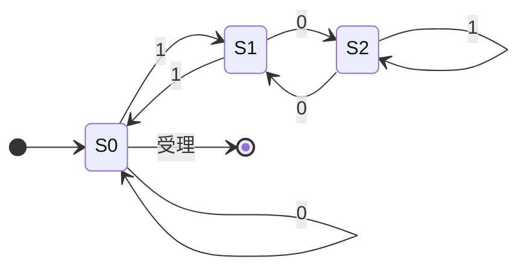
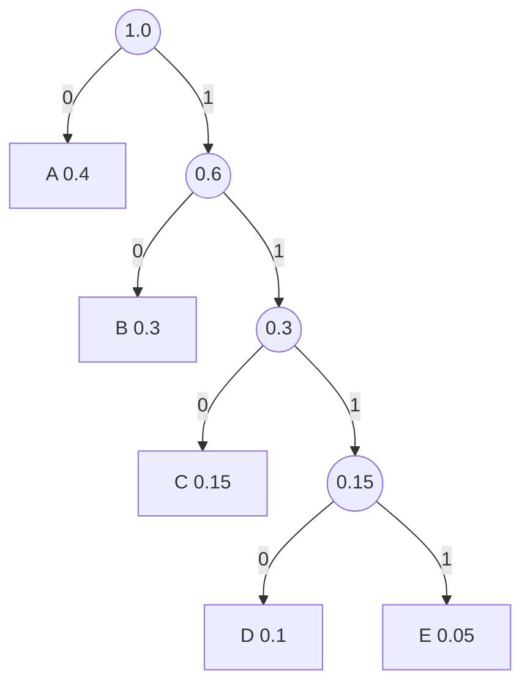
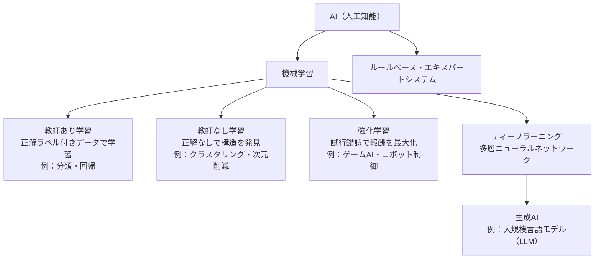

# 基礎理論

> **重要度：★★★**（科目A（旧午前）で毎回 5〜8 問程度。計算問題が中心）
> 科目Aの冒頭に並ぶ「数学・情報理論」の分野です。暗記より **手を動かして計算できるか** が問われます。
> この章のポイントは次の4つです。
> - 基数変換・2の補数・浮動小数点を **紙と鉛筆で** 変換できること
> - 論理演算・シフト演算で「マスク」「×2ⁿ」を使いこなすこと
> - 待ち行列（M/M/1）の公式 `ρ/(1−ρ)` を使った待ち時間計算
> - ハフマン符号・ハミング符号・CRC など符号化の手順と、AI・機械学習の評価指標

## 目次

1. [基数変換と数値の表現](#1-基数変換と数値の表現)
2. [論理演算とシフト演算](#2-論理演算とシフト演算)
3. [集合と命題](#3-集合と命題)
4. [確率・統計](#4-確率統計)
5. [待ち行列理論（M/M/1）](#5-待ち行列理論mm1)
6. [オートマトン・正規表現・BNF](#6-オートマトン正規表現bnf)
7. [情報理論と符号化](#7-情報理論と符号化)
8. [AI・機械学習の基礎](#8-ai機械学習の基礎)
9. [確認問題](#確認問題)
10. [参考](#参考)

---

## 1. 基数変換と数値の表現

### 1.1 基数（n進数）とは ★★

- **結論**：n進数とは「各桁の重みが nᵏ になる数の表し方」です。
- **理由**：コンピュータ内部は 0/1 の **2進数** で動き、人が読みやすいように **16進数**（4ビットを1桁）や **8進数**（3ビットを1桁）を使います。
- **例**：2進数 `1011` = 1×2³ + 0×2² + 1×2¹ + 1×2⁰ = 8 + 0 + 2 + 1 = **11**（10進数）

| 10進 | 2進 | 8進 | 16進 |
|---:|---:|---:|---:|
| 0 | 0000 | 0 | 0 |
| 5 | 0101 | 5 | 5 |
| 9 | 1001 | 11 | 9 |
| 10 | 1010 | 12 | A |
| 15 | 1111 | 17 | F |
| 16 | 10000 | 20 | 10 |

### 1.2 10進数 → 2進数（整数部と小数部） ★★★

**公式（手順）**

```
整数部：2 で割り続け、余りを「下から」読む
小数部：2 を掛け続け、整数部に出た 0/1 を「上から」読む
```

**具体例**：10進数 `45.625` を2進数にする

```
【整数部 45】                【小数部 0.625】
45 ÷ 2 = 22 余り 1  ↑        0.625 × 2 = 1.25  → 1  ↓
22 ÷ 2 = 11 余り 0  │        0.25  × 2 = 0.5   → 0  │
11 ÷ 2 =  5 余り 1  │        0.5   × 2 = 1.0   → 1  ↓（小数部が0で終了）
 5 ÷ 2 =  2 余り 1  │
 2 ÷ 2 =  1 余り 0  │
 1 ÷ 2 =  0 余り 1  │（下から読む）
→ 101101                     → .101
```

答え：`45.625(10) = 101101.101(2)`。16進数にするには、小数点を基準に4ビットずつ区切ります。
`0010 1101 . 1010` → **`2D.A(16)`**

⚠️ **ひっかけ注意**：10進数の `0.1` は2進数では `0.000110011001100…` と **無限に循環** します。そのため 0.1 を10回足しても厳密に 1.0 にならない、という **丸め誤差** が起きます。「2進数で正確に表現できる10進小数はどれか」という問題では、**分母が 2ⁿ になる小数**（0.5, 0.25, 0.375, 0.625 など）が正解です。

### 1.3 負の数の表現：補数 ★★★

**補数**（ほすう）とは、「足すと桁が1つ上がる（またはすべて1になる）数」です。コンピュータは補数を使って **引き算を足し算で** 行います。

| 方式 | 作り方 | 8ビットの表現範囲 | 特徴 |
|---|---|---|---|
| 1の補数 | 全ビットを反転 | −127 〜 +127 | 0 が +0 と −0 の2通りある |
| **2の補数** | 全ビット反転して **+1** | **−128 〜 +127** | 0 が1通り。現在の主流 |

**一般式**：nビットの2の補数で表せる範囲は `−2ⁿ⁻¹ 〜 2ⁿ⁻¹ − 1`

**具体例**：−45 を8ビットの2の補数で表す

```
① +45 を2進数にする      : 0010 1101
② 全ビットを反転（1の補数）: 1101 0010
③ +1 する（2の補数）       : 1101 0011  ← −45
検算：0010 1101 + 1101 0011 = 1 0000 0000（9ビット目の桁あふれを捨てると 0）
```

💡 **覚え方**：2の補数の最上位ビット（MSB）は「符号ビット」と考えてよく、**1なら負**です。また、`1101 0011` を10進数に戻すには「−128 + 64 + 16 + 2 + 1 = −45」と、**最上位ビットの重みを −128 とみなす** と速く計算できます。

### 1.4 固定小数点と浮動小数点 ★★

- **固定小数点数**：小数点の位置を決め打ちする方式。整数の表現に使います。
- **浮動小数点数**：`(−1)^符号 × 仮数 × 基数^指数` の形で表す方式。非常に大きい数・小さい数を表せます。

代表的な規格は **IEEE 754**（IEEE：米国電気電子技術者協会が定めた浮動小数点数の標準）の単精度（32ビット）です。

| 部分 | ビット数 | 内容 |
|---|---|---|
| 符号部 S | 1 | 0:正、1:負 |
| 指数部 E | 8 | 実際の指数 + **127**（バイアス、げたばき表現） |
| 仮数部 M | 23 | `1.xxxx` の「1.」を省略した小数部分（**けち表現**） |

```
値 = (−1)^S × 1.M × 2^(E − 127)
```

**具体例**：−6.5 を IEEE 754 単精度で表す

```
① 2進数にする  ：6.5 = 110.1(2)
② 正規化する    ：110.1 = 1.101 × 2²
③ 符号部 S      ：負なので 1
④ 指数部 E      ：2 + 127 = 129 = 1000 0001
⑤ 仮数部 M      ：「1.」を除いた 101 の後ろに 0 を詰める → 1010 0000 0000 0000 0000 000
⑥ 並べる        ：1 10000001 10100000000000000000000
⑦ 16進数        ：1100 0000 1101 0000 0000 … → C0D00000
```

**正規化**とは、仮数部の先頭が「1.」になるように指数を調整することで、有効桁数を最大限に使うための操作です。

### 1.5 誤差の種類 ★★

| 誤差 | 内容 | 例 |
|---|---|---|
| **丸め誤差** | 表現できない桁を四捨五入・切捨てしたことによる誤差 | 0.1 を2進数で有限桁にする |
| **打切り誤差** | 無限に続く計算を途中で打ち切ったことによる誤差 | 級数計算を10項で止める |
| **桁落ち** | **値がほぼ等しい** 数同士の **減算** で有効桁数が減る | 1.2345 − 1.2344 = 0.0001（有効数字5桁→1桁） |
| **情報落ち** | **絶対値が大きく異なる** 数同士の **加減算** で小さい方が無視される | 1.0×10¹⁰ + 1.0 → 1.0×10¹⁰ |
| **オーバフロー／アンダフロー** | 表現できる範囲を超える（小さすぎる） | 8ビット符号付きで 127 + 1 |

💡 **覚え方**：「**桁落ちは近い数の引き算**、**情報落ちは大小の足し算**」。情報落ちを防ぐには **絶対値の小さい数から順に** 足します。

---

## 2. 論理演算とシフト演算

### 2.1 基本の論理演算 ★★

| A | B | AND（論理積） | OR（論理和） | XOR（排他的論理和） | NAND | NOR |
|:-:|:-:|:-:|:-:|:-:|:-:|:-:|
| 0 | 0 | 0 | 0 | 0 | 1 | 1 |
| 0 | 1 | 0 | 1 | 1 | 1 | 0 |
| 1 | 0 | 0 | 1 | 1 | 1 | 0 |
| 1 | 1 | 1 | 1 | 0 | 0 | 0 |

### 2.2 ビットマスク ★★★

**マスク**とは、特定のビットだけを取り出したり変えたりするためのビット列です。

| やりたいこと | 演算 | マスクの置き方 | 例（対象 `1011 0110`） |
|---|---|---|---|
| 特定ビットを **取り出す**（他を0に） | AND | 取り出したい位置を1 | `AND 0000 1111` → `0000 0110` |
| 特定ビットを **1にする** | OR | 1にしたい位置を1 | `OR 1000 0001` → `1011 0111` |
| 特定ビットを **反転する** | XOR | 反転したい位置を1 | `XOR 1111 0000` → `0100 0110` |

💡 XOR には「同じ値で2回 XOR すると元に戻る」（`A XOR K XOR K = A`）という性質があり、簡易暗号やパリティ計算に使われます。

### 2.3 シフト演算 ★★★

| 種類 | 動き | 用途 |
|---|---|---|
| **論理シフト** | 符号を考えず、空いたビットに **0** を入れる | 符号なし整数、ビット操作 |
| **算術シフト** | 符号ビットを保持。右シフトでは空いたビットに **符号ビットと同じ値** を入れる | 符号付き整数の ×2ⁿ / ÷2ⁿ |

```
左に n ビットシフト → 2ⁿ 倍     右に n ビットシフト → 2ⁿ で割る（切捨て）
```

**具体例1（論理左シフト）**：`0001 0110`（22）を左に2ビット → `0101 1000`（88 = 22 × 4）

**具体例2（算術右シフト）**：`1110 1000`（−24）を右に2ビット

```
1110 1000 → 1111 1010   （空いた左側に符号ビット 1 を補充）
検算：1111 1010 = −128 + 64 + 32 + 16 + 8 + 2 = −6 = −24 ÷ 4  ✔
```

**具体例3（シフトと加算で掛け算）**：x を 10 倍したい

```
10x = 8x + 2x = (x を左に3ビットシフト) + (x を左に1ビットシフト)
```

⚠️ **ひっかけ注意**：左シフトで符号ビットが変わってしまうと **オーバフロー** です。

---

## 3. 集合と命題

### 3.1 集合演算 ★

| 記号 | 名前 | 意味 |
|---|---|---|
| A ∪ B | 和集合 | A または B |
| A ∩ B | 積集合（共通部分） | A かつ B |
| Ā | 補集合 | A でない |
| A − B | 差集合 | A であって B でない（= A ∩ B̄） |

**ド・モルガンの法則**（必ず覚える）

```
NOT(A ∪ B) = Ā ∩ B̄       NOT(A ∩ B) = Ā ∪ B̄
論理式では  ¬(A ∨ B) = ¬A ∧ ¬B     ¬(A ∧ B) = ¬A ∨ ¬B
```

**要素数の公式**：`|A ∪ B| = |A| + |B| − |A ∩ B|`

**具体例**：受講者100人のうち、Python 経験者 60人、Java 経験者 45人、どちらも未経験 15人。両方経験者は？

```
どちらかの経験者 = 100 − 15 = 85
85 = 60 + 45 − |A∩B|  →  |A∩B| = 105 − 85 = 20 人
```

### 3.2 論理式の簡略化 ★

よく使う法則：

```
吸収則   ：A + A・B = A           A・(A + B) = A
分配則   ：A・(B + C) = A・B + A・C
その他   ：A + Ā = 1   A・Ā = 0   A + Ā・B = A + B
```

（ここで `+` は OR、`・` は AND を表します。）

**例**：`X・Y + X・Ȳ` = `X・(Y + Ȳ)` = `X・1` = **X**

---

## 4. 確率・統計

### 4.1 場合の数と確率 ★★

```
順列（並べる）   ：nPr = n! / (n − r)!
組合せ（選ぶだけ）：nCr = n! / { r! × (n − r)! }
```

**具体例**：赤玉3個・白玉2個の袋から同時に2個取り出すとき、2個とも赤の確率

```
全体の選び方 ：5C2 = (5×4)/(2×1) = 10 通り
赤2個の選び方：3C2 = 3 通り
確率 = 3 / 10 = 0.3
（別解：1個目が赤 3/5 × 2個目も赤 2/4 = 6/20 = 0.3）
```

**条件付き確率**：B が起きたという条件のもとで A が起きる確率

```
P(A | B) = P(A ∩ B) / P(B)
```

**期待値**：`E = Σ（値 × その値が出る確率）`
例：さいころ1個の期待値 = (1+2+3+4+5+6) × 1/6 = 21/6 = **3.5**

### 4.2 代表値と散らばり ★★

| 用語 | 意味 |
|---|---|
| 平均値 | 合計 ÷ 個数 |
| **中央値（メジアン）** | 小さい順に並べたときの真ん中の値 |
| **最頻値（モード）** | 最も多く出現する値 |
| 分散 | （各値 − 平均）² の平均 |
| **標準偏差** | 分散の平方根（√分散）。平均からのばらつきの大きさ |

**具体例**：データ `2, 4, 4, 4, 5, 5, 7, 9`

```
平均 = (2+4+4+4+5+5+7+9) / 8 = 40 / 8 = 5
偏差² = 9, 1, 1, 1, 0, 0, 4, 16  → 合計 32
分散 = 32 / 8 = 4
標準偏差 = √4 = 2
中央値 = (4 + 5) / 2 = 4.5、最頻値 = 4
```

### 4.3 正規分布 ★

**正規分布**は平均を中心にした左右対称の釣鐘型の分布です。平均を μ、標準偏差を σ とすると：

| 範囲 | 含まれる割合（約） |
|---|---|
| μ ± 1σ | 68.3% |
| μ ± 2σ | 95.4% |
| μ ± 3σ | 99.7% |

💡 品質管理の「管理図」では μ ± 3σ を管理限界に使うことが多く、ストラテジ系・マネジメント系とも関連します。

---

## 5. 待ち行列理論（M/M/1）

### 5.1 M/M/1 モデルとは ★★★

窓口やサーバに処理要求が並ぶ様子を数式でモデル化したものです。**ケンドール記号** `A/B/c` で表し、**M/M/1** は次を意味します。

| 記号 | 意味 |
|---|---|
| 1つ目の M | 到着が **ランダム**（ポアソン到着。到着間隔は指数分布） |
| 2つ目の M | サービス時間が **指数分布** |
| 1 | 窓口（サーバ）が **1つ** |

前提：待ち行列の長さは無制限、先着順（FIFO）で処理します。


### 5.2 公式 ★★★

```
到着率 λ = 1 / Ta（単位時間あたりの到着数）
サービス率 μ = 1 / Ts（単位時間あたりの処理数）

利用率          ρ  = λ / μ = Ts / Ta        （0 ≦ ρ < 1 でないと行列が無限に伸びる）
平均待ち時間    Wq = ρ / (1 − ρ) × Ts
平均応答時間    W  = Wq + Ts = Ts / (1 − ρ)
平均系内数      L  = ρ / (1 − ρ)            （待っている人＋サービス中の人）
平均待ち行列長  Lq = ρ² / (1 − ρ)
リトルの公式    L  = λ × W
```

💡 **覚え方**：まず **ρ/(1−ρ)** を計算し、「×Ts で待ち時間、そのままで系内数」と覚えます。

### 5.3 計算例 ★★★

**問題**：ある窓口に平均5分間隔で客が来て、1人あたり平均4分で処理する。M/M/1 とみなしたとき、平均待ち時間と平均応答時間は？

```
① 利用率      ρ  = Ts / Ta = 4 / 5 = 0.8
② ρ/(1−ρ)        = 0.8 / 0.2 = 4
③ 平均待ち時間 Wq = 4 × Ts = 4 × 4 = 16 分
④ 平均応答時間 W  = Wq + Ts = 16 + 4 = 20 分
⑤ 平均系内数   L  = 4 人  （検算：リトルの公式 λ×W = (1/5)×20 = 4 ✔）
```

**利用率と待ち時間の関係**：ρ が 1 に近づくと待ち時間は急激に増えます。

| ρ | 0.5 | 0.6 | 0.7 | 0.8 | 0.9 |
|---|---|---|---|---|---|
| ρ/(1−ρ) | 1 | 1.5 | 2.33 | 4 | 9 |

⚠️ **ひっかけ注意**：「待ち時間」と「応答時間（待ち＋処理）」を区別してください。問題文が「応答時間」なら Ts を足し忘れないこと。また、**窓口を2つにする** と M/M/2 となり、M/M/1 の式はそのまま使えません（科目Aでは「1窓口あたりの到着を半分にした M/M/1 が2つ」と単純化して問われることがあります）。

---

## 6. オートマトン・正規表現・BNF

### 6.1 有限オートマトン ★★

**有限オートマトン**とは、有限個の **状態** と、入力に応じた **状態遷移** で構成される計算モデルです。入力をすべて読み終えたときに **受理状態** にいれば、その入力列を「受理する」といいます。

**例**：2進数を上位桁から1文字ずつ読み、**3の倍数なら受理** するオートマトン（状態＝それまでの値を3で割った余り）

```
新しい余り = (今の余り × 2 + 入力ビット) mod 3
```



| 現状態＼入力 | 0 | 1 |
|---|---|---|
| **S0**（余り0・受理） | S0 | S1 |
| S1（余り1） | S2 | S0 |
| S2（余り2） | S1 | S2 |

**トレース**：入力 `110`（=6）→ S0 →(1) S1 →(1) S0 →(0) S0 → 受理 ✔
入力 `111`（=7）→ S0 → S1 → S0 → S1 → 受理しない ✔

### 6.2 正規表現 ★★

**正規表現**とは、文字列のパターンを記号で表す方法です。

| 記号 | 意味 | 例 | マッチする例 |
|---|---|---|---|
| `.` | 任意の1文字 | `a.c` | abc, a9c |
| `*` | 直前の要素の **0回以上** の繰返し | `ab*` | a, ab, abbb |
| `+` | 直前の要素の **1回以上** の繰返し | `ab+` | ab, abbb（a は不可） |
| `?` | 直前の要素が 0回または1回 | `colou?r` | color, colour |
| `[ ]` | いずれか1文字 | `[A-Z][0-9]` | A1, Z9 |
| `[^ ]` | 含まれない1文字 | `[^0-9]` | 数字以外の1文字 |
| `\|` | または | `cat\|dog` | cat, dog |
| `^` `$` | 行頭・行末 | `^[0-9]+$` | 数字だけの行 |

⚠️ 試験では問題文で独自の記法が定義されることが多いので、**問題文の定義を優先** して読みます。

### 6.3 BNF（バッカス・ナウア記法） ★★

**BNF**（Backus-Naur Form：バッカス・ナウア記法）は、プログラミング言語などの **文法（構文規則）** を定義する記法です。

| 記号 | 意味 |
|---|---|
| `::=` | 左辺を右辺で定義する |
| `\|` | または |
| `< >` | 非終端記号（さらに展開される記号） |

**例**：符号なし整数の定義

```
<数字> ::= 0 | 1 | 2 | 3 | 4 | 5 | 6 | 7 | 8 | 9
<整数> ::= <数字> | <整数><数字>
```

`<整数><数字>` のように自分自身を使う定義を **再帰的定義** といい、これによって任意の桁数の整数を表せます。
例：`123` は `<整数>(12)<数字>(3)` → `<整数>(1)<数字>(2)<数字>(3)` と展開できるので、この文法に合います。

---

## 7. 情報理論と符号化

### 7.1 情報量とエントロピー ★

- **情報量**：確率 p で起こる事象が起きたと知ったときの情報の大きさ。`I = −log₂ p`（単位：ビット）
  - 例：コイン投げで表が出た（p = 1/2）→ `−log₂(1/2) = 1 ビット`
- **平均情報量（エントロピー）**：`H = −Σ pᵢ log₂ pᵢ`。符号化の平均符号長の理論的な下限です。

### 7.2 ハフマン符号 ★★★

**ハフマン符号**は、**出現確率の高い文字に短い符号、低い文字に長い符号** を割り当てて平均符号長を小さくする可変長符号です。

**手順**

1. 出現確率の **小さい2つ** を選んで1つにまとめ（確率を合計し）、木の節にする
2. 1つになるまで繰り返す
3. 枝に 0/1 を振り、根から葉までの 0/1 の並びを符号とする

**具体例**：A=0.4、B=0.3、C=0.15、D=0.1、E=0.05

```
① 最小の E(0.05) と D(0.1) をまとめる   → DE(0.15)
② 最小の C(0.15) と DE(0.15) をまとめる → CDE(0.3)
③ 最小の B(0.3) と CDE(0.3) をまとめる  → BCDE(0.6)
④ A(0.4) と BCDE(0.6) をまとめる        → 根(1.0)
```



| 文字 | 確率 | 符号 | 符号長 | 確率×符号長 |
|---|---|---|---|---|
| A | 0.4 | 0 | 1 | 0.4 |
| B | 0.3 | 10 | 2 | 0.6 |
| C | 0.15 | 110 | 3 | 0.45 |
| D | 0.1 | 1110 | 4 | 0.4 |
| E | 0.05 | 1111 | 4 | 0.2 |
| | | | **平均符号長** | **2.05 ビット** |

5文字を固定長で表すと3ビット必要なので、約 32% 短くなります（エントロピーは約 2.01 ビット）。

💡 ハフマン符号は **どの符号も他の符号の先頭部分（接頭語）にならない**（**接頭符号**）ため、区切り記号なしで一意に復号できます。例：`0101110` → `0 / 10 / 1110` → A B D

**ランレングス符号化**：同じ値の連続を「値＋個数」で表す圧縮方式です。例：`AAAABBBCC` → `A4B3C2`。

### 7.3 パリティチェック ★★

**パリティビット**とは、データ中の1の個数を偶数（**偶数パリティ**）または奇数（**奇数パリティ**）にそろえるために付ける1ビットです。

- 例：データ `1011001`（1が4個）に偶数パリティを付ける → `1011001 0`
- **1ビットの誤りは検出できるが訂正はできない**。2ビット誤ると検出もできません。
- **垂直パリティ**（文字ごと）と **水平パリティ**（各ビット位置ごと）を組み合わせると、1ビットの誤りの **位置が特定でき訂正** できます。

### 7.4 ハミング符号 ★★

**ハミング符号**は、**1ビットの誤りを訂正**（2ビットの誤りは検出）できる誤り訂正符号です。代表例は、データ4ビットに検査ビット3ビットを付けた **(7,4) ハミング符号** です。

ここでは、ビット位置 1〜7 のうち 2のべき乗の位置（1, 2, 4）に検査ビットを置く方式で説明します（試験では問題文で配置と式が与えられます）。

```
位置： 1   2   3   4   5   6   7
内容： P1  P2  D1  P3  D2  D3  D4

P1 = D1 ⊕ D2 ⊕ D4   （位置 1,3,5,7 の偶数パリティ）
P2 = D1 ⊕ D3 ⊕ D4   （位置 2,3,6,7）
P3 = D2 ⊕ D3 ⊕ D4   （位置 4,5,6,7）
（⊕ は XOR）
```

**具体例**：データ `D1D2D3D4 = 1011` を符号化

```
P1 = 1 ⊕ 0 ⊕ 1 = 0
P2 = 1 ⊕ 1 ⊕ 1 = 1
P3 = 0 ⊕ 1 ⊕ 1 = 0
符号語（位置1〜7）= 0 1 1 0 0 1 1
```

**誤り訂正**：受信 `0 1 1 0 1 1 1`（位置5が反転）のとき

```
S1 = 位置1,3,5,7 の XOR = 0⊕1⊕1⊕1 = 1
S2 = 位置2,3,6,7 の XOR = 1⊕1⊕1⊕1 = 0
S3 = 位置4,5,6,7 の XOR = 0⊕1⊕1⊕1 = 1
シンドローム (S3 S2 S1) = 101(2) = 5 → 位置5 が誤り → 反転して訂正
```

すべて0なら誤りなしです。ハミング符号は **ECC メモリ**（誤り訂正機能付きメモリ）などで使われます。

### 7.5 CRC（巡回冗長検査） ★★

**CRC**（Cyclic Redundancy Check：巡回冗長検査）は、データを **生成多項式** で割った余りを検査用に付ける誤り検出方式です。**バースト誤り**（連続した複数ビットの誤り）の検出に強く、イーサネットや ZIP ファイルなどで使われます。

計算はビットごとの **XOR による割り算**（桁上がり・桁借りなし）で行います。先頭ビットが1の位置に生成多項式をそろえて XOR し、0 になった先頭を捨てて次の桁へ進む、を繰り返します。

**具体例**：データ `1101`、生成多項式 `x³ + x + 1`（= `1011`、次数3）

① データの後ろに次数分（3個）の0を付けて `1101000` とし、② `1011` で XOR 割り算をします。

```
  1101000
⊕ 1011             ← 1桁目が1なので、ここに 1011 をそろえて XOR
  -------
  0110000
⊕  1011            ← 次に1が立っている2桁目にそろえて XOR
  -------
  0011100
⊕   1011           ← 3桁目にそろえて XOR
  -------
  0001010
⊕    1011          ← 4桁目にそろえて XOR（元データの桁はここまで）
  -------
  0000001  → 下位3ビットが余り = 001
```

送信データは `1101` + 余り `001` = **`1101001`**。受信側は同じ生成多項式で割り、**余りが0なら誤りなし** と判定します。

⚠️ CRC は **誤り検出** の方式であり、訂正はしません（訂正が必要なら再送します）。

| 方式 | 検出 | 訂正 | 主な用途 |
|---|---|---|---|
| パリティ（単一） | 1ビット | × | 簡易な伝送チェック |
| 垂直・水平パリティ | ○ | 1ビット | 磁気テープなど |
| ハミング符号 | 2ビット | 1ビット | ECCメモリ |
| CRC | バースト誤りに強い | × | 通信、ファイル |

---

## 8. AI・機械学習の基礎

### 8.1 AI と機械学習の関係 ★★

**AI**（Artificial Intelligence：人工知能）は、人間の知的な振る舞いをコンピュータで実現する技術の総称です。その中の一手法が **機械学習**（データから規則性を学習する手法）で、さらにその中に **ディープラーニング**（深層学習：多層のニューラルネットワークを使う手法）があります。



| 学習方法 | データ | 代表タスク | 代表的手法 |
|---|---|---|---|
| **教師あり学習** | 入力と正解（ラベル）の組 | 分類（迷惑メール判定）、回帰（売上予測） | 決定木、サポートベクターマシン、線形回帰 |
| **教師なし学習** | 正解なしの入力だけ | クラスタリング（顧客の分類）、次元削減 | k-means 法、主成分分析 |
| **強化学習** | 環境からの報酬 | 行動方針の獲得 | Q学習 |

### 8.2 ニューラルネットワークの仕組み ★

- **ニューラルネットワーク**：人間の神経細胞（ニューロン）を模した数理モデル。**入力層・隠れ層（中間層）・出力層** からなり、各結合に **重み** があります。
- **活性化関数**：入力の重み付き和を出力に変換する関数。シグモイド関数、**ReLU**（0 以下は0、正はそのまま）など。
- **誤差逆伝播法（バックプロパゲーション）**：出力と正解の誤差を出力層から入力層へ逆向きに伝え、重みを修正する学習方法。
- **勾配降下法**：誤差（損失関数）が小さくなる方向へ少しずつパラメータを動かす最適化手法。
- **CNN**（畳み込みニューラルネットワーク）は画像認識、**RNN**（再帰型ニューラルネットワーク）や **Transformer** は文章など系列データの処理に使われます。

### 8.3 学習の注意点 ★★

| 用語 | 意味 |
|---|---|
| **過学習（過剰適合）** | 訓練データに適合しすぎて、未知データへの精度（汎化性能）が下がる状態 |
| **汎化性能** | 未知データに対する予測性能 |
| 訓練データ／検証データ／テストデータ | 学習用、調整用、最終評価用にデータを分ける |
| **交差検証** | データを分割し、学習と評価の役割を入れ替えて複数回評価する方法 |
| アノテーション | 学習データに正解ラベルを付ける作業 |
| **転移学習** | ある課題で学習済みのモデルを別の課題に流用する方法 |
| **ハルシネーション** | 生成AIが事実と異なるもっともらしい内容を出力する現象 |
| **プロンプトエンジニアリング** | 生成AIへの指示文（プロンプト）を工夫して望む出力を得る技術 |

### 8.4 分類モデルの評価指標 ★★

二値分類（陽性か陰性か）の結果は **混同行列** にまとめます。

| | 予測：陽性 | 予測：陰性 |
|---|---|---|
| **実際：陽性** | TP（真陽性） | FN（偽陰性：見逃し） |
| **実際：陰性** | FP（偽陽性：誤検知） | TN（真陰性） |

```
正解率（Accuracy） = (TP + TN) / 全体
適合率（Precision）= TP / (TP + FP)   … 陽性と予測したもののうち、本当に陽性の割合
再現率（Recall）   = TP / (TP + FN)   … 本当の陽性のうち、陽性と予測できた割合
F値               = 2 × 適合率 × 再現率 / (適合率 + 再現率)
```

**具体例**：1,000件のメールで TP = 80、FP = 20、FN = 40、TN = 860

```
正解率 = (80 + 860) / 1000 = 0.94
適合率 = 80 / (80 + 20) = 0.80
再現率 = 80 / (80 + 40) = 0.667（約）
F値    = 2 × 0.80 × 0.667 / (0.80 + 0.667) = 1.067 / 1.467 ≒ 0.727
```

💡 **覚え方**：「**適合率は予測側（列）**、**再現率は実際側（行）** で割る」。病気の検査のように **見逃し（FN）を減らしたいときは再現率** を重視します。

---

## 確認問題

**問1** 10進数の 0.8125 を2進数で表したものはどれか。
ア 0.1011　イ 0.1101　ウ 0.1110　エ 0.1001

**問2** 8ビットの2の補数で表現された `1011 0100` を10進数で表したものはどれか。
ア −76　イ −75　ウ 180　エ −52

**問3** 8ビットのデータ x について、上位4ビットを反転し、下位4ビットはそのままにしたい。用いる演算とマスクの組合せとして適切なものはどれか。
ア AND `1111 0000`　イ OR `1111 0000`　ウ XOR `1111 0000`　エ XOR `0000 1111`

**問4** 浮動小数点数の演算で、絶対値が非常に大きい数と非常に小さい数を加算したとき、小さい数の有効数字が結果に反映されない現象はどれか。
ア 桁落ち　イ 情報落ち　ウ 打切り誤差　エ オーバフロー

**問5** M/M/1 の待ち行列モデルで、平均サービス時間が 3 秒のサーバの利用率が 0.6 のとき、平均応答時間（待ち時間＋サービス時間）は何秒か。
ア 4.5　イ 5.0　ウ 7.5　エ 9.0

**問6** 問5のサーバで、到着が増えて利用率が 0.9 になった。平均待ち時間は利用率 0.6 のときの何倍になるか。

**問7** 文字 P、Q、R、S の出現確率がそれぞれ 0.5、0.25、0.15、0.1 のとき、ハフマン符号で符号化した場合の平均符号長は何ビットか。
ア 1.65　イ 1.75　ウ 1.85　エ 2.00

**問8** データ `1001` に対して、本文 7.4 と同じ配置・式で (7,4) ハミング符号を作ると、位置1〜7の符号語はどれになるか。

**問9** 次の BNF で定義される `<識別子>` として **適合しない** ものはどれか。

```
<英字> ::= a | b | c
<数字> ::= 0 | 1 | 2
<英数字> ::= <英字> | <数字>
<識別子> ::= <英字> | <識別子><英数字>
```

ア a　イ ab2　ウ c01　エ 2ab

**問10** ある感染症検査で、実際の陽性者 50人のうち 45人を陽性と判定し、実際の陰性者 950人のうち 15人を誤って陽性と判定した。この検査の適合率と再現率の組合せとして正しいものはどれか。
ア 適合率 0.75、再現率 0.90　イ 適合率 0.90、再現率 0.75　ウ 適合率 0.75、再現率 0.98　エ 適合率 0.98、再現率 0.90

<details><summary>解答・解説</summary>

**問1　イ**
```
0.8125 × 2 = 1.625 → 1
0.625  × 2 = 1.25  → 1
0.25   × 2 = 0.5   → 0
0.5    × 2 = 1.0   → 1
上から読んで 0.1101
検算：0.5 + 0.25 + 0.0625 = 0.8125 ✔
```

**問2　ア**
```
最上位ビットの重みを −128 とみなす：
1011 0100 = −128 + 32 + 16 + 4 = −76
（別解：反転 0100 1011 → +1 で 0100 1100 = 76 → −76）
```

**問3　ウ**
反転は XOR です。反転したい上位4ビットにマスクの1を置くので `XOR 1111 0000`。エは下位4ビットを反転してしまいます。

**問4　イ**
大小の加減算で小さい側が無視されるのは **情報落ち** です。桁落ちは「値の近い数同士の減算」です。

**問5　ウ**
```
W = Ts / (1 − ρ) = 3 / (1 − 0.6) = 3 / 0.4 = 7.5 秒
（Wq = 0.6/0.4 × 3 = 4.5 秒、W = 4.5 + 3 = 7.5 秒）
```
アの 4.5 秒は待ち時間だけなので誤りです。

**問6　6倍**
```
ρ = 0.6：Wq = 0.6/0.4 × 3 = 1.5 × 3 = 4.5 秒
ρ = 0.9：Wq = 0.9/0.1 × 3 = 9   × 3 = 27 秒
27 / 4.5 = 6 倍
```
Ts が同じなので ρ/(1−ρ) の比（9 / 1.5 = 6）で求めてもかまいません。

**問7　イ**
```
① S(0.1) + R(0.15) = 0.25
② Q(0.25) + SR(0.25) = 0.5
③ P(0.5) + QSR(0.5) = 1.0
符号長：P=1, Q=2, R=3, S=3
平均 = 0.5×1 + 0.25×2 + 0.15×3 + 0.1×3 = 0.5 + 0.5 + 0.45 + 0.3 = 1.75 ビット
```

**問8　0011001**
```
D1=1, D2=0, D3=0, D4=1
P1 = D1⊕D2⊕D4 = 1⊕0⊕1 = 0
P2 = D1⊕D3⊕D4 = 1⊕0⊕1 = 0
P3 = D2⊕D3⊕D4 = 0⊕0⊕1 = 1
位置1〜7：P1 P2 D1 P3 D2 D3 D4 = 0 0 1 1 0 0 1
```

**問9　エ**
`<識別子>` は必ず `<英字>` から始まり、その後ろに英数字が0個以上続きます。`2ab` は数字で始まるので適合しません。

**問10　ア**
```
TP = 45、FN = 50 − 45 = 5、FP = 15
適合率 = 45 / (45 + 15) = 45 / 60 = 0.75
再現率 = 45 / (45 + 5)  = 45 / 50 = 0.90
```

</details>

---

## 参考

- IPA「試験要綱・シラバスについて」（応用情報技術者試験 シラバス Ver.7.2）：https://www.ipa.go.jp/shiken/syllabus/gaiyou.html
- IPA「応用情報技術者試験（シラバス Ver.7.2 PDF）」：https://www.ipa.go.jp/shiken/syllabus/omgdg50000005kq5-att/syllabus_ap_ver7_2.pdf
- IPA「応用情報技術者試験（AP）」試験区分ページ：https://www.ipa.go.jp/shiken/kubun/ap.html
- IPA「応用情報技術者試験、高度試験及び情報処理安全確保支援士試験のCBT方式での実施について」：https://www.ipa.go.jp/shiken/2026/ap_koudo_sc-cbt.html
- IPA「過去問題」：https://www.ipa.go.jp/shiken/mondai-kaiotu/index.html
- 応用情報技術者試験ドットコム（過去問の分野別検索・解説）：https://www.ap-siken.com/
- IEEE 754（浮動小数点数の標準）概要（Wikipedia）：https://ja.wikipedia.org/wiki/IEEE_754
