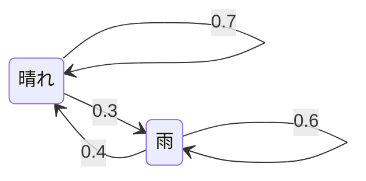
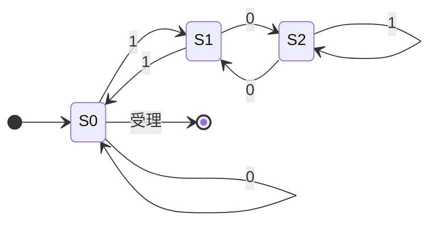
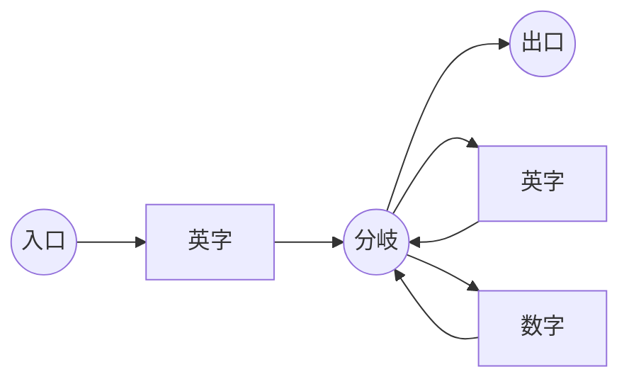
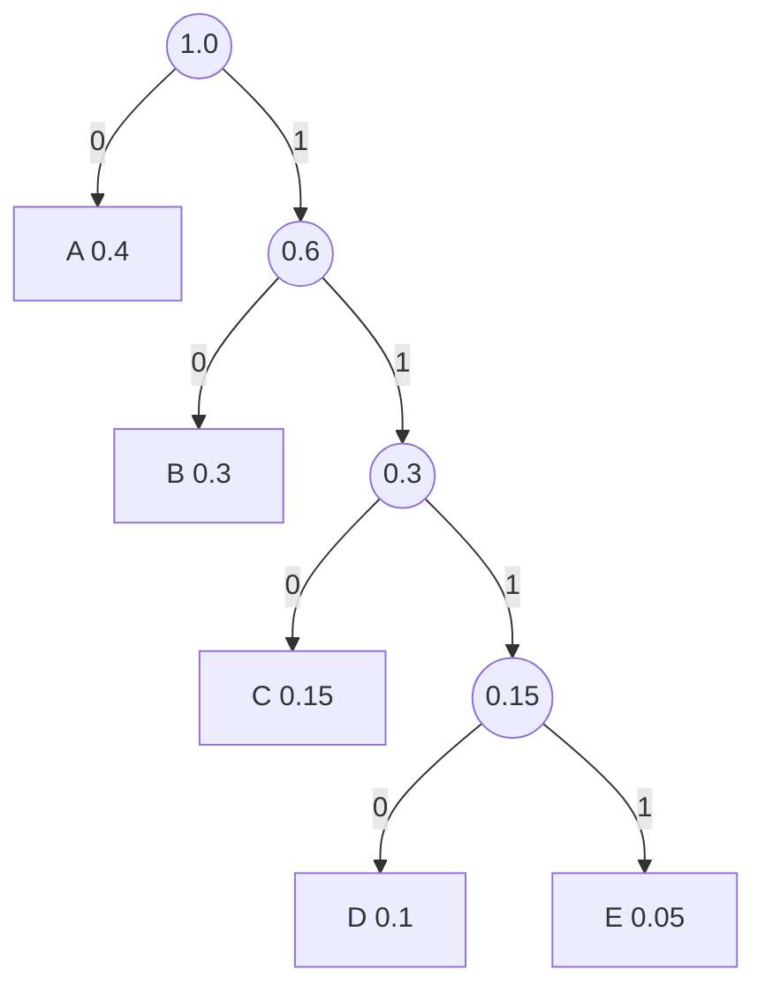
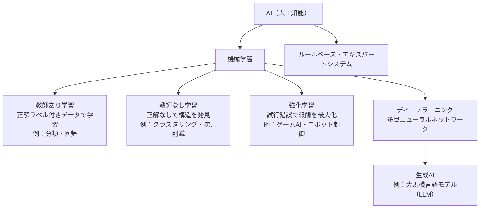
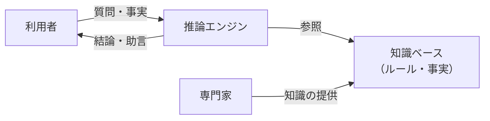
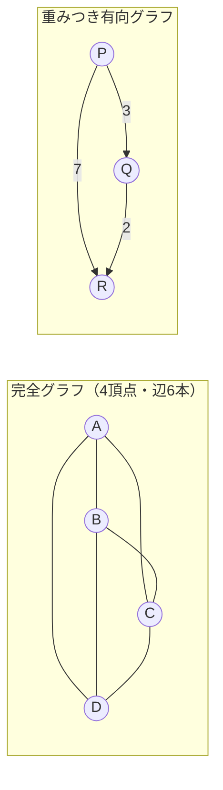
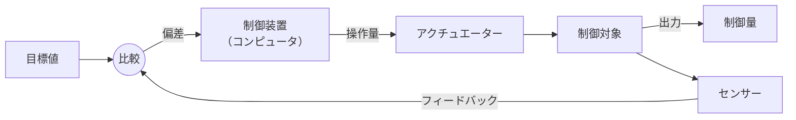

# 基礎理論

> **重要度：★★★**（科目A（旧午前）で毎回 5〜8 問程度。計算問題が中心）
> 科目Aの冒頭に並ぶ「数学・情報理論」の分野です。暗記より **手を動かして計算できるか** が問われます。
> この章のポイントは次の4つです。
> - 基数変換・2の補数・浮動小数点を **紙と鉛筆で** 変換できること
> - 論理演算・シフト演算で「マスク」「×2ⁿ」を使いこなすこと
> - 待ち行列（M/M/1）の公式 `ρ/(1−ρ)` を使った待ち時間計算
> - ハフマン符号・ハミング符号・CRC など符号化の手順と、AI・機械学習の評価指標

## 目次

1. [基数変換と数値の表現](#1-基数変換と数値の表現)
2. [論理演算とシフト演算](#2-論理演算とシフト演算)
3. [集合と命題](#3-集合と命題)
4. [確率・統計](#4-確率統計)
5. [待ち行列理論（M/M/1）](#5-待ち行列理論mm1)
6. [オートマトン・正規表現・BNF](#6-オートマトン正規表現bnf)
7. [情報理論と符号化](#7-情報理論と符号化)
8. [AI・機械学習の基礎](#8-ai機械学習の基礎)
9. [数値計算・数値解析・グラフ理論・最適化](#9-数値計算数値解析グラフ理論最適化)
10. [論理・計算の理論とプログラム言語論](#10-論理計算の理論とプログラム言語論)
11. [通信に関する理論](#11-通信に関する理論)
12. [計測・制御に関する理論](#12-計測制御に関する理論)
13. [確認問題](#確認問題)
14. [📋 シラバス用語チェックリスト](#-シラバス用語チェックリスト)
15. [参考](#参考)

---

## 1. 基数変換と数値の表現

### 1.1 基数（n進数）とは ★★

- **結論**：n進数とは「各桁の重みが nᵏ になる数の表し方」です。
- **理由**：コンピュータ内部は 0/1 の **2進数** で動き、人が読みやすいように **16進数**（4ビットを1桁）や **8進数**（3ビットを1桁）を使います。
- **例**：2進数 `1011` = 1×2³ + 0×2² + 1×2¹ + 1×2⁰ = 8 + 0 + 2 + 1 = **11**（10進数）

| 10進 | 2進 | 8進 | 16進 |
|---:|---:|---:|---:|
| 0 | 0000 | 0 | 0 |
| 5 | 0101 | 5 | 5 |
| 9 | 1001 | 11 | 9 |
| 10 | 1010 | 12 | A |
| 15 | 1111 | 17 | F |
| 16 | 10000 | 20 | 10 |

### 1.2 10進数 → 2進数（整数部と小数部） ★★★

**公式（手順）**

```
整数部：2 で割り続け、余りを「下から」読む
小数部：2 を掛け続け、整数部に出た 0/1 を「上から」読む
```

**具体例**：10進数 `45.625` を2進数にする

```
【整数部 45】                【小数部 0.625】
45 ÷ 2 = 22 余り 1  ↑        0.625 × 2 = 1.25  → 1  ↓
22 ÷ 2 = 11 余り 0  │        0.25  × 2 = 0.5   → 0  │
11 ÷ 2 =  5 余り 1  │        0.5   × 2 = 1.0   → 1  ↓（小数部が0で終了）
 5 ÷ 2 =  2 余り 1  │
 2 ÷ 2 =  1 余り 0  │
 1 ÷ 2 =  0 余り 1  │（下から読む）
→ 101101                     → .101
```

答え：`45.625(10) = 101101.101(2)`。16進数にするには、小数点を基準に4ビットずつ区切ります。
`0010 1101 . 1010` → **`2D.A(16)`**

⚠️ **ひっかけ注意**：10進数の `0.1` は2進数では `0.000110011001100…` と **無限に循環** します。そのため 0.1 を10回足しても厳密に 1.0 にならない、という **丸め誤差** が起きます。「2進数で正確に表現できる10進小数はどれか」という問題では、**分母が 2ⁿ になる小数**（0.5, 0.25, 0.375, 0.625 など）が正解です。

### 1.3 負の数の表現：補数 ★★★

**補数**（ほすう）とは、「足すと桁が1つ上がる（またはすべて1になる）数」です。コンピュータは補数を使って **引き算を足し算で** 行います。

| 方式 | 作り方 | 8ビットの表現範囲 | 特徴 |
|---|---|---|---|
| 1の補数 | 全ビットを反転 | −127 〜 +127 | 0 が +0 と −0 の2通りある |
| **2の補数** | 全ビット反転して **+1** | **−128 〜 +127** | 0 が1通り。現在の主流 |

**一般式**：nビットの2の補数で表せる範囲は `−2ⁿ⁻¹ 〜 2ⁿ⁻¹ − 1`

**具体例**：−45 を8ビットの2の補数で表す

```
① +45 を2進数にする      : 0010 1101
② 全ビットを反転（1の補数）: 1101 0010
③ +1 する（2の補数）       : 1101 0011  ← −45
検算：0010 1101 + 1101 0011 = 1 0000 0000（9ビット目の桁あふれを捨てると 0）
```

💡 **覚え方**：2の補数の最上位ビット（MSB）は「符号ビット」と考えてよく、**1なら負**です。また、`1101 0011` を10進数に戻すには「−128 + 64 + 16 + 2 + 1 = −45」と、**最上位ビットの重みを −128 とみなす** と速く計算できます。

### 1.4 固定小数点と浮動小数点 ★★

- **固定小数点数**：小数点の位置を決め打ちする方式。整数の表現に使います。
- **浮動小数点数**：`(−1)^符号 × 仮数 × 基数^指数` の形で表す方式。非常に大きい数・小さい数を表せます。

代表的な規格は **IEEE 754**（IEEE：米国電気電子技術者協会が定めた浮動小数点数の標準）の単精度（32ビット）です。

| 部分 | ビット数 | 内容 |
|---|---|---|
| 符号部 S | 1 | 0:正、1:負 |
| 指数部 E | 8 | 実際の指数 + **127**（バイアス、げたばき表現） |
| 仮数部 M | 23 | `1.xxxx` の「1.」を省略した小数部分（**けち表現**） |

```
値 = (−1)^S × 1.M × 2^(E − 127)
```

**具体例**：−6.5 を IEEE 754 単精度で表す

```
① 2進数にする  ：6.5 = 110.1(2)
② 正規化する    ：110.1 = 1.101 × 2²
③ 符号部 S      ：負なので 1
④ 指数部 E      ：2 + 127 = 129 = 1000 0001
⑤ 仮数部 M      ：「1.」を除いた 101 の後ろに 0 を詰める → 1010 0000 0000 0000 0000 000
⑥ 並べる        ：1 10000001 10100000000000000000000
⑦ 16進数        ：1100 0000 1101 0000 0000 … → C0D00000
```

**正規化**とは、仮数部の先頭が「1.」になるように指数を調整することで、有効桁数を最大限に使うための操作です。

**単精度と倍精度**：IEEE 754 には32ビットの **単精度** と64ビットの **倍精度** があります。倍精度は指数部・仮数部が長いぶん、表せる範囲が広く、有効桁数も多くなります。

| 形式 | 全体 | 符号部 | 指数部 | 仮数部 | バイアス | 10進の有効桁数（目安） |
|---|---|---|---|---|---|---|
| **単精度浮動小数点数** | 32ビット | 1 | 8 | 23 | 127 | 約7桁 |
| **倍精度浮動小数点数** | 64ビット | 1 | 11 | 52 | 1023 | 約15〜16桁 |

- **仮数**：数値の有効数字の部分（`1.101 × 2²` の `1.101`）。
- **指数**：小数点の位置を表す部分（`2²` の `2`）。
- **固定小数点数** は小数点の位置が固定なので、nビットで表せる値は「最小単位 × 整数」の等間隔になります。例えば8ビットのうち下位2ビットを小数部にすると、最小単位は 2⁻² = 0.25 です。

### 1.5 誤差の種類 ★★

| 誤差 | 内容 | 例 |
|---|---|---|
| **丸め誤差** | 表現できない桁を四捨五入・切捨てしたことによる誤差 | 0.1 を2進数で有限桁にする |
| **打切り誤差** | 無限に続く計算を途中で打ち切ったことによる誤差 | 級数計算を10項で止める |
| **桁落ち** | **値がほぼ等しい** 数同士の **減算** で有効桁数が減る | 1.2345 − 1.2344 = 0.0001（有効数字5桁→1桁） |
| **情報落ち** | **絶対値が大きく異なる** 数同士の **加減算** で小さい方が無視される | 1.0×10¹⁰ + 1.0 → 1.0×10¹⁰ |
| **オーバフロー／アンダフロー** | 表現できる範囲を超える（小さすぎる） | 8ビット符号付きで 127 + 1 |

💡 **覚え方**：「**桁落ちは近い数の引き算**、**情報落ちは大小の足し算**」。情報落ちを防ぐには **絶対値の小さい数から順に** 足します。

- **丸め**：表現できない桁を四捨五入・切上げ・切捨てなどで処理すること（その結果生じるのが丸め誤差）。
- **打切り**：無限に続く計算を有限回で止めること（その結果生じるのが打切り誤差）。
- **オーバーフロー（あふれ）**：演算結果の絶対値が表現できる最大値を超えること。**アンダーフロー** は、浮動小数点数で絶対値が小さすぎて表現できる最小値（0 に最も近い値）を下回ることです。
- 絶対誤差・相対誤差は [9.3](#93-連立一次方程式と数値解析-) を参照してください。

### 1.6 BCD とパック10進数 ★

**BCD**（Binary Coded Decimal：2進化10進）とは、10進数の **1桁を4ビットの2進数** で表す方式です。2進数に変換するより計算は遅いですが、10進数と1対1に対応するので、金額計算などで **10進の丸め誤差が出ない** 利点があります。

```
10進数 59 → BCD：0101 1001        （5 → 0101、9 → 1001）
※ 純粋な2進数なら 59 = 0011 1011 なので、表し方が異なる
```

| 方式 | 形式 | 例：+123 | 例：−45 |
|---|---|---|---|
| **ゾーン10進数**（アンパック10進数） | 1桁を1バイトで表す。上位4ビットがゾーン、最後のバイトのゾーン部分に符号 | 3バイト | 2バイト |
| **パック10進数** | 1バイトに2桁を詰め、**最下位の4ビットが符号**（正 = `C`（1100）、負 = `D`（1101）） | `12 3C`（2バイト） | `04 5D`（2バイト、桁を詰めるため先頭に0を補う） |

**パック10進数のバイト数**：n桁の数は、数字 n 個＋符号1個 = (n + 1) 個の4ビットが必要なので、`⌈(n + 1) / 2⌉` バイト（⌈ ⌉ は切上げ）。
例：7桁 → (7 + 1) / 2 = 4 バイト、6桁 → (6 + 1) / 2 = 3.5 → 4 バイト。

---

## 2. 論理演算とシフト演算

### 2.1 基本の論理演算 ★★

| A | B | AND（論理積） | OR（論理和） | XOR（排他的論理和） | NAND | NOR |
|:-:|:-:|:-:|:-:|:-:|:-:|:-:|
| 0 | 0 | 0 | 0 | 0 | 1 | 1 |
| 0 | 1 | 0 | 1 | 1 | 1 | 0 |
| 1 | 0 | 0 | 1 | 1 | 1 | 0 |
| 1 | 1 | 1 | 1 | 0 | 0 | 0 |

### 2.2 ビットマスク ★★★

**マスク**とは、特定のビットだけを取り出したり変えたりするためのビット列です。

| やりたいこと | 演算 | マスクの置き方 | 例（対象 `1011 0110`） |
|---|---|---|---|
| 特定ビットを **取り出す**（他を0に） | AND | 取り出したい位置を1 | `AND 0000 1111` → `0000 0110` |
| 特定ビットを **1にする** | OR | 1にしたい位置を1 | `OR 1000 0001` → `1011 0111` |
| 特定ビットを **反転する** | XOR | 反転したい位置を1 | `XOR 1111 0000` → `0100 0110` |

💡 XOR には「同じ値で2回 XOR すると元に戻る」（`A XOR K XOR K = A`）という性質があり、簡易暗号やパリティ計算に使われます。

### 2.3 シフト演算 ★★★

| 種類 | 動き | 用途 |
|---|---|---|
| **論理シフト** | 符号を考えず、空いたビットに **0** を入れる | 符号なし整数、ビット操作 |
| **算術シフト** | 符号ビットを保持。右シフトでは空いたビットに **符号ビットと同じ値** を入れる | 符号付き整数の ×2ⁿ / ÷2ⁿ |

```
左に n ビットシフト → 2ⁿ 倍     右に n ビットシフト → 2ⁿ で割る（切捨て）
```

**具体例1（論理左シフト）**：`0001 0110`（22）を左に2ビット → `0101 1000`（88 = 22 × 4）

**具体例2（算術右シフト）**：`1110 1000`（−24）を右に2ビット

```
1110 1000 → 1111 1010   （空いた左側に符号ビット 1 を補充）
検算：1111 1010 = −128 + 64 + 32 + 16 + 8 + 2 = −6 = −24 ÷ 4  ✔
```

**具体例3（シフトと加算で掛け算）**：x を 10 倍したい

```
10x = 8x + 2x = (x を左に3ビットシフト) + (x を左に1ビットシフト)
```

⚠️ **ひっかけ注意**：左シフトで符号ビットが変わってしまうと **オーバフロー** です。

---

## 3. 集合と命題

### 3.1 集合演算 ★

| 記号 | 名前 | 意味 |
|---|---|---|
| A ∪ B | 和集合 | A または B |
| A ∩ B | 積集合（共通部分） | A かつ B |
| Ā | 補集合 | A でない |
| A − B | 差集合 | A であって B でない（= A ∩ B̄） |

**ド・モルガンの法則**（必ず覚える）

```
NOT(A ∪ B) = Ā ∩ B̄       NOT(A ∩ B) = Ā ∪ B̄
論理式では  ¬(A ∨ B) = ¬A ∧ ¬B     ¬(A ∧ B) = ¬A ∨ ¬B
```

**要素数の公式**：`|A ∪ B| = |A| + |B| − |A ∩ B|`

**具体例**：受講者100人のうち、Python 経験者 60人、Java 経験者 45人、どちらも未経験 15人。両方経験者は？

```
どちらかの経験者 = 100 − 15 = 85
85 = 60 + 45 − |A∩B|  →  |A∩B| = 105 − 85 = 20 人
```

### 3.2 論理式の簡略化 ★

よく使う法則：

```
吸収則   ：A + A・B = A           A・(A + B) = A
分配則   ：A・(B + C) = A・B + A・C
その他   ：A + Ā = 1   A・Ā = 0   A + Ā・B = A + B
```

（ここで `+` は OR、`・` は AND を表します。）

**例**：`X・Y + X・Ȳ` = `X・(Y + Ȳ)` = `X・1` = **X**

### 3.3 命題論理と論理関数 ★

- **命題**：「真か偽かがはっきり決まる文」のことです（例：「3は奇数である」は **真**、「2は奇数である」は **偽**）。「明日は晴れるだろう」のように真偽が決まらない文は命題ではありません。
- **命題論理**：命題を記号（P、Q など）で表し、否定（¬）・論理積（∧）・論理和（∨）・含意（→）などで組み合わせて、全体の真偽を調べる論理体系です。
- **部分集合**：集合 A の要素がすべて集合 B の要素でもあるとき、A は B の部分集合（A ⊆ B）です。命題「P ならば Q」は、ベン図では「P の集合が Q の集合の部分集合」に対応します。

**含意（P → Q：P ならば Q）の真理値表**

| P | Q | P → Q |
|:-:|:-:|:-:|
| 真 | 真 | 真 |
| 真 | 偽 | **偽** |
| 偽 | 真 | 真 |
| 偽 | 偽 | 真 |

```
P → Q  =  ¬P ∨ Q          対偶：P → Q と ¬Q → ¬P は常に同じ真偽
```

⚠️ **ひっかけ注意**：「P ならば Q」が偽になるのは **P が真で Q が偽のときだけ** です。前提 P が偽なら、Q に関係なく真になります。

- **論理関数**：入力（0/1 の組合せ）に対して出力（0/1）が1つ決まる関数です。n 変数の入力パターンは 2ⁿ 通りあり、それぞれに 0/1 を割り当てるので、n 変数の論理関数は全部で 2^(2ⁿ) 種類あります（2変数なら 16 種類）。
- **否定論理積（NAND）** は AND の否定、**否定論理和（NOR）** は OR の否定です（真理値表は [2.1](#21-基本の論理演算-)）。NAND だけ（または NOR だけ）で、すべての論理関数を作れます。

### 3.4 カルノー図による簡略化 ★

**カルノー図**とは、真理値表を格子状に並べ、**隣り合う1をまとめる** ことで論理式を簡略化する図です。隣のマスとは入力が1ビットだけ異なるように、列を `00, 01, 11, 10`（グレイコード順）に並べるのがポイントです。

**具体例**：`F = Ā・B・C̄ + Ā・B・C + A・B・C + A・B̄・C` を簡略化する

| A ＼ BC | 00 | 01 | 11 | 10 |
|---|:-:|:-:|:-:|:-:|
| **0** | 0 | 0 | **1** | **1** |
| **1** | 0 | **1** | **1** | 0 |

```
グループ1：A=0 の行の BC=11, 10 → A=0、B=1 で共通（C は消える）→ Ā・B
グループ2：A=1 の行の BC=01, 11 → A=1、C=1 で共通（B は消える）→ A・C
F = Ā・B + A・C
```

💡 まとめるマスの数は **1, 2, 4, 8 個（2のべき乗）** で、できるだけ大きな長方形にします。左端と右端も隣り合っているとみなします。このように最小項（すべての変数を含む積の項）の和で表した式を **加法標準形** といいます。

---

## 4. 確率・統計

### 4.1 場合の数と確率 ★★

```
順列（並べる）   ：nPr = n! / (n − r)!
組合せ（選ぶだけ）：nCr = n! / { r! × (n − r)! }
```

**具体例**：赤玉3個・白玉2個の袋から同時に2個取り出すとき、2個とも赤の確率

```
全体の選び方 ：5C2 = (5×4)/(2×1) = 10 通り
赤2個の選び方：3C2 = 3 通り
確率 = 3 / 10 = 0.3
（別解：1個目が赤 3/5 × 2個目も赤 2/4 = 6/20 = 0.3）
```

**条件付き確率**：B が起きたという条件のもとで A が起きる確率

```
P(A | B) = P(A ∩ B) / P(B)
```

**期待値**：`E = Σ（値 × その値が出る確率）`
例：さいころ1個の期待値 = (1+2+3+4+5+6) × 1/6 = 21/6 = **3.5**

### 4.2 代表値と散らばり ★★

| 用語 | 意味 |
|---|---|
| 平均値 | 合計 ÷ 個数 |
| **中央値（メジアン）** | 小さい順に並べたときの真ん中の値 |
| **最頻値（モード）** | 最も多く出現する値 |
| 分散 | （各値 − 平均）² の平均 |
| **標準偏差** | 分散の平方根（√分散）。平均からのばらつきの大きさ |

**具体例**：データ `2, 4, 4, 4, 5, 5, 7, 9`

```
平均 = (2+4+4+4+5+5+7+9) / 8 = 40 / 8 = 5
偏差² = 9, 1, 1, 1, 0, 0, 4, 16  → 合計 32
分散 = 32 / 8 = 4
標準偏差 = √4 = 2
中央値 = (4 + 5) / 2 = 4.5、最頻値 = 4
```

### 4.3 正規分布 ★

**正規分布**は平均を中心にした左右対称の釣鐘型の分布です。平均を μ、標準偏差を σ とすると：

| 範囲 | 含まれる割合（約） |
|---|---|
| μ ± 1σ | 68.3% |
| μ ± 2σ | 95.4% |
| μ ± 3σ | 99.7% |

💡 品質管理の「管理図」では μ ± 3σ を管理限界に使うことが多く、ストラテジ系・マネジメント系とも関連します。

### 4.4 確率の基本定理とベイズの定理 ★★

```
階乗      ：n! = n × (n−1) × … × 1      （0! = 1）
加法定理  ：P(A ∪ B) = P(A) + P(B) − P(A ∩ B)   （A と B が排反なら P(A) + P(B)）
乗法定理  ：P(A ∩ B) = P(A) × P(B | A)          （A と B が独立なら P(A) × P(B)）
ベイズの定理：P(A | B) = P(B | A) × P(A) / P(B)
```

- **同時確率**：A と B が **両方とも** 起こる確率 P(A ∩ B) のことです。
- **条件付き確率**：B が起きたという条件の下で A が起こる確率 P(A | B)（[4.1](#41-場合の数と確率-)）。
- **ベイズの定理**：結果（B）を観測したあとで、原因（A）の確率を計算し直すための定理です。迷惑メールフィルタなどに使われます。

**具体例**：ある病気の有病率は 1%。検査は、病気の人を 90% の確率で陽性と判定し、病気でない人も 5% の確率で誤って陽性と判定する。陽性と判定された人が本当に病気である確率は？

```
① P(病気) = 0.01、P(陽性 | 病気) = 0.90、P(陽性 | 健康) = 0.05
② P(陽性) = 0.01 × 0.90 + 0.99 × 0.05 = 0.009 + 0.0495 = 0.0585
③ P(病気 | 陽性) = 0.009 / 0.0585 ≒ 0.154   → 約15%
```

⚠️ 「90% 当たる検査で陽性だから 90% 病気」ではありません。もともとの有病率が低いと、陽性者の多くは健康な人の誤判定になります。

### 4.5 確率分布 ★

**確率分布** とは、確率変数（試行の結果として決まる数値）がどの値をどの確率でとるかを表したものです。値が飛び飛びの **離散型** と、連続的な値をとる **連続型** があります。連続型では、ある1点の確率は0で、**確率密度**（確率密度関数のグラフの下の面積が確率になる関数）で表します。

| 分布 | 型 | 内容 | 期待値 | 主な用途 |
|---|---|---|---|---|
| **ベルヌーイ分布** | 離散 | 成功確率 p の試行を **1回** 行ったときの成功（1）／失敗（0） | p | コイン1回、合否 |
| **二項分布** | 離散 | 成功確率 p の試行を **n回** 行ったときの成功回数。`P(X=k) = nCk × pᵏ × (1−p)ⁿ⁻ᵏ` | np（分散 np(1−p)） | 不良品の個数 |
| **ポアソン分布** | 離散 | 単位時間に平均 λ 回 **ランダムに** 起こる事象の発生回数。`P(X=k) = λᵏ e^(−λ) / k!` | λ（分散も λ） | 待ち行列の到着数、故障件数 |
| **正規分布** | 連続 | 平均を中心に左右対称の釣鐘型（[4.3](#43-正規分布-)） | μ | 測定誤差、身長 |
| **指数分布** | 連続 | ランダムに起こる事象の **発生間隔**（ポアソン到着の到着間隔） | 1/λ | 到着間隔、故障までの時間 |
| **カイ二乗分布** | 連続 | 標準正規分布に従う変数の二乗和が従う分布 | 自由度 | カイ二乗検定（[4.9](#49-尺度推定検定-)） |

**具体例（二項分布）**：表が出る確率 0.5 のコインを3回投げて、表がちょうど2回出る確率

```
P(X=2) = 3C2 × 0.5² × 0.5¹ = 3 × 0.25 × 0.5 = 0.375
```

💡 M/M/1 の「M」は、到着数がポアソン分布（＝到着間隔が指数分布）に従うことを意味します（[5.1](#51-mm1-モデルとは-)）。

### 4.6 マルコフ過程 ★

**マルコフ過程** とは、次の状態になる確率が **現在の状態だけで決まり、過去の経緯には依存しない** 確率過程です。状態間の移りやすさを **推移確率** で表します。

**具体例**：晴れの翌日が晴れの確率 0.7（雨 0.3）、雨の翌日が晴れの確率 0.4（雨 0.6）。今日が晴れのとき、明後日が晴れの確率は？



```
晴れ → 晴れ → 晴れ ：0.7 × 0.7 = 0.49
晴れ → 雨   → 晴れ ：0.3 × 0.4 = 0.12
合計 = 0.49 + 0.12 = 0.61
```

### 4.7 データの分布を見る：度数分布・箱ひげ図・歪度・尖度 ★

| 用語 | 意味 |
|---|---|
| **度数分布表** | データを階級（区間）に分け、各階級に入る個数（度数）を数えた表 |
| **ヒストグラム** | 度数分布表を棒グラフ（柱状図）にしたもの。分布の形が一目で分かる |
| **箱ひげ図** | 最小値・第1四分位数（下から25%）・中央値・第3四分位数（下から75%）・最大値を箱とひげで表した図。箱の長さ（第3四分位数 − 第1四分位数）を **四分位範囲** という |
| **歪度（わいど）** | 分布の **左右の非対称性**。正なら右に裾が長い（例：所得の分布）、0 なら左右対称 |
| **尖度（せんど）** | 分布の **とがり具合（裾の重さ）**。正規分布を基準にして、とがって裾が重いほど大きい |
| **分散分析** | 3つ以上のグループの平均値に差があるかを、ばらつき（分散）を分解して検定する手法 |

```
箱ひげ図のイメージ
 最小値   第1四分位   中央値   第3四分位   最大値
   |---------[==========|==========]---------|
```

### 4.8 相関と回帰 ★★

**相関関係** とは、2つの変数の一方が増えると他方も増える（または減る）傾向のことです。その強さを **相関係数** r（−1 ≦ r ≦ 1）で表します。r が 1 に近いと強い正の相関、−1 に近いと強い負の相関、0 に近いと相関がほとんどありません。

```
相関係数 r = Σ(xᵢ − x̄)(yᵢ − ȳ) / √{ Σ(xᵢ − x̄)² × Σ(yᵢ − ȳ)² }
回帰直線 y = a + b x       傾き b = Σ(xᵢ − x̄)(yᵢ − ȳ) / Σ(xᵢ − x̄)²     切片 a = ȳ − b x̄
```

**具体例**：x = 1, 2, 3, 4, 5、y = 2, 4, 5, 4, 5

```
① 平均：x̄ = 3、ȳ = 4
② 偏差：x − x̄ = −2, −1, 0, 1, 2     y − ȳ = −2, 0, 1, 0, 1
③ Σ(偏差の積) = 4 + 0 + 0 + 0 + 2 = 6
   Σ(x の偏差²) = 4 + 1 + 0 + 1 + 4 = 10   Σ(y の偏差²) = 4 + 0 + 1 + 0 + 1 = 6
④ r = 6 / √(10 × 6) = 6 / 7.75 ≒ 0.77（かなり強い正の相関）
⑤ 回帰直線：b = 6 / 10 = 0.6、a = 4 − 0.6 × 3 = 2.2 → y = 2.2 + 0.6x
```

| 用語 | 意味 |
|---|---|
| **説明変数** | 原因・入力となる変数（x）。独立変数ともいう |
| **目的変数** | 予測したい結果の変数（y）。従属変数ともいう |
| **回帰分析** | 説明変数から目的変数を予測する式を求める分析 |
| 　**単回帰分析** | 説明変数が **1つ**（例：気温 → 売上） |
| 　**重回帰分析** | 説明変数が **複数**（例：気温・曜日・広告費 → 売上） |
| 　**ロジスティック回帰分析** | 目的変数が **2値**（購入する／しない）のとき、その **確率（0〜1）** を予測する |
| **相関分析** | 変数間の相関の有無・強さを調べる分析 |
| **主成分分析** | 多数の変数を、情報をなるべく失わずに少数の合成変数（主成分）に **要約** する手法（次元削減） |
| **因子分析** | 観測された多数の変数の背後にある、共通の **潜在的な因子** を推定する手法 |

⚠️ **相関と因果**：相関があっても **因果関係**（一方が原因で他方が結果）があるとは限りません。例えば「アイスの売上」と「水難事故の件数」には相関がありますが、両方とも「気温」という第3の要因で増えているだけです。このような見かけ上の相関を **擬似相関** といいます。

### 4.9 尺度・推定・検定 ★

**尺度（データの種類）**：どの計算に意味があるかが変わります。

| 尺度 | 性質 | 例 | 意味のある代表値 |
|---|---|---|---|
| **名義尺度** | 区別するだけ（順序なし） | 血液型、性別、電話番号 | 最頻値 |
| **順序尺度** | 順序に意味がある（間隔は不均等） | 満足度（5段階）、順位 | 中央値 |
| **間隔尺度** | 差（間隔）に意味がある。0 は相対的 | 気温（℃）、西暦 | 平均値 |
| **比例尺度** | 0 が「何もない」を表し、比にも意味がある | 身長、売上金額、時間 | 平均値、比率 |

💡 間隔尺度の気温では「20℃は10℃の2倍暑い」とは言えませんが、比例尺度の売上では「200万円は100万円の2倍」と言えます。

**推定**：一部のデータ（標本）から、全体（母集団）の値を推し量ることです。

- **点推定**：1つの値で推定する（例：標本平均 52 点から、母平均を 52 点と推定）。
- **区間推定**：幅をもって推定する（例：母平均は 95% の確率で 49〜55 点の範囲にある＝ **95% 信頼区間**）。
- **尤度（ゆうど）**：あるパラメータを仮定したとき、実際に観測されたデータが得られる「もっともらしさ」。
- **最尤推定**：尤度が最大になるパラメータを推定値とする方法。例：コインを10回投げて表が7回なら、表の出る確率の最尤推定値は 0.7 です。

**仮説検定**：「差がない」という仮説を立て、データからその仮説を **棄却**（否定）できるかを確率で判断します。

| 用語 | 意味 |
|---|---|
| **帰無仮説** | 否定したい仮説（例：新薬と偽薬の効果に差はない） |
| **対立仮説** | 帰無仮説が棄却されたときに採用する仮説（例：差がある） |
| **有意水準** | 帰無仮説を棄却する基準となる確率（通常 5% や 1%） |
| **p値（有意確率）** | 帰無仮説が正しいとしたとき、観測された結果以上に極端な結果が出る確率。**p値 < 有意水準なら棄却** |
| **棄却域** | 検定統計量がその範囲に入れば帰無仮説を棄却する領域 |
| **第1種の誤り** | 帰無仮説が **正しいのに棄却** してしまう誤り（あわてんぼうの誤り）。確率は有意水準 α |
| **第2種の誤り** | 帰無仮説が **誤りなのに棄却しない** 誤り（ぼんやりの誤り）。確率 β |
| **検出力（検定力）** | 帰無仮説が誤りのとき、正しく棄却できる確率（1 − β） |
| **t 検定** | 平均値の差の検定。母分散が未知で標本が小さいときに t 分布を使う |
| **z 検定** | 平均値の差の検定。母分散が既知、または標本が大きいときに標準正規分布を使う |
| **カイ二乗検定** | 度数（個数）のデータについて、期待される度数との差（適合度）や、2つの分類の独立性を検定する |

---

## 5. 待ち行列理論（M/M/1）

### 5.1 M/M/1 モデルとは ★★★

窓口やサーバに処理要求が並ぶ様子を数式でモデル化したものです。**ケンドール記号** `A/B/c` で表し、**M/M/1** は次を意味します。

| 記号 | 意味 |
|---|---|
| 1つ目の M | 到着が **ランダム**（ポアソン到着。到着間隔は指数分布） |
| 2つ目の M | サービス時間が **指数分布** |
| 1 | 窓口（サーバ）が **1つ** |

前提：待ち行列の長さは無制限、先着順（FIFO）で処理します。


### 5.2 公式 ★★★

```
到着率 λ = 1 / Ta（単位時間あたりの到着数）
サービス率 μ = 1 / Ts（単位時間あたりの処理数）

利用率          ρ  = λ / μ = Ts / Ta        （0 ≦ ρ < 1 でないと行列が無限に伸びる）
平均待ち時間    Wq = ρ / (1 − ρ) × Ts
平均応答時間    W  = Wq + Ts = Ts / (1 − ρ)
平均系内数      L  = ρ / (1 − ρ)            （待っている人＋サービス中の人）
平均待ち行列長  Lq = ρ² / (1 − ρ)
リトルの公式    L  = λ × W
```

💡 **覚え方**：まず **ρ/(1−ρ)** を計算し、「×Ts で待ち時間、そのままで系内数」と覚えます。

### 5.3 計算例 ★★★

**問題**：ある窓口に平均5分間隔で客が来て、1人あたり平均4分で処理する。M/M/1 とみなしたとき、平均待ち時間と平均応答時間は？

```
① 利用率      ρ  = Ts / Ta = 4 / 5 = 0.8
② ρ/(1−ρ)        = 0.8 / 0.2 = 4
③ 平均待ち時間 Wq = 4 × Ts = 4 × 4 = 16 分
④ 平均応答時間 W  = Wq + Ts = 16 + 4 = 20 分
⑤ 平均系内数   L  = 4 人  （検算：リトルの公式 λ×W = (1/5)×20 = 4 ✔）
```

**利用率と待ち時間の関係**：ρ が 1 に近づくと待ち時間は急激に増えます。

| ρ | 0.5 | 0.6 | 0.7 | 0.8 | 0.9 |
|---|---|---|---|---|---|
| ρ/(1−ρ) | 1 | 1.5 | 2.33 | 4 | 9 |

⚠️ **ひっかけ注意**：「待ち時間」と「応答時間（待ち＋処理）」を区別してください。問題文が「応答時間」なら Ts を足し忘れないこと。また、**窓口を2つにする** と M/M/2 となり、M/M/1 の式はそのまま使えません（科目Aでは「1窓口あたりの到着を半分にした M/M/1 が2つ」と単純化して問われることがあります）。

### 5.4 待ち行列モデルの構成要素とシミュレーション ★

| 構成要素 | 意味 |
|---|---|
| **到着間隔** | 客（処理要求）が来る時間の間隔。平均を Ta とする |
| **平均到着率** | 単位時間あたりに到着する平均数 λ = 1 / Ta |
| **サービス時間** | 1人（1件）の処理にかかる時間。平均を Ts とする |
| **平均サービス率** | 単位時間あたりに処理できる平均数 μ = 1 / Ts |

公式で解けない複雑なモデル（窓口が複数、到着が不規則など）は、**乱数** で到着時刻とサービス時間を発生させ、コンピュータ上で何度も再現して平均値を求める **シミュレーション** で評価します（モンテカルロ法。[02_アルゴリズムとプログラミング](02_アルゴリズムとプログラミング.md) の確率アルゴリズムも参照）。

---

## 6. オートマトン・正規表現・BNF

### 6.1 有限オートマトン ★★

**有限オートマトン**とは、有限個の **状態** と、入力に応じた **状態遷移** で構成される計算モデルです。入力をすべて読み終えたときに **受理状態** にいれば、その入力列を「受理する」といいます。

**例**：2進数を上位桁から1文字ずつ読み、**3の倍数なら受理** するオートマトン（状態＝それまでの値を3で割った余り）

```
新しい余り = (今の余り × 2 + 入力ビット) mod 3
```



| 現状態＼入力 | 0 | 1 |
|---|---|---|
| **S0**（余り0・受理） | S0 | S1 |
| S1（余り1） | S2 | S0 |
| S2（余り2） | S1 | S2 |

**トレース**：入力 `110`（=6）→ S0 →(1) S1 →(1) S0 →(0) S0 → 受理 ✔
入力 `111`（=7）→ S0 → S1 → S0 → S1 → 受理しない ✔

### 6.2 正規表現 ★★

**正規表現**とは、文字列のパターンを記号で表す方法です。

| 記号 | 意味 | 例 | マッチする例 |
|---|---|---|---|
| `.` | 任意の1文字 | `a.c` | abc, a9c |
| `*` | 直前の要素の **0回以上** の繰返し | `ab*` | a, ab, abbb |
| `+` | 直前の要素の **1回以上** の繰返し | `ab+` | ab, abbb（a は不可） |
| `?` | 直前の要素が 0回または1回 | `colou?r` | color, colour |
| `[ ]` | いずれか1文字 | `[A-Z][0-9]` | A1, Z9 |
| `[^ ]` | 含まれない1文字 | `[^0-9]` | 数字以外の1文字 |
| `\|` | または | `cat\|dog` | cat, dog |
| `^` `$` | 行頭・行末 | `^[0-9]+$` | 数字だけの行 |

⚠️ 試験では問題文で独自の記法が定義されることが多いので、**問題文の定義を優先** して読みます。

### 6.3 BNF（バッカス・ナウア記法） ★★

**BNF**（Backus-Naur Form：バッカス・ナウア記法）は、プログラミング言語などの **文法（構文規則）** を定義する記法です。

| 記号 | 意味 |
|---|---|
| `::=` | 左辺を右辺で定義する |
| `\|` | または |
| `< >` | 非終端記号（さらに展開される記号） |

**例**：符号なし整数の定義

```
<数字> ::= 0 | 1 | 2 | 3 | 4 | 5 | 6 | 7 | 8 | 9
<整数> ::= <数字> | <整数><数字>
```

`<整数><数字>` のように自分自身を使う定義を **再帰的定義** といい、これによって任意の桁数の整数を表せます。
例：`123` は `<整数>(12)<数字>(3)` → `<整数>(1)<数字>(2)<数字>(3)` と展開できるので、この文法に合います。

BNF を拡張して繰返し `{ }` や省略可能 `[ ]` を書けるようにした **EBNF**（拡張BNF）もあります（[02_アルゴリズムとプログラミング](02_アルゴリズムとプログラミング.md) の「文法の表記法」参照）。また、構文規則を矢印付きの図で表したものを **構文図式**（構文図）といいます。

構文図式の例：`<識別子>`（英字で始まり、英字または数字が0個以上続く）。矢印に沿ってたどれる道筋がすべて正しい識別子です。



### 6.4 形式言語と文法の種類 ★★

**形式言語** とは、記号の有限集合（アルファベット）から作られる文字列のうち、**文法（生成規則）で定められたものの集合** です。自然言語と違い、あいまいさがなく厳密に定義されます。言語に対しては、連接（つなげる）・和（どちらか）・閉包（0回以上の繰返し）などの演算が定義されます。

言語学者チョムスキーは、文法を表現力の強さで4つに分類しました（**チョムスキー階層**）。それぞれ受理できる機械（オートマトン）が対応します。

| 型 | 文法 | 受理する機械 | 例・用途 |
|---|---|---|---|
| 0型 | 句構造文法（制限なし） | **チューリング機械** | 計算可能なものすべて |
| 1型 | 文脈依存文法 | 線形有界オートマトン | aⁿbⁿcⁿ |
| 2型 | **文脈自由文法** | **プッシュダウンオートマトン** | aⁿbⁿ、括弧の対応、**プログラム言語の構文**（BNFで書ける） |
| 3型 | **正規文法** | **有限オートマトン** | **正規表現** で表せるパターン、字句（トークン）の定義 |

- **文脈自由文法**：生成規則の左辺が非終端記号1つだけの文法です。前後の文脈に関係なく置き換えられることから、この名前があります。BNF で書ける文法はこれに当たります。
- 正規文法では「括弧が正しく対応しているか」は判定できません（いくつ開いたかを数えるにはスタックのような記憶が必要）。
- 数式を演算子の後置で書く **逆ポーランド表記法** は、括弧を使わずに式の構造を表す形式です（[02_アルゴリズムとプログラミング](02_アルゴリズムとプログラミング.md) 1.3 参照）。

### 6.5 プッシュダウンオートマトンとチューリング機械 ★

| 機械 | 構成 | 能力 |
|---|---|---|
| 有限オートマトン | 有限個の状態だけ（記憶なし） | 正規言語を受理 |
| **プッシュダウンオートマトン** | 有限オートマトン ＋ **スタック** | 文脈自由言語を受理（例：a を読むたびに push、b を読むたびに pop して aⁿbⁿ を判定） |
| **チューリング機械** | 有限の状態制御 ＋ **無限に長いテープ** ＋ テープを読み書きして左右に動くヘッド | 現在のコンピュータで計算できることはすべて計算できるとされる計算モデル |

有限オートマトンの動作は、[6.1](#61-有限オートマトン-) のように **状態遷移図**（状態を丸、遷移を矢印で描く図）や **状態遷移表**（現状態と入力から次状態を引く表）で表します。

---

## 7. 情報理論と符号化

### 7.1 情報量とエントロピー ★

- **情報量**：確率 p で起こる事象が起きたと知ったときの情報の大きさ。`I = −log₂ p`（単位：ビット）
  - 例：コイン投げで表が出た（p = 1/2）→ `−log₂(1/2) = 1 ビット`
- **平均情報量（エントロピー）**：`H = −Σ pᵢ log₂ pᵢ`。符号化の平均符号長の理論的な下限です。

### 7.2 ハフマン符号 ★★★

**ハフマン符号**は、**出現確率の高い文字に短い符号、低い文字に長い符号** を割り当てて平均符号長を小さくする可変長符号です。

**手順**

1. 出現確率の **小さい2つ** を選んで1つにまとめ（確率を合計し）、木の節にする
2. 1つになるまで繰り返す
3. 枝に 0/1 を振り、根から葉までの 0/1 の並びを符号とする

**具体例**：A=0.4、B=0.3、C=0.15、D=0.1、E=0.05

```
① 最小の E(0.05) と D(0.1) をまとめる   → DE(0.15)
② 最小の C(0.15) と DE(0.15) をまとめる → CDE(0.3)
③ 最小の B(0.3) と CDE(0.3) をまとめる  → BCDE(0.6)
④ A(0.4) と BCDE(0.6) をまとめる        → 根(1.0)
```



| 文字 | 確率 | 符号 | 符号長 | 確率×符号長 |
|---|---|---|---|---|
| A | 0.4 | 0 | 1 | 0.4 |
| B | 0.3 | 10 | 2 | 0.6 |
| C | 0.15 | 110 | 3 | 0.45 |
| D | 0.1 | 1110 | 4 | 0.4 |
| E | 0.05 | 1111 | 4 | 0.2 |
| | | | **平均符号長** | **2.05 ビット** |

5文字を固定長で表すと3ビット必要なので、約 32% 短くなります（エントロピーは約 2.01 ビット）。

💡 ハフマン符号は **どの符号も他の符号の先頭部分（接頭語）にならない**（**接頭符号**）ため、区切り記号なしで一意に復号できます。例：`0101110` → `0 / 10 / 1110` → A B D

**ランレングス符号化**：同じ値の連続を「値＋個数」で表す圧縮方式です。例：`AAAABBBCC` → `A4B3C2`。

### 7.3 パリティチェック ★★

**パリティビット**とは、データ中の1の個数を偶数（**偶数パリティ**）または奇数（**奇数パリティ**）にそろえるために付ける1ビットです。

- 例：データ `1011001`（1が4個）に偶数パリティを付ける → `1011001 0`
- **1ビットの誤りは検出できるが訂正はできない**。2ビット誤ると検出もできません。
- **垂直パリティ**（文字ごと）と **水平パリティ**（各ビット位置ごと）を組み合わせると、1ビットの誤りの **位置が特定でき訂正** できます。

### 7.4 ハミング符号 ★★

**ハミング符号**は、**1ビットの誤りを訂正**できる誤り訂正符号です（訂正に使わず検出だけに使えば2ビットの誤りまで検出可能。1ビット訂正と2ビット検出を**同時に**行えるのは、検査ビットを1つ追加した拡張ハミング符号（SECDED）で、ECCメモリはこの方式）。代表例は、データ4ビットに検査ビット3ビットを付けた **(7,4) ハミング符号** です。

ここでは、ビット位置 1〜7 のうち 2のべき乗の位置（1, 2, 4）に検査ビットを置く方式で説明します（試験では問題文で配置と式が与えられます）。

```
位置： 1   2   3   4   5   6   7
内容： P1  P2  D1  P3  D2  D3  D4

P1 = D1 ⊕ D2 ⊕ D4   （位置 1,3,5,7 の偶数パリティ）
P2 = D1 ⊕ D3 ⊕ D4   （位置 2,3,6,7）
P3 = D2 ⊕ D3 ⊕ D4   （位置 4,5,6,7）
（⊕ は XOR）
```

**具体例**：データ `D1D2D3D4 = 1011` を符号化

```
P1 = 1 ⊕ 0 ⊕ 1 = 0
P2 = 1 ⊕ 1 ⊕ 1 = 1
P3 = 0 ⊕ 1 ⊕ 1 = 0
符号語（位置1〜7）= 0 1 1 0 0 1 1
```

**誤り訂正**：受信 `0 1 1 0 1 1 1`（位置5が反転）のとき

```
S1 = 位置1,3,5,7 の XOR = 0⊕1⊕1⊕1 = 1
S2 = 位置2,3,6,7 の XOR = 1⊕1⊕1⊕1 = 0
S3 = 位置4,5,6,7 の XOR = 0⊕1⊕1⊕1 = 1
シンドローム (S3 S2 S1) = 101(2) = 5 → 位置5 が誤り → 反転して訂正
```

すべて0なら誤りなしです。ハミング符号は **ECC メモリ**（誤り訂正機能付きメモリ）などで使われます。

### 7.5 CRC（巡回冗長検査） ★★

**CRC**（Cyclic Redundancy Check：巡回冗長検査）は、データを **生成多項式** で割った余りを検査用に付ける誤り検出方式です。**バースト誤り**（連続した複数ビットの誤り）の検出に強く、イーサネットや ZIP ファイルなどで使われます。

計算はビットごとの **XOR による割り算**（桁上がり・桁借りなし）で行います。先頭ビットが1の位置に生成多項式をそろえて XOR し、0 になった先頭を捨てて次の桁へ進む、を繰り返します。

**具体例**：データ `1101`、生成多項式 `x³ + x + 1`（= `1011`、次数3）

① データの後ろに次数分（3個）の0を付けて `1101000` とし、② `1011` で XOR 割り算をします。

```
  1101000
⊕ 1011             ← 1桁目が1なので、ここに 1011 をそろえて XOR
  -------
  0110000
⊕  1011            ← 次に1が立っている2桁目にそろえて XOR
  -------
  0011100
⊕   1011           ← 3桁目にそろえて XOR
  -------
  0001010
⊕    1011          ← 4桁目にそろえて XOR（元データの桁はここまで）
  -------
  0000001  → 下位3ビットが余り = 001
```

送信データは `1101` + 余り `001` = **`1101001`**。受信側は同じ生成多項式で割り、**余りが0なら誤りなし** と判定します。

⚠️ CRC は **誤り検出** の方式であり、訂正はしません（訂正が必要なら再送します）。

| 方式 | 検出 | 訂正 | 主な用途 |
|---|---|---|---|
| パリティ（単一） | 1ビット | × | 簡易な伝送チェック |
| 垂直・水平パリティ | ○ | 1ビット | 磁気テープなど |
| ハミング符号 | 2ビット | 1ビット | ECCメモリ |
| CRC | バースト誤りに強い | × | 通信、ファイル |

### 7.6 符号理論：アナログとデジタル、符号化の目的 ★★

**アナログ** は連続的に変化する量（音の波形、温度）、**デジタル** は飛び飛びの値（0/1 の列）で表した量です。デジタルはノイズに強く、劣化せずに複製・伝送・加工できます。アナログ信号をデジタルにする **A/D 変換** は次の3段階です。


```
データ量（ビット/秒）= 標本化周波数（回/秒）× 量子化ビット数
例：電話音声  8,000 回/秒 × 8 ビット = 64,000 ビット/秒 = 64 kビット/秒
```

量子化ビット数を増やすと **量子化誤差**（丸めによる誤差）が小さくなります。標本化周波数の決め方は [12.1 サンプリング定理](#121-信号処理-) を参照してください（A/D 変換の計算問題は [03_コンピュータ構成要素](03_コンピュータ構成要素.md) にもあります）。

**符号化の目的** は大きく3つです。

| 目的 | 符号化の種類 | 例 |
|---|---|---|
| **効率性**（データを小さく） | **情報源符号化**（データ圧縮） | ハフマン符号、ランレングス符号化 |
| **信頼性**（誤りに強く） | **通信路符号化**（誤り検出訂正） | パリティ、ハミング符号、CRC |
| **安全性**（盗み見を防ぐ） | 暗号化 | AES、RSA（[08_情報セキュリティ](08_情報セキュリティ.md)） |

### 7.7 文字の表現（文字コード） ★★

**文字コード** とは、文字に割り当てた番号（符号）の体系です。送り手と受け手で文字コードが違うと **文字化け** が起こります。

| 文字コード | 特徴 |
|---|---|
| **ASCII コード** | 米国で定めた **7ビット**（128種類）のコード。英数字・記号・制御文字を表す |
| **JIS コード** | JIS（日本産業規格）で定めた日本語のコード。7ビット単位で、**エスケープシーケンス**（切替え用の特殊な符号）で英数字と漢字を切り替える。電子メールで使われてきた（ISO-2022-JP） |
| **シフト JIS コード** | 1バイト文字と2バイト文字を **エスケープシーケンスなしで混在** できるよう、JIS コードの2バイト文字の位置をずらした（シフトした）コード。Windows などで使われてきた |
| **EUC**（Extended UNIX Code：拡張 UNIX コード） | UNIX 系 OS で使われてきたコード。日本語版は EUC-JP |
| **Unicode** | 世界中の文字を **1つの体系** で扱うための文字コード。符号化方式に **UTF-8**（1〜4バイトの可変長、ASCII と互換。Web の標準）、UTF-16 などがある |
| **UCS**（Universal Coded Character Set：国際符号化文字集合） | ISO/IEC 10646 で規定された文字集合。Unicode と文字の割当てが一致するよう調整されている。2バイトの UCS-2、4バイトの UCS-4 がある |

💡 「1バイト = 8ビット」で表せるのは 256 種類なので、数千種類ある漢字には2バイト以上が必要です。

---

## 8. AI・機械学習の基礎

### 8.1 AI と機械学習の関係 ★★

**AI**（Artificial Intelligence：人工知能）は、人間の知的な振る舞いをコンピュータで実現する技術の総称です。その中の一手法が **機械学習**（データから規則性を学習する手法）で、さらにその中に **ディープラーニング**（深層学習：多層のニューラルネットワークを使う手法）があります。



| 学習方法 | データ | 代表タスク | 代表的手法 |
|---|---|---|---|
| **教師あり学習** | 入力と正解（ラベル）の組 | 分類（迷惑メール判定）、回帰（売上予測） | 決定木、サポートベクターマシン、線形回帰 |
| **教師なし学習** | 正解なしの入力だけ | クラスタリング（顧客の分類）、次元削減 | k-means 法、主成分分析 |
| **強化学習** | 環境からの報酬 | 行動方針の獲得 | Q学習 |

### 8.2 ニューラルネットワークの仕組み ★

- **ニューラルネットワーク**：人間の神経細胞（ニューロン）を模した数理モデル。**入力層・隠れ層（中間層）・出力層** からなり、各結合に **重み** があります。
- **活性化関数**：入力の重み付き和を出力に変換する関数。シグモイド関数、**ReLU**（0 以下は0、正はそのまま）など。
- **誤差逆伝播法（バックプロパゲーション）**：出力と正解の誤差を出力層から入力層へ逆向きに伝え、重みを修正する学習方法。
- **勾配降下法**：誤差（損失関数）が小さくなる方向へ少しずつパラメータを動かす最適化手法。
- **CNN**（畳み込みニューラルネットワーク）は画像認識、**RNN**（再帰型ニューラルネットワーク）や **Transformer** は文章など系列データの処理に使われます。

### 8.3 学習の注意点 ★★

| 用語 | 意味 |
|---|---|
| **過学習（過剰適合）** | 訓練データに適合しすぎて、未知データへの精度（汎化性能）が下がる状態 |
| **汎化性能** | 未知データに対する予測性能 |
| 訓練データ／検証データ／テストデータ | 学習用、調整用、最終評価用にデータを分ける |
| **交差検証** | データを分割し、学習と評価の役割を入れ替えて複数回評価する方法 |
| アノテーション | 学習データに正解ラベルを付ける作業 |
| **転移学習** | ある課題で学習済みのモデルを別の課題に流用する方法 |
| **ハルシネーション** | 生成AIが事実と異なるもっともらしい内容を出力する現象 |
| **プロンプトエンジニアリング** | 生成AIへの指示文（プロンプト）を工夫して望む出力を得る技術 |

### 8.4 分類モデルの評価指標 ★★

二値分類（陽性か陰性か）の結果は **混同行列** にまとめます。

| | 予測：陽性 | 予測：陰性 |
|---|---|---|
| **実際：陽性** | TP（真陽性） | FN（偽陰性：見逃し） |
| **実際：陰性** | FP（偽陽性：誤検知） | TN（真陰性） |

```
正解率（Accuracy） = (TP + TN) / 全体
適合率（Precision）= TP / (TP + FP)   … 陽性と予測したもののうち、本当に陽性の割合
再現率（Recall）   = TP / (TP + FN)   … 本当の陽性のうち、陽性と予測できた割合
F値               = 2 × 適合率 × 再現率 / (適合率 + 再現率)
```

**具体例**：1,000件のメールで TP = 80、FP = 20、FN = 40、TN = 860

```
正解率 = (80 + 860) / 1000 = 0.94
適合率 = 80 / (80 + 20) = 0.80
再現率 = 80 / (80 + 40) = 0.667（約）
F値    = 2 × 0.80 × 0.667 / (0.80 + 0.667) = 1.067 / 1.467 ≒ 0.727
```

💡 **覚え方**：「**適合率は予測側（列）**、**再現率は実際側（行）** で割る」。病気の検査のように **見逃し（FN）を減らしたいときは再現率** を重視します。

**ROC 曲線・PR 曲線・AUC**：多くの分類モデルは「陽性らしさ」のスコアを出し、しきい値（何点以上を陽性とするか）を変えると適合率・再現率が変わります。しきい値を動かしながら性能をグラフにしたものが次の曲線です。

| 指標 | 内容 |
|---|---|
| **ROC 曲線** | 横軸に **偽陽性率**（FP / (FP + TN)）、縦軸に **真陽性率**（＝再現率）をとった曲線。左上に近いほどよいモデル |
| **AUC**（Area Under the Curve） | ROC 曲線の下側の面積。**1 に近いほどよく**、0.5 はでたらめに予測した場合と同じ |
| **PR 曲線** | 横軸に **再現率**、縦軸に **適合率** をとった曲線。陽性が極端に少ないデータ（不正検知など）の評価に向く |

### 8.5 AI の基本的な考え方 ★

| 用語 | 意味 |
|---|---|
| **知識工学** | 専門家の知識をコンピュータで扱える形に整理・表現し、問題解決に利用するための学問・技術 |
| **エキスパートシステム** | 専門家の知識を「もし〜ならば〜」という **ルール** として蓄え、推論して診断や助言を行うシステム（第2次AIブームの中心） |
| **知識ベース** | エキスパートシステムで、事実やルールを蓄えた部分 |
| **推論エンジン** | 知識ベースのルールを使って結論を導き出す部分。知識ベースと分離しているので、ルールの追加・変更が容易 |
| **解析型問題** | 対象を分析して、あらかじめ用意された答えの中から選ぶ問題（例：解釈、故障や病気の **診断**、制御）。答えはルールの適用順序に左右されにくい |
| **合成型問題** | 部品や要素を組み合わせて、答えそのものを組み立てる問題（例：**設計**、計画、スケジューリング）。答えがルールの適用順序に左右される |
| **学習理論** | データから規則性を学習する仕組みや、その性能（どれだけのデータでどれだけ正しく学べるか）を数学的に扱う理論 |
| **汎化** | 学習に使っていない未知のデータに対しても、正しく予測・判断できるようになること |



### 8.6 機械学習の代表的な手法 ★★

教師あり・教師なし・強化学習（[8.1](#81-ai-と機械学習の関係-)）に加えて、少量の正解付きデータと大量の正解なしデータを組み合わせて学習する **半教師あり学習** もあります。

| 手法 | 学習の種類 | 内容 |
|---|---|---|
| **線形回帰** | 教師あり（回帰） | 入力と出力の関係を直線（一次式）で近似し、数値を予測する |
| **ロジスティック回帰** | 教師あり（分類） | 入力から「陽性である確率（0〜1）」を出力し、2値分類する。名前は回帰だが分類に使う |
| **決定木** | 教師あり | 「年齢 ≧ 30 か」のような条件分岐を木構造で繰り返して分類・予測する。判断の根拠が分かりやすい |
| **ランダムフォレスト** | 教師あり | データや特徴量をランダムに選んで作った **多数の決定木** の多数決（平均）で予測する（アンサンブル学習の一種） |
| **サポートベクトルマシン（SVM）** | 教師あり（分類） | 2つのクラスを分ける境界線を、境界に最も近いデータ（サポートベクトル）との距離（**マージン**）が最大になるように決める |
| **k-means 法** | 教師なし（クラスタリング） | データを k 個のグループに分ける。①重心を k 個仮に置く → ②各データを最も近い重心のグループに入れる → ③重心を計算し直す、を変化がなくなるまで繰り返す |
| **主成分分析** | 教師なし（次元削減） | 多数の特徴量を少数の主成分に要約する（[4.8](#48-相関と回帰-)） |
| **Q 学習** | 強化学習 | 「ある状態である行動をとったときの価値（Q値）」を、得られた報酬をもとに試行錯誤で更新していく |
| **方策勾配法** | 強化学習 | 行動の選び方（**方策**）そのものをパラメータで表し、報酬が増える方向へ直接更新する |
| **価値反復法** | 強化学習 | 環境の仕組み（遷移確率と報酬）が分かっている場合に、各状態の価値を繰り返し計算して最適な行動を求める |

### 8.7 モデルの精度を高める・正しく評価する ★★

| 用語 | 意味 |
|---|---|
| **ハイパーパラメータ** | 学習で自動的に決まる重みとは別に、**人が事前に決める設定値**（学習率、決定木の深さ、k-means の k など） |
| **グリッドサーチ** | ハイパーパラメータの候補値の **全組合せ** を試して最良のものを選ぶ |
| **ランダムサーチ** | 候補の中から **ランダムに選んだ組合せ** だけを試す。組合せが多いときに効率がよい |
| **学習率** | 1回の更新でパラメータをどれだけ動かすか。大きすぎると発散し、小さすぎると学習が遅い |
| **学習（訓練）データ／検証データ／テストデータ** | 学習用／ハイパーパラメータ調整用／最終的な性能評価用。テストデータは学習に一切使わない |
| **訓練誤差** | 学習データに対する誤差 |
| **汎化誤差**（シラバスでは「凡化誤差」と表記） | 未知のデータに対する誤差。これが小さいことを **汎化性能が高い** という |
| **バイアスとバリアンスのトレードオフ** | モデルが単純すぎると予測の偏り（**バイアス**）が大きく（未学習）、複雑すぎるとデータによる予測のばらつき（**バリアンス**）が大きくなる（過学習）。両者はトレードオフの関係にある |
| **正則化** | 誤差に「重みの大きさ」に応じた罰則を加えて、モデルが複雑になりすぎないようにし、過学習を防ぐ手法 |
| **アンサンブル学習** | 複数のモデルを組み合わせて精度を高める手法。並列に作って多数決する **バギング**、前のモデルの誤りを次のモデルで補う **ブースティング** がある |
| **AI のロバスト性** | 入力にノイズや想定外の変化、悪意ある細工（敵対的サンプル）があっても、性能が大きく落ちない **頑健さ** |
| **ホールドアウト検証** | データを学習用と評価用に **1回だけ** 分けて評価する。簡単だが、分け方によって結果がぶれる |
| **交差検証** | データを k 個に分け、1つを評価用・残りを学習用にする組合せを k 回繰り返して平均する（**k 分割交差検証**）。データを有効に使え、評価が安定する |

```
過学習の見分け方
  訓練誤差が小さく、検証（テスト）誤差が大きい → 過学習（バリアンスが大きい）
  訓練誤差も検証誤差も大きい                 → 未学習（バイアスが大きい）
```

### 8.8 ディープラーニングの仕組み ★★

- **多層パーセプトロン**：入力層と出力層の間に1つ以上の隠れ層をもつニューラルネットワーク。層を深く（多く）したものがディープラーニングです。
- **バックプロパゲーション（誤差逆伝播法）**：出力の誤差を出力層から入力層へ逆向きに伝え、各重みの修正量（勾配）を効率よく計算する方法（[8.2](#82-ニューラルネットワークの仕組み-)）。
- **勾配消失問題**：層が深いと、逆伝播の途中で勾配がどんどん小さくなり、入力側の層の重みがほとんど更新されなくなる問題です。ReLU 関数の利用などで緩和します。

| 活性化関数 | 出力の範囲 | 特徴 |
|---|---|---|
| シグモイド関数 | 0〜1 | 確率のように扱える。層が深いと勾配消失を起こしやすい |
| **tanh 関数** | −1〜1 | シグモイドを0中心にした形 |
| **ReLU 関数** | 0 以上 | 入力が負なら0、正ならそのまま出力。計算が簡単で **勾配消失が起きにくい** |
| **ソフトマックス関数** | 0〜1（合計1） | 出力層で使い、**多クラス分類** の各クラスの確率を出す |

| 精度を高める技術 | 内容 |
|---|---|
| **ドロップアウト** | 学習時にニューロンを **ランダムに無効化** して学習し、特定のニューロンへの依存を減らして過学習を防ぐ |
| **事前学習** | 大量のデータであらかじめ学習しておき、よい初期値（汎用的な特徴）を得ること |
| **ファインチューニング** | 事前学習済みモデルの重みを初期値とし、目的のタスクのデータで **追加学習して微調整** すること |
| **転移学習** | ある課題で学習したモデル（知識）を、別の関連する課題に流用すること（ファインチューニングはその代表的な方法） |

| 学習データの与え方 | 内容 |
|---|---|
| **バッチ学習** | 学習データ **全部** を使って誤差を計算し、まとめて重みを更新する |
| **ミニバッチ学習** | データを小さなまとまり（例：32件）に分け、まとまりごとに更新する。現在の主流 |
| **オンライン学習** | データを **1件ずつ** 受け取るたびに更新する。新しいデータが次々に来る場合に向く |

### 8.9 画像・音声・言語への応用と生成 AI ★★

| 用語 | 意味 |
|---|---|
| **畳み込みニューラルネットワーク（CNN）** | 畳み込み層（小さなフィルタで局所的な特徴を抽出）とプーリング層（縮小）を重ねたネットワーク。**画像認識** に強い |
| **リカレントニューラルネットワーク（RNN）** | 前の時刻の出力（隠れ状態）を次の入力に戻す構造をもち、文章・音声など **時系列データ** を扱う |
| **LSTM**（Long Short Term Memory） | RNN にゲート（情報を残す・忘れるを制御する仕組み）を加え、**長い系列の依存関係** を学習しやすくしたもの |
| **Transformer** | **自己注意機構** を中心にしたモデル。RNN と違い系列を並列に処理でき、大規模化しやすい。LLM の基盤 |
| **自己注意（Self-Attention）機構** | 系列中の各要素（単語など）が、他の **すべての要素とどれだけ関連するか**（重み）を計算して情報を集める仕組み |
| **生成モデル** | 学習データの分布をまねて、**新しいデータを生成** するモデル |
| **オートエンコーダ** | 入力を小さな表現に圧縮（エンコード）し、元に復元（デコード）するよう学習するネットワーク。次元削減や異常検知に使う |
| **敵対的生成ネットワーク（GAN）** | 偽データを作る **生成器** と、本物か偽物かを見分ける **識別器** を競わせて学習し、本物らしいデータを生成する |
| **拡散モデル** | データに少しずつノイズを加える過程を学習し、その **逆（ノイズ除去）** をたどってノイズから画像などを生成する。画像生成AIの主流 |
| **深層強化学習** | 強化学習の価値や方策をディープラーニングで表現したもの（例：囲碁AI、ロボット制御） |
| **言語モデル** | 文章の続きとして、**次に来る単語の確率** を予測するモデル |
| **大規模言語モデル（LLM）** | 膨大なテキストで学習した、パラメータ数が非常に多い言語モデル。文章生成・要約・翻訳・質問応答などができる |
| **基盤モデル** | 大量で多様なデータで事前学習され、追加学習やプロンプトで **さまざまなタスクに適応できる** 大規模モデル（LLM や画像生成モデルなど） |
| **自己教師あり学習** | 人が正解を付けなくても、データ自体から問題と正解を作って学習する方法（例：文章の一部を隠して当てる、次の単語を当てる） |
| **アラインメント** | AI の出力を、人間の意図や価値観・安全性の基準に **沿うように調整** すること |
| **人間のフィードバックによる強化学習（RLHF）** | 人間が出力の良し悪しを評価したデータを使い、強化学習で望ましい応答をするようモデルを調整する手法。アラインメントの代表的な方法 |
| **インストラクションチューニング** | 「指示（インストラクション）と望ましい応答」の組でモデルを追加学習し、指示に従いやすくすること |
| **ゼロショット学習** | 例を1つも示さずに、指示だけで未知のタスクを解かせること |
| **フューショット学習** | **少数の例**（数個の入出力例）を示してタスクを解かせること。プロンプトに例を書く方法が代表的 |
| **プロンプトエンジニアリング** | 指示文を工夫して望む出力を得る技術（[8.3](#83-学習の注意点-)） |
| **モデル圧縮** | 精度をなるべく保ったままモデルを小さく・速くする技術。次の3つが代表的 |
| 　**蒸留** | 大きなモデル（教師）の出力をまねるように小さなモデル（生徒）を学習させる |
| 　**量子化** | 重みなどの数値を少ないビット数（例：32ビット浮動小数点 → 8ビット整数）で表す |
| 　**プルーニング**（枝刈り） | 重要度の低い重みやニューロンを削除する |

---

## 9. 数値計算・数値解析・グラフ理論・最適化

### 9.1 線形代数と行列 ★

| 用語 | 意味 |
|---|---|
| **スカラ** | 大きさだけをもつ1つの数（例：3） |
| **ベクトル** | 数を1列に並べたもの（例：(2, 5)）。大きさと向きをもつ |
| **行列** | 数を縦横の長方形に並べたもの |
| **テンソル** | スカラ・ベクトル・行列を一般化した多次元の数の配列（スカラは0階、ベクトルは1階、行列は2階のテンソル）。ディープラーニングのデータ表現に使う |
| **単位行列** E | 対角成分が1、それ以外が0の正方行列。掛けても相手が変わらない（AE = EA = A） |
| **逆行列** A⁻¹ | A に掛けると単位行列になる行列（AA⁻¹ = E）。存在しない場合もある |
| **転置行列** Aᵀ | 行と列を入れ替えた行列 |
| **固有値・固有ベクトル** | `Ax = λx` を満たす数 λ（固有値）と 0 でないベクトル x（固有ベクトル）。行列を掛けても向きが変わらないベクトル。主成分分析で使う |

```
行列の積：(a b)(e f)   (ae+bg  af+bh)
          (c d)(g h) = (ce+dg  cf+dh)

2×2 の逆行列：A = (a b) のとき A⁻¹ = 1/(ad − bc) × ( d  −b)
                  (c d)                          (−c   a)
              （ad − bc = 0 なら逆行列は存在しない）
```

**具体例**：A = (2 1 / 1 1) の逆行列

```
ad − bc = 2×1 − 1×1 = 1
A⁻¹ = 1/1 × ( 1 −1) = ( 1 −1)
             (−1  2)   (−1  2)
検算：(2 1)( 1 −1) = (2−1  −2+2) = (1 0) ✔
      (1 1)(−1  2)   (1−1  −1+2)   (0 1)
```

**固有値の例**：A = (2 1 / 1 2) は、x = (1, 1) に対して Ax = (3, 3) = 3x なので固有値 3、x = (1, −1) に対して Ax = (1, −1) なので固有値 1 です。

### 9.2 数列・対数・三角関数 ★

```
等差数列：aₙ = a₁ + (n − 1)d          和 Sₙ = n(a₁ + aₙ) / 2
等比数列：aₙ = a₁ × rⁿ⁻¹              和 Sₙ = a₁(rⁿ − 1) / (r − 1)   （r ≠ 1）
フィボナッチ数列：1, 1, 2, 3, 5, 8, 13, …   aₙ = aₙ₋₁ + aₙ₋₂
対数：logₐ(xy) = logₐx + logₐy    logₐ(xⁿ) = n logₐx    log₂1024 = 10    log₁₀2 ≒ 0.301
三角関数：sin²θ + cos²θ = 1    tanθ = sinθ / cosθ
```

- **例（等差数列の和）**：1 + 2 + … + 100 = 100 × (1 + 100) / 2 = 5,050
- **例（対数）**：2⁵⁰ は何桁か → log₁₀2⁵⁰ = 50 × 0.301 = 15.05 → **16桁**
- 三角関数は CG の回転（点 (x, y) を θ 回転 → `x' = x cosθ − y sinθ`、`y' = x sinθ + y cosθ`）などで使います。

### 9.3 連立一次方程式と数値解析 ★

**掃出法**（ガウス・ジョルダン法）は、式を定数倍して足し引きし、変数を1つずつ消去して連立一次方程式を解く方法です。

```
x +  y = 3   …①
2x − y = 0   …②
①+② で y を消去：3x = 3 → x = 1、①に代入して y = 2
```

**数値解析** は、式を変形して厳密に解けない問題の **近似解** を、計算の繰返しで求める分野です。繰り返すほど真の値に近づくことを **収束** といいます。

| 手法 | 内容 |
|---|---|
| **二分法** | f(a) と f(b) の符号が異なる区間 [a, b] を半分に分け、符号が変わる側を残すことを繰り返して解を絞り込む。確実だが収束は遅い |
| **ニュートン法** | 接線と x 軸の交点を次の近似値にする：`xₙ₊₁ = xₙ − f(xₙ) / f'(xₙ)`。収束が速い |
| **補間法** | 分かっている点の間の値を推定する（例：2点を直線で結ぶ線形補間） |
| **オイラー法** | 微分方程式 y' = f(x, y) を、`yₙ₊₁ = yₙ + h × f(xₙ, yₙ)`（h は刻み幅）で少しずつ解く |
| **数値積分** | 面積を細い図形の和で近似する。台形で近似する台形公式、2次曲線で近似する **シンプソン法**（`∫ ≒ h/3 × (f₀ + 4f₁ + f₂)`）など |

**具体例（ニュートン法で √2 を求める）**：f(x) = x² − 2、f'(x) = 2x、x₀ = 1

```
x₁ = 1   − (1 − 2) / 2           = 1.5
x₂ = 1.5 − (2.25 − 2) / 3        = 1.41666…
x₃ ≒ 1.414216   （真の値 1.414213… に急速に近づく）
```

**誤差の表し方**

```
絶対誤差 = |近似値 − 真の値|
相対誤差 = 絶対誤差 / |真の値|
例：真の値 2.00、近似値 1.98 → 絶対誤差 0.02、相対誤差 0.02 / 2.00 = 0.01（1%）
```

数値計算では、有限桁で表すことによる **丸め誤差** と、無限の計算を途中で止めることによる **打切り誤差** が生じます（[1.5](#15-誤差の種類-)）。

### 9.4 数式処理 ★

**数式処理** とは、数値ではなく **文字式のまま記号的に計算** することです。数式処理システム（Mathematica、Maxima、Python の SymPy など）は、次のような処理を自動で行います。

- **因数分解**：x² − 1 → (x − 1)(x + 1)
- **微分**：x³ の微分 → 3x²
- **積分**：2x の積分 → x² + C

数値計算と違い、丸め誤差のない厳密な結果が得られます。

### 9.5 グラフ理論 ★

**グラフ** とは、**頂点**（ノード）と、頂点を結ぶ **辺**（エッジ）で表した構造です。ネットワークの経路や路線図、依存関係などを表すのに使います。頂点につながる辺の数を **次数** といいます。

| 種類 | 内容 |
|---|---|
| **無向グラフ** | 辺に向きがない（例：道路が両方向に通行可能） |
| **有向グラフ** | 辺に向きがある（例：一方通行、Web ページのリンク） |
| **完全グラフ** | すべての頂点の間に辺があるグラフ。頂点 n 個なら辺は n(n − 1) / 2 本 |
| **重みつきグラフ** | 辺に距離・コストなどの値（重み）があるグラフ。最短経路問題で使う |
| **閉路グラフ** | 頂点が1つの輪（サイクル）のようにつながったグラフ |
| **正則グラフ** | すべての頂点の次数が等しいグラフ |



グラフはコンピュータ上では **隣接行列**（頂点 i から j に辺があれば i 行 j 列を1にする行列）などで表します。探索や最短経路のアルゴリズムは [02_アルゴリズムとプログラミング](02_アルゴリズムとプログラミング.md) を参照してください。

### 9.6 最適化問題 ★★

**最適化問題** とは、制約条件を満たす中で、目的（利益・コスト・距離など）を最大または最小にする解を求める問題です。値が連続的に変わる **連続最適化問題** と、選び方・並べ方の組合せから選ぶ **組合せ最適化問題** があります。

**線形計画法**：制約条件と目的関数がすべて一次式の最適化問題を解く方法です。

**具体例**：製品 X は1個あたり利益2万円、Y は3万円。材料の制約 `x + y ≦ 4`、機械時間の制約 `x + 3y ≦ 6`（x, y ≧ 0）のとき、利益 `2x + 3y` を最大にする。

```
解は制約で囲まれた領域の頂点のどれかになる
  (0, 0) → 0     (4, 0) → 8     (0, 2) → 6
  x + y = 4 と x + 3y = 6 の交点：2y = 2 → y = 1、x = 3 → 2×3 + 3×1 = 9
最大利益は x = 3、y = 1 のとき 9 万円
```

| 問題・手法 | 内容 |
|---|---|
| **動的計画法** | 問題を小さな部分問題に分け、部分問題の答えを **表に記録して再利用** しながら全体の最適解を求める手法 |
| **ナップサック問題** | 容量の決まったナップサックに、重さと価値の決まった品物を詰めて、価値の合計を最大にする組合せ最適化問題 |
| **巡回セールスマン問題** | すべての都市を1回ずつ訪問して出発地に戻る最短の巡回路を求める問題。都市が増えると組合せが爆発的に増える（NP 困難。[10.3](#103-計算量の理論p-と-np-)） |
| **最短経路問題** | 重みつきグラフで2点間の最短経路を求める問題（ダイクストラ法など） |
| **PERT** | 作業の順序関係を矢印のネットワーク図で表し、最短の完了日程やクリティカルパスを求める手法（[02_マネジメント系/01_プロジェクトマネジメント](../02_マネジメント系/01_プロジェクトマネジメント.md)） |

**具体例（ナップサック問題）**：容量5kg、品物 A（2kg・3万円）、B（3kg・4万円）、C（4kg・5万円）、D（5kg・6万円）

```
5kg 以内の組合せ：A+B（5kg・7万円）、D（6万円）、C（5万円）、A（3万円）…
最大は A+B の 7 万円
```

---

## 10. 論理・計算の理論とプログラム言語論

### 10.1 述語論理と推論 ★

**述語論理** は、命題論理（[3.3](#33-命題論理と論理関数-)）を拡張し、「x は人間である」のような **変数を含む述語** と、**量化子** を扱えるようにした論理です。

| 記号 | 名前 | 意味 | 例 |
|---|---|---|---|
| **∀x** | 全称量化子 | すべての x について | ∀x（人間(x) → 死ぬ(x)）：すべての人間は死ぬ |
| **∃x** | 存在量化子 | ある x が存在して | ∃x（学生(x) ∧ 社会人(x)）：社会人の学生がいる |

```
否定の規則：¬∀x P(x) = ∃x ¬P(x)    （「全員がPである」の否定は「Pでない人がいる」）
            ¬∃x P(x) = ∀x ¬P(x)
```

| 推論 | 内容 | 例 |
|---|---|---|
| **演繹推論** | 一般的な前提から個別の結論を導く。前提が正しければ **結論は必ず正しい** | すべての人間は死ぬ。ソクラテスは人間だ。だからソクラテスは死ぬ（三段論法） |
| **帰納推論** | 個別の事例から一般的な法則を導く。結論は **確からしいだけ** で、反例があれば崩れる | カラスA も B も C も黒い。だからカラスはすべて黒い |

💡 **関係データベース** の理論（関係モデル）は述語論理を基礎にしています。SQL の `EXISTS` は存在量化子 ∃ に対応します（[06_データベース](06_データベース.md)）。

### 10.2 正当性理論と停止問題 ★

**プログラムの正当性** とは、プログラムが仕様どおりの結果を出すことを、テストではなく **論理的に証明** する考え方です。実行前に成り立つべき条件（**事前条件**）と、実行後に成り立つべき条件（**事後条件**）を使って表します。

| 用語 | 意味 |
|---|---|
| **部分正当性** | プログラムが **停止するならば**、結果は正しい（停止するかどうかは問わない） |
| **全正当性** | プログラムは **必ず停止し**、かつ結果が正しい（＝ 部分正当性 ＋ 停止性） |
| ループ不変条件 | 繰返しの各回の前後で常に成り立つ条件。部分正当性の証明に使う |

**停止問題** とは、「任意のプログラムと入力が与えられたとき、そのプログラムが停止するかどうかを判定する」問題です。チューリングは、これを **必ず正しく判定できる汎用のアルゴリズムは存在しない**（決定不能）ことを証明しました。

### 10.3 計算量の理論（P と NP） ★★

**計算量** には、処理時間の増え方を表す **時間計算量** と、使用するメモリ量の増え方を表す **領域計算量** があり、どちらも **オーダー記号**（O記法）で表します（[02_アルゴリズムとプログラミング](02_アルゴリズムとプログラミング.md) 4章）。

| クラス | 意味 | 例 |
|---|---|---|
| **P 問題**（Polynomial） | **多項式時間**（O(n²) や O(n³) など）で **解ける** 問題 | 整列、最短経路（ダイクストラ法） |
| **NP 問題**（Non-deterministic Polynomial） | 答えの候補が与えられれば、それが正しいかを多項式時間で **検証できる** 問題（P 問題も含む） | 数独の解の確認、巡回セールスマン問題（判定版） |
| **NP 完全問題** | NP 問題のうち、**すべての NP 問題をその問題に多項式時間で変換できる** 最も難しい問題。1つでも多項式時間で解ければ全 NP 問題が解ける | 充足可能性問題（SAT）、ナップサック問題（判定版）、巡回セールスマン問題（判定版） |
| NP 困難問題 | NP 完全問題と同等以上に難しい問題（NP に属さないものも含む） | 巡回セールスマン問題（最適化版） |

```
P ⊆ NP（P は NP に含まれる）。P = NP かどうかは未解決の大問題
NP 完全問題 = NP の中で最も難しい問題群
```

💡 NP 完全問題は、厳密な最適解を求めると現実的な時間で終わらないことが多いので、実用上は **近似アルゴリズム** や遺伝的アルゴリズムで「十分よい解」を求めます。

### 10.4 コンパイラ理論 ★

**コンパイラ** は、高水準言語で書かれたソースプログラムを、機械語の **目的プログラム** に翻訳します（言語処理系の全体像は [05_ソフトウェア](05_ソフトウェア.md) の「言語処理系」参照）。

| 段階 | 内容 | 使う理論 |
|---|---|---|
| **字句解析** | 文字の並びを、予約語・識別子・数値・記号などの **字句（トークン）** に分割する | 正規表現・**有限オートマトン** |
| **構文解析** | 字句の並びが文法に合っているかを調べ、**構文木** を作る | **文脈自由文法**（BNF）・プッシュダウンオートマトン |
| **意味解析** | 型の整合性や変数の宣言の有無など、意味的な正しさを調べる | 型の規則 |
| 中間コード生成 | 特定の CPU に依存しない **中間言語**（中間コード）に変換する（例：3番地コード、Java のバイトコード） | — |
| **最適化** | 実行速度やサイズを改善する（下表） | — |
| **コード生成** | 目的の CPU の機械語（**目的プログラム**）を生成する | — |

| 最適化の例 | 変換前 | 変換後 |
|---|---|---|
| 定数の畳込み | `x = 2 * 3` | `x = 6` |
| 共通部分式の削除 | `a = b*c + 1; d = b*c + 2` | `t = b*c; a = t + 1; d = t + 2` |
| ループ不変式の移動 | ループ内で毎回 `k = m * 2` | ループの外で1回だけ計算 |

### 10.5 プログラム言語論・意味論 ★

プログラム言語には、書き方の規則である **構文**（syntax）と、書いたものが何を意味するかを決める **意味**（semantics）があります。構文は BNF などで形式的に定義されます。意味の定義の仕方には、実行の動作で定義する操作的意味論、数学的な対象（関数）に対応させる表示的意味論、事前条件・事後条件の論理式で定義する公理的意味論があります。

| 分類（パラダイム） | 考え方 | 代表的な言語 |
|---|---|---|
| **手続型言語** | 命令を順番に実行して変数の値を変えていく | C、COBOL、Fortran |
| **関数型言語** | 関数の組合せで計算を表す。副作用（変数の書換え）を避ける | Haskell、Lisp、OCaml |
| **論理型言語** | 事実と規則を記述し、処理系が推論して答えを導く | Prolog |
| **オブジェクト指向言語** | データとそれを操作する手続をまとめた **オブジェクト** を組み合わせる | Java、C++、Python |

各言語の特徴は [02_アルゴリズムとプログラミング](02_アルゴリズムとプログラミング.md) の「プログラム言語」を参照してください。

---

## 11. 通信に関する理論

### 11.1 伝送路の通信方式 ★

| 方式 | 内容 | 例 |
|---|---|---|
| **単方向** | 一方向にだけ送る | テレビ・ラジオ放送 |
| **半二重** | 双方向に送れるが、**同時には片方向だけ**（交互に送る） | トランシーバー |
| **全二重** | **同時に双方向** に送れる | 電話、現在のイーサネット |

### 11.2 変復調方式 ★★

**変調** とは、デジタルデータ（または音声などの信号）を、伝送路に適した波（搬送波）の変化として表すことです。受信側で元に戻すことを **復調** といい、両方を行う装置を **モデム**（Modem：MOdulator-DEModulator：変復調装置）といいます。

| 方式 | 何を変化させるか |
|---|---|
| **AM**（Amplitude Modulation：振幅変調） | 搬送波の **振幅**（波の高さ） |
| **FM**（Frequency Modulation：周波数変調） | 搬送波の **周波数**（波の細かさ） |
| **PM**（Phase Modulation：位相変調） | 搬送波の **位相**（波のタイミング） |
| **QAM**（Quadrature Amplitude Modulation：直交振幅変調） | **振幅と位相を組み合わせ** て、1回の変化（シンボル）で複数ビットを送る。16QAM は 16 通り＝4ビット、64QAM は 6 ビット |
| **PCM**（Pulse Code Modulation：パルス符号変調） | アナログ信号を **標本化・量子化・符号化** してデジタルのパルス列にする（[7.6](#76-符号理論アナログとデジタル符号化の目的-)） |
| **PWM**（Pulse Width Modulation：パルス幅変調） | 一定周期のパルスの **幅（オンの時間の割合）** で値を表す。モーターの速度制御や LED の明るさ調整に使う（[12.2](#122-制御の考え方仕組み-)） |

```
伝送速度（ビット/秒）= 変調速度（ボー：1秒あたりのシンボル数）× 1シンボルあたりのビット数
例：変調速度 2,400 ボーで 16QAM（4ビット）→ 2,400 × 4 = 9,600 ビット/秒
```

### 11.3 多重化方式 ★★

**多重化** とは、1本の伝送路を複数の通信で同時に使うことです。

| 方式 | 分け方 | 例 |
|---|---|---|
| **FDM**（周波数分割多重） | 周波数帯を分けて割り当てる | ラジオ・テレビ放送 |
| **TDM**（時分割多重） | 時間を細かく区切って順番に割り当てる | 電話回線のデジタル多重化 |
| **CDM**（符号分割多重） | 通信ごとに異なる **符号** を掛けて同じ周波数・時間で送り、受信側で符号により分離する | 第3世代携帯電話（CDMA） |
| **WDM**（波長分割多重） | 光ファイバの中で **光の波長（色）** を分けて多重化する | 光ファイバの基幹網 |

### 11.4 誤り検出・訂正 ★

- **パリティチェック・ハミング符号・CRC**：[7.3〜7.5](#73-パリティチェック-) を参照してください。
- **ECC**（Error Correcting Code：誤り訂正符号）：誤りの検出だけでなく **訂正** までできる符号の総称です。ECC メモリはハミング符号を応用し、1ビット誤りを自動訂正します。
- **チェックサム**：データを一定の単位ごとに足し合わせた値（の下位桁など）を検査用に付ける方式です。計算が簡単で、IP・TCP・UDP のヘッダの検査に使われますが、CRC より検出能力は低くなります。

### 11.5 信号同期方式 ★

送信側と受信側でデータの区切りのタイミングを合わせることを **同期** といいます。どの単位で区切りを合わせるかで、**ビット同期**（1ビットごとのタイミング）、**キャラクター同期**（文字単位）、**フレーム同期**（フレーム単位）があります。

| 方式 | 仕組み | 例 |
|---|---|---|
| **調歩同期**（非同期式） | 1文字ごとに先頭に **スタートビット**（0）、末尾に **ストップビット**（1）を付けて区切りを知らせる | シリアル通信（RS-232C） |
| **SYN 同期**（キャラクター同期） | データブロックの先頭に **SYN** という同期用文字を2個以上置き、文字の区切りを合わせる | ベーシック手順 |
| **フラグ同期**（フレーム同期） | フレームの前後に **フラグシーケンス**（`01111110`）を置く。データ中で1が5個続いたら0を挿入して、フラグと区別する | HDLC 手順 |

**例（調歩同期の伝送効率）**：8ビットのデータにスタートビット1・ストップビット1を付けると10ビットで1文字になり、データの割合は 8 / 10 = **80%** です。

### 11.6 暗号化 ★

暗号化は、符号理論の「安全性」を担う技術です。暗号化と復号に同じ鍵を使う共通鍵暗号と、**公開鍵**（誰に知られてもよい鍵）と **秘密鍵**（本人だけが持つ鍵）の組を使う公開鍵暗号があります。公開鍵が本人のものであることを証明書で保証する仕組みが **PKI**（Public Key Infrastructure：公開鍵基盤）、通信路を暗号化するプロトコルが **SSL/TLS** です。詳しくは [08_情報セキュリティ](08_情報セキュリティ.md) で扱います。

### 11.7 データ圧縮 ★

データ圧縮には、元に完全に戻せる **可逆圧縮**（ZIP、PNG）と、元に戻せないが圧縮率が高い **非可逆圧縮**（JPEG、MP3）があります。符号理論に基づく代表的な可逆圧縮が **ランレングス符号化** と **ハフマン符号** です（[7.2](#72-ハフマン符号-)）。

---

## 12. 計測・制御に関する理論

### 12.1 信号処理 ★

**信号処理** とは、センサーなどから得たアナログ波形を分析し、雑音（ノイズ）を除いたり特徴を取り出したりする処理です。

- **サンプリング定理**（標本化定理）：元の信号に含まれる **最高周波数の2倍より高い周波数** で標本化すれば、元の信号を復元できる、という定理です（試験では「2倍以上」と表現されることもあります）。例えば人の可聴域（約20kHz）をカバーするため、音楽 CD は 44.1kHz で標本化しています。これより低いと、元にない偽の周波数成分（エイリアシング）が生じます。
- **A/D 変換・D/A 変換**：アナログ → デジタル（[7.6](#76-符号理論アナログとデジタル符号化の目的-)）、デジタル → アナログの変換です。
- **DFT**（Discrete Fourier Transform：離散フーリエ変換）：標本化された信号を、どの **周波数の成分** がどれだけ含まれているかに分解する計算です。
- **FFT**（Fast Fourier Transform：高速フーリエ変換）：DFT を高速に計算するアルゴリズムです。計算量を O(N²) から **O(N log N)** に減らします。
- **インパルス応答**：システムに一瞬だけの鋭い入力（インパルス）を与えたときの出力です。システムの特性を表し、これが分かれば任意の入力に対する出力を計算できます。

| フィルター | 働き | 用途 |
|---|---|---|
| **ローパスフィルター** | 低い周波数を通し、**高い周波数を除く** | 高周波ノイズの除去 |
| **ハイパスフィルター** | 高い周波数を通し、**低い周波数を除く** | 低周波のうなり・直流成分の除去 |
| **バンドパスフィルター** | **特定の周波数帯だけ** を通す | ラジオの選局 |
| **デジタルフィルター** | 上記のような処理を、デジタル信号の **計算** で実現するもの | 音声処理、通信 |
| **画像処理フィルター** | 画素とその周囲の値から新しい画素値を計算する | 平滑化（ぼかし・ノイズ除去）、エッジ検出（輪郭抽出）、鮮鋭化 |

### 12.2 制御の考え方・仕組み ★★

| 制御方式 | 内容 | 例 |
|---|---|---|
| **オープンループ制御** | 結果を確認せず、決められた操作を行う | タイマー式のトースター |
| 　**シーケンス制御** | あらかじめ決めた **順序・条件** に従って各段階を進める（オープンループの代表） | 洗濯機、信号機、エレベーター |
| **クローズドループ制御** | 結果（出力）を測定して入力側に戻す（フィードバックする）制御 | — |
| 　**フィードバック制御** | 出力を測定し、**目標値とのずれ（偏差）** をなくすように操作量を調整する | エアコンの温度制御 |
| **フィードフォワード制御** | 外乱（気温の変化など）を **事前に検知し、影響が出る前に** 操作量を補正する | 外気温を見て暖房を先に強める |



- **応答特性**：目標値を変えたときに出力がどう追従するかの性質。目標値に達するまでの時間（立上り時間）、目標値を行き過ぎる量（オーバーシュート）、落ち着くまでの時間（整定時間）などで評価します。
- **制御安定性**：出力が振動し続けたり発散したりせず、目標値に **落ち着く** 性質です。フィードバックを強くしすぎると不安定（発振）になることがあります。
- **PWM 制御**：電源をオン／オフする時間の割合（**デューティ比**）を変えて、平均の電圧（電力）を調整する制御です。例：5V の電源をデューティ比 40% でオン／オフすると、平均電圧は 5 × 0.4 = **2V** になります。
- 制御用のコンピュータでは、決められた時間内に処理を終える **リアルタイム OS**（[05_ソフトウェア](05_ソフトウェア.md)）や、制御に適した **MPU アーキテクチャ**（マイクロプロセッサの構成。[03_コンピュータ構成要素](03_コンピュータ構成要素.md)）が使われます。

### 12.3 センサー・アクチュエーターの種類と動作特性 ★★

コンピュータ制御では、**センサー** で光・温度・圧力などの状態を検出して電気信号にし、コンピュータが判断して、**アクチュエーター** で電気信号を電動・油圧・空気圧などの機械的な動きに変換します。

| センサー | 検出するもの・仕組み | 主な用途 |
|---|---|---|
| **光学センサー** | 光の強さ・有無を電気信号に変える（フォトダイオードなど） | 自動点灯、物体の通過検知 |
| **イメージセンサー** | レンズからの光を多数の画素で受け、画像として取り込む（CMOS、CCD） | カメラ、画像認識 |
| **レーザーセンサー** | レーザー光を当て、反射光で距離・位置・有無を高精度に測る | 工場の検査、測距 |
| **距離センサー** | 対象までの距離を測る（超音波・赤外線・ToF などの方式がある） | ロボットの障害物検知 |
| **LiDAR**（Light Detection And Ranging） | レーザー光を走査しながら照射し、反射して戻るまでの時間から周囲を **3次元で** 計測する | 自動運転、測量 |
| **ミリ波レーダー** | ミリ波帯の電波を照射し、反射から距離・相対速度を測る。**雨・霧・夜間に強い** | 車の衝突被害軽減ブレーキ |
| **赤外線センサー** | 赤外線を検出する。人体の熱（焦電型）や物体の温度を非接触で測る | 人感センサー、非接触体温計 |
| **X 線センサー** | 物体を透過した X 線の量を検出し、内部を画像化する | 手荷物検査、医療画像 |
| **磁気センサー** | 磁界の強さ・向きを検出する | 開閉検知、回転検出 |
| **地磁気センサー** | 地球の磁界から **方位** を検出する | スマートフォンの電子コンパス |
| **位置センサー** | 対象の位置や変位（移動量）を検出する | ロボットアームの位置検出 |
| **速度センサー** | 移動や回転の速さを検出する | 車の車輪速センサー |
| **加速度センサー** | 加速度（速度の変化）を検出する。重力の向きから傾きも分かる | 歩数計、画面の縦横切替え、落下検知 |
| **ジャイロセンサー** | **角速度**（回転の速さ）を検出する | 手ぶれ補正、姿勢制御 |
| **慣性計測装置（IMU）** | 加速度センサーとジャイロセンサー（と地磁気センサー）を組み合わせ、姿勢・移動を推定する | ドローン、自動運転 |
| **超音波センサー** | 超音波を出し、反射して戻るまでの時間から距離を測る | 車の駐車支援、魚群探知 |
| **温度センサー** | 温度を電気信号に変える（サーミスタ、熱電対など） | エアコン、機器の過熱監視 |
| **湿度センサー** | 空気中の水分量を検出する | 空調、農業ハウス |
| **圧力センサー** | 気体・液体の圧力を検出する | タイヤ空気圧監視、配管監視 |
| **大気圧センサー** | 気圧を検出し、気圧差から **高度** を推定する | 登山用時計、ビルの階数判定 |
| **ウェアラブル生体センサー** | 身に着けて心拍・体温・血中酸素濃度などの生体情報を測る | スマートウォッチ、健康管理 |
| **ToF（Time of Flight）センサー** | 光を発射し、反射して戻るまでの **時間** から距離を測る | スマートフォンの顔認証・距離測定 |
| **ひずみゲージ** | 物体の変形（ひずみ）を **電気抵抗の変化** として検出する | 重量計、構造物の監視 |
| **サーミスタ** | 温度によって **電気抵抗が大きく変化** する半導体素子 | 温度センサー |
| **ホール素子** | **ホール効果**（磁界中の半導体に電流を流すと電圧が生じる現象）で磁界を検出する | モーターの回転位置検出 |

| アクチュエーター | 仕組み・特徴 | 主な用途 |
|---|---|---|
| **ブラシレス DC モーター** | 機械的な接点（ブラシ）をなくし、電子回路で電流の向きを切り替えて回す。長寿命・低騒音 | ドローン、ファン、HDD |
| **DC サーボモーター** | 回転角を検出して **フィードバック制御** し、指示した角度・速度に正確に合わせる | ロボットの関節 |
| **ステッピングモーター** | **パルス1つで一定角度** だけ回る。パルス数で角度が決まるのでオープンループで位置制御できる | プリンター、3D プリンター |
| **ソレノイド** | コイルに電流を流して電磁石にし、鉄心を **直線的に** 動かす | 電磁ロック、電磁弁 |
| **油圧シリンダ** | 油の圧力でピストンを直線的に動かす。**大きな力** が出る | 建設機械、プレス機 |
| **空気圧シリンダ** | 圧縮空気でピストンを直線的に動かす。速く、構造が簡単 | 工場の搬送・組立て装置 |

**例（ステッピングモーター）**：ステップ角 1.8° のモーターを1回転させるには 360 / 1.8 = **200 パルス** が必要です。

### 12.4 計測システム（測位） ★

| 方式 | 仕組み | 精度・特徴 |
|---|---|---|
| **GPS**（Global Positioning System） | 複数（4機以上）の衛星からの電波の到達時間から、受信機の位置を計算する。米国のシステムで、日本の「みちびき」などを含む衛星測位システムの総称を GNSS という | 数 m 程度。屋内では使えない |
| **基地局測位** | 携帯電話の基地局の位置と電波の情報から、端末のおおよその位置を求める | 数百 m〜数 km。屋内でも使える |
| **無線 LAN アクセスポイント測位** | 周囲の無線 LAN アクセスポイントの識別情報と電波の強さを、位置のデータベースと照合して位置を推定する | 数十 m 程度。屋内や都市部で有効 |
| **RTK 測位**（Real Time Kinematic） | 位置が分かっている **基準局** の観測データを使って衛星測位の誤差をリアルタイムに補正する | **数 cm** の高精度。自動運転、ドローン、農機の自動走行 |

---

## 確認問題

**問1** 10進数の 0.8125 を2進数で表したものはどれか。
ア 0.1011　イ 0.1101　ウ 0.1110　エ 0.1001

**問2** 8ビットの2の補数で表現された `1011 0100` を10進数で表したものはどれか。
ア −76　イ −75　ウ 180　エ −52

**問3** 8ビットのデータ x について、上位4ビットを反転し、下位4ビットはそのままにしたい。用いる演算とマスクの組合せとして適切なものはどれか。
ア AND `1111 0000`　イ OR `1111 0000`　ウ XOR `1111 0000`　エ XOR `0000 1111`

**問4** 浮動小数点数の演算で、絶対値が非常に大きい数と非常に小さい数を加算したとき、小さい数の有効数字が結果に反映されない現象はどれか。
ア 桁落ち　イ 情報落ち　ウ 打切り誤差　エ オーバフロー

**問5** M/M/1 の待ち行列モデルで、平均サービス時間が 3 秒のサーバの利用率が 0.6 のとき、平均応答時間（待ち時間＋サービス時間）は何秒か。
ア 4.5　イ 5.0　ウ 7.5　エ 9.0

**問6** 問5のサーバで、到着が増えて利用率が 0.9 になった。平均待ち時間は利用率 0.6 のときの何倍になるか。

**問7** 文字 P、Q、R、S の出現確率がそれぞれ 0.5、0.25、0.15、0.1 のとき、ハフマン符号で符号化した場合の平均符号長は何ビットか。
ア 1.65　イ 1.75　ウ 1.85　エ 2.00

**問8** データ `1001` に対して、本文 7.4 と同じ配置・式で (7,4) ハミング符号を作ると、位置1〜7の符号語はどれになるか。

**問9** 次の BNF で定義される `<識別子>` として **適合しない** ものはどれか。

```
<英字> ::= a | b | c
<数字> ::= 0 | 1 | 2
<英数字> ::= <英字> | <数字>
<識別子> ::= <英字> | <識別子><英数字>
```

ア a　イ ab2　ウ c01　エ 2ab

**問10** ある感染症検査で、実際の陽性者 50人のうち 45人を陽性と判定し、実際の陰性者 950人のうち 15人を誤って陽性と判定した。この検査の適合率と再現率の組合せとして正しいものはどれか。
ア 適合率 0.75、再現率 0.90　イ 適合率 0.90、再現率 0.75　ウ 適合率 0.75、再現率 0.98　エ 適合率 0.98、再現率 0.90

<details><summary>解答・解説</summary>

**問1　イ**
```
0.8125 × 2 = 1.625 → 1
0.625  × 2 = 1.25  → 1
0.25   × 2 = 0.5   → 0
0.5    × 2 = 1.0   → 1
上から読んで 0.1101
検算：0.5 + 0.25 + 0.0625 = 0.8125 ✔
```

**問2　ア**
```
最上位ビットの重みを −128 とみなす：
1011 0100 = −128 + 32 + 16 + 4 = −76
（別解：反転 0100 1011 → +1 で 0100 1100 = 76 → −76）
```

**問3　ウ**
反転は XOR です。反転したい上位4ビットにマスクの1を置くので `XOR 1111 0000`。エは下位4ビットを反転してしまいます。

**問4　イ**
大小の加減算で小さい側が無視されるのは **情報落ち** です。桁落ちは「値の近い数同士の減算」です。

**問5　ウ**
```
W = Ts / (1 − ρ) = 3 / (1 − 0.6) = 3 / 0.4 = 7.5 秒
（Wq = 0.6/0.4 × 3 = 4.5 秒、W = 4.5 + 3 = 7.5 秒）
```
アの 4.5 秒は待ち時間だけなので誤りです。

**問6　6倍**
```
ρ = 0.6：Wq = 0.6/0.4 × 3 = 1.5 × 3 = 4.5 秒
ρ = 0.9：Wq = 0.9/0.1 × 3 = 9   × 3 = 27 秒
27 / 4.5 = 6 倍
```
Ts が同じなので ρ/(1−ρ) の比（9 / 1.5 = 6）で求めてもかまいません。

**問7　イ**
```
① S(0.1) + R(0.15) = 0.25
② Q(0.25) + SR(0.25) = 0.5
③ P(0.5) + QSR(0.5) = 1.0
符号長：P=1, Q=2, R=3, S=3
平均 = 0.5×1 + 0.25×2 + 0.15×3 + 0.1×3 = 0.5 + 0.5 + 0.45 + 0.3 = 1.75 ビット
```

**問8　0011001**
```
D1=1, D2=0, D3=0, D4=1
P1 = D1⊕D2⊕D4 = 1⊕0⊕1 = 0
P2 = D1⊕D3⊕D4 = 1⊕0⊕1 = 0
P3 = D2⊕D3⊕D4 = 0⊕0⊕1 = 1
位置1〜7：P1 P2 D1 P3 D2 D3 D4 = 0 0 1 1 0 0 1
```

**問9　エ**
`<識別子>` は必ず `<英字>` から始まり、その後ろに英数字が0個以上続きます。`2ab` は数字で始まるので適合しません。

**問10　ア**
```
TP = 45、FN = 50 − 45 = 5、FP = 15
適合率 = 45 / (45 + 15) = 45 / 60 = 0.75
再現率 = 45 / (45 + 5)  = 45 / 50 = 0.90
```

</details>

---

## 📋 シラバス用語チェックリスト

シラバス Ver.7.2「中分類1：基礎理論」の用語例をすべて並べました。**各用語を1行で説明できるか** を確認しましょう。リンクのある用語は本文に詳しい説明があります。

### 1. 離散数学

| 用語 | 1行説明 |
|---|---|
| [基数・基数変換](#11-基数n進数とは-) | n進数の各桁の重みは nᵏ。10進→2進は「整数部は割って余りを下から、小数部は掛けて整数部を上から」 |
| [補数表現](#13-負の数の表現補数-) | 負の数を表す方法。2の補数は「全ビット反転＋1」で、nビットの範囲は −2ⁿ⁻¹〜2ⁿ⁻¹−1 |
| [固定小数点数](#14-固定小数点と浮動小数点-) | 小数点の位置を固定して表す数。整数や一定桁の小数を表す |
| [単精度浮動小数点数](#14-固定小数点と浮動小数点-) | IEEE 754 の32ビット形式（符号1・指数8・仮数23、バイアス127） |
| [倍精度浮動小数点数](#14-固定小数点と浮動小数点-) | IEEE 754 の64ビット形式（符号1・指数11・仮数52、バイアス1023） |
| [仮数](#14-固定小数点と浮動小数点-) | 浮動小数点数の有効数字の部分（1.101×2² の 1.101） |
| [指数](#14-固定小数点と浮動小数点-) | 浮動小数点数で小数点の位置（基数の何乗か）を表す部分 |
| [BCD（2進化10進）](#16-bcd-とパック10進数-) | 10進数の1桁を4ビットの2進数で表す方式 |
| [パック10進数](#16-bcd-とパック10進数-) | 1バイトに10進2桁を詰め、最下位4ビットに符号（C:正、D:負）を置く形式 |
| [論理シフト](#23-シフト演算-) | 符号を考えずにずらし、空いたビットに0を入れるシフト |
| [算術シフト](#23-シフト演算-) | 符号ビットを保ったままずらすシフト。右シフトでは符号ビットと同じ値を補う |
| [桁落ち](#15-誤差の種類-) | 値がほぼ等しい数同士の減算で有効桁数が減ること |
| [情報落ち](#15-誤差の種類-) | 絶対値の大きく異なる数の加減算で、小さい方の値が結果に反映されないこと |
| [丸め](#15-誤差の種類-) | 表現できない桁を四捨五入・切上げ・切捨てで処理すること（丸め誤差の原因） |
| [打切り](#15-誤差の種類-) | 無限に続く計算を途中で止めること（打切り誤差の原因） |
| [オーバーフロー（あふれ）](#15-誤差の種類-) | 演算結果が表現できる最大値を超えること |
| [アンダーフロー](#15-誤差の種類-) | 浮動小数点数で絶対値が小さすぎて表現できる最小値を下回ること |
| [単精度・倍精度](#14-固定小数点と浮動小数点-) | 浮動小数点数の32ビット形式と64ビット形式。倍精度の方が範囲が広く高精度 |
| [和集合](#31-集合演算-) | A または B に属する要素の集合（A ∪ B） |
| [積集合](#31-集合演算-) | A かつ B に属する要素の集合（A ∩ B） |
| [補集合](#31-集合演算-) | 全体集合のうち A に属さない要素の集合（Ā） |
| [部分集合](#33-命題論理と論理関数-) | A の要素がすべて B にも属するとき、A は B の部分集合（A ⊆ B） |
| [真・偽](#33-命題論理と論理関数-) | 命題がとる2つの値。正しければ真、誤りなら偽 |
| [命題論理](#33-命題論理と論理関数-) | 真偽の決まる命題を ¬・∧・∨・→ で組み合わせて真偽を調べる論理体系 |
| [否定](#21-基本の論理演算-) | 真偽を反転する演算（NOT） |
| [論理和](#21-基本の論理演算-) | どちらかが1なら1になる演算（OR） |
| [論理積](#21-基本の論理演算-) | 両方が1のときだけ1になる演算（AND） |
| [排他的論理和](#21-基本の論理演算-) | 2つの値が異なるときだけ1になる演算（XOR） |
| [否定論理和](#21-基本の論理演算-) | OR の結果を反転した演算（NOR）。両方0のときだけ1 |
| [否定論理積](#21-基本の論理演算-) | AND の結果を反転した演算（NAND）。両方1のときだけ0 |
| [論理関数](#33-命題論理と論理関数-) | 0/1 の入力の組合せに 0/1 の出力を対応させる関数。n変数で 2^(2ⁿ) 種類 |
| [分配則](#32-論理式の簡略化-) | A・(B + C) = A・B + A・C のように展開できる法則 |
| [ド・モルガンの法則](#31-集合演算-) | ¬(A∨B) = ¬A∧¬B、¬(A∧B) = ¬A∨¬B |
| [カルノー図](#34-カルノー図による簡略化-) | 真理値表を格子にし、隣り合う1をまとめて論理式を簡略化する図 |

### 2. 応用数学

| 用語 | 1行説明 |
|---|---|
| [階乗](#44-確率の基本定理とベイズの定理-) | n! = n×(n−1)×…×1。並べ方の総数を表す |
| [加法定理](#44-確率の基本定理とベイズの定理-) | P(A∪B) = P(A) + P(B) − P(A∩B) |
| [乗法定理](#44-確率の基本定理とベイズの定理-) | P(A∩B) = P(A) × P(B\|A)。独立なら P(A)×P(B) |
| [同時確率](#44-確率の基本定理とベイズの定理-) | A と B が両方とも起こる確率 P(A∩B) |
| [条件付き確率](#41-場合の数と確率-) | B が起きたという条件の下で A が起こる確率 P(A\|B) = P(A∩B)/P(B) |
| [ベイズの定理](#44-確率の基本定理とベイズの定理-) | 結果を観測した後の原因の確率を P(A\|B) = P(B\|A)P(A)/P(B) で求める定理 |
| [ポアソン分布](#45-確率分布-) | 単位時間に平均λ回ランダムに起こる事象の発生回数の分布 |
| [ベルヌーイ分布](#45-確率分布-) | 成功確率 p の試行を1回行ったときの成功(1)・失敗(0)の分布 |
| [二項分布](#45-確率分布-) | 成功確率 p の試行を n 回行ったときの成功回数の分布。期待値 np |
| [正規分布](#43-正規分布-) | 平均を中心に左右対称の釣鐘型の連続分布。±1σに約68% |
| [指数分布](#45-確率分布-) | ランダムに起こる事象の発生間隔の分布。平均 1/λ |
| [カイ二乗分布](#45-確率分布-) | 標準正規分布に従う変数の二乗和が従う分布。カイ二乗検定に使う |
| [確率密度](#45-確率分布-) | 連続型確率変数の分布を表す関数。グラフの下の面積が確率 |
| [マルコフ過程](#46-マルコフ過程-) | 次の状態の確率が現在の状態だけで決まる確率過程 |
| [中央値（メジアン）](#42-代表値と散らばり-) | 小さい順に並べたときの真ん中の値 |
| [最頻値（モード）](#42-代表値と散らばり-) | 最も多く出現する値 |
| [平均値](#42-代表値と散らばり-) | データの合計 ÷ 個数 |
| [標準偏差](#42-代表値と散らばり-) | 分散の平方根。平均からのばらつきの大きさ |
| [分散](#42-代表値と散らばり-) | （各値 − 平均）² の平均 |
| [度数分布表・ヒストグラム・箱ひげ図](#47-データの分布を見る度数分布箱ひげ図歪度尖度-) | 分布を階級ごとの度数（表・柱状図）や四分位数（箱ひげ）で表す方法 |
| [歪度](#47-データの分布を見る度数分布箱ひげ図歪度尖度-) | 分布の左右の非対称さ。正なら右に裾が長い |
| [尖度](#47-データの分布を見る度数分布箱ひげ図歪度尖度-) | 分布のとがり具合・裾の重さ |
| [分散分析](#47-データの分布を見る度数分布箱ひげ図歪度尖度-) | 3つ以上のグループの平均値の差を、ばらつきを分解して検定する手法 |
| [相関係数](#48-相関と回帰-) | 2変数の直線的な関係の強さを −1〜1 で表す値 |
| [回帰分析](#48-相関と回帰-) | 説明変数から目的変数を予測する式を求める分析 |
| [単回帰分析](#48-相関と回帰-) | 説明変数が1つの回帰分析（y = a + bx） |
| [重回帰分析](#48-相関と回帰-) | 説明変数が複数の回帰分析 |
| [ロジスティック回帰分析](#48-相関と回帰-) | 目的変数が2値のとき、その確率（0〜1）を予測する回帰分析 |
| [相関分析](#48-相関と回帰-) | 変数間の相関の有無・強さを調べる分析 |
| [主成分分析](#48-相関と回帰-) | 多数の変数を少数の合成変数（主成分）に要約する手法 |
| [因子分析](#48-相関と回帰-) | 観測変数の背後にある共通の潜在因子を推定する手法 |
| [相関と因果](#48-相関と回帰-) | 相関があっても因果関係（原因と結果）があるとは限らないこと |
| [擬似相関](#48-相関と回帰-) | 第3の要因によって生じる、直接の関係がない見かけ上の相関 |
| [説明変数](#48-相関と回帰-) | 原因・入力側の変数（独立変数） |
| [目的変数](#48-相関と回帰-) | 予測したい結果側の変数（従属変数） |
| [尺度（名義・順序・間隔・比例）](#49-尺度推定検定-) | データの種類。名義＝区別のみ、順序＝順序に意味、間隔＝差に意味、比例＝比にも意味 |
| [推定（点推定・区間推定）](#49-尺度推定検定-) | 標本から母集団の値を、1つの値（点）または幅（信頼区間）で推し量ること |
| [尤度](#49-尺度推定検定-) | あるパラメータの下で観測データが得られるもっともらしさ |
| [最尤推定](#49-尺度推定検定-) | 尤度が最大になるパラメータを推定値とする方法 |
| [仮説検定](#49-尺度推定検定-) | 帰無仮説をデータから棄却できるかを確率で判断する手法 |
| [対立仮説](#49-尺度推定検定-) | 帰無仮説が棄却されたときに採用する仮説（差がある、など） |
| [帰無仮説](#49-尺度推定検定-) | 否定（棄却）したい仮説（差がない、など） |
| [有意水準](#49-尺度推定検定-) | 帰無仮説を棄却する基準の確率（5%、1% など） |
| [p値（有意確率）](#49-尺度推定検定-) | 帰無仮説の下で観測結果以上に極端な結果が出る確率。有意水準未満なら棄却 |
| [棄却域](#49-尺度推定検定-) | 検定統計量がそこに入ると帰無仮説を棄却する範囲 |
| [第1種の誤り](#49-尺度推定検定-) | 帰無仮説が正しいのに棄却してしまう誤り（確率α） |
| [第2種の誤り](#49-尺度推定検定-) | 帰無仮説が誤りなのに棄却しない誤り（確率β） |
| [検出力（検定力）](#49-尺度推定検定-) | 帰無仮説が誤りのとき正しく棄却できる確率（1−β） |
| [t検定](#49-尺度推定検定-) | 母分散未知・小標本で t 分布を使う平均値の差の検定 |
| [z検定](#49-尺度推定検定-) | 母分散既知または大標本で標準正規分布を使う平均値の差の検定 |
| [カイ二乗検定](#49-尺度推定検定-) | 度数データの適合度や独立性を調べる検定 |
| [線形代数](#91-線形代数と行列-) | ベクトルや行列を使って一次式（線形）の関係を扱う数学 |
| [スカラ](#91-線形代数と行列-) | 大きさだけをもつ1つの数 |
| [ベクトル](#91-線形代数と行列-) | 数を1列に並べたもの。大きさと向きをもつ |
| [テンソル](#91-線形代数と行列-) | スカラ・ベクトル・行列を一般化した多次元配列 |
| [固有値](#91-線形代数と行列-) | Ax = λx を満たす数 λ |
| [固有ベクトル](#91-線形代数と行列-) | Ax = λx を満たす 0 でないベクトル x（行列を掛けても向きが変わらない） |
| [行列](#91-線形代数と行列-) | 数を縦横の長方形に並べたもの |
| [逆行列](#91-線形代数と行列-) | 掛けると単位行列になる行列 A⁻¹（AA⁻¹ = E） |
| [単位行列](#91-線形代数と行列-) | 対角成分が1、他が0の正方行列。掛けても相手が変わらない |
| [転置行列](#91-線形代数と行列-) | 行と列を入れ替えた行列 Aᵀ |
| [等差数列](#92-数列対数三角関数-) | 隣り合う項の差が一定の数列。和は n(初項＋末項)/2 |
| [等比数列](#92-数列対数三角関数-) | 隣り合う項の比が一定の数列。和は a(rⁿ−1)/(r−1) |
| [フィボナッチ数列](#92-数列対数三角関数-) | 前の2項の和が次の項になる数列（1, 1, 2, 3, 5, 8, …） |
| [対数](#92-数列対数三角関数-) | aˣ = y のときの x（logₐy）。掛け算を足し算に変換できる |
| [三角関数](#92-数列対数三角関数-) | 角度に対する sin・cos・tan。CG の回転などで使う |
| [掃出法](#93-連立一次方程式と数値解析-) | 式の定数倍と加減で変数を順に消去して連立一次方程式を解く方法 |
| [近似解法](#93-連立一次方程式と数値解析-) | 厳密解の代わりに、繰返し計算で近似的な解を求める方法 |
| [収束](#93-連立一次方程式と数値解析-) | 繰返し計算で値が一定の値（真の値）に近づいていくこと |
| [誤差](#93-連立一次方程式と数値解析-) | 近似値と真の値との差 |
| [二分法](#93-連立一次方程式と数値解析-) | 符号が変わる区間を半分ずつ狭めて方程式の解を求める方法 |
| [補間法](#93-連立一次方程式と数値解析-) | 既知の点の間の値を推定する方法 |
| [オイラー法](#93-連立一次方程式と数値解析-) | 微分方程式を刻み幅ごとに傾きで進めて近似的に解く方法 |
| [数値積分](#93-連立一次方程式と数値解析-) | 面積（積分値）を細かい図形の和で近似計算すること |
| [シンプソン法](#93-連立一次方程式と数値解析-) | 区間を2次曲線で近似して数値積分する方法 |
| [ニュートン法](#93-連立一次方程式と数値解析-) | 接線と x 軸の交点を次の近似値にして方程式の解を求める方法 |
| [絶対誤差](#93-連立一次方程式と数値解析-) | \|近似値 − 真の値\| |
| [相対誤差](#93-連立一次方程式と数値解析-) | 絶対誤差 ÷ \|真の値\| |
| [丸め誤差](#15-誤差の種類-) | 有限桁に丸めたことによる誤差 |
| [打切り誤差](#15-誤差の種類-) | 無限の計算を途中で打ち切ったことによる誤差 |
| [数式処理（因数分解・微分・積分）](#94-数式処理-) | 数値ではなく文字式のまま記号的に計算すること |
| [無向グラフ](#95-グラフ理論-) | 辺に向きがないグラフ |
| [有向グラフ](#95-グラフ理論-) | 辺に向きがあるグラフ |
| [完全グラフ](#95-グラフ理論-) | すべての頂点間に辺があるグラフ（辺は n(n−1)/2 本） |
| [重みつきグラフ](#95-グラフ理論-) | 辺に距離・コストなどの重みがあるグラフ |
| [閉路グラフ](#95-グラフ理論-) | 頂点が1つの輪（サイクル）状につながったグラフ |
| [正則グラフ](#95-グラフ理論-) | すべての頂点の次数（つながる辺の数）が等しいグラフ |
| [サービス時間](#54-待ち行列モデルの構成要素とシミュレーション-) | 1件の処理にかかる時間（平均 Ts） |
| [到着間隔](#54-待ち行列モデルの構成要素とシミュレーション-) | 処理要求が到着する時間の間隔（平均 Ta） |
| [平均到着率](#54-待ち行列モデルの構成要素とシミュレーション-) | 単位時間あたりの平均到着数 λ = 1/Ta |
| [平均サービス率](#54-待ち行列モデルの構成要素とシミュレーション-) | 単位時間あたりの平均処理数 μ = 1/Ts |
| [M/M/1 モデル](#51-mm1-モデルとは-) | ランダム到着・指数分布のサービス時間・窓口1つの待ち行列モデル |
| [線形計画法](#96-最適化問題-) | 一次式の制約条件の下で一次式の目的関数を最大化・最小化する方法 |
| [動的計画法](#96-最適化問題-) | 部分問題の解を表に記録して再利用しながら最適解を求める手法 |
| [連続最適化問題](#96-最適化問題-) | 変数が連続的な値をとる最適化問題 |
| [組合せ最適化問題](#96-最適化問題-) | 選び方・並べ方の組合せの中から最適なものを選ぶ問題 |
| [ナップサック問題](#96-最適化問題-) | 容量制限の中で価値の合計が最大になる品物の組合せを求める問題 |
| [巡回セールスマン問題](#96-最適化問題-) | 全都市を1回ずつ回って戻る最短経路を求める問題（NP困難） |

### 3. 情報に関する理論

| 用語 | 1行説明 |
|---|---|
| [情報量](#71-情報量とエントロピー-) | 確率 p の事象が起きたと知ったときの情報の大きさ −log₂p ビット |
| [標本化・量子化・A/D変換](#76-符号理論アナログとデジタル符号化の目的-) | アナログ信号を一定間隔で取り出し（標本化）、段階値に丸め（量子化）、2進数にする（符号化） |
| [通信路符号化（誤り検出訂正）](#76-符号理論アナログとデジタル符号化の目的-) | 伝送の信頼性を高めるために冗長ビットを加える符号化（パリティ、ハミング符号、CRC） |
| [ハフマン符号](#72-ハフマン符号-) | 出現確率の高い文字に短い符号を割り当てる可変長の接頭符号 |
| [情報源符号化（データ圧縮）](#76-符号理論アナログとデジタル符号化の目的-) | 冗長性を取り除いてデータ量を減らす符号化 |
| [ASCII コード](#77-文字の表現文字コード-) | 英数字・記号・制御文字を表す7ビットの文字コード |
| [EUC（拡張UNIXコード）](#77-文字の表現文字コード-) | UNIX 系 OS で使われてきた多バイト文字コード（日本語版 EUC-JP） |
| [JIS コード](#77-文字の表現文字コード-) | エスケープシーケンスで英数字と漢字を切り替える7ビット系の日本語コード |
| [シフトJIS コード](#77-文字の表現文字コード-) | 1バイト文字と2バイト文字をエスケープなしで混在できる日本語コード |
| [Unicode](#77-文字の表現文字コード-) | 世界中の文字を1つの体系で扱う文字コード（UTF-8 などで符号化） |
| [UCS](#77-文字の表現文字コード-) | ISO/IEC 10646 の国際符号化文字集合。Unicode と割当てが一致 |
| [述語論理](#101-述語論理と推論-) | 変数を含む述語と ∀・∃ を扱う論理 |
| [演繹推論・帰納推論](#101-述語論理と推論-) | 一般から個別を導く（必ず正しい）推論と、個別から一般を導く（確からしい）推論 |
| [関係データベース（述語論理との関係）](#101-述語論理と推論-) | 関係モデルは述語論理に基づき、SQL の EXISTS は ∃ に対応する |
| [形式言語](#64-形式言語と文法の種類-) | 文法で厳密に定義された文字列の集合 |
| [BNF](#63-bnfバッカスナウア記法-) | ::= と \| と <> で文法（構文規則）を定義する記法 |
| [構文図式](#63-bnfバッカスナウア記法-) | 構文規則を矢印付きの図で表したもの |
| [正規表現](#62-正規表現-) | 文字列のパターンを . * + [ ] などの記号で表す方法 |
| [文脈自由文法](#64-形式言語と文法の種類-) | 生成規則の左辺が非終端記号1つの文法。プログラム言語の構文の定義に使う |
| [逆ポーランド表記法](#64-形式言語と文法の種類-) | 演算子を被演算子の後ろに書く括弧不要の表記法 |
| [有限オートマトン](#61-有限オートマトン-) | 有限個の状態と入力による状態遷移からなる計算モデル。正規言語を受理 |
| [状態遷移表・状態遷移図](#61-有限オートマトン-) | オートマトンの遷移を表または図で表したもの |
| [プッシュダウンオートマトン](#65-プッシュダウンオートマトンとチューリング機械-) | 有限オートマトンにスタックを加えたもの。文脈自由言語を受理 |
| [チューリング機械](#65-プッシュダウンオートマトンとチューリング機械-) | 無限長のテープと読み書きヘッドをもつ、計算可能性の基準となる計算モデル |
| [部分正当性・全正当性](#102-正当性理論と停止問題-) | 「停止すれば結果が正しい」と「必ず停止し結果も正しい」 |
| [停止問題](#102-正当性理論と停止問題-) | プログラムが停止するかを判定する汎用アルゴリズムは存在しない（決定不能） |
| [時間計算量・領域計算量](#103-計算量の理論p-と-np-) | 処理時間の増え方と、使用メモリ量の増え方 |
| [オーダー記号](#103-計算量の理論p-と-np-) | O(n²) のように、入力が大きいときの計算量の増え方を表す記号 |
| [P 問題](#103-計算量の理論p-と-np-) | 多項式時間で解ける問題 |
| [NP 問題](#103-計算量の理論p-と-np-) | 解の候補が正しいかを多項式時間で検証できる問題 |
| [NP 完全問題](#103-計算量の理論p-と-np-) | すべての NP 問題が多項式時間で帰着できる、NP の中で最も難しい問題 |
| [知識工学](#85-ai-の基本的な考え方-) | 専門家の知識をコンピュータで扱える形に表現し活用する技術 |
| [学習理論](#85-ai-の基本的な考え方-) | データからの学習の仕組みや性能を数学的に扱う理論 |
| [汎化](#85-ai-の基本的な考え方-) | 未知のデータに対しても正しく予測できるようになること |
| [エキスパートシステム](#85-ai-の基本的な考え方-) | 専門家の知識をルール化し、推論で診断・助言を行うシステム |
| [解析型問題](#85-ai-の基本的な考え方-) | 対象を分析し、用意された答えから選ぶ問題（解釈、診断、制御） |
| [合成型問題](#85-ai-の基本的な考え方-) | 要素を組み合わせて答えを組み立てる問題（設計、計画） |
| [知識ベース](#85-ai-の基本的な考え方-) | 事実やルールを蓄えた部分 |
| [推論エンジン](#85-ai-の基本的な考え方-) | 知識ベースのルールを使って結論を導く部分 |
| [教師あり学習（回帰、分類など）](#81-ai-と機械学習の関係-) | 入力と正解ラベルの組から学習する方法 |
| [教師なし学習（クラスタリング、次元削減など）](#81-ai-と機械学習の関係-) | 正解のないデータから構造やまとまりを見つける方法 |
| [半教師あり学習](#86-機械学習の代表的な手法-) | 少量の正解付きデータと大量の正解なしデータを組み合わせて学習する方法 |
| [強化学習](#81-ai-と機械学習の関係-) | 試行錯誤で得た報酬を最大化する行動を学習する方法 |
| [線形回帰](#86-機械学習の代表的な手法-) | 入力と出力の関係を一次式で近似して数値を予測する手法 |
| [ロジスティック回帰](#86-機械学習の代表的な手法-) | 陽性の確率を出力して2値分類する手法 |
| [決定木](#86-機械学習の代表的な手法-) | 条件分岐を木構造で繰り返して分類・予測する手法 |
| [ランダムフォレスト](#86-機械学習の代表的な手法-) | ランダムに作った多数の決定木の多数決で予測する手法 |
| [サポートベクトルマシン（SVM）](#86-機械学習の代表的な手法-) | マージンが最大になる境界で2クラスを分ける手法 |
| [主成分分析（機械学習）](#86-機械学習の代表的な手法-) | 特徴量を少数の主成分に要約する次元削減の手法 |
| [k-means 法](#86-機械学習の代表的な手法-) | 重心への割当てと重心の再計算を繰り返し、データを k 個に分けるクラスタリング手法 |
| [Q 学習](#86-機械学習の代表的な手法-) | 状態と行動の価値（Q値）を報酬から更新していく強化学習 |
| [方策勾配法](#86-機械学習の代表的な手法-) | 行動の選び方（方策）を直接パラメータ化し報酬が増える方向へ更新する強化学習 |
| [価値反復法](#86-機械学習の代表的な手法-) | 環境モデルが既知のとき、状態価値を繰り返し計算して最適行動を求める手法 |
| [ハイパーパラメータ](#87-モデルの精度を高める正しく評価する-) | 学習前に人が決める設定値（学習率、木の深さ、k など） |
| [ランダムサーチ](#87-モデルの精度を高める正しく評価する-) | ハイパーパラメータの組合せをランダムに選んで試す方法 |
| [グリッドサーチ](#87-モデルの精度を高める正しく評価する-) | ハイパーパラメータの候補の全組合せを試す方法 |
| [学習率](#87-モデルの精度を高める正しく評価する-) | 1回の更新でパラメータを動かす大きさ |
| [学習（訓練）データ](#87-モデルの精度を高める正しく評価する-) | モデルの学習に使うデータ |
| [検証データ](#87-モデルの精度を高める正しく評価する-) | ハイパーパラメータの調整やモデル選択に使うデータ |
| [テストデータ](#87-モデルの精度を高める正しく評価する-) | 最終的な性能評価に使い、学習には使わないデータ |
| [汎化性能（凡化性能）](#83-学習の注意点-) | 未知のデータに対する予測性能 |
| [汎化誤差（凡化誤差）](#87-モデルの精度を高める正しく評価する-) | 未知のデータに対する誤差 |
| [訓練誤差](#87-モデルの精度を高める正しく評価する-) | 学習データに対する誤差 |
| [過学習](#83-学習の注意点-) | 学習データに適合しすぎて未知データへの精度が下がる状態 |
| [バイアスとバリアンスのトレードオフ](#87-モデルの精度を高める正しく評価する-) | 単純なモデルは偏り（バイアス）が、複雑なモデルはばらつき（バリアンス）が大きくなる関係 |
| [AI のロバスト性](#87-モデルの精度を高める正しく評価する-) | ノイズや想定外・悪意ある入力に対しても性能が落ちにくい頑健さ |
| [正則化](#87-モデルの精度を高める正しく評価する-) | 重みの大きさに罰則を加え、モデルの複雑化（過学習）を防ぐ手法 |
| [アンサンブル学習](#87-モデルの精度を高める正しく評価する-) | 複数のモデルを組み合わせて精度を高める手法（バギング、ブースティング） |
| [交差検証](#87-モデルの精度を高める正しく評価する-) | データを k 分割し、評価用を入れ替えながら k 回評価して平均する方法 |
| [ホールドアウト検証](#87-モデルの精度を高める正しく評価する-) | データを学習用と評価用に1回だけ分けて評価する方法 |
| [正解率（Accuracy）](#84-分類モデルの評価指標-) | 全体のうち予測が当たった割合 (TP+TN)/全体 |
| [適合率（Precision）](#84-分類モデルの評価指標-) | 陽性と予測したもののうち実際に陽性の割合 TP/(TP+FP) |
| [再現率（Recall）](#84-分類モデルの評価指標-) | 実際の陽性のうち陽性と予測できた割合 TP/(TP+FN) |
| [F 値](#84-分類モデルの評価指標-) | 適合率と再現率の調和平均 |
| [ROC 曲線](#84-分類モデルの評価指標-) | 横軸に偽陽性率、縦軸に真陽性率をとり、しきい値を変えて描く曲線 |
| [PR 曲線](#84-分類モデルの評価指標-) | 横軸に再現率、縦軸に適合率をとった曲線。不均衡データの評価向き |
| [AUC](#84-分類モデルの評価指標-) | ROC 曲線の下側の面積。1に近いほどよく、0.5はでたらめと同じ |
| [ニューラルネットワーク](#82-ニューラルネットワークの仕組み-) | 神経細胞を模した、入力層・隠れ層・出力層からなる数理モデル |
| [多層パーセプトロン](#88-ディープラーニングの仕組み-) | 隠れ層を1つ以上もつニューラルネットワーク |
| [バックプロパゲーション（誤差逆伝播法）](#82-ニューラルネットワークの仕組み-) | 出力の誤差を逆向きに伝えて各重みの修正量を計算する学習方法 |
| [勾配消失問題](#88-ディープラーニングの仕組み-) | 深い層で逆伝播の勾配が小さくなり、入力側の学習が進まなくなる問題 |
| [活性化関数（ReLU・ソフトマックス・tanh など）](#88-ディープラーニングの仕組み-) | ニューロンの出力を決める関数。ReLU は負を0に、ソフトマックスは確率に、tanh は −1〜1 に変換 |
| [ドロップアウト](#88-ディープラーニングの仕組み-) | 学習時にニューロンをランダムに無効化して過学習を防ぐ手法 |
| [事前学習](#88-ディープラーニングの仕組み-) | 大量のデータであらかじめ学習して汎用的な特徴を得ること |
| [ファインチューニング](#88-ディープラーニングの仕組み-) | 事前学習済みモデルを目的タスクのデータで追加学習して微調整すること |
| [転移学習](#88-ディープラーニングの仕組み-) | ある課題で学習したモデルを別の課題に流用すること |
| [バッチ学習](#88-ディープラーニングの仕組み-) | 学習データ全体で誤差を計算してまとめて更新する方法 |
| [ミニバッチ学習](#88-ディープラーニングの仕組み-) | データを小さなまとまりに分け、まとまりごとに更新する方法 |
| [オンライン学習](#88-ディープラーニングの仕組み-) | データを1件受け取るたびに更新する方法 |
| [畳み込みニューラルネットワーク（CNN）](#89-画像音声言語への応用と生成-ai-) | 畳み込み層とプーリング層で局所的な特徴を抽出する、画像認識に強いネットワーク |
| [リカレントニューラルネットワーク（RNN）](#89-画像音声言語への応用と生成-ai-) | 前時刻の隠れ状態を次に戻す構造で時系列データを扱うネットワーク |
| [LSTM](#89-画像音声言語への応用と生成-ai-) | ゲートで情報の保持・忘却を制御し、長い依存関係を学習できる RNN |
| [生成モデル](#89-画像音声言語への応用と生成-ai-) | 学習データの分布をまねて新しいデータを生成するモデル |
| [オートエンコーダ](#89-画像音声言語への応用と生成-ai-) | 入力を圧縮して復元するよう学習するネットワーク。次元削減・異常検知に使う |
| [敵対的生成ネットワーク（GAN）](#89-画像音声言語への応用と生成-ai-) | 生成器と識別器を競わせて本物らしいデータを生成する手法 |
| [深層強化学習](#89-画像音声言語への応用と生成-ai-) | 強化学習の価値・方策をディープラーニングで表現したもの |
| [基盤モデル](#89-画像音声言語への応用と生成-ai-) | 大量の多様なデータで事前学習し、さまざまなタスクに適応できる大規模モデル |
| [拡散モデル](#89-画像音声言語への応用と生成-ai-) | ノイズを加える過程の逆をたどってノイズから画像などを生成するモデル |
| [言語モデル](#89-画像音声言語への応用と生成-ai-) | 次に来る単語の確率を予測するモデル |
| [大規模言語モデル（LLM）](#89-画像音声言語への応用と生成-ai-) | 膨大なテキストで学習したパラメータ数の非常に多い言語モデル |
| [Transformer](#89-画像音声言語への応用と生成-ai-) | 自己注意機構を中心に系列を並列処理できるモデル。LLM の基盤 |
| [自己注意（Self-Attention）機構](#89-画像音声言語への応用と生成-ai-) | 系列中の各要素が他のすべての要素との関連度を計算して情報を集める仕組み |
| [自己教師あり学習](#89-画像音声言語への応用と生成-ai-) | データ自体から問題と正解を作って学習する方法（次の単語予測など） |
| [アラインメント](#89-画像音声言語への応用と生成-ai-) | AI の出力を人間の意図・価値観・安全基準に沿うよう調整すること |
| [人間のフィードバックによる強化学習（RLHF）](#89-画像音声言語への応用と生成-ai-) | 人間の評価を報酬にして、強化学習で応答を望ましい方向に調整する手法 |
| [ゼロショット学習](#89-画像音声言語への応用と生成-ai-) | 例を示さず指示だけで未知のタスクを解かせること |
| [フューショット学習](#89-画像音声言語への応用と生成-ai-) | 少数の例を示してタスクを解かせること |
| [インストラクションチューニング](#89-画像音声言語への応用と生成-ai-) | 指示と望ましい応答の組で追加学習し、指示に従いやすくすること |
| [プロンプトエンジニアリング](#83-学習の注意点-) | 生成AIへの指示文を工夫して望む出力を得る技術 |
| [モデル圧縮（蒸留・量子化・プルーニング）](#89-画像音声言語への応用と生成-ai-) | 小モデルに大モデルをまねさせる・数値を低ビット化する・不要な重みを削る、でモデルを軽くする技術 |
| [文脈自由文法（コンパイラ）](#104-コンパイラ理論-) | 構文解析で使う、BNF で書ける文法 |
| [中間言語](#104-コンパイラ理論-) | 特定の CPU に依存しない、ソースと機械語の中間の表現（バイトコードなど） |
| [目的プログラム](#104-コンパイラ理論-) | コンパイラが出力する機械語のプログラム |
| [字句解析・構文解析・意味解析・最適化・コード生成](#104-コンパイラ理論-) | コンパイルの各段階。トークン分割→構文木作成→意味チェック→改善→機械語生成 |
| [手続型言語](#105-プログラム言語論意味論-) | 命令を順に実行して変数の値を変えていく言語（C、COBOL） |
| [関数型言語](#105-プログラム言語論意味論-) | 関数の組合せで計算を表し、副作用を避ける言語（Haskell、Lisp） |
| [論理型言語](#105-プログラム言語論意味論-) | 事実と規則から処理系が推論する言語（Prolog） |
| [オブジェクト指向言語](#105-プログラム言語論意味論-) | データと手続をまとめたオブジェクトを組み合わせる言語（Java、C++） |

### 4. 通信に関する理論

| 用語 | 1行説明 |
|---|---|
| [単方向](#111-伝送路の通信方式-) | 一方向にだけ送る通信方式（放送） |
| [半二重](#111-伝送路の通信方式-) | 双方向に送れるが同時には片方向だけの方式（トランシーバー） |
| [全二重](#111-伝送路の通信方式-) | 同時に双方向に送れる方式（電話） |
| [AM（振幅変調）](#112-変復調方式-) | 搬送波の振幅を変化させる変調 |
| [FM（周波数変調）](#112-変復調方式-) | 搬送波の周波数を変化させる変調 |
| [PM（位相変調）](#112-変復調方式-) | 搬送波の位相を変化させる変調 |
| [PCM（パルス符号変調）](#112-変復調方式-) | アナログ信号を標本化・量子化・符号化してデジタル化する方式 |
| [QAM（直交振幅変調）](#112-変復調方式-) | 振幅と位相を組み合わせて1シンボルで複数ビットを送る変調 |
| [PWM（パルス幅変調）](#112-変復調方式-) | パルスの幅（オン時間の割合）で値を表す方式 |
| [モデム](#112-変復調方式-) | 変調と復調を行う装置 |
| [FDM（周波数分割多重）](#113-多重化方式-) | 周波数帯を分けて複数の通信を多重化する方式 |
| [TDM（時分割多重）](#113-多重化方式-) | 時間を区切って順番に割り当てて多重化する方式 |
| [CDM（符号分割多重）](#113-多重化方式-) | 通信ごとに異なる符号を掛けて同じ周波数・時間で多重化する方式 |
| [WDM（波長分割多重）](#113-多重化方式-) | 光ファイバで光の波長を分けて多重化する方式 |
| [CRC](#75-crc巡回冗長検査-) | 生成多項式で割った余りを付ける誤り検出方式。バースト誤りに強い |
| [ハミング符号](#74-ハミング符号-) | 1ビットの誤りを訂正できる誤り訂正符号 |
| [パリティチェック](#73-パリティチェック-) | 1の個数を偶数（奇数）にそろえるビットを付けて誤りを検出する方式 |
| [ECC](#114-誤り検出訂正-) | 誤りの検出と訂正ができる符号（誤り訂正符号）の総称 |
| [チェックサム](#114-誤り検出訂正-) | データを一定単位で加算した値を付けて誤りを検出する方式 |
| [ビット同期](#115-信号同期方式-) | 1ビットごとのタイミングを送受信で合わせること |
| [キャラクター同期](#115-信号同期方式-) | 文字単位で区切りを合わせる同期方式 |
| [フラグ同期](#115-信号同期方式-) | フレームの前後にフラグ（01111110）を置いて区切る同期方式（HDLC） |
| [調歩同期](#115-信号同期方式-) | 1文字ごとにスタートビットとストップビットを付ける非同期式の同期方式 |
| [スタートビット](#115-信号同期方式-) | 調歩同期で文字の始まりを示すビット（0） |
| [ストップビット](#115-信号同期方式-) | 調歩同期で文字の終わりを示すビット（1） |
| [SYN 同期](#115-信号同期方式-) | ブロックの先頭に同期用の SYN 文字を置いて文字の区切りを合わせる方式 |
| [フレーム同期](#115-信号同期方式-) | フレーム単位で区切りを合わせる同期方式 |
| [符号理論](#76-符号理論アナログとデジタル符号化の目的-) | 効率・信頼性・安全性のためにデータの表し方（符号）を設計する理論 |
| [公開鍵](#116-暗号化-) | 公開してよい鍵。公開鍵暗号で暗号化や署名の検証に使う |
| [秘密鍵](#116-暗号化-) | 本人だけが持つ鍵。公開鍵暗号で復号や署名の生成に使う |
| [PKI（公開鍵基盤）](#116-暗号化-) | 公開鍵の持ち主を電子証明書で保証する仕組み |
| [SSL/TLS](#116-暗号化-) | 通信路を暗号化し、相手を認証するプロトコル |
| [ランレングス](#72-ハフマン符号-) | 同じ値の連続を「値＋個数」で表す圧縮方式 |
| [ハフマン符号（データ圧縮）](#117-データ圧縮-) | 出現頻度に応じた可変長符号による可逆圧縮 |

### 5. 計測・制御に関する理論

| 用語 | 1行説明 |
|---|---|
| [DFT（離散フーリエ変換）](#121-信号処理-) | 標本化した信号を周波数成分に分解する計算 |
| [FFT（高速フーリエ変換）](#121-信号処理-) | DFT を O(N log N) で高速に計算するアルゴリズム |
| [インパルス応答](#121-信号処理-) | 瞬間的な入力を与えたときのシステムの出力。システムの特性を表す |
| [ローパスフィルター](#121-信号処理-) | 低い周波数を通し高い周波数を除くフィルター |
| [ハイパスフィルター](#121-信号処理-) | 高い周波数を通し低い周波数を除くフィルター |
| [バンドパスフィルター](#121-信号処理-) | 特定の周波数帯だけを通すフィルター |
| [デジタルフィルター](#121-信号処理-) | フィルター処理をデジタル信号の計算で実現したもの |
| [画像処理フィルター](#121-信号処理-) | 周囲の画素から新しい画素値を計算し、平滑化やエッジ検出を行う処理 |
| [サンプリング定理](#121-信号処理-) | 最高周波数の2倍より高い周波数で標本化すれば元の信号を復元できる |
| [D/A 変換・A/D 変換](#121-信号処理-) | デジタル→アナログ、アナログ→デジタルの変換 |
| [リアルタイム OS](#122-制御の考え方仕組み-) | 決められた時間内に処理を完了することを保証する OS |
| [MPU アーキテクチャ](#122-制御の考え方仕組み-) | 制御用マイクロプロセッサの内部構成（命令セット・メモリ構成など） |
| [オープンループ](#122-制御の考え方仕組み-) | 結果をフィードバックせずに操作する制御（シーケンス制御など） |
| [クローズドループ](#122-制御の考え方仕組み-) | 出力を測定して入力側に戻す制御（フィードバック制御） |
| [フィードバック制御](#122-制御の考え方仕組み-) | 目標値と出力の偏差をなくすよう操作量を調整する制御 |
| [フィードフォワード制御](#122-制御の考え方仕組み-) | 外乱を事前に検知し、影響が出る前に補正する制御 |
| [応答特性](#122-制御の考え方仕組み-) | 目標値の変化に出力がどう追従するか（立上り時間・オーバーシュートなど） |
| [制御安定性](#122-制御の考え方仕組み-) | 出力が振動・発散せず目標値に落ち着く性質 |
| [PWM 制御](#122-制御の考え方仕組み-) | デューティ比で平均電圧を調整する制御（モーター速度、LED 調光） |
| [光学センサー](#123-センサーアクチュエーターの種類と動作特性-) | 光の強さ・有無を電気信号に変えるセンサー |
| [イメージセンサー](#123-センサーアクチュエーターの種類と動作特性-) | 多数の画素で光を受けて画像を取り込むセンサー（CMOS、CCD） |
| [レーザーセンサー](#123-センサーアクチュエーターの種類と動作特性-) | レーザー光の反射で距離・位置・有無を高精度に測るセンサー |
| [距離センサー](#123-センサーアクチュエーターの種類と動作特性-) | 対象までの距離を測るセンサー |
| [LiDAR](#123-センサーアクチュエーターの種類と動作特性-) | レーザー光を走査し反射時間から周囲を3次元計測する装置 |
| [ミリ波レーダー](#123-センサーアクチュエーターの種類と動作特性-) | ミリ波の電波で距離・相対速度を測る。悪天候に強い |
| [赤外線センサー](#123-センサーアクチュエーターの種類と動作特性-) | 赤外線を検出し人体の熱や温度を非接触で測るセンサー |
| [X 線センサー](#123-センサーアクチュエーターの種類と動作特性-) | 透過した X 線の量を検出して内部を画像化するセンサー |
| [磁気センサー](#123-センサーアクチュエーターの種類と動作特性-) | 磁界の強さ・向きを検出するセンサー |
| [地磁気センサー](#123-センサーアクチュエーターの種類と動作特性-) | 地球の磁界から方位を検出するセンサー（電子コンパス） |
| [位置センサー](#123-センサーアクチュエーターの種類と動作特性-) | 対象の位置や変位を検出するセンサー |
| [速度センサー](#123-センサーアクチュエーターの種類と動作特性-) | 移動・回転の速さを検出するセンサー |
| [加速度センサー](#123-センサーアクチュエーターの種類と動作特性-) | 加速度を検出するセンサー。傾きや落下も分かる |
| [ジャイロセンサー](#123-センサーアクチュエーターの種類と動作特性-) | 角速度（回転の速さ）を検出するセンサー |
| [慣性計測装置（IMU）](#123-センサーアクチュエーターの種類と動作特性-) | 加速度・ジャイロ（・地磁気）センサーを組み合わせて姿勢や移動を推定する装置 |
| [超音波センサー](#123-センサーアクチュエーターの種類と動作特性-) | 超音波の反射時間から距離を測るセンサー |
| [温度センサー](#123-センサーアクチュエーターの種類と動作特性-) | 温度を電気信号に変えるセンサー |
| [湿度センサー](#123-センサーアクチュエーターの種類と動作特性-) | 空気中の水分量を検出するセンサー |
| [圧力センサー](#123-センサーアクチュエーターの種類と動作特性-) | 気体・液体の圧力を検出するセンサー |
| [大気圧センサー](#123-センサーアクチュエーターの種類と動作特性-) | 気圧を検出し高度を推定するセンサー |
| [ウェアラブル生体センサー](#123-センサーアクチュエーターの種類と動作特性-) | 身に着けて心拍・体温などの生体情報を測るセンサー |
| [ToF センサー](#123-センサーアクチュエーターの種類と動作特性-) | 光が反射して戻るまでの時間から距離を測るセンサー |
| [ひずみゲージ](#123-センサーアクチュエーターの種類と動作特性-) | 物体の変形を電気抵抗の変化として検出するセンサー |
| [サーミスタ](#123-センサーアクチュエーターの種類と動作特性-) | 温度で電気抵抗が大きく変わる半導体素子 |
| [ホール素子](#123-センサーアクチュエーターの種類と動作特性-) | ホール効果で磁界を電圧に変換して検出する素子 |
| [ブラシレス DC モーター](#123-センサーアクチュエーターの種類と動作特性-) | ブラシをなくし電子回路で電流を切り替える長寿命・低騒音のモーター |
| [DC サーボモーター](#123-センサーアクチュエーターの種類と動作特性-) | 回転角をフィードバック制御して指示角度に正確に合わせるモーター |
| [ステッピングモーター](#123-センサーアクチュエーターの種類と動作特性-) | パルス1つで一定角度回るモーター。オープンループで位置制御できる |
| [ソレノイド](#123-センサーアクチュエーターの種類と動作特性-) | コイルの電磁力で鉄心を直線的に動かす部品 |
| [油圧シリンダ](#123-センサーアクチュエーターの種類と動作特性-) | 油圧でピストンを動かし大きな力を出す直動装置 |
| [空気圧シリンダ](#123-センサーアクチュエーターの種類と動作特性-) | 圧縮空気でピストンを動かす高速・簡単な直動装置 |
| [GPS](#124-計測システム測位-) | 複数の衛星からの電波の到達時間で位置を求める衛星測位システム |
| [基地局測位](#124-計測システム測位-) | 携帯電話の基地局の電波から端末のおおよその位置を求める方式 |
| [無線 LAN アクセスポイント測位](#124-計測システム測位-) | 周囲の無線 LAN アクセスポイントの情報と電波強度から位置を推定する方式 |
| [RTK 測位](#124-計測システム測位-) | 基準局の観測データで衛星測位を補正し cm 級の精度を得る方式 |

---

## 参考

- IPA「試験要綱・シラバスについて」（応用情報技術者試験 シラバス Ver.7.2）：https://www.ipa.go.jp/shiken/syllabus/gaiyou.html
- IPA「応用情報技術者試験（シラバス Ver.7.2 PDF）」：https://www.ipa.go.jp/shiken/syllabus/omgdg50000005kq5-att/syllabus_ap_ver7_2.pdf
- IPA「応用情報技術者試験（AP）」試験区分ページ：https://www.ipa.go.jp/shiken/kubun/ap.html
- IPA「応用情報技術者試験、高度試験及び情報処理安全確保支援士試験のCBT方式での実施について」：https://www.ipa.go.jp/shiken/2026/ap_koudo_sc-cbt.html
- IPA「過去問題」：https://www.ipa.go.jp/shiken/mondai-kaiotu/index.html
- 応用情報技術者試験ドットコム（過去問の分野別検索・解説）：https://www.ap-siken.com/
- IEEE 754（浮動小数点数の標準）概要（Wikipedia）：https://ja.wikipedia.org/wiki/IEEE_754
- 立命館大学 OCW「知識工学」講義資料（エキスパートシステムの解析型・合成型問題）：https://www.ritsumei.ac.jp/ocw/is/2007-53235/lecture_doc/2007-53235_01.pdf
