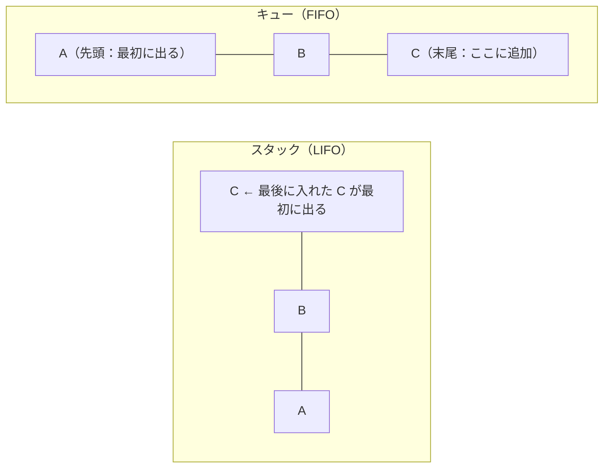
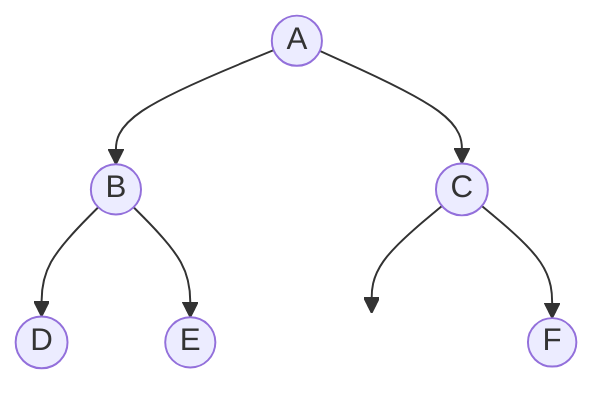
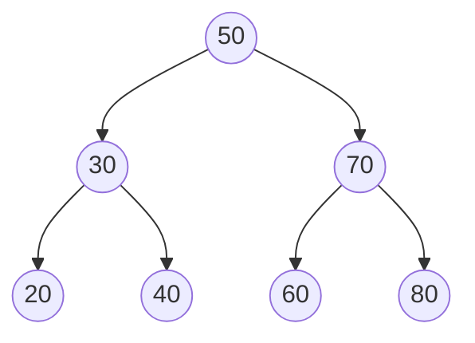
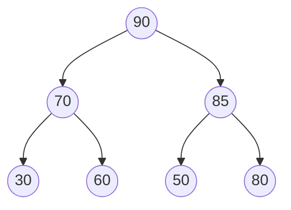
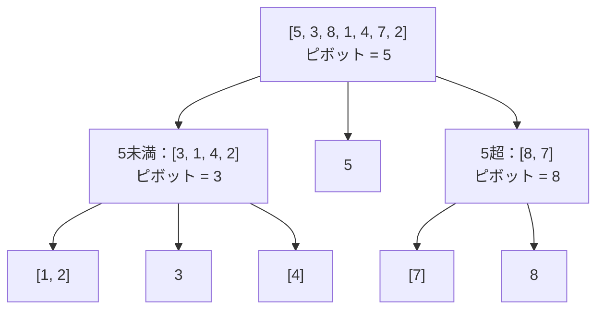
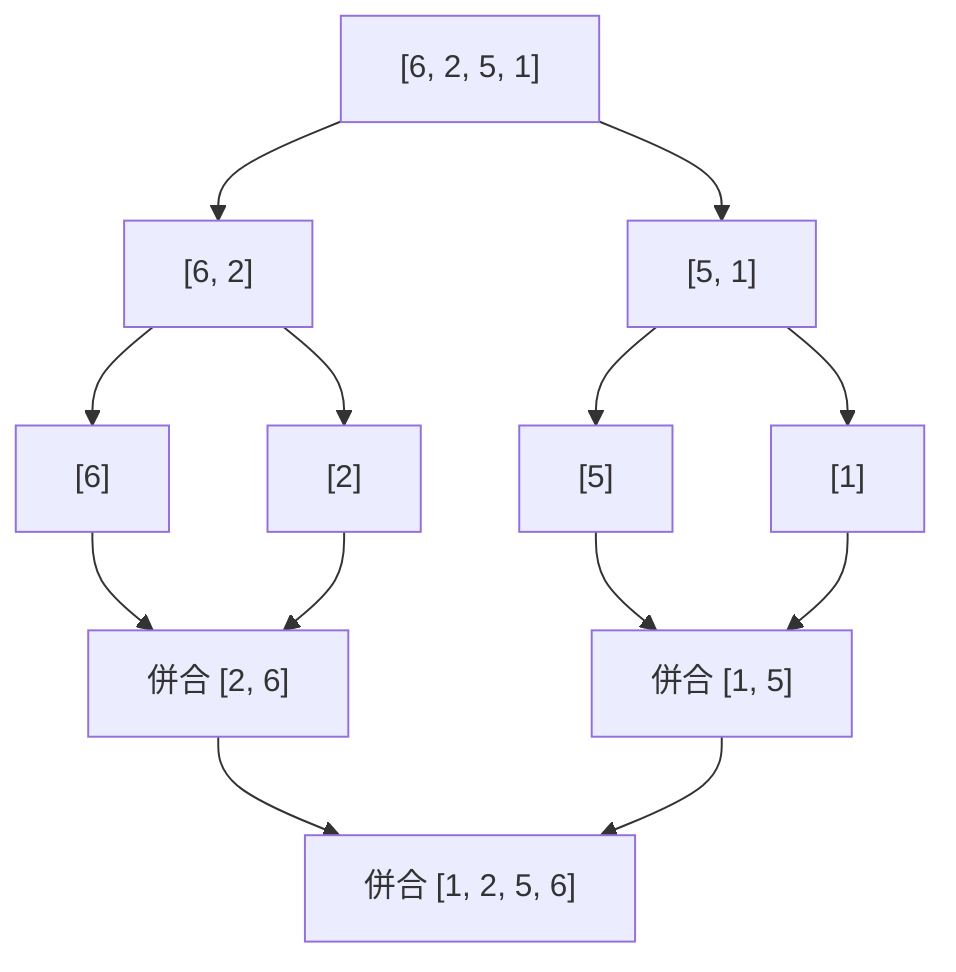
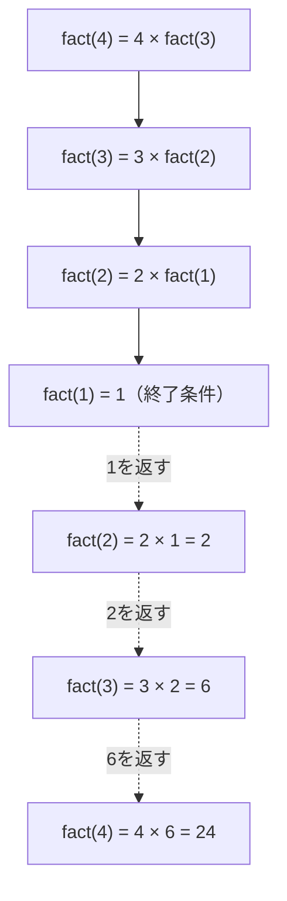

# アルゴリズムとプログラミング

> **重要度：★★★**（科目A（旧午前）で毎回 2〜4 問、科目B（旧午後）の「プログラミング」問題（問3）の土台）
> データ構造とアルゴリズムは、科目Aの知識問題だけでなく、科目Bの擬似言語プログラムを読む力に直結します。
> この章のポイントは次の4つです。
> - スタック／キュー／リスト／木／ヒープ／ハッシュの **しくみと使いどころ**
> - 探索・整列アルゴリズムの **計算量（O記法）と安定性**
> - **再帰** の動きを手でトレース（追跡）できること
> - IPA の **擬似言語** の記法と、科目Bプログラミング問題の解き方の型

## 目次

1. [データ構造](#1-データ構造)
2. [探索アルゴリズム](#2-探索アルゴリズム)
3. [整列（ソート）アルゴリズム](#3-整列ソートアルゴリズム)
4. [計算量](#4-計算量)
5. [再帰](#5-再帰)
6. [擬似言語の読み方](#6-擬似言語の読み方)
7. [科目B「プログラミング」問題の読み方のコツ](#7-科目bプログラミング問題の読み方のコツ)
8. [確認問題](#確認問題)
9. [参考](#参考)

---

## 1. データ構造

**データ構造**とは、データをコンピュータ上で効率よく扱うための「並べ方・つなぎ方」のことです。

### 1.1 配列 ★

- **結論**：同じ型のデータを連続した領域に並べ、**要素番号（添字）で直接アクセス** できる構造です。
- **理由**：先頭アドレス＋（要素番号 × 要素サイズ）で位置が計算できるため、読み出しは O(1)（要素数に関係なく一定時間）です。
- **弱点**：途中への挿入・削除では後ろの要素をずらす必要があり O(n) かかります。

### 1.2 スタックとキュー ★★★

| 構造 | 取り出し順 | 追加 | 取出し | 主な用途 |
|---|---|---|---|---|
| **スタック** | **LIFO**（Last In First Out：後入れ先出し） | push | pop | 関数呼出しの戻り先管理、再帰、逆ポーランド記法の計算、undo |
| **キュー** | **FIFO**（First In First Out：先入れ先出し） | enqueue | dequeue | 印刷待ち、プロセスの実行待ち、幅優先探索 |



**具体例**：空のスタックに `push 1, push 2, pop, push 3, push 4, pop, pop` を行うと、取り出される順は **2 → 4 → 3** で、最後にスタックに残るのは **1** です。

**優先度付きキュー**：優先度の高いものから取り出すキュー。ヒープ（1.6）で効率よく実現できます。

### 1.3 逆ポーランド記法（後置記法） ★★

**逆ポーランド記法**とは、演算子を被演算子（数）の **後ろ** に書く表記法です。括弧が不要で、**スタックを使って左から順に計算** できます。

| 通常の記法（中置記法） | 逆ポーランド記法 |
|---|---|
| A + B | A B + |
| (A + B) × C | A B + C × |
| A + B × C | A B C × + |
| (A + B) × (C − D) | A B + C D − × |

**計算手順**：数ならスタックに積む／演算子ならスタックから2つ取り出して計算し、結果を積む。

**具体例**：`3 4 + 5 2 − ×` を計算

| 読んだもの | 操作 | スタック（左が底） |
|---|---|---|
| 3 | push | 3 |
| 4 | push | 3, 4 |
| + | 4 と 3 を pop → 3 + 4 = 7 を push | 7 |
| 5 | push | 7, 5 |
| 2 | push | 7, 5, 2 |
| − | 2 と 5 を pop → 5 − 2 = 3 を push | 7, 3 |
| × | 3 と 7 を pop → 7 × 3 = 21 を push | **21** |

⚠️ **ひっかけ注意**：引き算・割り算では「**先に pop したほうが右側**」です（5 − 2 であって 2 − 5 ではない）。

### 1.4 リスト ★★★

**リスト（連結リスト）**とは、各要素（ノード）が **データ** と **次の要素の位置（ポインタ）** を持ち、ポインタでつながる構造です。

| 種類 | ポインタ | 特徴 |
|---|---|---|
| **単方向リスト** | 次へのポインタのみ | 後ろへしかたどれない |
| **双方向リスト** | 次と前へのポインタ | 前後どちらにもたどれる。削除が容易 |
| **循環リスト** | 末尾が先頭を指す | 終わりがなく、ぐるぐる回れる |


**挿入の手順**（A と B の間に X を入れる）

```
① X.次 ← A.次     （X が B を指す）
② A.次 ← X        （A が X を指す）
※ 順序を逆にすると B への参照が失われる
```

| 操作 | 配列 | 連結リスト |
|---|---|---|
| k番目の要素の参照 | **O(1)** | O(n)（先頭からたどる） |
| 位置が分かっている場所への挿入・削除 | O(n)（ずらす） | **O(1)**（ポインタの付け替え） |

💡 科目Bでは「リストに要素を追加・削除するプログラムの空欄」が頻出です。**図を描いてポインタの付け替え順を確認** するのが最短ルートです。

### 1.5 木構造 ★★★

**木（ツリー）**とは、親子関係をもつ階層構造です。頂点を **根（ルート）**、子をもたないノードを **葉（リーフ）** といいます。各ノードの子が最大2つの木を **2分木** といいます。

#### 2分木の走査（巡回）順序



（C の左の子はありません。）

| 走査方法 | ルール | 上の木の結果 |
|---|---|---|
| **先行順（行きがけ順、preorder）** | 根 → 左 → 右 | A B D E C F |
| **中間順（通りがけ順、inorder）** | 左 → 根 → 右 | D B E A C F |
| **後行順（帰りがけ順、postorder）** | 左 → 右 → 根 | D E B F C A |
| 幅優先（レベル順） | 上の段から左→右 | A B C D E F |

💡 **覚え方**：根を「いつ」出力するか。**先＝最初、中＝真ん中、後＝最後**。数式の木を後行順で読むと **逆ポーランド記法** になります。

#### 2分探索木

**2分探索木**とは、「**左の子孫 < 親 < 右の子孫**」が全ノードで成り立つ2分木です。中間順で走査すると **昇順** に並びます。

**具体例**：50, 30, 70, 20, 40, 60, 80 の順に挿入



- 探索は根から「小さければ左、大きければ右」と進むので、木がバランスしていれば O(log n)。
- ⚠️ 昇順のデータ（10, 20, 30, …）を順に挿入すると、右にだけ伸びた **一直線の木** になり、探索が O(n) に悪化します。これを防ぐのが **AVL木**（左右の高さの差を1以内に保つ）や **B木**（データベースの索引に使う多分木）などの **平衡木** です。

### 1.6 ヒープ ★★

**ヒープ**とは、「**親 ≧ 子**」（最大ヒープ）または「**親 ≦ 子**」（最小ヒープ）が全ノードで成り立つ **完全2分木**（上の段から左詰めで埋まった2分木）です。根が常に最大（最小）値なので、優先度付きキューやヒープソートに使います。

完全2分木は配列で表現でき、要素番号を1から振ると次の関係があります。

```
親の要素番号 = i ÷ 2（小数切捨て）
左の子 = 2i      右の子 = 2i + 1
```

**具体例**：最大ヒープ `[90, 70, 80, 30, 60, 50]` に **85** を追加する

```
① 末尾（7番目）に追加      ：[90, 70, 80, 30, 60, 50, 85]
② 親（7÷2=3番目の 80）と比較：85 > 80 なので交換 → [90, 70, 85, 30, 60, 50, 80]
③ 親（3÷2=1番目の 90）と比較：85 < 90 なので終了
```



### 1.7 ハッシュ ★★

**ハッシュ表**とは、キーを **ハッシュ関数** で計算した値（ハッシュ値）を格納位置にする構造です。衝突がなければ探索は **O(1)** です。

- **衝突（シノニム）**：異なるキーが同じハッシュ値になること。
- 衝突の対処法：
  - **チェイン法（連鎖法）**：同じ位置の要素をリストでつなぐ
  - **オープンアドレス法**：空いている別の位置を探す（例：**線形探査法**＝1つずつ後ろを調べる）

**具体例**：表の大きさ 7（位置 0〜6）、ハッシュ関数 `キー mod 7`、線形探査法で 12, 25, 19, 33, 7 を順に格納

| キー | mod 7 | 格納位置 | 説明 |
|---|---|---|---|
| 12 | 5 | 5 | 空いている |
| 25 | 4 | 4 | 空いている |
| 19 | 5 | **6** | 5 は使用中 → 次の 6 へ |
| 33 | 5 | **0** | 5, 6 が使用中 → 末尾の次は先頭 0 へ |
| 7 | 0 | **1** | 0 は使用中 → 1 へ |

結果：`位置0:33, 1:7, 2:空, 3:空, 4:25, 5:12, 6:19`

---

## 2. 探索アルゴリズム

### 2.1 線形探索 ★★

先頭から順に1つずつ比較する方法です。整列されていなくても使えます。

```
平均比較回数 ≒ n / 2      最大比較回数 = n      計算量 O(n)
```

**番兵法**：探索の末尾に探したい値（番兵）を置き、「終端に達したか」の判定を省いて高速化する工夫です。

### 2.2 2分探索 ★★★

**整列済み** のデータの中央と比較し、探索範囲を半分ずつ絞り込む方法です。

```
最大比較回数 = ⌊log₂ n⌋ + 1      平均比較回数 ≒ log₂ n      計算量 O(log n)
（⌊ ⌋ は小数点以下切捨て）
```

**具体例**：1,000件のデータの最大比較回数

```
2⁹ = 512 ≦ 1000 < 1024 = 2¹⁰  → ⌊log₂ 1000⌋ = 9
最大比較回数 = 9 + 1 = 10 回
```

**手順例**：`[3, 8, 12, 17, 21, 26, 30, 35, 41]`（要素番号 1〜9）から 30 を探す

| 回 | 下端 | 上端 | 中央 = (下端+上端) ÷ 2 | 中央の値 | 判定 |
|---|---|---|---|---|---|
| 1 | 1 | 9 | 5 | 21 | 30 > 21 → 下端 ← 6 |
| 2 | 6 | 9 | 7 | 30 | **一致（2回で発見）** |

⚠️ データが **整列されていること** が前提です。データ件数が2倍になっても比較回数は **1回** しか増えません。

### 2.3 ハッシュ探索 ★

ハッシュ値で格納位置を直接求めるので、衝突がなければ **O(1)** です。

---

## 3. 整列（ソート）アルゴリズム

### 3.1 一覧 ★★★

| 方式 | 考え方 | 平均計算量 | 最悪計算量 | 安定 |
|---|---|---|---|---|
| **バブルソート**（基本交換法） | 隣同士を比較して交換 | O(n²) | O(n²) | ○ |
| **選択ソート**（基本選択法） | 未整列部分の最小値を選んで先頭と交換 | O(n²) | O(n²) | × |
| **挿入ソート**（基本挿入法） | 整列済み部分の適切な位置に挿入 | O(n²) | O(n²) | ○ |
| **シェルソート** | 一定間隔ごとに挿入ソートし、間隔を狭める | 約 O(n^1.25〜1.5) | O(n²) | × |
| **クイックソート** | 基準値（ピボット）より小さい群・大きい群に分割を繰り返す | **O(n log n)** | O(n²) | × |
| **マージソート** | 半分に分割して整列し、併合（マージ）する | **O(n log n)** | **O(n log n)** | ○ |
| **ヒープソート** | ヒープを作り、根（最大値）を取り出すことを繰り返す | **O(n log n)** | **O(n log n)** | × |

- **安定なソート**：同じキーの要素の **元の並び順が保たれる** ソート。例えば「社員番号順の名簿を部署で並べ替えても、同じ部署内は社員番号順のまま」になります。
- 挿入ソートは **ほぼ整列済み** のデータに対しては高速（O(n) に近い）です。
- クイックソートは、ピボットが毎回最大値（最小値）になると O(n²) に悪化します（例：整列済みデータで先頭をピボットにした場合）。

### 3.2 バブルソートのトレース ★★

**具体例**：`[5, 3, 8, 1, 4]` を昇順に整列（隣同士を左から比較し、左が大きければ交換）

```
1回目のパス：
  (5,3) 交換 → [3, 5, 8, 1, 4]
  (5,8) そのまま
  (8,1) 交換 → [3, 5, 1, 8, 4]
  (8,4) 交換 → [3, 5, 1, 4, 8]   ← 最大値 8 が末尾に確定
2回目のパス：
  (3,5) そのまま
  (5,1) 交換 → [3, 1, 5, 4, 8]
  (5,4) 交換 → [3, 1, 4, 5, 8]   ← 5 が確定
3回目のパス：
  (3,1) 交換 → [1, 3, 4, 5, 8]
  (3,4) そのまま                  ← 4 が確定
4回目のパス：(1,3) そのまま → 交換なしで終了
```

n 個のデータで比較回数は最大 `(n−1) + (n−2) + … + 1 = n(n−1)/2` 回。n = 5 なら 10 回です。

### 3.3 クイックソートの考え方 ★★



分割を繰り返して要素が1個になったら完成です。最後に左から読むと `[1, 2, 3, 4, 5, 7, 8]` になります。

### 3.4 マージソートの考え方 ★★



分割の段数が約 log₂ n、各段の併合で n 回程度の比較をするので、全体で O(n log n) です。併合用の **作業領域** が別に必要な点が弱点です。

---

## 4. 計算量

### 4.1 O記法 ★★★

**計算量（オーダ）**とは、データ数 n が大きくなったときに処理時間がどの程度増えるかを表す尺度で、**O記法**（ビッグオー記法）で書きます。最も増え方が大きい項だけを残し、係数は無視します（例：`3n² + 5n + 2` → O(n²)）。

| 計算量 | n = 10 | n = 100 | n = 1,000 | 例 |
|---|---|---|---|---|
| O(1) | 1 | 1 | 1 | 配列の要素参照、ハッシュ探索 |
| O(log n) | 約3.3 | 約6.6 | 約10 | 2分探索 |
| O(n) | 10 | 100 | 1,000 | 線形探索 |
| O(n log n) | 約33 | 約664 | 約9,966 | クイックソート（平均）、マージソート |
| O(n²) | 100 | 10,000 | 1,000,000 | バブルソート、2重ループ |
| O(2ⁿ) | 1,024 | 約1.3×10³⁰ | — | ハノイの塔、素朴な再帰のフィボナッチ |

### 4.2 計算例 ★★

**問題**：O(n²) のアルゴリズムで、n = 1,000 のとき 2 秒かかった。n = 3,000 のときはおよそ何秒か。

```
処理時間 ∝ n²
n が 3,000 / 1,000 = 3 倍 → 時間は 3² = 9 倍
2 秒 × 9 = 18 秒
```

**問題**：2重ループ `for i = 1〜n、for j = i〜n` の内側の実行回数は？

```
i=1 で n 回、i=2 で n−1 回、…、i=n で 1 回
合計 = n + (n−1) + … + 1 = n(n+1)/2  → O(n²)
```

---

## 5. 再帰

### 5.1 再帰とは ★★★

**再帰（再帰呼出し）**とは、関数が **自分自身を呼び出す** ことです。必ず **終了条件（基底条件）** を持たせ、呼出しのたびに問題を小さくします。呼出し元の情報（戻り先や局所変数）は **スタック** に積まれます。

**例：階乗** `n! = n × (n−1)!`、`0! = 1`

```text
○整数型: fact(整数型: n)
  if (n ≦ 1)
    return 1
  else
    return n × fact(n − 1)
  endif
```

**トレース**：fact(4)



### 5.2 再帰の代表例 ★★

**桁の和**：`g(n)` = n の各桁の和

```text
○整数型: g(整数型: n)
  if (n = 0)
    return 0
  endif
  return (n mod 10) + g(n ÷ 10)    /* ÷ は商の整数部分を求めるものとする */
```

```
g(345) = 5 + g(34)
       = 5 + (4 + g(3))
       = 5 + (4 + (3 + g(0)))
       = 5 + 4 + 3 + 0 = 12
```

**ハノイの塔**：n 枚の円盤の最小移動回数 `H(n) = 2 × H(n−1) + 1`、`H(1) = 1`

```
H(1) = 1, H(2) = 3, H(3) = 7, … → 一般に H(n) = 2ⁿ − 1
H(10) = 2¹⁰ − 1 = 1,023 回
```

**フィボナッチ数**：`fib(n) = fib(n−1) + fib(n−2)`、`fib(0) = 0, fib(1) = 1`
素朴に再帰で書くと同じ計算を何度も繰り返し、fib(5) を求めるだけで関数が **15回** 呼ばれます（指数時間）。計算済みの値を記録して再利用する **メモ化**（動的計画法）で O(n) に改善できます。

⚠️ **ひっかけ注意**：再帰関数が「どこで値を返し、返った後に何を計算するか」を取り違えやすいです。**下から（終了条件側から）値を埋めていく表** を作ると確実です。

---

## 6. 擬似言語の読み方

### 6.1 IPA の擬似言語 ★★★

基本情報技術者試験・応用情報技術者試験では、IPA が「試験で使用する情報技術に関する用語・プログラム言語など」の別紙で定めた **擬似言語** でプログラムが出題されます。主な記述形式は次のとおりです（問題文に注記があればそちらが優先されます）。

| 記述形式 | 意味 |
|---|---|
| `○手続名又は関数名` | 手続・関数の宣言（例：`○整数型: max(整数型: a, 整数型: b)`） |
| `型名: 変数名` | 変数の宣言（例：`整数型: i`、`整数型の配列: data`） |
| `/* 注釈 */`、`// 注釈` | 注釈（コメント） |
| `変数名 ← 式` | 代入（右辺の値を左辺の変数に入れる） |
| `手続名又は関数名(引数, …)` | 手続・関数の呼出し |
| `if (条件式1)` 処理1 `elseif (条件式2)` 処理2 … `else` 処理n `endif` | 選択処理（上から順に評価し、最初に真になった処理だけを実行） |
| `while (条件式)` 処理 `endwhile` | 前判定の繰返し（条件が真の間繰り返す。最初に偽なら1回も実行しない） |
| `do` 処理 `while (条件式)` | 後判定の繰返し（**最低1回は実行**） |
| `for (制御記述)` 処理 `endfor` | 制御記述に従った繰返し（例：`for (i を 1 から n まで 1 ずつ増やす)`） |

**演算子と優先順位**（上ほど優先度が高い）

| 種類 | 演算子 |
|---|---|
| 式 | `( )`、`.`（メンバへのアクセス） |
| 単項演算子 | `not`、`+`、`−` |
| 乗除 | `mod`（剰余）、`×`、`÷` |
| 加減 | `+`、`−` |
| 関係 | `≠`、`≦`、`≧`、`<`、`=`、`>` |
| 論理積 | `and` |
| 論理和 | `or` |

その他のポイント：

- 論理型の定数は `true` / `false`。値が入っていない状態は **未定義**（`未定義の値`）と表します。
- **配列** は `{1, 2, 3}` のように `{ }` で要素を並べて表し、要素は `data[i]` のように `[ ]` で要素番号を指定して参照します。2次元配列は `data[行, 列]` です。**要素番号が 1 から始まるか 0 から始まるかは問題文で示されます**（1 から始まる問題が多い）ので必ず確認します。
- 配列の要素数は `data の要素数` のように日本語で書かれることがあります。

⚠️ `÷` の結果が整数になるのか実数になるのか、`and` / `or` の評価方法など、細かな約束は **問題ごとの注記** で示されます。問題冒頭の注記を必ず読みましょう。

### 6.2 トレース表で読む ★★★

**例題**：次の関数 `calc` に `{4, 7, 1, 9, 3}` を与えたとき、戻り値は何か（配列の要素番号は1から）。

```text
○整数型: calc(整数型の配列: a)
  整数型: i, m, k
  m ← a[1]
  k ← 1
  for (i を 2 から a の要素数 まで 1 ずつ増やす)
    if (a[i] > m)
      m ← a[i]
      k ← i
    endif
  endfor
  return k
```

| i | a[i] | a[i] > m ? | m | k |
|---|---|---|---|---|
| （初期） | — | — | 4 | 1 |
| 2 | 7 | 7 > 4 真 | 7 | 2 |
| 3 | 1 | 1 > 7 偽 | 7 | 2 |
| 4 | 9 | 9 > 7 真 | 9 | 4 |
| 5 | 3 | 3 > 9 偽 | 9 | 4 |

戻り値は **4**（最大値 9 の **要素番号**）です。「最大値を返す」と早合点しないことが大切です。

💡 **トレース表のコツ**：①変数を列に並べる、②ループ1回を1行にする、③条件判定の真偽も書く。値が変わったところだけ書き込むと速くなります。

---

## 7. 科目B「プログラミング」問題の読み方のコツ

### 7.1 出題の特徴 ★★★

応用情報技術者試験の科目B（旧午後）では、問3 が「プログラミング」分野として出題されてきました（11問中から問2〜11の4問を選択）。テーマは **データ構造（リスト、木、グラフ、ヒープ）**、**探索・整列**、**再帰**、**数値計算**、**文字列処理** などで、プログラムの **空欄補充**、**トレース結果**、**計算量** や **処理回数** を問う設問が中心です。


### 7.2 解き方の型 ★★★

1. **問題文の説明と例を先に理解する**
   プログラムを読む前に、本文で説明されているアルゴリズムの考え方・図・具体例を理解します。プログラムは「説明を書き下したもの」なので、説明が分かれば空欄の多くは推測できます。
2. **変数・配列の役割をメモする**
   「`top` はスタックの先頭位置」「`next[i]` は i 番目の次の要素番号」のように役割を余白に書きます。
3. **本文の具体例でトレースする**
   本文に図示された入力例を使えば、途中の状態（配列の中身など）が図と一致するかで空欄の正しさを確認できます。
4. **境界条件を確認する**
   ループの開始値・終了値、`<` と `≦` の違い、配列が空・要素1個のとき、末尾要素の扱い。空欄の選択肢はこの「1つずれ」で差がつくことが多いです。
5. **計算量・回数の設問は式で表す**
   「n が2倍になると何倍か」「比較回数はいくつか」は、ループの入れ子構造から n(n−1)/2 や log₂ n を導きます。

### 7.3 よくある落とし穴 ★★

| 落とし穴 | 対策 |
|---|---|
| 要素番号の開始値（0 か 1 か）を誤解 | 問題文の注記を確認し、トレース表の見出しに書いておく |
| `while` と `do-while` の違い | 後判定は最低1回実行されることを意識 |
| ポインタの付け替え順序 | 必ず図を描き、古い参照が失われないか確認 |
| 再帰の戻り値の積み上げ | 終了条件から逆向きに表を埋める |
| 空欄が複数あり相互に依存 | 確実に分かる空欄から埋め、残りはトレースで確定 |

💡 **時間配分**：科目Bは150分で5問なので、1問あたり約30分です。プログラミング問題は、トレースに時間がかかりすぎたら **後回しにする勇気** も必要です。

---

## 確認問題

**問1** 空のスタックに対して `push A, push B, pop, push C, push D, pop, pop, push E` の順に操作した。このときスタックの底から順に並んでいるデータはどれか。
ア A, E　イ A, C　ウ E, A　エ B, E

**問2** 式 `(A − B) × C + D ÷ E` を逆ポーランド記法で表したものはどれか。
ア `A B − C × D E ÷ +`　イ `A B C − × D E ÷ +`　ウ `A B − C D E × ÷ +`　エ `+ × − A B C ÷ D E`

**問3** 次の2分木を中間順（通りがけ順）で走査したときの出力順はどれか。根は P、P の左の子は Q、右の子は R、Q の左の子は S、R の左の子は T、右の子は U とする。
ア P Q S R T U　イ S Q P T R U　ウ S Q T U R P　エ S Q P R T U

**問4** 4,000件の整列済みデータを2分探索するとき、最大比較回数は何回か。
ア 11　イ 12　ウ 13　エ 2,000

**問5** 次の整列アルゴリズムのうち、最悪の場合でも計算量が O(n log n) で、かつ **安定** なものはどれか。
ア クイックソート　イ ヒープソート　ウ マージソート　エ 選択ソート

**問6** 大きさ 11（位置 0〜10）のハッシュ表に、ハッシュ関数 `キー mod 11`、線形探査法（衝突したら次の位置、末尾の次は先頭）で 23, 34, 45, 12 を順に格納した。12 が格納される位置はどこか。

**問7** 次の関数 f について、f(5) の値はいくつか。

```text
○整数型: f(整数型: n)
  if (n ≦ 2)
    return 1
  endif
  return f(n − 1) + 2 × f(n − 2)
```

**問8** 計算量が O(n log n) のアルゴリズムで、n = 1,024 のとき処理時間が 10 ミリ秒だった。n = 4,096 のときの処理時間はおよそ何ミリ秒か（log₂ で考えよ）。

**問9** 次のプログラムで、配列 data が `{2, 5, 5, 8, 5}`（要素番号は1から）、x = 5 のとき、戻り値はいくつか。

```text
○整数型: count(整数型の配列: data, 整数型: x)
  整数型: i, c
  c ← 0
  i ← 1
  while (i ≦ data の要素数)
    if (data[i] = x)
      c ← c + i
    endif
    i ← i + 1
  endwhile
  return c
```

<details><summary>解答・解説</summary>

**問1　ア**
```
push A → [A]
push B → [A, B]
pop    → B を取出し → [A]
push C → [A, C]
push D → [A, C, D]
pop    → D → [A, C]
pop    → C → [A]
push E → [A, E]
```

**問2　ア**
```
(A − B) → A B −
(A − B) × C → A B − C ×
D ÷ E → D E ÷
全体 X + Y → X Y + → A B − C × D E ÷ +
```
エは演算子を前に書くポーランド記法（前置記法）の形です。

**問3　イ**
中間順は「左 → 根 → 右」。P の左部分木（Q, S）を先に処理して S Q、次に P、最後に右部分木（R, T, U）で T R U。よって **S Q P T R U**。

**問4　イ**
```
2¹¹ = 2048 ≦ 4000 < 4096 = 2¹² → ⌊log₂ 4000⌋ = 11
最大比較回数 = 11 + 1 = 12 回
```

**問5　ウ**
マージソートは最悪でも O(n log n) で安定です。クイックソートは最悪 O(n²)、ヒープソートは不安定、選択ソートは O(n²) かつ不安定です。

**問6　位置 4**
```
23 mod 11 = 1 → 位置1
34 mod 11 = 1 → 1は使用中 → 位置2
45 mod 11 = 1 → 1, 2 使用中 → 位置3
12 mod 11 = 1 → 1, 2, 3 使用中 → 位置4
```

**問7　11**
```
f(1) = 1, f(2) = 1
f(3) = f(2) + 2×f(1) = 1 + 2 = 3
f(4) = f(3) + 2×f(2) = 3 + 2 = 5
f(5) = f(4) + 2×f(3) = 5 + 6 = 11
```

**問8　約 48 ミリ秒**
```
n log₂ n の比を求める
n = 1024：1024 × 10 = 10,240
n = 4096：4096 × 12 = 49,152
比 = 49,152 / 10,240 = 4.8 倍
10 ミリ秒 × 4.8 = 48 ミリ秒
```

**問9　10**
x = 5 と一致するのは要素番号 2, 3, 5。c には **要素番号 i** を足しているので `2 + 3 + 5 = 10`。個数（3）や値の合計（15）と取り違えないよう注意します。

</details>

---

## 参考

- IPA「試験要綱・シラバスについて」（応用情報技術者試験 シラバス Ver.7.2、試験で使用する情報技術に関する用語・プログラム言語など）：https://www.ipa.go.jp/shiken/syllabus/gaiyou.html
- IPA「応用情報技術者試験 シラバス Ver.7.2（PDF）」：https://www.ipa.go.jp/shiken/syllabus/omgdg50000005kq5-att/syllabus_ap_ver7_2.pdf
- IPA「試験で使用する情報技術に関する用語・プログラム言語など Ver.5.0（PDF、別紙2 擬似言語の記述形式）」：https://www.ipa.go.jp/shiken/syllabus/ps6vr7000000i9dp-att/shiken_yougo_ver5_0.pdf
- IPA「応用情報技術者試験（AP）」試験区分ページ：https://www.ipa.go.jp/shiken/kubun/ap.html
- IPA「過去問題」：https://www.ipa.go.jp/shiken/mondai-kaiotu/index.html
- 応用情報技術者試験ドットコム（午前・午後過去問の分野別解説）：https://www.ap-siken.com/
