# アルゴリズムとプログラミング

> **重要度：★★★**（科目A（旧午前）で毎回 2〜4 問、科目B（旧午後）の「プログラミング」問題（問3）の土台）
> データ構造とアルゴリズムは、科目Aの知識問題だけでなく、科目Bの擬似言語プログラムを読む力に直結します。
> この章のポイントは次の4つです。
> - スタック／キュー／リスト／木／ヒープ／ハッシュの **しくみと使いどころ**
> - 探索・整列アルゴリズムの **計算量（O記法）と安定性**
> - **再帰** の動きを手でトレース（追跡）できること
> - IPA の **擬似言語** の記法と、科目Bプログラミング問題の解き方の型

## 目次

1. [データ構造](#1-データ構造)
2. [探索アルゴリズム](#2-探索アルゴリズム)
3. [整列（ソート）アルゴリズム](#3-整列ソートアルゴリズム)
4. [計算量](#4-計算量)
5. [再帰](#5-再帰)
6. [擬似言語の読み方](#6-擬似言語の読み方)
7. [科目B「プログラミング」問題の読み方のコツ](#7-科目bプログラミング問題の読み方のコツ)
8. [流れ図とアルゴリズムの設計](#8-流れ図とアルゴリズムの設計)
9. [いろいろなアルゴリズム](#9-いろいろなアルゴリズム)
10. [プログラミングとプログラム言語](#10-プログラミングとプログラム言語)
11. [マークアップ言語とその他の言語](#11-マークアップ言語とその他の言語)
12. [確認問題](#確認問題)
13. [📋 シラバス用語チェックリスト](#-シラバス用語チェックリスト)
14. [参考](#参考)

---

## 1. データ構造

**データ構造**とは、データをコンピュータ上で効率よく扱うための「並べ方・つなぎ方」のことです。

### 1.1 配列 ★

- **結論**：同じ型のデータを連続した領域に並べ、**要素番号（添字）で直接アクセス** できる構造です。
- **理由**：先頭アドレス＋（要素番号 × 要素サイズ）で位置が計算できるため、読み出しは O(1)（要素数に関係なく一定時間）です。
- **弱点**：途中への挿入・削除では後ろの要素をずらす必要があり O(n) かかります。

| 用語 | 意味 |
|---|---|
| **多次元配列** | 添字を複数もつ配列。2次元配列 `a[i, j]` は表（行と列）のイメージ。メモリ上は1列に並べて格納する（行ごとに並べる **行優先** と、列ごとに並べる **列優先** がある） |
| **静的配列** | 要素数をプログラムの作成時（コンパイル時）に決め、実行中は変えられない配列 |
| **動的配列** | 実行中に要素数を増減できる配列（Python の list、Java の ArrayList など） |

**例（2次元配列のアドレス計算）**：`a[i, j]`（i = 1〜3、j = 1〜4、1要素4バイト、先頭アドレス 1000、行優先）の `a[2, 3]` のアドレス

```
前にある要素数 = (2 − 1) × 4 + (3 − 1) = 6 個
アドレス = 1000 + 6 × 4 = 1024
```

💡 データ構造は BNF で定義することもできます。例えば `<リスト> ::= 空 | <要素> <リスト>` は「リストとは、空か、要素の後ろにリストが続いたもの」という **再帰的な定義** です（BNF は [01_基礎理論](01_基礎理論.md) 6.3 参照）。

### 1.2 スタックとキュー ★★★

| 構造 | 取り出し順 | 追加 | 取出し | 主な用途 |
|---|---|---|---|---|
| **スタック** | **LIFO**（Last In First Out：後入れ先出し） | push | pop | 関数呼出しの戻り先管理、再帰、逆ポーランド記法の計算、undo |
| **キュー** | **FIFO**（First In First Out：先入れ先出し） | enqueue | dequeue | 印刷待ち、プロセスの実行待ち、幅優先探索 |

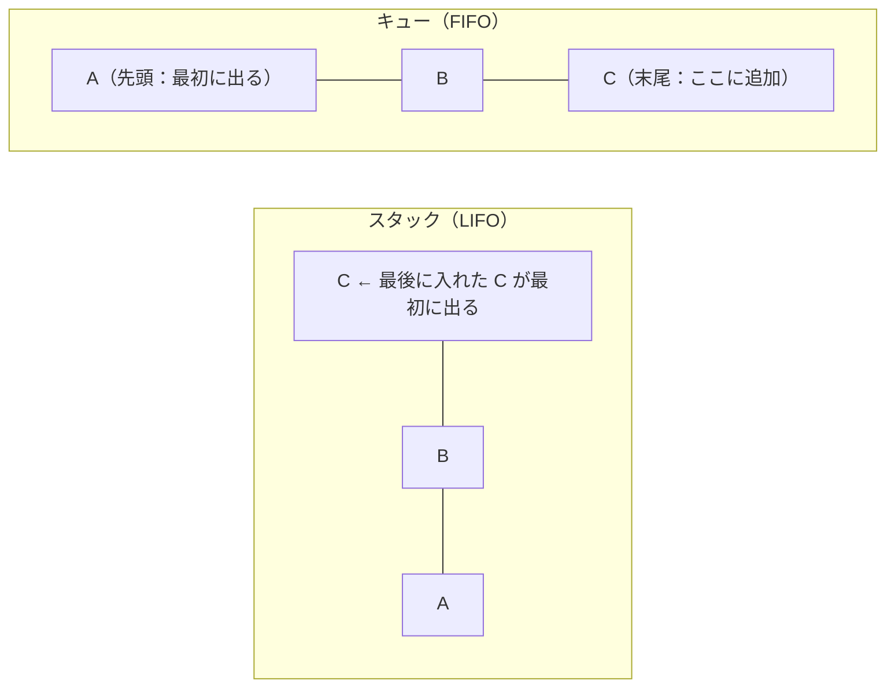

**具体例**：空のスタックに `push 1, push 2, pop, push 3, push 4, pop, pop` を行うと、取り出される順は **2 → 4 → 3** で、最後にスタックに残るのは **1** です。

**優先度付きキュー**：優先度の高いものから取り出すキュー。ヒープ（1.6）で効率よく実現できます。

### 1.3 逆ポーランド記法（後置記法） ★★

**逆ポーランド記法**とは、演算子を被演算子（数）の **後ろ** に書く表記法です。括弧が不要で、**スタックを使って左から順に計算** できます。

| 通常の記法（中置記法） | 逆ポーランド記法 |
|---|---|
| A + B | A B + |
| (A + B) × C | A B + C × |
| A + B × C | A B C × + |
| (A + B) × (C − D) | A B + C D − × |

**計算手順**：数ならスタックに積む／演算子ならスタックから2つ取り出して計算し、結果を積む。

**具体例**：`3 4 + 5 2 − ×` を計算

| 読んだもの | 操作 | スタック（左が底） |
|---|---|---|
| 3 | push | 3 |
| 4 | push | 3, 4 |
| + | 4 と 3 を pop → 3 + 4 = 7 を push | 7 |
| 5 | push | 7, 5 |
| 2 | push | 7, 5, 2 |
| − | 2 と 5 を pop → 5 − 2 = 3 を push | 7, 3 |
| × | 3 と 7 を pop → 7 × 3 = 21 を push | **21** |

⚠️ **ひっかけ注意**：引き算・割り算では「**先に pop したほうが右側**」です（5 − 2 であって 2 − 5 ではない）。

### 1.4 リスト ★★★

**リスト（連結リスト）**とは、各要素（ノード）が **データ** と **次の要素の位置（ポインタ）** を持ち、ポインタでつながる構造です。

| 種類 | ポインタ | 特徴 |
|---|---|---|
| **単方向リスト** | 次へのポインタのみ | 後ろへしかたどれない |
| **双方向リスト** | 次と前へのポインタ | 前後どちらにもたどれる。削除が容易 |
| **循環リスト** | 末尾が先頭を指す | 終わりがなく、ぐるぐる回れる |

💡 シラバスでは、要素が1列に並ぶリストを **線形リスト**、ポインタでつないだリストを **リンク付リスト**（連結リスト）、循環リストを **環状リスト** とも呼びます。


**挿入の手順**（A と B の間に X を入れる）

```
① X.次 ← A.次     （X が B を指す）
② A.次 ← X        （A が X を指す）
※ 順序を逆にすると B への参照が失われる
```

| 操作 | 配列 | 連結リスト |
|---|---|---|
| k番目の要素の参照 | **O(1)** | O(n)（先頭からたどる） |
| 位置が分かっている場所への挿入・削除 | O(n)（ずらす） | **O(1)**（ポインタの付け替え） |

💡 科目Bでは「リストに要素を追加・削除するプログラムの空欄」が頻出です。**図を描いてポインタの付け替え順を確認** するのが最短ルートです。

### 1.5 木構造 ★★★

**木（ツリー）**とは、親子関係をもつ階層構造です。頂点を **根（ルート）**、子をもたないノードを **葉（リーフ）** といいます。各ノードの子が最大2つの木を **2分木** といいます。

| 用語 | 意味 |
|---|---|
| **節（ノード）・枝** | 木の各要素を節、節と節を結ぶ線を **枝**（エッジ）という |
| **完全2分木** | 葉以外のすべての節が2つの子をもち、すべての葉が同じ深さにある2分木（試験では「最下段以外が埋まり、最下段は左詰め」の2分木を指すこともあるので、問題文の定義に従う） |
| **バランス木（平衡木）** | どの節でも左右の部分木の高さがほぼ等しくなるよう保つ木。探索が O(log n) に保たれる（AVL 木、B 木など） |
| **順序木** | 子の並び順（左右・何番目か）に意味がある木 |
| **多分木** | 1つの節が3つ以上の子をもてる木 |
| **探索木** | 探索しやすいように、節の値の大小関係で配置した木（2分探索木、B 木など） |
| **AVL 木** | すべての節で左右の部分木の高さの差が **1以内** になるように、挿入・削除のたびに回転操作で調整する2分探索木 |
| **B 木** | 1つの節に複数のキーと子をもつ多分木の平衡木。節をディスクのブロック単位にでき、**データベースの索引** に使われる（B+木はその改良版） |

#### 2分木の走査（巡回）順序

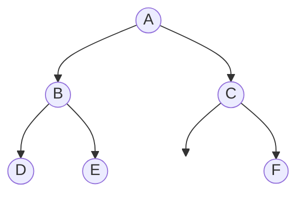

（C の左の子はありません。）

| 走査方法 | ルール | 上の木の結果 |
|---|---|---|
| **先行順（行きがけ順、preorder）** | 根 → 左 → 右 | A B D E C F |
| **中間順（通りがけ順、inorder）** | 左 → 根 → 右 | D B E A C F |
| **後行順（帰りがけ順、postorder）** | 左 → 右 → 根 | D E B F C A |
| 幅優先（レベル順） | 上の段から左→右 | A B C D E F |

💡 **覚え方**：根を「いつ」出力するか。**先＝最初、中＝真ん中、後＝最後**。数式の木を後行順で読むと **逆ポーランド記法** になります。

**深さ優先探索と幅優先探索**：先行順・中間順・後行順はいずれも、行けるところまで深く進んでから戻る **深さ優先探索**（スタックや再帰で実現）です。根に近い段から順に調べるのが **幅優先探索**（キューで実現）です。グラフでの使い方は [9.1](#91-グラフの探索と最短経路-) を参照してください。

#### 2分探索木

**2分探索木**とは、「**左の子孫 < 親 < 右の子孫**」が全ノードで成り立つ2分木です。中間順で走査すると **昇順** に並びます。

**具体例**：50, 30, 70, 20, 40, 60, 80 の順に挿入

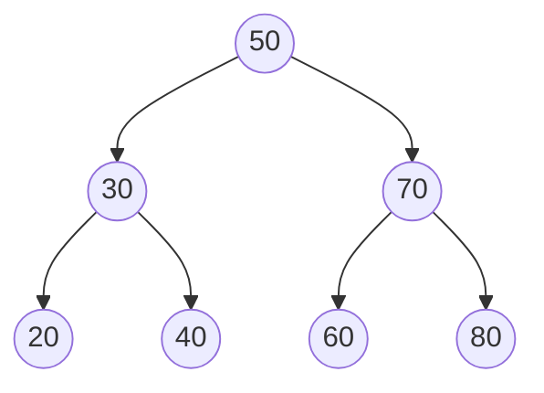

- 探索は根から「小さければ左、大きければ右」と進むので、木がバランスしていれば O(log n)。
- **節の削除**：①葉ならそのまま削除、②子が1つならその子を削除した位置に繰り上げる、③子が2つなら、**左部分木の最大値**（または右部分木の最小値）を削除した位置に移す。上の木で 50 を削除すると、左部分木の最大値 40（または右部分木の最小値 60）が根になります。
- ⚠️ 昇順のデータ（10, 20, 30, …）を順に挿入すると、右にだけ伸びた **一直線の木** になり、探索が O(n) に悪化します。これを防ぐのが **AVL木**（左右の高さの差を1以内に保つ）や **B木**（データベースの索引に使う多分木）などの **平衡木** です。

### 1.6 ヒープ ★★

**ヒープ**とは、「**親 ≧ 子**」（最大ヒープ）または「**親 ≦ 子**」（最小ヒープ）が全ノードで成り立つ **完全2分木**（上の段から左詰めで埋まった2分木）です。根が常に最大（最小）値なので、優先度付きキューやヒープソートに使います。

完全2分木は配列で表現でき、要素番号を1から振ると次の関係があります。

```
親の要素番号 = i ÷ 2（小数切捨て）
左の子 = 2i      右の子 = 2i + 1
```

**具体例**：最大ヒープ `[90, 70, 80, 30, 60, 50]` に **85** を追加する

```
① 末尾（7番目）に追加      ：[90, 70, 80, 30, 60, 50, 85]
② 親（7÷2=3番目の 80）と比較：85 > 80 なので交換 → [90, 70, 85, 30, 60, 50, 80]
③ 親（3÷2=1番目の 90）と比較：85 < 90 なので終了
```

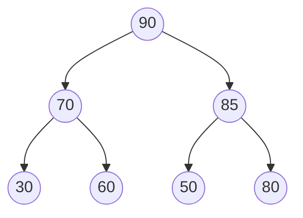

**ヒープの再構成（根の取出し）**：最大値（根）を取り出したら、**末尾の要素を根に移し**、子のうち大きい方と比較して小さければ交換する、を繰り返します（下へ降ろす）。

```
上のヒープ [90, 70, 85, 30, 60, 50, 80] から根 90 を取り出す
① 末尾の 80 を根へ          ：[80, 70, 85, 30, 60, 50]
② 子 70 と 85 の大きい方 85 と比較：80 < 85 なので交換 → [85, 70, 80, 30, 60, 50]
③ 80 の子は 50 だけ：80 > 50 なので終了
```

ヒープソートは、この「根の取出し → 再構成」を n 回繰り返して整列します（1回 O(log n) なので全体で O(n log n)）。

### 1.7 ハッシュ ★★

**ハッシュ表**とは、キーを **ハッシュ関数** で計算した値（ハッシュ値）を格納位置にする構造です。衝突がなければ探索は **O(1)** です。

- **衝突（シノニム）**：異なるキーが同じハッシュ値になること（衝突したキー同士を **シノニム** と呼びます）。下の対処法を **シノニム対策** といいます。
- 衝突の対処法：
  - **チェイン法（連鎖法）**：同じ位置の要素をリストでつなぐ
  - **オープンアドレス法**：空いている別の位置を探す（例：**線形探査法**＝1つずつ後ろを調べる）

**具体例**：表の大きさ 7（位置 0〜6）、ハッシュ関数 `キー mod 7`、線形探査法で 12, 25, 19, 33, 7 を順に格納

| キー | mod 7 | 格納位置 | 説明 |
|---|---|---|---|
| 12 | 5 | 5 | 空いている |
| 25 | 4 | 4 | 空いている |
| 19 | 5 | **6** | 5 は使用中 → 次の 6 へ |
| 33 | 5 | **0** | 5, 6 が使用中 → 末尾の次は先頭 0 へ |
| 7 | 0 | **1** | 0 は使用中 → 1 へ |

結果：`位置0:33, 1:7, 2:空, 3:空, 4:25, 5:12, 6:19`

---

## 2. 探索アルゴリズム

### 2.1 線形探索 ★★

先頭から順に1つずつ比較する方法です。整列されていなくても使えます。

```
平均比較回数 ≒ n / 2      最大比較回数 = n      計算量 O(n)
```

**番兵法**：探索の末尾に探したい値（番兵）を置き、「終端に達したか」の判定を省いて高速化する工夫です。

### 2.2 2分探索 ★★★

**整列済み** のデータの中央と比較し、探索範囲を半分ずつ絞り込む方法です。

```
最大比較回数 = ⌊log₂ n⌋ + 1      平均比較回数 ≒ log₂ n      計算量 O(log n)
（⌊ ⌋ は小数点以下切捨て）
```

**具体例**：1,000件のデータの最大比較回数

```
2⁹ = 512 ≦ 1000 < 1024 = 2¹⁰  → ⌊log₂ 1000⌋ = 9
最大比較回数 = 9 + 1 = 10 回
```

**手順例**：`[3, 8, 12, 17, 21, 26, 30, 35, 41]`（要素番号 1〜9）から 30 を探す

| 回 | 下端 | 上端 | 中央 = (下端+上端) ÷ 2 | 中央の値 | 判定 |
|---|---|---|---|---|---|
| 1 | 1 | 9 | 5 | 21 | 30 > 21 → 下端 ← 6 |
| 2 | 6 | 9 | 7 | 30 | **一致（2回で発見）** |

⚠️ データが **整列されていること** が前提です。データ件数が2倍になっても比較回数は **1回** しか増えません。

### 2.3 ハッシュ探索 ★

ハッシュ値で格納位置を直接求めるので、衝突がなければ **O(1)** です。

---

## 3. 整列（ソート）アルゴリズム

### 3.1 一覧 ★★★

| 方式 | 考え方 | 平均計算量 | 最悪計算量 | 安定 |
|---|---|---|---|---|
| **バブルソート**（基本交換法） | 隣同士を比較して交換 | O(n²) | O(n²) | ○ |
| **選択ソート**（基本選択法） | 未整列部分の最小値を選んで先頭と交換 | O(n²) | O(n²) | × |
| **挿入ソート**（基本挿入法） | 整列済み部分の適切な位置に挿入 | O(n²) | O(n²) | ○ |
| **シェルソート** | 一定間隔ごとに挿入ソートし、間隔を狭める | 約 O(n^1.25〜1.5) | O(n²) | × |
| **クイックソート** | 基準値（ピボット）より小さい群・大きい群に分割を繰り返す | **O(n log n)** | O(n²) | × |
| **マージソート** | 半分に分割して整列し、併合（マージ）する | **O(n log n)** | **O(n log n)** | ○ |
| **ヒープソート** | ヒープを作り、根（最大値）を取り出すことを繰り返す | **O(n log n)** | **O(n log n)** | × |

- **安定なソート**：同じキーの要素の **元の並び順が保たれる** ソート。例えば「社員番号順の名簿を部署で並べ替えても、同じ部署内は社員番号順のまま」になります。
- 挿入ソートは **ほぼ整列済み** のデータに対しては高速（O(n) に近い）です。
- クイックソートは、ピボットが毎回最大値（最小値）になると O(n²) に悪化します（例：整列済みデータで先頭をピボットにした場合）。

### 3.2 バブルソートのトレース ★★

**具体例**：`[5, 3, 8, 1, 4]` を昇順に整列（隣同士を左から比較し、左が大きければ交換）

```
1回目のパス：
  (5,3) 交換 → [3, 5, 8, 1, 4]
  (5,8) そのまま
  (8,1) 交換 → [3, 5, 1, 8, 4]
  (8,4) 交換 → [3, 5, 1, 4, 8]   ← 最大値 8 が末尾に確定
2回目のパス：
  (3,5) そのまま
  (5,1) 交換 → [3, 1, 5, 4, 8]
  (5,4) 交換 → [3, 1, 4, 5, 8]   ← 5 が確定
3回目のパス：
  (3,1) 交換 → [1, 3, 4, 5, 8]
  (3,4) そのまま                  ← 4 が確定
4回目のパス：(1,3) そのまま → 交換なしで終了
```

n 個のデータで比較回数は最大 `(n−1) + (n−2) + … + 1 = n(n−1)/2` 回。n = 5 なら 10 回です。

### 3.3 クイックソートの考え方 ★★

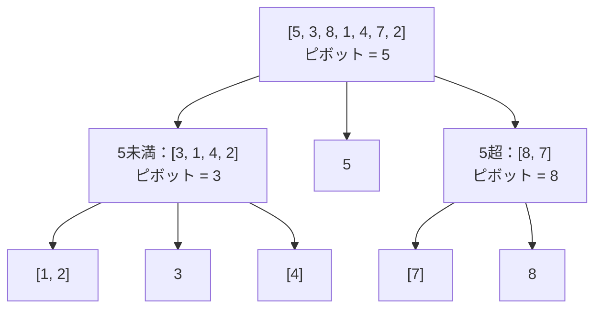

分割を繰り返して要素が1個になったら完成です。最後に左から読むと `[1, 2, 3, 4, 5, 7, 8]` になります。

### 3.4 マージソートの考え方 ★★

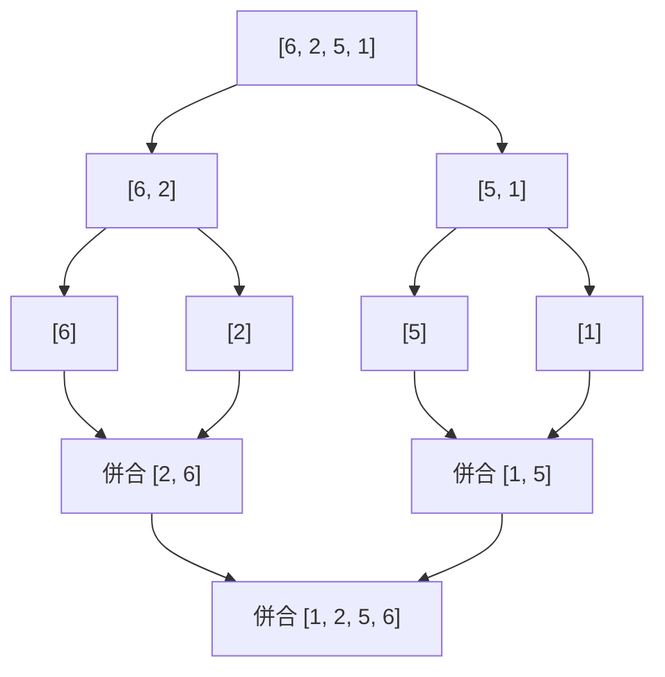

分割の段数が約 log₂ n、各段の併合で n 回程度の比較をするので、全体で O(n log n) です。併合用の **作業領域** が別に必要な点が弱点です。

---

## 4. 計算量

### 4.1 O記法 ★★★

**計算量（オーダ）**とは、データ数 n が大きくなったときに処理時間がどの程度増えるかを表す尺度で、**O記法**（ビッグオー記法）で書きます。最も増え方が大きい項だけを残し、係数は無視します（例：`3n² + 5n + 2` → O(n²)）。

| 計算量 | n = 10 | n = 100 | n = 1,000 | 例 |
|---|---|---|---|---|
| O(1) | 1 | 1 | 1 | 配列の要素参照、ハッシュ探索 |
| O(log n) | 約3.3 | 約6.6 | 約10 | 2分探索 |
| O(n) | 10 | 100 | 1,000 | 線形探索 |
| O(n log n) | 約33 | 約664 | 約9,966 | クイックソート（平均）、マージソート |
| O(n²) | 100 | 10,000 | 1,000,000 | バブルソート、2重ループ |
| O(2ⁿ) | 1,024 | 約1.3×10³⁰ | — | ハノイの塔、素朴な再帰のフィボナッチ |

### 4.2 計算例 ★★

**問題**：O(n²) のアルゴリズムで、n = 1,000 のとき 2 秒かかった。n = 3,000 のときはおよそ何秒か。

```
処理時間 ∝ n²
n が 3,000 / 1,000 = 3 倍 → 時間は 3² = 9 倍
2 秒 × 9 = 18 秒
```

**問題**：2重ループ `for i = 1〜n、for j = i〜n` の内側の実行回数は？

```
i=1 で n 回、i=2 で n−1 回、…、i=n で 1 回
合計 = n + (n−1) + … + 1 = n(n+1)/2  → O(n²)
```

---

## 5. 再帰

### 5.1 再帰とは ★★★

**再帰（再帰呼出し）**とは、関数が **自分自身を呼び出す** ことです。必ず **終了条件（基底条件）** を持たせ、呼出しのたびに問題を小さくします。呼出し元の情報（戻り先や局所変数）は **スタック** に積まれます。

**例：階乗** `n! = n × (n−1)!`、`0! = 1`

```text
○整数型: fact(整数型: n)
  if (n ≦ 1)
    return 1
  else
    return n × fact(n − 1)
  endif
```

**トレース**：fact(4)

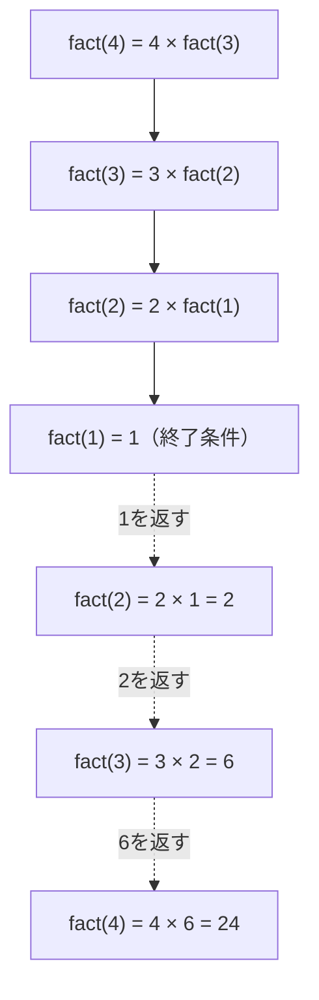

### 5.2 再帰の代表例 ★★

**桁の和**：`g(n)` = n の各桁の和

```text
○整数型: g(整数型: n)
  if (n = 0)
    return 0
  endif
  return (n mod 10) + g(n ÷ 10)    /* ÷ は商の整数部分を求めるものとする */
```

```
g(345) = 5 + g(34)
       = 5 + (4 + g(3))
       = 5 + (4 + (3 + g(0)))
       = 5 + 4 + 3 + 0 = 12
```

**ハノイの塔**：n 枚の円盤の最小移動回数 `H(n) = 2 × H(n−1) + 1`、`H(1) = 1`

```
H(1) = 1, H(2) = 3, H(3) = 7, … → 一般に H(n) = 2ⁿ − 1
H(10) = 2¹⁰ − 1 = 1,023 回
```

**フィボナッチ数**：`fib(n) = fib(n−1) + fib(n−2)`、`fib(0) = 0, fib(1) = 1`
素朴に再帰で書くと同じ計算を何度も繰り返し、fib(5) を求めるだけで関数が **15回** 呼ばれます（指数時間）。計算済みの値を記録して再利用する **メモ化**（動的計画法）で O(n) に改善できます。

⚠️ **ひっかけ注意**：再帰関数が「どこで値を返し、返った後に何を計算するか」を取り違えやすいです。**下から（終了条件側から）値を埋めていく表** を作ると確実です。

---

## 6. 擬似言語の読み方

### 6.1 IPA の擬似言語 ★★★

基本情報技術者試験・応用情報技術者試験では、IPA が「試験で使用する情報技術に関する用語・プログラム言語など」の別紙で定めた **擬似言語** でプログラムが出題されます。主な記述形式は次のとおりです（問題文に注記があればそちらが優先されます）。

| 記述形式 | 意味 |
|---|---|
| `○手続名又は関数名` | 手続・関数の宣言（例：`○整数型: max(整数型: a, 整数型: b)`） |
| `型名: 変数名` | 変数の宣言（例：`整数型: i`、`整数型の配列: data`） |
| `/* 注釈 */`、`// 注釈` | 注釈（コメント） |
| `変数名 ← 式` | 代入（右辺の値を左辺の変数に入れる） |
| `手続名又は関数名(引数, …)` | 手続・関数の呼出し |
| `if (条件式1)` 処理1 `elseif (条件式2)` 処理2 … `else` 処理n `endif` | 選択処理（上から順に評価し、最初に真になった処理だけを実行） |
| `while (条件式)` 処理 `endwhile` | 前判定の繰返し（条件が真の間繰り返す。最初に偽なら1回も実行しない） |
| `do` 処理 `while (条件式)` | 後判定の繰返し（**最低1回は実行**） |
| `for (制御記述)` 処理 `endfor` | 制御記述に従った繰返し（例：`for (i を 1 から n まで 1 ずつ増やす)`） |

**演算子と優先順位**（上ほど優先度が高い）

| 種類 | 演算子 |
|---|---|
| 式 | `( )`、`.`（メンバへのアクセス） |
| 単項演算子 | `not`、`+`、`−` |
| 乗除 | `mod`（剰余）、`×`、`÷` |
| 加減 | `+`、`−` |
| 関係 | `≠`、`≦`、`≧`、`<`、`=`、`>` |
| 論理積 | `and` |
| 論理和 | `or` |

その他のポイント：

- 論理型の定数は `true` / `false`。値が入っていない状態は **未定義**（`未定義の値`）と表します。
- **配列** は `{1, 2, 3}` のように `{ }` で要素を並べて表し、要素は `data[i]` のように `[ ]` で要素番号を指定して参照します。2次元配列は `data[行, 列]` です。**要素番号が 1 から始まるか 0 から始まるかは問題文で示されます**（1 から始まる問題が多い）ので必ず確認します。
- 配列の要素数は `data の要素数` のように日本語で書かれることがあります。

⚠️ `÷` の結果が整数になるのか実数になるのか、`and` / `or` の評価方法など、細かな約束は **問題ごとの注記** で示されます。問題冒頭の注記を必ず読みましょう。

### 6.2 トレース表で読む ★★★

**例題**：次の関数 `calc` に `{4, 7, 1, 9, 3}` を与えたとき、戻り値は何か（配列の要素番号は1から）。

```text
○整数型: calc(整数型の配列: a)
  整数型: i, m, k
  m ← a[1]
  k ← 1
  for (i を 2 から a の要素数 まで 1 ずつ増やす)
    if (a[i] > m)
      m ← a[i]
      k ← i
    endif
  endfor
  return k
```

| i | a[i] | a[i] > m ? | m | k |
|---|---|---|---|---|
| （初期） | — | — | 4 | 1 |
| 2 | 7 | 7 > 4 真 | 7 | 2 |
| 3 | 1 | 1 > 7 偽 | 7 | 2 |
| 4 | 9 | 9 > 7 真 | 9 | 4 |
| 5 | 3 | 3 > 9 偽 | 9 | 4 |

戻り値は **4**（最大値 9 の **要素番号**）です。「最大値を返す」と早合点しないことが大切です。

💡 **トレース表のコツ**：①変数を列に並べる、②ループ1回を1行にする、③条件判定の真偽も書く。値が変わったところだけ書き込むと速くなります。

---

## 7. 科目B「プログラミング」問題の読み方のコツ

### 7.1 出題の特徴 ★★★

応用情報技術者試験の科目B（旧午後）では、問3 が「プログラミング」分野として出題されてきました（11問中から問2〜11の4問を選択）。テーマは **データ構造（リスト、木、グラフ、ヒープ）**、**探索・整列**、**再帰**、**数値計算**、**文字列処理** などで、プログラムの **空欄補充**、**トレース結果**、**計算量** や **処理回数** を問う設問が中心です。


### 7.2 解き方の型 ★★★

1. **問題文の説明と例を先に理解する**
   プログラムを読む前に、本文で説明されているアルゴリズムの考え方・図・具体例を理解します。プログラムは「説明を書き下したもの」なので、説明が分かれば空欄の多くは推測できます。
2. **変数・配列の役割をメモする**
   「`top` はスタックの先頭位置」「`next[i]` は i 番目の次の要素番号」のように役割を余白に書きます。
3. **本文の具体例でトレースする**
   本文に図示された入力例を使えば、途中の状態（配列の中身など）が図と一致するかで空欄の正しさを確認できます。
4. **境界条件を確認する**
   ループの開始値・終了値、`<` と `≦` の違い、配列が空・要素1個のとき、末尾要素の扱い。空欄の選択肢はこの「1つずれ」で差がつくことが多いです。
5. **計算量・回数の設問は式で表す**
   「n が2倍になると何倍か」「比較回数はいくつか」は、ループの入れ子構造から n(n−1)/2 や log₂ n を導きます。

### 7.3 よくある落とし穴 ★★

| 落とし穴 | 対策 |
|---|---|
| 要素番号の開始値（0 か 1 か）を誤解 | 問題文の注記を確認し、トレース表の見出しに書いておく |
| `while` と `do-while` の違い | 後判定は最低1回実行されることを意識 |
| ポインタの付け替え順序 | 必ず図を描き、古い参照が失われないか確認 |
| 再帰の戻り値の積み上げ | 終了条件から逆向きに表を埋める |
| 空欄が複数あり相互に依存 | 確実に分かる空欄から埋め、残りはトレースで確定 |

💡 **時間配分**：科目Bは150分で5問なので、1問あたり約30分です。プログラミング問題は、トレースに時間がかかりすぎたら **後回しにする勇気** も必要です。

---

## 8. 流れ図とアルゴリズムの設計

### 8.1 流れ図（フローチャート） ★

**流れ図** は、処理の手順を決められた記号と線で図にしたものです（記号は JIS X 0121 で規定）。処理は **順次（連接）・判定（選択）・繰返し** の3つの基本構造の組合せで表せます。

| 記号 | 形 | 意味 |
|---|---|---|
| **端子** | 角の丸い長方形（楕円） | 処理の開始・終了 |
| **処理** | 長方形 | 計算・代入などの処理 |
| **定義済み処理** | 左右に縦線が入った長方形 | 別の場所で定義された処理（サブルーチン）の呼出し |
| **判断** | ひし形 | 条件によって流れを分岐する |
| **ループ端** | 角を切り落とした長方形（始端と終端の2つで1組） | 繰返しの開始と終了。始端または終端に終了条件を書く |
| **データ** | 平行四辺形 | データの入力・出力 |
| **線** | 直線 | 処理の流れ。上から下・左から右が原則で、それ以外の向きには矢印を付ける |

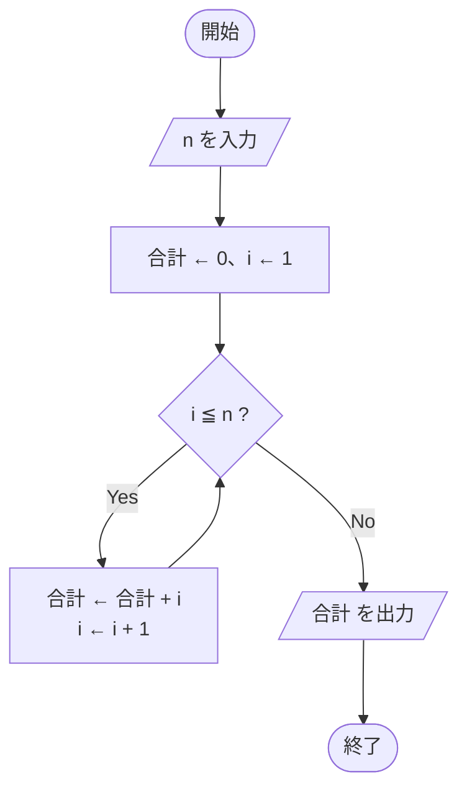

### 8.2 アルゴリズムの表現と設計手法 ★★

アルゴリズムは、**擬似言語**（[6章](#6-擬似言語の読み方)）、**流れ図**、**決定表（デシジョンテーブル）** などで表現します。決定表は、条件の組合せとそれに対応する動作を表にしたもので、条件が多い処理の漏れをなくすのに役立ちます（[09_システム開発技術](09_システム開発技術.md) のテスト技法でも使います）。

| 設計手法 | 考え方 | 例 |
|---|---|---|
| **分割統治法** | 大きな問題を同じ形の **小さな問題に分割** して解き、その結果を **統合** して全体の答えを得る | マージソート、クイックソート、2分探索 |
| **再帰** | 問題を、より小さな同じ問題を使って定義し、自分自身を呼び出して解く（[5章](#5-再帰)） | 階乗、ハノイの塔、木の走査 |
| 動的計画法 | 部分問題の答えを表に記録して再利用する | フィボナッチ数（メモ化）、ナップサック問題 |
| 貪欲法（グリーディ法） | その時点で最もよい選択を繰り返す。最適解になるとは限らない | 釣り銭の枚数を最少にする硬貨の選び方 |

---

## 9. いろいろなアルゴリズム

### 9.1 グラフの探索と最短経路 ★★

グラフ（頂点と辺の構造。[01_基礎理論](01_基礎理論.md) 9.5）を調べるアルゴリズムです。

| アルゴリズム | 考え方 | 使うデータ構造 |
|---|---|---|
| **深さ優先探索**（DFS） | 行けるところまで深く進み、行き止まりになったら戻って別の道を進む | スタック（再帰） |
| **幅優先探索**（BFS） | 出発点に近い頂点から順に（1辺で行ける頂点 → 2辺で行ける頂点 …）調べる。辺の重みがないグラフの最短経路が求まる | キュー |
| **ダイクストラ法** | 重みが **0以上** のグラフで、出発点からの最短距離が **確定した頂点を1つずつ増やしていく** 最短経路探索 | 優先度付きキュー |
| **ベルマンフォード法** | すべての辺について距離の更新を「頂点数 − 1」回繰り返す最短経路探索。**負の重み** があっても使え、負の閉路も検出できる。ダイクストラ法より遅い | 配列 |

**具体例（ダイクストラ法）**：次の無向グラフで A から各頂点への最短距離を求める

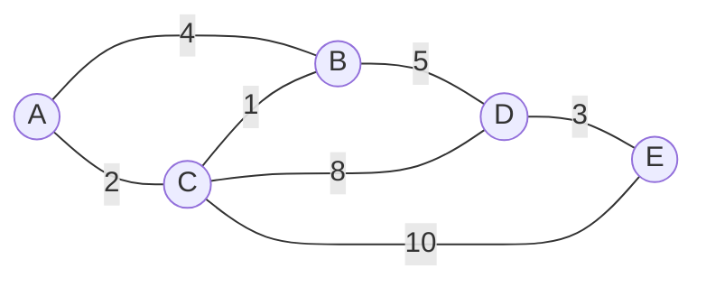

| 手順 | 確定する頂点 | A | B | C | D | E |
|---|---|---|---|---|---|---|
| 初期 | — | 0 | ∞ | ∞ | ∞ | ∞ |
| 1 | A（0） | **0** | 4 | 2 | ∞ | ∞ |
| 2 | C（2） | | 2+1 = **3** に更新 | **2** | 2+8 = 10 | 2+10 = 12 |
| 3 | B（3） | | **3** | | 3+5 = **8** に更新 | 12 |
| 4 | D（8） | | | | **8** | 8+3 = **11** に更新 |
| 5 | E（11） | | | | | **11** |

```
未確定の頂点のうち距離が最小のものを確定し、その隣の頂点の距離を「確定距離 + 辺の重み」と比べて小さければ更新する
A → E の最短経路：A → C → B → D → E（2 + 1 + 5 + 3 = 11）
```

### 9.2 文字列照合 ★

**文字列照合** とは、長い文字列（テキスト）の中から、指定した文字列（パターン）が現れる位置を探す処理です。テキストの長さを n、パターンの長さを m とします。

| 方法 | 考え方 | 計算量（最悪） |
|---|---|---|
| 力まかせ法（単純照合） | パターンを1文字ずつずらしながら、先頭から比較する | O(nm) |
| **KMP 法**（クヌース・モリス・プラット法） | パターン自身の「先頭と一致する部分」をあらかじめ表にしておき、不一致のとき **テキスト側を後戻りせず** にパターンを適切な位置までずらす | O(n + m) |
| **BM 法**（ボイヤ・ムーア法） | パターンの **末尾から** 比較し、不一致になったテキストの文字がパターン内のどこにあるかで、**一気に大きくずらす**。実用上とても速い | 平均では O(n / m) に近い |

**例（BM 法のずらし方）**：テキスト `ABCDEFGH` からパターン `DEF` を探す

```
1回目：テキストの3文字目 C とパターン末尾 F を比較 → 不一致
       C はパターンに含まれない → パターンの長さ3だけ一気にずらす
2回目：テキストの6文字目 F とパターン末尾 F を比較 → 一致、続けて E、D も一致 → 4文字目で発見
```

### 9.3 ファイル処理（バッチ処理）のアルゴリズム ★

| 処理 | 内容 |
|---|---|
| **整列処理** | レコードをキー（社員番号など）の順に並べ替える。後続の併合やコントロールブレークの前提になる |
| **併合処理**（マッチング） | キー順に整列された2つ以上のファイルを、キーを比べながら1つにまとめる。例：マスタファイルを、更新内容を集めたトランザクションファイルで更新する |
| **コントロールブレーク処理** | キー順に並んだデータを読みながら、**キーの値が変わった時点**（ブレーク）で小計などを出力する |
| **編集処理** | 出力の形式に合わせてデータを整える（ゼロサプレス：先頭の0を空白に、カンマ編集：3桁ごとに区切る、日付の書式変換など） |

**例（コントロールブレーク処理）**：支店コード順の売上データから支店ごとの小計を出す

```
入力：(01, 300) (01, 200) (02, 500) (03, 100) (03, 400)
① 01 を読む → 小計 300 → 次も 01 → 小計 500
② 02 を読む → 支店が変わった（ブレーク）→ 「01 小計 500」を出力し、小計を 500 から始め直す
③ 03 を読む → ブレーク → 「02 小計 500」を出力 → … 最後に「03 小計 500」を出力
```

### 9.4 近似・確率・遺伝的アルゴリズム ★

| アルゴリズム | 内容 | 例 |
|---|---|---|
| **近似アルゴリズム** | 最適解は保証しないが、**現実的な時間で最適解に近い解**（近似解）を求める。厳密に解くと時間がかかりすぎる問題（NP 困難問題）に使う | 巡回セールスマン問題で「いちばん近い未訪問都市へ進む」最近傍法 |
| **確率アルゴリズム** | 処理の途中で **乱数** を使うアルゴリズム。**モンテカルロ法** は、乱数による試行を多数繰り返して近似値を求める | 円周率の計算、待ち行列のシミュレーション |
| **遺伝的アルゴリズム** | 生物の進化をまねた最適化手法。解の候補を遺伝子として表し、**選択**（適応度の高いものを残す）・**交叉**（2つの候補の一部を入れ替える）・**突然変異**（ランダムに一部を変える）を世代ごとに繰り返して、よい解を探す | スケジューリング、設計の最適化 |

**例（モンテカルロ法で円周率を求める）**

```
1辺1の正方形の中にランダムに点を打ち、原点からの距離が1以下（半径1の四分円の内側）の点の割合を数える
四分円の面積 = π/4、正方形の面積 = 1 なので、割合 ≒ π/4
10,000 点中 7,850 点が内側 → π ≒ 4 × 0.785 = 3.14
```

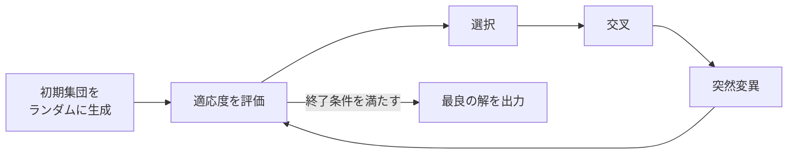

### 9.5 自然言語処理のアルゴリズム ★

**自然言語処理** は、人が使う言葉（日本語・英語など）をコンピュータで扱う技術で、情報検索・機械翻訳・チャットボットなどに使われます。一般に次の順で解析します。

| 段階 | 内容 | 例：「私は本を読む」 |
|---|---|---|
| **形態素解析** | 文を意味をもつ最小単位（形態素）に分割し、品詞を付ける | 私（名詞）／は（助詞）／本（名詞）／を（助詞）／読む（動詞） |
| **構文解析** | 文法に基づいて文の構造を解析する。日本語では文節同士の修飾関係を調べる **係り受け解析** が代表的 | 「私は」→「読む」、「本を」→「読む」 |
| **意味解析** | 単語の意味や、文が表す意味を解釈する（多義語の判別など） | 「読む」＝文字を目で追って理解する |
| **文脈解析** | 複数の文にまたがる関係を解析する（「それ」「彼」が何を指すかなど） | 次の文の「それ」＝本 |

| 用語 | 意味 |
|---|---|
| **n-gram** | 文字列を連続する n 文字（または n 単語）ずつ区切ったもの。例：「東京都」の2文字ずつ（bi-gram）は「東京」「京都」。全文検索の索引や言語モデルに使う |
| **文章間類似度** | 2つの文章がどれだけ似ているかを表す値。文章を単語の出現頻度などのベクトルにして、**コサイン類似度**（ベクトルのなす角の cos。1に近いほど似ている）で計算する方法が代表的 |

### 9.6 データ圧縮・図形・記憶域管理のアルゴリズム ★

**データ圧縮**：同じ値の連続を「値＋個数」にする **ランレングス法** と、出現頻度の高い文字に短い符号を割り当てる **ハフマン法** が代表的です（手順と計算例は [01_基礎理論](01_基礎理論.md) 7.2）。

**3次元図形処理（CG）**：立体を画面に描くとき、手前の物体に隠れて見えない面を消す **隠面消去** などの処理が必要です。

| アルゴリズム | 内容 |
|---|---|
| **Z バッファ法** | 画素ごとに奥行き（Z 値）を記録するメモリ（Z バッファ）を用意し、より手前にある物体の色だけで画素を上書きして隠面消去する。単純でハードウェア化しやすい |
| **スキャンライン法** | 画面の走査線（横1行）ごとに、その行と交わる面を調べ、最も手前の面の色で塗る隠面消去 |
| **レイトレーシング法** | 視点から画素ごとに光線（レイ）を逆向きに追跡し、物体での反射・屈折・影を計算する。非常にリアルだが計算量が多い |

**記憶域管理**：OS は、使われていない主記憶の領域（空き領域）を、アドレスとサイズを並べた **空きリスト** などのデータ構造で管理します。

- **割当て**：要求サイズ以上の空き領域を、ファーストフィット・ベストフィット・ワーストフィットなどの方法で選びます（[05_ソフトウェア](05_ソフトウェア.md) の「主記憶管理」参照）。
- **解放**：返された領域を空きリストに戻し、**隣接する空き領域と結合** して、断片化（細切れの空き領域）を減らします。
- 不要になった領域を自動で回収する **ガベージコレクション** もあります（[10.4](#104-プログラムの記憶域-)）。

---

## 10. プログラミングとプログラム言語

### 10.1 プログラミング作法とコーディング標準 ★

**コーディング標準**（コーディング規約）は、チームでプログラムの書き方をそろえるためのルールです。守らないと、読みにくくバグが入りやすく、他の人が保守しにくいプログラムになります。

| 項目 | 内容 |
|---|---|
| **字下げ（インデンテーション）** | ブロック（if や for の中身）の階層に合わせて行頭をそろえて下げる。構造が一目で分かる |
| **ネストの深さ** | if や for の入れ子が深すぎると読みにくくなるので、深さの上限を決め、深くなる処理は関数に分ける |
| **命名規則** | 変数名・関数名の付け方を統一する（意味の分かる名前、大文字・小文字の使い方など） |
| **使用禁止命令** | goto 文など、制御の流れを分かりにくくしたり危険だったりする命令の使用を禁止する |
| **品質の向上** | 上記を守ることで、プログラムの **機能適合性・性能効率性・使用性・保守性** などの品質を高める |

### 10.2 プログラム構造 ★

| 用語 | 意味 |
|---|---|
| **モジュール分割** | プログラムを機能ごとの部品（モジュール）に分けること |
| **独立性** | モジュール同士の依存が少ないこと。「強度は高く、結合度は低く」が理想（[09_システム開発技術](09_システム開発技術.md) の「モジュール設計」参照） |
| **メインルーチン** | プログラムの中心となり、全体の流れを制御する部分 |
| **サブルーチン** | メインルーチンなどから呼び出される、特定の処理をまとめた部分（関数・手続） |
| **オーバーライド** | 親クラスで定義されたメソッドを、子クラスで **同じ名前・同じ引数で再定義** して処理を置き換えること |
| **オーバーロード** | 同じ名前で **引数の型や個数が異なる** メソッド（関数）を複数定義すること |
| **DLL**（Dynamic Link Library：動的リンクライブラリ） | 実行時に結合されるライブラリ。複数のプログラムで共有できる（[05_ソフトウェア](05_ソフトウェア.md)） |

⚠️ **ひっかけ注意**：「上書き」は **オーバーライド**（override）、「多重定義」は **オーバーロード**（overload）です。

### 10.3 データ型 ★

| データ型 | 内容 | 例 |
|---|---|---|
| **整数型** | 整数を表す | −3、0、125 |
| **実数型** | 小数を含む数を表す（多くは浮動小数点数） | 3.14、−0.5 |
| **論理型** | 真（true）か偽（false）を表す | true |
| **文字型** | 1文字（または文字列）を表す | 'A' |
| **構造型** | 複数の値をまとめて1つの型にしたもの（配列、構造体・レコードなど） | 社員（番号, 氏名, 給与） |
| **抽象データ型** | データと、それを操作する手続をひとまとめにし、内部構造を隠して **操作だけを公開** した型（カプセル化） | push と pop だけで扱うスタック型 |

### 10.4 プログラムの記憶域 ★

プログラムを実行すると、主記憶上に次のような領域が使われます。

| 領域 | 置かれるもの | 確保・解放のタイミング |
|---|---|---|
| **目的プログラムテキスト**（コード領域） | 機械語の命令 | 実行開始時に読み込まれ、通常は書換え不可 |
| 静的領域 | **定数**、**静的変数**（グローバル変数など） | プログラムの開始から終了まで存在 |
| スタック領域 | **自動変数**（関数内の局所変数）、引数、戻り先 | 関数の呼出し時に確保し、戻るときに自動で解放 |
| **ヒープ** 領域 | 実行中に必要に応じて確保するデータ（new や malloc） | プログラムが確保・解放する。不要になった領域を自動で回収するのが **ガベージコレクション** |

- **ブロック**：`{ }` や `if 〜 endif` などで囲まれたひとまとまりの範囲です。
- **スコープ**：変数の名前が有効な（参照できる）範囲です。ブロック内で宣言した変数はそのブロックの中だけで有効（局所変数）、プログラム全体で有効なのが大域変数（グローバル変数）です。

### 10.5 制御構造と引数の渡し方 ★★

| 用語 | 意味 |
|---|---|
| **連接**（順次） | 上から順に処理を実行する |
| **選択** | 条件によって実行する処理を選ぶ（if、switch） |
| **繰返し** | 条件を満たす間、処理を繰り返す（while、for） |
| **手続呼出し** | 手続（関数）を呼び出して実行し、終わったら呼出し元に戻る |
| **パラメータ**（引数） | 手続に渡す値 |
| **仮引数** | 手続を **定義する側** で引数を受け取る変数（`f(整数型: x)` の x） |
| **実引数** | 手続を **呼び出す側** で渡す実際の値や変数（`f(a)` の a） |
| **値呼出し**（call by value） | 実引数の **値のコピー** を渡す。手続の中で仮引数を変えても、呼出し元の変数は変わらない |
| **参照呼出し**（call by reference） | 実引数の **格納場所（アドレス）** を渡す。手続の中で変えると、呼出し元の変数も変わる |
| **制御の流れ** | 命令が実行される順序。上記の基本構造と手続呼出しで決まる |
| **再帰呼出し** | 手続が自分自身を呼び出すこと（[5章](#5-再帰)） |
| **プロセス** | 実行中のプログラム。OS が CPU やメモリを割り当てる単位 |
| **擬似並列制御** | CPU が1つでも、複数の処理を短い時間で切り替えながら実行し、**同時に動いているように見せる** こと。本当に複数の CPU で同時に動かすのが並列制御 |

**例（値呼出しと参照呼出し）**

```text
○add1(整数型: x)
  x ← x + 1

a ← 5
add1(a)
値呼出し  の場合：a は 5 のまま（コピーの x だけが 6 になる）
参照呼出しの場合：a は 6 になる（x と a が同じ場所を指す）
```

💡 順次・選択・繰返しの3つだけで、どんなアルゴリズムも記述できます（構造化定理）。

### 10.6 プログラム言語の種類と特徴 ★★

プログラム言語は、CPU が直接実行する **機械語** → 機械語と1対1に対応する記号で書く **アセンブラ言語** → 人が読み書きしやすい **高水準言語** の順に発展してきました。高水準言語は、考え方によって **手続型言語・関数型言語・論理型言語・オブジェクト指向言語**（[01_基礎理論](01_基礎理論.md) 10.5）や、手軽に書いてすぐ実行できる **スクリプト言語** に分類されます。

| 分類 | 言語 | 特徴 |
|---|---|---|
| 手続型 | **Fortran** | 科学技術計算向けの最初期の高水準言語 |
| 手続型 | **COBOL** | 事務処理向け。英語に近い記述で、10進数の計算が得意。金融機関などの基幹系で今も使われる |
| 手続型 | **Pascal** | 構造化プログラミングの教育用に設計された言語 |
| 手続型 | **BASIC** | 初心者向けの簡単な言語。インタプリタで普及した |
| 手続型 | **C** | UNIX を記述するために開発された。ポインタでメモリを直接扱え、OS や組込みソフトに使われる |
| 手続型 | **R** | 統計解析・データ分析向けの言語。グラフ作成や統計関数が豊富 |
| オブジェクト指向 | **Java** | 中間コード（バイトコード）を **JVM**（Java 仮想マシン）で実行するため、OS に依存せず動く。ガベージコレクションをもつ |
| オブジェクト指向 | **C++** | C 言語にクラスなどのオブジェクト指向の機能を加えた言語 |
| オブジェクト指向 | **Julia** | 科学技術計算向けで、書きやすさと実行速度の速さを両立した言語 |
| オブジェクト指向 | **Go** | Google が開発。シンプルな文法で、並行処理（goroutine）を簡単に書け、サーバ開発に使われる |
| スクリプト | **ECMAScript** | JavaScript の標準仕様（Ecma International が規定）。Web ブラウザ上で動き、Web ページに動きを付ける |
| スクリプト | **Perl** | 強力な正規表現をもち、テキスト処理が得意 |
| スクリプト | **PHP** | Web サーバ側で動き、HTML の中に埋め込んで動的な Web ページを作る |
| スクリプト | **Python** | 読みやすさを重視し、インデントでブロックを表す。AI・データ分析で広く使われる |
| スクリプト | **Ruby** | 日本で開発された、すべてをオブジェクトとして扱う言語。Web フレームワーク Ruby on Rails で有名 |

**共通言語基盤（CLI：Common Language Infrastructure）**：異なるプログラム言語で書いたプログラムを、**共通の中間言語** と **共通の型の仕組み** で同じ実行環境上で動かし、互いに呼び出せるようにするための仕様です（JIS X 3016、ISO/IEC 23271）。Microsoft の .NET の実行環境（CLR）がその実装です。

### 10.7 プログラム言語の記述（構文規則と意味規則） ★

- プログラムは、式・文・宣言・ブロック・関数（手続）・モジュールなどの **構成単位** を組み合わせて作ります。
- **構文規則**（書き方の規則）は、BNF などの **構文記法** で **文脈自由文法** として形式的に定義します（[01_基礎理論](01_基礎理論.md) 6.3〜6.4）。
- **意味規則**（書いたものが何を意味するか）は、形式的意味論などで定義されます。構文的に正しくても意味的に誤り（型が合わないなど）のプログラムもあります。

### 10.8 文法の表記法：EBNF ★

**EBNF**（Extended Backus Naur Form：拡張バッカス記法）は、BNF に繰返しや省略可能を表す記号を加え、再帰を使わずに簡潔に書けるようにした記法です（ISO/IEC 14977 で規定）。

| 記号 | 意味 |
|---|---|
| `=` | 定義 |
| `,` | 連接（並べる） |
| `\|` | 選択（または） |
| `{ }` | 0回以上の繰返し |
| `[ ]` | 省略可能（0回または1回） |
| `( )` | グループ化 |
| `;` | 定義の終わり |

```
BNF  ：<識別子> ::= <英字> | <識別子><英字> | <識別子><数字>
EBNF ：識別子 = 英字 , { 英字 | 数字 } ;
```

### 10.9 Web プログラミング ★★

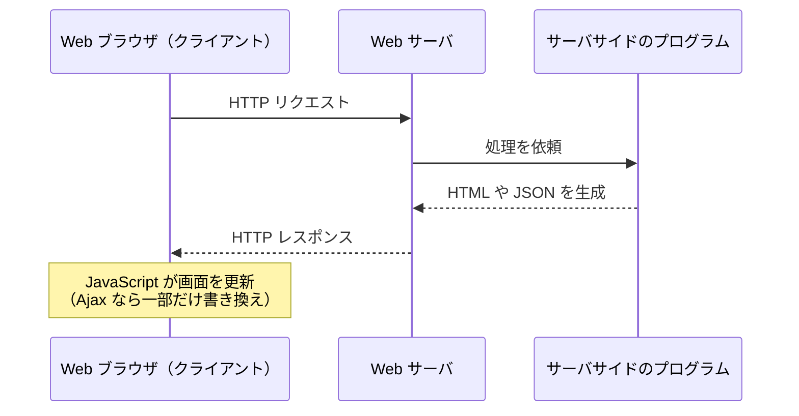

| 用語 | 意味 |
|---|---|
| **サーバサイドプログラミング** | Web サーバ側で動くプログラム（データベースの検索や HTML の生成など）を作ること。PHP、Java、Python、Ruby などを使う |
| **リッチクライアント** | ブラウザ（クライアント）側で、デスクトップアプリのような操作性の高い画面を実現する仕組み |
| **Ajax**（Asynchronous JavaScript + XML） | JavaScript でサーバと **非同期通信** し、ページ全体を読み直さずに **一部だけを書き換える** 技術（地図のスクロール表示など） |
| **Apache** | 代表的なオープンソースの Web サーバソフトウェア（Apache HTTP Server） |
| **JSP**（Jakarta Server Pages、旧 JavaServer Pages） | HTML の中に Java のコードを埋め込み、サーバ側で動的に Web ページを生成する技術 |
| **SPA**（Single Page Application） | 最初に1つの HTML ページを読み込み、その後の画面遷移を JavaScript による部分的な書換えで行う Web アプリケーション |
| **フロントエンドフレームワーク** | ブラウザ側の画面（UI）を効率よく作るための枠組み（React、Vue.js、Angular など） |
| **WebAssembly** | ブラウザ上で高速に実行できるバイナリ形式のコード。C/C++ や Rust などからコンパイルして作り、JavaScript より高速な処理ができる |

---

## 11. マークアップ言語とその他の言語

### 11.1 HTML・XML・XHTML ★★

**マークアップ言語** とは、文章に **タグ** で目印（マークアップ）を付け、文書の構造や意味を表す言語です。

```html
<p>これは<strong>重要</strong>な文です。</p>
<!-- <p> が開始タグ、</p> が終了タグ -->
```

| 言語・用語 | 意味 |
|---|---|
| **SGML**（Standard Generalized Markup Language） | 文書の構造を定義するためのマークアップ言語の規格（ISO 8879）。HTML や XML のもとになった |
| **HTML**（HyperText Markup Language） | Web ページを記述する言語。決められたタグで見出し・段落・リンクなどを表す |
| **開始タグ・終了タグ** | 要素の始まり `<p>` と終わり `</p>` を示すタグ |
| **DTD**（Document Type Definition：文書型定義） | 文書で使える要素・属性やその並び方（文書の型）を定義したもの |
| **XML**（Extensible Markup Language） | 利用者が **独自のタグを定義できる** マークアップ言語。データ交換に使う。文法に従った文書を **整形式**、さらに DTD やスキーマに従う文書を **妥当** な文書という |
| **XML Schema** | XML 文書の構造を XML 自身で定義する言語。DTD より細かく **データ型**（整数、日付など）を指定できる |
| **DOM**（Document Object Model） | 文書全体を **木構造としてメモリに読み込み**、プログラムから要素を自由に参照・変更するための API |
| **SAX**（Simple API for XML） | 文書を先頭から順に読み、要素の開始・終了などの **イベントごとに処理** する API。メモリ消費が少なく大きな文書に向く |
| **SOAP** | XML 形式のメッセージをやり取りして、ネットワーク上のサービスを呼び出すためのプロトコル |
| **SVG**（Scalable Vector Graphics） | XML で記述する **ベクタ形式の画像**。拡大しても劣化しない |
| **XHTML** | HTML を XML の文法で定義し直した言語。終了タグの省略不可、タグは小文字など、規則が厳格 |
| **XHTML Basic** | 携帯電話などの小型機器向けに、XHTML の機能を最小限に絞ったもの |
| **XHTML Modularization** | XHTML を機能ごとのモジュールに分割し、必要なモジュールを組み合わせて使えるようにした仕様 |

```xml
<?xml version="1.0" encoding="UTF-8"?>
<社員 番号="1001">
  <氏名>山田太郎</氏名>
  <部署>開発部</部署>
</社員>
```

### 11.2 スタイルシート ★

**スタイルシート** は、文書の **構造（内容）と見た目（表示形式）を分離** するための仕組みです。

| 言語 | 内容 |
|---|---|
| **CSS**（Cascading Style Sheets：段階スタイルシート） | HTML などの見た目（文字の色・大きさ・配置）を指定する。複数の指定が優先順位に従って重なり合う（カスケード）ことから名前が付いた |
| **XSL**（Extensible Stylesheet Language：拡張可能なスタイルシート言語） | XML 文書の表示形式を指定する言語。XML を別の XML や HTML に **変換** する XSLT と、組版（印刷レイアウト）用の XSL-FO からなる |

```css
h1 { color: navy; font-size: 24px; }   /* セレクタ { プロパティ: 値; } */
```

### 11.3 UML とその他の言語 ★★

**UML**（Unified Modeling Language：統一モデリング言語）は、オブジェクト指向の分析・設計で使う図の表記法です（主要な図の描き方は [09_システム開発技術](09_システム開発技術.md) の「UML の図の種類」参照）。

| 分類 | 図 | 表すもの |
|---|---|---|
| 構造図 | **クラス図** | クラスの **属性**（データ）・**操作**（メソッド）と、クラス間の関連。関連の端に、そのクラスが果たす役割の名前（**ロール名**）を書ける |
| 構造図 | **オブジェクト図** | ある時点での具体的なオブジェクト（インスタンス）とその関係 |
| 構造図 | **コンポーネント図** | ソフトウェア部品（コンポーネント）とそのインタフェース・依存関係 |
| 構造図 | **パッケージ図** | クラスなどをまとめたパッケージと、その依存関係 |
| 構造図 | **配置図** | ハードウェア（ノード）と、そこに配置されるソフトウェアの物理的な構成 |
| 構造図 | **コンポジット構造図** | クラスやコンポーネントの **内部構造**（部品とその接続） |
| 振る舞い図 | **ユースケース図** | 利用者（アクター）から見たシステムの機能（ユースケース） |
| 振る舞い図 | **アクティビティ図** | 処理の流れ（業務フロー）。分岐や並行処理も表せる |
| 振る舞い図 | **ステートマシン図** | オブジェクトの状態と、イベントによる状態遷移 |
| 相互作用図 | **シーケンス図** | オブジェクト間のメッセージのやり取りを **時間の順序** で表す |
| 相互作用図 | **コミュニケーション図** | オブジェクト間のメッセージのやり取りを **つながり（リンク）** に注目して表す |
| 相互作用図 | **相互作用概要図** | 複数の相互作用（シーケンス図など）の流れの全体像をアクティビティ図の形で表す |
| 相互作用図 | **タイミング図** | 時間の経過に沿った状態の変化を、時間軸を横にとって正確に表す |

| その他の言語 | 内容 |
|---|---|
| **SDL**（Specification and Description Language：仕様記述言語） | 通信システムなどの仕様を、状態遷移を中心に図と文で記述する言語（ITU-T 勧告） |
| **ADL**（Architecture Description Language：アーキテクチャ記述言語） | ソフトウェアの構成要素とそのつながり（アーキテクチャ）を記述する言語の総称 |
| **DDL**（Data Definition Language：データ定義言語） | データベースの表などを定義する言語（`CREATE TABLE` など。[06_データベース](06_データベース.md)） |
| **JSON**（JavaScript Object Notation） | JavaScript のオブジェクトの書き方をもとにした軽量なデータ形式。Web API のデータ交換で広く使う |
| **YAML** | インデントで階層を表す、人が読み書きしやすいデータ形式。設定ファイルによく使う |

```
JSON                                YAML
{                                   name: 山田太郎
  "name": "山田太郎",               skills:
  "skills": ["Java", "SQL"]           - Java
}                                     - SQL
```

---

## 確認問題

**問1** 空のスタックに対して `push A, push B, pop, push C, push D, pop, pop, push E` の順に操作した。このときスタックの底から順に並んでいるデータはどれか。
ア A, E　イ A, C　ウ E, A　エ B, E

**問2** 式 `(A − B) × C + D ÷ E` を逆ポーランド記法で表したものはどれか。
ア `A B − C × D E ÷ +`　イ `A B C − × D E ÷ +`　ウ `A B − C D E × ÷ +`　エ `+ × − A B C ÷ D E`

**問3** 次の2分木を中間順（通りがけ順）で走査したときの出力順はどれか。根は P、P の左の子は Q、右の子は R、Q の左の子は S、R の左の子は T、右の子は U とする。
ア P Q S R T U　イ S Q P T R U　ウ S Q T U R P　エ S Q P R T U

**問4** 4,000件の整列済みデータを2分探索するとき、最大比較回数は何回か。
ア 11　イ 12　ウ 13　エ 2,000

**問5** 次の整列アルゴリズムのうち、最悪の場合でも計算量が O(n log n) で、かつ **安定** なものはどれか。
ア クイックソート　イ ヒープソート　ウ マージソート　エ 選択ソート

**問6** 大きさ 11（位置 0〜10）のハッシュ表に、ハッシュ関数 `キー mod 11`、線形探査法（衝突したら次の位置、末尾の次は先頭）で 23, 34, 45, 12 を順に格納した。12 が格納される位置はどこか。

**問7** 次の関数 f について、f(5) の値はいくつか。

```text
○整数型: f(整数型: n)
  if (n ≦ 2)
    return 1
  endif
  return f(n − 1) + 2 × f(n − 2)
```

**問8** 計算量が O(n log n) のアルゴリズムで、n = 1,024 のとき処理時間が 10 ミリ秒だった。n = 4,096 のときの処理時間はおよそ何ミリ秒か（log₂ で考えよ）。

**問9** 次のプログラムで、配列 data が `{2, 5, 5, 8, 5}`（要素番号は1から）、x = 5 のとき、戻り値はいくつか。

```text
○整数型: count(整数型の配列: data, 整数型: x)
  整数型: i, c
  c ← 0
  i ← 1
  while (i ≦ data の要素数)
    if (data[i] = x)
      c ← c + i
    endif
    i ← i + 1
  endwhile
  return c
```

**問10** 次の手続 swap を、変数 a = 1、b = 2 に対して `swap(a, b)` と呼び出した。引数を参照呼出しで渡した場合と値呼出しで渡した場合の、呼出し後の a の値の組合せとして正しいものはどれか。

```text
○swap(整数型: x, 整数型: y)
  整数型: t
  t ← x
  x ← y
  y ← t
```

ア 参照呼出し 1、値呼出し 1　イ 参照呼出し 2、値呼出し 1　ウ 参照呼出し 1、値呼出し 2　エ 参照呼出し 2、値呼出し 2

<details><summary>解答・解説</summary>

**問1　ア**
```
push A → [A]
push B → [A, B]
pop    → B を取出し → [A]
push C → [A, C]
push D → [A, C, D]
pop    → D → [A, C]
pop    → C → [A]
push E → [A, E]
```

**問2　ア**
```
(A − B) → A B −
(A − B) × C → A B − C ×
D ÷ E → D E ÷
全体 X + Y → X Y + → A B − C × D E ÷ +
```
エは演算子を前に書くポーランド記法（前置記法）の形です。

**問3　イ**
中間順は「左 → 根 → 右」。P の左部分木（Q, S）を先に処理して S Q、次に P、最後に右部分木（R, T, U）で T R U。よって **S Q P T R U**。

**問4　イ**
```
2¹¹ = 2048 ≦ 4000 < 4096 = 2¹² → ⌊log₂ 4000⌋ = 11
最大比較回数 = 11 + 1 = 12 回
```

**問5　ウ**
マージソートは最悪でも O(n log n) で安定です。クイックソートは最悪 O(n²)、ヒープソートは不安定、選択ソートは O(n²) かつ不安定です。

**問6　位置 4**
```
23 mod 11 = 1 → 位置1
34 mod 11 = 1 → 1は使用中 → 位置2
45 mod 11 = 1 → 1, 2 使用中 → 位置3
12 mod 11 = 1 → 1, 2, 3 使用中 → 位置4
```

**問7　11**
```
f(1) = 1, f(2) = 1
f(3) = f(2) + 2×f(1) = 1 + 2 = 3
f(4) = f(3) + 2×f(2) = 3 + 2 = 5
f(5) = f(4) + 2×f(3) = 5 + 6 = 11
```

**問8　約 48 ミリ秒**
```
n log₂ n の比を求める
n = 1024：1024 × 10 = 10,240
n = 4096：4096 × 12 = 49,152
比 = 49,152 / 10,240 = 4.8 倍
10 ミリ秒 × 4.8 = 48 ミリ秒
```

**問9　10**
x = 5 と一致するのは要素番号 2, 3, 5。c には **要素番号 i** を足しているので `2 + 3 + 5 = 10`。個数（3）や値の合計（15）と取り違えないよう注意します。

**問10　イ**
参照呼出しでは x と a が同じ場所を指すので、交換の結果 a = 2 になります。値呼出しでは x は a のコピーなので、手続内で交換しても a = 1 のままです（[10.5](#105-制御構造と引数の渡し方-)）。

</details>

---

## 📋 シラバス用語チェックリスト

シラバス Ver.7.2「中分類2：アルゴリズムとプログラミング」の用語例をすべて並べました。**各用語を1行で説明できるか** を確認しましょう。リンクのある用語は本文に詳しい説明があります。

### 1. データ構造

| 用語 | 1行説明 |
|---|---|
| [BNF によるデータ構造の定義](#11-配列-) | `<リスト> ::= 空 \| <要素><リスト>` のように、データ構造を再帰的に定義できる |
| [多次元配列](#11-配列-) | 添字を複数もつ配列。メモリ上は行優先または列優先で1列に格納する |
| [静的配列](#11-配列-) | 要素数を作成時に決め、実行中は変えられない配列 |
| [動的配列](#11-配列-) | 実行中に要素数を増減できる配列 |
| [線形リスト](#14-リスト-) | 要素が1列に並んだリスト |
| [単方向リスト](#14-リスト-) | 次の要素へのポインタだけをもつリスト |
| [双方向リスト](#14-リスト-) | 次と前の両方へのポインタをもつリスト |
| [環状リスト](#14-リスト-) | 末尾の要素が先頭を指す、輪になったリスト（循環リスト） |
| [リンク付リスト](#14-リスト-) | ポインタで要素をつないだリスト（連結リスト） |
| [FIFO](#12-スタックとキュー-) | 先入れ先出し。キューの取出し順 |
| [LIFO](#12-スタックとキュー-) | 後入れ先出し。スタックの取出し順 |
| [プッシュ](#12-スタックとキュー-) | スタックにデータを積む操作 |
| [ポップ](#12-スタックとキュー-) | スタックからデータを取り出す操作 |
| [根](#15-木構造-) | 木の最上位にある、親をもたない節 |
| [葉](#15-木構造-) | 子をもたない節 |
| [枝](#15-木構造-) | 節と節を結ぶ線 |
| [2分木](#15-木構造-) | 各節の子が最大2つの木 |
| [完全2分木](#15-木構造-) | 葉以外の節がすべて2つの子をもち葉の深さがそろった2分木（問題文の定義に従う） |
| [バランス木](#15-木構造-) | 左右の部分木の高さがほぼ等しく保たれる木（平衡木） |
| [順序木](#15-木構造-) | 子の並び順に意味がある木 |
| [多分木](#15-木構造-) | 1つの節が3つ以上の子をもてる木 |
| [探索木](#15-木構造-) | 値の大小関係で節を配置し、探索しやすくした木 |
| [2分探索木](#2分探索木) | 左の子孫 < 親 < 右の子孫 が成り立つ2分木。中間順で昇順になる |
| [B 木](#15-木構造-) | 1節に複数のキーをもつ多分木の平衡木。データベースの索引に使う |
| [AVL 木](#15-木構造-) | 全節で左右の高さの差を1以内に保つ2分探索木 |
| [深さ優先探索](#15-木構造-) | 行けるところまで深く進んでから戻る探索（スタック・再帰） |
| [幅優先探索](#15-木構造-) | 根（出発点）に近い段から順に調べる探索（キュー） |
| [先行順](#2分木の走査巡回順序) | 根 → 左 → 右 の順に走査する |
| [後行順](#2分木の走査巡回順序) | 左 → 右 → 根 の順に走査する |
| [中間順](#2分木の走査巡回順序) | 左 → 根 → 右 の順に走査する |
| [ヒープ・ヒープの再構成](#16-ヒープ-) | 親 ≧ 子（または ≦）の完全2分木。根を取り出したら末尾を根に移して下へ降ろす |

### 2. アルゴリズム

| 用語 | 1行説明 |
|---|---|
| [端子](#81-流れ図フローチャート-) | 流れ図の開始・終了を表す記号（角の丸い長方形） |
| [処理](#81-流れ図フローチャート-) | 計算や代入などを表す記号（長方形） |
| [定義済み処理](#81-流れ図フローチャート-) | サブルーチンなど別に定義された処理を表す記号（両端に縦線の長方形） |
| [判断](#81-流れ図フローチャート-) | 条件による分岐を表す記号（ひし形） |
| [ループ端](#81-流れ図フローチャート-) | 繰返しの始端・終端を表す記号（角を切った長方形の組） |
| [データ](#81-流れ図フローチャート-) | 入出力を表す記号（平行四辺形） |
| [線](#81-流れ図フローチャート-) | 処理の流れを表す。上→下、左→右以外は矢印を付ける |
| [選択ソート](#31-一覧-) | 未整列部分の最小値を選んで先頭と交換する整列。O(n²)、不安定 |
| [バブルソート](#32-バブルソートのトレース-) | 隣同士を比較・交換する整列。O(n²)、安定 |
| [マージソート](#34-マージソートの考え方-) | 分割して整列したものを併合する整列。最悪でも O(n log n)、安定 |
| [挿入ソート](#31-一覧-) | 整列済み部分の適切な位置に挿入する整列。ほぼ整列済みなら速い |
| [シェルソート](#31-一覧-) | 一定間隔ごとの挿入ソートを、間隔を狭めながら繰り返す整列 |
| [クイックソート](#33-クイックソートの考え方-) | ピボットより小さい群・大きい群に分割を繰り返す整列。平均 O(n log n)、最悪 O(n²) |
| [ヒープソート](#16-ヒープ-) | ヒープの根の取出しと再構成を繰り返す整列。O(n log n)、不安定 |
| [併合のアルゴリズム](#93-ファイル処理バッチ処理のアルゴリズム-) | キー順に整列された複数のデータを、キーを比べながら1つにまとめる |
| [線形探索法](#21-線形探索-) | 先頭から順に比較する探索。O(n) |
| [2分探索法](#22-2分探索-) | 整列済みデータの中央と比較し範囲を半分ずつ絞る探索。O(log n) |
| [ハッシュ表探索法](#23-ハッシュ探索-) | ハッシュ関数で格納位置を直接求める探索。衝突がなければ O(1) |
| [シノニム対策](#17-ハッシュ-) | ハッシュ値の衝突への対処（チェイン法、オープンアドレス法） |
| [再帰のアルゴリズム](#51-再帰とは-) | 自分自身を呼び出して問題を小さくしながら解く。実現にはスタックを使う |
| [深さ優先探索（グラフ）](#91-グラフの探索と最短経路-) | グラフを深く進んでから戻って調べる探索 |
| [幅優先探索（グラフ）](#91-グラフの探索と最短経路-) | 出発点に近い頂点から順に調べる探索 |
| [最短経路探索](#91-グラフの探索と最短経路-) | 重みつきグラフで2点間の最短経路を求めること |
| [ダイクストラ法](#91-グラフの探索と最短経路-) | 非負の重みで、最短距離が確定した頂点を1つずつ増やす最短経路探索 |
| [ベルマンフォード法](#91-グラフの探索と最短経路-) | 全辺での距離更新を繰り返す最短経路探索。負の重みも扱える |
| [文字列照合](#92-文字列照合-) | テキストの中からパターン文字列の出現位置を探す処理 |
| [KMP 法](#92-文字列照合-) | パターンの自己一致表を使い、テキストを後戻りせずに照合する方法 |
| [BM 法](#92-文字列照合-) | パターンの末尾から比較し、不一致文字に応じて大きくずらす照合方法 |
| [ファイル処理（整列・併合・コントロールブレーク・編集）](#93-ファイル処理バッチ処理のアルゴリズム-) | バッチ処理でのキー順の並替え、突合せ、キー変化時の小計出力、出力形式の整形 |
| [近似アルゴリズム（近似計算）](#94-近似確率遺伝的アルゴリズム-) | 最適解の保証はないが、現実的な時間で最適解に近い解を求める方法 |
| [確率アルゴリズム（モンテカルロ法）](#94-近似確率遺伝的アルゴリズム-) | 乱数を使うアルゴリズム。多数の試行で近似値を求める |
| [遺伝的アルゴリズム](#94-近似確率遺伝的アルゴリズム-) | 選択・交叉・突然変異を繰り返して解を進化させる最適化手法 |
| [形態素解析](#95-自然言語処理のアルゴリズム-) | 文を形態素（意味をもつ最小単位）に分割し品詞を付ける処理 |
| [構文解析](#95-自然言語処理のアルゴリズム-) | 文法に基づいて文の構造を解析する処理 |
| [意味解析](#95-自然言語処理のアルゴリズム-) | 単語や文の意味を解釈する処理 |
| [文脈解析](#95-自然言語処理のアルゴリズム-) | 複数の文にまたがる関係（指示語の指す対象など）を解析する処理 |
| [係り受け解析](#95-自然言語処理のアルゴリズム-) | 文節同士の修飾関係を調べる構文解析 |
| [n-gram](#95-自然言語処理のアルゴリズム-) | 文字列を連続する n 文字（n 単語）ずつ区切ったもの |
| [文章間類似度](#95-自然言語処理のアルゴリズム-) | 文章をベクトル化し、コサイン類似度などで似ている度合いを測る値 |
| [ランレングス法](#96-データ圧縮図形記憶域管理のアルゴリズム-) | 同じ値の連続を「値＋個数」で表す圧縮 |
| [ハフマン法](#96-データ圧縮図形記憶域管理のアルゴリズム-) | 出現頻度の高い文字に短い符号を割り当てる圧縮 |
| [Z バッファ法](#96-データ圧縮図形記憶域管理のアルゴリズム-) | 画素ごとに奥行きを記録し、手前の物体だけを描く隠面消去 |
| [スキャンライン法](#96-データ圧縮図形記憶域管理のアルゴリズム-) | 走査線ごとに交わる面を調べ、最も手前の面を描く隠面消去 |
| [レイトレーシング法](#96-データ圧縮図形記憶域管理のアルゴリズム-) | 視点から光線を逆追跡し、反射・屈折・影をリアルに描く方法 |
| [記憶域管理アルゴリズム](#96-データ圧縮図形記憶域管理のアルゴリズム-) | 空きリストで空き領域を管理し、割当て・解放（隣接空きの結合）を行う |
| [再帰（アルゴリズム設計）](#82-アルゴリズムの表現と設計手法-) | 問題をより小さな同じ問題で定義して解く設計方法 |
| [分割統治法](#82-アルゴリズムの表現と設計手法-) | 問題を小さく分割して解き、結果を統合する設計方法 |
| [決定表（デシジョンテーブル）](#82-アルゴリズムの表現と設計手法-) | 条件の組合せと対応する動作を表にしたもの |

### 3. プログラミング

| 用語 | 1行説明 |
|---|---|
| [字下げ（インデンテーション）](#101-プログラミング作法とコーディング標準-) | ブロックの階層に合わせて行頭を下げ、構造を見やすくすること |
| [ネストの深さ](#101-プログラミング作法とコーディング標準-) | 制御構造の入れ子の深さ。深すぎると読みにくいので上限を決める |
| [命名規則](#101-プログラミング作法とコーディング標準-) | 変数名・関数名の付け方のルール |
| [使用禁止命令](#101-プログラミング作法とコーディング標準-) | goto など、保守性や安全性を損なうため使用を禁じる命令 |
| [機能適合性・性能効率性・使用性・保守性の向上](#101-プログラミング作法とコーディング標準-) | コーディング標準を守ることで得られる品質向上 |
| [モジュール分割](#102-プログラム構造-) | プログラムを機能ごとの部品に分けること |
| [独立性](#102-プログラム構造-) | モジュール間の依存が少ないこと（強度は高く、結合度は低く） |
| [メインルーチン](#102-プログラム構造-) | 全体の流れを制御する中心部分 |
| [サブルーチン](#102-プログラム構造-) | 呼び出されて特定の処理を行う部分 |
| [オーバーライド](#102-プログラム構造-) | 親クラスのメソッドを子クラスで同じ名前・引数で再定義すること |
| [オーバーロード](#102-プログラム構造-) | 同じ名前で引数の型・個数が異なるメソッドを複数定義すること |
| [DLL](#102-プログラム構造-) | 実行時に結合され、複数のプログラムで共有できるライブラリ |
| [整数型](#103-データ型-) | 整数を表すデータ型 |
| [実数型](#103-データ型-) | 小数を含む数（浮動小数点数）を表すデータ型 |
| [論理型](#103-データ型-) | 真・偽を表すデータ型 |
| [文字型](#103-データ型-) | 文字を表すデータ型 |
| [抽象データ型](#103-データ型-) | データと操作をまとめ、内部構造を隠して操作だけを公開した型 |
| [構造型](#103-データ型-) | 複数の値をまとめた型（配列、構造体・レコード） |
| [サーバサイドプログラミング](#109-web-プログラミング-) | Web サーバ側で動くプログラムを作ること |
| [リッチクライアント](#109-web-プログラミング-) | クライアント側で操作性の高い画面を実現する仕組み |
| [Ajax](#109-web-プログラミング-) | 非同期通信でページの一部だけを書き換える技術 |
| [Apache](#109-web-プログラミング-) | 代表的なオープンソースの Web サーバソフトウェア |
| [JSP](#109-web-プログラミング-) | HTML に Java コードを埋め込みサーバ側でページを生成する技術 |
| [SPA](#109-web-プログラミング-) | 1つの HTML を読み込み、画面遷移を JavaScript の部分書換えで行う Web アプリ |
| [フロントエンドフレームワーク](#109-web-プログラミング-) | ブラウザ側の UI を効率よく作るための枠組み（React、Vue.js など） |
| [WebAssembly](#109-web-プログラミング-) | ブラウザで高速に実行できるバイナリ形式のコード |
| [EBNF](#108-文法の表記法ebnf-) | 繰返し { } や省略可能 [ ] を加えて BNF を拡張した文法の記法 |

### 4. プログラム言語

| 用語 | 1行説明 |
|---|---|
| [手続型言語](#106-プログラム言語の種類と特徴-) | 命令を順に実行して変数を変えていく言語 |
| [関数型言語](#106-プログラム言語の種類と特徴-) | 関数の組合せで計算を表し、副作用を避ける言語 |
| [論理型言語](#106-プログラム言語の種類と特徴-) | 事実と規則から処理系が推論する言語 |
| [オブジェクト指向言語](#106-プログラム言語の種類と特徴-) | データと手続をまとめたオブジェクトを組み合わせる言語 |
| [スクリプト言語](#106-プログラム言語の種類と特徴-) | 手軽に書いてインタプリタなどですぐ実行できる言語 |
| [Fortran](#106-プログラム言語の種類と特徴-) | 科学技術計算向けの最初期の高水準言語 |
| [COBOL](#106-プログラム言語の種類と特徴-) | 英語に近い記述の事務処理向け言語 |
| [Pascal](#106-プログラム言語の種類と特徴-) | 構造化プログラミング教育用の言語 |
| [BASIC](#106-プログラム言語の種類と特徴-) | 初心者向けの簡単な言語 |
| [C](#106-プログラム言語の種類と特徴-) | UNIX 記述のために作られた、ポインタでメモリを扱える言語 |
| [R](#106-プログラム言語の種類と特徴-) | 統計解析・データ分析向けの言語 |
| [Java](#106-プログラム言語の種類と特徴-) | バイトコードを JVM で実行し OS に依存しないオブジェクト指向言語 |
| [C++](#106-プログラム言語の種類と特徴-) | C にオブジェクト指向機能を加えた言語 |
| [Julia](#106-プログラム言語の種類と特徴-) | 書きやすさと高速性を両立した科学技術計算向け言語 |
| [Go](#106-プログラム言語の種類と特徴-) | Google 開発の、並行処理を簡単に書けるシンプルな言語 |
| [ECMAScript](#106-プログラム言語の種類と特徴-) | JavaScript の標準仕様 |
| [Perl](#106-プログラム言語の種類と特徴-) | 正規表現に強くテキスト処理が得意なスクリプト言語 |
| [PHP](#106-プログラム言語の種類と特徴-) | HTML に埋め込みサーバ側で動的ページを作るスクリプト言語 |
| [Python](#106-プログラム言語の種類と特徴-) | インデントでブロックを表す読みやすい言語。AI・データ分析で広く使用 |
| [Ruby](#106-プログラム言語の種類と特徴-) | 日本発の、すべてをオブジェクトとして扱うスクリプト言語 |
| [共通言語基盤（CLI）](#106-プログラム言語の種類と特徴-) | 異なる言語のプログラムを共通の中間言語・型・実行環境で動かすための仕様（JIS X 3016） |
| [連接](#105-制御構造と引数の渡し方-) | 処理を上から順に実行する制御構造（順次） |
| [選択](#105-制御構造と引数の渡し方-) | 条件で実行する処理を選ぶ制御構造 |
| [繰返し](#105-制御構造と引数の渡し方-) | 条件を満たす間、処理を繰り返す制御構造 |
| [手続呼出し](#105-制御構造と引数の渡し方-) | 手続を呼び出して実行し、呼出し元に戻ること |
| [パラメータ](#105-制御構造と引数の渡し方-) | 手続に渡す値（引数） |
| [仮引数](#105-制御構造と引数の渡し方-) | 手続を定義する側で引数を受け取る変数 |
| [実引数](#105-制御構造と引数の渡し方-) | 手続を呼び出す側で渡す値・変数 |
| [値呼出し](#105-制御構造と引数の渡し方-) | 値のコピーを渡す。手続内の変更は呼出し元に影響しない |
| [参照呼出し](#105-制御構造と引数の渡し方-) | 格納場所を渡す。手続内の変更が呼出し元に反映される |
| [制御の流れ](#105-制御構造と引数の渡し方-) | 命令が実行される順序 |
| [再帰呼出し](#105-制御構造と引数の渡し方-) | 手続が自分自身を呼び出すこと |
| [プロセス](#105-制御構造と引数の渡し方-) | 実行中のプログラム。OS が資源を割り当てる単位 |
| [擬似並列制御](#105-制御構造と引数の渡し方-) | 1つの CPU で処理を短時間で切り替え、同時に動いているように見せること |
| [目的プログラムテキスト](#104-プログラムの記憶域-) | 機械語の命令を置く領域（コード領域） |
| [定数](#104-プログラムの記憶域-) | 実行中に値が変わらないデータ。静的領域に置かれる |
| [静的変数](#104-プログラムの記憶域-) | プログラムの開始から終了まで存在する変数 |
| [自動変数](#104-プログラムの記憶域-) | 関数呼出し時にスタックに確保され、戻ると解放される局所変数 |
| [ヒープ](#104-プログラムの記憶域-) | 実行中に動的に確保・解放する記憶領域 |
| [ガベージコレクション](#104-プログラムの記憶域-) | 不要になったヒープ領域を自動的に回収する仕組み |
| [ブロック](#104-プログラムの記憶域-) | { } などで囲まれたひとまとまりの範囲 |
| [スコープ](#104-プログラムの記憶域-) | 変数の名前が有効な範囲 |
| [プログラムの構成単位](#107-プログラム言語の記述構文規則と意味規則-) | 式・文・宣言・ブロック・関数・モジュールなど、プログラムを組み立てる単位 |
| [文脈自由文法](#107-プログラム言語の記述構文規則と意味規則-) | プログラム言語の構文規則の定義に使う文法 |
| [構文記法](#107-プログラム言語の記述構文規則と意味規則-) | 構文規則を形式的に書き表す記法（BNF、EBNF、構文図式） |
| [BNF](#107-プログラム言語の記述構文規則と意味規則-) | ::= と \| と <> で構文規則を定義する記法 |

### 5. その他の言語

| 用語 | 1行説明 |
|---|---|
| [開始タグ・終了タグ](#111-htmlxmlxhtml-) | 要素の始まり `<p>` と終わり `</p>` を示すタグ |
| [DTD（文書型定義）](#111-htmlxmlxhtml-) | 文書で使える要素・属性とその構造を定義したもの |
| [SGML](#111-htmlxmlxhtml-) | HTML や XML のもとになったマークアップ言語の規格 |
| [DOM](#111-htmlxmlxhtml-) | 文書を木構造としてメモリに展開し、プログラムから操作する API |
| [SOAP](#111-htmlxmlxhtml-) | XML のメッセージでネットワーク上のサービスを呼び出すプロトコル |
| [SVG](#111-htmlxmlxhtml-) | XML で記述するベクタ形式の画像 |
| [SAX](#111-htmlxmlxhtml-) | 文書を先頭から読み、イベントごとに処理する省メモリの API |
| [XML Schema](#111-htmlxmlxhtml-) | データ型も指定できる、XML で書く XML 文書の構造定義 |
| [XHTML Basic](#111-htmlxmlxhtml-) | 小型機器向けに機能を最小限に絞った XHTML |
| [XHTML Modularization](#111-htmlxmlxhtml-) | XHTML を機能モジュールに分割し組み合わせて使えるようにした仕様 |
| [CSS](#112-スタイルシート-) | HTML などの見た目を指定するスタイルシート言語 |
| [XSL](#112-スタイルシート-) | XML の変換（XSLT）と組版（XSL-FO）を行うスタイルシート言語 |
| [クラス図](#113-uml-とその他の言語-) | クラスの属性・操作とクラス間の関連を表す図 |
| [オブジェクト図](#113-uml-とその他の言語-) | ある時点の具体的なオブジェクトと関係を表す図 |
| [コンポーネント図](#113-uml-とその他の言語-) | ソフトウェア部品とインタフェース・依存関係を表す図 |
| [パッケージ図](#113-uml-とその他の言語-) | パッケージとその依存関係を表す図 |
| [配置図](#113-uml-とその他の言語-) | ハードウェアとソフトウェアの物理的な配置を表す図 |
| [コンポジット構造図](#113-uml-とその他の言語-) | クラスやコンポーネントの内部構造を表す図 |
| [アクティビティ図](#113-uml-とその他の言語-) | 処理や業務の流れを表す図 |
| [ステートマシン図](#113-uml-とその他の言語-) | 状態とイベントによる状態遷移を表す図 |
| [シーケンス図](#113-uml-とその他の言語-) | オブジェクト間のメッセージを時間順に表す図 |
| [コミュニケーション図](#113-uml-とその他の言語-) | オブジェクト間のメッセージをつながりに注目して表す図 |
| [相互作用概要図](#113-uml-とその他の言語-) | 複数の相互作用の流れの全体像を表す図 |
| [タイミング図](#113-uml-とその他の言語-) | 時間軸に沿った状態の変化を正確に表す図 |
| [操作](#113-uml-とその他の言語-) | クラスがもつ振る舞い（メソッド） |
| [属性](#113-uml-とその他の言語-) | クラスがもつデータ |
| [ロール名](#113-uml-とその他の言語-) | 関連の端に書く、そのクラスが果たす役割の名前 |
| [ユースケース図](#113-uml-とその他の言語-) | アクターから見たシステムの機能を表す図 |
| [SDL](#113-uml-とその他の言語-) | 通信システムなどの仕様を状態遷移中心に記述する言語 |
| [ADL（アーキテクチャ記述言語）](#113-uml-とその他の言語-) | ソフトウェアの構成要素とつながりを記述する言語 |
| [DDL（データ定義言語）](#113-uml-とその他の言語-) | データベースの表などを定義する言語（CREATE TABLE） |
| [JSON](#113-uml-とその他の言語-) | JavaScript のオブジェクト表記をもとにした軽量データ形式 |
| [YAML](#113-uml-とその他の言語-) | インデントで階層を表す、人が読み書きしやすいデータ形式 |

---

## 参考

- IPA「試験要綱・シラバスについて」（応用情報技術者試験 シラバス Ver.7.2、試験で使用する情報技術に関する用語・プログラム言語など）：https://www.ipa.go.jp/shiken/syllabus/gaiyou.html
- IPA「応用情報技術者試験 シラバス Ver.7.2（PDF）」：https://www.ipa.go.jp/shiken/syllabus/omgdg50000005kq5-att/syllabus_ap_ver7_2.pdf
- IPA「試験で使用する情報技術に関する用語・プログラム言語など Ver.5.0（PDF、別紙2 擬似言語の記述形式）」：https://www.ipa.go.jp/shiken/syllabus/ps6vr7000000i9dp-att/shiken_yougo_ver5_0.pdf
- IPA「応用情報技術者試験（AP）」試験区分ページ：https://www.ipa.go.jp/shiken/kubun/ap.html
- IPA「過去問題」：https://www.ipa.go.jp/shiken/mondai-kaiotu/index.html
- 応用情報技術者試験ドットコム（午前・午後過去問の分野別解説）：https://www.ap-siken.com/
- JIS X 0121（情報処理用流れ図・プログラム網図・システム資源図記号）：https://www.jisc.go.jp/
- OMG「Unified Modeling Language（UML）」仕様：https://www.omg.org/spec/UML/
- W3C「XML / XHTML / CSS」仕様：https://www.w3.org/TR/
