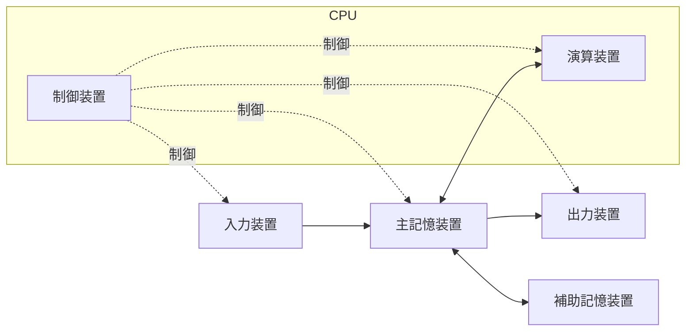
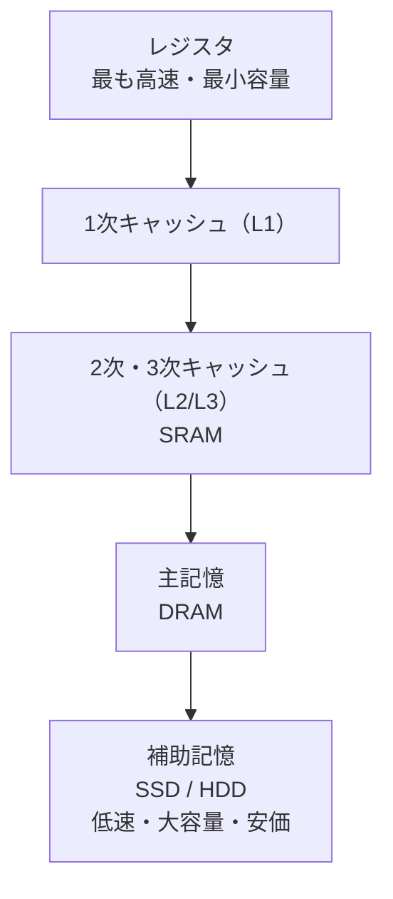
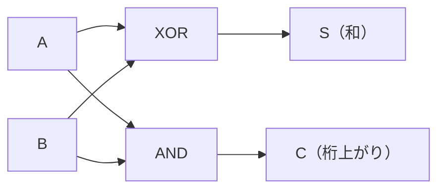

# コンピュータ構成要素

> **重要度：★★★**（科目A（旧午前）で毎回 3〜5 問。CPI・MIPS・キャッシュの計算が定番）
> CPU・メモリ・入出力装置といった「1台のコンピュータの中身」を扱う分野です。
> この章のポイントは次の4つです。
> - 命令実行サイクル・アドレス指定方式・パイプラインのしくみ
> - **CPI / MIPS** と **キャッシュの実効アクセス時間** の計算
> - 記憶素子（SRAM / DRAM / フラッシュメモリ）とキャッシュの書込み方式の違い
> - 入出力インタフェース、組込み・IoT の基礎、論理回路（半加算器など）

## 目次

1. [コンピュータの基本構成](#1-コンピュータの基本構成)
2. [CPU と命令実行](#2-cpu-と命令実行)
3. [CPU の性能計算（クロック・CPI・MIPS）](#3-cpu-の性能計算クロックcpimips)
4. [パイプラインと高速化技術](#4-パイプラインと高速化技術)
5. [メモリ階層とキャッシュ](#5-メモリ階層とキャッシュ)
6. [記憶素子](#6-記憶素子)
7. [入出力・バス・割込み](#7-入出力バス割込み)
8. [組込みシステム・IoT](#8-組込みシステムiot)
9. [論理回路](#9-論理回路)
10. [確認問題](#確認問題)
11. [参考](#参考)

---

## 1. コンピュータの基本構成

### 1.1 五大装置 ★

コンピュータは **制御装置・演算装置・記憶装置・入力装置・出力装置** の五大装置で構成されます。制御装置と演算装置をまとめたものが **CPU**（Central Processing Unit：中央処理装置、プロセッサ）です。



現在のコンピュータの多くは、プログラムもデータも主記憶に格納して順に実行する **プログラム内蔵方式（ノイマン型）** です。

### 1.2 CPU 内部のレジスタ ★★

**レジスタ**とは、CPU 内部にある非常に高速な小容量の記憶回路です。

| レジスタ | 役割 |
|---|---|
| **プログラムカウンタ（PC）** | **次に実行する命令のアドレス** を保持 |
| **命令レジスタ（IR）** | 主記憶から取り出した **実行中の命令** を保持 |
| 汎用レジスタ／アキュムレータ | 演算対象や演算結果を一時保持 |
| **インデックスレジスタ** | インデックス（指標）アドレス指定で使う増分値を保持 |
| **ベースレジスタ** | ベースアドレス指定で使う基準アドレスを保持 |
| フラグレジスタ（状態レジスタ） | 演算結果の状態（ゼロ、負、桁あふれなど）を保持 |

---

## 2. CPU と命令実行

### 2.1 命令実行サイクル ★★

CPU は1つの命令を次のような段階に分けて実行します。


① PC が指すアドレスから命令を IR に読み込み、PC を次の命令に進めます。② 命令の種類を解読し、③ 処理対象データ（**オペランド**）のアドレスを計算し、④ データを読み出して、⑤ 演算を実行します。

### 2.2 命令の形式 ★

命令は一般に **命令部（オペコード：何をするか）** と **アドレス部（オペランド：何に対して）** からなります。

```
| 命令部（例：ADD） | アドレス部（例：100） |
```

### 2.3 アドレス指定方式 ★★★

**アドレス指定方式**とは、アドレス部の値から実際にアクセスするアドレス（**実効アドレス**）を求める方法です。

**前提の数値**：アドレス部の値 = 100、インデックスレジスタ = 20、ベースレジスタ = 1000、プログラムカウンタ（現在の命令の次）= 500、主記憶の 100番地の内容 = 300

| 方式 | 実効アドレスの求め方 | 上の数値での結果 |
|---|---|---|
| **即値アドレス指定** | アドレス部の値 **そのものがデータ** | データ = 100（アドレスなし） |
| **直接アドレス指定** | アドレス部の値 = 実効アドレス | 100 |
| **間接アドレス指定** | アドレス部が指す番地の **内容** が実効アドレス | 主記憶[100] = **300** |
| **インデックス（指標）アドレス指定** | アドレス部 + インデックスレジスタ | 100 + 20 = **120** |
| **ベースアドレス指定** | ベースレジスタ + アドレス部 | 1000 + 100 = **1100** |
| **相対アドレス指定** | プログラムカウンタ + アドレス部 | 500 + 100 = **600** |
| レジスタアドレス指定 | アドレス部で指定した **レジスタ** の内容がデータ | — |

💡 **使いどころ**：インデックスは **配列の要素の順次アクセス**、ベースは **プログラムの再配置**（ロード位置が変わっても動く）、相対は **分岐命令** に便利です。

⚠️ **ひっかけ注意**：間接アドレス指定は「主記憶を **2回** 参照する」（1回目でアドレスを得て、2回目でデータを得る）方式です。

### 2.4 CISC と RISC ★★

| 項目 | **CISC**（Complex Instruction Set Computer） | **RISC**（Reduced Instruction Set Computer） |
|---|---|---|
| 命令の数・種類 | 多い・複雑 | 少ない・単純 |
| 命令長 | 可変長 | **固定長** |
| 制御方式 | **マイクロプログラム制御** が多い | **ワイヤードロジック制御**（布線論理） |
| パイプラインとの相性 | 普通 | **良い**（命令の実行時間がそろう） |
| 主記憶へのアクセス | 多くの命令で可能 | ロード／ストア命令に限定 |

---

## 3. CPU の性能計算（クロック・CPI・MIPS）

### 3.1 用語 ★★★

| 用語 | 意味 |
|---|---|
| **クロック周波数** | CPU の動作の基準となる信号が1秒間に刻む回数（Hz）。例：2 GHz = 毎秒 2×10⁹ 回 |
| **クロックサイクル時間** | 1クロックの時間 = 1 / クロック周波数。2 GHz なら 0.5 ナノ秒（ns） |
| **CPI**（Cycles Per Instruction） | 1命令の実行に必要な **平均クロック数** |
| **MIPS**（Million Instructions Per Second） | 1秒間に実行できる命令数（**百万単位**） |
| **FLOPS**（Floating-point Operations Per Second） | 1秒間に実行できる浮動小数点演算の回数 |

### 3.2 公式 ★★★

```
1命令の平均実行時間 = CPI × クロックサイクル時間 = CPI / クロック周波数
MIPS = クロック周波数 / CPI / 10⁶ = 1 / (1命令の平均実行時間) / 10⁶
平均CPI = Σ（命令種別のCPI × 出現比率）
```

### 3.3 計算例（命令ミックス） ★★★

**問題**：クロック周波数 2 GHz の CPU で、次の命令ミックス（命令の出現割合）のプログラムを実行する。平均 CPI、1命令の平均実行時間、MIPS 値を求めよ。

| 命令種別 | CPI | 出現比率 |
|---|---|---|
| 演算命令 | 4 | 50% |
| ロード／ストア命令 | 8 | 30% |
| 分岐命令 | 10 | 20% |

```
① 平均CPI = 4×0.5 + 8×0.3 + 10×0.2 = 2.0 + 2.4 + 2.0 = 6.4
② クロックサイクル時間 = 1 / (2×10⁹) 秒 = 0.5 ns
③ 1命令の平均実行時間 = 6.4 × 0.5 ns = 3.2 ns
④ MIPS = 1 / (3.2×10⁻⁹) / 10⁶ = 312.5×10⁶ / 10⁶ = 312.5 MIPS
   （別解：2,000 MHz ÷ 6.4 = 312.5 MIPS）
```

💡 **コツ**：クロック周波数を **MHz 単位** にして CPI で割ると、そのまま MIPS 値になります（2 GHz = 2,000 MHz → 2000 / 6.4 = 312.5）。

⚠️ **ひっかけ注意**：ns（ナノ秒）= 10⁻⁹ 秒、μs（マイクロ秒）= 10⁻⁶ 秒、ms（ミリ秒）= 10⁻³ 秒。単位換算ミスが最も多い失点原因です。

---

## 4. パイプラインと高速化技術

### 4.1 パイプライン ★★★

**パイプライン処理**とは、命令実行の各段階（ステージ）を少しずつずらして **並行に** 処理する方式です。洗濯→乾燥→たたみ、を複数の洗濯物で流れ作業にするイメージです。

```
時間 →     1   2   3   4   5   6   7
命令1     F   D   A   O   E
命令2         F   D   A   O   E
命令3             F   D   A   O   E
（F:取出し D:解読 A:アドレス計算 O:オペランド読出し E:実行）
```

**公式**：ステージ数 k、各ステージ 1 サイクル、命令数 n、乱れがないとき

```
パイプラインあり：(k + n − 1) サイクル
パイプラインなし：k × n サイクル
```

**具体例**：5段のパイプラインで10命令を実行する

```
パイプラインあり = 5 + 10 − 1 = 14 サイクル
パイプラインなし = 5 × 10   = 50 サイクル
→ 約 3.6 倍高速（命令数が十分多いと、最大でステージ数 k 倍に近づく）
```

1サイクルが 2 ns なら、所要時間は 14 × 2 = 28 ns です。

### 4.2 ハザード（パイプラインの乱れ） ★★

**ハザード**とは、パイプラインがうまく流れず待ちが発生する現象です。

| ハザード | 原因 | 主な対策 |
|---|---|---|
| **構造ハザード** | 複数の命令が同じ装置（資源）を同時に使おうとする | 資源の多重化（命令用とデータ用でキャッシュを分ける等） |
| **データハザード** | 前の命令の結果を次の命令が使う（結果がまだ出ていない） | フォワーディング（結果を直接次の命令に渡す）、命令の並べ替え |
| **制御ハザード** | 分岐命令で次に実行する命令が決まらない | **分岐予測**、**投機実行**、遅延分岐 |

### 4.3 その他の高速化技術 ★★

| 技術 | 内容 |
|---|---|
| **スーパスカラ** | 複数のパイプラインを持ち、**同時に複数の命令** を実行 |
| **スーパパイプライン** | パイプラインの段数を細かく増やしてクロックを上げる |
| **VLIW**（Very Long Instruction Word） | コンパイラが並列実行できる複数の命令を1つの長い命令にまとめる |
| **アウトオブオーダ実行** | 命令の順序にこだわらず、実行可能な命令から実行する |
| **マルチコアプロセッサ** | 1つの CPU パッケージに複数のコア（演算処理の中核）を搭載 |
| **SMT**（同時マルチスレッディング） | 1つのコアで複数のスレッドを同時に実行（例：ハイパースレッディング） |
| **GPU**（Graphics Processing Unit） | 単純な演算を大量に並列実行。画像処理や機械学習で活用（**GPGPU**） |

**マルチプロセッサの性能（アムダールの法則）**：並列化できない部分が性能向上の上限を決めます。

```
性能向上比 = 1 / { (1 − r) + r / n }      r：並列化できる割合、n：プロセッサ数
例：r = 0.8、n = 4 のとき 1 / (0.2 + 0.8/4) = 1 / (0.2 + 0.2) = 2.5 倍
```

---

## 5. メモリ階層とキャッシュ

### 5.1 メモリ階層 ★★

高速な記憶装置ほど高価で小容量なので、速度と容量の異なる装置を **階層的** に組み合わせます。



キャッシュがうまく働くのは、プログラムが **参照の局所性**（一度アクセスした場所やその近くを、近いうちに再びアクセスする性質）を持つからです。

- **時間的局所性**：同じデータを短時間に繰り返し参照する（ループの変数など）
- **空間的局所性**：近くのアドレスを続けて参照する（配列の順次アクセスなど）

### 5.2 実効アクセス時間 ★★★

**キャッシュメモリ**とは、CPU と主記憶の速度差を埋めるため、その間に置く高速・小容量のメモリです。目的のデータがキャッシュにある割合を **ヒット率**、ない割合（1 − ヒット率）を **ミス率（NFP）** といいます。

**公式**

```
実効アクセス時間 = キャッシュのアクセス時間 × ヒット率
                 + 主記憶のアクセス時間 × (1 − ヒット率)
```

**具体例1**：キャッシュ 10 ns、主記憶 60 ns、ヒット率 90%

```
実効アクセス時間 = 10 × 0.9 + 60 × (1 − 0.9)
                 = 9 + 6
                 = 15 ns
```

**具体例2（逆算）**：同じ条件で実効アクセス時間を 12 ns 以下にするには、ヒット率 h をいくつ以上にすればよいか。

```
10h + 60(1 − h) ≦ 12
10h + 60 − 60h ≦ 12
−50h ≦ −48
h ≧ 0.96  → ヒット率 96% 以上
```

**具体例3（2段のキャッシュ）**：L1 2 ns（ヒット率 90%）、L2 10 ns（L1 でミスしたアクセスのうち 80% がヒット）、主記憶 80 ns。各段でミスした場合は次の段のアクセス時間だけがかかるものとする。

```
L1 でヒット        ：0.9               × 2  = 1.8
L1ミス・L2でヒット ：0.1 × 0.8 = 0.08 × 10 = 0.8
L1・L2 ともミス    ：0.1 × 0.2 = 0.02 × 80 = 1.6
実効アクセス時間 = 1.8 + 0.8 + 1.6 = 4.2 ns
```

⚠️ **ひっかけ注意**：問題によっては「ミス時はキャッシュを調べた時間＋主記憶の時間がかかる」とする場合があります。問題文の前提を確認しましょう。

### 5.3 キャッシュの書込み方式 ★★★

| 方式 | 動作 | 長所 | 短所 |
|---|---|---|---|
| **ライトスルー方式** | CPU が書き込むとき、**キャッシュと主記憶の両方に同時に** 書く | 主記憶とキャッシュの内容が常に一致（**一貫性** を保ちやすい） | 毎回主記憶に書くため書込みが遅い |
| **ライトバック方式** | **キャッシュだけに** 書き、そのブロックがキャッシュから **追い出されるときに** 主記憶へ書き戻す | 主記憶への書込み回数が減り **高速** | 主記憶との不一致が生じる。制御が複雑 |

💡 **覚え方**：「スルー＝素通りして主記憶まで」「バック＝後で戻す」。

**マルチプロセッサ** で各 CPU がキャッシュを持つ場合、同じデータの内容が食い違わないようにする **キャッシュコヒーレンシ（一貫性）制御** が必要になります。

### 5.4 キャッシュの割付け（マッピング）方式 ★

主記憶のブロックをキャッシュのどこに置くかの決め方です。

| 方式 | 内容 |
|---|---|
| **ダイレクトマッピング方式** | 主記憶のブロックごとに、置けるキャッシュの位置が **1か所に決まっている** |
| **フルアソシエイティブ方式** | キャッシュの **どこにでも** 置ける |
| **セットアソシエイティブ方式** | いくつかのセット（組）に分け、セット内ならどこでも置ける（上2つの中間） |

### 5.5 メモリインタリーブ ★

**メモリインタリーブ**とは、主記憶を複数の **バンク** に分け、連続したアドレスを異なるバンクに割り当てて **並行してアクセス** することで、見かけ上のアクセス速度を高める方式です。

---

## 6. 記憶素子

### 6.1 RAM（読み書き可能、電源を切ると消える） ★★★

**RAM**（Random Access Memory）は電源を切ると内容が失われる **揮発性** のメモリです。

| 項目 | **SRAM**（Static RAM） | **DRAM**（Dynamic RAM） |
|---|---|---|
| 記憶のしくみ | **フリップフロップ回路** | **コンデンサ** に電荷を蓄える |
| **リフレッシュ**（定期的な再書込み） | **不要** | **必要**（電荷が漏れて消えるため） |
| 速度 | 高速 | SRAM より低速 |
| 集積度・価格 | 低い・高価 | 高い・安価 |
| 主な用途 | **キャッシュメモリ** | **主記憶** |

### 6.2 ROM・不揮発性メモリ ★★

**ROM**（Read Only Memory）や **フラッシュメモリ** は電源を切っても内容が残る **不揮発性** のメモリです。

| 種類 | 特徴 |
|---|---|
| マスク ROM | 製造時に内容を書き込む。書換え不可 |
| PROM | 利用者が1回だけ書込み可能 |
| EPROM | **紫外線** で全消去して再書込み可能 |
| **EEPROM** | **電気的** にバイト単位で消去・書換え可能 |
| **フラッシュメモリ** | EEPROM の一種。**ブロック単位** で電気的に一括消去。SSD・USBメモリ・SDカードに使われる |

**フラッシュメモリの注意点**：書換え回数に上限があるため、書込みを全体に分散させる **ウェアレベリング** という制御を行います。

**SSD**（Solid State Drive）は、フラッシュメモリを使った補助記憶装置で、HDD（ハードディスク）と違い **可動部がない** ため、シーク時間（ヘッドの移動時間）や回転待ち時間がなく、ランダムアクセスが高速です。

---

## 7. 入出力・バス・割込み

### 7.1 入出力の制御方式 ★★

| 方式 | 内容 |
|---|---|
| プログラム制御方式 | CPU が入出力命令を実行してデータを1つずつ転送 |
| **DMA 方式**（Direct Memory Access） | **CPU を介さずに** DMA コントローラが主記憶と入出力装置の間で直接データを転送。CPU は転送中に別の処理ができる |
| チャネル制御方式 | 入出力専用のプロセッサ（チャネル）が転送を制御 |

### 7.2 バス ★

**バス**とは、CPU・主記憶・入出力装置を結ぶ共通の信号の通り道です。

| バス | 内容 |
|---|---|
| アドレスバス | アクセス先のアドレスを伝える。**幅（本数）が n ビットなら 2ⁿ 番地** まで指定できる |
| データバス | データそのものを伝える |
| 制御バス | 読み書きの区別などの制御信号を伝える |

例：アドレスバスが 32 ビットで 1 番地 = 1 バイトなら、`2³² バイト = 4 G バイト` まで扱えます。

### 7.3 入出力インタフェース ★★

| 規格 | 種類 | 特徴 |
|---|---|---|
| **USB**（Universal Serial Bus） | シリアル | **ホットプラグ**（電源を入れたまま抜き差し）対応、**バスパワー**（給電）可能。USB 2.0 は最大 480 Mbit/s、USB 3.2 Gen1 は 5 Gbit/s |
| **PCI Express** | シリアル | 拡張カード（GPU など）の接続。レーン数を増やすと高速になる |
| SATA / NVMe | シリアル | ストレージの接続。NVMe は PCI Express を使う SSD 向け規格 |
| **HDMI** / DisplayPort | シリアル | 映像・音声の出力 |
| **Bluetooth** | 無線 | 近距離無線通信。BLE（Bluetooth Low Energy）は低消費電力 |
| **NFC**（Near Field Communication） | 無線 | 数 cm 程度の近接通信。IC カード・スマートフォン決済 |
| IrDA | 赤外線 | 赤外線を使った近距離通信 |

💡 現在の主要なインタフェースはほぼ **シリアル伝送**（1本の線で1ビットずつ送る方式）です。パラレル（並列）伝送は高速化すると信号のタイミングのずれ（スキュー）が問題になるためです。

### 7.4 割込み ★★★

**割込み**とは、実行中のプログラムを一時中断して、緊急の処理を優先して行うしくみです。処理後は中断したところから再開します。

| 分類 | 種類 | 発生原因の例 |
|---|---|---|
| **内部割込み**（実行中のプログラムが原因） | プログラム割込み | **ゼロ除算**、**オーバフロー**、不正な命令の実行 |
| | **SVC 割込み**（スーパバイザコール） | プログラムが OS の機能を呼び出す |
| | **ページフォールト** | 仮想記憶で、参照したページが主記憶にない |
| **外部割込み**（プログラムの外が原因） | **入出力割込み** | 入出力装置の処理完了・異常 |
| | **タイマ割込み** | 一定時間の経過（タイムスライスの終了など） |
| | **機械チェック割込み** | ハードウェアの故障・電源異常 |
| | コンソール割込み | オペレータの操作 |

⚠️ **ひっかけ注意**：「ゼロ除算」「ページフォールト」は **内部** 割込み、「入出力完了」「タイマ」は **外部** 割込みです。

---

## 8. 組込みシステム・IoT

### 8.1 組込みシステムの構成要素 ★★

**組込みシステム**とは、家電・自動車・産業機械などに組み込まれ、特定の機能を実現するコンピュータシステムです。


| 用語 | 意味 |
|---|---|
| **センサ** | 温度・光・加速度などの物理量を電気信号に変える装置 |
| **アクチュエータ** | 電気信号を動き（物理的な動作）に変える装置。モータ、ソレノイドなど |
| **A/D 変換** | アナログ信号をデジタル値に変換（**標本化 → 量子化 → 符号化**） |
| **PWM**（Pulse Width Modulation：パルス幅変調） | パルスの ON 時間の割合（**デューティ比**）を変えて、モータの回転数や LED の明るさを制御 |
| **ウォッチドッグタイマ** | 一定時間内にリセットされないと、システムの暴走とみなして再起動などを行うタイマ |
| **リアルタイム OS**（RTOS） | 決められた時間内に応答することを重視した OS（05_ソフトウェア 参照） |
| **SoC**（System on a Chip） | CPU、メモリ、入出力などを1つのチップに集積したもの |
| **FPGA**（Field Programmable Gate Array） | 製造後に利用者が論理回路を書き換えられる集積回路 |
| **ASIC**（Application Specific Integrated Circuit） | 特定用途向けに設計した専用の集積回路 |

### 8.2 A/D 変換の計算 ★★

**公式**

```
データ量（ビット/秒）= 標本化周波数（回/秒） × 量子化ビット数 × チャネル数
```

**具体例1**：音声を 8 kHz で標本化し、8 ビットで量子化（モノラル）

```
8,000 回/秒 × 8 ビット = 64,000 ビット/秒 = 64 kbit/s
```

**具体例2**：44.1 kHz、16 ビット、ステレオ（2チャネル）の音声1分間のデータ量

```
44,100 × 16 × 2 = 1,411,200 ビット/秒
1,411,200 × 60 秒 ÷ 8 = 10,584,000 バイト ≒ 約 10.6 M バイト
```

**PWM の例**：電源電圧 5 V、デューティ比 25% のとき、平均電圧は `5 × 0.25 = 1.25 V` です。

### 8.3 IoT と省電力 ★★

**IoT**（Internet of Things：モノのインターネット）とは、さまざまな機器（モノ）をネットワークにつないで情報をやり取りするしくみです。

| 用語 | 意味 |
|---|---|
| **LPWA**（Low Power Wide Area） | 低消費電力で **数 km 以上** の広域通信ができる無線通信方式（LoRaWAN、Sigfox、NB-IoT など） |
| **エッジコンピューティング** | データの発生源（端末）の近くで処理し、通信量と遅延を減らす |
| **エネルギーハーベスティング** | 光・振動・熱など周囲のわずかなエネルギーを電力に変える技術（環境発電） |
| **DVFS**（Dynamic Voltage and Frequency Scaling） | 負荷に応じて CPU の電圧とクロック周波数を動的に下げ、消費電力を削減 |
| **クロックゲーティング** | 使っていない回路へのクロック供給を止めて消費電力を削減 |

### 8.4 画面表示に必要なメモリ容量 ★

```
VRAM 容量 = 横の画素数 × 縦の画素数 × 1画素あたりのビット数 ÷ 8（バイト）
例：1,920 × 1,080 画素、24 ビットフルカラー
    1,920 × 1,080 × 24 ÷ 8 = 1,920 × 1,080 × 3 = 6,220,800 バイト ≒ 約 6.2 M バイト
```

---

## 9. 論理回路

### 9.1 論理ゲートの図記号と真理値表 ★★

論理回路の基本となる部品を **論理ゲート** といいます（真理値表は「01_基礎理論」の 2.1 も参照）。

| ゲート | 論理式 | 出力が1になる条件 |
|---|---|---|
| AND | `X = A・B` | 両方1 |
| OR | `X = A + B` | どちらか1 |
| NOT | `X = Ā` | 入力が0 |
| **NAND** | `X = NOT(A・B)` | 両方1 **以外** |
| **NOR** | `X = NOT(A + B)` | 両方0 |
| **XOR** | `X = A ⊕ B` | **入力が異なる** |

💡 **NAND ゲート（または NOR ゲート）だけで、すべての論理回路を作れます**。例えば NAND の2入力を同じ信号 A にすると `NOT(A・A) = Ā` となり、NOT ゲートになります。

### 9.2 半加算器と全加算器 ★★★

**半加算器**は、1ビット同士の加算を行い、**和（S）** と **桁上がり（C）** を出す回路です。

| A | B | C（桁上がり） | S（和） |
|:-:|:-:|:-:|:-:|
| 0 | 0 | 0 | 0 |
| 0 | 1 | 0 | 1 |
| 1 | 0 | 0 | 1 |
| 1 | 1 | 1 | 0 |

```
S = A XOR B      C = A AND B
```



**全加算器**は、下位からの桁上がり（Cin）も含めた3入力の加算回路で、**半加算器2個と OR ゲート1個** で構成できます。

```
S    = A ⊕ B ⊕ Cin
Cout = (A・B) + (Cin・(A ⊕ B))
```

### 9.3 順序回路 ★

- **組合せ回路**：出力が **現在の入力だけ** で決まる回路（加算器、デコーダなど）
- **順序回路**：出力が **現在の入力と過去の状態** で決まる回路。状態を記憶する **フリップフロップ** を含みます（SRAM やレジスタ、カウンタに使われる）。

---

## 確認問題

**問1** 主記憶の 200 番地に 500、500 番地に 800 が格納されている。命令のアドレス部が 200 で **間接アドレス指定** のとき、演算の対象となるデータはどれか。
ア 200　イ 500　ウ 700　エ 800

**問2** クロック周波数 1.6 GHz の CPU で、平均 CPI が 4 の命令列を実行するとき、この CPU の性能は約何 MIPS か。
ア 160　イ 400　ウ 640　エ 6,400

**問3** 次の命令ミックスで、クロック周波数 1 GHz の CPU の1命令あたりの平均実行時間は何ナノ秒か。
（命令A：CPI 2・比率 60%、命令B：CPI 5・比率 30%、命令C：CPI 10・比率 10%）
ア 2.5　イ 3.7　ウ 4.1　エ 5.7

**問4** 6段のパイプラインで 20 命令を実行する。1ステージの処理時間が 1 ns でハザードが発生しないとき、全命令の実行に要する時間は何 ns か。
ア 20　イ 25　ウ 26　エ 120

**問5** キャッシュのアクセス時間が 5 ns、主記憶のアクセス時間が 50 ns で、実効アクセス時間が 9.5 ns だった。キャッシュのヒット率はいくらか。
ア 0.80　イ 0.85　ウ 0.90　エ 0.95

**問6** キャッシュメモリの **ライトバック方式** の説明として適切なものはどれか。
ア CPU が書き込むとき、キャッシュと主記憶の両方を同時に更新する。
イ CPU が書き込むとき、キャッシュだけを更新し、そのブロックを置き換えるときに主記憶へ書き戻す。
ウ 主記憶を複数のバンクに分け、連続したアドレスを並行してアクセスする。
エ 主記憶への書込みを禁止し、読出しだけをキャッシュで高速化する。

**問7** DRAM の説明として適切なものはどれか。
ア フリップフロップで記憶し、リフレッシュは不要である。
イ コンデンサに電荷を蓄えて記憶し、定期的なリフレッシュが必要である。
ウ 紫外線を照射して内容を消去する。
エ 電源を切っても記憶内容が保持される。

**問8** 次のうち **外部割込み** に該当するものはどれか。
ア ゼロ除算　イ ページフォールト　ウ SVC（スーパバイザコール）　エ 入出力完了

**問9** 音声を標本化周波数 16 kHz、量子化ビット数 12 ビット（モノラル）でデジタル化したとき、1秒あたりのデータ量は何 k バイトか（1 k バイト = 1,000 バイト）。

**問10** 半加算器の和（S）と桁上がり（C）を表す論理式の組合せとして正しいものはどれか。
ア S = A AND B、C = A XOR B　イ S = A XOR B、C = A AND B　ウ S = A OR B、C = A AND B　エ S = A XOR B、C = A OR B

<details><summary>解答・解説</summary>

**問1　エ**
間接アドレス指定では、アドレス部 200 番地の **内容（500）** が実効アドレスです。データは 500 番地の内容である **800** です。イの 500 は実効アドレスであってデータではありません。

**問2　イ**
```
MIPS = 1,600 MHz ÷ 4 = 400 MIPS
```

**問3　イ**
```
平均CPI = 2×0.6 + 5×0.3 + 10×0.1 = 1.2 + 1.5 + 1.0 = 3.7
クロックサイクル時間 = 1 / 1 GHz = 1 ns
平均実行時間 = 3.7 × 1 ns = 3.7 ns
```

**問4　イ**
```
(k + n − 1) × 1ステージ時間 = (6 + 20 − 1) × 1 ns = 25 ns
```
エの 120 ns（6×20）はパイプラインを使わない場合です。

**問5　ウ**
```
5h + 50(1 − h) = 9.5
5h + 50 − 50h = 9.5
−45h = −40.5
h = 0.9
```

**問6　イ**
アはライトスルー方式、ウはメモリインタリーブの説明です。

**問7　イ**
アは SRAM、ウは EPROM、エは ROM・フラッシュメモリなど不揮発性メモリの説明です。

**問8　エ**
入出力完了は入出力装置（プログラムの外）が原因の **外部割込み** です。ア・イ・ウは実行中のプログラムが原因の内部割込みです。

**問9　24 k バイト**
```
16,000 回/秒 × 12 ビット = 192,000 ビット/秒
192,000 ÷ 8 = 24,000 バイト/秒 = 24 k バイト/秒
```

**問10　イ**
入力が異なるとき和が1になるので S は XOR、両方1のときだけ桁上がりするので C は AND です。

</details>

---

## 参考

- IPA「試験要綱・シラバスについて」（応用情報技術者試験 シラバス Ver.7.2）：https://www.ipa.go.jp/shiken/syllabus/gaiyou.html
- IPA「応用情報技術者試験 シラバス Ver.7.2（PDF）」：https://www.ipa.go.jp/shiken/syllabus/omgdg50000005kq5-att/syllabus_ap_ver7_2.pdf
- IPA「応用情報技術者試験（AP）」試験区分ページ：https://www.ipa.go.jp/shiken/kubun/ap.html
- IPA「過去問題」：https://www.ipa.go.jp/shiken/mondai-kaiotu/index.html
- 応用情報技術者試験ドットコム（午前過去問の分野別解説）：https://www.ap-siken.com/
- USB Implementers Forum（USB 規格の公式情報）：https://www.usb.org/
