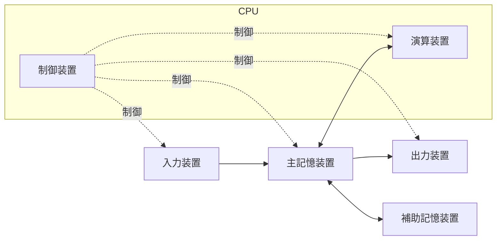
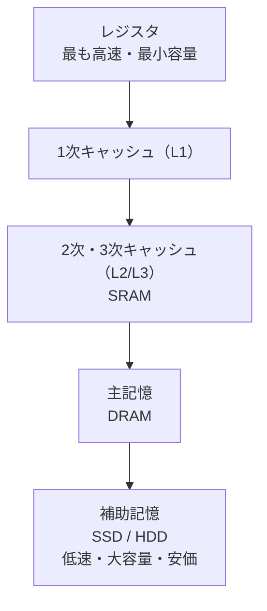
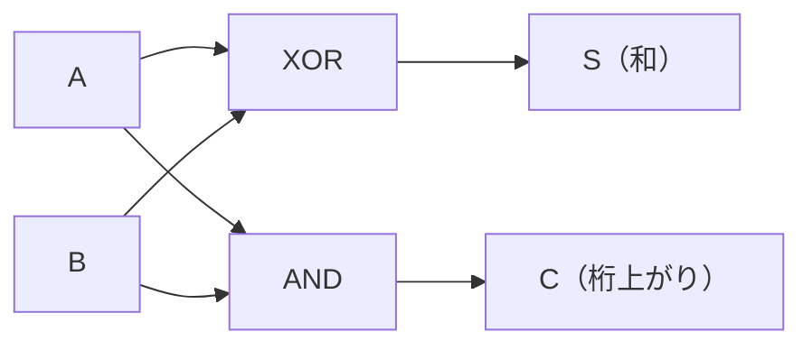
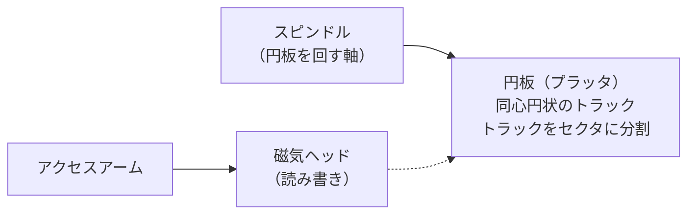

# コンピュータ構成要素

> **重要度：★★★**（科目A（旧午前）で毎回 3〜5 問。CPI・MIPS・キャッシュの計算が定番）
> CPU・メモリ・入出力装置といった「1台のコンピュータの中身」を扱う分野です。
> この章のポイントは次の4つです。
> - 命令実行サイクル・アドレス指定方式・パイプラインのしくみ
> - **CPI / MIPS** と **キャッシュの実効アクセス時間** の計算
> - 記憶素子（SRAM / DRAM / フラッシュメモリ）とキャッシュの書込み方式の違い
> - 入出力インタフェース、組込み・IoT の基礎、論理回路（半加算器など）

## 目次

1. [コンピュータの基本構成](#1-コンピュータの基本構成)
2. [CPU と命令実行](#2-cpu-と命令実行)
3. [CPU の性能計算（クロック・CPI・MIPS）](#3-cpu-の性能計算クロックcpimips)
4. [パイプラインと高速化技術](#4-パイプラインと高速化技術)
5. [メモリ階層とキャッシュ](#5-メモリ階層とキャッシュ)
6. [記憶素子](#6-記憶素子)
7. [入出力・バス・割込み](#7-入出力バス割込み)
8. [組込みシステム・IoT](#8-組込みシステムiot)
9. [論理回路](#9-論理回路)
10. [入出力装置と補助記憶装置](#10-入出力装置と補助記憶装置)
11. [確認問題](#確認問題)
12. [📋 シラバス用語チェックリスト](#-シラバス用語チェックリスト)
13. [参考](#参考)

---

## 1. コンピュータの基本構成

### 1.1 五大装置 ★

コンピュータは **制御装置・演算装置・記憶装置・入力装置・出力装置** の五大装置で構成されます。制御装置と演算装置をまとめたものが **CPU**（Central Processing Unit：中央処理装置、プロセッサ）です。



現在のコンピュータの多くは、プログラムもデータも主記憶に格納して順に実行する **プログラム内蔵方式（ノイマン型）** です。

### 1.2 CPU 内部のレジスタ ★★

**レジスタ**とは、CPU 内部にある非常に高速な小容量の記憶回路です。

| レジスタ | 役割 |
|---|---|
| **プログラムカウンタ（PC）** | **次に実行する命令のアドレス** を保持 |
| **命令レジスタ（IR）** | 主記憶から取り出した **実行中の命令** を保持 |
| 汎用レジスタ／アキュムレータ | 演算対象や演算結果を一時保持 |
| **インデックスレジスタ** | インデックス（指標）アドレス指定で使う増分値を保持 |
| **ベースレジスタ** | ベースアドレス指定で使う基準アドレスを保持 |
| フラグレジスタ（状態レジスタ） | 演算結果の状態（ゼロ、負、桁あふれなど）を保持 |

**シラバスに出てくるその他のレジスタ・演算部品**

| 名称 | 役割 |
|---|---|
| **命令アドレスレジスタ** | プログラムカウンタの別名。**命令カウンター**、**逐次制御カウンター** とも呼ぶ |
| **GR**（General Register：汎用レジスタ） | 演算データ・アドレス計算など用途を限定せずに使うレジスタ |
| **アキュムレーター**（累算器） | 演算の入力や結果を保持する専用レジスタ。「ACC に加える」のように1オペランド形式の命令で暗黙に使われる |
| **MAR**（Memory Address Register：メモリアドレスレジスタ） | 主記憶にアクセスするときの **アドレス** を保持し、アドレスバスへ出す |
| **DR**（Data Register）／**MR**（Memory Register） | 主記憶との間で読み書きする **データ** を一時保持するレジスタ（メモリデータレジスタとも） |
| **スタックポインタ**（SP） | スタック（後入れ先出しの領域）の **最上段のアドレス** を保持。サブルーチン呼出しや割込み時の戻り番地退避に使う |
| **デコーダ**（命令解読器、復号器） | 命令レジスタの命令部（オペコード）を解読し、各装置への制御信号を作る（制御装置の部品） |
| **加算器** | 2進数の加算を行う回路（[9.2 半加算器と全加算器](#92-半加算器と全加算器-)） |
| **補数器** | 2の補数などを作る回路。減算を「補数の加算」で行うために使う |
| **乗算器** | 乗算を行う回路 |
| **積和演算器**（MAC：Multiply-ACcumulate） | `a × b + c` を1命令でまとめて計算する回路。DSP や AI 処理（行列計算）で多用 |

命令実行時のレジスタの動き（例：`LOAD GR1, 100`）は、`PC → MAR → 主記憶 → DR → IR`（命令の取出し）、`IR のアドレス部 → MAR → 主記憶 → DR → GR1`（データの読出し）の順です。

### 1.3 コンピュータの種類 ★

| 種類 | 特徴・用途 |
|---|---|
| **デスクトップPC** / **ノートPC** | 個人向けの汎用コンピュータ。ノートPC は可搬性と省電力を重視 |
| **サーバ** | ネットワーク経由でサービス（Web、ファイル、DB など）を提供する。信頼性・拡張性を重視 |
| ワークステーション | 設計（CAD）・解析などに使う高性能なコンピュータ |
| **携帯端末** | **スマートフォン**、**タブレット端末** など。バッテリー駆動で、タッチパネル操作が中心 |
| **SBC**（Single Board Computer：シングルボードコンピュータ） | CPU・メモリ・入出力を1枚の基板に載せた小型コンピュータ（例：Raspberry Pi）。試作・教育・IoT に使う |
| **汎用コンピュータ**（メインフレーム） | 事務処理から科学技術計算まで幅広く使える大型コンピュータ。銀行の勘定系など高信頼な基幹業務向け |
| **スーパーコンピュータ** | 大規模な科学技術計算向けの超高性能機。性能は FLOPS で表す |
| **制御用コンピュータ** | 工場の生産設備やプラントなどの機械を制御する。リアルタイム性・耐環境性を重視 |
| **マイクロコンピュータ**（マイコン） | CPU を1個の LSI にまとめた小型コンピュータ。家電などの組込み機器に入っている |
| **量子コンピュータ** | 量子力学の **重ね合わせ** や **量子もつれ** を利用して計算するコンピュータ |

**量子コンピュータの2方式**

| 方式 | 内容 |
|---|---|
| **量子ゲート型** | 量子ビットに量子ゲート（論理演算に相当する操作）を順に作用させて計算する **汎用型**。素因数分解（ショアのアルゴリズム）などの高速化が期待される |
| **量子アニーリング型** | 物理系がエネルギー最小の状態に落ち着く性質を利用し、**組合せ最適化問題** に特化して解を探す方式 |

⚠️ **ひっかけ注意**：「量子アニーリング型＝最適化問題専用」「量子ゲート型＝汎用」の対応が問われます。

### 1.4 プロセッサの種類 ★★

| プロセッサ | 特徴・用途 |
|---|---|
| **CPU** | 汎用の処理を行う中央処理装置。複雑な処理を逐次的に高速実行 |
| **GPU**（Graphics Processing Unit） | 画像処理用。単純な演算を **大量に並列実行** する |
| **GPGPU**（General-Purpose computing on GPU） | GPU の並列演算能力を、画像以外の汎用計算（機械学習・科学技術計算）に使うこと |
| **DSP**（Digital Signal Processor） | 音声・画像などの **デジタル信号処理** に特化。積和演算を高速に行う |
| **FPU**（Floating Point Unit） | **浮動小数点演算** 専用の演算装置。現在は CPU に内蔵されている |
| **AIチップ** | ニューラルネットワークの推論・学習（大量の行列演算）を高速・低電力で行う専用プロセッサ（NPU など） |
| **TPU**（Tensor Processing Unit） | Google が開発した、機械学習（テンソル演算）専用の AI チップ |

### 1.5 データ処理の単位 ★

| 単位 | 内容 |
|---|---|
| **ビット**（bit） | 0 か 1 の情報の最小単位 |
| **バイト**（byte） | 通常 8 ビット |
| **キャラクター**（文字） | 1文字を表す単位。文字コードにより 1 バイト〜数バイト |
| **ワード**（語） | プロセッサが **1命令で一度に処理するデータの単位**。32 ビット CPU なら 1 ワード = 32 ビットが一般的（アーキテクチャにより異なる） |
| **量子ビット**（Quantum bit、qubit） | 量子コンピュータの情報単位。0 と 1 の **重ね合わせ** の状態を取れる |

---

## 2. CPU と命令実行

### 2.1 命令実行サイクル ★★

CPU は1つの命令を次のような段階に分けて実行します。


① PC が指すアドレスから命令を IR に読み込み、PC を次の命令に進めます。② 命令の種類を解読し、③ 処理対象データ（**オペランド**）のアドレスを計算し、④ データを読み出して、⑤ 演算を実行します。

### 2.2 命令の形式 ★

命令は一般に **命令部（オペコード：何をするか）** と **アドレス部（オペランド：何に対して）** からなります。

```
| 命令部（例：ADD） | アドレス部（例：100） |
```

1つの命令が指定するオペランドの数で、命令形式を分類できます。

| 形式 | 例 | 意味 |
|---|---|---|
| **0 オペランド形式** | `ADD` | スタックの上2つを加算（スタックマシン） |
| **1 オペランド形式** | `ADD X` | アキュムレーター ← アキュムレーター + X（もう一方はアキュムレーターが暗黙の対象） |
| **2 オペランド形式** | `ADD A, B` | A ← A + B（一方が結果の格納先を兼ねる） |
| 3 オペランド形式 | `ADD A, B, C` | A ← B + C（RISC に多い） |

💡 オペランド数が少ないほど命令長は短くなりますが、同じ処理に必要な命令数は増えます。

### 2.3 アドレス指定方式 ★★★

**アドレス指定方式**とは、アドレス部の値から実際にアクセスするアドレス（**実効アドレス**）を求める方法です。

**前提の数値**：アドレス部の値 = 100、インデックスレジスタ = 20、ベースレジスタ = 1000、プログラムカウンタ（現在の命令の次）= 500、主記憶の 100番地の内容 = 300

| 方式 | 実効アドレスの求め方 | 上の数値での結果 |
|---|---|---|
| **即値アドレス指定** | アドレス部の値 **そのものがデータ** | データ = 100（アドレスなし） |
| **直接アドレス指定** | アドレス部の値 = 実効アドレス | 100 |
| **間接アドレス指定** | アドレス部が指す番地の **内容** が実効アドレス | 主記憶[100] = **300** |
| **インデックス（指標）アドレス指定** | アドレス部 + インデックスレジスタ | 100 + 20 = **120** |
| **ベースアドレス指定** | ベースレジスタ + アドレス部 | 1000 + 100 = **1100** |
| **相対アドレス指定** | プログラムカウンタ + アドレス部 | 500 + 100 = **600** |
| レジスタアドレス指定 | アドレス部で指定した **レジスタ** の内容がデータ | — |
| **絶対アドレス指定** | アドレス部に主記憶の **実アドレス（物理的な番地）** をそのまま書く。直接アドレス指定とほぼ同義で、ベース・相対など「基準からの距離」で表す方式と対比される | 100 |

**アドレス修飾**とは、アドレス部の値にインデックスレジスタやベースレジスタの値を加えるなどの加工をして実効アドレスを求めることです（インデックス修飾、ベース修飾など）。この計算を **アドレス計算** といいます。

💡 **使いどころ**：インデックスは **配列の要素の順次アクセス**、ベースは **プログラムの再配置**（ロード位置が変わっても動く）、相対は **分岐命令** に便利です。

⚠️ **ひっかけ注意**：間接アドレス指定は「主記憶を **2回** 参照する」（1回目でアドレスを得て、2回目でデータを得る）方式です。

### 2.4 CISC と RISC ★★

| 項目 | **CISC**（Complex Instruction Set Computer） | **RISC**（Reduced Instruction Set Computer） |
|---|---|---|
| 命令の数・種類 | 多い・複雑 | 少ない・単純 |
| 命令長 | 可変長 | **固定長** |
| 制御方式 | **マイクロプログラム制御** が多い | **ワイヤードロジック制御**（布線論理） |
| パイプラインとの相性 | 普通 | **良い**（命令の実行時間がそろう） |
| 主記憶へのアクセス | 多くの命令で可能 | ロード／ストア命令に限定 |

**固定長命令**（すべての命令が同じ長さ）は解読が簡単でパイプライン向き、**可変長命令**（命令ごとに長さが違う）は命令をコンパクトに表せてメモリを節約できます。

### 2.5 機械語命令の種類 ★

| 種類 | 内容 | アセンブラでの例 |
|---|---|---|
| **算術演算命令** | 加減乗除 | `ADD`, `SUB` |
| **論理演算命令** | AND・OR・XOR など | `AND`, `OR`, `XOR` |
| **転送命令** | レジスタと主記憶の間でデータを移す | `LD`（ロード）, `ST`（ストア） |
| **比較命令** | 2つの値を比べ、結果をフラグレジスタに設定 | `CPA`, `CMP` |
| **分岐命令** | フラグの状態などで次に実行する命令のアドレスを変える | `JUMP`, `JZE`（ゼロなら分岐） |
| **シフト命令** | ビット列を左右にずらす（論理シフト・算術シフト） | `SLA`, `SRL` |
| **入出力命令** | 入出力装置とデータをやり取りする | `IN`, `OUT` |

機械語（2進数のビット列）は、人間が読める記号（ニーモニック）で書いた **アセンブリ言語** と1対1に対応します。例えば「命令部 8 ビット＋アドレス部 8 ビット」の16ビット命令で、命令コード表に「`00000001` = LOAD」とあれば、機械語 `00000001 01100100` は `LOAD 100`（01100100₂ = 100）を表します。このように、命令コード表を引けば機械語とアセンブラ表記を相互に変換できます。

### 2.6 マイクロプログラム制御 ★

**マイクロプログラム制御**とは、1つの機械語命令を、さらに細かい基本動作（**マイクロ命令**）の列（**マイクロプログラム**）として CPU 内部の ROM に **ファームウェア** として格納し、それを順に実行して命令を処理する方式です。CISC で多く使われます。これに対し、命令を回路の組合せで直接実行する方式を **ワイヤードロジック制御**（布線論理制御）といいます。

| 用語 | 意味 |
|---|---|
| **マイクロプログラムメモリ**（制御記憶） | マイクロプログラムを格納する CPU 内部の高速メモリ（ROM） |
| **マイクロプログラムカウンター** | 次に実行するマイクロ命令のアドレスを保持する |
| **水平型マイクロコード** | 1つのマイクロ命令が長く、各ビットが制御信号に直接対応。**並列に多くの制御ができ高速** だが、制御記憶の容量が大きい |
| **垂直型マイクロコード** | マイクロ命令を符号化して短くし、解読してから制御信号を作る。**容量が小さい** が、解読の分だけ遅い |
| **エミュレーション** | マイクロプログラムを入れ替えることで、別の機種の命令セットを模擬実行すること |

| 比較 | マイクロプログラム制御 | ワイヤードロジック制御 |
|---|---|---|
| 速度 | 遅め | **高速** |
| 命令の追加・変更 | **容易**（マイクロプログラムを書き換える） | 困難（回路変更が必要） |
| 向く方式 | CISC | RISC |

---

## 3. CPU の性能計算（クロック・CPI・MIPS）

### 3.1 用語 ★★★

| 用語 | 意味 |
|---|---|
| **クロック周波数** | CPU の動作の基準となる信号が1秒間に刻む回数（Hz）。例：2 GHz = 毎秒 2×10⁹ 回 |
| **クロックサイクル時間** | 1クロックの時間 = 1 / クロック周波数。2 GHz なら 0.5 ナノ秒（ns） |
| **CPI**（Cycles Per Instruction） | 1命令の実行に必要な **平均クロック数** |
| **MIPS**（Million Instructions Per Second） | 1秒間に実行できる命令数（**百万単位**） |
| **FLOPS**（Floating-point Operations Per Second） | 1秒間に実行できる浮動小数点演算の回数 |

### 3.2 公式 ★★★

```
1命令の平均実行時間 = CPI × クロックサイクル時間 = CPI / クロック周波数
MIPS = クロック周波数 / CPI / 10⁶ = 1 / (1命令の平均実行時間) / 10⁶
平均CPI = Σ（命令種別のCPI × 出現比率）
```

### 3.3 計算例（命令ミックス） ★★★

**問題**：クロック周波数 2 GHz の CPU で、次の命令ミックス（命令の出現割合）のプログラムを実行する。平均 CPI、1命令の平均実行時間、MIPS 値を求めよ。

| 命令種別 | CPI | 出現比率 |
|---|---|---|
| 演算命令 | 4 | 50% |
| ロード／ストア命令 | 8 | 30% |
| 分岐命令 | 10 | 20% |

```
① 平均CPI = 4×0.5 + 8×0.3 + 10×0.2 = 2.0 + 2.4 + 2.0 = 6.4
② クロックサイクル時間 = 1 / (2×10⁹) 秒 = 0.5 ns
③ 1命令の平均実行時間 = 6.4 × 0.5 ns = 3.2 ns
④ MIPS = 1 / (3.2×10⁻⁹) / 10⁶ = 312.5×10⁶ / 10⁶ = 312.5 MIPS
   （別解：2,000 MHz ÷ 6.4 = 312.5 MIPS）
```

💡 **コツ**：クロック周波数を **MHz 単位** にして CPI で割ると、そのまま MIPS 値になります（2 GHz = 2,000 MHz → 2000 / 6.4 = 312.5）。

⚠️ **ひっかけ注意**：ns（ナノ秒）= 10⁻⁹ 秒、μs（マイクロ秒）= 10⁻⁶ 秒、ms（ミリ秒）= 10⁻³ 秒。単位換算ミスが最も多い失点原因です。

---

## 4. パイプラインと高速化技術

### 4.1 パイプライン ★★★

**パイプライン処理**とは、命令実行の各段階（ステージ）を少しずつずらして **並行に** 処理する方式です。洗濯→乾燥→たたみ、を複数の洗濯物で流れ作業にするイメージです。

```
時間 →     1   2   3   4   5   6   7
命令1     F   D   A   O   E
命令2         F   D   A   O   E
命令3             F   D   A   O   E
（F:取出し D:解読 A:アドレス計算 O:オペランド読出し E:実行）
```

**公式**：ステージ数 k、各ステージ 1 サイクル、命令数 n、乱れがないとき

```
パイプラインあり：(k + n − 1) サイクル
パイプラインなし：k × n サイクル
```

**具体例**：5段のパイプラインで10命令を実行する

```
パイプラインあり = 5 + 10 − 1 = 14 サイクル
パイプラインなし = 5 × 10   = 50 サイクル
→ 約 3.6 倍高速（命令数が十分多いと、最大でステージ数 k 倍に近づく）
```

1サイクルが 2 ns なら、所要時間は 14 × 2 = 28 ns です。

### 4.2 ハザード（パイプラインの乱れ） ★★

**ハザード**とは、パイプラインがうまく流れず待ちが発生する現象です。

| ハザード | 原因 | 主な対策 |
|---|---|---|
| **構造ハザード** | 複数の命令が同じ装置（資源）を同時に使おうとする | 資源の多重化（命令用とデータ用でキャッシュを分ける等） |
| **データハザード** | 前の命令の結果を次の命令が使う（結果がまだ出ていない） | フォワーディング（結果を直接次の命令に渡す）、命令の並べ替え |
| **制御ハザード** | 分岐命令で次に実行する命令が決まらない | **分岐予測**、**投機実行**、遅延分岐 |

### 4.3 その他の高速化技術 ★★

| 技術 | 内容 |
|---|---|
| **スーパスカラ** | 複数のパイプラインを持ち、**同時に複数の命令** を実行 |
| **スーパパイプライン** | パイプラインの段数を細かく増やしてクロックを上げる |
| **VLIW**（Very Long Instruction Word） | コンパイラが並列実行できる複数の命令を1つの長い命令にまとめる |
| **アウトオブオーダ実行** | 命令の順序にこだわらず、実行可能な命令から実行する |
| **マルチコアプロセッサ** | 1つの CPU パッケージに複数のコア（演算処理の中核）を搭載 |
| **SMT**（同時マルチスレッディング） | 1つのコアで複数のスレッドを同時に実行（例：ハイパースレッディング） |
| **GPU**（Graphics Processing Unit） | 単純な演算を大量に並列実行。画像処理や機械学習で活用（**GPGPU**） |

**マルチプロセッサの性能（アムダールの法則）**：並列化できない部分が性能向上の上限を決めます。

```
性能向上比 = 1 / { (1 − r) + r / n }      r：並列化できる割合、n：プロセッサ数
例：r = 0.8、n = 4 のとき 1 / (0.2 + 0.8/4) = 1 / (0.2 + 0.2) = 2.5 倍
```

### 4.4 マルチコア・その他の高速化方式 ★★

| 用語 | 内容 |
|---|---|
| **シングルコアプロセッサ** | 1つのプロセッサに演算処理の中核（コア）が1つだけのもの |
| **マルチコアプロセッサ** | 1つのプロセッサに複数のコアを搭載し、複数の処理を同時に実行 |
| **マルチスレッディング** | 1つのコアで複数のスレッド（処理の流れ）を切り替えたり同時に実行したりして、演算器の空き時間を減らす（SMT はその一種） |
| **ヘテロジニアスマルチコア** | **性能や種類の異なる** コア（高性能コアと省電力コア、CPU と GPU など）を組み合わせたマルチコア。同じコアを並べたものは **ホモジニアスマルチコア** |
| **big.LITTLE** | Arm 社のヘテロジニアスマルチコア技術。**高性能な big コア** と **省電力な LITTLE コア** を負荷に応じて使い分け、性能と消費電力を両立する（スマートフォンで普及） |
| **ベクトル処理方式** | 配列（ベクトル）の多数の要素に対して、同じ演算を1命令でまとめてパイプライン的に実行する方式。スーパーコンピュータで発展 |
| **ハイパースカラ方式** | スーパースカラをさらに拡張し、より多くの命令を同時に発行・実行しようとする方式（スーパースカラの発展形として理解しておけば十分） |
| **超並列プロセッサ** | 数千〜数万以上のプロセッサ（コア）を結合して大規模な並列処理を行う構成（MPP：Massively Parallel Processor） |

### 4.5 並列処理の分類（フリンの分類）と隘路 ★★

命令の流れ（Instruction stream）とデータの流れ（Data stream）が単一（Single）か複数（Multiple）かで4つに分類します。

| 分類 | 命令 | データ | 例 |
|---|---|---|---|
| **SISD** | 単一 | 単一 | 従来の逐次処理のコンピュータ |
| **SIMD** | 単一 | **複数** | 1つの命令で複数データを同時に処理。**ベクトル処理、GPU、マルチメディア拡張命令** |
| **MISD** | 複数 | 単一 | 実用例はほとんどない（理論上の分類） |
| **MIMD** | **複数** | **複数** | 各プロセッサが別々の命令を別々のデータに実行。**マルチプロセッサ、マルチコア** |

💡 **覚え方**：「SIMD は **号令1つで全員同じ動き**（体操）」「MIMD は **全員が別の仕事**」。

**並列処理の隘路（あいろ：ボトルネック）**：プロセッサを増やしても、次のような **並列化できず逐次処理になる部分** が性能向上を妨げます。アムダールの法則（[4.3](#43-その他の高速化技術-)）で上限が決まる理由です。

- 複数のプロセッサからの **主記憶へのアクセス要求の競合**（バスやメモリの取り合い）
- データベースへの同時アクセスによる **ロック待ち**
- プロセッサ間の **同期** や通信のオーバヘッド

### 4.6 マルチプロセッサシステムの構成 ★

| 用語 | 内容 |
|---|---|
| **密結合マルチプロセッサ** | 主記憶を共有し、1つの OS で制御（詳しくは 04_システム構成要素 1.6） |
| **SMP**（Symmetric Multi Processing：対称型マルチプロセッシング） | 密結合で、すべてのプロセッサが **対等** に処理を分担する方式 |
| **疎結合マルチプロセッサ** | プロセッサごとに主記憶と OS を持ち、通信で連携 |
| **クラスタ** | 複数のコンピュータを高速ネットワークで結び、1つのシステムとして使う（疎結合の代表） |
| **タンデム結合** | 複数のプロセッサを直列に並べ、処理を **段階的に分担**（前段の結果を次段に渡す）する構成 |
| **アレイコンピュータ** | 多数の同じ演算装置（プロセッサエレメント）を配列状に並べ、1つの制御装置の命令で同じ演算を一斉に行う（SIMD 型） |
| **同期** | 複数のプロセッサが処理の順序やタイミングを合わせること。同期待ちは並列処理のオーバヘッドになる |
| **アムダールの法則** | 並列化できない部分の割合が性能向上の上限を決める法則（[4.3](#43-その他の高速化技術-)） |

**プロセッサ間の結合網（トポロジ）**

| 結合網 | 内容 |
|---|---|
| **トーラス** | プロセッサを格子（メッシュ）状に並べ、端同士もつないで **輪（ドーナツ状）** にした結合網。スーパーコンピュータ「京」「富岳」は6次元メッシュ／トーラス |
| **ハイパーキューブ** | n 次元の立方体の頂点にプロセッサを置く。2ⁿ 個のプロセッサを、各プロセッサ n 本の接続で結び、どの2点間も最大 n ステップで届く |
| **ハイパーツリー** | 木構造（2分木）の結合網に、同じ階層のノード間を結ぶ接続を加えたもの。木の根付近に通信が集中する欠点を緩和する |

---

## 5. メモリ階層とキャッシュ

### 5.1 メモリ階層 ★★

高速な記憶装置ほど高価で小容量なので、速度と容量の異なる装置を **階層的** に組み合わせます。



キャッシュがうまく働くのは、プログラムが **参照の局所性**（一度アクセスした場所やその近くを、近いうちに再びアクセスする性質）を持つからです。

- **時間的局所性**：同じデータを短時間に繰り返し参照する（ループの変数など）
- **空間的局所性**：近くのアドレスを続けて参照する（配列の順次アクセスなど）

### 5.2 実効アクセス時間 ★★★

**キャッシュメモリ**とは、CPU と主記憶の速度差を埋めるため、その間に置く高速・小容量のメモリです。目的のデータがキャッシュにある割合を **ヒット率**、ない割合（1 − ヒット率）を **ミス率（NFP）** といいます。

**公式**

```
実効アクセス時間 = キャッシュのアクセス時間 × ヒット率
                 + 主記憶のアクセス時間 × (1 − ヒット率)
```

**具体例1**：キャッシュ 10 ns、主記憶 60 ns、ヒット率 90%

```
実効アクセス時間 = 10 × 0.9 + 60 × (1 − 0.9)
                 = 9 + 6
                 = 15 ns
```

**具体例2（逆算）**：同じ条件で実効アクセス時間を 12 ns 以下にするには、ヒット率 h をいくつ以上にすればよいか。

```
10h + 60(1 − h) ≦ 12
10h + 60 − 60h ≦ 12
−50h ≦ −48
h ≧ 0.96  → ヒット率 96% 以上
```

**具体例3（2段のキャッシュ）**：L1 2 ns（ヒット率 90%）、L2 10 ns（L1 でミスしたアクセスのうち 80% がヒット）、主記憶 80 ns。各段でミスした場合は次の段のアクセス時間だけがかかるものとする。

```
L1 でヒット        ：0.9               × 2  = 1.8
L1ミス・L2でヒット ：0.1 × 0.8 = 0.08 × 10 = 0.8
L1・L2 ともミス    ：0.1 × 0.2 = 0.02 × 80 = 1.6
実効アクセス時間 = 1.8 + 0.8 + 1.6 = 4.2 ns
```

⚠️ **ひっかけ注意**：問題によっては「ミス時はキャッシュを調べた時間＋主記憶の時間がかかる」とする場合があります。問題文の前提を確認しましょう。

### 5.3 キャッシュの書込み方式 ★★★

| 方式 | 動作 | 長所 | 短所 |
|---|---|---|---|
| **ライトスルー方式** | CPU が書き込むとき、**キャッシュと主記憶の両方に同時に** 書く | 主記憶とキャッシュの内容が常に一致（**一貫性** を保ちやすい） | 毎回主記憶に書くため書込みが遅い |
| **ライトバック方式** | **キャッシュだけに** 書き、そのブロックがキャッシュから **追い出されるときに** 主記憶へ書き戻す | 主記憶への書込み回数が減り **高速** | 主記憶との不一致が生じる。制御が複雑 |

💡 **覚え方**：「スルー＝素通りして主記憶まで」「バック＝後で戻す」。

**マルチプロセッサ** で各 CPU がキャッシュを持つ場合、同じデータの内容が食い違わないようにする **キャッシュコヒーレンシ（一貫性）制御** が必要になります。

### 5.4 キャッシュの割付け（マッピング）方式 ★

主記憶のブロックをキャッシュのどこに置くかの決め方です。

| 方式 | 内容 |
|---|---|
| **ダイレクトマッピング方式** | 主記憶のブロックごとに、置けるキャッシュの位置が **1か所に決まっている** |
| **フルアソシエイティブ方式** | キャッシュの **どこにでも** 置ける |
| **セットアソシエイティブ方式** | いくつかのセット（組）に分け、セット内ならどこでも置ける（上2つの中間） |

### 5.5 メモリインタリーブ ★

**メモリインタリーブ**とは、主記憶を複数の **バンク** に分け、連続したアドレスを異なるバンクに割り当てて **並行してアクセス** することで、見かけ上のアクセス速度を高める方式です。

```
バンク0：0, 4, 8, ...   バンク1：1, 5, 9, ...
バンク2：2, 6, 10, ...  バンク3：3, 7, 11, ...
→ 0〜3番地の連続読出しを4バンクで同時に進められる
```

### 5.6 記憶階層に関するその他の用語 ★★

| 用語 | 意味 |
|---|---|
| **補助記憶** | 主記憶の外側にある、不揮発・大容量の記憶装置（SSD、HDD など） |
| **ディスクキャッシュ** | 主記憶と磁気ディスクの速度差を埋めるため、その間に置くキャッシュ（主記憶の一部や、ディスク装置内のメモリを使う） |
| **命令キャッシュ／データキャッシュ** | 1次キャッシュを命令用とデータ用に分けたもの。同時にアクセスでき、構造ハザードを防げる（ハーバードアーキテクチャ。[7.5](#75-バスのシステム構成と制御方式-)） |
| **連想メモリ**（CAM：Content Addressable Memory） | アドレスではなく **内容（キー）で検索** し、一致した場所を返すメモリ。キャッシュのタグ比較や TLB に使う |
| **ミスペナルティ** | キャッシュミスのときに、主記憶からデータを持ってくるために **余分にかかる時間** |
| **アクセス時間** | 読出し要求を出してから **データが得られるまで** の時間 |
| **サイクル時間** | ある読出しを開始してから **次の読出しを開始できるまで** の時間。DRAM では回復時間が必要なため **アクセス時間 ≦ サイクル時間** |

**エンディアン**（複数バイトのデータを主記憶に並べる順序）：32 ビットの値 `0x12345678` を 100 番地から格納する場合

| 番地 | 100 | 101 | 102 | 103 |
|---|---|---|---|---|
| **ビッグエンディアン**（上位バイトから） | 12 | 34 | 56 | 78 |
| **リトルエンディアン**（下位バイトから） | 78 | 56 | 34 | 12 |

💡 ネットワーク上のバイト順（ネットワークバイトオーダ）はビッグエンディアン、Intel 系 CPU はリトルエンディアンです。

---

## 6. 記憶素子

### 6.1 RAM（読み書き可能、電源を切ると消える） ★★★

**RAM**（Random Access Memory）は電源を切ると内容が失われる **揮発性** のメモリです。

| 項目 | **SRAM**（Static RAM） | **DRAM**（Dynamic RAM） |
|---|---|---|
| 記憶のしくみ | **フリップフロップ回路** | **コンデンサ** に電荷を蓄える |
| **リフレッシュ**（定期的な再書込み） | **不要** | **必要**（電荷が漏れて消えるため） |
| 速度 | 高速 | SRAM より低速 |
| 集積度・価格 | 低い・高価 | 高い・安価 |
| 主な用途 | **キャッシュメモリ** | **主記憶** |

### 6.2 ROM・不揮発性メモリ ★★

**ROM**（Read Only Memory）や **フラッシュメモリ** は電源を切っても内容が残る **不揮発性** のメモリです。

| 種類 | 特徴 |
|---|---|
| マスク ROM | 製造時に内容を書き込む。書換え不可 |
| PROM | 利用者が1回だけ書込み可能 |
| EPROM | **紫外線** で全消去して再書込み可能 |
| **EEPROM** | **電気的** にバイト単位で消去・書換え可能 |
| **フラッシュメモリ** | EEPROM の一種。**ブロック単位** で電気的に一括消去。SSD・USBメモリ・SDカードに使われる |

**フラッシュメモリの注意点**：書換え回数に上限があるため、書込みを全体に分散させる **ウェアレベリング** という制御を行います。

**SSD**（Solid State Drive）は、フラッシュメモリを使った補助記憶装置で、HDD（ハードディスク）と違い **可動部がない** ため、シーク時間（ヘッドの移動時間）や回転待ち時間がなく、ランダムアクセスが高速です。

### 6.3 その他の半導体メモリとメモリモジュール ★★

| 用語 | 内容 |
|---|---|
| **FeRAM**（Ferroelectric RAM：強誘電体メモリ） | 強誘電体の分極を使う **不揮発性** メモリ。高速・低消費電力で書換え回数も多い。IC カードなどで使用 |
| **NAND 型フラッシュメモリ** | 集積度が高く **大容量・安価**。ページ単位で読み書き、ブロック単位で消去。**SSD・USB メモリ・SD カード** 向け |
| **NOR 型フラッシュメモリ** | **ランダム読出しが高速** でバイト単位で読める。プログラム（ファームウェア）を格納して直接実行する用途向け |
| **SDRAM**（Synchronous DRAM） | **クロックに同期** して動作する DRAM |
| **DDR SDRAM**（Double Data Rate） | クロックの **立ち上がりと立ち下がりの両方** でデータを転送し、転送速度を2倍にした SDRAM |
| **DDR2 / DDR3 / DDR4 / DDR5 SDRAM** | DDR の後継規格。世代が進むごとに転送速度が向上し、動作電圧が下がる。**世代間で互換性はない**（差し込み位置の切り欠きも異なる） |
| **DIMM**（Dual Inline Memory Module） | デスクトップPC やサーバ用のメモリモジュール（基板の両面の端子が独立） |
| **SO-DIMM**（Small Outline DIMM） | ノートPC など向けの **小型** の DIMM |

**DDR SDRAM の転送速度の計算例**：DDR4-3200（データ転送レート 3,200 MT/s、バス幅 64 ビット）の最大転送速度

```
3,200 × 10⁶ 回/秒 × 64 ビット ÷ 8 = 25,600 × 10⁶ バイト/秒 = 25.6 G バイト/秒
```

### 6.4 主記憶装置の構成と誤り検出 ★

主記憶装置は、次の3つの部分で構成されます。


1. CPU が MAR からアドレスを出す → **アドレス選択機構** が該当する番地を選ぶ
2. **読取り書込み機構** が **記憶部** の内容を読み出して（または書き込んで）DR とやり取りする

| 誤り対策 | 内容 |
|---|---|
| **パリティ** | 1語に1ビットのパリティビットを付け、**1ビット誤りの検出** だけを行う（訂正はできない） |
| **ECC**（Error Check and Correct：誤り検出訂正） | ハミング符号などを使い、**1ビット誤りの訂正と2ビット誤りの検出** を行う。サーバ用メモリで使用（符号の詳細は 01_基礎理論 7.4） |

---

## 7. 入出力・バス・割込み

### 7.1 入出力の制御方式 ★★

| 方式 | 内容 |
|---|---|
| プログラム制御方式 | CPU が入出力命令を実行してデータを1つずつ転送 |
| **DMA 方式**（Direct Memory Access） | **CPU を介さずに** DMA コントローラが主記憶と入出力装置の間で直接データを転送。CPU は転送中に別の処理ができる |
| チャネル制御方式 | 入出力専用のプロセッサ（チャネル）が転送を制御 |

### 7.2 バス ★

**バス**とは、CPU・主記憶・入出力装置を結ぶ共通の信号の通り道です。

| バス | 内容 |
|---|---|
| アドレスバス | アクセス先のアドレスを伝える。**幅（本数）が n ビットなら 2ⁿ 番地** まで指定できる |
| データバス | データそのものを伝える |
| 制御バス | 読み書きの区別などの制御信号を伝える |

例：アドレスバスが 32 ビットで 1 番地 = 1 バイトなら、`2³² バイト = 4 G バイト` まで扱えます。

**接続する場所・用途による分類**

| 分類 | 内容 |
|---|---|
| **内部バス**（CPU 内部バス） | CPU 内部でレジスタ・演算装置などを結ぶ |
| **外部バス** | CPU と外部（主記憶・入出力装置）を結ぶ。**システムバス**（CPU と主記憶・チップセット間）、**メモリバス**（主記憶との間）、**入出力バス**（入出力装置との間）など |
| **拡張バス** | 拡張カードを差し込むためのバス（PCI、PCI Express） |

| 転送方式 | 内容 |
|---|---|
| **パラレルバス** | 複数の信号線で複数ビットを同時に送る（PCI、SCSI など旧来の規格） |
| **シリアルバス** | 1本（1組）の信号線で1ビットずつ高速に送る（PCI Express、USB、SATA） |

### 7.3 入出力インタフェース ★★

| 規格 | 種類 | 特徴 |
|---|---|---|
| **USB**（Universal Serial Bus） | シリアル | **ホットプラグ**（電源を入れたまま抜き差し）対応、**バスパワー**（給電）可能。USB 2.0 は最大 480 Mbit/s、USB 3.2 Gen1 は 5 Gbit/s |
| **PCI Express** | シリアル | 拡張カード（GPU など）の接続。レーン数を増やすと高速になる |
| SATA / NVMe | シリアル | ストレージの接続。NVMe は PCI Express を使う SSD 向け規格 |
| **HDMI** / DisplayPort | シリアル | 映像・音声の出力 |
| **Bluetooth** | 無線 | 近距離無線通信。BLE（Bluetooth Low Energy）は低消費電力 |
| **NFC**（Near Field Communication） | 無線 | 数 cm 程度の近接通信。IC カード・スマートフォン決済 |
| IrDA | 赤外線 | 赤外線を使った近距離通信 |
| **Thunderbolt** | シリアル | Intel と Apple が開発した高速インタフェース。映像・データ・給電を1本で扱え、**デイジーチェーン接続** 可能。Thunderbolt 3 以降はコネクタが USB Type-C |
| **RS-232C** | シリアル | 古くからあるシリアル通信規格。モデムや機器の設定用ポート（コンソール）で使用。低速 |
| **シリアル ATA**（SATA） | シリアル | HDD・SSD・光学ドライブの接続規格。1ポートに1台を接続 |
| **DisplayPort** | シリアル | VESA が策定した映像出力規格。PC 用ディスプレイで多い。デイジーチェーンで複数画面に出力できる |
| **IEEE 1394**（FireWire） | シリアル | ビデオカメラなどの接続に使われた規格。ホットプラグ・デイジーチェーン／ツリー接続に対応 |
| **SCSI**（ANSI X3.131） | パラレル | HDD などを最大 7〜15 台 **デイジーチェーン** 接続した旧来の規格。終端に **ターミネーター** が必要 |
| **FC**（ファイバチャネル） | シリアル | サーバとストレージを結ぶ高速規格。SAN で使う（04_システム構成要素 4.1） |
| **無線 PAN**（Personal Area Network） | 無線 | 数 m〜数十 m の個人の周りの機器をつなぐ無線ネットワーク（Bluetooth、ZigBee など） |
| **ZigBee** | 無線 | IEEE 802.15.4 をベースにした **低速・低消費電力** の無線規格。センサネットワーク・家電制御に使う |
| **Wi-SUN**（Wireless Smart Utility Network） | 無線 | IEEE 802.15.4g ベースの低消費電力・中距離（数百 m〜）無線規格。**スマートメーター** などで使用 |

💡 現在の主要なインタフェースはほぼ **シリアル伝送**（1本の線で1ビットずつ送る方式）です。パラレル（並列）伝送は高速化すると信号のタイミングのずれ（スキュー）が問題になるためです。

### 7.4 割込み ★★★

**割込み**とは、実行中のプログラムを一時中断して、緊急の処理を優先して行うしくみです。処理後は中断したところから再開します。

| 分類 | 種類 | 発生原因の例 |
|---|---|---|
| **内部割込み**（実行中のプログラムが原因） | プログラム割込み | **ゼロ除算**、**オーバフロー**、不正な命令の実行 |
| | **SVC 割込み**（スーパバイザコール） | プログラムが OS の機能を呼び出す |
| | **ページフォールト** | 仮想記憶で、参照したページが主記憶にない |
| **外部割込み**（プログラムの外が原因） | **入出力割込み** | 入出力装置の処理完了・異常 |
| | **タイマ割込み** | 一定時間の経過（タイムスライスの終了など） |
| | **機械チェック割込み** | ハードウェアの故障・電源異常 |
| | コンソール割込み | オペレータの操作 |

⚠️ **ひっかけ注意**：「ゼロ除算」「ページフォールト」は **内部** 割込み、「入出力完了」「タイマ」は **外部** 割込みです。

**割込み処理の流れと割込み制御**


| 用語 | 意味 |
|---|---|
| **割込み制御** | 割込みの受付・優先順位の判定・退避と復元などを行う仕組み（割込みコントローラ） |
| **マスク可能割込み**（Maskable Interrupt） | 割込みマスク（禁止設定）によって **受付を保留できる** 割込み。通常の入出力割込みなど |
| **マスク不能割込み**（NMI：Non-Maskable Interrupt） | **禁止できない** 割込み。電源異常やメモリの重大なエラーなど、すぐに対処すべき事象に使う |
| **多重割込み** | 割込み処理中に別の割込みが発生すること。**優先度の高い割込みなら** 処理中の割込みを中断して先に処理し、低い割込みは待たせる |
| **マシンチェック割込み** | 機械チェック割込みと同じ。ハードウェア障害で発生 |
| **プログラム割込み** | ゼロ除算・オーバフロー・不正命令など、実行中のプログラムの異常で発生する内部割込み |

### 7.5 バスのシステム構成と制御方式 ★

**バスのシステム構成**

| 構成 | 内容 | 特徴 |
|---|---|---|
| **ハーバードアーキテクチャ** | **命令用とデータ用でバス（とメモリ）を分ける** | 命令の読込みとデータのアクセスを同時に行え高速。DSP やマイコン、CPU の L1 キャッシュ（命令／データの分離）で使われる |
| **プリンストンアーキテクチャ**（ノイマン型） | 命令とデータが **同じバス・同じメモリ** を使う | 構成が単純だが、命令とデータのアクセスが競合する（ノイマンボトルネック） |

**バスの制御方式**：1本のバスを複数の装置で共有する場合、同時に使えるのは1台だけなので、使用権を調停します。

| 用語 | 意味 |
|---|---|
| **バスマスター** | バスの使用権を得て、データ転送を主導する装置（CPU、DMA コントローラなど） |
| **バスアービタ** | 複数の装置からのバス使用要求を調停（**アービトレーション**）し、使用権を与える回路 |
| **集中制御方式** | 1つのバスアービタがまとめて使用権を管理する方式 |
| **割込み方式** | 装置がバス使用要求（割込み）を出し、それを受けてアービタが許可を与える方式 |
| **ポーリング方式** | アービタが各装置に順番に使用要求の有無を問い合わせる方式 |

**バスのアクセスモード**：外部データバスの幅（8 / 16 / 32 ビットなど）を、接続する装置に合わせてモードの指定で切り替える機能です。狭いバス幅の装置とも接続できる代わりに、1回で運べるデータ量は減ります。

**バスの容量と性能の計算**

```
バスの転送速度（バイト/秒）= バス幅（ビット）÷ 8 × クロック周波数 × 1クロックあたりの転送回数
例：バス幅 64 ビット、クロック 100 MHz、1クロックに1回転送
    64 ÷ 8 × 100 × 10⁶ = 8 × 10⁸ バイト/秒 = 800 M バイト/秒
```

**バスの標準規格**

| 規格 | 内容 |
|---|---|
| **PCI** | パラレル伝送の拡張バス。現在は PCI Express に置き換わった |
| **PCI Express**（PCIe） | シリアル伝送の拡張バス。レーン（送受信の信号線の組）を x1, x4, x16 と束ねて高速化 |
| **NVMe** | PCI Express 経由で SSD を接続するための規格。SATA より低遅延・高速 |
| **IEEE 1394** / **SCSI** / **USB** | 周辺機器の接続規格（[7.3](#73-入出力インタフェース-)） |

### 7.6 データ転送方式と接続形態 ★

| 用語 | 内容 |
|---|---|
| **アナログ** | 連続的に変化する量で信号を表す（旧来の VGA 映像信号など） |
| **デジタル** | 0 と 1 の離散値で信号を表す（HDMI、DisplayPort など）。雑音に強い |
| **UART**（Universal Asynchronous Receiver/Transmitter） | パラレルデータとシリアルデータを相互に変換して **非同期シリアル通信** を行う回路。RS-232C やマイコンのシリアル通信で使う |

| 接続形態 | 内容 | 例 |
|---|---|---|
| **スター接続** | 中心の装置（**ハブ**）から放射状に接続 | USB、LAN |
| **カスケード接続** | ハブにハブを数珠つなぎに接続して台数を増やす | USB ハブの多段接続 |
| **ツリー接続** | ハブを階層的に接続した木構造。スター＋カスケード | USB（最大127台、ハブ5段まで） |
| **デイジーチェーン接続** | 装置から装置へ **数珠つなぎ** に接続。終端には信号の反射を防ぐ **ターミネーター**（終端抵抗）を付ける | SCSI、Thunderbolt、IEEE 1394 |

### 7.7 デバイスドライバ ★

**デバイスドライバ**とは、OS と周辺装置の間に入り、装置固有の制御を受け持つソフトウェアです。アプリケーションや OS は装置の違いを意識せずに入出力できます。

| 用語 | 意味 |
|---|---|
| **プラグアンドプレイ** | 装置を接続すると、OS が自動的に認識し、デバイスドライバの組込みや資源（割込み番号など）の割当てを行う機能 |
| **ホットプラグ** | **電源を入れたまま** 装置を抜き差しできる機能（USB、SATA など） |
| **デバイスとの同期** | 処理速度の違う CPU と装置の間で、割込みやステータスの確認（ポーリング）によりデータの受渡しのタイミングを合わせること |

---

## 8. 組込みシステム・IoT

### 8.1 組込みシステムの構成要素 ★★

**組込みシステム**とは、家電・自動車・産業機械などに組み込まれ、特定の機能を実現するコンピュータシステムです。


| 用語 | 意味 |
|---|---|
| **センサ** | 温度・光・加速度などの物理量を電気信号に変える装置 |
| **アクチュエータ** | 電気信号を動き（物理的な動作）に変える装置。モータ、ソレノイドなど |
| **A/D 変換** | アナログ信号をデジタル値に変換（**標本化 → 量子化 → 符号化**） |
| **PWM**（Pulse Width Modulation：パルス幅変調） | パルスの ON 時間の割合（**デューティ比**）を変えて、モータの回転数や LED の明るさを制御 |
| **ウォッチドッグタイマ** | 一定時間内にリセットされないと、システムの暴走とみなして再起動などを行うタイマ |
| **リアルタイム OS**（RTOS） | 決められた時間内に応答することを重視した OS（05_ソフトウェア 参照） |
| **SoC**（System on a Chip） | CPU、メモリ、入出力などを1つのチップに集積したもの |
| **FPGA**（Field Programmable Gate Array） | 製造後に利用者が論理回路を書き換えられる集積回路 |
| **ASIC**（Application Specific Integrated Circuit） | 特定用途向けに設計した専用の集積回路 |

### 8.2 A/D 変換の計算 ★★

**公式**

```
データ量（ビット/秒）= 標本化周波数（回/秒） × 量子化ビット数 × チャネル数
```

**具体例1**：音声を 8 kHz で標本化し、8 ビットで量子化（モノラル）

```
8,000 回/秒 × 8 ビット = 64,000 ビット/秒 = 64 kbit/s
```

**具体例2**：44.1 kHz、16 ビット、ステレオ（2チャネル）の音声1分間のデータ量

```
44,100 × 16 × 2 = 1,411,200 ビット/秒
1,411,200 × 60 秒 ÷ 8 = 10,584,000 バイト ≒ 約 10.6 M バイト
```

**PWM の例**：電源電圧 5 V、デューティ比 25% のとき、平均電圧は `5 × 0.25 = 1.25 V` です。

### 8.3 IoT と省電力 ★★

**IoT**（Internet of Things：モノのインターネット）とは、さまざまな機器（モノ）をネットワークにつないで情報をやり取りするしくみです。

| 用語 | 意味 |
|---|---|
| **LPWA**（Low Power Wide Area） | 低消費電力で **数 km 以上** の広域通信ができる無線通信方式（LoRaWAN、Sigfox、NB-IoT など） |
| **エッジコンピューティング** | データの発生源（端末）の近くで処理し、通信量と遅延を減らす |
| **エネルギーハーベスティング** | 光・振動・熱など周囲のわずかなエネルギーを電力に変える技術（環境発電） |
| **DVFS**（Dynamic Voltage and Frequency Scaling） | 負荷に応じて CPU の電圧とクロック周波数を動的に下げ、消費電力を削減 |
| **クロックゲーティング** | 使っていない回路へのクロック供給を止めて消費電力を削減 |

### 8.4 画面表示に必要なメモリ容量 ★

```
VRAM 容量 = 横の画素数 × 縦の画素数 × 1画素あたりのビット数 ÷ 8（バイト）
例：1,920 × 1,080 画素、24 ビットフルカラー
    1,920 × 1,080 × 24 ÷ 8 = 1,920 × 1,080 × 3 = 6,220,800 バイト ≒ 約 6.2 M バイト
```

---

## 9. 論理回路

### 9.1 論理ゲートの図記号と真理値表 ★★

論理回路の基本となる部品を **論理ゲート** といいます（真理値表は「01_基礎理論」の 2.1 も参照）。

| ゲート | 論理式 | 出力が1になる条件 |
|---|---|---|
| AND | `X = A・B` | 両方1 |
| OR | `X = A + B` | どちらか1 |
| NOT | `X = Ā` | 入力が0 |
| **NAND** | `X = NOT(A・B)` | 両方1 **以外** |
| **NOR** | `X = NOT(A + B)` | 両方0 |
| **XOR** | `X = A ⊕ B` | **入力が異なる** |

💡 **NAND ゲート（または NOR ゲート）だけで、すべての論理回路を作れます**。例えば NAND の2入力を同じ信号 A にすると `NOT(A・A) = Ā` となり、NOT ゲートになります。

### 9.2 半加算器と全加算器 ★★★

**半加算器**は、1ビット同士の加算を行い、**和（S）** と **桁上がり（C）** を出す回路です。

| A | B | C（桁上がり） | S（和） |
|:-:|:-:|:-:|:-:|
| 0 | 0 | 0 | 0 |
| 0 | 1 | 0 | 1 |
| 1 | 0 | 0 | 1 |
| 1 | 1 | 1 | 0 |

```
S = A XOR B      C = A AND B
```



**全加算器**は、下位からの桁上がり（Cin）も含めた3入力の加算回路で、**半加算器2個と OR ゲート1個** で構成できます。

```
S    = A ⊕ B ⊕ Cin
Cout = (A・B) + (Cin・(A ⊕ B))
```

### 9.3 順序回路 ★

- **組合せ回路**：出力が **現在の入力だけ** で決まる回路（加算器、デコーダなど）
- **順序回路**：出力が **現在の入力と過去の状態** で決まる回路。状態を記憶する **フリップフロップ** を含みます（SRAM やレジスタ、カウンタに使われる）。

💡 フリップフロップ・論理設計・半導体素子など、より詳しいハードウェアの話は [10_ハードウェア](10_ハードウェア.md) を参照してください。

---

## 10. 入出力装置と補助記憶装置

### 10.1 入力装置 ★

| 装置 | 内容 |
|---|---|
| **ポインティングデバイス** | 画面上の位置を指示する装置の総称 |
| ├ **マウス** | 机上の移動量を光学センサで検出 |
| ├ **タッチパネル**／**タッチスクリーン** | 画面に指やペンで触れて操作。**抵抗膜方式**（圧力を検知）、**静電容量方式**（指の電荷の変化を検知。マルチタッチ可能でスマートフォンで主流）など |
| ├ **ジョイスティック** | レバーを傾けた方向・量で入力（ゲーム、重機操作） |
| ├ **トラックボール** | 上部に露出したボールを指で回して入力。本体は動かさない |
| └ **デジタイザー**／**ペンタブレット** | 専用ペンで板の上の **絶対座標** を入力。図面のトレースやイラスト制作 |
| **キーボード** | 文字の入力。**N キーロールオーバー** とは、**N 個のキーを同時に押しても正しくすべて認識できる** 性能（全キーなら「N キー」） |
| **音声入力装置** | マイク＋音声認識で音声を文字やコマンドに変換 |
| **イメージスキャナー** | 紙の画像を光学的に読み取る |
| **OCR**（Optical Character Reader：光学式文字読取装置） | 手書き・印刷された **文字** を読み取って文字コードに変換 |
| **OMR**（Optical Mark Reader：光学式マーク読取装置） | マークシートの **塗りつぶし位置** を読み取る |
| **デジタルカメラ** | イメージセンサ（CCD・CMOS）で画像を取り込む |
| **生体認証装置** | 指紋・静脈・顔・虹彩などを読み取って本人確認 |
| **バーコード読取装置** | バーコード（JAN コード）や QR コードを読み取る。POS で使用 |
| **磁気カード読取装置**／**IC カード読取装置** | 磁気ストライプや IC チップ（接触型・非接触型）の情報を読み取る |
| **A/D コンバータ** | センサなどのアナログ信号をデジタル値に変換して取り込む（[8.2](#82-ad-変換の計算-)） |

### 10.2 出力装置 ★

**表示装置（ディスプレイ）**

| 装置 | 内容 |
|---|---|
| **液晶ディスプレイ**（LCD） | 液晶の向きで **バックライト** の光を通す・遮ることで表示。自ら発光しない |
| ├ **TFT 液晶** | 画素ごとに **薄膜トランジスタ**（TFT）のスイッチを持つ（アクティブマトリクス方式）。応答が速く、画質が良い。現在の主流 |
| └ **STN 液晶** | 画素ごとのトランジスタを持たない単純マトリクス方式。安価だが応答が遅くコントラストが低い |
| **有機 EL ディスプレイ**（OLED） | 有機化合物が **自ら発光** する。バックライト不要で薄く、コントラストが高い。曲げられるものもある |
| **電子ペーパー** | 紙のように反射光で見る表示装置。**表示の保持に電力がほぼ不要**（書換え時のみ消費）。電子書籍端末・電子棚札 |
| **ヘッドマウントディスプレイ**（HMD） | 頭部に装着し、目の前に映像を表示する。VR・AR で使用 |
| **プロジェクター** | スクリーンに映像を投影する |
| **アイトラッキングデバイス** | 利用者の **視線の動き** を検出する装置（入力にも使う。視線による操作、ユーザビリティ評価） |
| **ハプティックデバイス** | 振動や反力などで利用者に **触覚（力覚）** をフィードバックする装置 |

| 表示関連の用語 | 意味 |
|---|---|
| **インタレースモード** | 1画面を奇数行と偶数行に分けて交互に描く（飛越し走査）。ちらつきやすい |
| **ノンインタレースモード** | 1画面を1行目から順にすべて描く（順次走査）。ちらつきが少ない |
| **テキストモード**／**グラフィックスモード** | 文字単位（文字コード）で表示するモード／画素（ドット）単位で表示するモード |
| **パックトピクセル方式** | 1画素の色情報（全ビット）を **まとめて連続して** VRAM に格納する方式 |
| **プレナピクセル方式** | 色情報をビットごと（プレーン＝面ごと）に分けて、複数の面に格納する方式 |
| **VGA / SVGA / XGA** | 画面解像度の規格。**VGA = 640×480**、**SVGA = 800×600**、**XGA = 1,024×768**（さらに上に SXGA、フル HD 1,920×1,080 など） |

画像のデータ容量の計算は [8.4 画面表示に必要なメモリ容量](#84-画面表示に必要なメモリ容量-) を参照してください。

**印刷装置（プリンター）**

| 分類 | 種類 | 内容 |
|---|---|---|
| 印字方式 | **インパクトプリンター** | ピンやハンマーで **インクリボンを叩いて** 印字（ドットインパクトプリンター）。**複写伝票（カーボン紙）** に印刷できる。騒音が大きい |
| | **ノンインパクトプリンター** | 叩かずに印字する（レーザー、インクジェット、感熱式など）。静か |
| 印字単位 | **シリアルプリンター** | **1文字ずつ** 印字（インクジェット、ドットインパクト）。速度の単位は **cps**（字/秒） |
| | **ラインプリンター** | **1行ずつ** 印字。速度の単位は **lpm**（行/分） |
| | **ページプリンター** | **1ページ分** をまとめて印刷（レーザープリンター）。速度の単位は **ppm**（ページ/分） |
| 代表例 | **レーザープリンター** | 感光ドラムにレーザーで像を描き、トナーを付着させて熱で定着。高速・高品質 |
| | **インクジェットプリンター** | 微細なインクの粒を紙に吹き付ける。カラー印刷が安価 |
| | **3D プリンター** | 樹脂などを1層ずつ積み重ねて **立体物を造形** する（積層造形） |
| | **プロッター** | ペンなどで線を描く大型の出力装置。CAD 図面の出力 |

| その他の出力装置 | 内容 |
|---|---|
| **D/A コンバータ** | デジタル値をアナログ信号に変換する（スピーカーへの音声出力、モータ制御） |
| **音声出力装置** | スピーカーや音声合成装置 |

### 10.3 補助記憶装置（磁気ディスク・磁気テープ） ★★

**ハードディスク装置**（HDD：磁気ディスク装置）の構造



| 用語 | 意味 |
|---|---|
| **トラック** | 円板上の同心円状の記録の通り道 |
| **セクタ** | トラックを分割した、読み書きの最小単位 |
| **シリンダ** | 複数の円板で **同じ位置（半径）にあるトラックの集まり**。アームを動かさずに読み書きできる範囲 |
| **スピンドル** | 円板を回転させる軸（モータ） |
| **アクセスアーム** / **磁気ヘッド** | ヘッドを目的のトラックに移動させる腕／磁気でデータを読み書きする部品 |
| **トラック密度** | 単位長さ（半径方向）あたりのトラック数 |
| **固定ディスク** | 円板を取り外せない磁気ディスク（現在の HDD） |
| **デフラグメンテーション** | ファイルが不連続な領域に分散（断片化）したのを、連続した領域に並べ直してアクセスを速くすること |
| **ボリューム** | 記憶媒体の1単位（ディスク1台、テープ1巻など）。**ボリュームラベル** はボリュームの名前などを記録した領域 |
| **見出しラベル**／**後書きラベル** | 磁気テープなどで、ファイルの **先頭** と **末尾** に置き、ファイル名・ブロック数などを記録するラベル |
| **ディスクアレイ** | 複数のディスクを並べて1台に見せる装置（RAID。04_システム構成要素 4.2） |
| **MAID**（Massive Array of Idle Disks） | ディスクアレイのうち、**アクセスのないディスクを停止** させて消費電力を抑える方式。アーカイブ用途向け |

**平均アクセス時間の計算** ★★

```
平均アクセス時間 = 平均シーク時間 + 平均回転待ち時間（サーチタイム） + データ転送時間
平均回転待ち時間 = 1回転の時間 ÷ 2
データ転送時間   = 転送データ量 ÷ データ転送速度
```

- **シークタイム**：磁気ヘッドを目的のトラックまで移動させる時間
- **サーチタイム**（回転待ち時間）：目的のセクタがヘッドの位置まで回ってくるまでの時間
- **データ転送速度**：1秒あたりに読み書きできるデータ量（1トラックの容量 × 1秒あたりの回転数）

**具体例**：回転数 6,000 回転/分、平均シーク時間 10 ms、1トラック 500 k バイトの HDD で、4 k バイトを読み出す平均アクセス時間

```
① 1回転の時間 = 60 秒 ÷ 6,000 = 0.01 秒 = 10 ms
② 平均回転待ち時間 = 10 ÷ 2 = 5 ms
③ データ転送速度 = 500 k バイト ÷ 10 ms = 50 k バイト/ms
④ データ転送時間 = 4 ÷ 50 = 0.08 ms
⑤ 平均アクセス時間 = 10 + 5 + 0.08 = 15.08 ms
```

**記憶容量の計算（ブロック化）**

**ブロック化因数** とは、1つの **ブロック**（物理的な読み書きの単位）にまとめる **レコード数** です。ブロックはセクタの整数倍の単位でしか格納できないので、端数は無駄になります。

**具体例**：1トラック 25 セクタ、1セクタ 512 バイトのディスクに、200 バイトのレコード 10,000 件を、ブロック化因数 5 で格納するときに必要なトラック数（ブロックはトラックをまたがない）

```
① 1ブロック = 200 × 5 = 1,000 バイト → 512 バイトのセクタ 2 個（1,024 バイト）を使う
② 1トラックに入るブロック数 = 25 ÷ 2 = 12 ブロック（端数切捨て）
③ 必要ブロック数 = 10,000 ÷ 5 = 2,000 ブロック
④ 必要トラック数 = 2,000 ÷ 12 = 166.6… → 167 トラック（端数切上げ）
```

**磁気テープ装置** は、テープを順に読み書きする **順次アクセス** の装置で、大容量・安価なためバックアップ・アーカイブに使われます。ブロックとブロックの間には **IBG**（Interblock Gap：ブロック間隔）という空白があり、ブロック化因数を大きくすると IBG の数が減ってテープを有効に使えます。

```
具体例：記録密度 1,600 バイト/cm、IBG 1 cm、1レコード 800 バイト、ブロック化因数 10、10,000 レコード
① 1ブロックの長さ = 800 × 10 ÷ 1,600 = 5 cm、＋IBG 1 cm = 6 cm
② ブロック数 = 10,000 ÷ 10 = 1,000 ブロック
③ 必要なテープ長 = 6 × 1,000 = 6,000 cm = 60 m
```

**SSD**（ソリッドステートドライブ）は [6.2](#62-rom不揮発性メモリ-) のとおりフラッシュメモリを使い、シークタイムやサーチタイムがありません。

### 10.4 記録媒体（リムーバブルメディア） ★

| 書込みの種類 | 意味 | 例 |
|---|---|---|
| **読出し専用型** | 製造時に記録。書込み不可 | CD-ROM、DVD-ROM、BD-ROM |
| **追記型** | **1回だけ** 書き込める（追記は可、消去不可） | CD-R、DVD-R、BD-R |
| **書換型** | 何度も書換え可能 | CD-RW、DVD-RW、**DVD-RAM**、BD-RE |

| 媒体 | 容量の目安 | 特徴 |
|---|---|---|
| **CD**（CD-ROM、CD-R） | 約 650〜700 M バイト | 赤外線レーザーで読み書き |
| **DVD**（DVD-ROM、DVD-RAM、DVD-R） | 片面1層 4.7 G バイト、片面2層 8.5 G バイト | 赤色レーザー |
| **ブルーレイディスク**（BD） | 1層 25 G バイト、2層 50 G バイト | **青紫色レーザー**（波長が短く高密度） |
| **フラッシュメモリ**（**USB メモリ**、**SD カード**） | 数 G〜数 T バイト | 半導体なので衝撃に強く小型。SD カードは容量により **SD（〜2 GB）/ SDHC（〜32 GB）/ SDXC（〜2 TB）** の規格がある |
| **半導体ディスク** | — | 半導体メモリで構成したディスク装置（SSD など） |
| **RAM ファイル**（RAM ディスク） | — | 主記憶（RAM）の一部をディスク装置のように使う。非常に高速だが電源を切ると消える |
| **ストリーマ** | — | 磁気テープ装置を使ったバックアップ専用装置（データを連続して高速に書き込む） |
| **DAT**（Digital Audio Tape） | — | もとは音楽用のデジタル磁気テープ。データ用（DDS）としてバックアップに使われた |

光ディスクは **CD-R/RW ドライブ**、**DVD-R/RW ドライブ**、**ブルーレイドライブ** で、SD カードは **SD/SDHC/SDXC カードリーダー** で読み書きします（ドライブ側も規格に対応している必要がある）。

### 10.5 その他の入出力装置 ★

| 装置 | 内容 |
|---|---|
| **有線 LAN インタフェースカード**（NIC） | コンピュータをイーサネットに接続するための通信制御装置。固有の MAC アドレスを持つ |
| **無線 LAN インタフェースカード** | 無線 LAN（Wi-Fi）でネットワークに接続するための装置 |

---

## 確認問題

**問1** 主記憶の 200 番地に 500、500 番地に 800 が格納されている。命令のアドレス部が 200 で **間接アドレス指定** のとき、演算の対象となるデータはどれか。
ア 200　イ 500　ウ 700　エ 800

**問2** クロック周波数 1.6 GHz の CPU で、平均 CPI が 4 の命令列を実行するとき、この CPU の性能は約何 MIPS か。
ア 160　イ 400　ウ 640　エ 6,400

**問3** 次の命令ミックスで、クロック周波数 1 GHz の CPU の1命令あたりの平均実行時間は何ナノ秒か。
（命令A：CPI 2・比率 60%、命令B：CPI 5・比率 30%、命令C：CPI 10・比率 10%）
ア 2.5　イ 3.7　ウ 4.1　エ 5.7

**問4** 6段のパイプラインで 20 命令を実行する。1ステージの処理時間が 1 ns でハザードが発生しないとき、全命令の実行に要する時間は何 ns か。
ア 20　イ 25　ウ 26　エ 120

**問5** キャッシュのアクセス時間が 5 ns、主記憶のアクセス時間が 50 ns で、実効アクセス時間が 9.5 ns だった。キャッシュのヒット率はいくらか。
ア 0.80　イ 0.85　ウ 0.90　エ 0.95

**問6** キャッシュメモリの **ライトバック方式** の説明として適切なものはどれか。
ア CPU が書き込むとき、キャッシュと主記憶の両方を同時に更新する。
イ CPU が書き込むとき、キャッシュだけを更新し、そのブロックを置き換えるときに主記憶へ書き戻す。
ウ 主記憶を複数のバンクに分け、連続したアドレスを並行してアクセスする。
エ 主記憶への書込みを禁止し、読出しだけをキャッシュで高速化する。

**問7** DRAM の説明として適切なものはどれか。
ア フリップフロップで記憶し、リフレッシュは不要である。
イ コンデンサに電荷を蓄えて記憶し、定期的なリフレッシュが必要である。
ウ 紫外線を照射して内容を消去する。
エ 電源を切っても記憶内容が保持される。

**問8** 次のうち **外部割込み** に該当するものはどれか。
ア ゼロ除算　イ ページフォールト　ウ SVC（スーパバイザコール）　エ 入出力完了

**問9** 音声を標本化周波数 16 kHz、量子化ビット数 12 ビット（モノラル）でデジタル化したとき、1秒あたりのデータ量は何 k バイトか（1 k バイト = 1,000 バイト）。

**問10** 半加算器の和（S）と桁上がり（C）を表す論理式の組合せとして正しいものはどれか。
ア S = A AND B、C = A XOR B　イ S = A XOR B、C = A AND B　ウ S = A OR B、C = A AND B　エ S = A XOR B、C = A OR B

<details><summary>解答・解説</summary>

**問1　エ**
間接アドレス指定では、アドレス部 200 番地の **内容（500）** が実効アドレスです。データは 500 番地の内容である **800** です。イの 500 は実効アドレスであってデータではありません。

**問2　イ**
```
MIPS = 1,600 MHz ÷ 4 = 400 MIPS
```

**問3　イ**
```
平均CPI = 2×0.6 + 5×0.3 + 10×0.1 = 1.2 + 1.5 + 1.0 = 3.7
クロックサイクル時間 = 1 / 1 GHz = 1 ns
平均実行時間 = 3.7 × 1 ns = 3.7 ns
```

**問4　イ**
```
(k + n − 1) × 1ステージ時間 = (6 + 20 − 1) × 1 ns = 25 ns
```
エの 120 ns（6×20）はパイプラインを使わない場合です。

**問5　ウ**
```
5h + 50(1 − h) = 9.5
5h + 50 − 50h = 9.5
−45h = −40.5
h = 0.9
```

**問6　イ**
アはライトスルー方式、ウはメモリインタリーブの説明です。

**問7　イ**
アは SRAM、ウは EPROM、エは ROM・フラッシュメモリなど不揮発性メモリの説明です。

**問8　エ**
入出力完了は入出力装置（プログラムの外）が原因の **外部割込み** です。ア・イ・ウは実行中のプログラムが原因の内部割込みです。

**問9　24 k バイト**
```
16,000 回/秒 × 12 ビット = 192,000 ビット/秒
192,000 ÷ 8 = 24,000 バイト/秒 = 24 k バイト/秒
```

**問10　イ**
入力が異なるとき和が1になるので S は XOR、両方1のときだけ桁上がりするので C は AND です。

</details>

---

## 📋 シラバス用語チェックリスト

シラバス Ver.7.2 中分類3「コンピュータ構成要素」の用語例を小分類ごとに一覧にしました。すべて1行で説明できるか確認しましょう。リンクのある語は本文に詳しい説明があります。

💡 論理回路・半導体・消費電力などハードウェアは [10_ハードウェア](10_ハードウェア.md) を参照してください。

### 1. プロセッサ

**(1) コンピュータの種類**

| 用語 | 1行説明 |
|---|---|
| [デスクトップPC / ノートPC](#13-コンピュータの種類-) | 個人向け汎用コンピュータ。ノートPCは可搬性・省電力重視 |
| [サーバ](#13-コンピュータの種類-) | ネットワーク経由でサービスを提供するコンピュータ |
| [携帯端末](#13-コンピュータの種類-) | スマートフォン・タブレット端末など、バッテリー駆動のタッチ操作端末 |
| [シングルボードコンピュータ（SBC）](#13-コンピュータの種類-) | 1枚の基板に CPU・メモリ・入出力を載せた小型コンピュータ |
| [汎用コンピュータ](#13-コンピュータの種類-) | 事務・科学技術計算に幅広く使う大型機（メインフレーム） |
| [制御用コンピュータ](#13-コンピュータの種類-) | 工場設備などを制御する、リアルタイム性重視のコンピュータ |
| [マイクロコンピュータ](#13-コンピュータの種類-) | CPU を1つの LSI にまとめた小型コンピュータ。家電に内蔵 |
| [量子コンピュータ](#13-コンピュータの種類-) | 量子の重ね合わせ・もつれを利用して計算するコンピュータ |
| [量子ゲート型](#13-コンピュータの種類-) | 量子ゲート操作で計算する汎用型の量子コンピュータ |
| [量子アニーリング型](#13-コンピュータの種類-) | 組合せ最適化問題に特化した量子コンピュータ |

**(2) コンピュータの構成**

| 用語 | 1行説明 |
|---|---|
| [演算装置](#11-五大装置-) | 算術演算・論理演算を行う装置（CPU の一部） |
| [制御装置](#11-五大装置-) | 命令を解読し、各装置に指示を出す装置（CPU の一部） |
| [記憶装置](#11-五大装置-) | プログラムとデータを記憶する（主記憶・補助記憶） |
| [入力装置](#11-五大装置-) | 外部からデータを取り込む装置 |
| [出力装置](#11-五大装置-) | 処理結果を外部に出す装置 |

**(3) プロセッサの種類**

| 用語 | 1行説明 |
|---|---|
| [CPU](#14-プロセッサの種類-) | 汎用処理を行う中央処理装置 |
| [GPU](#14-プロセッサの種類-) | 画像処理用で、単純な演算を大量に並列実行するプロセッサ |
| [DSP](#14-プロセッサの種類-) | デジタル信号処理（積和演算）に特化したプロセッサ |
| [FPU](#14-プロセッサの種類-) | 浮動小数点演算専用の演算装置 |
| [GPGPU](#14-プロセッサの種類-) | GPU を画像以外の汎用計算（機械学習など）に使うこと |
| [AIチップ](#14-プロセッサの種類-) | ニューラルネットワークの演算を高速・低電力で行う専用プロセッサ |
| [TPU](#14-プロセッサの種類-) | Google 開発の機械学習（テンソル演算）専用プロセッサ |

**(4) プロセッサのアーキテクチャ**

| 用語 | 1行説明 |
|---|---|
| [ビット](#15-データ処理の単位-) | 0 か 1 の情報の最小単位 |
| [キャラクター](#15-データ処理の単位-) | 1文字を表すデータ単位 |
| [バイト](#15-データ処理の単位-) | 通常 8 ビット |
| [ワード](#15-データ処理の単位-) | プロセッサが1命令で処理するデータの単位（例：32 ビット） |
| [量子ビット](#15-データ処理の単位-) | 0 と 1 の重ね合わせ状態を取れる量子コンピュータの情報単位 |
| [1オペランド形式](#22-命令の形式-) | オペランドを1つ指定し、もう一方はアキュムレーターを暗黙に使う命令形式 |
| [2オペランド形式](#22-命令の形式-) | オペランドを2つ指定し、一方が結果の格納先を兼ねる命令形式 |
| [固定長命令](#24-cisc-と-risc-) | 全命令が同じ長さ。解読が簡単でパイプライン向き（RISC） |
| [可変長命令](#24-cisc-と-risc-) | 命令ごとに長さが異なる。コンパクトに表せる（CISC） |

**(5) プロセッサの構造と方式**

| 用語 | 1行説明 |
|---|---|
| [アキュムレーター](#12-cpu-内部のレジスタ-) | 演算の入力・結果を保持する累算用レジスタ |
| [補数器](#12-cpu-内部のレジスタ-) | 補数を作る回路。減算を補数の加算で実現する |
| [乗算器](#12-cpu-内部のレジスタ-) | 乗算を行う回路 |
| [積和演算器](#12-cpu-内部のレジスタ-) | a×b+c を一度に計算する回路。DSP・AI 処理で多用 |
| [命令アドレスレジスタ（命令カウンター、プログラムカウンター、逐次制御カウンター）](#12-cpu-内部のレジスタ-) | 次に実行する命令のアドレスを保持するレジスタ |
| [IR（命令レジスタ）](#12-cpu-内部のレジスタ-) | 取り出した実行中の命令を保持するレジスタ |
| [GR（汎用レジスタ）](#12-cpu-内部のレジスタ-) | 用途を限定せず演算やアドレス計算に使うレジスタ |
| [インデックスレジスタ（指標レジスタ）](#12-cpu-内部のレジスタ-) | インデックスアドレス指定の増分値を保持するレジスタ |
| [ベースレジスタ](#12-cpu-内部のレジスタ-) | ベースアドレス指定の基準アドレスを保持するレジスタ |
| [MAR（メモリアドレスレジスタ）](#12-cpu-内部のレジスタ-) | 主記憶にアクセスするアドレスを保持するレジスタ |
| [DR（データレジスタ）](#12-cpu-内部のレジスタ-) | 主記憶と読み書きするデータを一時保持するレジスタ |
| [MR（メモリレジスタ）](#12-cpu-内部のレジスタ-) | 主記憶との間のデータを一時保持するレジスタ（DR と同様の役割） |
| [スタックポインタ](#12-cpu-内部のレジスタ-) | スタックの最上段のアドレスを保持するレジスタ |

**(6) プロセッサの動作原理**

| 用語 | 1行説明 |
|---|---|
| [順序回路](#93-順序回路-) | 出力が現在の入力と過去の状態で決まる回路（フリップフロップを含む） |
| [組合せ回路](#93-順序回路-) | 出力が現在の入力だけで決まる回路 |
| [NAND 回路](#91-論理ゲートの図記号と真理値表-) | AND の否定。NAND だけで任意の論理回路を作れる |
| [算術演算命令](#25-機械語命令の種類-) | 加減乗除を行う命令 |
| [論理演算命令](#25-機械語命令の種類-) | AND・OR・XOR などを行う命令 |
| [転送命令](#25-機械語命令の種類-) | レジスタと主記憶の間でデータを移す命令（ロード・ストア） |
| [比較命令](#25-機械語命令の種類-) | 2値を比較し結果をフラグに設定する命令 |
| [分岐命令](#25-機械語命令の種類-) | 条件に応じて次に実行する命令のアドレスを変える命令 |
| [シフト命令](#25-機械語命令の種類-) | ビット列を左右にずらす命令 |
| [入出力命令](#25-機械語命令の種類-) | 入出力装置とデータをやり取りする命令 |
| [アドレス部（オペランド）](#22-命令の形式-) | 命令の処理対象（データやその所在）を示す部分 |
| [フェッチ](#21-命令実行サイクル-) | 主記憶から命令を取り出して命令レジスタに入れること |
| [アドレス計算](#23-アドレス指定方式-) | アドレス部などから実効アドレスを求める処理 |
| [アドレス方式](#23-アドレス指定方式-) | 実効アドレスの求め方の種類（アドレス指定方式） |
| [アドレス修飾](#23-アドレス指定方式-) | アドレス部にレジスタ値を加えるなどして実効アドレスを得ること |
| [直接アドレス指定](#23-アドレス指定方式-) | アドレス部の値がそのまま実効アドレス |
| [間接アドレス指定](#23-アドレス指定方式-) | アドレス部が指す番地の内容が実効アドレス（主記憶を2回参照） |
| [インデックスアドレス指定（インデックス修飾）](#23-アドレス指定方式-) | アドレス部＋インデックスレジスタが実効アドレス |
| [ベースアドレス指定](#23-アドレス指定方式-) | ベースレジスタ＋アドレス部が実効アドレス |
| [相対アドレス指定](#23-アドレス指定方式-) | プログラムカウンタ＋アドレス部が実効アドレス |
| [絶対アドレス指定](#23-アドレス指定方式-) | アドレス部に主記憶の実アドレスをそのまま書く方式 |
| [即値アドレス指定](#23-アドレス指定方式-) | アドレス部の値そのものがデータ |
| [有効アドレス（実効アドレス）](#23-アドレス指定方式-) | 実際にアクセスする主記憶のアドレス |
| [SVC 割込み](#74-割込み-) | プログラムが OS の機能を呼び出すときの内部割込み |
| [入出力割込み](#74-割込み-) | 入出力の完了・異常を知らせる外部割込み |
| [割込み制御](#74-割込み-) | 割込みの受付・優先順位判定・退避と復元を行う仕組み |
| [マシンチェック割込み](#74-割込み-) | ハードウェア障害・電源異常で発生する外部割込み |
| [プログラム割込み](#74-割込み-) | ゼロ除算・オーバフローなどプログラムの異常で発生する内部割込み |
| [マスク可能割込み](#74-割込み-) | 割込みマスクで受付を保留できる割込み |
| [マスク不能割込み（NMI）](#74-割込み-) | 禁止できない割込み。電源異常など緊急事象用 |

**(7) マイクロプログラム制御**

| 用語 | 1行説明 |
|---|---|
| [マイクロプログラムメモリ](#26-マイクロプログラム制御-) | マイクロプログラムを格納する CPU 内部の制御記憶 |
| [マイクロプログラムカウンター](#26-マイクロプログラム制御-) | 次に実行するマイクロ命令のアドレスを保持する |
| [エミュレーション](#26-マイクロプログラム制御-) | マイクロプログラムで別機種の命令セットを模擬実行すること |
| [水平型マイクロコード](#26-マイクロプログラム制御-) | 各ビットが制御信号に直結する長いマイクロ命令。高速だが容量大 |
| [垂直型マイクロコード](#26-マイクロプログラム制御-) | 符号化した短いマイクロ命令。容量小だが解読分遅い |

**(8) プロセッサの性能**

| 用語 | 1行説明 |
|---|---|
| [サイクルタイム](#31-用語-) | 1クロックの時間（クロック周波数の逆数） |
| [FLOPS](#31-用語-) | 1秒あたりの浮動小数点演算回数 |
| [命令ミックス](#33-計算例命令ミックス-) | 命令の種類ごとの出現比率。平均 CPI の計算に使う |

**(9) プロセッサの高速化技術**

| 用語 | 1行説明 |
|---|---|
| [命令パイプライン](#41-パイプライン-) | 命令実行の段階をずらして並行処理する方式 |
| [スーパーパイプライン](#43-その他の高速化技術-) | パイプラインの段数を細分化してクロックを上げる方式 |
| [スーパースカラ](#43-その他の高速化技術-) | 複数のパイプラインで同時に複数命令を実行する方式 |
| [VLIW](#43-その他の高速化技術-) | 並列実行できる複数命令をコンパイラが1つの長い命令にまとめる方式 |
| [ベクトル処理方式](#44-マルチコアその他の高速化方式-) | 配列の多数の要素に同じ演算を1命令でまとめて行う方式 |
| [ハイパースカラ方式](#44-マルチコアその他の高速化方式-) | スーパースカラを拡張し、さらに多くの命令を同時実行する方式 |
| [超並列プロセッサ](#44-マルチコアその他の高速化方式-) | 数千以上のプロセッサを結合した大規模並列構成 |
| [パイプラインハザード](#42-ハザードパイプラインの乱れ-) | パイプラインの流れが乱れて待ちが生じる現象 |
| [データハザード](#42-ハザードパイプラインの乱れ-) | 前の命令の結果待ちで生じるハザード |
| [構造ハザード](#42-ハザードパイプラインの乱れ-) | 同じ資源の取り合いで生じるハザード |
| [制御ハザード](#42-ハザードパイプラインの乱れ-) | 分岐で次の命令が決まらず生じるハザード |
| [シングルコアプロセッサ](#44-マルチコアその他の高速化方式-) | コアが1つだけのプロセッサ |
| [マルチコアプロセッサ](#44-マルチコアその他の高速化方式-) | 複数のコアを1つのプロセッサに搭載したもの |
| [マルチスレッディング](#44-マルチコアその他の高速化方式-) | 1コアで複数スレッドを切り替え・同時実行して演算器を有効活用する技術 |
| [ヘテロジニアスマルチコア](#44-マルチコアその他の高速化方式-) | 性能・種類の異なるコアを組み合わせたマルチコア |
| [big.LITTLE](#44-マルチコアその他の高速化方式-) | 高性能コアと省電力コアを負荷に応じて使い分ける Arm の技術 |

**(10) 並列処理**

| 用語 | 1行説明 |
|---|---|
| [SISD](#45-並列処理の分類フリンの分類と隘路-) | 単一命令・単一データ。従来の逐次処理 |
| [SIMD](#45-並列処理の分類フリンの分類と隘路-) | 単一命令で複数データを同時処理（ベクトル処理、GPU） |
| [MISD](#45-並列処理の分類フリンの分類と隘路-) | 複数命令・単一データ。実用例はほぼない |
| [MIMD](#45-並列処理の分類フリンの分類と隘路-) | 複数命令・複数データ（マルチプロセッサ） |
| [並列処理の隘路](#45-並列処理の分類フリンの分類と隘路-) | 主記憶の競合やロック待ちなど、並列化できず性能向上を妨げる部分 |

**(11) マルチプロセッサシステム**

| 用語 | 1行説明 |
|---|---|
| [疎結合マルチプロセッサシステム](#46-マルチプロセッサシステムの構成-) | プロセッサごとに主記憶・OS を持ち通信で連携する構成 |
| [密結合マルチプロセッサシステム](#46-マルチプロセッサシステムの構成-) | 主記憶を共有し1つの OS で制御する構成 |
| [タンデム結合マルチプロセッサシステム](#46-マルチプロセッサシステムの構成-) | プロセッサを直列に並べ、処理を段階的に分担する構成 |
| [アレイコンピュータシステム](#46-マルチプロセッサシステムの構成-) | 多数の演算装置を配列状に並べ同じ演算を一斉実行する SIMD 型構成 |
| [アムダールの法則](#43-その他の高速化技術-) | 並列化できない部分が性能向上の上限を決める法則 |
| [同期](#46-マルチプロセッサシステムの構成-) | 複数プロセッサの処理のタイミングを合わせること |
| [SMP](#46-マルチプロセッサシステムの構成-) | 密結合で全プロセッサが対等に処理を分担する方式 |
| [クラスタ](#46-マルチプロセッサシステムの構成-) | 複数のコンピュータを結んで1つのシステムとして使う構成 |
| [トーラス](#46-マルチプロセッサシステムの構成-) | 格子状の結合網の端同士もつないで輪にしたもの |
| [ハイパーキューブ](#46-マルチプロセッサシステムの構成-) | n 次元立方体の頂点にプロセッサを置く結合網 |
| [ハイパーツリー](#46-マルチプロセッサシステムの構成-) | 木構造に同階層ノード間の接続を加え根への集中を緩和した結合網 |

### 2. メモリ

**(1) メモリの種類と特徴**

| 用語 | 1行説明 |
|---|---|
| [RAM](#61-ram読み書き可能電源を切ると消える-) | 読み書き可能な揮発性メモリ |
| [ROM](#62-rom不揮発性メモリ-) | 読出し専用の不揮発性メモリ |
| [DRAM](#61-ram読み書き可能電源を切ると消える-) | コンデンサで記憶し、リフレッシュが必要。主記憶用 |
| [SRAM](#61-ram読み書き可能電源を切ると消える-) | フリップフロップで記憶し、高速でリフレッシュ不要。キャッシュ用 |
| [リフレッシュ](#61-ram読み書き可能電源を切ると消える-) | DRAM の電荷が失われる前に定期的に再書込みすること |
| [マスクROM](#62-rom不揮発性メモリ-) | 製造時に内容を書き込み、書換え不可の ROM |
| [PROM](#62-rom不揮発性メモリ-) | 利用者が1回だけ書き込める ROM |
| [EPROM](#62-rom不揮発性メモリ-) | 紫外線で消去して再書込みできる ROM |
| [EEPROM](#62-rom不揮発性メモリ-) | 電気的に消去・書換えできる ROM |
| [FeRAM](#63-その他の半導体メモリとメモリモジュール-) | 強誘電体を使う高速・低電力の不揮発性メモリ |
| [フラッシュメモリ（NAND）](#63-その他の半導体メモリとメモリモジュール-) | 大容量・安価でブロック単位消去。SSD・SD カード向け |
| [フラッシュメモリ（NOR）](#63-その他の半導体メモリとメモリモジュール-) | ランダム読出しが速く、プログラム格納向け |
| [SDRAM](#63-その他の半導体メモリとメモリモジュール-) | クロックに同期して動作する DRAM |
| [DDR SDRAM](#63-その他の半導体メモリとメモリモジュール-) | クロックの立ち上がり・立ち下がり両方で転送する SDRAM |
| [DDR2 / DDR3 / DDR4 / DDR5 SDRAM](#63-その他の半導体メモリとメモリモジュール-) | DDR の後継規格。世代ごとに高速・低電圧化、相互に互換性なし |
| [DIMM](#63-その他の半導体メモリとメモリモジュール-) | デスクトップPC・サーバ用のメモリモジュール |
| [SO-DIMM](#63-その他の半導体メモリとメモリモジュール-) | ノートPC 向けの小型メモリモジュール |

**(2) 主記憶装置の構成**

| 用語 | 1行説明 |
|---|---|
| [記憶部](#64-主記憶装置の構成と誤り検出-) | 記憶素子が並びデータを保持する部分 |
| [アドレス選択機構](#64-主記憶装置の構成と誤り検出-) | 指定されたアドレスの記憶位置を選ぶ部分 |
| [読取り書込み機構](#64-主記憶装置の構成と誤り検出-) | 選んだ位置のデータを読み書きする部分 |
| [ECC（誤り検出訂正）](#64-主記憶装置の構成と誤り検出-) | 1ビット誤りを訂正し2ビット誤りを検出する仕組み |
| [パリティ](#64-主記憶装置の構成と誤り検出-) | 1ビットを付加して1ビット誤りを検出する仕組み |

**(3) メモリシステムの構成と記憶階層**

| 用語 | 1行説明 |
|---|---|
| [補助記憶](#56-記憶階層に関するその他の用語-) | 主記憶の外にある不揮発・大容量の記憶装置 |
| [ディスクキャッシュ](#56-記憶階層に関するその他の用語-) | 主記憶と磁気ディスクの間に置くキャッシュ |
| [ライトスルー](#53-キャッシュの書込み方式-) | キャッシュと主記憶の両方に同時に書き込む方式 |
| [ライトバック](#53-キャッシュの書込み方式-) | キャッシュだけに書き、追い出し時に主記憶へ書き戻す方式 |
| [ダイレクト方式](#54-キャッシュの割付けマッピング方式-) | 主記憶のブロックを置けるキャッシュ位置が1か所に決まる方式 |
| [フルアソシエイティブ方式](#54-キャッシュの割付けマッピング方式-) | キャッシュのどこにでも置ける方式 |
| [セットアソシエイティブ方式](#54-キャッシュの割付けマッピング方式-) | セット内ならどこにでも置ける中間の方式 |
| [ビッグエンディアン](#56-記憶階層に関するその他の用語-) | 複数バイトのデータを上位バイトから格納する方式 |
| [リトルエンディアン](#56-記憶階層に関するその他の用語-) | 複数バイトのデータを下位バイトから格納する方式 |
| [連想メモリ](#56-記憶階層に関するその他の用語-) | 内容（キー）で検索できるメモリ。タグ比較・TLB に使う |
| [命令キャッシュ](#56-記憶階層に関するその他の用語-) | 命令専用の1次キャッシュ |
| [データキャッシュ](#56-記憶階層に関するその他の用語-) | データ専用の1次キャッシュ |

**(4) アクセス方式・(5) メモリの容量と性能**

| 用語 | 1行説明 |
|---|---|
| [バンク](#55-メモリインタリーブ-) | メモリインタリーブで主記憶を分割した単位。並行アクセスできる |
| [アクセス時間 / サイクル時間](#56-記憶階層に関するその他の用語-) | データが得られるまでの時間／次のアクセスを開始できるまでの時間 |
| [ヒット率 / ミス率](#52-実効アクセス時間-) | 目的データがキャッシュにある割合／ない割合 |
| [実効アクセス時間](#52-実効アクセス時間-) | ヒット率で重み付けした平均アクセス時間 |
| [ミスペナルティ](#56-記憶階層に関するその他の用語-) | キャッシュミス時に余分にかかる時間 |

**(6) 記録媒体の種類と特徴**

| 用語 | 1行説明 |
|---|---|
| [読出し専用型](#104-記録媒体リムーバブルメディア-) | 製造時に記録され書込みできない媒体（CD-ROM など） |
| [追記型](#104-記録媒体リムーバブルメディア-) | 1回だけ書き込める媒体（CD-R、DVD-R など） |
| [書換型](#104-記録媒体リムーバブルメディア-) | 何度も書き換えられる媒体（DVD-RAM、RW など） |
| [ハードディスク](#103-補助記憶装置磁気ディスク磁気テープ-) | 回転する磁気円板にヘッドで読み書きする補助記憶 |
| [SSD](#62-rom不揮発性メモリ-) | フラッシュメモリを使った可動部のない補助記憶 |
| [光ディスク](#104-記録媒体リムーバブルメディア-) | レーザー光で読み書きする円盤状の媒体 |
| [CD（CD-ROM、CD-R）](#104-記録媒体リムーバブルメディア-) | 約 700 M バイトの光ディスク |
| [DVD（DVD-ROM、DVD-RAM、DVD-R）](#104-記録媒体リムーバブルメディア-) | 片面1層 4.7 G バイトの光ディスク |
| [ブルーレイディスク](#104-記録媒体リムーバブルメディア-) | 青紫色レーザーを使う1層 25 G バイトの光ディスク |
| [半導体ディスク](#104-記録媒体リムーバブルメディア-) | 半導体メモリで構成したディスク装置 |
| [フラッシュメモリ（USB メモリ、SD カード）](#104-記録媒体リムーバブルメディア-) | フラッシュメモリを使った小型の可搬媒体 |
| [ストリーマ](#104-記録媒体リムーバブルメディア-) | 磁気テープを使うバックアップ専用装置 |
| [DAT](#104-記録媒体リムーバブルメディア-) | デジタル磁気テープ。データのバックアップに使われた |
| [RAM ファイル](#104-記録媒体リムーバブルメディア-) | 主記憶の一部をディスクのように使う高速な領域 |
| [ウェアレベリング](#62-rom不揮発性メモリ-) | フラッシュメモリの書込みを全体に分散し寿命を延ばす制御 |

### 3. バス

| 用語 | 1行説明 |
|---|---|
| [アドレスバス](#72-バス-) | アクセス先のアドレスを伝えるバス |
| [データバス](#72-バス-) | データそのものを伝えるバス |
| [コントロールバス（制御バス）](#72-バス-) | 読み書きの区別などの制御信号を伝えるバス |
| [システムバス](#72-バス-) | CPU と主記憶・チップセットを結ぶ外部バス |
| [メモリバス](#72-バス-) | 主記憶との間を結ぶバス |
| [入出力バス](#72-バス-) | 入出力装置との間を結ぶバス |
| [シリアルバス](#72-バス-) | 1ビットずつ高速に送るバス（PCIe、USB） |
| [パラレルバス](#72-バス-) | 複数ビットを同時に送るバス（PCI、SCSI） |
| [ハーバードアーキテクチャ](#75-バスのシステム構成と制御方式-) | 命令用とデータ用でバスを分けた構成 |
| [プリンストンアーキテクチャ](#75-バスのシステム構成と制御方式-) | 命令とデータで同じバスを使う構成（ノイマン型） |
| [バスアービタ](#75-バスのシステム構成と制御方式-) | バス使用要求を調停し使用権を与える回路 |
| [バスマスター](#75-バスのシステム構成と制御方式-) | バス使用権を得てデータ転送を主導する装置 |
| [集中制御方式](#75-バスのシステム構成と制御方式-) | 1つのアービタが使用権をまとめて管理する方式 |
| [割込み方式](#75-バスのシステム構成と制御方式-) | 装置の使用要求（割込み）を受けて許可を与える方式 |
| [ポーリング方式](#75-バスのシステム構成と制御方式-) | 各装置に順に要求の有無を問い合わせる方式 |
| [バスのアクセスモード](#75-バスのシステム構成と制御方式-) | 外部データバス幅をモード指定で切り替える機能 |
| [バスの容量と性能](#75-バスのシステム構成と制御方式-) | バス幅×クロック周波数で転送速度が決まる |
| [PCI バス](#75-バスのシステム構成と制御方式-) | パラレル伝送の拡張バス |
| [PCI Express](#75-バスのシステム構成と制御方式-) | レーンを束ねて高速化するシリアル伝送の拡張バス |
| [NVMe](#75-バスのシステム構成と制御方式-) | PCIe 経由で SSD を接続する低遅延な規格 |
| [IEEE 1394](#73-入出力インタフェース-) | ビデオ機器などのシリアル接続規格（FireWire） |
| [ANSI-X3.131（SCSI）](#73-入出力インタフェース-) | デイジーチェーン接続のパラレル周辺機器規格 |
| [USB](#73-入出力インタフェース-) | ホットプラグ・バスパワー対応のシリアル周辺機器規格 |

### 4. 入出力デバイス

| 用語 | 1行説明 |
|---|---|
| [USB](#73-入出力インタフェース-) | 最も普及したシリアル周辺機器インタフェース |
| [Thunderbolt](#73-入出力インタフェース-) | 映像・データ・給電を1本で扱う高速インタフェース |
| [RS-232C](#73-入出力インタフェース-) | 古くからある低速のシリアル通信規格 |
| [HDMI](#73-入出力インタフェース-) | 映像・音声をデジタル伝送する規格（テレビ・PC） |
| [DisplayPort](#73-入出力インタフェース-) | VESA の映像出力規格 |
| [シリアル ATA](#73-入出力インタフェース-) | HDD・SSD を接続するシリアル規格 |
| [無線 PAN](#73-入出力インタフェース-) | 個人の周りの機器をつなぐ近距離無線ネットワーク |
| [Bluetooth](#73-入出力インタフェース-) | 2.4 GHz 帯を使う近距離無線通信規格 |
| [BLE](#73-入出力インタフェース-) | Bluetooth の低消費電力版 |
| [Wi-SUN](#73-入出力インタフェース-) | スマートメーター等に使う低電力・中距離の無線規格 |
| [ZigBee](#73-入出力インタフェース-) | センサネットワーク向けの低速・低電力無線規格 |
| [IrDA](#73-入出力インタフェース-) | 赤外線による近距離通信規格 |
| [NFC](#73-入出力インタフェース-) | 数 cm の近接無線通信（IC カード・決済） |
| [FC（ファイバチャネル）](#73-入出力インタフェース-) | サーバとストレージを結ぶ高速規格（SAN） |
| [アナログ / デジタル](#76-データ転送方式と接続形態-) | 連続量で表す信号／0と1の離散値で表す信号 |
| [スター接続](#76-データ転送方式と接続形態-) | ハブから放射状に接続する形態 |
| [カスケード接続](#76-データ転送方式と接続形態-) | ハブにハブを多段につなぐ形態 |
| [ハブ](#76-データ転送方式と接続形態-) | 複数の機器を集線する中継装置 |
| [デイジーチェーン接続](#76-データ転送方式と接続形態-) | 装置から装置へ数珠つなぎにする形態 |
| [ターミネーター](#76-データ転送方式と接続形態-) | デイジーチェーンの終端で信号反射を防ぐ終端抵抗 |
| [ツリー接続](#76-データ転送方式と接続形態-) | ハブを階層的につないだ木構造の形態（USB） |
| [UART](#76-データ転送方式と接続形態-) | パラレル⇔シリアル変換で非同期シリアル通信を行う回路 |
| [プログラム制御方式](#71-入出力の制御方式-) | CPU が入出力命令で1つずつ転送する方式 |
| [DMA 方式](#71-入出力の制御方式-) | CPU を介さず主記憶と装置間で直接転送する方式 |
| [デバイスドライバ](#77-デバイスドライバ-) | OS と装置の間で装置固有の制御を担うソフトウェア |
| [プラグアンドプレイ](#77-デバイスドライバ-) | 接続するだけで自動認識・設定される機能 |
| [ホットプラグ](#77-デバイスドライバ-) | 電源を入れたまま抜き差しできる機能 |

### 5. 入出力装置

**(1) 入力装置**

| 用語 | 1行説明 |
|---|---|
| [ポインティングデバイス](#101-入力装置-) | 画面上の位置を指示する装置の総称 |
| [マウス](#101-入力装置-) | 机上の移動量で位置を指示する装置 |
| [タッチパネル / タッチスクリーン](#101-入力装置-) | 画面に触れて操作する装置（抵抗膜・静電容量方式） |
| [ジョイスティック](#101-入力装置-) | レバーの傾きで方向・量を入力する装置 |
| [トラックボール](#101-入力装置-) | ボールを指で回して入力する装置 |
| [デジタイザー](#101-入力装置-) | ペンで絶対座標を入力する装置（図面入力） |
| [ペンタブレット](#101-入力装置-) | 専用ペンで描画・指示する板状の入力装置 |
| [キーボード](#101-入力装置-) | キーで文字を入力する装置 |
| [N キーロールオーバー](#101-入力装置-) | N 個のキーを同時押ししても正しく認識できる性能 |
| [音声入力装置](#101-入力装置-) | マイクと音声認識で音声を入力する装置 |
| [画像入力装置（スキャナー）](#101-入力装置-) | 紙の画像を光学的に読み取る装置 |
| [OCR](#101-入力装置-) | 文字を読み取り文字コードに変換する装置 |
| [OMR](#101-入力装置-) | マークシートの塗りつぶし位置を読み取る装置 |
| [デジタルカメラ](#101-入力装置-) | イメージセンサで画像を取り込む装置 |
| [生体認証装置](#101-入力装置-) | 指紋・静脈・顔などを読み取って本人確認する装置 |
| [バーコード読取装置](#101-入力装置-) | バーコードや QR コードを読み取る装置 |
| [磁気カード読取装置](#101-入力装置-) | 磁気ストライプの情報を読み取る装置 |
| [IC カード読取装置](#101-入力装置-) | IC チップの情報を接触・非接触で読み取る装置 |
| [A/D コンバータ](#82-ad-変換の計算-) | アナログ信号をデジタル値に変換する回路 |

**(2) 出力装置**

| 用語 | 1行説明 |
|---|---|
| [液晶ディスプレイ](#102-出力装置-) | 液晶でバックライトの光を制御する表示装置 |
| [TFT 液晶](#102-出力装置-) | 画素ごとに薄膜トランジスタを持つアクティブマトリクス方式の液晶 |
| [STN 液晶](#102-出力装置-) | トランジスタを持たない単純マトリクス方式の液晶 |
| [有機 EL ディスプレイ](#102-出力装置-) | 有機化合物が自発光する薄型・高コントラストの表示装置 |
| [ヘッドマウントディスプレイ](#102-出力装置-) | 頭部に装着して目の前に映像を表示する装置 |
| [アイトラッキングデバイス](#102-出力装置-) | 視線の動きを検出する装置 |
| [ハプティックデバイス](#102-出力装置-) | 振動・反力で触覚をフィードバックする装置 |
| [インタレースモード](#102-出力装置-) | 奇数行・偶数行を交互に描く飛越し走査 |
| [ノンインタレースモード](#102-出力装置-) | 全行を順に描く順次走査 |
| [テキストモード](#102-出力装置-) | 文字単位で表示するモード |
| [グラフィックスモード](#102-出力装置-) | 画素単位で表示するモード |
| [パックトピクセル方式](#102-出力装置-) | 1画素の色情報をまとめて連続格納する VRAM 方式 |
| [プレナピクセル方式](#102-出力装置-) | 色情報をビットごとの面に分けて格納する VRAM 方式 |
| [VGA / SVGA / XGA](#102-出力装置-) | 640×480 / 800×600 / 1,024×768 の解像度規格 |
| [電子ペーパー](#102-出力装置-) | 反射光で見る、表示保持に電力ほぼ不要の表示装置 |
| [インパクトプリンター](#102-出力装置-) | インクリボンを叩いて印字する。複写伝票に印刷可 |
| [ノンインパクトプリンター](#102-出力装置-) | 叩かずに印字する静かなプリンター |
| [シリアルプリンター](#102-出力装置-) | 1文字ずつ印字（cps） |
| [ラインプリンター](#102-出力装置-) | 1行ずつ印字（lpm） |
| [ページプリンター](#102-出力装置-) | 1ページずつ印刷（ppm） |
| [レーザープリンター](#102-出力装置-) | 感光ドラムとトナーで印刷する高速なページプリンター |
| [インクジェットプリンター](#102-出力装置-) | インクの粒を吹き付けて印刷する |
| [3D プリンター](#102-出力装置-) | 材料を積層して立体物を造形する |
| [プロッター](#102-出力装置-) | 線を描いて図面を出力する大型装置 |
| [D/A コンバータ](#102-出力装置-) | デジタル値をアナログ信号に変換する回路 |
| [プロジェクター](#102-出力装置-) | スクリーンに映像を投影する装置 |
| [音声出力装置](#102-出力装置-) | スピーカーや音声合成装置 |

**(3) 補助記憶装置**

| 用語 | 1行説明 |
|---|---|
| [ハードディスク装置](#103-補助記憶装置磁気ディスク磁気テープ-) | 磁気円板を回転させてヘッドで読み書きする装置 |
| [SSD](#62-rom不揮発性メモリ-) | フラッシュメモリの補助記憶。シーク・回転待ちなし |
| [SD/SDHC/SDXC カードリーダー](#104-記録媒体リムーバブルメディア-) | 容量規格の異なる SD カードを読み書きする装置 |
| [CD-R/RW ドライブ、DVD-R/RW ドライブ、ブルーレイドライブ](#104-記録媒体リムーバブルメディア-) | 各光ディスクを読み書きする装置 |
| [磁気テープ装置](#103-補助記憶装置磁気ディスク磁気テープ-) | 順次アクセスの大容量・安価なバックアップ用装置 |
| [トラック](#103-補助記憶装置磁気ディスク磁気テープ-) | 円板上の同心円状の記録領域 |
| [シリンダ](#103-補助記憶装置磁気ディスク磁気テープ-) | 各円板の同じ半径のトラックの集まり |
| [ブロック化因数](#103-補助記憶装置磁気ディスク磁気テープ-) | 1ブロックにまとめるレコード数 |
| [IBG](#103-補助記憶装置磁気ディスク磁気テープ-) | 磁気テープのブロック間の空白 |
| [セクター](#103-補助記憶装置磁気ディスク磁気テープ-) | トラックを分割した読み書きの最小単位 |
| [トラック密度](#103-補助記憶装置磁気ディスク磁気テープ-) | 半径方向の単位長さあたりのトラック数 |
| [スピンドル](#103-補助記憶装置磁気ディスク磁気テープ-) | 円板を回転させる軸 |
| [アクセスアーム](#103-補助記憶装置磁気ディスク磁気テープ-) | 磁気ヘッドを目的トラックへ動かす腕 |
| [磁気ヘッド](#103-補助記憶装置磁気ディスク磁気テープ-) | 磁気でデータを読み書きする部品 |
| [固定ディスク](#103-補助記憶装置磁気ディスク磁気テープ-) | 円板を取り外せない磁気ディスク |
| [デフラグメンテーション](#103-補助記憶装置磁気ディスク磁気テープ-) | 断片化したファイルを連続領域に並べ直すこと |
| [シークタイム](#103-補助記憶装置磁気ディスク磁気テープ-) | ヘッドを目的トラックへ移動させる時間 |
| [サーチタイム](#103-補助記憶装置磁気ディスク磁気テープ-) | 目的セクタが回ってくるまでの回転待ち時間（平均は半回転） |
| [データ転送時間](#103-補助記憶装置磁気ディスク磁気テープ-) | データ量 ÷ データ転送速度 |
| [データ転送速度](#103-補助記憶装置磁気ディスク磁気テープ-) | 1秒あたりに読み書きできるデータ量 |
| [ボリューム](#103-補助記憶装置磁気ディスク磁気テープ-) | 記憶媒体の1単位（ディスク1台、テープ1巻） |
| [ボリュームラベル](#103-補助記憶装置磁気ディスク磁気テープ-) | ボリュームの名前などを記録した領域 |
| [見出しラベル](#103-補助記憶装置磁気ディスク磁気テープ-) | ファイルの先頭に置き、ファイル情報を記録するラベル |
| [後書きラベル](#103-補助記憶装置磁気ディスク磁気テープ-) | ファイルの末尾に置き、ブロック数などを記録するラベル |
| [ディスクアレイ](#103-補助記憶装置磁気ディスク磁気テープ-) | 複数ディスクを1台に見せる装置（RAID） |
| [MAID](#103-補助記憶装置磁気ディスク磁気テープ-) | アクセスのないディスクを停止して省電力化するディスクアレイ |

**(4) その他の入出力装置**

| 用語 | 1行説明 |
|---|---|
| [有線 LAN インタフェースカード](#105-その他の入出力装置-) | イーサネットに接続する通信制御装置（NIC） |
| [無線 LAN インタフェースカード](#105-その他の入出力装置-) | 無線 LAN に接続する通信制御装置 |

---

## 参考

- IPA「試験要綱・シラバスについて」（応用情報技術者試験 シラバス Ver.7.2）：https://www.ipa.go.jp/shiken/syllabus/gaiyou.html
- IPA「応用情報技術者試験 シラバス Ver.7.2（PDF）」：https://www.ipa.go.jp/shiken/syllabus/omgdg50000005kq5-att/syllabus_ap_ver7_2.pdf
- IPA「応用情報技術者試験（AP）」試験区分ページ：https://www.ipa.go.jp/shiken/kubun/ap.html
- IPA「過去問題」：https://www.ipa.go.jp/shiken/mondai-kaiotu/index.html
- 応用情報技術者試験ドットコム（午前過去問の分野別解説）：https://www.ap-siken.com/
- USB Implementers Forum（USB 規格の公式情報）：https://www.usb.org/
