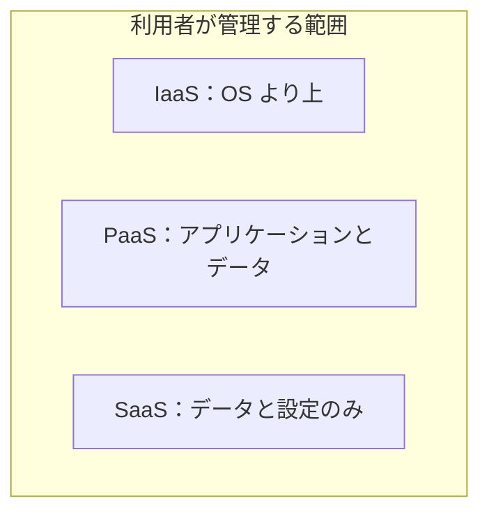
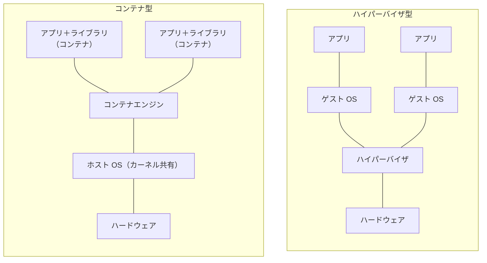
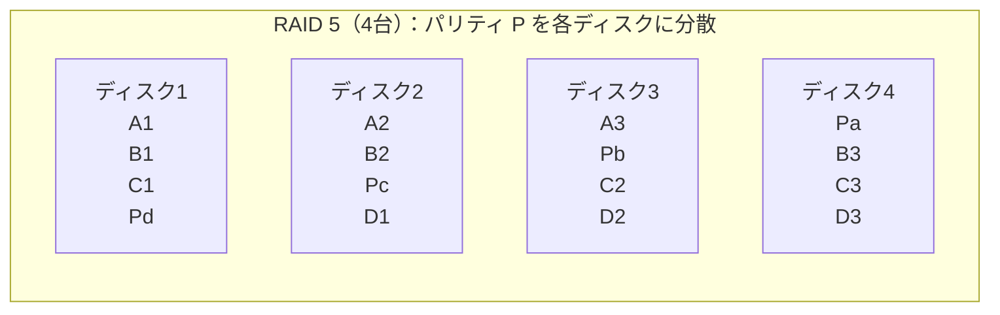
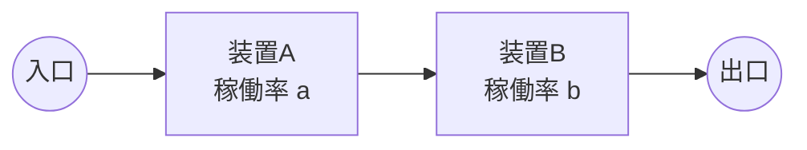
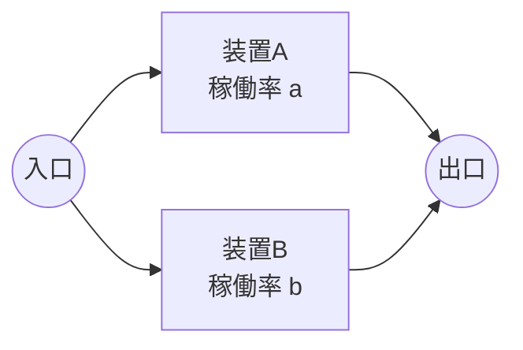
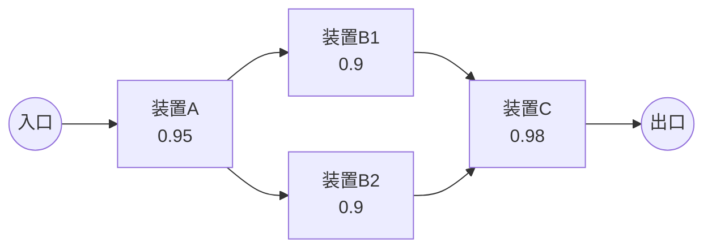
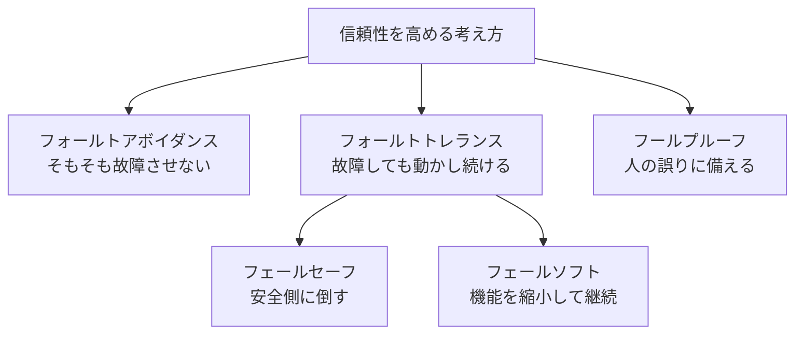

# システム構成要素

> **重要度：★★★**（科目A（旧午前）で毎回 3〜4 問。稼働率の計算は「ほぼ毎回」出題）
> 複数のコンピュータや装置を組み合わせた「システム全体」の構成・信頼性・性能を扱う分野です。科目B（旧午後）の「システムアーキテクチャ」「サービスマネジメント」でも計算の土台になります。
> この章のポイントは次の4つです。
> - デュプレックス／クラスタ／クラウド（IaaS・PaaS・SaaS）／仮想化・コンテナの違い
> - RAID のレベルごとの **実効容量** と耐障害性
> - **MTBF・MTTR・稼働率** と、直列・並列・混合システムの稼働率計算
> - フェールセーフ／フェールソフト／フォールトトレランスなど信頼性設計の用語

## 目次

1. [システムの処理形態と構成方式](#1-システムの処理形態と構成方式)
2. [クラウドコンピューティング](#2-クラウドコンピューティング)
3. [仮想化とコンテナ](#3-仮想化とコンテナ)
4. [ストレージ構成と RAID](#4-ストレージ構成と-raid)
5. [信頼性の評価（MTBF・MTTR・稼働率）](#5-信頼性の評価mtbfmttr稼働率)
6. [信頼性設計の用語](#6-信頼性設計の用語)
7. [性能評価](#7-性能評価)
8. [確認問題](#確認問題)
9. [参考](#参考)

---

## 1. システムの処理形態と構成方式

### 1.1 処理形態 ★

| 形態 | 内容 | 例 |
|---|---|---|
| **集中処理** | 1台のホストコンピュータで集中して処理 | 従来のメインフレーム |
| **分散処理** | 複数のコンピュータに処理を分担 | クライアントサーバシステム |
| **バッチ処理** | データを一定期間ためてから一括処理 | 月末の給与計算 |
| **リアルタイム処理** | 発生と同時に即時処理 | 座席予約、ATM |
| 対話型処理 | 利用者と画面でやり取りしながら処理 | Web アプリケーション |

### 1.2 クライアントサーバシステム ★★

**クライアントサーバシステム**とは、サービスを要求する **クライアント** と、サービスを提供する **サーバ** に役割を分けたシステムです。

**3層クライアントサーバシステム** は、処理を3つの層に分けることで、各層を独立して変更しやすくします。


| 用語 | 意味 |
|---|---|
| **シンクライアント** | クライアント側には最低限の機能だけを持たせ、処理やデータをサーバ側で管理する方式。情報漏えい対策になる |
| **ストアドプロシージャ** | よく使う SQL 処理をデータベースサーバに登録しておき、クライアントからは名前で呼び出す。**通信量（ネットワーク負荷）を減らせる** |
| **RPC**（Remote Procedure Call） | 別のコンピュータ上の手続を、ローカルの手続のように呼び出すしくみ |
| ピアツーピア（P2P） | サーバとクライアントの区別なく、対等な端末同士が直接通信する方式 |

### 1.3 高信頼化のためのシステム構成 ★★★

| 構成 | 内容 | 特徴 |
|---|---|---|
| **シンプレックスシステム** | 冗長化しない1系統だけの構成 | 安価だが、故障するとシステム停止 |
| **デュアルシステム** | **2系統で同じ処理を同時に行い、結果を照合** する | 信頼性が高い。故障時は片系で処理を継続 |
| **デュプレックスシステム** | **主系（現用系）と待機系** を用意し、通常は主系だけで処理 | 主系の故障時に待機系へ切り替える |

デュプレックスシステムの待機系の状態による分類：

| 方式 | 待機系の状態 | 切替え時間 |
|---|---|---|
| **ホットスタンバイ** | 待機系も起動済みで、主系と同じ状態で待機 | **短い** |
| ウォームスタンバイ | OS は起動しているが、業務アプリケーションは未起動など | 中程度 |
| **コールドスタンバイ** | 待機系は停止中、または別業務に使用中 | **長い** |

💡 **覚え方**：「デュ**アル**＝**ある**（2つとも動いて照合）、デュ**プレックス**＝**控え** の選手がベンチにいる」。

### 1.4 クラスタと負荷分散 ★★

**クラスタリング**とは、複数のサーバを連携させて、1台のサーバのように見せる技術です。

| 種類 | 目的 | 内容 |
|---|---|---|
| **HA クラスタ**（High Availability：高可用性） | 可用性の向上 | 稼働中のサーバが故障したら、別のサーバが処理を引き継ぐ（**フェールオーバ**）。復旧後に元のサーバへ戻すことを **フェールバック** という |
| **負荷分散クラスタ** | 性能の向上 | **ロードバランサ**（負荷分散装置）が要求を複数サーバに振り分ける |
| HPC クラスタ（High Performance Computing） | 計算性能の向上 | 大規模な科学技術計算を並列処理 |

### 1.5 スケールアップとスケールアウト ★★

| 方式 | 内容 | 向いているもの |
|---|---|---|
| **スケールアップ**（垂直スケール） | サーバの CPU やメモリを **高性能化** する | データベースなど、分割しにくい処理 |
| **スケールアウト**（水平スケール） | サーバの **台数を増やす** | Web サーバなど、並列に分けやすい処理 |

逆に、性能を落とす（減らす）ことをそれぞれ **スケールダウン**、**スケールイン** といいます。

### 1.6 マルチプロセッサの結合方式 ★

| 方式 | 内容 |
|---|---|
| **密結合マルチプロセッサ** | 複数の CPU が **主記憶を共有** し、1つの OS で制御する（SMP：対称型マルチプロセッサ） |
| **疎結合マルチプロセッサ** | 各 CPU がそれぞれ主記憶と OS を持ち、通信でつながる（クラスタなど） |

---

## 2. クラウドコンピューティング

### 2.1 サービスモデル ★★★

**クラウドコンピューティング**とは、インターネットなどのネットワーク経由で、サーバ・ストレージ・ソフトウェアなどの IT 資源を **必要なときに必要な分だけ** 利用する形態です。

| モデル | 提供されるもの | 利用者が管理する範囲 | 例 |
|---|---|---|---|
| **IaaS**（Infrastructure as a Service） | 仮想サーバ・ストレージ・ネットワークなどの **基盤** | OS、ミドルウェア、アプリケーション、データ | 仮想マシンの貸出し |
| **PaaS**（Platform as a Service） | OS・ミドルウェア・実行環境などの **プラットフォーム** | アプリケーション、データ | アプリ実行環境、DB サービス |
| **SaaS**（Software as a Service） | **アプリケーション** そのもの | データ、利用者設定 | Web メール、グループウェア |



| 階層 | オンプレミス | IaaS | PaaS | SaaS |
|---|:-:|:-:|:-:|:-:|
| アプリケーション | 利用者 | 利用者 | 利用者 | 事業者 |
| ミドルウェア・実行環境 | 利用者 | 利用者 | 事業者 | 事業者 |
| OS | 利用者 | 利用者 | 事業者 | 事業者 |
| 仮想化・サーバ・ストレージ・ネットワーク | 利用者 | 事業者 | 事業者 | 事業者 |

**オンプレミス**とは、自社で設備を保有・運用する形態です。

**その他のサービス形態**

- **FaaS**（Function as a Service）／**サーバレス**：利用者はサーバを意識せず、イベント発生時に実行される **関数（プログラム）** だけを用意する形態。実行した分だけ課金されます。
- **DaaS**（Desktop as a Service）：仮想デスクトップ環境をクラウドで提供する形態。

### 2.2 実装（配置）モデル ★

| モデル | 内容 |
|---|---|
| **パブリッククラウド** | 不特定多数の利用者が共有するクラウド |
| **プライベートクラウド** | 特定の組織だけが専有するクラウド |
| コミュニティクラウド | 共通の目的を持つ複数組織で共有するクラウド |
| **ハイブリッドクラウド** | 上記やオンプレミスを組み合わせて使う形態 |
| マルチクラウド | 複数のクラウド事業者のサービスを併用する形態 |

**オートスケール**：負荷に応じて自動的にサーバ台数（資源）を増減する機能です。クラウドの大きな利点の1つです。

---

## 3. 仮想化とコンテナ

### 3.1 サーバ仮想化 ★★★

**仮想化**とは、物理的な資源（CPU・メモリ・ディスクなど）をソフトウェアで論理的に分割・統合して利用する技術です。1台の物理サーバ上で複数の **仮想マシン（VM）** を動かせます。

| 方式 | 構成 | 特徴 |
|---|---|---|
| **ホスト型** | 物理サーバ → **ホスト OS** → 仮想化ソフト → ゲスト OS | 既存の OS 上で手軽に導入できるが、ホスト OS を経由するため **オーバヘッド** が大きい |
| **ハイパーバイザ型** | 物理サーバ → **ハイパーバイザ** → ゲスト OS | ハイパーバイザがハードウェアを直接制御。オーバヘッドが小さく、サーバ用途で主流 |
| **コンテナ型** | 物理サーバ → ホスト OS → **コンテナエンジン** → コンテナ（アプリ＋ライブラリ） | コンテナは **ホスト OS のカーネルを共有** し、ゲスト OS を持たない。**軽量で起動が速い** |



⚠️ **ひっかけ注意**：コンテナは OS のカーネルを共有するため、**ホスト OS と異なる種類のカーネルを必要とする OS は動かせません**（例：Linux のホスト上で Windows カーネルのコンテナを直接動かすことはできない）。

### 3.2 仮想化に関する用語 ★★

| 用語 | 意味 |
|---|---|
| **ライブマイグレーション** | 稼働中の仮想マシンを **停止させずに** 別の物理サーバへ移動させる技術 |
| **オーケストレーション** | 多数のコンテナの配置・起動・監視・スケーリングを自動化すること（例：Kubernetes） |
| **VDI**（Virtual Desktop Infrastructure：デスクトップ仮想化） | 利用者のデスクトップ環境をサーバ上の仮想マシンで動かし、端末には画面だけを転送する |
| **シンプロビジョニング** | 物理容量より大きな論理容量を利用者に見せ、実際に使った分だけ物理容量を割り当てるストレージ仮想化技術 |
| **HCI**（Hyper-Converged Infrastructure） | サーバ・ストレージ・ネットワークを仮想化して、汎用サーバに統合した構成 |
| **SDN**（Software-Defined Networking） | ネットワーク機器の制御をソフトウェアで一元的に行う技術 |
| **IaC**（Infrastructure as Code） | サーバなどのインフラ構成をコードで記述し、自動で構築・管理する考え方 |

---

## 4. ストレージ構成と RAID

### 4.1 ストレージの接続方式 ★★

| 方式 | 内容 |
|---|---|
| DAS（Direct Attached Storage） | サーバに直接接続するストレージ |
| **NAS**（Network Attached Storage） | LAN に接続し、**ファイル単位** で共有するファイルサーバ専用機 |
| **SAN**（Storage Area Network） | ファイバチャネルなどのストレージ専用ネットワークで、サーバとストレージを **ブロック単位** で接続 |

### 4.2 RAID ★★★

**RAID**（Redundant Arrays of Independent Disks）とは、複数のディスクを組み合わせて、1台の論理的なディスクとして扱い、**高速化** や **信頼性向上** を図る技術です。

| レベル | 方式 | 実効容量（同容量 n 台） | 耐障害性 | 特徴 |
|---|---|---|---|---|
| **RAID 0** | **ストライピング**（データを分散して書く） | n 台分 | **なし**（1台故障で全データ消失） | 高速。冗長性なし |
| **RAID 1** | **ミラーリング**（同じデータを2台に書く） | 1台分（2台構成時） | 1台故障まで可 | 容量効率 50% |
| RAID 3 / 4 | ストライピング＋ **専用パリティディスク** | n − 1 台分 | 1台故障まで可 | パリティディスクに書込みが集中 |
| **RAID 5** | ストライピング＋ **パリティを分散** | **n − 1 台分** | **1台** 故障まで可 | 最低3台。容量効率と信頼性のバランスが良い |
| **RAID 6** | ストライピング＋ **2種類のパリティを分散** | **n − 2 台分** | **2台** 故障まで可 | 最低4台 |
| **RAID 1+0（10）** | ミラーリングしたものをストライピング | n / 2 台分 | 各ミラーの片側ずつなら複数台可 | 高速かつ高信頼。最低4台 |



**具体例**：2 T バイトのディスク4台で構成したときの実効容量

```
RAID 0   ：2 × 4       = 8 T バイト
RAID 1+0 ：2 × 4 ÷ 2   = 4 T バイト
RAID 5   ：2 × (4 − 1) = 6 T バイト
RAID 6   ：2 × (4 − 2) = 4 T バイト
```

💡 パリティは XOR で計算します。例えば `A1 ⊕ A2 ⊕ A3 = Pa` としておけば、A2 が失われても `A2 = A1 ⊕ A3 ⊕ Pa` で復元できます。

⚠️ **ひっかけ注意**：RAID はディスク故障への対策であり、**誤操作による削除やウイルス感染への対策（バックアップ）にはなりません**。誤って削除するとすべてのディスクから同時に消えます。

---

## 5. 信頼性の評価（MTBF・MTTR・稼働率）

### 5.1 RASIS ★

システムの信頼性に関する評価項目の頭文字をとったものを **RASIS**（レイシス）といいます。

| 項目 | 意味 | 指標の例 |
|---|---|---|
| **R**eliability（信頼性） | 故障しにくさ | **MTBF** |
| **A**vailability（可用性） | 使いたいときに使える度合い | **稼働率** |
| **S**erviceability（保守性） | 修理のしやすさ | **MTTR** |
| **I**ntegrity（完全性） | データが矛盾なく正しいこと | — |
| **S**ecurity（安全性・機密性） | 不正アクセスなどからの保護 | — |

### 5.2 MTBF・MTTR・稼働率 ★★★

```mermaid
gantt
  title 稼働と故障の繰返し（イメージ）
  dateFormat X
  axisFormat %s
  section システム
  稼働（MTBF）  :done, a1, 0, 40
  修理（MTTR）  :crit, a2, 40, 45
  稼働（MTBF）  :done, a3, 45, 90
  修理（MTTR）  :crit, a4, 90, 94
```



| 用語 | 意味 | 求め方 |
|---|---|---|
| **MTBF**（Mean Time Between Failures：平均故障間隔） | 故障が直ってから次に故障するまでの **平均稼働時間** | 総稼働時間 ÷ 故障回数 |
| **MTTR**（Mean Time To Repair：平均修復時間） | 故障してから修復するまでの **平均時間** | 総修理時間 ÷ 故障回数 |
| **稼働率** | 全時間のうち稼働している割合 | `MTBF / (MTBF + MTTR)` |
| **故障率** | 単位時間あたりに故障する割合 | `1 / MTBF` |

**具体例1**：MTBF 480 時間、MTTR 20 時間の装置の稼働率

```
稼働率 = 480 / (480 + 20) = 480 / 500 = 0.96
```

**具体例2（運用実績から求める）**：1,000 時間の運用期間中に4回故障し、修理時間の合計が 40 時間だった。

```
総稼働時間 = 1,000 − 40 = 960 時間
MTBF = 960 / 4 = 240 時間
MTTR = 40 / 4  = 10 時間
稼働率 = 240 / (240 + 10) = 240 / 250 = 0.96
```

💡 **稼働率を上げるには**：MTBF を **長く**（壊れにくく）するか、MTTR を **短く**（すぐ直す）します。

**年間停止時間の目安**（1年 = 365日 × 24時間 = 8,760時間）

| 稼働率 | 年間停止時間 |
|---|---|
| 99% | 87.6 時間 |
| 99.9% | 8.76 時間 |
| 99.99% | 約 52.6 分 |

### 5.3 直列システム ★★★

**すべての装置が稼働しているときだけ** システムが稼働する構成です。1つでも故障するとシステムは停止します。



```
直列システムの稼働率 = a × b
例：a = b = 0.9 → 0.9 × 0.9 = 0.81
```

**直列システムの MTBF**：故障率（1/MTBF）を足し合わせて逆数をとります。

```
システムの故障率 = 1/MTBF_A + 1/MTBF_B
例：MTBF_A = 1,000 時間、MTBF_B = 1,500 時間
    故障率 = 1/1000 + 1/1500 = 3/3000 + 2/3000 = 5/3000 = 1/600
    システムの MTBF = 600 時間
```

### 5.4 並列システム ★★★

**どれか1つでも稼働していれば** システムが稼働する構成です。**全部が同時に故障** したときだけ停止します。



```
並列システムの稼働率 = 1 − (1 − a) × (1 − b)
                     = 1 − （全部が同時に故障している確率）
例：a = b = 0.9 → 1 − 0.1 × 0.1 = 1 − 0.01 = 0.99
例：0.8 の装置を3台並列 → 1 − 0.2³ = 1 − 0.008 = 0.992
```

💡 **覚え方**：「直列は **掛ける**、並列は **1 から（1−稼働率）の積を引く**」。

### 5.5 混合システム ★★★

**手順**：内側の並列部分を1つの装置とみなして稼働率を求め、それを直列計算に使います。

**具体例**：装置A（0.95）→ 並列部分（装置B 0.9 × 2台）→ 装置C（0.98）



```
① 並列部分：1 − (1 − 0.9) × (1 − 0.9) = 1 − 0.01 = 0.99
② 全体（直列）：0.95 × 0.99 × 0.98
              = 0.9405 × 0.98
              = 0.92169 ≒ 0.922
```

### 5.6 n 台中 k 台以上が稼働すればよいシステム ★★

**具体例**：稼働率 a の装置3台のうち、**2台以上** 稼働していればよいシステム

```
3台とも稼働          ：a³
ちょうど2台が稼働    ：3C2 × a² × (1 − a) = 3a²(1 − a)
稼働率 = a³ + 3a²(1 − a) = 3a² − 2a³

a = 0.9 のとき：3 × 0.81 − 2 × 0.729 = 2.43 − 1.458 = 0.972
```

### 5.7 故障率曲線（バスタブ曲線） ★

時間の経過による故障率の変化を表したグラフで、浴槽（バスタブ）の形に似ています。

| 期間 | 故障率 | 原因 |
|---|---|---|
| **初期故障期間** | 高いが次第に減少 | 設計・製造上の欠陥 |
| **偶発故障期間** | 低く一定 | 偶発的な原因 |
| **摩耗故障期間** | 次第に増加 | 部品の摩耗・劣化 |

---

## 6. 信頼性設計の用語

### 6.1 フォールトトレランス関連の用語 ★★★

| 用語 | 意味 | 例 |
|---|---|---|
| **フォールトトレランス**（耐故障性） | 故障が発生しても、**システム全体として正常に動作を継続** できるようにする考え方 | 構成要素の二重化 |
| **フォールトアボイダンス**（故障回避） | 高品質の部品を使うなどして、**故障そのものを起こさない** ようにする考え方 | 信頼性の高い部品の採用、予防保守 |
| **フェールセーフ** | 故障したときに、**安全な側** にシステムを停止・制御する | 信号機が故障したら赤信号にする |
| **フェールソフト** | 故障したときに、**機能を縮小してでも稼働を続ける** | 複数エンジンの1つが止まっても飛行を続ける |
| **フールプルーフ** | 利用者が **誤操作をしても** 危険が生じない（誤操作できない）ようにする | ドアが閉まっていないと動かない電子レンジ |
| **フォールトマスキング** | 故障の影響を内部で隠し、外部に出さない | ECC メモリによる誤り訂正、多数決回路 |
| **グレースフルデグラデーション**（縮退運転） | 故障箇所を切り離し、性能を落として運転を続けること（フェールソフトを実現する運転） | — |

💡 **覚え方**：「**セーフ＝安全に止まる**」「**ソフト＝柔らかく（縮退して）動き続ける**」「**フール（愚か者）でも大丈夫**」。



---

## 7. 性能評価

### 7.1 性能の指標 ★★★

| 指標 | 意味 |
|---|---|
| **レスポンスタイム**（応答時間） | 要求を出し終えてから、**最初の応答が返ってくるまで** の時間 |
| **ターンアラウンドタイム** | ジョブを投入してから、**結果をすべて受け取るまで** の時間（バッチ処理で使う） |
| **スループット** | **単位時間あたりの処理量**（例：1秒あたりのトランザクション数 TPS） |

### 7.2 性能評価の手法 ★★

| 手法 | 内容 |
|---|---|
| **ベンチマーク** | 標準的なプログラムを実際に実行して性能を測定・比較する。**SPEC**（CPU 性能：SPECint は整数演算、SPECfp は浮動小数点演算）、**TPC**（トランザクション処理性能：TPC-C など） |
| **モニタリング** | 稼働中のシステムの CPU 使用率、応答時間などを測定する |
| シミュレーション | システムのモデルを作って模擬実行し、性能を予測する |
| **キャパシティプランニング** | 将来の業務量を予測し、必要な資源（CPU、メモリ、ストレージ、回線）を計画する |
| ギブソンミックス | 科学技術計算用の命令ミックス（命令の出現比率の組合せ） |
| コマーシャルミックス | 事務計算用の命令ミックス |

### 7.3 スループットとボトルネックの計算 ★★

**具体例**：1件のトランザクションで、CPU 処理に 20 ミリ秒、ディスクへのアクセスが3回（1回 15 ミリ秒）必要。CPU とディスクは1台ずつで、CPU 処理とディスクアクセスは並行して実行できるものとする。最大スループットはいくらか。

```
① 1件あたりの各装置の使用時間
   CPU   ：20 ミリ秒
   ディスク：15 × 3 = 45 ミリ秒
② 各装置が1秒間に処理できる件数
   CPU   ：1,000 / 20 = 50 件/秒
   ディスク：1,000 / 45 ≒ 22.2 件/秒
③ システム全体の最大スループット＝最も遅い装置で決まる
   → 約 22 件/秒（ディスクが ボトルネック）
```

**ボトルネック**とは、全体の性能を制約している最も遅い部分のことです。この例ではディスクを2台に増やしてアクセスを分散すると、ディスクの使用時間は 1台あたり約 22.5 ミリ秒、処理能力は約 44 件/秒になり、性能が向上します。

⚠️ 1件あたりの **応答時間**（待ちがない場合）は `20 + 45 = 65 ミリ秒` です。スループットと応答時間を混同しないようにしましょう。待ちが発生する場合は「01_基礎理論」の待ち行列（M/M/1）で計算します。

### 7.4 システムの経済性 ★

**TCO**（Total Cost of Ownership：総保有コスト）とは、システムの導入から廃棄までにかかる費用の総額です。

```
TCO = 初期コスト（イニシャルコスト：ハードウェア・ソフトウェア購入、開発費）
    + 運用コスト（ランニングコスト：保守費、電気代、運用人件費など）
```

---

## 確認問題

**問1** デュプレックスシステムの説明として適切なものはどれか。
ア 2系統のシステムで同じ処理を行い、結果を照合する。
イ 現用系と待機系を用意し、現用系の故障時に待機系に切り替えて処理を続ける。
ウ 複数のサーバに処理を振り分け、負荷を分散する。
エ 1系統だけで構成し、冗長化しない。

**問2** クラウドサービスのうち、利用者が OS やミドルウェアを管理せず、自ら開発したアプリケーションを配置して実行できる形態はどれか。
ア IaaS　イ PaaS　ウ SaaS　エ DaaS

**問3** コンテナ型仮想化の特徴として適切なものはどれか。
ア 各コンテナがそれぞれゲスト OS を持つため、異なるカーネルの OS を自由に混在できる。
イ ホスト OS のカーネルを共有するため、仮想マシンより軽量で起動が速い。
ウ ハードウェアを直接制御するハイパーバイザの上でゲスト OS を動かす。
エ 稼働中の仮想マシンを停止せずに別の物理サーバへ移動する技術である。

**問4** 容量 4 T バイトのディスク6台で RAID 6 を構成したときの実効容量は何 T バイトか。
ア 12　イ 16　ウ 20　エ 24

**問5** あるシステムを 2,000 時間運用したところ、故障が5回発生し、修理時間の合計は 50 時間だった。このシステムの MTBF と稼働率の組合せとして正しいものはどれか。
ア MTBF 390 時間、稼働率 0.975　イ MTBF 400 時間、稼働率 0.975　ウ MTBF 390 時間、稼働率 0.980　エ MTBF 400 時間、稼働率 0.988

**問6** 稼働率 0.8 の装置を2台並列に接続した部分と、稼働率 0.9 の装置を直列に接続したシステムの稼働率はいくらか。
ア 0.72　イ 0.864　ウ 0.96　エ 0.98

**問7** 稼働率 0.95 の装置を3台使い、2台以上が稼働していればシステムが稼働するとき、システムの稼働率はいくらか（小数第4位を四捨五入）。

**問8** 「障害が発生したときに、システムの一部の機能を停止しても、残りの機能で処理を継続する」考え方はどれか。
ア フェールセーフ　イ フェールソフト　ウ フールプルーフ　エ フォールトアボイダンス

**問9** 1件のトランザクションで CPU を 30 ミリ秒、ディスクを 25 ミリ秒使用するシステムがある（CPU とディスクは並行動作可能、各1台）。このシステムの最大スループットは何件/秒か（小数点以下切捨て）。

<details><summary>解答・解説</summary>

**問1　イ**
アはデュアルシステム、ウは負荷分散クラスタ、エはシンプレックスシステムの説明です。

**問2　イ**
PaaS は OS・ミドルウェア・実行環境を事業者が提供し、利用者はアプリケーションとデータを管理します。IaaS は OS から利用者が管理し、SaaS はアプリケーションそのものが提供されます。

**問3　イ**
アはコンテナの性質と逆、ウはハイパーバイザ型の説明、エはライブマイグレーションの説明です。

**問4　イ**
```
RAID 6 の実効容量 = 容量 × (台数 − 2) = 4 × (6 − 2) = 16 T バイト
```

**問5　ア**
```
総稼働時間 = 2,000 − 50 = 1,950 時間
MTBF = 1,950 / 5 = 390 時間
MTTR = 50 / 5 = 10 時間
稼働率 = 390 / (390 + 10) = 390 / 400 = 0.975
（検算：1,950 / 2,000 = 0.975 ✔）
```

**問6　イ**
```
並列部分 = 1 − (1 − 0.8) × (1 − 0.8) = 1 − 0.04 = 0.96
全体 = 0.96 × 0.9 = 0.864
```

**問7　0.993**
```
稼働率 = 3a² − 2a³（a = 0.95）
a² = 0.9025、a³ = 0.857375
3 × 0.9025 − 2 × 0.857375 = 2.7075 − 1.71475 = 0.99275 ≒ 0.993
```

**問8　イ**
機能を縮小して継続するのがフェールソフトです。フェールセーフは安全側に停止・制御する考え方です。

**問9　33 件/秒**
```
CPU：1,000 / 30 ≒ 33.3 件/秒
ディスク：1,000 / 25 = 40 件/秒
最も遅い CPU がボトルネック → 33 件/秒
```

</details>

---

## 参考

- IPA「試験要綱・シラバスについて」（応用情報技術者試験 シラバス Ver.7.2）：https://www.ipa.go.jp/shiken/syllabus/gaiyou.html
- IPA「応用情報技術者試験 シラバス Ver.7.2（PDF）」：https://www.ipa.go.jp/shiken/syllabus/omgdg50000005kq5-att/syllabus_ap_ver7_2.pdf
- IPA「応用情報技術者試験（AP）」試験区分ページ：https://www.ipa.go.jp/shiken/kubun/ap.html
- IPA「過去問題」：https://www.ipa.go.jp/shiken/mondai-kaiotu/index.html
- NIST SP 800-145「The NIST Definition of Cloud Computing」：https://csrc.nist.gov/pubs/sp/800/145/final
- 応用情報技術者試験ドットコム（午前過去問の分野別解説）：https://www.ap-siken.com/
