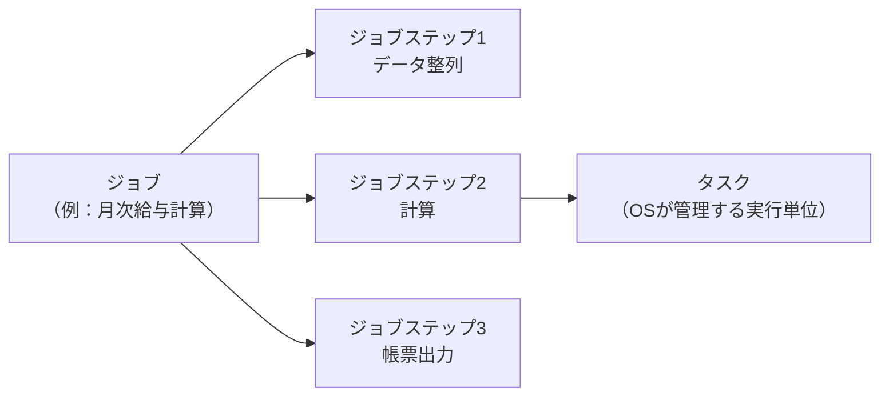
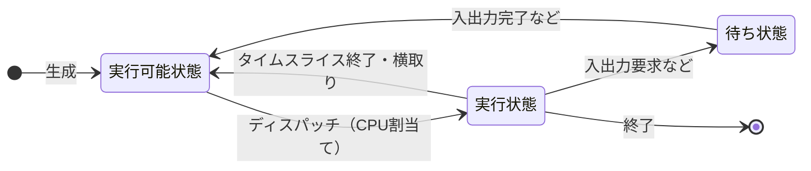
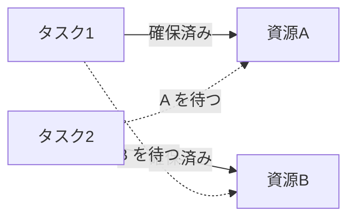
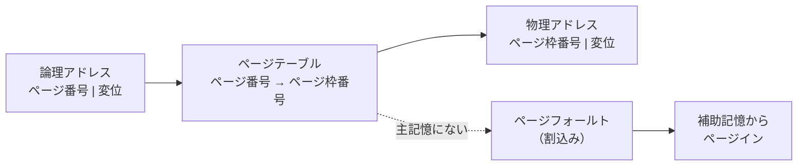
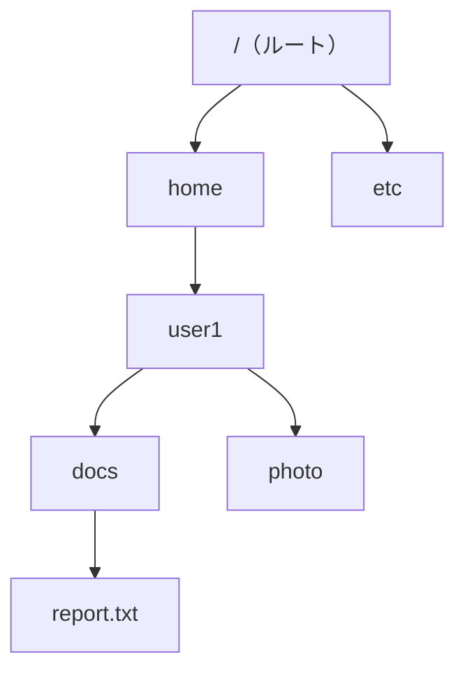
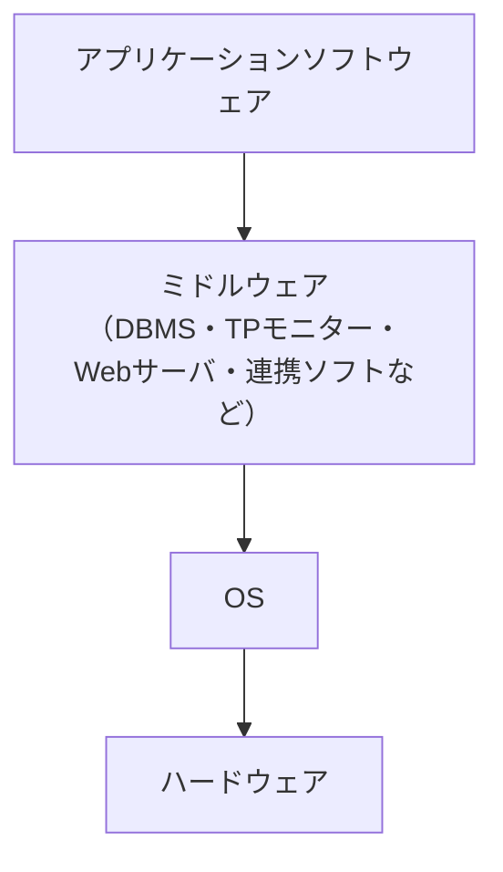

# ソフトウェア

> **重要度：★★★**（科目A（旧午前）で毎回 2〜4 問。ページ置換・スケジューリングの計算、OSS ライセンスが定番）
> OS（オペレーティングシステム）のしくみを中心に、言語処理系、ファイルシステム、OSS（オープンソースソフトウェア）を扱う分野です。科目B（旧午後）の「組込みシステム開発」「システムアーキテクチャ」でも、タスク・排他制御の知識が使われます。
> この章のポイントは次の4つです。
> - タスク（プロセス）の **状態遷移** と **スケジューリング方式** の計算
> - **排他制御・セマフォ・デッドロック** の考え方
> - **仮想記憶・ページング** と **ページ置換（FIFO / LRU）** のページフォールト回数の計算
> - ファイルシステム（パス・アクセス権・バックアップ）と **OSS ライセンス** の違い
> - ミドルウェア・開発ツール・代表的な OSS の名前と用途（章末の **シラバス用語チェックリスト** で全用語を確認）

## 目次

1. [OS の役割と構成](#1-os-の役割と構成)
2. [タスク管理とスケジューリング](#2-タスク管理とスケジューリング)
3. [排他制御・セマフォ・デッドロック](#3-排他制御セマフォデッドロック)
4. [主記憶管理](#4-主記憶管理)
5. [仮想記憶とページ置換](#5-仮想記憶とページ置換)
6. [ファイルシステム](#6-ファイルシステム)
7. [言語処理系とプログラムの性質](#7-言語処理系とプログラムの性質)
8. [OSS とライセンス](#8-oss-とライセンス)
9. [ミドルウェアと開発フレームワーク](#9-ミドルウェアと開発フレームワーク)
10. [確認問題](#確認問題)
11. [📋 シラバス用語チェックリスト](#-シラバス用語チェックリスト)
12. [参考](#参考)

---

## 1. OS の役割と構成

### 1.1 OS の目的と機能 ★

**OS**（Operating System：基本ソフトウェア）は、ハードウェアを管理し、アプリケーションに使いやすい環境を提供するソフトウェアです。

| 機能 | 内容 |
|---|---|
| **タスク（プロセス）管理** | プログラムの実行単位を管理し、CPU を割り当てる |
| **記憶管理** | 主記憶の割当て、仮想記憶の管理 |
| ジョブ管理 | 利用者から見た仕事の単位（ジョブ）の実行順序を管理。**スプーリング**（低速な入出力を補助記憶にためて、CPU と並行に処理）など |
| データ管理 | ファイルの作成・読み書き・保護 |
| 入出力管理 | 入出力装置の制御（**デバイスドライバ** を介して行う） |
| 運用管理・通信管理 | 利用者管理、ネットワーク通信など |
| ユーザー管理 | ユーザーアカウントや権限の作成・変更（[1.7](#17-ネットワーク制御運用管理ユーザー管理-)） |
| 障害管理 | 障害の検出・記録・再構成・リスタート（[1.9](#19-障害管理-)） |

💡 ソフトウェアは大きく **システムソフトウェア**（OS・ミドルウェア・言語処理系など、コンピュータを動かす土台）と **アプリケーションソフトウェア**（業務や利用者の目的に直接使うもの）に分かれます。OS は **制御プログラム（カーネル）**、**言語プロセッサ**（コンパイラなど）、**サービスプログラム**（ユーティリティ）から構成されると説明されることもあります。

### 1.2 カーネルの構成 ★

**カーネル**とは、OS の中核部分で、タスク管理・記憶管理・割込み処理などを担います。

| 方式 | 内容 | 特徴 |
|---|---|---|
| **モノリシックカーネル** | OS の多くの機能をカーネル内に一体化 | 高速だが、一部の不具合が全体に影響しやすい |
| **マイクロカーネル** | カーネルには最小限の機能だけを置き、他はカーネル外のサービスとして動かす | 拡張・移植しやすく、信頼性が高い。モジュール間の通信によるオーバヘッドがある |

CPU には **特権モード**（カーネルモード：すべての命令を実行できる）と **ユーザモード**（一部の命令が制限される）があり、アプリケーションは SVC（スーパバイザコール、システムコール）で OS の機能を呼び出します。

- 特権モードは **カーネルモード** ＝ **スーパーバイザーモード**、ユーザーモードは **非特権モード** とも呼びます。入出力命令やメモリ保護の設定などの **特権命令** は特権モードでしか実行できません。
- OS とアプリケーションの中間で共通機能を提供するソフトウェアを **ミドルウェア** といいます（[9章](#9-ミドルウェアと開発フレームワーク)）。

### 1.3 OS の種類と動向 ★

| 種類 | 特徴・例 |
|---|---|
| **UNIX** | 1969年に AT&T ベル研究所で開発されたマルチユーザー・マルチタスク OS。C 言語で書かれ移植性が高い。Linux・BSD・macOS などの源流 |
| **PC 用 OS** | Windows、macOS、Linux ディストリビューションなど。GUI 中心 |
| **モバイル端末用 OS** | Android、iOS など。省電力・タッチ操作・アプリストア |
| **オープン OS** | 仕様やソースコードが公開され、特定ベンダーに依存しない OS（Linux など） |
| **リアルタイム OS**（RTOS） | 決められた時間内の応答を保証（[2.6](#26-リアルタイム-os-)） |
| **組込み OS** | 家電・自動車などの機器に組み込まれる OS。小さなメモリで動く。RTOS や組込み Linux など |
| **セキュア OS** | **強制アクセス制御**（MAC：管理者が決めたポリシーを root でも破れない）や最小特権を備え、侵入されても被害を局所化する OS（SELinux など） |
| **クラウドコンピューティング用 OS** | 多数のサーバ資源を一括管理して仮想マシンやコンテナを提供する基盤ソフトウェア（OpenStack など）や、コンテナ実行に特化した軽量 OS |
| **VM**（Virtual Machine：仮想マシン） | ハイパーバイザなどにより、1台の物理マシン上に作られた論理的なコンピュータ。それぞれに別の OS（ゲスト OS）を動かせる（[04 システム構成要素](04_システム構成要素.md)） |

- **互換性**：別の OS やハードウェアでも同じプログラムやデータをそのまま使える性質。**上位互換**（新しい版が古い版のものを扱える）などがあります。
- **OSE**（Open Systems Environment：オープンシステム環境）：POSIX などの標準インタフェースを組み合わせて、**アプリケーションの移植性と相互運用性** を確保しようとする考え方（IEEE 1003.0 で指針化）。

### 1.4 起動処理・割込み・多重プログラミング ★

**起動（ブート）に関する用語**

| 用語 | 意味 |
|---|---|
| **ブートストラップ** | 電源投入時、ROM（BIOS / UEFI）にある小さなプログラムが **ブートローダ** を読み込み、ブートローダが OS 本体を読み込んで起動する、という段階的な起動方式（「靴ひもを自分で引き上げる」が語源） |
| **ネットワークブート** | 内蔵ディスクではなく、ネットワーク上のサーバから OS を読み込んで起動する（PXE など）。シンクライアントや大量の PC の展開に使う |
| **マルチブート** | 1台のコンピュータに複数の OS を入れておき、起動時に選べるようにすること |
| **フラッシュブートローダ** | 組込み機器のフラッシュメモリに置かれ、起動処理を行うとともに、通信経由で **ファームウェア（フラッシュメモリの中身）を書き換える** 機能をもつプログラム。書込み装置なしで現地更新ができる |

**割込み**：実行中のプログラムを一時中断して、緊急の処理（割込み処理ルーチン）を先に実行するしくみです。外部割込み（入出力完了、タイマなど）と内部割込み（SVC、ページフォールト、ゼロ除算など）があります。詳しくは [03 コンピュータ構成要素](03_コンピュータ構成要素.md) を参照してください。

**多重（マルチ）プログラミング**：主記憶に複数のプログラムを置き、あるプログラムが入出力待ちの間に別のプログラムへ CPU を割り当てることで、**CPU の遊休時間を減らしてスループットを上げる** 方式です。割込みとタスク管理（ディスパッチ）が前提となります。

```
単一プログラム： A計算 | A入出力（CPU遊休） | A計算 | B計算 | B入出力（CPU遊休）
多重プログラム： A計算 | B計算（Aは入出力中）| A計算（Bは入出力中）| ...  → CPUが休まない
```

### 1.5 ジョブ管理 ★

**ジョブ** とは利用者から見た一まとまりの仕事の単位で、複数の **ジョブステップ**（プログラム1本の実行など）から構成されます。ジョブステップが OS 内部でさらに **タスク** として実行されます。



| 用語 | 意味 |
|---|---|
| **マスタスケジューラー** | オペレーターとの交信（コマンドの受付）を担い、ジョブ管理全体を統括する |
| **ジョブスケジューラー** | ジョブの読込み（リーダ）→ 実行順序の決定（イニシエータ）→ 実行終了後の後処理（ターミネータ）→ 結果の出力（ライタ）を行う |
| **セション** | 利用者がログインしてからログアウトするまでの一連の対話のまとまり（TSS などの対話型処理の単位） |
| **バッチ処理** | データを一定期間ためておき、まとめて一括処理する方式（夜間処理など） |
| **バックグラウンドジョブ** | 利用者の対話操作（フォアグラウンド）とは別に、裏で実行されるジョブ |
| **cron** | UNIX 系 OS で、指定した日時・周期にコマンドを自動実行するしくみ（設定ファイルは crontab） |
| **自動運転・省力化** | ジョブネット（ジョブの実行順序・依存関係）を定義し、ジョブの起動・監視を自動化してオペレーターの作業を減らすこと |
| **システム管理** | 資源の利用状況の監視・記録、課金などの管理機能 |

### 1.6 データ管理と入出力管理 ★★

**データ管理** は、補助記憶装置へのアクセスを、装置の物理的な違いを意識しなくてよい共通のインタフェースでアプリケーションに提供する機能です。

| 用語 | 意味 |
|---|---|
| **レコード** | ファイルを構成するデータの単位（1件分のデータ） |
| **スペース管理** | 補助記憶装置の空き領域を管理し、ファイルに領域を割り当てる |
| **カタログ管理** | ファイル名と格納場所（ボリュームなど）の対応表（カタログ）を管理し、名前だけでファイルを探せるようにする |
| **ファイル保護** | アクセス権・パスワードなどで、ファイルを不正な読み書きや誤操作から守る |

**入出力管理** は、入出力装置を効率よく動かし、CPU の待ち時間（アイドル時間）を減らすための機能です。

| 用語 | 意味 |
|---|---|
| **IOCS**（Input/Output Control System：入出力制御システム） | アプリケーションの入出力要求を受けて、装置ごとの細かい制御を代行する OS の機能 |
| **スプーリング** | プリンタなど低速な装置への出力を、いったん高速な補助記憶（スプール）にためて、CPU は次の処理へ進み、出力は装置の速度に合わせて別途行う方式 |
| **バッファリング**／**バッファプール** | 入出力データを主記憶上の緩衝領域（バッファ）に一時保持して、装置と CPU の速度差を吸収する。複数のバッファをまとめて共用する領域をバッファプールという |
| **チャネル**（チャネル制御方式） | CPU に代わって入出力を専門に制御する装置（入出力プロセッサ）。CPU はチャネルに指示を出すだけで、ほかの処理を続けられる |
| **DMA**（Direct Memory Access：直接記憶アクセス） | DMA コントローラが **CPU を介さずに** 入出力装置と主記憶の間でデータを転送する方式 |
| **入出力割込み**（入出力終了割込み） | 入出力が完了したことを装置が CPU に知らせる割込み |
| **入出力ポート**（I/O ポート） | CPU が入出力装置とデータをやり取りするための窓口（番地） |
| **入出力マッピング**（I/O マッピング） | 入出力ポートにどのような番地を割り当てるかの方式。次の2つがある |
| **メモリマップド I/O**（メモリマッピング） | 入出力ポートを **主記憶と同じアドレス空間** に割り当てる。通常のメモリ転送命令で入出力できる（専用命令不要）が、その分メモリ空間が減る |
| **I/O マップド I/O** | 入出力ポートを主記憶とは **別の入出力専用アドレス空間** に割り当て、**専用の入出力命令**（IN / OUT など）でアクセスする |

⚠️ **ひっかけ注意**：「専用の入出力命令が不要」なのは **メモリマップド I/O** です。

### 1.7 ネットワーク制御・運用管理・ユーザー管理 ★

**ネットワーク制御**：OS は **通信プロトコル**（TCP/IP など）の処理（**プロトコル制御**）を担い、アプリケーションにはソケットなどの通信インタフェースを提供します。LAN（構内網）・WAN（広域網）を介して、ファイル共有やプリンタ共有などの資源共有を行う機能を備えた OS を **ネットワーク OS** と呼びます。階層モデル（**OSI 基本参照モデル**、TCP/IP）は [07 ネットワーク](07_ネットワーク.md) を参照してください。

**運用の管理**：システムの始動処理（OS の初期化）・終了処理、オペレーターとの交信、システムモニタリングなどを行います。

| 用語 | 意味 |
|---|---|
| **ユーザーアカウント** | システムを使う利用者ごとの識別情報（ID とパスワードなど） |
| **プロファイル** | ユーザーごとの設定情報（デスクトップ環境、環境変数、ホームディレクトリなど） |
| **システム利用権** | ログインできる時間帯・端末、使えるコマンドなど、システムを利用する権利 |
| **ファイルアクセス権** | ファイルごとの読込み・書込み・実行の許可（[6.2](#62-アクセス権unix-系-)） |
| **ディスククオータ** | ユーザーごとに使えるディスク容量の上限を設定する機能 |

**ユーザー管理**

| 用語 | 意味 |
|---|---|
| **スーパーユーザー**（**root**） | UNIX 系 OS で、すべての操作が可能な最上位の管理者アカウント |
| **Administrator** | Windows の管理者アカウント |
| **ゲスト** | 一時的な利用者向けの、権限が最小限に制限されたアカウント |
| **管理者権限** | ソフトウェアのインストールやシステム設定変更など、管理者だけに許された権限。日常業務は一般ユーザーで行い、必要なときだけ使う（**最小特権の原則**） |
| **ディレクトリサービス** | ネットワーク上のユーザー・コンピュータ・資源の情報を一元管理し、検索できるようにするサービス |
| **LDAP**（Lightweight Directory Access Protocol） | ディレクトリサービスにアクセスするための標準プロトコル |
| **Active Directory** | Microsoft のディレクトリサービス。Windows ドメインのユーザー認証・権限を一元管理する（LDAP や Kerberos を利用） |

### 1.8 セキュリティ制御 ★

OS は次のようなセキュリティ制御機能をもちます。

| 制御 | 内容 |
|---|---|
| **アクセス制御** | 誰がどの資源に何をしてよいかを制御する |
| **フロー制御**（情報フロー制御） | 機密度の高い情報が低いところへ流れないよう、情報の流れを制御する |
| **推論制御** | 個々には公開してよい集計結果などを組み合わせて、非公開の情報が推測されることを防ぐ |
| **暗号化制御** | データを暗号化して保護する |

- **外部セキュリティ**：建物への入退室管理など、コンピュータの外側での物理的・運用的な対策。**内部セキュリティ**：認証・アクセス制御・ログなど、コンピュータ内部の仕組みによる対策。
- **多重レベルセキュリティ**（MLS）：情報と利用者に「極秘・秘・公開」などの **機密レベル** を付け、レベルに応じてアクセスを制御する方式。
- **BLP（Bell-LaPadula）モデル**：**機密性** を守るための多重レベルセキュリティのモデル。
  - **単純セキュリティ特性（No Read Up）**：自分より **上位** のレベルの情報は **読めない**。
  - **\*（スター）特性（No Write Down）**：自分より **下位** のレベルへ **書き込めない**（上位の情報が下位へ漏れるのを防ぐ）。
- **セキュリティカーネル**：アクセス制御など、セキュリティ上重要な機能だけを小さくまとめて検証しやすくした OS の中核部分。その中で特権をもって動き、信頼できると保証されたプロセスを **信頼プロセス** といいます。
- セキュアな OS に求められる性質：**認証**（利用者の確認）、**隔離**（プロセスや利用者どうしを分離して干渉させない）、**完全性**（不正な改ざんがない）、**アカウンタビリティ**（誰が何をしたかを追跡・説明できる）、**検証可能性**（正しく動くことを確認できる）。
- **ロギング機能**（操作や事象の記録）と **オーディット（監査）機能**（記録を監査証跡として分析・確認する）で、アカウンタビリティを確保します。
- **ユーザーアカウント制御**（UAC：User Account Control）：Windows で、管理者アカウントでも普段は標準ユーザーの権限で動作し、管理者権限が必要な操作の前に確認ダイアログを出して昇格させる機能。マルウェアによる無断の設定変更を防ぎます。

### 1.9 障害管理 ★

障害発生から対策完了までを、**検出 → 試験・診断 → 自動訂正 → 記録 → 再構成 → リスタート → 原因の解決** の流れで扱います。

| 用語 | 意味 |
|---|---|
| **タイマー監視**（ウォッチドッグタイマ） | 一定時間内にプログラムから応答（タイマーのリセット）がなければ、異常（無限ループ・停止）とみなして通知・再起動する |
| **CPU 監視装置** | CPU の動作を監視し、異常を検出する装置 |
| **ハードウェア障害／ソフトウェア障害** | 装置の故障による障害／プログラムの誤り（バグ）による障害 |
| **再構成**（**動的装置再構成**、**自動 CPU 再構成**） | 故障した装置や CPU を切り離し、残りの装置でシステムを組み直して運転を続けること。動的＝システムを止めずに行う |
| **入出力パスの多重化** | 装置までの経路を複数用意し、1本が故障しても別経路で入出力を続ける |
| **補助記憶装置の二重化**／**ディスクの二重書き** | 同じデータを2台のディスクに書いておき、片方が壊れても継続できる（RAID 1 のミラーリングに相当） |
| **ライブラリの二重化** | プログラムライブラリを2つ持ち、破損に備える |
| **デュアルシステム** | 2系統で **同じ処理を同時に実行して結果を照合** する。信頼性が高い |
| **デュプレックスシステム** | 主系（現用系）と従系（待機系）を用意し、主系の故障時に従系へ切り替える |
| **ホットスタンバイシステム** | 待機系を起動した状態で待たせ、すぐに切り替えられるデュプレックスシステム（対：コールドスタンバイ） |
| **障害回復ルーチン** | 障害を検出したときに起動され、再試行・切離し・記録などの回復処理を行う OS のプログラム |

詳しいシステム構成と稼働率の計算は [04 システム構成要素](04_システム構成要素.md) を参照してください。

---

## 2. タスク管理とスケジューリング

### 2.1 プロセス・スレッド・タスク ★★

| 用語 | 意味 |
|---|---|
| **プロセス** | 実行中のプログラム。OS が資源（メモリ空間など）を割り当てる単位 |
| **スレッド** | プロセス内の処理の流れの単位。同じプロセス内のスレッドは **メモリ空間を共有** するため、生成や切替えが軽い |
| **タスク** | OS から見た処理の実行単位。試験では「プロセス」とほぼ同じ意味で使われることが多い |

スレッドは、プロセスより生成・切替えの負担（オーバヘッド）が小さいことから **軽量プロセス**（LWP：Light Weight Process）とも呼ばれます。

### 2.2 タスクの状態遷移 ★★★

タスクは生成されてから終了するまで、次の3つの状態を行き来します。



| 状態 | 意味 |
|---|---|
| **実行可能状態**（レディ） | CPU が割り当てられればすぐに実行できる状態。実行待ちの列に並んでいる |
| **実行状態**（ラン） | CPU を割り当てられて実行中の状態（シングルコアでは1つだけ） |
| **待ち状態**（ウェイト、ブロック） | 入出力の完了などを待っていて、CPU があっても実行できない状態 |

**ディスパッチ**とは、実行可能状態のタスクに CPU を割り当てることで、これを行う OS の機能を **ディスパッチャ** といいます。

⚠️ **ひっかけ注意**：**待ち状態から直接実行状態には遷移しません**。入出力が完了したら、まず実行可能状態に戻って順番を待ちます。

### 2.3 スケジューリング方式 ★★★

**スケジューリング**とは、実行可能状態のタスクの中から、次に CPU を割り当てるタスクを決めることです。

| 方式 | 内容 | 横取り（プリエンプション） |
|---|---|---|
| **到着順**（FCFS：First Come First Served） | 到着した順に実行 | なし |
| **処理時間順**（SJF：Shortest Job First／SPT） | 処理時間の短いものから実行。**平均ターンアラウンドタイムが最小** になる | なし（横取りする方式もある） |
| **優先度順** | 優先度の高いものから実行 | あり／なし |
| **ラウンドロビン** | 一定時間（**タイムクウォンタム**、タイムスライス）ずつ順番に実行し、終わらなければ列の末尾に戻す | あり |
| 多重レベルフィードバックキュー | 優先度別の複数の列を持ち、タイムスライスを使い切ったタスクの優先度を下げる | あり |

- **プリエンプティブ**（横取りあり）：実行中のタスクから CPU を取り上げて、別のタスクに割り当てることができる方式。
- **ノンプリエンプティブ**（横取りなし）：実行中のタスクが自ら CPU を手放すまで切り替えない方式。
- ⚠️ 優先度順方式では、優先度の低いタスクがいつまでも実行されない **飢餓状態（スタベーション）** が起こり得ます。待ち時間に応じて優先度を上げる **エージング** で防ぎます。

### 2.4 計算例：到着順と処理時間順 ★★★

**ターンアラウンドタイム** = 終了時刻 − 到着時刻

| タスク | 到着時刻 | 処理時間 |
|---|---|---|
| P1 | 0 | 7 |
| P2 | 2 | 4 |
| P3 | 4 | 1 |
| P4 | 5 | 4 |

**到着順（FCFS）**

```
時刻  0       7     11 12    16
      |  P1   |  P2  |P3|  P4 |
P1：7 − 0 = 7    P2：11 − 2 = 9    P3：12 − 4 = 8    P4：16 − 5 = 11
平均 = (7 + 9 + 8 + 11) / 4 = 35 / 4 = 8.75
```

**処理時間順（SJF、横取りなし）**

```
時刻 7 の時点で待っているのは P2(4)、P3(1)、P4(4) → 最短の P3 から
（P2 と P4 は処理時間が同じなので、先に到着した P2 を先にする）

時刻  0       7 8     12     16
      |  P1   |P3| P2  |  P4 |
P1：7 − 0 = 7    P3：8 − 4 = 4    P2：12 − 2 = 10    P4：16 − 5 = 11
平均 = (7 + 4 + 10 + 11) / 4 = 32 / 4 = 8.0
```



```mermaid
gantt
  title 処理時間順（SJF）
  dateFormat X
  axisFormat %s
  section CPU
  P1 :a1, 0, 7
  P3 :a2, 7, 8
  P2 :a3, 8, 12
  P4 :a4, 12, 16
```

### 2.5 計算例：ラウンドロビン ★★

**問題**：時刻0に A（処理時間5）、B（3）、C（1）がこの順に到着した。タイムクウォンタム2のラウンドロビンで処理するとき、各タスクの終了時刻は？（切替え時間は無視）

```
時刻 0–2：A を実行（A の残り 3）→ A は列の末尾へ   列：B, C, A
時刻 2–4：B を実行（B の残り 1）→ B は末尾へ       列：C, A, B
時刻 4–5：C を実行（残り 0 → 終了、時刻 5）       列：A, B
時刻 5–7：A を実行（A の残り 1）                   列：B, A
時刻 7–8：B を実行（終了、時刻 8）                 列：A
時刻 8–9：A を実行（終了、時刻 9）
```

終了時刻：A = 9、B = 8、C = 5。平均ターンアラウンドタイム = (9 + 8 + 5) / 3 ≒ 7.33

### 2.6 リアルタイム OS ★★

**リアルタイム OS**（RTOS）とは、決められた時間（**デッドライン**）内に処理を完了させることを重視した OS で、組込みシステムで使われます。

- **優先度に基づくプリエンプティブなスケジューリング** が一般的です。
- **ハードリアルタイム**：デッドラインを守れないと重大な結果になる（エアバッグ制御など）。
- **ソフトリアルタイム**：多少の遅れは許容される（動画再生など）。
- **優先度逆転**：低優先度タスクが資源を確保している間に中優先度タスクが割り込み、その資源を待つ高優先度タスクが長く待たされる現象。**優先度継承**（資源を持つ低優先度タスクの優先度を一時的に上げる）などで防ぎます。

### 2.7 スケジューリングとタスク間制御の補足用語 ★★

| 用語 | 意味 |
|---|---|
| **タイムスライス方式** | CPU を一定時間（タイムスライス＝タイムクウォンタム）ずつ順に割り当てる方式。時間を使い切るとタイマー割込みで切り替える（ラウンドロビンが代表） |
| **イベントドリブン方式** | 入出力完了・優先度の高いタスクの起動などの **事象（イベント）の発生をきっかけ（トリガー）に** スケジューリングを行う方式。RTOS で一般的 |
| **静的優先順位方式** | タスクの優先度を生成時に決め、実行中は変えない |
| **動的優先順位方式** | 待ち時間や CPU 使用状況に応じて実行中に優先度を変える（エージング、フィードバック待ち行列など） |
| **フィードバック待ち行列方式** | 優先度ごとの待ち行列を持ち、タイムスライスを使い切ったタスクを1段低い行列へ移す。短い処理ほど早く終わりやすい（2.3 の多重レベルフィードバックキュー） |
| **最短時間順**（処理時間順、SJF） | 残り処理時間・処理時間が短いものを優先。横取りありの版は SRT（Shortest Remaining Time）とも呼ぶ |
| **リソーススタベーション**（資源飢餓） | 優先度などの関係で、特定のタスクにいつまでも CPU や資源が割り当てられない状態。エージングで防ぐ |
| **SVC（SuperVisor Call）割込み** | プログラムが OS の機能（入出力要求など）を呼び出すときに **自ら発生させる** 内部割込み |
| **入出力終了割込み** | 入出力装置が処理の完了を知らせる外部割込み。待ち状態のタスクを実行可能状態に戻すきっかけになる |
| **割込み禁止** | クリティカルセクションの実行中などに割込みを一時的に受け付けないようにすること。シングル CPU での簡易な排他制御として使われるが、長く禁止すると応答性が落ちる |
| **マルチ CPU**（マルチプロセッサ） | 複数の CPU（コア）でタスクを **並列処理** する。割込み禁止だけでは排他制御にならないため、ロックやセマフォが必要 |
| **マルチスレッド** | 1つのプロセス内に複数のスレッドを作って並行に実行し、応答性やマルチコアの利用効率を上げる |

**タスク間の同期と通信**：タスクどうしで「相手の処理が終わるまで待つ」（**同期制御**）、データを受け渡す（**タスク間通信**）しくみとして、セマフォ・**イベントフラグ**（事象の発生をビットで通知）・**メッセージキュー**（メールボックス）などがあります。

---

## 3. 排他制御・セマフォ・デッドロック

### 3.1 排他制御 ★★★

複数のタスクが同じ資源（共有変数・ファイルなど）を同時に更新すると、データの矛盾が起こります。

**例**：共有変数 X = 100 に対し、タスク1が「X に 10 を足す」、タスク2が「X に 20 を足す」を同時に行う

```
タスク1：X を読む(100)
タスク2：X を読む(100)
タスク1：100 + 10 = 110 を書く
タスク2：100 + 20 = 120 を書く   → 結果 120（正しくは 130。タスク1の更新が失われた）
```

これを防ぐため、ある資源を1つのタスクが使っている間は他のタスクに使わせない制御を **排他制御** といい、排他制御が必要なプログラムの部分を **クリティカルセクション**（危険領域）といいます。

### 3.2 セマフォ ★★★

**セマフォ**とは、排他制御や同期のために使う **カウンタ（整数の変数）** と、それを操作する2つの命令からなるしくみです（考案者はダイクストラ）。

| 操作 | 動作 |
|---|---|
| **P 操作**（wait、資源の獲得） | セマフォの値を **1減らす**。値が負になったら、そのタスクは **待ち状態** になる |
| **V 操作**（signal、資源の解放） | セマフォの値を **1増やす**。待っているタスクがあれば1つを実行可能状態にする |

- セマフォの **初期値 = 同時に使える資源の数** です。初期値1のものを **2値セマフォ**（バイナリセマフォ、ミューテックスと同様の使い方）、2以上のものを **計数セマフォ** といいます。

**具体例**：初期値1のセマフォ S で共有変数を保護

```
タスク1                 タスク2               S の値
P(S)  → S = 0、実行                            0
（X を更新中）          P(S) → S = −1、待ち    −1
V(S)  → S = 0、         ←― タスク2 を起こす    0
                        （X を更新）
                        V(S) → S = 1           1
```

💡 **覚え方**：P は「**P**ass できるか確認して入る（減らす）」、V は「**V**acate（空ける）して出る（増やす）」と覚えると混同しません。

### 3.3 デッドロック ★★★

**デッドロック**とは、複数のタスクが **互いに相手の確保している資源の解放を待ち合って**、どちらも先に進めなくなる状態です。

**例**：タスク1が資源A → B の順に、タスク2が資源B → A の順に確保しようとする



**デッドロックが発生する4つの条件**（すべてそろうと発生）

| 条件 | 意味 |
|---|---|
| 相互排除 | 資源を同時に1つのタスクしか使えない |
| 占有と待機 | 資源を確保したまま、別の資源を待つ |
| 横取り不可 | 他のタスクが確保した資源を強制的に奪えない |
| **循環待ち** | 資源の待ち関係が輪（循環）になる |

**対策**

| 対策 | 内容 |
|---|---|
| **資源の確保順序をそろえる** | すべてのタスクで「A → B」のように同じ順序で確保すれば、循環待ちが起きない（**最も代表的な予防策**） |
| 必要な資源を一括して確保する | 占有と待機の条件をなくす |
| **銀行家のアルゴリズム** | 資源を割り当てても安全（デッドロックにならない）かを事前に判定して割り当てる（回避） |
| 検出と回復 | 待ちグラフで循環を検出し、タスクを強制終了・ロールバックする |

⚠️ データベースのトランザクションでも同じ現象が起こります（マネジメント系・データベース分野の「ロック」と関連）。

---

## 4. 主記憶管理

### 4.1 区画方式と断片化 ★★

| 方式 | 内容 |
|---|---|
| 固定区画方式 | 主記憶をあらかじめ決めた大きさの区画に分けて割り当てる。区画内に未使用領域が残る（内部断片化） |
| **可変区画方式** | プログラムの大きさに合わせて割り当てる。割当てと解放を繰り返すと、小さな空き領域が散らばる **フラグメンテーション（断片化）** が起こる |

断片化した空き領域を移動・集約して大きな連続領域にすることを **コンパクション** といいます。また、使われなくなった領域を回収して再利用可能にすることを **ガーベジコレクション** といいます。

### 4.2 空き領域の選び方 ★★

**具体例**：空き領域が先頭から順に `100KB, 500KB, 200KB, 300KB, 600KB` のとき、212KB を割り当てる

| 方式 | 選び方 | 選ばれる領域 |
|---|---|---|
| **ファーストフィット** | 先頭から探して **最初に入る** 領域 | 500KB |
| **ベストフィット** | 入る領域のうち **最も小さい**（余りが最小の）領域 | 300KB |
| **ワーストフィット** | **最も大きい** 領域 | 600KB |

### 4.3 オーバレイとスワッピング ★

- **オーバレイ**：プログラムを複数のセグメントに分割し、必要な部分だけを主記憶に読み込んで実行する方式。
- **スワッピング**：実行中でないプログラムを主記憶から補助記憶へ退避（**スワップアウト**）し、必要になったら戻す（**スワップイン**）方式。

### 4.4 実記憶管理の補足用語 ★

| 用語 | 意味 |
|---|---|
| **実アドレス方式** | 仮想記憶を使わず、プログラムが主記憶の実アドレスを直接使う方式。プログラムの大きさは主記憶の容量に制限される |
| **単一連続割当て方式** | 主記憶の OS 領域以外を、1つのプログラムにまとめて割り当てる最も単純な方式（多重プログラミング不可） |
| **ロールアウト／ロールイン** | 優先度の高いプログラムのために、実行中の優先度の低いプログラムを補助記憶へ退避（ロールアウト）し、後で主記憶へ戻す（ロールイン）こと。スワップアウト／スワップインとほぼ同じ意味で使われる |
| **メモリコンパクション** | 断片化した空き領域を、使用中の領域を移動させて1つにまとめること（4.1 のコンパクションと同じ）。移動中は処理が止まり、再配置可能なプログラムが前提 |
| **セグメント方式** | プログラムを関数・データなど論理的な意味のまとまり（可変長のセグメント）単位で割り当てる方式 |

---

## 5. 仮想記憶とページ置換

### 5.1 仮想記憶とは ★★★

**仮想記憶**とは、補助記憶を利用して、**実際の主記憶（実記憶）より大きなアドレス空間** をプログラムに提供するしくみです。プログラムが使うアドレスを **論理アドレス（仮想アドレス）**、主記憶上の実際のアドレスを **物理アドレス（実アドレス）** といいます。

| 方式 | 分割の単位 |
|---|---|
| **ページング方式** | **固定長** のページに分割して管理（主流） |
| セグメンテーション方式 | 論理的なまとまり（**可変長** のセグメント）に分割して管理 |

### 5.2 ページングとアドレス変換 ★★

論理アドレスは **ページ番号** と **ページ内変位（オフセット）** に分けられ、**ページテーブル** で物理的な **ページ枠（フレーム）番号** に変換されます。



**具体例**：ページサイズ 4K バイト（= 4,096 = 2¹² バイト）、論理アドレス 16進数 `3A7C`、ページテーブルでページ3 → ページ枠5 とする

```
① ページサイズが 2¹² なので、下位12ビット（16進数で下位3桁）が変位
② 3A7C → ページ番号 = 3、変位 = A7C
③ ページ3 → ページ枠5 に変換
④ 物理アドレス = 5A7C（16進数）
```

アドレス変換を高速化するため、最近使ったページテーブルの内容を保持する専用のキャッシュを **TLB**（Translation Lookaside Buffer：アドレス変換バッファ）といいます。

### 5.3 ページフォールトとスラッシング ★★★

| 用語 | 意味 |
|---|---|
| **ページフォールト** | 参照したページが主記憶にないこと。割込みが発生し、OS が補助記憶から読み込む |
| **ページイン／ページアウト** | 補助記憶 → 主記憶への読込み／主記憶 → 補助記憶への書出し |
| **スラッシング** | 主記憶が不足して **ページイン・ページアウトが頻発** し、処理がほとんど進まなくなる（CPU の使用率が極端に下がる）現象 |

💡 スラッシングの対策は、**主記憶の増設** や、**同時に実行する多重度（プログラム数）を減らす** ことです。

### 5.4 ページ置換アルゴリズム ★★★

ページフォールトが起きて主記憶に空きがないとき、どのページを追い出すかを決める方式です。

| 方式 | 追い出すページ |
|---|---|
| **FIFO**（First In First Out） | **最も古くに読み込まれた** ページ |
| **LRU**（Least Recently Used） | **最後に参照されてから最も時間が経っている**（最も長く使われていない）ページ |
| LFU（Least Frequently Used） | **参照回数が最も少ない** ページ |
| 最適（OPT、Belady の最適アルゴリズム） | 今後最も長く参照されないページ（理論上の最良。未来の参照が必要なので実現不可） |

### 5.5 計算例：FIFO と LRU ★★★

**問題**：ページ枠が3つ（最初は空）で、ページを `7, 0, 1, 2, 0, 3, 0, 4, 2, 3` の順に参照する。FIFO と LRU それぞれのページフォールト回数は？（最初の読込みもページフォールトに数える）

**FIFO**（枠の中は「読み込んだ順」に左から並べる。追い出すのは左端）

| 参照 | 7 | 0 | 1 | 2 | 0 | 3 | 0 | 4 | 2 | 3 |
|---|---|---|---|---|---|---|---|---|---|---|
| 枠の内容 | 7 | 7,0 | 7,0,1 | 0,1,2 | 0,1,2 | 1,2,3 | 2,3,0 | 3,0,4 | 0,4,2 | 4,2,3 |
| フォールト | ● | ● | ● | ●（7を追出し） | − | ●（0を追出し） | ●（1を追出し） | ●（2を追出し） | ●（3を追出し） | ●（0を追出し） |

FIFO のページフォールト：**9回**

**LRU**（枠の中は「最後に参照された順」に左から並べる。参照されたら右端へ移動。追い出すのは左端）

| 参照 | 7 | 0 | 1 | 2 | 0 | 3 | 0 | 4 | 2 | 3 |
|---|---|---|---|---|---|---|---|---|---|---|
| 枠の内容 | 7 | 7,0 | 7,0,1 | 0,1,2 | 1,2,0 | 2,0,3 | 2,3,0 | 3,0,4 | 0,4,2 | 4,2,3 |
| フォールト | ● | ● | ● | ●（7を追出し） | − | ●（1を追出し） | − | ●（2を追出し） | ●（3を追出し） | ●（0を追出し） |

LRU のページフォールト：**8回**

💡 **解き方のコツ**：枠の中身を「追い出す順」に並べて書くと、毎回左端を追い出すだけになりミスが減ります。FIFO はヒットしても並びを変えない、LRU はヒットしたら右端へ移す、が違いです。

### 5.6 Belady の異常 ★

FIFO では、**ページ枠を増やしたのにページフォールトが増える** ことがあります。これを **Belady（ビレイディ）の異常** といいます。

```
参照列：1, 2, 3, 4, 1, 2, 5, 1, 2, 3, 4, 5
FIFO・枠3つ → 9回     FIFO・枠4つ → 10回（増えた！）
LRU ・枠3つ → 10回    LRU ・枠4つ → 8回（LRU ではこの異常は起きない）
```

### 5.7 仮想記憶の補足用語 ★★

| 用語 | 意味 |
|---|---|
| **DAT**（Dynamic Address Translator：動的アドレス変換機構） | プログラム実行中に、論理アドレスを物理アドレスへハードウェアで変換する機構。TLB は DAT を高速化するためのバッファ |
| **ベースアドレス方式** | プログラムの先頭番地を **ベースレジスタ** に入れ、「ベースアドレス ＋ 相対アドレス」で実アドレスを求める方式。ベースレジスタの値を変えるだけで再配置できる |
| **セグメント方式**（セグメンテーション） | 可変長のセグメント単位で仮想空間を管理する。外部断片化が起こりやすい |
| **セグメントページング方式** | 仮想空間をまずセグメントに分け、各セグメントをさらに固定長のページに分けて管理する。論理的なまとまりの管理と、断片化の少なさを両立 |
| **単一仮想空間方式** | すべてのプログラムが **1つの仮想アドレス空間** を共有する方式 |
| **多重仮想空間方式** | プログラム（プロセス）ごとに **独立した仮想アドレス空間** を与える方式。互いの領域を侵さないので保護に優れる（現在の主流） |
| **デマンドページング** | ページが **実際に参照されたとき（ページフォールト発生時）に初めて** 主記憶に読み込む方式（対：あらかじめ読み込むプリページング） |
| **ページリプレースメント**（ページ置換え） | 主記憶に空きがないとき、置換アルゴリズム（FIFO・LRU など）でページを追い出して入れ替えること |
| **ワーキングセット** | あるプロセスが直近の一定時間に参照したページの集合。ワーキングセットが主記憶に収まるように多重度を調整すると、スラッシングを防げる |

---

## 6. ファイルシステム

### 6.1 ディレクトリとパス ★★

ファイルは **ディレクトリ（フォルダ）** による **木構造（階層構造）** で管理されます。



| 用語 | 意味 | 例（カレントが `/home/user1/photo` のとき `report.txt` を指す） |
|---|---|---|
| **絶対パス** | ルートからの経路 | `/home/user1/docs/report.txt` |
| **相対パス** | **カレントディレクトリ**（現在作業中のディレクトリ）からの経路 | `../docs/report.txt` |

`.` はカレントディレクトリ、`..` は **1つ上（親）のディレクトリ** を表します。

### 6.2 アクセス権（UNIX 系） ★★

UNIX 系 OS では、**所有者・グループ・その他** の3者それぞれに **読込み（r）・書込み（w）・実行（x）** の権限を設定します。数字では r = 4、w = 2、x = 1 の合計で表します。

**具体例**：`rwxr-xr--`

```
所有者  ：rwx = 4 + 2 + 1 = 7
グループ：r-x = 4 + 0 + 1 = 5
その他  ：r-- = 4 + 0 + 0 = 4
→ 754
```

### 6.3 バックアップ方式 ★★★

| 方式 | バックアップ対象 | バックアップ時間 | 復元（リストア）に必要なもの |
|---|---|---|---|
| **フルバックアップ** | すべてのデータ | 長い | 最新のフルバックアップだけ |
| **差分バックアップ** | **前回のフルバックアップ以降** に変更されたデータ | 中（日が経つほど増える） | フル ＋ **最新の差分1つ** |
| **増分バックアップ** | **前回のバックアップ（種類を問わず）以降** に変更されたデータ | 短い | フル ＋ **それ以降のすべての増分** |

**具体例**：日曜にフルバックアップ、月〜水に毎日バックアップを取り、木曜に障害が発生した。

```
差分バックアップの場合：日曜のフル ＋ 水曜の差分        （2つ）
増分バックアップの場合：日曜のフル ＋ 月・火・水の増分  （4つ）
```

- **世代管理**：バックアップを1つだけ上書きするのではなく、「親・子・孫」のように **複数世代** 保管し、最新のバックアップ自体が壊れていた場合や、古い時点に戻したい場合に備えます。
- **多重バックアップ**：同じバックアップを複数の媒体・複数の場所（遠隔地を含む）に取得して、媒体の故障や災害に備えること。

**ジャーナリングファイルシステム**：ファイルシステムの更新内容を **ジャーナル（ログ）** に先に記録しておき、障害時にはログを使って短時間で整合性を回復するファイルシステムです。

### 6.4 ディレクトリ管理とファイル管理の用語 ★

**ディレクトリの構造**

| 構造 | 内容 |
|---|---|
| **単一ディレクトリ** | すべてのファイルを1つのディレクトリに置く。ファイル名の重複ができない |
| **2 階層ディレクトリ** | ルートの下にユーザーごとのディレクトリを1段だけ置く |
| **階層型ディレクトリ**（**木構造ディレクトリ**） | ディレクトリの中にさらにディレクトリを何段でも作れる（現在の主流。6.1 の図） |

**ディレクトリが管理するファイル情報**：ファイルが補助記憶のどこにあるか（**物理的位置**）、所有者・アクセス権などの **保護情報**、作成・更新日時や最終参照日時などの **参照情報**、サイズなどです。

| 用語 | 意味 |
|---|---|
| **ルートディレクトリ** | 階層の最上位のディレクトリ（UNIX では `/`） |
| **ホームディレクトリ** | ログインした直後のカレントディレクトリになる、ユーザー専用のディレクトリ（UNIX では `~`） |
| **パス名** | ファイルの位置をディレクトリの経路で表した名前（絶対パス・相対パス） |
| **シンボリックリンク** | 別のファイルの **パス名を中身として持つ** 特殊なファイル。参照先を消すとリンク切れになる。ディレクトリや別のファイルシステム上のファイルも指せる（対：**ハードリンク** は同じ実体に別名を付ける） |
| **ショートカット**／**エイリアス** | Windows／macOS で、ファイルやフォルダへの参照を表す小さなファイル（シンボリックリンクに似た機能） |
| **ファイル制御ブロック**（FCB） | OS がオープン中のファイルを管理するための情報（位置、サイズ、アクセス状態など）をまとめた領域 |
| **ファイルポインタ** | ファイル内のどこまで読み書きしたか（現在位置）を示す値 |
| **ファイルハンドル**／**ファイル記述子** | ファイルをオープンしたときに OS がプログラムに返す識別子。以後の読み書きはこれを指定して行う（UNIX ではファイル記述子という整数。0＝標準入力、1＝標準出力、2＝標準エラー出力） |
| **キャラクターデバイス** | キーボード・シリアルポートなど、**1文字（バイト）単位** で順に読み書きする装置 |
| **ブロックデバイス** | ディスクなど、**固定長のブロック単位** でランダムに読み書きできる装置 |
| **共有ファイル** | 複数のユーザーやプロセスから同時に利用されるファイル。ロックなどの排他制御が必要 |

### 6.5 ファイルシステムの種類 ★

**ファイルシステム** は、補助記憶装置の領域を OS や利用者がファイル・ディレクトリとして使えるようにする仕組みで、OS ごとに異なるものが提供されています。

| ファイルシステム | 特徴 |
|---|---|
| **FAT ファイルシステム**（FAT16 / FAT32 / exFAT） | FAT（File Allocation Table）でクラスタのつながりを管理する単純な方式。互換性が高く USB メモリ・SD カードで広く使われる。FAT32 は1ファイル 4G バイト未満の制限がある。アクセス権やジャーナリングはない |
| **NTFS**（NT File System） | Windows の標準。アクセス権（ACL）、ジャーナリング、暗号化、圧縮、大容量ファイルに対応 |
| **ReFS**（Resilient File System） | Windows Server 向けの新しいファイルシステム。チェックサムによるデータ破損の検出・自動修復など **耐障害性（Resilient）** を重視 |
| **NFS**（Network File System） | ネットワーク上の別のコンピュータのファイルシステムを、自分のディレクトリの一部のように **マウント** して使う分散ファイルシステム（UNIX 系で使用） |
| ext4 / XFS など | Linux で使われるジャーナリングファイルシステム |

**ボリューム**：ファイルシステムを作成して1つのドライブとして扱う記憶領域の単位です。1台のディスクを複数のボリューム（パーティション）に分けたり、複数のディスクをまとめて1つのボリュームにしたりできます。

### 6.6 ファイル編成とアクセス手法 ★

**レコードとブロック**

| 用語 | 意味 |
|---|---|
| **論理レコード** | プログラムから見たデータの単位（例：社員1人分のデータ） |
| **物理レコード**（**ブロック**） | 補助記憶装置との間で1回に入出力する単位。複数の論理レコードをまとめたもの |
| **ブロッキング** | 複数の論理レコードを1つのブロックにまとめること（ブロックにまとめたものを **ブロックレコード**、まとめないものを **非ブロックレコード** という） |
| **デブロッキング** | 読み込んだブロックから論理レコードを1件ずつ取り出すこと |
| **ブロックサイズ** | 1ブロックの大きさ。1ブロックに入る論理レコード数を **ブロック化因数** という |

ブロッキングの目的は、**入出力回数を減らし、ブロック間の隙間（IBG：Inter Block Gap）を減らして記憶効率を上げる** ことです。

**計算例**：論理レコード長 200 バイト、ブロック化因数 10、レコード数 10,000 件のファイル

```
① ブロック長 = 200 × 10 = 2,000 バイト
② 必要なブロック数 = 10,000 ÷ 10 = 1,000 ブロック
③ ブロック化しない場合の入出力回数 10,000 回 → ブロック化すると 1,000 回（1/10）
```

**アクセス手法**

| 手法 | 内容 |
|---|---|
| **順次アクセス** | レコードを先頭から順番に読み書きする（磁気テープなど） |
| **直接アクセス**（ランダムアクセス） | キーやアドレスを指定して目的のレコードを直接読み書きする |
| **動的アクセス** | 順次アクセスと直接アクセスを、1つのプログラムの中で必要に応じて切り替えて使う |

**代表的なファイル編成**

| 編成 | 内容 | アクセス |
|---|---|---|
| 順編成 | レコードを記録順に並べる | 順次 |
| 直接編成 | キー値から **ハッシング**（ハッシュ関数による計算）で格納位置を求める。同じ位置になった（衝突した）レコードは **あふれ域** に格納 | 直接 |
| 索引順編成 | レコードをキー順に並べ、**インデックス（索引）** も作る。追加で入りきらないレコードはあふれ域へ | 順次・直接 |
| 区分編成 | 複数の順編成ファイル（メンバ）と、その位置を示すディレクトリからなる。プログラムライブラリに使う | メンバ単位 |

**検索手法**：ディレクトリやファイルの検索には、キー値から格納位置を計算する **ハッシング**（平均で O(1) と高速）と、キー順に並べた **インデックス**（B 木などで範囲検索にも強い）がよく使われます（[02 アルゴリズムとプログラミング](02_アルゴリズムとプログラミング.md) のハッシュ・木構造も参照）。

---

## 7. 言語処理系とプログラムの性質

### 7.1 言語処理系 ★★

| ツール | 役割 |
|---|---|
| **コンパイラ** | ソースプログラム全体を、機械語（目的プログラム）に **まとめて翻訳** する |
| **インタプリタ** | ソースプログラムを **1命令ずつ解釈しながら実行** する |
| アセンブラ | アセンブリ言語を機械語に翻訳する |
| **リンカ（連係編集プログラム、リンケージエディタ）** | 複数の目的プログラムやライブラリを結合して、実行可能なプログラム（ロードモジュール）を作る |
| **プリプロセッサ** | コンパイルの前に、ソースプログラムに対してマクロの展開やファイルの取込み（C 言語の `#define`・`#include` など）を行う |
| **ジェネレーター**（プログラムジェネレーター） | 入力条件やパラメタ（帳票の形式など）を指定すると、それに合ったプログラムを自動生成する |
| ローダ | 実行可能なプログラムを主記憶に読み込む |
| **JIT コンパイラ**（Just-In-Time） | 実行時に中間コードを機械語に翻訳し、高速化する |
| クロスコンパイラ | 開発用のコンピュータとは **異なる環境（CPU）** 向けの機械語を生成する。組込み開発で使用 |

**コンパイラの処理の流れ**


**リンクの方式**

- **静的リンク**：実行前にライブラリを実行プログラムに組み込む。
- **動的リンク**：実行時に必要なライブラリ（DLL：Dynamic Link Library、共有ライブラリ）を結合する。複数のプログラムでライブラリを共有でき、メモリを節約できます。

### 7.2 プログラムの性質 ★★★

| 性質 | 意味 |
|---|---|
| **再入可能（リエントラント）** | 複数のタスクから **同時に** 呼び出されても正しく動作する。手続部分とデータ部分を分け、データ部分をタスクごとに持つ |
| **再使用可能（シリアリリユーザブル）** | 一度実行した後、**ロードし直さずに** 再び実行できる（ただし同時実行は不可） |
| **再配置可能（リロケータブル）** | 主記憶上の **どのアドレスに配置しても** 実行できる |
| **再帰的（リカーシブ）** | 実行中に **自分自身を呼び出す** ことができる |

⚠️ **ひっかけ注意**：「同時に複数のタスクで共有できる」のは **再入可能**、「繰り返し使える（同時は不可）」のは **再使用可能** です。再入可能なプログラムは再使用可能でもあります。

シラバスでは再使用可能を **逐次再使用可能** と表現しています（1つの実行が終わってから次が使う＝「逐次」）。

### 7.3 プログラムの形態とインタフェース ★★


| 用語 | 意味 |
|---|---|
| **原始プログラム**（ソースプログラム） | プログラム言語で書かれた、人が読めるプログラム。データ構造定義・レコード構造定義などを共通部品化した **マクロソース**（C のヘッダファイルや COBOL の COPY 句など）も管理対象になる |
| **目的プログラム**（オブジェクトプログラム） | コンパイラ・アセンブラが出力した機械語のプログラム。単独ではまだ実行できない |
| **ロードモジュール** | リンカで目的プログラムとライブラリを結合した、**実行可能な形式** のプログラム |
| **ローダ** | ロードモジュールを主記憶に読み込み（必要ならアドレスを再配置して）実行を開始させる |
| **ライブラリ** | 再利用できるプログラム部品を集めて格納したもの（[9.4](#94-ライブラリ-)） |
| **動的リンキング** | 実行時に必要なライブラリを結合すること（7.1 のリンクの方式） |
| **API**（Application Programming Interface） | アプリケーションが OS やライブラリの機能を呼び出すための **ソースコードレベル** の取り決め（関数名・引数など）（[9.3](#93-api-)） |
| **ABI**（Application Binary Interface） | 関数呼出し時のレジスタの使い方、データの配置、システムコール番号など、**機械語（バイナリ）レベル** の取り決め。ABI が同じなら、再コンパイルせずに実行ファイルを動かせる |
| **POSIX**（Portable Operating System Interface） | UNIX 系 OS の API（システムコール・シェル・コマンドなど）を IEEE が標準化したもの。POSIX 準拠の OS どうしでは、**ソースプログラムの移植性** が高まる |
| **SCM**（Software Configuration Management：ソフトウェア構成管理） | ソースプログラムなどの成果物のバージョンや変更履歴を管理し、どの版の組合せで製品を作ったかを特定できるようにする活動（[09 システム開発技術](09_システム開発技術.md) の構成管理） |

💡 **覚え方**：API は「ソースを書くときの約束」、ABI は「できあがったバイナリを動かすときの約束」です。

### 7.4 サービスプログラム ★

**サービスプログラム**（ユーティリティプログラム）は、利用者がよく使う共通的な処理を提供するプログラムです。

| 種類 | 内容 |
|---|---|
| **整列プログラム**（ソートプログラム） | レコードをキーの順に並べ替える |
| **併合プログラム**（マージプログラム） | 整列済みの複数のファイルを、キー順を保ったまま1つにまとめる |
| **フォーマッティング** | 記憶媒体を初期化（フォーマット）し、ファイルシステムを作って使える状態にする |
| **アーカイバ** | 複数のファイルを1つにまとめ（多くは圧縮も行い）保管・配布しやすくする（tar、zip など） |
| **データ編集** | データの形式変換・抽出・表示などを行う（テキストエディタ、ダンプなど） |
| **ファイルコピー** | ファイルを別の場所・媒体に複写する |
| **バックアップ** | データを別の媒体に退避し、障害時に復元（リストア）できるようにする |

### 7.5 開発ツール ★★

ソフトウェア開発の各工程を支援するツールです。開発作業全体を1つの画面で一貫して支援するツールを **IDE**（Integrated Development Environment：統合開発環境）といいます（エディタ・コンパイラ・デバッガ・バージョン管理などを統合。例：Eclipse、Visual Studio）。

**設計支援ツール**

| ツール・技法 | 内容 |
|---|---|
| **SADT**（Structured Analysis and Design Techniques） | 機能を箱、データの入出力・制御・実現手段を矢印で表し、階層的に分解して分析・設計する構造化技法 |
| **SREM**（Software Requirement Engineering Methodology） | リアルタイムシステム向けに、要求仕様を専用の言語で記述し、自動的に分析・検証する手法 |
| **PSL/PSA**（Problem Statement Language / Problem Statement Analyzer） | 要求を PSL という言語で記述し、PSA で矛盾や漏れを自動チェック・文書化する |
| **設計ツール**／**ドキュメント生成ツール** | UML などの図を作成する、ソースコードのコメントなどから仕様書を自動生成する（Javadoc、Doxygen など） |
| **構築ツール**（ビルドツール） | コンパイル・リンク・テスト・パッケージ作成などを自動化する（make、Maven、Gradle など） |
| **ローコードツール**／**ノーコードツール** | GUI 上の部品配置や設定で、少量のコード（ローコード）またはコードなし（ノーコード）でアプリケーションを作れる開発ツール |

**テストツール**

| 分類 | ツール | 内容 |
|---|---|---|
| 静的デバッギングツール | **プリティプリンター** | ソースコードの字下げなどを整えて読みやすく出力する |
| 〃 | **クロスリファレンス** | 変数名・関数名が、プログラムのどこで定義・参照されているかの対照表を作る |
| 静的解析ツール | ソースコード解析ツール、プログラム構造解析ツール | **プログラムを実行せずに**、コーディング規約違反・未使用変数・制御構造の問題などを検出する |
| 動的デバッギングツール | **トレーサー** | 実行中の命令の順序や変数の値の変化を追跡して記録する |
| 〃 | **インスペクター** | 実行を一時停止したときに、変数やオブジェクトの内容を表示・確認する |
| 〃 | **スナップショット** | プログラムの指定した箇所で、そのときの主記憶やレジスタの内容を出力する |
| 〃 | **アサーションチェッカ** | プログラム中に「ここで成り立つべき条件（アサーション）」を書いておき、実行時に条件が満たされているかを検査する |
| 動的解析ツール | **テストデータ生成ツール** | テストケースに応じた入力データを自動生成する |
| 〃 | **テストカバレージツール** | テストでプログラムのどれだけの命令・分岐を通ったか（網羅率）を測定する |
| 〃 | **テストベッドツール** | テスト対象を動かすための環境（ドライバ・スタブなど）を用意し、テストの実行を支援する |
| 〃 | **プログラム検証ツール** | 仕様どおりに動くかを、形式的手法などで検証する |

**その他のツール**

| ツール | 内容 |
|---|---|
| **ツールチェーン** | コンパイラ・アセンブラ・リンカ・デバッガなど、ソースから実行プログラムを作るまでに **連鎖的に使うツール群** のセット（組込み開発では GCC ツールチェーンなど） |
| **エミュレーター** | 別のハードウェア（ターゲット CPU など）の動作を **模倣** して、そのハードウェア用のプログラムを開発用コンピュータで実行できるようにする |
| **シミュレーター** | 対象システムの動作を **ソフトウェアで模擬** する。実機がなくても動作確認できる |
| **ICE**（In-Circuit Emulator：インサーキットエミュレーター） | ターゲットの CPU の代わりに回路へ接続し、実機上でプログラムの実行を停止・観察できる **組込み開発用のハードウェアデバッガ** |
| **バージョン管理ツール** | ソースコードの変更履歴を管理し、過去の版への復元や並行開発（ブランチ）を支援する（Git、Subversion など） |

---

## 8. OSS とライセンス

### 8.1 OSS とは ★★

**OSS**（Open Source Software：オープンソースソフトウェア）とは、ソースコードが公開され、利用・改変・再頒布が許可されたソフトウェアです。OSI（Open Source Initiative）が **OSD**（The Open Source Definition：オープンソースの定義）で条件を定めています。主な条件は次のとおりです。

- **自由な再頒布**（販売・無償配布を制限しない）
- **ソースコードの公開**
- **派生ソフトウェア（改変物）の作成と頒布を許可**
- **個人・グループに対する差別の禁止**
- **利用する分野（事業分野）に対する差別の禁止**（例：「商用利用禁止」は OSS の条件を満たさない）
- 特定の製品に依存しない、他のソフトウェアを制限しない、技術的に中立である、など（全10項目）

⚠️ **ひっかけ注意**：OSS は「**無保証**」で提供されることが一般的で、「著作権を放棄したもの」でもありません。ライセンス条件を守る必要があります。

### 8.2 主なライセンス ★★★

**コピーレフト**とは、「著作権を保持したうえで、**改変・再頒布したソフトウェアにも同じライセンスを適用すること（ソースコードの公開を含む）を義務付ける**」考え方です。

| ライセンス | 種類 | 改変物の公開義務 | 特徴 |
|---|---|---|---|
| **GPL**（GNU General Public License） | 強いコピーレフト | **あり**（GPL のプログラムと結合した派生物全体に GPL を適用） | Linux カーネルなど |
| **LGPL**（GNU Lesser GPL） | 弱いコピーレフト | ライブラリ自体の改変部分はあり | ライブラリとして **リンクして使うだけなら**、利用側のプログラムの公開義務はない |
| MPL（Mozilla Public License） | 弱いコピーレフト | **ファイル単位** で公開義務 | Firefox など |
| **BSD ライセンス** | 非コピーレフト（寛容型） | **なし** | 著作権表示と免責条項を残せば、改変物を非公開にしてよい |
| **MIT ライセンス** | 非コピーレフト（寛容型） | **なし** | 非常に制約が少ない |
| **Apache License 2.0** | 非コピーレフト（寛容型） | **なし** | 特許ライセンスの許諾や、変更箇所の明示に関する条項を含む |


**その他の用語**

| 用語 | 意味 |
|---|---|
| **デュアルライセンス** | 同じソフトウェアを、OSS ライセンスと商用ライセンスなど **複数のライセンスから選べる** ようにして提供すること |
| パブリックドメイン | 著作権が消滅・放棄され、誰でも自由に使える状態 |
| **SBOM**（Software Bill of Materials：ソフトウェア部品表） | ソフトウェアに含まれるコンポーネント（OSS を含む）とその依存関係・ライセンスなどの一覧。脆弱性管理やライセンス管理に使う |

### 8.3 代表的な OSS ★

| 分類 | 代表例 |
|---|---|
| OS | Linux、FreeBSD、Android（大部分） |
| Web サーバ | Apache HTTP Server、nginx |
| データベース | PostgreSQL、MySQL、MariaDB |
| プログラム言語・実行環境 | Python、Ruby、PHP、Node.js |
| その他 | Git（バージョン管理）、Kubernetes（コンテナ管理）、LibreOffice（オフィスソフト） |

**LAMP / LAPP**：Web システムを OSS だけで構築する定番の組合せです。

| 層 | LAMP | LAPP |
|---|---|---|
| OS | **L**inux | **L**inux |
| Web サーバ | **A**pache | **A**pache |
| DBMS | **M**ySQL | **P**ostgreSQL |
| 言語 | **P**HP（Perl / Python の場合もある） | **P**HP |

**言語・ライブラリ**

| 名称 | 内容 |
|---|---|
| **Linux カーネル** | Linux の中核部分（GPLv2）。これに各種ソフトウェアを組み合わせたものが Linux ディストリビューション |
| **Perl** | テキスト処理に強いスクリプト言語。ライブラリ集積所は **CPAN**（Comprehensive Perl Archive Network） |
| **Python** | 読みやすい文法のスクリプト言語。AI・データ分析で広く使われる |
| **Ruby** | まつもとゆきひろ氏が開発したオブジェクト指向スクリプト言語（Ruby on Rails で有名） |
| **PEAR**（PHP Extension and Application Repository） | PHP 用の再利用可能なライブラリ（パッケージ）の配布・管理の仕組み |
| **jQuery** | Web ページの DOM 操作や Ajax 通信を簡潔に書ける JavaScript ライブラリ |
| **オープンソースライブラリ** | OSS ライセンスで公開されているプログラム部品。利用する場合はライセンス条件（著作権表示・コピーレフト）と脆弱性情報の管理が必要 |

**UNIX 系 OS**

| 名称 | 内容 |
|---|---|
| **Linux** | リーナス・トーバルズ氏が開発を始めた UNIX 互換 OS。厳密には UNIX のソースを引き継いでいない |
| **FreeBSD**（Free Berkeley Software Distribution） | カリフォルニア大学バークレー校の BSD UNIX の流れをくむ OS。サーバ用途で実績がある |
| **NetBSD** | BSD 系。**移植性** を重視し、非常に多くのハードウェアで動く |
| **OpenBSD** | BSD 系。**セキュリティ** を最重視して開発されている（OpenSSH の開発元） |
| **The Open Group** | UNIX の商標を管理し、Single UNIX Specification（UNIX の標準仕様）の策定と認証を行う業界団体 |

**用途に応じた OSS**

| 用途 | 名称 | 内容 |
|---|---|---|
| 仮想化・クラウド | **Xen** | ハイパーバイザ型のサーバ仮想化ソフトウェア |
| 〃 | **Docker** | アプリケーションと実行環境を **コンテナ** にまとめて動かすコンテナ型仮想化ソフトウェア |
| 〃 | **Kubernetes** | 多数のコンテナの配置・スケーリング・自己修復を自動化する **コンテナオーケストレーション** ツール |
| 〃 | **Terraform** | クラウドなどのインフラ構成をコードで記述して自動構築する **IaC**（Infrastructure as Code）ツール |
| 〃 | **OpenStack** | IaaS 型のクラウド基盤（仮想マシン・ストレージ・ネットワーク）を構築・管理するソフトウェア群 |
| 〃 | **Istio** | マイクロサービス間の通信制御・暗号化・監視を担う **サービスメッシュ** |
| AI | **TensorFlow** | Google が開発した機械学習・ディープラーニングのフレームワーク |
| 〃 | **Keras** | ニューラルネットワークを簡潔に記述できる高水準 API（TensorFlow などの上で動く） |
| 〃 | **PyTorch** | Meta（旧 Facebook）が開発したディープラーニングフレームワーク。計算グラフを実行時に構築する（Define-by-Run） |
| 〃 | **Chainer** | Preferred Networks が開発した日本発のディープラーニングフレームワーク。Define-by-Run 方式の先駆け（現在は開発終了） |
| 〃 | **Deeplearning4j** | Java（JVM）向けのディープラーニングライブラリ |
| 〃 | **OpenCV** | 画像処理・コンピュータビジョンのライブラリ（顔検出、物体認識など） |
| 開発・運用支援 | **Eclipse** | Java などに対応した IDE（統合開発環境） |
| 〃 | **Subversion** | **集中型** のバージョン管理システム（中央のリポジトリで管理） |
| 〃 | **Git** | **分散型** のバージョン管理システム（各開発者が完全なリポジトリの複製を持つ） |
| 〃 | **Jenkins** | ビルド・テスト・デプロイを自動実行する **CI/CD** ツール |
| 〃 | **SonarQube** | ソースコードの **静的解析** で品質（バグ・脆弱性・重複など）を継続的に検査・可視化する |
| 〃 | **Selenium** | Web ブラウザの操作を自動化する **UI テスト自動化** ツール |
| 〃 | **Redmine** | チケット（課題）管理・プロジェクト管理ツール |
| 〃 | **Ansible**／**Chef**／**Puppet** | サーバの設定を自動化する **構成管理ツール**（Ansible はエージェント不要、Chef と Puppet はエージェント型が基本） |
| 〃 | **Zabbix** | サーバ・ネットワーク機器の **統合監視** ツール |
| 〃 | **Prometheus** | 時系列のメトリクスを収集・保存する監視ツール（クラウドネイティブ環境で普及） |
| 〃 | **Grafana** | 監視データをグラフやダッシュボードで **可視化** するツール |

### 8.4 オープンソースコミュニティ ★

OSS は、世界中の開発者や企業が参加する **コミュニティ** によって開発されます。課題の報告・修正の提案（パッチ、プルリクエスト）・レビュー・リリースが公開の場で行われ、それを支える非営利団体があります。

| 団体 | 役割 |
|---|---|
| **OSI**（Open Source Initiative） | **オープンソースの定義（OSD）** を管理し、ライセンスが OSS の条件を満たすかを承認する |
| **FSF**（Free Software Foundation） | リチャード・ストールマンが設立。**フリーソフトウェア** 運動と GNU プロジェクトを推進し、**GPL** を管理する |
| **Linux Foundation** | Linux カーネルの開発を支援するほか、Kubernetes（CNCF）など多くの OSS プロジェクトを傘下に持つ |
| **Apache Software Foundation**（ASF） | Apache HTTP Server をはじめとする多数の Apache プロジェクトを運営し、Apache License を管理する |
| **OpenSSF**（Open Source Software Security Foundation） | Linux Foundation 傘下で、OSS の **セキュリティ向上**（脆弱性対策、サプライチェーンの安全性など）に取り組む |

### 8.5 OSS 利用時の考慮点 ★★

| 観点 | 考慮すること |
|---|---|
| **ライセンス** | 適用範囲（改変・結合したときにソースコードの公開義務が及ぶ範囲）、著作権表示、複数ライセンスの両立性 |
| **安全性** | 脆弱性情報を継続的に収集し、修正版を適用できる体制（SBOM による使用部品の把握） |
| **信頼性** | 開発コミュニティの活発さ、利用実績、更新が続いているか（開発終了していないか） |
| **サポート** | 原則 **無保証**。問題発生時は自社で調査・対処するか、商用サポートを購入する。そのコストも見込む |
| **問題発生時の対処** | 不具合の切り分け・コミュニティへの報告・自社での修正（修正の公開義務の有無）を事前に決めておく |

---

## 9. ミドルウェアと開発フレームワーク

### 9.1 ミドルウェアの役割 ★★

**ミドルウェア** とは、OS とアプリケーションソフトウェアの **中間** に位置し、多くのアプリケーションに共通する機能を提供するソフトウェアです。アプリケーションの開発効率が上がり、OS の違いも吸収できます。



| 種類 | 内容 |
|---|---|
| **DBMS** | データベースの管理（[06 データベース](06_データベース.md)） |
| **TP モニター**（Transaction Processing monitor：トランザクション処理モニター） | 大量のトランザクションを効率よく処理するため、トランザクションのスケジューリング・負荷分散・障害時の回復・整合性の保証を行う |
| **通信管理システム** | ネットワークを介した通信の制御（回線・セション管理など）を担う |
| **アプリケーションプログラム間連携ソフトウェア** | 異なるアプリケーション間のデータ連携を仲介する（メッセージキューイング（MQ）、EAI ツール、ESB など） |
| **ソフトウェア開発支援ツール** | 開発・テストを支援する共通基盤（7.5 の開発ツール） |
| **運用管理ツール** | システムの監視・ジョブの自動運転・バックアップなどを支援する（統合運用管理ソフトなど） |

ミドルウェアを選ぶときは、必要な機能・性能、対応 OS、ライセンス・サポート、将来の拡張性を考慮します。

### 9.2 シェル ★

**シェル** は、利用者が入力したコマンドを解釈してプログラムを起動するなど、利用者とカーネルの間を取り持つプログラムです（カーネルを包む「殻」が語源）。**コマンドインタプリタ** とも呼ばれます。

| シェル | 内容 |
|---|---|
| **BShell**（Bourne Shell, `sh`） | UNIX の標準的なシェル。シェルスクリプトの基本。後継に bash（Bourne Again Shell） |
| **CShell**（`csh`） | C 言語に似た構文をもつシェル。コマンド履歴などの対話機能を早くから備えた |
| **cmd.exe** | Windows のコマンドプロンプト（後継として PowerShell もある） |

代表的なコマンド（UNIX）：`ls`（一覧表示）、`cd`（ディレクトリ移動）、`cp`（コピー）、`mv`（移動）、`rm`（削除）、`chmod`（アクセス権変更）、`ps`（プロセス表示）。

### 9.3 API ★★

**API**（Application Programming Interface）は、アプリケーションから OS・ライブラリ・他のサービスの機能を呼び出すための窓口（**関数** の名前・引数・戻り値などの取り決め）です。API の使い方を定めた文書を **API 仕様** といいます。

- **ライブラリ** の API：プログラム内から関数として呼び出す。
- **Web API**：HTTP などの Web 技術を使い、ネットワーク越しに他のサービスの機能を呼び出す。REST 形式で JSON データを送受信するものが多い（地図、決済、SNS 連携など）。

### 9.4 ライブラリ ★

**ライブラリ** は、プログラムやマクロなどを再利用できるように格納したものです。

| 種類 | 格納するもの |
|---|---|
| **ソースライブラリ** | ソースプログラムやマクロソース（共通のデータ定義など） |
| **オブジェクトライブラリ** | コンパイル済みの目的プログラム。リンク時に結合する |
| **ロードライブラリ** | リンク済みの実行可能なロードモジュール |
| **DLL**（Dynamic Link Library） | 実行時に動的リンクされるライブラリ（Windows。UNIX 系では共有ライブラリ `.so`） |
| **クラスライブラリ** | オブジェクト指向言語で、再利用できるクラスを集めたもの |

### 9.5 コンポーネントウェア ★

**コンポーネントウェア** は、オブジェクト指向技術を基盤に、ソフトウェアを **部品（コンポーネント）** として作り、組み合わせてアプリケーションを開発する手法です。**コンポーネント** は、インタフェースが明確に定義された、独立して再利用・交換できるソフトウェア部品です。

| 技術 | 内容 |
|---|---|
| **JavaBeans** | Java で再利用可能なコンポーネントを作るための仕様 |
| **CORBA**（Common Object Request Broker Architecture） | OMG が定めた、**異なる言語・異なるコンピュータ** 上のオブジェクトどうしをネットワーク越しに連携させる分散オブジェクトの標準仕様。仲介役を ORB という |
| **OSGi** | Java で、モジュール（バンドル）を **システムを停止せずに** 動的に追加・更新・削除できるようにするコンポーネントの仕様（Eclipse の基盤など） |

### 9.6 開発フレームワーク ★

**開発フレームワーク** は、アプリケーションの標準的な構造（骨組み）を実装したクラスやライブラリの集まりです。開発者は決められた部分にコードを書くだけでよく、開発効率と品質がそろいます（フレームワークがアプリケーションのコードを呼び出す「制御の反転」が特徴）。多くは **MVC**（Model-View-Controller）モデルを採用しています。

| フレームワーク | 言語 | 特徴 |
|---|---|---|
| **Apache Struts** | Java | MVC モデルの Web アプリケーションフレームワーク（古いバージョンに重大な脆弱性があり、サポート終了版の利用は危険） |
| **Spring Framework** | Java | DI（依存性の注入）と AOP（アスペクト指向）を中心とした汎用フレームワーク |
| **Ruby on Rails** | Ruby | 「設定より規約（CoC）」「DRY（同じことを繰り返さない）」を掲げる Web フレームワーク |
| **CakePHP** | PHP | Ruby on Rails の影響を受けた、PHP 用の MVC フレームワーク |

---

## 確認問題

**問1** タスクの状態遷移に関する記述として適切なものはどれか。
ア 待ち状態のタスクは、入出力が完了すると直接実行状態に遷移する。
イ 実行状態のタスクは、入出力を要求すると実行可能状態に遷移する。
ウ 実行状態のタスクは、タイムスライスを使い切ると実行可能状態に遷移する。
エ 実行可能状態のタスクは、入出力を要求すると待ち状態に遷移する。

**問2** 次の4つのジョブが時刻0に同時に到着した。処理時間順（SJF、横取りなし）で実行した場合の平均ターンアラウンドタイムはいくらか。
（ジョブA：6、ジョブB：2、ジョブC：8、ジョブD：4）
ア 7.5　イ 8.0　ウ 10.0　エ 11.0

**問3** 優先度に基づくプリエンプティブなスケジューリングで、次の3つのタスクを実行する。タスク P1 の終了時刻はいくらか（優先度は数字が小さいほど高い。切替え時間は無視）。
（P1：到着0・処理5・優先度3、P2：到着1・処理2・優先度1、P3：到着2・処理3・優先度2）
ア 5　イ 7　ウ 8　エ 10

**問4** 初期値が 3 の計数セマフォに対して、5つのタスクが順に P 操作を行い、その後1つのタスクが V 操作を行った。このときセマフォの値と、待ち状態のタスクの数の組合せとして正しいものはどれか。
ア 値 −2、待ち 2　イ 値 −1、待ち 1　ウ 値 −1、待ち 2　エ 値 1、待ち 0

**問5** デッドロックの発生を防ぐ方法として最も適切なものはどれか。
ア すべてのタスクで、共有資源を確保する順序を同じにする。
イ タスクの優先度を動的に変更する。
ウ ページ置換アルゴリズムを LRU にする。
エ タイムクウォンタムを短くする。

**問6** ページ枠が3つ（最初は空）の仮想記憶で、ページを `3, 1, 2, 1, 4, 3, 1, 5, 2, 1` の順に参照する。FIFO と LRU のページフォールト回数の組合せとして正しいものはどれか。
ア FIFO 7、LRU 7　イ FIFO 8、LRU 7　ウ FIFO 8、LRU 8　エ FIFO 7、LRU 8

**問7** ページサイズが 1K バイト（1,024 バイト）のページング方式で、論理アドレス 10 進数 5,000 のページ番号と変位の組合せはどれか（ページ番号は0から数える）。

**問8** 日曜日にフルバックアップを取得し、月曜日から金曜日まで毎日 **増分バックアップ** を取得している。土曜日に障害が発生したとき、復元に必要なバックアップの数はいくつか。

**問9** 複数のタスクから同時に呼び出されても、正しく動作するプログラムの性質はどれか。
ア 再帰的　イ 再使用可能　ウ 再入可能　エ 再配置可能

**問10** OSS のライセンスに関する記述として適切なものはどれか。
ア GPL のソフトウェアを改変して頒布する場合、改変部分のソースコードを非公開にできる。
イ BSD ライセンスのソフトウェアを改変して製品に組み込む場合、著作権表示などの条件を守れば、ソースコードを公開しなくてよい。
ウ OSS の定義では、商用利用を禁止するライセンスも認められている。
エ OSS は著作権が放棄されているので、ライセンス条件を考慮する必要はない。

<details><summary>解答・解説</summary>

**問1　ウ**
タイムスライスを使い切ると、CPU を取り上げられて実行可能状態に戻ります。アは「実行可能状態」に遷移するのが正しく、イは「待ち状態」に遷移するのが正しいです。エの実行可能状態のタスクは実行していないので入出力を要求できません。

**問2　ウ**
```
実行順：B(2) → D(4) → A(6) → C(8)
終了時刻：B = 2、D = 2 + 4 = 6、A = 6 + 6 = 12、C = 12 + 8 = 20
平均 = (2 + 6 + 12 + 20) / 4 = 40 / 4 = 10.0
```

**問3　エ**
```
時刻 0–1 ：P1 実行（残り4）
時刻 1   ：優先度の高い P2 が到着 → P1 を横取り
時刻 1–3 ：P2 実行 → 終了
時刻 3–6 ：P3（優先度2）が P1（優先度3）より高いので P3 実行 → 終了
時刻 6–10：P1 実行（残り4）→ 終了（時刻 10）
```

**問4　イ**
```
P 操作 5 回：3 → 2 → 1 → 0 → −1 → −2（4回目と5回目のタスクが待ち）→ 待ち 2
V 操作 1 回：−2 → −1、待ちタスクを1つ起こす → 待ち 1
```
値が負のとき、その絶対値が待ち状態のタスク数を表します。

**問5　ア**
資源の確保順序をそろえると「循環待ち」の条件が成立しなくなり、デッドロックを予防できます。

**問6　イ**
```
FIFO（左が最古）：
 3:[3]● 1:[3,1]● 2:[3,1,2]● 1:ヒット 4:[1,2,4]● 3:[2,4,3]● 1:[4,3,1]● 5:[3,1,5]● 2:[1,5,2]● 1:ヒット
 → 8回
LRU（左が最も長く未使用）：
 3:[3]● 1:[3,1]● 2:[3,1,2]● 1:ヒット[3,2,1] 4:[2,1,4]● 3:[1,4,3]● 1:ヒット[4,3,1] 5:[3,1,5]● 2:[1,5,2]● 1:ヒット[5,2,1]
 → 7回
```

**問7　ページ番号 4、変位 904**
```
5,000 ÷ 1,024 = 4 余り 904（1,024 × 4 = 4,096、5,000 − 4,096 = 904）
```

**問8　6つ**
増分バックアップは「前回のバックアップ以降の変更分」なので、日曜のフル ＋ 月・火・水・木・金の増分 **5つ** = 合計 **6つ** が必要です（差分バックアップなら、フル ＋ 金曜の差分の2つ）。

**問9　ウ**
同時呼出しに対応できるのは再入可能（リエントラント）です。再使用可能は「同時は不可だが、ロードし直さずに繰り返し使える」性質です。

**問10　イ**
BSD ライセンスは非コピーレフトなので、改変物のソースコード公開義務はありません。アは GPL のコピーレフトに反し、ウは OSD の「利用分野に対する差別の禁止」に反し、エは誤りです（OSS にも著作権があります）。

</details>

---

## 📋 シラバス用語チェックリスト

シラバス Ver.7.2「中分類5：ソフトウェア」の用語例を、小分類ごとにすべて並べました。各用語を1行で説明できるか確認しましょう。リンクがある語は本文に詳しい説明があります。

### 1. オペレーティングシステム

**(1) OS の種類と特徴**

| 用語 | 1行説明 |
|---|---|
| システムソフトウェア | OS・ミドルウェア・言語処理系など、コンピュータを動かす土台となるソフトウェア（[1.1](#11-os-の目的と機能-)） |
| [UNIX](#13-os-の種類と動向-) | ベル研究所生まれのマルチユーザー・マルチタスク OS。Linux や BSD の源流 |
| [PC 用 OS](#13-os-の種類と動向-) | Windows・macOS など、パソコン向けの GUI 中心の OS |
| [モバイル端末用 OS](#13-os-の種類と動向-) | Android・iOS など、スマートフォン向けの省電力・タッチ操作の OS |
| [オープン OS](#13-os-の種類と動向-) | 仕様やソースが公開され特定ベンダーに依存しない OS |
| [リアルタイム OS](#26-リアルタイム-os-) | デッドライン内の応答を保証する OS。優先度ベースのプリエンプティブ方式 |
| [セキュア OS](#13-os-の種類と動向-) | 強制アクセス制御・最小特権で侵入時の被害を局所化する OS（SELinux など） |
| [クラウドコンピューティング用 OS](#13-os-の種類と動向-) | 多数のサーバ資源をまとめて仮想マシン・コンテナとして提供する基盤ソフトウェア |
| [組込み OS](#13-os-の種類と動向-) | 家電・車載機器などに組み込まれる、小さな資源で動く OS |
| [VM（仮想マシン）](#13-os-の種類と動向-) | ハイパーバイザなどで物理マシン上に作られた論理的なコンピュータ |
| [互換性](#13-os-の種類と動向-) | 別の環境でも同じプログラム・データをそのまま使える性質 |
| [OSE](#13-os-の種類と動向-) | 標準インタフェースで移植性・相互運用性を確保するオープンシステム環境 |

**(2) OS の機能と構成**

| 用語 | 1行説明 |
|---|---|
| [マイクロカーネル](#12-カーネルの構成-) | 最小限の機能だけをカーネルに置き、他はカーネル外で動かす方式 |
| [モノリシックカーネル](#12-カーネルの構成-) | OS の多くの機能をカーネルに一体化した方式。高速だが影響範囲が広い |
| [ミドルウェア](#91-ミドルウェアの役割-) | OS とアプリケーションの中間で共通機能を提供するソフトウェア |
| [カーネルモード（スーパーバイザーモード）](#12-カーネルの構成-) | 特権命令を含むすべての命令を実行できる CPU のモード |
| [特権モード](#12-カーネルの構成-) | カーネルモードと同じ。OS が動作するモード |
| [ユーザーモード](#12-カーネルの構成-) | 特権命令が制限された、アプリケーションが動作するモード |
| [非特権モード](#12-カーネルの構成-) | ユーザーモードと同じ |
| [コンパイラ](#71-言語処理系-) | ソースプログラム全体を機械語にまとめて翻訳する |
| [インタプリタ](#71-言語処理系-) | ソースプログラムを1命令ずつ解釈しながら実行する |
| [リンケージエディタ](#71-言語処理系-) | 目的プログラムとライブラリを結合してロードモジュールを作る（リンカ） |
| [サービスプログラム](#74-サービスプログラム-) | 整列・併合・コピーなど共通処理を提供するユーティリティ |
| [仮想記憶管理](#51-仮想記憶とは-) | 補助記憶を使い主記憶より大きな仮想アドレス空間を提供する管理 |
| [プロセス管理](#21-プロセススレッドタスク-) | プロセスの生成・実行・消滅と CPU 割当てを管理する機能 |
| [タスク管理](#2-タスク管理とスケジューリング) | タスクの状態遷移とスケジューリング・ディスパッチを行う機能 |
| [記憶管理](#4-主記憶管理) | 主記憶の割当て・解放、仮想記憶を管理する機能 |
| [データ管理](#16-データ管理と入出力管理-) | 装置に依存しない形でファイルへのアクセスを提供する機能 |
| [運用管理](#17-ネットワーク制御運用管理ユーザー管理-) | 始動・終了、オペレーター交信、監視など運用を支える機能 |
| [障害管理](#19-障害管理-) | 障害の検出・記録・再構成・リスタートを行う機能 |
| [入出力管理](#16-データ管理と入出力管理-) | 入出力装置を効率よく制御し CPU の遊休を減らす機能 |
| [ユーザー管理](#17-ネットワーク制御運用管理ユーザー管理-) | ユーザーアカウントと権限の作成・変更・一元管理を行う機能 |
| [割込み](#14-起動処理割込み多重プログラミング-) | 実行中の処理を中断して緊急の処理を先に行うしくみ |
| [多重（マルチ）プログラミング](#14-起動処理割込み多重プログラミング-) | 入出力待ちの間に別プログラムへ CPU を回し、CPU 遊休を減らす方式 |
| [ブートストラップ](#14-起動処理割込み多重プログラミング-) | ROM の小プログラム→ブートローダ→OS と段階的に起動する方式 |
| [ネットワークブート](#14-起動処理割込み多重プログラミング-) | ネットワーク上のサーバから OS を読み込んで起動する（PXE など） |
| [マルチブート](#14-起動処理割込み多重プログラミング-) | 複数の OS を導入し起動時に選択できるようにすること |
| [フラッシュブートローダ](#14-起動処理割込み多重プログラミング-) | 起動処理とフラッシュメモリ上のファームウェア書換え機能をもつ組込み用プログラム |

**(3) ジョブ管理**

| 用語 | 1行説明 |
|---|---|
| [ジョブスケジューラー](#15-ジョブ管理-) | ジョブの読込み・実行順序決定・実行・結果出力を行う |
| [マスタスケジューラー](#15-ジョブ管理-) | オペレーターとの交信を担いジョブ管理全体を統括する |
| [セション](#15-ジョブ管理-) | ログインからログアウトまでの一連の対話のまとまり |
| [省力化](#15-ジョブ管理-) | ジョブの起動・監視の自動化でオペレーターの作業を減らすこと |
| [自動運転](#15-ジョブ管理-) | ジョブネットを定義し、人手を介さずジョブを順次実行させる運用 |
| [システム管理](#15-ジョブ管理-) | 資源の利用状況の監視・記録・課金などの管理機能 |
| [バックグラウンドジョブ](#15-ジョブ管理-) | 利用者の対話操作とは別に裏で実行されるジョブ |
| [バッチ処理](#15-ジョブ管理-) | データをためて一括処理する方式 |
| [cron](#15-ジョブ管理-) | UNIX 系で指定日時・周期にコマンドを自動実行するしくみ |

**(4) タスク管理**

| 用語 | 1行説明 |
|---|---|
| [軽量プロセス](#21-プロセススレッドタスク-) | スレッドのこと。生成・切替えのオーバヘッドが小さい |
| [実行可能状態](#22-タスクの状態遷移-) | CPU が割り当てられればすぐ実行できる状態（レディ） |
| [実行状態](#22-タスクの状態遷移-) | CPU を割り当てられて実行中の状態（ラン） |
| [待ち状態](#22-タスクの状態遷移-) | 入出力完了などを待ち、CPU があっても実行できない状態 |
| [プロセス](#21-プロセススレッドタスク-) | 実行中のプログラム。OS が資源を割り当てる単位 |
| [スレッド](#21-プロセススレッドタスク-) | プロセス内の処理の流れの単位。メモリ空間を共有 |
| [プリエンプティブ方式](#23-スケジューリング方式-) | 実行中のタスクから CPU を横取りできる方式 |
| [ノンプリエンプティブ方式](#23-スケジューリング方式-) | タスクが自ら CPU を手放すまで切り替えない方式 |
| [タイムスライス方式](#27-スケジューリングとタスク間制御の補足用語-) | 一定時間ずつ CPU を割り当て、使い切ると切り替える方式 |
| [イベントドリブン方式](#27-スケジューリングとタスク間制御の補足用語-) | 事象の発生をきっかけにスケジューリングする方式 |
| [フィードバック待ち行列方式](#27-スケジューリングとタスク間制御の補足用語-) | 時間を使い切ったタスクを低優先度の行列へ移していく方式 |
| [処理時間順方式](#23-スケジューリング方式-) | 処理時間の短いものから実行（SJF）。平均ターンアラウンドタイム最小 |
| [優先順](#23-スケジューリング方式-) | 優先度の高いタスクから実行する方式 |
| [静的優先順位方式](#27-スケジューリングとタスク間制御の補足用語-) | 優先度を生成時に決めて変えない方式 |
| [動的優先順位方式](#27-スケジューリングとタスク間制御の補足用語-) | 待ち時間などに応じて優先度を実行中に変える方式 |
| [ラウンドロビン](#25-計算例ラウンドロビン-) | タイムクウォンタムずつ順番に実行し、終わらなければ末尾へ戻す |
| [SJF（Short Job First）](#23-スケジューリング方式-) | 処理時間の短いジョブを優先する方式 |
| [最短時間順](#27-スケジューリングとタスク間制御の補足用語-) | 処理時間（残り時間）が最短のものを優先。SJF / SRT |
| [割込み禁止](#27-スケジューリングとタスク間制御の補足用語-) | 割込みを一時的に受け付けなくすること。簡易な排他制御 |
| [マルチ CPU](#27-スケジューリングとタスク間制御の補足用語-) | 複数 CPU で並列処理。ロック等による排他制御が必須 |
| [排他制御](#31-排他制御-) | 共有資源を同時に1タスクだけが使うようにする制御 |
| [FCFS（First Come First Served）](#23-スケジューリング方式-) | 到着順に実行する方式 |
| [タイムクウォンタム](#23-スケジューリング方式-) | ラウンドロビンで1回に割り当てる CPU 時間 |
| [リソーススタベーション](#27-スケジューリングとタスク間制御の補足用語-) | 特定タスクにいつまでも資源が割り当てられない状態（飢餓） |
| [SVC 割込み](#27-スケジューリングとタスク間制御の補足用語-) | プログラムが OS 機能を呼ぶため自ら発生させる内部割込み |
| [入出力終了割込み](#27-スケジューリングとタスク間制御の補足用語-) | 入出力完了を装置が知らせる外部割込み |
| [ディスパッチ](#22-タスクの状態遷移-) | 実行可能状態のタスクに CPU を割り当てること |

**(5) データ管理**

| 用語 | 1行説明 |
|---|---|
| [レコード](#16-データ管理と入出力管理-) | ファイルを構成するデータの1件分の単位 |
| [スペース管理](#16-データ管理と入出力管理-) | 補助記憶の空き領域を管理しファイルに割り当てる |
| [カタログ管理](#16-データ管理と入出力管理-) | ファイル名と格納場所の対応表を管理する |
| [ファイル保護](#16-データ管理と入出力管理-) | アクセス権などでファイルを不正・誤操作から守る |

**(6) 入出力管理**

| 用語 | 1行説明 |
|---|---|
| [IOCS](#16-データ管理と入出力管理-) | 入出力要求を受けて装置ごとの制御を代行する入出力制御システム |
| [スプーリング](#16-データ管理と入出力管理-) | 低速装置への出力を補助記憶にため、CPU を先に進める方式 |
| [バッファプール](#16-データ管理と入出力管理-) | 複数の入出力用バッファをまとめて共用する主記憶領域 |
| [入出力ポート（I/O ポート）](#16-データ管理と入出力管理-) | CPU が入出力装置とデータをやり取りする窓口の番地 |
| [入出力マッピング（I/O マッピング）](#16-データ管理と入出力管理-) | 入出力ポートへの番地の割り当て方式 |
| [メモリマッピング](#16-データ管理と入出力管理-) | 入出力ポートを主記憶と同じアドレス空間に割り当てること |
| [チャネル](#16-データ管理と入出力管理-) | CPU に代わって入出力を制御する専用プロセッサ |
| [チャネル制御方式](#16-データ管理と入出力管理-) | チャネルに入出力を任せ CPU は並行して処理を続ける方式 |
| [DMA](#16-データ管理と入出力管理-) | CPU を介さず装置と主記憶間で直接データ転送する方式 |
| [入出力割込み](#16-データ管理と入出力管理-) | 入出力の完了・異常を装置が CPU に知らせる割込み |
| [メモリマップド I/O](#16-データ管理と入出力管理-) | 主記憶と同じ空間にポートを置き、通常の転送命令で入出力 |
| [I/O マップド I/O](#16-データ管理と入出力管理-) | 専用のアドレス空間にポートを置き、専用の入出力命令で入出力 |

**(7) 記憶管理**

| 用語 | 1行説明 |
|---|---|
| [実アドレス方式](#44-実記憶管理の補足用語-) | 仮想記憶を使わず実アドレスを直接使う方式 |
| [単一連続割当て方式](#44-実記憶管理の補足用語-) | OS 以外の領域を1つのプログラムにまとめて割り当てる方式 |
| [ファーストフィット](#42-空き領域の選び方-) | 先頭から探して最初に入る空き領域を割り当てる |
| [ベストフィット](#42-空き領域の選び方-) | 入る領域のうち最も小さい空き領域を割り当てる |
| [ワーストフィット](#42-空き領域の選び方-) | 最も大きい空き領域を割り当てる |
| [メモリコンパクション](#44-実記憶管理の補足用語-) | 断片化した空き領域を移動・集約して連続領域にする |
| [ロールイン](#44-実記憶管理の補足用語-) | 退避していたプログラムを主記憶へ戻すこと |
| [ロールアウト](#44-実記憶管理の補足用語-) | 優先度の低いプログラムを補助記憶へ退避すること |
| [スワップイン](#43-オーバレイとスワッピング-) | 補助記憶に退避したプログラムを主記憶へ戻すこと |
| [スワップアウト](#43-オーバレイとスワッピング-) | 実行中でないプログラムを補助記憶へ退避すること |
| [セグメント方式](#57-仮想記憶の補足用語-) | 論理的なまとまり（可変長セグメント）単位で管理する方式 |
| [コンパクション](#41-区画方式と断片化-) | メモリコンパクションと同じ。断片化の解消 |
| [ベースアドレス方式](#57-仮想記憶の補足用語-) | ベースレジスタ＋相対アドレスで実アドレスを求める方式 |
| [セグメントページング方式](#57-仮想記憶の補足用語-) | セグメントをさらに固定長ページに分けて管理する方式 |
| [単一仮想空間方式](#57-仮想記憶の補足用語-) | 全プログラムで1つの仮想アドレス空間を共有する方式 |
| [多重仮想空間方式](#57-仮想記憶の補足用語-) | プロセスごとに独立した仮想アドレス空間を与える方式 |
| [スラッシング](#53-ページフォールトとスラッシング-) | ページイン・アウトが頻発し処理がほとんど進まなくなる現象 |
| [DAT](#57-仮想記憶の補足用語-) | 実行中に論理アドレスを物理アドレスへ変換するハードウェア機構 |
| [TLB](#52-ページングとアドレス変換-) | アドレス変換結果を保持する高速なバッファ |
| [ページフォールト](#53-ページフォールトとスラッシング-) | 参照したページが主記憶にないときに起こる割込み |
| [ページイン](#53-ページフォールトとスラッシング-) | ページを補助記憶から主記憶へ読み込むこと |
| [ページアウト](#53-ページフォールトとスラッシング-) | ページを主記憶から補助記憶へ書き出すこと |
| [デマンドページング](#57-仮想記憶の補足用語-) | 参照されたときに初めてページを読み込む方式 |
| [ページリプレースメント](#57-仮想記憶の補足用語-) | 置換アルゴリズムで追い出すページを決めて入れ替えること |
| [LRU](#54-ページ置換アルゴリズム-) | 最も長く参照されていないページを追い出す |
| [FIFO](#54-ページ置換アルゴリズム-) | 最も古くに読み込まれたページを追い出す |
| [ワーキングセット](#57-仮想記憶の補足用語-) | 直近の一定時間に参照されたページの集合 |

**(8) ネットワーク制御**

| 用語 | 1行説明 |
|---|---|
| [ネットワーク OS](#17-ネットワーク制御運用管理ユーザー管理-) | ネットワーク経由の資源共有機能を備えた OS |
| LAN | 建物・構内など限られた範囲のネットワーク（[07 ネットワーク](07_ネットワーク.md)） |
| WAN | 通信事業者の回線で離れた拠点を結ぶ広域ネットワーク |
| [プロトコル制御](#17-ネットワーク制御運用管理ユーザー管理-) | 通信プロトコルに従った送受信手順の処理を OS が担うこと |
| [リアルタイム OS](#26-リアルタイム-os-) | 通信制御装置などでも使われる、応答時間を保証する OS |
| 通信プロトコル | 通信するための取り決め（手順・形式） |
| TCP/IP | インターネットの標準プロトコル群（4階層） |
| OSI 基本参照モデル | ISO が定めた通信機能の7階層モデル |

**(9) 運用の管理**

| 用語 | 1行説明 |
|---|---|
| [プロファイル](#17-ネットワーク制御運用管理ユーザー管理-) | ユーザーごとの環境設定情報 |
| [ユーザーアカウント](#17-ネットワーク制御運用管理ユーザー管理-) | 利用者ごとの識別情報（ID・パスワードなど） |
| [システム利用権](#17-ネットワーク制御運用管理ユーザー管理-) | ログイン可能時間帯・端末など、システムを利用する権利 |
| [ファイルアクセス権](#62-アクセス権unix-系-) | ファイルごとの読込み・書込み・実行の許可 |
| [ディスククオータ](#17-ネットワーク制御運用管理ユーザー管理-) | ユーザーごとのディスク使用量の上限 |

**(10) ユーザー管理**

| 用語 | 1行説明 |
|---|---|
| [スーパーユーザー](#17-ネットワーク制御運用管理ユーザー管理-) | すべての操作が可能な最上位の管理者 |
| [root](#17-ネットワーク制御運用管理ユーザー管理-) | UNIX 系のスーパーユーザーのアカウント名 |
| [Administrator](#17-ネットワーク制御運用管理ユーザー管理-) | Windows の管理者アカウント |
| [ゲスト](#17-ネットワーク制御運用管理ユーザー管理-) | 一時利用者向けの権限が最小限のアカウント |
| [管理者権限](#17-ネットワーク制御運用管理ユーザー管理-) | インストールや設定変更など管理者だけに許された権限 |
| [LDAP](#17-ネットワーク制御運用管理ユーザー管理-) | ディレクトリサービスにアクセスする標準プロトコル |
| [Active Directory](#17-ネットワーク制御運用管理ユーザー管理-) | Microsoft のディレクトリサービス。Windows ドメインを一元管理 |

**(11) セキュリティ制御**

| 用語 | 1行説明 |
|---|---|
| [外部セキュリティ](#18-セキュリティ制御-) | 入退室管理など、コンピュータの外側での対策 |
| [内部セキュリティ](#18-セキュリティ制御-) | 認証・アクセス制御・ログなどコンピュータ内部の対策 |
| [多重レベルセキュリティ](#18-セキュリティ制御-) | 機密レベルを付けてレベルに応じてアクセスを制御する方式 |
| [BLP（Bell-LaPadula）モデル](#18-セキュリティ制御-) | 機密性のモデル。No Read Up・No Write Down |
| [ロギング機能](#18-セキュリティ制御-) | 操作や事象を記録する機能 |
| [オーディット機能](#18-セキュリティ制御-) | 記録を監査証跡として分析・確認する機能 |
| [アカウンタビリティ](#18-セキュリティ制御-) | 誰が何をしたかを追跡・説明できること |
| [信頼プロセス](#18-セキュリティ制御-) | 特権をもち、正しく動作すると信頼されたプロセス |
| [完全性](#18-セキュリティ制御-) | 情報やシステムが不正に改ざんされていないこと |
| [隔離](#18-セキュリティ制御-) | プロセス・利用者どうしを分離して干渉させないこと |
| [認証](#18-セキュリティ制御-) | 利用者が本人であることを確認すること |
| [検証可能性](#18-セキュリティ制御-) | セキュリティ機能が正しく働くことを確認できること |
| [ユーザーアカウント制御（UAC）](#18-セキュリティ制御-) | 管理者権限が必要な操作の前に確認して昇格させる Windows の機能 |

**(12) 障害管理**

| 用語 | 1行説明 |
|---|---|
| [タイマー監視](#19-障害管理-) | 一定時間応答がなければ異常とみなす監視（ウォッチドッグ） |
| [CPU 監視装置](#19-障害管理-) | CPU の動作を監視して異常を検出する装置 |
| [ハードウェア障害](#19-障害管理-) | 装置の故障による障害 |
| [ソフトウェア障害](#19-障害管理-) | プログラムの誤りによる障害 |
| [再構成（動的装置再構成、自動 CPU 再構成）](#19-障害管理-) | 故障装置を切り離して残りで構成し直し運転を続けること |
| [入出力パスの多重化](#19-障害管理-) | 装置への経路を複数用意し、1本の故障に備える |
| [補助記憶装置の二重化](#19-障害管理-) | 同じデータを2台の補助記憶に持つ |
| [ライブラリの二重化](#19-障害管理-) | プログラムライブラリを2つ持ち破損に備える |
| [ディスクの二重書き](#19-障害管理-) | 同じデータを2台のディスクに同時に書く（ミラーリング） |
| [デュアルシステム](#19-障害管理-) | 2系統で同じ処理を同時に行い結果を照合する |
| [デュプレックスシステム](#19-障害管理-) | 現用系と待機系を持ち、故障時に切り替える |
| [ホットスタンバイシステム](#19-障害管理-) | 待機系を起動状態で待たせ即時に切り替える方式 |
| [障害回復ルーチン](#19-障害管理-) | 障害検出時に再試行・切離し・記録を行う OS のプログラム |

**(13) プログラムの形態と性質**

| 用語 | 1行説明 |
|---|---|
| [原始プログラム（ソースプログラム）](#73-プログラムの形態とインタフェース-) | プログラム言語で書かれた人が読めるプログラム |
| [目的プログラム](#73-プログラムの形態とインタフェース-) | コンパイラが出力した機械語プログラム（未リンク） |
| [コンパイラ](#71-言語処理系-) | ソースを目的プログラムに翻訳する言語処理系 |
| [ロードモジュール](#73-プログラムの形態とインタフェース-) | リンク済みの実行可能形式のプログラム |
| [ローダ](#73-プログラムの形態とインタフェース-) | ロードモジュールを主記憶に読み込んで実行させる |
| [ライブラリ](#94-ライブラリ-) | 再利用できるプログラム部品を格納したもの |
| [動的リンキング](#71-言語処理系-) | 実行時にライブラリを結合すること |
| [リエントラント](#72-プログラムの性質-) | 複数タスクから同時に呼ばれても正しく動く（再入可能） |
| [API](#93-api-) | 機能を呼び出すためのソースレベルの取り決め |
| [ABI](#73-プログラムの形態とインタフェース-) | 機械語（バイナリ）レベルの呼出し規約などの取り決め |
| [POSIX](#73-プログラムの形態とインタフェース-) | UNIX 系 OS の API を IEEE が標準化したもの |
| [SCM（ソフトウェア構成管理）](#73-プログラムの形態とインタフェース-) | 成果物の版・変更履歴を管理し構成を特定できるようにする |

**(14) サービスプログラム**

| 用語 | 1行説明 |
|---|---|
| [ユーティリティプログラム](#74-サービスプログラム-) | よく使う共通処理を提供するプログラム（サービスプログラム） |
| [整列プログラム](#74-サービスプログラム-) | レコードをキー順に並べ替える |
| [併合プログラム](#74-サービスプログラム-) | 整列済みの複数ファイルをキー順のまま1つにまとめる |
| [フォーマッティング](#74-サービスプログラム-) | 記憶媒体を初期化して使える状態にする |
| [アーカイバ](#74-サービスプログラム-) | 複数ファイルを1つにまとめ（圧縮し）保管・配布する |
| [データ編集](#74-サービスプログラム-) | データの形式変換・抽出・表示を行う |
| [ファイルコピー](#74-サービスプログラム-) | ファイルを別の場所・媒体に複写する |
| [バックアップ](#63-バックアップ方式-) | データを退避し障害時に復元できるようにする |

### 2. ミドルウェア

| 用語 | 1行説明 |
|---|---|
| [アプリケーションプログラム間連携ソフトウェア](#91-ミドルウェアの役割-) | MQ・EAI など異なるアプリ間のデータ連携を仲介する |
| [DBMS](#91-ミドルウェアの役割-) | データベースを管理するミドルウェア |
| [通信管理システム](#91-ミドルウェアの役割-) | 回線・セションなど通信の制御を担う |
| [ソフトウェア開発支援ツール](#91-ミドルウェアの役割-) | 開発・テストを支援する共通基盤 |
| [運用管理ツール](#91-ミドルウェアの役割-) | 監視・ジョブ自動運転・バックアップなどを支援する |
| [TP モニター](#91-ミドルウェアの役割-) | 大量トランザクションのスケジューリング・負荷分散・回復を行う |
| [コマンドインタプリタ](#92-シェル-) | コマンドを解釈して実行するプログラム（シェル） |
| [BShell](#92-シェル-) | UNIX 標準の Bourne Shell（sh） |
| [CShell](#92-シェル-) | C 言語風の構文をもつシェル（csh） |
| [cmd.exe](#92-シェル-) | Windows のコマンドプロンプト |
| [関数](#93-api-) | API として呼び出す処理の単位（名前・引数・戻り値） |
| [ライブラリ](#94-ライブラリ-) | 関数・クラスなどの再利用部品の集まり |
| [Web API](#93-api-) | HTTP 経由でネットワーク越しに機能を呼び出す API |
| [API 仕様](#93-api-) | API の呼び出し方を定めた文書 |
| [ソースライブラリ](#94-ライブラリ-) | ソースプログラム・マクロソースを格納 |
| [オブジェクトライブラリ](#94-ライブラリ-) | コンパイル済み目的プログラムを格納 |
| [ロードライブラリ](#94-ライブラリ-) | 実行可能なロードモジュールを格納 |
| [DLL](#94-ライブラリ-) | 実行時に動的リンクされるライブラリ |
| [クラスライブラリ](#94-ライブラリ-) | 再利用可能なクラスの集まり |
| [コンポーネント](#95-コンポーネントウェア-) | インタフェースが明確で独立して再利用・交換できる部品 |
| [Java Beans](#95-コンポーネントウェア-) | Java の再利用可能コンポーネントの仕様 |
| [CORBA](#95-コンポーネントウェア-) | 異なる言語・計算機上のオブジェクトを連携させる分散オブジェクト標準 |
| [OSGi](#95-コンポーネントウェア-) | Java モジュールを無停止で動的に追加・更新できる仕様 |
| [Apache Struts](#96-開発フレームワーク-) | Java の MVC 型 Web フレームワーク |
| [CakePHP](#96-開発フレームワーク-) | PHP の MVC 型 Web フレームワーク |
| [Spring Framework](#96-開発フレームワーク-) | DI・AOP を中心とした Java のフレームワーク |
| [Ruby on Rails](#96-開発フレームワーク-) | 設定より規約・DRY を掲げる Ruby の Web フレームワーク |

### 3. ファイルシステム

| 用語 | 1行説明 |
|---|---|
| [物理的位置](#64-ディレクトリ管理とファイル管理の用語-) | ファイルが補助記憶上のどこにあるかを示す情報 |
| [保護情報](#64-ディレクトリ管理とファイル管理の用語-) | 所有者・アクセス権などファイル保護のための情報 |
| [参照情報](#64-ディレクトリ管理とファイル管理の用語-) | 作成・更新・参照日時などの情報 |
| [シンボリックリンク](#64-ディレクトリ管理とファイル管理の用語-) | 別ファイルのパス名を中身にもつ特殊ファイル |
| [ショートカット](#64-ディレクトリ管理とファイル管理の用語-) | Windows のファイル・フォルダへの参照 |
| [エイリアス](#64-ディレクトリ管理とファイル管理の用語-) | macOS のファイル・フォルダへの参照 |
| [ルートディレクトリ](#64-ディレクトリ管理とファイル管理の用語-) | 階層の最上位のディレクトリ |
| [カレントディレクトリ](#61-ディレクトリとパス-) | 現在作業中のディレクトリ |
| [ホームディレクトリ](#64-ディレクトリ管理とファイル管理の用語-) | ログイン直後に位置するユーザー専用ディレクトリ |
| [単一ディレクトリ](#64-ディレクトリ管理とファイル管理の用語-) | すべてのファイルを1つのディレクトリに置く構造 |
| [2 階層ディレクトリ](#64-ディレクトリ管理とファイル管理の用語-) | ルートの下にユーザー別ディレクトリを1段置く構造 |
| [階層型ディレクトリ](#64-ディレクトリ管理とファイル管理の用語-) | ディレクトリを何段でも入れ子にできる構造 |
| [木構造ディレクトリ](#64-ディレクトリ管理とファイル管理の用語-) | 階層型ディレクトリと同じ |
| [パス名](#61-ディレクトリとパス-) | ディレクトリの経路でファイルの位置を表した名前 |
| [ファイルハンドル](#64-ディレクトリ管理とファイル管理の用語-) | オープン時に OS が返すファイルの識別子 |
| [ファイル記述子](#64-ディレクトリ管理とファイル管理の用語-) | UNIX のファイルハンドル（整数。0,1,2 は標準入出力） |
| [キャラクターデバイス](#64-ディレクトリ管理とファイル管理の用語-) | 1文字単位で順に入出力する装置 |
| [ブロックデバイス](#64-ディレクトリ管理とファイル管理の用語-) | 固定長ブロック単位でランダムに入出力できる装置 |
| [ブロッキング](#66-ファイル編成とアクセス手法-) | 複数の論理レコードを1ブロックにまとめること |
| [共有ファイル](#64-ディレクトリ管理とファイル管理の用語-) | 複数の利用者・プロセスが同時に使うファイル |
| [FAT ファイルシステム](#65-ファイルシステムの種類-) | FAT でクラスタを管理する互換性の高い方式 |
| [NTFS](#65-ファイルシステムの種類-) | Windows 標準。ACL・ジャーナリング・暗号化に対応 |
| [NFS](#65-ファイルシステムの種類-) | 他のコンピュータのファイルをマウントして使う分散ファイルシステム |
| [ReFS](#65-ファイルシステムの種類-) | 耐障害性を重視した Windows Server 向けファイルシステム |
| [ボリューム](#65-ファイルシステムの種類-) | ファイルシステムを作成して1ドライブとして扱う記憶領域 |
| [論理レコード](#66-ファイル編成とアクセス手法-) | プログラムから見たデータの単位 |
| [物理レコード](#66-ファイル編成とアクセス手法-) | 1回に入出力する単位（ブロック） |
| [ブロック](#66-ファイル編成とアクセス手法-) | 複数の論理レコードをまとめた入出力単位 |
| [非ブロックレコード](#66-ファイル編成とアクセス手法-) | ブロック化せず1論理レコード＝1物理レコードの形式 |
| [ブロックレコード](#66-ファイル編成とアクセス手法-) | 複数の論理レコードをブロック化した形式 |
| [ブロックサイズ](#66-ファイル編成とアクセス手法-) | 1ブロックの大きさ |
| [順次アクセス](#66-ファイル編成とアクセス手法-) | 先頭から順番に読み書きする |
| [直接アクセス](#66-ファイル編成とアクセス手法-) | キー・アドレス指定で目的のレコードを直接読み書きする |
| [動的アクセス](#66-ファイル編成とアクセス手法-) | 順次と直接を必要に応じて切り替える |
| [あふれ域](#66-ファイル編成とアクセス手法-) | 本来の位置に入らないレコードを格納する領域 |
| [デブロッキング](#66-ファイル編成とアクセス手法-) | ブロックから論理レコードを取り出すこと |
| [ハッシング](#66-ファイル編成とアクセス手法-) | キー値から計算で格納位置を求める検索手法 |
| [インデックス](#66-ファイル編成とアクセス手法-) | キーと位置の索引で検索する手法 |
| [多重バックアップ](#63-バックアップ方式-) | 複数媒体・複数拠点にバックアップを取ること |
| [フルバックアップ](#63-バックアップ方式-) | すべてのデータを毎回バックアップ |
| [差分バックアップ](#63-バックアップ方式-) | 前回のフル以降の変更分をバックアップ |
| [増分バックアップ](#63-バックアップ方式-) | 前回のバックアップ（種類問わず）以降の変更分をバックアップ |

### 4. 開発ツール

| 用語 | 1行説明 |
|---|---|
| [IDE](#75-開発ツール-) | エディタ・コンパイラ・デバッガ等を統合した開発環境 |
| [SADT](#75-開発ツール-) | 機能の箱と矢印で階層的に分析・設計する構造化技法 |
| [SREM](#75-開発ツール-) | リアルタイム系の要求仕様を言語で記述し自動分析する手法 |
| [PSL/PSA](#75-開発ツール-) | 要求を PSL で記述し PSA で矛盾・漏れを自動検査 |
| [設計ツール](#75-開発ツール-) | UML などの設計図を作成・管理する |
| [ドキュメント生成ツール](#75-開発ツール-) | ソースのコメント等から仕様書を自動生成する |
| [構築ツール](#75-開発ツール-) | コンパイル・テスト・パッケージ化を自動化するビルドツール |
| [ローコードツール](#75-開発ツール-) | 少量のコードと GUI 操作でアプリを作る |
| [ノーコードツール](#75-開発ツール-) | コードを書かずに GUI 操作だけでアプリを作る |
| [静的デバッギングツール](#75-開発ツール-) | 実行せずに誤りを探す支援ツール（プリティプリンタ等） |
| [プリティプリンター](#75-開発ツール-) | ソースの字下げを整えて見やすく出力する |
| [クロスリファレンス](#75-開発ツール-) | 変数・関数の定義・参照箇所の対照表を作る |
| [動的デバッギングツール](#75-開発ツール-) | 実行しながら誤りを探す支援ツール（トレーサ等） |
| [静的解析ツール](#75-開発ツール-) | 実行せずにソースや構造の問題を検出する（ソースコード解析・構造解析） |
| [動的解析ツール](#75-開発ツール-) | 実行してテストデータ生成・網羅率測定などを行う |
| [テストデータ生成ツール](#75-開発ツール-) | テスト用の入力データを自動生成する |
| [テストカバレージツール](#75-開発ツール-) | テストで通過した命令・分岐の網羅率を測る |
| [テストベッドツール](#75-開発ツール-) | ドライバ・スタブなどテスト実行環境を用意する |
| [プログラム検証ツール](#75-開発ツール-) | 仕様どおり動くかを形式的手法などで検証する |
| [ツールチェーン](#75-開発ツール-) | コンパイラ・リンカ・デバッガなど連鎖的に使うツール群 |
| [エミュレーター](#75-開発ツール-) | 別ハードウェアの動作を模倣してそのプログラムを動かす |
| [シミュレーター](#75-開発ツール-) | 対象システムの動作をソフトウェアで模擬する |
| [ICE](#75-開発ツール-) | ターゲット CPU の代わりに接続する組込み用ハードウェアデバッガ |
| [トレーサー](#75-開発ツール-) | 実行順序や変数の変化を追跡・記録する |
| [インスペクター](#75-開発ツール-) | 停止時に変数・オブジェクトの内容を表示する |
| [スナップショット](#75-開発ツール-) | 指定箇所での主記憶・レジスタの内容を出力する |
| [アサーションチェッカ](#75-開発ツール-) | 成り立つべき条件を実行時に検査する |
| [バージョン管理ツール](#75-開発ツール-) | ソースの変更履歴を管理する（Git など） |
| [アセンブラ](#71-言語処理系-) | アセンブリ言語を機械語に翻訳する |
| [インタプリタ](#71-言語処理系-) | 1命令ずつ解釈しながら実行する |
| [リンカ](#71-言語処理系-) | 目的プログラムとライブラリを結合する |
| [ローダ](#71-言語処理系-) | 実行プログラムを主記憶に読み込む |
| [コンパイラ](#71-言語処理系-) | ソース全体をまとめて機械語に翻訳する |
| [実行時コンパイラ](#71-言語処理系-) | 実行時に中間コードを機械語に翻訳する（JIT） |
| [クロスコンパイラ](#71-言語処理系-) | 別の CPU・環境向けの機械語を生成する |
| [ジェネレーター](#71-言語処理系-) | パラメタ指定からプログラムを自動生成する |
| [プリプロセッサ](#71-言語処理系-) | コンパイル前にマクロ展開・ファイル取込みを行う |
| [原始プログラム](#73-プログラムの形態とインタフェース-) | ソースプログラム |
| [目的プログラム](#73-プログラムの形態とインタフェース-) | オブジェクトプログラム |
| [ロードモジュール](#73-プログラムの形態とインタフェース-) | 実行可能形式のプログラム |

### 5. オープンソースソフトウェア

| 用語 | 1行説明 |
|---|---|
| [LAMP / LAPP](#83-代表的な-oss-) | Linux・Apache・MySQL（PostgreSQL）・PHP の OSS 構成 |
| [Linux カーネル](#83-代表的な-oss-) | Linux の中核部分（GPLv2） |
| [Perl](#83-代表的な-oss-) | テキスト処理に強いスクリプト言語 |
| [Python](#83-代表的な-oss-) | 読みやすい文法で AI・データ分析に広く使われる言語 |
| [Ruby](#83-代表的な-oss-) | 日本発のオブジェクト指向スクリプト言語 |
| [オープンソースライブラリ](#83-代表的な-oss-) | OSS ライセンスで公開されたプログラム部品 |
| [CPAN](#83-代表的な-oss-) | Perl のライブラリ集積・配布サイト |
| [PEAR](#83-代表的な-oss-) | PHP のライブラリ配布・管理の仕組み |
| [jQuery](#83-代表的な-oss-) | DOM 操作・Ajax を簡潔に書ける JavaScript ライブラリ |
| [コピーレフト](#82-主なライセンス-) | 改変・再頒布物にも同じライセンス適用を義務付ける考え方 |
| [デュアルライセンス](#82-主なライセンス-) | 複数のライセンスから選べるようにして提供すること |
| [GPL](#82-主なライセンス-) | 強いコピーレフトの代表的ライセンス |
| [BSDL](#82-主なライセンス-) | 著作権表示を残せば改変物を非公開にできる寛容型ライセンス |
| [MPL](#82-主なライセンス-) | ファイル単位で公開義務がある弱いコピーレフト |
| [Apache ライセンス](#82-主なライセンス-) | 特許許諾条項を含む寛容型ライセンス |
| [NetBSD](#83-代表的な-oss-) | 移植性を重視した BSD 系 OS |
| [Linux](#83-代表的な-oss-) | トーバルズ氏が開発を始めた UNIX 互換 OS |
| [FreeBSD](#83-代表的な-oss-) | BSD UNIX の流れをくむサーバ向けで実績のある OS |
| [OpenBSD](#83-代表的な-oss-) | セキュリティを最重視した BSD 系 OS |
| [The Open Group](#83-代表的な-oss-) | UNIX 商標と Single UNIX Specification を管理する団体 |
| [Xen](#83-代表的な-oss-) | ハイパーバイザ型の仮想化ソフトウェア |
| [Docker](#83-代表的な-oss-) | コンテナ型仮想化ソフトウェア |
| [Kubernetes](#83-代表的な-oss-) | コンテナオーケストレーションツール |
| [Terraform](#83-代表的な-oss-) | インフラ構成をコードで自動構築する IaC ツール |
| [OpenStack](#83-代表的な-oss-) | IaaS 型クラウド基盤ソフトウェア |
| [Istio](#83-代表的な-oss-) | マイクロサービス間通信を制御するサービスメッシュ |
| [Chainer](#83-代表的な-oss-) | 日本発の Define-by-Run 型ディープラーニングフレームワーク |
| [Keras](#83-代表的な-oss-) | ニューラルネットを簡潔に書ける高水準 API |
| [OpenCV](#83-代表的な-oss-) | 画像処理・コンピュータビジョンのライブラリ |
| [PyTorch](#83-代表的な-oss-) | Meta 発のディープラーニングフレームワーク |
| [TensorFlow](#83-代表的な-oss-) | Google 発の機械学習フレームワーク |
| [Deeplearning4j](#83-代表的な-oss-) | Java 向けディープラーニングライブラリ |
| [Eclipse](#83-代表的な-oss-) | Java などに対応した IDE |
| [Subversion](#83-代表的な-oss-) | 集中型バージョン管理システム |
| [Git](#83-代表的な-oss-) | 分散型バージョン管理システム |
| [SonarQube](#83-代表的な-oss-) | 静的解析でコード品質を継続的に検査する |
| [Jenkins](#83-代表的な-oss-) | ビルド・テスト・デプロイを自動化する CI/CD ツール |
| [Redmine](#83-代表的な-oss-) | チケット管理・プロジェクト管理ツール |
| [Selenium](#83-代表的な-oss-) | ブラウザ操作を自動化する UI テストツール |
| [Ansible](#83-代表的な-oss-) | エージェント不要のサーバ構成管理自動化ツール |
| [Chef](#83-代表的な-oss-) | エージェント型のサーバ構成管理自動化ツール |
| [Prometheus](#83-代表的な-oss-) | 時系列メトリクスを収集する監視ツール |
| [Puppet](#83-代表的な-oss-) | 宣言的に設定を記述するサーバ構成管理ツール |
| [Zabbix](#83-代表的な-oss-) | サーバ・ネットワークの統合監視ツール |
| [Grafana](#83-代表的な-oss-) | 監視データをダッシュボードで可視化するツール |
| [Open Source Initiative（OSI）](#84-オープンソースコミュニティ-) | オープンソースの定義を管理しライセンスを承認する団体 |
| [Free Software Foundation（FSF）](#84-オープンソースコミュニティ-) | フリーソフトウェア運動を推進し GPL を管理する団体 |
| [Linux Foundation](#84-オープンソースコミュニティ-) | Linux など多数の OSS プロジェクトを支援する団体 |
| [Apache Software Foundation](#84-オープンソースコミュニティ-) | Apache プロジェクト群を運営する団体 |
| [OpenSSF](#84-オープンソースコミュニティ-) | OSS のセキュリティ向上に取り組む Linux Foundation 傘下の団体 |
| [安全性](#85-oss-利用時の考慮点-) | 脆弱性情報を収集し修正を適用できる体制があるか |
| [信頼性](#85-oss-利用時の考慮点-) | コミュニティの活発さ・利用実績・更新継続性 |

---

## 参考

- IPA「試験要綱・シラバスについて」（応用情報技術者試験 シラバス Ver.7.2）：https://www.ipa.go.jp/shiken/syllabus/gaiyou.html
- IPA「応用情報技術者試験 シラバス Ver.7.2（PDF）」：https://www.ipa.go.jp/shiken/syllabus/omgdg50000005kq5-att/syllabus_ap_ver7_2.pdf
- IPA「応用情報技術者試験（AP）」試験区分ページ：https://www.ipa.go.jp/shiken/kubun/ap.html
- IPA「過去問題」：https://www.ipa.go.jp/shiken/mondai-kaiotu/index.html
- Open Source Initiative「The Open Source Definition」：https://opensource.org/osd
- GNU Project「GNU General Public License」：https://www.gnu.org/licenses/gpl-3.0.html
- Apache Software Foundation「Apache License, Version 2.0」：https://www.apache.org/licenses/LICENSE-2.0
- 応用情報技術者試験ドットコム（午前過去問の分野別解説）：https://www.ap-siken.com/
- IEEE「1003.0-1995 Guide to the POSIX Open System Environment (OSE)」：https://standards.ieee.org/ieee/1003.0/1382/
- The Open Group「The UNIX Standard」：https://www.opengroup.org/membership/forums/platform/unix
- OpenSSF（Open Source Security Foundation）：https://openssf.org/
