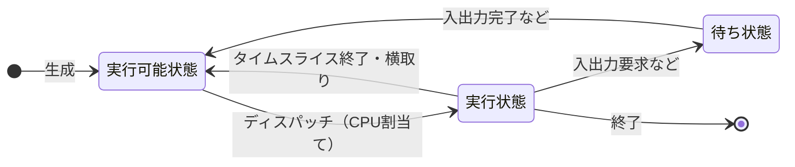
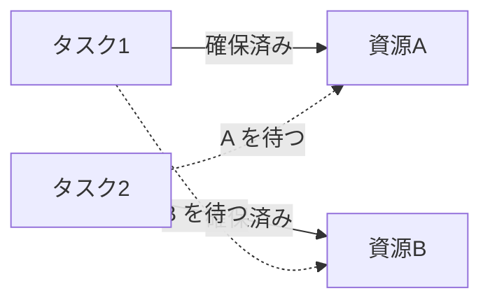
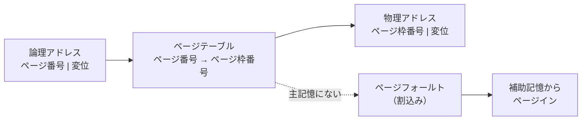
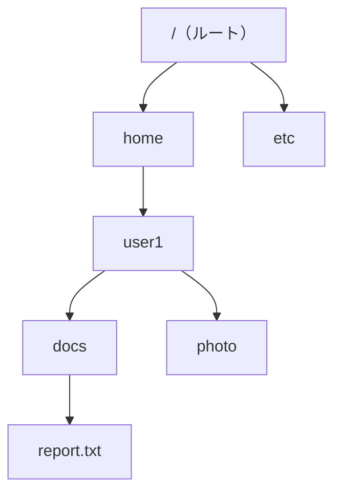

# ソフトウェア

> **重要度：★★★**（科目A（旧午前）で毎回 2〜4 問。ページ置換・スケジューリングの計算、OSS ライセンスが定番）
> OS（オペレーティングシステム）のしくみを中心に、言語処理系、ファイルシステム、OSS（オープンソースソフトウェア）を扱う分野です。科目B（旧午後）の「組込みシステム開発」「システムアーキテクチャ」でも、タスク・排他制御の知識が使われます。
> この章のポイントは次の4つです。
> - タスク（プロセス）の **状態遷移** と **スケジューリング方式** の計算
> - **排他制御・セマフォ・デッドロック** の考え方
> - **仮想記憶・ページング** と **ページ置換（FIFO / LRU）** のページフォールト回数の計算
> - ファイルシステム（パス・アクセス権・バックアップ）と **OSS ライセンス** の違い

## 目次

1. [OS の役割と構成](#1-os-の役割と構成)
2. [タスク管理とスケジューリング](#2-タスク管理とスケジューリング)
3. [排他制御・セマフォ・デッドロック](#3-排他制御セマフォデッドロック)
4. [主記憶管理](#4-主記憶管理)
5. [仮想記憶とページ置換](#5-仮想記憶とページ置換)
6. [ファイルシステム](#6-ファイルシステム)
7. [言語処理系とプログラムの性質](#7-言語処理系とプログラムの性質)
8. [OSS とライセンス](#8-oss-とライセンス)
9. [確認問題](#確認問題)
10. [参考](#参考)

---

## 1. OS の役割と構成

### 1.1 OS の目的と機能 ★

**OS**（Operating System：基本ソフトウェア）は、ハードウェアを管理し、アプリケーションに使いやすい環境を提供するソフトウェアです。

| 機能 | 内容 |
|---|---|
| **タスク（プロセス）管理** | プログラムの実行単位を管理し、CPU を割り当てる |
| **記憶管理** | 主記憶の割当て、仮想記憶の管理 |
| ジョブ管理 | 利用者から見た仕事の単位（ジョブ）の実行順序を管理。**スプーリング**（低速な入出力を補助記憶にためて、CPU と並行に処理）など |
| データ管理 | ファイルの作成・読み書き・保護 |
| 入出力管理 | 入出力装置の制御（**デバイスドライバ** を介して行う） |
| 運用管理・通信管理 | 利用者管理、ネットワーク通信など |

### 1.2 カーネルの構成 ★

**カーネル**とは、OS の中核部分で、タスク管理・記憶管理・割込み処理などを担います。

| 方式 | 内容 | 特徴 |
|---|---|---|
| **モノリシックカーネル** | OS の多くの機能をカーネル内に一体化 | 高速だが、一部の不具合が全体に影響しやすい |
| **マイクロカーネル** | カーネルには最小限の機能だけを置き、他はカーネル外のサービスとして動かす | 拡張・移植しやすく、信頼性が高い。モジュール間の通信によるオーバヘッドがある |

CPU には **特権モード**（カーネルモード：すべての命令を実行できる）と **ユーザモード**（一部の命令が制限される）があり、アプリケーションは SVC（スーパバイザコール、システムコール）で OS の機能を呼び出します。

---

## 2. タスク管理とスケジューリング

### 2.1 プロセス・スレッド・タスク ★★

| 用語 | 意味 |
|---|---|
| **プロセス** | 実行中のプログラム。OS が資源（メモリ空間など）を割り当てる単位 |
| **スレッド** | プロセス内の処理の流れの単位。同じプロセス内のスレッドは **メモリ空間を共有** するため、生成や切替えが軽い |
| **タスク** | OS から見た処理の実行単位。試験では「プロセス」とほぼ同じ意味で使われることが多い |

### 2.2 タスクの状態遷移 ★★★

タスクは生成されてから終了するまで、次の3つの状態を行き来します。



| 状態 | 意味 |
|---|---|
| **実行可能状態**（レディ） | CPU が割り当てられればすぐに実行できる状態。実行待ちの列に並んでいる |
| **実行状態**（ラン） | CPU を割り当てられて実行中の状態（シングルコアでは1つだけ） |
| **待ち状態**（ウェイト、ブロック） | 入出力の完了などを待っていて、CPU があっても実行できない状態 |

**ディスパッチ**とは、実行可能状態のタスクに CPU を割り当てることで、これを行う OS の機能を **ディスパッチャ** といいます。

⚠️ **ひっかけ注意**：**待ち状態から直接実行状態には遷移しません**。入出力が完了したら、まず実行可能状態に戻って順番を待ちます。

### 2.3 スケジューリング方式 ★★★

**スケジューリング**とは、実行可能状態のタスクの中から、次に CPU を割り当てるタスクを決めることです。

| 方式 | 内容 | 横取り（プリエンプション） |
|---|---|---|
| **到着順**（FCFS：First Come First Served） | 到着した順に実行 | なし |
| **処理時間順**（SJF：Shortest Job First／SPT） | 処理時間の短いものから実行。**平均ターンアラウンドタイムが最小** になる | なし（横取りする方式もある） |
| **優先度順** | 優先度の高いものから実行 | あり／なし |
| **ラウンドロビン** | 一定時間（**タイムクウォンタム**、タイムスライス）ずつ順番に実行し、終わらなければ列の末尾に戻す | あり |
| 多重レベルフィードバックキュー | 優先度別の複数の列を持ち、タイムスライスを使い切ったタスクの優先度を下げる | あり |

- **プリエンプティブ**（横取りあり）：実行中のタスクから CPU を取り上げて、別のタスクに割り当てることができる方式。
- **ノンプリエンプティブ**（横取りなし）：実行中のタスクが自ら CPU を手放すまで切り替えない方式。
- ⚠️ 優先度順方式では、優先度の低いタスクがいつまでも実行されない **飢餓状態（スタベーション）** が起こり得ます。待ち時間に応じて優先度を上げる **エージング** で防ぎます。

### 2.4 計算例：到着順と処理時間順 ★★★

**ターンアラウンドタイム** = 終了時刻 − 到着時刻

| タスク | 到着時刻 | 処理時間 |
|---|---|---|
| P1 | 0 | 7 |
| P2 | 2 | 4 |
| P3 | 4 | 1 |
| P4 | 5 | 4 |

**到着順（FCFS）**

```
時刻  0       7     11 12    16
      |  P1   |  P2  |P3|  P4 |
P1：7 − 0 = 7    P2：11 − 2 = 9    P3：12 − 4 = 8    P4：16 − 5 = 11
平均 = (7 + 9 + 8 + 11) / 4 = 35 / 4 = 8.75
```

**処理時間順（SJF、横取りなし）**

```
時刻 7 の時点で待っているのは P2(4)、P3(1)、P4(4) → 最短の P3 から
（P2 と P4 は処理時間が同じなので、先に到着した P2 を先にする）

時刻  0       7 8     12     16
      |  P1   |P3| P2  |  P4 |
P1：7 − 0 = 7    P3：8 − 4 = 4    P2：12 − 2 = 10    P4：16 − 5 = 11
平均 = (7 + 4 + 10 + 11) / 4 = 32 / 4 = 8.0
```



```mermaid
gantt
  title 処理時間順（SJF）
  dateFormat X
  axisFormat %s
  section CPU
  P1 :a1, 0, 7
  P3 :a2, 7, 8
  P2 :a3, 8, 12
  P4 :a4, 12, 16
```

### 2.5 計算例：ラウンドロビン ★★

**問題**：時刻0に A（処理時間5）、B（3）、C（1）がこの順に到着した。タイムクウォンタム2のラウンドロビンで処理するとき、各タスクの終了時刻は？（切替え時間は無視）

```
時刻 0–2：A を実行（A の残り 3）→ A は列の末尾へ   列：B, C, A
時刻 2–4：B を実行（B の残り 1）→ B は末尾へ       列：C, A, B
時刻 4–5：C を実行（残り 0 → 終了、時刻 5）       列：A, B
時刻 5–7：A を実行（A の残り 1）                   列：B, A
時刻 7–8：B を実行（終了、時刻 8）                 列：A
時刻 8–9：A を実行（終了、時刻 9）
```

終了時刻：A = 9、B = 8、C = 5。平均ターンアラウンドタイム = (9 + 8 + 5) / 3 ≒ 7.33

### 2.6 リアルタイム OS ★★

**リアルタイム OS**（RTOS）とは、決められた時間（**デッドライン**）内に処理を完了させることを重視した OS で、組込みシステムで使われます。

- **優先度に基づくプリエンプティブなスケジューリング** が一般的です。
- **ハードリアルタイム**：デッドラインを守れないと重大な結果になる（エアバッグ制御など）。
- **ソフトリアルタイム**：多少の遅れは許容される（動画再生など）。
- **優先度逆転**：低優先度タスクが資源を確保している間に中優先度タスクが割り込み、その資源を待つ高優先度タスクが長く待たされる現象。**優先度継承**（資源を持つ低優先度タスクの優先度を一時的に上げる）などで防ぎます。

---

## 3. 排他制御・セマフォ・デッドロック

### 3.1 排他制御 ★★★

複数のタスクが同じ資源（共有変数・ファイルなど）を同時に更新すると、データの矛盾が起こります。

**例**：共有変数 X = 100 に対し、タスク1が「X に 10 を足す」、タスク2が「X に 20 を足す」を同時に行う

```
タスク1：X を読む(100)
タスク2：X を読む(100)
タスク1：100 + 10 = 110 を書く
タスク2：100 + 20 = 120 を書く   → 結果 120（正しくは 130。タスク1の更新が失われた）
```

これを防ぐため、ある資源を1つのタスクが使っている間は他のタスクに使わせない制御を **排他制御** といい、排他制御が必要なプログラムの部分を **クリティカルセクション**（危険領域）といいます。

### 3.2 セマフォ ★★★

**セマフォ**とは、排他制御や同期のために使う **カウンタ（整数の変数）** と、それを操作する2つの命令からなるしくみです（考案者はダイクストラ）。

| 操作 | 動作 |
|---|---|
| **P 操作**（wait、資源の獲得） | セマフォの値を **1減らす**。値が負になったら、そのタスクは **待ち状態** になる |
| **V 操作**（signal、資源の解放） | セマフォの値を **1増やす**。待っているタスクがあれば1つを実行可能状態にする |

- セマフォの **初期値 = 同時に使える資源の数** です。初期値1のものを **2値セマフォ**（バイナリセマフォ、ミューテックスと同様の使い方）、2以上のものを **計数セマフォ** といいます。

**具体例**：初期値1のセマフォ S で共有変数を保護

```
タスク1                 タスク2               S の値
P(S)  → S = 0、実行                            0
（X を更新中）          P(S) → S = −1、待ち    −1
V(S)  → S = 0、         ←― タスク2 を起こす    0
                        （X を更新）
                        V(S) → S = 1           1
```

💡 **覚え方**：P は「**P**ass できるか確認して入る（減らす）」、V は「**V**acate（空ける）して出る（増やす）」と覚えると混同しません。

### 3.3 デッドロック ★★★

**デッドロック**とは、複数のタスクが **互いに相手の確保している資源の解放を待ち合って**、どちらも先に進めなくなる状態です。

**例**：タスク1が資源A → B の順に、タスク2が資源B → A の順に確保しようとする



**デッドロックが発生する4つの条件**（すべてそろうと発生）

| 条件 | 意味 |
|---|---|
| 相互排除 | 資源を同時に1つのタスクしか使えない |
| 占有と待機 | 資源を確保したまま、別の資源を待つ |
| 横取り不可 | 他のタスクが確保した資源を強制的に奪えない |
| **循環待ち** | 資源の待ち関係が輪（循環）になる |

**対策**

| 対策 | 内容 |
|---|---|
| **資源の確保順序をそろえる** | すべてのタスクで「A → B」のように同じ順序で確保すれば、循環待ちが起きない（**最も代表的な予防策**） |
| 必要な資源を一括して確保する | 占有と待機の条件をなくす |
| **銀行家のアルゴリズム** | 資源を割り当てても安全（デッドロックにならない）かを事前に判定して割り当てる（回避） |
| 検出と回復 | 待ちグラフで循環を検出し、タスクを強制終了・ロールバックする |

⚠️ データベースのトランザクションでも同じ現象が起こります（マネジメント系・データベース分野の「ロック」と関連）。

---

## 4. 主記憶管理

### 4.1 区画方式と断片化 ★★

| 方式 | 内容 |
|---|---|
| 固定区画方式 | 主記憶をあらかじめ決めた大きさの区画に分けて割り当てる。区画内に未使用領域が残る（内部断片化） |
| **可変区画方式** | プログラムの大きさに合わせて割り当てる。割当てと解放を繰り返すと、小さな空き領域が散らばる **フラグメンテーション（断片化）** が起こる |

断片化した空き領域を移動・集約して大きな連続領域にすることを **コンパクション** といいます。また、使われなくなった領域を回収して再利用可能にすることを **ガーベジコレクション** といいます。

### 4.2 空き領域の選び方 ★★

**具体例**：空き領域が先頭から順に `100KB, 500KB, 200KB, 300KB, 600KB` のとき、212KB を割り当てる

| 方式 | 選び方 | 選ばれる領域 |
|---|---|---|
| **ファーストフィット** | 先頭から探して **最初に入る** 領域 | 500KB |
| **ベストフィット** | 入る領域のうち **最も小さい**（余りが最小の）領域 | 300KB |
| **ワーストフィット** | **最も大きい** 領域 | 600KB |

### 4.3 オーバレイとスワッピング ★

- **オーバレイ**：プログラムを複数のセグメントに分割し、必要な部分だけを主記憶に読み込んで実行する方式。
- **スワッピング**：実行中でないプログラムを主記憶から補助記憶へ退避（**スワップアウト**）し、必要になったら戻す（**スワップイン**）方式。

---

## 5. 仮想記憶とページ置換

### 5.1 仮想記憶とは ★★★

**仮想記憶**とは、補助記憶を利用して、**実際の主記憶（実記憶）より大きなアドレス空間** をプログラムに提供するしくみです。プログラムが使うアドレスを **論理アドレス（仮想アドレス）**、主記憶上の実際のアドレスを **物理アドレス（実アドレス）** といいます。

| 方式 | 分割の単位 |
|---|---|
| **ページング方式** | **固定長** のページに分割して管理（主流） |
| セグメンテーション方式 | 論理的なまとまり（**可変長** のセグメント）に分割して管理 |

### 5.2 ページングとアドレス変換 ★★

論理アドレスは **ページ番号** と **ページ内変位（オフセット）** に分けられ、**ページテーブル** で物理的な **ページ枠（フレーム）番号** に変換されます。



**具体例**：ページサイズ 4K バイト（= 4,096 = 2¹² バイト）、論理アドレス 16進数 `3A7C`、ページテーブルでページ3 → ページ枠5 とする

```
① ページサイズが 2¹² なので、下位12ビット（16進数で下位3桁）が変位
② 3A7C → ページ番号 = 3、変位 = A7C
③ ページ3 → ページ枠5 に変換
④ 物理アドレス = 5A7C（16進数）
```

アドレス変換を高速化するため、最近使ったページテーブルの内容を保持する専用のキャッシュを **TLB**（Translation Lookaside Buffer：アドレス変換バッファ）といいます。

### 5.3 ページフォールトとスラッシング ★★★

| 用語 | 意味 |
|---|---|
| **ページフォールト** | 参照したページが主記憶にないこと。割込みが発生し、OS が補助記憶から読み込む |
| **ページイン／ページアウト** | 補助記憶 → 主記憶への読込み／主記憶 → 補助記憶への書出し |
| **スラッシング** | 主記憶が不足して **ページイン・ページアウトが頻発** し、処理がほとんど進まなくなる（CPU の使用率が極端に下がる）現象 |

💡 スラッシングの対策は、**主記憶の増設** や、**同時に実行する多重度（プログラム数）を減らす** ことです。

### 5.4 ページ置換アルゴリズム ★★★

ページフォールトが起きて主記憶に空きがないとき、どのページを追い出すかを決める方式です。

| 方式 | 追い出すページ |
|---|---|
| **FIFO**（First In First Out） | **最も古くに読み込まれた** ページ |
| **LRU**（Least Recently Used） | **最後に参照されてから最も時間が経っている**（最も長く使われていない）ページ |
| LFU（Least Frequently Used） | **参照回数が最も少ない** ページ |
| 最適（OPT、Belady の最適アルゴリズム） | 今後最も長く参照されないページ（理論上の最良。未来の参照が必要なので実現不可） |

### 5.5 計算例：FIFO と LRU ★★★

**問題**：ページ枠が3つ（最初は空）で、ページを `7, 0, 1, 2, 0, 3, 0, 4, 2, 3` の順に参照する。FIFO と LRU それぞれのページフォールト回数は？（最初の読込みもページフォールトに数える）

**FIFO**（枠の中は「読み込んだ順」に左から並べる。追い出すのは左端）

| 参照 | 7 | 0 | 1 | 2 | 0 | 3 | 0 | 4 | 2 | 3 |
|---|---|---|---|---|---|---|---|---|---|---|
| 枠の内容 | 7 | 7,0 | 7,0,1 | 0,1,2 | 0,1,2 | 1,2,3 | 2,3,0 | 3,0,4 | 0,4,2 | 4,2,3 |
| フォールト | ● | ● | ● | ●（7を追出し） | − | ●（0を追出し） | ●（1を追出し） | ●（2を追出し） | ●（3を追出し） | ●（0を追出し） |

FIFO のページフォールト：**9回**

**LRU**（枠の中は「最後に参照された順」に左から並べる。参照されたら右端へ移動。追い出すのは左端）

| 参照 | 7 | 0 | 1 | 2 | 0 | 3 | 0 | 4 | 2 | 3 |
|---|---|---|---|---|---|---|---|---|---|---|
| 枠の内容 | 7 | 7,0 | 7,0,1 | 0,1,2 | 1,2,0 | 2,0,3 | 2,3,0 | 3,0,4 | 0,4,2 | 4,2,3 |
| フォールト | ● | ● | ● | ●（7を追出し） | − | ●（1を追出し） | − | ●（2を追出し） | ●（3を追出し） | ●（0を追出し） |

LRU のページフォールト：**8回**

💡 **解き方のコツ**：枠の中身を「追い出す順」に並べて書くと、毎回左端を追い出すだけになりミスが減ります。FIFO はヒットしても並びを変えない、LRU はヒットしたら右端へ移す、が違いです。

### 5.6 Belady の異常 ★

FIFO では、**ページ枠を増やしたのにページフォールトが増える** ことがあります。これを **Belady（ビレイディ）の異常** といいます。

```
参照列：1, 2, 3, 4, 1, 2, 5, 1, 2, 3, 4, 5
FIFO・枠3つ → 9回     FIFO・枠4つ → 10回（増えた！）
LRU ・枠3つ → 10回    LRU ・枠4つ → 8回（LRU ではこの異常は起きない）
```

---

## 6. ファイルシステム

### 6.1 ディレクトリとパス ★★

ファイルは **ディレクトリ（フォルダ）** による **木構造（階層構造）** で管理されます。



| 用語 | 意味 | 例（カレントが `/home/user1/photo` のとき `report.txt` を指す） |
|---|---|---|
| **絶対パス** | ルートからの経路 | `/home/user1/docs/report.txt` |
| **相対パス** | **カレントディレクトリ**（現在作業中のディレクトリ）からの経路 | `../docs/report.txt` |

`.` はカレントディレクトリ、`..` は **1つ上（親）のディレクトリ** を表します。

### 6.2 アクセス権（UNIX 系） ★★

UNIX 系 OS では、**所有者・グループ・その他** の3者それぞれに **読込み（r）・書込み（w）・実行（x）** の権限を設定します。数字では r = 4、w = 2、x = 1 の合計で表します。

**具体例**：`rwxr-xr--`

```
所有者  ：rwx = 4 + 2 + 1 = 7
グループ：r-x = 4 + 0 + 1 = 5
その他  ：r-- = 4 + 0 + 0 = 4
→ 754
```

### 6.3 バックアップ方式 ★★★

| 方式 | バックアップ対象 | バックアップ時間 | 復元（リストア）に必要なもの |
|---|---|---|---|
| **フルバックアップ** | すべてのデータ | 長い | 最新のフルバックアップだけ |
| **差分バックアップ** | **前回のフルバックアップ以降** に変更されたデータ | 中（日が経つほど増える） | フル ＋ **最新の差分1つ** |
| **増分バックアップ** | **前回のバックアップ（種類を問わず）以降** に変更されたデータ | 短い | フル ＋ **それ以降のすべての増分** |

**具体例**：日曜にフルバックアップ、月〜水に毎日バックアップを取り、木曜に障害が発生した。

```
差分バックアップの場合：日曜のフル ＋ 水曜の差分        （2つ）
増分バックアップの場合：日曜のフル ＋ 月・火・水の増分  （4つ）
```

**ジャーナリングファイルシステム**：ファイルシステムの更新内容を **ジャーナル（ログ）** に先に記録しておき、障害時にはログを使って短時間で整合性を回復するファイルシステムです。

---

## 7. 言語処理系とプログラムの性質

### 7.1 言語処理系 ★★

| ツール | 役割 |
|---|---|
| **コンパイラ** | ソースプログラム全体を、機械語（目的プログラム）に **まとめて翻訳** する |
| **インタプリタ** | ソースプログラムを **1命令ずつ解釈しながら実行** する |
| アセンブラ | アセンブリ言語を機械語に翻訳する |
| **リンカ（連係編集プログラム）** | 複数の目的プログラムやライブラリを結合して、実行可能なプログラムを作る |
| ローダ | 実行可能なプログラムを主記憶に読み込む |
| **JIT コンパイラ**（Just-In-Time） | 実行時に中間コードを機械語に翻訳し、高速化する |
| クロスコンパイラ | 開発用のコンピュータとは **異なる環境（CPU）** 向けの機械語を生成する。組込み開発で使用 |

**コンパイラの処理の流れ**


**リンクの方式**

- **静的リンク**：実行前にライブラリを実行プログラムに組み込む。
- **動的リンク**：実行時に必要なライブラリ（DLL：Dynamic Link Library、共有ライブラリ）を結合する。複数のプログラムでライブラリを共有でき、メモリを節約できます。

### 7.2 プログラムの性質 ★★★

| 性質 | 意味 |
|---|---|
| **再入可能（リエントラント）** | 複数のタスクから **同時に** 呼び出されても正しく動作する。手続部分とデータ部分を分け、データ部分をタスクごとに持つ |
| **再使用可能（シリアリリユーザブル）** | 一度実行した後、**ロードし直さずに** 再び実行できる（ただし同時実行は不可） |
| **再配置可能（リロケータブル）** | 主記憶上の **どのアドレスに配置しても** 実行できる |
| **再帰的（リカーシブ）** | 実行中に **自分自身を呼び出す** ことができる |

⚠️ **ひっかけ注意**：「同時に複数のタスクで共有できる」のは **再入可能**、「繰り返し使える（同時は不可）」のは **再使用可能** です。再入可能なプログラムは再使用可能でもあります。

---

## 8. OSS とライセンス

### 8.1 OSS とは ★★

**OSS**（Open Source Software：オープンソースソフトウェア）とは、ソースコードが公開され、利用・改変・再頒布が許可されたソフトウェアです。OSI（Open Source Initiative）が **OSD**（The Open Source Definition：オープンソースの定義）で条件を定めています。主な条件は次のとおりです。

- **自由な再頒布**（販売・無償配布を制限しない）
- **ソースコードの公開**
- **派生ソフトウェア（改変物）の作成と頒布を許可**
- **個人・グループに対する差別の禁止**
- **利用する分野（事業分野）に対する差別の禁止**（例：「商用利用禁止」は OSS の条件を満たさない）
- 特定の製品に依存しない、他のソフトウェアを制限しない、技術的に中立である、など（全10項目）

⚠️ **ひっかけ注意**：OSS は「**無保証**」で提供されることが一般的で、「著作権を放棄したもの」でもありません。ライセンス条件を守る必要があります。

### 8.2 主なライセンス ★★★

**コピーレフト**とは、「著作権を保持したうえで、**改変・再頒布したソフトウェアにも同じライセンスを適用すること（ソースコードの公開を含む）を義務付ける**」考え方です。

| ライセンス | 種類 | 改変物の公開義務 | 特徴 |
|---|---|---|---|
| **GPL**（GNU General Public License） | 強いコピーレフト | **あり**（GPL のプログラムと結合した派生物全体に GPL を適用） | Linux カーネルなど |
| **LGPL**（GNU Lesser GPL） | 弱いコピーレフト | ライブラリ自体の改変部分はあり | ライブラリとして **リンクして使うだけなら**、利用側のプログラムの公開義務はない |
| MPL（Mozilla Public License） | 弱いコピーレフト | **ファイル単位** で公開義務 | Firefox など |
| **BSD ライセンス** | 非コピーレフト（寛容型） | **なし** | 著作権表示と免責条項を残せば、改変物を非公開にしてよい |
| **MIT ライセンス** | 非コピーレフト（寛容型） | **なし** | 非常に制約が少ない |
| **Apache License 2.0** | 非コピーレフト（寛容型） | **なし** | 特許ライセンスの許諾や、変更箇所の明示に関する条項を含む |


**その他の用語**

| 用語 | 意味 |
|---|---|
| **デュアルライセンス** | 同じソフトウェアを、OSS ライセンスと商用ライセンスなど **複数のライセンスから選べる** ようにして提供すること |
| パブリックドメイン | 著作権が消滅・放棄され、誰でも自由に使える状態 |
| **SBOM**（Software Bill of Materials：ソフトウェア部品表） | ソフトウェアに含まれるコンポーネント（OSS を含む）とその依存関係・ライセンスなどの一覧。脆弱性管理やライセンス管理に使う |

### 8.3 代表的な OSS ★

| 分類 | 代表例 |
|---|---|
| OS | Linux、FreeBSD、Android（大部分） |
| Web サーバ | Apache HTTP Server、nginx |
| データベース | PostgreSQL、MySQL、MariaDB |
| プログラム言語・実行環境 | Python、Ruby、PHP、Node.js |
| その他 | Git（バージョン管理）、Kubernetes（コンテナ管理）、LibreOffice（オフィスソフト） |

---

## 確認問題

**問1** タスクの状態遷移に関する記述として適切なものはどれか。
ア 待ち状態のタスクは、入出力が完了すると直接実行状態に遷移する。
イ 実行状態のタスクは、入出力を要求すると実行可能状態に遷移する。
ウ 実行状態のタスクは、タイムスライスを使い切ると実行可能状態に遷移する。
エ 実行可能状態のタスクは、入出力を要求すると待ち状態に遷移する。

**問2** 次の4つのジョブが時刻0に同時に到着した。処理時間順（SJF、横取りなし）で実行した場合の平均ターンアラウンドタイムはいくらか。
（ジョブA：6、ジョブB：2、ジョブC：8、ジョブD：4）
ア 7.5　イ 8.0　ウ 10.0　エ 11.0

**問3** 優先度に基づくプリエンプティブなスケジューリングで、次の3つのタスクを実行する。タスク P1 の終了時刻はいくらか（優先度は数字が小さいほど高い。切替え時間は無視）。
（P1：到着0・処理5・優先度3、P2：到着1・処理2・優先度1、P3：到着2・処理3・優先度2）
ア 5　イ 7　ウ 8　エ 10

**問4** 初期値が 3 の計数セマフォに対して、5つのタスクが順に P 操作を行い、その後1つのタスクが V 操作を行った。このときセマフォの値と、待ち状態のタスクの数の組合せとして正しいものはどれか。
ア 値 −2、待ち 2　イ 値 −1、待ち 1　ウ 値 −1、待ち 2　エ 値 1、待ち 0

**問5** デッドロックの発生を防ぐ方法として最も適切なものはどれか。
ア すべてのタスクで、共有資源を確保する順序を同じにする。
イ タスクの優先度を動的に変更する。
ウ ページ置換アルゴリズムを LRU にする。
エ タイムクウォンタムを短くする。

**問6** ページ枠が3つ（最初は空）の仮想記憶で、ページを `3, 1, 2, 1, 4, 3, 1, 5, 2, 1` の順に参照する。FIFO と LRU のページフォールト回数の組合せとして正しいものはどれか。
ア FIFO 7、LRU 7　イ FIFO 8、LRU 7　ウ FIFO 8、LRU 8　エ FIFO 7、LRU 8

**問7** ページサイズが 1K バイト（1,024 バイト）のページング方式で、論理アドレス 10 進数 5,000 のページ番号と変位の組合せはどれか（ページ番号は0から数える）。

**問8** 日曜日にフルバックアップを取得し、月曜日から金曜日まで毎日 **増分バックアップ** を取得している。土曜日に障害が発生したとき、復元に必要なバックアップの数はいくつか。

**問9** 複数のタスクから同時に呼び出されても、正しく動作するプログラムの性質はどれか。
ア 再帰的　イ 再使用可能　ウ 再入可能　エ 再配置可能

**問10** OSS のライセンスに関する記述として適切なものはどれか。
ア GPL のソフトウェアを改変して頒布する場合、改変部分のソースコードを非公開にできる。
イ BSD ライセンスのソフトウェアを改変して製品に組み込む場合、著作権表示などの条件を守れば、ソースコードを公開しなくてよい。
ウ OSS の定義では、商用利用を禁止するライセンスも認められている。
エ OSS は著作権が放棄されているので、ライセンス条件を考慮する必要はない。

<details><summary>解答・解説</summary>

**問1　ウ**
タイムスライスを使い切ると、CPU を取り上げられて実行可能状態に戻ります。アは「実行可能状態」に遷移するのが正しく、イは「待ち状態」に遷移するのが正しいです。エの実行可能状態のタスクは実行していないので入出力を要求できません。

**問2　ウ**
```
実行順：B(2) → D(4) → A(6) → C(8)
終了時刻：B = 2、D = 2 + 4 = 6、A = 6 + 6 = 12、C = 12 + 8 = 20
平均 = (2 + 6 + 12 + 20) / 4 = 40 / 4 = 10.0
```

**問3　エ**
```
時刻 0–1 ：P1 実行（残り4）
時刻 1   ：優先度の高い P2 が到着 → P1 を横取り
時刻 1–3 ：P2 実行 → 終了
時刻 3–6 ：P3（優先度2）が P1（優先度3）より高いので P3 実行 → 終了
時刻 6–10：P1 実行（残り4）→ 終了（時刻 10）
```

**問4　イ**
```
P 操作 5 回：3 → 2 → 1 → 0 → −1 → −2（4回目と5回目のタスクが待ち）→ 待ち 2
V 操作 1 回：−2 → −1、待ちタスクを1つ起こす → 待ち 1
```
値が負のとき、その絶対値が待ち状態のタスク数を表します。

**問5　ア**
資源の確保順序をそろえると「循環待ち」の条件が成立しなくなり、デッドロックを予防できます。

**問6　イ**
```
FIFO（左が最古）：
 3:[3]● 1:[3,1]● 2:[3,1,2]● 1:ヒット 4:[1,2,4]● 3:[2,4,3]● 1:[4,3,1]● 5:[3,1,5]● 2:[1,5,2]● 1:ヒット
 → 8回
LRU（左が最も長く未使用）：
 3:[3]● 1:[3,1]● 2:[3,1,2]● 1:ヒット[3,2,1] 4:[2,1,4]● 3:[1,4,3]● 1:ヒット[4,3,1] 5:[3,1,5]● 2:[1,5,2]● 1:ヒット[5,2,1]
 → 7回
```

**問7　ページ番号 4、変位 904**
```
5,000 ÷ 1,024 = 4 余り 904（1,024 × 4 = 4,096、5,000 − 4,096 = 904）
```

**問8　6つ**
増分バックアップは「前回のバックアップ以降の変更分」なので、日曜のフル ＋ 月・火・水・木・金の増分 **5つ** = 合計 **6つ** が必要です（差分バックアップなら、フル ＋ 金曜の差分の2つ）。

**問9　ウ**
同時呼出しに対応できるのは再入可能（リエントラント）です。再使用可能は「同時は不可だが、ロードし直さずに繰り返し使える」性質です。

**問10　イ**
BSD ライセンスは非コピーレフトなので、改変物のソースコード公開義務はありません。アは GPL のコピーレフトに反し、ウは OSD の「利用分野に対する差別の禁止」に反し、エは誤りです（OSS にも著作権があります）。

</details>

---

## 参考

- IPA「試験要綱・シラバスについて」（応用情報技術者試験 シラバス Ver.7.2）：https://www.ipa.go.jp/shiken/syllabus/gaiyou.html
- IPA「応用情報技術者試験 シラバス Ver.7.2（PDF）」：https://www.ipa.go.jp/shiken/syllabus/omgdg50000005kq5-att/syllabus_ap_ver7_2.pdf
- IPA「応用情報技術者試験（AP）」試験区分ページ：https://www.ipa.go.jp/shiken/kubun/ap.html
- IPA「過去問題」：https://www.ipa.go.jp/shiken/mondai-kaiotu/index.html
- Open Source Initiative「The Open Source Definition」：https://opensource.org/osd
- GNU Project「GNU General Public License」：https://www.gnu.org/licenses/gpl-3.0.html
- Apache Software Foundation「Apache License, Version 2.0」：https://www.apache.org/licenses/LICENSE-2.0
- 応用情報技術者試験ドットコム（午前過去問の分野別解説）：https://www.ap-siken.com/
