# データベース

> **重要度：★★★**（科目A（旧午前）で毎回5問前後、科目B（旧午後）では「データベース」が選択問題として毎回1問出題されます）
> 科目Aでは **正規化・SQL・トランザクション（ロック／障害回復）** が定番です。科目Bでは **E-R図の穴埋め・SQL穴埋め・テーブル設計の不備指摘** が中心になります。
> この章では、①データモデルとE-R図、②関数従属と正規化（候補キーの求め方）、③SQLを結果表つきで読めるようになること、④トランザクション管理と障害回復、⑤分散DB・NoSQL・ビッグデータ を押さえます。
> SQLは「書けること」より「**読んで結果を予想できること**」が得点に直結します。例題は必ず自分で結果表を作ってから答えを見てください。

## 目次

- [1. データベースとDBMS](#1-データベースとdbms)
- [2. データモデルとE-R図](#2-データモデルとe-r図)
- [3. 関係モデルと関係代数](#3-関係モデルと関係代数)
- [4. 関数従属と正規化](#4-関数従属と正規化)
- [5. SQL](#5-sql)
- [6. トランザクションと同時実行制御](#6-トランザクションと同時実行制御)
- [7. 障害回復](#7-障害回復)
- [8. 分散データベース・NoSQL・ビッグデータ](#8-分散データベースnosqlビッグデータ)
- [9. 科目B「データベース」問題の解き方](#9-科目bデータベース問題の解き方)
- [確認問題](#確認問題)
- [📋 シラバス用語チェックリスト](#-シラバス用語チェックリスト)
- [参考](#参考)

---

## 1. データベースとDBMS

### 1.1 DBMSの役割 ★

**DBMS（Database Management System：データベース管理システム）** は、データを複数の利用者・アプリケーションで安全に共有するためのソフトウェアです。

- 結論：DBMSを使うと「データの一元管理」と「データの独立性」が実現できます。
- 理由：ファイルをアプリごとに持つと、同じデータが重複して食い違い（不整合）が起きやすいからです。
- 例：顧客の住所を販売システムと請求システムが別々に持つと、片方だけ住所変更されて請求書が旧住所に届く、という不整合が起こります。

| DBMSの主な機能 | 内容 |
|---|---|
| データ定義 | 表（テーブル）や制約を定義する（SQLのDDL） |
| データ操作 | 検索・追加・更新・削除（SQLのDML） |
| 同時実行制御（排他制御） | 複数の利用者が同時に更新しても矛盾しないようにする |
| 障害回復 | 障害が起きてもログから正しい状態に戻す |
| 機密保護 | 利用者ごとにアクセス権限を設定する（SQLのDCL） |
| 整合性制約 | 主キー制約・参照制約・検査制約などで不正データを防ぐ |

シラバスでは DBMS の機能を次の名前で整理しています。上の表との対応を押さえておきましょう。

| シラバスの機能名 | 内容 | 上の表との対応 |
|---|---|---|
| **データベース定義機能** | スキーマ（表・ビュー・制約など）を定義する | データ定義 |
| **データベース操作機能** | データの検索・追加・更新・削除 | データ操作 |
| **データベース制御機能** | 同時実行制御・トランザクション管理・障害回復など、DB全体を正しく動かす制御 | 同時実行制御・障害回復 |
| **保全機能（整合性保全）** | 整合性制約や障害回復によってデータの正しさを保つ | 整合性制約・障害回復 |
| **データ機密保護機能** | 利用者認証・アクセス権限・暗号化で不正アクセスを防ぐ | 機密保護 |

### 1.2 3層スキーマ構造 ★★

**スキーマ** とは「データベースの構造の定義」のことです。ANSI/SPARC（米国規格協会の委員会）が提唱した **3層スキーマ** は次の3つで構成されます。

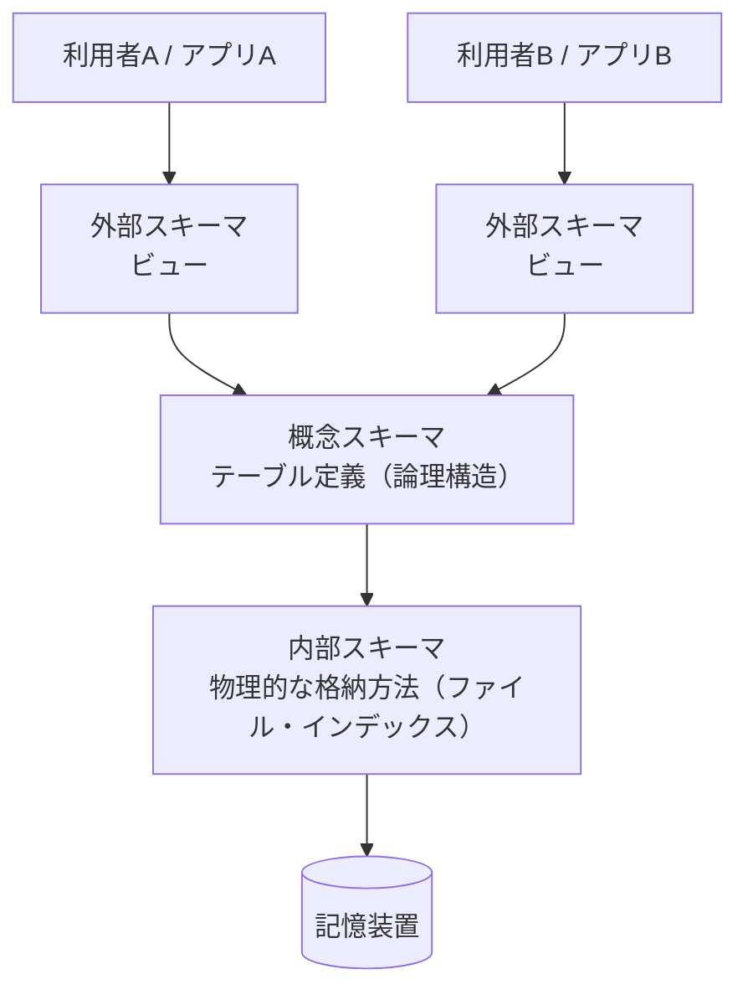

| スキーマ | 内容 | SQLでいうと |
|---|---|---|
| **外部スキーマ**（副スキーマ） | 利用者・アプリから見たデータの見え方 | **ビュー** |
| **概念スキーマ** | 組織全体から見た論理的なデータ構造 | **テーブル（実表）** |
| **内部スキーマ**（記憶スキーマ） | 記憶装置上の物理的な格納方法 | ファイル編成・**インデックス** |

- **物理的データ独立性**：内部スキーマを変えても（例：インデックス追加）概念スキーマに影響しない。
- **論理的データ独立性**：概念スキーマを変えても（例：列の追加）外部スキーマ（アプリ）に影響しない。

💡 覚え方：「**外＝ビュー、概念＝テーブル、内部＝インデックス**」。

⚠️ ひっかけ注意：「概念スキーマ＝E-R図」と書かれた選択肢がありますが、E-R図は概念データモデルを表す **図法** であり、3層スキーマの「概念スキーマ」とは別物です。

### 1.3 データモデルの種類 ★

| モデル | 構造 | 特徴 |
|---|---|---|
| 階層型 | 木構造（親1：子多） | 親子関係が固定 |
| ネットワーク型 | 網構造（親多：子多も可） | ポインタでつなぐ |
| **関係（リレーショナル）型** | 表（行と列） | SQLで操作。現在の主流 |
| NoSQL | キーバリュー・ドキュメントなど | 大量データ・柔軟なスキーマ向き（8章） |
| **グラフ型** | ノード（点）とエッジ（線）で関係を表す | 関係のたどり（友人の友人など）が速い |

**データモデルの段階**：データモデルは「どこまで具体的か」によって3段階に分けられます（設計の工程は [2.4節](#24-データ分析とデータベース開発工程-) を参照）。

| 段階 | 内容 | 例 |
|---|---|---|
| **概念データモデル** | DBMSに依存せず、業務の「もの」と「関係」を表す | E-R図 |
| **論理データモデル** | 採用するDBMSの型（関係モデルなど）に合わせて表現したもの | 表・列・主キー・外部キーの定義 |
| **物理データモデル** | 特定製品上での格納方法まで決めたもの | データ型、インデックス、ファイル配置、パーティション |

**グラフ型のデータモデル** には2つの流派があります。

| モデル | 構造 | 代表例 |
|---|---|---|
| **プロパティグラフ** | ノードとエッジの両方に「属性（プロパティ）」を持たせられる | Neo4j（問合せ言語 Cypher） |
| **トリプルストア**（RDFストア） | 「主語・述語・目的語」の3つ組（トリプル）でデータを表す。Webの意味情報（RDF）の格納に使う | 問合せ言語 SPARQL |

例（トリプル）：`（東京, 首都である, 日本）` `（東京, 人口, 1400万）`。

### 1.4 データベースの種類と特徴 ★

| 種類 | 特徴 | 向いている用途 |
|---|---|---|
| **RDB**（Relational Database：関係データベース） | データを表で表し、値の一致で表どうしを関連付ける。SQLで操作 | 業務システム全般 |
| **構造型データベース** | レコード間の親子関係を **ポインタ** で物理的に結ぶ方式の総称。HDBとNDBがある | 定型処理が中心の大型システム（歴史的） |
| **HDB**（Hierarchical Database：階層型データベース） | 木構造。子は親を1つだけ持つ（1対多のみ） | 組織図・部品表など親子が明確なデータ |
| **NDB**（Network Database：網型データベース） | 網構造。子が複数の親を持てる（多対多も表現可）。CODASYL（コダシル）方式が代表 | 複雑な関連を持つデータ |
| **OODB**（Object Oriented Database：オブジェクト指向データベース） | データと手続き（メソッド）を一体化した **オブジェクト** をそのまま格納する。継承・カプセル化を使える | CAD、マルチメディアなど複雑な構造のデータ |
| **XMLデータベース** | XML文書を木構造のまま格納し、XPath・XQueryで検索する | 構造が文書ごとに異なるデータ、電子文書 |
| **分散データベース** | 複数サイトのDBを1つに見せる（[8.1節](#81-分散データベースと透過性-)） | 拠点が分かれた企業 |
| **ドキュメント指向／列指向／グラフ／キーバリュー型** | NoSQLの4分類（[8.5節](#85-nosql-)） | 大量データ・柔軟なスキーマ |
| **インメモリデータベース** | データを **主記憶上** に置いて処理するので、ディスクI/Oがなく非常に速い。電源断に備えてログやスナップショットをディスクに書く | リアルタイム分析、高速な取引処理、キャッシュ |

**網型データベース（CODASYL型）の用語**：科目Aではまれに出る古典的な用語です。

| 用語 | 意味 |
|---|---|
| **親子集合**（セット） | 1つの親レコード（オーナ）と複数の子レコード（メンバ）の1対多の関係。ポインタでつながる |
| **親子集合順序** | 親子集合の中で子レコードを並べる順序（先頭に追加・末尾に追加・キー順に整列など） |
| **配置モード** | レコードを記憶装置のどこに置くかの指定。キー値からハッシュで決める方式（CALC）や、親レコードの近くに置く方式（VIA）などがある |

💡 覚え方：構造型（階層・網）は「**ポインタで物理的につなぐ**」、関係型は「**値（外部キー）で論理的につなぐ**」。

---

## 2. データモデルとE-R図

### 2.1 E-R図の基本 ★★★

**E-R図（Entity-Relationship Diagram：実体関連図）** は、業務で扱う「もの（エンティティ）」と、それらの「関係（リレーションシップ）」を表す図です。科目Bでは毎回のように **多重度（カーディナリティ）の穴埋め** が出ます。

| 用語 | 意味 | 例 |
|---|---|---|
| **エンティティ（実体）** | 管理対象となる「もの・こと」 | 顧客、商品、受注 |
| **属性** | エンティティの性質 | 顧客名、住所 |
| **リレーションシップ（関連）** | エンティティ間の関係 | 顧客が受注を「行う」 |
| **多重度** | 関連する相手の数（1対1、1対多、多対多） | 1人の顧客は複数の受注を行う |

IPAの試験では矢印による表記（UML風）がよく使われます。

| IPA試験での表記 | 意味 |
|---|---|
| `A ── B` | 1対1 |
| `A ──→ B` | 1対多（Aの1件にBが複数対応） |
| `A ←──→ B` | 多対多 |

以下は「顧客・受注・受注明細・商品」の例です（Mermaidのカラス足記法：`||` は1、`o{` は0以上の多）。

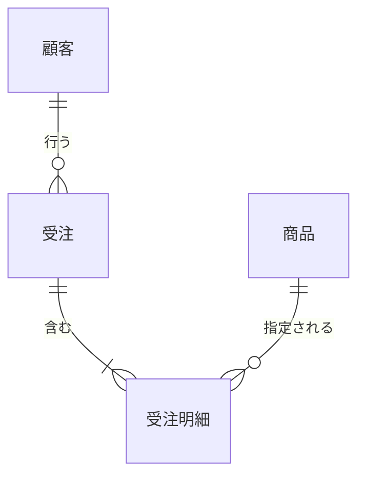

- 顧客1人は0件以上の受注を行う（1対多）
- 受注1件は1件以上の明細を含む（1対多）
- 商品1つは0件以上の明細で指定される（1対多）

**バックマン線図**：C.W.バックマンが考案した、データ構造を表す図法です。レコード（エンティティ）を **箱**、1対多の関係を **矢印**（「1」側から「多」側へ向ける）で表します。IPA試験のE-R図の矢印表記（`A ──→ B` で1対多）は、このバックマン線図の流儀を受け継いでいます。

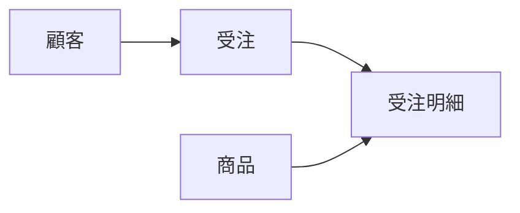

（矢印の根元が「1」、矢印の先が「多」です。）

### 2.2 多対多は「連関エンティティ」で分解する ★★★

- 結論：多対多の関連は、関係データベースではそのまま表にできないので、間に **連関エンティティ（交差エンティティ）** を置いて「1対多」と「多対1」に分解します。
- 理由：1つの列に複数の値を入れられない（第1正規形）からです。
- 例：「受注」と「商品」は多対多（1回の受注で複数商品、1商品は複数の受注に登場）。間に「受注明細」を置き、受注明細の主キーを {受注番号, 明細番号}（または {受注番号, 商品コード}）にします。

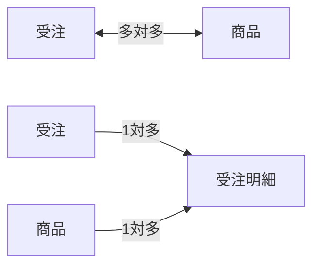

💡 科目Bのコツ：**外部キーは「多」側に置かれます**。表の定義で外部キー（破線下線で示されることが多い）を探せば、どちらが「多」側か判断できます。

### 2.3 スーパータイプとサブタイプ ★

共通の属性を持つエンティティをまとめたものが **スーパータイプ**、個別の属性を持つものが **サブタイプ** です（例：「会員」がスーパータイプ、「個人会員」「法人会員」がサブタイプ）。サブタイプの主キーはスーパータイプと同じになります。

### 2.4 データ分析とデータベース開発工程 ★

**データ分析** とは、業務に必要なデータは何か、それぞれがどんな意味を持ち、どう関連しているかを整理する作業です。

- **データ項目の標準化**：同じ意味のデータには同じ名前・型・桁数を付けます。標準化しないと次の2つが起きます。
  - **異音同義語**（シノニム）：名前が違うのに意味が同じ（例：「顧客コード」と「得意先番号」）。→ 同じデータが重複して管理される。
  - **同音異義語**（ホモニム）：名前が同じなのに意味が違う（例：営業部の「売上日」＝受注日、経理部の「売上日」＝出荷日）。→ 誤った集計につながる。
- **データ重複の排除**：同じ事実を1か所だけで持つように整理します（正規化はその手段）。
- **メタデータ**（データについてのデータ）や **データディクショナリ**（データ項目の名前・意味・型・格納場所などを登録した辞書。[8.8節](#88-データ資源管理-)）に記録して、全社で共有します。

**データモデルの作り方（2つのアプローチ）**

| アプローチ | 進め方 | 特徴 |
|---|---|---|
| **トップダウンアプローチ** | 業務全体・企業全体の視点から、あるべきエンティティと関連を洗い出す | 全体最適。抜けは少ないが時間がかかる |
| **ボトムアップアプローチ** | 現在使っている帳票・画面のデータ項目を集め、正規化して統合する | 現実に即しているが、部分最適になりやすい |

**DOA（Data Oriented Approach：データ中心アプローチ）**：業務の処理手順（プロセス）より先に、業務で使う **データ** の構造を分析・設計する考え方です。データ構造はプロセスよりも変化しにくいため、データを中心に据えるとシステムが変更に強くなります。対になるのはプロセス中心アプローチ（POA）です。

**データベース開発工程**

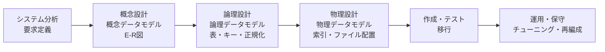

| 工程 | 内容 |
|---|---|
| システム分析・**要求定義** | 業務を調べ、必要なデータと処理を明確にする |
| **企業データモデル** | 部門ごとではなく **企業全体** のデータを1つのモデルに統合したもの。全社でデータを共有する基盤になる |
| 概念設計 | DBMSに依存しないE-R図などで、エンティティ・属性・リレーションシップ・カーディナリティを表す |
| 論理設計 | 表・主キー・外部キー・一貫性制約を決め、正規化する。ビューも定義する |
| 物理設計 | **副次索引**（主キー以外の列に作る索引）の追加、表の **分割法**（大きな表を行や列で分けて格納する方法）、ブロック長などを決める（[4.7節](#47-データベースの物理設計-)） |

---

## 3. 関係モデルと関係代数

### 3.1 関係モデルの用語 ★★

| 関係モデルの用語 | SQL／一般的な呼び方 |
|---|---|
| 関係（リレーション） | 表（テーブル） |
| タプル（組） | 行（レコード） |
| 属性 | 列（カラム） |
| 定義域（ドメイン） | 列が取り得る値の集合 |
| 次数 | 列の数 |
| 濃度（カーディナリティ） | 行の数 |
| **関係スキーマ** | 表の「型」。関係名と属性名の並び（例：`社員(社員番号, 氏名, 部門コード)`） |
| **実現値**（インスタンス） | ある時点で表に実際に入っている行の集まり（中身）。更新のたびに変わる |

💡 関係スキーマは「設計図（変わりにくい）」、実現値は「その時点の中身（変わる）」です。

### 3.2 キーと制約 ★★★

| キー | 説明 |
|---|---|
| **スーパーキー** | 行を一意に特定できる属性の集合（余分な属性を含んでもよい） |
| **候補キー** | 行を一意に特定できる **極小** の属性の集合（1つでも欠けると一意でなくなる） |
| **主キー** | 候補キーの中から1つ選んだもの。**NULL不可・重複不可** |
| 代理キー（サロゲートキー） | 業務上の意味を持たない連番などの人工キー |
| **外部キー** | 他の表の主キー（または候補キー）を参照する列。**参照制約** で整合性を保つ |

- **参照制約（参照整合性）**：外部キーの値は、参照先に存在する値か NULL でなければならない。
  - 参照先の行を削除するときの動作：`RESTRICT`（拒否）、`CASCADE`（連鎖して削除）、`SET NULL`（NULLにする）など。

⚠️ ひっかけ注意：外部キーは NULL を **許す** ことができます（未配属の社員の部門コードなど）。主キーは NULL を許しません。

### 3.3 関係代数 ★★

表に対する演算です。科目Aで「この結果になる演算はどれか」という形で出ます。

| 演算 | 意味 | SQLのイメージ |
|---|---|---|
| **選択** | 条件に合う **行** を取り出す | `WHERE` |
| **射影** | 指定した **列** を取り出す | `SELECT 列名` |
| **結合** | 共通の列の値で2つの表をつなぐ | `JOIN` |
| 和 | どちらかの表にある行 | `UNION` |
| 差 | 一方にあって他方にない行 | `EXCEPT` |
| 共通（積集合） | 両方にある行 | `INTERSECT` |
| 直積 | すべての行の組合せ | `CROSS JOIN` |
| 商 | 「すべての〇〇を含む」行を求める | `NOT EXISTS` の二重否定 |

💡 覚え方：「**選択は横（行）に切る、射影は縦（列）に切る**」。

⚠️ ひっかけ注意：和・差・共通は、2つの表の列構成（次数と定義域）が同じ **和両立** でないと演算できません。

---

## 4. 関数従属と正規化

### 4.1 関数従属 ★★★

**関数従属** とは「属性Xの値が決まると属性Yの値がただ1つに決まる」関係で、`X → Y` と書きます（XがYを決定する）。

- 例：`社員番号 → 氏名`（社員番号が決まれば氏名が1つに決まる）
- 逆の `氏名 → 社員番号` は成り立ちません（同姓同名がいるため）。

| 用語 | 意味 | 例（主キー {受注番号, 商品コード}） |
|---|---|---|
| **完全関数従属** | キー全体に従属し、キーの一部には従属しない | `{受注番号, 商品コード} → 数量` |
| **部分関数従属** | キーの **一部** だけで決まる | `商品コード → 商品名` |
| **推移的関数従属** | `X → Y`、`Y → Z` で、`X → Z` が間接的に成り立つ（Y→Xは成り立たない） | `受注番号 → 顧客コード → 顧客名` |

### 4.2 候補キーの求め方（例題で丁寧に） ★★★

候補キーは「**属性の閉包**」を使うと機械的に求められます。**閉包 X⁺** とは、「Xから関数従属をたどって決定できるすべての属性の集合」です。

**手順**

1. どの関数従属の **右辺にも現れない属性** を探す → これは他から決まらないので **必ず候補キーに含まれる**。
2. **右辺にしか現れない属性** は候補キーに含める必要がない。
3. 1. の属性集合の閉包を計算し、全属性が含まれれば候補キー。足りなければ、残りの属性を1つずつ加えて閉包を計算する。
4. 極小性（余分な属性がないか）を確認する。

**例題1**：関係 R(A, B, C, D, E)、関数従属 `A → B`、`{B, C} → D`、`D → E`

- 手順1：右辺に現れるのは B, D, E。右辺に現れないのは **A と C** → 必ずキーに含まれる。
- 手順3：{A, C}⁺ を計算します。

```
スタート       : {A, C}
A → B を適用   : {A, B, C}
{B,C} → D 適用 : {A, B, C, D}
D → E を適用   : {A, B, C, D, E}  ← 全属性がそろった
```

- 手順4：{A}⁺ = {A, B}、{C}⁺ = {C} なので、どちらか一方では足りません。よって **候補キーは {A, C} のみ** です。

**例題2**：関係 R(A, B, C, D)、関数従属 `{A, B} → C`、`C → D`、`D → A`

- 手順1：右辺に現れるのは C, D, A。右辺に現れないのは **B** だけ → B は必ず含まれる。
- {B}⁺ = {B} → 足りないので、A, C, D を1つずつ加えます。

| 試す集合 | 閉包の計算 | 結果 |
|---|---|---|
| {A, B} | AB→C で C、C→D で D | {A, B, C, D} ✅ 候補キー |
| {B, C} | C→D で D、D→A で A | {A, B, C, D} ✅ 候補キー |
| {B, D} | D→A で A、AB→C で C | {A, B, C, D} ✅ 候補キー |

- いずれも2属性で、1属性（{B}）では足りないので極小です。**候補キーは {A,B}、{B,C}、{B,D} の3つ** です。

⚠️ ひっかけ注意：候補キーは1つとは限りません。「右辺に現れない属性」を見落とさないことが最大のポイントです。

**主属性と非キー属性**：いずれかの候補キーに含まれる属性を **主属性**、どの候補キーにも含まれない属性を **非キー属性** といいます。例題2では A, B, C, D すべてが主属性です。

### 4.3 正規化の流れ ★★★

**正規化** とは、データの重複をなくし **更新時異状**（更新・挿入・削除のときに起きる不整合）を防ぐために表を分解することです。


| 正規形 | 条件 |
|---|---|
| **第1正規形** | すべての属性の値が **単一値**（繰返し項目・複合値がない） |
| **第2正規形** | 第1正規形 ＋ 非キー属性が候補キーに **完全関数従属**（部分関数従属がない） |
| **第3正規形** | 第2正規形 ＋ 非キー属性が候補キーに **推移的関数従属していない** |
| **BCNF** | すべての自明でない関数従属 `X → Y` で、**X がスーパーキー** |

💡 覚え方：「**1：繰返し、2：部分、3：推移**」。

### 4.4 正規化の例題 ★★★

**非正規形の受注伝票**（1つの受注に明細が繰り返す）

| 受注番号 | 受注日 | 顧客コード | 顧客名 | (商品コード, 商品名, 単価, 数量) の繰返し |
|---|---|---|---|---|
| 1001 | 4/1 | C01 | A商事 | (P1, ペン, 100, 10), (P2, ノート, 200, 5) |
| 1002 | 4/2 | C02 | B工業 | (P1, ペン, 100, 3) |

**関数従属**

- `受注番号 → 受注日, 顧客コード`
- `顧客コード → 顧客名`
- `商品コード → 商品名, 単価`
- `{受注番号, 商品コード} → 数量`

**ステップ1：第1正規形**（繰返しを行に展開。主キーは {受注番号, 商品コード}。以下、下線付きの列が主キーです）

| <ins>受注番号</ins> | <ins>商品コード</ins> | 受注日 | 顧客コード | 顧客名 | 商品名 | 単価 | 数量 |
|---|---|---|---|---|---|---|---|
| 1001 | P1 | 4/1 | C01 | A商事 | ペン | 100 | 10 |
| 1001 | P2 | 4/1 | C01 | A商事 | ノート | 200 | 5 |
| 1002 | P1 | 4/2 | C02 | B工業 | ペン | 100 | 3 |

この表には次の更新時異状があります。

- **更新異状**：ペンの単価を変えるとき、複数行を直さないと食い違う。
- **挿入異状**：まだ受注のない新商品を登録できない（主キーの受注番号がNULLになる）。
- **削除異状**：受注1002を削除すると、顧客B工業の情報も消えてしまう。

**ステップ2：第2正規形**（部分関数従属 `受注番号 → …`、`商品コード → …` を別表へ）

- 受注（<ins>受注番号</ins>, 受注日, 顧客コード, 顧客名）
- 商品（<ins>商品コード</ins>, 商品名, 単価）
- 受注明細（<ins>受注番号</ins>, <ins>商品コード</ins>, 数量）

**ステップ3：第3正規形**（推移的関数従属 `受注番号 → 顧客コード → 顧客名` を別表へ）

- 受注（<ins>受注番号</ins>, 受注日, 顧客コード）
- 顧客（<ins>顧客コード</ins>, 顧客名）
- 商品（<ins>商品コード</ins>, 商品名, 単価）
- 受注明細（<ins>受注番号</ins>, <ins>商品コード</ins>, 数量）


結果として、2.1節のE-R図と同じ構造になります。正規化とE-R図による設計は同じゴールを目指しているのです。

### 4.5 BCNF（ボイス・コッド正規形） ★★

第3正規形は「**非キー属性**」についての条件なので、主属性どうしの従属は見逃されます。BCNFはそれも排除します。

**例**：R(学生, 科目, 教員)。ルール「学生は科目ごとに教員を1人選ぶ」「教員は1科目だけを担当する」

- 関数従属：`{学生, 科目} → 教員`、`教員 → 科目`
- 候補キー：{学生, 科目} と {学生, 教員}（学生は右辺に現れないので必ず含まれる）
- 全属性が主属性なので、非キー属性がなく **第3正規形は満たします**。
- しかし `教員 → 科目` の決定項「教員」はスーパーキーではないので **BCNFではありません**。

BCNFにするには（<ins>教員</ins>, 科目）と（<ins>学生</ins>, <ins>教員</ins>）に分解します。ただし、元の `{学生, 科目} → 教員` という従属を1つの表で保証できなくなります（**従属性保存** が失われる）。

⚠️ ひっかけ注意：「BCNFへの分解は常に関数従属性を保存できる」は **誤り** です。第3正規形までは情報無損失かつ従属性保存で分解できますが、BCNFでは従属性保存できない場合があります。

### 4.6 非正規化（あえて正規化を崩す） ★

正規化しすぎると結合が増えて検索が遅くなることがあります。性能を優先して、集計値や頻繁に参照する列をあえて重複して持たせることを **非正規化** といいます（データウェアハウスでよく使われます）。

### 4.7 データベースの物理設計 ★

物理設計では、論理設計で決めた表を **記憶装置上にどう格納すれば速く・無駄なく扱えるか**（アクセス効率と記憶効率）を決めます。

| 検討項目 | 内容 |
|---|---|
| **論理データ構造のマッピング** | 表・列・関連を、DBMSのファイル・レコード・ページへ対応付ける |
| **ファイル編成** | 順編成（先頭から順に読む）、索引編成（索引で直接たどる）、直接編成（ハッシュで位置を計算）などから選ぶ |
| **最適ブロック設計** | 1回の入出力で読む単位（ブロック・ページ）の長さを決める。大きいと順次処理が速く、小さいとランダム処理の無駄が減る |
| **物理入出力** | ディスクとの実際の読み書き回数。物理設計の目標は物理入出力の回数を減らすこと |
| **ディスク容量見積り** | レコード長×件数だけでなく、ブロック化・空き領域・索引・ログの分まで見込む |
| **コンプレッション／デコンプレッション** | データを圧縮して格納し（コンプレッション）、読むときに伸長する（デコンプレッション）。容量とI/Oは減るがCPU負荷は増える |
| **インメモリデータベース** | 頻繁に使うデータを主記憶に置き、物理入出力そのものをなくす |
| **性能評価・性能改善ポイント** | 応答時間・スループットを見積り、索引の追加、表の分割、非正規化、ブロック長の変更など改善ポイントを洗い出す |

**計算例：ディスク容量の見積り**

- 公式：`1ブロックに入るレコード数 = ⌊ブロック長 × 格納率 ÷ レコード長⌋`（端数切捨て。レコードはブロックをまたがない）、`必要ブロック数 = ⌈レコード件数 ÷ 1ブロックのレコード数⌉`（端数切上げ）
- 数値例：レコード長 300 バイト、10万件、ブロック長 4,096 バイト、将来の追加に備えて各ブロックに 20% の空きを残す（格納率 80%）

```
1ブロックで使える長さ = 4,096 × 0.8 = 3,276.8 バイト
1ブロックのレコード数 = ⌊3,276.8 ÷ 300⌋ = ⌊10.9…⌋ = 10 件
必要ブロック数       = ⌈100,000 ÷ 10⌉ = 10,000 ブロック
必要容量             = 10,000 × 4,096 = 40,960,000 バイト ≒ 41 M バイト
```

⚠️ ひっかけ注意：単純に `300 × 100,000 = 30 M バイト` と答えるのは誤りです。**レコードはブロックをまたがない（切捨て）**、**ブロック数は切上げ** の2点がポイントです。

### 4.8 データベースの作成手順と評価・運用 ★

**作成手順**

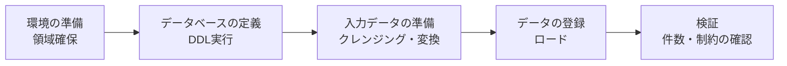

| 用語 | 意味 |
|---|---|
| **データベース定義情報** | スキーマ・表・索引・制約などの定義。DBMSの辞書（カタログ）に登録される |
| **レコード形式** | レコードを構成する項目の並び・型・長さ（固定長／可変長） |
| **親子関係** | 階層型・網型DBでの親レコードと子レコードの関係。登録時は **親を先に** 登録する |
| **キー順** | 主キーの順に並べてから一括登録（ロード）すると、索引作成や格納が効率的になる |
| **存在制約** | 「親が存在しなければ子は存在できない」という制約（例：受注がなければ受注明細は登録できない）。関係DBの参照制約に相当する |
| **インバーテッドファイル**（転置ファイル） | 「値 → その値を持つレコードの位置」の一覧を作ったファイル。主キー以外の項目で検索するための副次索引として使う（[5.11節](#511-インデックス-) の転置インデックスと同じ考え方） |

**評価・運用（データベースの運用・保守）**

- 運用中は応答時間・ロック待ち・ディスク使用量などを監視し、性能が落ちたら **チューニング**（索引の追加・削除、SQLの見直し、バッファの拡大など）を行います。
- 更新を繰り返すと、データが物理的に散らばったり（断片化）、削除跡の空き領域が残ったりして遅くなります。そこで、データを詰め直して並べ替える **再編成** を定期的に行います（[7.7節](#77-その他の障害回復用語と運用-)）。

---

## 5. SQL

**SQL（Structured Query Language）** は関係データベースを操作する言語です。次の3種類に分かれます。

| 分類 | 正式名称 | 主な文 |
|---|---|---|
| **DDL** | Data Definition Language：データ定義言語 | `CREATE`, `ALTER`, `DROP` |
| **DML** | Data Manipulation Language：データ操作言語 | `SELECT`, `INSERT`, `UPDATE`, `DELETE` |
| **DCL** | Data Control Language：データ制御言語 | `GRANT`, `REVOKE`（`COMMIT`, `ROLLBACK` を含める分類もある） |

### 5.0 この節で使うテーブル

以下の2つの表を使って、すべてのSQLの結果を示します。**山本さんは未配属（部門コードがNULL）**、**企画部には社員がいない** ことに注意してください。

**部門表**

| <ins>部門コード</ins> | 部門名 |
|---|---|
| D1 | 営業部 |
| D2 | 開発部 |
| D3 | 総務部 |
| D4 | 企画部 |

**社員表**（給与の単位は千円）

| <ins>社員番号</ins> | 氏名 | 部門コード | 給与 |
|---|---|---|---|
| E01 | 佐藤 | D1 | 300 |
| E02 | 鈴木 | D1 | 250 |
| E03 | 高橋 | D2 | 400 |
| E04 | 田中 | D2 | 350 |
| E05 | 伊藤 | D2 | 280 |
| E06 | 渡辺 | D3 | 220 |
| E07 | 山本 | NULL | 200 |

### 5.1 DDL（データ定義） ★★

```sql
CREATE TABLE 部門 (
  部門コード CHAR(2)     PRIMARY KEY,
  部門名     VARCHAR(20) NOT NULL UNIQUE
);

CREATE TABLE 社員 (
  社員番号   CHAR(3)     PRIMARY KEY,
  氏名       VARCHAR(20) NOT NULL,
  部門コード CHAR(2),
  給与       INTEGER     CHECK (給与 >= 0),
  FOREIGN KEY (部門コード) REFERENCES 部門(部門コード)
    ON DELETE SET NULL
);
```

| 制約 | 意味 |
|---|---|
| `PRIMARY KEY` | 主キー（一意＋NOT NULL） |
| `UNIQUE` | 重複不可（NULLは許す） |
| `NOT NULL` | NULL不可 |
| `CHECK` | 条件を満たす値だけ許す |
| `FOREIGN KEY … REFERENCES` | 外部キー（参照制約） |

その他のDDL：`ALTER TABLE 社員 ADD 入社日 DATE;`（列追加）、`DROP TABLE 社員;`（表の削除）、`CREATE INDEX idx1 ON 社員(部門コード);`（インデックス作成）。

**列制約と表制約**：上の例の `給与 INTEGER CHECK (給与 >= 0)` のように列の定義に続けて書くのが **列制約**、`FOREIGN KEY (部門コード) …` や `PRIMARY KEY (受注番号, 商品コード)` のように列定義とは別に書くのが **表制約** です。**複数列にまたがる制約（複合主キーなど）は表制約でしか書けません**。

**実表とビュー表**：`CREATE TABLE` で作り、実際にデータを格納する表が **実表**（基底表）、`CREATE VIEW` で定義し、実データを持たない仮想の表が **ビュー表** です（[5.9節](#59-ビュー-)）。

**主なデータ型**

| 分類 | 型 | 例 |
|---|---|---|
| **文字型** | `CHAR(n)`（固定長。足りない分は空白で埋める）、`VARCHAR(n)`（可変長） | `CHAR(3)` に 'E1' を入れると 'E1 ' |
| **数値型** | `INTEGER`、`SMALLINT`（整数）、`DECIMAL(p,s)` / `NUMERIC(p,s)`（全体 p 桁・小数 s 桁の固定小数点）、`REAL`・`FLOAT`（浮動小数点） | `DECIMAL(7,2)` → 最大 99999.99 |
| **日付型** | `DATE`（年月日）、`TIME`（時刻）、`TIMESTAMP`（日時） | `DATE '2026-10-26'` |

**TRIGGER（トリガ）**：表に INSERT・UPDATE・DELETE が行われたときに、**自動的に実行される処理** を定義します。更新履歴の記録や、関連表の自動更新に使います。

```sql
-- 社員の給与が更新されたら、変更履歴表に1行追加する
CREATE TRIGGER 給与変更記録
  AFTER UPDATE OF 給与 ON 社員
  REFERENCING OLD ROW AS O NEW ROW AS N
  FOR EACH ROW
  INSERT INTO 給与履歴 VALUES (N.社員番号, O.給与, N.給与, CURRENT_DATE);
```

💡 参照制約の `ON DELETE CASCADE`／`ON UPDATE CASCADE` は「親の削除・更新に子を追従させる」機能、トリガは「任意の処理を自動実行する」機能です。

### 5.2 基本の SELECT ★★★

SQLの句は **書く順番** と **実行される順番** が異なります。結果を予想するときは実行順で考えましょう。


**例1：給与300以上の社員を給与の高い順に**

```sql
SELECT 氏名, 給与
  FROM 社員
 WHERE 給与 >= 300
 ORDER BY 給与 DESC;
```

| 氏名 | 給与 |
|---|---|
| 高橋 | 400 |
| 田中 | 350 |
| 佐藤 | 300 |

**よく使う条件式**

| 書き方 | 意味 |
|---|---|
| `給与 BETWEEN 250 AND 300` | 250以上300以下（両端を含む） |
| `部門コード IN ('D1', 'D3')` | D1 または D3 |
| `氏名 LIKE '佐%'` | 「佐」で始まる（`%` は0文字以上、`_` は1文字） |
| `部門コード IS NULL` | NULLである（`= NULL` とは書けない） |
| `SELECT DISTINCT 部門コード` | 重複を除く |

⚠️ ひっかけ注意：`部門コード = NULL` は常に「不明（UNKNOWN）」になり、1行も選ばれません。NULLの判定は必ず `IS NULL` / `IS NOT NULL` を使います。

### 5.3 結合（JOIN） ★★★

**例2：内部結合（INNER JOIN）** … 両方の表に一致する行だけ

```sql
SELECT S.氏名, B.部門名
  FROM 社員 S
  INNER JOIN 部門 B ON S.部門コード = B.部門コード;
```

| 氏名 | 部門名 |
|---|---|
| 佐藤 | 営業部 |
| 鈴木 | 営業部 |
| 高橋 | 開発部 |
| 田中 | 開発部 |
| 伊藤 | 開発部 |
| 渡辺 | 総務部 |

→ 部門がNULLの **山本** と、社員のいない **企画部** は出てきません。

古い書き方として `FROM 社員 S, 部門 B WHERE S.部門コード = B.部門コード` も同じ結果になります（試験ではこちらもよく出ます）。

**相関名**：`FROM 社員 S` の `S` のように、表に付ける別名を **相関名** といいます。列名の前に `S.氏名` と付けてどの表の列かを区別します。同じ表を2回使う **自己結合** や **相関副問合せ**（例8）では必須です。

```sql
-- 自己結合の例：社員表に上司の社員番号（上司番号）がある場合、上司の氏名を並べる
SELECT 部下.氏名, 上司.氏名 AS 上司名
  FROM 社員 部下 JOIN 社員 上司 ON 部下.上司番号 = 上司.社員番号;
```

**例3：左外部結合（LEFT OUTER JOIN）** … 左の表の行はすべて残し、相手がなければNULL

```sql
SELECT B.部門名, S.氏名
  FROM 部門 B
  LEFT OUTER JOIN 社員 S ON B.部門コード = S.部門コード;
```

| 部門名 | 氏名 |
|---|---|
| 営業部 | 佐藤 |
| 営業部 | 鈴木 |
| 開発部 | 高橋 |
| 開発部 | 田中 |
| 開発部 | 伊藤 |
| 総務部 | 渡辺 |
| 企画部 | NULL |

| 結合の種類 | 残る行 |
|---|---|
| INNER JOIN | 両方に一致する行のみ |
| LEFT OUTER JOIN | 左表の全行 ＋ 一致した右表 |
| RIGHT OUTER JOIN | 右表の全行 ＋ 一致した左表 |
| FULL OUTER JOIN | 両方の全行 |
| CROSS JOIN | 全組合せ（直積）。4行×7行＝28行 |

💡 科目Bのコツ：「社員が1人もいない部門も表示したい」「売上0件の商品も一覧に出したい」という要件が出たら **外部結合** を疑います。NULLを0と表示したいときは `COALESCE(列, 0)`（最初のNULLでない値を返す関数）を使います。

### 5.4 集約関数と GROUP BY / HAVING ★★★

| 集約関数 | 意味 | NULLの扱い |
|---|---|---|
| `COUNT(*)` | 行数 | NULLの行も数える |
| `COUNT(列)` | NULLでない値の数 | NULLは除外 |
| `SUM(列)` / `AVG(列)` | 合計 / 平均 | NULLは除外 |
| `MAX(列)` / `MIN(列)` | 最大 / 最小 | NULLは除外 |

例：`SELECT COUNT(*), COUNT(部門コード), COUNT(DISTINCT 部門コード) FROM 社員;` → **7, 6, 3**

**例4：部門ごとの人数と平均給与**

```sql
SELECT 部門コード, COUNT(*) AS 人数, AVG(給与) AS 平均給与
  FROM 社員
 GROUP BY 部門コード;
```

| 部門コード | 人数 | 平均給与 |
|---|---|---|
| NULL | 1 | 200 |
| D1 | 2 | 275 |
| D2 | 3 | 343.33… |
| D3 | 1 | 220 |

→ NULLどうしは1つのグループにまとめられます。

**例5：HAVING でグループを絞る**

```sql
SELECT 部門コード, COUNT(*) AS 人数, AVG(給与) AS 平均給与
  FROM 社員
 GROUP BY 部門コード
HAVING COUNT(*) >= 2;
```

| 部門コード | 人数 | 平均給与 |
|---|---|---|
| D1 | 2 | 275 |
| D2 | 3 | 343.33… |

| | WHERE | HAVING |
|---|---|---|
| 絞り込む対象 | グループ化 **前** の行 | グループ化 **後** のグループ |
| 集約関数 | 使えない | 使える |

⚠️ ひっかけ注意：`GROUP BY` を使うとき、`SELECT` 句に書けるのは **GROUP BY に指定した列** と **集約関数** だけです。`SELECT 部門コード, 氏名 … GROUP BY 部門コード` はエラーになります。

### 5.5 副問合せ（サブクエリ） ★★★

**例6：平均給与より高い社員**（スカラ副問合せ：結果が1つの値）

```sql
SELECT 氏名, 給与
  FROM 社員
 WHERE 給与 > (SELECT AVG(給与) FROM 社員);
```

途中計算：平均 ＝ (300+250+400+350+280+220+200) ÷ 7 ＝ 2000 ÷ 7 ≒ 285.7

| 氏名 | 給与 |
|---|---|
| 佐藤 | 300 |
| 高橋 | 400 |
| 田中 | 350 |

**例7：IN 副問合せ（結果が複数行）**

```sql
SELECT 氏名
  FROM 社員
 WHERE 部門コード IN (SELECT 部門コード FROM 部門 WHERE 部門名 = '開発部');
```

結果：高橋、田中、伊藤

⚠️ ひっかけ注意（NOT IN と NULL）：`WHERE 部門コード NOT IN ('D2')` の結果は **佐藤・鈴木・渡辺の3人** です。部門コードがNULLの山本は、`NULL <> 'D2'` が UNKNOWN になるため **選ばれません**。

**例8：相関副問合せ**（外側の行ごとに内側を実行する）… 自部門の平均より給与が高い社員

```sql
SELECT S1.氏名, S1.部門コード, S1.給与
  FROM 社員 S1
 WHERE S1.給与 > (SELECT AVG(S2.給与)
                    FROM 社員 S2
                   WHERE S2.部門コード = S1.部門コード);
```

途中計算：D1平均 275、D2平均 343.3、D3平均 220（渡辺は220で「より大きい」を満たさない）、山本は部門NULLで内側が空（平均NULL）になり比較不能

| 氏名 | 部門コード | 給与 |
|---|---|---|
| 佐藤 | D1 | 300 |
| 高橋 | D2 | 400 |
| 田中 | D2 | 350 |

### 5.6 EXISTS / NOT EXISTS ★★★

`EXISTS (副問合せ)` は「副問合せの結果が1行以上あれば真」です。中の `SELECT *` の列は何でもかまいません。

**例9：社員が1人以上いる部門**

```sql
SELECT 部門名
  FROM 部門 B
 WHERE EXISTS (SELECT * FROM 社員 S WHERE S.部門コード = B.部門コード);
```

結果：営業部、開発部、総務部

**例10：社員が1人もいない部門**（`NOT EXISTS`）

```sql
SELECT 部門名
  FROM 部門 B
 WHERE NOT EXISTS (SELECT * FROM 社員 S WHERE S.部門コード = B.部門コード);
```

結果：企画部

💡 「〜が存在しない」「〜をすべて満たす（＝満たさないものが存在しない）」は NOT EXISTS の出番です。関係代数の **商** に相当する「すべての商品を購入した顧客」は NOT EXISTS を二重にして書きます。

### 5.7 ウィンドウ関数（参考） ★

近年の科目A（旧午前）では `PARTITION BY` を使うウィンドウ関数も出題されています（令和6年度秋期の講評で指摘あり）。集約しつつ **行を残す** のが特徴です。

```sql
SELECT 氏名, 部門コード, 給与,
       RANK() OVER (PARTITION BY 部門コード ORDER BY 給与 DESC) AS 部門内順位
  FROM 社員;
```

D2なら高橋1位・田中2位・伊藤3位、D1なら佐藤1位・鈴木2位…のように、部門ごとに順位が付きます。`GROUP BY` と違い、7行すべてが出力されます。

### 5.8 データ更新（INSERT / UPDATE / DELETE） ★★

```sql
INSERT INTO 部門 (部門コード, 部門名) VALUES ('D5', '法務部');
UPDATE 社員 SET 給与 = 給与 * 1.1 WHERE 部門コード = 'D2';
DELETE FROM 社員 WHERE 社員番号 = 'E07';
```

⚠️ `UPDATE` や `DELETE` で `WHERE` を忘れると **全行** が対象になります。

### 5.9 ビュー ★★

**ビュー** は、SELECT文の結果に名前を付けた **仮想の表** です（3層スキーマの外部スキーマ）。

```sql
CREATE VIEW 開発部社員 AS
  SELECT 社員番号, 氏名, 給与 FROM 社員 WHERE 部門コード = 'D2';
```

| メリット | 内容 |
|---|---|
| 機密保護 | 見せたい列・行だけを公開できる（給与を隠すなど） |
| 操作の簡略化 | 複雑な結合を隠して単純な表に見せる |
| 論理的データ独立性 | 実表の構造が変わってもビュー定義を直せばアプリは影響を受けない |

⚠️ 更新できないビュー：`GROUP BY`・集約関数・`DISTINCT` を含むビューや、複数表の結合ビューは原則として更新（INSERT/UPDATE/DELETE）できません。

### 5.10 DCL（権限管理） ★★

```sql
GRANT SELECT, UPDATE ON 社員 TO user01;   -- 権限を与える
REVOKE UPDATE ON 社員 FROM user01;        -- 権限を取り消す
```

ビューに対して `GRANT SELECT` を行えば、実表に権限を与えずに必要な部分だけ見せられます。

| 権限（アクセス権） | SQL | 許される操作 |
|---|---|---|
| **参照権限** | `SELECT` | データを検索する |
| **挿入権限** | `INSERT` | 行を新規登録する |
| **更新権限** | `UPDATE` | 既存の行を変更する（列単位で `UPDATE(給与)` のように限定可） |
| **削除権限** | `DELETE` | 行を削除する |
| 参照制約の作成 | `REFERENCES` | その表を外部キーの参照先にする |
| すべて | `ALL PRIVILEGES` | 上記すべて |

- `GRANT … TO 利用者 WITH GRANT OPTION` とすると、受け取った利用者がさらに他人へ権限を与えられます。
- DBへの **接続権限** や表の作成権限などは製品ごとの文（例：`GRANT CONNECT`、`GRANT CREATE TABLE`）で与えます。
- 個々の利用者ではなく **ロール**（権限の束）に権限を与え、ロールを利用者に割り当てると管理が楽になります。

💡 最小権限の原則：業務に必要な権限だけを与えます（例：照会担当者には `SELECT` だけ）。

### 5.11 インデックス ★

**インデックス（索引）** は検索を速くするための仕組みです。

| 種類 | 特徴 |
|---|---|
| **B+木インデックス** | 範囲検索・等価検索の両方に強い。最も一般的 |
| ハッシュインデックス | 等価検索（`=`）に非常に速いが、範囲検索は苦手 |
| ビットマップインデックス | 値の種類が少ない列（性別など）向き |

⚠️ インデックスを増やすと検索は速くなりますが、**更新（INSERT/UPDATE/DELETE）は遅くなります**（インデックスも更新が必要なため）。

**さらに押さえたいインデックスの種類**

| 種類 | 特徴 |
|---|---|
| **ユニークインデックス** | 同じキー値を許さないインデックス。主キー制約・一意性制約の実現に使われる |
| **クラスタ化インデックス** | インデックスのキー順に **データ行そのものを物理的に並べて格納** する。範囲検索・並べ替えが速い。並べ方は1通りしかないので **1表に1つ** だけ |
| 非クラスタ化インデックス | データの並びとは無関係に、キー値と行の位置を持つ。1表に複数作れる |
| **B-tree（B木／B+木）インデックス** | 木の高さがそろった平衡木。等価・範囲検索とも安定して速い |
| **カバリングインデックス** | 問合せで使う列がすべてインデックスに含まれているので、表本体を読まずに **インデックスだけで結果を返せる** 状態（または、そのように作ったインデックス） |
| **転置インデックス** | 「単語 → その単語を含む文書の一覧」を持つ。**全文検索** エンジンの基本構造 |

**インデックス設計の考え方（インデックス数と負荷）**

| インデックスを作るべき列 | インデックスが効きにくい・避けるべき場合 |
|---|---|
| WHERE句・結合条件・ORDER BY に頻繁に使う列 | 更新が非常に多い表（インデックス数が多いほど更新 **負荷** が増える） |
| 値の種類が多く、絞込み効果が高い列（B-tree） | 行数が少ない表（全件読んだほうが速い） |
| 値の種類が少ない列を集計する分析系（ビットマップ） | 列に関数や演算をかけた条件（`WHERE 給与 * 1.1 > 300` など） |
| | 前方一致でない LIKE（`'%山'`） |

### 5.12 データベース言語の利用形態と埋込みSQL ★

SQLの使い方は大きく2つに分かれます。

| 方式 | 内容 | 具体的な形態 |
|---|---|---|
| **独立言語方式** | SQLを単独で使う | **会話型SQL**（端末からSQLを入力して結果をすぐ見る）、**コマンド方式**（コマンド・スクリプトで実行）、**フォーム**（画面の入力欄に条件を入れると問合せが組み立てられる） |
| **親言語方式** | C・COBOL・Java などのプログラム（**親言語**）からSQLを使う | **埋込みSQL**（プログラム中に `EXEC SQL … ;` と直接書く）、**モジュール言語**（SQL文を別のモジュールに手続きとしてまとめ、親言語から CALL する）、API（JDBC・ODBCなど） |

**問合せ（クエリ）** は、データベースに対する検索要求（主に SELECT 文）のことです。

**カーソル**：SELECT の結果は複数行ですが、親言語の変数は1行分しか受け取れません。そこで、結果の行を **1行ずつ取り出すための仕組み** がカーソルです。

```sql
EXEC SQL DECLARE C1 CURSOR FOR            -- ① カーソルの宣言
  SELECT 氏名, 給与 FROM 社員 WHERE 部門コード = :部門;
EXEC SQL OPEN C1;                          -- ② 操作の開始（問合せを実行）
-- 親言語のループの中で
EXEC SQL FETCH C1 INTO :氏名, :給与;        -- ③ 1行読み込み（データがなくなるまで繰り返す）
EXEC SQL UPDATE 社員 SET 給与 = 給与 + 10
  WHERE CURRENT OF C1;                     --   カーソル位置の行を更新することもできる
EXEC SQL CLOSE C1;                         -- ④ 操作の終了
```

- `:部門` のようにコロンを付けた変数は **ホスト変数**（親言語側の変数）です。
- **非カーソル操作**：結果が1行だけの SELECT（`SELECT … INTO :変数`）や、INSERT・UPDATE・DELETE はカーソルなしで実行できます。

💡 覚え方：「**DECLARE → OPEN → FETCH（繰返し） → CLOSE**」の順。ファイル処理の「宣言 → オープン → 読込み → クローズ」と同じです。

---

## 6. トランザクションと同時実行制御

### 6.1 トランザクションとACID特性 ★★★

**トランザクション** とは、「全部成功するか、全部取り消すか」でなければならない一連の処理のまとまりです（例：A口座から1万円引き出し＋B口座に1万円入金）。トランザクションが満たすべき性質を **ACID特性** といいます。

| 特性 | 英語 | 意味 | 実現する仕組み |
|---|---|---|---|
| **原子性** | Atomicity | 全部実行されるか、まったく実行されないか | ロールバック |
| **一貫性** | Consistency | 実行前後でデータの整合性が保たれる | 整合性制約 |
| **独立性（隔離性）** | Isolation | 同時に実行しても、順番に実行した場合と同じ結果になる | 排他制御（ロック） |
| **耐久性（永続性）** | Durability | コミットした結果は障害が起きても失われない | ログ・ロールフォワード |

- **コミット（COMMIT）**：トランザクションの結果を確定する。
- **ロールバック（ROLLBACK）**：トランザクションの更新を取り消す。

### 6.2 同時実行で起こる問題 ★★

排他制御をしないと、次のような問題が起こります。

**ロストアップデート（更新の消失）の例**：在庫100個に対して、T1が30個出庫、T2が20個出庫する場合

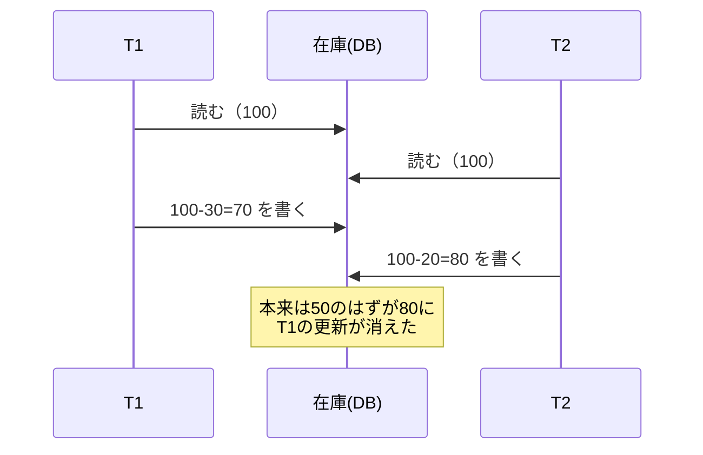

| 現象 | 内容 |
|---|---|
| **ロストアップデート** | 他のトランザクションの更新が上書きされて消える |
| **ダーティリード** | 他のトランザクションの **未コミット** のデータを読んでしまう |
| **ノンリピータブルリード** | 同じ行を2回読むと、間に他者が更新・コミットして値が変わっている |
| **ファントムリード** | 同じ条件で2回検索すると、間に他者が挿入して **行が増えて** いる |

### 6.3 ロック（排他制御） ★★★

**ロック** はデータに「使用中」の印を付けて、他のトランザクションのアクセスを制限する仕組みです。

| ロックの種類 | 用途 | 別名 |
|---|---|---|
| **共有ロック** | 読取り用。他者も読める（書けない） | 読取りロック、Sロック |
| **専有ロック** | 更新用。他者は読むことも書くこともできない | 排他ロック、書込みロック、Xロック |

**ロックの両立性**（○＝同時にかけられる、×＝待たされる）

| 先にかかっている＼後から要求 | 共有ロック | 専有ロック |
|---|---|---|
| **共有ロック** | ○ | × |
| **専有ロック** | × | × |

💡 覚え方：「**共有どうしだけ仲良し**」。

**ロックの粒度**：ロックをかける単位（表・ページ・行）。

| 粒度 | 同時実行性（並行性） | ロック管理の負荷 |
|---|---|---|
| 大きい（表単位） | 低い（待ちが増える） | 小さい（ロック数が少ない） |
| 小さい（行単位） | 高い | 大きい |

**コミットメント制御**：トランザクションの終わりに、更新を確定（コミット）するか取り消す（ロールバック）かを決め、**確定するまでは他のトランザクションに途中結果を見せない** ように制御することです。ロックはコミット（またはロールバック）まで保持されます。分散環境で複数サイトのコミットをそろえるのが2相コミットメント（[8.2節](#82-2相コミット-)）です。

### 6.4 2相ロック方式 ★★

**2相ロック方式（2PL：Two-Phase Locking）** は、トランザクションを次の2つの相に分けるルールです。

1. **成長相**：ロックを獲得していくだけ（解除しない）
2. **縮退相**：ロックを解除していくだけ（新たに獲得しない）

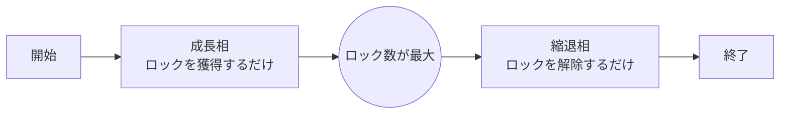

- 結論：全トランザクションが2相ロックに従えば、**直列化可能性**（順番に1つずつ実行したのと同じ結果になること）が保証されます。
- ⚠️ ただし **デッドロックは防げません**。

### 6.5 デッドロック ★★★

**デッドロック** とは、複数のトランザクションが互いに相手のロック解除を待ち合って、どれも進めなくなる状態です。

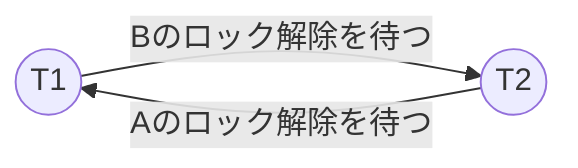

- T1：A をロック → B をロックしようとして待つ
- T2：B をロック → A をロックしようとして待つ

| 対策 | 内容 |
|---|---|
| ロック順序の統一 | 全トランザクションで「A → B」の順にロックする（予防） |
| 検出と解消 | **待ちグラフ（WFG：Wait-For Graph）** で閉路を検出し、どれかをロールバック |
| タイムアウト | 一定時間待ったらロールバック |
| 時刻印による予防（Wait-Die／Wound-Wait） | トランザクションの開始時刻（古い＝優先度が高い）で「待つ」か「ロールバックする」かを決め、待ちの閉路ができないようにする |

**Wait-Die 方式と Wound-Wait 方式**：ロックを要求したトランザクションと、ロックを持っているトランザクションの **開始時刻の古さ** を比べます。

| 状況 | Wait-Die 方式 | Wound-Wait 方式 |
|---|---|---|
| **古い** T が、新しい T の持つロックを要求 | 古い方が **待つ**（Wait） | 古い方が新しい方を **ロールバックさせる**（Wound：傷つける） |
| **新しい** T が、古い T の持つロックを要求 | 新しい方が **自分でロールバック**（Die：死ぬ） | 新しい方が **待つ**（Wait） |

- どちらも、ロールバックされるのは常に **新しい方** です。ロールバックされたトランザクションは **元の開始時刻のまま** 再実行するので、いずれ最古になって必ず完了できます（飢餓状態を防ぐ）。
- 💡 覚え方：名前は「古い方が要求したときの動作 − 新しい方が要求したときの動作」の順。Wait-Die は「古いは待つ・新しいは死ぬ」、Wound-Wait は「古いは傷つける・新しいは待つ」。

### 6.6 その他の同時実行制御 ★

| 方式 | 内容 |
|---|---|
| **楽観的ロック（楽観的同時実行制御）** | ロックせずに処理し、更新時にバージョン番号などで他者の更新がなかったか確認する。競合が少ない場合に有効 |
| 時刻印（タイムスタンプ）方式 | トランザクションの開始時刻の順序で実行順を決める |
| **MVCC（Multi-Version Concurrency Control：多版同時実行制御）** | 更新前の版を残し、読取りは古い版を読むことで読取りと書込みが互いを待たない |
| セマフォ方式 | OSの排他制御で使う **セマフォ**（P操作で資源を確保、V操作で解放するカウンタ）で共有データへのアクセスを1つに制限する。原理はロックと同じ |

### 6.7 隔離性水準 ★★

SQLでは `SET TRANSACTION ISOLATION LEVEL …` で、独立性の厳しさ（**隔離性水準**）を選べます。厳しいほど安全ですが、同時実行性は下がります。

| 隔離性水準 | ダーティリード | ノンリピータブルリード | ファントムリード |
|---|---|---|---|
| READ UNCOMMITTED | 起こり得る | 起こり得る | 起こり得る |
| READ COMMITTED | 起こらない | 起こり得る | 起こり得る |
| REPEATABLE READ | 起こらない | 起こらない | 起こり得る |
| **SERIALIZABLE** | 起こらない | 起こらない | 起こらない |

💡 覚え方：下へ行くほど **1つずつ「起こらない」が増える**。名前がそのまま防げる現象を表しています（COMMITTED → コミット済みしか読まない＝ダーティリード防止、REPEATABLE → 繰り返し読める＝ノンリピータブル防止）。

**スキュー（skew）**：「ゆがみ・偏り」という意味で、データベースでは主に次の2つの意味で使われます。

- **書込みスキュー（write skew）**：MVCCによるスナップショット分離で起こる異常です。2つのトランザクションが **同じ時点の古い版** を読んで判断し、**別々の行** を更新するため、個々には正しくても合わせると制約が破れます。
  - 例：「当直医は最低1人必要」というルールで、当直医AとBの2人がいるとき、Aは「Bがいるから大丈夫」と判断して自分を外し、同時にBも「Aがいるから大丈夫」と判断して自分を外す → 当直医が0人になる。
  - 更新する行が違うのでロストアップデートとして検出されません。SERIALIZABLE にするか、読んだ行を `SELECT … FOR UPDATE` でロックして防ぎます。
- **データスキュー**：分散・並列処理で、データが特定のノードや区画（パーティション）に **偏る** ことです。そのノードだけ処理が集中し、全体の性能が落ちます（例：シャーディングのキーを「都道府県」にすると東京に集中する）。

### 6.8 分散システムのトランザクション（Saga・TCC） ★

マイクロサービス（機能ごとに独立したDBを持つ小さなサービスの集まり）では、複数のDBにまたがる処理に2相コミットを使うと、ロックが長く続き可用性が下がります。そこで、**各サービスのローカルなトランザクションを順に確定し、失敗したら取り消し処理で辻つまを合わせる** 方式が使われます。

| 用語 | 内容 |
|---|---|
| **補償トランザクション** | すでにコミット済みの処理を **打ち消す逆向きの処理**（例：「在庫を引き当てた」に対する「引当てを戻す」）。ロールバックの代わりに使う |
| **Saga パターン** | 一連の処理を複数のローカルトランザクションの連鎖として実行し、途中で失敗したら、それまでに完了した処理の補償トランザクションを **逆順に** 実行する |
| **TCC パターン**（Try-Confirm/Cancel） | ①**Try**：各サービスで資源を **仮押さえ** する → ②全部成功なら **Confirm**（確定）、1つでも失敗なら **Cancel**（仮押さえを解放）。2相コミットに似た考え方を業務レベルで実現する |

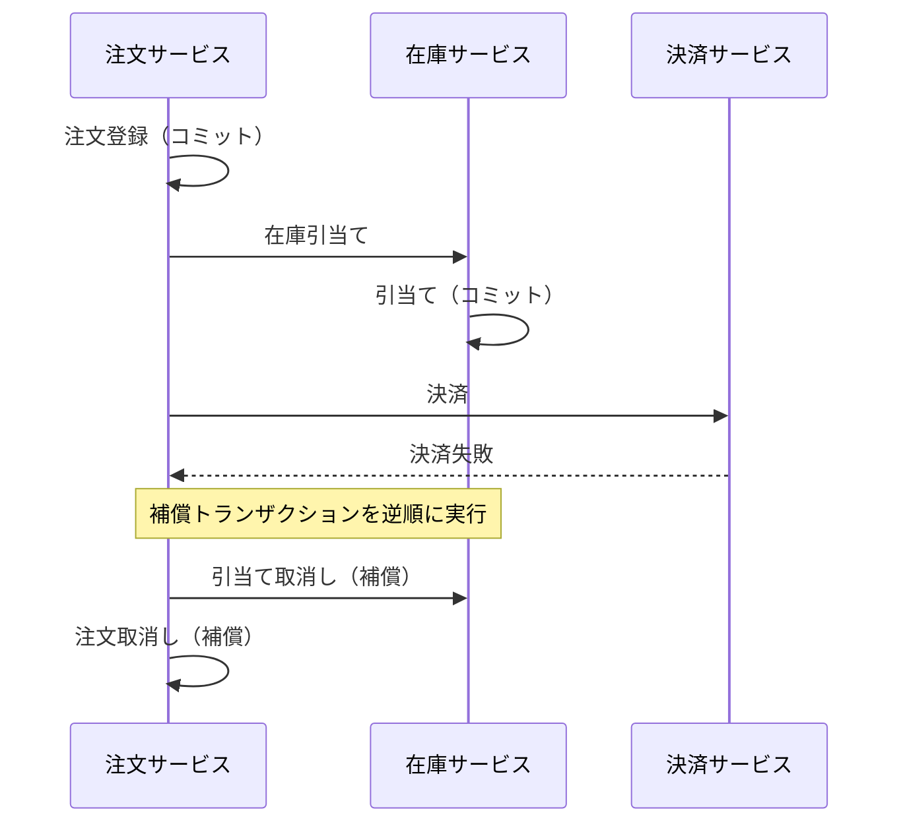

⚠️ Saga は途中の状態が他から見えてしまう（隔離性がない）ため、ACID ではなく **結果整合性**（[8.4節](#84-cap定理とbase-)）を前提にした設計です。

---

## 7. 障害回復

### 7.1 ログファイル ★★★

**ログファイル（ジャーナルファイル）** には、データベースの更新内容が時系列に記録されます。

| ログの内容 | 使い道 |
|---|---|
| **更新前ログ（更新前イメージ）** | 更新を取り消す → **ロールバック（UNDO）** に使う |
| **更新後ログ（更新後イメージ）** | 更新をやり直す → **ロールフォワード（REDO）** に使う |

💡 覚え方：「**前で戻す（ロールバック）、後で進める（ロールフォワード）**」。

**WAL（Write Ahead Log：先行書込みログ）**：データベース本体を書き換える **前に**、必ずログを書き出すという原則です。これによりログから必ず回復できます。

### 7.2 チェックポイント ★★★

DBMSは性能のため、更新内容をいったん **メモリ上のバッファ** に置き、まとめてディスクに書きます。**チェックポイント** では、バッファの内容をディスクに強制的に書き出し、その時点の状態をログに記録します。

- 結論：障害時には、チェックポイント以降のログだけを処理すればよいので **回復時間が短く** なります。

### 7.3 システム障害からの回復（ウォームスタート） ★★★

電源断やOSダウンなどで **メモリ上のデータが失われた** 場合の回復です。チェックポイントと障害発生時点で、各トランザクションの扱いは次のように決まります。

```mermaid
gantt
    title トランザクションの実行期間（CP＝チェックポイント 10:30、障害 11:00）
    dateFormat HH:mm
    axisFormat %H:%M
    section T1
    CP前に開始・CP前にコミット      :t1, 10:00, 10:20
    section T2
    CP前に開始・障害前にコミット    :t2, 10:10, 10:45
    section T3
    CP後に開始・障害前にコミット    :t3, 10:35, 10:50
    section T4
    CP前に開始・障害時に未完了      :t4, 10:15, 11:00
    section T5
    CP後に開始・障害時に未完了      :t5, 10:40, 11:00
```

| トランザクション | 状態 | 回復処理 |
|---|---|---|
| T1 | CP前にコミット済み | **何もしない**（CPでディスクに反映済み） |
| T2 | CP後〜障害前にコミット | **ロールフォワード**（更新後ログで再現） |
| T3 | CP後に開始し障害前にコミット | **ロールフォワード** |
| T4 | 障害時に未コミット | **ロールバック**（更新前ログで取消し） |
| T5 | 障害時に未コミット | **ロールバック** |

💡 判断のコツ：「**障害時点でコミット済みならロールフォワード、未コミットならロールバック、CP前に終わったものは対象外**」。

### 7.4 媒体障害からの回復 ★★

ディスク故障などで **データベースそのものが壊れた** 場合は、次の手順で回復します。


⚠️ ひっかけ注意：媒体障害では **ロールフォワード** を使います（ロールバックではありません）。そのため、ログファイルはデータベースとは **別のディスク** に置き、二重化しておくことが重要です。

### 7.5 トランザクション障害 ★

プログラムの異常終了やデッドロックで、ある1つのトランザクションが失敗した場合は、そのトランザクションだけを更新前ログで **ロールバック** します。

### 7.6 バックアップの種類 ★

| 方式 | 内容 | 復元の手間 |
|---|---|---|
| フルバックアップ | 全データを取得 | 1回分を戻すだけ |
| 差分バックアップ | 前回 **フル** 以降の変更分 | フル＋最新の差分1つ |
| 増分バックアップ | 前回の **バックアップ（種類を問わず）** 以降の変更分 | フル＋すべての増分を順に |

### 7.7 その他の障害回復用語と運用 ★

| 用語 | 意味 |
|---|---|
| **ダンプファイル** | データベースの内容をある時点で丸ごと書き出したファイル（バックアップの実体） |
| **リストア** | バックアップ（ダンプ）からデータベースを復元すること。媒体障害では「リストア → ロールフォワード」の順 |
| **世代管理** | バックアップを複数世代（例：3世代＝祖父・父・子）保管し、最新の1つが壊れていても1つ前から戻せるようにする |
| **データディレクトリ** | DBMSがデータファイル・ログ・設定などを置く格納場所（ディレクトリ）。バックアップや移行の対象範囲を決めるときに意識する |
| **シャドウページ法** | 更新するページを **別の場所にコピーして書き換え**、コミット時にページ表（ポインタ）を新しいページに切り替える方式。障害時は古いページ表を使えば更新前に戻るので、UNDO用のログが不要 |
| **ウォームスタート** | システム障害後、ログを使って **障害直前のコミット済み状態** を再現して再開する（[7.3節](#73-システム障害からの回復ウォームスタート-)） |
| **コールドスタート** | ログによる回復ができない（またはしない）場合に、**バックアップ時点の状態などから初期化して** 再開する。それ以降の更新は失われるか、再入力が必要 |
| **再編成** | 更新・削除の繰返しで断片化したデータを詰め直し、格納順を整えてアクセス効率を回復させる。オフライン（停止して）実施することが多い |

💡 「ウォーム（温かい）＝メモリ上の状態をログで温め直して再開」「コールド（冷たい）＝ゼロに近い状態から再開」と覚えます。

---

## 8. 分散データベース・NoSQL・ビッグデータ

### 8.1 分散データベースと透過性 ★★

**分散データベース** は、ネットワークでつながった複数のサイト（拠点）にデータを分散させつつ、利用者には1つのデータベースのように見せる仕組みです。この「分散を意識させない」性質を **透過性** といいます。

| 透過性 | 意味 |
|---|---|
| 位置に対する透過性 | データがどのサイトにあるか意識しなくてよい |
| 移動に対する透過性 | データが別サイトに移動してもアプリを変えなくてよい |
| 分割に対する透過性 | 1つの表が複数サイトに分割されていても1つの表として扱える |
| 複製に対する透過性 | 複製（レプリカ）が複数あっても意識しなくてよい |

### 8.2 2相コミット ★★★

分散データベースで、複数サイトにまたがるトランザクションの原子性を保証する仕組みが **2相コミット（2PC：Two-Phase Commit）** です。

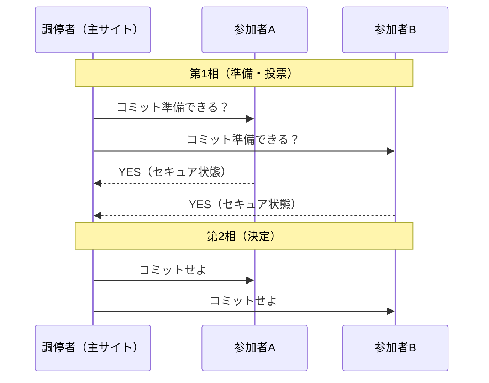

- 1つでも「NO」があれば、全参加者にロールバックを指示します。
- 参加者は第1相でYESと答えたあと、調停者の指示があるまでコミットもロールバックもできない **セキュア状態（不確定状態）** になります。⚠️ この間に調停者が障害を起こすと、参加者は待ち続けることになる（ブロッキング）のが2相コミットの弱点です。

⚠️ ひっかけ注意：**2相ロック**（同時実行制御）と **2相コミット**（分散トランザクションの原子性）は別物です。

### 8.3 レプリケーション ★

**レプリケーション** は、データの複製を別サイトに作って同期させる仕組みです。同期型（更新と同時に複製先も更新）と非同期型（遅れて反映）があります。負荷分散や災害対策に使われます。

### 8.4 CAP定理とBASE ★★

**CAP定理**：分散システムは次の3つを **同時にすべては満たせない**（ネットワーク分断が起きたとき、一貫性と可用性のどちらかを優先する必要がある）という定理です。

| 頭文字 | 性質 | 意味 |
|---|---|---|
| C | Consistency：一貫性 | どのノードから読んでも最新のデータが得られる |
| A | Availability：可用性 | 常に応答が返る |
| P | Partition tolerance：分断耐性 | ネットワークが分断されても動き続ける |

**BASE特性**：NoSQLが重視する性質で、ACIDの厳密な一貫性の代わりに可用性を優先します。

- **B**asically **A**vailable（基本的に利用可能）
- **S**oft state（状態は厳密でなくてよい）
- **E**ventual consistency（**結果整合性**：時間がたてば最終的に一貫する）

### 8.5 NoSQL ★★

**NoSQL（Not only SQL）** は、関係データベース以外のデータベースの総称です。スキーマが柔軟で、サーバを増やして性能を上げる **スケールアウト** に向いています。

| 種類 | データの持ち方 | 向いている用途 | 代表例 |
|---|---|---|---|
| **キーバリュー型** | キーと値の組 | セッション管理、キャッシュ | Redis |
| **ドキュメント型** | JSONなどの文書単位 | 構造が変わりやすいデータ | MongoDB |
| **列指向（ワイドカラム）型** | 列ファミリ単位 | 大量データの書込み・集計 | Apache Cassandra、HBase |
| **グラフ型** | ノードとエッジ（関係） | SNSの友人関係、推薦 | Neo4j |

**代表的なDBMS製品**（いずれもOSSまたは無償で使える代表例）

| 分類 | 製品 | 特徴 |
|---|---|---|
| 関係DB | **MySQL** | Webシステムで広く使われるRDBMS。読取り性能が高い |
| 関係DB | **PostgreSQL** | 標準SQLへの準拠度が高く、機能が豊富なRDBMS。MVCCを採用 |
| 関係DB | **SQLite** | サーバを持たず、DB全体を **1つのファイル** に格納する組込み型RDBMS。スマートフォンアプリなどで使われる |
| NoSQL（列指向） | **Apache Cassandra** | 多数のノードに分散し、書込み性能と可用性が高い。結果整合性 |
| NoSQL（ドキュメント） | **Apache CouchDB** | JSON文書を格納し、HTTP（REST）で操作する。複製（レプリケーション）機能が強い |
| NoSQL（ドキュメント） | **MongoDB** | JSON風（BSON）の文書を格納。スキーマが柔軟 |
| NoSQL（キーバリュー） | **Redis** | インメモリ型のキーバリューストア。キャッシュやセッション管理に使う |
| NoSQL（グラフ） | **Neo4j** | プロパティグラフ型のグラフDB |

**RDBMS と NoSQL の使い分け**

| 観点 | RDBMS | NoSQL |
|---|---|---|
| スキーマ | 事前に厳密に定義 | 柔軟（スキーマレスも可） |
| 一貫性 | ACID（強い一貫性） | BASE（結果整合性）が多い |
| 拡張 | スケールアップ中心 | スケールアウトしやすい |
| 結合・複雑な問合せ | 得意 | 苦手（データを重複して持つ設計が多い） |
| 留意事項 | 大量データ・高頻度書込みで性能限界 | トランザクション・整合性はアプリ側で担保する必要がある |

### 8.6 ビッグデータとデータ活用 ★★

**ビッグデータ** は、従来のDBMSでは扱いにくい大量・多様・高速なデータです。特徴は **3V**（**V**olume：量、**V**ariety：多様性、**V**elocity：速度）で表され、Veracity（正確性）、Value（価値）を加えて5Vとすることもあります。

| 用語 | 内容 |
|---|---|
| **データウェアハウス（DWH）** | 業務システムのデータを時系列に統合・蓄積した、分析用のデータベース |
| データマート | DWHから部門・目的別に切り出した小さなDWH |
| **データレイク** | 構造化・非構造化を問わず、**加工前の生データ** をそのまま蓄える場所 |
| **ETL** | Extract（抽出）・Transform（変換）・Load（書込み）。DWHへデータを取り込む処理 |
| **OLAP**（Online Analytical Processing：オンライン分析処理） | 多次元データを対話的に分析する |
| データマイニング | 大量データから統計・機械学習で未知の規則性を発見する |
| Hadoop | 大量データを多数のサーバで分散処理するOSS（HDFS＋MapReduce） |
| メタデータ | データについてのデータ（列の意味、作成日など） |
| データカタログ | 組織内のデータの所在・意味を検索できるようにした目録 |

**OLAPの操作**

| 操作 | 内容 |
|---|---|
| ドリルダウン | 集計の粒度を細かくする（年 → 月 → 日） |
| ドリルアップ（ロールアップ） | 集計の粒度を粗くする（日 → 月 → 年） |
| スライス | 多次元データからある次元の値を固定して切り出す（例：2026年だけ） |
| ダイス | 分析の軸（次元）を入れ替える |

（補足：一般的なOLAPの解説では、複数の次元で範囲を指定して立方体の一部を切り出す操作を「ダイス」、軸を回転させて入れ替える操作を「ピボット」と呼び分けることもあります。）

**OLTP と OLAP**

| | **OLTP**（Online Transaction Processing：オンライントランザクション処理） | OLAP |
|---|---|---|
| 目的 | 日々の業務処理（受注登録、入出金など） | 蓄積データの分析・意思決定支援 |
| 処理 | 少量のデータを高頻度に更新 | 大量のデータを読み取り・集計 |
| データ | 正規化された最新データ | 非正規化された履歴データ（DWH） |

**ETL と ELT**

| 方式 | 順序 | 特徴 |
|---|---|---|
| ETL | 抽出 → **変換** → 書込み | DWHに入れる **前** に専用サーバで変換・クレンジングする（従来型） |
| **ELT**（Extract/Load/Transform） | 抽出 → **書込み** → 変換 | 生データをいったん DWH・データレイクに入れ、**DWH側の処理能力で** 変換する。クラウドDWHで主流 |

**データクレンジング**：表記ゆれ（「(株)」と「株式会社」）、重複、欠損値、誤入力などを修正・統一して、データの品質を高める作業です。ETLの Transform の中心的な処理です。

**データを活用する業務システムの例**

| システム | 内容 |
|---|---|
| **文書管理システム** | 電子文書を登録・版管理・検索・アクセス制御する。全文検索に転置インデックスを使う |
| **営業支援システム**（SFA：Sales Force Automation） | 顧客情報・商談の進捗・営業活動の履歴をDBで共有し、営業活動を効率化する |
| 企業会計システム・在庫管理システム | OLTPで日々の取引を記録し、DWH・OLAPで損益分析や在庫分析を行う |

### 8.7 分散データベースの構成と技術 ★

**分散のさせ方**

| 用語 | 意味 |
|---|---|
| **水平分散** | 各サイトが **対等な立場** でデータや処理を分担する（ピアツーピア型） |
| **垂直分散** | サイトの間に **階層（主従）関係** があり、上位（ホスト）と下位（部門サーバ）で役割を分担する |
| **表の水平分割** | 1つの表を **行** で分けて別サイトに置く（例：東日本の顧客はサイトA、西日本はサイトB） |
| **表の垂直分割** | 1つの表を **列** で分けて別サイトに置く（各断片に主キーを持たせ、結合で元に戻す） |
| **シャーディング** | 表の水平分割を多数のサーバ（シャード）に対して行い、負荷とデータ量を分散する手法。分割キーの選び方でデータスキューが起こり得る |

⚠️ 「水平分散／垂直分散」は **サイト同士の関係**、「水平分割／垂直分割」は **表の切り方** の話です。混同に注意しましょう。

**分散問合せと結合演算**：別サイトにある表どうしを結合する（**分散問合せ**）とき、表をまるごと転送すると通信量が膨大になります。そこで、**セミジョイン（準結合）法** では、一方のサイトから結合列の値だけを送り、相手サイトで結合に関係する行だけに絞ってから送り返すことで、転送量を減らします。

**分散トランザクション** は複数サイトにまたがるトランザクションで、**コミットメント制御** によって全サイトのコミット／ロールバックをそろえます。代表が **2相コミットメント**（[8.2節](#82-2相コミット-)）です。

| 用語 | 意味 |
|---|---|
| **コミットシーケンス** | 分散トランザクションでコミットを確定させる手順（メッセージのやり取りの順序）。2相コミットでは「準備要求 → 全員の YES → コミット指示 → 完了通知」の順 |
| 同時実行制御 | 分散環境でも各サイトでロックを取り、分散デッドロック（サイトをまたぐ待ちの閉路）にも対処が必要 |
| **クライアントキャッシュ** | クライアント側にデータの写しを保持し、サーバへの問合せを減らす。他者の更新で写しが古くなるので **一貫性の維持（キャッシュの無効化）** が課題 |
| **スプリットブレイン** | ネットワーク分断で、クラスタの各ノードが「相手が停止した」と判断し、**両方が自分こそ主系だと動き出す** 状態。データの二重更新・不整合を招く。多数決（クォーラム）などで防ぐ |
| **OSI-RDA**（Open Systems Interconnection-Remote Database Access：開放型システム間相互接続-遠隔データベースアクセス） | 異なるシステム間で、ネットワーク越しにリモートのデータベースへアクセスするための国際標準（ISO）のプロトコル |

**ブロックチェーンにおけるデータベース関連技術**：ブロックチェーンは、取引記録をブロックにまとめ、前のブロックのハッシュ値を含めて鎖状につなぐ **分散型台帳** です。中央の管理者がいないので、参加ノードの合意で記録を確定します。

| 用語 | 意味 |
|---|---|
| **コンセンサスアルゴリズム** | 参加ノード間で「どの記録を正しいとするか」を合意する方式。PoW（Proof of Work：膨大な計算をした者が記録する）、PoS（Proof of Stake：保有量に応じて選ぶ）、PBFT（多数決型）など |
| **ファイナリティ** | 取引が **確定し、後から覆らない** 状態になること。PoW では確率的（後続ブロックが積み重なるほど覆りにくくなる）で、PBFT系では合意した時点で確定する |

**分散処理フレームワーク**

| 製品 | 特徴 |
|---|---|
| **Apache Hadoop** | 分散ファイルシステム HDFS と、分散処理方式 MapReduce（Map で分けて処理し、Reduce で集約）で大量データをバッチ処理する |
| **Apache Spark** | 中間データを **メモリ上** に保持して処理するため、Hadoop MapReduce より高速。機械学習やストリーム処理にも使える |

### 8.8 データ資源管理 ★

組織のデータを「資源」として管理するには、**データそのもの** だけでなく **データについての情報（メタデータ）** を管理する仕組みが必要です。

| 用語 | 意味 |
|---|---|
| **データディクショナリ**（データ辞書） | データ項目の名前・意味・型・桁数・格納場所・利用プログラムなどのメタデータを登録・管理する辞書。異音同義語・同音異義語の防止に役立つ |
| **リポジトリ** | データディクショナリを発展させ、設計書・プログラム・テスト情報など **ソフトウェア開発と保守の情報を一元管理** する格納庫 |
| **IRDS**（Information Resource Dictionary System：情報資源辞書システム） | 情報資源（データ・プログラム・システム構成など）の辞書を管理するための国際標準（ISO/IEC）の仕様 |
| **データベースサービス** | 外部の事業者が蓄積したデータベースを、ネットワーク経由で利用者に検索させるサービス（商用DB、現在はクラウドのマネージドDBサービスも指す） |
| **ファクトデータベース** | 数値データや文章の全文など、**事実（情報そのもの）** を格納したDB（例：株価、統計、新聞記事全文） |
| **リファレンスデータベース** | 情報の所在（文献名・著者・掲載誌など）を格納し、**原典を参照するための手がかり** を提供するDB（例：文献・論文の書誌DB） |

**データの構造による分類**

| 分類 | 内容 | 例 |
|---|---|---|
| **構造化データ** | 列（項目）が決まっていて表に格納できる | RDBの表、CSV |
| **半構造化データ** | 固定の表形式ではないが、タグやキーで構造を持つ | JSON、XML、ログファイル |
| **非構造化データ** | 決まった構造を持たない | 文書、画像、音声、動画 |
| **ストリーミングデータ** | センサーやログなどから **連続的に絶え間なく発生** し、到着順に逐次処理するデータ | IoTセンサーの値、クリックストリーム |

**大量データの格納と問合せ**

| 分類 | 製品・用語 | 内容 |
|---|---|---|
| 分散ファイルシステム | **HDFS**（Hadoop Distributed File System） | 大きなファイルをブロックに分け、複数ノードに **複製して** 格納する。Hadoopの基盤 |
| 分散ファイルシステム | **Ceph**、**GlusterFS** | 多数のサーバのディスクを束ねて1つの大きなストレージに見せるOSS |
| 格納場所 | **データレイク** | 構造化・非構造化を問わず生データをそのまま蓄える（[8.6節](#86-ビッグデータとデータ活用-)） |
| クエリエンジン | **Apache Hive** | HDFS上のデータに、SQLに似た言語（HiveQL）で問い合わせる |
| クエリエンジン | **Presto**（Trino） | 複数のデータソースにまたがる大規模データセットへ、高速に対話的なSQL問合せを行う分散クエリエンジン |

---

## 9. 科目B「データベース」問題の解き方

### 9.1 出題パターン ★★★

科目B（旧午後）の「データベース」は、ある業務（例：図書館の貸出、ECサイト、社内備品管理）を題材にした長文問題で、次の設問が典型です。

| 設問パターン | 出題頻度 | 必要な知識 |
|---|---|---|
| E-R図の **多重度・リレーションシップの穴埋め** | ほぼ毎回 | 2章 |
| SQL文の **穴埋め**（JOIN、GROUP BY、HAVING、副問合せ、EXISTS、COALESCE） | ほぼ毎回 | 5章 |
| 表の **主キー・外部キー** の指摘 | よく出る | 3章 |
| 要件変更に伴う **表の列追加・設計変更** | よく出る | 2・4章 |
| 排他制御（ロック）・デッドロック・トランザクション | ときどき | 6章 |

### 9.2 解く手順 ★★★

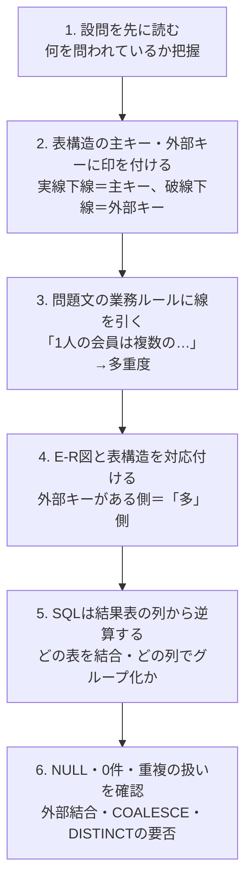

### 9.3 よく出る着眼点 ★★

- **「〜がない場合も表示」→ 外部結合 ＋ COALESCE**。
- **「〜ごとに」→ GROUP BY**、**「〜件以上のもの」→ HAVING COUNT(*) >= …**。
- **「まだ〜していない」→ NOT EXISTS** または外部結合して `IS NULL`。
- **「最新の〜」→ `MAX(日付)` の副問合せ** と結合する。
- 履歴を残したい要件（「価格改定前の単価で請求したい」）→ 明細表に **その時点の単価** を持たせる、または商品価格表に **適用開始日** を加えて主キーにする。
- 同じ予約枠を2人が同時に取る問題 → **ロック（SELECT … FOR UPDATE）** や一意制約で防ぐ。

### 9.4 時間配分 ★

科目Bは150分で5問を解くので、1問あたり **約30分** が目安です。データベースは「SQLが読めれば確実に得点できる」分野なので、SQLの結果表を手で書く練習を繰り返すと、安定して得点できるようになります。

---

## 確認問題

### 問1（3層スキーマ）
3層スキーマ構造において、利用者やアプリケーションプログラムから見たデータの見え方を定義し、SQLのビューが対応するものはどれですか。

ア 内部スキーマ　イ 概念スキーマ　ウ 外部スキーマ　エ 物理スキーマ

### 問2（候補キー）
関係 R(A, B, C, D) に関数従属 `{A, B} → C`、`C → D`、`D → A` が成り立つとき、R の候補キーをすべて挙げたものはどれですか。

ア {A, B} のみ　イ {A, B}, {B, C}　ウ {A, B}, {B, C}, {B, D}　エ {B}

### 問3（正規形の判定）
次の「履修」表は、主キーが {学籍番号, 科目コード} で、関数従属 `学籍番号 → 氏名`、`科目コード → 科目名`、`{学籍番号, 科目コード} → 成績` が成り立ちます。この表は第何正規形ですか（各列は単一値とします）。

| <ins>学籍番号</ins> | <ins>科目コード</ins> | 氏名 | 科目名 | 成績 |
|---|---|---|---|---|

ア 非正規形　イ 第1正規形　ウ 第2正規形　エ 第3正規形

### 問4（NOT IN と NULL）
5.0節の社員表に対して次のSQLを実行したとき、結果の値はいくつですか。

```sql
SELECT COUNT(*) FROM 社員 WHERE 部門コード NOT IN ('D2');
```

ア 3　イ 4　ウ 6　エ 7

### 問5（GROUP BY / HAVING）
5.0節の社員表に対して次のSQLを実行したとき、結果は何行になりますか。また、各行の値を答えてください。

```sql
SELECT 部門コード, SUM(給与)
  FROM 社員
 WHERE 給与 >= 250
 GROUP BY 部門コード
HAVING SUM(給与) >= 500;
```

### 問6（ロック）
トランザクションT1がデータXに共有ロックをかけている間に、T2がXに共有ロックを、T3がXに専有ロックを要求しました。正しい記述はどれですか。

ア T2もT3も待たされる
イ T2はすぐにロックを獲得でき、T3は待たされる
ウ T2は待たされ、T3はすぐにロックを獲得できる
エ T2もT3もすぐにロックを獲得できる

### 問7（隔離性水準）
隔離性水準を REPEATABLE READ に設定したとき、発生する可能性がある現象はどれですか。

ア ダーティリード　イ ノンリピータブルリード　ウ ファントムリード　エ ロストアップデート

### 問8（障害回復）
チェックポイントを取得した後にシステム障害が発生しました。トランザクションの状態が次のとき、ロールフォワードの対象になるものをすべて選んでください。

- TA：チェックポイント前に開始し、チェックポイント前にコミット
- TB：チェックポイント前に開始し、チェックポイント後・障害前にコミット
- TC：チェックポイント後に開始し、障害時点で未コミット
- TD：チェックポイント後に開始し、障害前にコミット

### 問9（媒体障害）
データベースを格納したディスクが故障しました。回復手順として適切なものはどれですか。

ア 更新前ログを用いてロールバックする
イ バックアップを復元し、更新前ログでロールバックする
ウ バックアップを復元し、更新後ログでロールフォワードする
エ チェックポイント時点の状態に戻し、何もしない

### 問10（NoSQL）
キーと値の組を単位としてデータを格納し、Webアプリケーションのセッション情報の管理などに適したNoSQLの種類はどれですか。

ア グラフ型　イ キーバリュー型　ウ ドキュメント型　エ 列指向型

### 問11（Wait-Die 方式）
デッドロックを防ぐ Wait-Die 方式において、開始時刻が新しいトランザクション T2 が、開始時刻が古いトランザクション T1 の持つロックを要求したときの動作はどれですか。

ア T2 はロックが解除されるまで待つ
イ T2 は自らロールバックし、元の開始時刻のまま再実行される
ウ T1 がロールバックされ、T2 がロックを獲得する
エ T1 と T2 の両方がロールバックされる

### 問12（ディスク容量の見積り・計算）
レコード長 250 バイトのレコードを 50,000 件格納します。ブロック長は 2,000 バイトで、各ブロックには 10% の空き領域を残します。レコードはブロックをまたがないとき、必要なブロック数はいくつですか。

### 問13（埋込みSQL）
埋込みSQLで、複数行の問合せ結果を1行ずつ親言語のプログラムに取り出すときの、SQL文の正しい実行順序はどれですか。

ア OPEN → DECLARE CURSOR → FETCH → CLOSE
イ DECLARE CURSOR → FETCH → OPEN → CLOSE
ウ DECLARE CURSOR → OPEN → FETCH → CLOSE
エ OPEN → FETCH → DECLARE CURSOR → CLOSE

<details><summary>解答・解説</summary>

**問1：ウ**
ビューは外部スキーマ、テーブルは概念スキーマ、インデックスなどの物理構造は内部スキーマに対応します。

**問2：ウ**
右辺に現れないのはBだけなので、Bは必ず候補キーに含まれます。{B}⁺ = {B} なので、1属性ずつ追加して閉包を求めます。
- {A,B}⁺：AB→C、C→D より {A,B,C,D}
- {B,C}⁺：C→D、D→A より {A,B,C,D}
- {B,D}⁺：D→A、AB→C より {A,B,C,D}

どれも極小なので、候補キーは3つです。

**問3：イ**
繰返し項目がないので第1正規形です。しかし、氏名は学籍番号（主キーの一部）に、科目名は科目コード（主キーの一部）に従属する **部分関数従属** があるので第2正規形ではありません。学生（学籍番号, 氏名）、科目（科目コード, 科目名）、履修（学籍番号, 科目コード, 成績）に分解すると第3正規形になります。

**問4：ア**
D2以外の社員は佐藤・鈴木・渡辺・山本の4人ですが、山本は部門コードがNULLです。`NULL NOT IN ('D2')` は UNKNOWN となり選ばれないので、結果は **3** です。

**問5：2行（D1：550、D2：1030）**
実行順は WHERE → GROUP BY → HAVING です。
1. WHERE 給与 >= 250 で残る行：佐藤300(D1)、鈴木250(D1)、高橋400(D2)、田中350(D2)、伊藤280(D2)（渡辺220・山本200は除外）
2. GROUP BY：D1 ＝ 300＋250 ＝ 550、D2 ＝ 400＋350＋280 ＝ 1030
3. HAVING SUM >= 500：両方とも満たす

**問6：イ**
共有ロックどうしは両立するのでT2はすぐ獲得できます。共有ロックと専有ロックは両立しないので、T3はT1（とT2）の共有ロックが解除されるまで待たされます。

**問7：ウ**
REPEATABLE READ はダーティリードとノンリピータブルリードを防ぎますが、他のトランザクションによる **行の挿入** は防げないため、ファントムリードが起こり得ます。

**問8：TB と TD**
障害前にコミットしたもののうち、チェックポイント以降にコミットしたもの（TB、TD）はロールフォワードします。TAはチェックポイントでディスクに反映済みなので何もしません。TCは未コミットなのでロールバックします。

**問9：ウ**
媒体障害ではデータベースそのものが失われるため、バックアップを復元し、バックアップ取得以降の更新後ログでロールフォワードします。

**問10：イ**
キーバリュー型は単純なキーで高速に値を読み書きできるため、セッション管理やキャッシュに適しています。

**問11：イ**
Wait-Die 方式では、新しいトランザクションが古いトランザクションのロックを要求すると、新しい方が自らロールバック（Die）します。元の開始時刻のまま再実行するので、いずれ最古になり完了できます。アは Wound-Wait 方式で同じ状況になったときの動作です。Wait-Die・Wound-Wait のどちらでも、ロールバックされるのは常に新しい方なので、ウ・エは誤りです。

**問12：7,143 ブロック**
```
1ブロックで使える長さ = 2,000 × 0.9 = 1,800 バイト
1ブロックのレコード数 = ⌊1,800 ÷ 250⌋ = ⌊7.2⌋ = 7 件（切捨て）
必要ブロック数       = ⌈50,000 ÷ 7⌉ = ⌈7,142.8…⌉ = 7,143 ブロック（切上げ）
```
単純に `250 × 50,000 ÷ 1,800 ≒ 6,945` とすると、ブロックをまたいでレコードを格納したことになるので誤りです。

**問13：ウ**
カーソルを宣言（DECLARE CURSOR）し、OPEN で問合せを実行して結果を準備し、FETCH で1行ずつ読み込み、最後に CLOSE で終了します。

</details>

---

## 📋 シラバス用語チェックリスト

シラバス Ver.7.2「中分類9：データベース」の用語例を、小分類ごとにすべて並べました。**各用語を1行で説明できれば合格ラインです**。リンクがある語は本文に詳しい説明があります。

### 1. データベース方式

| 用語 | 1行説明 |
|---|---|
| [RDB（関係データベース）](#14-データベースの種類と特徴-) | データを表で表し、値（外部キー）で表どうしを関連付けるDB |
| [構造型データベース](#14-データベースの種類と特徴-) | レコード間をポインタで物理的につなぐDBの総称（階層型・網型） |
| [HDB（階層型データベース）](#14-データベースの種類と特徴-) | 木構造で、子は親を1つだけ持つDB |
| [NDB（網型データベース）](#14-データベースの種類と特徴-) | 網構造で、子が複数の親を持てるDB（CODASYL型） |
| [OODB（オブジェクト指向データベース）](#14-データベースの種類と特徴-) | データと手続きを一体化したオブジェクトを格納するDB |
| [XMLデータベース](#14-データベースの種類と特徴-) | XML文書を木構造のまま格納し XPath・XQuery で検索するDB |
| [分散データベース](#81-分散データベースと透過性-) | 複数サイトに分散したDBを利用者に1つに見せるDB |
| [ドキュメント指向データベース](#85-nosql-) | JSON などの文書単位で格納するNoSQL（MongoDB など） |
| [列指向データベース](#85-nosql-) | 列（列ファミリ）単位で格納し大量データの集計・書込みに強いNoSQL |
| [グラフデータベース](#85-nosql-) | ノードとエッジで関係を格納し、関係のたどりに強いNoSQL |
| [キーバリュー型データベース](#85-nosql-) | キーと値の組で格納する単純・高速なNoSQL（Redis など） |
| [インメモリデータベース](#14-データベースの種類と特徴-) | データを主記憶上に置き、ディスクI/Oなしで高速処理するDB |
| [概念スキーマ](#12-3層スキーマ構造-) | 組織全体から見た論理的なデータ構造（テーブル定義） |
| [外部スキーマ（副スキーマ）](#12-3層スキーマ構造-) | 利用者・アプリから見たデータの見え方（ビュー） |
| [内部スキーマ（記憶スキーマ）](#12-3層スキーマ構造-) | 記憶装置上の物理的な格納方法（ファイル・インデックス） |
| [論理データモデル](#13-データモデルの種類-) | 採用するDBMSの型（表・キーなど）に合わせて表したデータモデル |
| [物理データモデル](#13-データモデルの種類-) | データ型・索引・格納場所など物理的な実装まで決めたデータモデル |
| [関係モデル](#13-データモデルの種類-) | データを行と列の表（関係）で表すモデル |
| [階層モデル](#13-データモデルの種類-) | データを親1・子多の木構造で表すモデル |
| [ネットワークモデル（網モデル）](#13-データモデルの種類-) | 子が複数の親を持てる網構造で表すモデル |
| [プロパティグラフ](#13-データモデルの種類-) | ノードとエッジの両方に属性を持たせられるグラフモデル（Neo4j） |
| [トリプルストア](#13-データモデルの種類-) | 主語・述語・目的語の3つ組（RDF）でデータを表すグラフモデル |
| [関係（リレーション）](#31-関係モデルの用語-) | 関係モデルでの表（テーブル） |
| [タプル（行，組）](#31-関係モデルの用語-) | 表の1行（レコード） |
| [属性（列，フィールド）](#31-関係モデルの用語-) | 表の1列（カラム） |
| [実現値](#31-関係モデルの用語-) | ある時点で表に実際に入っている行の集まり（インスタンス） |
| [定義域（ドメイン）](#31-関係モデルの用語-) | 属性が取り得る値の集合 |
| [関係スキーマ](#31-関係モデルの用語-) | 関係名と属性名の並びで表した表の型（構造の定義） |
| [データベース定義機能](#11-dbmsの役割-) | スキーマ（表・ビュー・制約）を定義するDBMSの機能 |
| [データベース操作機能](#11-dbmsの役割-) | データの検索・追加・更新・削除を行う機能 |
| [データベース制御機能](#11-dbmsの役割-) | 同時実行制御・障害回復などDB全体を正しく動かす機能 |
| [保全機能](#11-dbmsの役割-) | 整合性制約や障害回復でデータの正しさを保つ機能 |
| [データ機密保護機能](#11-dbmsの役割-) | 認証・アクセス権・暗号化で不正アクセスを防ぐ機能 |
| [トランザクション](#61-トランザクションとacid特性-) | 全部成功か全部取消しかでなければならない一連の処理 |
| [ロック](#63-ロック排他制御-) | データに使用中の印を付け、他トランザクションのアクセスを制限する仕組み |
| [デッドロック](#65-デッドロック-) | 互いに相手のロック解除を待ち合い、どれも進めなくなる状態 |
| [ACID 特性](#61-トランザクションとacid特性-) | 原子性・一貫性・独立性・耐久性。トランザクションが満たすべき4性質 |
| [データ辞書](#88-データ資源管理-) | データ項目の意味・型・格納場所などのメタデータを管理する辞書（データディクショナリ） |
| [MySQL](#85-nosql-) | Webシステムで広く使われるOSSのRDBMS |
| [PostgreSQL](#85-nosql-) | 標準SQL準拠度が高く高機能なOSSのRDBMS |
| [SQLite](#85-nosql-) | DB全体を1ファイルに格納するサーバ不要の組込み型RDBMS |
| [Apache Cassandra](#85-nosql-) | 分散・高可用な列指向（ワイドカラム）型NoSQL |
| [Apache CouchDB](#85-nosql-) | JSON文書をHTTPで操作する、複製機能の強いドキュメント型NoSQL |
| [MongoDB](#85-nosql-) | JSON風文書を格納するスキーマの柔軟なドキュメント型NoSQL |
| [Redis](#85-nosql-) | インメモリ型のキーバリューストア。キャッシュ・セッション管理向き |
| [Neo4j](#85-nosql-) | プロパティグラフ型のグラフDB |

### 2. データベース設計

| 用語 | 1行説明 |
|---|---|
| [異音同義語・同音異義語](#24-データ分析とデータベース開発工程-) | 名前が違い意味が同じ語（シノニム）／名前が同じで意味が違う語（ホモニム）。データ項目の標準化で防ぐ |
| [トップダウン／ボトムアップアプローチ](#24-データ分析とデータベース開発工程-) | 企業全体のあるべき姿からモデル化する方法／現行の帳票・画面の項目を集めて統合する方法 |
| [データ重複の排除](#24-データ分析とデータベース開発工程-) | 同じ事実を1か所だけで持つように整理すること（正規化はその手段） |
| [メタデータ](#86-ビッグデータとデータ活用-) | データについてのデータ（項目の意味・型・作成日など） |
| [データディクショナリ](#88-データ資源管理-) | メタデータを登録・管理する辞書。データ項目の標準化に使う |
| [システム分析](#24-データ分析とデータベース開発工程-) | 対象業務を調べて必要なデータと処理を明らかにする工程 |
| [要求定義](#24-データ分析とデータベース開発工程-) | システムやDBに求める要件を明確にし文書化する工程 |
| [企業データモデル](#24-データ分析とデータベース開発工程-) | 企業全体のデータを1つに統合したデータモデル |
| [データモデル](#13-データモデルの種類-) | データの構造・関連・制約を表現する枠組み |
| [概念データモデル](#13-データモデルの種類-) | DBMSに依存せず業務の実体と関連を表したモデル（E-R図） |
| [論理データモデル](#13-データモデルの種類-) | DBMSの型に合わせて表・キーなどで表したモデル |
| [物理データモデル](#13-データモデルの種類-) | 格納方法・索引など物理実装まで決めたモデル |
| [副次索引](#24-データ分析とデータベース開発工程-) | 主キー以外の列に作る索引（二次索引） |
| [分割法](#24-データ分析とデータベース開発工程-) | 大きな表を行（水平）や列（垂直）で分けて格納する物理設計の方法 |
| [DOA（データ中心アプローチ）](#24-データ分析とデータベース開発工程-) | 処理手順より先に、変化しにくいデータ構造を中心に設計する考え方 |
| [バックマン線図](#21-e-r図の基本-) | レコードを箱、1対多の関係を矢印で表すデータ構造図 |
| [エンティティ](#21-e-r図の基本-) | 管理対象となる「もの・こと」（顧客、受注など） |
| [属性](#21-e-r図の基本-) | エンティティの性質（顧客名、住所など） |
| [リレーションシップ](#21-e-r図の基本-) | エンティティ間の関連と、その多重度（1対1、1対多、多対多） |
| [配置モード](#14-データベースの種類と特徴-) | 網型DBでレコードを記憶装置のどこに置くかの指定（CALC、VIA など） |
| [親子集合順序](#14-データベースの種類と特徴-) | 網型DBの親子集合内で子レコードを並べる順序 |
| [親子集合](#14-データベースの種類と特徴-) | 網型DBで親1つと子複数をポインタで結んだ1対多の関係（セット） |
| [索引](#511-インデックス-) | 検索を速くするためにキー値と格納位置を対応付けた構造（インデックス） |
| フィールド（項目） | レコードを構成する個々のデータ項目（列） |
| レコード | 関連するフィールドの集まり（行）。DBの入出力単位 |
| ファイル | 同じ形式のレコードの集まり（表の物理的な格納単位） |
| [NULL](#52-基本の-select-) | 値が存在しない・不明であることを表す特別な標識。判定は `IS NULL` |
| [一意性制約](#51-ddlデータ定義-) | 列の値の重複を禁止する制約（UNIQUE。NULLは許す） |
| [サロゲートキー](#32-キーと制約-) | 業務上の意味を持たない連番などの人工的な主キー（代理キー） |
| [完全関数従属](#41-関数従属-) | 非キー属性がキー全体に従属し、キーの一部には従属しない関係 |
| [部分関数従属](#41-関数従属-) | 非キー属性がキーの一部だけで決まる関係（第2正規形で排除） |
| [推移関数従属](#41-関数従属-) | X→Y、Y→Z により X→Z が間接的に成り立つ関係（第3正規形で排除） |
| [非正規化](#46-非正規化あえて正規化を崩す-) | 性能のためにあえて正規化を崩し、データを重複して持たせること |
| [ディスク容量見積り](#47-データベースの物理設計-) | ブロック化・空き領域・索引まで考慮して必要な記憶容量を計算すること |
| [論理データ構造のマッピング](#47-データベースの物理設計-) | 表・列・関連を物理的なファイル・レコード・ページに対応付けること |
| [ファイル編成](#47-データベースの物理設計-) | 順編成・索引編成・直接編成など、レコードの格納・アクセス方式 |
| [最適ブロック設計](#47-データベースの物理設計-) | 1回の入出力単位（ブロック長）をアクセス特性に合わせて決めること |
| [物理入出力](#47-データベースの物理設計-) | ディスクとの実際の読み書き。回数を減らすことが物理設計の目標 |
| [性能評価](#47-データベースの物理設計-) | 応答時間・スループットを見積り・測定して設計を評価すること |
| [コンプレッション](#47-データベースの物理設計-) | データを圧縮して格納し、容量とI/Oを減らすこと |
| [デコンプレッション](#47-データベースの物理設計-) | 圧縮して格納したデータを読むときに伸長（復元）すること |
| [性能改善ポイント](#47-データベースの物理設計-) | 索引追加・表分割・非正規化など性能を上げるために手を入れる箇所 |
| [インメモリデータベース](#14-データベースの種類と特徴-) | 主記憶上にデータを置き物理入出力をなくして高速化するDB |
| [データベース定義情報](#48-データベースの作成手順と評価運用-) | スキーマ・表・索引・制約などの定義。DBMSのカタログに登録される |
| [レコード形式](#48-データベースの作成手順と評価運用-) | レコードを構成する項目の並び・型・長さ（固定長／可変長） |
| [親子関係](#48-データベースの作成手順と評価運用-) | 階層型・網型DBの親レコードと子レコードの関係（親を先に登録） |
| [キー順](#48-データベースの作成手順と評価運用-) | 主キーの順。キー順に並べてロードすると格納・索引作成が効率的 |
| [存在制約](#48-データベースの作成手順と評価運用-) | 親が存在しなければ子は存在できないという制約 |
| [インバーテッドファイル](#48-データベースの作成手順と評価運用-) | 値からその値を持つレコードの位置を引ける転置ファイル（副次索引） |
| [データベースの運用・保守](#48-データベースの作成手順と評価運用-) | 性能監視・チューニング・再編成・バックアップなどを継続的に行うこと |

### 3. データ操作

| 用語 | 1行説明 |
|---|---|
| [関係代数](#33-関係代数-) | 選択・射影・結合・商・直積と、和・差・積の集合演算で表を操作する理論 |
| [会話型SQL](#512-データベース言語の利用形態と埋込みsql-) | 端末からSQLを入力して結果をすぐ得る独立言語方式の使い方 |
| [埋込みSQL](#512-データベース言語の利用形態と埋込みsql-) | 親言語のプログラム中に `EXEC SQL` で直接SQLを書く方式 |
| [モジュール言語](#512-データベース言語の利用形態と埋込みsql-) | SQL文を別モジュールの手続きにまとめ、親言語から呼び出す方式 |
| [コマンド方式](#512-データベース言語の利用形態と埋込みsql-) | コマンドやスクリプトの形でSQLを実行する方式 |
| [フォーム](#512-データベース言語の利用形態と埋込みsql-) | 画面の入力欄に条件を入れて問合せを組み立てる方式 |
| [問合せ（クエリ）](#512-データベース言語の利用形態と埋込みsql-) | DBに対する検索要求（主に SELECT 文） |
| [実表](#51-ddlデータ定義-) | CREATE TABLE で作り、実データを格納する表（基底表） |
| [ビュー表](#59-ビュー-) | SELECT 文で定義した、実データを持たない仮想の表 |
| [文字型](#51-ddlデータ定義-) | CHAR（固定長）・VARCHAR（可変長）など文字列を格納する型 |
| [数値型](#51-ddlデータ定義-) | INTEGER・DECIMAL・REAL など数値を格納する型 |
| [日付型](#51-ddlデータ定義-) | DATE・TIME・TIMESTAMP など日付・時刻を格納する型 |
| [一意性制約](#51-ddlデータ定義-) | 列の値の重複を禁止する制約（UNIQUE） |
| [参照制約](#32-キーと制約-) | 外部キーの値は参照先に存在する値か NULL でなければならない制約 |
| [検査制約](#51-ddlデータ定義-) | 条件を満たす値だけを許す制約（CHECK） |
| [非NULL制約](#51-ddlデータ定義-) | NULL を許さない制約（NOT NULL） |
| [アクセス権](#510-dcl権限管理-) | 利用者が表やビューに行える操作の権限。GRANT/REVOKE で管理 |
| [CASCADE](#32-キーと制約-) | 参照先の削除・更新に合わせて参照元の行も連鎖して削除・更新する指定 |
| [TRIGGER](#51-ddlデータ定義-) | 表の更新をきっかけに自動実行される処理の定義 |
| [集約関数](#54-集約関数と-group-by--having-) | COUNT・SUM・AVG・MAX・MIN など複数行から1つの値を求める関数 |
| [パターン文字列](#52-基本の-select-) | LIKE 述語で使う `%`（0文字以上）・`_`（1文字）を含む検索パターン |
| [相関名](#53-結合join-) | FROM 句で表に付ける別名。自己結合や相関副問合せで必須 |
| [副問合せ](#55-副問合せサブクエリ-) | SQL文の中に入れ子にした SELECT 文（サブクエリ） |
| [相関副問合せ](#55-副問合せサブクエリ-) | 外側の行の値を参照し、外側の行ごとに実行される副問合せ |
| [ウィンドウ関数](#57-ウィンドウ関数参考-) | `OVER (PARTITION BY …)` で行を残したまま順位・累計などを求める関数 |
| [カーソル](#512-データベース言語の利用形態と埋込みsql-) | 問合せ結果を1行ずつ親言語に取り出す仕組み（DECLARE→OPEN→FETCH→CLOSE） |

### 4. トランザクション処理

| 用語 | 1行説明 |
|---|---|
| [専有ロック](#63-ロック排他制御-) | 更新用のロック。他者は読むことも書くこともできない（排他ロック） |
| [共有ロック](#63-ロック排他制御-) | 読取り用のロック。他者も共有ロックで読めるが書けない |
| [ロック粒度](#63-ロック排他制御-) | ロックをかける単位（表・ページ・行）。小さいほど並行性が高く管理負荷が大きい |
| [2相ロッキングプロトコル](#64-2相ロック方式-) | ロックの獲得だけの相と解除だけの相に分けるルール。直列化可能性を保証 |
| [デッドロック](#65-デッドロック-) | 互いにロック解除を待ち合って進めなくなる状態 |
| [Wait-Die 方式](#65-デッドロック-) | 古いTは待ち、新しいTは自らロールバックする時刻印によるデッドロック予防法 |
| [Wound-Wait 方式](#65-デッドロック-) | 古いTは新しいTをロールバックさせ、新しいTは待つデッドロック予防法 |
| [2相コミットメント](#82-2相コミット-) | 準備（投票）と決定の2段階で、分散トランザクションのコミットをそろえる方式 |
| [ダーティリード](#62-同時実行で起こる問題-) | 他トランザクションの未コミットのデータを読んでしまう現象 |
| [ノンリピータブルリード](#62-同時実行で起こる問題-) | 同じ行を再度読むと他者の更新で値が変わっている現象 |
| [ファントムリード](#62-同時実行で起こる問題-) | 同じ条件で再検索すると他者の挿入で行が増えている現象 |
| [隔離性水準](#67-隔離性水準-) | 同時実行時の独立性の厳しさ（READ UNCOMMITTED〜SERIALIZABLE） |
| [補償トランザクション](#68-分散システムのトランザクションsagatcc-) | コミット済みの処理を打ち消す逆向きの処理 |
| [TCC パターン](#68-分散システムのトランザクションsagatcc-) | Try（仮押さえ）→ Confirm（確定）／Cancel（取消し）で分散処理をそろえる方式 |
| [Saga パターン](#68-分散システムのトランザクションsagatcc-) | ローカルトランザクションを連鎖させ、失敗時は補償トランザクションを逆順に実行する方式 |
| [スキュー（skew）](#67-隔離性水準-) | 偏り・ゆがみ。スナップショット分離での書込みスキュー異常や、分散処理でのデータの偏りを指す |
| [ロック方式・セマフォ方式・多版同時実行制御（MVCC）](#66-その他の同時実行制御-) | ロックで制御／P・V操作のセマフォで制御／旧版を残して読取りと書込みを待たせない方式 |
| [コミットメント制御](#63-ロック排他制御-) | コミットするまで途中結果を他に見せず、確定か取消しかを制御すること |
| [フルバックアップ](#76-バックアップの種類-) | 全データを取得するバックアップ |
| [差分バックアップ](#76-バックアップの種類-) | 前回のフルバックアップ以降の変更分を取得するバックアップ |
| [増分バックアップ](#76-バックアップの種類-) | 前回のバックアップ（種類を問わず）以降の変更分を取得するバックアップ |
| [ダンプファイル](#77-その他の障害回復用語と運用-) | DBの内容をある時点で丸ごと書き出したファイル |
| [リストア](#77-その他の障害回復用語と運用-) | バックアップからDBを復元すること |
| [データディレクトリ](#77-その他の障害回復用語と運用-) | DBMSがデータファイル・ログ・設定を置く格納場所 |
| [ジャーナルファイル（ログファイル）](#71-ログファイル-) | 更新前・更新後イメージを時系列に記録したファイル |
| [チェックポイント](#72-チェックポイント-) | バッファの内容をディスクに書き出し、回復の起点を記録する時点 |
| [フォワードリカバリ（ロールフォワード）](#71-ログファイル-) | 更新後ログで更新をやり直し、コミット済みの状態を再現する回復 |
| [バックワードリカバリ（ロールバック）](#71-ログファイル-) | 更新前ログで未コミットの更新を取り消す回復 |
| [シャドウページ法](#77-その他の障害回復用語と運用-) | 更新ページを別の場所に書き、コミット時にページ表を切り替える回復方式 |
| [ウォームスタート](#73-システム障害からの回復ウォームスタート-) | システム障害後、ログで障害直前のコミット済み状態に戻して再開すること |
| [コールドスタート](#77-その他の障害回復用語と運用-) | ログによる回復をせず、バックアップ時点などの初期状態から再開すること |
| [ACID 特性](#61-トランザクションとacid特性-) | 原子性・一貫性・独立性・耐久性 |
| [インデックス数・負荷](#511-インデックス-) | インデックスを増やすほど検索は速いが、更新時の負荷が増える |
| [ユニークインデックス](#511-インデックス-) | キー値の重複を許さないインデックス |
| [クラスタ化インデックス](#511-インデックス-) | キー順にデータ行を物理的に並べて格納するインデックス（1表に1つ） |
| [B-tree インデックス](#511-インデックス-) | 平衡木による、等価・範囲検索とも速い標準的なインデックス |
| [ビットマップインデックス](#511-インデックス-) | 値ごとに行の有無をビット列で持つ。値の種類が少ない列向き |
| [ハッシュインデックス](#511-インデックス-) | ハッシュ値で格納位置を求める。等価検索に速いが範囲検索は苦手 |
| [カバリングインデックス](#511-インデックス-) | 問合せに必要な列をすべて含み、表本体を読まずに結果を返せるインデックス |
| [転置インデックス](#511-インデックス-) | 単語からそれを含む文書の一覧を引くインデックス（全文検索） |
| [参照権限](#510-dcl権限管理-) | データを検索できる権限（SELECT） |
| [挿入権限](#510-dcl権限管理-) | 行を新規登録できる権限（INSERT） |
| [削除権限](#510-dcl権限管理-) | 行を削除できる権限（DELETE） |

### 5. データベース応用

| 用語 | 1行説明 |
|---|---|
| [データウェアハウス](#86-ビッグデータとデータ活用-) | 業務データを時系列に統合・蓄積した分析用DB |
| [データマート](#86-ビッグデータとデータ活用-) | DWHから部門・目的別に切り出した小規模な分析用DB |
| [OLAP](#86-ビッグデータとデータ活用-) | 多次元データを対話的に集計・分析する処理 |
| [データマイニング](#86-ビッグデータとデータ活用-) | 大量データから統計・機械学習で未知の規則性を発見すること |
| [OLTP](#86-ビッグデータとデータ活用-) | 日々の業務の少量データを高頻度に更新するオンライン処理 |
| [ETL](#86-ビッグデータとデータ活用-) | 抽出→変換→書込みの順でDWHへデータを取り込む処理 |
| [ELT](#86-ビッグデータとデータ活用-) | 抽出→書込み→変換の順で、格納後にDWH側で変換する処理 |
| [データクレンジング](#86-ビッグデータとデータ活用-) | 表記ゆれ・重複・欠損などを修正してデータ品質を高めること |
| [ビッグデータ](#86-ビッグデータとデータ活用-) | 量・多様性・速度（3V）が大きく従来のDBMSで扱いにくいデータ |
| [文書管理システム](#86-ビッグデータとデータ活用-) | 電子文書の登録・版管理・検索・アクセス制御を行うシステム |
| [営業支援システム](#86-ビッグデータとデータ活用-) | 顧客・商談・活動履歴を共有し営業を効率化するシステム（SFA） |
| [透過性](#81-分散データベースと透過性-) | データの位置・分割・複製などを利用者に意識させない性質 |
| [クライアントキャッシュ](#87-分散データベースの構成と技術-) | クライアント側にデータの写しを持ち問合せを減らす仕組み |
| [コミットメント制御](#87-分散データベースの構成と技術-) | 分散トランザクションの全サイトのコミット／ロールバックをそろえる制御 |
| [2相コミットメント](#82-2相コミット-) | 準備と決定の2段階で分散トランザクションの原子性を保証する方式 |
| [コミットシーケンス](#87-分散データベースの構成と技術-) | 分散トランザクションでコミットを確定させるメッセージの手順 |
| [同時実行制御](#87-分散データベースの構成と技術-) | 分散環境でもロックなどでデータの整合性を保つ制御 |
| [レプリケーション](#83-レプリケーション-) | データの複製を別サイトに作って同期させる仕組み |
| [水平分散](#87-分散データベースの構成と技術-) | 各サイトが対等な立場でデータや処理を分担する分散形態 |
| [垂直分散](#87-分散データベースの構成と技術-) | サイト間に主従（階層）関係がある分散形態 |
| [表の分散（水平，垂直）](#87-分散データベースの構成と技術-) | 表を行で分ける水平分割、列で分ける垂直分割で各サイトに配置すること |
| [分散問合せ](#87-分散データベースの構成と技術-) | 複数サイトにまたがるデータへの問合せ |
| [結合演算](#87-分散データベースの構成と技術-) | サイト間の表結合。セミジョインで転送量を減らす |
| [分散トランザクション](#87-分散データベースの構成と技術-) | 複数サイトのデータを更新するトランザクション |
| [スプリットブレイン](#87-分散データベースの構成と技術-) | ネットワーク分断で複数ノードが同時に主系として動いてしまう状態 |
| [OSI-RDA プロトコル](#87-分散データベースの構成と技術-) | 異機種間でリモートDBにアクセスするための国際標準プロトコル |
| [コンセンサスアルゴリズム](#87-分散データベースの構成と技術-) | ブロックチェーンで参加ノードが正しい記録を合意する方式（PoW・PoS など） |
| [ファイナリティ](#87-分散データベースの構成と技術-) | 取引が確定し後から覆らない状態になること |
| [Apache Hadoop](#87-分散データベースの構成と技術-) | HDFSとMapReduceで大量データを分散バッチ処理するOSS |
| [Apache Spark](#87-分散データベースの構成と技術-) | 中間データをメモリに置き高速に分散処理するOSS |
| [CAP 定理](#84-cap定理とbase-) | 分散システムは一貫性・可用性・分断耐性を同時にすべては満たせないという定理 |
| [BASE 特性](#84-cap定理とbase-) | 基本的に利用可能・柔らかい状態・結果整合性。NoSQLが重視する性質 |
| [結果整合性](#84-cap定理とbase-) | 一時的に不一致でも、時間がたてば最終的に一貫した状態になる性質 |
| [シャーディング](#87-分散データベースの構成と技術-) | 表を行単位で多数のサーバに水平分割して負荷とデータ量を分散する手法 |
| [IRDS](#88-データ資源管理-) | 情報資源の辞書を管理するための国際標準の仕様（情報資源辞書システム） |
| [リポジトリ](#88-データ資源管理-) | 開発・保守に関する様々な情報を一元管理する格納庫 |
| [HDFS](#88-データ資源管理-) | ファイルをブロックに分け複数ノードに複製して格納するHadoopの分散ファイルシステム |
| [Ceph](#88-データ資源管理-) | 多数のサーバのディスクを束ねる分散ストレージのOSS |
| [GlusterFS](#88-データ資源管理-) | 複数サーバのストレージを1つのファイルシステムに見せる分散ファイルシステムのOSS |
| [ファクトデータベース](#88-データ資源管理-) | 数値・全文など事実そのものを格納したDB |
| [リファレンスデータベース](#88-データ資源管理-) | 文献名など情報の所在を格納し原典参照の手がかりを示すDB |
| [データベースサービス](#88-データ資源管理-) | 事業者が蓄積したDBやDB環境をネットワーク経由で提供するサービス |
| [構造化データ](#88-データ資源管理-) | 項目が決まっていて表に格納できるデータ |
| [半構造化データ](#88-データ資源管理-) | タグやキーで構造を持つが固定の表形式ではないデータ（JSON・XML） |
| [非構造化データ](#88-データ資源管理-) | 決まった構造を持たないデータ（文書・画像・音声・動画） |
| [ストリーミングデータ](#88-データ資源管理-) | センサーなどから絶え間なく発生し逐次処理されるデータ |
| [データレイク](#86-ビッグデータとデータ活用-) | 構造を問わず加工前の生データをそのまま蓄える格納場所 |
| [Apache Hive](#88-データ資源管理-) | HDFS上のデータにSQL風の言語（HiveQL）で問い合わせるクエリエンジン |
| [Presto](#88-データ資源管理-) | 複数データソースの大規模データに対話的なSQL問合せを行う分散クエリエンジン |

---

## 参考

- IPA 情報処理推進機構「試験要綱・シラバス」（応用情報技術者試験 シラバス Ver.7.2）
  https://www.ipa.go.jp/shiken/syllabus/gaiyou.html
- IPA「応用情報技術者試験 シラバス Ver.7.2」（PDF）
  https://www.ipa.go.jp/shiken/syllabus/omgdg50000005kq5-att/syllabus_ap_ver7_2.pdf
- IPA「過去問題」（問題冊子・解答例）
  https://www.ipa.go.jp/shiken/mondai-kaiotu/index.html
- 応用情報技術者試験ドットコム（過去問解説）
  https://www.ap-siken.com/
- PostgreSQL 文書「トランザクションの分離レベル」（隔離性水準と現象の対応）
  https://www.postgresql.jp/document/current/html/transaction-iso.html
