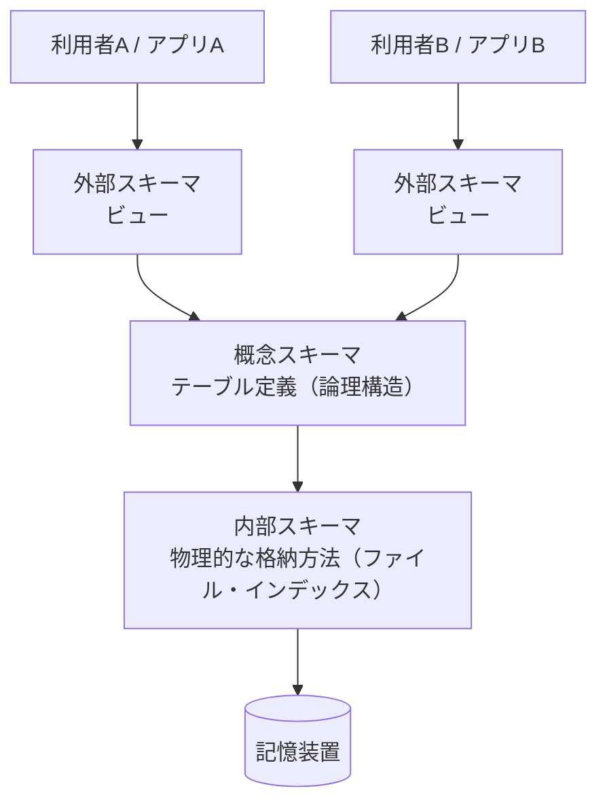
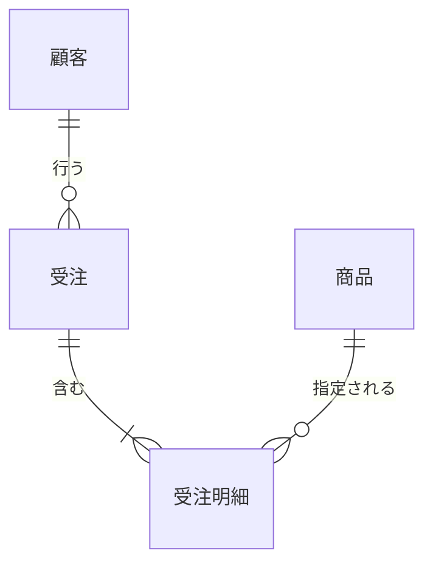
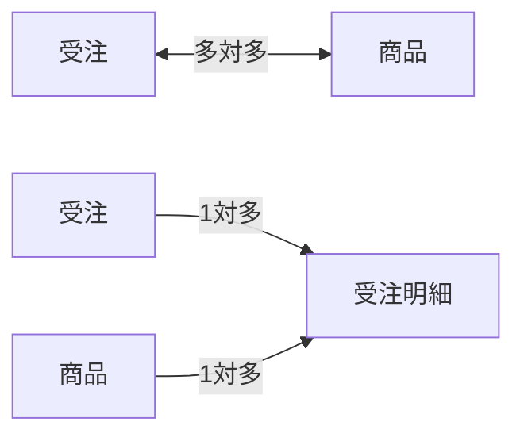
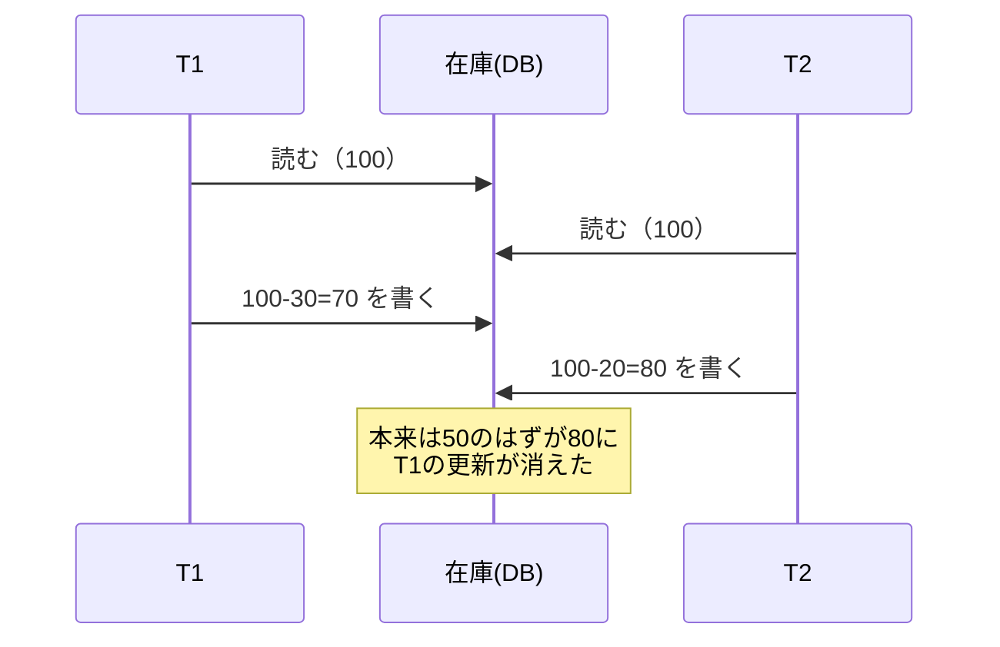
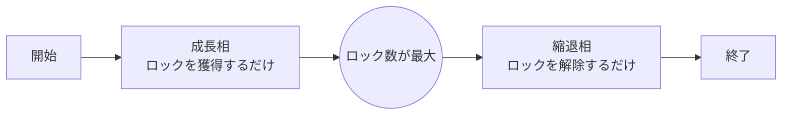
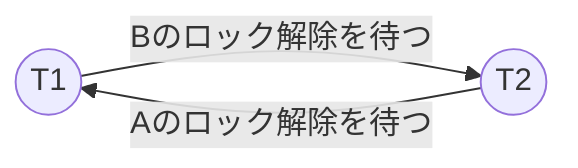
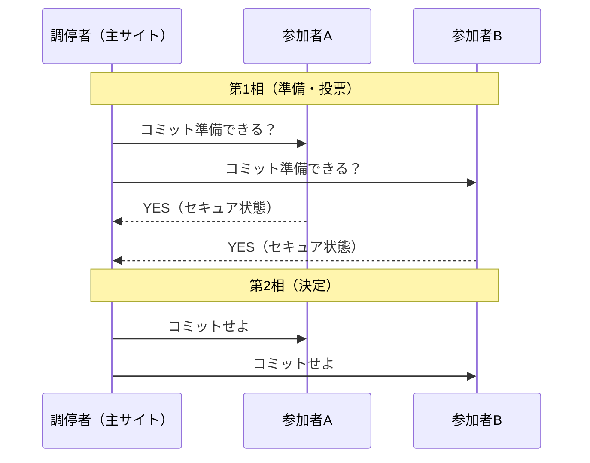
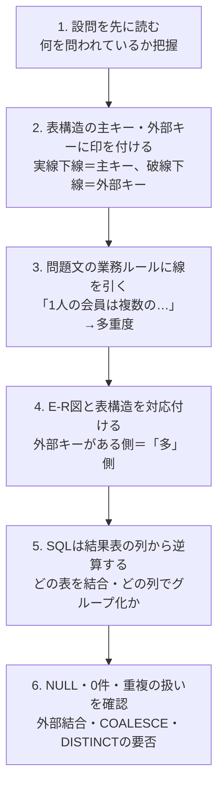

# データベース

> **重要度：★★★**（科目A（旧午前）で毎回5問前後、科目B（旧午後）では「データベース」が選択問題として毎回1問出題されます）
> 科目Aでは **正規化・SQL・トランザクション（ロック／障害回復）** が定番です。科目Bでは **E-R図の穴埋め・SQL穴埋め・テーブル設計の不備指摘** が中心になります。
> この章では、①データモデルとE-R図、②関数従属と正規化（候補キーの求め方）、③SQLを結果表つきで読めるようになること、④トランザクション管理と障害回復、⑤分散DB・NoSQL・ビッグデータ を押さえます。
> SQLは「書けること」より「**読んで結果を予想できること**」が得点に直結します。例題は必ず自分で結果表を作ってから答えを見てください。

## 目次

- [1. データベースとDBMS](#1-データベースとdbms)
- [2. データモデルとE-R図](#2-データモデルとe-r図)
- [3. 関係モデルと関係代数](#3-関係モデルと関係代数)
- [4. 関数従属と正規化](#4-関数従属と正規化)
- [5. SQL](#5-sql)
- [6. トランザクションと同時実行制御](#6-トランザクションと同時実行制御)
- [7. 障害回復](#7-障害回復)
- [8. 分散データベース・NoSQL・ビッグデータ](#8-分散データベースnosqlビッグデータ)
- [9. 科目B「データベース」問題の解き方](#9-科目bデータベース問題の解き方)
- [確認問題](#確認問題)
- [参考](#参考)

---

## 1. データベースとDBMS

### 1.1 DBMSの役割 ★

**DBMS（Database Management System：データベース管理システム）** は、データを複数の利用者・アプリケーションで安全に共有するためのソフトウェアです。

- 結論：DBMSを使うと「データの一元管理」と「データの独立性」が実現できます。
- 理由：ファイルをアプリごとに持つと、同じデータが重複して食い違い（不整合）が起きやすいからです。
- 例：顧客の住所を販売システムと請求システムが別々に持つと、片方だけ住所変更されて請求書が旧住所に届く、という不整合が起こります。

| DBMSの主な機能 | 内容 |
|---|---|
| データ定義 | 表（テーブル）や制約を定義する（SQLのDDL） |
| データ操作 | 検索・追加・更新・削除（SQLのDML） |
| 同時実行制御（排他制御） | 複数の利用者が同時に更新しても矛盾しないようにする |
| 障害回復 | 障害が起きてもログから正しい状態に戻す |
| 機密保護 | 利用者ごとにアクセス権限を設定する（SQLのDCL） |
| 整合性制約 | 主キー制約・参照制約・検査制約などで不正データを防ぐ |

### 1.2 3層スキーマ構造 ★★

**スキーマ** とは「データベースの構造の定義」のことです。ANSI/SPARC（米国規格協会の委員会）が提唱した **3層スキーマ** は次の3つで構成されます。



| スキーマ | 内容 | SQLでいうと |
|---|---|---|
| **外部スキーマ** | 利用者・アプリから見たデータの見え方 | **ビュー** |
| **概念スキーマ** | 組織全体から見た論理的なデータ構造 | **テーブル（実表）** |
| **内部スキーマ** | 記憶装置上の物理的な格納方法 | ファイル編成・**インデックス** |

- **物理的データ独立性**：内部スキーマを変えても（例：インデックス追加）概念スキーマに影響しない。
- **論理的データ独立性**：概念スキーマを変えても（例：列の追加）外部スキーマ（アプリ）に影響しない。

💡 覚え方：「**外＝ビュー、概念＝テーブル、内部＝インデックス**」。

⚠️ ひっかけ注意：「概念スキーマ＝E-R図」と書かれた選択肢がありますが、E-R図は概念データモデルを表す **図法** であり、3層スキーマの「概念スキーマ」とは別物です。

### 1.3 データモデルの種類 ★

| モデル | 構造 | 特徴 |
|---|---|---|
| 階層型 | 木構造（親1：子多） | 親子関係が固定 |
| ネットワーク型 | 網構造（親多：子多も可） | ポインタでつなぐ |
| **関係（リレーショナル）型** | 表（行と列） | SQLで操作。現在の主流 |
| NoSQL | キーバリュー・ドキュメントなど | 大量データ・柔軟なスキーマ向き（8章） |

---

## 2. データモデルとE-R図

### 2.1 E-R図の基本 ★★★

**E-R図（Entity-Relationship Diagram：実体関連図）** は、業務で扱う「もの（エンティティ）」と、それらの「関係（リレーションシップ）」を表す図です。科目Bでは毎回のように **多重度（カーディナリティ）の穴埋め** が出ます。

| 用語 | 意味 | 例 |
|---|---|---|
| **エンティティ（実体）** | 管理対象となる「もの・こと」 | 顧客、商品、受注 |
| **属性** | エンティティの性質 | 顧客名、住所 |
| **リレーションシップ（関連）** | エンティティ間の関係 | 顧客が受注を「行う」 |
| **多重度** | 関連する相手の数（1対1、1対多、多対多） | 1人の顧客は複数の受注を行う |

IPAの試験では矢印による表記（UML風）がよく使われます。

| IPA試験での表記 | 意味 |
|---|---|
| `A ── B` | 1対1 |
| `A ──→ B` | 1対多（Aの1件にBが複数対応） |
| `A ←──→ B` | 多対多 |

以下は「顧客・受注・受注明細・商品」の例です（Mermaidのカラス足記法：`||` は1、`o{` は0以上の多）。



- 顧客1人は0件以上の受注を行う（1対多）
- 受注1件は1件以上の明細を含む（1対多）
- 商品1つは0件以上の明細で指定される（1対多）

### 2.2 多対多は「連関エンティティ」で分解する ★★★

- 結論：多対多の関連は、関係データベースではそのまま表にできないので、間に **連関エンティティ（交差エンティティ）** を置いて「1対多」と「多対1」に分解します。
- 理由：1つの列に複数の値を入れられない（第1正規形）からです。
- 例：「受注」と「商品」は多対多（1回の受注で複数商品、1商品は複数の受注に登場）。間に「受注明細」を置き、受注明細の主キーを {受注番号, 明細番号}（または {受注番号, 商品コード}）にします。



💡 科目Bのコツ：**外部キーは「多」側に置かれます**。表の定義で外部キー（破線下線で示されることが多い）を探せば、どちらが「多」側か判断できます。

### 2.3 スーパータイプとサブタイプ ★

共通の属性を持つエンティティをまとめたものが **スーパータイプ**、個別の属性を持つものが **サブタイプ** です（例：「会員」がスーパータイプ、「個人会員」「法人会員」がサブタイプ）。サブタイプの主キーはスーパータイプと同じになります。

---

## 3. 関係モデルと関係代数

### 3.1 関係モデルの用語 ★★

| 関係モデルの用語 | SQL／一般的な呼び方 |
|---|---|
| 関係（リレーション） | 表（テーブル） |
| タプル（組） | 行（レコード） |
| 属性 | 列（カラム） |
| 定義域（ドメイン） | 列が取り得る値の集合 |
| 次数 | 列の数 |
| 濃度（カーディナリティ） | 行の数 |

### 3.2 キーと制約 ★★★

| キー | 説明 |
|---|---|
| **スーパーキー** | 行を一意に特定できる属性の集合（余分な属性を含んでもよい） |
| **候補キー** | 行を一意に特定できる **極小** の属性の集合（1つでも欠けると一意でなくなる） |
| **主キー** | 候補キーの中から1つ選んだもの。**NULL不可・重複不可** |
| 代理キー（サロゲートキー） | 業務上の意味を持たない連番などの人工キー |
| **外部キー** | 他の表の主キー（または候補キー）を参照する列。**参照制約** で整合性を保つ |

- **参照制約（参照整合性）**：外部キーの値は、参照先に存在する値か NULL でなければならない。
  - 参照先の行を削除するときの動作：`RESTRICT`（拒否）、`CASCADE`（連鎖して削除）、`SET NULL`（NULLにする）など。

⚠️ ひっかけ注意：外部キーは NULL を **許す** ことができます（未配属の社員の部門コードなど）。主キーは NULL を許しません。

### 3.3 関係代数 ★★

表に対する演算です。科目Aで「この結果になる演算はどれか」という形で出ます。

| 演算 | 意味 | SQLのイメージ |
|---|---|---|
| **選択** | 条件に合う **行** を取り出す | `WHERE` |
| **射影** | 指定した **列** を取り出す | `SELECT 列名` |
| **結合** | 共通の列の値で2つの表をつなぐ | `JOIN` |
| 和 | どちらかの表にある行 | `UNION` |
| 差 | 一方にあって他方にない行 | `EXCEPT` |
| 共通（積集合） | 両方にある行 | `INTERSECT` |
| 直積 | すべての行の組合せ | `CROSS JOIN` |
| 商 | 「すべての〇〇を含む」行を求める | `NOT EXISTS` の二重否定 |

💡 覚え方：「**選択は横（行）に切る、射影は縦（列）に切る**」。

⚠️ ひっかけ注意：和・差・共通は、2つの表の列構成（次数と定義域）が同じ **和両立** でないと演算できません。

---

## 4. 関数従属と正規化

### 4.1 関数従属 ★★★

**関数従属** とは「属性Xの値が決まると属性Yの値がただ1つに決まる」関係で、`X → Y` と書きます（XがYを決定する）。

- 例：`社員番号 → 氏名`（社員番号が決まれば氏名が1つに決まる）
- 逆の `氏名 → 社員番号` は成り立ちません（同姓同名がいるため）。

| 用語 | 意味 | 例（主キー {受注番号, 商品コード}） |
|---|---|---|
| **完全関数従属** | キー全体に従属し、キーの一部には従属しない | `{受注番号, 商品コード} → 数量` |
| **部分関数従属** | キーの **一部** だけで決まる | `商品コード → 商品名` |
| **推移的関数従属** | `X → Y`、`Y → Z` で、`X → Z` が間接的に成り立つ（Y→Xは成り立たない） | `受注番号 → 顧客コード → 顧客名` |

### 4.2 候補キーの求め方（例題で丁寧に） ★★★

候補キーは「**属性の閉包**」を使うと機械的に求められます。**閉包 X⁺** とは、「Xから関数従属をたどって決定できるすべての属性の集合」です。

**手順**

1. どの関数従属の **右辺にも現れない属性** を探す → これは他から決まらないので **必ず候補キーに含まれる**。
2. **右辺にしか現れない属性** は候補キーに含める必要がない。
3. 1. の属性集合の閉包を計算し、全属性が含まれれば候補キー。足りなければ、残りの属性を1つずつ加えて閉包を計算する。
4. 極小性（余分な属性がないか）を確認する。

**例題1**：関係 R(A, B, C, D, E)、関数従属 `A → B`、`{B, C} → D`、`D → E`

- 手順1：右辺に現れるのは B, D, E。右辺に現れないのは **A と C** → 必ずキーに含まれる。
- 手順3：{A, C}⁺ を計算します。

```
スタート       : {A, C}
A → B を適用   : {A, B, C}
{B,C} → D 適用 : {A, B, C, D}
D → E を適用   : {A, B, C, D, E}  ← 全属性がそろった
```

- 手順4：{A}⁺ = {A, B}、{C}⁺ = {C} なので、どちらか一方では足りません。よって **候補キーは {A, C} のみ** です。

**例題2**：関係 R(A, B, C, D)、関数従属 `{A, B} → C`、`C → D`、`D → A`

- 手順1：右辺に現れるのは C, D, A。右辺に現れないのは **B** だけ → B は必ず含まれる。
- {B}⁺ = {B} → 足りないので、A, C, D を1つずつ加えます。

| 試す集合 | 閉包の計算 | 結果 |
|---|---|---|
| {A, B} | AB→C で C、C→D で D | {A, B, C, D} ✅ 候補キー |
| {B, C} | C→D で D、D→A で A | {A, B, C, D} ✅ 候補キー |
| {B, D} | D→A で A、AB→C で C | {A, B, C, D} ✅ 候補キー |

- いずれも2属性で、1属性（{B}）では足りないので極小です。**候補キーは {A,B}、{B,C}、{B,D} の3つ** です。

⚠️ ひっかけ注意：候補キーは1つとは限りません。「右辺に現れない属性」を見落とさないことが最大のポイントです。

**主属性と非キー属性**：いずれかの候補キーに含まれる属性を **主属性**、どの候補キーにも含まれない属性を **非キー属性** といいます。例題2では A, B, C, D すべてが主属性です。

### 4.3 正規化の流れ ★★★

**正規化** とは、データの重複をなくし **更新時異状**（更新・挿入・削除のときに起きる不整合）を防ぐために表を分解することです。


| 正規形 | 条件 |
|---|---|
| **第1正規形** | すべての属性の値が **単一値**（繰返し項目・複合値がない） |
| **第2正規形** | 第1正規形 ＋ 非キー属性が候補キーに **完全関数従属**（部分関数従属がない） |
| **第3正規形** | 第2正規形 ＋ 非キー属性が候補キーに **推移的関数従属していない** |
| **BCNF** | すべての自明でない関数従属 `X → Y` で、**X がスーパーキー** |

💡 覚え方：「**1：繰返し、2：部分、3：推移**」。

### 4.4 正規化の例題 ★★★

**非正規形の受注伝票**（1つの受注に明細が繰り返す）

| 受注番号 | 受注日 | 顧客コード | 顧客名 | (商品コード, 商品名, 単価, 数量) の繰返し |
|---|---|---|---|---|
| 1001 | 4/1 | C01 | A商事 | (P1, ペン, 100, 10), (P2, ノート, 200, 5) |
| 1002 | 4/2 | C02 | B工業 | (P1, ペン, 100, 3) |

**関数従属**

- `受注番号 → 受注日, 顧客コード`
- `顧客コード → 顧客名`
- `商品コード → 商品名, 単価`
- `{受注番号, 商品コード} → 数量`

**ステップ1：第1正規形**（繰返しを行に展開。主キーは {受注番号, 商品コード}。以下、下線付きの列が主キーです）

| <ins>受注番号</ins> | <ins>商品コード</ins> | 受注日 | 顧客コード | 顧客名 | 商品名 | 単価 | 数量 |
|---|---|---|---|---|---|---|---|
| 1001 | P1 | 4/1 | C01 | A商事 | ペン | 100 | 10 |
| 1001 | P2 | 4/1 | C01 | A商事 | ノート | 200 | 5 |
| 1002 | P1 | 4/2 | C02 | B工業 | ペン | 100 | 3 |

この表には次の更新時異状があります。

- **更新異状**：ペンの単価を変えるとき、複数行を直さないと食い違う。
- **挿入異状**：まだ受注のない新商品を登録できない（主キーの受注番号がNULLになる）。
- **削除異状**：受注1002を削除すると、顧客B工業の情報も消えてしまう。

**ステップ2：第2正規形**（部分関数従属 `受注番号 → …`、`商品コード → …` を別表へ）

- 受注（<ins>受注番号</ins>, 受注日, 顧客コード, 顧客名）
- 商品（<ins>商品コード</ins>, 商品名, 単価）
- 受注明細（<ins>受注番号</ins>, <ins>商品コード</ins>, 数量）

**ステップ3：第3正規形**（推移的関数従属 `受注番号 → 顧客コード → 顧客名` を別表へ）

- 受注（<ins>受注番号</ins>, 受注日, 顧客コード）
- 顧客（<ins>顧客コード</ins>, 顧客名）
- 商品（<ins>商品コード</ins>, 商品名, 単価）
- 受注明細（<ins>受注番号</ins>, <ins>商品コード</ins>, 数量）


結果として、2.1節のE-R図と同じ構造になります。正規化とE-R図による設計は同じゴールを目指しているのです。

### 4.5 BCNF（ボイス・コッド正規形） ★★

第3正規形は「**非キー属性**」についての条件なので、主属性どうしの従属は見逃されます。BCNFはそれも排除します。

**例**：R(学生, 科目, 教員)。ルール「学生は科目ごとに教員を1人選ぶ」「教員は1科目だけを担当する」

- 関数従属：`{学生, 科目} → 教員`、`教員 → 科目`
- 候補キー：{学生, 科目} と {学生, 教員}（学生は右辺に現れないので必ず含まれる）
- 全属性が主属性なので、非キー属性がなく **第3正規形は満たします**。
- しかし `教員 → 科目` の決定項「教員」はスーパーキーではないので **BCNFではありません**。

BCNFにするには（<ins>教員</ins>, 科目）と（<ins>学生</ins>, <ins>教員</ins>）に分解します。ただし、元の `{学生, 科目} → 教員` という従属を1つの表で保証できなくなります（**従属性保存** が失われる）。

⚠️ ひっかけ注意：「BCNFへの分解は常に関数従属性を保存できる」は **誤り** です。第3正規形までは情報無損失かつ従属性保存で分解できますが、BCNFでは従属性保存できない場合があります。

### 4.6 非正規化（あえて正規化を崩す） ★

正規化しすぎると結合が増えて検索が遅くなることがあります。性能を優先して、集計値や頻繁に参照する列をあえて重複して持たせることを **非正規化** といいます（データウェアハウスでよく使われます）。

---

## 5. SQL

**SQL（Structured Query Language）** は関係データベースを操作する言語です。次の3種類に分かれます。

| 分類 | 正式名称 | 主な文 |
|---|---|---|
| **DDL** | Data Definition Language：データ定義言語 | `CREATE`, `ALTER`, `DROP` |
| **DML** | Data Manipulation Language：データ操作言語 | `SELECT`, `INSERT`, `UPDATE`, `DELETE` |
| **DCL** | Data Control Language：データ制御言語 | `GRANT`, `REVOKE`（`COMMIT`, `ROLLBACK` を含める分類もある） |

### 5.0 この節で使うテーブル

以下の2つの表を使って、すべてのSQLの結果を示します。**山本さんは未配属（部門コードがNULL）**、**企画部には社員がいない** ことに注意してください。

**部門表**

| <ins>部門コード</ins> | 部門名 |
|---|---|
| D1 | 営業部 |
| D2 | 開発部 |
| D3 | 総務部 |
| D4 | 企画部 |

**社員表**（給与の単位は千円）

| <ins>社員番号</ins> | 氏名 | 部門コード | 給与 |
|---|---|---|---|
| E01 | 佐藤 | D1 | 300 |
| E02 | 鈴木 | D1 | 250 |
| E03 | 高橋 | D2 | 400 |
| E04 | 田中 | D2 | 350 |
| E05 | 伊藤 | D2 | 280 |
| E06 | 渡辺 | D3 | 220 |
| E07 | 山本 | NULL | 200 |

### 5.1 DDL（データ定義） ★★

```sql
CREATE TABLE 部門 (
  部門コード CHAR(2)     PRIMARY KEY,
  部門名     VARCHAR(20) NOT NULL UNIQUE
);

CREATE TABLE 社員 (
  社員番号   CHAR(3)     PRIMARY KEY,
  氏名       VARCHAR(20) NOT NULL,
  部門コード CHAR(2),
  給与       INTEGER     CHECK (給与 >= 0),
  FOREIGN KEY (部門コード) REFERENCES 部門(部門コード)
    ON DELETE SET NULL
);
```

| 制約 | 意味 |
|---|---|
| `PRIMARY KEY` | 主キー（一意＋NOT NULL） |
| `UNIQUE` | 重複不可（NULLは許す） |
| `NOT NULL` | NULL不可 |
| `CHECK` | 条件を満たす値だけ許す |
| `FOREIGN KEY … REFERENCES` | 外部キー（参照制約） |

その他のDDL：`ALTER TABLE 社員 ADD 入社日 DATE;`（列追加）、`DROP TABLE 社員;`（表の削除）、`CREATE INDEX idx1 ON 社員(部門コード);`（インデックス作成）。

### 5.2 基本の SELECT ★★★

SQLの句は **書く順番** と **実行される順番** が異なります。結果を予想するときは実行順で考えましょう。


**例1：給与300以上の社員を給与の高い順に**

```sql
SELECT 氏名, 給与
  FROM 社員
 WHERE 給与 >= 300
 ORDER BY 給与 DESC;
```

| 氏名 | 給与 |
|---|---|
| 高橋 | 400 |
| 田中 | 350 |
| 佐藤 | 300 |

**よく使う条件式**

| 書き方 | 意味 |
|---|---|
| `給与 BETWEEN 250 AND 300` | 250以上300以下（両端を含む） |
| `部門コード IN ('D1', 'D3')` | D1 または D3 |
| `氏名 LIKE '佐%'` | 「佐」で始まる（`%` は0文字以上、`_` は1文字） |
| `部門コード IS NULL` | NULLである（`= NULL` とは書けない） |
| `SELECT DISTINCT 部門コード` | 重複を除く |

⚠️ ひっかけ注意：`部門コード = NULL` は常に「不明（UNKNOWN）」になり、1行も選ばれません。NULLの判定は必ず `IS NULL` / `IS NOT NULL` を使います。

### 5.3 結合（JOIN） ★★★

**例2：内部結合（INNER JOIN）** … 両方の表に一致する行だけ

```sql
SELECT S.氏名, B.部門名
  FROM 社員 S
  INNER JOIN 部門 B ON S.部門コード = B.部門コード;
```

| 氏名 | 部門名 |
|---|---|
| 佐藤 | 営業部 |
| 鈴木 | 営業部 |
| 高橋 | 開発部 |
| 田中 | 開発部 |
| 伊藤 | 開発部 |
| 渡辺 | 総務部 |

→ 部門がNULLの **山本** と、社員のいない **企画部** は出てきません。

古い書き方として `FROM 社員 S, 部門 B WHERE S.部門コード = B.部門コード` も同じ結果になります（試験ではこちらもよく出ます）。

**例3：左外部結合（LEFT OUTER JOIN）** … 左の表の行はすべて残し、相手がなければNULL

```sql
SELECT B.部門名, S.氏名
  FROM 部門 B
  LEFT OUTER JOIN 社員 S ON B.部門コード = S.部門コード;
```

| 部門名 | 氏名 |
|---|---|
| 営業部 | 佐藤 |
| 営業部 | 鈴木 |
| 開発部 | 高橋 |
| 開発部 | 田中 |
| 開発部 | 伊藤 |
| 総務部 | 渡辺 |
| 企画部 | NULL |

| 結合の種類 | 残る行 |
|---|---|
| INNER JOIN | 両方に一致する行のみ |
| LEFT OUTER JOIN | 左表の全行 ＋ 一致した右表 |
| RIGHT OUTER JOIN | 右表の全行 ＋ 一致した左表 |
| FULL OUTER JOIN | 両方の全行 |
| CROSS JOIN | 全組合せ（直積）。4行×7行＝28行 |

💡 科目Bのコツ：「社員が1人もいない部門も表示したい」「売上0件の商品も一覧に出したい」という要件が出たら **外部結合** を疑います。NULLを0と表示したいときは `COALESCE(列, 0)`（最初のNULLでない値を返す関数）を使います。

### 5.4 集約関数と GROUP BY / HAVING ★★★

| 集約関数 | 意味 | NULLの扱い |
|---|---|---|
| `COUNT(*)` | 行数 | NULLの行も数える |
| `COUNT(列)` | NULLでない値の数 | NULLは除外 |
| `SUM(列)` / `AVG(列)` | 合計 / 平均 | NULLは除外 |
| `MAX(列)` / `MIN(列)` | 最大 / 最小 | NULLは除外 |

例：`SELECT COUNT(*), COUNT(部門コード), COUNT(DISTINCT 部門コード) FROM 社員;` → **7, 6, 3**

**例4：部門ごとの人数と平均給与**

```sql
SELECT 部門コード, COUNT(*) AS 人数, AVG(給与) AS 平均給与
  FROM 社員
 GROUP BY 部門コード;
```

| 部門コード | 人数 | 平均給与 |
|---|---|---|
| NULL | 1 | 200 |
| D1 | 2 | 275 |
| D2 | 3 | 343.33… |
| D3 | 1 | 220 |

→ NULLどうしは1つのグループにまとめられます。

**例5：HAVING でグループを絞る**

```sql
SELECT 部門コード, COUNT(*) AS 人数, AVG(給与) AS 平均給与
  FROM 社員
 GROUP BY 部門コード
HAVING COUNT(*) >= 2;
```

| 部門コード | 人数 | 平均給与 |
|---|---|---|
| D1 | 2 | 275 |
| D2 | 3 | 343.33… |

| | WHERE | HAVING |
|---|---|---|
| 絞り込む対象 | グループ化 **前** の行 | グループ化 **後** のグループ |
| 集約関数 | 使えない | 使える |

⚠️ ひっかけ注意：`GROUP BY` を使うとき、`SELECT` 句に書けるのは **GROUP BY に指定した列** と **集約関数** だけです。`SELECT 部門コード, 氏名 … GROUP BY 部門コード` はエラーになります。

### 5.5 副問合せ（サブクエリ） ★★★

**例6：平均給与より高い社員**（スカラ副問合せ：結果が1つの値）

```sql
SELECT 氏名, 給与
  FROM 社員
 WHERE 給与 > (SELECT AVG(給与) FROM 社員);
```

途中計算：平均 ＝ (300+250+400+350+280+220+200) ÷ 7 ＝ 2000 ÷ 7 ≒ 285.7

| 氏名 | 給与 |
|---|---|
| 佐藤 | 300 |
| 高橋 | 400 |
| 田中 | 350 |

**例7：IN 副問合せ（結果が複数行）**

```sql
SELECT 氏名
  FROM 社員
 WHERE 部門コード IN (SELECT 部門コード FROM 部門 WHERE 部門名 = '開発部');
```

結果：高橋、田中、伊藤

⚠️ ひっかけ注意（NOT IN と NULL）：`WHERE 部門コード NOT IN ('D2')` の結果は **佐藤・鈴木・渡辺の3人** です。部門コードがNULLの山本は、`NULL <> 'D2'` が UNKNOWN になるため **選ばれません**。

**例8：相関副問合せ**（外側の行ごとに内側を実行する）… 自部門の平均より給与が高い社員

```sql
SELECT S1.氏名, S1.部門コード, S1.給与
  FROM 社員 S1
 WHERE S1.給与 > (SELECT AVG(S2.給与)
                    FROM 社員 S2
                   WHERE S2.部門コード = S1.部門コード);
```

途中計算：D1平均 275、D2平均 343.3、D3平均 220（渡辺は220で「より大きい」を満たさない）、山本は部門NULLで内側が空（平均NULL）になり比較不能

| 氏名 | 部門コード | 給与 |
|---|---|---|
| 佐藤 | D1 | 300 |
| 高橋 | D2 | 400 |
| 田中 | D2 | 350 |

### 5.6 EXISTS / NOT EXISTS ★★★

`EXISTS (副問合せ)` は「副問合せの結果が1行以上あれば真」です。中の `SELECT *` の列は何でもかまいません。

**例9：社員が1人以上いる部門**

```sql
SELECT 部門名
  FROM 部門 B
 WHERE EXISTS (SELECT * FROM 社員 S WHERE S.部門コード = B.部門コード);
```

結果：営業部、開発部、総務部

**例10：社員が1人もいない部門**（`NOT EXISTS`）

```sql
SELECT 部門名
  FROM 部門 B
 WHERE NOT EXISTS (SELECT * FROM 社員 S WHERE S.部門コード = B.部門コード);
```

結果：企画部

💡 「〜が存在しない」「〜をすべて満たす（＝満たさないものが存在しない）」は NOT EXISTS の出番です。関係代数の **商** に相当する「すべての商品を購入した顧客」は NOT EXISTS を二重にして書きます。

### 5.7 ウィンドウ関数（参考） ★

近年の科目A（旧午前）では `PARTITION BY` を使うウィンドウ関数も出題されています（令和6年度秋期の講評で指摘あり）。集約しつつ **行を残す** のが特徴です。

```sql
SELECT 氏名, 部門コード, 給与,
       RANK() OVER (PARTITION BY 部門コード ORDER BY 給与 DESC) AS 部門内順位
  FROM 社員;
```

D2なら高橋1位・田中2位・伊藤3位、D1なら佐藤1位・鈴木2位…のように、部門ごとに順位が付きます。`GROUP BY` と違い、7行すべてが出力されます。

### 5.8 データ更新（INSERT / UPDATE / DELETE） ★★

```sql
INSERT INTO 部門 (部門コード, 部門名) VALUES ('D5', '法務部');
UPDATE 社員 SET 給与 = 給与 * 1.1 WHERE 部門コード = 'D2';
DELETE FROM 社員 WHERE 社員番号 = 'E07';
```

⚠️ `UPDATE` や `DELETE` で `WHERE` を忘れると **全行** が対象になります。

### 5.9 ビュー ★★

**ビュー** は、SELECT文の結果に名前を付けた **仮想の表** です（3層スキーマの外部スキーマ）。

```sql
CREATE VIEW 開発部社員 AS
  SELECT 社員番号, 氏名, 給与 FROM 社員 WHERE 部門コード = 'D2';
```

| メリット | 内容 |
|---|---|
| 機密保護 | 見せたい列・行だけを公開できる（給与を隠すなど） |
| 操作の簡略化 | 複雑な結合を隠して単純な表に見せる |
| 論理的データ独立性 | 実表の構造が変わってもビュー定義を直せばアプリは影響を受けない |

⚠️ 更新できないビュー：`GROUP BY`・集約関数・`DISTINCT` を含むビューや、複数表の結合ビューは原則として更新（INSERT/UPDATE/DELETE）できません。

### 5.10 DCL（権限管理） ★★

```sql
GRANT SELECT, UPDATE ON 社員 TO user01;   -- 権限を与える
REVOKE UPDATE ON 社員 FROM user01;        -- 権限を取り消す
```

ビューに対して `GRANT SELECT` を行えば、実表に権限を与えずに必要な部分だけ見せられます。

### 5.11 インデックス ★

**インデックス（索引）** は検索を速くするための仕組みです。

| 種類 | 特徴 |
|---|---|
| **B+木インデックス** | 範囲検索・等価検索の両方に強い。最も一般的 |
| ハッシュインデックス | 等価検索（`=`）に非常に速いが、範囲検索は苦手 |
| ビットマップインデックス | 値の種類が少ない列（性別など）向き |

⚠️ インデックスを増やすと検索は速くなりますが、**更新（INSERT/UPDATE/DELETE）は遅くなります**（インデックスも更新が必要なため）。

---

## 6. トランザクションと同時実行制御

### 6.1 トランザクションとACID特性 ★★★

**トランザクション** とは、「全部成功するか、全部取り消すか」でなければならない一連の処理のまとまりです（例：A口座から1万円引き出し＋B口座に1万円入金）。トランザクションが満たすべき性質を **ACID特性** といいます。

| 特性 | 英語 | 意味 | 実現する仕組み |
|---|---|---|---|
| **原子性** | Atomicity | 全部実行されるか、まったく実行されないか | ロールバック |
| **一貫性** | Consistency | 実行前後でデータの整合性が保たれる | 整合性制約 |
| **独立性（隔離性）** | Isolation | 同時に実行しても、順番に実行した場合と同じ結果になる | 排他制御（ロック） |
| **耐久性（永続性）** | Durability | コミットした結果は障害が起きても失われない | ログ・ロールフォワード |

- **コミット（COMMIT）**：トランザクションの結果を確定する。
- **ロールバック（ROLLBACK）**：トランザクションの更新を取り消す。

### 6.2 同時実行で起こる問題 ★★

排他制御をしないと、次のような問題が起こります。

**ロストアップデート（更新の消失）の例**：在庫100個に対して、T1が30個出庫、T2が20個出庫する場合



| 現象 | 内容 |
|---|---|
| **ロストアップデート** | 他のトランザクションの更新が上書きされて消える |
| **ダーティリード** | 他のトランザクションの **未コミット** のデータを読んでしまう |
| **ノンリピータブルリード** | 同じ行を2回読むと、間に他者が更新・コミットして値が変わっている |
| **ファントムリード** | 同じ条件で2回検索すると、間に他者が挿入して **行が増えて** いる |

### 6.3 ロック（排他制御） ★★★

**ロック** はデータに「使用中」の印を付けて、他のトランザクションのアクセスを制限する仕組みです。

| ロックの種類 | 用途 | 別名 |
|---|---|---|
| **共有ロック** | 読取り用。他者も読める（書けない） | 読取りロック、Sロック |
| **専有ロック** | 更新用。他者は読むことも書くこともできない | 排他ロック、書込みロック、Xロック |

**ロックの両立性**（○＝同時にかけられる、×＝待たされる）

| 先にかかっている＼後から要求 | 共有ロック | 専有ロック |
|---|---|---|
| **共有ロック** | ○ | × |
| **専有ロック** | × | × |

💡 覚え方：「**共有どうしだけ仲良し**」。

**ロックの粒度**：ロックをかける単位（表・ページ・行）。

| 粒度 | 同時実行性（並行性） | ロック管理の負荷 |
|---|---|---|
| 大きい（表単位） | 低い（待ちが増える） | 小さい（ロック数が少ない） |
| 小さい（行単位） | 高い | 大きい |

### 6.4 2相ロック方式 ★★

**2相ロック方式（2PL：Two-Phase Locking）** は、トランザクションを次の2つの相に分けるルールです。

1. **成長相**：ロックを獲得していくだけ（解除しない）
2. **縮退相**：ロックを解除していくだけ（新たに獲得しない）



- 結論：全トランザクションが2相ロックに従えば、**直列化可能性**（順番に1つずつ実行したのと同じ結果になること）が保証されます。
- ⚠️ ただし **デッドロックは防げません**。

### 6.5 デッドロック ★★★

**デッドロック** とは、複数のトランザクションが互いに相手のロック解除を待ち合って、どれも進めなくなる状態です。



- T1：A をロック → B をロックしようとして待つ
- T2：B をロック → A をロックしようとして待つ

| 対策 | 内容 |
|---|---|
| ロック順序の統一 | 全トランザクションで「A → B」の順にロックする（予防） |
| 検出と解消 | **待ちグラフ（WFG：Wait-For Graph）** で閉路を検出し、どれかをロールバック |
| タイムアウト | 一定時間待ったらロールバック |

### 6.6 その他の同時実行制御 ★

| 方式 | 内容 |
|---|---|
| **楽観的ロック（楽観的同時実行制御）** | ロックせずに処理し、更新時にバージョン番号などで他者の更新がなかったか確認する。競合が少ない場合に有効 |
| 時刻印（タイムスタンプ）方式 | トランザクションの開始時刻の順序で実行順を決める |
| **MVCC（Multi-Version Concurrency Control：多版同時実行制御）** | 更新前の版を残し、読取りは古い版を読むことで読取りと書込みが互いを待たない |

### 6.7 隔離性水準 ★★

SQLでは `SET TRANSACTION ISOLATION LEVEL …` で、独立性の厳しさ（**隔離性水準**）を選べます。厳しいほど安全ですが、同時実行性は下がります。

| 隔離性水準 | ダーティリード | ノンリピータブルリード | ファントムリード |
|---|---|---|---|
| READ UNCOMMITTED | 起こり得る | 起こり得る | 起こり得る |
| READ COMMITTED | 起こらない | 起こり得る | 起こり得る |
| REPEATABLE READ | 起こらない | 起こらない | 起こり得る |
| **SERIALIZABLE** | 起こらない | 起こらない | 起こらない |

💡 覚え方：下へ行くほど **1つずつ「起こらない」が増える**。名前がそのまま防げる現象を表しています（COMMITTED → コミット済みしか読まない＝ダーティリード防止、REPEATABLE → 繰り返し読める＝ノンリピータブル防止）。

---

## 7. 障害回復

### 7.1 ログファイル ★★★

**ログファイル（ジャーナルファイル）** には、データベースの更新内容が時系列に記録されます。

| ログの内容 | 使い道 |
|---|---|
| **更新前ログ（更新前イメージ）** | 更新を取り消す → **ロールバック（UNDO）** に使う |
| **更新後ログ（更新後イメージ）** | 更新をやり直す → **ロールフォワード（REDO）** に使う |

💡 覚え方：「**前で戻す（ロールバック）、後で進める（ロールフォワード）**」。

**WAL（Write Ahead Log：先行書込みログ）**：データベース本体を書き換える **前に**、必ずログを書き出すという原則です。これによりログから必ず回復できます。

### 7.2 チェックポイント ★★★

DBMSは性能のため、更新内容をいったん **メモリ上のバッファ** に置き、まとめてディスクに書きます。**チェックポイント** では、バッファの内容をディスクに強制的に書き出し、その時点の状態をログに記録します。

- 結論：障害時には、チェックポイント以降のログだけを処理すればよいので **回復時間が短く** なります。

### 7.3 システム障害からの回復（ウォームスタート） ★★★

電源断やOSダウンなどで **メモリ上のデータが失われた** 場合の回復です。チェックポイントと障害発生時点で、各トランザクションの扱いは次のように決まります。

```mermaid
gantt
    title トランザクションの実行期間（CP＝チェックポイント 10:30、障害 11:00）
    dateFormat HH:mm
    axisFormat %H:%M
    section T1
    CP前に開始・CP前にコミット      :t1, 10:00, 10:20
    section T2
    CP前に開始・障害前にコミット    :t2, 10:10, 10:45
    section T3
    CP後に開始・障害前にコミット    :t3, 10:35, 10:50
    section T4
    CP前に開始・障害時に未完了      :t4, 10:15, 11:00
    section T5
    CP後に開始・障害時に未完了      :t5, 10:40, 11:00
```



| トランザクション | 状態 | 回復処理 |
|---|---|---|
| T1 | CP前にコミット済み | **何もしない**（CPでディスクに反映済み） |
| T2 | CP後〜障害前にコミット | **ロールフォワード**（更新後ログで再現） |
| T3 | CP後に開始し障害前にコミット | **ロールフォワード** |
| T4 | 障害時に未コミット | **ロールバック**（更新前ログで取消し） |
| T5 | 障害時に未コミット | **ロールバック** |

💡 判断のコツ：「**障害時点でコミット済みならロールフォワード、未コミットならロールバック、CP前に終わったものは対象外**」。

### 7.4 媒体障害からの回復 ★★

ディスク故障などで **データベースそのものが壊れた** 場合は、次の手順で回復します。


⚠️ ひっかけ注意：媒体障害では **ロールフォワード** を使います（ロールバックではありません）。そのため、ログファイルはデータベースとは **別のディスク** に置き、二重化しておくことが重要です。

### 7.5 トランザクション障害 ★

プログラムの異常終了やデッドロックで、ある1つのトランザクションが失敗した場合は、そのトランザクションだけを更新前ログで **ロールバック** します。

### 7.6 バックアップの種類 ★

| 方式 | 内容 | 復元の手間 |
|---|---|---|
| フルバックアップ | 全データを取得 | 1回分を戻すだけ |
| 差分バックアップ | 前回 **フル** 以降の変更分 | フル＋最新の差分1つ |
| 増分バックアップ | 前回の **バックアップ（種類を問わず）** 以降の変更分 | フル＋すべての増分を順に |

---

## 8. 分散データベース・NoSQL・ビッグデータ

### 8.1 分散データベースと透過性 ★★

**分散データベース** は、ネットワークでつながった複数のサイト（拠点）にデータを分散させつつ、利用者には1つのデータベースのように見せる仕組みです。この「分散を意識させない」性質を **透過性** といいます。

| 透過性 | 意味 |
|---|---|
| 位置に対する透過性 | データがどのサイトにあるか意識しなくてよい |
| 移動に対する透過性 | データが別サイトに移動してもアプリを変えなくてよい |
| 分割に対する透過性 | 1つの表が複数サイトに分割されていても1つの表として扱える |
| 複製に対する透過性 | 複製（レプリカ）が複数あっても意識しなくてよい |

### 8.2 2相コミット ★★★

分散データベースで、複数サイトにまたがるトランザクションの原子性を保証する仕組みが **2相コミット（2PC：Two-Phase Commit）** です。



- 1つでも「NO」があれば、全参加者にロールバックを指示します。
- 参加者は第1相でYESと答えたあと、調停者の指示があるまでコミットもロールバックもできない **セキュア状態（不確定状態）** になります。⚠️ この間に調停者が障害を起こすと、参加者は待ち続けることになる（ブロッキング）のが2相コミットの弱点です。

⚠️ ひっかけ注意：**2相ロック**（同時実行制御）と **2相コミット**（分散トランザクションの原子性）は別物です。

### 8.3 レプリケーション ★

**レプリケーション** は、データの複製を別サイトに作って同期させる仕組みです。同期型（更新と同時に複製先も更新）と非同期型（遅れて反映）があります。負荷分散や災害対策に使われます。

### 8.4 CAP定理とBASE ★★

**CAP定理**：分散システムは次の3つを **同時にすべては満たせない**（ネットワーク分断が起きたとき、一貫性と可用性のどちらかを優先する必要がある）という定理です。

| 頭文字 | 性質 | 意味 |
|---|---|---|
| C | Consistency：一貫性 | どのノードから読んでも最新のデータが得られる |
| A | Availability：可用性 | 常に応答が返る |
| P | Partition tolerance：分断耐性 | ネットワークが分断されても動き続ける |

**BASE特性**：NoSQLが重視する性質で、ACIDの厳密な一貫性の代わりに可用性を優先します。

- **B**asically **A**vailable（基本的に利用可能）
- **S**oft state（状態は厳密でなくてよい）
- **E**ventual consistency（**結果整合性**：時間がたてば最終的に一貫する）

### 8.5 NoSQL ★★

**NoSQL（Not only SQL）** は、関係データベース以外のデータベースの総称です。スキーマが柔軟で、サーバを増やして性能を上げる **スケールアウト** に向いています。

| 種類 | データの持ち方 | 向いている用途 | 代表例 |
|---|---|---|---|
| **キーバリュー型** | キーと値の組 | セッション管理、キャッシュ | Redis |
| **ドキュメント型** | JSONなどの文書単位 | 構造が変わりやすいデータ | MongoDB |
| **列指向（ワイドカラム）型** | 列ファミリ単位 | 大量データの書込み・集計 | Apache Cassandra、HBase |
| **グラフ型** | ノードとエッジ（関係） | SNSの友人関係、推薦 | Neo4j |

### 8.6 ビッグデータとデータ活用 ★★

**ビッグデータ** は、従来のDBMSでは扱いにくい大量・多様・高速なデータです。特徴は **3V**（**V**olume：量、**V**ariety：多様性、**V**elocity：速度）で表され、Veracity（正確性）、Value（価値）を加えて5Vとすることもあります。

| 用語 | 内容 |
|---|---|
| **データウェアハウス（DWH）** | 業務システムのデータを時系列に統合・蓄積した、分析用のデータベース |
| データマート | DWHから部門・目的別に切り出した小さなDWH |
| **データレイク** | 構造化・非構造化を問わず、**加工前の生データ** をそのまま蓄える場所 |
| **ETL** | Extract（抽出）・Transform（変換）・Load（書込み）。DWHへデータを取り込む処理 |
| **OLAP**（Online Analytical Processing：オンライン分析処理） | 多次元データを対話的に分析する |
| データマイニング | 大量データから統計・機械学習で未知の規則性を発見する |
| Hadoop | 大量データを多数のサーバで分散処理するOSS（HDFS＋MapReduce） |
| メタデータ | データについてのデータ（列の意味、作成日など） |
| データカタログ | 組織内のデータの所在・意味を検索できるようにした目録 |

**OLAPの操作**

| 操作 | 内容 |
|---|---|
| ドリルダウン | 集計の粒度を細かくする（年 → 月 → 日） |
| ドリルアップ（ロールアップ） | 集計の粒度を粗くする（日 → 月 → 年） |
| スライス | 多次元データからある次元の値を固定して切り出す（例：2026年だけ） |
| ダイス | 分析の軸（次元）を入れ替える |

---

## 9. 科目B「データベース」問題の解き方

### 9.1 出題パターン ★★★

科目B（旧午後）の「データベース」は、ある業務（例：図書館の貸出、ECサイト、社内備品管理）を題材にした長文問題で、次の設問が典型です。

| 設問パターン | 出題頻度 | 必要な知識 |
|---|---|---|
| E-R図の **多重度・リレーションシップの穴埋め** | ほぼ毎回 | 2章 |
| SQL文の **穴埋め**（JOIN、GROUP BY、HAVING、副問合せ、EXISTS、COALESCE） | ほぼ毎回 | 5章 |
| 表の **主キー・外部キー** の指摘 | よく出る | 3章 |
| 要件変更に伴う **表の列追加・設計変更** | よく出る | 2・4章 |
| 排他制御（ロック）・デッドロック・トランザクション | ときどき | 6章 |

### 9.2 解く手順 ★★★



### 9.3 よく出る着眼点 ★★

- **「〜がない場合も表示」→ 外部結合 ＋ COALESCE**。
- **「〜ごとに」→ GROUP BY**、**「〜件以上のもの」→ HAVING COUNT(*) >= …**。
- **「まだ〜していない」→ NOT EXISTS** または外部結合して `IS NULL`。
- **「最新の〜」→ `MAX(日付)` の副問合せ** と結合する。
- 履歴を残したい要件（「価格改定前の単価で請求したい」）→ 明細表に **その時点の単価** を持たせる、または商品価格表に **適用開始日** を加えて主キーにする。
- 同じ予約枠を2人が同時に取る問題 → **ロック（SELECT … FOR UPDATE）** や一意制約で防ぐ。

### 9.4 時間配分 ★

科目Bは150分で5問を解くので、1問あたり **約30分** が目安です。データベースは「SQLが読めれば確実に得点できる」分野なので、SQLの結果表を手で書く練習を繰り返すと、安定して得点できるようになります。

---

## 確認問題

### 問1（3層スキーマ）
3層スキーマ構造において、利用者やアプリケーションプログラムから見たデータの見え方を定義し、SQLのビューが対応するものはどれですか。

ア 内部スキーマ　イ 概念スキーマ　ウ 外部スキーマ　エ 物理スキーマ

### 問2（候補キー）
関係 R(A, B, C, D) に関数従属 `{A, B} → C`、`C → D`、`D → A` が成り立つとき、R の候補キーをすべて挙げたものはどれですか。

ア {A, B} のみ　イ {A, B}, {B, C}　ウ {A, B}, {B, C}, {B, D}　エ {B}

### 問3（正規形の判定）
次の「履修」表は、主キーが {学籍番号, 科目コード} で、関数従属 `学籍番号 → 氏名`、`科目コード → 科目名`、`{学籍番号, 科目コード} → 成績` が成り立ちます。この表は第何正規形ですか（各列は単一値とします）。

| <ins>学籍番号</ins> | <ins>科目コード</ins> | 氏名 | 科目名 | 成績 |
|---|---|---|---|---|

ア 非正規形　イ 第1正規形　ウ 第2正規形　エ 第3正規形

### 問4（NOT IN と NULL）
5.0節の社員表に対して次のSQLを実行したとき、結果の値はいくつですか。

```sql
SELECT COUNT(*) FROM 社員 WHERE 部門コード NOT IN ('D2');
```

ア 3　イ 4　ウ 6　エ 7

### 問5（GROUP BY / HAVING）
5.0節の社員表に対して次のSQLを実行したとき、結果は何行になりますか。また、各行の値を答えてください。

```sql
SELECT 部門コード, SUM(給与)
  FROM 社員
 WHERE 給与 >= 250
 GROUP BY 部門コード
HAVING SUM(給与) >= 500;
```

### 問6（ロック）
トランザクションT1がデータXに共有ロックをかけている間に、T2がXに共有ロックを、T3がXに専有ロックを要求しました。正しい記述はどれですか。

ア T2もT3も待たされる
イ T2はすぐにロックを獲得でき、T3は待たされる
ウ T2は待たされ、T3はすぐにロックを獲得できる
エ T2もT3もすぐにロックを獲得できる

### 問7（隔離性水準）
隔離性水準を REPEATABLE READ に設定したとき、発生する可能性がある現象はどれですか。

ア ダーティリード　イ ノンリピータブルリード　ウ ファントムリード　エ ロストアップデート

### 問8（障害回復）
チェックポイントを取得した後にシステム障害が発生しました。トランザクションの状態が次のとき、ロールフォワードの対象になるものをすべて選んでください。

- TA：チェックポイント前に開始し、チェックポイント前にコミット
- TB：チェックポイント前に開始し、チェックポイント後・障害前にコミット
- TC：チェックポイント後に開始し、障害時点で未コミット
- TD：チェックポイント後に開始し、障害前にコミット

### 問9（媒体障害）
データベースを格納したディスクが故障しました。回復手順として適切なものはどれですか。

ア 更新前ログを用いてロールバックする
イ バックアップを復元し、更新前ログでロールバックする
ウ バックアップを復元し、更新後ログでロールフォワードする
エ チェックポイント時点の状態に戻し、何もしない

### 問10（NoSQL）
キーと値の組を単位としてデータを格納し、Webアプリケーションのセッション情報の管理などに適したNoSQLの種類はどれですか。

ア グラフ型　イ キーバリュー型　ウ ドキュメント型　エ 列指向型

<details><summary>解答・解説</summary>

**問1：ウ**
ビューは外部スキーマ、テーブルは概念スキーマ、インデックスなどの物理構造は内部スキーマに対応します。

**問2：ウ**
右辺に現れないのはBだけなので、Bは必ず候補キーに含まれます。{B}⁺ = {B} なので、1属性ずつ追加して閉包を求めます。
- {A,B}⁺：AB→C、C→D より {A,B,C,D}
- {B,C}⁺：C→D、D→A より {A,B,C,D}
- {B,D}⁺：D→A、AB→C より {A,B,C,D}

どれも極小なので、候補キーは3つです。

**問3：イ**
繰返し項目がないので第1正規形です。しかし、氏名は学籍番号（主キーの一部）に、科目名は科目コード（主キーの一部）に従属する **部分関数従属** があるので第2正規形ではありません。学生（学籍番号, 氏名）、科目（科目コード, 科目名）、履修（学籍番号, 科目コード, 成績）に分解すると第3正規形になります。

**問4：ア**
D2以外の社員は佐藤・鈴木・渡辺・山本の4人ですが、山本は部門コードがNULLです。`NULL NOT IN ('D2')` は UNKNOWN となり選ばれないので、結果は **3** です。

**問5：2行（D1：550、D2：1030）**
実行順は WHERE → GROUP BY → HAVING です。
1. WHERE 給与 >= 250 で残る行：佐藤300(D1)、鈴木250(D1)、高橋400(D2)、田中350(D2)、伊藤280(D2)（渡辺220・山本200は除外）
2. GROUP BY：D1 ＝ 300＋250 ＝ 550、D2 ＝ 400＋350＋280 ＝ 1030
3. HAVING SUM >= 500：両方とも満たす

**問6：イ**
共有ロックどうしは両立するのでT2はすぐ獲得できます。共有ロックと専有ロックは両立しないので、T3はT1（とT2）の共有ロックが解除されるまで待たされます。

**問7：ウ**
REPEATABLE READ はダーティリードとノンリピータブルリードを防ぎますが、他のトランザクションによる **行の挿入** は防げないため、ファントムリードが起こり得ます。

**問8：TB と TD**
障害前にコミットしたもののうち、チェックポイント以降にコミットしたもの（TB、TD）はロールフォワードします。TAはチェックポイントでディスクに反映済みなので何もしません。TCは未コミットなのでロールバックします。

**問9：ウ**
媒体障害ではデータベースそのものが失われるため、バックアップを復元し、バックアップ取得以降の更新後ログでロールフォワードします。

**問10：イ**
キーバリュー型は単純なキーで高速に値を読み書きできるため、セッション管理やキャッシュに適しています。

</details>

---

## 参考

- IPA 情報処理推進機構「試験要綱・シラバス」（応用情報技術者試験 シラバス Ver.7.2）
  https://www.ipa.go.jp/shiken/syllabus/gaiyou.html
- IPA「応用情報技術者試験 シラバス Ver.7.2」（PDF）
  https://www.ipa.go.jp/shiken/syllabus/omgdg50000005kq5-att/syllabus_ap_ver7_2.pdf
- IPA「過去問題」（問題冊子・解答例）
  https://www.ipa.go.jp/shiken/mondai-kaiotu/index.html
- 応用情報技術者試験ドットコム（過去問解説）
  https://www.ap-siken.com/
- PostgreSQL 文書「トランザクションの分離レベル」（隔離性水準と現象の対応）
  https://www.postgresql.jp/document/current/html/transaction-iso.html
