# ネットワーク

> **重要度：★★★**（科目A（旧午前）で毎回5問前後、科目B（旧午後）では「ネットワーク」が選択問題として毎回1問出題されます）
> 科目Aでは **OSI参照モデルと機器の対応・IPアドレスとサブネット計算・プロトコルの役割・伝送時間の計算** が定番です。科目Bでは社内LANや拠点間接続を題材に、**VLAN・ルーティング表・DHCP/DNS・NAPT・無線LAN・冗長化** が問われます。
> この章では、①階層モデルで「どの層の話か」を判断できること、②サブネット計算を途中式つきで確実に解けること、③主要プロトコルの動きを図で説明できること を目標にします。
> 情報セキュリティ（ファイアウォール、VPN、TLSなど）と重なる内容も多いので、セキュリティの章とあわせて学習してください。

## 目次

- [1. ネットワークの階層モデル](#1-ネットワークの階層モデル)
- [2. 各層の機器](#2-各層の機器)
- [3. データリンク層：イーサネット・VLAN](#3-データリンク層イーサネットvlan)
- [4. ネットワーク層：IPアドレスとサブネット](#4-ネットワーク層ipアドレスとサブネット)
- [5. IPv6](#5-ipv6)
- [6. ルーティング](#6-ルーティング)
- [7. トランスポート層：TCP・UDP・ポート番号](#7-トランスポート層tcpudpポート番号)
- [8. ネットワークを支えるプロトコル：ARP・ICMP・DHCP・DNS・NAT](#8-ネットワークを支えるプロトコルarpicmpdhcpdnsnat)
- [9. アプリケーション層：HTTP・メール・その他](#9-アプリケーション層httpメールその他)
- [10. 無線LAN](#10-無線lan)
- [11. 伝送時間・回線利用率の計算](#11-伝送時間回線利用率の計算)
- [12. 新しいネットワーク技術：SDN・5G・IoT](#12-新しいネットワーク技術sdn5giot)
- [13. 伝送方式・交換方式・伝送制御](#13-伝送方式交換方式伝送制御)
- [14. ネットワーク管理](#14-ネットワーク管理)
- [15. ネットワーク方式・通信サービス・モバイル](#15-ネットワーク方式通信サービスモバイル)
- [16. 科目B「ネットワーク」問題の解き方](#16-科目bネットワーク問題の解き方)
- [確認問題](#確認問題)
- [📋 シラバス用語チェックリスト](#-シラバス用語チェックリスト)
- [参考](#参考)

---

## 1. ネットワークの階層モデル

### 1.1 OSI参照モデル ★★★

**OSI参照モデル（Open Systems Interconnection：開放型システム間相互接続）** は、ISO（国際標準化機構）が定めた通信機能を7つの層に分けたモデルです。

- 結論：通信機能を層に分けると、各層を独立して設計・交換できます。
- 理由：例えば有線LANを無線LANに替えても、上位層（Webブラウザなど）は変更せずに済むからです。
- 例：手紙で考えると、「内容を書く（上位層）」と「封筒に住所を書く（ネットワーク層）」と「郵便車で運ぶ（物理層）」は別々の担当です。

| 層 | 名称 | 役割 | 主なプロトコル・規格 | データの単位 |
|---|---|---|---|---|
| 第7層 | **アプリケーション層** | アプリごとの通信サービス | HTTP、SMTP、DNS、FTP | メッセージ |
| 第6層 | **プレゼンテーション層** | 文字コード・圧縮・暗号化などの表現形式 | （JPEG、MIMEなど） | |
| 第5層 | **セション層** | 通信の開始から終了までの管理 | | |
| 第4層 | **トランスポート層** | 端末間（エンドツーエンド）の信頼性確保 | **TCP、UDP** | セグメント |
| 第3層 | **ネットワーク層** | 異なるネットワーク間の中継（経路選択） | **IP、ICMP** | パケット |
| 第2層 | **データリンク層** | 隣接ノード間の転送（同一ネットワーク内） | **イーサネット**、PPP | フレーム |
| 第1層 | **物理層** | 電気信号・光信号への変換、ケーブル・コネクタ | 10BASE-T、光ファイバ | ビット |

💡 覚え方（下から）：「**ぶ・で・ね・と・せ・ぷ・あ**」（物理・データリンク・ネットワーク・トランスポート・セション・プレゼンテーション・アプリケーション）。

### 1.2 TCP/IPモデル ★★★

インターネットで実際に使われているのは **TCP/IPモデル（4層）** です。

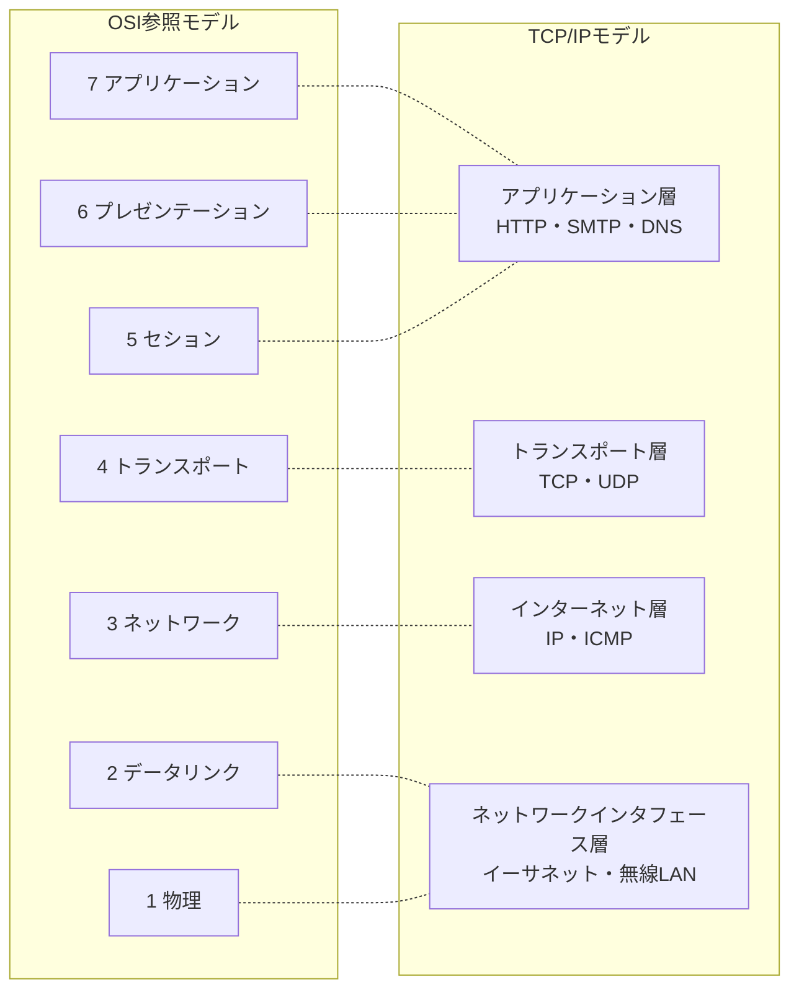

### 1.3 カプセル化 ★★

送信側では、上位層のデータに各層が **ヘッダ**（制御情報）を付けて下位層に渡します。これを **カプセル化** といいます。受信側では逆にヘッダを外していきます。

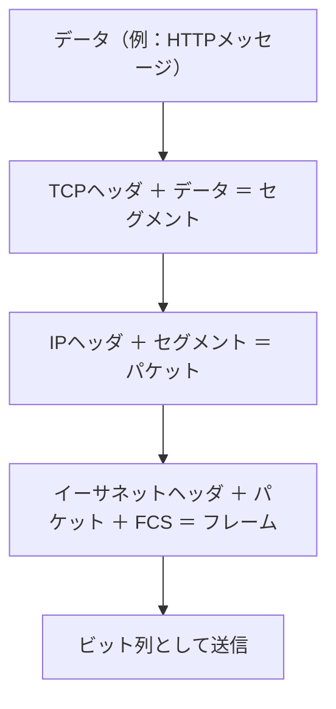

**FCS（Frame Check Sequence：フレーム検査シーケンス）** はフレームの誤り検出用（CRC）の値です。

各層のデータの先頭に付く制御情報を **ヘッダー**、ヘッダーとデータをひとまとめにした単位を（特にネットワーク層では）**パケット** と呼びます。科目Aでは「ヘッダーは上位層から順に内側へ」入れ子になる点が問われます。

### 1.4 ネットワークトポロジ ★

**ネットワークトポロジ** とは、端末や機器をどのような形でつなぐかという **接続形態** のことです。トポロジによって、配線の量と **障害時の影響範囲** が変わります。

| トポロジ | 形 | 長所 | 短所（障害時の動作） |
|---|---|---|---|
| **ポイントツーポイント**（2地点間接続） | 2台を1本の回線で直結 | 単純・回線を占有できる | 接続先が増えると回線数が増える |
| **バス型** | 1本の幹線（バス）に全端末をぶら下げる | 配線が少ない | **幹線が切れると全体が止まる**。両端に終端抵抗（ターミネータ）が必要 |
| **スター型** | 中心のハブ／スイッチに放射状につなぐ | 1本のケーブル障害はその端末だけで済む。現在のLANの主流 | **中心機器が故障すると全体が止まる**（単一障害点） |
| **リング型** | 端末を輪の形につなぐ | 衝突が起きない（トークンパッシングと組み合わせる） | 1か所の切断で全体が止まる → **二重リング** で冗長化することが多い |
| **ツリー型** | スター型を階層状に組み合わせる | 拡張しやすい（フロアスイッチ → 基幹スイッチ） | 上位の機器が故障すると配下がすべて止まる |
| メッシュ型（参考） | 機器どうしを網の目につなぐ | 経路が複数あり信頼性が高い | 回線数が多い。n台をすべて相互接続すると n(n−1)/2 本 |

💡 計算例：5拠点をフルメッシュでつなぐ回線数 ＝ 5 × 4 ÷ 2 ＝ **10本**。

### 1.5 標準化の実例：ITU-T の勧告 ★

LANの規格は主に **IEEE**（米国電気電子学会、例：IEEE 802.3＝イーサネット）が、WANや電話網の通信規格は **ITU-T**（国際電気通信連合 電気通信標準化部門）が「勧告」として定めます。ITU-T の勧告は分野ごとにアルファベットのシリーズ名が付きます。

| シリーズ | 対象 | 例 |
|---|---|---|
| **Vシリーズ** | 電話網を使ったデータ通信（モデムなど） | V.24（DTE–DCE間インタフェース）、V.90（56kbpsモデム） |
| **Xシリーズ** | データ通信網・開放型システム | X.25（パケット交換網）、X.500（ディレクトリ）、**X.509（デジタル証明書）** |
| **Iシリーズ** | **ISDN**（デジタル総合サービス網） | I.430（基本インタフェース）、I.431（1次群インタフェース） |

💡 覚え方：「**V＝Voice回線でデータ、X＝eXchange（データ網）、I＝ISDN**」。

---

## 2. 各層の機器

### 2.1 中継機器と層の対応 ★★★

| 機器 | 層 | 判断に使う情報 | 特徴 |
|---|---|---|---|
| **リピータ** / リピータハブ | 第1層（物理） | なし | 信号を増幅・整形して全ポートへ流す |
| **ブリッジ** / **L2スイッチ**（スイッチングハブ） | 第2層（データリンク） | **MACアドレス** | 宛先MACアドレスのあるポートにだけ転送 |
| **ルータ** / **L3スイッチ** | 第3層（ネットワーク） | **IPアドレス** | 異なるネットワーク間をつなぎ、経路を選ぶ |
| **ゲートウェイ** | 第4〜7層 | アプリケーションの情報など | プロトコル変換。プロキシサーバなど |

💡 覚え方：「**リピータ＝1、ブリッジ・スイッチ＝2、ルータ＝3**」。

⚠️ ひっかけ注意：L2スイッチは **ブロードキャスト** を全ポートに転送します（ブロードキャストドメインを分割できない）。ブロードキャストドメインを分割するのは **ルータ** と **VLAN** です。

### 2.2 L2スイッチの学習機能 ★★

L2スイッチは受信したフレームの **送信元MACアドレス** と受信ポートを **MACアドレステーブル** に記録します。宛先MACアドレスがテーブルにない場合は、受信ポート以外の全ポートに転送（**フラッディング**）します。

### 2.3 その他のLAN機器・技術 ★

| 用語 | 内容 |
|---|---|
| **PoE**（Power over Ethernet） | LANケーブルで電力も供給する（無線LANアクセスポイントやIPカメラ向け） |
| **リンクアグリゲーション** | 複数の物理回線を束ねて1本の論理回線として扱い、帯域拡大と冗長化を図る |
| **STP**（Spanning Tree Protocol：スパニングツリープロトコル） | スイッチをループ状に接続したとき、一部のポートを論理的に遮断してブロードキャストストーム（フレームが無限に回り続ける現象）を防ぐ |
| **VRRP**（Virtual Router Redundancy Protocol） | 複数のルータを1台の仮想ルータに見せ、故障時に自動で切り替えるデフォルトゲートウェイの冗長化 |
| **カスケード接続** | ハブやスイッチを数珠つなぎ（多段）に接続してポート数を増やすこと。リピータハブは段数に制限がある（10BASE-Tでは最大4段） |
| **ハブ** | 複数の端末を集線する機器。**リピータハブ**（第1層、全ポートへ転送）と **スイッチングハブ**（＝L2スイッチ、第2層）がある |

### 2.4 L3スイッチ・ゲートウェイ・回線接続装置 ★★

| 機器 | 説明 |
|---|---|
| **L3スイッチ**（レイヤー3スイッチ） | ルーティング機能をハードウェア（専用回路）で高速に処理するスイッチ。主に **LAN内のVLAN間ルーティング** に使う。WAN回線の接続やNAPTなどの多機能さはルータが得意 |
| **ルータ** | 異なるネットワーク間をIPアドレスで中継する。WAN接続、NAPT、パケットフィルタリングなど多機能 |
| **ゲートウェイ** | プロトコル体系が異なるネットワーク間で、トランスポート層以上を含めて変換・中継する機器やソフトウェアの総称（メールゲートウェイ、プロキシなど） |
| **プロキシサーバ／リバースプロキシサーバ** | アプリケーション層の中継サーバ（詳しくは [9.1 HTTP](#91-http-)） |
| **回線接続装置**（DCE：Data Circuit-terminating Equipment） | 端末（DTE）と通信回線をつなぐ装置。アナログ電話回線の **モデム**、ISDNの **DSU**／**TA**、光回線の **ONU**（光回線終端装置）など |

### 2.5 スパニングツリー（STP）の動き ★

スイッチを冗長化のためにループ状につなぐと、ブロードキャストフレームが無限に回り続ける **ブロードキャストストーム** が起きます。**スパニングツリープロトコル**（IEEE 802.1D）は、

1. **ルートブリッジ**（基準になるスイッチ）を1台選び、
2. ルートブリッジまでのコストが最小になる経路を残し、
3. それ以外のポートを **ブロッキング**（論理的に遮断）してループのない木構造（ツリー）を作ります。

経路が故障すると、ブロッキングしていたポートを開いて自動的に迂回します。

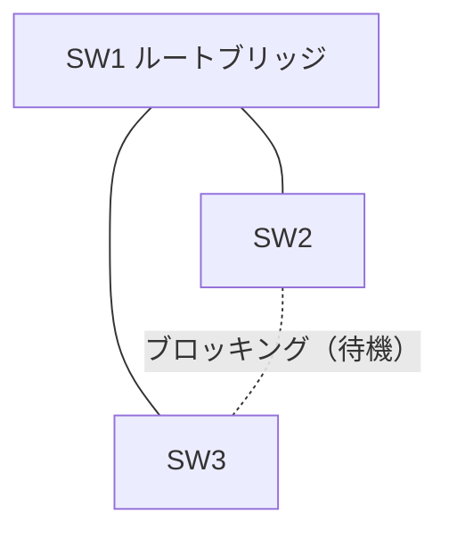

---

## 3. データリンク層：イーサネット・VLAN

### 3.1 MACアドレス ★★

**MACアドレス（Media Access Control address）** は、ネットワークインタフェースに割り当てられた **48ビット** の物理アドレスです。

```
例: 00-1A-2B-3C-4D-5E
    └─ 前半24ビット ─┘└─ 後半24ビット ─┘
      OUI（ベンダID）     製品ごとの固有番号
```

全ビットが1の `FF-FF-FF-FF-FF-FF` は **ブロードキャストアドレス**（同一ネットワーク内の全端末宛て）です。

### 3.2 アクセス制御方式 ★

| 方式 | 使われる場所 | 内容 |
|---|---|---|
| **CSMA/CD**（Carrier Sense Multiple Access with Collision Detection） | 初期の有線LAN（半二重） | 送信中に **衝突を検出** したら待って再送 |
| **CSMA/CA**（… with Collision Avoidance） | **無線LAN** | 送信前にランダムな時間待つことで **衝突を回避** |

現在のスイッチを使った全二重通信の有線LANでは、衝突自体が起きません。

| 方式 | 内容 |
|---|---|
| **トークンパッシング** | **トークン**（送信権を表す特別なフレーム）を端末間で巡回させ、トークンを持つ端末だけが送信する。**衝突が起きない** ので、負荷が高くても性能が安定する。トークンリング（IEEE 802.5）、FDDI で使われた |

**衝突（コリジョン）** とは、同じ伝送路に複数の端末が同時に送信して信号が壊れることです。衝突が届く範囲を **コリジョンドメイン** といい、リピータハブでは全体が1つ、スイッチではポートごとに分割されます。

💡 覚え方：「**CD＝検出（Detection）は有線、CA＝回避（Avoidance）は無線**」。無線では自分が送信中に他の電波を検出するのが難しいため、回避方式を使います。

### 3.3 VLAN ★★★

**VLAN（Virtual LAN：仮想LAN）** は、物理的な配線と関係なく、スイッチの設定で論理的にLANを分割する技術です。

- 結論：VLANごとに **ブロードキャストドメインが分かれる** ので、部署ごとの分離やセキュリティ向上ができます。
- 理由：同じスイッチにつながっていても、異なるVLANの端末どうしはフレームが届かないからです。
- 例：1台のスイッチに営業部（VLAN10）と開発部（VLAN20）を収容し、両者の通信は **ルータまたはL3スイッチ** を経由させる。

| 種類 | 内容 |
|---|---|
| **ポートVLAN** | スイッチのポート単位でVLANを割り当てる |
| **タグVLAN** | フレームに **VLANタグ**（IEEE 802.1Q、4バイト）を付け、1本の回線で複数VLANを運ぶ。スイッチ間の **トランクポート** で使う |
| MACアドレスVLAN | 端末のMACアドレスによってVLANを決める |


💡 VLAN ID は12ビットで、0と4095は予約されているため、使えるのは **1〜4094** です。

### 3.4 有線LANのケーブルとイーサネット規格 ★★

**有線LAN** は、ケーブルで端末とスイッチをつなぐLANです。無線LANより **高速・安定・盗聴されにくい** 反面、配線の手間がかかります。

| ケーブル | 構造・特徴 | 主な用途 |
|---|---|---|
| **同軸ケーブル** | 中心の導線を絶縁体と網状の外部導体で包んだもの。ノイズに強い | 初期のイーサネット（10BASE5、10BASE2）、テレビのアンテナ線 |
| **より対線**（ツイストペアケーブル） | 2本の銅線をより合わせてノイズを打ち消す。シールドなしの **UTP**、シールド付きの **STP** がある。性能は **カテゴリ**（Cat5e、Cat6A など）で表す | 現在のLANの主流（RJ-45コネクタ） |
| **光ファイバケーブル** | ガラスやプラスチックの細い線で光信号を送る。**電磁ノイズの影響を受けず、長距離・高速** | 建物間・フロア間の基幹配線、FTTH。長距離向けの **シングルモード**、短距離向けの **マルチモード** がある |

**イーサネットの規格名の読み方**：`1000BASE-T` ＝「**1000**Mbps」「**BASE**バンド伝送（デジタル信号をそのまま流す）」「**T**＝ツイストペアケーブル」。

| 規格 | 速度 | ケーブル | 最大長 |
|---|---|---|---|
| **10BASE-T** | 10Mbps | UTP（カテゴリ3以上） | 100m |
| **100BASE-TX** | 100Mbps | UTP（カテゴリ5以上） | 100m |
| **1000BASE-T** | 1Gbps | UTP（カテゴリ5e以上、4対すべて使用） | 100m |
| **10GBASE-T** | 10Gbps | UTP（カテゴリ6A以上） | 100m |
| 1000BASE-SX / LX など | 1Gbps | 光ファイバ（SX：マルチモード、LX：シングルモード／マルチモード） | 数百m〜数km |

### 3.5 データリンク層のプロトコル（PPP・PPPoE・IPoE） ★★

| プロトコル | 内容 |
|---|---|
| **PPP**（Point-to-Point Protocol） | 2点間を1対1で接続するためのデータリンク層プロトコル。**利用者認証**（PAP、CHAP）や IPアドレスの割当て機能をもつ。電話回線のダイヤルアップ接続で使われた |
| **PPPoE**（PPP over Ethernet） | PPPのフレームをイーサネット上で運ぶ方式。FTTH・ADSLで **ISPがID・パスワードで利用者を認証** するために使われる。通信事業者の網終端装置に通信が集中すると混雑しやすい |
| **IPoE**（IP over Ethernet） | PPPによるセッション確立や認証をせず、IPパケットを **そのまま** イーサネットで運ぶ方式。網終端装置を経由しないので混雑しにくく、IPv6インターネット接続（およびIPv4 over IPv6）で普及 |
| **RARP**（Reverse ARP） | MACアドレスからIPアドレスを求める（[8.1 ARP](#81-arp-) 参照）。現在はDHCPに置き換わった |
| **IEEE 802.1Q** | VLANタグの規格（[3.3 VLAN](#33-vlan-) 参照） |

---

## 4. ネットワーク層：IPアドレスとサブネット

### 4.1 IPv4アドレスの構造 ★★★

**IPv4アドレス** は **32ビット** で、8ビットずつ10進数で表します（例：`192.168.10.130`）。前半の **ネットワーク部**（どのネットワークか）と後半の **ホスト部**（そのネットワーク内のどの機器か）に分かれます。

```
192      .168      .10       .130
11000000 .10101000 .00001010 .10000010
```

### 4.2 アドレスクラス（参考） ★

以前は先頭ビットでネットワーク部の長さが決まる **クラス** 方式でした。

| クラス | 先頭ビット | 第1オクテットの範囲 | ネットワーク部 | ホスト数 |
|---|---|---|---|---|
| A | 0 | 0〜127 | 8ビット | 2²⁴ − 2 ＝ 16,777,214 |
| B | 10 | 128〜191 | 16ビット | 2¹⁶ − 2 ＝ 65,534 |
| C | 110 | 192〜223 | 24ビット | 2⁸ − 2 ＝ 254 |
| D | 1110 | 224〜239 | （マルチキャスト用） | |

現在は、ネットワーク部の長さを自由に決める **CIDR**（下記）が使われています。

### 4.3 プライベートIPアドレスと特殊なアドレス ★★★

**プライベートIPアドレス** は、組織内で自由に使えるアドレスです（インターネットへは直接出られず、NAT/NAPTで変換します）。

| 範囲 | CIDR表記 |
|---|---|
| 10.0.0.0 〜 10.255.255.255 | 10.0.0.0/8 |
| 172.16.0.0 〜 172.31.255.255 | 172.16.0.0/12 |
| 192.168.0.0 〜 192.168.255.255 | 192.168.0.0/16 |

| 特殊なアドレス | 内容 |
|---|---|
| **ネットワークアドレス** | ホスト部がすべて0。ネットワーク自体を表す（端末に割当て不可） |
| **ブロードキャストアドレス** | ホスト部がすべて1。そのネットワーク内の全端末宛て（端末に割当て不可） |
| **ループバックアドレス** | 127.0.0.0/8（通常 127.0.0.1）。自分自身を表す |
| リンクローカルアドレス | 169.254.0.0/16。DHCPサーバに接続できないときに自動設定される |

⚠️ ひっかけ注意：`172.32.0.1` はプライベートアドレスでは **ありません**（範囲は 172.16〜172.31）。

### 4.4 サブネットマスクとCIDR ★★★

**サブネットマスク** は、IPアドレスのどこまでがネットワーク部かを示す32ビットの値です（ネットワーク部を1、ホスト部を0にする）。**CIDR（Classless Inter-Domain Routing）表記** では、ネットワーク部のビット数を `/` の後ろに書きます。

| CIDR | サブネットマスク | 最終オクテット（2進） | アドレス数 | ホスト数 |
|---|---|---|---|---|
| /24 | 255.255.255.0 | 00000000 | 256 | 254 |
| /25 | 255.255.255.128 | 10000000 | 128 | 126 |
| /26 | 255.255.255.192 | 11000000 | 64 | 62 |
| /27 | 255.255.255.224 | 11100000 | 32 | 30 |
| /28 | 255.255.255.240 | 11110000 | 16 | 14 |
| /29 | 255.255.255.248 | 11111000 | 8 | 6 |
| /30 | 255.255.255.252 | 11111100 | 4 | 2 |

💡 覚え方：マスクの値は **128, 192, 224, 240, 248, 252, 254, 255**（1が左から1つずつ増える）。表は暗記するより、自分で書けるようにしておきましょう。

### 4.5 サブネット計算の公式 ★★★

```
ホスト部のビット数   h = 32 − プレフィックス長
割当て可能ホスト数   = 2^h − 2   （ネットワークアドレスとブロードキャストアドレスを除く）
ネットワークアドレス = IPアドレス AND サブネットマスク
ブロードキャスト     = ネットワークアドレスのホスト部をすべて1にしたもの
```

**ブロックサイズを使った速算法**：マスクが255でも0でもないオクテット（注目オクテット）について、

```
ブロックサイズ = 256 − （そのオクテットのマスク値）
ネットワークアドレス = そのオクテットの値以下で、ブロックサイズの倍数のうち最大のもの
```

### 4.6 例題1：192.168.10.130/26 ★★★

**手順1：ホスト数**

```
h = 32 − 26 = 6
ホスト数 = 2^6 − 2 = 64 − 2 = 62
```

**手順2：サブネットマスク**

```
/26 → 1が26個 → 11111111.11111111.11111111.11000000 → 255.255.255.192
```

**手順3：ネットワークアドレス（AND演算）**

第4オクテットだけが注目オクテットです。

```
IPアドレス     130 = 1000 0010
サブネットマスク 192 = 1100 0000
AND            ─────────────
                     1000 0000 = 128
```

→ ネットワークアドレス ＝ **192.168.10.128**

（速算法：ブロックサイズ ＝ 256 − 192 ＝ 64。64の倍数 0, 64, 128, 192 のうち130以下で最大は128）

**手順4：ブロードキャストアドレス**

```
ホスト部(下位6ビット)をすべて1にする: 1011 1111 = 191
（速算法: 128 + 64 − 1 = 191）
```

→ ブロードキャストアドレス ＝ **192.168.10.191**

**結果まとめ**

| 項目 | 値 |
|---|---|
| ネットワークアドレス | 192.168.10.128 |
| 割当て可能な範囲 | 192.168.10.129 〜 192.168.10.190 |
| ブロードキャストアドレス | 192.168.10.191 |
| ホスト数 | 62 |

### 4.7 例題2：172.16.45.200/20（第3オクテットで区切れる場合） ★★★

**手順1：ホスト数**

```
h = 32 − 20 = 12
ホスト数 = 2^12 − 2 = 4096 − 2 = 4094
```

**手順2：サブネットマスク**

```
/20 → 11111111.11111111.11110000.00000000 → 255.255.240.0
```

**手順3：ネットワークアドレス**（注目オクテットは第3オクテット）

```
第3オクテット   45 = 0010 1101
マスク         240 = 1111 0000
AND               = 0010 0000 = 32
第4オクテットはマスクが0なので 0
```

→ ネットワークアドレス ＝ **172.16.32.0**（速算法：ブロックサイズ 256 − 240 ＝ 16、16の倍数で45以下の最大は32）

**手順4：ブロードキャストアドレス**

```
第3オクテット: 32 + 16 − 1 = 47
第4オクテット: 255
```

→ ブロードキャストアドレス ＝ **172.16.47.255**

| 項目 | 値 |
|---|---|
| ネットワークアドレス | 172.16.32.0 |
| 割当て可能な範囲 | 172.16.32.1 〜 172.16.47.254 |
| ブロードキャストアドレス | 172.16.47.255 |
| ホスト数 | 4,094 |

⚠️ ひっかけ注意：/23 や /20 のように第3オクテットで区切れる場合、`192.168.5.255/23` のように **末尾が255でもブロードキャストとは限りません**。192.168.5.255/23 のネットワークは 192.168.4.0/23（範囲 192.168.4.0〜192.168.5.255）なので、この例はたまたまブロードキャストですが、`192.168.4.255/23` はふつうのホストアドレスです。

### 4.8 例題3：必要なホスト数からマスクを決める ★★

**問題**：1つのサブネットに最大50台の機器を接続したい。最もアドレスを無駄にしないサブネットマスクは？

```
2^h − 2 ≥ 50 を満たす最小の h を探す
h = 5 → 32 − 2 = 30  （不足）
h = 6 → 64 − 2 = 62  （OK）
プレフィックス長 = 32 − 6 = 26 → 255.255.255.192
```

### 4.9 例題4：サブネットに分割する ★★

**問題**：192.168.1.0/24 を /27 のサブネットに分割すると、サブネットはいくつでき、各サブネットのホスト数はいくつか。

```
サブネット数 = 2^(27 − 24) = 2^3 = 8
ホスト数     = 2^(32 − 27) − 2 = 32 − 2 = 30
```

| サブネット | ネットワークアドレス | ブロードキャスト |
|---|---|---|
| 1 | 192.168.1.0 | 192.168.1.31 |
| 2 | 192.168.1.32 | 192.168.1.63 |
| 3 | 192.168.1.64 | 192.168.1.95 |
| … | … | … |
| 8 | 192.168.1.224 | 192.168.1.255 |

### 4.10 例題5：経路集約（スーパーネット化） ★★

**経路集約** とは、複数の連続したネットワークを1つの経路情報にまとめることです（ルーティング表を小さくできます）。

**問題**：192.168.0.0/24、192.168.1.0/24、192.168.2.0/24、192.168.3.0/24 の4つを1つに集約すると？

```
第3オクテットを2進数にする
  0 = 0000 00|00
  1 = 0000 00|01
  2 = 0000 00|10
  3 = 0000 00|11
       └共通┘ ← 上位6ビットが共通
共通ビット数 = 8 + 8 + 6 = 22
```

→ **192.168.0.0/22**

💡 確認：/22 のアドレス数は 2^10 ＝ 1024 ＝ 256 × 4 で、/24 が4つ分とぴったり一致します。

### 4.11 グローバルIPアドレスと通信の宛先の種類 ★★

**グローバルIPアドレス** は、インターネット上で **世界で一意** になるように割り当てられるIPアドレスです。ICANN／IANA を頂点に、地域インターネットレジストリ（APNIC）、国別レジストリ（日本は **JPNIC**）、ISP の順に配布されます。世界で一意だからこそ、どのノード（ネットワークにつながる機器）とも相互に通信できます。組織内では **プライベートIPアドレス** を使い、インターネットに出るときに NAT／**IPマスカレード**（＝NAPT、[8.5](#85-nat-と-napt-) 参照）で変換します。

IPアドレスのうち、ネットワーク部を取り出したものを **ネットワークアドレス**（サブネットに分割した場合は **サブネットアドレス**）と呼びます。MACアドレスのように機器に固定された番号を **物理アドレス**、IPアドレスを **論理アドレス** と呼んで区別します。

| 宛先の種類 | 送り先 | 例 |
|---|---|---|
| **ユニキャスト** | **1対1**（特定の1台） | 通常のWeb閲覧・メール |
| **ブロードキャスト** | **1対全部**（同じネットワーク内の全端末） | ARP要求、DHCPDISCOVER（ルータは越えない） |
| **マルチキャスト** | **1対グループ**（参加登録した複数の端末） | 映像の同時配信、OSPFのルータ間通信。IPv4ではクラスD（224.0.0.0〜239.255.255.255） |
| エニーキャスト（参考） | 同じアドレスをもつ複数のうち **最も近い1台** | DNSのルートサーバ、IPv6 |

---

## 5. IPv6

### 5.1 IPv6の特徴 ★★

**IPv6（Internet Protocol version 6）** は、IPv4アドレスの枯渇に対応するために作られた **128ビット** のアドレス体系です。

| 項目 | IPv4 | IPv6 |
|---|---|---|
| アドレス長 | 32ビット | **128ビット** |
| 表記 | 10進数を `.` で4区切り | **16進数を `:` で8区切り**（16ビットずつ） |
| ヘッダ長 | 可変（20〜60バイト） | **固定40バイト**（拡張ヘッダで機能追加） |
| ブロードキャスト | あり | **なし**（マルチキャストで代用） |
| アドレス自動設定 | DHCP | **SLAAC**（ステートレスアドレス自動設定）、DHCPv6 |
| IPsec | オプション | 実装が想定されている |
| 中継ルータでの分割（フラグメント） | あり | なし（送信元のみが分割） |

### 5.2 IPv6アドレスの省略表記 ★★★

**ルール**（RFC 5952 の推奨表記）

1. 各フィールド（16ビット）の **先頭の0は省略** できる（`0db8` → `db8`、`0000` → `0`）。
2. **0が連続するフィールドは `::` で1回だけ** まとめられる（最も長く続く部分を省略する）。
3. 英字は小文字で書く。

**例**：`2001:0db8:0000:0000:0001:0000:0000:0abc`

```
ルール1適用: 2001:db8:0:0:1:0:0:abc
ルール2適用: 0の連続は「0:0」が2か所（長さが同じ）→ 前の方を :: にする
結果      : 2001:db8::1:0:0:abc
```

⚠️ ひっかけ注意：`2001:db8::1::abc` のように `::` を **2回使うのは誤り** です（何個の0を省略したか分からなくなるため）。

### 5.3 IPv6アドレスの種類 ★

| 種類 | プレフィックス | 用途 |
|---|---|---|
| グローバルユニキャスト | 2000::/3 | インターネットで一意（IPv4のグローバルアドレス相当） |
| **リンクローカル** | fe80::/10 | 同一リンク内だけで有効（自動で必ず付く） |
| ユニークローカル | fc00::/7 | 組織内で使う（IPv4のプライベートアドレス相当） |
| マルチキャスト | ff00::/8 | 複数宛て |
| ループバック | ::1 | 自分自身 |

### 5.4 IPv4からの移行技術 ★

| 技術 | 内容 |
|---|---|
| デュアルスタック | 1台の機器でIPv4とIPv6の両方を動かす |
| トンネリング | IPv6パケットをIPv4パケットに包んで（カプセル化して）運ぶ |
| トランスレーション | IPv4とIPv6のヘッダを相互変換する（NAT64など） |

---

## 6. ルーティング

### 6.1 ルーティングとルーティング表 ★★★

**ルーティング** とは、ルータがパケットの宛先IPアドレスを見て、次にどのルータへ送るか（**ネクストホップ**）を決めることです。判断には **ルーティング表（経路表）** を使います。

**ロンゲストマッチ（最長一致）**：宛先に一致する経路が複数あるときは、**プレフィックス長が最も長い（詳しい）経路** を選びます。

**例**：次のルーティング表を持つルータ

| 宛先ネットワーク | ネクストホップ |
|---|---|
| 192.168.0.0/16 | ルータR1 |
| 192.168.10.0/24 | ルータR2 |
| 0.0.0.0/0（デフォルトルート） | ルータR3 |

| 宛先IPアドレス | 一致する経路 | 選ばれる経路 |
|---|---|---|
| 192.168.10.5 | /16、/24、/0 | **/24 → R2**（最長） |
| 192.168.20.1 | /16、/0 | **/16 → R1** |
| 8.8.8.8 | /0 のみ | **R3**（デフォルトルート） |

**デフォルトルート**（0.0.0.0/0）は「どの経路にも一致しないときの送り先」で、すべての宛先に一致します。端末に設定する **デフォルトゲートウェイ** は、他のネットワーク宛てのパケットを送るルータのIPアドレスです。

### 6.2 静的ルーティングと動的ルーティング ★★

| 方式 | 内容 | 向いている環境 |
|---|---|---|
| **静的（スタティック）ルーティング** | 管理者が手で経路を設定する | 小規模・経路がほぼ変わらない |
| **動的（ダイナミック）ルーティング** | ルータ同士がルーティングプロトコルで経路情報を交換し自動更新する | 大規模・障害時の迂回が必要 |

### 6.3 ルーティングプロトコル ★★

| プロトコル | 種類 | 経路選択の基準 | 使われる範囲 |
|---|---|---|---|
| **RIP**（Routing Information Protocol） | 距離ベクトル型 | **ホップ数**（経由するルータの数）。最大15（16は到達不能） | 小規模な組織内（AS内） |
| **OSPF**（Open Shortest Path First） | リンクステート型 | **コスト**（回線帯域などから算出） | 中〜大規模な組織内（AS内） |
| **BGP**（Border Gateway Protocol） | パスベクトル型 | AS経路（ポリシー） | **AS（自律システム）間**、ISP間 |

**AS（Autonomous System：自律システム）** は、ISPや大企業など、1つの管理方針で運用されるネットワークのまとまりです。

💡 覚え方：「**RIPはホップ、OSPFはコスト、BGPはAS間**」。

---

## 7. トランスポート層：TCP・UDP・ポート番号

### 7.1 TCPとUDPの比較 ★★★

| 項目 | **TCP**（Transmission Control Protocol） | **UDP**（User Datagram Protocol） |
|---|---|---|
| 接続 | **コネクション型**（通信前に接続を確立） | **コネクションレス型** |
| 信頼性 | 高い（順序制御・再送制御・確認応答） | なし（届かなくても再送しない） |
| フロー制御 | あり（ウィンドウ制御） | なし |
| ヘッダ長 | 20バイト以上 | 8バイト |
| 速度・オーバーヘッド | 遅め・大きい | 速い・小さい |
| ブロードキャスト／マルチキャスト | 不可 | **可能** |
| 主な用途 | HTTP、メール、FTP、SSH | **DNS**（問合せ）、**DHCP**、NTP、SNMP、音声・動画のリアルタイム配信 |

### 7.2 TCPの3ウェイハンドシェイク ★★

TCPは通信の前に **3ウェイハンドシェイク** で接続を確立します。

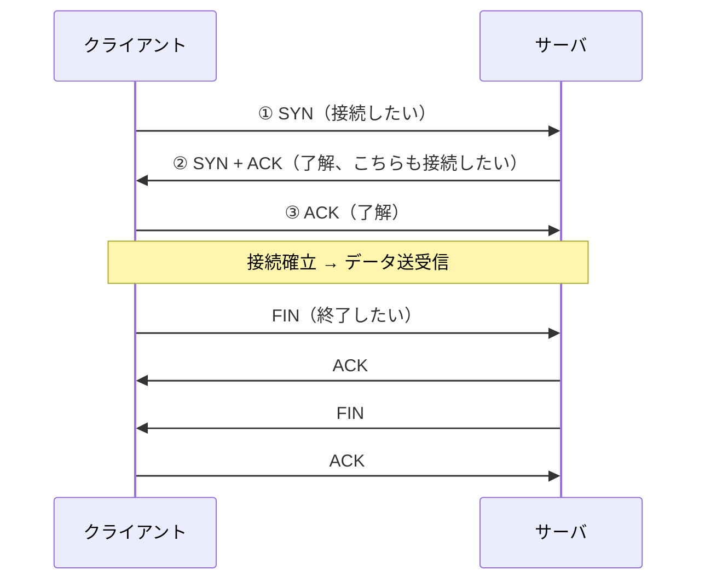

### 7.3 TCPの信頼性の仕組み ★

| 仕組み | 内容 |
|---|---|
| シーケンス番号 | 送るデータに通し番号を付け、受信側で順番を並べ直す |
| 確認応答（ACK） | 受け取ったことを相手に返す |
| 再送制御 | 一定時間ACKが来なければ再送する |
| **ウィンドウ制御** | ACKを待たずに送ってよいデータ量（ウィンドウサイズ）を決め、まとめて送って効率を上げる |
| 輻輳制御 | ネットワークの混雑を検知して送信量を絞る |

### 7.4 ポート番号 ★★★

**ポート番号** は、1台のコンピュータ上で動いている **どのアプリケーション宛てか** を区別する16ビットの番号（0〜65535）です。

| 範囲 | 名称 |
|---|---|
| 0〜1023 | **ウェルノウンポート**（代表的なサービス用） |
| 1024〜49151 | 登録済みポート |
| 49152〜65535 | 動的・プライベートポート（クライアント側で一時的に使う） |

**よく出るウェルノウンポート**

| ポート | プロトコル | TCP/UDP | 用途 |
|---|---|---|---|
| 20 / 21 | FTP | TCP | ファイル転送（20：データ、21：制御） |
| 22 | **SSH** | TCP | 暗号化された遠隔ログイン |
| 23 | Telnet | TCP | 遠隔ログイン（平文） |
| 25 | **SMTP** | TCP | メール送信・転送 |
| 53 | **DNS** | UDP/TCP | 名前解決 |
| 67 / 68 | **DHCP** | UDP | IPアドレス自動割当て（67：サーバ、68：クライアント） |
| 80 | **HTTP** | TCP | Web |
| 110 | **POP3** | TCP | メール受信 |
| 123 | NTP | UDP | 時刻同期 |
| 143 | **IMAP4** | TCP | メール受信（サーバ上で管理） |
| 161 / 162 | SNMP | UDP | ネットワーク機器の監視（162：トラップ） |
| 443 | **HTTPS** | TCP（HTTP/3はUDP） | 暗号化されたWeb |
| 587 | サブミッション | TCP | メール送信（クライアント → メールサーバ、SMTP-AUTHと併用） |
| 993 / 995 | IMAPS / POP3S | TCP | TLSで暗号化したIMAP / POP3 |

---

## 8. ネットワークを支えるプロトコル：ARP・ICMP・DHCP・DNS・NAT

### 8.1 ARP ★★★

**ARP（Address Resolution Protocol）** は、**IPアドレスからMACアドレスを求める** プロトコルです。

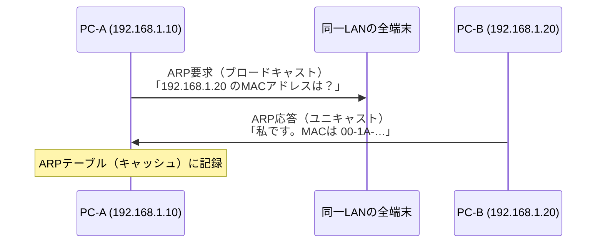

- 宛先が **別のネットワーク** の場合は、宛先ホストではなく **デフォルトゲートウェイのMACアドレス** をARPで求めます。
- 関連：**RARP** は逆にMACアドレスからIPアドレスを求めるもの（現在はDHCPに置き換わった）。**GARP**（Gratuitous ARP）は自分のIPアドレスを指定したARPで、アドレス重複の検出などに使います。

### 8.2 ICMP ★★

**ICMP（Internet Control Message Protocol）** は、IP通信のエラー通知や診断に使うプロトコルです（ネットワーク層）。

| コマンド／メッセージ | 用途 |
|---|---|
| **ping**（エコー要求／エコー応答） | 相手に到達できるか確認 |
| **traceroute**（tracert） | 経由するルータを調べる（TTLを1ずつ増やして送る） |
| 到達不能（Destination Unreachable） | 宛先に届かなかったことを通知 |
| 時間超過（Time Exceeded） | **TTL**（Time To Live：生存時間。ルータを通るたびに1減る）が0になった |

### 8.3 DHCP ★★★

**DHCP（Dynamic Host Configuration Protocol）** は、端末に **IPアドレス・サブネットマスク・デフォルトゲートウェイ・DNSサーバのアドレス** などを自動で割り当てるプロトコルです。

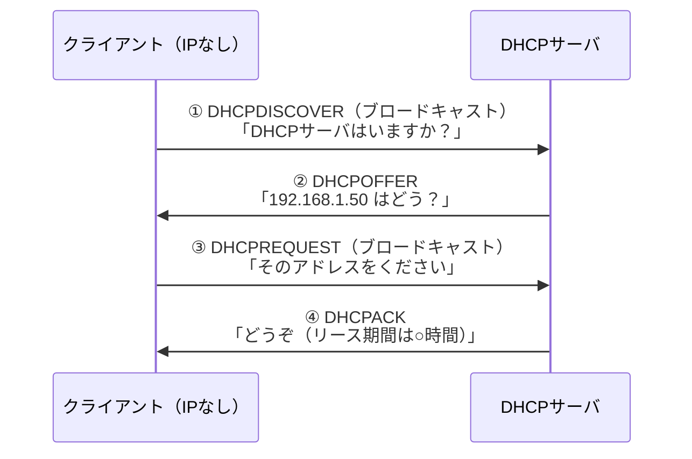

💡 覚え方：「**DORA**（Discover・Offer・Request・Ack）」。

- 割り当てには **リース期間**（有効期限）があり、期限前に更新します。
- ⚠️ DHCPDISCOVER はブロードキャストなので **ルータを越えられません**。別のネットワークにあるDHCPサーバを使うには、ルータに **DHCPリレーエージェント** の機能を設定します（科目Bの頻出ポイント）。

### 8.4 DNS ★★★

**DNS（Domain Name System）** は、**ドメイン名（例：www.example.jp）とIPアドレスを対応付ける**（名前解決する）仕組みです。

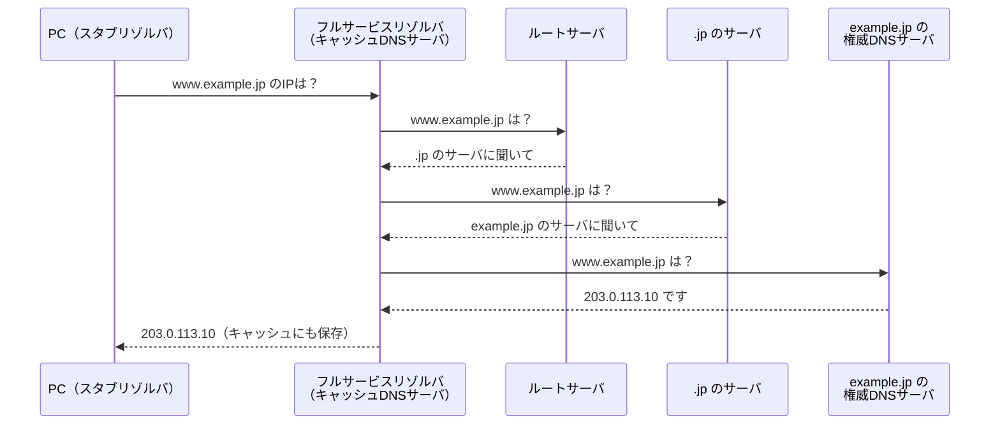

| 用語 | 内容 |
|---|---|
| **フルサービスリゾルバ**（キャッシュDNSサーバ） | 利用者からの問合せを受け、他のDNSサーバへ順に問い合わせて答えを得る。結果をキャッシュする |
| **権威DNSサーバ**（コンテンツサーバ） | 自分が管理するドメイン（ゾーン）の情報を持ち、回答する |

**主なリソースレコード**

| レコード | 内容 |
|---|---|
| **A** | ドメイン名 → **IPv4アドレス** |
| **AAAA** | ドメイン名 → **IPv6アドレス** |
| **MX** | そのドメイン宛てメールを受け取る **メールサーバ** |
| **CNAME** | 別名（エイリアス） |
| **NS** | そのゾーンを管理する権威DNSサーバ |
| **PTR** | IPアドレス → ドメイン名（**逆引き**） |
| SOA | ゾーンの管理情報 |
| TXT | 任意の文字列（SPFなどの送信ドメイン認証で使用） |

⚠️ セキュリティとの関連：偽の応答をキャッシュに覚えさせる **DNSキャッシュポイズニング** があり、対策として **DNSSEC**（DNSの応答に電子署名を付ける）があります。

**ドメインとTLD**：ドメイン名は右から順に階層になっています。`www.example.co.jp` なら、`jp` が **TLD**（Top Level Domain：トップレベルドメイン）、`co` が第2レベル、`example` が第3レベルです。

| TLDの種類 | 例 |
|---|---|
| **ccTLD**（country code TLD：国別） | `.jp`（日本）、`.uk`、`.cn` |
| **gTLD**（generic TLD：分野別） | `.com`、`.net`、`.org`、新gTLD（`.tokyo`、`.shop` など） |

`www.example.co.jp.` のように末尾にピリオドまで書いたものを **FQDN**（Fully Qualified Domain Name：完全修飾ドメイン名）といい、末尾の `.` がルートを表します。

### 8.5 NAT と NAPT ★★★

**NAT（Network Address Translation）** は、プライベートIPアドレスとグローバルIPアドレスを変換する技術です。

| 方式 | 変換するもの | 特徴 |
|---|---|---|
| **NAT**（静的NAT など） | **IPアドレスのみ**（1対1） | グローバルアドレスの数だけしか同時に外部と通信できない |
| **NAPT**（Network Address Port Translation、IPマスカレード） | **IPアドレス ＋ ポート番号** | **1つのグローバルアドレスを複数端末で共有** できる |

**NAPTの変換例**（ルータのグローバルアドレスが 203.0.113.1）

| 内部（送信元） | 変換後（送信元） |
|---|---|
| 192.168.1.10 : 50001 | 203.0.113.1 : 60001 |
| 192.168.1.20 : 50001 | 203.0.113.1 : 60002 |

→ 戻ってきたパケットは、ポート番号（60001 / 60002）を見て元の端末に振り分けます。

⚠️ ひっかけ注意：NAPTでは、外部から内部のサーバへ通信を始めることは、そのままでは **できません**（変換表がないため）。外部に公開するサーバには **静的NAT** や **ポートフォワーディング** を設定するか、**DMZ** に置きます。

---

## 9. アプリケーション層：HTTP・メール・その他

### 9.1 HTTP ★★

**HTTP（HyperText Transfer Protocol）** はWebブラウザとWebサーバの間の通信プロトコルです。**HTTPS** はHTTPを **TLS（Transport Layer Security）** で暗号化したものです。

| メソッド | 用途 |
|---|---|
| GET | リソースの取得（パラメータはURLに付く） |
| POST | データの送信（フォーム送信など。パラメータは本文に入る） |
| PUT | リソースの作成・置き換え |
| DELETE | リソースの削除 |
| HEAD | ヘッダだけ取得 |

| ステータスコード | 意味 |
|---|---|
| **200** OK | 成功 |
| **301** / **302** | 恒久的 / 一時的な **リダイレクト**（転送） |
| 304 Not Modified | 更新されていない（キャッシュを使ってよい） |
| 400 Bad Request | リクエストの誤り |
| **401** Unauthorized | 認証が必要 |
| **403** Forbidden | アクセス禁止 |
| **404** Not Found | リソースがない |
| **500** Internal Server Error | サーバ内部のエラー |
| **503** Service Unavailable | 過負荷・メンテナンスで一時的に利用不可 |

💡 覚え方：**2xx 成功、3xx 転送、4xx クライアントのせい、5xx サーバのせい**。

| 用語 | 内容 |
|---|---|
| **Cookie** | サーバがブラウザに保存させる小さなデータ。HTTPは状態を持たない（**ステートレス**）ため、ログイン状態の維持（セッション管理）に使う |
| HTTP/2 | 1つのTCP接続で複数のリクエストを並行処理（多重化）し高速化 |
| **HTTP/3** | トランスポートに **QUIC**（**UDP** 上に作られたプロトコル）を使い、接続確立を高速化 |
| **プロキシサーバ** | クライアントの代わりにWebサーバへアクセスする中継サーバ。キャッシュやアクセス制御に使う |
| リバースプロキシ | サーバ側に置き、外部からの要求を内部のWebサーバへ振り分ける（負荷分散、TLS終端） |

### 9.2 電子メールのプロトコル ★★★


| プロトコル | 用途 | 特徴 |
|---|---|---|
| **SMTP**（Simple Mail Transfer Protocol） | メールの **送信・転送** | ポート25（サーバ間）、587（クライアントからの投稿） |
| **POP3**（Post Office Protocol version 3） | メールの **受信** | メールを端末に **ダウンロード** して読む |
| **IMAP4**（Internet Message Access Protocol version 4） | メールの **受信** | メールを **サーバ上で管理**。複数端末で同じ状態を共有できる |
| **SMTP-AUTH** | 送信時の利用者認証 | 不正な中継（踏み台）を防ぐ |
| **MIME**（Multipurpose Internet Mail Extensions） | 日本語・添付ファイルを扱う形式 | 暗号化・署名版が **S/MIME** |

| 迷惑メール・なりすまし対策 | 内容 |
|---|---|
| **OP25B**（Outbound Port 25 Blocking） | ISPが、自社ネットワークから外部のポート25への直接送信を遮断する |
| **SPF**（Sender Policy Framework） | 送信元ドメインのDNS（TXTレコード）に正規の送信サーバのIPアドレスを登録し、受信側が照合する |
| **DKIM**（DomainKeys Identified Mail） | 送信サーバがメールに **電子署名** を付け、受信側がDNS上の公開鍵で検証する |
| **DMARC** | SPF・DKIMの検証に失敗したメールの扱い（受信拒否など）を送信ドメイン側が宣言する |

### 9.3 その他のプロトコル ★

| プロトコル | 用途 |
|---|---|
| **NTP**（Network Time Protocol） | 時刻同期（UDP 123） |
| **SNMP**（Simple Network Management Protocol） | ネットワーク機器の監視・管理。機器側の **エージェント** が異常を **トラップ** で通知する |
| **SIP**（Session Initiation Protocol） | IP電話（VoIP）の呼制御 |
| **RTP**（Real-time Transport Protocol） | 音声・動画のリアルタイム転送 |
| FTP | ファイル転送（制御とデータで別のコネクションを使う） |
| SSH | 暗号化された遠隔操作・ファイル転送（SFTP） |
| **TELNET** | 遠隔地のコンピュータにログインして操作する（TCP 23）。通信が **暗号化されない**（パスワードも平文）ため、現在は SSH を使う |

### 9.4 Webの仕組みと関連技術 ★★

**WWW**（World Wide Web）は、Webサーバ上の **ハイパーテキスト**（他の文書へのリンク＝ハイパーリンクを埋め込んだ文書）を Webブラウザで閲覧する仕組みです。Webページは **HTML**（構造を記述するマークアップ言語）や XML で書かれます。

**URL**（Uniform Resource Locator）はWeb上の資源の場所を表します。

```
https://www.example.jp:443/shop/item.html?id=123#detail
└スキーム┘└── ホスト名 ──┘└ポート┘└── パス ──┘└クエリ┘└フラグメント┘
```

| 用語 | 内容 |
|---|---|
| **HTTPS**（HTTP over TLS） | HTTPを TLS で暗号化したもの。通信の盗聴・改ざん防止とサーバ認証（ポート443） |
| **CGI**（Common Gateway Interface） | Webサーバが **外部プログラムを起動** して、その出力を動的なWebページとして返すための仕組み。リクエストごとにプロセスを起動するため負荷が高い |
| **cookie** | サーバがブラウザに保存させる小さなデータ（[9.1](#91-http-) 参照）。`Secure` 属性でHTTPS時のみ送信、`HttpOnly` 属性でJavaScriptから読めなくする |
| **セッションID** | ログイン中の利用者を識別するためにサーバが発行するランダムな値。cookieなどで受け渡す。推測・盗用されると **セッションハイジャック** されるので、十分長い乱数にし、ログイン後に再発行する |
| **REST**（REpresentational State Transfer） | URLで資源を指定し、HTTPのメソッド（GET・POST・PUT・DELETE）で操作するWeb APIの設計スタイル。**ステートレス** で軽量。データ形式は JSON が多い |
| **SOAP**（Simple Object Access Protocol） | **XML** 形式のメッセージでプログラム間の手続き呼出しを行うプロトコル。厳密だが重い（WSDLでインタフェースを定義） |
| **WebDAV**（Web-based Distributed Authoring and Versioning） | HTTPを拡張し、Webサーバ上のファイルを **作成・編集・削除・ロック** できるようにしたもの（オンラインストレージなど） |
| **HTTP/2** | 1本のTCPコネクション上で複数のリクエスト／レスポンスを並行して送る **多重化（ストリーム）**、ヘッダ圧縮、バイナリ形式化で高速化 |
| **HTTP/3** | トランスポートに **QUIC** を使う HTTP |
| **QUIC** | **UDP** 上で動作し、TLS 1.3 の暗号化を組み込んだトランスポートプロトコル。接続確立の往復回数が少なく、1つのパケット損失が他のストリームを止めない（TCPの **HOLブロッキング** を回避）。シラバスでは当初の名称 Quick UDP Internet Connection で表記 |

⚠️ ひっかけ注意：**HTTP/3 は UDP**（QUIC）、HTTP/1.1・HTTP/2 は TCP です。

### 9.5 電子メールの形式（MIME・base64・HTMLメール） ★★

電子メールは、送信者のメールソフト → 送信側メールサーバ → 受信側メールサーバへと、**メールサーバ間をSMTPでバケツリレー（リレー方式）** して配送され、受信者は POP3 や IMAP4 で取り出します（[9.2](#92-電子メールのプロトコル-) の図）。

| 用語 | 内容 |
|---|---|
| **MIME** | 本来7ビットのASCII文字しか送れない電子メールで、日本語・画像・添付ファイルなどを扱えるようにする規格。本文を複数のパートに分ける（マルチパート） |
| **base64** | バイナリデータを **英数字と記号（64種類＋`=`）だけの文字列** に変換するエンコード方式。**3バイト（24ビット）を6ビット×4文字** に変換するので、データ量は約 **4/3倍（約1.33倍）** になる |
| **HTMLメール**（**MHTML**） | 本文をHTMLで記述し、文字の装飾や画像を表示できるメール。HTMLと画像などを1つにまとめる形式が MHTML（MIME HTML）。⚠️ スクリプトや外部画像による追跡・フィッシングに悪用されやすい |
| **Webメール** | Webブラウザでメールを読み書きするサービス（Gmailなど）。メールソフトの設定が不要で、どの端末からでも使える |

**計算例（base64）**：300バイトの添付ファイルを base64 で変換すると何文字になるか。

```
300 バイト ÷ 3 バイト = 100 グループ
100 グループ × 4 文字 = 400 文字（改行を除く）
```

### 9.6 ファイル転送（FTP・TFTP） ★

**FTP**（File Transfer Protocol）は、クライアントとFTPサーバの間でファイルを **アップロード**（クライアント → サーバ）／**ダウンロード**（サーバ → クライアント）するプロトコルです。**制御用コネクション（ポート21）とデータ転送用コネクションを別々に** 使います。

| モード | データ用コネクションを張る向き | 特徴 |
|---|---|---|
| **アクティブモード** | **サーバ（ポート20）→ クライアント** | クライアント側のファイアウォールやNAPTで外からの接続が遮断されやすい |
| **パッシブモード** | **クライアント → サーバ**（サーバが指定したポート） | クライアントから接続を始めるので、ファイアウォール越しでも使いやすい。現在の主流 |

**TFTP**（Trivial File Transfer Protocol）は、**UDP（ポート69）** を使う簡易なファイル転送プロトコルです。**認証機能がなく**、ネットワーク機器の設定ファイルの読込みや、ディスクレス端末のネットワークブートなど、LAN内の限定的な用途で使います。

⚠️ FTP は ID・パスワード・データを **平文** で送ります。安全に転送するには **SFTP**（SSH上）や **FTPS**（TLS上）を使います。

### 9.7 検索エンジン ★

| 方式 | 仕組み |
|---|---|
| **ロボット型**（クローラ型） | **クローラ**（ロボット、スパイダー）と呼ばれるプログラムがリンクをたどってWebページを自動収集し、**索引（インデックス）** を作る。収集範囲が広い。現在の主流 |
| ディレクトリ型 | 人がWebサイトを審査してカテゴリ別に分類・登録する。品質は高いが登録数が少ない |
| **全文検索型** | ページのタイトルだけでなく **本文中のすべての語** を索引化し、キーワードを含むページを探す。ロボット型と組み合わせて使われる |

関連用語：**SEO**（Search Engine Optimization：検索結果で上位に表示されるようにサイトを工夫すること）、`robots.txt`（クローラに収集してほしくない範囲を指定するファイル）。

### 9.8 CORBA（分散オブジェクト技術） ★

**CORBA**（Common Object Request Broker Architecture）は、業界団体 **OMG**（Object Management Group）が定めた **分散オブジェクト技術** の標準です。ネットワーク上の異なるコンピュータにあるオブジェクトのメソッドを、**プログラム言語・OS・ネットワークプロトコルの違いを意識せずに** 呼び出せるようにして、異機種分散環境のシステム統合の基盤にします。

| 構成要素 | 役割 |
|---|---|
| **ORB**（Object Request Broker） | クライアントの要求（リクエスト）を受け取り、ネットワーク上の目的のオブジェクトへ仲介して結果を返す「ソフトウェアバス」 |
| **IDL**（Interface Definition Language） | 言語に依存しない形でオブジェクトのインタフェースを定義する言語 |
| **クライアント** | オブジェクトのサービスを要求する側 |
| **オブジェクトサービス** | 名前解決（ネーミング）、イベント通知、トランザクションなど、どのアプリケーションでも使う基本サービス |
| **アプリケーションオブジェクト** | 利用者が開発する、リクエストを受けて処理を行うオブジェクト |

---

## 10. 無線LAN

### 10.1 無線LANの規格 ★★

| 規格 | 通称 | 周波数帯 | 最大通信速度（規格上） |
|---|---|---|---|
| IEEE 802.11b | | 2.4GHz | 11Mbps |
| IEEE 802.11a | | 5GHz | 54Mbps |
| IEEE 802.11g | | 2.4GHz | 54Mbps |
| IEEE 802.11n | **Wi-Fi 4** | 2.4GHz / 5GHz | 600Mbps |
| IEEE 802.11ac | **Wi-Fi 5** | 5GHz | 6.9Gbps |
| IEEE 802.11ax | **Wi-Fi 6** / 6E | 2.4GHz / 5GHz（6Eは6GHzも） | 9.6Gbps |
| IEEE 802.11be | Wi-Fi 7 | 2.4GHz / 5GHz / 6GHz | 約46Gbps |

| 周波数帯 | 特徴 |
|---|---|
| 2.4GHz | 障害物に強く遠くまで届くが、電子レンジやBluetoothと **干渉** しやすい |
| 5GHz | 干渉が少なく高速だが、障害物に弱い。屋外利用に制限があるチャネルがある |

### 10.2 無線LANの用語 ★★

| 用語 | 内容 |
|---|---|
| **アクセスポイント（AP）** | 無線端末を有線LANにつなぐ親機 |
| **SSID / ESSID** | 無線LANのネットワーク識別名 |
| インフラストラクチャモード | アクセスポイント経由で通信する（通常の利用形態） |
| アドホックモード | 端末同士が直接通信する |
| **ローミング** | 移動に伴い、接続するアクセスポイントを自動で切り替える |
| メッシュWi-Fi | 複数のアクセスポイントが無線で相互接続し、広い範囲をカバーする |
| ステルス機能（SSIDの隠蔽） | ビーコンにSSIDを載せない。⚠️ これだけでは安全とはいえない |

### 10.3 無線LANのセキュリティ ★★

| 方式 | 暗号化 | 評価 |
|---|---|---|
| WEP | RC4 | **脆弱で使用禁止** |
| WPA | TKIP | 非推奨 |
| **WPA2** | **AES**（CCMP） | 広く普及 |
| **WPA3** | AES ＋ **SAE**（辞書攻撃に強い鍵交換） | 現在の推奨 |

- **パーソナルモード**：事前共有鍵（PSK）で認証する（家庭・小規模向け）。
- **エンタープライズモード**：**IEEE 802.1X** と認証サーバ（RADIUSサーバ）で利用者ごとに認証する（企業向け）。

### 10.4 無線LANの通信媒体と「隠れ端末問題」 ★★

**無線LAN** は、ケーブルの代わりに **電波** で通信するLANです。配線不要で移動しながら使える反面、通信速度が環境で変動し、電波が壁を越えて届くため盗聴対策（暗号化）が必須です。無線通信の媒体には、電波のほかに **赤外線**（IrDA など。直進性が強く障害物に弱い、近距離向け）もあります。

無線LANのアクセス制御 **CSMA/CA** は「送信前に電波を聞いて（キャリアセンス）、空いていれば送る」方式ですが、電波の届く範囲が端末ごとに違うことから次の問題が起きます。

| 問題 | 状況 | 結果 |
|---|---|---|
| **隠れ端末問題** | 端末AとCはどちらもアクセスポイント（AP）には電波が届くが、**AとCどうしは互いの電波が届かない**（障害物や距離のため） | AとCは相手の送信に気付かず同時に送信し、**AP で衝突** する |
| **さらし端末問題**（露出端末問題） | 端末Bが送信中の電波を、近くの端末Cが受信してしまう。Cの送信先は別方向でBの通信と干渉しない | 本当は送信してよいのに **Cが送信を控えてしまい、効率が下がる** |

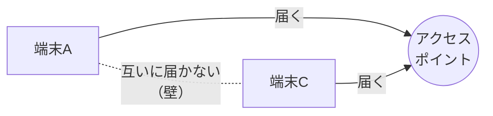

**対策：RTS/CTS** — 送信したい端末がまず短い **RTS**（Request To Send：送信要求）をAPに送り、APが **CTS**（Clear To Send：送信可）を周囲の全端末に返します。CTSを受け取った他の端末（隠れ端末を含む）は、指定された時間だけ送信を控えるので衝突を防げます。

### 10.5 その他の無線LAN規格 ★

| 用語 | 内容 |
|---|---|
| **IEEE 802.11ah**（**Wi-Fi HaLow**） | **1GHz未満（サブギガ帯、日本では920MHz帯）** を使う IoT 向けの無線LAN規格。通信速度は数百kbps〜数十Mbpsと低いが、**約1kmの長距離通信と低消費電力** を実現する |
| **Wi-Fi 6E** | Wi-Fi 6（IEEE 802.11ax）を **6GHz帯** にも拡張したもの。混雑の少ない帯域を使える |
| **メッシュWi-Fi** | 複数のアクセスポイント（ルータ＋サテライト）が無線で網の目状につながり、家全体・フロア全体を1つのSSIDでカバーする |

---

## 11. 伝送時間・回線利用率の計算

### 11.1 単位の確認 ★★★

| 項目 | 注意点 |
|---|---|
| ビットとバイト | **1バイト ＝ 8ビット**。回線速度は **bps（bit per second）**、データ量は **バイト** で与えられることが多い |
| 接頭語 | ネットワークの計算では通常 **k ＝ 10³、M ＝ 10⁶、G ＝ 10⁹**（問題文の指示に従う） |

⚠️ ひっかけ注意：「100Mbpsの回線で100Mバイト」を送ると、1秒ではなく **8秒**（伝送効率100%の場合）です。単位をビットにそろえるのを忘れないようにしましょう。

### 11.2 伝送時間 ★★★

**公式**

```
伝送時間（秒） = 伝送するデータ量（ビット） ÷ （回線速度（bps） × 伝送効率）
```

**伝送効率** とは、回線速度のうち実際にデータの伝送に使える割合です（ヘッダや制御情報の分だけ下がります）。

**例題1**：600Mバイトのファイルを、100Mbpsの回線で伝送効率60%のときに送る時間は？

```
データ量       = 600 × 10^6 バイト × 8 = 4,800 × 10^6 ビット
実効速度       = 100 × 10^6 bps × 0.6 = 60 × 10^6 bps
伝送時間       = 4,800 × 10^6 ÷ (60 × 10^6) = 80 秒
```

**例題2（必要な回線速度を求める）**：1Gバイトのデータを伝送効率80%の回線で100秒以内に送りたい。必要な回線速度は？

```
データ量       = 1 × 10^9 × 8 = 8 × 10^9 ビット
必要な実効速度 = 8 × 10^9 ÷ 100 = 80 × 10^6 bps
必要な回線速度 = 80 × 10^6 ÷ 0.8 = 100 × 10^6 bps = 100Mbps
```

### 11.3 回線利用率 ★★★

**公式**

```
回線利用率 = 単位時間あたりに伝送するデータ量（ビット/秒） ÷ 回線速度（bps）
```

**例題3**：1件2,000バイトの電文を毎秒30件、1Mbpsの回線で送るときの回線利用率は？

```
伝送量 = 2,000 バイト × 8 × 30 件/秒 = 480,000 ビット/秒
利用率 = 480,000 ÷ 1,000,000 = 0.48 → 48%
```

💡 回線利用率は、待ち行列理論（M/M/1）の **利用率 ρ** として、平均待ち時間の計算にも使われます（[基礎理論の章「5. 待ち行列理論」](01_基礎理論.md#5-待ち行列理論mm1)を参照）。

### 11.4 ビット誤り率 ★

**例**：ビット誤り率が 1 × 10⁻⁶ の回線で、毎秒 10Mbps でデータを送ると、1秒あたりの誤りビット数は？

```
10 × 10^6 ビット × 1 × 10^-6 = 10 ビット
```

**回線容量** とは、回線が単位時間に運べる最大のデータ量（＝回線速度、bps）のことです。**転送速度**（伝送速度）と同じく bps で表します。

### 11.5 トラフィック理論（呼量・呼損率・アーランB式） ★★

電話回線や同時接続数の設計では、**トラフィック理論** を使って「回線を何本用意すればよいか」を求めます（**トラフィック設計**）。

| 用語 | 意味 |
|---|---|
| **呼**（こ） | 1回の通話（接続要求） |
| **呼量**（トラフィック量） | 回線が同時に使われている平均の本数。単位は **アーラン**（erl） |
| **呼損率** | 回線がすべて使用中で、新しい呼が **つながらずに失われる確率** |
| **アーランB式**（アーランの損失式） | 呼量 A と回線数 S から呼損率 B を求める式（つながらない呼は待たずに消える「即時式」を前提） |

**公式**

```
呼量 A（アーラン） = 単位時間あたりの呼数 × 平均保留時間 ÷ 単位時間
                    （＝ 平均到着率 × 平均保留時間）

アーランB式  B = (A^S / S!) ÷ Σ(k=0〜S) (A^k / k!)
```

**例題1（呼量）**：ある窓口の電話に、1時間あたり平均30回の呼があり、1回の平均通話時間は4分である。呼量は？

```
呼量 = 30 回 × 4 分 ÷ 60 分 = 120 ÷ 60 = 2 アーラン
（平均すると常に2回線が使用中）
```

**例題2（呼損率）**：呼量 A ＝ 1 アーラン、回線数 S ＝ 2 本のときの呼損率は？

```
分子 = A^2 / 2! = 1 / 2 = 0.5
分母 = A^0/0! + A^1/1! + A^2/2! = 1 + 1 + 0.5 = 2.5
B    = 0.5 ÷ 2.5 = 0.2 → 呼損率 20%
```

💡 試験では「アーランB式の数表（呼量・回線数・呼損率の表）」が与えられ、**目標の呼損率以下になる最小の回線数を表から読む** 形式が多いです。回線数を増やすほど呼損率は下がりますが、コストは上がります。

💡 呼量の考え方は、待ち行列理論の **利用率 ρ ＝ 到着率 × 平均サービス時間** と同じ形です（基礎理論の章を参照）。

---

## 12. 新しいネットワーク技術：SDN・5G・IoT

### 12.1 SDN と NFV ★★

**SDN（Software-Defined Networking）** は、ネットワーク機器の **制御機能（コントロールプレーン）** と **転送機能（データプレーン）** を分離し、ソフトウェア（コントローラ）で一元的にネットワークを制御する考え方です。

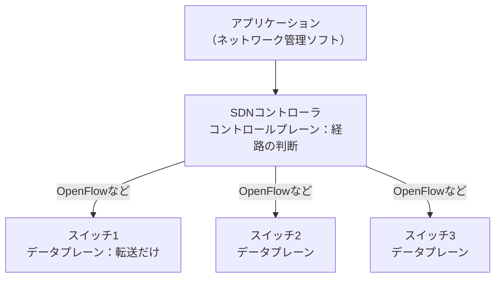

| 用語 | 内容 |
|---|---|
| **OpenFlow** | SDNコントローラとスイッチ間の代表的なプロトコル。フローテーブルで転送を制御 |
| **NFV**（Network Functions Virtualization：ネットワーク機能仮想化） | ルータ・ファイアウォールなどの機能を、専用機器ではなく汎用サーバ上の **仮想マシン** で実現する |
| SD-WAN | SDNの考え方をWAN（拠点間接続）に適用したもの |

⚠️ ひっかけ注意：SDN ＝ 制御と転送の **分離**、NFV ＝ ネットワーク機能の **仮想化** です。両者は組み合わせて使われますが、意味は異なります。

### 12.2 5G（第5世代移動通信システム） ★★

| 特徴 | 英語略称 | 目標性能（目安） | 用途例 |
|---|---|---|---|
| **超高速・大容量** | eMBB（enhanced Mobile Broadband） | 最大10〜20Gbps（総務省資料では10Gbps、ITU-Rの要求条件ではピーク20Gbps） | 4K/8K動画、VR |
| **超低遅延・高信頼** | URLLC（Ultra-Reliable and Low Latency Communications） | 遅延1ミリ秒程度 | 自動運転、遠隔手術、工場の機械制御 |
| **多数同時接続** | mMTC（massive Machine Type Communications） | 1km²あたり100万台 | IoTセンサ |

| 用語 | 内容 |
|---|---|
| **ネットワークスライシング** | 1つの物理ネットワークを用途ごとに仮想的に分割し、それぞれに適した品質を提供する |
| **ローカル5G** | 企業や自治体が、自社の敷地内などで独自に構築する5Gネットワーク（免許が必要） |
| **MEC**（Multi-access Edge Computing） | 基地局の近く（ネットワークの端）でデータ処理して遅延を減らす |

### 12.3 IoTとLPWA ★★

| 用語 | 内容 |
|---|---|
| **LPWA**（Low Power Wide Area） | **低消費電力で長距離**（数km〜数十km）通信できる無線方式。通信速度は低い。LoRaWAN、Sigfox、NB-IoT、LTE-Mなど |
| **MQTT**（Message Queuing Telemetry Transport） | IoT向けの軽量な通信プロトコル。**パブリッシュ／サブスクライブ** 型で、ブローカーが中継する |
| BLE（Bluetooth Low Energy） | 近距離・低消費電力の無線通信 |
| **エッジコンピューティング** | データの発生源（端末）の近くで処理し、クラウドへの通信量と遅延を減らす |

### 12.4 その他の関連技術 ★

| 用語 | 内容 |
|---|---|
| **CDN**（Content Delivery Network） | 世界各地のキャッシュサーバからコンテンツを配信し、高速化・負荷分散する |
| **VPN**（Virtual Private Network） | インターネットなどの上に仮想的な専用線を作る。**IPsec-VPN**（ネットワーク層で暗号化）、**SSL-VPN / TLS-VPN**（ブラウザで利用しやすい） |
| **IP-VPN** / 広域イーサネット | 通信事業者の閉域網を使う拠点間接続。広域イーサネットはL2で接続するため、拠点間で任意のルーティングプロトコルを使える |
| **QoS**（Quality of Service） | 音声など遅延に弱い通信を優先して送る品質制御 |
| FTTH | 光ファイバを家庭まで引き込む接続方式 |

---

## 13. 伝送方式・交換方式・伝送制御

### 13.1 通信方式（単方向・半二重・全二重） ★★

| 方式 | 内容 | 例 |
|---|---|---|
| **単方向**（シンプレックス） | **一方向だけ** に送る | テレビ・ラジオ放送 |
| **半二重**（ハーフデュプレックス） | 双方向に送れるが、**同時には片方向だけ**（交互に送る） | トランシーバ、リピータハブを使ったLAN、無線LAN |
| **全二重**（フルデュプレックス） | **双方向に同時に** 送れる | 電話、スイッチを使ったLAN（より対線の送信用・受信用を別に使う） |

### 13.2 多重化（WDM・TDMA など） ★★

**多重化** とは、1本の伝送路を複数の通信で共有する技術です。

| 方式 | 分け方 | 例 |
|---|---|---|
| **TDM**（時分割多重） | 時間を細かく区切り、通信ごとに順番に使う | デジタル電話網 |
| **FDM**（周波数分割多重） | 周波数帯を分けて同時に使う | ラジオ・テレビ放送 |
| **WDM**（Wavelength Division Multiplexing：**波長分割多重**） | **光ファイバ** の中に **波長（光の色）の異なる複数の光信号** を同時に流す。1本のファイバの伝送容量を何倍にも増やせる | 基幹回線、海底ケーブル |

複数の **利用者（端末）** が1つの無線チャネルを共有する方式を **多元接続** といいます。

| 方式 | 分け方 | 主な利用 |
|---|---|---|
| **TDMA**（Time Division Multiple Access：時分割多元接続） | 時間（タイムスロット）を端末ごとに割り当てる | 第2世代携帯電話（GSM、PDC） |
| FDMA（周波数分割多元接続） | 周波数を端末ごとに割り当てる | 第1世代携帯電話 |
| CDMA（符号分割多元接続） | 端末ごとに異なる拡散符号を掛けて同じ周波数を共有 | 第3世代携帯電話 |
| OFDMA（直交周波数分割多元接続） | 互いに干渉しない多数のサブキャリアを端末ごとに割り当てる | LTE、5G、Wi-Fi 6 |

### 13.3 回線の種類と交換方式 ★★★

| 回線 | 内容 |
|---|---|
| **公衆回線** | 電話網など、不特定多数の利用者が **共用** する通信事業者の回線。つなぐたびに相手を選べる |
| **専用線** | 2地点間を **専有** する回線。帯域が保証され安全性も高いが、距離と速度に応じて **料金が高い**（定額制） |
| **電力線通信**（**PLC**：Power Line Communication） | 家庭やビルの **電力線（コンセント）** にデータ信号を重ねて通信する。新たな配線が不要 |

**交換方式** は、通信のたびに経路をどう確保するかの違いです。

| 項目 | **回線交換** | **パケット交換** |
|---|---|---|
| 仕組み | 通信の開始から終了まで、**通信路（回線）を占有** する | データを **パケット**（小さな単位）に分割し、ヘッダの宛先情報を見て転送する。回線は **複数の利用者で共有** |
| 帯域・遅延 | 一定で保証される | 混雑により変動する（遅延・パケット損失がある） |
| 回線の利用効率 | 低い（話していない間も占有） | **高い** |
| 料金 | **接続時間** に応じた課金が基本 | **データ量** に応じた課金や定額制 |
| 例 | 従来の固定電話（加入電話） | インターネット、**VoIP** |

**VoIP**（Voice over Internet Protocol）は、音声をデジタル化してIPパケットで送る技術です。IP電話の基盤で、呼制御に **SIP**、音声の転送に **RTP** を使います（[9.3](#93-その他のプロトコル-) 参照）。遅延や揺らぎ（ジッタ）に弱いので **QoS** で優先制御します。

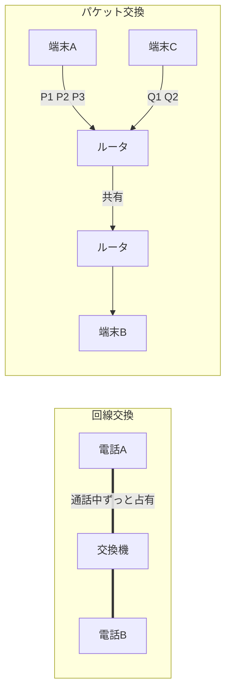

### 13.4 伝送制御（データリンク制御） ★★

**伝送制御** とは、送信者と受信者の間でデータを **確実に** 伝えるための取決めです。主に次の機能に分けられます。

| 制御 | 内容 |
|---|---|
| **データリンク制御** | 隣接する2点間で、回線の接続・データ転送・誤り制御・切断を行う（ベーシック手順、HDLC） |
| **ルーティング制御** | ネットワーク層で、宛先までの経路を選ぶ（[6章](#6-ルーティング)） |
| **フロー制御** | 受信側が処理しきれないときに、送信側の送信量を抑える（TCPの **ウィンドウ制御** など） |

**データリンク制御の5つのフェーズ**：①回線の接続 → ②データリンクの確立 → ③情報転送 → ④データリンクの解放 → ⑤回線の切断。

**接続の形による分類**

| 用語 | 内容 |
|---|---|
| **相手固定** | 専用線などで、通信相手があらかじめ決まっている接続（相手を選ぶ手順が不要） |
| **交換方式** | 公衆回線のように、通信のたびに交換機で相手を選んで接続する |
| **コネクション方式** | データを送る前に相手との **論理的な通信路（コネクション）を確立** してから送る。確実だが手間がかかる（例：TCP、HDLC） |
| **コネクションレス方式** | コネクションを確立せず、**いきなりデータを送る**。軽いが届いたかは保証しない（例：UDP、IP） |

**回線の使い方（送信権の制御）**

| 方式 | 内容 |
|---|---|
| **コンテンション方式** | 端末どうしが **対等** で、送信したい側が送信権を要求する（早い者勝ち）。ポイントツーポイント向け |
| **ポーリング／セレクティング方式** | **主局（制御局）** が従局を管理する。**ポーリング**＝主局が各従局に「送るデータはある？」と順に問い合わせる（従局 → 主局の送信）。**セレクティング**＝主局が「これから送るので受信できる？」と従局を指定する（主局 → 従局の送信）。マルチポイント（1対多）向け |

### 13.5 ベーシック手順と HDLC ★★

| 項目 | **ベーシック手順**（ベーシックモードデータ伝送制御手順） | **HDLC**（High-level Data Link Control） |
|---|---|---|
| 単位 | **文字**（キャラクタ）単位 | **フレーム**（ビット列）単位 |
| 制御方法 | **伝送制御文字**（STX、ETX、ENQ、ACK、NAK など）で制御 | フレーム内の制御フィールドで制御 |
| 同期方式 | **SYN同期**（キャラクタ同期） | **フラグ同期**（フレーム同期） |
| 誤り検出 | パリティチェック（水平・垂直） | **CRC** |
| データの制約 | 制御文字と同じビット列を送れない | **任意のビット列を送れる（ビット透過性）** |
| 応答 | 1ブロックごとに応答を待つ（**停止待ち**） | 応答を待たずに連続送信できる（シーケンス番号で管理） |
| 通信 | 半二重 | 全二重も可能 |

**同期方式**（受信側がデータの区切りを知る方法）

| 方式 | 内容 |
|---|---|
| **SYN同期**（キャラクタ同期） | データの前に **SYN文字**（同期用の特殊文字）を2個以上置いて、文字の区切りを合わせる |
| **フラグ同期** | フレームの先頭と末尾に **フラグシーケンス `01111110`** を置いて区切る。データ中に1が5個続いたら **0を挿入**（ゼロビット挿入）して、フラグと区別する |
| **フレーム同期** | フレーム単位で区切りを合わせる方式の総称。HDLCのフラグ同期やイーサネットのプリアンブル（同期用のビット列）による同期など |

**HDLCのフレーム構成**

```
| フラグ | アドレス | 制御 | 情報（データ） | FCS（CRC） | フラグ |
|01111110|          |      |                |            |01111110|
```

**マルチリンク手順**：複数の物理回線を束ねて、1つの論理的なデータリンクとして使う HDLC の拡張手順です。回線の帯域を合算でき、1本が切れても通信を続けられます。

**誤り検出・訂正**：伝送制御では **パリティチェック**（1ビット誤りの検出）、**CRC**（連続した誤り＝バースト誤りの検出に強い）、**ハミング符号**（1ビット誤りの訂正）を使います。仕組みと計算は [基礎理論の章「7. 情報理論と符号化」](01_基礎理論.md#7-情報理論と符号化) を参照してください。回線品質を表す **ビット誤り率** は [11.4](#114-ビット誤り率-) を参照。

---

## 14. ネットワーク管理

### 14.1 ネットワーク運用管理（構成・障害・性能） ★★

ネットワーク管理の機能は、ISO が定めた **FCAPS**（Fault：障害、Configuration：構成、Accounting：課金、Performance：性能、Security：セキュリティ）の5分野で整理されます。シラバスでは特に次の3つが挙げられています。

| 管理 | 目的 | 主な作業 |
|---|---|---|
| **構成管理** | ネットワークの最新の状態を正しく把握する | **ネットワーク構成**（機器・配線・IPアドレス・VLAN）の図や台帳の維持、機器のOS／ファームウェアの **バージョン** と設定ファイルの管理、**変更の記録** |
| **障害管理** | 障害を早く見つけて復旧する | **死活監視**（pingなどで機器が動いているかを定期的に確認）、情報収集（ログ・SNMPトラップ）、**障害の切分け**、**障害原因の特定**、**復旧措置**、**記録**（再発防止に活用） |
| **性能管理** | 性能の低下を防ぐ | **トラフィック監視**（回線利用率・応答時間の測定）、しきい値超過の検知、回線増強の計画 |

**障害の切分け** は、「どこまでは正常か」を手前から順に確かめて、障害箇所を絞り込む作業です。

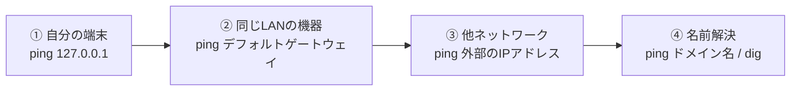

💡 IPアドレスへの ping は通るのにドメイン名では通らない → **DNS** の問題、と判断できます。

### 14.2 ネットワーク運用管理ツール ★★

| コマンド | 用途 |
|---|---|
| **ping** | ICMPエコー要求を送り、相手に到達できるか・往復時間（RTT）を調べる |
| **traceroute**（Windowsは tracert） | 宛先までに経由するルータを順に表示する（TTLを1ずつ増やして ICMP 時間超過を受け取る） |
| **ifconfig** | ネットワークインタフェースのIPアドレス・MACアドレスなどを表示・設定する（Windowsは ipconfig） |
| **ip** | Linux で ifconfig・route・arp の後継となる統合コマンド（`ip addr`、`ip route`、`ip neigh`） |
| **arp** | ARPテーブル（IPアドレスとMACアドレスの対応表）を表示・編集する |
| **netstat** | TCP/UDPの接続状態、待ち受けポート、ルーティング表、統計を表示する |
| **ss** | Linux で netstat の後継となるソケット（接続）状態表示コマンド。高速 |
| **dig** | DNSサーバに問い合わせて名前解決の結果（リソースレコード）を詳しく表示する（nslookup も同様） |
| **パケットアナライザー** | ネットワークを流れるパケットを取り込み（キャプチャ）、ヘッダや中身を解析する。**tcpdump**（コマンドライン）、**Wireshark**（GUI）など |

⚠️ パケットアナライザーは、許可なく他人の通信を取り込むと盗聴になります。利用は管理者が自組織のネットワークで行います。

### 14.3 SNMP と MIB ★★

**SNMP**（Simple Network Management Protocol）は、ルータ・スイッチ・サーバなどの機器を **集中管理** するためのプロトコルです（UDP）。

| 構成要素 | 役割 |
|---|---|
| **SNMP管理ステーション**（マネージャ） | 管理者側。各機器に情報を問い合わせ、結果を集めて監視する |
| **SNMPエージェント** | 管理される機器側で動くソフトウェア。自機の情報を MIB として保持し、要求に応える |
| **MIB**（Management Information Base：管理情報ベース） | エージェントが管理する情報の集まり（インタフェースの送受信バイト数、エラー数、CPU使用率など）。木構造で、各項目は OID（オブジェクト識別子）で識別される |

| 操作 | 向き | 内容 |
|---|---|---|
| **get 要求**（GetRequest） | マネージャ → エージェント（UDP 161） | MIB の値を **読み出す** |
| **put 要求**（SNMPでの名称は **SetRequest**） | マネージャ → エージェント（UDP 161） | MIB の値を **書き換える**（設定変更） |
| **trap 要求**（Trap） | **エージェント → マネージャ**（UDP 162） | 障害などの **イベントをエージェントから自発的に通知** する |

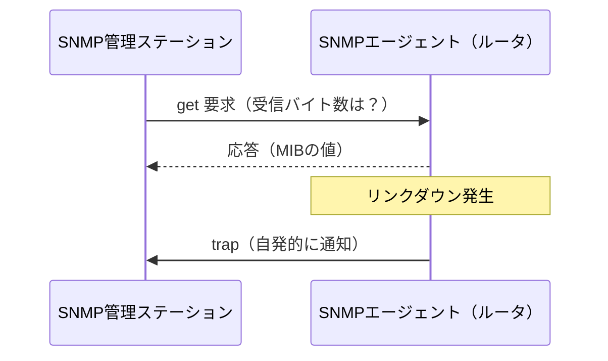

**トラフィック解析**：マネージャが一定間隔で MIB のカウンタ（送受信バイト数）を get で読み、その差分から **回線利用率** を計算してグラフ化します。

```
利用率 = (今回の受信バイト数 − 前回の受信バイト数) × 8 ÷ 取得間隔（秒） ÷ 回線速度（bps）
例: 5分（300秒）で 1,500 Mバイト増加、回線 100Mbps
    1,500 × 10^6 × 8 ÷ 300 = 40 × 10^6 bps → 40 ÷ 100 = 40%
```

💡 覚え方：「**get・set はマネージャから、trap はエージェントから**」。ポーリング（get）は定期的、trap は即時です。

### 14.4 仮想ネットワーク ★★

| 用語 | 内容 |
|---|---|
| **トンネリング** | あるプロトコルのパケットを、別のプロトコルのパケットの中に **カプセル化** して運ぶ技術。VPN（IPsec、GRE）、IPv6 over IPv4、VXLAN などの基盤 |
| **オーバーレイネットワーク** | 既存の物理ネットワーク（アンダーレイ）の **上に、トンネリングで論理的なネットワークを重ねて構築** するもの。例：**VXLAN**（L2フレームをUDPで包み、L3ネットワークを越えて仮想的なL2を作る。VLANの4094個の上限を超えて約1,600万個のネットワークを作れる）、P2Pネットワーク |
| **SDN／OpenFlow／NFV／SD-WAN** | [12.1 SDN と NFV](#121-sdn-と-nfv-) 参照。SD-WAN は、拠点間のWAN（インターネット回線・閉域網・LTEなど）をソフトウェアで一元管理し、**アプリケーションごとに最適な回線を自動選択** する |

---

## 15. ネットワーク方式・通信サービス・モバイル

### 15.1 通信ネットワークの役割 ★

**ICT**（Information and Communication Technology：情報通信技術）の発達によって、行政・金融・物流・医療など社会のあらゆる活動がネットワークに依存する **ネットワーク社会** になりました。そのため、ネットワーク障害は1社の問題にとどまらず、決済停止や交通の混乱など **社会全体に大きな影響** を与えます。冗長化、障害時の迅速な切分け、事業継続計画（BCP）が重要になります。

| 用語 | 内容 |
|---|---|
| **ユビキタス** | 「いつでも、どこでも、誰でも」ネットワークにつながり、情報を利用できる環境 |
| **パーベイシブ**（コンピューティング） | コンピュータが日用品や環境に **浸透**（pervasive）し、利用者が意識せずに使える状態。ユビキタスとほぼ同じ意味で使われる |

### 15.2 LANとWAN ★★

| 項目 | **LAN**（Local Area Network） | **WAN**（Wide Area Network） |
|---|---|---|
| 範囲 | 建物内・敷地内 | 離れた拠点間、広域 |
| 設置者 | **自社で構築・運用** | **電気通信事業者の回線を借りる** |
| 費用 | 機器・配線の初期費用が中心 | 回線の月額料金などの運用費用が継続的にかかる |
| 速度 | 高速（1〜10Gbps が一般的） | 契約した帯域による |

| 用語 | 内容 |
|---|---|
| **ISP**（Internet Service Provider：インターネットサービスプロバイダ） | 利用者をインターネットに接続するサービスを提供する事業者 |
| **従量制** | 使った時間やデータ量に応じて料金がかかる。利用が少ないと安い |
| **月額固定料金**（定額制） | 使用量にかかわらず料金が一定。予算を立てやすい |
| **MDF**（Main Distribution Frame：主配線盤） | 建物に引き込んだ通信事業者の回線を、建物内の配線に接続する **建物全体の主配線盤**（多くは1階や地下） |
| **IDF**（Intermediate Distribution Frame：中間配線盤） | MDF から各フロアへ配線を分岐する **フロアごとの中間配線盤** |
| **パケット交換網** | パケット交換方式の通信網（[13.3](#133-回線の種類と交換方式-)） |
| **回線交換網** | 回線交換方式の通信網（加入電話網など） |
| **センサーネットワーク** | 多数の小型 **センサー** を無線でつなぎ、温度・振動などのデータを収集するネットワーク。IoT の基盤 |

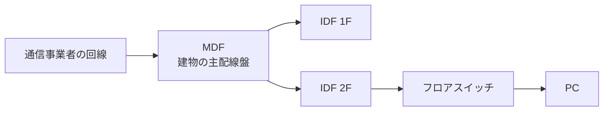

### 15.3 通信サービス ★★

| サービス | 内容 |
|---|---|
| **専用線サービス** | 2拠点間を専有する回線。帯域保証・高セキュリティだが高価 |
| **回線交換サービス** | 通信のたびに回線を接続する（加入電話、ISDN） |
| **パケット交換サービス** | パケット単位で網を共有する |
| **広域Ethernet**（広域イーサネット） | 通信事業者の閉域網で拠点間を **L2（イーサネット）** で接続する。拠点間のルーティングプロトコルを利用者が自由に選べる |
| **IP-VPN** | 通信事業者の **閉域IP網** で拠点間を **L3** で接続する（MPLS 技術を使う）。インターネットを通らないので安全 |
| インターネットVPN | インターネット上に IPsec などで暗号化トンネルを作る。安価だが品質はベストエフォート |
| **IP電話** | VoIP を使った電話サービス。`050` 番号、または一定品質を満たせば固定電話と同じ `0AB-J` 番号が使える |
| **IPセントレックス** | 企業の構内交換機（**PBX**）の機能を、通信事業者のIP網（クラウド）側で提供するサービス。自社でPBXを持たずに内線・転送などが使える |
| **xDSL**（Digital Subscriber Line） | 既存の **電話用の銅線** で高速データ通信を行う技術の総称。代表の **ADSL** は下りが速い **非対称** 型で、局舎からの距離が遠いほど速度が落ちる |
| **FTTH**（Fiber To The Home） | 光ファイバを家庭まで引き込む。高速・安定 |
| **衛星通信サービス** | 通信衛星を中継する。山間部・離島・海上・災害時にも使えるが、静止衛星では遅延が大きい。最近は低軌道衛星（例：スターリンク）で低遅延化 |
| **国際通信サービス** | 海底ケーブルや衛星を使った国際間の通信サービス |
| **ISDN**／**PRI** | ISDN はデジタル回線交換網。**BRI**（基本インタフェース：2B＋D、144kbps）と **PRI**（1次群速度インタフェース：23B＋D、1.5Mbps）がある（PRI は主に企業のPBX接続用） |

| 品質の考え方 | 内容 |
|---|---|
| **ベストエフォート** | 「最大限努力する」が **帯域（通信速度）は保証しない**。安価。一般のインターネット接続、インターネットVPN |
| **帯域保証**（ギャランティ） | 契約した帯域を常に保証する。高価。専用線や一部の閉域網サービス |
| **QoS**（Quality of Service：サービス品質） | 音声・映像などを優先して送る、帯域を予約するなどして通信品質を確保する制御 |

### 15.4 インターネット技術・イントラネット・エクストラネット ★★

| 用語 | 内容 |
|---|---|
| **イントラネット** | インターネットの技術（TCP/IP、Web、メール）を使って構築した **企業内ネットワーク**。プライベートIPアドレスを使い、外部との接続は NAT で変換、拠点間は **VPN** や **相手固定接続**（専用線）でつなぐ |
| **エクストラネット** | **複数の企業のイントラネットを相互接続** し、取引先との間で受発注や情報共有を行うネットワーク。**EC**（Electronic Commerce：電子商取引）や **EDI**（Electronic Data Interchange：電子データ交換。企業間で受発注書などを標準形式の電子データでやり取りする）の基盤 |
| **セキュリティプロトコル** | 通信の暗号化・認証を行うプロトコル。TLS、IPsec、SSH など（情報セキュリティの章） |
| **ファイアウォール** | 内部ネットワークと外部の境界で、許可した通信だけを通す（[情報セキュリティの章 7.1](08_情報セキュリティ.md#71-ファイアウォール-)） |
| **RADIUS**（Remote Authentication Dial In User Service） | 利用者の **認証・認可・アカウンティング（AAA）** を、認証サーバで集中して行うプロトコル。**IEEE 802.1X**（無線LANのエンタープライズモード）やリモートアクセスVPNで使う |

### 15.5 ネットワークOS ★

**ネットワークOS** は、ファイル共有・プリンタ共有・利用者管理など、ネットワーク上のサービスを提供・管理する機能をもつOSです（現在は Windows Server や Linux など、一般のOSに組み込まれています）。

| 形式 | 内容 | 長所・短所 |
|---|---|---|
| **クライアントサーバ形式** | サービスを提供する **サーバ** と、利用する **クライアント** の役割を分ける | 集中管理しやすく、セキュリティを保ちやすい。サーバが単一障害点になりやすい |
| **ピアツーピア形式**（P2P） | 各コンピュータが **対等** で、サーバにもクライアントにもなる | サーバ不要で小規模なら手軽・負荷分散できる。利用者・資源の一元管理が難しい |

### 15.6 モバイル通信サービス ★★

| 用語 | 内容 |
|---|---|
| **移動体通信事業者**（MNO：Mobile Network Operator） | 自ら基地局などの通信設備をもち、電波の免許を受けて携帯電話サービスを提供する事業者 |
| **MVNO**（Mobile Virtual Network Operator：仮想移動体通信事業者） | MNO から回線（設備）を借りて、自社ブランドで通信サービスを提供する事業者。格安SIMなど |
| **LTE**（Long Term Evolution） | 第3.9〜第4世代の移動通信規格。OFDMA、MIMO で高速化 |
| **VoLTE**（Voice over LTE） | LTE のパケット網で音声通話を行う技術（VoIP の一種）。高音質で、通話中もLTEの高速データ通信が使える |
| **5G**（第5世代移動通信システム） | 超高速・超低遅延・多数同時接続（[12.2](#122-5g第5世代移動通信システム-)） |
| **NSA**（Non-Stand Alone）方式 | **4G（LTE）のコアネットワークや基地局と連携** して5Gを動かす方式。制御信号は LTE が担い、データ通信を5Gで高速化する。早期導入向け |
| **SA**（Stand Alone）方式 | **5G専用のコアネットワーク（5GC）と基地局だけ** で動かす方式。超低遅延・多数同時接続・ネットワークスライシングなど5G本来の性能を発揮できる |
| **ローカル5G** | 企業や自治体が自らの敷地内で構築する5G（[12.2](#122-5g第5世代移動通信システム-)） |
| **ネットワークスライシング** | 1つの物理ネットワークを用途別の仮想ネットワークに分割する（[12.2](#122-5g第5世代移動通信システム-)） |
| **キャリアアグリゲーション** | **複数の周波数帯（キャリア）を束ねて** 同時に使い、通信速度を上げる技術 |
| **SIMカード** | 加入者を識別する情報（電話番号に対応する IMSI など）を記録したICカード。差し替えると別の端末で同じ契約を使える |
| **eSIM**（embedded SIM） | 端末に **組み込まれた** SIM。契約情報を **遠隔で書き込める**（リモートプロビジョニング）ので、カードの差し替えなしに事業者を変更できる |

### 15.7 モバイルシステムの構成要素 ★

| 用語 | 内容 |
|---|---|
| **基地局** | 携帯端末と電波で通信し、コアネットワークへ中継する設備。1つの基地局がカバーする範囲を **セル** という |
| **フェムトセル** | 半径数十m程度をカバーする **超小型基地局**。家庭やオフィスに置き、ブロードバンド回線経由でコアネットワークにつなぐ。屋内の電波が届きにくい場所の対策 |
| **携帯端末** | 携帯電話、スマートフォン、タブレット端末、モバイルルータなど |
| **テザリング** | スマートフォンを **モバイルルータ代わり** にして、PC などをスマートフォン経由でインターネットに接続すること（Wi-Fi、USB、Bluetooth） |
| **テレマティクス** | テレコミュニケーション（通信）＋インフォマティクス（情報処理）の造語。**自動車などの移動体に通信機能を組み込み**、渋滞情報・緊急通報・運行管理・走行データに基づく保険などのサービスを提供する |

### 15.8 モバイル通信技術 ★★

| 用語 | 内容 |
|---|---|
| **ハンドオーバー** | 通信中の端末が移動したとき、**接続する基地局（またはアクセスポイント）を通信を切らずに切り替える** こと |
| **ローミング** | 契約している事業者のエリア外（海外など）で、**提携する他の事業者の設備を使って** 通信できるようにすること。無線LANでは同じSSIDのアクセスポイント間の移動も指す |
| **MIMO**（Multiple Input Multiple Output） | 送信側・受信側で **複数のアンテナ** を使い、同じ周波数で複数のデータを同時に送って（空間多重）高速化する技術 |
| **ビームフォーミング** | 複数のアンテナの位相を制御して、**電波を特定の端末の方向に集中して** 送る技術。通信品質の向上と干渉の低減 |
| **間欠受信**（DRX：Discontinuous Reception） | 待受け中に受信回路を **一定周期でだけ** 動かし、それ以外は止めて電池の消費を抑える省電力化技術 |
| **ドーマント**（プリザベーション） | データ通信がしばらくないとき、**無線の接続（無線リソース）は解放しつつ、通信セッションの情報は保持** しておく状態。基地局・端末双方の負荷と電力を抑え、通信再開時は素早く復帰できる |
| **LPWA**（Low Power Wide Area） | 低消費電力・長距離・低速のIoT向け無線通信の総称（[12.3](#123-iotとlpwa-)） |
| **LTE-M**（LTE Cat-M1） | LTE の周波数（免許帯域）を使う LPWA。最大1Mbps程度で、**移動中の通信（ハンドオーバー）や音声にも対応** |
| **NB-IoT**（Narrow Band IoT） | LTE の狭い帯域（180kHz）を使う LPWA。LTE-M より低速だが、より低消費電力・低コスト。スマートメーターなど **固定設置** 向け |
| **Wi-SUN**（Wireless Smart Utility Network） | IEEE 802.15.4g をベースにした **920MHz帯**（免許不要）の無線規格。電力スマートメーターと家庭の HEMS 間の通信（Bルート）などに使う。マルチホップ通信が可能 |
| **LoRaWAN** | **免許不要の920MHz帯** を使う LPWA。数km〜十数kmの長距離通信が可能で、利用者が自前で基地局（ゲートウェイ）を設置できる |
| **CoAP**（Constrained Application Protocol） | 処理能力の低い IoT 機器向けの軽量プロトコル。**UDP** 上で動き、HTTP に似た REST 型の操作（GET・PUT など）を行う |
| **MQTT** | **TCP** 上で動く軽量な **パブリッシュ／サブスクライブ** 型プロトコル（[12.3](#123-iotとlpwa-)） |
| **IoTエリアネットワーク** | IoT機器（センサーなど）とゲートウェイを結ぶ、**比較的狭い範囲** のネットワーク。Bluetooth（BLE）、ZigBee、Wi-SUN、Wi-Fi などを使う。ゲートウェイから先はインターネットや LPWA・携帯網などの広域ネットワークでクラウドにつながる |
| **IEEE 802.11ah**（Wi-Fi HaLow） | 920MHz帯の IoT 向け無線LAN（[10.5](#105-その他の無線lan規格-)） |

⚠️ ひっかけ注意：**LTE-M と NB-IoT は携帯事業者の免許帯域**、**LoRaWAN・Sigfox・Wi-SUN は免許不要帯域**（920MHz帯）です。**MQTT は TCP、CoAP は UDP** です。

---

## 16. 科目B「ネットワーク」問題の解き方

### 16.1 出題パターン ★★★

科目B（旧午後）の「ネットワーク」は、ある企業の社内LAN・拠点間接続・Webシステムなどの構成図を題材にした長文問題です。

| 設問パターン | 必要な知識 |
|---|---|
| ネットワーク構成図の **IPアドレス・サブネットマスク・デフォルトゲートウェイの穴埋め** | 4章 |
| **ルーティング表** の宛先・ネクストホップの穴埋め | 6章 |
| **VLAN** の設計（ポートVLAN／タグVLAN、VLAN間ルーティング） | 3章 |
| **DHCP**（リレーエージェント）、**DNS**（レコード、内部／外部DNSの分離） | 8章 |
| **NAPT**・DMZ・ファイアウォールの **フィルタリングルール**（送信元／宛先／ポート番号） | 7・8章、セキュリティ |
| 無線LANの導入（認証方式、アクセスポイント配置、ローミング） | 10章 |
| **冗長化**（VRRP、リンクアグリゲーション、STP） | 2章 |
| 回線帯域・伝送時間の計算 | 11章 |
| 障害の切分け、SNMPによる監視、拠点間接続サービスの選択 | 14・15章 |

### 16.2 解く手順 ★★★

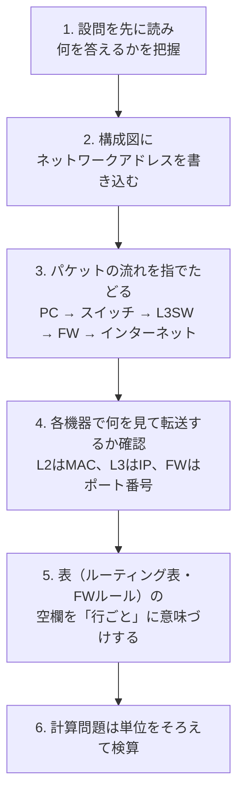

### 16.3 よく出る着眼点 ★★

- **「別セグメントのPCがIPアドレスを取得できない」** → DHCPDISCOVERはブロードキャストでルータを越えない → **DHCPリレーエージェント** を設定する。
- **「同じスイッチなのに通信できない」** → VLANが異なる → **L3スイッチでVLAN間ルーティング** が必要。
- **「異なるネットワークへ通信できない」** → 端末の **デフォルトゲートウェイ** の設定漏れ・誤りを疑う。
- **ファイアウォールのルール** は上から順に評価され、最初に一致したルールが適用されることが多い（最後に「すべて拒否」）。応答パケットを考慮する **ステートフルインスペクション** かどうかに注意。
- **社内からはサーバの内部アドレスで、社外からは公開アドレスで名前解決させたい** → 内部DNSと外部DNSを分ける。
- 「機器が1台故障しても通信を継続したい」→ 単一障害点（SPOF）を探し、**冗長化**（VRRP、リンクアグリゲーション）を提案する。

### 16.4 時間配分 ★

科目Bは150分で5問なので、1問あたり **約30分** が目安です。ネットワークは知識の幅が問われる一方、構成図に書き込みながら読むと見落としが減ります。サブネット計算は1問1分以内で解けるよう、確認問題で練習しておきましょう。

---

## 確認問題

### 問1（OSI参照モデルと機器）
OSI参照モデルのネットワーク層で動作し、IPアドレスに基づいて異なるネットワーク間のパケットを中継する機器はどれですか。

ア リピータ　イ ブリッジ　ウ L2スイッチ　エ ルータ

### 問2（ネットワークアドレス）
IPアドレス 172.20.130.5/18 が属するネットワークのネットワークアドレスと、割当て可能なホスト数を答えてください。

### 問3（必要なサブネットマスク）
1つのサブネットに最大 100 台のホストを接続したいとき、アドレスの無駄が最も少ないサブネットマスクはどれですか。

ア 255.255.255.0　イ 255.255.255.128　ウ 255.255.255.192　エ 255.255.255.224

### 問4（経路集約）
172.16.8.0/24 から 172.16.15.0/24 までの連続する8つのネットワークを1つの経路に集約したものはどれですか。

ア 172.16.0.0/20　イ 172.16.8.0/21　ウ 172.16.8.0/22　エ 172.16.8.0/24

### 問5（IPv6の省略表記）
IPv6アドレス `2001:0db8:0000:0000:0001:0000:0000:0abc` の省略表記として正しいものはどれですか。

ア 2001:db8::1::abc　イ 2001:db8::1:0:0:abc　ウ 2001:db8:0:0:1::abc　エ 2001:db8::1:abc

### 問6（伝送時間）
3Gバイトのファイルを、通信速度1Gbps、伝送効率80%の回線で転送するのに要する時間は何秒ですか。ここで 1G ＝ 10⁹ とします。

### 問7（回線利用率）
平均1,500バイトのパケットを毎秒200個、10Mbpsの回線で送信するとき、回線利用率は何%ですか。

### 問8（ARP）
同一LAN内の通信で、宛先のIPアドレスから宛先のMACアドレスを求めるために使用されるプロトコルはどれですか。

ア ARP　イ DHCP　ウ DNS　エ ICMP

### 問9（NAPT）
NAPTの説明として適切なものはどれですか。

ア IPアドレスだけを1対1で変換するので、グローバルアドレスの数だけ同時に通信できる
イ IPアドレスとポート番号を変換し、1つのグローバルアドレスを複数の端末で共有できる
ウ ドメイン名とIPアドレスを対応付ける
エ 端末にIPアドレスを自動で割り当てる

### 問10（DHCPリレー）
DHCPサーバをサーバ用セグメントに1台だけ設置したところ、ルータを隔てた別セグメントのPCがIPアドレスを取得できませんでした。この原因と対策として最も適切なものはどれですか。

ア DHCPはTCPを使うので、ルータでTCPポート67を許可する
イ DHCPDISCOVERはブロードキャストでルータを越えないので、ルータにDHCPリレーエージェントを設定する
ウ DNSサーバが停止しているので、DNSサーバを再起動する
エ PCのデフォルトゲートウェイが未設定なので、手動で設定する

### 問11（呼量と呼損率）
あるコールセンターでは、1時間あたり平均90件の電話がかかり、平均通話時間は2分です。呼量は何アーランですか。また、呼量1アーラン・回線数1本のときの呼損率をアーランB式で求めてください。

### 問12（無線LAN）
無線LANで、アクセスポイントには電波が届くが互いの電波は届かない2台の端末が同時に送信し、アクセスポイントでフレームが衝突する問題と、その対策の組合せとして適切なものはどれですか。

ア さらし端末問題 ― CSMA/CD　イ 隠れ端末問題 ― RTS/CTS　ウ 隠れ端末問題 ― トークンパッシング　エ さらし端末問題 ― ビームフォーミング

### 問13（SNMP）
SNMPにおいて、管理対象機器のエージェントが、障害の発生をマネージャに自発的に通知するために使うものはどれですか。

ア GetRequest　イ SetRequest　ウ Trap　エ GetResponse

### 問14（伝送制御）
HDLC手順の特徴として適切なものはどれですか。

ア 伝送制御文字を使って文字単位で制御し、SYN文字で同期をとる
イ フラグシーケンスでフレームの区切りを示し、任意のビット列を伝送できる
ウ 誤り検出に水平垂直パリティを用い、1ブロックごとに応答を待つ
エ 主局が各従局に順番に送信データの有無を問い合わせる方式だけを規定する

### 問15（移動通信）
5GのSA方式の説明として適切なものはどれですか。

ア 4GのコアネットワークとLTE基地局を制御に使い、データ通信だけを5Gで行う
イ 5G専用のコアネットワークと基地局だけで構成し、ネットワークスライシングなど5G本来の機能を発揮できる
ウ 複数の周波数帯を束ねて通信速度を上げる技術
エ 他社の設備を借りて自社ブランドで通信サービスを提供する形態

<details><summary>解答・解説</summary>

**問1：エ**
リピータは物理層、ブリッジとL2スイッチはデータリンク層（MACアドレスで転送）、ルータはネットワーク層（IPアドレスで中継）です。

**問2：ネットワークアドレス 172.20.128.0、ホスト数 16,382**
```
/18 → マスク 255.255.192.0（注目オクテットは第3オクテット）
第3オクテット 130 = 1000 0010
マスク        192 = 1100 0000
AND               = 1000 0000 = 128
→ ネットワークアドレス 172.20.128.0
ホスト数 = 2^(32−18) − 2 = 2^14 − 2 = 16,384 − 2 = 16,382
（ブロードキャストは 172.20.191.255）
```

**問3：イ**
```
2^h − 2 ≥ 100 を満たす最小の h
h = 6 → 62（不足）、h = 7 → 126（OK）
プレフィックス長 = 32 − 7 = 25 → 255.255.255.128
```
アの /24（254台）でも収容できますが、アドレスの無駄が多くなります。

**問4：イ**
```
第3オクテット  8 = 0000 1|000
              15 = 0000 1|111
上位5ビットが共通 → 8 + 8 + 5 = 21
→ 172.16.8.0/21（アドレス数 2^11 = 2048 = 256 × 8 で一致）
```

**問5：イ**
先頭の0を省略すると `2001:db8:0:0:1:0:0:abc`。0の連続は2か所で長さが同じなので、前の方を `::` にします。アは `::` を2回使っているので誤り、ウは推奨表記の規則（同じ長さなら前を省略）に反し、エは0が足りません（元のアドレスと異なる）。

**問6：30秒**
```
データ量 = 3 × 10^9 × 8 = 24 × 10^9 ビット
実効速度 = 1 × 10^9 × 0.8 = 0.8 × 10^9 bps
伝送時間 = 24 × 10^9 ÷ (0.8 × 10^9) = 30 秒
```

**問7：24%**
```
伝送量 = 1,500 × 8 × 200 = 2,400,000 ビット/秒
利用率 = 2,400,000 ÷ 10,000,000 = 0.24 → 24%
```

**問8：ア**
ARPはブロードキャストで「このIPアドレスを持つ機器のMACアドレスは？」と問い合わせます。DHCPはアドレスの自動割当て、DNSは名前解決、ICMPはエラー通知・診断です。

**問9：イ**
アは（静的）NATの説明、ウはDNS、エはDHCPの説明です。

**問10：イ**
DHCPはUDPを使います。クライアントは最初IPアドレスを持たないため、DHCPDISCOVERをブロードキャストで送りますが、ブロードキャストはルータを越えません。ルータにDHCPリレーエージェントを設定すると、ルータがユニキャストに変換してDHCPサーバへ中継します。

**問11：呼量 3 アーラン、呼損率 50%**
```
呼量 = 90 件 × 2 分 ÷ 60 分 = 3 アーラン
呼損率（A = 1, S = 1）
  分子 = A^1 / 1! = 1
  分母 = A^0/0! + A^1/1! = 1 + 1 = 2
  B = 1 ÷ 2 = 0.5 → 50%
```

**問12：イ**
互いの電波が届かない端末どうしの衝突は **隠れ端末問題** で、RTS/CTS で送信予約を周囲に知らせて防ぎます。さらし端末問題は、送信してよいのに控えてしまう問題です。CSMA/CD は有線LAN、トークンパッシングはトークンリングの方式です。

**問13：ウ**
Trap はエージェントからマネージャへの自発的な通知（UDP 162）です。GetRequest は値の読出し、SetRequest は値の書換え（シラバスでは put 要求）、GetResponse は要求への応答です。

**問14：イ**
アとウはベーシック手順の特徴です。エはポーリング方式の説明で、HDLCに限ったものではありません。HDLCはフラグ `01111110` で区切り、ゼロビット挿入によってビット透過性を確保します。

**問15：イ**
アは NSA 方式、ウはキャリアアグリゲーション、エは MVNO の説明です。

</details>

---

## 📋 シラバス用語チェックリスト

シラバス Ver.7.2「中分類10：ネットワーク」の用語例を、小分類ごとに1行で説明します。用語名のリンクから本文の詳しい説明に飛べます。**すべての用語を1行で説明できる** ようになれば、科目Aの用語問題に対応できます。

### 1. ネットワーク方式

| 用語 | 1行説明 |
|---|---|
| [ネットワーク社会](#151-通信ネットワークの役割-) | 社会活動がネットワークに依存し、障害が社会全体に影響する状態 |
| [ICT](#151-通信ネットワークの役割-) | 情報通信技術。情報処理と通信を合わせた技術の総称 |
| [ISP](#152-lanとwan-) | 利用者をインターネットに接続する事業者 |
| [従量制](#152-lanとwan-) | 使った時間・データ量に応じて課金する料金体系 |
| [月額固定料金](#152-lanとwan-) | 使用量にかかわらず毎月一定額の料金体系（定額制） |
| [IDF](#152-lanとwan-) | フロアごとの中間配線盤 |
| [MDF](#152-lanとwan-) | 建物に引き込んだ回線を建物内配線に接続する主配線盤 |
| [パケット交換網](#133-回線の種類と交換方式-) | データをパケットに分けて回線を共有する通信網 |
| [回線交換網](#133-回線の種類と交換方式-) | 通信中は回線を占有する通信網（加入電話網など） |
| [センサーネットワーク](#152-lanとwan-) | 多数のセンサーを無線でつないでデータを集めるネットワーク |
| [同軸ケーブル](#34-有線lanのケーブルとイーサネット規格-) | 中心導線を外部導体で包んだノイズに強いケーブル |
| [より対線](#34-有線lanのケーブルとイーサネット規格-) | 2本の銅線をより合わせたLANケーブル（UTP/STP） |
| [光ファイバケーブル](#34-有線lanのケーブルとイーサネット規格-) | 光信号で送る、ノイズに強く長距離・高速なケーブル |
| [電波](#104-無線lanの通信媒体と隠れ端末問題-) | 無線LANや携帯電話の通信媒体。壁を越えて届くので暗号化が必須 |
| [赤外線](#104-無線lanの通信媒体と隠れ端末問題-) | 直進性が強く障害物に弱い近距離向けの無線媒体（IrDA） |
| [無線LANアクセスポイント](#102-無線lanの用語-) | 無線端末を有線LANにつなぐ親機 |
| [インフラストラクチャモード](#102-無線lanの用語-) | アクセスポイント経由で通信する形態 |
| [アドホックモード](#102-無線lanの用語-) | 端末同士が直接通信する形態 |
| [SSID](#102-無線lanの用語-) | 無線LANのネットワーク識別名 |
| [隠れ端末問題](#104-無線lanの通信媒体と隠れ端末問題-) | 互いの電波が届かない端末が同時送信しAPで衝突する問題（対策 RTS/CTS） |
| [さらし端末問題](#104-無線lanの通信媒体と隠れ端末問題-) | 他の通信を検知して、送信してよいのに控えてしまい効率が落ちる問題 |
| [パケット](#133-回線の種類と交換方式-) | データを分割し宛先などのヘッダーを付けた転送単位 |
| [VoIP](#133-回線の種類と交換方式-) | 音声をIPパケットで送る技術。IP電話の基盤 |
| [転送速度（伝送速度）](#112-伝送時間-) | 単位時間に送れるデータ量。bpsで表す |
| [bps](#111-単位の確認-) | ビット／秒。回線速度の単位 |
| [回線容量](#114-ビット誤り率-) | 回線が単位時間に運べる最大データ量 |
| [ビット誤り率](#114-ビット誤り率-) | 送ったビットのうち誤るビットの割合 |
| [トラフィック理論](#115-トラフィック理論呼量呼損率アーランb式-) | 呼量と回線数から呼損率などを求める理論 |
| [呼量](#115-トラフィック理論呼量呼損率アーランb式-) | 回線が同時に使われている平均本数（呼数×平均保留時間÷時間） |
| [呼損率](#115-トラフィック理論呼量呼損率アーランb式-) | 全回線使用中で呼がつながらない確率 |
| [アーランB式（アーランの損失式）](#115-トラフィック理論呼量呼損率アーランb式-) | 呼量と回線数から呼損率を求める式 |
| [アーラン](#115-トラフィック理論呼量呼損率アーランb式-) | 呼量の単位。1アーラン＝1回線が常時使用中 |
| [トラフィック設計](#115-トラフィック理論呼量呼損率アーランb式-) | 目標の呼損率・利用率を満たす回線数や帯域を決めること |
| [性能評価](#113-回線利用率-) | 回線利用率・応答時間などを計算・測定して性能を確かめること |
| [IPv4](#41-ipv4アドレスの構造-) | 32ビットのアドレスを使うIP |
| [IPv6](#51-ipv6の特徴-) | 128ビットのアドレスを使うIP。ブロードキャストなし |
| [アドレスクラス](#42-アドレスクラス参考-) | 先頭ビットでネットワーク部長を決めた旧方式（A〜E） |
| [グローバルIPアドレス](#411-グローバルipアドレスと通信の宛先の種類-) | インターネット上で世界で一意のIPアドレス |
| [プライベートIPアドレス](#43-プライベートipアドレスと特殊なアドレス-) | 組織内で自由に使えるIPアドレス（10/8、172.16/12、192.168/16） |
| [IPマスカレード](#85-nat-と-napt-) | IPアドレスとポート番号を変換するNAPTの別名 |
| [NAT](#85-nat-と-napt-) | プライベートIPとグローバルIPを変換する技術 |
| [オーバーレイネットワーク](#144-仮想ネットワーク-) | 物理網の上にトンネリングで論理網を重ねたもの（VXLANなど） |
| [DNS](#84-dns-) | ドメイン名とIPアドレスを対応付ける仕組み |
| [ドメイン](#84-dns-) | ネットワーク上の組織などを表す階層的な名前 |
| [TLD](#84-dns-) | ドメイン名の最上位（.jp、.comなど） |
| [QoS](#153-通信サービス-) | 重要な通信を優先するなどして通信品質を確保する制御 |
| [ユビキタス](#151-通信ネットワークの役割-) | いつでもどこでもネットワークを利用できる環境 |
| [パーベイシブ](#151-通信ネットワークの役割-) | コンピュータが環境に浸透し意識せずに使える状態 |
| [セキュリティプロトコル](#154-インターネット技術イントラネットエクストラネット-) | 暗号化・認証を行うプロトコル（TLS、IPsec、SSH） |
| [ファイアウォール](#154-インターネット技術イントラネットエクストラネット-) | 境界で許可した通信だけを通す仕組み |
| [RADIUS](#154-インターネット技術イントラネットエクストラネット-) | 認証・認可・アカウンティングを集中して行うプロトコル |

### 2. データ通信と制御

| 用語 | 1行説明 |
|---|---|
| [ポイントツーポイント](#14-ネットワークトポロジ-) | 2地点を1本の回線で直結する形態 |
| [ツリー型](#14-ネットワークトポロジ-) | スター型を階層状につないだ形態 |
| [バス型](#14-ネットワークトポロジ-) | 1本の幹線に端末をつなぐ形態。幹線切断で全停止 |
| [スター型](#14-ネットワークトポロジ-) | 中心機器に放射状につなぐ形態。中心故障で全停止 |
| [リング型](#14-ネットワークトポロジ-) | 輪状につなぐ形態。二重化で冗長化 |
| [物理層](#11-osi参照モデル-) | 第1層。電気・光信号、ケーブル・コネクタ |
| [データリンク層](#11-osi参照モデル-) | 第2層。隣接ノード間のフレーム転送（MACアドレス） |
| [ネットワーク層](#11-osi参照モデル-) | 第3層。ネットワーク間の中継・経路選択（IP） |
| [トランスポート層](#11-osi参照モデル-) | 第4層。端末間の信頼性確保（TCP/UDP） |
| [セション層](#11-osi参照モデル-) | 第5層。通信の開始から終了までの管理 |
| [プレゼンテーション層](#11-osi参照モデル-) | 第6層。文字コード・圧縮・暗号化など表現形式 |
| [アプリケーション層](#11-osi参照モデル-) | 第7層。アプリごとのサービス（HTTP、SMTP） |
| [Xシリーズ](#15-標準化の実例itu-t-の勧告-) | ITU-Tのデータ通信網に関する勧告（X.25、X.509） |
| [Vシリーズ](#15-標準化の実例itu-t-の勧告-) | ITU-Tの電話網上のデータ通信に関する勧告（モデム） |
| [Iシリーズ](#15-標準化の実例itu-t-の勧告-) | ITU-TのISDNに関する勧告 |
| [単方向](#131-通信方式単方向半二重全二重-) | 一方向だけに送る通信方式 |
| [半二重](#131-通信方式単方向半二重全二重-) | 双方向だが同時には片方向だけの通信方式 |
| [全二重](#131-通信方式単方向半二重全二重-) | 双方向に同時に送れる通信方式 |
| [WDM](#132-多重化wdmtdma-など-) | 光ファイバに波長の異なる光を多重化する方式 |
| [TDMA](#132-多重化wdmtdma-など-) | 時間を区切って端末ごとに割り当てる多元接続 |
| [回線交換](#133-回線の種類と交換方式-) | 通信中は回線を占有する交換方式 |
| [パケット交換](#133-回線の種類と交換方式-) | パケット単位で回線を共有する交換方式 |
| [公衆回線](#133-回線の種類と交換方式-) | 不特定多数が共用する通信事業者の回線 |
| [専用線](#133-回線の種類と交換方式-) | 2地点間を専有する回線 |
| [電力線通信（PLC）](#133-回線の種類と交換方式-) | 電力線にデータ信号を重ねて通信する技術 |
| [リピータ](#21-中継機器と層の対応-) | 第1層で信号を増幅・整形する機器 |
| [ハブ](#23-その他のlan機器技術-) | 端末を集線する機器（リピータハブ／スイッチングハブ） |
| [カスケード接続](#23-その他のlan機器技術-) | ハブやスイッチを多段に接続すること |
| [スイッチングハブ](#21-中継機器と層の対応-) | MACアドレスで宛先ポートにだけ転送する第2層機器 |
| [ルータ](#21-中継機器と層の対応-) | IPアドレスでネットワーク間を中継する第3層機器 |
| [回線接続装置](#24-l3スイッチゲートウェイ回線接続装置-) | 端末と回線をつなぐDCE（モデム、ONU、TAなど） |
| [レイヤー2（L2）スイッチ](#21-中継機器と層の対応-) | スイッチングハブと同じ。MACアドレスで転送 |
| [レイヤー3（L3）スイッチ](#24-l3スイッチゲートウェイ回線接続装置-) | ルーティングをハードウェアで高速処理するスイッチ |
| [ブリッジ](#21-中継機器と層の対応-) | MACアドレスでLAN間を中継する第2層機器 |
| [ゲートウェイ](#24-l3スイッチゲートウェイ回線接続装置-) | 異なるプロトコル体系間を上位層まで変換・中継する機器 |
| [プロキシサーバ](#91-http-) | クライアントの代わりにWebサーバへアクセスする中継サーバ |
| [リバースプロキシサーバ](#91-http-) | サーバ側で外部要求を内部サーバへ振り分ける中継サーバ |
| [スパニングツリー](#25-スパニングツリーstpの動き-) | ループ状のスイッチ網で一部ポートを遮断しループを防ぐ |
| [データリンク制御](#134-伝送制御データリンク制御-) | 隣接2点間の接続・転送・誤り制御・切断の制御 |
| [ルーティング制御](#134-伝送制御データリンク制御-) | 宛先までの経路を選ぶ制御 |
| [フロー制御](#134-伝送制御データリンク制御-) | 受信側に合わせて送信量を抑える制御 |
| [ベーシック手順](#135-ベーシック手順と-hdlc-) | 伝送制御文字で文字単位に制御する手順（SYN同期） |
| [コンテンション方式](#134-伝送制御データリンク制御-) | 対等な局が早い者勝ちで送信権を取る方式 |
| [ポーリング／セレクティング方式](#134-伝送制御データリンク制御-) | 主局が従局に送信有無を問い合わせ（ポーリング）、送信先を指定する（セレクティング）方式 |
| [HDLC](#135-ベーシック手順と-hdlc-) | フラグ同期・CRCでビット透過なフレーム伝送を行う手順 |
| [マルチリンク手順](#135-ベーシック手順と-hdlc-) | 複数回線を1つの論理リンクとして使うHDLCの拡張 |
| [相手固定](#134-伝送制御データリンク制御-) | 通信相手があらかじめ決まっている接続 |
| [交換方式](#134-伝送制御データリンク制御-) | 通信のたびに交換機で相手を選んで接続する方式 |
| [コネクション方式](#134-伝送制御データリンク制御-) | 先に論理的な通信路を確立してから送る方式（TCP） |
| [コネクションレス方式](#134-伝送制御データリンク制御-) | 通信路を確立せずに送る方式（UDP、IP） |
| [パリティチェック](#135-ベーシック手順と-hdlc-) | 1の数を偶数/奇数にそろえて1ビット誤りを検出 |
| [CRC](#135-ベーシック手順と-hdlc-) | 多項式の割り算でバースト誤りも検出できる方式 |
| [ハミング符号](#135-ベーシック手順と-hdlc-) | 検査ビットで1ビット誤りを訂正できる符号 |
| [SYN同期](#135-ベーシック手順と-hdlc-) | SYN文字で文字の区切りを合わせる同期方式 |
| [フラグ同期](#135-ベーシック手順と-hdlc-) | フラグ01111110でフレームの区切りを示す同期方式 |
| [フレーム同期](#135-ベーシック手順と-hdlc-) | フレーム単位で区切りを合わせる同期方式の総称 |
| [CSMA/CD](#32-アクセス制御方式-) | 衝突を検出したら待って再送する有線LANのアクセス制御 |
| [CSMA/CA](#32-アクセス制御方式-) | 送信前に待ち時間をとり衝突を回避する無線LANのアクセス制御 |
| [トークンパッシング](#32-アクセス制御方式-) | 送信権トークンを持つ端末だけが送る衝突のない方式 |
| [衝突](#32-アクセス制御方式-) | 複数端末の同時送信で信号が壊れること（コリジョン） |

### 3. 通信プロトコル

| 用語 | 1行説明 |
|---|---|
| [パケット](#13-カプセル化-) | IP層での転送単位（ヘッダー＋データ） |
| [ヘッダー](#13-カプセル化-) | 各層がデータの前に付ける制御情報 |
| [RARP](#35-データリンク層のプロトコルppppppoeipoe-) | MACアドレスからIPアドレスを求めるプロトコル |
| [PPP](#35-データリンク層のプロトコルppppppoeipoe-) | 2点間接続用のデータリンク層プロトコル（認証機能あり） |
| [PPPoE](#35-データリンク層のプロトコルppppppoeipoe-) | PPPをイーサネット上で運ぶ方式（ISP認証） |
| [IPoE](#35-データリンク層のプロトコルppppppoeipoe-) | PPPを使わずIPを直接イーサネットで運ぶ方式 |
| [VLAN](#33-vlan-) | スイッチの設定でLANを論理的に分割する技術 |
| [IEEE 802.1Q](#33-vlan-) | タグVLANの規格（4バイトのVLANタグ） |
| [IPアドレス](#41-ipv4アドレスの構造-) | ネットワーク上の機器を識別する論理アドレス |
| [サブネットアドレス](#411-グローバルipアドレスと通信の宛先の種類-) | サブネットに分割したネットワークのアドレス |
| [サブネットマスク](#44-サブネットマスクとcidr-) | ネットワーク部を1で示す32ビット値 |
| [物理アドレス](#411-グローバルipアドレスと通信の宛先の種類-) | 機器固有のアドレス（MACアドレス） |
| [ルーティング](#61-ルーティングとルーティング表-) | 宛先IPを見て次の転送先を決めること |
| [ユニキャスト](#411-グローバルipアドレスと通信の宛先の種類-) | 1対1の通信 |
| [ブロードキャスト](#411-グローバルipアドレスと通信の宛先の種類-) | 同一ネットワークの全端末宛ての通信 |
| [マルチキャスト](#411-グローバルipアドレスと通信の宛先の種類-) | 特定グループ宛ての1対多の通信 |
| [ICMP](#82-icmp-) | IP通信のエラー通知・診断（ping） |
| [CIDR](#44-サブネットマスクとcidr-) | クラスに依存せずプレフィックス長でネットワーク部を示す方式 |
| [IPv6](#51-ipv6の特徴-) | 128ビットアドレスの次世代IP |
| [ポート番号](#74-ポート番号-) | どのアプリケーション宛てかを区別する16ビット番号 |
| [TELNET](#93-その他のプロトコル-) | 暗号化なしの遠隔ログイン（TCP 23） |
| [DHCP](#83-dhcp-) | IPアドレスなどを自動割当てするプロトコル（DORA） |
| [IMAP](#92-電子メールのプロトコル-) | メールをサーバ上で管理する受信プロトコル |
| [NTP](#93-その他のプロトコル-) | 時刻同期プロトコル（UDP 123） |
| [SOAP](#94-webの仕組みと関連技術-) | XMLメッセージでプログラム間呼出しを行うプロトコル |
| [HTTP/2](#94-webの仕組みと関連技術-) | 1接続で多重化しヘッダ圧縮するHTTP |
| [HTTP/3](#94-webの仕組みと関連技術-) | QUIC（UDP）上で動くHTTP |
| [10BASE-T](#34-有線lanのケーブルとイーサネット規格-) | 10Mbps・より対線のイーサネット |
| [100BASE-TX](#34-有線lanのケーブルとイーサネット規格-) | 100Mbps・カテゴリ5のイーサネット |
| [1000BASE-T](#34-有線lanのケーブルとイーサネット規格-) | 1Gbps・カテゴリ5e（4対使用）のイーサネット |
| [10GBASE-T](#34-有線lanのケーブルとイーサネット規格-) | 10Gbps・カテゴリ6Aのイーサネット |
| [IEEE 802.11a/b/g/n/ac/ax](#101-無線lanの規格-) | 無線LANの規格群（a:5GHz54M、b:2.4GHz11M、g:2.4GHz54M、n/ac/ax:高速化） |
| [Wi-Fi 4/5/6/6E](#101-無線lanの規格-) | 802.11n／ac／ax／ax（6GHz帯拡張）の通称 |
| [メッシュWi-Fi](#105-その他の無線lan規格-) | 複数APが無線で相互接続し広範囲をカバー |
| [ISDN／PRI](#153-通信サービス-) | デジタル回線交換網と、その1次群速度インタフェース（23B＋D） |
| [分散オブジェクト技術](#98-corba分散オブジェクト技術-) | ネットワーク上のオブジェクトを透過的に呼び出す技術 |
| [クライアント（CORBA）](#98-corba分散オブジェクト技術-) | オブジェクトのサービスを要求する側 |
| [オブジェクトサービス](#98-corba分散オブジェクト技術-) | CORBAが提供する名前解決・イベントなどの基本サービス |
| [リクエスト／アプリケーションオブジェクト](#98-corba分散オブジェクト技術-) | クライアントの要求と、それを処理する利用者作成のオブジェクト |

### 4. ネットワーク管理

| 用語 | 1行説明 |
|---|---|
| [ネットワーク構成](#141-ネットワーク運用管理構成障害性能-) | 機器・配線・アドレスなどの構成情報（構成管理の対象） |
| [バージョン](#141-ネットワーク運用管理構成障害性能-) | 機器のOS・設定ファイルの版（構成管理の対象） |
| [情報収集](#141-ネットワーク運用管理構成障害性能-) | ログやトラップなど障害解析の材料を集めること |
| [障害の切分け](#141-ネットワーク運用管理構成障害性能-) | 正常な範囲を順に確かめ障害箇所を絞り込むこと |
| [障害原因の特定](#141-ネットワーク運用管理構成障害性能-) | 切分け結果から原因を突き止めること |
| [復旧措置](#141-ネットワーク運用管理構成障害性能-) | 機器交換・設定戻しなどで通信を回復させること |
| [記録](#141-ネットワーク運用管理構成障害性能-) | 障害の内容と対応を残し再発防止に使うこと |
| [死活監視](#141-ネットワーク運用管理構成障害性能-) | pingなどで機器が動作しているか定期的に確認すること |
| [トラフィック監視](#141-ネットワーク運用管理構成障害性能-) | 回線利用率や流量を継続的に測定すること |
| [ping](#142-ネットワーク運用管理ツール-) | ICMPで到達性と往復時間を確認するコマンド |
| [ifconfig](#142-ネットワーク運用管理ツール-) | インタフェースのアドレス表示・設定コマンド |
| [arp](#142-ネットワーク運用管理ツール-) | ARPテーブルの表示・編集コマンド |
| [netstat](#142-ネットワーク運用管理ツール-) | 接続状態・待受けポート・経路表を表示するコマンド |
| [ip](#142-ネットワーク運用管理ツール-) | Linuxのアドレス・経路・近隣表示の統合コマンド |
| [ss](#142-ネットワーク運用管理ツール-) | Linuxのソケット状態表示コマンド（netstat後継） |
| [dig](#142-ネットワーク運用管理ツール-) | DNSに問い合わせて結果を詳しく表示するコマンド |
| [traceroute](#142-ネットワーク運用管理ツール-) | 宛先までの経由ルータを表示するコマンド |
| [パケットアナライザー（tcpdump、Wireshark）](#142-ネットワーク運用管理ツール-) | 流れるパケットをキャプチャして解析するツール |
| [SNMPエージェント](#143-snmp-と-mib-) | 管理対象機器側でMIBを保持し応答するソフト |
| [SNMP管理ステーション](#143-snmp-と-mib-) | 機器を集中監視するマネージャ側 |
| [MIB](#143-snmp-と-mib-) | エージェントが管理する情報の集まり（木構造・OID） |
| [get要求](#143-snmp-と-mib-) | マネージャがMIBの値を読み出す要求 |
| [put要求](#143-snmp-と-mib-) | マネージャがMIBの値を書き換える要求（SetRequest） |
| [trap要求](#143-snmp-と-mib-) | エージェントが障害などを自発的に通知（UDP 162） |
| [トンネリング](#144-仮想ネットワーク-) | パケットを別プロトコルでカプセル化して運ぶ技術 |
| [SDN](#121-sdn-と-nfv-) | 制御と転送を分離しソフトウェアで一元制御するネットワーク |
| [SD-WAN](#144-仮想ネットワーク-) | SDNの考え方で拠点間WANを一元管理・回線を自動選択 |
| [OpenFlow](#121-sdn-と-nfv-) | SDNコントローラとスイッチ間の代表的プロトコル |
| [NFV](#121-sdn-と-nfv-) | ネットワーク機能を汎用サーバ上の仮想マシンで実現 |

### 5. ネットワーク応用

| 用語 | 1行説明 |
|---|---|
| [SMTP](#92-電子メールのプロトコル-) | メールの送信・サーバ間転送（25、587） |
| [POP3](#92-電子メールのプロトコル-) | メールを端末にダウンロードする受信プロトコル（110） |
| [IMAP4](#92-電子メールのプロトコル-) | メールをサーバ上で管理する受信プロトコル（143） |
| [MIME](#95-電子メールの形式mimebase64htmlメール-) | メールで日本語・添付ファイルを扱う規格 |
| [base64](#95-電子メールの形式mimebase64htmlメール-) | 3バイトを4文字に変換するエンコード（約4/3倍） |
| [HTMLメール（MHTML）](#95-電子メールの形式mimebase64htmlメール-) | HTMLで書いたメール。MHTMLはHTMLと画像を1つにまとめる形式 |
| [Webメール](#95-電子メールの形式mimebase64htmlメール-) | ブラウザで読み書きするメールサービス |
| [HTTP](#91-http-) | WebブラウザとWebサーバの通信プロトコル |
| [HTTP over TLS（HTTPS）](#94-webの仕組みと関連技術-) | TLSで暗号化したHTTP（443） |
| [CGI](#94-webの仕組みと関連技術-) | Webサーバが外部プログラムを起動して動的ページを返す仕組み |
| [cookie](#94-webの仕組みと関連技術-) | サーバがブラウザに保存させる小さなデータ |
| [URL](#94-webの仕組みと関連技術-) | Web上の資源の場所を示す表記 |
| [セッションID](#94-webの仕組みと関連技術-) | ログイン中の利用者を識別する乱数値 |
| [REST](#94-webの仕組みと関連技術-) | URLとHTTPメソッドで資源を操作するAPI設計スタイル |
| [WebDAV](#94-webの仕組みと関連技術-) | HTTPを拡張しWeb上のファイルを編集・管理する仕組み |
| [QUIC](#94-webの仕組みと関連技術-) | UDP上でTLS1.3を組み込んだ高速なトランスポート |
| [アップロード](#96-ファイル転送ftptftp-) | クライアントからサーバへファイルを送ること |
| [ダウンロード](#96-ファイル転送ftptftp-) | サーバからクライアントへファイルを受け取ること |
| [アクティブモード](#96-ファイル転送ftptftp-) | FTPでサーバ側からデータ用接続を張るモード |
| [パッシブモード](#96-ファイル転送ftptftp-) | FTPでクライアント側からデータ用接続を張るモード |
| [TFTP](#96-ファイル転送ftptftp-) | UDP 69を使う認証なしの簡易ファイル転送 |
| [全文検索型](#97-検索エンジン-) | 本文中の全語を索引化して検索する方式 |
| [ロボット型](#97-検索エンジン-) | クローラが自動収集したページを索引化する方式 |
| [VPN](#124-その他の関連技術-) | 公衆網上に仮想的な専用線を作る技術 |
| [相手固定接続](#154-インターネット技術イントラネットエクストラネット-) | 専用線など相手が決まった接続 |
| [プライベートIPアドレス](#43-プライベートipアドレスと特殊なアドレス-) | 組織内で使うアドレス |
| [NAT](#85-nat-と-napt-) | アドレス変換 |
| [EC](#154-インターネット技術イントラネットエクストラネット-) | 電子商取引 |
| [EDI](#154-インターネット技術イントラネットエクストラネット-) | 企業間で受発注データを標準形式でやり取りする電子データ交換 |
| [ピアツーピア形式](#155-ネットワークos-) | 各コンピュータが対等にサービスを提供・利用する形式 |
| [クライアントサーバ形式](#155-ネットワークos-) | サーバとクライアントで役割を分ける形式 |
| [専用線サービス](#153-通信サービス-) | 2拠点間を専有する回線サービス |
| [回線交換サービス](#153-通信サービス-) | 通信のたびに回線を接続するサービス |
| [パケット交換サービス](#153-通信サービス-) | パケット単位で網を共有するサービス |
| [IP電話](#153-通信サービス-) | VoIPによる電話サービス（050／0AB-J） |
| [IPセントレックス](#153-通信サービス-) | PBX機能を事業者のIP網側で提供するサービス |
| [xDSL](#153-通信サービス-) | 電話用銅線で高速通信する技術の総称（ADSLなど） |
| [FTTH](#153-通信サービス-) | 光ファイバを家庭まで引き込む接続 |
| [衛星通信サービス](#153-通信サービス-) | 通信衛星を中継する通信。離島・災害時に有効、遅延大 |
| [国際通信サービス](#153-通信サービス-) | 海底ケーブルや衛星による国際間の通信 |
| [広域Ethernet](#153-通信サービス-) | 事業者の閉域網で拠点間をL2接続するサービス |
| [IP-VPN](#153-通信サービス-) | 事業者の閉域IP網で拠点間をL3接続するサービス |
| [ベストエフォート](#153-通信サービス-) | 帯域を保証しない最大限努力型の品質 |
| [移動体通信事業者](#156-モバイル通信サービス-) | 設備と電波免許をもつ携帯事業者（MNO） |
| [MVNO](#156-モバイル通信サービス-) | MNOの設備を借りてサービスを提供する事業者 |
| [LTE](#156-モバイル通信サービス-) | OFDMA・MIMOを使う第3.9〜4世代の移動通信規格 |
| [VoLTE](#156-モバイル通信サービス-) | LTEのパケット網で行う音声通話 |
| [5G](#122-5g第5世代移動通信システム-) | 超高速・超低遅延・多数同時接続の第5世代移動通信 |
| [ローカル5G](#122-5g第5世代移動通信システム-) | 企業・自治体が自営で構築する5G |
| [SA方式](#156-モバイル通信サービス-) | 5G専用コアと基地局だけで動かす方式 |
| [NSA方式](#156-モバイル通信サービス-) | 4Gのコア・基地局と連携して5Gを動かす方式 |
| [ネットワークスライシング](#122-5g第5世代移動通信システム-) | 物理網を用途別の仮想網に分割する技術 |
| [キャリアアグリゲーション](#156-モバイル通信サービス-) | 複数の周波数帯を束ねて高速化する技術 |
| [SIMカード](#156-モバイル通信サービス-) | 加入者識別情報を記録したICカード |
| [eSIM](#156-モバイル通信サービス-) | 端末組込み型で遠隔書込みできるSIM |
| [基地局](#157-モバイルシステムの構成要素-) | 端末と電波で通信しコア網へ中継する設備 |
| [フェムトセル](#157-モバイルシステムの構成要素-) | 屋内用の超小型基地局 |
| [携帯端末](#157-モバイルシステムの構成要素-) | 携帯電話・スマートフォン・タブレットなど |
| [テザリング](#157-モバイルシステムの構成要素-) | スマートフォンを経由して他機器をネット接続すること |
| [テレマティクス](#157-モバイルシステムの構成要素-) | 自動車などに通信機能を組み込んだ情報サービス |
| [ハンドオーバー](#158-モバイル通信技術-) | 通信を切らずに接続先基地局を切り替えること |
| [ローミング](#158-モバイル通信技術-) | 提携事業者の設備で契約エリア外でも通信すること |
| [MIMO](#158-モバイル通信技術-) | 複数アンテナで同時に複数データを送り高速化 |
| [間欠受信](#158-モバイル通信技術-) | 待受け時に受信回路を周期的にだけ動かす省電力技術 |
| [ドーマント（プリザベーション）](#158-モバイル通信技術-) | 無線リソースを解放しつつセッション情報を保持する省電力状態 |
| [ビームフォーミング](#158-モバイル通信技術-) | 電波を特定端末の方向に集中させる技術 |
| [LPWA](#123-iotとlpwa-) | 低消費電力・長距離・低速のIoT向け無線通信 |
| [LTE-M](#158-モバイル通信技術-) | LTE免許帯域のLPWA。移動・音声に対応 |
| [NB-IoT](#158-モバイル通信技術-) | LTEの狭帯域を使う低速・低消費電力のLPWA |
| [Wi-SUN](#158-モバイル通信技術-) | 920MHz帯の無線規格。スマートメーターなどで利用 |
| [LoRaWAN](#158-モバイル通信技術-) | 免許不要920MHz帯の長距離LPWA |
| [CoAP](#158-モバイル通信技術-) | UDP上のREST型の軽量IoTプロトコル |
| [MQTT](#123-iotとlpwa-) | TCP上のパブリッシュ／サブスクライブ型軽量プロトコル |
| [IoTエリアネットワーク](#158-モバイル通信技術-) | IoT機器とゲートウェイを結ぶ狭域ネットワーク |
| [IEEE 802.11ah（Wi-Fi HaLow）](#105-その他の無線lan規格-) | 920MHz帯の長距離・低消費電力な無線LAN |

---

## 参考

- IPA 情報処理推進機構「試験要綱・シラバス」（応用情報技術者試験 シラバス Ver.7.2）
  https://www.ipa.go.jp/shiken/syllabus/gaiyou.html
- IPA「応用情報技術者試験 シラバス Ver.7.2」（PDF）
  https://www.ipa.go.jp/shiken/syllabus/omgdg50000005kq5-att/syllabus_ap_ver7_2.pdf
- IPA「過去問題」（問題冊子・解答例）
  https://www.ipa.go.jp/shiken/mondai-kaiotu/index.html
- RFC 1918「Address Allocation for Private Internets」（プライベートアドレス）
  https://www.rfc-editor.org/rfc/rfc1918
- RFC 5952「A Recommendation for IPv6 Address Text Representation」（IPv6の表記）
  https://www.rfc-editor.org/rfc/rfc5952
- RFC 8200「Internet Protocol, Version 6 (IPv6) Specification」
  https://www.rfc-editor.org/rfc/rfc8200
- RFC 9293「Transmission Control Protocol (TCP)」
  https://www.rfc-editor.org/rfc/rfc9293
- IANA「Service Name and Transport Protocol Port Number Registry」（ポート番号）
  https://www.iana.org/assignments/service-names-port-numbers/service-names-port-numbers.xhtml
- JPNIC「IPv6」
  https://www.nic.ad.jp/ja/ip/ipv6/
- 総務省「国民のためのサイバーセキュリティサイト」
  https://www.soumu.go.jp/main_sosiki/cybersecurity/kokumin/index.html
- 総務省「令和2年版 情報通信白書（5Gの国際標準化：eMBB・URLLC・mMTC）」
  https://www.soumu.go.jp/johotsusintokei/whitepaper/ja/r02/html/nd112100.html
- 応用情報技術者試験ドットコム（過去問解説）
  https://www.ap-siken.com/
- RFC 9000「QUIC: A UDP-Based Multiplexed and Secure Transport」
  https://www.rfc-editor.org/rfc/rfc9000
- RFC 3416「Version 2 of the Protocol Operations for SNMP」（Get/Set/Trap）
  https://www.rfc-editor.org/rfc/rfc3416
- ITU-T「Recommendations」（勧告のシリーズ一覧）
  https://www.itu.int/en/ITU-T/publications/Pages/recs.aspx
- 総務省「電波利用ホームページ」（5G・ローカル5G・LPWA など）
  https://www.tele.soumu.go.jp/
