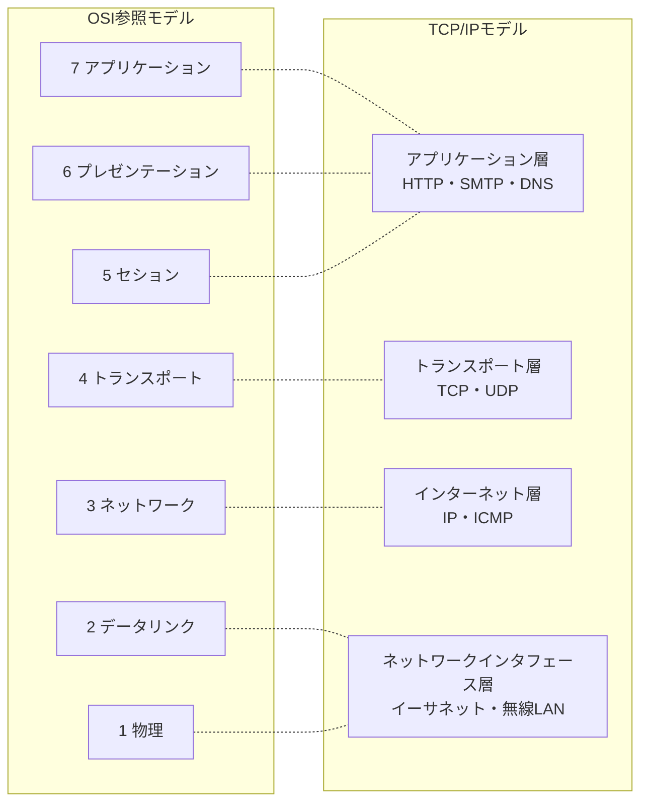
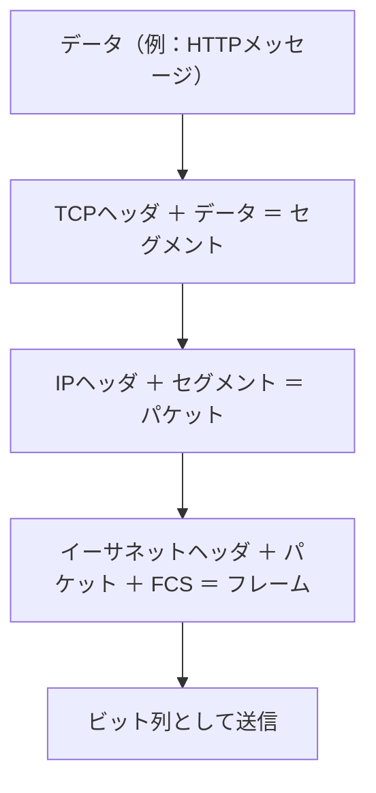
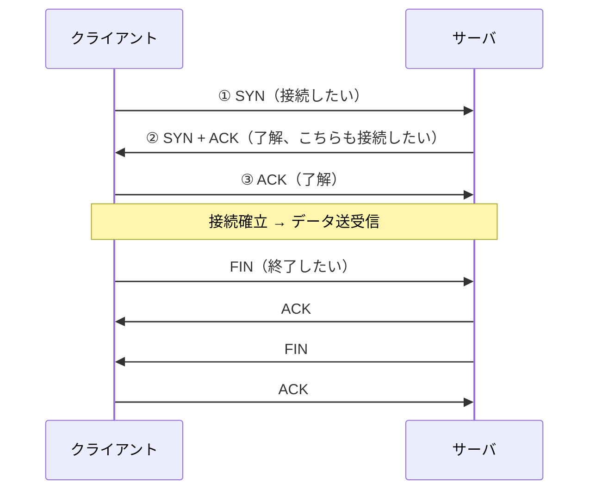
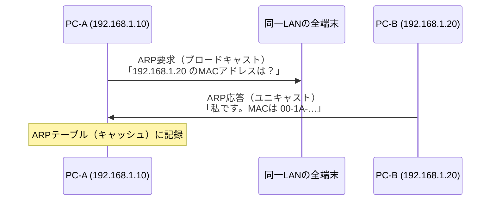
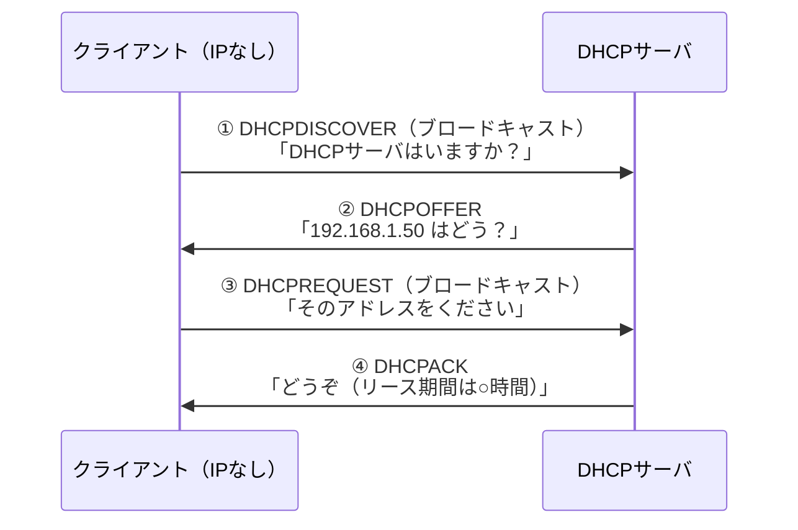
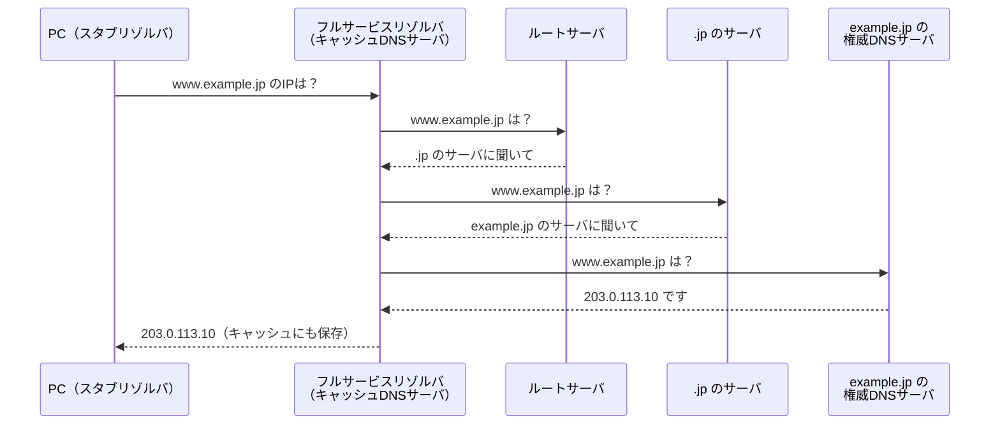
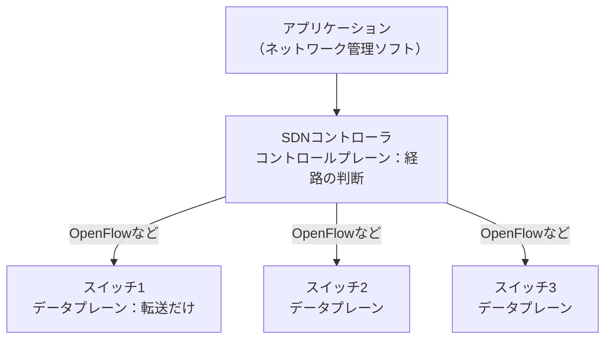
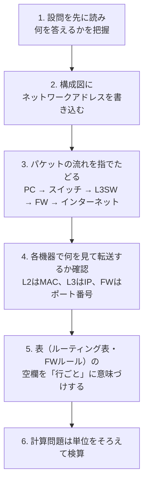

# ネットワーク

> **重要度：★★★**（科目A（旧午前）で毎回5問前後、科目B（旧午後）では「ネットワーク」が選択問題として毎回1問出題されます）
> 科目Aでは **OSI参照モデルと機器の対応・IPアドレスとサブネット計算・プロトコルの役割・伝送時間の計算** が定番です。科目Bでは社内LANや拠点間接続を題材に、**VLAN・ルーティング表・DHCP/DNS・NAPT・無線LAN・冗長化** が問われます。
> この章では、①階層モデルで「どの層の話か」を判断できること、②サブネット計算を途中式つきで確実に解けること、③主要プロトコルの動きを図で説明できること を目標にします。
> 情報セキュリティ（ファイアウォール、VPN、TLSなど）と重なる内容も多いので、セキュリティの章とあわせて学習してください。

## 目次

- [1. ネットワークの階層モデル](#1-ネットワークの階層モデル)
- [2. 各層の機器](#2-各層の機器)
- [3. データリンク層：イーサネット・VLAN](#3-データリンク層イーサネットvlan)
- [4. ネットワーク層：IPアドレスとサブネット](#4-ネットワーク層ipアドレスとサブネット)
- [5. IPv6](#5-ipv6)
- [6. ルーティング](#6-ルーティング)
- [7. トランスポート層：TCP・UDP・ポート番号](#7-トランスポート層tcpudpポート番号)
- [8. ネットワークを支えるプロトコル：ARP・ICMP・DHCP・DNS・NAT](#8-ネットワークを支えるプロトコルarpicmpdhcpdnsnat)
- [9. アプリケーション層：HTTP・メール・その他](#9-アプリケーション層httpメールその他)
- [10. 無線LAN](#10-無線lan)
- [11. 伝送時間・回線利用率の計算](#11-伝送時間回線利用率の計算)
- [12. 新しいネットワーク技術：SDN・5G・IoT](#12-新しいネットワーク技術sdn5giot)
- [13. 科目B「ネットワーク」問題の解き方](#13-科目bネットワーク問題の解き方)
- [確認問題](#確認問題)
- [参考](#参考)

---

## 1. ネットワークの階層モデル

### 1.1 OSI参照モデル ★★★

**OSI参照モデル（Open Systems Interconnection：開放型システム間相互接続）** は、ISO（国際標準化機構）が定めた通信機能を7つの層に分けたモデルです。

- 結論：通信機能を層に分けると、各層を独立して設計・交換できます。
- 理由：例えば有線LANを無線LANに替えても、上位層（Webブラウザなど）は変更せずに済むからです。
- 例：手紙で考えると、「内容を書く（上位層）」と「封筒に住所を書く（ネットワーク層）」と「郵便車で運ぶ（物理層）」は別々の担当です。

| 層 | 名称 | 役割 | 主なプロトコル・規格 | データの単位 |
|---|---|---|---|---|
| 第7層 | **アプリケーション層** | アプリごとの通信サービス | HTTP、SMTP、DNS、FTP | メッセージ |
| 第6層 | **プレゼンテーション層** | 文字コード・圧縮・暗号化などの表現形式 | （JPEG、MIMEなど） | |
| 第5層 | **セション層** | 通信の開始から終了までの管理 | | |
| 第4層 | **トランスポート層** | 端末間（エンドツーエンド）の信頼性確保 | **TCP、UDP** | セグメント |
| 第3層 | **ネットワーク層** | 異なるネットワーク間の中継（経路選択） | **IP、ICMP** | パケット |
| 第2層 | **データリンク層** | 隣接ノード間の転送（同一ネットワーク内） | **イーサネット**、PPP | フレーム |
| 第1層 | **物理層** | 電気信号・光信号への変換、ケーブル・コネクタ | 10BASE-T、光ファイバ | ビット |

💡 覚え方（下から）：「**ぶ・で・ね・と・せ・ぷ・あ**」（物理・データリンク・ネットワーク・トランスポート・セション・プレゼンテーション・アプリケーション）。

### 1.2 TCP/IPモデル ★★★

インターネットで実際に使われているのは **TCP/IPモデル（4層）** です。



### 1.3 カプセル化 ★★

送信側では、上位層のデータに各層が **ヘッダ**（制御情報）を付けて下位層に渡します。これを **カプセル化** といいます。受信側では逆にヘッダを外していきます。



**FCS（Frame Check Sequence：フレーム検査シーケンス）** はフレームの誤り検出用（CRC）の値です。

---

## 2. 各層の機器

### 2.1 中継機器と層の対応 ★★★

| 機器 | 層 | 判断に使う情報 | 特徴 |
|---|---|---|---|
| **リピータ** / リピータハブ | 第1層（物理） | なし | 信号を増幅・整形して全ポートへ流す |
| **ブリッジ** / **L2スイッチ**（スイッチングハブ） | 第2層（データリンク） | **MACアドレス** | 宛先MACアドレスのあるポートにだけ転送 |
| **ルータ** / **L3スイッチ** | 第3層（ネットワーク） | **IPアドレス** | 異なるネットワーク間をつなぎ、経路を選ぶ |
| **ゲートウェイ** | 第4〜7層 | アプリケーションの情報など | プロトコル変換。プロキシサーバなど |

💡 覚え方：「**リピータ＝1、ブリッジ・スイッチ＝2、ルータ＝3**」。

⚠️ ひっかけ注意：L2スイッチは **ブロードキャスト** を全ポートに転送します（ブロードキャストドメインを分割できない）。ブロードキャストドメインを分割するのは **ルータ** と **VLAN** です。

### 2.2 L2スイッチの学習機能 ★★

L2スイッチは受信したフレームの **送信元MACアドレス** と受信ポートを **MACアドレステーブル** に記録します。宛先MACアドレスがテーブルにない場合は、受信ポート以外の全ポートに転送（**フラッディング**）します。

### 2.3 その他のLAN機器・技術 ★

| 用語 | 内容 |
|---|---|
| **PoE**（Power over Ethernet） | LANケーブルで電力も供給する（無線LANアクセスポイントやIPカメラ向け） |
| **リンクアグリゲーション** | 複数の物理回線を束ねて1本の論理回線として扱い、帯域拡大と冗長化を図る |
| **STP**（Spanning Tree Protocol：スパニングツリープロトコル） | スイッチをループ状に接続したとき、一部のポートを論理的に遮断してブロードキャストストーム（フレームが無限に回り続ける現象）を防ぐ |
| **VRRP**（Virtual Router Redundancy Protocol） | 複数のルータを1台の仮想ルータに見せ、故障時に自動で切り替えるデフォルトゲートウェイの冗長化 |

---

## 3. データリンク層：イーサネット・VLAN

### 3.1 MACアドレス ★★

**MACアドレス（Media Access Control address）** は、ネットワークインタフェースに割り当てられた **48ビット** の物理アドレスです。

```
例: 00-1A-2B-3C-4D-5E
    └─ 前半24ビット ─┘└─ 後半24ビット ─┘
      OUI（ベンダID）     製品ごとの固有番号
```

全ビットが1の `FF-FF-FF-FF-FF-FF` は **ブロードキャストアドレス**（同一ネットワーク内の全端末宛て）です。

### 3.2 アクセス制御方式 ★

| 方式 | 使われる場所 | 内容 |
|---|---|---|
| **CSMA/CD**（Carrier Sense Multiple Access with Collision Detection） | 初期の有線LAN（半二重） | 送信中に **衝突を検出** したら待って再送 |
| **CSMA/CA**（… with Collision Avoidance） | **無線LAN** | 送信前にランダムな時間待つことで **衝突を回避** |

現在のスイッチを使った全二重通信の有線LANでは、衝突自体が起きません。

### 3.3 VLAN ★★★

**VLAN（Virtual LAN：仮想LAN）** は、物理的な配線と関係なく、スイッチの設定で論理的にLANを分割する技術です。

- 結論：VLANごとに **ブロードキャストドメインが分かれる** ので、部署ごとの分離やセキュリティ向上ができます。
- 理由：同じスイッチにつながっていても、異なるVLANの端末どうしはフレームが届かないからです。
- 例：1台のスイッチに営業部（VLAN10）と開発部（VLAN20）を収容し、両者の通信は **ルータまたはL3スイッチ** を経由させる。

| 種類 | 内容 |
|---|---|
| **ポートVLAN** | スイッチのポート単位でVLANを割り当てる |
| **タグVLAN** | フレームに **VLANタグ**（IEEE 802.1Q、4バイト）を付け、1本の回線で複数VLANを運ぶ。スイッチ間の **トランクポート** で使う |
| MACアドレスVLAN | 端末のMACアドレスによってVLANを決める |


💡 VLAN ID は12ビットで、0と4095は予約されているため、使えるのは **1〜4094** です。

---

## 4. ネットワーク層：IPアドレスとサブネット

### 4.1 IPv4アドレスの構造 ★★★

**IPv4アドレス** は **32ビット** で、8ビットずつ10進数で表します（例：`192.168.10.130`）。前半の **ネットワーク部**（どのネットワークか）と後半の **ホスト部**（そのネットワーク内のどの機器か）に分かれます。

```
192      .168      .10       .130
11000000 .10101000 .00001010 .10000010
```

### 4.2 アドレスクラス（参考） ★

以前は先頭ビットでネットワーク部の長さが決まる **クラス** 方式でした。

| クラス | 先頭ビット | 第1オクテットの範囲 | ネットワーク部 | ホスト数 |
|---|---|---|---|---|
| A | 0 | 0〜127 | 8ビット | 2²⁴ − 2 ＝ 16,777,214 |
| B | 10 | 128〜191 | 16ビット | 2¹⁶ − 2 ＝ 65,534 |
| C | 110 | 192〜223 | 24ビット | 2⁸ − 2 ＝ 254 |
| D | 1110 | 224〜239 | （マルチキャスト用） | |

現在は、ネットワーク部の長さを自由に決める **CIDR**（下記）が使われています。

### 4.3 プライベートIPアドレスと特殊なアドレス ★★★

**プライベートIPアドレス** は、組織内で自由に使えるアドレスです（インターネットへは直接出られず、NAT/NAPTで変換します）。

| 範囲 | CIDR表記 |
|---|---|
| 10.0.0.0 〜 10.255.255.255 | 10.0.0.0/8 |
| 172.16.0.0 〜 172.31.255.255 | 172.16.0.0/12 |
| 192.168.0.0 〜 192.168.255.255 | 192.168.0.0/16 |

| 特殊なアドレス | 内容 |
|---|---|
| **ネットワークアドレス** | ホスト部がすべて0。ネットワーク自体を表す（端末に割当て不可） |
| **ブロードキャストアドレス** | ホスト部がすべて1。そのネットワーク内の全端末宛て（端末に割当て不可） |
| **ループバックアドレス** | 127.0.0.0/8（通常 127.0.0.1）。自分自身を表す |
| リンクローカルアドレス | 169.254.0.0/16。DHCPサーバに接続できないときに自動設定される |

⚠️ ひっかけ注意：`172.32.0.1` はプライベートアドレスでは **ありません**（範囲は 172.16〜172.31）。

### 4.4 サブネットマスクとCIDR ★★★

**サブネットマスク** は、IPアドレスのどこまでがネットワーク部かを示す32ビットの値です（ネットワーク部を1、ホスト部を0にする）。**CIDR（Classless Inter-Domain Routing）表記** では、ネットワーク部のビット数を `/` の後ろに書きます。

| CIDR | サブネットマスク | 最終オクテット（2進） | アドレス数 | ホスト数 |
|---|---|---|---|---|
| /24 | 255.255.255.0 | 00000000 | 256 | 254 |
| /25 | 255.255.255.128 | 10000000 | 128 | 126 |
| /26 | 255.255.255.192 | 11000000 | 64 | 62 |
| /27 | 255.255.255.224 | 11100000 | 32 | 30 |
| /28 | 255.255.255.240 | 11110000 | 16 | 14 |
| /29 | 255.255.255.248 | 11111000 | 8 | 6 |
| /30 | 255.255.255.252 | 11111100 | 4 | 2 |

💡 覚え方：マスクの値は **128, 192, 224, 240, 248, 252, 254, 255**（1が左から1つずつ増える）。表は暗記するより、自分で書けるようにしておきましょう。

### 4.5 サブネット計算の公式 ★★★

```
ホスト部のビット数   h = 32 − プレフィックス長
割当て可能ホスト数   = 2^h − 2   （ネットワークアドレスとブロードキャストアドレスを除く）
ネットワークアドレス = IPアドレス AND サブネットマスク
ブロードキャスト     = ネットワークアドレスのホスト部をすべて1にしたもの
```

**ブロックサイズを使った速算法**：マスクが255でも0でもないオクテット（注目オクテット）について、

```
ブロックサイズ = 256 − （そのオクテットのマスク値）
ネットワークアドレス = そのオクテットの値以下で、ブロックサイズの倍数のうち最大のもの
```

### 4.6 例題1：192.168.10.130/26 ★★★

**手順1：ホスト数**

```
h = 32 − 26 = 6
ホスト数 = 2^6 − 2 = 64 − 2 = 62
```

**手順2：サブネットマスク**

```
/26 → 1が26個 → 11111111.11111111.11111111.11000000 → 255.255.255.192
```

**手順3：ネットワークアドレス（AND演算）**

第4オクテットだけが注目オクテットです。

```
IPアドレス     130 = 1000 0010
サブネットマスク 192 = 1100 0000
AND            ─────────────
                     1000 0000 = 128
```

→ ネットワークアドレス ＝ **192.168.10.128**

（速算法：ブロックサイズ ＝ 256 − 192 ＝ 64。64の倍数 0, 64, 128, 192 のうち130以下で最大は128）

**手順4：ブロードキャストアドレス**

```
ホスト部(下位6ビット)をすべて1にする: 1011 1111 = 191
（速算法: 128 + 64 − 1 = 191）
```

→ ブロードキャストアドレス ＝ **192.168.10.191**

**結果まとめ**

| 項目 | 値 |
|---|---|
| ネットワークアドレス | 192.168.10.128 |
| 割当て可能な範囲 | 192.168.10.129 〜 192.168.10.190 |
| ブロードキャストアドレス | 192.168.10.191 |
| ホスト数 | 62 |

### 4.7 例題2：172.16.45.200/20（第3オクテットで区切れる場合） ★★★

**手順1：ホスト数**

```
h = 32 − 20 = 12
ホスト数 = 2^12 − 2 = 4096 − 2 = 4094
```

**手順2：サブネットマスク**

```
/20 → 11111111.11111111.11110000.00000000 → 255.255.240.0
```

**手順3：ネットワークアドレス**（注目オクテットは第3オクテット）

```
第3オクテット   45 = 0010 1101
マスク         240 = 1111 0000
AND               = 0010 0000 = 32
第4オクテットはマスクが0なので 0
```

→ ネットワークアドレス ＝ **172.16.32.0**（速算法：ブロックサイズ 256 − 240 ＝ 16、16の倍数で45以下の最大は32）

**手順4：ブロードキャストアドレス**

```
第3オクテット: 32 + 16 − 1 = 47
第4オクテット: 255
```

→ ブロードキャストアドレス ＝ **172.16.47.255**

| 項目 | 値 |
|---|---|
| ネットワークアドレス | 172.16.32.0 |
| 割当て可能な範囲 | 172.16.32.1 〜 172.16.47.254 |
| ブロードキャストアドレス | 172.16.47.255 |
| ホスト数 | 4,094 |

⚠️ ひっかけ注意：/23 や /20 のように第3オクテットで区切れる場合、`192.168.5.255/23` のように **末尾が255でもブロードキャストとは限りません**。192.168.5.255/23 のネットワークは 192.168.4.0/23（範囲 192.168.4.0〜192.168.5.255）なので、この例はたまたまブロードキャストですが、`192.168.4.255/23` はふつうのホストアドレスです。

### 4.8 例題3：必要なホスト数からマスクを決める ★★

**問題**：1つのサブネットに最大50台の機器を接続したい。最もアドレスを無駄にしないサブネットマスクは？

```
2^h − 2 ≥ 50 を満たす最小の h を探す
h = 5 → 32 − 2 = 30  （不足）
h = 6 → 64 − 2 = 62  （OK）
プレフィックス長 = 32 − 6 = 26 → 255.255.255.192
```

### 4.9 例題4：サブネットに分割する ★★

**問題**：192.168.1.0/24 を /27 のサブネットに分割すると、サブネットはいくつでき、各サブネットのホスト数はいくつか。

```
サブネット数 = 2^(27 − 24) = 2^3 = 8
ホスト数     = 2^(32 − 27) − 2 = 32 − 2 = 30
```

| サブネット | ネットワークアドレス | ブロードキャスト |
|---|---|---|
| 1 | 192.168.1.0 | 192.168.1.31 |
| 2 | 192.168.1.32 | 192.168.1.63 |
| 3 | 192.168.1.64 | 192.168.1.95 |
| … | … | … |
| 8 | 192.168.1.224 | 192.168.1.255 |

### 4.10 例題5：経路集約（スーパーネット化） ★★

**経路集約** とは、複数の連続したネットワークを1つの経路情報にまとめることです（ルーティング表を小さくできます）。

**問題**：192.168.0.0/24、192.168.1.0/24、192.168.2.0/24、192.168.3.0/24 の4つを1つに集約すると？

```
第3オクテットを2進数にする
  0 = 0000 00|00
  1 = 0000 00|01
  2 = 0000 00|10
  3 = 0000 00|11
       └共通┘ ← 上位6ビットが共通
共通ビット数 = 8 + 8 + 6 = 22
```

→ **192.168.0.0/22**

💡 確認：/22 のアドレス数は 2^10 ＝ 1024 ＝ 256 × 4 で、/24 が4つ分とぴったり一致します。

---

## 5. IPv6

### 5.1 IPv6の特徴 ★★

**IPv6（Internet Protocol version 6）** は、IPv4アドレスの枯渇に対応するために作られた **128ビット** のアドレス体系です。

| 項目 | IPv4 | IPv6 |
|---|---|---|
| アドレス長 | 32ビット | **128ビット** |
| 表記 | 10進数を `.` で4区切り | **16進数を `:` で8区切り**（16ビットずつ） |
| ヘッダ長 | 可変（20〜60バイト） | **固定40バイト**（拡張ヘッダで機能追加） |
| ブロードキャスト | あり | **なし**（マルチキャストで代用） |
| アドレス自動設定 | DHCP | **SLAAC**（ステートレスアドレス自動設定）、DHCPv6 |
| IPsec | オプション | 実装が想定されている |
| 中継ルータでの分割（フラグメント） | あり | なし（送信元のみが分割） |

### 5.2 IPv6アドレスの省略表記 ★★★

**ルール**（RFC 5952 の推奨表記）

1. 各フィールド（16ビット）の **先頭の0は省略** できる（`0db8` → `db8`、`0000` → `0`）。
2. **0が連続するフィールドは `::` で1回だけ** まとめられる（最も長く続く部分を省略する）。
3. 英字は小文字で書く。

**例**：`2001:0db8:0000:0000:0001:0000:0000:0abc`

```
ルール1適用: 2001:db8:0:0:1:0:0:abc
ルール2適用: 0の連続は「0:0」が2か所（長さが同じ）→ 前の方を :: にする
結果      : 2001:db8::1:0:0:abc
```

⚠️ ひっかけ注意：`2001:db8::1::abc` のように `::` を **2回使うのは誤り** です（何個の0を省略したか分からなくなるため）。

### 5.3 IPv6アドレスの種類 ★

| 種類 | プレフィックス | 用途 |
|---|---|---|
| グローバルユニキャスト | 2000::/3 | インターネットで一意（IPv4のグローバルアドレス相当） |
| **リンクローカル** | fe80::/10 | 同一リンク内だけで有効（自動で必ず付く） |
| ユニークローカル | fc00::/7 | 組織内で使う（IPv4のプライベートアドレス相当） |
| マルチキャスト | ff00::/8 | 複数宛て |
| ループバック | ::1 | 自分自身 |

### 5.4 IPv4からの移行技術 ★

| 技術 | 内容 |
|---|---|
| デュアルスタック | 1台の機器でIPv4とIPv6の両方を動かす |
| トンネリング | IPv6パケットをIPv4パケットに包んで（カプセル化して）運ぶ |
| トランスレーション | IPv4とIPv6のヘッダを相互変換する（NAT64など） |

---

## 6. ルーティング

### 6.1 ルーティングとルーティング表 ★★★

**ルーティング** とは、ルータがパケットの宛先IPアドレスを見て、次にどのルータへ送るか（**ネクストホップ**）を決めることです。判断には **ルーティング表（経路表）** を使います。

**ロンゲストマッチ（最長一致）**：宛先に一致する経路が複数あるときは、**プレフィックス長が最も長い（詳しい）経路** を選びます。

**例**：次のルーティング表を持つルータ

| 宛先ネットワーク | ネクストホップ |
|---|---|
| 192.168.0.0/16 | ルータR1 |
| 192.168.10.0/24 | ルータR2 |
| 0.0.0.0/0（デフォルトルート） | ルータR3 |

| 宛先IPアドレス | 一致する経路 | 選ばれる経路 |
|---|---|---|
| 192.168.10.5 | /16、/24、/0 | **/24 → R2**（最長） |
| 192.168.20.1 | /16、/0 | **/16 → R1** |
| 8.8.8.8 | /0 のみ | **R3**（デフォルトルート） |

**デフォルトルート**（0.0.0.0/0）は「どの経路にも一致しないときの送り先」で、すべての宛先に一致します。端末に設定する **デフォルトゲートウェイ** は、他のネットワーク宛てのパケットを送るルータのIPアドレスです。

### 6.2 静的ルーティングと動的ルーティング ★★

| 方式 | 内容 | 向いている環境 |
|---|---|---|
| **静的（スタティック）ルーティング** | 管理者が手で経路を設定する | 小規模・経路がほぼ変わらない |
| **動的（ダイナミック）ルーティング** | ルータ同士がルーティングプロトコルで経路情報を交換し自動更新する | 大規模・障害時の迂回が必要 |

### 6.3 ルーティングプロトコル ★★

| プロトコル | 種類 | 経路選択の基準 | 使われる範囲 |
|---|---|---|---|
| **RIP**（Routing Information Protocol） | 距離ベクトル型 | **ホップ数**（経由するルータの数）。最大15（16は到達不能） | 小規模な組織内（AS内） |
| **OSPF**（Open Shortest Path First） | リンクステート型 | **コスト**（回線帯域などから算出） | 中〜大規模な組織内（AS内） |
| **BGP**（Border Gateway Protocol） | パスベクトル型 | AS経路（ポリシー） | **AS（自律システム）間**、ISP間 |

**AS（Autonomous System：自律システム）** は、ISPや大企業など、1つの管理方針で運用されるネットワークのまとまりです。

💡 覚え方：「**RIPはホップ、OSPFはコスト、BGPはAS間**」。

---

## 7. トランスポート層：TCP・UDP・ポート番号

### 7.1 TCPとUDPの比較 ★★★

| 項目 | **TCP**（Transmission Control Protocol） | **UDP**（User Datagram Protocol） |
|---|---|---|
| 接続 | **コネクション型**（通信前に接続を確立） | **コネクションレス型** |
| 信頼性 | 高い（順序制御・再送制御・確認応答） | なし（届かなくても再送しない） |
| フロー制御 | あり（ウィンドウ制御） | なし |
| ヘッダ長 | 20バイト以上 | 8バイト |
| 速度・オーバーヘッド | 遅め・大きい | 速い・小さい |
| ブロードキャスト／マルチキャスト | 不可 | **可能** |
| 主な用途 | HTTP、メール、FTP、SSH | **DNS**（問合せ）、**DHCP**、NTP、SNMP、音声・動画のリアルタイム配信 |

### 7.2 TCPの3ウェイハンドシェイク ★★

TCPは通信の前に **3ウェイハンドシェイク** で接続を確立します。



### 7.3 TCPの信頼性の仕組み ★

| 仕組み | 内容 |
|---|---|
| シーケンス番号 | 送るデータに通し番号を付け、受信側で順番を並べ直す |
| 確認応答（ACK） | 受け取ったことを相手に返す |
| 再送制御 | 一定時間ACKが来なければ再送する |
| **ウィンドウ制御** | ACKを待たずに送ってよいデータ量（ウィンドウサイズ）を決め、まとめて送って効率を上げる |
| 輻輳制御 | ネットワークの混雑を検知して送信量を絞る |

### 7.4 ポート番号 ★★★

**ポート番号** は、1台のコンピュータ上で動いている **どのアプリケーション宛てか** を区別する16ビットの番号（0〜65535）です。

| 範囲 | 名称 |
|---|---|
| 0〜1023 | **ウェルノウンポート**（代表的なサービス用） |
| 1024〜49151 | 登録済みポート |
| 49152〜65535 | 動的・プライベートポート（クライアント側で一時的に使う） |

**よく出るウェルノウンポート**

| ポート | プロトコル | TCP/UDP | 用途 |
|---|---|---|---|
| 20 / 21 | FTP | TCP | ファイル転送（20：データ、21：制御） |
| 22 | **SSH** | TCP | 暗号化された遠隔ログイン |
| 23 | Telnet | TCP | 遠隔ログイン（平文） |
| 25 | **SMTP** | TCP | メール送信・転送 |
| 53 | **DNS** | UDP/TCP | 名前解決 |
| 67 / 68 | **DHCP** | UDP | IPアドレス自動割当て（67：サーバ、68：クライアント） |
| 80 | **HTTP** | TCP | Web |
| 110 | **POP3** | TCP | メール受信 |
| 123 | NTP | UDP | 時刻同期 |
| 143 | **IMAP4** | TCP | メール受信（サーバ上で管理） |
| 161 / 162 | SNMP | UDP | ネットワーク機器の監視（162：トラップ） |
| 443 | **HTTPS** | TCP（HTTP/3はUDP） | 暗号化されたWeb |
| 587 | サブミッション | TCP | メール送信（クライアント → メールサーバ、SMTP-AUTHと併用） |
| 993 / 995 | IMAPS / POP3S | TCP | TLSで暗号化したIMAP / POP3 |

---

## 8. ネットワークを支えるプロトコル：ARP・ICMP・DHCP・DNS・NAT

### 8.1 ARP ★★★

**ARP（Address Resolution Protocol）** は、**IPアドレスからMACアドレスを求める** プロトコルです。



- 宛先が **別のネットワーク** の場合は、宛先ホストではなく **デフォルトゲートウェイのMACアドレス** をARPで求めます。
- 関連：**RARP** は逆にMACアドレスからIPアドレスを求めるもの（現在はDHCPに置き換わった）。**GARP**（Gratuitous ARP）は自分のIPアドレスを指定したARPで、アドレス重複の検出などに使います。

### 8.2 ICMP ★★

**ICMP（Internet Control Message Protocol）** は、IP通信のエラー通知や診断に使うプロトコルです（ネットワーク層）。

| コマンド／メッセージ | 用途 |
|---|---|
| **ping**（エコー要求／エコー応答） | 相手に到達できるか確認 |
| **traceroute**（tracert） | 経由するルータを調べる（TTLを1ずつ増やして送る） |
| 到達不能（Destination Unreachable） | 宛先に届かなかったことを通知 |
| 時間超過（Time Exceeded） | **TTL**（Time To Live：生存時間。ルータを通るたびに1減る）が0になった |

### 8.3 DHCP ★★★

**DHCP（Dynamic Host Configuration Protocol）** は、端末に **IPアドレス・サブネットマスク・デフォルトゲートウェイ・DNSサーバのアドレス** などを自動で割り当てるプロトコルです。



💡 覚え方：「**DORA**（Discover・Offer・Request・Ack）」。

- 割り当てには **リース期間**（有効期限）があり、期限前に更新します。
- ⚠️ DHCPDISCOVER はブロードキャストなので **ルータを越えられません**。別のネットワークにあるDHCPサーバを使うには、ルータに **DHCPリレーエージェント** の機能を設定します（科目Bの頻出ポイント）。

### 8.4 DNS ★★★

**DNS（Domain Name System）** は、**ドメイン名（例：www.example.jp）とIPアドレスを対応付ける**（名前解決する）仕組みです。



| 用語 | 内容 |
|---|---|
| **フルサービスリゾルバ**（キャッシュDNSサーバ） | 利用者からの問合せを受け、他のDNSサーバへ順に問い合わせて答えを得る。結果をキャッシュする |
| **権威DNSサーバ**（コンテンツサーバ） | 自分が管理するドメイン（ゾーン）の情報を持ち、回答する |

**主なリソースレコード**

| レコード | 内容 |
|---|---|
| **A** | ドメイン名 → **IPv4アドレス** |
| **AAAA** | ドメイン名 → **IPv6アドレス** |
| **MX** | そのドメイン宛てメールを受け取る **メールサーバ** |
| **CNAME** | 別名（エイリアス） |
| **NS** | そのゾーンを管理する権威DNSサーバ |
| **PTR** | IPアドレス → ドメイン名（**逆引き**） |
| SOA | ゾーンの管理情報 |
| TXT | 任意の文字列（SPFなどの送信ドメイン認証で使用） |

⚠️ セキュリティとの関連：偽の応答をキャッシュに覚えさせる **DNSキャッシュポイズニング** があり、対策として **DNSSEC**（DNSの応答に電子署名を付ける）があります。

### 8.5 NAT と NAPT ★★★

**NAT（Network Address Translation）** は、プライベートIPアドレスとグローバルIPアドレスを変換する技術です。

| 方式 | 変換するもの | 特徴 |
|---|---|---|
| **NAT**（静的NAT など） | **IPアドレスのみ**（1対1） | グローバルアドレスの数だけしか同時に外部と通信できない |
| **NAPT**（Network Address Port Translation、IPマスカレード） | **IPアドレス ＋ ポート番号** | **1つのグローバルアドレスを複数端末で共有** できる |

**NAPTの変換例**（ルータのグローバルアドレスが 203.0.113.1）

| 内部（送信元） | 変換後（送信元） |
|---|---|
| 192.168.1.10 : 50001 | 203.0.113.1 : 60001 |
| 192.168.1.20 : 50001 | 203.0.113.1 : 60002 |

→ 戻ってきたパケットは、ポート番号（60001 / 60002）を見て元の端末に振り分けます。

⚠️ ひっかけ注意：NAPTでは、外部から内部のサーバへ通信を始めることは、そのままでは **できません**（変換表がないため）。外部に公開するサーバには **静的NAT** や **ポートフォワーディング** を設定するか、**DMZ** に置きます。

---

## 9. アプリケーション層：HTTP・メール・その他

### 9.1 HTTP ★★

**HTTP（HyperText Transfer Protocol）** はWebブラウザとWebサーバの間の通信プロトコルです。**HTTPS** はHTTPを **TLS（Transport Layer Security）** で暗号化したものです。

| メソッド | 用途 |
|---|---|
| GET | リソースの取得（パラメータはURLに付く） |
| POST | データの送信（フォーム送信など。パラメータは本文に入る） |
| PUT | リソースの作成・置き換え |
| DELETE | リソースの削除 |
| HEAD | ヘッダだけ取得 |

| ステータスコード | 意味 |
|---|---|
| **200** OK | 成功 |
| **301** / **302** | 恒久的 / 一時的な **リダイレクト**（転送） |
| 304 Not Modified | 更新されていない（キャッシュを使ってよい） |
| 400 Bad Request | リクエストの誤り |
| **401** Unauthorized | 認証が必要 |
| **403** Forbidden | アクセス禁止 |
| **404** Not Found | リソースがない |
| **500** Internal Server Error | サーバ内部のエラー |
| **503** Service Unavailable | 過負荷・メンテナンスで一時的に利用不可 |

💡 覚え方：**2xx 成功、3xx 転送、4xx クライアントのせい、5xx サーバのせい**。

| 用語 | 内容 |
|---|---|
| **Cookie** | サーバがブラウザに保存させる小さなデータ。HTTPは状態を持たない（**ステートレス**）ため、ログイン状態の維持（セッション管理）に使う |
| HTTP/2 | 1つのTCP接続で複数のリクエストを並行処理（多重化）し高速化 |
| **HTTP/3** | トランスポートに **QUIC**（**UDP** 上に作られたプロトコル）を使い、接続確立を高速化 |
| **プロキシサーバ** | クライアントの代わりにWebサーバへアクセスする中継サーバ。キャッシュやアクセス制御に使う |
| リバースプロキシ | サーバ側に置き、外部からの要求を内部のWebサーバへ振り分ける（負荷分散、TLS終端） |

### 9.2 電子メールのプロトコル ★★★


| プロトコル | 用途 | 特徴 |
|---|---|---|
| **SMTP**（Simple Mail Transfer Protocol） | メールの **送信・転送** | ポート25（サーバ間）、587（クライアントからの投稿） |
| **POP3**（Post Office Protocol version 3） | メールの **受信** | メールを端末に **ダウンロード** して読む |
| **IMAP4**（Internet Message Access Protocol version 4） | メールの **受信** | メールを **サーバ上で管理**。複数端末で同じ状態を共有できる |
| **SMTP-AUTH** | 送信時の利用者認証 | 不正な中継（踏み台）を防ぐ |
| **MIME**（Multipurpose Internet Mail Extensions） | 日本語・添付ファイルを扱う形式 | 暗号化・署名版が **S/MIME** |

| 迷惑メール・なりすまし対策 | 内容 |
|---|---|
| **OP25B**（Outbound Port 25 Blocking） | ISPが、自社ネットワークから外部のポート25への直接送信を遮断する |
| **SPF**（Sender Policy Framework） | 送信元ドメインのDNS（TXTレコード）に正規の送信サーバのIPアドレスを登録し、受信側が照合する |
| **DKIM**（DomainKeys Identified Mail） | 送信サーバがメールに **電子署名** を付け、受信側がDNS上の公開鍵で検証する |
| **DMARC** | SPF・DKIMの検証に失敗したメールの扱い（受信拒否など）を送信ドメイン側が宣言する |

### 9.3 その他のプロトコル ★

| プロトコル | 用途 |
|---|---|
| **NTP**（Network Time Protocol） | 時刻同期（UDP 123） |
| **SNMP**（Simple Network Management Protocol） | ネットワーク機器の監視・管理。機器側の **エージェント** が異常を **トラップ** で通知する |
| **SIP**（Session Initiation Protocol） | IP電話（VoIP）の呼制御 |
| **RTP**（Real-time Transport Protocol） | 音声・動画のリアルタイム転送 |
| FTP | ファイル転送（制御とデータで別のコネクションを使う） |
| SSH | 暗号化された遠隔操作・ファイル転送（SFTP） |

---

## 10. 無線LAN

### 10.1 無線LANの規格 ★★

| 規格 | 通称 | 周波数帯 | 最大通信速度（規格上） |
|---|---|---|---|
| IEEE 802.11b | | 2.4GHz | 11Mbps |
| IEEE 802.11a | | 5GHz | 54Mbps |
| IEEE 802.11g | | 2.4GHz | 54Mbps |
| IEEE 802.11n | **Wi-Fi 4** | 2.4GHz / 5GHz | 600Mbps |
| IEEE 802.11ac | **Wi-Fi 5** | 5GHz | 6.9Gbps |
| IEEE 802.11ax | **Wi-Fi 6** / 6E | 2.4GHz / 5GHz（6Eは6GHzも） | 9.6Gbps |
| IEEE 802.11be | Wi-Fi 7 | 2.4GHz / 5GHz / 6GHz | 約46Gbps |

| 周波数帯 | 特徴 |
|---|---|
| 2.4GHz | 障害物に強く遠くまで届くが、電子レンジやBluetoothと **干渉** しやすい |
| 5GHz | 干渉が少なく高速だが、障害物に弱い。屋外利用に制限があるチャネルがある |

### 10.2 無線LANの用語 ★★

| 用語 | 内容 |
|---|---|
| **アクセスポイント（AP）** | 無線端末を有線LANにつなぐ親機 |
| **SSID / ESSID** | 無線LANのネットワーク識別名 |
| インフラストラクチャモード | アクセスポイント経由で通信する（通常の利用形態） |
| アドホックモード | 端末同士が直接通信する |
| **ローミング** | 移動に伴い、接続するアクセスポイントを自動で切り替える |
| メッシュWi-Fi | 複数のアクセスポイントが無線で相互接続し、広い範囲をカバーする |
| ステルス機能（SSIDの隠蔽） | ビーコンにSSIDを載せない。⚠️ これだけでは安全とはいえない |

### 10.3 無線LANのセキュリティ ★★

| 方式 | 暗号化 | 評価 |
|---|---|---|
| WEP | RC4 | **脆弱で使用禁止** |
| WPA | TKIP | 非推奨 |
| **WPA2** | **AES**（CCMP） | 広く普及 |
| **WPA3** | AES ＋ **SAE**（辞書攻撃に強い鍵交換） | 現在の推奨 |

- **パーソナルモード**：事前共有鍵（PSK）で認証する（家庭・小規模向け）。
- **エンタープライズモード**：**IEEE 802.1X** と認証サーバ（RADIUSサーバ）で利用者ごとに認証する（企業向け）。

---

## 11. 伝送時間・回線利用率の計算

### 11.1 単位の確認 ★★★

| 項目 | 注意点 |
|---|---|
| ビットとバイト | **1バイト ＝ 8ビット**。回線速度は **bps（bit per second）**、データ量は **バイト** で与えられることが多い |
| 接頭語 | ネットワークの計算では通常 **k ＝ 10³、M ＝ 10⁶、G ＝ 10⁹**（問題文の指示に従う） |

⚠️ ひっかけ注意：「100Mbpsの回線で100Mバイト」を送ると、1秒ではなく **8秒**（伝送効率100%の場合）です。単位をビットにそろえるのを忘れないようにしましょう。

### 11.2 伝送時間 ★★★

**公式**

```
伝送時間（秒） = 伝送するデータ量（ビット） ÷ （回線速度（bps） × 伝送効率）
```

**伝送効率** とは、回線速度のうち実際にデータの伝送に使える割合です（ヘッダや制御情報の分だけ下がります）。

**例題1**：600Mバイトのファイルを、100Mbpsの回線で伝送効率60%のときに送る時間は？

```
データ量       = 600 × 10^6 バイト × 8 = 4,800 × 10^6 ビット
実効速度       = 100 × 10^6 bps × 0.6 = 60 × 10^6 bps
伝送時間       = 4,800 × 10^6 ÷ (60 × 10^6) = 80 秒
```

**例題2（必要な回線速度を求める）**：1Gバイトのデータを伝送効率80%の回線で100秒以内に送りたい。必要な回線速度は？

```
データ量       = 1 × 10^9 × 8 = 8 × 10^9 ビット
必要な実効速度 = 8 × 10^9 ÷ 100 = 80 × 10^6 bps
必要な回線速度 = 80 × 10^6 ÷ 0.8 = 100 × 10^6 bps = 100Mbps
```

### 11.3 回線利用率 ★★★

**公式**

```
回線利用率 = 単位時間あたりに伝送するデータ量（ビット/秒） ÷ 回線速度（bps）
```

**例題3**：1件2,000バイトの電文を毎秒30件、1Mbpsの回線で送るときの回線利用率は？

```
伝送量 = 2,000 バイト × 8 × 30 件/秒 = 480,000 ビット/秒
利用率 = 480,000 ÷ 1,000,000 = 0.48 → 48%
```

💡 回線利用率は、待ち行列理論（M/M/1）の **利用率 ρ** として、平均待ち時間の計算にも使われます（システム構成要素の章を参照）。

### 11.4 ビット誤り率 ★

**例**：ビット誤り率が 1 × 10⁻⁶ の回線で、毎秒 10Mbps でデータを送ると、1秒あたりの誤りビット数は？

```
10 × 10^6 ビット × 1 × 10^-6 = 10 ビット
```

---

## 12. 新しいネットワーク技術：SDN・5G・IoT

### 12.1 SDN と NFV ★★

**SDN（Software-Defined Networking）** は、ネットワーク機器の **制御機能（コントロールプレーン）** と **転送機能（データプレーン）** を分離し、ソフトウェア（コントローラ）で一元的にネットワークを制御する考え方です。



| 用語 | 内容 |
|---|---|
| **OpenFlow** | SDNコントローラとスイッチ間の代表的なプロトコル。フローテーブルで転送を制御 |
| **NFV**（Network Functions Virtualization：ネットワーク機能仮想化） | ルータ・ファイアウォールなどの機能を、専用機器ではなく汎用サーバ上の **仮想マシン** で実現する |
| SD-WAN | SDNの考え方をWAN（拠点間接続）に適用したもの |

⚠️ ひっかけ注意：SDN ＝ 制御と転送の **分離**、NFV ＝ ネットワーク機能の **仮想化** です。両者は組み合わせて使われますが、意味は異なります。

### 12.2 5G（第5世代移動通信システム） ★★

| 特徴 | 英語略称 | 目標性能（目安） | 用途例 |
|---|---|---|---|
| **超高速・大容量** | eMBB（enhanced Mobile Broadband） | 最大10〜20Gbps（総務省資料では10Gbps、ITU-Rの要求条件ではピーク20Gbps） | 4K/8K動画、VR |
| **超低遅延・高信頼** | URLLC（Ultra-Reliable and Low Latency Communications） | 遅延1ミリ秒程度 | 自動運転、遠隔手術、工場の機械制御 |
| **多数同時接続** | mMTC（massive Machine Type Communications） | 1km²あたり100万台 | IoTセンサ |

| 用語 | 内容 |
|---|---|
| **ネットワークスライシング** | 1つの物理ネットワークを用途ごとに仮想的に分割し、それぞれに適した品質を提供する |
| **ローカル5G** | 企業や自治体が、自社の敷地内などで独自に構築する5Gネットワーク（免許が必要） |
| **MEC**（Multi-access Edge Computing） | 基地局の近く（ネットワークの端）でデータ処理して遅延を減らす |

### 12.3 IoTとLPWA ★★

| 用語 | 内容 |
|---|---|
| **LPWA**（Low Power Wide Area） | **低消費電力で長距離**（数km〜数十km）通信できる無線方式。通信速度は低い。LoRaWAN、Sigfox、NB-IoT、LTE-Mなど |
| **MQTT**（Message Queuing Telemetry Transport） | IoT向けの軽量な通信プロトコル。**パブリッシュ／サブスクライブ** 型で、ブローカーが中継する |
| BLE（Bluetooth Low Energy） | 近距離・低消費電力の無線通信 |
| **エッジコンピューティング** | データの発生源（端末）の近くで処理し、クラウドへの通信量と遅延を減らす |

### 12.4 その他の関連技術 ★

| 用語 | 内容 |
|---|---|
| **CDN**（Content Delivery Network） | 世界各地のキャッシュサーバからコンテンツを配信し、高速化・負荷分散する |
| **VPN**（Virtual Private Network） | インターネットなどの上に仮想的な専用線を作る。**IPsec-VPN**（ネットワーク層で暗号化）、**SSL-VPN / TLS-VPN**（ブラウザで利用しやすい） |
| **IP-VPN** / 広域イーサネット | 通信事業者の閉域網を使う拠点間接続。広域イーサネットはL2で接続するため、拠点間で任意のルーティングプロトコルを使える |
| **QoS**（Quality of Service） | 音声など遅延に弱い通信を優先して送る品質制御 |
| FTTH | 光ファイバを家庭まで引き込む接続方式 |

---

## 13. 科目B「ネットワーク」問題の解き方

### 13.1 出題パターン ★★★

科目B（旧午後）の「ネットワーク」は、ある企業の社内LAN・拠点間接続・Webシステムなどの構成図を題材にした長文問題です。

| 設問パターン | 必要な知識 |
|---|---|
| ネットワーク構成図の **IPアドレス・サブネットマスク・デフォルトゲートウェイの穴埋め** | 4章 |
| **ルーティング表** の宛先・ネクストホップの穴埋め | 6章 |
| **VLAN** の設計（ポートVLAN／タグVLAN、VLAN間ルーティング） | 3章 |
| **DHCP**（リレーエージェント）、**DNS**（レコード、内部／外部DNSの分離） | 8章 |
| **NAPT**・DMZ・ファイアウォールの **フィルタリングルール**（送信元／宛先／ポート番号） | 7・8章、セキュリティ |
| 無線LANの導入（認証方式、アクセスポイント配置、ローミング） | 10章 |
| **冗長化**（VRRP、リンクアグリゲーション、STP） | 2章 |
| 回線帯域・伝送時間の計算 | 11章 |

### 13.2 解く手順 ★★★



### 13.3 よく出る着眼点 ★★

- **「別セグメントのPCがIPアドレスを取得できない」** → DHCPDISCOVERはブロードキャストでルータを越えない → **DHCPリレーエージェント** を設定する。
- **「同じスイッチなのに通信できない」** → VLANが異なる → **L3スイッチでVLAN間ルーティング** が必要。
- **「異なるネットワークへ通信できない」** → 端末の **デフォルトゲートウェイ** の設定漏れ・誤りを疑う。
- **ファイアウォールのルール** は上から順に評価され、最初に一致したルールが適用されることが多い（最後に「すべて拒否」）。応答パケットを考慮する **ステートフルインスペクション** かどうかに注意。
- **社内からはサーバの内部アドレスで、社外からは公開アドレスで名前解決させたい** → 内部DNSと外部DNSを分ける。
- 「機器が1台故障しても通信を継続したい」→ 単一障害点（SPOF）を探し、**冗長化**（VRRP、リンクアグリゲーション）を提案する。

### 13.4 時間配分 ★

科目Bは150分で5問なので、1問あたり **約30分** が目安です。ネットワークは知識の幅が問われる一方、構成図に書き込みながら読むと見落としが減ります。サブネット計算は1問1分以内で解けるよう、確認問題で練習しておきましょう。

---

## 確認問題

### 問1（OSI参照モデルと機器）
OSI参照モデルのネットワーク層で動作し、IPアドレスに基づいて異なるネットワーク間のパケットを中継する機器はどれですか。

ア リピータ　イ ブリッジ　ウ L2スイッチ　エ ルータ

### 問2（ネットワークアドレス）
IPアドレス 172.20.130.5/18 が属するネットワークのネットワークアドレスと、割当て可能なホスト数を答えてください。

### 問3（必要なサブネットマスク）
1つのサブネットに最大 100 台のホストを接続したいとき、アドレスの無駄が最も少ないサブネットマスクはどれですか。

ア 255.255.255.0　イ 255.255.255.128　ウ 255.255.255.192　エ 255.255.255.224

### 問4（経路集約）
172.16.8.0/24 から 172.16.15.0/24 までの連続する8つのネットワークを1つの経路に集約したものはどれですか。

ア 172.16.0.0/20　イ 172.16.8.0/21　ウ 172.16.8.0/22　エ 172.16.8.0/24

### 問5（IPv6の省略表記）
IPv6アドレス `2001:0db8:0000:0000:0001:0000:0000:0abc` の省略表記として正しいものはどれですか。

ア 2001:db8::1::abc　イ 2001:db8::1:0:0:abc　ウ 2001:db8:0:0:1::abc　エ 2001:db8::1:abc

### 問6（伝送時間）
3Gバイトのファイルを、通信速度1Gbps、伝送効率80%の回線で転送するのに要する時間は何秒ですか。ここで 1G ＝ 10⁹ とします。

### 問7（回線利用率）
平均1,500バイトのパケットを毎秒200個、10Mbpsの回線で送信するとき、回線利用率は何%ですか。

### 問8（ARP）
同一LAN内の通信で、宛先のIPアドレスから宛先のMACアドレスを求めるために使用されるプロトコルはどれですか。

ア ARP　イ DHCP　ウ DNS　エ ICMP

### 問9（NAPT）
NAPTの説明として適切なものはどれですか。

ア IPアドレスだけを1対1で変換するので、グローバルアドレスの数だけ同時に通信できる
イ IPアドレスとポート番号を変換し、1つのグローバルアドレスを複数の端末で共有できる
ウ ドメイン名とIPアドレスを対応付ける
エ 端末にIPアドレスを自動で割り当てる

### 問10（DHCPリレー）
DHCPサーバをサーバ用セグメントに1台だけ設置したところ、ルータを隔てた別セグメントのPCがIPアドレスを取得できませんでした。この原因と対策として最も適切なものはどれですか。

ア DHCPはTCPを使うので、ルータでTCPポート67を許可する
イ DHCPDISCOVERはブロードキャストでルータを越えないので、ルータにDHCPリレーエージェントを設定する
ウ DNSサーバが停止しているので、DNSサーバを再起動する
エ PCのデフォルトゲートウェイが未設定なので、手動で設定する

<details><summary>解答・解説</summary>

**問1：エ**
リピータは物理層、ブリッジとL2スイッチはデータリンク層（MACアドレスで転送）、ルータはネットワーク層（IPアドレスで中継）です。

**問2：ネットワークアドレス 172.20.128.0、ホスト数 16,382**
```
/18 → マスク 255.255.192.0（注目オクテットは第3オクテット）
第3オクテット 130 = 1000 0010
マスク        192 = 1100 0000
AND               = 1000 0000 = 128
→ ネットワークアドレス 172.20.128.0
ホスト数 = 2^(32−18) − 2 = 2^14 − 2 = 16,384 − 2 = 16,382
（ブロードキャストは 172.20.191.255）
```

**問3：イ**
```
2^h − 2 ≥ 100 を満たす最小の h
h = 6 → 62（不足）、h = 7 → 126（OK）
プレフィックス長 = 32 − 7 = 25 → 255.255.255.128
```
アの /24（254台）でも収容できますが、アドレスの無駄が多くなります。

**問4：イ**
```
第3オクテット  8 = 0000 1|000
              15 = 0000 1|111
上位5ビットが共通 → 8 + 8 + 5 = 21
→ 172.16.8.0/21（アドレス数 2^11 = 2048 = 256 × 8 で一致）
```

**問5：イ**
先頭の0を省略すると `2001:db8:0:0:1:0:0:abc`。0の連続は2か所で長さが同じなので、前の方を `::` にします。アは `::` を2回使っているので誤り、ウは推奨表記の規則（同じ長さなら前を省略）に反し、エは0が足りません（元のアドレスと異なる）。

**問6：30秒**
```
データ量 = 3 × 10^9 × 8 = 24 × 10^9 ビット
実効速度 = 1 × 10^9 × 0.8 = 0.8 × 10^9 bps
伝送時間 = 24 × 10^9 ÷ (0.8 × 10^9) = 30 秒
```

**問7：24%**
```
伝送量 = 1,500 × 8 × 200 = 2,400,000 ビット/秒
利用率 = 2,400,000 ÷ 10,000,000 = 0.24 → 24%
```

**問8：ア**
ARPはブロードキャストで「このIPアドレスを持つ機器のMACアドレスは？」と問い合わせます。DHCPはアドレスの自動割当て、DNSは名前解決、ICMPはエラー通知・診断です。

**問9：イ**
アは（静的）NATの説明、ウはDNS、エはDHCPの説明です。

**問10：イ**
DHCPはUDPを使います。クライアントは最初IPアドレスを持たないため、DHCPDISCOVERをブロードキャストで送りますが、ブロードキャストはルータを越えません。ルータにDHCPリレーエージェントを設定すると、ルータがユニキャストに変換してDHCPサーバへ中継します。

</details>

---

## 参考

- IPA 情報処理推進機構「試験要綱・シラバス」（応用情報技術者試験 シラバス Ver.7.2）
  https://www.ipa.go.jp/shiken/syllabus/gaiyou.html
- IPA「応用情報技術者試験 シラバス Ver.7.2」（PDF）
  https://www.ipa.go.jp/shiken/syllabus/omgdg50000005kq5-att/syllabus_ap_ver7_2.pdf
- IPA「過去問題」（問題冊子・解答例）
  https://www.ipa.go.jp/shiken/mondai-kaiotu/index.html
- RFC 1918「Address Allocation for Private Internets」（プライベートアドレス）
  https://www.rfc-editor.org/rfc/rfc1918
- RFC 5952「A Recommendation for IPv6 Address Text Representation」（IPv6の表記）
  https://www.rfc-editor.org/rfc/rfc5952
- RFC 8200「Internet Protocol, Version 6 (IPv6) Specification」
  https://www.rfc-editor.org/rfc/rfc8200
- RFC 9293「Transmission Control Protocol (TCP)」
  https://www.rfc-editor.org/rfc/rfc9293
- IANA「Service Name and Transport Protocol Port Number Registry」（ポート番号）
  https://www.iana.org/assignments/service-names-port-numbers/service-names-port-numbers.xhtml
- JPNIC「IPv6」
  https://www.nic.ad.jp/ja/ip/ipv6/
- 総務省「国民のためのサイバーセキュリティサイト」
  https://www.soumu.go.jp/main_sosiki/cybersecurity/kokumin/index.html
- 総務省「令和2年版 情報通信白書（5Gの国際標準化：eMBB・URLLC・mMTC）」
  https://www.soumu.go.jp/johotsusintokei/whitepaper/ja/r02/html/nd112100.html
- 応用情報技術者試験ドットコム（過去問解説）
  https://www.ap-siken.com/
