# 情報セキュリティ

> **重要度：★★★**（科目A（旧午前）で毎回10問前後、科目B（旧午後）では**問1が必須問題**）
> 応用情報技術者試験でいちばん重要な分野です。科目Aでは用語の正確な理解、科目Bでは「攻撃の仕組みを理解したうえで、対策の意味を説明できるか」が問われます。
> この章では、①CIAと脅威・脆弱性の関係、②代表的な攻撃手法とその対策の組合せ、③暗号・デジタル署名・PKIの仕組み、④認証方式とTLS・VPN、⑤ISMS・インシデント対応・法規までを、科目B問1を意識して整理します。
> 最後に科目B問1の解き方と、記述式の練習問題を用意しています。

## 目次

- [1. 情報セキュリティの基本](#1-情報セキュリティの基本)
- [2. マルウェアと攻撃手法](#2-マルウェアと攻撃手法)
- [3. 暗号技術](#3-暗号技術)
- [4. デジタル署名とPKI](#4-デジタル署名とpki)
- [5. 認証技術](#5-認証技術)
- [6. 通信の保護（TLS・VPN・IPsec・無線LAN）](#6-通信の保護tlsvpnipsec無線lan)
- [7. ネットワークセキュリティ機器と構成](#7-ネットワークセキュリティ機器と構成)
- [8. メールセキュリティ](#8-メールセキュリティ)
- [9. 情報セキュリティ管理（ISMS・リスクマネジメント）](#9-情報セキュリティ管理ismsリスクマネジメント)
- [10. インシデント対応とセキュリティ組織](#10-インシデント対応とセキュリティ組織)
- [11. ゼロトラストと最近のキーワード](#11-ゼロトラストと最近のキーワード)
- [12. セキュリティ関連法規の入口](#12-セキュリティ関連法規の入口)
- [13. 科目B問1の解き方](#13-科目b問1の解き方)
- [確認問題](#確認問題)
- [科目B形式 練習問題](#科目b形式-練習問題)
- [📋 シラバス用語チェックリスト](#-シラバス用語チェックリスト)
- [参考](#参考)

---

## 1. 情報セキュリティの基本

### 1.1 情報セキュリティの3要素（CIA）★★★

情報セキュリティとは、情報の **機密性・完全性・可用性** を維持することです（JIS Q 27000 の定義）。頭文字をとって **CIA** と呼びます。

| 要素 | 英語 | 意味 | 損なわれる例 | 主な対策 |
|---|---|---|---|---|
| **機密性** | Confidentiality | 許可された人だけが情報にアクセスできる | 情報漏えい、盗聴 | アクセス制御、暗号化 |
| **完全性** | Integrity | 情報が正確で、改ざんされていない | Webページ改ざん、通信の改ざん | ハッシュ値、デジタル署名、変更履歴 |
| **可用性** | Availability | 必要なときに情報やシステムを使える | DoS攻撃、障害、ランサムウェアによる暗号化 | 冗長化、バックアップ、DDoS対策 |

CIAに次の4つを加えて、全部で7要素として扱うこともあります。

| 要素 | 意味 | 例 |
|---|---|---|
| **真正性**（Authenticity） | 主張どおりの本物である | なりすましの防止（認証） |
| **責任追跡性**（Accountability） | 誰が何をしたか後から追跡できる | アクセスログ |
| **否認防止**（Non-repudiation） | 行った事実を後から否定できない | デジタル署名 |
| **信頼性**（Reliability） | 意図したとおりに一貫して動作する | バグのないシステム |

- ⚠️ ひっかけ注意：「ランサムウェアでファイルが暗号化されて使えなくなった」は、まず **可用性** の侵害です。さらに盗んだデータを公開すると脅す **二重脅迫** では、機密性も侵害されます。
- 💡 覚え方：「否認防止 = デジタル署名」「責任追跡性 = ログ」とセットで覚えます。

### 1.2 脅威・脆弱性・リスク ★★

- **情報資産**：守るべき価値のあるもの（顧客データ、システム、紙の書類、人の知識など）。
- **脅威**：情報資産に損害を与える可能性のある原因です。次の3つに分類されます。
  - **物理的脅威**：災害、故障、盗難、破壊
  - **技術的脅威**：不正アクセス、マルウェア、DoS攻撃
  - **人的脅威**：誤操作、紛失、内部不正、**ソーシャルエンジニアリング**（人の心理的なすきをつく手口。例：電話でパスワードを聞き出す、肩越しに盗み見る **ショルダーハッキング**、ごみ箱をあさる **スキャビンジング**）
- **脆弱性**：脅威につけこまれる弱点です（ソフトウェアのバグ、設定ミス、管理体制の不備など）。
- **リスク**：脅威が脆弱性につけこみ、損害が発生する可能性のことです。

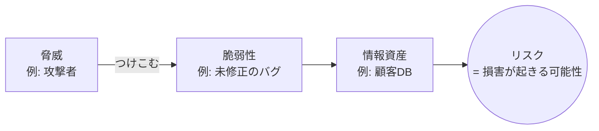

- 説明：リスクの大きさは、一般に「資産価値 × 脅威 × 脆弱性」または「発生確率 × 影響度」で評価します。
- ⚠️ ひっかけ注意：脆弱性を修正する（パッチを当てる）のは「脆弱性への対策」で、脅威そのもの（攻撃者）をなくすわけではありません。

### 1.3 不正のトライアングル ★

内部不正は、**動機**・**機会**・**正当化** の3つがそろうと起きやすくなる、という考え方です（クレッシーの理論）。

| 要素 | 例 | 対策例 |
|---|---|---|
| 動機・プレッシャー | 借金、過大なノルマ | 相談窓口、業務量の調整 |
| 機会 | 一人で権限を持っている、ログがない | 職務分掌、アクセスログ取得、最小権限 |
| 正当化 | 「会社が悪いから仕方ない」 | 教育、ルールの周知 |

IPAの「組織における内部不正防止ガイドライン」は、この考え方をもとに「犯行を難しくする」「捕まるリスクを高める」などの基本原則を示しています。

### 1.4 セキュリティ設計の原則 ★★

| 用語 | 意味 | 例 |
|---|---|---|
| **多層防御** | 1つの対策が破られても次の対策で止められるよう、性質の異なる対策を何重にも重ねる | 入口（メールフィルタ）・内部（EDR、権限分離）・出口（プロキシでC&C通信遮断）の組合せ |
| **セキュリティバイデザイン**（セキュアバイデザイン） | 企画・設計の段階からセキュリティを組み込む。後から付け足すより安く、効果も高い | 要件定義でセキュリティ要件を決める、脅威モデリングをする |
| **プライバシーバイデザイン** | 企画・設計の段階からプライバシー保護を組み込む（個人データの最小化、初期設定でプライバシー保護を有効にするなど） | 収集項目を必要最小限にする、仮名化を前提に設計する |

- 💡 「バイデザイン ＝ 最初から設計に入れておく」。「シフトレフト」（工程の早い段階でセキュリティを確保する）とも近い考え方です。

### 1.5 脆弱性の種類と不正を防ぐ環境づくり ★

**脆弱性** は技術的なものだけではありません。

| 種類 | 例 |
|---|---|
| 技術的な脆弱性 | **バグ**（プログラムの誤り）、**セキュリティホール**（セキュリティ上の欠陥となるバグや設定の不備） |
| **人的脆弱性** | 教育不足、うっかりミス、ソーシャルエンジニアリングにだまされやすい |
| 組織的な脆弱性 | **内部統制の不備**（職務分掌や承認手続がない、行動規範が整っていない）、ルールの周知不足 |
| **シャドーIT** | 情報システム部門が把握・許可していない機器やクラウドサービスを、従業員が業務に使うこと。管理の目が届かず、情報漏えいの原因になる |

不正を起こしにくい環境をつくる考え方として、次の3つがあります（犯罪学の理論を情報セキュリティに応用したもの）。

| 理論 | 内容 | 情報セキュリティでの応用例 |
|---|---|---|
| **状況的犯罪予防** | 犯罪の機会を減らすことで犯罪を防ぐ。5つの観点：①犯行を難しくする ②捕まるリスクを高める ③犯行の見返りを減らす ④犯行の誘因（挑発）を減らす ⑤犯罪の弁明をさせない | IPA「組織における内部不正防止ガイドライン」の5つの基本原則のもとになっている |
| **割れ窓理論** | 割れた窓のような小さな乱れを放置すると、より大きな犯罪を招く | 小さなルール違反（パスワードの貼り紙、クリアデスク違反）も見逃さず是正する |
| **防犯環境設計**（CPTED） | 建物や環境の設計で犯罪を防ぐ（見通しを良くする、接近を制御する、領域性を明確にする） | サーバ室の配置、監視カメラ、入退室管理 |

### 1.6 攻撃者の種類と攻撃の動機 ★

| 攻撃者・動機 | 内容 |
|---|---|
| **スクリプトキディ** | 他人が作った攻撃ツールを、十分な知識なしに使う攻撃者 |
| **ボットハーダー** | ボットネットを構築・運用し、DDoS攻撃や迷惑メール送信などに利用（貸し出し）する攻撃者 |
| **内部犯** | 組織の従業員・元従業員・委託先などによる不正。正規の権限を持つので発見しにくい |
| **愉快犯** | 自己顕示や面白半分で攻撃する |
| **詐欺犯** | 人をだまして金銭を得る（フィッシング、ビジネスメール詐欺など） |
| **故意犯** | 悪意をもって意図的に行う（過失・誤操作と対比される） |
| **金銭奪取** | 現在の攻撃の最大の動機。ランサムウェア、不正送金、盗んだ情報の売買 |
| **二重脅迫**（ダブルエクストーション） | 暗号化して身代金を要求するだけでなく、盗んだデータを **リークサイト**（暴露サイト）で公開すると脅す |
| **ハクティビズム** | 政治的・社会的な主張のために行う攻撃（ハッカー＋アクティビズム）。Webサイト改ざんやDDoS攻撃が多い |
| **サイバーテロリズム** | 社会インフラなどを攻撃し、社会に混乱や恐怖を与える |
| **ダークウェブ** | 通常の検索エンジンや方法ではアクセスできない匿名性の高いWeb空間。盗んだ情報や攻撃ツールの売買に使われる |

攻撃者の視点で考える手法：
- **脅威モデリング**：システムの構成やデータの流れを図にし、どこにどのような脅威があるかを設計段階で洗い出す手法です。代表的な分類に **STRIDE**（なりすまし Spoofing、改ざん Tampering、否認 Repudiation、情報漏えい Information disclosure、サービス拒否 Denial of service、権限昇格 Elevation of privilege）があります。
- **サイバーキルチェーン**：攻撃の流れを「偵察 → 武器化 → 配送 → 攻撃 → インストール → 遠隔操作 → 目的の実行」の7段階でとらえ、段階ごとに対策を考える枠組みです（[2.7](#27-標的型攻撃とapt-) の図）。

---

## 2. マルウェアと攻撃手法

### 2.1 マルウェアの種類 ★★

**マルウェア**（malicious software：悪意のあるソフトウェア）の総称と種類を押さえます。

| 名称 | 特徴 |
|---|---|
| **ウイルス** | 他のプログラムに寄生して増殖する |
| **ワーム** | 単独で動作し、ネットワーク経由で自己増殖する |
| **トロイの木馬** | 有用なソフトに見せかけて侵入し、裏で不正な動作をする（自己増殖はしない） |
| **ランサムウェア** | ファイルを暗号化するなどして使えなくし、復旧と引き換えに身代金を要求する |
| **スパイウェア** | 利用者の情報をひそかに収集して外部に送る |
| **キーロガー** | キーボード入力を記録して盗む |
| **ボット** | 感染端末を外部の **C&Cサーバ**（Command and Control：指令サーバ）から遠隔操作できるようにする。多数のボットの集まりが **ボットネット** |
| **ルートキット** | 侵入の痕跡を隠すツール群 |
| **バックドア** | 正規の認証を経ずに再侵入するための裏口 |
| **ファイルレスマルウェア** | 実行ファイルをディスクに置かず、PowerShellなど正規ツールやメモリ上で動作する。従来型のウイルス対策ソフトで検知しにくい |
| **Emotet（エモテット）** | 実在のメールの返信を装うなどして感染を広げる。ほかのマルウェアを呼び込む |

### 2.2 ランサムウェア ★★★

IPAの「情報セキュリティ10大脅威 2026」（組織編）でも **1位は「ランサム攻撃による被害」** です（11年連続の選出）。

- 最近の手口：**二重脅迫**（暗号化 + 盗んだデータの公開予告）、VPN装置の脆弱性やリモートデスクトップから侵入して社内に広がる「人手による攻撃」、暗号化せずにデータを盗んで脅す「ノーウェアランサム」。
- 対策：
  - **オフライン（またはネットワークから切り離した）バックアップ** を取り、復元手順を訓練しておく
  - VPN装置などの脆弱性に早くパッチを当てる、多要素認証を使う
  - 感染端末をネットワークから切り離す（**封じ込め**）
- ⚠️ ひっかけ注意：ネットワーク上の常時接続のバックアップは、一緒に暗号化される可能性があります。「バックアップを取っているから安全」とは限りません。

### 2.3 Webアプリケーションへの攻撃 ★★★

科目B問1で最もよく題材になる分野です。**攻撃の仕組み → 根本的対策** をセットで覚えます。

| 攻撃 | 仕組み | 主な対策 |
|---|---|---|
| **SQLインジェクション** | 入力欄に SQL 文の一部を入れ、意図しない SQL を実行させてデータを盗む・改ざんする | **プレースホルダ**（バインド機構、プリペアドステートメント）を使う。エスケープ処理。DBアカウントの権限を最小にする |
| **クロスサイトスクリプティング（XSS）** | 脆弱なサイトに悪意のあるスクリプトを埋め込み、閲覧者のブラウザで実行させる。Cookie の盗用などに使われる | 出力時の **エスケープ**（`<` を `&lt;` に置き換える等）、Cookie に **HttpOnly 属性**、**CSP**（Content Security Policy：読込み可能なスクリプトの制限） |
| **クロスサイトリクエストフォージェリ（CSRF）** | ログイン中の利用者に罠ページを踏ませ、本人の意図しないリクエスト（送金・投稿など）を正規サイトへ送らせる | 推測できない **トークン**（ワンタイムトークン）をフォームに埋め込んで照合、重要操作の前に **再認証**、Cookie の **SameSite 属性** |
| **OSコマンドインジェクション** | 入力値にOSコマンドを混ぜ、サーバ上で実行させる | シェルを呼び出す関数を使わない、入力値チェック |
| **ディレクトリトラバーサル** | `../` などでファイルパスをたどり、公開していないファイルを読む | ファイル名を直接受け取らない、パス正規化とチェック |
| **セッションハイジャック** | セッションIDを盗んだり推測したりして、正規利用者になりすます | 推測困難なセッションIDを使う、TLSで通信、Cookieに **Secure 属性** |
| **セッション固定化攻撃** | 攻撃者が用意したセッションIDを利用者に使わせ、ログイン後にそのIDでなりすます | **ログイン成功時にセッションIDを再発行する** |
| **クリックジャッキング** | 透明にした正規ページを罠ページに重ね、意図しないクリックをさせる | レスポンスヘッダ `X-Frame-Options` や CSP の `frame-ancestors` でフレーム内表示を禁止 |
| **SSRF**（Server Side Request Forgery） | サーバに細工したURLを読み込ませ、外部から直接届かない内部サーバへアクセスさせる | アクセス先のURLを許可リストで制限 |

#### XSS と CSRF の違い（頻出）

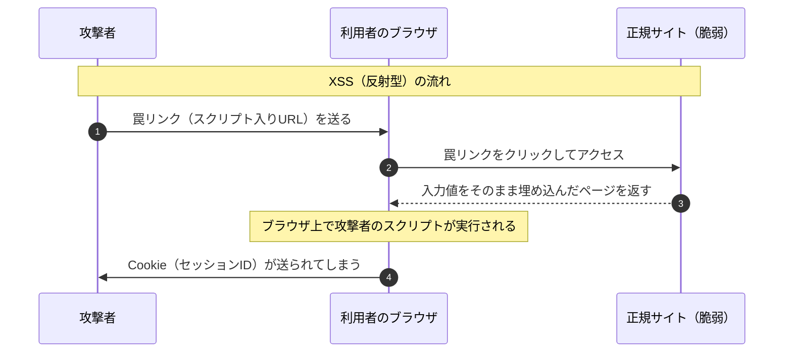

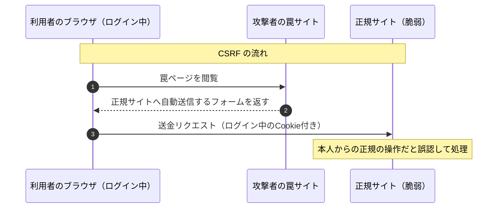

| 観点 | XSS | CSRF |
|---|---|---|
| スクリプトが動く場所 | 利用者のブラウザ（正規サイトのページとして） | 基本的にスクリプトは不要。正規サイトへのリクエストを送らせる |
| 攻撃者が得るもの | Cookie の盗用、画面の改ざん、何でも | 「本人として操作させる」こと。応答内容は攻撃者に見えない |
| 根本的対策 | 出力時のエスケープ | トークンの照合、再認証 |

- 💡 覚え方：XSS は「**スクリプトを埋め込む**」、CSRF は「**リクエストを偽造させる**（Forgery＝偽造）」。
- ⚠️ ひっかけ注意：SQLインジェクションの根本的対策は「入力値チェック」ではなく **プレースホルダ** です。入力値チェックは補助的な対策という扱いになります。

### 2.4 パスワードへの攻撃 ★★★

| 攻撃 | 仕組み | 対策 |
|---|---|---|
| **総当たり攻撃**（ブルートフォース） | 1つのIDに対して、すべての文字の組合せを試す | 長く複雑なパスワード、**アカウントロック** |
| **辞書攻撃** | 辞書の単語や、よく使われるパスワードを試す | 推測されにくいパスワード |
| **パスワードリスト攻撃** | 他のサイトから漏えいした ID とパスワードの組を使ってログインを試す | **パスワードの使い回しをしない**、多要素認証 |
| **リバースブルートフォース攻撃** | パスワードを固定（例：`123456`）して、ID を次々変えて試す | アカウントロックでは防ぎにくい。IPアドレスごとの試行回数制限、多要素認証 |
| **パスワードスプレー攻撃** | よく使われる少数のパスワードを、多数のアカウントに少しずつ試す（ロックがかからない程度に） | 多要素認証、ログの監視 |
| **レインボーテーブル攻撃** | ハッシュ値から元のパスワードを逆引きする表を事前に用意しておく | **ソルト**（ユーザごとのランダム値）を加えてハッシュ化、**ストレッチング**（ハッシュ計算を何度も繰り返す） |

- ⚠️ ひっかけ注意：**パスワードリスト攻撃** は「流出した組合せの使い回し」をねらいます。対策として「アカウントロック」より **使い回し禁止** と **多要素認証** が正解になることが多いです。

### 2.5 DoS / DDoS 攻撃 ★★

- **DoS攻撃**（Denial of Service：サービス妨害）：大量の要求を送り、サーバやネットワークを使えなくする攻撃です。**可用性** を侵害します。
- **DDoS攻撃**（Distributed DoS）：ボットネットなど多数の機器から一斉に行うDoS攻撃です。

| 攻撃 | 仕組み |
|---|---|
| **SYNフラッド攻撃** | TCP の接続要求（SYN）だけを大量に送り、接続待ちの状態でサーバの資源を枯渇させる。対策：SYN Cookie |
| **DNSリフレクション（DNSアンプ）攻撃** | 送信元IPアドレスを攻撃対象に偽装し、**オープンリゾルバ**（誰からの問合せにも答えるDNSサーバ）に問合せを送る。小さな問合せが大きな応答になって攻撃対象に集中する（**増幅攻撃**） |
| **EDoS攻撃**（Economic DoS） | クラウドの従量課金を悪用し、経済的な損失を与える |

- 対策：ISP やクラウド事業者の DDoS 対策サービス、**CDN**（Content Delivery Network）による負荷分散、DNSサーバのオープンリゾルバ化の防止（問合せを内部からのみ受け付ける）。

### 2.6 なりすまし・通信への攻撃 ★★★

#### 中間者攻撃（MITM）

**中間者攻撃**（Man-in-the-Middle attack）は、通信する2者の間に攻撃者が入り込み、両方になりすまして通信を盗聴・改ざんする攻撃です。

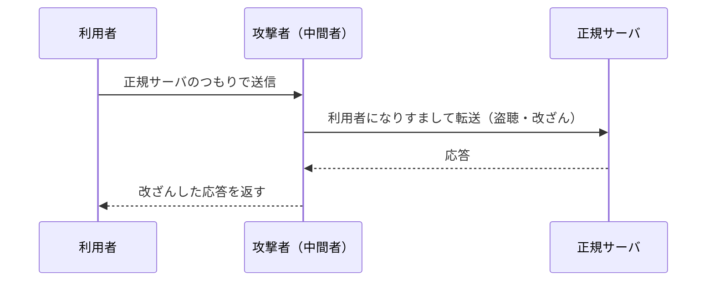

- 対策：**TLS で通信し、サーバ証明書を正しく検証する**（証明書の警告を無視しない）。相互認証、デジタル署名。
- **MITB攻撃**（Man-in-the-Browser）：PCに感染したマルウェアがブラウザを乗っ取り、利用者が正規サイトで入力した送金先などを書き換えます。通信経路は正規の TLS なので、TLS では防げません。対策の例は、**取引内容を別経路（スマートフォンなど）で確認する取引認証** です。

#### DNSキャッシュポイズニング

**DNSキャッシュポイズニング** は、DNSキャッシュサーバ（フルリゾルバ）に偽の応答を覚え込ませ、利用者を偽サイトへ誘導する攻撃です。

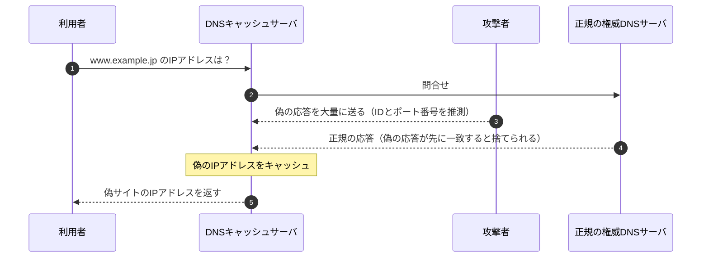

- 対策：
  - 問合せの **送信元ポート番号のランダム化**（推測を困難にする）
  - **DNSSEC**（DNS Security Extensions）：DNS応答にデジタル署名を付け、改ざんを検出する
  - キャッシュサーバは内部ネットワークからの問合せだけを受け付ける（オープンリゾルバにしない）
- 💡 一度に大量の偽応答を送り込むため、存在しないサブドメインを問い合わせ続ける手口は **カミンスキー攻撃** と呼ばれます。

#### その他のなりすまし

| 攻撃 | 内容 |
|---|---|
| **IPスプーフィング** | 送信元IPアドレスを偽装する |
| **ARPスプーフィング** | 偽の ARP 応答で、IPアドレスとMACアドレスの対応を書き換えて通信を横取りする |
| **フィッシング** | 正規の組織を装ったメールやSMSで偽サイトに誘導し、IDやパスワードを入力させる。SMSを使うものを **スミッシング** という |
| **ビジネスメール詐欺（BEC）** | 取引先や経営者になりすまし、偽の口座に送金させる |

### 2.7 標的型攻撃とAPT ★★★

- **標的型攻撃**：特定の組織をねらって、業務に関係のありそうな件名・本文のメール（**標的型攻撃メール**）を送り、添付ファイルを開かせてマルウェアに感染させる攻撃です。
- **APT**（Advanced Persistent Threat：高度で持続的な脅威）：長期間ひそかに潜伏し、侵入範囲を広げながら情報を盗み続けます。
- **水飲み場型攻撃**：標的がよく見るWebサイトを改ざんしておき、閲覧した標的だけを感染させます。
- **サプライチェーン攻撃**：セキュリティが手薄な取引先・委託先や、ソフトウェアの配布経路を経由して本命を攻撃します（10大脅威2026 組織編2位）。

標的型攻撃の典型的な流れ（サイバーキルチェーンの考え方）を押さえておくと、科目Bで「どの段階の対策か」を問われたときに役立ちます。

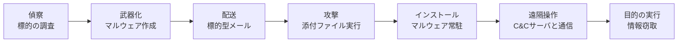

- 入口対策：メールフィルタ、サンドボックス、利用者教育（不審メール訓練）。
- 内部対策：権限の最小化、ネットワークの分離、**EDR**（Endpoint Detection and Response：端末上の不審な挙動の検知と対応）。
- 出口対策：C&Cサーバへの通信をプロキシやファイアウォールで遮断・検知する。

### 2.8 その他の攻撃・用語 ★★

| 用語 | 内容 |
|---|---|
| **ゼロデイ攻撃** | 脆弱性が公表される前、または修正プログラムが提供される前にその脆弱性をつく攻撃 |
| **ドライブバイダウンロード** | Webサイトを閲覧しただけで、利用者の気付かないうちにマルウェアをダウンロードさせる |
| **サイドチャネル攻撃** | 消費電力、処理時間、電磁波などの物理的な情報から暗号鍵などを推測する |
| **バッファオーバーフロー攻撃** | 確保した領域を超えるデータを送り込み、プログラムの戻り先を書き換えて不正なコードを実行させる |
| **ポートスキャン** | 開いているポートを調べ、稼働しているサービスを探る（攻撃の下調べ） |
| **プロンプトインジェクション** | 生成AIへの入力に細工をし、開発者の意図しない出力や動作をさせる |

### 2.9 マルウェアの追加知識 ★★

| 用語 | 内容 |
|---|---|
| **マクロウイルス** | Word や Excel などの文書ファイルの **マクロ機能** を悪用するウイルス。文書を開いてマクロを有効にすると感染する。対策：マクロを既定で無効にする |
| **RAT**（Remote Access Trojan：遠隔操作型ウイルス） | 感染した端末を攻撃者が遠隔から自由に操作できるようにするトロイの木馬。標的型攻撃でよく使われ、C&Cサーバと通信する |
| **ステルス技術** | マルウェアが検知を逃れるための技術の総称 |
| **ポリモーフィック型** | 感染のたびに **暗号化の鍵や復号ルーチンを変え**、見た目（バイト列）を変化させる。パターンマッチング（シグネチャ）で検知しにくい |
| **メタモーフィック型** | 感染のたびに **コードそのものを書き換える**（命令の並べ替え、無意味な命令の挿入など）。ポリモーフィック型より検知がさらに難しい |
| **エクスプロイトコード** | 脆弱性を悪用（exploit）するためのプログラム。脆弱性の検証にも使われるが、攻撃に転用される |
| **エクスプロイトキット** | 複数のエクスプロイトコードをまとめ、閲覧者の環境に合わせて自動で攻撃するツールキット。ドライブバイダウンロード攻撃に使われる |

- ⚠️ ひっかけ注意：ポリモーフィック型・メタモーフィック型には **パターンマッチング法が効きにくい** ため、**ビヘイビア法（振る舞い検知）** やサンドボックスが有効です（[9.12](#912-技術的セキュリティ対策-)）。

### 2.10 その他の攻撃手法（追補） ★★

**Web・通信に関する攻撃**

| 攻撃 | 内容 | 対策 |
|---|---|---|
| **オープンリダイレクトの悪用** | 任意のURLへ転送（リダイレクト）してしまう正規サイトの機能を悪用し、正規サイトのURLに見せかけてフィッシングサイトへ誘導する | 転送先を許可リストで制限する |
| **第三者中継**（オープンリレー） | 第三者どうしのメールを中継してしまうメールサーバを悪用し、迷惑メールを送信する | 中継を自組織の利用者・ドメインに限定（[8.3](#83-メール送信時の対策-)） |
| **リプレイ攻撃** | 盗聴した認証情報やデータをそのまま再送して、正規の通信になりすます | ワンタイムパスワード、チャレンジレスポンス、タイムスタンプ・連番 |
| **リフレクション攻撃** | 送信元を攻撃対象に偽装して第三者のサーバに要求を送り、その応答を攻撃対象に集中させる（DNS、NTP など） | オープンリゾルバの停止、送信元偽装パケットの遮断 |
| **クリプトジャッキング** | 他人のコンピュータの CPU などの資源を無断で使い、暗号資産の **マイニング（採掘）** をさせる。Webページに埋め込んだスクリプトで行う手口もある | 不審なCPU使用率の監視、マルウェア対策 |
| **SEOポイズニング** | 検索エンジン最適化（SEO）の手法を悪用し、悪意のあるサイトを検索結果の上位に表示させて誘導する | 検索結果のURLを確認する、URLフィルタリング |

**標的型攻撃の種類**

| 攻撃 | 内容 |
|---|---|
| **ばらまき型** | 不特定多数に同じ標的型メールを送る |
| **やり取り型攻撃** | 問合せなどを装って **何度か普通のメールをやり取りし、信用させてから** マルウェア付きのメールを送る |
| **水飲み場型攻撃** | 標的がよく見るWebサイトを改ざんして待ち伏せする（[2.7](#27-標的型攻撃とapt-)） |

**サイドチャネル攻撃の種類**（物理的な情報から秘密を推測する）

| 攻撃 | 利用する情報 |
|---|---|
| **テンペスト攻撃** | 機器から漏れる **電磁波** を受信して、画面表示や通信内容を盗む |
| **プローブ攻撃** | ICチップの内部配線に **探針（プローブ）** を当てて信号を直接読み取る |
| **タイミング攻撃** | 暗号処理にかかる **処理時間** の違いから鍵を推測する |
| **電力解析攻撃** | 暗号処理中の **消費電力** の変化から鍵を推測する（SPA、DPA） |

- 対策：ICチップの **耐タンパ性**（内部を解析されにくい性質）を高める、処理時間や消費電力が鍵によって変わらない実装にする、電磁シールド。

**その他**

| 攻撃 | 内容 |
|---|---|
| **バージョンロールバック攻撃**（ダウングレード攻撃） | 通信相手やソフトウェアに、脆弱性のある **古いバージョン** のプロトコルや暗号方式を使わせて攻撃する。対策：古いバージョンを無効化する |
| **サービス・ソフトウェアの機能の悪用** | 正規の機能を攻撃に使う。例：**オープンリゾルバの悪用**（DNSリフレクション攻撃の踏み台） |
| **フットプリンティング** | 攻撃の準備として、公開情報（Webサイト、DNS、SNS）やスキャンで標的の情報を集めること。**ポートスキャン** もその一部 |
| **RaaS**（Ransomware as a Service） | ランサムウェアや攻撃基盤を、開発者が他の攻撃者に提供し、身代金を分け合うビジネスモデル。技術力の低い攻撃者でも攻撃できるようになった |
| **ラテラルムーブメント**（横展開） | 侵入した端末を足がかりに、認証情報を盗むなどして組織内の他の端末やサーバへ侵害を広げること |
| **踏み台** | 乗っ取った第三者のコンピュータを中継に使い、攻撃元を隠すこと |

### 2.11 AIに関する脅威とAIを悪用した攻撃 ★★

**AIを悪用した攻撃**

| 用語 | 内容 |
|---|---|
| 攻撃の巧妙化 | 生成AIで自然な文面の **標的型攻撃メールやフィッシングメール** を大量に作る、なりすましを巧妙にする |
| マルウェアの生成 | 既存マルウェアの **バリアント（亜種）** をAIで生成し、検知を逃れる |
| 脆弱性発見の効率化 | AIでシステムの脆弱性を効率よく探す |
| **ディープフェイク** | AIで作った本物そっくりの偽の映像・音声。経営者の声や顔をまねて送金を指示する詐欺などに使われる |

**AIそのものに対する脅威**

| 用語 | 内容 |
|---|---|
| **敵対的サンプル**（Adversarial Examples） | 人には分からない小さなノイズを入力データに加え、AIに誤った判断をさせる（例：標識の画像を誤認識させる） |
| **プロンプトインジェクション** | 生成AIへの指示（プロンプト）に細工をし、開発者が設定した制約を無視させたり、機密情報を出力させたりする。Webページなどに埋め込んだ指示を読み込ませる **間接プロンプトインジェクション** もある |
| **データポイズニング** | 学習データに不正なデータを混ぜ、AIモデルの判断をゆがめる |
| 情報漏えい | 利用者が機密情報を生成AIに入力し、外部に漏れる |

---

## 3. 暗号技術

### 3.1 暗号の基本用語 ★

- **平文** を **鍵** で暗号化すると **暗号文** になり、暗号文を平文に戻すことを **復号** といいます。
- **危殆化**（きたいか）：計算機の性能向上や解読法の発見で暗号の安全性が下がること。日本では **CRYPTREC** が安全性を確認した暗号の一覧（電子政府推奨暗号リスト）を公開しています。

### 3.2 共通鍵暗号方式と公開鍵暗号方式 ★★★

| 項目 | 共通鍵暗号方式 | 公開鍵暗号方式 |
|---|---|---|
| 鍵 | 暗号化と復号に **同じ鍵** を使う | **公開鍵** と **秘密鍵** のペアを使う |
| 処理速度 | 速い | 遅い |
| 鍵の配送 | 安全な受け渡し方法が必要（**鍵配送問題**） | 公開鍵は公開してよいので配送が楽 |
| n 人が相互に通信するときの鍵の数 | `n(n−1)/2` 個 | `2n` 個（各人1ペア） |
| 代表例 | **AES**、ChaCha20、（旧）DES、3DES | **RSA**、**楕円曲線暗号（ECC）**、ElGamal |

- **AES**（Advanced Encryption Standard）：ブロック長128ビット、鍵長128/192/256ビットから選べる共通鍵暗号です。
- **RSA**：大きな数の **素因数分解** が難しいことを安全性の根拠にしています。
- **楕円曲線暗号**：楕円曲線上の離散対数問題の難しさを根拠にし、RSAより **短い鍵長で同程度の安全性** が得られます。

#### 計算例：鍵の数

- 公式：共通鍵 `n(n−1)/2`、公開鍵 `2n`
- 数値例：100人が互いに暗号通信をする場合
- 途中式：
  - 共通鍵：`100 × (100 − 1) / 2 = 100 × 99 / 2 = 4,950 個`
  - 公開鍵：`2 × 100 = 200 個`（公開鍵100個 + 秘密鍵100個）

#### 公開鍵暗号で「秘密に送る」ときの鍵の使い方

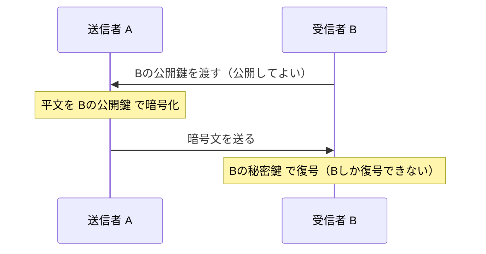

- 💡 覚え方：**「機密性は受信者の鍵、署名は送信者の鍵」**。秘密に送りたいなら受信者の公開鍵で暗号化、本人証明をしたいなら送信者の秘密鍵で署名します。

### 3.3 ハイブリッド暗号方式 ★★★

共通鍵暗号の「速さ」と公開鍵暗号の「鍵配送の楽さ」の両方のよいところを取る方式です。TLS や S/MIME で使われています。

1. 送信者が使い捨ての **共通鍵（セッション鍵）** を生成する。
2. データ本体はその共通鍵で暗号化する（速い）。
3. 共通鍵そのものは **受信者の公開鍵** で暗号化して送る（鍵を安全に配送できる）。
4. 受信者は自分の秘密鍵で共通鍵を取り出し、データを復号する。

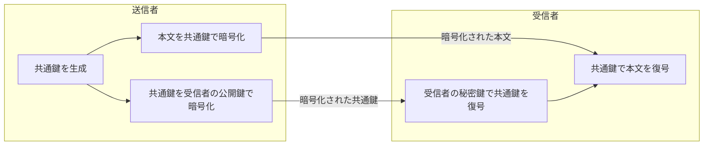

- 補足：現在の TLS 1.3 では、共通鍵を「公開鍵で暗号化して送る」のではなく、**ECDHE**（楕円曲線ディフィー・ヘルマン鍵共有）で双方が同じ共通鍵を計算して共有します。毎回使い捨ての鍵を使うので、サーバの秘密鍵が後で漏えいしても過去の通信は解読されません。この性質を **前方秘匿性**（PFS：Perfect Forward Secrecy）といいます。

### 3.4 ハッシュ関数 ★★★

**ハッシュ関数** は、任意の長さのデータから固定長の値（**ハッシュ値**、メッセージダイジェスト）を作る関数です。

- 性質：
  - **一方向性**：ハッシュ値から元のデータを求めることは事実上できない
  - **衝突困難性**：同じハッシュ値になる異なる2つのデータを見つけることは事実上できない
  - データが1ビットでも変わると、ハッシュ値は大きく変わる
- 用途：**改ざん検出**（完全性の確認）、デジタル署名、パスワードの保存。
- 代表例：**SHA-256**（ハッシュ値256ビット）、SHA-3。MD5 と SHA-1 は衝突が見つかっているため、新たな用途には使いません。

| 方式 | 何ができるか | 鍵 |
|---|---|---|
| ハッシュ値だけ | 偶発的な改ざんの検出（ただし攻撃者がハッシュ値ごと差し替えると検出できない） | なし |
| **MAC**（Message Authentication Code：メッセージ認証符号）。代表例 **HMAC** | 改ざん検出 + 送信者が共通鍵を持つ相手であることの確認 | 共通鍵 |
| **デジタル署名** | 改ざん検出 + 送信者の確認 + **否認防止** | 公開鍵ペア |

- ⚠️ ひっかけ注意：MAC は共通鍵を使うので、送信者と受信者のどちらが作ったか区別できません。そのため **否認防止はできません**。否認防止ができるのはデジタル署名です。
- ⚠️ ハッシュ関数は「暗号化」ではありません。ハッシュ値から元に戻す（復号する）ことはできません。

### 3.5 鍵共有と暗号の種類 ★★

#### Diffie-Hellman（DH）鍵共有方式

**鍵共有** は、通信する2者が、盗聴されている通信路でも **共通鍵そのものを送らずに同じ鍵を計算して共有する** 方法です。代表が **Diffie-Hellman（DH）鍵共有方式** で、**離散対数問題** の難しさを安全性の根拠にしています。

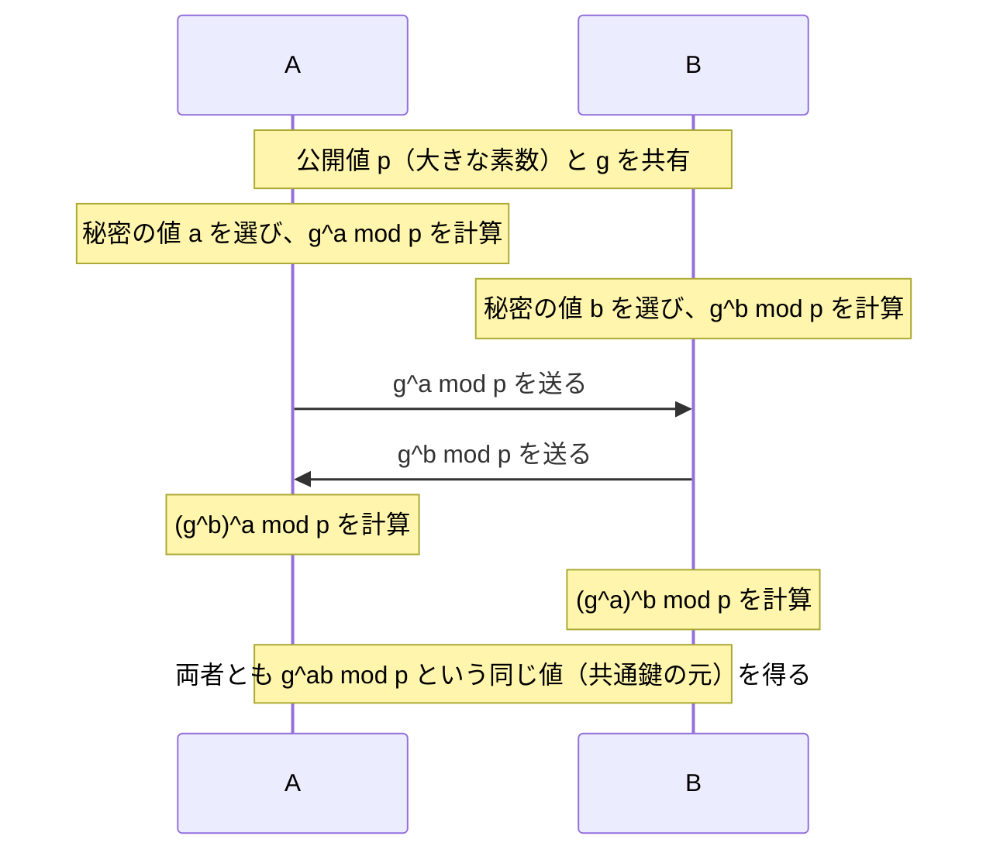

- 盗聴者は `g^a mod p` と `g^b mod p` を見ても、a や b を求めること（離散対数問題）が難しいため、共通鍵が分かりません。
- 楕円曲線上で行うものが **ECDH**、毎回使い捨ての値を使うものが **DHE / ECDHE**（前方秘匿性がある。[3.3](#33-ハイブリッド暗号方式-)）です。
- ⚠️ DH 単体では **相手の認証はできない** ため、中間者攻撃を防ぐには証明書や署名による認証と組み合わせます。

計算例（小さな数で仕組みを確認）
- 公式：共有する値 `K = (g^b)^a mod p = (g^a)^b mod p`
- 数値例：p = 23、g = 5、A の秘密 a = 6、B の秘密 b = 15
- 途中式：
  - A が送る値：`5^6 mod 23 = 15625 mod 23 = 8`
  - B が送る値：`5^15 mod 23 = 19`
  - A の計算：`19^6 mod 23 = 2`、B の計算：`8^15 mod 23 = 2`
- 答え：両者とも **K = 2** を得ます。

#### ブロック暗号とストリーム暗号

| 種類 | 仕組み | 代表例 |
|---|---|---|
| **ブロック暗号** | 平文を一定の長さ（ブロック）ごとに区切って暗号化する | **AES**（ブロック長128ビット）、Camellia、（旧）DES |
| **ストリーム暗号** | 鍵から生成した疑似乱数列（鍵ストリーム）と平文を、1ビットまたは1バイトずつ **XOR** する | **ChaCha20**、KCipher-2、（旧）RC4 |

#### 暗号利用モード

ブロック暗号で、ブロックより長いデータをどう暗号化するかの方式を **暗号利用モード** といいます。

| モード | 仕組み | 特徴 |
|---|---|---|
| **ECB** | 各ブロックを独立に暗号化 | 同じ平文ブロックは同じ暗号文になり、パターンが漏れる。**使うべきでない** |
| **CBC** | 平文ブロックを **1つ前の暗号文ブロック** と XOR してから暗号化（最初は **初期化ベクトル IV** と XOR） | 同じ平文でも暗号文が変わる。暗号化は並列処理できない |
| **CTR** | **カウンタ値** を暗号化した結果と平文を XOR する | ストリーム暗号のように使える。暗号化・復号とも **並列処理** できる |
| **GCM** | CTR モードに改ざん検出（認証）を加えた **認証付き暗号（AEAD）** | TLS 1.2 / 1.3 で広く使われる（AES-GCM） |

### 3.6 その他の暗号関連技術 ★

**ハッシュ関数に求められる性質**（[3.4](#34-ハッシュ関数-) の補足）

| 性質 | 意味 |
|---|---|
| **一方向性**（原像計算困難性） | ハッシュ値から元のデータを求めることが困難 |
| **第二原像発見困難性** | あるデータ M1 が与えられたとき、**M1 と同じハッシュ値になる別のデータ M2** を見つけることが困難 |
| **衝突発見困難性** | 同じハッシュ値になる **任意の2つの異なるデータ** の組を見つけることが困難 |

- 💡 第二原像は「相手（M1）が決まっている」、衝突は「2つとも自由に選べる」。自由度が高い衝突の方が見つけやすいので、衝突発見困難性の方が強い要求です。
- **SHA-2**（SHA-256 など）と **SHA-3** は構造が異なり、SHA-3 は SHA-2 が破られた場合の備えとして標準化されました。

| 用語 | 内容 |
|---|---|
| **CRYPTREC 暗号リスト** | CRYPTREC が作成する、安全性と実装性能を評価した暗号の一覧。**電子政府推奨暗号リスト**、推奨候補暗号リスト、運用監視暗号リスト（互換性維持のためだけに使用を認める）の3つからなる |
| **乱数生成** | 暗号鍵や IV は予測できない乱数で作る必要がある。暗号論的に安全な疑似乱数生成器を使う |
| **鍵管理** | 鍵の生成・配布・保管・更新・廃棄までを安全に管理すること。秘密鍵の漏えいは暗号全体の破綻につながる。HSM（ハードウェアセキュリティモジュール）などで保護する |
| **ストレージ暗号化** | ディスク全体を暗号化する（例：BitLocker）。PCや記憶媒体の紛失・盗難時の情報漏えいを防ぐ |
| **ファイル暗号化** | ファイル単位で暗号化する。メール添付やファイル共有で、ファイルが外部に出ても内容を守れる |
| **秘密計算** | データを **暗号化したまま（秘匿したまま）計算** する技術。複数の組織がデータを互いに見せずに集計・分析できる（秘密分散、準同型暗号など） |
| **ゼロ知識証明** | 秘密の情報そのものを相手に教えずに、「その秘密を知っている」ことだけを証明する方法 |
| **ブロックチェーン** | 取引記録（ブロック）を、**直前のブロックのハッシュ値** を含めて鎖のようにつなぎ、多数の参加者で同じ台帳を共有する分散型台帳技術。過去の記録を改ざんすると以降すべてのハッシュ値が合わなくなるので **改ざんが困難**。合意形成の方式に PoW（プルーフオブワーク）などがある |
| **耐量子計算機暗号**（PQC） | 量子コンピュータでも解読が難しいと考えられる暗号。RSA や楕円曲線暗号は量子コンピュータで危殆化するおそれがある |

---

## 4. デジタル署名とPKI

### 4.1 デジタル署名の仕組み ★★★

**デジタル署名** は、「送信者が本人であること（真正性）」と「内容が改ざんされていないこと（完全性）」を確認でき、さらに **否認防止** を実現する仕組みです。

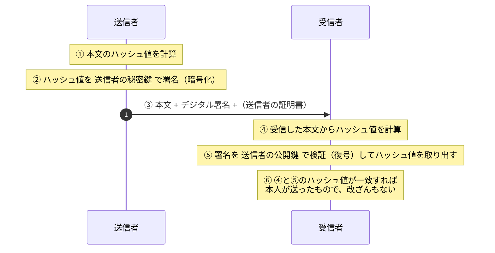

| 確認できること | 理由 |
|---|---|
| 送信者の真正性・否認防止 | 送信者の秘密鍵は送信者しか持っていない。送信者の公開鍵で検証できた = 送信者の秘密鍵で作られた |
| 完全性（改ざん検出） | 本文が変わるとハッシュ値が一致しなくなる |

- ⚠️ ひっかけ注意：デジタル署名だけでは **機密性は確保されません**（本文は平文のまま送られます）。秘密にしたいときは別途暗号化します。
- ⚠️ 「送信者の公開鍵が本当に送信者のものか」は、デジタル署名だけでは分かりません。そこで次の **PKI** が必要になります。

### 4.2 PKI とデジタル証明書 ★★★

**PKI**（Public Key Infrastructure：公開鍵基盤）は、「この公開鍵は確かにこの人（このサーバ）のものだ」と、信頼できる第三者が保証する仕組みです。

- **認証局（CA：Certification Authority）**：本人確認をしたうえで **デジタル証明書** を発行します。証明書には **CAのデジタル署名** が付いています。
- **デジタル証明書**（公開鍵証明書）：主に **X.509** 形式で、所有者の名前、**所有者の公開鍵**、有効期間、発行者（CA）名、シリアル番号、CAの署名などが記載されています。
- **登録局（RA：Registration Authority）**：本人確認と登録の受付を担当します。
- **ルート証明書**：最上位のCA（ルートCA）が自分自身で署名した証明書（自己署名証明書）です。OSやブラウザにあらかじめ組み込まれており、これが信頼の起点（**トラストアンカー**）になります。

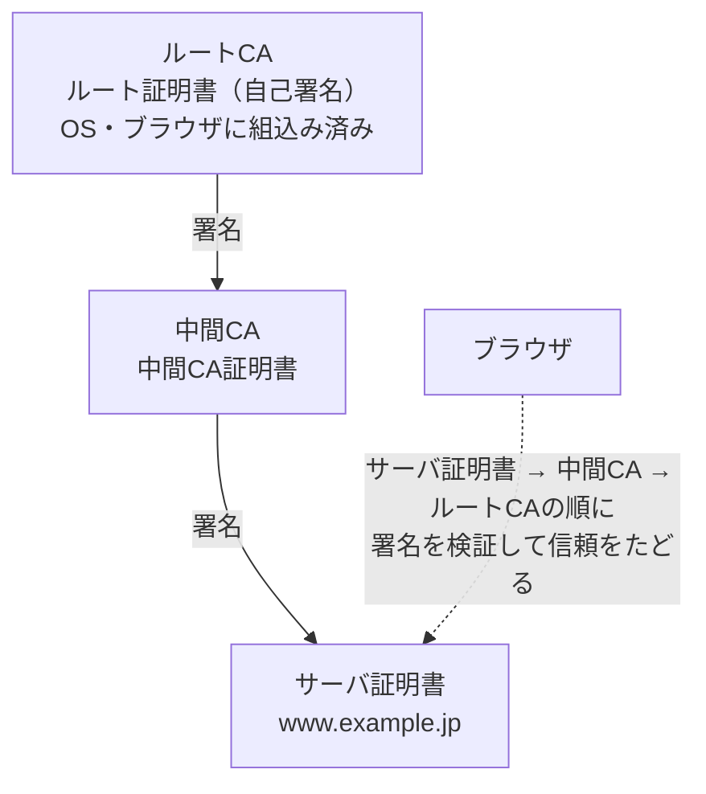

この連鎖を **証明書チェーン**（証明書パス）と呼びます。ブラウザは、サーバ証明書の署名を中間CAの公開鍵で、中間CA証明書の署名をルートCAの公開鍵で検証し、信頼できるルートまでたどれるかを確認します。

- 補足：サーバ証明書には、ドメインの管理権限だけを確認する **DV証明書**、組織の実在も確認する **OV証明書**、厳格な基準で確認する **EV証明書** があります。

### 4.3 証明書の失効確認（CRL / OCSP） ★★★

秘密鍵が漏えいした場合などは、有効期間内であっても証明書を **失効** させます。失効しているかどうかを確認する方法は2つあります。

| 方式 | 仕組み | 特徴 |
|---|---|---|
| **CRL**（Certificate Revocation List：証明書失効リスト） | CAが失効した証明書の **シリアル番号** と失効日時の一覧を定期的に発行し、利用者がダウンロードして確認する | リストが大きくなる。発行間隔の分だけ情報が古い可能性がある |
| **OCSP**（Online Certificate Status Protocol） | 利用者が **OCSPレスポンダ** に、ある証明書の状態をリアルタイムに問い合わせる | 最新の状態を確認できる。問合せのたびに通信が発生する |
| **OCSPステープリング** | サーバがOCSP応答をあらかじめ取得しておき、TLSハンドシェイクの中でクライアントに渡す | クライアントの問合せが不要になり、高速でプライバシー上も有利 |

- ⚠️ ひっかけ注意：CRL に載るのは「失効した証明書」の情報です。有効期限が切れた証明書を載せ続けるわけではありません。また、CRL には証明書そのものではなく **シリアル番号** が載ります。
- 補足：証明書の誤発行を監視する仕組みとして、発行した証明書を公開ログに記録する **CT**（Certificate Transparency）もあります。

### 4.4 タイムスタンプ ★

**タイムスタンプ**（時刻認証）は、時刻認証局（TSA：Time-Stamping Authority）が「その時刻にその文書が存在し、それ以降改ざんされていないこと」を証明する仕組みです。デジタル署名と組み合わせることで、証明書の有効期限が切れた後も署名の有効性を示しやすくなります（長期署名）。

### 4.5 PKIのその他の用語 ★

| 用語 | 内容 |
|---|---|
| **署名鍵 / 検証鍵** | デジタル署名で、署名の生成に使う鍵（送信者の **秘密鍵**）/ 署名の検証に使う鍵（送信者の **公開鍵**） |
| **メッセージ認証** | 受け取ったメッセージが改ざんされておらず、正しい相手から来たことを確認すること。MAC やデジタル署名で実現する |
| **XMLデジタル署名** | XML 文書の全体または **一部の要素** に署名を付ける方式（W3C 標準）。SAML のアサーションなどで使われる |
| **クライアント証明書** | 利用者や端末に発行する証明書。TLS のクライアント認証や VPN、無線LAN の EAP-TLS で、**利用者（端末）側の正当性** を確認する |
| **コードサイニング証明書** | ソフトウェアの開発元がプログラムに署名する（**コードサイニング**）ための証明書。利用者は署名を検証し、**配布元が正しく、改ざんされていない** ことを確認できる |
| **トラストアンカー** | 検証の信頼の起点となる証明書（通常はルート証明書）。これは無条件に信頼する |
| **GPKI**（Government Public Key Infrastructure：政府認証基盤） | 行政機関が電子申請などで使う公開鍵基盤 |
| **BCA**（Bridge Certification Authority：ブリッジ認証局） | 複数の独立した認証局（例：政府の認証局と民間・地方公共団体の認証局）を **相互認証** で橋渡しし、異なる PKI どうしで証明書を検証できるようにする認証局。GPKI で使われる |

- ⚠️ ひっかけ注意：コードサイニングで分かるのは「誰が作り、改ざんされていないか」であって、「プログラムが安全（マルウェアでない）」ことまでは保証しません。

---

## 5. 認証技術

### 5.1 認証の3要素と多要素認証 ★★★

**認証** とは、相手が本人であることを確かめることです。本人確認に使う要素は3種類あります。

| 要素 | 例 |
|---|---|
| **知識情報**（知っているもの） | パスワード、PIN、秘密の質問 |
| **所持情報**（持っているもの） | ICカード、スマートフォン、ハードウェアトークン |
| **生体情報**（本人の身体的特徴） | 指紋、顔、静脈、虹彩 |

- **多要素認証（MFA）**：異なる要素を2つ以上組み合わせる認証です。
- **二段階認証**：認証を2回に分けることです。同じ要素を2回（例：パスワード + 秘密の質問）でも二段階ですが、多要素ではありません。
- ⚠️ ひっかけ注意：「パスワード + 秘密の質問」は **どちらも知識情報** なので多要素認証ではありません。

#### 生体認証の誤り率

| 指標 | 意味 |
|---|---|
| **本人拒否率**（FRR：False Rejection Rate） | 本人なのに拒否してしまう割合 |
| **他人受入率**（FAR：False Acceptance Rate） | 他人なのに受け入れてしまう割合 |

この2つは **トレードオフ** の関係にあります。判定を厳しくするとFARは下がりますがFRRは上がります。

### 5.2 ワンタイムパスワードとチャレンジレスポンス認証 ★★

- **ワンタイムパスワード（OTP）**：一度しか使えないパスワードです。盗聴されても再利用（**リプレイ攻撃**）されません。
  - **TOTP**（Time-based OTP）：時刻をもとに生成する（認証アプリで30秒ごとに変わる数字など）。
  - **HOTP**（HMAC-based OTP）：カウンタをもとに生成する。
- **チャレンジレスポンス認証**：パスワードそのものをネットワークに流さない認証方式です。

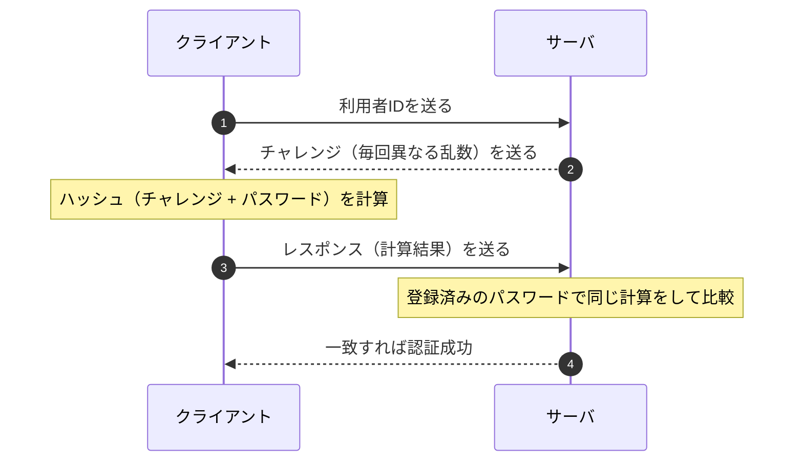

- 盗聴されても、流れるのは毎回変わる乱数とその計算結果だけです。パスワードは流れず、同じレスポンスは次回使えないため **リプレイ攻撃** も防げます。
- ⚠️ サーバ側はパスワード（または同等の値）を保持している必要があります。

### 5.3 リスクベース認証とその他 ★

- **リスクベース認証**：いつもと異なる環境（初めての端末、海外のIPアドレスなど）からのログインのときだけ、追加の認証を求めます。
- **RADIUS**：ネットワークへの接続時の認証を、認証サーバに集約するためのプロトコルです（無線LANの IEEE 802.1X 認証などで使います）。
- **Kerberos**：認証サーバが **チケット** を発行し、そのチケットで各サーバを利用する認証方式です。Windows の Active Directory で使われています。

### 5.4 シングルサインオン（SSO）とフェデレーション ★★★

**SSO**（Single Sign-On）は、一度の認証で複数のシステムを利用できるようにする仕組みです。

| 実現方式 | 仕組み |
|---|---|
| **Cookie型** | 認証済みの情報を Cookie に保存して共有する（同じドメイン内が前提） |
| **リバースプロキシ型** | 利用者とシステムの間のリバースプロキシで認証をまとめて行う |
| **エージェント型** | 各サーバにエージェント（ソフト）を入れ、認証サーバと連携する |
| **フェデレーション型** | 組織やドメインをまたいで、認証結果を **SAML** などで受け渡す |

#### SAML・OAuth・OpenID Connect の違い（頻出）

| 名称 | 目的 | やり取りするもの | 典型的な用途 |
|---|---|---|---|
| **SAML**（Security Assertion Markup Language） | **認証**（SSO） | XML形式の **アサーション**（認証結果などの表明） | 社内の ID でクラウドサービスに SSO |
| **OAuth 2.0** | **認可**（権限の委譲） | **アクセストークン** | 「このアプリにあなたの写真の閲覧を許可しますか？」 |
| **OpenID Connect（OIDC）** | OAuth 2.0 を拡張した **認証** | **IDトークン**（JWT形式）+ アクセストークン | 「Googleでログイン」などのソーシャルログイン |

- 用語：認証を行う側を **IdP**（Identity Provider）、認証結果を受け取ってサービスを提供する側を **SP**（Service Provider）または RP（Relying Party）と呼びます。
- ⚠️ ひっかけ注意：**OAuth は本来「認可」の仕組み** です。「OAuth で認証する」という選択肢はひっかけになりやすいので、認証なら SAML か OpenID Connect と覚えます。

### 5.5 FIDO とパスキー ★★

- **FIDO**（Fast IDentity Online）：パスワードに頼らない認証の標準規格です。現在の中心は **FIDO2**（Web 標準の **WebAuthn** と、認証器との通信方式 **CTAP** から成る）です。
- 仕組み：
  1. 登録時に、端末（認証器）の中で **公開鍵と秘密鍵のペア** を作り、**公開鍵だけ** をサーバに登録する。
  2. 認証時は、サーバからのチャレンジに **秘密鍵で署名** して返し、サーバは登録済みの公開鍵で検証する。
  3. 秘密鍵を使うとき、端末上で指紋・顔認証や PIN による本人確認をする。生体情報はサーバに送られない。
- メリット：
  - サーバに秘密情報（パスワード）を置かないので、サーバから漏えいしても悪用されにくい。
  - 鍵ペアはサイト（ドメイン）ごとに作られ、署名にはドメインの情報が含まれるため、偽サイトでは使えない。つまり **フィッシングに強い**。
- **パスキー**：FIDO の認証情報（秘密鍵）を、クラウド経由で同じ利用者の複数端末に同期できるようにしたものです。機種変更しても使い続けられます。

### 5.6 その他の利用者認証技術 ★★

| 用語 | 内容 |
|---|---|
| **ログイン**（利用者IDとパスワード） | 最も基本的な認証。パスワードは推測されにくく、使い回さないことが重要 |
| **アクセス管理** | 認証した利用者に、権限に応じたアクセスだけを許可する（認可）こと。ID の登録・変更・削除の管理も含む |
| **ICカード** | IC チップに秘密鍵や証明書を格納したカード（所持情報）。チップは **耐タンパ性** があり、内部の鍵を読み出しにくい |
| **PINコード** | ICカードなどと組み合わせる暗証番号（知識情報）。端末内で照合するため、サーバ側のパスワード漏えいとは無関係 |
| **セキュリティトークン** | ワンタイムパスワードを表示する小型機器や、USB に挿して使う認証用の機器（所持情報） |
| **多段階認証** | 認証を複数の段階に分けて行うこと。要素が同じでも多段階だが、多要素とは限らない（[5.1](#51-認証の3要素と多要素認証-)） |
| **CAPTCHA** | ゆがんだ文字の読取りや画像の選択など、人間には簡単でプログラムには難しい問題を解かせ、**操作しているのが人間か（ボットでないか）** を判定する仕組み |
| **EMV 3-Dセキュア**（3Dセキュア2.0） | インターネットでのクレジットカード決済時の本人認証の仕組み。利用者の端末情報や取引の情報から **リスクベース認証** を行い、リスクが高いときだけワンタイムパスワードなどの追加認証を求める |
| **IdP / IDaaS** | 認証を担当する Identity Provider / 認証・ID管理をクラウドで提供するサービス（[5.4](#54-シングルサインオンssoとフェデレーション-)、[11.1](#111-ゼロトラスト-)） |

**FIDO の規格の種類**（[5.5](#55-fido-とパスキー-) の補足）

| 規格 | 内容 |
|---|---|
| **FIDO UAF**（Universal Authentication Framework） | スマートフォンなどの端末の生体認証で、**パスワードなし** でログインする |
| **FIDO U2F**（Universal 2nd Factor） | パスワードに加えて、USB などの **セキュリティキーを2つ目の要素** として使う |
| **FIDO2** | UAF と U2F を統合・発展させた規格。W3C の **WebAuthn**（ブラウザの API）と FIDO Alliance の **CTAP**（認証器との通信）からなる |

**生体認証の種類**

| 分類 | 例 | 特徴 |
|---|---|---|
| **身体的特徴** | 指紋認証、**静脈パターン認証**（手のひら・指）、**虹彩認証**（黒目の模様）、**顔認証**、**網膜認証**（眼底の血管パターン） | 本人を高い精度で確認できる。静脈は体内の情報なので偽造されにくい |
| **行動的特徴** | **声紋認証**、**署名認証**（筆跡の形、書き順、筆圧、速度）、キーストローク | 体調や環境で変化しやすい |

- ⚠️ ひっかけ注意：生体情報はパスワードのように **変更できない** ため、漏えいしたときの影響が大きい点が弱点です。

---

## 6. 通信の保護（TLS・VPN・IPsec・無線LAN）

### 6.1 TLS ★★★

**TLS**（Transport Layer Security）は、TCP の上で通信を **暗号化・改ざん検出・サーバ認証** するプロトコルです。HTTPS（HTTP over TLS、ポート443）などで使われます。前身は SSL ですが、SSL と古い TLS（1.0 / 1.1）は脆弱なため使いません。現在の主流は **TLS 1.2 と TLS 1.3** です。

TLS で実現できること：

| 機能 | 実現方法 |
|---|---|
| サーバの認証 | サーバ証明書の検証 |
| 機密性 | 共通鍵暗号（AES-GCM など） |
| 完全性 | AEAD（認証付き暗号）や MAC |
| クライアント認証（必要な場合） | **クライアント証明書** |

#### TLS 1.3 のハンドシェイク（概略）

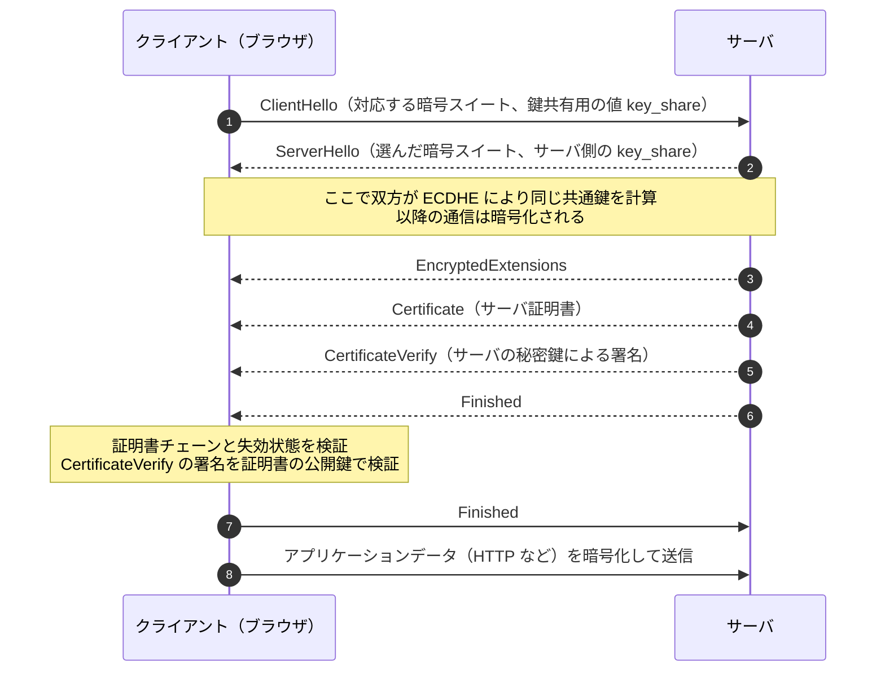

- TLS 1.3 では、ハンドシェイクが **1往復（1-RTT）** で完了します（TLS 1.2 は2往復）。
- 鍵交換は前方秘匿性のある **(EC)DHE** に限定され、静的 RSA 鍵交換は廃止されました。
- ⚠️ ひっかけ注意：TLS は **通信経路** を守る技術です。サーバに保存されたデータや、端末に感染したマルウェア（MITB）からは守れません。

#### サーバ証明書の検証で確認すること

1. 証明書チェーンをたどり、信頼できるルートCAに行き着くか
2. 有効期間内か
3. 失効していないか（CRL / OCSP）
4. 証明書に書かれた **ドメイン名（SAN：サブジェクト代替名）** が、アクセスしたドメイン名と一致するか

### 6.2 VPN ★★

**VPN**（Virtual Private Network）は、インターネットなどの共用ネットワーク上に、暗号化などによって仮想的な専用線を作る技術です。

| 種類 | 特徴 |
|---|---|
| **IPsec-VPN** | ネットワーク層（IP）で暗号化。拠点間接続でよく使う |
| **SSL-VPN（TLS-VPN）** | TLS を使う。ブラウザや専用クライアントで接続でき、リモートアクセスでよく使う |
| **インターネットVPN** | インターネットを利用する。安価 |
| **IP-VPN** | 通信事業者の閉域網を利用する。品質が安定している |

- ⚠️ 近年は、**VPN装置の脆弱性** がランサムウェアの主な侵入口になっています。パッチ適用と多要素認証が重要です。

### 6.3 IPsec ★★

**IPsec** は、ネットワーク層で IP パケットを暗号化・認証するプロトコル群です。

| 構成要素 | 役割 |
|---|---|
| **AH**（Authentication Header） | 認証と改ざん検出。**暗号化はしない** |
| **ESP**（Encapsulating Security Payload） | **暗号化** + 認証・改ざん検出 |
| **IKE**（Internet Key Exchange） | 鍵交換と、SA（Security Association：通信の取決め）の確立 |

| モード | 暗号化の範囲 | 主な用途 |
|---|---|---|
| **トランスポートモード** | IPパケットのデータ部分のみ（元のIPヘッダはそのまま） | 端末どうしの通信 |
| **トンネルモード** | 元のIPパケット全体を暗号化し、新しいIPヘッダを付ける | VPN装置どうしの拠点間通信 |

- 💡 覚え方：「**E**SP は **E**ncrypt（暗号化）できる、AH は認証だけ」。

### 6.4 無線LANのセキュリティ ★★

| 方式 | 特徴 |
|---|---|
| WEP | 脆弱。使用禁止 |
| WPA2 | 暗号化に AES（CCMP）。パーソナルモードは事前共有鍵（PSK） |
| **WPA3** | パーソナルモードで **SAE**（Simultaneous Authentication of Equals）を採用し、パスワードの総当たり（オフライン辞書攻撃）に強い |

- **パーソナルモード**：全員が同じ事前共有鍵（パスフレーズ）を使う。家庭向け。
- **エンタープライズモード**：**IEEE 802.1X** と RADIUS サーバで、利用者ごとに認証する。企業向け。
- ⚠️ SSID のステルス化（非通知）や MAC アドレスフィルタリングは、単独では十分な対策になりません（盗聴やなりすましが可能なため）。

### 6.5 その他のセキュアプロトコルと認証プロトコル ★★

| プロトコル | 内容 |
|---|---|
| **SSH**（Secure Shell） | リモートログインやファイル転送（SCP、SFTP）の通信を暗号化する。ポート22。パスワード認証のほか、**公開鍵認証**（利用者の公開鍵をサーバに登録）が使える。Telnet や FTP の代わりに使う |
| **HTTPS**（HTTP over TLS） | HTTP を TLS で保護したもの。ポート443（[6.1](#61-tls-)） |
| **QUIC** | **UDP** の上で動作し、**TLS 1.3 を組み込んだ** トランスポートプロトコル。接続確立が速く、HTTP/3 で使われる。通信はほぼすべて暗号化される |
| **WPA2 / WPA3** | 無線LANの暗号化・認証方式（[6.4](#64-無線lanのセキュリティ-)） |
| **Enhanced Open** | パスワードのない **公衆無線LAN** でも、端末ごとに通信を暗号化する Wi-Fi Alliance の認定規格（OWE：Opportunistic Wireless Encryption にもとづく）。暗号化はするが、アクセスポイントの認証はしない |

**ネットワーク接続時の認証**（IEEE 802.1X）

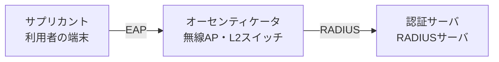

| 用語 | 内容 |
|---|---|
| **IEEE 802.1X** | LAN（有線・無線）に接続する端末を、ポート単位で認証する規格。認証に成功するまで通信を許可しない |
| **EAP**（Extensible Authentication Protocol） | さまざまな認証方式を載せられる、拡張可能な認証プロトコルの枠組み |
| **EAP-TLS** | **サーバとクライアントの両方が証明書** を使って相互認証する。安全性が高いが、クライアント証明書の配布・管理が必要 |
| **PEAP**（Protected EAP） | **サーバだけが証明書** を使って TLS のトンネルを作り、その中で利用者を **ID とパスワード** で認証する |
| **RADIUS** | 認証・認可・アカウンティング（AAA）を認証サーバに集約するプロトコル |
| **Diameter** | RADIUS の後継として設計された AAA プロトコル。信頼性の高い TCP/SCTP を使い、携帯電話網（LTE など）で使われる |

- 💡 覚え方：「**EAP-TLS は両方に証明書、PEAP はサーバだけ証明書＋パスワード**」。

---

## 7. ネットワークセキュリティ機器と構成

### 7.1 ファイアウォール ★★★

**ファイアウォール** は、内部ネットワークと外部ネットワークの境界で、通信を許可・遮断する仕組みです。

| 方式 | 仕組み |
|---|---|
| **パケットフィルタリング型** | IPアドレス、ポート番号、プロトコルなどのヘッダ情報で許可・遮断を判断する |
| **ステートフルインスペクション** | 通信の状態（どの通信への応答か）を記録し、内部から始めた通信への戻りパケットだけを通す |
| **アプリケーションゲートウェイ型** | アプリケーション層で中継して内容を検査する（プロキシ型） |

フィルタリングのルールは **上から順に評価** し、最初に一致したルールを適用するのが一般的です。最後に「すべて拒否」を置き、必要な通信だけを許可する（**ホワイトリスト方式**、許可リスト方式）のが基本です。

| 番号 | 送信元 | 宛先 | 宛先ポート | 動作 |
|---|---|---|---|---|
| 1 | any | DMZのWebサーバ | 443/TCP | 許可 |
| 2 | 内部LAN | any | 443/TCP | 許可 |
| 3 | any | any | any | 拒否 |

- 科目Bでは、このようなルール表の **空欄補充** や「ある通信が通るか」の判定がよく出ます。行の順番に注意して上から当てはめます。

### 7.2 DMZ ★★★

**DMZ**（DeMilitarized Zone：非武装地帯）は、外部ネットワークにも内部ネットワークにも属さない中間のセグメントです。外部に公開するサーバ（Web、メール、DNS）を置きます。

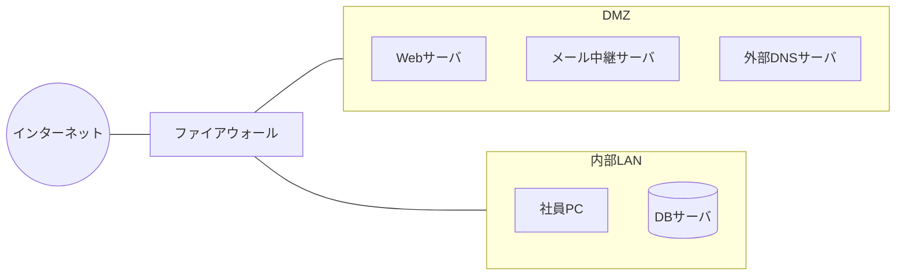

- 目的：公開サーバが乗っ取られても、**内部LANへの被害の拡大を防ぐ** ことです。
- 基本ルール：インターネット → DMZ は必要なポートだけ許可、インターネット → 内部LAN は（応答以外）すべて拒否、DMZ → 内部LAN も原則拒否します。
- ⚠️ ひっかけ注意：顧客情報を持つ DB サーバを DMZ に置くのは誤りです。DBサーバは内部側に置き、Webサーバからの必要な通信だけを許可します。

### 7.3 WAF・IDS・IPS ★★★

| 機器 | 役割 | 設置場所・特徴 |
|---|---|---|
| **WAF**（Web Application Firewall） | Webアプリケーションへの通信内容（HTTP）を検査し、SQLインジェクションやXSSなどの攻撃を遮断する | Webサーバの前。アプリの脆弱性をすぐ直せないときの **暫定対策** にもなる |
| **IDS**（Intrusion Detection System：侵入検知システム） | 不正な通信を **検知して管理者に通知** する（遮断はしない） | ネットワーク型（NIDS）とホスト型（HIDS）がある |
| **IPS**（Intrusion Prevention System：侵入防止システム） | 不正な通信を **検知して遮断** する | 通信経路上に **インライン** で設置する |

検知方式：

| 方式 | 仕組み | 長所・短所 |
|---|---|---|
| **シグネチャ型**（不正検出） | 既知の攻撃パターン（シグネチャ）と照合する | 既知の攻撃に強い。未知の攻撃は検知できない |
| **アノマリ型**（異常検出） | 正常時の通信と比べて、異常なふるまいを検知する | 未知の攻撃も検知できる可能性がある。誤検知が増えやすい |

- **フォールスポジティブ**（誤検知）：正常な通信を攻撃と判断してしまうこと。
- **フォールスネガティブ**（検知漏れ）：攻撃を見逃してしまうこと。
- ⚠️ ひっかけ注意：WAF の遮断ルールを厳しくするとフォールスポジティブが増え、正規の利用者が使えなくなることがあります。科目Bでは「導入直後はまず **検知のみ（モニタリング）モード** で運用し、誤検知を確認してから遮断モードにする」という流れがよく問われます。

### 7.4 プロキシサーバ ★★

| 種類 | 役割 |
|---|---|
| **フォワードプロキシ** | 内部の利用者の代わりに外部へアクセスする。アクセスログの取得、URLフィルタリング、マルウェアの **出口対策**（C&C通信の遮断）に使う |
| **リバースプロキシ** | 外部からのアクセスを受けて、内部のサーバへ中継する。負荷分散、TLS終端、SSOなどに使う |

- **URLフィルタリング**：業務に不要なサイトや危険なサイトへのアクセスを制限します。
- プロキシの **認証** を必須にすると、利用者認証の情報を持たないマルウェアの外部通信を止めやすくなります（科目Bで出題実績のある考え方です）。

### 7.5 その他の機器・仕組み ★★

| 用語 | 内容 |
|---|---|
| **UTM**（Unified Threat Management：統合脅威管理） | ファイアウォール、IPS、ウイルス対策、URLフィルタリングなどを1台にまとめた機器 |
| **SIEM**（Security Information and Event Management） | 各機器のログを集めて相関分析し、インシデントの兆候を検知する |
| **EDR** | 端末の挙動を監視し、侵入後の不審な動作を検知・隔離する |
| **サンドボックス** | 隔離した環境で添付ファイルなどを実際に動かし、ふるまいを確認する |
| **DLP**（Data Loss Prevention） | 機密情報の持出しや送信を検知・防止する |
| **検疫ネットワーク** | 社内LANに接続する端末のパッチやウイルス定義の状態を検査し、問題があれば隔離する |

### 7.6 ネットワークセキュリティの追加用語 ★★

| 用語 | 内容 |
|---|---|
| **ステートフルパケットフィルタリング** | ステートフルインスペクションと同じ。通信の状態を記録し、応答パケットだけを動的に通す（[7.1](#71-ファイアウォール-)） |
| **MACアドレスフィルタリング** | 登録した MAC アドレスの機器だけを接続させる。MAC アドレスは偽装できるので、単独では不十分 |
| **認証サーバ** | 利用者や端末の認証を一元的に行うサーバ（RADIUS サーバなど） |
| **認証VLAN** | 端末の認証結果に応じて、接続する **VLAN を動的に割り当てる**。認証前は検疫用 VLAN、認証後は業務用 VLAN、など |
| **NAT / IPマスカレード（NAPT）** | プライベートIPアドレスとグローバルIPアドレスを変換する。外部から内部の端末に直接接続しにくくなる副次的なセキュリティ効果がある |
| **ハニーポット** | わざと脆弱に見せかけた **おとりのシステム** を置き、攻撃者を誘い込んで攻撃手法を観察・記録する |
| **許可リスト**（パスリスト）/ **拒否リスト**（ブロックリスト） | 許可するものだけを列挙し、それ以外を拒否する方式 / 拒否するものを列挙し、それ以外を許可する方式。許可リストの方が安全だが、運用の手間がかかる（旧称：ホワイトリスト / ブラックリスト） |
| **RASP**（Runtime Application Self-Protection） | アプリケーションの **実行環境の中** に組み込み、実行時の動作を監視して攻撃を検知・遮断する。WAF より誤検知が少ない |
| **SSL/TLSアクセラレーター** | TLS の暗号化・復号処理を専用機器で肩代わりし、サーバの負荷を下げる。復号した通信を IDS や WAF で検査できるようにする目的もある |
| **Webアイソレーション** | Webページを利用者の端末ではなく **隔離された環境（クラウドなど）で実行** し、描画結果だけを端末に送る。悪意のあるコードが端末に届かない |
| **MDM**（Mobile Device Management） | スマートフォンなどの業務用端末を一元管理する（設定の配布、アプリ制限、紛失時の **リモートロック・リモートワイプ**） |
| **CASB** | クラウドサービスの利用を可視化・制御する（[11.1](#111-ゼロトラスト-)） |
| **電子メール・Webのセキュリティ** | **URLフィルタリング**（Webフィルタリング：アクセス先を制限）、**コンテンツフィルタリング**（通信の内容を検査し、不適切な情報や機密情報の送受信を防ぐ） |

---

## 8. メールセキュリティ

### 8.1 送信ドメイン認証（SPF・DKIM・DMARC） ★★★

メールの送信元は簡単に偽装できます。そこで、受信側が「送信元ドメインが正しいか」を確認する **送信ドメイン認証** を使います。

| 技術 | 仕組み | 何を確認するか |
|---|---|---|
| **SPF**（Sender Policy Framework） | 送信側ドメインの DNS に、正規の送信メールサーバの **IPアドレス** を登録しておく（TXTレコード） | 受信側は、接続してきたサーバのIPアドレスが、エンベロープの送信元（`MAIL FROM`）ドメインのSPFレコードに含まれるかを確認する |
| **DKIM**（DomainKeys Identified Mail） | 送信側のメールサーバが **秘密鍵でデジタル署名** をメールヘッダに付ける。公開鍵は DNS に登録する | 受信側は DNS から公開鍵を取得して署名を検証する。**途中での改ざん** も検出できる |
| **DMARC**（Domain-based Message Authentication, Reporting and Conformance） | SPF・DKIM の結果と、**ヘッダの From（利用者に見える送信者）のドメインが一致するか**（アラインメント）を確認する。失敗したときの扱い（**ポリシー**）を送信側が DNS で宣言する | ポリシーは `none`（何もしない・監視）、`quarantine`（隔離）、`reject`（拒否）。受信側から送信側へ **レポート** も送られる |

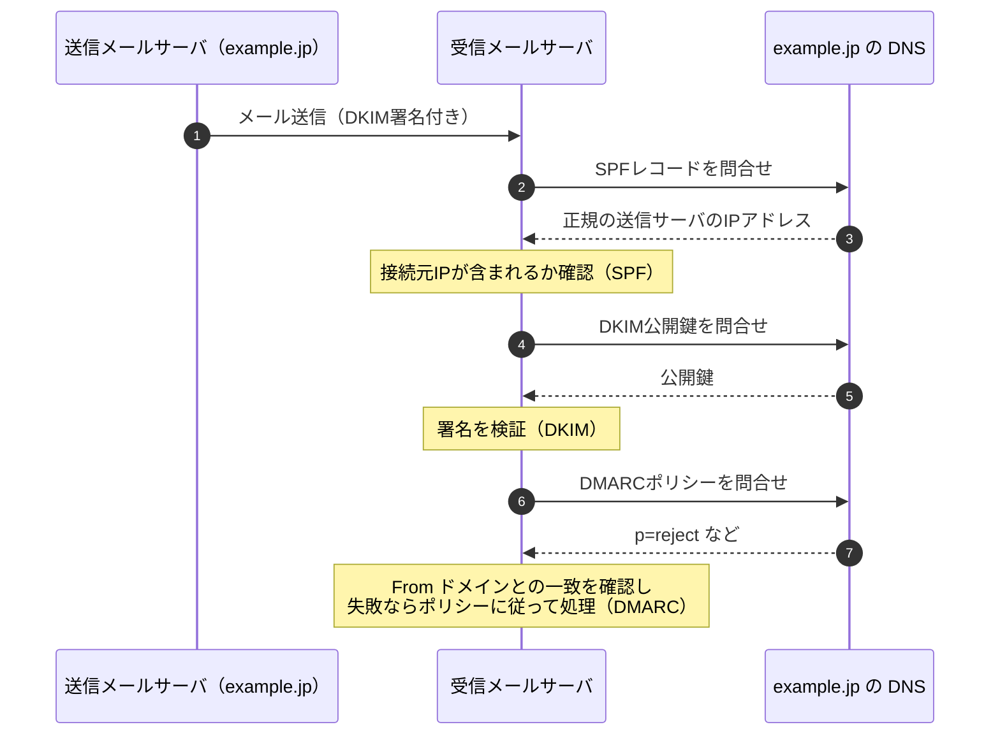

- ⚠️ ひっかけ注意：SPF はメールの **転送**（中継）で失敗しやすく、DKIM は転送されても署名が壊れなければ検証できます。
- ⚠️ SPF・DKIM・DMARC は「送信元ドメインが正しいか」を確認する技術で、**本文の暗号化はしません**。

### 8.2 S/MIME と PGP ★★

| 技術 | 内容 |
|---|---|
| **S/MIME**（Secure/MIME） | 認証局が発行した証明書（PKI）を使い、メールの **暗号化** と **デジタル署名** を行う |
| **PGP** / OpenPGP | 利用者どうしが互いの公開鍵を信頼し合う「信頼の輪」の考え方で、暗号化と署名を行う |

- S/MIME の暗号化はハイブリッド方式です。本文を共通鍵で暗号化し、その共通鍵を **受信者の公開鍵** で暗号化します。署名は **送信者の秘密鍵** で作ります。

### 8.3 メール送信時の対策 ★★

| 用語 | 内容 |
|---|---|
| **OP25B**（Outbound Port 25 Blocking） | ISP が、自社網内の端末から外部のメールサーバの25番ポートへの直接送信を遮断する。ボットによる迷惑メール送信を防ぐ |
| **サブミッションポート**（587番） | 利用者がメールを送信するときに使うポート。**SMTP-AUTH**（SMTPでの利用者認証）と組み合わせる |
| **SMTPS / STARTTLS** | メールサーバ間や利用者との通信を TLS で暗号化する |
| **第三者中継（オープンリレー）の禁止** | 自組織と関係のないメールを中継しないように設定する |

### 8.4 スパム対策 ★

| 対策 | 内容 |
|---|---|
| **ベイジアンフィルタリング** | 迷惑メールと正常なメールに含まれる単語の出現確率を **ベイズの定理** で学習し、新しいメールが迷惑メールである確率を計算して判定する。利用者の判定結果で学習し、精度が上がる |
| 送信ドメイン認証 | SPF・DKIM・DMARC（[8.1](#81-送信ドメイン認証spfdkimdmarc-)） |
| OP25B、SMTP-AUTH | 送信側での不正送信の防止（[8.3](#83-メール送信時の対策-)） |
| ブラックリスト（拒否リスト）方式 | 迷惑メールの送信元として知られる IP アドレスやドメインからの受信を拒否する（DNSBL など） |

---

## 9. 情報セキュリティ管理（ISMS・リスクマネジメント）

### 9.1 ISMS ★★★

**ISMS**（Information Security Management System：情報セキュリティマネジメントシステム）は、組織が情報セキュリティを継続的に管理・改善する仕組みです。国際規格は **ISO/IEC 27001**、日本の規格は **JIS Q 27001** です（2022年の国際規格改訂に対応した JIS Q 27001:2023 が現行）。

| 規格 | 内容 |
|---|---|
| **JIS Q 27000** | 用語の定義 |
| **JIS Q 27001** | ISMS の **要求事項**（認証審査の基準） |
| **JIS Q 27002** | 管理策の **実践のための規範**（具体的な管理策のガイド） |
| **JIS Q 27017** | クラウドサービスのための管理策 |

- JIS Q 27001:2023 の附属書A の管理策は **93項目** で、**組織的・人的・物理的・技術的** の4つに分類されています。
- ISMS は **PDCA サイクル** で運用します。
  - Plan（方針策定・リスク評価・管理策の選択）→ Do（導入・運用）→ Check（監視・内部監査・マネジメントレビュー）→ Act（是正処置・改善）

- **情報セキュリティ方針**：経営陣が承認し、組織の情報セキュリティに対する考え方を示す文書です。基本方針 → 対策基準 → 実施手順 の階層で作るのが一般的です。
- **適用宣言書**（SoA：Statement of Applicability）：附属書Aの管理策のうち、どれを採用し、どれを除外したかとその理由をまとめた文書です。
- 💡 プライバシーマーク（JIS Q 15001：個人情報保護マネジメントシステム）とセットで出題されることがあります。

### 9.2 リスクマネジメントの流れ ★★★

JIS Q 31000 や JIS Q 27000 の考え方では、次の流れでリスクを扱います。

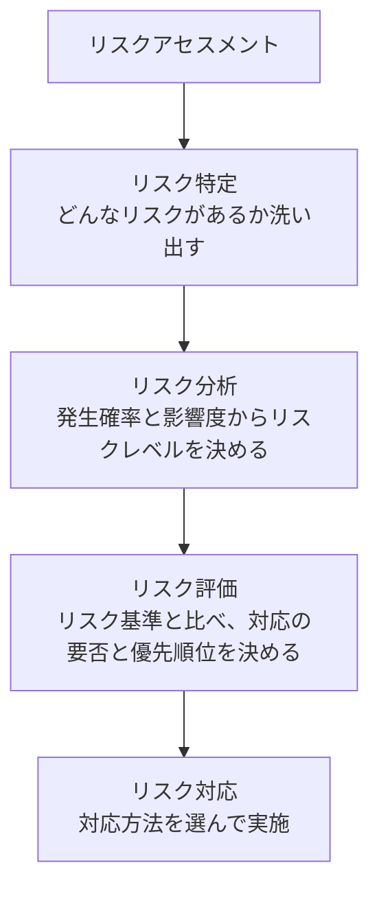

| リスク対応 | 内容 | 例 |
|---|---|---|
| **リスク回避** | リスクの原因となる活動そのものをやめる | 個人情報を扱う業務から撤退する |
| **リスク低減**（リスク軽減） | 発生確率や影響を下げる | 暗号化、アクセス制御、バックアップ |
| **リスク移転**（リスク共有） | 他者と分担する | **サイバー保険** への加入、外部委託 |
| **リスク保有**（リスク受容） | 対策をせず、そのまま受け入れる | 影響が小さく、対策費用の方が高い場合 |

- 💡 覚え方：「回避＝やめる、低減＝減らす、移転＝人に渡す、保有＝受け入れる」。
- ⚠️ ひっかけ注意：保険に入るのは「低減」ではなく **移転（共有）** です。保険では発生確率は下がりません。
- **残留リスク**：対応後も残るリスクです。経営者が把握して承認します。

#### リスク分析の手法

| 手法 | 内容 |
|---|---|
| **ベースラインアプローチ** | 既存の標準やガイドラインに沿って一定水準の対策をする。簡単だが組織の実情に合わないことがある |
| **非形式的アプローチ** | 担当者の経験や判断で分析する |
| **詳細リスク分析** | 資産ごとに脅威・脆弱性を詳しく分析する。精度は高いが手間がかかる |
| **組合せアプローチ** | 重要な資産は詳細リスク分析、それ以外はベースラインアプローチ |

#### 計算例：年間予想損失額

- 公式：`年間予想損失額 = 1回あたりの損失額 × 年間発生回数（発生確率）`
- 数値例：1回の情報漏えいで2,000万円の損失、発生頻度は10年に1回と見積もる
- 途中式：`2,000万円 × (1 / 10) = 200万円 / 年`
- この対策に年400万円かかるなら、費用が損失額を上回るので、費用対効果の観点ではリスク保有や別の安価な対策も検討対象になります。

### 9.3 脆弱性管理とセキュリティ評価 ★★

| 用語 | 内容 |
|---|---|
| **CVE**（Common Vulnerabilities and Exposures） | 個々の脆弱性に付ける世界共通の識別番号（例：CVE-2024-12345） |
| **CVSS**（Common Vulnerability Scoring System：共通脆弱性評価システム） | 脆弱性の深刻度を 0.0〜10.0 で評価する。現行版は v4.0（2023年公開）で、基本評価基準・脅威評価基準・環境評価基準・補足評価基準がある。v3.1 の基本・現状・環境評価基準もまだ広く使われる |
| **JVN**（Japan Vulnerability Notes） | JPCERT/CC と IPA が共同で運営する脆弱性対策情報ポータル |
| **ペネトレーションテスト** | 実際に攻撃者の手法で侵入を試み、弱点を確認する |
| **脆弱性診断** | ツールや手作業で、既知の脆弱性がないかを網羅的に調べる |
| **SBOM**（Software Bill of Materials） | ソフトウェアを構成する部品（ライブラリなど）の一覧。脆弱性が見つかったときの影響範囲の特定に役立つ |

### 9.4 人的・物理的対策 ★

- **人的対策**：セキュリティ教育、秘密保持契約（NDA）、退職者のアカウント削除、**職務分掌**（一人に権限を集中させない）。
- **物理的対策**：入退室管理（ICカード、生体認証）、**アンチパスバック**（入室記録がないと退室できない、または逆）、**共連れ** の防止（**セキュリティゲート**、監視カメラ）、施錠、**クリアデスク・クリアスクリーン**。
- **アクセス制御の原則**：**最小権限の原則**（業務に必要な最小限の権限だけを与える）、**Need-to-Know**（知る必要のある人だけに開示）。

### 9.5 情報セキュリティ管理の基本用語 ★★

| 用語 | 内容 |
|---|---|
| **情報セキュリティ事象** | 情報セキュリティポリシーへの違反や管理策の不具合の **可能性** を示す、システム・サービス・ネットワークの状態の発生（ログイン失敗の記録なども含む広い概念） |
| **情報セキュリティインシデント** | 望まない、または予期しない情報セキュリティ事象のうち、**事業運営を危うくする確率や情報セキュリティを脅かす確率が高いもの** |
| **監視** | システムやプロセスの状態を継続的に確認すること。ログ監視、ネットワーク監視など |
| **アカウント管理** | 利用者 ID の発行・変更・削除を、申請と承認にもとづいて管理する。**退職・異動時の速やかな削除や権限変更**、共有 ID の禁止、定期的な棚卸し |
| **利用者アクセス権の管理** | **need-to-know（最小権限）の原則** にもとづき、業務に必要な情報・権限だけを与える |
| **クラウドサービスの責任共有モデル** | クラウド事業者と利用者がセキュリティの責任を分担する考え方。IaaS → PaaS → SaaS の順に事業者の責任範囲が広がるが、**データとアカウントの管理は常に利用者の責任** |
| **外部委託・クラウド利用時のセキュリティ** | 委託先の選定時のセキュリティ評価、契約での要求事項（秘密保持、再委託の制限、監査権、インシデント時の報告）の明記、委託中の監督 |
| **サイバーハイジーン** | 「サイバー衛生」。手洗いのように、パッチ適用、資産の把握、アカウント管理、バックアップなどの **基本的な対策を日常的に継続** すること |

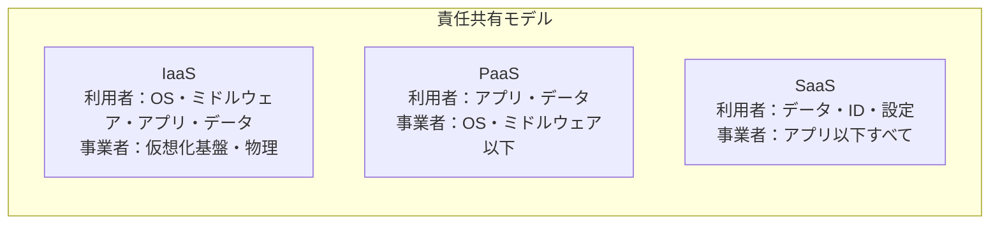

### 9.6 リスクの種類とリスクアセスメントの用語 ★★

**情報資産の調査と分類**
- 情報資産（システム、データ、文書、機器、人など）を洗い出して **情報資産台帳** にまとめ、管理責任者・保管場所・重要度を記録します。
- 重要度は **機密性・完全性・可用性** の観点で評価し、「極秘・秘・社外秘・公開」のような基準で分類します。

**損失の種類**

| 損失 | 内容 |
|---|---|
| **財産損失** | 建物・設備・データなどの財産が失われる損失 |
| **責任損失** | 損害賠償責任を負うことによる損失（顧客情報の漏えいによる賠償など） |
| **純収益の喪失** | 事業の中断などで本来得られるはずの収益が失われる損失 |
| **人的損失** | 従業員の死傷や、重要な人材を失うことによる損失 |

**リスクの種類**

| リスク | 内容 |
|---|---|
| **オペレーショナルリスク** | 業務の過程、人、システムの不備や外部の事象によって損失が生じるリスク |
| **サプライチェーンリスク** | 取引先・委託先・調達した製品やソフトウェアを経由して被害を受けるリスク |
| **外部サービス利用のリスク** | クラウドサービスなどの停止、仕様変更、情報漏えいの影響を受けるリスク |
| **SNSによる情報発信のリスク** | 従業員や公式アカウントの不適切な投稿による炎上、機密情報の漏えい |
| **地政学的リスク** | 国際情勢や紛争の影響（国家が関与するサイバー攻撃、調達先の国のリスクなど） |

**リスクの要因を表す用語**（保険・リスクマネジメントの用語）

| 用語 | 内容 | 例 |
|---|---|---|
| **ペリル** | 損失を発生させる **直接の原因（事故）** | 火災、地震、不正アクセス |
| **ハザード** | ペリルの発生の可能性を高めたり、損失を大きくしたりする **状況・要因** | 可燃物の放置、パッチの未適用 |
| **モラルハザード** | 保険や対策があることで、かえって注意を怠るようになること（倫理観の欠如） | 「保険に入っているから」と対策をおろそかにする |

**リスクアセスメントの用語**（JIS Q 31000 / JIS Q 27000）

| 用語 | 内容 |
|---|---|
| **リスク基準** | リスクの重大性を評価するための目安。**リスク受容基準**（どのレベルまでなら受け入れるか）と、リスクアセスメントを実施するための基準からなる |
| **リスク源** | それ自体またはほかとの組合せで、リスクを生じさせる力をもっている要素 |
| **リスク所有者** | リスクを運用管理することについて、**説明責任と権限をもつ人** |
| **リスクレベル** | 起こりやすさと結果（影響）の組合せで表したリスクの大きさ |
| **リスクマトリックス** | 縦軸に影響度、横軸に発生可能性をとった表で、リスクレベルを色分けして示す |
| **リスクの定性的分析** | 「高・中・低」などの段階でリスクを評価する。簡便だが主観が入りやすい |
| **リスクの定量的分析** | 金額や確率など数値でリスクを評価する（例：**年間予想損失額** ＝ 1回の損失額 × 年間発生頻度、[9.2](#92-リスクマネジメントの流れ-)） |
| **得点法** | 評価項目ごとに点数を付け、その合計（または積）でリスクの大きさを比較する方法 |
| **コスト要因** | 対策の費用と、リスクが顕在化したときの損失額を比較して対策を判断するときの費用の要素 |
| **リスク選好** | 組織が目的達成のために **追求または保有してもよい** と考えるリスクの量と種類 |
| **リスク忌避** | リスクを避けようとする姿勢（リスク選好と対になる態度） |

リスクマトリックスの例：

| 影響度＼発生可能性 | 低 | 中 | 高 |
|---|---|---|---|
| **大** | 中 | 高 | 高 |
| **中** | 低 | 中 | 高 |
| **小** | 低 | 低 | 中 |

### 9.7 リスク対応の体系 ★★

リスク対応は、大きく **リスクコントロール** と **リスクファイナンシング** に分けられます。

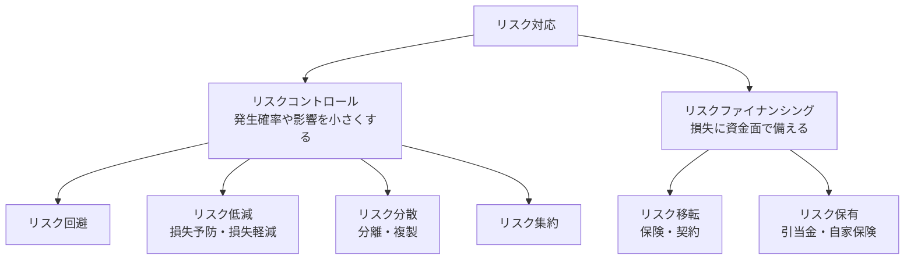

| 用語 | 内容 |
|---|---|
| **リスク回避** | リスクのある活動をやめる |
| **リスク共有**（リスク移転・リスク分散） | 他者とリスクを分け合う。保険や委託による **移転** と、拠点やデータを複数に分けて一度に全部を失わないようにする **分散** がある |
| **リスク保有** | リスクを受け入れる。損失に備えて資金を準備しておくこともある |
| **リスク集約** | 分散している資産やリスクを1か所に集めて、重点的に管理・保護する（例：各部署のサーバをデータセンターに集約して管理を強化する）。分散の逆の考え方 |
| **リスクヘッジ** | リスクによる損失を、ほかの手段で相殺・軽減するように備えること |
| **サイバー保険** | サイバー攻撃による損害賠償や事故対応費用を補償する保険。リスクファイナンシング（移転）の代表例 |
| **残留リスク** | リスク対応後に残るリスク。リスク所有者が受け入れを承認する |
| **リスク対応計画** | どのリスクにどの対応をとるか、責任者・期限・必要な資源を定めた計画 |
| **リスク登録簿** | 特定したリスク、分析・評価の結果、対応策、所有者を一覧にした記録 |
| **リスクコミュニケーション** | リスクに関する情報を、経営者・従業員・顧客などの利害関係者と共有し、意見を交換すること |

- ⚠️ ひっかけ注意：「リスク分散」は文献によってリスクコントロールに含めたり、リスク共有の一種とする説明（シラバス）があったりします。試験では「分けて一度に失わないようにする」という意味を押さえておけば判断できます。

### 9.8 ISMSの構成と管理策 ★★

JIS Q 27001 の本文（要求事項）は、次の構成になっています。

| 箇条 | 内容 |
|---|---|
| 4 組織の状況 | 内外の課題、利害関係者のニーズを把握し、**ISMS の適用範囲** を決める |
| 5 **リーダーシップ** | トップマネジメントのコミットメント、情報セキュリティ方針、役割・責任・権限 |
| 6 **計画** | リスクアセスメント・リスク対応の計画、**情報セキュリティ目的** |
| 7 支援 | 資源、力量、認識、コミュニケーション、文書化した情報 |
| 8 **運用** | 計画の実施、リスクアセスメントとリスク対応の実施 |
| 9 **パフォーマンス評価** | 監視・測定・分析・評価、**内部監査**、**マネジメントレビュー** |
| 10 **改善** | **不適合及び是正処置**、**継続的改善** |

**管理策**（JIS Q 27001 附属書A / JIS Q 27002）

| 分類 | 例 |
|---|---|
| **組織的管理策**（37） | 情報セキュリティ方針、資産の目録、アクセス制御方針、供給者関係、インシデント管理、事業継続 |
| **人的管理策**（8） | 選考、雇用条件、教育・訓練、懲戒手続、秘密保持契約、リモートワーク |
| **物理的管理策**（14） | 物理的境界、入退室管理、クリアデスク・クリアスクリーン、装置の処分・再利用 |
| **技術的管理策**（34） | 利用者のエンドポイント機器、特権的アクセス権、マルウェア対策、バックアップ、ログ取得、暗号の利用、セキュアコーディング |

ISO/IEC 27002:2022（およびこれに対応する JIS Q 27002）では、管理策に「属性」が付けられています。

| 属性 | 値 |
|---|---|
| **管理策タイプ** | **予防**（発生を防ぐ）、**検知**（発生を見つける）、**是正**（発生後に影響を抑え回復する） |
| **サイバーセキュリティ概念** | **識別**、**防御**、**検知**、**対応**、**復旧**（NIST CSF の機能に対応） |

| 用語 | 内容 |
|---|---|
| **管理目的** | 管理策を実施することで達成しようとする目的 |
| **有効性** | 計画した活動を実行し、計画した結果を達成した程度 |
| **ISMS適合性評価制度** | 組織の ISMS が JIS Q 27001 に適合しているかを第三者の **認証機関** が審査し、**ISMS認証** を与える制度。日本では ISMS-AC（情報マネジメントシステム認定センター）が認証機関を認定する |
| **JIS Q 27014**（ISO/IEC 27014） | **情報セキュリティガバナンス**（経営陣が情報セキュリティを方向付け、監視する仕組み）の規格 |
| **JIS Q 27017**（ISO/IEC 27017） | クラウドサービスの情報セキュリティ管理策の規格。クラウド事業者と利用者の双方の管理策を示す |

- 💡 管理策タイプの例：ウイルス対策ソフトの導入は **予防**、IDS によるアラートは **検知**、バックアップからの復元は **是正**。

### 9.9 情報セキュリティ継続 ★

災害や大規模障害などの困難な状況でも情報セキュリティを維持できるよう、**事業継続マネジメント（BCM）** に情報セキュリティを組み込みます。

| 用語 | 内容 |
|---|---|
| **緊急事態の区分** | 影響の大きさや種類（自然災害、システム障害、サイバー攻撃など）で緊急事態をレベル分けし、レベルごとに体制と対応を決めておく |
| **緊急時対応計画**（コンティンジェンシー計画） | 緊急事態が起きたときに、被害を最小限にして業務を継続するための初動対応の計画 |
| **復旧計画** | システムや業務を元の状態に戻すための手順・優先順位・目標時間（RTO：目標復旧時間、RPO：目標復旧時点）を定めた計画 |
| **災害復旧**（DR：Disaster Recovery） | 災害で停止したシステムを復旧すること。遠隔地のバックアップサイト（ホット・ウォーム・コールドサイト）を使う |
| **バックアップによる対策** | 定期的なバックアップと、遠隔地での保管、復元テスト |
| **被害状況の調査手法** | 被害の範囲・影響を迅速に把握する方法（チェックリスト、ログの確認、関係者への聞き取り） |

### 9.10 情報セキュリティ諸規程 ★

**情報セキュリティポリシー** は、一般に次の3階層で構成します。

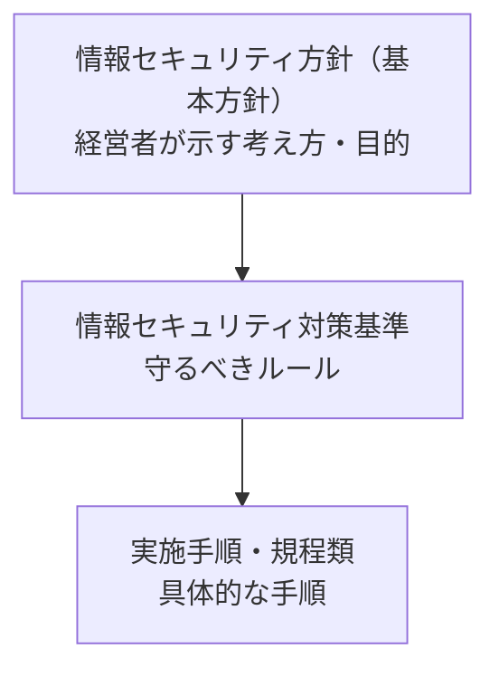

| 規程 | 内容 |
|---|---|
| **情報セキュリティ方針** | 組織の情報セキュリティに対する基本的な考え方。経営者が承認し、全従業員に周知する |
| **情報セキュリティ目的** | 方針にもとづいて設定する、測定可能な目標 |
| **情報セキュリティ対策基準** | 方針を実現するために守るべきルール（何をすべきか） |
| **情報管理規程 / 秘密情報管理規程** | 情報の分類、取扱い、保管、廃棄のルール / 秘密情報の指定と管理のルール |
| **文書管理規程** | 文書の作成・承認・保管・廃棄のルール |
| **情報セキュリティインシデント対応規程** | インシデント発生時の報告・対応の手順（マルウェア感染時の対応など） |
| **情報セキュリティ教育の規程** | 教育の対象・内容・頻度 |
| **プライバシーポリシー**（個人情報保護方針） | 個人情報の取扱い方針を外部に公表するもの |
| **職務規程 / 罰則の規程** | 職務上の義務 / 違反したときの処分 |
| **対外説明の規程** | 事故発生時などの外部（報道、顧客）への説明の手順 |
| **例外の規程** | ルールを守れない場合の例外申請と承認の手続 |
| **規則更新の規程 / 規程の承認手続** | 規程を定期的に見直す手順 / 規程を制定・改定するときの承認の手続 |
| **ソーシャルメディアガイドライン**（SNS利用ポリシー） | 従業員が SNS を利用する際の注意事項（機密情報を書かない、会社の見解と誤解される発言をしないなど） |

### 9.11 セキュリティ技術評価 ★★

セキュリティ製品やシステムが **どの程度安全か** を客観的に評価する仕組みです。

**ISO/IEC 15408（コモンクライテリア）**

| 用語 | 内容 |
|---|---|
| **CC**（Common Criteria：コモンクライテリア、ISO/IEC 15408） | IT 製品・システムのセキュリティ機能が適切に設計・実装されているかを評価するための国際基準 |
| **セキュリティ機能要件** | 製品が備えるべきセキュリティ機能（識別・認証、アクセス制御、監査など）の要件 |
| **セキュリティ保証要件** | 機能が正しく実装されていることを確認するための要件（開発、テスト、脆弱性評定など） |
| **PP**（Protection Profile：プロテクションプロファイル） | 特定の製品分野（ファイアウォール、ICカードなど）について、**利用者側が求める** セキュリティ要件をまとめた文書 |
| **ST**（Security Target：セキュリティターゲット） | 評価対象の製品について、**開発者側が** 実装したセキュリティ機能を記述した文書 |
| **EAL**（Evaluation Assurance Level：評価保証レベル） | 保証の度合いを **EAL1〜EAL7** の7段階で表す。数字が大きいほど厳密に評価される |
| **CEM**（共通評価方法、ISO/IEC 18045） | CC にもとづいて評価を行うための具体的な評価方法 |
| **JISEC**（ITセキュリティ評価及び認証制度） | 日本で CC にもとづく評価・認証を行う制度。IPA が認証機関 |
| **IT製品の調達におけるセキュリティ要件リスト** | 政府機関が IT 製品を調達するときに、CC 認証の取得などを求める製品分野と要件をまとめたリスト（経済産業省） |

**その他の評価の仕組み**

| 用語 | 内容 |
|---|---|
| **JCMVP**（暗号モジュール試験及び認証制度） | 暗号機能を実装したモジュール（ハードウェア・ソフトウェア）が、承認された暗号を正しく実装し、鍵などを適切に保護しているかを試験・認証する制度（IPA が運営、ISO/IEC 19790 にもとづく） |
| **CVSS / CVE** | 脆弱性の深刻度の評価 / 脆弱性の識別番号（[9.3](#93-脆弱性管理とセキュリティ評価-)） |
| **CWE**（Common Weakness Enumeration：共通脆弱性タイプ） | 脆弱性の **種類（タイプ）** を体系的に分類した一覧（例：CWE-79 は XSS、CWE-89 は SQLインジェクション）。CVE が「個々の脆弱性」なのに対し、CWE は「脆弱性の型」 |
| **脆弱性診断 / ペネトレーションテスト** | 既知の脆弱性を網羅的に調べる / 実際に侵入を試みて弱点を確認する（[9.3](#93-脆弱性管理とセキュリティ評価-)） |
| **脆弱性報奨金制度**（バグバウンティプログラム） | 外部のセキュリティ研究者が脆弱性を見つけて報告すると、企業が報奨金を支払う制度 |
| **耐タンパ性** | 内部の秘密情報を不正に読み出したり改ざんしたりすることが困難な性質。ICカードやセキュリティチップに求められる |
| **評価方法 / 保証レベル** | 評価の手順と基準 / どの程度の確からしさでセキュリティを保証できるかの段階（CC の EAL など） |

- 💡 「**CVE ＝個々の脆弱性の番号**、**CWE ＝脆弱性の種類**、**CVSS ＝深刻度の点数**」とセットで覚えます。

### 9.12 技術的セキュリティ対策 ★★

**マルウェア検出手法**

| 手法 | 仕組み | 特徴 |
|---|---|---|
| **パターンマッチング法** | 既知のマルウェアの特徴的なコード（シグネチャ、**マルウェア定義ファイル**）と照合する | 既知のものは確実に検出。**未知・亜種には弱い**。定義ファイルの更新が必要 |
| **ビヘイビア法**（振る舞い検知） | 実行中のプログラムの **動作**（ファイルの大量暗号化、システム設定の書換えなど）を監視して検出する | 未知のマルウェアにも有効 |
| **ヒューリスティック法** | プログラムのコードや構造を解析し、マルウェアらしい特徴（不審な命令の組合せ）から推定する | 未知のマルウェアにも有効。誤検知の可能性 |
| **静的解析** | プログラムを **実行せずに** コードを解析する | 安全に解析できるが、難読化に弱い |
| **動的解析** | プログラムを **実際に動かして** 動作を観察する | 実際の挙動が分かる。隔離環境が必要 |
| **サンドボックス** | 隔離した仮想環境でファイルを実行し、ふるまいを確認する（動的解析の一種） | 未知のマルウェア検出手法の代表 |

**ランサムウェア対策**

| 用語 | 内容 |
|---|---|
| **データのバックアップ** | 定期的に取得し、復元できることを確認しておく |
| **3-2-1ルール** | バックアップは **3つ**（元データ含む）のコピーを、**2種類**の異なる媒体に保存し、そのうち **1つ**は遠隔地（オフサイト・オフライン）に置く |
| **WORM**（Write Once Read Many） | 一度書き込んだら変更・削除できず、読み出しだけできる記憶方式 |
| **イミュータブルバックアップ** | 一定期間、**変更も削除もできない** バックアップ。ランサムウェアや攻撃者による暗号化・削除から守れる |

**データの保護**

| 用語 | 内容 |
|---|---|
| **秘匿化** | 情報を見えないようにする処理の総称（暗号化、マスキングなど） |
| **匿名化の手法** | 個人を特定できないようにデータを加工する。**項目削除／レコード削除／セル削除**（氏名列を削る、特異なレコードを削る、特定のセルの値を削る）、**トップ（ボトム）コーディング**（「90歳以上」のように、ある値より上（下）をまとめる）、一般化（住所を市区町村までにする）など |
| **k-匿名化** | どのレコードも、年齢・性別・地域などの組合せ（準識別子）が同じレコードが **少なくとも k 件** 存在するように加工し、個人を k 人未満に絞り込めないようにする手法 |
| **データマスキング** | データの一部を別の文字に置き換えて隠す（例：カード番号を `****-****-****-1234`）。テスト環境への本番データの持込み時にも使う |
| **暗号化消去**（CE：Cryptographic Erase） | 暗号化された記憶媒体の **暗号鍵を消去** することで、データを読めなくする。短時間で消去できる |
| **電子透かし** | 画像・音声・動画などに、目に見えない（または見える）情報を埋め込み、著作権表示や不正コピーの追跡に使う |

**アクセス・運用の管理**

| 用語 | 内容 |
|---|---|
| **アクセス制御 / アクセス権の設定** | 利用者ごとに、どの資源にどの操作（読取り・書込み・実行）を許すかを設定する |
| **特権的アクセス権の管理**（PAM） | 管理者権限などの特権 ID を最小限にし、利用時だけ貸し出す、操作を記録するなど厳格に管理する |
| **ログ管理** | ログを取得・保管し、改ざんされないよう保護する。時刻を **NTP** で同期しておくと、複数機器のログを突き合わせられる |
| **脆弱性管理** | OS アップデート、**セキュリティパッチの適用**、**SBOM を利用した脆弱性管理**（使用している部品に脆弱性が公表されたら影響を特定して対応する） |
| **ネットワーク監視 / 侵入検知 / 侵入防止** | 通信を監視し、不正な通信を検知（IDS）・遮断（IPS）する（[7.3](#73-wafidsips-)） |
| **脅威インテリジェンス** | 攻撃者の手口、攻撃元IPアドレス、マルウェアのハッシュ値などの脅威情報を収集・分析し、防御に活用する。公開情報を収集・分析する **OSINT**（Open Source Intelligence）もその一つ |

**ハードウェア・端末・分野別のセキュリティ**

| 用語 | 内容 |
|---|---|
| **携帯端末のセキュリティ** | 画面ロック、端末の暗号化、MDM、紛失時のリモートワイプ、アプリの入手元の制限 |
| **TPM**（Trusted Platform Module） | PC などに搭載される **耐タンパ性のあるセキュリティチップ**。暗号鍵の生成・保管、起動時のソフトウェアの測定（改ざん検知）を行う |
| **セキュアエレメント** | スマートフォンや IC カードに搭載され、決済情報や鍵を安全に保管する耐タンパ性のあるチップ |
| **セキュアブート**（UEFI） | PC の起動時に、UEFI ファームウェアが OS ローダなどの **デジタル署名を検証** し、署名が正しいものだけを起動する。ルートキットなどの起動を防ぐ |
| **クラウドサービスのセキュリティ** | 責任共有モデルの理解、設定ミスの防止（**CSPM** による設定監視）、ID 管理と多要素認証 |
| **IoT のセキュリティ** | 初期パスワードの変更、ファームウェアの更新、不要なポートの停止。資源が少なく対策が難しい機器が多い |
| **制御システムのセキュリティ** | 工場やインフラの制御システム（OT）は長期間稼働しパッチを当てにくいので、ネットワーク分離や監視で守る |
| **デジタルフォレンジックス** | 証拠保全を含む電子的証拠の収集・分析（[10.2](#102-インシデント対応の流れ-)） |
| **AI for Security** | AI を使ったセキュリティ技術（ログの異常検知、マルウェア判定、フィッシングメール検出など） |
| **Security for AI** | AI そのものを守る技術（敵対的サンプルやプロンプトインジェクションへの対策、学習データの保護など） |

**セキュリティ製品・サービス**（本文で扱っていないもの）

| 製品 | 内容 |
|---|---|
| **マルウェア対策ソフト** | パターンマッチングやビヘイビア法でマルウェアを検出・駆除する |
| **EDR / DLP / SIEM / UTM** | [7.5](#75-その他の機器仕組み-) を参照 |

### 9.13 人的・物理的対策の追加用語 ★

**人的セキュリティ対策**

| 用語 | 内容 |
|---|---|
| **組織における内部不正防止ガイドライン** | IPA が公開。状況的犯罪予防の考え方にもとづく内部不正対策の指針（[1.5](#15-脆弱性の種類と不正を防ぐ環境づくり-)） |
| **情報セキュリティ啓発** | 教育、資料配付、メディア（ポスター、動画）の活用で意識を高める |
| **情報セキュリティ訓練** | **標的型メールに関する訓練**（模擬メールを送り、開封率や報告率を確認する）、**レッドチーム演習**（攻撃者役のチームが実際の手法で組織を攻撃し、防御側（ブルーチーム）の検知・対応力を評価する）など |
| **認証情報の割当て及び管理** | パスワードや認証デバイスを安全に配布し、初期パスワードの変更を強制するなど |
| **UBA**（User Behavior Analytics） | 利用者の行動ログを分析し、普段と異なる行動（深夜の大量ダウンロードなど）を検知する |
| **UEBA**（User and Entity Behavior Analytics） | UBA を拡張し、利用者だけでなく **端末やサーバなどのエンティティ** の行動も分析する |
| **セキュリティクリアランス** | 機密情報にアクセスする人を、信頼性の調査にもとづいて **資格を付与した人に限る** 制度 |
| **秘密保持契約・誓約書** | 従業員や委託先に秘密を守る義務を課す（NDA） |

**物理的セキュリティ対策**

| 用語 | 内容 |
|---|---|
| **RASIS / RAS技術** | 信頼性・可用性・保守性（・保全性・安全性）を高める技術。詳しくは [04_システム構成要素](04_システム構成要素.md) |
| **耐震耐火設備** | 免震床、耐火金庫、消火設備（サーバ室ではガス系消火設備） |
| **UPS**（無停電電源装置） | 停電時に一時的に電力を供給し、安全な停止や自家発電への切替えまでの時間を稼ぐ |
| **多重化技術 / ストレージのミラーリング** | 機器や回線を二重化する / 同じデータを複数のディスクに書き込む（RAID 1 など） |
| **ハウジングセキュリティ** | 事業者のデータセンターに機器を預ける（ハウジング）場合の、建物・入館・ラックの施錠などの物理的セキュリティ |
| **監視カメラ / セキュリティゲート** | 不正侵入の抑止・記録 / 1人ずつ通過させて **共連れ** を防ぐ |
| **アンチパスバック** | 入室の記録がない ID では退室できない（または、退室の記録がない ID では再入室できない）ようにして、共連れを防ぐ |
| **インターロック** | 2つの扉の一方が閉まらないと、もう一方が開かない仕組み（共連れ防止） |
| **施錠管理 / 入退室管理** | 鍵の貸出し記録 / IC カードや生体認証による入退室の制御と記録 |
| **機械警備** | センサが異常を検知すると、警備会社に自動通報される警備 |
| **クリアデスク・クリアスクリーン** | 離席時に机の上に書類を放置しない / 画面をロックする |
| **遠隔バックアップ** | 災害に備え、バックアップを離れた場所に保管する |
| **USBキー** | USB に挿して使う認証デバイス（鍵を挿さないと PC やソフトウェアを使えない） |
| **セキュリティケーブル** | ノートPCなどを机にワイヤーでつなぎ、盗難を防ぐ |
| **記憶媒体の管理** | USB メモリなどの持出し管理、利用の制限、台帳管理 |
| **装置のセキュリティを保った処分又は再利用** | 廃棄・再利用時に、データを **復元できないよう消去**（上書き消去、暗号化消去、物理的破壊）する |

---

## 10. インシデント対応とセキュリティ組織

### 10.1 セキュリティ組織 ★★★

| 組織 | 役割 |
|---|---|
| **CSIRT**（Computer Security Incident Response Team） | インシデントが起きたときに、受付・分析・対応・関係者との調整を行うチーム。平時は情報収集や訓練をする |
| **SOC**（Security Operation Center） | ログや機器のアラートを **24時間365日監視** し、攻撃を検知・分析する（検知が中心） |
| **PSIRT**（Product Security Incident Response Team） | 自社が提供する **製品** の脆弱性に対応するチーム |
| **CISO**（Chief Information Security Officer：最高情報セキュリティ責任者） | 組織の情報セキュリティの責任者 |
| **JPCERT/CC** | 日本のインシデント対応の調整機関。国内外の CSIRT 間の連携窓口 |
| **国家サイバー統括室**（旧 NISC：内閣サイバーセキュリティセンター） | 政府のサイバーセキュリティ政策の司令塔。2025年7月に NISC を改組して内閣官房に設置された。過去問では「NISC」の名称で出題されている |

- 💡 SOC は「見張り」、CSIRT は「消防隊（対応と調整）」と覚えます。小さな組織では兼ねることもあります。
- **J-CSIP**（サイバー情報共有イニシアティブ）：IPA が運営する、重要インフラ業界などでの標的型攻撃の情報共有の枠組みです。
- **J-CRAT**（サイバーレスキュー隊）：IPA が標的型攻撃の被害組織を支援する活動です。

### 10.2 インシデント対応の流れ ★★★

NIST SP 800-61（Rev.2）のインシデント対応ライフサイクルが基本としてよく使われます。

```mermaid
flowchart LR
    A[準備<br>体制・手順・訓練] --> B[検知と分析<br>ログ確認・影響範囲の特定・優先度判断]
    B --> C[封じ込め・根絶・復旧<br>ネットワーク切断・マルウェア除去・復元]
    C --> D[事後対応<br>原因分析・再発防止・報告]
    D -.-> A
    C -.-> B
```

- 補足：2025年公開の NIST SP 800-61 Rev.3 は、NIST **CSF 2.0**（サイバーセキュリティフレームワーク：**統治・識別・防御・検知・対応・復旧** の6機能）に合わせた構成に改められました。試験対策としては、上の4段階の考え方を押さえておけば十分です。

科目Bで問われやすいポイント：

| 場面 | 正しい行動の例 |
|---|---|
| マルウェア感染が疑われる | 端末の **LANケーブルを抜く・無線を切る**（ネットワークから隔離）。電源は **すぐには切らない**（メモリ上の証拠が消えるため） |
| 証拠の保全 | ログやディスクの **複製を作って** 調べる。原本は保全する（**デジタルフォレンジックス**） |
| 影響範囲の特定 | プロキシやファイアウォールのログで、同じ C&C サーバに通信している他の端末を探す |
| 原因の除去 | 侵入口（脆弱性、盗まれたパスワード）をふさぐ。パスワードを変更する |
| 報告 | 個人情報の漏えいのおそれがあれば、個人情報保護委員会への報告と本人への通知が必要な場合がある |

- **デジタルフォレンジックス**：不正アクセスなどの法的な証拠となる電子データを収集・保全・分析することです。証拠が改ざんされていないことを示すため、ハッシュ値を記録し、**証拠保全の一連の記録（Chain of Custody）** を残します。

### 10.3 インシデントハンドリング ★★

JPCERT/CC などが示す、インシデント発生から解決までの一連の対応の流れです。

```mermaid
flowchart LR
    A[検知／連絡受付<br>アラート・通報を受け付ける] --> B[トリアージ<br>対応の要否と優先度を判断]
    B --> C[インシデントレスポンス<br>分析・封じ込め・復旧]
    C --> D[報告／情報公開<br>関係者・当局・顧客へ]
```

| 用語 | 内容 |
|---|---|
| **検知／連絡受付** | 監視システムのアラートや、利用者・外部組織からの通報を受け付ける |
| **トリアージ** | 受け付けた事象が本当にインシデントか、自組織で対応すべきか、**どれから優先して対応するか** を判断する（医療の「トリアージ」が語源） |
| **インシデントレスポンス**（対応） | 原因と影響範囲を分析し、封じ込め・根絶・復旧を行う |
| **報告／情報公開** | 経営者、関係組織、監督官庁、個人情報保護委員会、顧客などへ報告・公表する |
| **テイクダウン** | フィッシングサイトや攻撃に使われているサーバなどを、ホスティング事業者などに依頼して **停止・削除させる** こと。JPCERT/CC などが調整を行う |

### 10.4 情報セキュリティ関連の組織・制度 ★★

**組織内の体制**

| 用語 | 内容 |
|---|---|
| **情報セキュリティ委員会** | 経営者や各部門の責任者で構成し、情報セキュリティ方針の策定や重要事項の決定を行う組織内の委員会 |
| **CSIRT / PSIRT / SOC** | [10.1](#101-セキュリティ組織-) を参照 |
| **エシカルハッカー** | 攻撃者と同じ知識・技術を、組織の許可を得て **防御のために** 使う専門家（ホワイトハッカー）。ペネトレーションテストなどを行う |

**国・公的機関**

| 組織 | 役割 |
|---|---|
| **サイバーセキュリティ戦略本部** | サイバーセキュリティ基本法にもとづき内閣に設置。国のサイバーセキュリティ戦略を決める |
| **内閣サイバーセキュリティセンター（NISC）** | 戦略本部の事務局として政府の対策を推進してきた組織（2025年7月に国家サイバー統括室へ改組。[10.1](#101-セキュリティ組織-)） |
| **IPAセキュリティセンター** | IPA の情報セキュリティ部門。届出制度の受付、10大脅威などの啓発、J-CSIP・J-CRAT の運営 |
| **CRYPTREC** | 電子政府推奨暗号の安全性を評価・監視するプロジェクト（総務省・経済産業省、NICT・IPA が事務局） |
| **JPCERT コーディネーションセンター** | インシデント対応の調整、脆弱性情報の調整を行う中立の組織 |
| **J-CSIP**（サイバー情報共有イニシアティブ） | IPA を中心に、重要インフラ業界などが標的型攻撃の情報を共有する枠組み |
| **サイバーレスキュー隊（J-CRAT）** | IPA が標的型攻撃の被害組織の状況把握や対策を支援する活動 |
| **JVN** | 脆弱性対策情報のポータルサイト（JPCERT/CC と IPA が運営） |
| **ISAC** | 同じ業界の組織どうしでセキュリティ情報を共有する組織（金融 ISAC、ICT-ISAC など） |
| **Trusted Web 推進協議会** | インターネット上でやり取りされるデータの **検証可能性** を高め、信頼できる Web を実現するための仕組みを検討する協議会（内閣官房） |

**届出・情報共有の制度**

| 制度 | 内容 |
|---|---|
| **コンピュータウイルス届出制度** | 経済産業省の「コンピュータウイルス対策基準」にもとづき、ウイルスの発見・感染を IPA に届け出る |
| **コンピュータ不正アクセス届出制度** | 「コンピュータ不正アクセス対策基準」にもとづき、不正アクセスの被害を IPA に届け出る |
| **ソフトウェア等の脆弱性関連情報に関する届出制度** | 発見された脆弱性を IPA が受け付け、JPCERT/CC が製品開発者と調整し、対策情報を JVN で公表する |
| **情報セキュリティ早期警戒パートナーシップ** | 上の脆弱性届出制度を運用する官民の枠組み（IPA・JPCERT/CC・製品開発者・Webサイト運営者など） |
| **NOTICE** | 総務省・NICT・ISP が連携し、パスワード設定に不備がある IoT 機器を調査して、利用者に注意喚起する取組み |
| **SECURITY ACTION** | 中小企業が対策への取組みを自己宣言する制度（[11.2](#112-そのほかの最近のキーワード-)） |

**サービス・クラウドの評価制度**

| 制度 | 内容 |
|---|---|
| **情報セキュリティサービス基準** | 情報セキュリティ監査、脆弱性診断、デジタルフォレンジック、セキュリティ監視・運用などのサービスについて、一定の品質を確保するための基準（経済産業省） |
| **情報セキュリティサービス審査登録制度** | サービスが上の基準に適合しているかを審査し、登録する制度 |
| **情報セキュリティサービス基準適合サービスリスト** | 審査で基準に適合すると認められたサービスの一覧（IPA が公開）。サービスを選ぶときの参考になる |
| **ISMAP**（政府情報システムのためのセキュリティ評価制度） | 政府が利用するクラウドサービスについて、セキュリティ要求を満たしているかを評価・登録する制度。政府機関は原則として登録済みのクラウドサービスから調達する |

### 10.5 情報セキュリティに関する基準・ガイドライン ★

| 基準・指針 | 内容 |
|---|---|
| **コンピュータウイルス対策基準** | ウイルス感染の予防・発見・駆除・復旧の対策を定めた経済産業省の告示 |
| **コンピュータ不正アクセス対策基準** | 不正アクセスによる被害の予防・発見・復旧・拡大防止の対策を定めた経済産業省の告示 |
| **ソフトウエア製品等の脆弱性関連情報に関する取扱規程** | 脆弱性関連情報の届出・調整・公表の手順を定めた経済産業省の告示（早期警戒パートナーシップの根拠） |
| **政府機関等の情報セキュリティ対策のための統一基準群** | 政府機関などが守るべき情報セキュリティ対策の基準 |
| **サイバーセキュリティ経営ガイドライン** | 経営者が認識すべき3原則と、CISO等に指示すべき重要10項目（経済産業省・IPA） |
| **中小企業の情報セキュリティ対策ガイドライン** | 中小企業向けに、経営者がやるべきことと、具体的な対策の進め方を示す（IPA） |
| **IoT セキュリティガイドライン** | IoT 機器・システムの方針・分析・設計・構築・運用の各段階での対策指針（総務省・経済産業省） |
| **サイバー・フィジカル・セキュリティ対策フレームワーク**（CPSF） | サイバー空間とフィジカル空間が融合した社会のサプライチェーン全体のセキュリティ対策を、**3層構造**（企業間のつながり、フィジカル空間とサイバー空間のつながり、サイバー空間におけるつながり）で整理した枠組み（経済産業省） |
| **金融機関等コンピュータシステムの安全対策基準・解説書** | 金融機関のシステムの安全対策の基準（FISC：金融情報システムセンター） |
| **PCI DSS**（Payment Card Industry Data Security Standard） | クレジットカード会員データを安全に扱うための国際的なセキュリティ基準 |
| **サイバーセキュリティフレームワーク（CSF）** | 米国 NIST が公開した、サイバーセキュリティ対策を「統治・識別・防御・検知・対応・復旧」の機能で整理した枠組み（CSF 2.0） |

---

## 11. ゼロトラストと最近のキーワード

### 11.1 ゼロトラスト ★★★

**ゼロトラスト** は、「社内ネットワークだから安全」とは考えず、**すべてのアクセスを信頼せずに毎回検証する** という考え方です（NIST SP 800-207 で整理されています）。

| 観点 | 境界型防御 | ゼロトラスト |
|---|---|---|
| 考え方 | 内部は安全、外部は危険。境界（ファイアウォール）で守る | 内部も外部も信頼しない。アクセスのたびに検証する |
| 判断材料 | 接続元のネットワーク | 利用者の認証、端末の状態、場所、時刻、ふるまいなど |
| 背景 | — | クラウド利用、テレワークの普及で「境界」があいまいになった。侵入後の横展開（ラテラルムーブメント）を防ぎたい |

```mermaid
flowchart LR
    U[利用者・端末] -->|アクセス要求| PEP[PEP<br>ポリシー実施ポイント]
    PEP <-->|判断を問い合わせ| PDP[PDP<br>ポリシー決定ポイント]
    PDP --- Info[判断材料<br>ID・多要素認証<br>端末の健全性<br>脅威情報・ログ]
    PEP -->|許可されたときだけ| R[(業務リソース)]
```

関連する技術：

| 用語 | 内容 |
|---|---|
| **IAM / IDaaS** | ID とアクセス権の一元管理。クラウドで提供されるものが IDaaS |
| **SDP**（Software Defined Perimeter） | 認証された利用者・端末にだけ、リソースへの通信経路を動的に作る |
| **CASB**（Cloud Access Security Broker） | 利用者とクラウドサービスの間で、クラウド利用を可視化・制御する（シャドーIT の把握など） |
| **SWG**（Secure Web Gateway） | クラウド型のプロキシ。URLフィルタリングやマルウェア検査を行う |
| **SASE**（Secure Access Service Edge） | ネットワーク機能（SD-WAN など）とセキュリティ機能（SWG、CASB、ZTNA など）をクラウドでまとめて提供する考え方 |

### 11.2 そのほかの最近のキーワード ★★

| 用語 | 内容 |
|---|---|
| **DevSecOps** | 開発（Dev）と運用（Ops）のサイクルにセキュリティ（Sec）を組み込む |
| **BYOD**（Bring Your Own Device） | 私物端末を業務に使うこと。**MDM**（Mobile Device Management）で管理する |
| **サイバーセキュリティ経営ガイドライン** | 経済産業省と IPA が公開。経営者が認識すべき3原則と、CISO等に指示すべき重要10項目を示す |
| **SECURITY ACTION** | 中小企業が情報セキュリティ対策への取組みを自己宣言する IPA の制度（一つ星・二つ星） |
| **AIの利用をめぐるサイバーリスク** | 10大脅威2026 組織編3位に初選出。生成AIへの機密情報の入力、AIを悪用した攻撃の高度化など |

### 11.3 OS・データベースのセキュリティ ★

**OS のセキュリティ**

| 用語 | 内容 |
|---|---|
| **任意アクセス制御**（DAC） | ファイルの **所有者** が、自分の判断でアクセス権を設定できる方式（一般的な OS のパーミッション） |
| **強制アクセス制御**（MAC：Mandatory Access Control） | システム（管理者）が定めたセキュリティポリシー（ラベル）にもとづいて **強制的に** アクセスを制御する。所有者でも権限を変更できない |
| **最小特権** | プロセスや利用者に、動作に必要な最小限の権限だけを与える。root（管理者）権限の常用を避ける |
| **トラステッドOS**（セキュアOS） | 強制アクセス制御と最小特権を実装し、管理者権限を分割するなどしてセキュリティを強化した OS（例：SELinux を有効にした Linux） |

- 💡 MAC という略語は「Media Access Control（MACアドレス）」「Message Authentication Code（メッセージ認証符号）」「Mandatory Access Control（強制アクセス制御）」の3つがあります。文脈で判断します。

**データベースセキュリティ**

| 対策 | 内容 |
|---|---|
| **データベース暗号化** | 保存データを暗号化する（ファイル全体を暗号化する TDE や、列単位の暗号化）。媒体の盗難やバックアップの漏えいに備える |
| **データベースアクセス制御** | 利用者・アプリケーションごとに、表・列・操作の権限を最小限に設定する（GRANT / REVOKE、ビューによる制限） |
| **データベースバックアップ** | 障害や改ざん・暗号化に備えて定期的に取得し、安全に保管する |
| **ログの取得** | 誰がいつどのデータにアクセスしたかの監査ログを取得・保管し、不正アクセスを検知・追跡する |

### 11.4 アプリケーションセキュリティ ★★

| 用語 | 内容 |
|---|---|
| **Webシステムのセキュリティ対策** | [2.3](#23-webアプリケーションへの攻撃-) の各攻撃への対策を、設計・実装・運用で組み込む |
| **セキュアプログラミング** | 脆弱性を作り込まないように、入力値の検証、出力時のエスケープ、エラーメッセージで内部情報を出さないなどのルールに従ってプログラムを作る |
| **ソースコード静的検査**（SAST） | プログラムを実行せずにソースコードを解析し、脆弱性につながる書き方を見つける |
| **プログラムの動的検査**（DAST） | 動作しているアプリケーションに実際にリクエストを送り、脆弱性を検査する |
| **ファジング** | 予測できないデータや異常なデータ（ファズ）を大量に入力し、異常終了や想定外の動作から脆弱性を見つける |
| **コンテナセキュリティ** | コンテナイメージの脆弱性スキャン、信頼できるイメージの利用、特権コンテナを避ける、実行時の監視 |
| **Same Origin Policy**（同一オリジンポリシー） | ブラウザで、あるオリジン（**スキーム＋ホスト＋ポート番号** の組）から読み込んだスクリプトが、**別のオリジンのデータにアクセスすることを制限** する仕組み |
| **CORS**（Cross-Origin Resource Sharing） | Same Origin Policy の制限を、サーバ側の許可（`Access-Control-Allow-Origin` ヘッダ）によって **安全に緩和** し、別オリジンからのアクセスを認める仕組み |
| **パスワードクラック対策** | **ソルト**（利用者ごとのランダム値を加えてハッシュ化）、**ストレッチング**（ハッシュ計算を多数回繰り返す）、アカウントロック（[2.4](#24-パスワードへの攻撃-)） |
| **バッファオーバーフロー対策** | 入力データの長さをチェックする、境界チェックのある関数・言語を使う、OS の対策（ASLR：アドレス空間配置のランダム化、DEP：データ領域の実行禁止） |
| **クロスサイトスクリプティング対策** | 出力時のエスケープ、Cookie の HttpOnly 属性、CSP |
| **SQLインジェクション対策** | **プレースホルダ** の利用（根本的対策）、エスケープ、DB 権限の最小化 |
| **HSTS**（HTTP Strict Transport Security） | Web サーバがレスポンスヘッダ（`Strict-Transport-Security`）で「今後は HTTPS だけで接続すること」をブラウザに指示する。HTTP での最初の接続を狙った中間者攻撃（SSL ストリッピング）を防ぐ |

```mermaid
flowchart LR
    A[https://shop.example.jp:443] -->|同一オリジン| B[https://shop.example.jp:443/api]
    A -.->|別オリジン（ホストが違う）<br>CORS で許可されなければ読めない| C[https://api.example.com]
    A -.->|別オリジン（スキームが違う）| D[http://shop.example.jp]
```

---

## 12. セキュリティ関連法規の入口

詳しくは法務（ストラテジ系）の章で扱います。ここでは科目A・科目Bでセキュリティと一緒に問われる法律の入口だけを整理します。

| 法律 | ポイント |
|---|---|
| **サイバーセキュリティ基本法** | 国・地方公共団体・重要社会基盤事業者などの責務を定めた基本法。内閣にサイバーセキュリティ戦略本部を置く |
| **不正アクセス禁止法** | 他人の ID・パスワードを無断で使うこと（**なりすましによるログイン**）や、脆弱性をついたアクセス、他人の ID・パスワードを不正に取得・保管・提供する行為、**フィッシングサイトの開設** などを禁止 |
| **刑法（不正指令電磁的記録に関する罪）** | いわゆる **ウイルス作成罪**。正当な理由なく、マルウェアを作成・提供・取得・保管すること等を処罰する |
| **刑法（電子計算機使用詐欺罪・電子計算機損壊等業務妨害罪）** | 不正な情報を入力して財産上の利益を得る、システムを壊して業務を妨害する行為を処罰する |
| **個人情報保護法** | 個人情報の取扱いのルール。漏えい等が発生し、個人の権利利益を害するおそれが大きい場合（要配慮個人情報、財産的被害のおそれ、不正の目的によるもの、1,000人を超えるもの）は、**個人情報保護委員会への報告と本人への通知** が義務 |
| **電子署名法** | 本人による一定の要件を満たす電子署名がある電子文書は、本人が作成したものと推定される |
| **情報流通プラットフォーム対処法** | 旧「プロバイダ責任制限法」が改正・改称されたもの（2025年4月施行）。権利侵害情報についてのプロバイダの責任の範囲や、発信者情報の開示請求、大規模プラットフォーム事業者の削除対応の迅速化などを定める |

- ⚠️ ひっかけ注意：不正アクセス禁止法は、**アクセス制御機能のあるコンピュータ** へのネットワーク経由の不正利用が対象です。パスワードを設定していない機器への接続は対象外になります。
- ⚠️ 不正アクセス禁止法では、実際にログインしなくても、**他人のパスワードを無断で第三者に教える**（不正アクセスを助長する行為）だけで処罰対象になります。

---

## 13. 科目B問1の解き方

### 13.1 科目B問1の位置づけ

- 科目B（旧午後）は **11問中5問** を解答します。**問1（情報セキュリティ）は必須**、問2〜問11から4問を選びます。試験時間は150分なので、1問あたり約30分が目安です。
- 科目Aと科目Bの **両方で60点以上** が合格条件です。必須の問1で崩れると合格が苦しくなるので、確実に得点源にします。

### 13.2 よく出る題材

| 題材 | 典型的な問われ方 |
|---|---|
| マルウェア感染・ランサムウェア | 感染時の初動対応、ログから感染端末を特定する方法、再発防止策 |
| Webアプリケーションの脆弱性 | 脆弱なコードやリクエストを見て攻撃名を答える、根本的対策と暫定対策（WAF） |
| 認証・パスワード | パスワードリスト攻撃への対策、多要素認証やFIDOが有効な理由 |
| ネットワーク構成 | ファイアウォールのルール表の空欄補充、DMZ、プロキシのログ |
| メール | SPF/DKIM/DMARCの設定と効果、フィッシング対策 |
| 暗号・PKI | TLSで検証すること、証明書の失効確認、鍵の使い分け |
| クラウド・テレワーク | VPN装置の脆弱性、ゼロトラスト、多要素認証 |
| 組織・管理 | CSIRTの役割、委託先管理、インシデント時の報告 |

### 13.3 解き方の手順

1. **設問を先に読む**：「理由を答えよ」「対策を答えよ」「攻撃名を答えよ」など、何が問われているかを先に把握します。
2. **図表はていねいに読む**：構成図のどこにどの機器があるか、ログの時刻や送信元IPアドレスに注目します。ログの不自然な点（深夜のアクセス、大量の失敗、外部への大きな通信）が答えの手がかりになります。
3. **知識で書きすぎない**：一般論ではなく、**本文の状況に合った答え** を書きます。本文にある用語をそのまま使うのが安全です。
4. **字数制限を守る**：「〜字以内」の指定があれば、8割以上埋めることを目安にします。

### 13.4 記述の型

| 問われ方 | 文末の型 | 例 |
|---|---|---|
| 〜の理由を答えよ | 「〜から」「〜ため」 | 「攻撃者が用意したセッションIDをログイン後も使えるから」 |
| 〜の目的を答えよ | 「〜するため」 | 「C&Cサーバとの通信を遮断するため」 |
| 対策を答えよ | 「〜する」 | 「ログイン成功時にセッションIDを再発行する」 |
| 何が確認できるか | 「〜であること」 | 「メールが改ざんされていないこと」 |

- ⚠️ 「理由」を問われているのに対策を書く、などの **問いと答えのずれ** が最も大きな失点原因です。
- 💡 「何を」「誰が」「どこで」を具体的に書くと得点につながります。例：「暗号化する」より「**PCとWebサーバの間の通信を TLS で** 暗号化する」。

---

## 確認問題

すべてオリジナル問題です。

**問1** 情報セキュリティの要素のうち、「ある利用者が行った操作を、その利用者が後から否定できないようにすること」を表すものはどれか。

- ア 可用性
- イ 完全性
- ウ 責任追跡性
- エ 否認防止

**問2** Webアプリケーションで、ログインに成功した時点でセッションIDを新しく発行し直す対策が、最も有効に働く攻撃はどれか。

- ア SQLインジェクション
- イ セッション固定化攻撃
- ウ ディレクトリトラバーサル
- エ DNSキャッシュポイズニング

**問3** 他のWebサイトから流出した利用者IDとパスワードの組を使い、別のサービスへのログインを試みる攻撃への対策として、最も効果的なものはどれか。

- ア パスワードの最低文字数を8文字から10文字に増やす
- イ 同一IDでのログイン失敗が5回続いたらアカウントをロックする
- ウ 利用者に他サービスとのパスワードの使い回しを禁止し、多要素認証を導入する
- エ ログイン画面を TLS で暗号化する

**問4**（計算） 50人のグループで、全員が互いに1対1で暗号通信を行う。共通鍵暗号方式を使う場合と公開鍵暗号方式を使う場合とで、必要な鍵の総数の差はいくつか。

- ア 1,125
- イ 1,175
- ウ 1,225
- エ 2,350

**問5** 送信者Aが受信者Bに、デジタル署名付きで、かつ内容を暗号化した電子メールを送る。A が使う鍵の組合せとして適切なものはどれか。

| | 署名の生成に使う鍵 | 本文用の共通鍵の暗号化に使う鍵 |
|---|---|---|
| ア | Aの秘密鍵 | Aの公開鍵 |
| イ | Aの秘密鍵 | Bの公開鍵 |
| ウ | Bの公開鍵 | Aの秘密鍵 |
| エ | Bの秘密鍵 | Bの公開鍵 |

**問6** OCSP の説明として、適切なものはどれか。

- ア 証明書の失効状態を、問合せに応じてオンラインで応答する
- イ 認証局が失効した証明書のシリアル番号の一覧を定期的に発行する
- ウ 発行されたすべての証明書を公開ログに記録し、誤発行を監視する
- エ ルート証明書を OS やブラウザにあらかじめ組み込んで配布する

**問7** DMARC の説明として、適切なものはどれか。

- ア 送信メールサーバの IP アドレスを DNS に登録し、受信側が接続元の IP アドレスと照合する
- イ 送信メールサーバがメールに電子署名を付け、受信側が DNS から取得した公開鍵で検証する
- ウ SPF や DKIM の検証結果とヘッダ From のドメインとの一致を確認し、失敗時の扱いを送信ドメイン側が DNS で宣言する
- エ 利用者が送信時にサブミッションポートを使い、SMTP-AUTH で認証を受ける

**問8** IPsec の ESP をトンネルモードで使用した場合の説明として、適切なものはどれか。

- ア 元の IP パケットのデータ部分だけが暗号化され、元の IP ヘッダはそのまま送られる
- イ 元の IP パケット全体が暗号化され、新しい IP ヘッダが付けられる
- ウ 認証と改ざん検出だけが行われ、暗号化は行われない
- エ TLS を使ってアプリケーション層で暗号化される

**問9** あるシステムで、情報漏えい事故が発生すると1回当たり3,000万円の損失が出ると見積もった。発生頻度は20年に1回とする。この事故に対して年間120万円の費用がかかる対策を検討している。年間予想損失額と、費用だけを比べた場合の判断として適切なものはどれか。

- ア 年間予想損失額は150万円で、対策費用の方が大きい
- イ 年間予想損失額は150万円で、対策費用の方が小さい
- ウ 年間予想損失額は60万円で、対策費用の方が小さい
- エ 年間予想損失額は60万円で、対策費用の方が大きい

**問10** マルウェアに感染した疑いのある PC を発見した。最初に行う対応として、最も適切なものはどれか。

- ア PC の電源を直ちに切り、感染の拡大を防ぐ
- イ ウイルス対策ソフトで完全スキャンし、検出されたファイルを削除する
- ウ OS を再インストールして、業務を早く再開する
- エ PC をネットワークから切り離し、CSIRT に報告する

**問11** 脆弱性に関する識別子・指標の説明の組合せとして、適切なものはどれか。

| | CVE | CWE | CVSS |
|---|---|---|---|
| ア | 脆弱性の種類の分類 | 個々の脆弱性の識別番号 | 深刻度の評価 |
| イ | 個々の脆弱性の識別番号 | 脆弱性の種類の分類 | 深刻度の評価 |
| ウ | 深刻度の評価 | 個々の脆弱性の識別番号 | 脆弱性の種類の分類 |
| エ | 個々の脆弱性の識別番号 | 深刻度の評価 | 脆弱性の種類の分類 |

**問12** 無線LANの IEEE 802.1X 認証で使われる PEAP の説明として、適切なものはどれか。

- ア サーバとクライアントの両方がデジタル証明書を使って相互に認証する
- イ サーバ証明書で TLS のトンネルを確立し、その中で利用者を ID とパスワードで認証する
- ウ 事前共有鍵（パスフレーズ）を全員で共有し、SAE で鍵を確立する
- エ パスワードのない公衆無線LANで、端末ごとに通信を暗号化する

**問13** ランサムウェア対策としてのバックアップの「3-2-1ルール」の説明として、適切なものはどれか。

- ア 3日ごとに、2世代分のバックアップを、1台の外部ディスクに取得する
- イ 3つのコピーを、2種類の媒体に保存し、そのうち1つを遠隔地（オフライン）に置く
- ウ 3種類の暗号方式で、2回暗号化し、1つの鍵で管理する
- エ 3台のサーバで、2台以上が稼働していれば、1台の故障を許容する

<details><summary>解答・解説</summary>

**問1 正解：エ**
- 否認防止は、行った事実を後から否定できないようにすることです。代表的な手段はデジタル署名です。
- ウの責任追跡性は「誰が何をしたかを後から追跡できること」で、ログが代表例です。似ていますが、「否定できない」に注目すると否認防止になります。

**問2 正解：イ**
- セッション固定化攻撃は、攻撃者が用意したセッションIDを利用者に使わせ、利用者がログインした後にそのIDでなりすます攻撃です。ログイン時にIDを再発行すれば、攻撃者の知っているIDは使えなくなります。
- アはプレースホルダ、ウはパスの検査、エはソースポートのランダム化や DNSSEC が対策です。

**問3 正解：ウ**
- パスワードリスト攻撃では、正しいパスワードで1回目からログインされてしまうので、イのアカウントロックはほとんど効きません。アの文字数増加も、流出したパスワードそのものが使われるので効果がありません。
- 使い回しをやめれば流出した組が使えなくなり、多要素認証があればパスワードが正しくてもログインできません。エは盗聴対策です。

**問4 正解：ア**
- 公式：共通鍵 `n(n−1)/2`、公開鍵 `2n`
- 共通鍵：`50 × 49 / 2 = 2,450 / 2 = 1,225 個`
- 公開鍵：`2 × 50 = 100 個`（公開鍵50個 + 秘密鍵50個）
- 差：`1,225 − 100 = 1,125`
- ウの 1,225 は共通鍵の個数そのもの、イの 1,175 は公開鍵方式の鍵を50個（公開鍵だけ）と数えた場合の誤答です。

**問5 正解：イ**
- 署名は「送信者本人であること」を示すので **送信者Aの秘密鍵** で作ります。
- 本文用の共通鍵は、**受信者Bだけ** が取り出せるように **Bの公開鍵** で暗号化します。B は自分の秘密鍵で共通鍵を取り出せます。
- 💡「機密性は受信者の鍵、署名は送信者の鍵」です。

**問6 正解：ア**
- OCSP は、証明書の状態をリアルタイムに問い合わせるプロトコルです。
- イは CRL、ウは CT（Certificate Transparency）、エはルート証明書の配布の説明です。

**問7 正解：ウ**
- DMARC は、SPF・DKIM の結果を、利用者に見えるヘッダ From のドメインと結び付けて（アラインメント）判定し、失敗時のポリシー（none / quarantine / reject）を送信側が宣言する仕組みです。
- アは SPF、イは DKIM、エは送信時の利用者認証（サブミッションポート + SMTP-AUTH）です。

**問8 正解：イ**
- トンネルモードでは、元の IP パケット全体（元のIPヘッダを含む）を暗号化し、VPN装置どうしの新しい IP ヘッダを付けます。拠点間 VPN で使われます。
- アはトランスポートモード、ウは AH、エは TLS（SSL-VPN）の説明です。

**問9 正解：イ**
- 公式：`年間予想損失額 = 1回の損失額 × 年間発生頻度`
- 途中式：`3,000万円 × (1 / 20) = 150万円 / 年`
- 対策費用 120万円 < 年間予想損失額 150万円 なので、**対策費用の方が小さい** です。費用対効果の面では、対策を行う合理性があります。
- ウ・エの60万円は、`3,000万円 ÷ 20` を誤って `3,000万円 × 0.02` などと計算した場合の誤答です。

**問10 正解：エ**
- まず **ネットワークから隔離** して、他の端末への感染拡大や外部への情報送信を止めます（封じ込め）。そのうえで組織の手順に従って CSIRT などに報告します。
- アのように電源を切ると、メモリ上に残っている調査の手がかり（実行中のプロセスや通信先）が失われることがあります。
- イ・ウは、証拠を消してしまったり、原因が分からないまま再発したりするおそれがあるため、初動としては不適切です。

**問11 正解：イ**
- CVE は個々の脆弱性に付ける識別番号、CWE は脆弱性の **種類（型）** の分類（例：CWE-79 は XSS）、CVSS は深刻度を 0.0〜10.0 で表す評価システムです。

**問12 正解：イ**
- PEAP はサーバだけが証明書を使い、TLS トンネルの中で ID・パスワードによる利用者認証を行います。アは EAP-TLS、ウは WPA3 パーソナル、エは Enhanced Open の説明です。

**問13 正解：イ**
- 「3つのコピー・2種類の媒体・1つは遠隔地」です。1つをオフラインや変更できない（イミュータブル）状態にしておくと、ランサムウェアにバックアップごと暗号化される事態を防げます。エは n 台中 k 台稼働の冗長構成の説明です。

</details>

---

## 科目B形式 練習問題

**情報セキュリティインシデントへの対応に関する次の記述を読んで、設問に答えよ。**（オリジナル問題。解答目安時間 30分）

X社は、従業員300名の通信販売会社である。X社は、自社の通販サイト（以下、Xサイトという）を運営している。Xサイトの構成を図1に示す。

```mermaid
flowchart LR
    Internet((インターネット)) --- FW[FW]
    subgraph DMZ
      Web[Webサーバ<br>Xサイト]
      Proxy[プロキシサーバ]
    end
    subgraph 内部LAN
      DB[(DBサーバ<br>会員情報)]
      PC[業務PC 約300台]
    end
    FW --- Web
    FW --- Proxy
    FW --- DB
    FW --- PC
```

図1 Xサイトの構成（概要）

**〔Xサイトの概要〕**
- 会員は、メールアドレスとパスワードでログインし、商品を購入する。
- パスワードは、DBサーバにハッシュ関数 SHA-256 でハッシュ化して保存している。ソルトは使っていない。
- 業務PCから外部の Web サイトへの通信は、プロキシサーバを経由させている。プロキシサーバは利用者認証を行っていない。

**〔インシデントの発生〕**

ある日、Xサイトの会員から「身に覚えのない購入履歴がある」という問合せが複数寄せられた。情報システム部のY主任が Webサーバのログを調査したところ、表1のような記録が見つかった。

表1 Webサーバのログ（抜粋）

| 時刻 | 送信元IPアドレス | 要求 | 結果 |
|---|---|---|---|
| 02:10:01 | 203.0.113.5 | ログイン（会員A） | 成功 |
| 02:10:02 | 203.0.113.5 | ログイン（会員B） | 失敗 |
| 02:10:03 | 203.0.113.5 | ログイン（会員C） | 成功 |
| 02:10:04 | 203.0.113.5 | ログイン（会員D） | 失敗 |
| … | … | （同様の記録が約2万件） | … |

Y主任は、ログの特徴から、攻撃者が **a** を行ったと判断した。会員A、Cに確認したところ、2人とも同じパスワードを他のサービスでも使っていたことが分かった。

**〔DBサーバの調査〕**

さらに調査を進めたところ、Xサイトの商品検索機能に脆弱性があり、検索キーワードを組み込んで SQL 文を文字列連結で組み立てていたことが判明した。①この脆弱性を悪用された形跡は見つからなかったが、Y主任は、悪用されていた場合には、会員のパスワードのハッシュ値から元のパスワードが短時間で割り出されるおそれがあると考えた。

**〔対策の検討〕**

Y主任は、次の対策を検討した。

- 対策1：ログイン時に、パスワードに加えてスマートフォンのアプリに表示されるワンタイムパスワードを入力させる。
- 対策2：同一の送信元IPアドレスからのログイン試行回数を制限する。
- 対策3：商品検索機能の SQL 文の組立てを、**b** を使う方式に改める。改修完了までの間は、②WAF を導入して攻撃を遮断する。
- 対策4：パスワードの保存方式を、会員ごとに異なる **c** を付加し、ハッシュ計算を繰り返して時間をかける方式に変更する。
- 対策5：③プロキシサーバで利用者認証を行うようにする。

**設問1** 本文中の **a** 〜 **c** に入れる適切な字句を答えよ。

**設問2** 表1のログから、攻撃者がアカウントロック（同一会員での連続失敗によるロック）を回避できたと考えられる理由を、40字以内で答えよ。

**設問3** 本文中の下線①について、ソルトを使わないハッシュ値から元のパスワードが短時間で割り出されるおそれがある理由を、攻撃手法の名称を含めて45字以内で答えよ。

**設問4** 対策2だけでは十分でない理由を、攻撃者の行動に着目して35字以内で答えよ。

**設問5** 本文中の下線②について、WAF を導入した直後に遮断モードで運用を始めた場合に起こり得る業務上の問題を、30字以内で答えよ。

**設問6** 本文中の下線③の対策は、業務PCがマルウェアに感染した場合に、どのような効果があるか。40字以内で答えよ。

<details><summary>解答例・解説</summary>

**設問1**
- a：**パスワードリスト攻撃**
  - 1つの送信元から、会員を変えながら1回ずつログインを試し、一部が成功しています。成功した会員が他サービスと同じパスワードを使っていたことから、流出した ID・パスワードの組が使われたと判断できます。
- b：**プレースホルダ**（バインド機構、プリペアドステートメントも可）
  - SQL文の構造と値を分けて扱うので、入力値が SQL 文として解釈されません。SQLインジェクションの根本的対策です。
- c：**ソルト**
  - 会員ごとのランダム値を加えてからハッシュ化します。ハッシュ計算を繰り返すのは **ストレッチング** です。

**設問2 解答例**
「会員ごとのログイン試行は1回だけで、同一会員で失敗が連続していないから」（35字）
- アカウントロックは「同じ会員での連続失敗」に反応します。パスワードリスト攻撃では各会員に正しい（と思われる）パスワードを1回だけ試すので、ロックの条件に当てはまりません。

**設問3 解答例**
「レインボーテーブル攻撃で、事前に計算したハッシュ値の表から逆引きできるから」（37字）
- ソルトがないと、同じパスワードは必ず同じハッシュ値になります。そのため、よく使われるパスワードのハッシュ値をあらかじめ計算した表で一気に照合できます。会員ごとにソルトを付ければ、表を会員ごとに作り直す必要が生じ、攻撃が非常に困難になります。

**設問4 解答例**
「攻撃者が送信元IPアドレスを次々に変えて試行すると制限できないから」（33字）
- ボットネットなど多数の IP アドレスから少しずつ試されると、IP アドレスごとの回数制限には引っかかりません。そのため、パスワードが正しくてもログインを防げる **対策1（多要素認証）** が重要になります。

**設問5 解答例**
「正常な検索要求が誤検知で遮断され、会員が検索できなくなる」（28字）
- WAF は導入直後、シグネチャが自社サイトの正規の通信に合っていないことがあり、**フォールスポジティブ（誤検知）** が起こり得ます。まず検知のみのモードで運用し、誤検知を調整してから遮断モードに切り替えるのが一般的です。

**設問6 解答例**
「認証情報を持たないマルウェアによるC&Cサーバへの通信を遮断できる」（33字）
- マルウェアの多くは、プロキシの利用者認証に対応していないか、認証情報を知りません。プロキシで認証を必須にすると、マルウェアからの外部通信（出口）を止めやすくなり、ログにも認証失敗として残るので感染端末の発見にも役立ちます。

</details>

---

## 📋 シラバス用語チェックリスト

シラバス Ver.7.2 中分類11「セキュリティ」の用語例を、小分類ごとに1行で説明します。リンクのある用語は本文の該当節に詳しい説明があります。すべて1行で言えるかを確認しましょう。

### 1.（1）情報セキュリティの目的と考え方

| 用語 | 1行説明 |
|---|---|
| [機密性（Confidentiality）](#11-情報セキュリティの3要素cia) | 許可された者だけが情報にアクセスできること |
| [完全性（Integrity）](#11-情報セキュリティの3要素cia) | 情報が正確で改ざんされていないこと |
| [可用性（Availability）](#11-情報セキュリティの3要素cia) | 必要なときに情報やシステムを使えること |
| [真正性（Authenticity）](#11-情報セキュリティの3要素cia) | 利用者・情報が主張どおりの本物であること |
| [責任追跡性（Accountability）](#11-情報セキュリティの3要素cia) | 誰が何をしたかを後から追跡できること（ログ） |
| [否認防止（Non-Repudiation）](#11-情報セキュリティの3要素cia) | 行った事実を後から否定できないこと（デジタル署名） |
| [信頼性（Reliability）](#11-情報セキュリティの3要素cia) | 意図したとおりに一貫して動作すること |
| [多層防御](#14-セキュリティ設計の原則-) | 性質の異なる対策を何重にも重ね、1つ破られても次で止める |
| [セキュリティバイデザイン（セキュアバイデザイン）](#14-セキュリティ設計の原則-) | 企画・設計段階からセキュリティを組み込む |
| [プライバシーバイデザイン](#14-セキュリティ設計の原則-) | 企画・設計段階からプライバシー保護を組み込む |

### 1.（2）情報セキュリティの重要性

| 用語 | 1行説明 |
|---|---|
| [情報資産](#12-脅威脆弱性リスク-) | 守るべき価値のある情報・システム・書類・知識など |
| [脅威](#12-脅威脆弱性リスク-) | 情報資産に損害を与える可能性のある原因 |
| [脆弱性](#12-脅威脆弱性リスク-) | 脅威につけこまれる弱点 |
| [サイバー攻撃](#2-マルウェアと攻撃手法) | ネットワークを通じてシステムやデータを攻撃する行為の総称 |

### 1.（3）① 脅威の種類

| 用語 | 1行説明 |
|---|---|
| [事故](#12-脅威脆弱性リスク-) | 偶発的に起きる障害や事故（物理的脅威） |
| [災害](#12-脅威脆弱性リスク-) | 地震・火災・水害など（物理的脅威） |
| [故障](#12-脅威脆弱性リスク-) | 機器の故障（物理的脅威） |
| [破壊](#12-脅威脆弱性リスク-) | 機器や媒体を壊すこと |
| [盗難](#12-脅威脆弱性リスク-) | 機器・媒体・書類を盗まれること |
| [侵入](#12-脅威脆弱性リスク-) | 建物やシステムへ不正に入り込むこと |
| [不正アクセス](#12-脅威脆弱性リスク-) | 権限のない者がシステムを利用すること（技術的脅威） |
| [盗聴](#26-なりすまし通信への攻撃-) | 通信内容を不正に盗み取ること |
| [なりすまし](#26-なりすまし通信への攻撃-) | 他人や正規のシステムのふりをすること |
| [改ざん](#11-情報セキュリティの3要素cia) | 情報を不正に書き換えること（完全性の侵害） |
| [エラー](#12-脅威脆弱性リスク-) | 人やシステムの誤りによる問題 |
| [クラッキング](#12-脅威脆弱性リスク-) | 悪意をもってシステムに侵入・破壊すること |
| [ビジネスメール詐欺（BEC）](#26-なりすまし通信への攻撃-) | 取引先や経営者になりすまし偽口座へ送金させる詐欺 |
| [誤操作](#12-脅威脆弱性リスク-) | 利用者の操作ミス（人的脅威） |
| [アクセス権の誤設定](#15-脆弱性の種類と不正を防ぐ環境づくり-) | 権限設定のミスで本来見られない人が見られる状態になること |
| [紛失](#12-脅威脆弱性リスク-) | 機器・媒体・書類をなくすこと（人的脅威） |
| [破損](#12-脅威脆弱性リスク-) | 機器や媒体が壊れて使えなくなること |
| [盗み見](#12-脅威脆弱性リスク-) | 画面や書類を肩越しなどで盗み見ること（ショルダーハッキング） |
| [不正利用](#12-脅威脆弱性リスク-) | 権限外の目的でシステムや情報を使うこと |
| [ソーシャルエンジニアリング](#12-脅威脆弱性リスク-) | 人の心理的なすきをついて情報を盗む手口 |
| [情報漏えい](#11-情報セキュリティの3要素cia) | 機密情報が外部に漏れること（機密性の侵害） |
| [故意](#16-攻撃者の種類と攻撃の動機-) | 意図的に行うこと |
| [過失](#12-脅威脆弱性リスク-) | 不注意によるミス |
| [誤謬（ごびゅう）](#12-脅威脆弱性リスク-) | 誤り・間違い（意図しないデータの誤り） |
| [内部不正](#13-不正のトライアングル-) | 従業員・元従業員・委託先などによる不正行為 |
| [妨害行為](#25-dos--ddos-攻撃-) | システムや業務を妨害する行為（DoS攻撃など） |
| [SNSの悪用](#96-リスクの種類とリスクアセスメントの用語-) | SNSを使った偽情報の拡散、なりすまし、情報収集 |
| [踏み台](#210-その他の攻撃手法追補-) | 乗っ取った第三者のコンピュータを中継に使い攻撃元を隠すこと |
| [迷惑メール（スパム）](#84-スパム対策-) | 受信者の同意なく大量に送られる広告・詐欺メール |
| [AIに対する脅威](#211-aiに関する脅威とaiを悪用した攻撃-) | 敵対的サンプル、プロンプトインジェクション、データポイズニングなど |

### 1.（3）② マルウェア・不正プログラム

| 用語 | 1行説明 |
|---|---|
| [コンピュータウイルス](#21-マルウェアの種類-) | 他のプログラムに寄生して増殖する |
| [マクロウイルス](#29-マルウェアの追加知識-) | 文書ファイルのマクロ機能を悪用するウイルス |
| [ワーム](#21-マルウェアの種類-) | 単独で動作しネットワーク経由で自己増殖する |
| [ボット（ボットネット）](#21-マルウェアの種類-) | C&Cサーバから遠隔操作される感染端末とその集まり |
| [遠隔操作型ウイルス（RAT）](#29-マルウェアの追加知識-) | 感染端末を攻撃者が遠隔操作できるようにするトロイの木馬 |
| [C&Cサーバ](#21-マルウェアの種類-) | ボットに指令を出す攻撃者のサーバ |
| [トロイの木馬](#21-マルウェアの種類-) | 有用なソフトを装って侵入し不正動作をする（自己増殖しない） |
| [スパイウェア](#21-マルウェアの種類-) | 利用者の情報をひそかに収集して送信する |
| [ランサムウェア](#22-ランサムウェア-) | データを暗号化するなどして身代金を要求する |
| [キーロガー](#21-マルウェアの種類-) | キーボード入力を記録して盗む |
| [ルートキット](#21-マルウェアの種類-) | 侵入の痕跡を隠すツール群 |
| [バックドア](#21-マルウェアの種類-) | 正規の認証を経ずに再侵入するための裏口 |
| [ステルス技術](#29-マルウェアの追加知識-) | マルウェアが検知を逃れるための技術の総称 |
| [ポリモーフィック型](#29-マルウェアの追加知識-) | 感染ごとに暗号化の鍵や復号ルーチンを変えて見た目を変える |
| [メタモーフィック型](#29-マルウェアの追加知識-) | 感染ごとにコード自体を書き換える |
| [ファイルレスマルウェア](#21-マルウェアの種類-) | ディスクに実行ファイルを置かず正規ツールやメモリ上で動く |
| [エクスプロイトコード](#29-マルウェアの追加知識-) | 脆弱性を悪用するためのプログラム |
| [エクスプロイトキット](#29-マルウェアの追加知識-) | 複数のエクスプロイトを束ね、閲覧者の環境に合わせて自動攻撃するツール |

### 1.（4）脆弱性

| 用語 | 1行説明 |
|---|---|
| [バグ](#15-脆弱性の種類と不正を防ぐ環境づくり-) | プログラムの誤り |
| [セキュリティホール](#15-脆弱性の種類と不正を防ぐ環境づくり-) | セキュリティ上の欠陥となるバグや設定の不備 |
| [人的脆弱性](#15-脆弱性の種類と不正を防ぐ環境づくり-) | 教育不足、ミス、だまされやすさなど人に起因する弱点 |
| [内部統制の不備](#15-脆弱性の種類と不正を防ぐ環境づくり-) | 職務分掌・承認手続・行動規範が整っていないこと |
| [シャドーIT](#15-脆弱性の種類と不正を防ぐ環境づくり-) | 情報システム部門が把握していない機器・クラウドを業務に使うこと |

### 1.（5）不正のメカニズム

| 用語 | 1行説明 |
|---|---|
| [不正のトライアングル（機会，動機，正当化）](#13-不正のトライアングル-) | 3つがそろうと内部不正が起きやすいという理論 |
| [状況的犯罪予防](#15-脆弱性の種類と不正を防ぐ環境づくり-) | 犯罪の機会を減らして防ぐ考え方（5つの観点） |
| [割れ窓理論](#15-脆弱性の種類と不正を防ぐ環境づくり-) | 小さな乱れの放置が大きな犯罪を招くという理論 |
| [防犯環境設計](#15-脆弱性の種類と不正を防ぐ環境づくり-) | 建物や環境の設計で犯罪を防ぐ考え方（CPTED） |

### 1.（6）攻撃者の種類，攻撃の動機

| 用語 | 1行説明 |
|---|---|
| [スクリプトキディ](#16-攻撃者の種類と攻撃の動機-) | 既存の攻撃ツールを知識なしに使う攻撃者 |
| [ボットハーダー](#16-攻撃者の種類と攻撃の動機-) | ボットネットを構築・運用する攻撃者 |
| [内部犯](#16-攻撃者の種類と攻撃の動機-) | 組織の内部者による犯行 |
| [愉快犯](#16-攻撃者の種類と攻撃の動機-) | 自己顕示や面白半分で攻撃する者 |
| [詐欺犯](#16-攻撃者の種類と攻撃の動機-) | 人をだまして金銭を得る者 |
| [故意犯](#16-攻撃者の種類と攻撃の動機-) | 悪意をもって意図的に行う者 |
| [ダークウェブ](#16-攻撃者の種類と攻撃の動機-) | 通常の方法ではアクセスできない匿名性の高いWeb空間 |
| [金銭奪取](#16-攻撃者の種類と攻撃の動機-) | 現在の攻撃の最大の動機 |
| [二重脅迫（ダブルエクストーション）](#16-攻撃者の種類と攻撃の動機-) | 暗号化に加え、盗んだデータの公開を予告して脅す |
| [ハクティビズム](#16-攻撃者の種類と攻撃の動機-) | 政治的・社会的主張のための攻撃 |
| [サイバーテロリズム](#16-攻撃者の種類と攻撃の動機-) | 社会インフラなどを攻撃して社会を混乱させる |
| [リークサイト](#16-攻撃者の種類と攻撃の動機-) | 盗んだデータを公開するランサムウェア集団のサイト |
| [脅威モデリング](#16-攻撃者の種類と攻撃の動機-) | 設計段階でどこにどんな脅威があるかを洗い出す手法（STRIDEなど） |
| [サイバーキルチェーン](#27-標的型攻撃とapt-) | 攻撃を偵察〜目的の実行の7段階でとらえる枠組み |

### 1.（7）攻撃手法

| 用語 | 1行説明 |
|---|---|
| [辞書攻撃](#24-パスワードへの攻撃-) | 辞書の単語やよく使われるパスワードを試す |
| [総当たり（ブルートフォース）攻撃](#24-パスワードへの攻撃-) | 全ての文字の組合せを試す |
| [リバースブルートフォース攻撃](#24-パスワードへの攻撃-) | パスワードを固定してIDを変えながら試す |
| [レインボーテーブル攻撃](#24-パスワードへの攻撃-) | ハッシュ値の逆引き表でパスワードを割り出す（対策：ソルト） |
| [パスワードリスト攻撃（クレデンシャルスタッフィング）](#24-パスワードへの攻撃-) | 流出したIDとパスワードの組を他サービスで試す |
| [クロスサイトスクリプティング](#23-webアプリケーションへの攻撃-) | 脆弱なサイトにスクリプトを埋め込み閲覧者のブラウザで実行させる |
| [クロスサイトリクエストフォージェリ](#23-webアプリケーションへの攻撃-) | ログイン中の利用者に意図しないリクエストを送らせる |
| [クリックジャッキング](#23-webアプリケーションへの攻撃-) | 透明な正規ページを重ねて意図しないクリックをさせる |
| [ドライブバイダウンロード](#28-その他の攻撃用語-) | 閲覧しただけでマルウェアをダウンロードさせる |
| [SQLインジェクション](#23-webアプリケーションへの攻撃-) | 入力にSQL文の一部を入れて不正なSQLを実行させる |
| [OSコマンドインジェクション](#23-webアプリケーションへの攻撃-) | 入力にOSコマンドを混ぜてサーバで実行させる |
| [ディレクトリトラバーサル](#23-webアプリケーションへの攻撃-) | ../ などで非公開ファイルにアクセスする |
| [バッファオーバーフロー](#28-その他の攻撃用語-) | 領域を超えるデータで戻り先を書き換え不正コードを実行させる |
| [オープンリダイレクトの悪用](#210-その他の攻撃手法追補-) | 正規サイトの転送機能で偽サイトへ誘導する |
| [中間者（Man-in-the-middle）攻撃](#26-なりすまし通信への攻撃-) | 通信の間に入り込み盗聴・改ざんする |
| [MITB（Man-in-the-browser）攻撃](#26-なりすまし通信への攻撃-) | マルウェアがブラウザを乗っ取り取引内容を改ざんする |
| [第三者中継（オープンリレー）](#210-その他の攻撃手法追補-) | 無関係なメールを中継するサーバを迷惑メール送信に悪用する |
| [IPスプーフィング](#26-なりすまし通信への攻撃-) | 送信元IPアドレスを偽装する |
| [DNSキャッシュポイズニング](#26-なりすまし通信への攻撃-) | DNSキャッシュに偽の応答を覚え込ませ偽サイトへ誘導する |
| [フィッシング（スミッシングほか）](#26-なりすまし通信への攻撃-) | 偽のメール・SMSで偽サイトに誘導し情報を入力させる |
| [セッションハイジャック](#23-webアプリケーションへの攻撃-) | セッションIDを盗んで正規利用者になりすます |
| [リプレイ攻撃](#210-その他の攻撃手法追補-) | 盗聴したデータを再送して正規の通信になりすます |
| [DoS攻撃](#25-dos--ddos-攻撃-) | 大量の要求でサービスを使えなくする（可用性の侵害） |
| [DDoS攻撃](#25-dos--ddos-攻撃-) | 多数の機器から一斉に行うDoS攻撃 |
| [リフレクション攻撃](#210-その他の攻撃手法追補-) | 送信元を偽装し第三者の応答を攻撃対象に集中させる |
| [クリプトジャッキング](#210-その他の攻撃手法追補-) | 他人の機器の資源で無断で暗号資産を採掘する |
| [標的型攻撃（APT）](#27-標的型攻撃とapt-) | 特定組織を狙い長期間潜伏して情報を盗む攻撃 |
| [水飲み場型攻撃](#27-標的型攻撃とapt-) | 標的がよく見るサイトを改ざんして待ち伏せする |
| [やり取り型攻撃](#210-その他の攻撃手法追補-) | 普通のメールで信用させてからマルウェアを送る |
| [SEOポイズニング](#210-その他の攻撃手法追補-) | 悪意のあるサイトを検索結果の上位に表示させる |
| [ゼロデイ攻撃](#28-その他の攻撃用語-) | 修正プログラム提供前の脆弱性をつく攻撃 |
| [サイドチャネル攻撃](#210-その他の攻撃手法追補-) | 処理時間・消費電力・電磁波などから秘密情報を推測する |
| [テンペスト攻撃](#210-その他の攻撃手法追補-) | 機器から漏れる電磁波から情報を盗む |
| [プローブ攻撃](#210-その他の攻撃手法追補-) | ICチップに探針を当てて信号を直接読む |
| [タイミング攻撃](#210-その他の攻撃手法追補-) | 処理時間の差から鍵を推測する |
| [電力解析攻撃](#210-その他の攻撃手法追補-) | 消費電力の変化から鍵を推測する |
| [サービス及びソフトウェアの機能の悪用（オープンリゾルバの悪用ほか）](#210-その他の攻撃手法追補-) | 正規の機能を攻撃の踏み台に使う |
| [バージョンロールバック攻撃](#210-その他の攻撃手法追補-) | 古い脆弱なバージョンのプロトコルや方式を使わせる（ダウングレード攻撃） |
| [AIを悪用した攻撃](#211-aiに関する脅威とaiを悪用した攻撃-) | 生成AIによる攻撃メールの巧妙化、亜種マルウェア生成、脆弱性発見の効率化 |
| [ディープフェイク](#211-aiに関する脅威とaiを悪用した攻撃-) | AIで作った本物そっくりの偽の映像・音声 |
| [敵対的サンプル（Adversarial Examples）](#211-aiに関する脅威とaiを悪用した攻撃-) | ノイズを加えた入力でAIに誤判断させる |
| [プロンプトインジェクション](#211-aiに関する脅威とaiを悪用した攻撃-) | 生成AIへの指示に細工して意図しない出力をさせる |
| [フットプリンティング](#210-その他の攻撃手法追補-) | 攻撃準備として標的の情報を収集すること |
| [ポートスキャン](#28-その他の攻撃用語-) | 開いているポートを調べ稼働サービスを探る |
| [RaaS（Ransomware as a Service）](#210-その他の攻撃手法追補-) | ランサムウェアを他の攻撃者に提供し身代金を分け合うモデル |
| [ラテラルムーブメント](#210-その他の攻撃手法追補-) | 侵入した端末から組織内の他の端末へ侵害を広げること |

### 1.（8）① 暗号技術

| 用語 | 1行説明 |
|---|---|
| [CRYPTREC暗号リスト](#36-その他の暗号関連技術-) | 電子政府推奨暗号リストなど3つのリストからなる暗号の一覧 |
| [暗号化（暗号鍵）／復号（復号鍵）](#31-暗号の基本用語-) | 平文を暗号文にする／暗号文を平文に戻す |
| [共通鍵暗号方式（共通鍵）](#32-共通鍵暗号方式と公開鍵暗号方式-) | 暗号化と復号に同じ鍵を使う。高速だが鍵配送が課題 |
| [公開鍵暗号方式（公開鍵，秘密鍵）](#32-共通鍵暗号方式と公開鍵暗号方式-) | 公開鍵と秘密鍵のペアを使う |
| [RSA暗号](#32-共通鍵暗号方式と公開鍵暗号方式-) | 素因数分解の困難さにもとづく公開鍵暗号 |
| [楕円曲線暗号](#32-共通鍵暗号方式と公開鍵暗号方式-) | 楕円曲線上の離散対数問題にもとづく。短い鍵長で高い安全性 |
| [鍵共有](#35-鍵共有と暗号の種類-) | 鍵そのものを送らずに双方で同じ鍵を計算して共有すること |
| [Diffie-Hellman（DH）鍵共有方式](#35-鍵共有と暗号の種類-) | 離散対数問題の困難さにもとづく鍵共有方式 |
| [ハイブリッド暗号](#33-ハイブリッド暗号方式-) | 本文は共通鍵、共通鍵は公開鍵で暗号化して送る方式 |
| [秘密計算](#36-その他の暗号関連技術-) | データを暗号化（秘匿）したまま計算する技術 |
| [ハッシュ関数（SHA-256（SHA-2），SHA-3）](#34-ハッシュ関数-) | 任意長データから固定長のハッシュ値を作る関数 |
| [一方向性](#36-その他の暗号関連技術-) | ハッシュ値から元データを求めることが困難な性質 |
| [第二原像発見困難性](#36-その他の暗号関連技術-) | 与えられたデータと同じハッシュ値の別データを見つけることが困難な性質 |
| [衝突発見困難性](#36-その他の暗号関連技術-) | 同じハッシュ値になる任意の2データを見つけることが困難な性質 |
| [ブロック暗号（AESほか）](#35-鍵共有と暗号の種類-) | 一定長のブロックごとに暗号化する方式 |
| [暗号利用モード（CBC，CTRほか）](#35-鍵共有と暗号の種類-) | ブロック暗号で長いデータを暗号化する方式 |
| [ストリーム暗号](#35-鍵共有と暗号の種類-) | 鍵ストリームと平文をビット・バイト単位でXORする方式 |
| [乱数生成](#36-その他の暗号関連技術-) | 予測できない乱数で鍵やIVを作ること |
| [鍵管理](#36-その他の暗号関連技術-) | 鍵の生成から廃棄までを安全に管理すること |
| [ストレージ暗号化](#36-その他の暗号関連技術-) | ディスク全体を暗号化し紛失・盗難時の漏えいを防ぐ |
| [ファイル暗号化](#36-その他の暗号関連技術-) | ファイル単位で暗号化する |
| [危殆化](#31-暗号の基本用語-) | 計算機の性能向上や解読法の発見で暗号の安全性が低下すること |
| [ゼロ知識証明](#36-その他の暗号関連技術-) | 秘密を明かさずに秘密を知っていることを証明する方法 |
| [ブロックチェーン](#36-その他の暗号関連技術-) | 前ブロックのハッシュ値でつないだ改ざん困難な分散型台帳 |

### 1.（8）② 認証技術

| 用語 | 1行説明 |
|---|---|
| [デジタル署名（署名鍵，検証鍵）](#41-デジタル署名の仕組み-) | 送信者の秘密鍵で署名し公開鍵で検証。完全性・真正性・否認防止 |
| [XMLデジタル署名](#45-pkiのその他の用語-) | XML文書の全体または一部に署名する方式 |
| [タイムスタンプ（時刻認証）](#44-タイムスタンプ-) | その時刻に文書が存在し以後改ざんされていないことを証明 |
| [メッセージダイジェスト](#34-ハッシュ関数-) | ハッシュ関数で得たメッセージの要約値（ハッシュ値） |
| [メッセージ認証](#45-pkiのその他の用語-) | メッセージが改ざんされず正しい相手から来たことを確認すること |
| [MAC（メッセージ認証符号）](#34-ハッシュ関数-) | 共通鍵とメッセージから作る改ざん検出用の値 |
| [HMAC](#34-ハッシュ関数-) | ハッシュ関数を使ったMACの代表的な方式 |
| [チャレンジレスポンス認証](#52-ワンタイムパスワードとチャレンジレスポンス認証-) | 乱数（チャレンジ）とパスワードから計算した値で認証し、パスワードを流さない |
| [リスクベース認証](#53-リスクベース認証とその他-) | いつもと違う環境からのアクセス時だけ追加認証を求める |
| [コードサイニング](#45-pkiのその他の用語-) | プログラムに開発元が署名し、配布元の正しさと改ざんのなさを確認できるようにする |

### 1.（8）③ 利用者認証

| 用語 | 1行説明 |
|---|---|
| [ログイン（利用者IDとパスワード）](#56-その他の利用者認証技術-) | IDとパスワードによる基本的な認証 |
| [アクセス管理](#56-その他の利用者認証技術-) | 認証した利用者に権限に応じたアクセスだけを許可・管理すること |
| [ICカード](#56-その他の利用者認証技術-) | 耐タンパ性のあるチップに鍵や証明書を格納したカード（所持情報） |
| [PINコード](#56-その他の利用者認証技術-) | ICカードなどと組み合わせる暗証番号（知識情報） |
| [Kerberos方式](#53-リスクベース認証とその他-) | 認証サーバが発行するチケットで各サーバを利用する認証方式 |
| [ワンタイムパスワード](#52-ワンタイムパスワードとチャレンジレスポンス認証-) | 一度しか使えないパスワード。リプレイ攻撃に強い |
| [多要素認証（記憶，所有，生体）](#51-認証の3要素と多要素認証-) | 異なる種類の要素を2つ以上組み合わせる認証 |
| [多段階認証](#56-その他の利用者認証技術-) | 認証を複数段階に分けて行う（多要素とは限らない） |
| [パスワードレス認証（FIDO UAF，FIDO U2F，FIDO2，WebAuthn）](#56-その他の利用者認証技術-) | 公開鍵暗号と端末上の本人確認でパスワードに頼らず認証する |
| [EMV 3-Dセキュア（3Dセキュア2.0）](#56-その他の利用者認証技術-) | ネット決済時にリスクベースで本人認証を行うクレジットカードの仕組み |
| [アイデンティティ連携（OpenID Connect，SAML）](#54-シングルサインオンssoとフェデレーション-) | 組織やサービスをまたいで認証結果を受け渡す仕組み |
| [IdP（Identity Provider）](#54-シングルサインオンssoとフェデレーション-) | 認証を行い認証結果を発行する側 |
| [IDaaS（Identity as a Service）](#111-ゼロトラスト-) | 認証・ID管理をクラウドで提供するサービス |
| [セキュリティトークン](#56-その他の利用者認証技術-) | ワンタイムパスワード表示器やUSB認証機器などの所持型デバイス |
| [シングルサインオン](#54-シングルサインオンssoとフェデレーション-) | 一度の認証で複数のシステムを利用できる仕組み |
| [CAPTCHA](#56-その他の利用者認証技術-) | 人間には簡単でプログラムには難しい問題で、ボットでないかを判定する |

### 1.（8）④ 生体認証技術

| 用語 | 1行説明 |
|---|---|
| [身体的特徴（静脈パターン認証，虹彩認証，顔認証，網膜認証ほか）](#56-その他の利用者認証技術-) | 体の特徴による認証。静脈は体内情報で偽造されにくい |
| [行動的特徴（声紋認証，署名認証ほか）](#56-その他の利用者認証技術-) | 声や筆跡など行動の特徴による認証。体調や環境で変化しやすい |
| [本人拒否率（FRR）](#51-認証の3要素と多要素認証-) | 本人なのに拒否してしまう割合 |
| [他人受入率（FAR）](#51-認証の3要素と多要素認証-) | 他人なのに受け入れてしまう割合（FRRとトレードオフ） |

### 1.（8）⑤ 公開鍵基盤

| 用語 | 1行説明 |
|---|---|
| [PKI（公開鍵基盤）](#42-pki-とデジタル証明書-) | 公開鍵の持ち主を信頼できる第三者（CA）が保証する仕組み |
| [デジタル証明書（公開鍵証明書）](#42-pki-とデジタル証明書-) | 所有者と公開鍵の対応をCAが署名して保証する証明書（X.509） |
| [ルート証明書](#42-pki-とデジタル証明書-) | 最上位CAの自己署名証明書。OS・ブラウザに組込み済み |
| [トラストアンカー（信頼の基点）](#45-pkiのその他の用語-) | 検証の起点として無条件に信頼する証明書 |
| [中間CA証明書](#42-pki-とデジタル証明書-) | ルートCAが署名した、中間CAの証明書 |
| [サーバ証明書](#42-pki-とデジタル証明書-) | Webサーバなどの正当性を証明する証明書（DV・OV・EV） |
| [クライアント証明書](#45-pkiのその他の用語-) | 利用者や端末の正当性を証明する証明書 |
| [コードサイニング証明書](#45-pkiのその他の用語-) | プログラムへの署名に使う証明書 |
| [CRL（証明書失効リスト）](#43-証明書の失効確認crl--ocsp-) | CAが失効した証明書のシリアル番号を列挙したリスト |
| [OCSP](#43-証明書の失効確認crl--ocsp-) | 証明書の失効状態をオンラインで問い合わせるプロトコル |
| [CA（認証局）](#42-pki-とデジタル証明書-) | 本人確認のうえデジタル証明書を発行する機関 |
| [GPKI（政府認証基盤）](#45-pkiのその他の用語-) | 行政機関が使う公開鍵基盤 |
| [BCA（ブリッジ認証局）](#45-pkiのその他の用語-) | 独立した複数のCAを相互認証で橋渡しする認証局 |

### 2.（1）情報セキュリティ管理

| 用語 | 1行説明 |
|---|---|
| [情報セキュリティポリシーに基づく情報の管理](#910-情報セキュリティ諸規程-) | ポリシーで定めた分類・取扱いルールに従って情報を管理する |
| [リスクマネジメント（JIS Q 31000）](#92-リスクマネジメントの流れ-) | リスクを特定・分析・評価し対応する組織的な活動 |
| [監視](#95-情報セキュリティ管理の基本用語-) | システムやプロセスの状態を継続的に確認すること |
| [情報セキュリティ事象](#95-情報セキュリティ管理の基本用語-) | ポリシー違反や管理策の不具合の可能性を示す事象 |
| [情報セキュリティインシデント](#95-情報セキュリティ管理の基本用語-) | 事業運営や情報セキュリティを脅かす確率が高い事象 |
| [アカウント管理](#95-情報セキュリティ管理の基本用語-) | IDの発行・変更・削除を申請と承認にもとづき管理する |
| [利用者アクセス権の管理（need-to-know（最小権限）の原則ほか）](#95-情報セキュリティ管理の基本用語-) | 業務に必要な最小限の情報・権限だけを与える |
| [クラウドサービスの責任共有モデル](#95-情報セキュリティ管理の基本用語-) | クラウド事業者と利用者がセキュリティ責任を分担する考え方 |
| [外部委託やクラウドサービスの利用時における情報セキュリティ](#95-情報セキュリティ管理の基本用語-) | 選定時評価、契約での要求事項明記、委託中の監督 |
| [サイバーハイジーン](#95-情報セキュリティ管理の基本用語-) | 基本的な対策を日常的に継続する「サイバー衛生」 |

### 2.（2）リスク分析と評価

| 用語 | 1行説明 |
|---|---|
| [情報資産台帳](#96-リスクの種類とリスクアセスメントの用語-) | 情報資産の管理者・保管場所・重要度などを記録した台帳 |
| [財産損失](#96-リスクの種類とリスクアセスメントの用語-) | 財産が失われる損失 |
| [責任損失](#96-リスクの種類とリスクアセスメントの用語-) | 損害賠償責任を負うことによる損失 |
| [純収益の喪失](#96-リスクの種類とリスクアセスメントの用語-) | 事業中断などで得られるはずの収益を失う損失 |
| [人的損失](#96-リスクの種類とリスクアセスメントの用語-) | 従業員の死傷や人材の喪失による損失 |
| [オペレーショナルリスク](#96-リスクの種類とリスクアセスメントの用語-) | 業務過程・人・システムの不備などによる損失のリスク |
| [サプライチェーンリスク](#96-リスクの種類とリスクアセスメントの用語-) | 取引先・委託先・調達品を経由して被害を受けるリスク |
| [外部サービス利用のリスク](#96-リスクの種類とリスクアセスメントの用語-) | クラウドなどの停止・変更・漏えいの影響を受けるリスク |
| [SNSによる情報発信のリスク](#96-リスクの種類とリスクアセスメントの用語-) | 不適切な投稿による炎上や漏えいのリスク |
| [地政学的リスク](#96-リスクの種類とリスクアセスメントの用語-) | 国際情勢や紛争の影響によるリスク |
| [ペリル](#96-リスクの種類とリスクアセスメントの用語-) | 損失を発生させる直接の原因（事故） |
| [ハザード](#96-リスクの種類とリスクアセスメントの用語-) | ペリルの発生や損失を大きくする状況・要因 |
| [モラルハザード](#96-リスクの種類とリスクアセスメントの用語-) | 保険や対策があることでかえって注意を怠ること |
| [年間予想損失額](#92-リスクマネジメントの流れ-) | 1回の損失額×年間発生頻度で求める定量的なリスクの大きさ |
| [得点法](#96-リスクの種類とリスクアセスメントの用語-) | 評価項目ごとの点数の合計（積）でリスクを比較する方法 |
| [コスト要因](#96-リスクの種類とリスクアセスメントの用語-) | 対策費用と想定損失を比較するときの費用の要素 |
| [リスク基準（リスク受容基準ほか）](#96-リスクの種類とリスクアセスメントの用語-) | リスクの重大性を評価する目安。受け入れられるレベルを含む |
| [リスクレベル](#96-リスクの種類とリスクアセスメントの用語-) | 起こりやすさと結果の組合せで表したリスクの大きさ |
| [リスクマトリックス](#96-リスクの種類とリスクアセスメントの用語-) | 影響度と発生可能性の表でリスクレベルを示す |
| [リスク所有者](#96-リスクの種類とリスクアセスメントの用語-) | リスクを運用管理する説明責任と権限をもつ人 |
| [リスク源](#96-リスクの種類とリスクアセスメントの用語-) | リスクを生じさせる力をもつ要素 |
| [リスクアセスメントのプロセス（リスク特定，リスク分析，リスク評価）](#92-リスクマネジメントの流れ-) | 洗い出し→大きさの決定→基準との比較の流れ |
| [リスク忌避](#96-リスクの種類とリスクアセスメントの用語-) | リスクを避けようとする姿勢 |
| [リスク選好](#96-リスクの種類とリスクアセスメントの用語-) | 組織が追求・保有してもよいと考えるリスクの量と種類 |
| [リスクの定性的分析](#96-リスクの種類とリスクアセスメントの用語-) | 高・中・低などの段階でリスクを評価する |
| [リスクの定量的分析](#96-リスクの種類とリスクアセスメントの用語-) | 金額や確率など数値でリスクを評価する |
| [リスクコントロール](#97-リスク対応の体系-) | 発生確率や影響を小さくする対応 |
| [リスクヘッジ](#97-リスク対応の体系-) | リスクによる損失を別の手段で相殺・軽減する備え |
| [リスクファイナンシング](#97-リスク対応の体系-) | 損失に資金面で備える対応（保険・引当金） |
| [サイバー保険](#97-リスク対応の体系-) | サイバー攻撃による賠償や対応費用を補償する保険 |
| [リスク回避](#92-リスクマネジメントの流れ-) | リスクのある活動をやめる |
| [リスク共有（リスク移転，リスク分散）](#97-リスク対応の体系-) | 保険・委託で他者に移す、または分けて一度に失わないようにする |
| [リスク保有](#92-リスクマネジメントの流れ-) | リスクを受け入れる |
| [リスク集約](#97-リスク対応の体系-) | 分散した資産・リスクを1か所に集めて重点的に管理する |
| [残留リスク](#92-リスクマネジメントの流れ-) | 対応後に残るリスク。リスク所有者が受け入れを承認する |
| [リスク対応計画](#97-リスク対応の体系-) | どのリスクにどう対応するか、責任者・期限を定めた計画 |
| [リスク登録簿](#97-リスク対応の体系-) | 特定したリスクと評価・対応・所有者の一覧 |
| [リスクコミュニケーション](#97-リスク対応の体系-) | リスク情報を利害関係者と共有し意見交換すること |

### 2.（3）情報セキュリティ継続

| 用語 | 1行説明 |
|---|---|
| [緊急事態の区分](#99-情報セキュリティ継続-) | 緊急事態をレベル分けし、レベルごとの体制・対応を決めておくこと |
| [緊急時対応計画（コンティンジェンシー計画）](#99-情報セキュリティ継続-) | 緊急事態の初動対応と業務継続の計画 |
| [復旧計画](#99-情報セキュリティ継続-) | 元の状態に戻すための手順・優先順位・目標時間の計画 |
| [災害復旧](#99-情報セキュリティ継続-) | 災害で停止したシステムを復旧すること（DR） |
| [バックアップによる対策](#99-情報セキュリティ継続-) | 定期的なバックアップ、遠隔地保管、復元テスト |
| [被害状況の調査手法](#99-情報セキュリティ継続-) | 被害の範囲・影響を迅速に把握する方法 |

### 2.（4）情報セキュリティ諸規程

| 用語 | 1行説明 |
|---|---|
| [情報セキュリティ方針](#910-情報セキュリティ諸規程-) | 経営者が承認する組織の基本的な考え方 |
| [情報セキュリティ目的](#910-情報セキュリティ諸規程-) | 方針にもとづく測定可能な目標 |
| [情報セキュリティ対策基準](#910-情報セキュリティ諸規程-) | 方針を実現するために守るべきルール |
| [情報管理規程](#910-情報セキュリティ諸規程-) | 情報の分類・取扱い・保管・廃棄のルール |
| [秘密情報管理規程](#910-情報セキュリティ諸規程-) | 秘密情報の指定と管理のルール |
| [文書管理規程](#910-情報セキュリティ諸規程-) | 文書の作成・承認・保管・廃棄のルール |
| [情報セキュリティインシデント対応規程](#910-情報セキュリティ諸規程-) | インシデント発生時の報告・対応手順 |
| [情報セキュリティ教育の規程](#910-情報セキュリティ諸規程-) | 教育の対象・内容・頻度の定め |
| [プライバシーポリシー（個人情報保護方針）](#910-情報セキュリティ諸規程-) | 個人情報の取扱い方針を外部に公表するもの |
| [職務規程](#910-情報セキュリティ諸規程-) | 職務上の義務の定め |
| [罰則の規程](#910-情報セキュリティ諸規程-) | 違反時の処分の定め |
| [対外説明の規程](#910-情報セキュリティ諸規程-) | 事故時などの外部への説明手順 |
| [例外の規程](#910-情報セキュリティ諸規程-) | ルールを守れない場合の例外申請・承認手続 |
| [規則更新の規程](#910-情報セキュリティ諸規程-) | 規程を定期的に見直す手順 |
| [規程の承認手続](#910-情報セキュリティ諸規程-) | 規程の制定・改定時の承認手続 |
| [ソーシャルメディアガイドライン（SNS利用ポリシー）](#910-情報セキュリティ諸規程-) | 従業員のSNS利用時の注意事項 |

### 2.（5）情報セキュリティマネジメントシステム（ISMS）

| 用語 | 1行説明 |
|---|---|
| [ISMS適用範囲](#98-ismsの構成と管理策-) | ISMSを適用する組織・拠点・業務の範囲 |
| [リーダーシップ](#98-ismsの構成と管理策-) | トップマネジメントのコミットメント、方針、役割の決定 |
| [計画](#98-ismsの構成と管理策-) | リスクへの取組みと情報セキュリティ目的の計画 |
| [運用](#98-ismsの構成と管理策-) | 計画の実施、リスクアセスメント・リスク対応の実施 |
| [パフォーマンス評価（内部監査，マネジメントレビューほか）](#98-ismsの構成と管理策-) | 監視・測定、内部監査、経営者による見直し |
| [改善（不適合及び是正処置，継続的改善）](#98-ismsの構成と管理策-) | 不適合の原因を除去し、ISMSを継続的に改善する |
| [管理目的](#98-ismsの構成と管理策-) | 管理策で達成しようとする目的 |
| [情報セキュリティ管理策（組織的，人的，物理的，技術的）](#98-ismsの構成と管理策-) | 附属書Aの93管理策の4分類 |
| [管理策タイプ（予防，検知，是正）](#98-ismsの構成と管理策-) | 発生を防ぐ／見つける／発生後に影響を抑えて回復する |
| [サイバーセキュリティ概念（識別，防御，検知，対応，復旧）](#98-ismsの構成と管理策-) | NIST CSFの機能に対応する管理策の属性 |
| [有効性](#98-ismsの構成と管理策-) | 計画した結果を達成した程度 |
| [ISMS適合性評価制度](#98-ismsの構成と管理策-) | 第三者がISMSのJIS Q 27001への適合を審査する制度 |
| [ISMS認証](#98-ismsの構成と管理策-) | 審査に合格した組織に与えられる認証 |
| [JIS Q 27001（ISO/IEC 27001）](#91-isms-) | ISMSの要求事項 |
| [JIS Q 27002（ISO/IEC 27002）](#91-isms-) | 管理策の実践のための規範 |
| [情報セキュリティガバナンス（JIS Q 27014）](#98-ismsの構成と管理策-) | 経営陣が情報セキュリティを方向付け監視する仕組み |
| [JIS Q 27017（ISO/IEC 27017）](#98-ismsの構成と管理策-) | クラウドサービスの情報セキュリティ管理策 |

### 2.（6）インシデント管理

| 用語 | 1行説明 |
|---|---|
| [インシデントハンドリング](#103-インシデントハンドリング-) | 検知から報告までのインシデント対応の一連の流れ |
| [検知／連絡受付](#103-インシデントハンドリング-) | アラートや通報を受け付ける |
| [トリアージ](#103-インシデントハンドリング-) | 対応の要否と優先順位を判断する |
| [インシデントレスポンス（対応）](#103-インシデントハンドリング-) | 分析・封じ込め・根絶・復旧を行う |
| [報告／情報公開](#103-インシデントハンドリング-) | 関係者・当局・顧客へ報告・公表する |
| [テイクダウン](#103-インシデントハンドリング-) | フィッシングサイトなどを事業者に依頼して停止・削除させる |

### 2.（7）情報セキュリティ組織・機関

| 用語 | 1行説明 |
|---|---|
| [情報セキュリティ委員会](#104-情報セキュリティ関連の組織制度-) | 経営者・部門責任者による方針策定・重要事項決定の委員会 |
| [CSIRT](#101-セキュリティ組織-) | インシデント対応・調整を行うチーム |
| [PSIRT](#101-セキュリティ組織-) | 自社製品の脆弱性に対応するチーム |
| [SOC（Security Operation Center）](#101-セキュリティ組織-) | 24時間365日ログやアラートを監視・分析する組織 |
| [エシカルハッカー](#104-情報セキュリティ関連の組織制度-) | 許可を得て攻撃技術を防御のために使う専門家 |
| [サイバーセキュリティ戦略本部](#104-情報セキュリティ関連の組織制度-) | サイバーセキュリティ基本法で内閣に置かれる本部 |
| [内閣サイバーセキュリティセンター（NISC）](#101-セキュリティ組織-) | 政府の対策の司令塔（2025年7月に国家サイバー統括室へ改組） |
| [IPAセキュリティセンター](#104-情報セキュリティ関連の組織制度-) | 届出受付・啓発・J-CSIP等を担うIPAの部門 |
| [CRYPTREC](#104-情報セキュリティ関連の組織制度-) | 電子政府推奨暗号の安全性を評価・監視するプロジェクト |
| [JPCERTコーディネーションセンター](#101-セキュリティ組織-) | インシデント対応・脆弱性情報の調整を行う組織 |
| [J-CSIP（サイバー情報共有イニシアティブ）](#101-セキュリティ組織-) | 重要インフラ業界などで標的型攻撃情報を共有する枠組み |
| [サイバーレスキュー隊（J-CRAT）](#101-セキュリティ組織-) | 標的型攻撃の被害組織を支援するIPAの活動 |
| [JVN（Japan Vulnerability Notes）](#93-脆弱性管理とセキュリティ評価-) | JPCERT/CCとIPAが運営する脆弱性対策情報ポータル |
| [Trusted Web推進協議会](#104-情報セキュリティ関連の組織制度-) | インターネット上のデータの検証可能性を高める仕組みを検討する協議会 |
| [コンピュータ不正アクセス届出制度](#104-情報セキュリティ関連の組織制度-) | 不正アクセス被害をIPAに届け出る制度 |
| [コンピュータウイルス届出制度](#104-情報セキュリティ関連の組織制度-) | ウイルスの発見・感染をIPAに届け出る制度 |
| [ソフトウェア等の脆弱性関連情報に関する届出制度](#104-情報セキュリティ関連の組織制度-) | 脆弱性をIPAが受け付けJPCERT/CCが調整する制度 |
| [情報セキュリティサービス基準](#104-情報セキュリティ関連の組織制度-) | セキュリティサービスの品質確保のための基準（経済産業省） |
| [情報セキュリティサービス審査登録制度](#104-情報セキュリティ関連の組織制度-) | サービスの基準適合を審査・登録する制度 |
| [情報セキュリティサービス基準適合サービスリスト](#104-情報セキュリティ関連の組織制度-) | 基準に適合したサービスの一覧（IPA公開） |
| [ISMAP](#104-情報セキュリティ関連の組織制度-) | 政府が利用するクラウドサービスのセキュリティ評価・登録制度 |
| [情報セキュリティ早期警戒パートナーシップ](#104-情報セキュリティ関連の組織制度-) | 脆弱性届出制度を運用する官民の枠組み |
| [NOTICE](#104-情報セキュリティ関連の組織制度-) | パスワード設定不備のIoT機器を調査し注意喚起する取組み |
| [SECURITY ACTION](#112-そのほかの最近のキーワード-) | 中小企業が対策への取組みを自己宣言する制度 |
| [ISAC](#104-情報セキュリティ関連の組織制度-) | 同業界でセキュリティ情報を共有する組織 |

### 2.（8）情報セキュリティに関する基準

| 用語 | 1行説明 |
|---|---|
| [コンピュータウイルス対策基準](#105-情報セキュリティに関する基準ガイドライン-) | ウイルス対策を定めた経済産業省の告示 |
| [コンピュータ不正アクセス対策基準](#105-情報セキュリティに関する基準ガイドライン-) | 不正アクセス対策を定めた経済産業省の告示 |
| [ソフトウエア製品等の脆弱性関連情報に関する取扱規程](#105-情報セキュリティに関する基準ガイドライン-) | 脆弱性情報の届出・調整・公表の手順を定めた告示 |
| [政府機関等の情報セキュリティ対策のための統一基準群](#105-情報セキュリティに関する基準ガイドライン-) | 政府機関等が守るべき対策の基準 |
| [サイバーセキュリティ経営ガイドライン](#105-情報セキュリティに関する基準ガイドライン-) | 経営者の3原則と重要10項目 |
| [中小企業の情報セキュリティ対策ガイドライン](#105-情報セキュリティに関する基準ガイドライン-) | 中小企業向けの対策の進め方（IPA） |
| [IoTセキュリティガイドライン](#105-情報セキュリティに関する基準ガイドライン-) | IoT機器・システムのライフサイクル各段階の対策指針 |
| [サイバー・フィジカル・セキュリティ対策フレームワーク](#105-情報セキュリティに関する基準ガイドライン-) | サプライチェーン全体の対策を3層構造で整理（CPSF） |
| [金融機関等コンピュータシステムの安全対策基準・解説書](#105-情報セキュリティに関する基準ガイドライン-) | 金融機関のシステムの安全対策基準（FISC） |
| [PCI DSS](#105-情報セキュリティに関する基準ガイドライン-) | クレジットカード会員データ保護の国際基準 |
| [サイバーセキュリティフレームワーク（CSF）](#105-情報セキュリティに関する基準ガイドライン-) | NISTの対策の枠組み（統治・識別・防御・検知・対応・復旧） |

### 3. セキュリティ技術評価

| 用語 | 1行説明 |
|---|---|
| [評価方法](#911-セキュリティ技術評価-) | セキュリティを評価する手順と基準 |
| [セキュリティ機能要件](#911-セキュリティ技術評価-) | 製品が備えるべきセキュリティ機能の要件 |
| [セキュリティ保証要件](#911-セキュリティ技術評価-) | 機能が正しく実装されていることを確認するための要件 |
| [保証レベル](#911-セキュリティ技術評価-) | セキュリティを保証できる確からしさの段階 |
| [JCMVP（暗号モジュール試験及び認証制度）](#911-セキュリティ技術評価-) | 暗号モジュールの実装と鍵の保護を試験・認証する制度 |
| [CVSS（共通脆弱性評価システム）](#93-脆弱性管理とセキュリティ評価-) | 脆弱性の深刻度を0.0〜10.0で評価する |
| [CVE（共通脆弱性識別子）](#93-脆弱性管理とセキュリティ評価-) | 個々の脆弱性に付ける世界共通の識別番号 |
| [CWE（共通脆弱性タイプ）](#911-セキュリティ技術評価-) | 脆弱性の種類を体系的に分類した一覧 |
| [脆弱性診断](#93-脆弱性管理とセキュリティ評価-) | 既知の脆弱性を網羅的に調べる |
| [ペネトレーションテスト](#93-脆弱性管理とセキュリティ評価-) | 攻撃者の手法で実際に侵入を試みて弱点を確認する |
| [脆弱性報奨金制度（バグバウンティプログラム）](#911-セキュリティ技術評価-) | 外部研究者の脆弱性報告に報奨金を払う制度 |
| [耐タンパ性](#911-セキュリティ技術評価-) | 内部の秘密情報を不正に読み出し・改ざんしにくい性質 |
| [IT製品の調達におけるセキュリティ要件リスト](#911-セキュリティ技術評価-) | 政府調達でCC認証などを求める製品分野のリスト |
| [CC（コモンクライテリア，ISO/IEC 15408）](#911-セキュリティ技術評価-) | IT製品のセキュリティ評価の国際基準 |
| [PP（プロテクションプロファイル）](#911-セキュリティ技術評価-) | 製品分野ごとに利用者側が求めるセキュリティ要件をまとめた文書 |
| [CEM（共通評価方法，ISO/IEC 18045）](#911-セキュリティ技術評価-) | CCにもとづく具体的な評価方法 |
| [EAL（評価保証レベル）](#911-セキュリティ技術評価-) | 保証の度合いを表すEAL1〜7の7段階 |
| [JISEC（ITセキュリティ評価及び認証制度）](#911-セキュリティ技術評価-) | 日本でCCにもとづき評価・認証する制度（IPA） |

### 4.（1）① 人的セキュリティ対策

| 用語 | 1行説明 |
|---|---|
| [組織における内部不正防止ガイドライン](#913-人的物理的対策の追加用語-) | IPAの内部不正対策の指針 |
| [情報セキュリティ啓発（教育，資料配付，メディア活用）](#913-人的物理的対策の追加用語-) | 従業員の意識を高める取組み |
| [情報セキュリティ訓練（標的型メールに関する訓練，レッドチーム演習ほか）](#913-人的物理的対策の追加用語-) | 模擬攻撃などで対応力を高める訓練 |
| [認証情報の割当て及び管理](#913-人的物理的対策の追加用語-) | パスワードや認証デバイスを安全に配布・管理する |
| [UBA（User Behavior Analytics）](#913-人的物理的対策の追加用語-) | 利用者の行動ログから普段と異なる行動を検知する |
| [UEBA（User and Entity Behavior Analytics）](#913-人的物理的対策の追加用語-) | 利用者に加え端末・サーバの行動も分析する |
| [セキュリティクリアランス](#913-人的物理的対策の追加用語-) | 信頼性調査にもとづき資格を付与した人だけに機密情報へのアクセスを認める制度 |
| [秘密保持契約・誓約書](#913-人的物理的対策の追加用語-) | 従業員や委託先に秘密保持義務を課す |

### 4.（1）② 技術的セキュリティ対策

| 用語 | 1行説明 |
|---|---|
| [クラッキング対策・不正アクセス対策](#71-ファイアウォール-) | ファイアウォール、認証強化、パッチ適用などで侵入を防ぐ |
| [情報漏えい対策](#75-その他の機器仕組み-) | DLP、暗号化、アクセス制御などで漏えいを防ぐ |
| [マルウェア・不正プログラム対策](#912-技術的セキュリティ対策-) | 対策ソフトの導入と定義ファイルの更新など |
| [ランサムウェア対策（データのバックアップ）](#912-技術的セキュリティ対策-) | 復元できるバックアップの確保 |
| [3-2-1ルール](#912-技術的セキュリティ対策-) | 3つのコピーを2種類の媒体に、1つは遠隔地に保存する |
| [WORM（Write Once Read Many）機能](#912-技術的セキュリティ対策-) | 一度書き込むと変更・削除できない記録方式 |
| [イミュータブルバックアップ](#912-技術的セキュリティ対策-) | 一定期間変更も削除もできないバックアップ |
| [パターンマッチング法](#912-技術的セキュリティ対策-) | 既知マルウェアのシグネチャと照合する |
| [ビヘイビア法（振る舞い検知）](#912-技術的セキュリティ対策-) | 実行時の動作を監視して検出する |
| [ヒューリスティック法](#912-技術的セキュリティ対策-) | コードの特徴からマルウェアらしさを推定する |
| [未知マルウェア検出手法](#912-技術的セキュリティ対策-) | ビヘイビア法・ヒューリスティック法・サンドボックスなど |
| [動的解析](#912-技術的セキュリティ対策-) | 実際に動かして動作を観察する |
| [静的解析](#912-技術的セキュリティ対策-) | 実行せずにコードを解析する |
| [サンドボックス](#912-技術的セキュリティ対策-) | 隔離環境で実行してふるまいを確認する |
| [秘匿化](#912-技術的セキュリティ対策-) | 暗号化・マスキングなどで情報を見えなくする処理 |
| [匿名化の手法（項目削除／レコード削除／セル削除，トップ（ボトム）コーディング）](#912-技術的セキュリティ対策-) | 個人を特定できないようデータを加工する一般的手法 |
| [k-匿名化](#912-技術的セキュリティ対策-) | 準識別子が同じレコードが必ずk件以上あるように加工する |
| [アクセス制御](#912-技術的セキュリティ対策-) | 利用者ごとに資源への操作を許可・禁止する |
| [特権的アクセス権の管理](#912-技術的セキュリティ対策-) | 管理者権限などの特権IDを厳格に管理する（PAM） |
| [ログ管理](#912-技術的セキュリティ対策-) | ログを取得・保管・保護する。時刻同期が重要 |
| [脆弱性管理（OSアップデート，セキュリティパッチの適用，SBOMを利用した脆弱性管理）](#912-技術的セキュリティ対策-) | 脆弱性を把握し修正プログラムを適用する |
| [ネットワーク監視](#912-技術的セキュリティ対策-) | 通信を監視して異常を見つける |
| [アクセス権の設定](#912-技術的セキュリティ対策-) | 資源ごとに読取り・書込みなどの権限を設定する |
| [侵入検知](#73-wafidsips-) | 不正な通信を検知して通知する（IDS） |
| [侵入防止](#73-wafidsips-) | 不正な通信を検知して遮断する（IPS） |
| [DMZ（非武装地帯）](#72-dmz-) | 公開サーバを置く、内部と外部の中間のセグメント |
| [検疫ネットワーク](#75-その他の機器仕組み-) | 接続端末のパッチ等を検査し問題があれば隔離する |
| [URLフィルタリング（Webフィルタリング）](#76-ネットワークセキュリティの追加用語-) | アクセス先のWebサイトを制限する |
| [コンテンツフィルタリング](#76-ネットワークセキュリティの追加用語-) | 通信内容を検査して不適切・機密情報の送受信を防ぐ |
| [携帯端末のセキュリティ](#912-技術的セキュリティ対策-) | 画面ロック、暗号化、MDM、リモートワイプなど |
| [セキュアエレメント](#912-技術的セキュリティ対策-) | 決済情報や鍵を安全に保管する耐タンパ性チップ |
| [TPM（Trusted Platform Module）](#912-技術的セキュリティ対策-) | PCに搭載され鍵の保管や起動時の測定を行うセキュリティチップ |
| [セキュアブート（UEFI）](#912-技術的セキュリティ対策-) | 起動時にOSローダ等の署名を検証し正規のものだけ起動する |
| [データマスキング](#912-技術的セキュリティ対策-) | データの一部を別の文字に置き換えて隠す |
| [暗号化消去（CE：Cryptographic Erase）](#912-技術的セキュリティ対策-) | 暗号鍵を消去してデータを読めなくする |
| [クラウドサービスのセキュリティ](#912-技術的セキュリティ対策-) | 責任共有モデルの理解、設定ミス防止、ID管理 |
| [IoTのセキュリティ](#912-技術的セキュリティ対策-) | 初期パスワード変更、ファームウェア更新など |
| [制御システムのセキュリティ](#912-技術的セキュリティ対策-) | パッチを当てにくいOTをネットワーク分離・監視で守る |
| [電子透かし](#912-技術的セキュリティ対策-) | コンテンツに情報を埋め込み著作権表示や不正コピー追跡に使う |
| [デジタルフォレンジックス（証拠保全ほか）](#102-インシデント対応の流れ-) | 法的証拠となる電子データを収集・保全・分析する |
| [脅威インテリジェンス（OSINTなど）の利用](#912-技術的セキュリティ対策-) | 脅威情報を収集・分析して防御に活用する |
| [AIを使ったセキュリティ技術（AI for Security）](#912-技術的セキュリティ対策-) | AIによる異常検知やマルウェア判定 |
| [AIそのものを守るセキュリティ技術（Security for AI）](#912-技術的セキュリティ対策-) | 敵対的サンプルやプロンプトインジェクションへの対策 |

### 4.（1）② セキュリティ製品・サービス

| 用語 | 1行説明 |
|---|---|
| [マルウェア対策ソフト](#912-技術的セキュリティ対策-) | マルウェアを検出・駆除するソフトウェア |
| [EDR（Endpoint Detection and Response）](#75-その他の機器仕組み-) | 端末の挙動を監視し侵入後の不審な動作を検知・対応する |
| [DLP（Data Loss Prevention）](#75-その他の機器仕組み-) | 機密情報の持出し・送信を検知・防止する |
| [SIEM](#75-その他の機器仕組み-) | 各機器のログを集めて相関分析しインシデントの兆候を検知する |
| [ファイアウォール](#71-ファイアウォール-) | ネットワークの境界で通信を許可・遮断する |
| [WAF（Web Application Firewall）](#73-wafidsips-) | HTTP通信を検査してWebアプリへの攻撃を遮断する |
| [RASP（Runtime Application Self-Protection）](#76-ネットワークセキュリティの追加用語-) | アプリの実行環境内で攻撃を検知・遮断する |
| [IDS（侵入検知システム）](#73-wafidsips-) | 不正な通信を検知して通知する |
| [IPS（侵入防止システム）](#73-wafidsips-) | 不正な通信を検知して遮断する |
| [UTM（統合脅威管理）](#75-その他の機器仕組み-) | FW・IPS・ウイルス対策などを1台にまとめた機器 |
| [許可リスト（パスリスト）](#76-ネットワークセキュリティの追加用語-) | 許可するものだけを列挙し、それ以外を拒否する |
| [拒否リスト（ブロックリスト）](#76-ネットワークセキュリティの追加用語-) | 拒否するものを列挙し、それ以外を許可する |
| [フォールスネガティブ](#73-wafidsips-) | 攻撃を見逃すこと（検知漏れ） |
| [フォールスポジティブ](#73-wafidsips-) | 正常な通信を攻撃と判断すること（誤検知） |
| [SSL/TLSアクセラレーター](#76-ネットワークセキュリティの追加用語-) | TLSの暗号処理を専用機器で肩代わりする |
| [MDM（Mobile Device Management）](#76-ネットワークセキュリティの追加用語-) | モバイル端末を一元管理する（リモートワイプなど） |
| [CASB（Cloud Access Security Broker）](#111-ゼロトラスト-) | クラウドサービスの利用を可視化・制御する |
| [Webアイソレーション](#76-ネットワークセキュリティの追加用語-) | Webページを隔離環境で実行し描画結果だけを端末に送る |

### 4.（1）③ 物理的セキュリティ対策

| 用語 | 1行説明 |
|---|---|
| [RASIS](#913-人的物理的対策の追加用語-) | 信頼性・可用性・保守性・保全性・安全性の5つの評価項目 |
| [RAS技術](#913-人的物理的対策の追加用語-) | 信頼性・可用性・保守性を高める技術 |
| [耐震耐火設備](#913-人的物理的対策の追加用語-) | 免震床、耐火金庫、ガス系消火設備など |
| [UPS](#913-人的物理的対策の追加用語-) | 停電時に一時的に電力を供給する無停電電源装置 |
| [多重化技術](#913-人的物理的対策の追加用語-) | 機器や回線を二重化して停止を防ぐ |
| [ストレージのミラーリング](#913-人的物理的対策の追加用語-) | 同じデータを複数のディスクに書き込む |
| [ハウジングセキュリティ](#913-人的物理的対策の追加用語-) | 事業者のデータセンターに機器を預ける場合の物理的安全対策 |
| [監視カメラ](#913-人的物理的対策の追加用語-) | 不正侵入の抑止と記録 |
| [セキュリティゲート](#913-人的物理的対策の追加用語-) | 1人ずつ通過させて共連れを防ぐゲート |
| [アンチパスバック](#913-人的物理的対策の追加用語-) | 入室記録がないと退室できない（逆も）ようにして共連れを防ぐ |
| [インターロック](#913-人的物理的対策の追加用語-) | 一方の扉が閉まらないともう一方が開かない仕組み |
| [施錠管理](#913-人的物理的対策の追加用語-) | 鍵の貸出しと施錠状態の管理 |
| [入退室管理](#913-人的物理的対策の追加用語-) | ICカードや生体認証で入退室を制御・記録する |
| [機械警備](#913-人的物理的対策の追加用語-) | センサが異常を検知し警備会社に自動通報する警備 |
| [クリアデスク・クリアスクリーン](#913-人的物理的対策の追加用語-) | 離席時に書類を放置しない・画面をロックする |
| [遠隔バックアップ](#913-人的物理的対策の追加用語-) | バックアップを離れた場所に保管する |
| [USBキー](#913-人的物理的対策の追加用語-) | USBに挿して使う認証デバイス |
| [セキュリティケーブル](#913-人的物理的対策の追加用語-) | ノートPCなどをワイヤーで固定して盗難を防ぐ |
| [記憶媒体の管理](#913-人的物理的対策の追加用語-) | USBメモリなどの持出し・利用・台帳の管理 |
| [装置のセキュリティを保った処分又は再利用](#913-人的物理的対策の追加用語-) | 廃棄・再利用時にデータを復元できないよう消去する |

### 5.（1）セキュアプロトコル

| 用語 | 1行説明 |
|---|---|
| [IPsec](#63-ipsec-) | ネットワーク層でIPパケットを暗号化・認証する |
| [SSL/TLS](#61-tls-) | TCPの上で暗号化・改ざん検出・サーバ認証を行う |
| [SSH](#65-その他のセキュアプロトコルと認証プロトコル-) | リモートログインやファイル転送を暗号化する（ポート22） |
| [HTTP over TLS（HTTPS）](#61-tls-) | HTTPをTLSで保護したもの（ポート443） |
| [QUIC](#65-その他のセキュアプロトコルと認証プロトコル-) | UDP上でTLS 1.3を組み込んだトランスポートプロトコル（HTTP/3） |
| [WPA2](#64-無線lanのセキュリティ-) | AES（CCMP）を使う無線LANの暗号化方式 |
| [WPA3](#64-無線lanのセキュリティ-) | SAEで総当たりに強くなった無線LANの方式 |
| [Enhanced Open](#65-その他のセキュアプロトコルと認証プロトコル-) | パスワードなしの公衆無線LANでも通信を暗号化する規格（OWE） |

### 5.（2）認証・認可技術

| 用語 | 1行説明 |
|---|---|
| [スパム対策（ベイジアンフィルタリング）](#84-スパム対策-) | 単語の出現確率をベイズの定理で学習して迷惑メールを判定 |
| [送信元ドメイン認証](#81-送信ドメイン認証spfdkimdmarc-) | 受信側が送信元ドメインの正当性を確認する技術 |
| [SPF](#81-送信ドメイン認証spfdkimdmarc-) | DNSに登録した送信サーバのIPアドレスで送信元を確認する |
| [DKIM](#81-送信ドメイン認証spfdkimdmarc-) | メールに付けたデジタル署名をDNSの公開鍵で検証する |
| [DMARC](#81-送信ドメイン認証spfdkimdmarc-) | SPF・DKIMの結果とヘッダFromの一致を確認し失敗時のポリシーを宣言する |
| [SMTP-AUTH](#83-メール送信時の対策-) | SMTPでの送信時の利用者認証 |
| [OP25B](#83-メール送信時の対策-) | ISPが網内から外部の25番ポートへの直接送信を遮断する |
| [PGP](#82-smime-と-pgp-) | 信頼の輪の考え方でメールの暗号化・署名を行う |
| [S/MIME](#82-smime-と-pgp-) | PKIの証明書でメールの暗号化・署名を行う |
| [OAuth](#54-シングルサインオンssoとフェデレーション-) | アクセストークンで権限を委譲する認可の仕組み |
| [DNSSEC](#26-なりすまし通信への攻撃-) | DNS応答にデジタル署名を付けて改ざんを検出する |
| [IEEE 802.1X](#65-その他のセキュアプロトコルと認証プロトコル-) | LANに接続する端末をポート単位で認証する規格 |
| [EAP](#65-その他のセキュアプロトコルと認証プロトコル-) | さまざまな認証方式を載せられる拡張可能な認証プロトコル |
| [EAP-TLS](#65-その他のセキュアプロトコルと認証プロトコル-) | サーバとクライアントの両方が証明書で相互認証する |
| [PEAP](#65-その他のセキュアプロトコルと認証プロトコル-) | サーバ証明書のTLSトンネル内でID・パスワード認証する |
| [RADIUS](#65-その他のセキュアプロトコルと認証プロトコル-) | 認証・認可・アカウンティングを認証サーバに集約するプロトコル |
| [Diameter](#65-その他のセキュアプロトコルと認証プロトコル-) | RADIUSの後継のAAAプロトコル（携帯電話網など） |

### 5.（3）OSのセキュリティ

| 用語 | 1行説明 |
|---|---|
| [MAC（強制アクセス制御）](#113-osデータベースのセキュリティ-) | システムのポリシーで強制的にアクセスを制御し所有者も変更できない |
| [最小特権](#113-osデータベースのセキュリティ-) | 動作に必要な最小限の権限だけを与える |
| [トラステッドOS](#113-osデータベースのセキュリティ-) | 強制アクセス制御と最小特権を実装したセキュアOS |

### 5.（4）ネットワークセキュリティ

| 用語 | 1行説明 |
|---|---|
| [パケットフィルタリング](#71-ファイアウォール-) | IPアドレス・ポート番号などで通信を許可・遮断する |
| [ステートフルパケットフィルタリング](#76-ネットワークセキュリティの追加用語-) | 通信の状態を記録し応答パケットだけを通す |
| [MACアドレスフィルタリング](#76-ネットワークセキュリティの追加用語-) | 登録したMACアドレスの機器だけを接続させる（偽装可能） |
| [アプリケーションゲートウェイ方式](#71-ファイアウォール-) | アプリケーション層で中継して内容を検査する |
| [認証サーバ](#76-ネットワークセキュリティの追加用語-) | 利用者や端末の認証を一元的に行うサーバ |
| [NAT](#76-ネットワークセキュリティの追加用語-) | プライベートIPアドレスとグローバルIPアドレスを変換する |
| [IPマスカレード（NAPT）](#76-ネットワークセキュリティの追加用語-) | ポート番号も変換して1つのグローバルアドレスを共用する |
| [認証VLAN](#76-ネットワークセキュリティの追加用語-) | 認証結果に応じて接続するVLANを動的に割り当てる |
| [VPN](#62-vpn-) | 共用ネットワーク上に暗号化で仮想的な専用線を作る |
| [ハニーポット](#76-ネットワークセキュリティの追加用語-) | 攻撃者を誘い込んで観察するおとりのシステム |
| [リバースプロキシ](#74-プロキシサーバ-) | 外部からのアクセスを受けて内部サーバへ中継する |

### 5.（5）データベースセキュリティ

| 用語 | 1行説明 |
|---|---|
| [データベース暗号化](#113-osデータベースのセキュリティ-) | 保存データを暗号化し媒体盗難やバックアップ漏えいに備える |
| [データベースアクセス制御](#113-osデータベースのセキュリティ-) | 利用者ごとに表・列・操作の権限を最小限に設定する |
| [データベースバックアップ](#113-osデータベースのセキュリティ-) | 障害・改ざんに備えて定期的に取得し安全に保管する |
| [ログの取得](#113-osデータベースのセキュリティ-) | 誰がいつどのデータにアクセスしたかの監査ログを取る |

### 5.（6）アプリケーションセキュリティ

| 用語 | 1行説明 |
|---|---|
| [Webシステムのセキュリティ対策](#114-アプリケーションセキュリティ-) | Webアプリへの各攻撃への対策を設計・実装・運用に組み込む |
| [セキュアプログラミング](#114-アプリケーションセキュリティ-) | 脆弱性を作り込まないルールに従ってプログラムを作る |
| [脆弱性検査技術（ソースコード静的検査）](#114-アプリケーションセキュリティ-) | 実行せずにソースコードを解析して脆弱性を探す（SAST） |
| [プログラムの動的検査](#114-アプリケーションセキュリティ-) | 動作中のアプリにリクエストを送って脆弱性を検査する（DAST） |
| [ファジング](#114-アプリケーションセキュリティ-) | 異常なデータを大量に入力して脆弱性を見つける |
| [コンテナセキュリティ](#114-アプリケーションセキュリティ-) | イメージの脆弱性スキャン、特権コンテナ回避、実行時監視 |
| [Same Origin Policy](#114-アプリケーションセキュリティ-) | 別オリジンのデータへのスクリプトのアクセスをブラウザが制限する |
| [CORS（Cross-Origin Resource Sharing）](#114-アプリケーションセキュリティ-) | サーバの許可ヘッダで別オリジンからのアクセスを安全に認める |
| [パスワードクラック対策（ソルト，ストレッチングほか）](#114-アプリケーションセキュリティ-) | ランダム値の付加やハッシュの反復で解読を困難にする |
| [バッファオーバーフロー対策](#114-アプリケーションセキュリティ-) | 長さチェック、安全な関数、ASLR・DEP |
| [クロスサイトスクリプティング対策](#114-アプリケーションセキュリティ-) | 出力時のエスケープ、HttpOnly属性、CSP |
| [SQLインジェクション対策（プレースホルダほか）](#114-アプリケーションセキュリティ-) | プレースホルダで入力値をSQL文として解釈させない |
| [HSTS（HTTP Strict Transport Security）](#114-アプリケーションセキュリティ-) | 以後HTTPSだけで接続するようブラウザに指示するヘッダ |

---

## 参考

- IPA「応用情報技術者試験（AP）」 https://www.ipa.go.jp/shiken/kubun/ap.html
- IPA「試験要綱・シラバス」（応用情報技術者試験シラバス Ver.7.2） https://www.ipa.go.jp/shiken/syllabus/gaiyou.html
- IPA「情報セキュリティ10大脅威 2026」 https://www.ipa.go.jp/security/10threats/10threats2026.html
- IPA「安全なウェブサイトの作り方」 https://www.ipa.go.jp/security/vuln/websecurity/about.html
- IPA「組織における内部不正防止ガイドライン」 https://www.ipa.go.jp/security/guide/insider.html
- IPA「SECURITY ACTION」 https://www.ipa.go.jp/security/security-action/
- IPA「サイバーセキュリティ経営ガイドライン」 https://www.meti.go.jp/policy/netsecurity/mng_guide.html
- JPCERT/CC「インシデント対応マニュアル」等 https://www.jpcert.or.jp/
- JVN（Japan Vulnerability Notes） https://jvn.jp/
- CRYPTREC「電子政府推奨暗号リスト」 https://www.cryptrec.go.jp/list.html
- 総務省「送信ドメイン認証技術の導入」（迷惑メール対策） https://www.soumu.go.jp/main_sosiki/joho_tsusin/d_syohi/m_mail.html
- 個人情報保護委員会「漏えい等の対応とお役立ち資料」 https://www.ppc.go.jp/personalinfo/legal/leakAction/
- 警察庁「不正アクセス行為の禁止等に関する法律」 https://www.npa.go.jp/cyber/legislation/
- 内閣官房 国家サイバー統括室 https://www.cyber.go.jp/
- NIST SP 800-207 Zero Trust Architecture https://csrc.nist.gov/pubs/sp/800/207/final
- NIST SP 800-61 Rev.3 Incident Response Recommendations https://csrc.nist.gov/pubs/sp/800/61/r3/final
- NIST Cybersecurity Framework 2.0 https://www.nist.gov/cyberframework
- RFC 8446 The Transport Layer Security (TLS) Protocol Version 1.3 https://www.rfc-editor.org/rfc/rfc8446
- RFC 7489 DMARC https://www.rfc-editor.org/rfc/rfc7489
- FIDO Alliance「パスキー」 https://fidoalliance.org/passkeys/?lang=ja
- FIRST「CVSS v4.0」 https://www.first.org/cvss/v4-0/
- ISMAP（政府情報システムのためのセキュリティ評価制度） https://www.ismap.go.jp/
- IPA「ITセキュリティ評価及び認証制度（JISEC）」 https://www.ipa.go.jp/security/jisec/index.html
- IPA「暗号モジュール試験及び認証制度（JCMVP）」 https://www.ipa.go.jp/security/jcmvp/index.html
- IPA「脆弱性関連情報の届出受付」 https://www.ipa.go.jp/security/todokede/vuln/index.html
- IPA「中小企業の情報セキュリティ対策ガイドライン」 https://www.ipa.go.jp/security/guide/sme/about.html
- NOTICE（総務省・NICT） https://notice.go.jp/
- MITRE「CWE」 https://cwe.mitre.org/
