# 情報セキュリティ

> **重要度：★★★**（科目A（旧午前）で毎回10問前後、科目B（旧午後）では**問1が必須問題**）
> 応用情報技術者試験でいちばん重要な分野です。科目Aでは用語の正確な理解、科目Bでは「攻撃の仕組みを理解したうえで、対策の意味を説明できるか」が問われます。
> この章では、①CIAと脅威・脆弱性の関係、②代表的な攻撃手法とその対策の組合せ、③暗号・デジタル署名・PKIの仕組み、④認証方式とTLS・VPN、⑤ISMS・インシデント対応・法規までを、科目B問1を意識して整理します。
> 最後に科目B問1の解き方と、記述式の練習問題を用意しています。

## 目次

- [1. 情報セキュリティの基本](#1-情報セキュリティの基本)
- [2. マルウェアと攻撃手法](#2-マルウェアと攻撃手法)
- [3. 暗号技術](#3-暗号技術)
- [4. デジタル署名とPKI](#4-デジタル署名とpki)
- [5. 認証技術](#5-認証技術)
- [6. 通信の保護（TLS・VPN・IPsec・無線LAN）](#6-通信の保護tlsvpnipsec無線lan)
- [7. ネットワークセキュリティ機器と構成](#7-ネットワークセキュリティ機器と構成)
- [8. メールセキュリティ](#8-メールセキュリティ)
- [9. 情報セキュリティ管理（ISMS・リスクマネジメント）](#9-情報セキュリティ管理ismsリスクマネジメント)
- [10. インシデント対応とセキュリティ組織](#10-インシデント対応とセキュリティ組織)
- [11. ゼロトラストと最近のキーワード](#11-ゼロトラストと最近のキーワード)
- [12. セキュリティ関連法規の入口](#12-セキュリティ関連法規の入口)
- [13. 科目B問1の解き方](#13-科目b問1の解き方)
- [確認問題](#確認問題)
- [科目B形式 練習問題](#科目b形式-練習問題)
- [参考](#参考)

---

## 1. 情報セキュリティの基本

### 1.1 情報セキュリティの3要素（CIA）★★★

情報セキュリティとは、情報の **機密性・完全性・可用性** を維持することです（JIS Q 27000 の定義）。頭文字をとって **CIA** と呼びます。

| 要素 | 英語 | 意味 | 損なわれる例 | 主な対策 |
|---|---|---|---|---|
| **機密性** | Confidentiality | 許可された人だけが情報にアクセスできる | 情報漏えい、盗聴 | アクセス制御、暗号化 |
| **完全性** | Integrity | 情報が正確で、改ざんされていない | Webページ改ざん、通信の改ざん | ハッシュ値、デジタル署名、変更履歴 |
| **可用性** | Availability | 必要なときに情報やシステムを使える | DoS攻撃、障害、ランサムウェアによる暗号化 | 冗長化、バックアップ、DDoS対策 |

CIAに次の4つを加えて、全部で7要素として扱うこともあります。

| 要素 | 意味 | 例 |
|---|---|---|
| **真正性**（Authenticity） | 主張どおりの本物である | なりすましの防止（認証） |
| **責任追跡性**（Accountability） | 誰が何をしたか後から追跡できる | アクセスログ |
| **否認防止**（Non-repudiation） | 行った事実を後から否定できない | デジタル署名 |
| **信頼性**（Reliability） | 意図したとおりに一貫して動作する | バグのないシステム |

- ⚠️ ひっかけ注意：「ランサムウェアでファイルが暗号化されて使えなくなった」は、まず **可用性** の侵害です。さらに盗んだデータを公開すると脅す **二重脅迫** では、機密性も侵害されます。
- 💡 覚え方：「否認防止 = デジタル署名」「責任追跡性 = ログ」とセットで覚えます。

### 1.2 脅威・脆弱性・リスク ★★

- **情報資産**：守るべき価値のあるもの（顧客データ、システム、紙の書類、人の知識など）。
- **脅威**：情報資産に損害を与える可能性のある原因です。次の3つに分類されます。
  - **物理的脅威**：災害、故障、盗難、破壊
  - **技術的脅威**：不正アクセス、マルウェア、DoS攻撃
  - **人的脅威**：誤操作、紛失、内部不正、**ソーシャルエンジニアリング**（人の心理的なすきをつく手口。例：電話でパスワードを聞き出す、肩越しに盗み見る **ショルダーハッキング**、ごみ箱をあさる **スキャビンジング**）
- **脆弱性**：脅威につけこまれる弱点です（ソフトウェアのバグ、設定ミス、管理体制の不備など）。
- **リスク**：脅威が脆弱性につけこみ、損害が発生する可能性のことです。

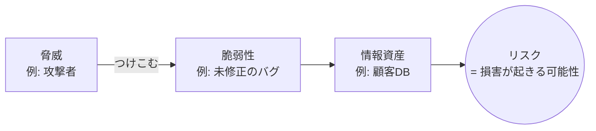

- 説明：リスクの大きさは、一般に「資産価値 × 脅威 × 脆弱性」または「発生確率 × 影響度」で評価します。
- ⚠️ ひっかけ注意：脆弱性を修正する（パッチを当てる）のは「脆弱性への対策」で、脅威そのもの（攻撃者）をなくすわけではありません。

### 1.3 不正のトライアングル ★

内部不正は、**動機**・**機会**・**正当化** の3つがそろうと起きやすくなる、という考え方です（クレッシーの理論）。

| 要素 | 例 | 対策例 |
|---|---|---|
| 動機・プレッシャー | 借金、過大なノルマ | 相談窓口、業務量の調整 |
| 機会 | 一人で権限を持っている、ログがない | 職務分掌、アクセスログ取得、最小権限 |
| 正当化 | 「会社が悪いから仕方ない」 | 教育、ルールの周知 |

IPAの「組織における内部不正防止ガイドライン」は、この考え方をもとに「犯行を難しくする」「捕まるリスクを高める」などの基本原則を示しています。

---

## 2. マルウェアと攻撃手法

### 2.1 マルウェアの種類 ★★

**マルウェア**（malicious software：悪意のあるソフトウェア）の総称と種類を押さえます。

| 名称 | 特徴 |
|---|---|
| **ウイルス** | 他のプログラムに寄生して増殖する |
| **ワーム** | 単独で動作し、ネットワーク経由で自己増殖する |
| **トロイの木馬** | 有用なソフトに見せかけて侵入し、裏で不正な動作をする（自己増殖はしない） |
| **ランサムウェア** | ファイルを暗号化するなどして使えなくし、復旧と引き換えに身代金を要求する |
| **スパイウェア** | 利用者の情報をひそかに収集して外部に送る |
| **キーロガー** | キーボード入力を記録して盗む |
| **ボット** | 感染端末を外部の **C&Cサーバ**（Command and Control：指令サーバ）から遠隔操作できるようにする。多数のボットの集まりが **ボットネット** |
| **ルートキット** | 侵入の痕跡を隠すツール群 |
| **バックドア** | 正規の認証を経ずに再侵入するための裏口 |
| **ファイルレスマルウェア** | 実行ファイルをディスクに置かず、PowerShellなど正規ツールやメモリ上で動作する。従来型のウイルス対策ソフトで検知しにくい |
| **Emotet（エモテット）** | 実在のメールの返信を装うなどして感染を広げる。ほかのマルウェアを呼び込む |

### 2.2 ランサムウェア ★★★

IPAの「情報セキュリティ10大脅威 2026」（組織編）でも **1位は「ランサム攻撃による被害」** です（11年連続の選出）。

- 最近の手口：**二重脅迫**（暗号化 + 盗んだデータの公開予告）、VPN装置の脆弱性やリモートデスクトップから侵入して社内に広がる「人手による攻撃」、暗号化せずにデータを盗んで脅す「ノーウェアランサム」。
- 対策：
  - **オフライン（またはネットワークから切り離した）バックアップ** を取り、復元手順を訓練しておく
  - VPN装置などの脆弱性に早くパッチを当てる、多要素認証を使う
  - 感染端末をネットワークから切り離す（**封じ込め**）
- ⚠️ ひっかけ注意：ネットワーク上の常時接続のバックアップは、一緒に暗号化される可能性があります。「バックアップを取っているから安全」とは限りません。

### 2.3 Webアプリケーションへの攻撃 ★★★

科目B問1で最もよく題材になる分野です。**攻撃の仕組み → 根本的対策** をセットで覚えます。

| 攻撃 | 仕組み | 主な対策 |
|---|---|---|
| **SQLインジェクション** | 入力欄に SQL 文の一部を入れ、意図しない SQL を実行させてデータを盗む・改ざんする | **プレースホルダ**（バインド機構、プリペアドステートメント）を使う。エスケープ処理。DBアカウントの権限を最小にする |
| **クロスサイトスクリプティング（XSS）** | 脆弱なサイトに悪意のあるスクリプトを埋め込み、閲覧者のブラウザで実行させる。Cookie の盗用などに使われる | 出力時の **エスケープ**（`<` を `&lt;` に置き換える等）、Cookie に **HttpOnly 属性**、**CSP**（Content Security Policy：読込み可能なスクリプトの制限） |
| **クロスサイトリクエストフォージェリ（CSRF）** | ログイン中の利用者に罠ページを踏ませ、本人の意図しないリクエスト（送金・投稿など）を正規サイトへ送らせる | 推測できない **トークン**（ワンタイムトークン）をフォームに埋め込んで照合、重要操作の前に **再認証**、Cookie の **SameSite 属性** |
| **OSコマンドインジェクション** | 入力値にOSコマンドを混ぜ、サーバ上で実行させる | シェルを呼び出す関数を使わない、入力値チェック |
| **ディレクトリトラバーサル** | `../` などでファイルパスをたどり、公開していないファイルを読む | ファイル名を直接受け取らない、パス正規化とチェック |
| **セッションハイジャック** | セッションIDを盗んだり推測したりして、正規利用者になりすます | 推測困難なセッションIDを使う、TLSで通信、Cookieに **Secure 属性** |
| **セッション固定化攻撃** | 攻撃者が用意したセッションIDを利用者に使わせ、ログイン後にそのIDでなりすます | **ログイン成功時にセッションIDを再発行する** |
| **クリックジャッキング** | 透明にした正規ページを罠ページに重ね、意図しないクリックをさせる | レスポンスヘッダ `X-Frame-Options` や CSP の `frame-ancestors` でフレーム内表示を禁止 |
| **SSRF**（Server Side Request Forgery） | サーバに細工したURLを読み込ませ、外部から直接届かない内部サーバへアクセスさせる | アクセス先のURLを許可リストで制限 |

#### XSS と CSRF の違い（頻出）

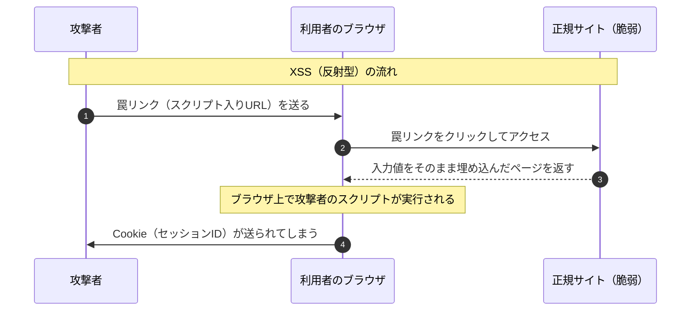

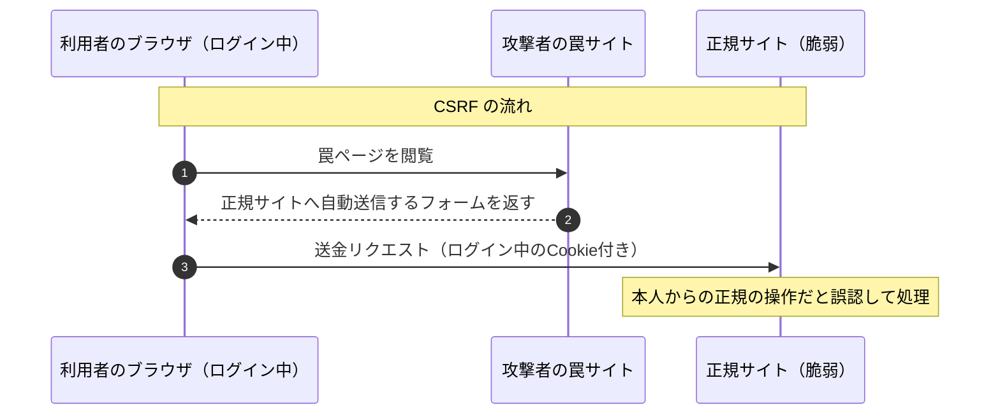

| 観点 | XSS | CSRF |
|---|---|---|
| スクリプトが動く場所 | 利用者のブラウザ（正規サイトのページとして） | 基本的にスクリプトは不要。正規サイトへのリクエストを送らせる |
| 攻撃者が得るもの | Cookie の盗用、画面の改ざん、何でも | 「本人として操作させる」こと。応答内容は攻撃者に見えない |
| 根本的対策 | 出力時のエスケープ | トークンの照合、再認証 |

- 💡 覚え方：XSS は「**スクリプトを埋め込む**」、CSRF は「**リクエストを偽造させる**（Forgery＝偽造）」。
- ⚠️ ひっかけ注意：SQLインジェクションの根本的対策は「入力値チェック」ではなく **プレースホルダ** です。入力値チェックは補助的な対策という扱いになります。

### 2.4 パスワードへの攻撃 ★★★

| 攻撃 | 仕組み | 対策 |
|---|---|---|
| **総当たり攻撃**（ブルートフォース） | 1つのIDに対して、すべての文字の組合せを試す | 長く複雑なパスワード、**アカウントロック** |
| **辞書攻撃** | 辞書の単語や、よく使われるパスワードを試す | 推測されにくいパスワード |
| **パスワードリスト攻撃** | 他のサイトから漏えいした ID とパスワードの組を使ってログインを試す | **パスワードの使い回しをしない**、多要素認証 |
| **リバースブルートフォース攻撃** | パスワードを固定（例：`123456`）して、ID を次々変えて試す | アカウントロックでは防ぎにくい。IPアドレスごとの試行回数制限、多要素認証 |
| **パスワードスプレー攻撃** | よく使われる少数のパスワードを、多数のアカウントに少しずつ試す（ロックがかからない程度に） | 多要素認証、ログの監視 |
| **レインボーテーブル攻撃** | ハッシュ値から元のパスワードを逆引きする表を事前に用意しておく | **ソルト**（ユーザごとのランダム値）を加えてハッシュ化、**ストレッチング**（ハッシュ計算を何度も繰り返す） |

- ⚠️ ひっかけ注意：**パスワードリスト攻撃** は「流出した組合せの使い回し」をねらいます。対策として「アカウントロック」より **使い回し禁止** と **多要素認証** が正解になることが多いです。

### 2.5 DoS / DDoS 攻撃 ★★

- **DoS攻撃**（Denial of Service：サービス妨害）：大量の要求を送り、サーバやネットワークを使えなくする攻撃です。**可用性** を侵害します。
- **DDoS攻撃**（Distributed DoS）：ボットネットなど多数の機器から一斉に行うDoS攻撃です。

| 攻撃 | 仕組み |
|---|---|
| **SYNフラッド攻撃** | TCP の接続要求（SYN）だけを大量に送り、接続待ちの状態でサーバの資源を枯渇させる。対策：SYN Cookie |
| **DNSリフレクション（DNSアンプ）攻撃** | 送信元IPアドレスを攻撃対象に偽装し、**オープンリゾルバ**（誰からの問合せにも答えるDNSサーバ）に問合せを送る。小さな問合せが大きな応答になって攻撃対象に集中する（**増幅攻撃**） |
| **EDoS攻撃**（Economic DoS） | クラウドの従量課金を悪用し、経済的な損失を与える |

- 対策：ISP やクラウド事業者の DDoS 対策サービス、**CDN**（Content Delivery Network）による負荷分散、DNSサーバのオープンリゾルバ化の防止（問合せを内部からのみ受け付ける）。

### 2.6 なりすまし・通信への攻撃 ★★★

#### 中間者攻撃（MITM）

**中間者攻撃**（Man-in-the-Middle attack）は、通信する2者の間に攻撃者が入り込み、両方になりすまして通信を盗聴・改ざんする攻撃です。

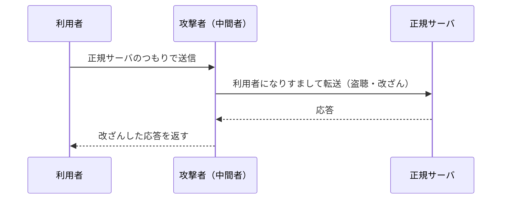

- 対策：**TLS で通信し、サーバ証明書を正しく検証する**（証明書の警告を無視しない）。相互認証、デジタル署名。
- **MITB攻撃**（Man-in-the-Browser）：PCに感染したマルウェアがブラウザを乗っ取り、利用者が正規サイトで入力した送金先などを書き換えます。通信経路は正規の TLS なので、TLS では防げません。対策の例は、**取引内容を別経路（スマートフォンなど）で確認する取引認証** です。

#### DNSキャッシュポイズニング

**DNSキャッシュポイズニング** は、DNSキャッシュサーバ（フルリゾルバ）に偽の応答を覚え込ませ、利用者を偽サイトへ誘導する攻撃です。

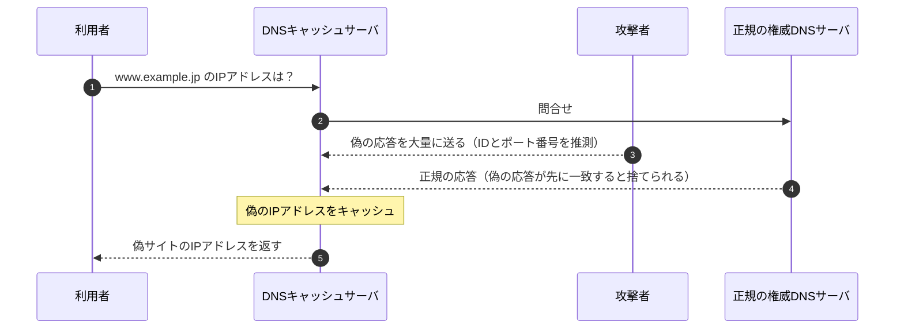

- 対策：
  - 問合せの **送信元ポート番号のランダム化**（推測を困難にする）
  - **DNSSEC**（DNS Security Extensions）：DNS応答にデジタル署名を付け、改ざんを検出する
  - キャッシュサーバは内部ネットワークからの問合せだけを受け付ける（オープンリゾルバにしない）
- 💡 一度に大量の偽応答を送り込むため、存在しないサブドメインを問い合わせ続ける手口は **カミンスキー攻撃** と呼ばれます。

#### その他のなりすまし

| 攻撃 | 内容 |
|---|---|
| **IPスプーフィング** | 送信元IPアドレスを偽装する |
| **ARPスプーフィング** | 偽の ARP 応答で、IPアドレスとMACアドレスの対応を書き換えて通信を横取りする |
| **フィッシング** | 正規の組織を装ったメールやSMSで偽サイトに誘導し、IDやパスワードを入力させる。SMSを使うものを **スミッシング** という |
| **ビジネスメール詐欺（BEC）** | 取引先や経営者になりすまし、偽の口座に送金させる |

### 2.7 標的型攻撃とAPT ★★★

- **標的型攻撃**：特定の組織をねらって、業務に関係のありそうな件名・本文のメール（**標的型攻撃メール**）を送り、添付ファイルを開かせてマルウェアに感染させる攻撃です。
- **APT**（Advanced Persistent Threat：高度で持続的な脅威）：長期間ひそかに潜伏し、侵入範囲を広げながら情報を盗み続けます。
- **水飲み場型攻撃**：標的がよく見るWebサイトを改ざんしておき、閲覧した標的だけを感染させます。
- **サプライチェーン攻撃**：セキュリティが手薄な取引先・委託先や、ソフトウェアの配布経路を経由して本命を攻撃します（10大脅威2026 組織編2位）。

標的型攻撃の典型的な流れ（サイバーキルチェーンの考え方）を押さえておくと、科目Bで「どの段階の対策か」を問われたときに役立ちます。

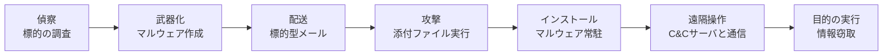

- 入口対策：メールフィルタ、サンドボックス、利用者教育（不審メール訓練）。
- 内部対策：権限の最小化、ネットワークの分離、**EDR**（Endpoint Detection and Response：端末上の不審な挙動の検知と対応）。
- 出口対策：C&Cサーバへの通信をプロキシやファイアウォールで遮断・検知する。

### 2.8 その他の攻撃・用語 ★★

| 用語 | 内容 |
|---|---|
| **ゼロデイ攻撃** | 脆弱性が公表される前、または修正プログラムが提供される前にその脆弱性をつく攻撃 |
| **ドライブバイダウンロード** | Webサイトを閲覧しただけで、利用者の気付かないうちにマルウェアをダウンロードさせる |
| **サイドチャネル攻撃** | 消費電力、処理時間、電磁波などの物理的な情報から暗号鍵などを推測する |
| **バッファオーバーフロー攻撃** | 確保した領域を超えるデータを送り込み、プログラムの戻り先を書き換えて不正なコードを実行させる |
| **ポートスキャン** | 開いているポートを調べ、稼働しているサービスを探る（攻撃の下調べ） |
| **プロンプトインジェクション** | 生成AIへの入力に細工をし、開発者の意図しない出力や動作をさせる |

---

## 3. 暗号技術

### 3.1 暗号の基本用語 ★

- **平文** を **鍵** で暗号化すると **暗号文** になり、暗号文を平文に戻すことを **復号** といいます。
- **危殆化**（きたいか）：計算機の性能向上や解読法の発見で暗号の安全性が下がること。日本では **CRYPTREC** が安全性を確認した暗号の一覧（電子政府推奨暗号リスト）を公開しています。

### 3.2 共通鍵暗号方式と公開鍵暗号方式 ★★★

| 項目 | 共通鍵暗号方式 | 公開鍵暗号方式 |
|---|---|---|
| 鍵 | 暗号化と復号に **同じ鍵** を使う | **公開鍵** と **秘密鍵** のペアを使う |
| 処理速度 | 速い | 遅い |
| 鍵の配送 | 安全な受け渡し方法が必要（**鍵配送問題**） | 公開鍵は公開してよいので配送が楽 |
| n 人が相互に通信するときの鍵の数 | `n(n−1)/2` 個 | `2n` 個（各人1ペア） |
| 代表例 | **AES**、ChaCha20、（旧）DES、3DES | **RSA**、**楕円曲線暗号（ECC）**、ElGamal |

- **AES**（Advanced Encryption Standard）：ブロック長128ビット、鍵長128/192/256ビットから選べる共通鍵暗号です。
- **RSA**：大きな数の **素因数分解** が難しいことを安全性の根拠にしています。
- **楕円曲線暗号**：楕円曲線上の離散対数問題の難しさを根拠にし、RSAより **短い鍵長で同程度の安全性** が得られます。

#### 計算例：鍵の数

- 公式：共通鍵 `n(n−1)/2`、公開鍵 `2n`
- 数値例：100人が互いに暗号通信をする場合
- 途中式：
  - 共通鍵：`100 × (100 − 1) / 2 = 100 × 99 / 2 = 4,950 個`
  - 公開鍵：`2 × 100 = 200 個`（公開鍵100個 + 秘密鍵100個）

#### 公開鍵暗号で「秘密に送る」ときの鍵の使い方

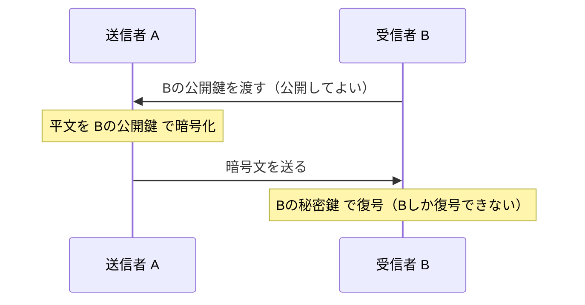

- 💡 覚え方：**「機密性は受信者の鍵、署名は送信者の鍵」**。秘密に送りたいなら受信者の公開鍵で暗号化、本人証明をしたいなら送信者の秘密鍵で署名します。

### 3.3 ハイブリッド暗号方式 ★★★

共通鍵暗号の「速さ」と公開鍵暗号の「鍵配送の楽さ」の両方のよいところを取る方式です。TLS や S/MIME で使われています。

1. 送信者が使い捨ての **共通鍵（セッション鍵）** を生成する。
2. データ本体はその共通鍵で暗号化する（速い）。
3. 共通鍵そのものは **受信者の公開鍵** で暗号化して送る（鍵を安全に配送できる）。
4. 受信者は自分の秘密鍵で共通鍵を取り出し、データを復号する。

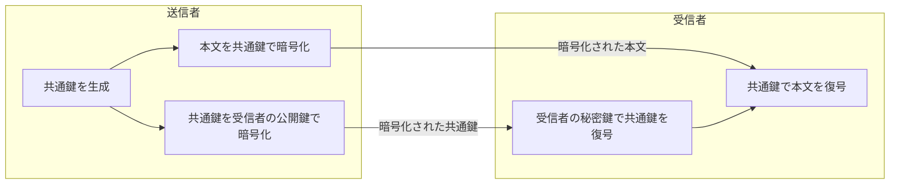

- 補足：現在の TLS 1.3 では、共通鍵を「公開鍵で暗号化して送る」のではなく、**ECDHE**（楕円曲線ディフィー・ヘルマン鍵共有）で双方が同じ共通鍵を計算して共有します。毎回使い捨ての鍵を使うので、サーバの秘密鍵が後で漏えいしても過去の通信は解読されません。この性質を **前方秘匿性**（PFS：Perfect Forward Secrecy）といいます。

### 3.4 ハッシュ関数 ★★★

**ハッシュ関数** は、任意の長さのデータから固定長の値（**ハッシュ値**、メッセージダイジェスト）を作る関数です。

- 性質：
  - **一方向性**：ハッシュ値から元のデータを求めることは事実上できない
  - **衝突困難性**：同じハッシュ値になる異なる2つのデータを見つけることは事実上できない
  - データが1ビットでも変わると、ハッシュ値は大きく変わる
- 用途：**改ざん検出**（完全性の確認）、デジタル署名、パスワードの保存。
- 代表例：**SHA-256**（ハッシュ値256ビット）、SHA-3。MD5 と SHA-1 は衝突が見つかっているため、新たな用途には使いません。

| 方式 | 何ができるか | 鍵 |
|---|---|---|
| ハッシュ値だけ | 偶発的な改ざんの検出（ただし攻撃者がハッシュ値ごと差し替えると検出できない） | なし |
| **MAC**（Message Authentication Code：メッセージ認証符号）。代表例 **HMAC** | 改ざん検出 + 送信者が共通鍵を持つ相手であることの確認 | 共通鍵 |
| **デジタル署名** | 改ざん検出 + 送信者の確認 + **否認防止** | 公開鍵ペア |

- ⚠️ ひっかけ注意：MAC は共通鍵を使うので、送信者と受信者のどちらが作ったか区別できません。そのため **否認防止はできません**。否認防止ができるのはデジタル署名です。
- ⚠️ ハッシュ関数は「暗号化」ではありません。ハッシュ値から元に戻す（復号する）ことはできません。

---

## 4. デジタル署名とPKI

### 4.1 デジタル署名の仕組み ★★★

**デジタル署名** は、「送信者が本人であること（真正性）」と「内容が改ざんされていないこと（完全性）」を確認でき、さらに **否認防止** を実現する仕組みです。

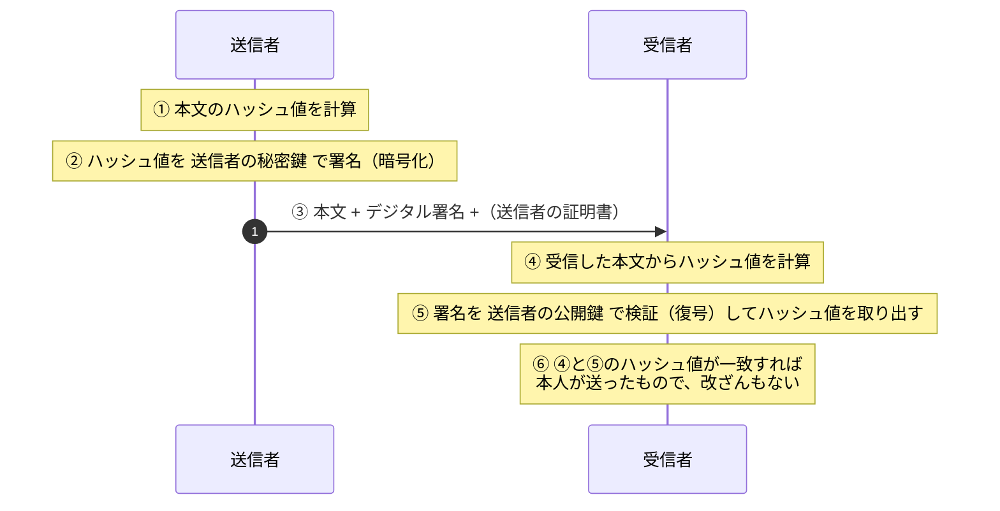

| 確認できること | 理由 |
|---|---|
| 送信者の真正性・否認防止 | 送信者の秘密鍵は送信者しか持っていない。送信者の公開鍵で検証できた = 送信者の秘密鍵で作られた |
| 完全性（改ざん検出） | 本文が変わるとハッシュ値が一致しなくなる |

- ⚠️ ひっかけ注意：デジタル署名だけでは **機密性は確保されません**（本文は平文のまま送られます）。秘密にしたいときは別途暗号化します。
- ⚠️ 「送信者の公開鍵が本当に送信者のものか」は、デジタル署名だけでは分かりません。そこで次の **PKI** が必要になります。

### 4.2 PKI とデジタル証明書 ★★★

**PKI**（Public Key Infrastructure：公開鍵基盤）は、「この公開鍵は確かにこの人（このサーバ）のものだ」と、信頼できる第三者が保証する仕組みです。

- **認証局（CA：Certification Authority）**：本人確認をしたうえで **デジタル証明書** を発行します。証明書には **CAのデジタル署名** が付いています。
- **デジタル証明書**（公開鍵証明書）：主に **X.509** 形式で、所有者の名前、**所有者の公開鍵**、有効期間、発行者（CA）名、シリアル番号、CAの署名などが記載されています。
- **登録局（RA：Registration Authority）**：本人確認と登録の受付を担当します。
- **ルート証明書**：最上位のCA（ルートCA）が自分自身で署名した証明書（自己署名証明書）です。OSやブラウザにあらかじめ組み込まれており、これが信頼の起点（**トラストアンカー**）になります。

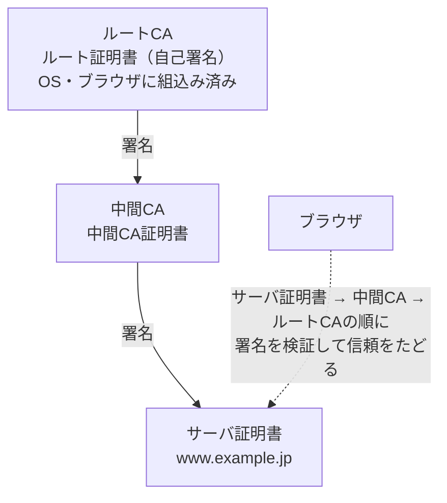

この連鎖を **証明書チェーン**（証明書パス）と呼びます。ブラウザは、サーバ証明書の署名を中間CAの公開鍵で、中間CA証明書の署名をルートCAの公開鍵で検証し、信頼できるルートまでたどれるかを確認します。

- 補足：サーバ証明書には、ドメインの管理権限だけを確認する **DV証明書**、組織の実在も確認する **OV証明書**、厳格な基準で確認する **EV証明書** があります。

### 4.3 証明書の失効確認（CRL / OCSP） ★★★

秘密鍵が漏えいした場合などは、有効期間内であっても証明書を **失効** させます。失効しているかどうかを確認する方法は2つあります。

| 方式 | 仕組み | 特徴 |
|---|---|---|
| **CRL**（Certificate Revocation List：証明書失効リスト） | CAが失効した証明書の **シリアル番号** と失効日時の一覧を定期的に発行し、利用者がダウンロードして確認する | リストが大きくなる。発行間隔の分だけ情報が古い可能性がある |
| **OCSP**（Online Certificate Status Protocol） | 利用者が **OCSPレスポンダ** に、ある証明書の状態をリアルタイムに問い合わせる | 最新の状態を確認できる。問合せのたびに通信が発生する |
| **OCSPステープリング** | サーバがOCSP応答をあらかじめ取得しておき、TLSハンドシェイクの中でクライアントに渡す | クライアントの問合せが不要になり、高速でプライバシー上も有利 |

- ⚠️ ひっかけ注意：CRL に載るのは「失効した証明書」の情報です。有効期限が切れた証明書を載せ続けるわけではありません。また、CRL には証明書そのものではなく **シリアル番号** が載ります。
- 補足：証明書の誤発行を監視する仕組みとして、発行した証明書を公開ログに記録する **CT**（Certificate Transparency）もあります。

### 4.4 タイムスタンプ ★

**タイムスタンプ**（時刻認証）は、時刻認証局（TSA：Time-Stamping Authority）が「その時刻にその文書が存在し、それ以降改ざんされていないこと」を証明する仕組みです。デジタル署名と組み合わせることで、証明書の有効期限が切れた後も署名の有効性を示しやすくなります（長期署名）。

---

## 5. 認証技術

### 5.1 認証の3要素と多要素認証 ★★★

**認証** とは、相手が本人であることを確かめることです。本人確認に使う要素は3種類あります。

| 要素 | 例 |
|---|---|
| **知識情報**（知っているもの） | パスワード、PIN、秘密の質問 |
| **所持情報**（持っているもの） | ICカード、スマートフォン、ハードウェアトークン |
| **生体情報**（本人の身体的特徴） | 指紋、顔、静脈、虹彩 |

- **多要素認証（MFA）**：異なる要素を2つ以上組み合わせる認証です。
- **二段階認証**：認証を2回に分けることです。同じ要素を2回（例：パスワード + 秘密の質問）でも二段階ですが、多要素ではありません。
- ⚠️ ひっかけ注意：「パスワード + 秘密の質問」は **どちらも知識情報** なので多要素認証ではありません。

#### 生体認証の誤り率

| 指標 | 意味 |
|---|---|
| **本人拒否率**（FRR：False Rejection Rate） | 本人なのに拒否してしまう割合 |
| **他人受入率**（FAR：False Acceptance Rate） | 他人なのに受け入れてしまう割合 |

この2つは **トレードオフ** の関係にあります。判定を厳しくするとFARは下がりますがFRRは上がります。

### 5.2 ワンタイムパスワードとチャレンジレスポンス認証 ★★

- **ワンタイムパスワード（OTP）**：一度しか使えないパスワードです。盗聴されても再利用（**リプレイ攻撃**）されません。
  - **TOTP**（Time-based OTP）：時刻をもとに生成する（認証アプリで30秒ごとに変わる数字など）。
  - **HOTP**（HMAC-based OTP）：カウンタをもとに生成する。
- **チャレンジレスポンス認証**：パスワードそのものをネットワークに流さない認証方式です。

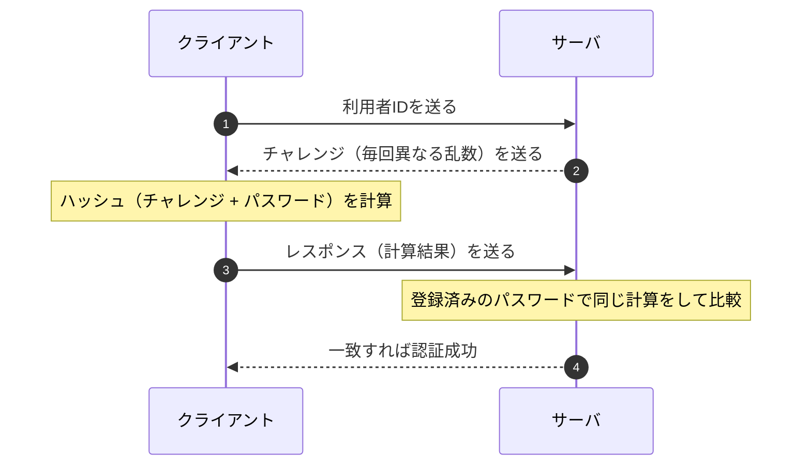

- 盗聴されても、流れるのは毎回変わる乱数とその計算結果だけです。パスワードは流れず、同じレスポンスは次回使えないため **リプレイ攻撃** も防げます。
- ⚠️ サーバ側はパスワード（または同等の値）を保持している必要があります。

### 5.3 リスクベース認証とその他 ★

- **リスクベース認証**：いつもと異なる環境（初めての端末、海外のIPアドレスなど）からのログインのときだけ、追加の認証を求めます。
- **RADIUS**：ネットワークへの接続時の認証を、認証サーバに集約するためのプロトコルです（無線LANの IEEE 802.1X 認証などで使います）。
- **Kerberos**：認証サーバが **チケット** を発行し、そのチケットで各サーバを利用する認証方式です。Windows の Active Directory で使われています。

### 5.4 シングルサインオン（SSO）とフェデレーション ★★★

**SSO**（Single Sign-On）は、一度の認証で複数のシステムを利用できるようにする仕組みです。

| 実現方式 | 仕組み |
|---|---|
| **Cookie型** | 認証済みの情報を Cookie に保存して共有する（同じドメイン内が前提） |
| **リバースプロキシ型** | 利用者とシステムの間のリバースプロキシで認証をまとめて行う |
| **エージェント型** | 各サーバにエージェント（ソフト）を入れ、認証サーバと連携する |
| **フェデレーション型** | 組織やドメインをまたいで、認証結果を **SAML** などで受け渡す |

#### SAML・OAuth・OpenID Connect の違い（頻出）

| 名称 | 目的 | やり取りするもの | 典型的な用途 |
|---|---|---|---|
| **SAML**（Security Assertion Markup Language） | **認証**（SSO） | XML形式の **アサーション**（認証結果などの表明） | 社内の ID でクラウドサービスに SSO |
| **OAuth 2.0** | **認可**（権限の委譲） | **アクセストークン** | 「このアプリにあなたの写真の閲覧を許可しますか？」 |
| **OpenID Connect（OIDC）** | OAuth 2.0 を拡張した **認証** | **IDトークン**（JWT形式）+ アクセストークン | 「Googleでログイン」などのソーシャルログイン |

- 用語：認証を行う側を **IdP**（Identity Provider）、認証結果を受け取ってサービスを提供する側を **SP**（Service Provider）または RP（Relying Party）と呼びます。
- ⚠️ ひっかけ注意：**OAuth は本来「認可」の仕組み** です。「OAuth で認証する」という選択肢はひっかけになりやすいので、認証なら SAML か OpenID Connect と覚えます。

### 5.5 FIDO とパスキー ★★

- **FIDO**（Fast IDentity Online）：パスワードに頼らない認証の標準規格です。現在の中心は **FIDO2**（Web 標準の **WebAuthn** と、認証器との通信方式 **CTAP** から成る）です。
- 仕組み：
  1. 登録時に、端末（認証器）の中で **公開鍵と秘密鍵のペア** を作り、**公開鍵だけ** をサーバに登録する。
  2. 認証時は、サーバからのチャレンジに **秘密鍵で署名** して返し、サーバは登録済みの公開鍵で検証する。
  3. 秘密鍵を使うとき、端末上で指紋・顔認証や PIN による本人確認をする。生体情報はサーバに送られない。
- メリット：
  - サーバに秘密情報（パスワード）を置かないので、サーバから漏えいしても悪用されにくい。
  - 鍵ペアはサイト（ドメイン）ごとに作られ、署名にはドメインの情報が含まれるため、偽サイトでは使えない。つまり **フィッシングに強い**。
- **パスキー**：FIDO の認証情報（秘密鍵）を、クラウド経由で同じ利用者の複数端末に同期できるようにしたものです。機種変更しても使い続けられます。

---

## 6. 通信の保護（TLS・VPN・IPsec・無線LAN）

### 6.1 TLS ★★★

**TLS**（Transport Layer Security）は、TCP の上で通信を **暗号化・改ざん検出・サーバ認証** するプロトコルです。HTTPS（HTTP over TLS、ポート443）などで使われます。前身は SSL ですが、SSL と古い TLS（1.0 / 1.1）は脆弱なため使いません。現在の主流は **TLS 1.2 と TLS 1.3** です。

TLS で実現できること：

| 機能 | 実現方法 |
|---|---|
| サーバの認証 | サーバ証明書の検証 |
| 機密性 | 共通鍵暗号（AES-GCM など） |
| 完全性 | AEAD（認証付き暗号）や MAC |
| クライアント認証（必要な場合） | **クライアント証明書** |

#### TLS 1.3 のハンドシェイク（概略）

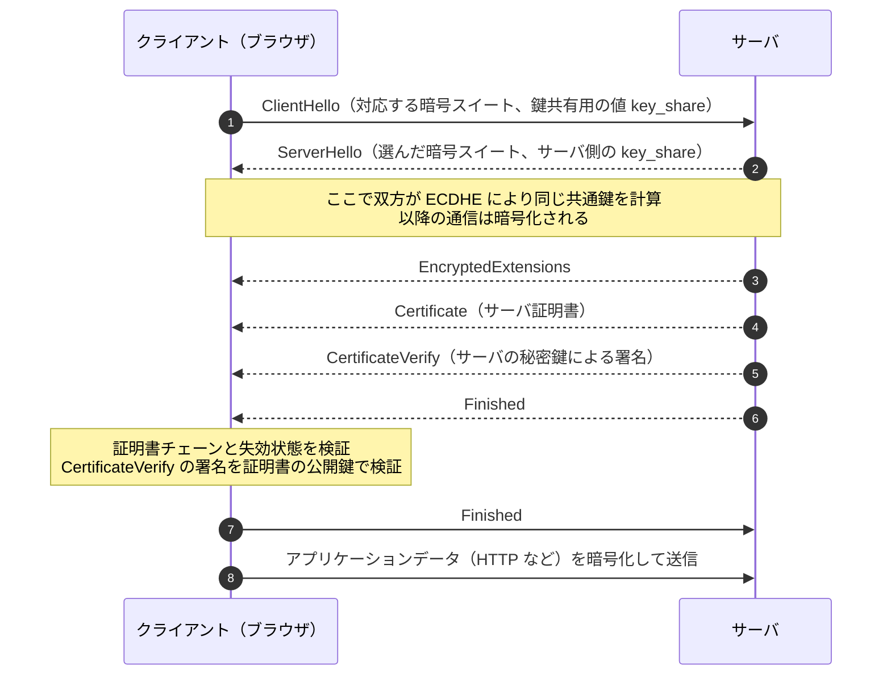

- TLS 1.3 では、ハンドシェイクが **1往復（1-RTT）** で完了します（TLS 1.2 は2往復）。
- 鍵交換は前方秘匿性のある **(EC)DHE** に限定され、静的 RSA 鍵交換は廃止されました。
- ⚠️ ひっかけ注意：TLS は **通信経路** を守る技術です。サーバに保存されたデータや、端末に感染したマルウェア（MITB）からは守れません。

#### サーバ証明書の検証で確認すること

1. 証明書チェーンをたどり、信頼できるルートCAに行き着くか
2. 有効期間内か
3. 失効していないか（CRL / OCSP）
4. 証明書に書かれた **ドメイン名（SAN：サブジェクト代替名）** が、アクセスしたドメイン名と一致するか

### 6.2 VPN ★★

**VPN**（Virtual Private Network）は、インターネットなどの共用ネットワーク上に、暗号化などによって仮想的な専用線を作る技術です。

| 種類 | 特徴 |
|---|---|
| **IPsec-VPN** | ネットワーク層（IP）で暗号化。拠点間接続でよく使う |
| **SSL-VPN（TLS-VPN）** | TLS を使う。ブラウザや専用クライアントで接続でき、リモートアクセスでよく使う |
| **インターネットVPN** | インターネットを利用する。安価 |
| **IP-VPN** | 通信事業者の閉域網を利用する。品質が安定している |

- ⚠️ 近年は、**VPN装置の脆弱性** がランサムウェアの主な侵入口になっています。パッチ適用と多要素認証が重要です。

### 6.3 IPsec ★★

**IPsec** は、ネットワーク層で IP パケットを暗号化・認証するプロトコル群です。

| 構成要素 | 役割 |
|---|---|
| **AH**（Authentication Header） | 認証と改ざん検出。**暗号化はしない** |
| **ESP**（Encapsulating Security Payload） | **暗号化** + 認証・改ざん検出 |
| **IKE**（Internet Key Exchange） | 鍵交換と、SA（Security Association：通信の取決め）の確立 |

| モード | 暗号化の範囲 | 主な用途 |
|---|---|---|
| **トランスポートモード** | IPパケットのデータ部分のみ（元のIPヘッダはそのまま） | 端末どうしの通信 |
| **トンネルモード** | 元のIPパケット全体を暗号化し、新しいIPヘッダを付ける | VPN装置どうしの拠点間通信 |

- 💡 覚え方：「**E**SP は **E**ncrypt（暗号化）できる、AH は認証だけ」。

### 6.4 無線LANのセキュリティ ★★

| 方式 | 特徴 |
|---|---|
| WEP | 脆弱。使用禁止 |
| WPA2 | 暗号化に AES（CCMP）。パーソナルモードは事前共有鍵（PSK） |
| **WPA3** | パーソナルモードで **SAE**（Simultaneous Authentication of Equals）を採用し、パスワードの総当たり（オフライン辞書攻撃）に強い |

- **パーソナルモード**：全員が同じ事前共有鍵（パスフレーズ）を使う。家庭向け。
- **エンタープライズモード**：**IEEE 802.1X** と RADIUS サーバで、利用者ごとに認証する。企業向け。
- ⚠️ SSID のステルス化（非通知）や MAC アドレスフィルタリングは、単独では十分な対策になりません（盗聴やなりすましが可能なため）。

---

## 7. ネットワークセキュリティ機器と構成

### 7.1 ファイアウォール ★★★

**ファイアウォール** は、内部ネットワークと外部ネットワークの境界で、通信を許可・遮断する仕組みです。

| 方式 | 仕組み |
|---|---|
| **パケットフィルタリング型** | IPアドレス、ポート番号、プロトコルなどのヘッダ情報で許可・遮断を判断する |
| **ステートフルインスペクション** | 通信の状態（どの通信への応答か）を記録し、内部から始めた通信への戻りパケットだけを通す |
| **アプリケーションゲートウェイ型** | アプリケーション層で中継して内容を検査する（プロキシ型） |

フィルタリングのルールは **上から順に評価** し、最初に一致したルールを適用するのが一般的です。最後に「すべて拒否」を置き、必要な通信だけを許可する（**ホワイトリスト方式**、許可リスト方式）のが基本です。

| 番号 | 送信元 | 宛先 | 宛先ポート | 動作 |
|---|---|---|---|---|
| 1 | any | DMZのWebサーバ | 443/TCP | 許可 |
| 2 | 内部LAN | any | 443/TCP | 許可 |
| 3 | any | any | any | 拒否 |

- 科目Bでは、このようなルール表の **空欄補充** や「ある通信が通るか」の判定がよく出ます。行の順番に注意して上から当てはめます。

### 7.2 DMZ ★★★

**DMZ**（DeMilitarized Zone：非武装地帯）は、外部ネットワークにも内部ネットワークにも属さない中間のセグメントです。外部に公開するサーバ（Web、メール、DNS）を置きます。

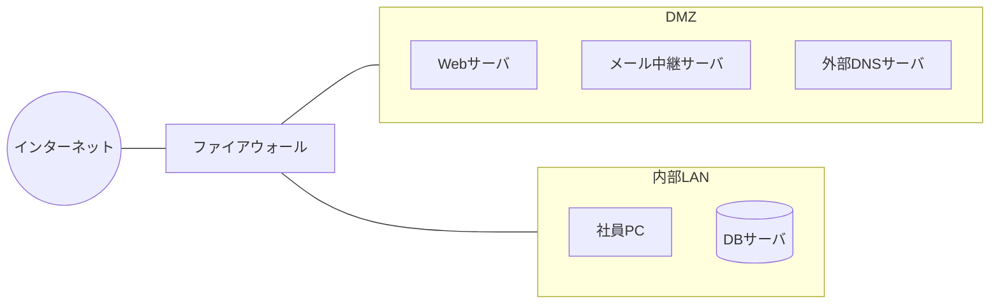

- 目的：公開サーバが乗っ取られても、**内部LANへの被害の拡大を防ぐ** ことです。
- 基本ルール：インターネット → DMZ は必要なポートだけ許可、インターネット → 内部LAN は（応答以外）すべて拒否、DMZ → 内部LAN も原則拒否します。
- ⚠️ ひっかけ注意：顧客情報を持つ DB サーバを DMZ に置くのは誤りです。DBサーバは内部側に置き、Webサーバからの必要な通信だけを許可します。

### 7.3 WAF・IDS・IPS ★★★

| 機器 | 役割 | 設置場所・特徴 |
|---|---|---|
| **WAF**（Web Application Firewall） | Webアプリケーションへの通信内容（HTTP）を検査し、SQLインジェクションやXSSなどの攻撃を遮断する | Webサーバの前。アプリの脆弱性をすぐ直せないときの **暫定対策** にもなる |
| **IDS**（Intrusion Detection System：侵入検知システム） | 不正な通信を **検知して管理者に通知** する（遮断はしない） | ネットワーク型（NIDS）とホスト型（HIDS）がある |
| **IPS**（Intrusion Prevention System：侵入防止システム） | 不正な通信を **検知して遮断** する | 通信経路上に **インライン** で設置する |

検知方式：

| 方式 | 仕組み | 長所・短所 |
|---|---|---|
| **シグネチャ型**（不正検出） | 既知の攻撃パターン（シグネチャ）と照合する | 既知の攻撃に強い。未知の攻撃は検知できない |
| **アノマリ型**（異常検出） | 正常時の通信と比べて、異常なふるまいを検知する | 未知の攻撃も検知できる可能性がある。誤検知が増えやすい |

- **フォールスポジティブ**（誤検知）：正常な通信を攻撃と判断してしまうこと。
- **フォールスネガティブ**（検知漏れ）：攻撃を見逃してしまうこと。
- ⚠️ ひっかけ注意：WAF の遮断ルールを厳しくするとフォールスポジティブが増え、正規の利用者が使えなくなることがあります。科目Bでは「導入直後はまず **検知のみ（モニタリング）モード** で運用し、誤検知を確認してから遮断モードにする」という流れがよく問われます。

### 7.4 プロキシサーバ ★★

| 種類 | 役割 |
|---|---|
| **フォワードプロキシ** | 内部の利用者の代わりに外部へアクセスする。アクセスログの取得、URLフィルタリング、マルウェアの **出口対策**（C&C通信の遮断）に使う |
| **リバースプロキシ** | 外部からのアクセスを受けて、内部のサーバへ中継する。負荷分散、TLS終端、SSOなどに使う |

- **URLフィルタリング**：業務に不要なサイトや危険なサイトへのアクセスを制限します。
- プロキシの **認証** を必須にすると、利用者認証の情報を持たないマルウェアの外部通信を止めやすくなります（科目Bで出題実績のある考え方です）。

### 7.5 その他の機器・仕組み ★★

| 用語 | 内容 |
|---|---|
| **UTM**（Unified Threat Management：統合脅威管理） | ファイアウォール、IPS、ウイルス対策、URLフィルタリングなどを1台にまとめた機器 |
| **SIEM**（Security Information and Event Management） | 各機器のログを集めて相関分析し、インシデントの兆候を検知する |
| **EDR** | 端末の挙動を監視し、侵入後の不審な動作を検知・隔離する |
| **サンドボックス** | 隔離した環境で添付ファイルなどを実際に動かし、ふるまいを確認する |
| **DLP**（Data Loss Prevention） | 機密情報の持出しや送信を検知・防止する |
| **検疫ネットワーク** | 社内LANに接続する端末のパッチやウイルス定義の状態を検査し、問題があれば隔離する |

---

## 8. メールセキュリティ

### 8.1 送信ドメイン認証（SPF・DKIM・DMARC） ★★★

メールの送信元は簡単に偽装できます。そこで、受信側が「送信元ドメインが正しいか」を確認する **送信ドメイン認証** を使います。

| 技術 | 仕組み | 何を確認するか |
|---|---|---|
| **SPF**（Sender Policy Framework） | 送信側ドメインの DNS に、正規の送信メールサーバの **IPアドレス** を登録しておく（TXTレコード） | 受信側は、接続してきたサーバのIPアドレスが、エンベロープの送信元（`MAIL FROM`）ドメインのSPFレコードに含まれるかを確認する |
| **DKIM**（DomainKeys Identified Mail） | 送信側のメールサーバが **秘密鍵でデジタル署名** をメールヘッダに付ける。公開鍵は DNS に登録する | 受信側は DNS から公開鍵を取得して署名を検証する。**途中での改ざん** も検出できる |
| **DMARC**（Domain-based Message Authentication, Reporting and Conformance） | SPF・DKIM の結果と、**ヘッダの From（利用者に見える送信者）のドメインが一致するか**（アラインメント）を確認する。失敗したときの扱い（**ポリシー**）を送信側が DNS で宣言する | ポリシーは `none`（何もしない・監視）、`quarantine`（隔離）、`reject`（拒否）。受信側から送信側へ **レポート** も送られる |

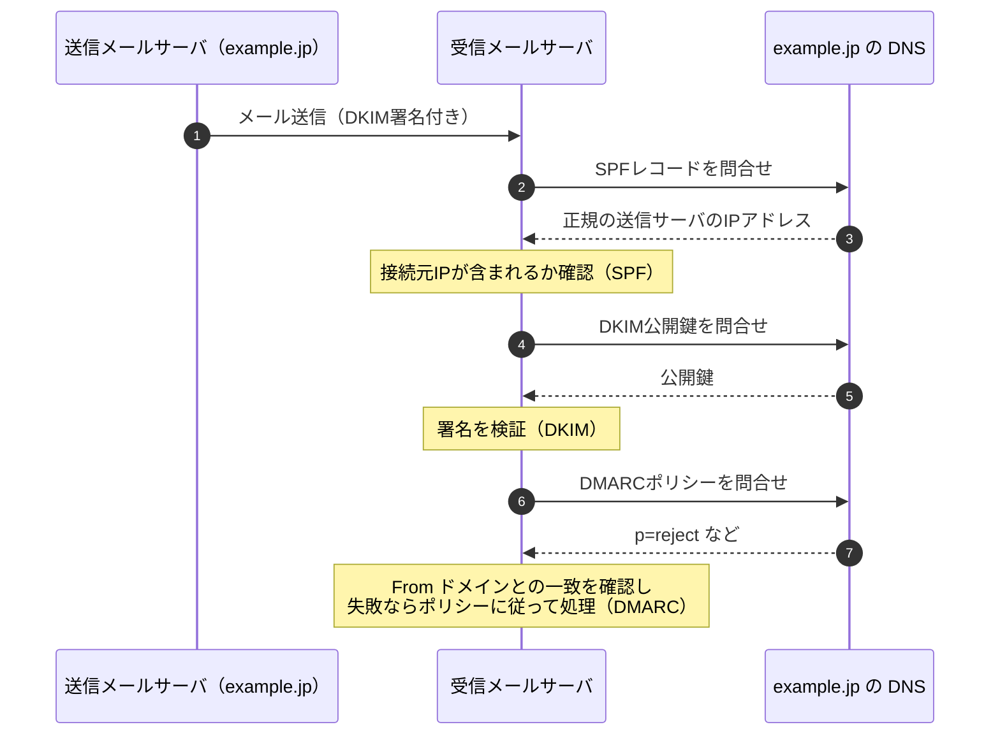

- ⚠️ ひっかけ注意：SPF はメールの **転送**（中継）で失敗しやすく、DKIM は転送されても署名が壊れなければ検証できます。
- ⚠️ SPF・DKIM・DMARC は「送信元ドメインが正しいか」を確認する技術で、**本文の暗号化はしません**。

### 8.2 S/MIME と PGP ★★

| 技術 | 内容 |
|---|---|
| **S/MIME**（Secure/MIME） | 認証局が発行した証明書（PKI）を使い、メールの **暗号化** と **デジタル署名** を行う |
| **PGP** / OpenPGP | 利用者どうしが互いの公開鍵を信頼し合う「信頼の輪」の考え方で、暗号化と署名を行う |

- S/MIME の暗号化はハイブリッド方式です。本文を共通鍵で暗号化し、その共通鍵を **受信者の公開鍵** で暗号化します。署名は **送信者の秘密鍵** で作ります。

### 8.3 メール送信時の対策 ★★

| 用語 | 内容 |
|---|---|
| **OP25B**（Outbound Port 25 Blocking） | ISP が、自社網内の端末から外部のメールサーバの25番ポートへの直接送信を遮断する。ボットによる迷惑メール送信を防ぐ |
| **サブミッションポート**（587番） | 利用者がメールを送信するときに使うポート。**SMTP-AUTH**（SMTPでの利用者認証）と組み合わせる |
| **SMTPS / STARTTLS** | メールサーバ間や利用者との通信を TLS で暗号化する |
| **第三者中継（オープンリレー）の禁止** | 自組織と関係のないメールを中継しないように設定する |

---

## 9. 情報セキュリティ管理（ISMS・リスクマネジメント）

### 9.1 ISMS ★★★

**ISMS**（Information Security Management System：情報セキュリティマネジメントシステム）は、組織が情報セキュリティを継続的に管理・改善する仕組みです。国際規格は **ISO/IEC 27001**、日本の規格は **JIS Q 27001** です（2022年の国際規格改訂に対応した JIS Q 27001:2023 が現行）。

| 規格 | 内容 |
|---|---|
| **JIS Q 27000** | 用語の定義 |
| **JIS Q 27001** | ISMS の **要求事項**（認証審査の基準） |
| **JIS Q 27002** | 管理策の **実践のための規範**（具体的な管理策のガイド） |
| **JIS Q 27017** | クラウドサービスのための管理策 |

- JIS Q 27001:2023 の附属書A の管理策は **93項目** で、**組織的・人的・物理的・技術的** の4つに分類されています。
- ISMS は **PDCA サイクル** で運用します。
  - Plan（方針策定・リスク評価・管理策の選択）→ Do（導入・運用）→ Check（監視・内部監査・マネジメントレビュー）→ Act（是正処置・改善）

- **情報セキュリティ方針**：経営陣が承認し、組織の情報セキュリティに対する考え方を示す文書です。基本方針 → 対策基準 → 実施手順 の階層で作るのが一般的です。
- **適用宣言書**（SoA：Statement of Applicability）：附属書Aの管理策のうち、どれを採用し、どれを除外したかとその理由をまとめた文書です。
- 💡 プライバシーマーク（JIS Q 15001：個人情報保護マネジメントシステム）とセットで出題されることがあります。

### 9.2 リスクマネジメントの流れ ★★★

JIS Q 31000 や JIS Q 27000 の考え方では、次の流れでリスクを扱います。

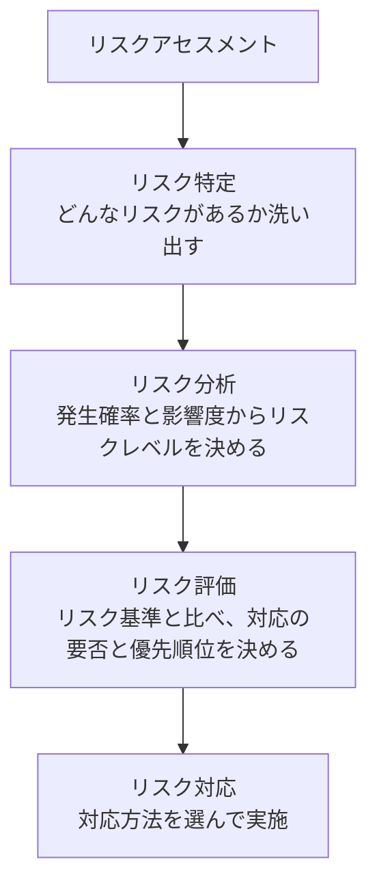

| リスク対応 | 内容 | 例 |
|---|---|---|
| **リスク回避** | リスクの原因となる活動そのものをやめる | 個人情報を扱う業務から撤退する |
| **リスク低減**（リスク軽減） | 発生確率や影響を下げる | 暗号化、アクセス制御、バックアップ |
| **リスク移転**（リスク共有） | 他者と分担する | **サイバー保険** への加入、外部委託 |
| **リスク保有**（リスク受容） | 対策をせず、そのまま受け入れる | 影響が小さく、対策費用の方が高い場合 |

- 💡 覚え方：「回避＝やめる、低減＝減らす、移転＝人に渡す、保有＝受け入れる」。
- ⚠️ ひっかけ注意：保険に入るのは「低減」ではなく **移転（共有）** です。保険では発生確率は下がりません。
- **残留リスク**：対応後も残るリスクです。経営者が把握して承認します。

#### リスク分析の手法

| 手法 | 内容 |
|---|---|
| **ベースラインアプローチ** | 既存の標準やガイドラインに沿って一定水準の対策をする。簡単だが組織の実情に合わないことがある |
| **非形式的アプローチ** | 担当者の経験や判断で分析する |
| **詳細リスク分析** | 資産ごとに脅威・脆弱性を詳しく分析する。精度は高いが手間がかかる |
| **組合せアプローチ** | 重要な資産は詳細リスク分析、それ以外はベースラインアプローチ |

#### 計算例：年間予想損失額

- 公式：`年間予想損失額 = 1回あたりの損失額 × 年間発生回数（発生確率）`
- 数値例：1回の情報漏えいで2,000万円の損失、発生頻度は10年に1回と見積もる
- 途中式：`2,000万円 × (1 / 10) = 200万円 / 年`
- この対策に年400万円かかるなら、費用が損失額を上回るので、費用対効果の観点ではリスク保有や別の安価な対策も検討対象になります。

### 9.3 脆弱性管理とセキュリティ評価 ★★

| 用語 | 内容 |
|---|---|
| **CVE**（Common Vulnerabilities and Exposures） | 個々の脆弱性に付ける世界共通の識別番号（例：CVE-2024-12345） |
| **CVSS**（Common Vulnerability Scoring System：共通脆弱性評価システム） | 脆弱性の深刻度を 0.0〜10.0 で評価する。現行版は v4.0（2023年公開）で、基本評価基準・脅威評価基準・環境評価基準・補足評価基準がある。v3.1 の基本・現状・環境評価基準もまだ広く使われる |
| **JVN**（Japan Vulnerability Notes） | JPCERT/CC と IPA が共同で運営する脆弱性対策情報ポータル |
| **ペネトレーションテスト** | 実際に攻撃者の手法で侵入を試み、弱点を確認する |
| **脆弱性診断** | ツールや手作業で、既知の脆弱性がないかを網羅的に調べる |
| **SBOM**（Software Bill of Materials） | ソフトウェアを構成する部品（ライブラリなど）の一覧。脆弱性が見つかったときの影響範囲の特定に役立つ |

### 9.4 人的・物理的対策 ★

- **人的対策**：セキュリティ教育、秘密保持契約（NDA）、退職者のアカウント削除、**職務分掌**（一人に権限を集中させない）。
- **物理的対策**：入退室管理（ICカード、生体認証）、**アンチパスバック**（入室記録がないと退室できない、または逆）、**共連れ** の防止（**セキュリティゲート**、監視カメラ）、施錠、**クリアデスク・クリアスクリーン**。
- **アクセス制御の原則**：**最小権限の原則**（業務に必要な最小限の権限だけを与える）、**Need-to-Know**（知る必要のある人だけに開示）。

---

## 10. インシデント対応とセキュリティ組織

### 10.1 セキュリティ組織 ★★★

| 組織 | 役割 |
|---|---|
| **CSIRT**（Computer Security Incident Response Team） | インシデントが起きたときに、受付・分析・対応・関係者との調整を行うチーム。平時は情報収集や訓練をする |
| **SOC**（Security Operation Center） | ログや機器のアラートを **24時間365日監視** し、攻撃を検知・分析する（検知が中心） |
| **PSIRT**（Product Security Incident Response Team） | 自社が提供する **製品** の脆弱性に対応するチーム |
| **CISO**（Chief Information Security Officer：最高情報セキュリティ責任者） | 組織の情報セキュリティの責任者 |
| **JPCERT/CC** | 日本のインシデント対応の調整機関。国内外の CSIRT 間の連携窓口 |
| **国家サイバー統括室**（旧 NISC：内閣サイバーセキュリティセンター） | 政府のサイバーセキュリティ政策の司令塔。2025年7月に NISC を改組して内閣官房に設置された。過去問では「NISC」の名称で出題されている |

- 💡 SOC は「見張り」、CSIRT は「消防隊（対応と調整）」と覚えます。小さな組織では兼ねることもあります。
- **J-CSIP**（サイバー情報共有イニシアティブ）：IPA が運営する、重要インフラ業界などでの標的型攻撃の情報共有の枠組みです。
- **J-CRAT**（サイバーレスキュー隊）：IPA が標的型攻撃の被害組織を支援する活動です。

### 10.2 インシデント対応の流れ ★★★

NIST SP 800-61（Rev.2）のインシデント対応ライフサイクルが基本としてよく使われます。

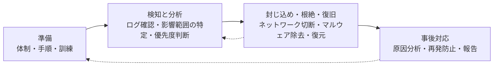

- 補足：2025年公開の NIST SP 800-61 Rev.3 は、NIST **CSF 2.0**（サイバーセキュリティフレームワーク：**統治・識別・防御・検知・対応・復旧** の6機能）に合わせた構成に改められました。試験対策としては、上の4段階の考え方を押さえておけば十分です。

科目Bで問われやすいポイント：

| 場面 | 正しい行動の例 |
|---|---|
| マルウェア感染が疑われる | 端末の **LANケーブルを抜く・無線を切る**（ネットワークから隔離）。電源は **すぐには切らない**（メモリ上の証拠が消えるため） |
| 証拠の保全 | ログやディスクの **複製を作って** 調べる。原本は保全する（**デジタルフォレンジックス**） |
| 影響範囲の特定 | プロキシやファイアウォールのログで、同じ C&C サーバに通信している他の端末を探す |
| 原因の除去 | 侵入口（脆弱性、盗まれたパスワード）をふさぐ。パスワードを変更する |
| 報告 | 個人情報の漏えいのおそれがあれば、個人情報保護委員会への報告と本人への通知が必要な場合がある |

- **デジタルフォレンジックス**：不正アクセスなどの法的な証拠となる電子データを収集・保全・分析することです。証拠が改ざんされていないことを示すため、ハッシュ値を記録し、**証拠保全の一連の記録（Chain of Custody）** を残します。

---

## 11. ゼロトラストと最近のキーワード

### 11.1 ゼロトラスト ★★★

**ゼロトラスト** は、「社内ネットワークだから安全」とは考えず、**すべてのアクセスを信頼せずに毎回検証する** という考え方です（NIST SP 800-207 で整理されています）。

| 観点 | 境界型防御 | ゼロトラスト |
|---|---|---|
| 考え方 | 内部は安全、外部は危険。境界（ファイアウォール）で守る | 内部も外部も信頼しない。アクセスのたびに検証する |
| 判断材料 | 接続元のネットワーク | 利用者の認証、端末の状態、場所、時刻、ふるまいなど |
| 背景 | — | クラウド利用、テレワークの普及で「境界」があいまいになった。侵入後の横展開（ラテラルムーブメント）を防ぎたい |

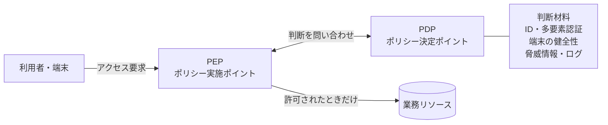

関連する技術：

| 用語 | 内容 |
|---|---|
| **IAM / IDaaS** | ID とアクセス権の一元管理。クラウドで提供されるものが IDaaS |
| **SDP**（Software Defined Perimeter） | 認証された利用者・端末にだけ、リソースへの通信経路を動的に作る |
| **CASB**（Cloud Access Security Broker） | 利用者とクラウドサービスの間で、クラウド利用を可視化・制御する（シャドーIT の把握など） |
| **SWG**（Secure Web Gateway） | クラウド型のプロキシ。URLフィルタリングやマルウェア検査を行う |
| **SASE**（Secure Access Service Edge） | ネットワーク機能（SD-WAN など）とセキュリティ機能（SWG、CASB、ZTNA など）をクラウドでまとめて提供する考え方 |

### 11.2 そのほかの最近のキーワード ★★

| 用語 | 内容 |
|---|---|
| **DevSecOps** | 開発（Dev）と運用（Ops）のサイクルにセキュリティ（Sec）を組み込む |
| **BYOD**（Bring Your Own Device） | 私物端末を業務に使うこと。**MDM**（Mobile Device Management）で管理する |
| **サイバーセキュリティ経営ガイドライン** | 経済産業省と IPA が公開。経営者が認識すべき3原則と、CISO等に指示すべき重要10項目を示す |
| **SECURITY ACTION** | 中小企業が情報セキュリティ対策への取組みを自己宣言する IPA の制度（一つ星・二つ星） |
| **AIの利用をめぐるサイバーリスク** | 10大脅威2026 組織編3位に初選出。生成AIへの機密情報の入力、AIを悪用した攻撃の高度化など |

---

## 12. セキュリティ関連法規の入口

詳しくは法務（ストラテジ系）の章で扱います。ここでは科目A・科目Bでセキュリティと一緒に問われる法律の入口だけを整理します。

| 法律 | ポイント |
|---|---|
| **サイバーセキュリティ基本法** | 国・地方公共団体・重要社会基盤事業者などの責務を定めた基本法。内閣にサイバーセキュリティ戦略本部を置く |
| **不正アクセス禁止法** | 他人の ID・パスワードを無断で使うこと（**なりすましによるログイン**）や、脆弱性をついたアクセス、他人の ID・パスワードを不正に取得・保管・提供する行為、**フィッシングサイトの開設** などを禁止 |
| **刑法（不正指令電磁的記録に関する罪）** | いわゆる **ウイルス作成罪**。正当な理由なく、マルウェアを作成・提供・取得・保管すること等を処罰する |
| **刑法（電子計算機使用詐欺罪・電子計算機損壊等業務妨害罪）** | 不正な情報を入力して財産上の利益を得る、システムを壊して業務を妨害する行為を処罰する |
| **個人情報保護法** | 個人情報の取扱いのルール。漏えい等が発生し、個人の権利利益を害するおそれが大きい場合（要配慮個人情報、財産的被害のおそれ、不正の目的によるもの、1,000人を超えるもの）は、**個人情報保護委員会への報告と本人への通知** が義務 |
| **電子署名法** | 本人による一定の要件を満たす電子署名がある電子文書は、本人が作成したものと推定される |
| **情報流通プラットフォーム対処法** | 旧「プロバイダ責任制限法」が改正・改称されたもの（2025年4月施行）。権利侵害情報についてのプロバイダの責任の範囲や、発信者情報の開示請求、大規模プラットフォーム事業者の削除対応の迅速化などを定める |

- ⚠️ ひっかけ注意：不正アクセス禁止法は、**アクセス制御機能のあるコンピュータ** へのネットワーク経由の不正利用が対象です。パスワードを設定していない機器への接続は対象外になります。
- ⚠️ 不正アクセス禁止法では、実際にログインしなくても、**他人のパスワードを無断で第三者に教える**（不正アクセスを助長する行為）だけで処罰対象になります。

---

## 13. 科目B問1の解き方

### 13.1 科目B問1の位置づけ

- 科目B（旧午後）は **11問中5問** を解答します。**問1（情報セキュリティ）は必須**、問2〜問11から4問を選びます。試験時間は150分なので、1問あたり約30分が目安です。
- 科目Aと科目Bの **両方で60点以上** が合格条件です。必須の問1で崩れると合格が苦しくなるので、確実に得点源にします。

### 13.2 よく出る題材

| 題材 | 典型的な問われ方 |
|---|---|
| マルウェア感染・ランサムウェア | 感染時の初動対応、ログから感染端末を特定する方法、再発防止策 |
| Webアプリケーションの脆弱性 | 脆弱なコードやリクエストを見て攻撃名を答える、根本的対策と暫定対策（WAF） |
| 認証・パスワード | パスワードリスト攻撃への対策、多要素認証やFIDOが有効な理由 |
| ネットワーク構成 | ファイアウォールのルール表の空欄補充、DMZ、プロキシのログ |
| メール | SPF/DKIM/DMARCの設定と効果、フィッシング対策 |
| 暗号・PKI | TLSで検証すること、証明書の失効確認、鍵の使い分け |
| クラウド・テレワーク | VPN装置の脆弱性、ゼロトラスト、多要素認証 |
| 組織・管理 | CSIRTの役割、委託先管理、インシデント時の報告 |

### 13.3 解き方の手順

1. **設問を先に読む**：「理由を答えよ」「対策を答えよ」「攻撃名を答えよ」など、何が問われているかを先に把握します。
2. **図表はていねいに読む**：構成図のどこにどの機器があるか、ログの時刻や送信元IPアドレスに注目します。ログの不自然な点（深夜のアクセス、大量の失敗、外部への大きな通信）が答えの手がかりになります。
3. **知識で書きすぎない**：一般論ではなく、**本文の状況に合った答え** を書きます。本文にある用語をそのまま使うのが安全です。
4. **字数制限を守る**：「〜字以内」の指定があれば、8割以上埋めることを目安にします。

### 13.4 記述の型

| 問われ方 | 文末の型 | 例 |
|---|---|---|
| 〜の理由を答えよ | 「〜から」「〜ため」 | 「攻撃者が用意したセッションIDをログイン後も使えるから」 |
| 〜の目的を答えよ | 「〜するため」 | 「C&Cサーバとの通信を遮断するため」 |
| 対策を答えよ | 「〜する」 | 「ログイン成功時にセッションIDを再発行する」 |
| 何が確認できるか | 「〜であること」 | 「メールが改ざんされていないこと」 |

- ⚠️ 「理由」を問われているのに対策を書く、などの **問いと答えのずれ** が最も大きな失点原因です。
- 💡 「何を」「誰が」「どこで」を具体的に書くと得点につながります。例：「暗号化する」より「**PCとWebサーバの間の通信を TLS で** 暗号化する」。

---

## 確認問題

すべてオリジナル問題です。

**問1** 情報セキュリティの要素のうち、「ある利用者が行った操作を、その利用者が後から否定できないようにすること」を表すものはどれか。

- ア 可用性
- イ 完全性
- ウ 責任追跡性
- エ 否認防止

**問2** Webアプリケーションで、ログインに成功した時点でセッションIDを新しく発行し直す対策が、最も有効に働く攻撃はどれか。

- ア SQLインジェクション
- イ セッション固定化攻撃
- ウ ディレクトリトラバーサル
- エ DNSキャッシュポイズニング

**問3** 他のWebサイトから流出した利用者IDとパスワードの組を使い、別のサービスへのログインを試みる攻撃への対策として、最も効果的なものはどれか。

- ア パスワードの最低文字数を8文字から10文字に増やす
- イ 同一IDでのログイン失敗が5回続いたらアカウントをロックする
- ウ 利用者に他サービスとのパスワードの使い回しを禁止し、多要素認証を導入する
- エ ログイン画面を TLS で暗号化する

**問4**（計算） 50人のグループで、全員が互いに1対1で暗号通信を行う。共通鍵暗号方式を使う場合と公開鍵暗号方式を使う場合とで、必要な鍵の総数の差はいくつか。

- ア 1,125
- イ 1,175
- ウ 1,225
- エ 2,350

**問5** 送信者Aが受信者Bに、デジタル署名付きで、かつ内容を暗号化した電子メールを送る。A が使う鍵の組合せとして適切なものはどれか。

| | 署名の生成に使う鍵 | 本文用の共通鍵の暗号化に使う鍵 |
|---|---|---|
| ア | Aの秘密鍵 | Aの公開鍵 |
| イ | Aの秘密鍵 | Bの公開鍵 |
| ウ | Bの公開鍵 | Aの秘密鍵 |
| エ | Bの秘密鍵 | Bの公開鍵 |

**問6** OCSP の説明として、適切なものはどれか。

- ア 証明書の失効状態を、問合せに応じてオンラインで応答する
- イ 認証局が失効した証明書のシリアル番号の一覧を定期的に発行する
- ウ 発行されたすべての証明書を公開ログに記録し、誤発行を監視する
- エ ルート証明書を OS やブラウザにあらかじめ組み込んで配布する

**問7** DMARC の説明として、適切なものはどれか。

- ア 送信メールサーバの IP アドレスを DNS に登録し、受信側が接続元の IP アドレスと照合する
- イ 送信メールサーバがメールに電子署名を付け、受信側が DNS から取得した公開鍵で検証する
- ウ SPF や DKIM の検証結果とヘッダ From のドメインとの一致を確認し、失敗時の扱いを送信ドメイン側が DNS で宣言する
- エ 利用者が送信時にサブミッションポートを使い、SMTP-AUTH で認証を受ける

**問8** IPsec の ESP をトンネルモードで使用した場合の説明として、適切なものはどれか。

- ア 元の IP パケットのデータ部分だけが暗号化され、元の IP ヘッダはそのまま送られる
- イ 元の IP パケット全体が暗号化され、新しい IP ヘッダが付けられる
- ウ 認証と改ざん検出だけが行われ、暗号化は行われない
- エ TLS を使ってアプリケーション層で暗号化される

**問9** あるシステムで、情報漏えい事故が発生すると1回当たり3,000万円の損失が出ると見積もった。発生頻度は20年に1回とする。この事故に対して年間120万円の費用がかかる対策を検討している。年間予想損失額と、費用だけを比べた場合の判断として適切なものはどれか。

- ア 年間予想損失額は150万円で、対策費用の方が大きい
- イ 年間予想損失額は150万円で、対策費用の方が小さい
- ウ 年間予想損失額は60万円で、対策費用の方が小さい
- エ 年間予想損失額は60万円で、対策費用の方が大きい

**問10** マルウェアに感染した疑いのある PC を発見した。最初に行う対応として、最も適切なものはどれか。

- ア PC の電源を直ちに切り、感染の拡大を防ぐ
- イ ウイルス対策ソフトで完全スキャンし、検出されたファイルを削除する
- ウ OS を再インストールして、業務を早く再開する
- エ PC をネットワークから切り離し、CSIRT に報告する

解答・解説

**問1 正解：エ**
- 否認防止は、行った事実を後から否定できないようにすることです。代表的な手段はデジタル署名です。
- ウの責任追跡性は「誰が何をしたかを後から追跡できること」で、ログが代表例です。似ていますが、「否定できない」に注目すると否認防止になります。

**問2 正解：イ**
- セッション固定化攻撃は、攻撃者が用意したセッションIDを利用者に使わせ、利用者がログインした後にそのIDでなりすます攻撃です。ログイン時にIDを再発行すれば、攻撃者の知っているIDは使えなくなります。
- アはプレースホルダ、ウはパスの検査、エはソースポートのランダム化や DNSSEC が対策です。

**問3 正解：ウ**
- パスワードリスト攻撃では、正しいパスワードで1回目からログインされてしまうので、イのアカウントロックはほとんど効きません。アの文字数増加も、流出したパスワードそのものが使われるので効果がありません。
- 使い回しをやめれば流出した組が使えなくなり、多要素認証があればパスワードが正しくてもログインできません。エは盗聴対策です。

**問4 正解：ア**
- 公式：共通鍵 `n(n−1)/2`、公開鍵 `2n`
- 共通鍵：`50 × 49 / 2 = 2,450 / 2 = 1,225 個`
- 公開鍵：`2 × 50 = 100 個`（公開鍵50個 + 秘密鍵50個）
- 差：`1,225 − 100 = 1,125`
- ウの 1,225 は共通鍵の個数そのもの、イの 1,175 は公開鍵方式の鍵を50個（公開鍵だけ）と数えた場合の誤答です。

**問5 正解：イ**
- 署名は「送信者本人であること」を示すので **送信者Aの秘密鍵** で作ります。
- 本文用の共通鍵は、**受信者Bだけ** が取り出せるように **Bの公開鍵** で暗号化します。B は自分の秘密鍵で共通鍵を取り出せます。
- 💡「機密性は受信者の鍵、署名は送信者の鍵」です。

**問6 正解：ア**
- OCSP は、証明書の状態をリアルタイムに問い合わせるプロトコルです。
- イは CRL、ウは CT（Certificate Transparency）、エはルート証明書の配布の説明です。

**問7 正解：ウ**
- DMARC は、SPF・DKIM の結果を、利用者に見えるヘッダ From のドメインと結び付けて（アラインメント）判定し、失敗時のポリシー（none / quarantine / reject）を送信側が宣言する仕組みです。
- アは SPF、イは DKIM、エは送信時の利用者認証（サブミッションポート + SMTP-AUTH）です。

**問8 正解：イ**
- トンネルモードでは、元の IP パケット全体（元のIPヘッダを含む）を暗号化し、VPN装置どうしの新しい IP ヘッダを付けます。拠点間 VPN で使われます。
- アはトランスポートモード、ウは AH、エは TLS（SSL-VPN）の説明です。

**問9 正解：イ**
- 公式：`年間予想損失額 = 1回の損失額 × 年間発生頻度`
- 途中式：`3,000万円 × (1 / 20) = 150万円 / 年`
- 対策費用 120万円 < 年間予想損失額 150万円 なので、**対策費用の方が小さい** です。費用対効果の面では、対策を行う合理性があります。
- ウ・エの60万円は、`3,000万円 ÷ 20` を誤って `3,000万円 × 0.02` などと計算した場合の誤答です。

**問10 正解：エ**
- まず **ネットワークから隔離** して、他の端末への感染拡大や外部への情報送信を止めます（封じ込め）。そのうえで組織の手順に従って CSIRT などに報告します。
- アのように電源を切ると、メモリ上に残っている調査の手がかり（実行中のプロセスや通信先）が失われることがあります。
- イ・ウは、証拠を消してしまったり、原因が分からないまま再発したりするおそれがあるため、初動としては不適切です。

---

## 科目B形式 練習問題

**情報セキュリティインシデントへの対応に関する次の記述を読んで、設問に答えよ。**（オリジナル問題。解答目安時間 30分）

X社は、従業員300名の通信販売会社である。X社は、自社の通販サイト（以下、Xサイトという）を運営している。Xサイトの構成を図1に示す。

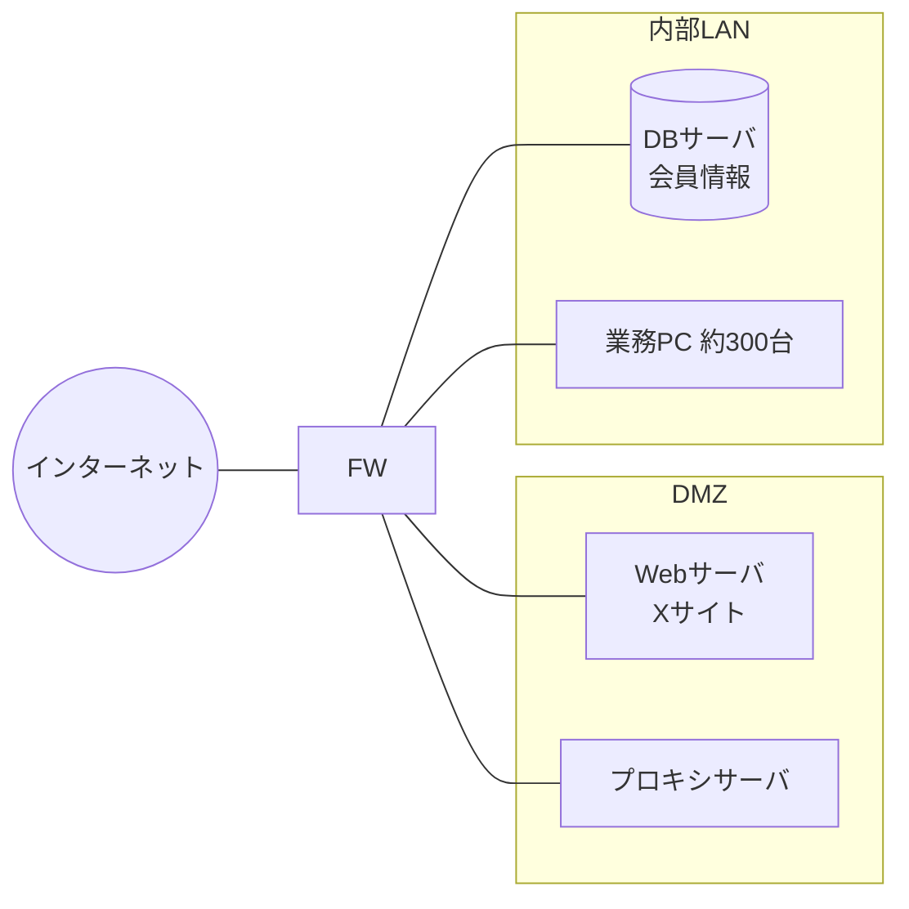

図1 Xサイトの構成（概要）

**〔Xサイトの概要〕**
- 会員は、メールアドレスとパスワードでログインし、商品を購入する。
- パスワードは、DBサーバにハッシュ関数 SHA-256 でハッシュ化して保存している。ソルトは使っていない。
- 業務PCから外部の Web サイトへの通信は、プロキシサーバを経由させている。プロキシサーバは利用者認証を行っていない。

**〔インシデントの発生〕**

ある日、Xサイトの会員から「身に覚えのない購入履歴がある」という問合せが複数寄せられた。情報システム部のY主任が Webサーバのログを調査したところ、表1のような記録が見つかった。

表1 Webサーバのログ（抜粋）

| 時刻 | 送信元IPアドレス | 要求 | 結果 |
|---|---|---|---|
| 02:10:01 | 203.0.113.5 | ログイン（会員A） | 成功 |
| 02:10:02 | 203.0.113.5 | ログイン（会員B） | 失敗 |
| 02:10:03 | 203.0.113.5 | ログイン（会員C） | 成功 |
| 02:10:04 | 203.0.113.5 | ログイン（会員D） | 失敗 |
| … | … | （同様の記録が約2万件） | … |

Y主任は、ログの特徴から、攻撃者が **a** を行ったと判断した。会員A、Cに確認したところ、2人とも同じパスワードを他のサービスでも使っていたことが分かった。

**〔DBサーバの調査〕**

さらに調査を進めたところ、Xサイトの商品検索機能に脆弱性があり、検索キーワードを組み込んで SQL 文を文字列連結で組み立てていたことが判明した。①この脆弱性を悪用された形跡は見つからなかったが、Y主任は、悪用されていた場合には、会員のパスワードのハッシュ値から元のパスワードが短時間で割り出されるおそれがあると考えた。

**〔対策の検討〕**

Y主任は、次の対策を検討した。

- 対策1：ログイン時に、パスワードに加えてスマートフォンのアプリに表示されるワンタイムパスワードを入力させる。
- 対策2：同一の送信元IPアドレスからのログイン試行回数を制限する。
- 対策3：商品検索機能の SQL 文の組立てを、**b** を使う方式に改める。改修完了までの間は、②WAF を導入して攻撃を遮断する。
- 対策4：パスワードの保存方式を、会員ごとに異なる **c** を付加し、ハッシュ計算を繰り返して時間をかける方式に変更する。
- 対策5：③プロキシサーバで利用者認証を行うようにする。

**設問1** 本文中の **a** 〜 **c** に入れる適切な字句を答えよ。

**設問2** 表1のログから、攻撃者がアカウントロック（同一会員での連続失敗によるロック）を回避できたと考えられる理由を、40字以内で答えよ。

**設問3** 本文中の下線①について、ソルトを使わないハッシュ値から元のパスワードが短時間で割り出されるおそれがある理由を、攻撃手法の名称を含めて45字以内で答えよ。

**設問4** 対策2だけでは十分でない理由を、攻撃者の行動に着目して35字以内で答えよ。

**設問5** 本文中の下線②について、WAF を導入した直後に遮断モードで運用を始めた場合に起こり得る業務上の問題を、30字以内で答えよ。

**設問6** 本文中の下線③の対策は、業務PCがマルウェアに感染した場合に、どのような効果があるか。40字以内で答えよ。

解答例・解説

**設問1**
- a：**パスワードリスト攻撃**
  - 1つの送信元から、会員を変えながら1回ずつログインを試し、一部が成功しています。成功した会員が他サービスと同じパスワードを使っていたことから、流出した ID・パスワードの組が使われたと判断できます。
- b：**プレースホルダ**（バインド機構、プリペアドステートメントも可）
  - SQL文の構造と値を分けて扱うので、入力値が SQL 文として解釈されません。SQLインジェクションの根本的対策です。
- c：**ソルト**
  - 会員ごとのランダム値を加えてからハッシュ化します。ハッシュ計算を繰り返すのは **ストレッチング** です。

**設問2 解答例**
「会員ごとのログイン試行は1回だけで、同一会員で失敗が連続していないから」（35字）
- アカウントロックは「同じ会員での連続失敗」に反応します。パスワードリスト攻撃では各会員に正しい（と思われる）パスワードを1回だけ試すので、ロックの条件に当てはまりません。

**設問3 解答例**
「レインボーテーブル攻撃で、事前に計算したハッシュ値の表から逆引きできるから」（37字）
- ソルトがないと、同じパスワードは必ず同じハッシュ値になります。そのため、よく使われるパスワードのハッシュ値をあらかじめ計算した表で一気に照合できます。会員ごとにソルトを付ければ、表を会員ごとに作り直す必要が生じ、攻撃が非常に困難になります。

**設問4 解答例**
「攻撃者が送信元IPアドレスを次々に変えて試行すると制限できないから」（33字）
- ボットネットなど多数の IP アドレスから少しずつ試されると、IP アドレスごとの回数制限には引っかかりません。そのため、パスワードが正しくてもログインを防げる **対策1（多要素認証）** が重要になります。

**設問5 解答例**
「正常な検索要求が誤検知で遮断され、会員が検索できなくなる」（28字）
- WAF は導入直後、シグネチャが自社サイトの正規の通信に合っていないことがあり、**フォールスポジティブ（誤検知）** が起こり得ます。まず検知のみのモードで運用し、誤検知を調整してから遮断モードに切り替えるのが一般的です。

**設問6 解答例**
「認証情報を持たないマルウェアによるC&Cサーバへの通信を遮断できる」（33字）
- マルウェアの多くは、プロキシの利用者認証に対応していないか、認証情報を知りません。プロキシで認証を必須にすると、マルウェアからの外部通信（出口）を止めやすくなり、ログにも認証失敗として残るので感染端末の発見にも役立ちます。

---

## 参考

- IPA「応用情報技術者試験（AP）」 https://www.ipa.go.jp/shiken/kubun/ap.html
- IPA「試験要綱・シラバス」（応用情報技術者試験シラバス Ver.7.2） https://www.ipa.go.jp/shiken/syllabus/gaiyou.html
- IPA「情報セキュリティ10大脅威 2026」 https://www.ipa.go.jp/security/10threats/10threats2026.html
- IPA「安全なウェブサイトの作り方」 https://www.ipa.go.jp/security/vuln/websecurity/about.html
- IPA「組織における内部不正防止ガイドライン」 https://www.ipa.go.jp/security/guide/insider.html
- IPA「SECURITY ACTION」 https://www.ipa.go.jp/security/security-action/
- IPA「サイバーセキュリティ経営ガイドライン」 https://www.meti.go.jp/policy/netsecurity/mng_guide.html
- JPCERT/CC「インシデント対応マニュアル」等 https://www.jpcert.or.jp/
- JVN（Japan Vulnerability Notes） https://jvn.jp/
- CRYPTREC「電子政府推奨暗号リスト」 https://www.cryptrec.go.jp/list.html
- 総務省「送信ドメイン認証技術の導入」（迷惑メール対策） https://www.soumu.go.jp/main_sosiki/joho_tsusin/d_syohi/m_mail.html
- 個人情報保護委員会「漏えい等の対応とお役立ち資料」 https://www.ppc.go.jp/personalinfo/legal/leakAction/
- 警察庁「不正アクセス行為の禁止等に関する法律」 https://www.npa.go.jp/cyber/legislation/
- 内閣官房 国家サイバー統括室 https://www.cyber.go.jp/
- NIST SP 800-207 Zero Trust Architecture https://csrc.nist.gov/pubs/sp/800/207/final
- NIST SP 800-61 Rev.3 Incident Response Recommendations https://csrc.nist.gov/pubs/sp/800/61/r3/final
- NIST Cybersecurity Framework 2.0 https://www.nist.gov/cyberframework
- RFC 8446 The Transport Layer Security (TLS) Protocol Version 1.3 https://www.rfc-editor.org/rfc/rfc8446
- RFC 7489 DMARC https://www.rfc-editor.org/rfc/rfc7489
- FIDO Alliance「パスキー」 https://fidoalliance.org/passkeys/?lang=ja
- FIRST「CVSS v4.0」 https://www.first.org/cvss/v4-0/
