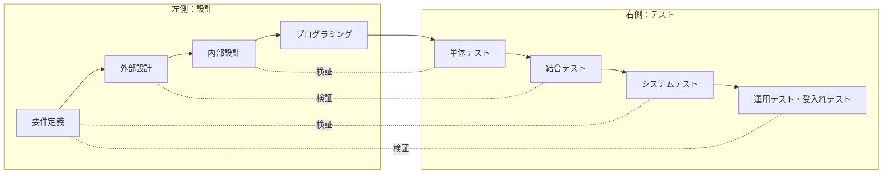
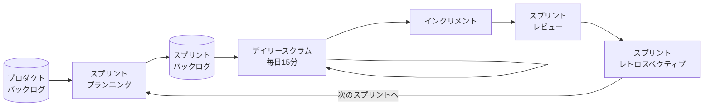
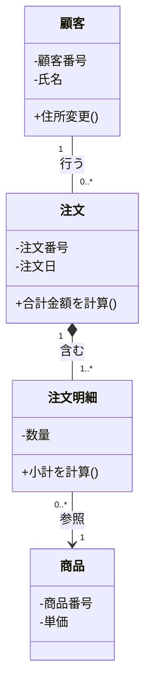
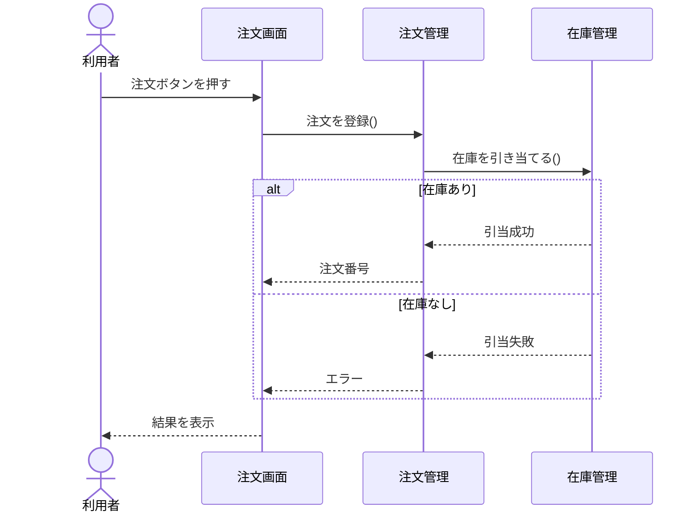
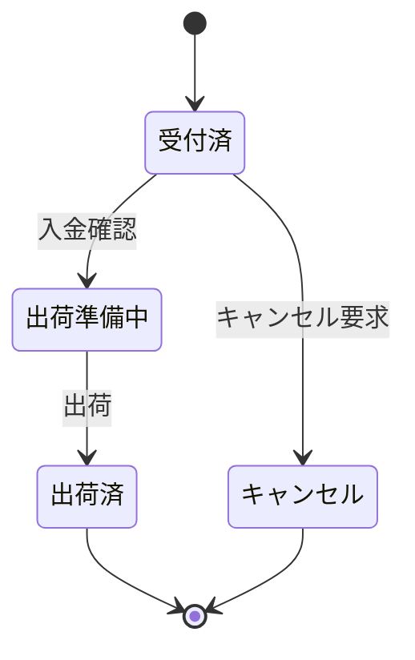
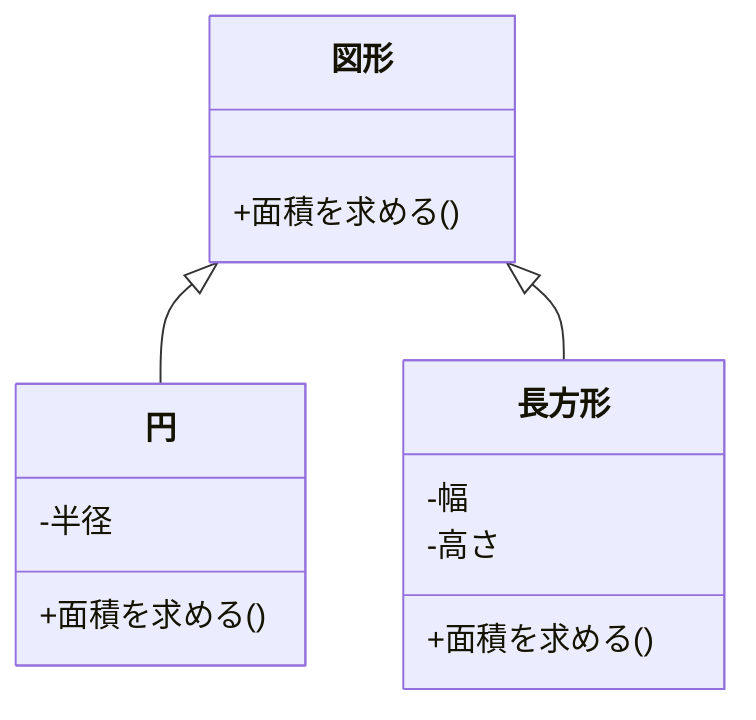
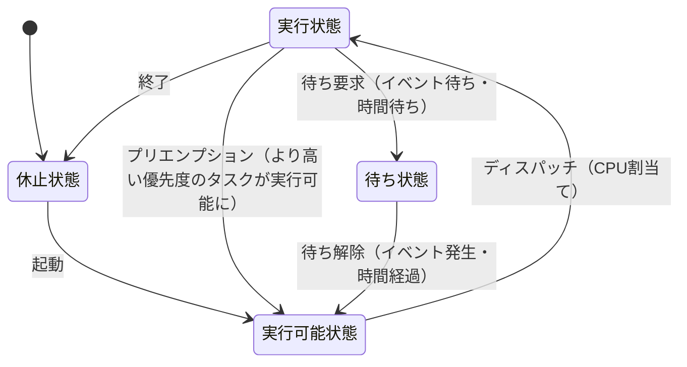

# システム開発技術

> **重要度：★★★**（科目A（旧午前）で毎回5〜6問、科目B（旧午後）では問7「組込みシステム開発」と問8「情報システム開発」の選択問題として出題）
> 開発プロセス（ウォーターフォール・アジャイル）、UML、オブジェクト指向、モジュール設計、テスト技法が科目Aの定番です。
> 科目Bの「情報システム開発」では、UMLやテストケースの空欄補充、設計変更の影響の読み取りが、「組込みシステム開発」では、状態遷移やタイミングの読み取りがよく問われます。
> この章では、用語を暗記するだけでなく、「なぜその手法を使うのか」を説明できることを目標にします。

## 目次

- [1. 開発プロセスとモデル](#1-開発プロセスとモデル)
- [2. アジャイル開発とDevOps](#2-アジャイル開発とdevops)
- [3. 共通フレームと要件定義](#3-共通フレームと要件定義)
- [4. 分析・設計の技法とUML](#4-分析設計の技法とuml)
- [5. オブジェクト指向](#5-オブジェクト指向)
- [6. モジュール設計](#6-モジュール設計)
- [7. テスト](#7-テスト)
- [8. レビュー技法](#8-レビュー技法)
- [9. 保守と構成管理](#9-保守と構成管理)
- [10. 知的財産の入口](#10-知的財産の入口)
- [11. 組込みシステム開発の基礎](#11-組込みシステム開発の基礎)
- [12. 科目B「情報システム開発」「組込みシステム開発」の解き方](#12-科目b情報システム開発組込みシステム開発の解き方)
- [確認問題](#確認問題)
- [参考](#参考)

---

## 1. 開発プロセスとモデル

### 1.1 ソフトウェア開発の流れ ★★

一般的なシステム開発は、**要件定義 → 外部設計（基本設計） → 内部設計（詳細設計） → プログラミング → テスト → 導入・運用・保守** の順に進みます。

- **外部設計**：利用者から見える部分（画面、帳票、入出力、機能の範囲）を設計します。利用者も参加してレビューします。
- **内部設計**：開発者から見た内部の構造（モジュール分割、データ構造、処理手順）を設計します。

### 1.2 主な開発モデル ★★★

| モデル | 特徴 | 向いているケース |
|---|---|---|
| **ウォーターフォールモデル** | 工程を順番に進め、原則として前の工程に戻らない。工程ごとに成果物を確定させる | 要件が明確で、変更が少ない大規模開発 |
| **V字モデル** | ウォーターフォールの各設計工程と、それを検証するテスト工程を対応付ける | 品質を工程ごとに確認したいとき |
| **プロトタイピングモデル** | 早い段階で試作品（プロトタイプ）を作り、利用者に確認してもらう | 要件があいまい、画面の使い勝手を確認したい |
| **スパイラルモデル** | 「計画 → リスク分析 → 開発 → 評価」のサイクルを繰り返し、システムを徐々に大きくする | リスクの大きな大規模開発 |
| **インクリメンタルモデル**（段階的モデル） | 全体の要件を最初に決め、機能を分割して段階的に開発・リリースする | 優先度の高い機能から早く使いたい |
| **進化的モデル** | 要件を少しずつ明確にしながら、システムを繰り返し改良する | 要件が変わりやすい |
| **RAD**（Rapid Application Development） | 少人数のチームが開発ツールを活用し、短期間で開発する。**タイムボックス**（期間の上限）を設ける | 短期開発 |

#### V字モデル（設計とテストの対応）



| 設計工程 | 対応するテスト | 確認すること |
|---|---|---|
| 要件定義 | システムテスト、運用テスト・受入れテスト | 要件どおりにシステム全体が動くか、業務で使えるか |
| 外部設計 | 結合テスト | モジュール間・サブシステム間のインタフェース |
| 内部設計 | 単体テスト | モジュール単体の動作 |

- ⚠️ ひっかけ注意：対応付けの細かい境界は文献によって少し異なります（外部設計 ↔ システムテストとする説明もあります）。試験では「上流の設計ほど、後のテストで検証される」という考え方を押さえておけば判断できます。

### 1.3 開発手法・アプローチ ★★

| 手法 | 内容 |
|---|---|
| **プロセス中心アプローチ（POA）** | 業務の処理（機能）に着目して設計する。DFDを使う構造化分析など |
| **データ中心アプローチ（DOA）** | 業務で扱う **データ** に着目して設計する。データは業務の変化に比べて安定しているため、変更に強い。E-R図を使う |
| **オブジェクト指向アプローチ（OOA）** | データとそれを操作する手続をまとめた **オブジェクト** に着目して設計する。UMLを使う |
| **リバースエンジニアリング** | 既存のプログラムを解析して、仕様や設計を明らかにする |
| **フォワードエンジニアリング** | リバースエンジニアリングで得た仕様をもとに、新しいシステムを開発する |
| **リエンジニアリング** | リバースとフォワードを組み合わせ、既存システムを作り直す |

---

## 2. アジャイル開発とDevOps

### 2.1 アジャイル開発の考え方 ★★★

**アジャイル開発** は、短い期間（**イテレーション**、反復）で「計画 → 設計 → 実装 → テスト」を繰り返し、動くソフトウェアを少しずつ提供する開発の進め方の総称です。2001年の **アジャイルソフトウェア開発宣言** で、次の4つの価値が示されています。

| 重視すること（左） | よりも | 右の価値も認める |
|---|---|---|
| **個人と対話** | > | プロセスやツール |
| **動くソフトウェア** | > | 包括的なドキュメント |
| **顧客との協調** | > | 契約交渉 |
| **変化への対応** | > | 計画に従うこと |

- ⚠️ ひっかけ注意：「ドキュメントは不要」「計画を立てない」という意味ではありません。右側にも価値があることを認めたうえで、**左側をより重視する** という宣言です。

### 2.2 スクラム ★★★

**スクラム** は、チームで仕事を進めるための軽量なフレームワークです。期間を区切った **スプリント**（1か月以内、2週間程度が多い）を繰り返します。用語は「スクラムガイド」（2020年版）に沿って押さえます。

#### 役割（スクラムチーム）

| 役割 | 責任 |
|---|---|
| **プロダクトオーナー** | プロダクトの価値を最大化する責任を持つ。**プロダクトバックログの管理**（項目の並び順＝優先順位の決定など）をする。1人の人間 |
| **スクラムマスター** | スクラムが正しく理解・実践されるよう支援する。チームの障害（妨げ）を取り除く。**指示・命令をする管理者ではない**（サーバントリーダー） |
| **開発者** | 各スプリントで、利用可能な **インクリメント** を作る |

#### イベント



| イベント | 内容 |
|---|---|
| **スプリントプランニング** | このスプリントで何を作るか（スプリントゴール）と、どう作るかを計画する |
| **デイリースクラム** | 開発者が毎日 **15分** で、スプリントゴールに向けた進み具合を確認し、計画を調整する |
| **スプリントレビュー** | 成果（インクリメント）を利害関係者に見せ、フィードバックを得る |
| **スプリントレトロスペクティブ** | チームの **進め方**（プロセス、人間関係、ツール）を振り返り、改善策を決める |

- 💡 覚え方：**レビュー = 成果物（プロダクト）の確認**、**レトロスペクティブ = 進め方（プロセス）の振り返り**。

#### 作成物（アーティファクト）

| 作成物 | 内容 | 対応する確約 |
|---|---|---|
| **プロダクトバックログ** | プロダクトに必要なものを並べた一覧 | プロダクトゴール |
| **スプリントバックログ** | スプリントで行う項目と、その作業計画 | スプリントゴール |
| **インクリメント** | 完成した、利用可能な成果 | **完成の定義**（Definition of Done） |

#### アジャイルでよく使う用語

| 用語 | 内容 |
|---|---|
| **ユーザーストーリー** | 「〈利用者〉として、〈目的〉のために、〈機能〉がほしい」の形で要求を書く |
| **ストーリーポイント** | 作業量の相対的な見積り単位 |
| **プランニングポーカー** | メンバーが見積りの数字のカードを一斉に出し、ばらつきを話し合って見積りを合わせる |
| **ベロシティ** | 1回のスプリントで完了できたストーリーポイントの合計。次の計画に使う |
| **バーンダウンチャート** | 残作業量の推移を表すグラフ。右下がりになる |
| **かんばん** | 作業を「ToDo・作業中・完了」などの列のカードで見える化し、作業中（WIP）の数を制限する |

#### 計算例：ベロシティによるリリース時期の見積り

- 公式：`必要なスプリント数 = 残りのストーリーポイント ÷ ベロシティ`（端数は切り上げ）
- 数値例：残りのプロダクトバックログが合計 180 ポイント、過去3スプリントの完了ポイントが 38、42、40
- 途中式：
  - ベロシティ（平均）：`(38 + 42 + 40) ÷ 3 = 120 ÷ 3 = 40 ポイント`
  - 必要なスプリント数：`180 ÷ 40 = 4.5` → 切り上げて **5スプリント**
  - 1スプリント2週間なら、`5 × 2 = 10週間` が目安になります。

### 2.3 XP（エクストリームプログラミング） ★★

**XP**（eXtreme Programming）は、プログラミングの具体的な実践（**プラクティス**）を重視するアジャイル手法です。

| プラクティス | 内容 |
|---|---|
| **テスト駆動開発（TDD）** | **先にテストコードを書き**、そのテストに合格するようにプログラムを書く。「失敗するテスト → 合格させる → リファクタリング」を繰り返す |
| **ペアプログラミング** | 2人1組で、1人がコードを書き、もう1人がその場でレビューする。役割は適宜交代する |
| **リファクタリング** | 外部から見た動作を **変えずに**、内部の構造をわかりやすく改善する |
| **継続的インテグレーション（CI）** | 変更したコードを頻繁に統合し、自動でビルドとテストを行う |
| **コードの共同所有** | 誰でもどのコードでも修正できる |
| **小さなリリース** | 短い間隔で少しずつリリースする |
| **YAGNI** | 「今必要ないものは作らない」（You Aren't Gonna Need It） |

- ⚠️ ひっかけ注意：**リファクタリングは機能を追加・変更する作業ではありません**。動作は変えず、構造だけを改善します。リファクタリング後には回帰テストで動作が変わっていないことを確認します。

### 2.4 DevOps と CI/CD ★★

**DevOps** は、開発（Development）と運用（Operations）の担当者が協力し、ツールによる自動化も活用して、ソフトウェアを素早く安定してリリースし続ける考え方です。

| 用語 | 内容 |
|---|---|
| **CI**（Continuous Integration：継続的インテグレーション） | コードの変更を頻繁に統合し、自動でビルド・テストする |
| **CD**（Continuous Delivery / Deployment：継続的デリバリー / デプロイメント） | いつでもリリースできる状態を保つ（デリバリー）。本番へのリリースまで自動化する（デプロイメント） |
| **IaC**（Infrastructure as Code） | サーバやネットワークの構成をコードで記述し、自動で構築する |
| **DevSecOps** | DevOps にセキュリティを組み込む。開発の早い段階からセキュリティ検査を行う（**シフトレフト**） |
| **カナリアリリース** | 新しい版を一部の利用者だけに先に公開し、問題がないことを確認してから全体に広げる |
| **ブルーグリーンデプロイメント** | 本番環境を2系統用意し、新しい版を待機系に配置してから切り替える。問題があればすぐ戻せる |

---

## 3. 共通フレームと要件定義

### 3.1 共通フレーム ★★

**共通フレーム**（SLCP-JCF：Software Life Cycle Process - Japan Common Frame）は、システム開発の **取引に関わる人が「同じ言葉」で話せるように**、ソフトウェアの企画から廃棄までの作業内容と用語を標準化した枠組みです。IPA が発行しており、最新版は **共通フレーム2013** です（国際規格 ISO/IEC 12207:2008 に対応する JIS X 0160:2012 をベースにしています）。

- 特徴：
  - 作業の **内容**（何をするか）を定めたもので、開発モデルや開発方法論、成果物の様式を **特定するものではありません**。
  - 自組織や取引の実情に合わせて、作業を選択・修正して使います（**テーラリング**）。
- 主なプロセスの流れ：
  - 企画プロセス → 要件定義プロセス → システム開発プロセス・ソフトウェア実装プロセス → 運用・サービスプロセス → 保守プロセス →（廃棄）

- ⚠️ ひっかけ注意：共通フレームの **要件定義プロセス** では、システムの利用者（業務部門）を含めた **利害関係者** の要件を定義します。要件の定義に責任を持つのは **発注者（利用者側）** で、開発者が勝手に決めるものではありません。

### 3.2 要件の種類 ★★★

| 種類 | 内容 | 例 |
|---|---|---|
| **業務要件** | 業務として実現したいこと | 「受注から出荷までを1日以内にする」 |
| **機能要件** | システムが提供すべき機能 | 受注登録、在庫引当、出荷指示 |
| **非機能要件** | 機能以外の、品質や制約に関する要件 | 応答時間3秒以内、稼働率99.9%、データの暗号化 |

IPA の **非機能要求グレード** は、非機能要件を次の **6つの大項目** に分けて、発注者と開発者が段階的にすり合わせるためのツールです。

| 大項目 | 例 |
|---|---|
| **可用性** | 稼働率、運用時間、災害時の復旧 |
| **性能・拡張性** | 応答時間、処理件数、将来の拡張 |
| **運用・保守性** | バックアップ、監視、保守の時間帯 |
| **移行性** | 移行の方式、移行期間 |
| **セキュリティ** | 認証、アクセス制御、暗号化 |
| **システム環境・エコロジー** | 設置環境、消費電力、法令などの制約 |

### 3.3 ソフトウェアの品質特性 ★★

ソフトウェア製品の品質は、**JIS X 25010**（ISO/IEC 25010:2011 に対応）の **製品品質モデル** で、8つの特性に分けられています。

| 品質特性 | 内容 |
|---|---|
| **機能適合性** | 必要な機能が正しくそろっている |
| **性能効率性** | 応答時間や資源の使用量が適切 |
| **互換性** | 他の製品と共存・連携できる |
| **使用性** | 利用者にとってわかりやすく使いやすい |
| **信頼性** | 障害が起きにくく、起きても回復できる（成熟性・可用性・障害許容性・回復性） |
| **セキュリティ** | 機密性・完全性・否認防止・責任追跡性・真正性 |
| **保守性** | 修正しやすい（モジュール性、再利用性、解析性、修正性、試験性） |
| **移植性** | 別の環境に移しやすい（適応性、設置性、置換性） |

- 補足：国際規格は 2023 年に改訂され（ISO/IEC 25010:2023）、「使用性」が「インタラクション能力」に、「移植性」が「柔軟性」に再編され、「安全性」が加わって9特性になりました。試験では JIS X 25010 の8特性で問われることが多いので、まずは上の表を押さえます。

### 3.4 要件定義の進め方と技法 ★

| 技法 | 内容 |
|---|---|
| **インタビュー** | 利用者に直接聞き取る |
| **ブレーンストーミング** | 批判せずに自由にアイデアを出し合う |
| **プロトタイピング** | 試作品を見せて要件を確認する |
| **ユースケース記述** | 利用者とシステムのやり取りを、シナリオ（基本フロー・代替フロー）で記述する |
| **要求のトレーサビリティ** | 要件 → 設計 → プログラム → テストの対応関係を追跡できるようにする。要件の漏れや変更の影響範囲を確認できる |

---

## 4. 分析・設計の技法とUML

### 4.1 構造化分析の図 ★★

| 図 | 内容 |
|---|---|
| **DFD**（Data Flow Diagram） | データの流れに着目して業務を表す。記号は4種類：**プロセス**（○ 処理）、**データフロー**（→）、**データストア**（＝ 保管）、**外部実体**（□ 源泉・吸収） |
| **E-R図** | 実体（エンティティ）と、その関連（リレーションシップ）を表す。データベース設計に使う |
| **状態遷移図** | 状態と、状態を変えるきっかけ（イベント）を表す。組込みシステムでよく使う |
| **決定表**（デシジョンテーブル） | 条件の組合せと、それに対する動作を表にまとめる |

- ⚠️ DFD は **データの流れ** を表す図で、処理の順序や条件分岐、制御の流れは表しません。

### 4.2 UML の図の種類 ★★★

**UML**（Unified Modeling Language：統一モデリング言語）は、OMG（Object Management Group）が標準化した、オブジェクト指向での設計を図で表す記法です。UML 2.x では14種類の図が定義されています。主なものは次のとおりです。

| 分類 | 図 | 何を表すか |
|---|---|---|
| 構造図 | **クラス図** | クラスの属性・操作と、クラス間の関係（静的な構造） |
| 構造図 | **オブジェクト図** | ある時点でのインスタンス（オブジェクト）どうしの関係 |
| 構造図 | **コンポーネント図** | ソフトウェアの部品（コンポーネント）とその依存関係 |
| 構造図 | **配置図** | ハードウェア（ノード）と、そこに配置されるソフトウェア |
| 構造図 | **パッケージ図** | クラスなどのグループ（パッケージ）とその依存関係 |
| 振る舞い図 | **ユースケース図** | 利用者（**アクター**）とシステムの機能（**ユースケース**）の関係 |
| 振る舞い図 | **アクティビティ図** | 処理の流れ（フローチャートに近い）。並行処理や、**スイムレーン**（担当の区分）も書ける |
| 振る舞い図 | **ステートマシン図** | オブジェクトの状態と、イベントによる状態遷移 |
| 相互作用図 | **シーケンス図** | オブジェクト間のメッセージのやり取りを **時系列** で表す |
| 相互作用図 | **コミュニケーション図** | オブジェクト間の **つながり（リンク）** に着目してメッセージを表す |
| 相互作用図 | **タイミング図** | 状態の変化を時間軸で表す |

- 💡 覚え方：「時間の順番ならシーケンス図、つながりならコミュニケーション図」「状態ならステートマシン図」「機能と利用者ならユースケース図」。

#### クラス図の例



- **多重度**：`1`（ちょうど1）、`0..1`（0または1）、`0..*` または `*`（0以上）、`1..*`（1以上）。
- 上の例の読み方：「顧客1人は0件以上の注文を行う」「注文1件は1件以上の注文明細を **含む**（注文を削除すると明細も消える → コンポジション）」「注文明細は1つの商品を参照する」。
- 可視性：`+` public（公開）、`-` private（非公開）、`#` protected（サブクラスに公開）。

#### シーケンス図の例



- 縦の点線が **ライフライン**（オブジェクトの存在期間）、横の矢印が **メッセージ** です。`alt` は条件分岐の **複合フラグメント**、`loop` は繰返しを表します。

#### ステートマシン図の例



#### ユースケース図の関係

| 関係 | 意味 |
|---|---|
| **包含**（`<<include>>`） | あるユースケースが、別のユースケースを **必ず** 含む（例：「注文する」は必ず「ログインする」を含む） |
| **拡張**（`<<extend>>`） | 特定の条件のときだけ、別のユースケースの機能を追加する（例：「注文する」に「クーポンを使う」が追加される） |
| **汎化** | アクターやユースケースの一般化・特化 |

---

## 5. オブジェクト指向

### 5.1 基本概念 ★★★

**オブジェクト指向** は、データ（**属性**）とそれを操作する手続（**メソッド**、操作）を **オブジェクト** という単位にまとめて、システムを組み立てる考え方です。

| 概念 | 内容 | ねらい |
|---|---|---|
| **クラス** | オブジェクトのひな型（設計図）。属性とメソッドを定義する | — |
| **インスタンス** | クラスから実際に作られた個々のオブジェクト | — |
| **カプセル化** | 属性とメソッドを一体にし、内部の詳細を外部から隠す（**情報隠蔽**）。外部からは公開されたメソッドを通じてのみ操作する | 内部を変更しても、利用側に影響しにくい |
| **継承**（インヘリタンス） | 上位クラス（スーパークラス）の属性・メソッドを、下位クラス（サブクラス）が引き継ぐ | 共通部分を再利用し、差分だけを定義すればよい（**差分プログラミング**） |
| **多態性**（ポリモーフィズム） | 同じメッセージ（メソッド呼出し）を送っても、受け取ったオブジェクトのクラスに応じて異なる動作をする | 呼び出す側がオブジェクトの種類を意識しなくてよい |
| **メッセージパッシング** | オブジェクトどうしがメッセージを送り合って処理を進める | — |

- **オーバーライド**：サブクラスで、スーパークラスのメソッドを **同じ名前・同じ引数** で再定義すること。多態性を実現する手段です。
- **オーバーロード**：同じクラスの中で、**同じ名前で引数の型や数が異なる** メソッドを複数定義すること。
- ⚠️ ひっかけ注意：オーバーライドとオーバーロードは取り違えやすい用語です。「ライド＝上に乗る（上書き）」「ロード＝たくさん載せる（多重定義）」と覚えます。

#### 多態性の例



呼び出す側は、どの図形に対しても「面積を求める()」を送るだけです。円なら `半径 × 半径 × 3.14`、長方形なら `幅 × 高さ` が実行されます。新しい図形（三角形など）を追加しても、呼び出す側を変更する必要はありません。

- **抽象クラス**：インスタンスを作れないクラスで、サブクラスに共通の枠組みだけを定める（上の「図形」など）。
- **インタフェース**：実装を持たず、操作の名前（仕様）だけを定める。

### 5.2 クラス間の関係 ★★★

| 関係 | 意味 | UMLの記号 | 例 |
|---|---|---|---|
| **汎化 - 特化**（is-a） | 「BはAの一種である」。継承で実現する | 白抜き三角の矢印（`<|--`） | 「乗用車」は「自動車」の一種 |
| **集約**（part-of） | 「BはAの一部である」。全体と部分は **独立して存在できる** | 白抜きひし形（`o--`） | 「チーム」と「選手」（チームが解散しても選手は存在する） |
| **コンポジション**（合成） | 集約の中でも結び付きが強く、全体が消えると部分も消える | 黒塗りひし形（`*--`） | 「注文」と「注文明細」 |
| **関連** | クラス間に何らかの結び付きがある | 実線 | 「顧客」と「注文」 |
| **依存** | 一方が他方を一時的に利用する（変更の影響を受ける） | 点線の矢印 | 引数として受け取って使う |
| **実現** | インタフェースを実装する | 点線＋白抜き三角 | — |

- 💡 覚え方：「**is-a は汎化**、**part-of は集約**」。

### 5.3 デザインパターンなど ★

- **デザインパターン**：オブジェクト指向設計でよく使われる設計の型を、名前を付けて整理したものです。GoF（Gang of Four）の23パターンが有名です（例：**Singleton**＝インスタンスを1つに限定する、**Observer**＝状態の変化を登録先に通知する、**Adapter**＝インタフェースを変換して既存クラスを使えるようにする）。
- **フレームワーク**：アプリケーションの共通の骨組みを提供するもの。開発者は決められた場所に処理を書きます。
- **MVCモデル**：Model（データと処理）、View（表示）、Controller（入力の受付と制御）に分けて設計します。

---

## 6. モジュール設計

### 6.1 モジュールの独立性 ★★★

**モジュール** は、プログラムを機能ごとに分割した単位です。よいモジュールは **独立性が高い**、つまり **モジュール強度（凝集度）が高く、モジュール結合度が低い** ものです。

- **モジュール強度**（凝集度）：1つのモジュールの **内部の結び付き** の強さ。**高いほどよい**。
- **モジュール結合度**：モジュール **どうしの結び付き** の強さ。**低いほどよい**。

#### モジュール強度（上ほど強度が高く、よい）

| 順位 | 強度 | 内容 |
|---|---|---|
| 1（最良） | **機能的強度** | 1つの機能だけを実行する |
| 2 | **情報的強度** | 同じデータ構造を扱う複数の機能を、それぞれ別の入口でまとめる |
| 3 | **連絡的強度** | 前の処理の結果を次の処理で使う、順番に意味のある処理をまとめる（データを共有） |
| 4 | **手順的強度** | 実行順序に関係のある処理をまとめる（データの受渡しはない） |
| 5 | **時間的強度** | 初期化処理など、同じ時期に実行する処理をまとめる |
| 6 | **論理的強度** | 関連する複数の機能を1つにまとめ、引数で選んで実行する |
| 7（最悪） | **暗合的強度** | 関係のない処理をまとめる |

#### モジュール結合度（上ほど結合度が低く、よい）

| 順位 | 結合度 | 内容 |
|---|---|---|
| 1（最良） | **データ結合** | 必要なデータ項目だけを引数で受け渡す |
| 2 | **スタンプ結合** | 構造体などのデータ構造をまとめて受け渡し、その一部だけを使う |
| 3 | **制御結合** | 処理を切り替えるための制御情報（フラグなど）を受け渡す |
| 4 | **外部結合** | 必要なデータだけを外部宣言（グローバル変数）で共有する |
| 5 | **共通結合** | 共通のデータ領域（構造体全体など）を共有する |
| 6（最悪） | **内容結合** | 他のモジュールの内部を直接参照・変更する |

- 💡 覚え方（強度・よい順）：「**き・じょう・れん・て・じ・ろん・あん**（機能・情報・連絡・手順・時間・論理・暗合）」。
- 💡 覚え方（結合度・よい順）：「**データ・スタンプ・制御・外部・共通・内容**」。受け渡す情報が「必要なデータだけ → 構造体 → 制御フラグ → 共有領域 → 相手の内部」と、相手への依存が強くなる順です。
- ⚠️ ひっかけ注意：強度は「高いほどよい」、結合度は「低いほどよい」。向きが逆なので注意します。

### 6.2 モジュール分割技法 ★

| 技法 | 分類 | 内容 |
|---|---|---|
| **STS分割** | データの流れに着目 | 処理を **源泉（Source）・変換（Transform）・吸収（Sink）** の3つに分ける |
| **TR分割**（トランザクション分割） | データの流れに着目 | 入力されるトランザクションの種類ごとに分ける |
| **共通機能分割** | データの流れに着目 | 共通する機能を1つのモジュールにまとめる |
| **ジャクソン法** | データ構造に着目 | 入力と出力のデータ構造の対応からプログラム構造を作る |
| **ワーニエ法** | データ構造に着目 | 入力データの構造（集合）に着目してプログラム構造を作る |

---

## 7. テスト

### 7.1 テストの工程 ★★★

| テスト | 目的 | 主な担当 |
|---|---|---|
| **単体テスト** | モジュール単体が内部設計どおりに動くか | 開発者 |
| **結合テスト** | モジュール間のインタフェースが正しいか | 開発者 |
| **システムテスト**（総合テスト） | システム全体が要件（機能・性能など）を満たすか | 開発者 |
| **運用テスト** | 実際の業務の環境・手順で使えるか | 利用者 |
| **受入れテスト** | 発注者が、要件どおりか確認して受け入れる | 発注者（利用者） |

システムテストで行う主なテスト：**機能テスト**、**性能テスト**、**負荷テスト**（限界まで負荷をかける）、**ストレステスト**、**セキュリティテスト**、**障害回復テスト**、**ユーザビリティテスト**。

#### 結合テストの方法

| 方法 | 進め方 | 必要なテスト用モジュール |
|---|---|---|
| **トップダウンテスト** | 上位から順に下位へ結合する | 未完成の下位モジュールの代わりの **スタブ** |
| **ボトムアップテスト** | 下位から順に上位へ結合する | 未完成の上位モジュールの代わりに呼び出す **ドライバ** |
| **サンドイッチテスト** | 上位からと下位からを並行して進める | スタブとドライバ |
| **ビッグバンテスト** | 全モジュールを一度に結合する | 不要（ただし不具合の原因箇所を特定しにくい） |

- 💡 覚え方：**スタブは下の代役**（呼ばれる側）、**ドライバは上の代役**（呼ぶ側）。「ドライバ（運転手）が車（下位）を動かす」と覚えます。

#### 回帰テスト（リグレッションテスト）

**回帰テスト** は、プログラムを修正・変更したときに、**変更していない部分に悪影響（デグレード）が出ていないか** を確認するテストです。保守やリファクタリングの後に必ず行います。何度も繰り返すため、**テストの自動化** と相性がよいテストです。

### 7.2 ホワイトボックステスト ★★★

**ホワイトボックステスト** は、プログラムの **内部構造**（ソースコードの分岐や命令）に着目してテストケースを作る技法です。主に単体テストで使います。どこまで実行したかの割合を **網羅率**（カバレッジ）といいます。

例として、次の判定を考えます（else 側の処理はありません）。

```text
if (A > 0 and B > 0) then
    処理X
end if
```

| 網羅基準 | 条件 | 必要なテストケースの例 |
|---|---|---|
| **命令網羅**（C0） | すべての **命令** を少なくとも1回実行する | 1件：(A=1, B=1) → 判定が真で処理Xを実行 |
| **判定網羅**（分岐網羅、C1。IPAの問題では「判定条件網羅」とも） | すべての **判定** の **真と偽** を少なくとも1回ずつ実行する | 2件：(A=1, B=1) で真、(A=0, B=1) で偽 |
| **条件網羅** | 判定の中の **個々の条件**（A>0、B>0）の **真と偽** を少なくとも1回ずつ実行する | 2件：(A=1, B=0)、(A=0, B=1)。個々の条件はそれぞれ真・偽になるが、**判定はどちらも偽** |
| **判定条件／条件網羅** | 判定網羅と条件網羅の両方を満たす | 2件：(A=1, B=1) で判定は真、(A=0, B=0) で判定は偽 |
| **複数条件網羅** | 個々の条件の **真偽のすべての組合せ** を実行する | 4件：(真,真)(真,偽)(偽,真)(偽,偽) |

- ⚠️ ひっかけ注意：**条件網羅を満たしても、判定網羅を満たすとは限りません**（上の例のとおり、判定がすべて偽になることがあります）。逆に、判定網羅を満たしても条件網羅を満たすとは限りません。
- 網羅性の強さ：`命令網羅 < 判定網羅 < 判定条件／条件網羅 < 複数条件網羅`（条件網羅は判定網羅との強弱が決まらない点に注意）。
- 💡 ホワイトボックステストでは、**仕様にあるのに実装されていない機能**（機能の漏れ）は見つけられません。コードにない部分は網羅の対象にならないからです。

### 7.3 ブラックボックステスト ★★★

**ブラックボックステスト** は、内部構造を見ずに、**仕様（入力と出力）** に着目してテストケースを作る技法です。

#### 同値分割と境界値分析

例：「年齢（整数）を入力し、0〜17 は子ども料金、18〜64 は大人料金、65 以上はシニア料金。負の数はエラー」という仕様。

| 同値クラス | 範囲 | 代表値の例（同値分割） |
|---|---|---|
| 無効同値クラス | 0 未満 | −5 |
| 有効同値クラス（子ども） | 0〜17 | 10 |
| 有効同値クラス（大人） | 18〜64 | 40 |
| 有効同値クラス（シニア） | 65 以上 | 80 |

- **同値分割**：入力を、同じ扱いになるグループ（**同値クラス**）に分け、各クラスから **代表値** を1つずつ選びます。上の例では −5、10、40、80 の4件です。**有効同値クラス**（正しい入力）だけでなく **無効同値クラス**（誤った入力）も必ず含めます。
- **境界値分析**（限界値分析）：誤りが起きやすい **境界の前後の値** をテストします。上の例では **−1、0、17、18、64、65** を選びます。
- 💡 なぜ境界値か：プログラムの `<` と `<=` の書き間違いは、境界の値でしか見つからないからです。

#### デシジョンテーブル（決定表）

例：「会員で、かつ購入金額が5,000円以上なら送料無料。非会員でも10,000円以上なら送料無料。それ以外は送料500円」。

| | ルール1 | ルール2 | ルール3 | ルール4 | ルール5 | ルール6 |
|---|---|---|---|---|---|---|
| **条件** 会員である | Y | Y | Y | N | N | N |
| **条件** 金額 ≧ 10,000 | Y | N | N | Y | N | N |
| **条件** 金額 ≧ 5,000 | Y | Y | N | Y | Y | N |
| **動作** 送料無料 | X | X | — | X | — | — |
| **動作** 送料500円 | — | — | X | — | X | X |

- 条件の組合せを漏れなく洗い出せるので、仕様の **漏れや矛盾** にも気付けます。「金額 ≧ 10,000 は Y で 金額 ≧ 5,000 は N」のような **ありえない組合せ** は除外しています。

#### その他のブラックボックス技法

| 技法 | 内容 |
|---|---|
| **原因結果グラフ** | 入力（原因）と出力（結果）の論理関係をグラフにし、デシジョンテーブルに変換する |
| **状態遷移テスト** | 状態遷移図・状態遷移表をもとに、すべての遷移や、起こってはいけない遷移を確認する |
| **ペアワイズテスト** | どの2つの因子の値の組合せも少なくとも1回は現れるように、少ない件数でテストする（**直交表** を使う方法もある） |
| **エラー推測** | 経験から誤りが起きやすい箇所を推測してテストする |

### 7.4 テストの管理と品質の評価 ★★

#### バグ管理図（信頼度成長曲線）

テストを進めたときの **累積バグ数** は、一般に **S字型（ゴンペルツ曲線、ロジスティック曲線）** になります。最初はテストに慣れておらずバグの発見が少なく、中盤で急増し、終盤はバグが減って横ばい（**収束**）になります。

| グラフの状態 | 判断の例 |
|---|---|
| 累積バグ数が横ばいになった | バグが収束しつつあり、品質が安定してきた |
| 終盤でも累積バグ数が増え続けている | まだバグが多く残っている可能性。テスト終了は早い |
| 未消化のテスト項目が多いまま横ばい | テストが進んでいないだけかもしれない（消化状況とあわせて判断） |

#### エラー埋込み法（計算）

あらかじめ既知のエラー（埋込みエラー）を意図的に混ぜてテストし、その発見率から、まだ見つかっていない本来のエラー（固有エラー）の数を推定する方法です。

- 公式：`固有エラーの総数（推定） = 発見した固有エラー数 × 埋め込んだエラー数 ÷ 発見した埋込みエラー数`
- 数値例：エラーを 50 個埋め込んでテストしたところ、埋込みエラーが 40 個、固有エラーが 60 個見つかった。
- 途中式：
  - 埋込みエラーの発見率：`40 ÷ 50 = 0.8`
  - 固有エラーの総数（推定）：`60 ÷ 0.8 = 75 個`（公式どおりに `60 × 50 ÷ 40 = 75`）
  - 残っている固有エラー（推定）：`75 − 60 = 15 個`

- **テスト駆動開発（TDD）**、**静的解析**（プログラムを実行せずにソースコードを解析し、規約違反や欠陥の可能性を検出する）、**カバレッジツール** などもテストの品質向上に使われます。

---

## 8. レビュー技法

**レビュー** は、成果物（設計書やソースコード）を人が確認して、誤りを早い段階で見つける活動です。上流工程の誤りほど、後で見つかったときの修正コストが大きいので、早期のレビューが重要です。

| 技法 | 内容 |
|---|---|
| **ウォークスルー** | 作成者が説明役となり、参加者が成果物を順を追って確認する。比較的形式ばらない |
| **インスペクション** | **モデレータ**（進行役）が主導し、役割・手順・チェックリストを決めて **公式に** 行う。欠陥を記録し、修正を確認する |
| **ラウンドロビン** | 参加者が持ち回りで説明役（レビュー責任者）を務める |
| **パスアラウンド** | 成果物を関係者に回覧（メールなど）し、各自が確認してコメントする |
| **ピアレビュー** | 同僚どうしで行うレビュー |
| **共同レビュー** | 発注者と開発者など、立場の異なる関係者が合同で行うレビュー |

- ⚠️ ひっかけ注意：レビューの目的は **欠陥の発見** で、作成者の評価（人事評価）ではありません。作成者の上司が参加すると萎縮して指摘が出にくくなるため、注意が必要とされます。
- **デザインレビュー**：設計の工程ごとに行うレビュー。

---

## 9. 保守と構成管理

### 9.1 保守の種類 ★★

保守は、JIS X 0161（ソフトウェア保守）で次のように分類されています。

| 種類 | 内容 |
|---|---|
| **是正保守** | 見つかった **不具合を修正** する |
| **予防保守** | 不具合が表面化する前に、**潜在的な欠陥を修正** する |
| **適応保守** | 法改正や OS の更新など、**環境の変化に合わせて** 修正する |
| **完全化保守** | 性能や保守性を **改善** する |
| **緊急保守** | 計画外で、システムを稼働させ続けるために一時的に行う |

- 保守では、変更の影響範囲を調べる **影響分析** と、変更後の **回帰テスト** が重要です。

### 9.2 構成管理とバージョン管理 ★★

**構成管理** は、ソフトウェアを構成する要素（ソースコード、設計書、ライブラリなど）の版と変更を管理し、いつでも正しい組合せを再現できるようにする活動です。

| 用語 | 内容 |
|---|---|
| **構成品目** | 構成管理の対象となる個々の要素 |
| **ベースライン** | ある時点で正式に確定した構成。以後の変更はここからの差分として管理する |
| **変更管理** | 変更要求の受付、影響分析、承認、実施、記録を管理する |
| **バージョン管理システム** | ファイルの変更履歴を管理する。例：**Git**（分散型）、Subversion（集中型） |
| **ブランチ / マージ** | 開発の流れを分岐させる / 分岐した変更を統合する |

---

## 10. 知的財産の入口

詳しくは法務（ストラテジ系）の章で扱います。ここではシステム開発に関係する点を押さえます。

| 項目 | ポイント |
|---|---|
| **著作権法** | **プログラム** は著作物として保護される。一方、**プログラム言語、規約（プロトコル）、解法（アルゴリズム）** は保護されない |
| **職務著作** | 従業員が職務上作成したプログラムは、契約や就業規則に別段の定めがなければ、**法人（会社）が著作者** になる |
| **請負契約での開発** | 契約で定めがなければ、プログラムの著作権は **実際に作成した受注者（請負側）** に帰属する。発注者が著作権を得たいなら、契約書に譲渡を明記する |
| **労働者派遣での開発** | 派遣労働者が派遣先の指揮命令の下で作成したプログラムは、一般に **派遣先** に帰属すると考えられる |
| **特許法** | ソフトウェアに関するアイデア（発明）も、要件を満たせば特許の対象になる |
| **OSS ライセンス** | **GPL**：改変して配布する場合はソースコードを同じライセンスで公開する（**コピーレフト**）。**MIT / BSD / Apache**：著作権表示などを残せば、改変後のソースを公開しなくてよい（非コピーレフト） |

- ⚠️ ひっかけ注意：請負契約では「お金を払った発注者に著作権がある」と思いがちですが、**契約で定めない限り受注者** に帰属します。

---

## 11. 組込みシステム開発の基礎

### 11.1 組込みシステムの特徴 ★★

**組込みシステム** は、家電、自動車、産業機器などに組み込まれ、特定の機能を実現するコンピュータシステムです。

| 特徴 | 内容 |
|---|---|
| **リアルタイム性** | 決められた時間内に処理を終える必要がある。期限を守れないと重大な問題になる **ハードリアルタイム**（エアバッグ制御など）と、多少遅れても許容される **ソフトリアルタイム**（動画再生など）がある |
| **資源の制約** | CPU 性能、メモリ容量、消費電力、コストに制約がある |
| **高い信頼性・安全性** | 出荷後の修正が難しく、誤動作が事故につながる |
| **ハードウェアとの協調** | センサで状態を測り、**アクチュエータ**（モータなど、電気信号を物理的な動きに変える装置）で制御する |

### 11.2 リアルタイムOS（RTOS） ★★★

組込みシステムでは、**RTOS**（Real-Time Operating System）でタスク（処理の単位）を管理することが多いです。一般的な方式は **優先度ベースのプリエンプティブ方式**（優先度の高いタスクが実行可能になると、実行中の低いタスクを中断して切り替える）です。



| 用語 | 内容 |
|---|---|
| **割込み** | 外部のイベント（ボタン押下、タイマ、センサ）を CPU に知らせ、実行中の処理を中断して **割込み処理** を行う |
| **セマフォ / ミューテックス** | 共有資源を複数のタスクが同時に使わないように **排他制御** する |
| **優先度逆転** | 低優先度タスクが資源を占有している間に、中優先度タスクが割り込み、その資源を待つ高優先度タスクが長時間待たされる現象。対策は **優先度継承**（資源を持つ低優先度タスクの優先度を一時的に上げる） |
| **ウォッチドッグタイマ** | 一定時間ごとにタイマをリセットさせ、リセットされなければ **暴走・停止** とみなしてシステムを再起動する |
| **フェールセーフ** | 故障時に **安全側** に動作する（例：信号機が故障したら赤にする） |
| **フェールソフト** | 故障時に機能を縮小してでも **動作を継続** する |

### 11.3 ハードウェア関連の用語 ★

| 用語 | 内容 |
|---|---|
| **A/D 変換 / D/A 変換** | アナログ信号とデジタル信号の相互変換。センサの値は A/D 変換して読み込む |
| **PWM**（Pulse Width Modulation：パルス幅変調） | 一定周期のパルスの ON の時間の割合（**デューティ比**）を変えて、モータの速度や LED の明るさを制御する |
| **ファームウェア** | ハードウェアを制御するために、機器の ROM やフラッシュメモリに書き込まれたソフトウェア |
| **ハードウェアとソフトウェアのコデザイン** | どの機能をハードウェアで、どの機能をソフトウェアで実現するかを、性能・コストを考えて一緒に設計する |
| **ICE**（In-Circuit Emulator） | CPU の代わりに接続してプログラムの動作を細かく確認するデバッグ装置 |
| **クロス開発** | PC などの開発用環境でプログラムを作り、対象機器（ターゲット）向けにコンパイルして書き込む |

#### 計算例：PWM のデューティ比

- 公式：`デューティ比 = ON の時間 ÷ 周期 × 100（%）`
- 数値例：周期 20 ミリ秒のうち、ON の時間が 5 ミリ秒
- 途中式：`5 ÷ 20 × 100 = 25%`。電源電圧が 12V なら、平均電圧は `12 × 0.25 = 3V` 相当になります。

---

## 12. 科目B「情報システム開発」「組込みシステム開発」の解き方

### 12.1 情報システム開発（問8）

| よく出る題材 | 問われ方の例 |
|---|---|
| UML（クラス図、シーケンス図、ステートマシン図） | 多重度の空欄補充、メッセージの順番、状態遷移の抜け |
| テスト設計 | 同値分割・境界値の値、デシジョンテーブルの空欄、網羅に必要なテストケース |
| アジャイル開発 | ベロシティの計算、スクラムのイベントの目的、レトロスペクティブで出た改善策 |
| 設計変更 | 仕様変更でどのクラス・モジュールに影響するか、回帰テストの範囲 |
| 品質管理 | バグ管理図の読み取り、レビューでの指摘の分類 |

解き方のコツ：
1. **図と表の対応を確認する**：クラス図の多重度は、本文の業務ルール（「1人の会員は複数の注文」など）から1文ずつ根拠を探して決めます。
2. **境界値は「以上・以下・未満・超」に注目**：「5,000円以上」なら 4,999 と 5,000 が境界です。
3. **変更の影響は「どこから呼ばれているか」をたどる**：シーケンス図やクラス図の関連線から影響範囲を確認します。

### 12.2 組込みシステム開発（問7）

| よく出る題材 | 問われ方の例 |
|---|---|
| 状態遷移表・状態遷移図 | ある状態でイベントが起きたときの次の状態と動作 |
| タスク設計 | タスクの優先度、割込みとタスクの関係、処理時間の計算 |
| タイミング・時間計算 | センサの読取り周期、通信時間、バッテリーの持続時間 |
| 制御 | PWM、モータ制御、異常時（フェールセーフ）の動作 |

解き方のコツ：
1. **状態遷移表に指でたどるように書き込む**：「現在の状態 × イベント → 次の状態・動作」を表にして整理します。
2. **時間計算は単位をそろえる**：ミリ秒（ms）とマイクロ秒（μs）、bps と B/s の変換ミスが多いので、最初に単位を統一します。
3. **異常系に注目**：「センサが故障したら」「通信が途絶したら」など、本文の異常時の仕様が設問によく使われます。

- 💡 共通のコツ：科目Bは知識より **本文の読み取り** が中心です。問8・問7はプログラミング（問3）ほど計算が重くなく、図表が丁寧に読めれば得点しやすい選択問題です。

---

## 確認問題

すべてオリジナル問題です。

**問1** スクラムにおけるスプリントレトロスペクティブの目的として、適切なものはどれか。

- ア 完成したインクリメントを利害関係者に見せ、フィードバックを得る
- イ 次のスプリントで取り組むプロダクトバックログ項目を選ぶ
- ウ チームの進め方を振り返り、次のスプリントでの改善策を決める
- エ 開発者が毎日、スプリントゴールに向けた進捗を確認する

**問2** モジュール結合度が最も低い（独立性が高い）ものはどれか。

- ア 必要なデータ項目だけを引数として受け渡す
- イ 処理を切り替えるためのフラグを引数として受け渡す
- ウ 構造体全体を引数として受け渡し、その一部を使う
- エ 共通のデータ領域を複数のモジュールで参照・更新する

**問3** 判定 `if (A or B)` に対するテストケースの組のうち、**条件網羅** は満たすが **判定網羅** は満たさないものはどれか。ここで、(A, B) は各条件の真偽を表す。

- ア (真, 真)、(偽, 偽)
- イ (真, 偽)、(偽, 真)
- ウ (真, 偽)、(偽, 偽)
- エ (真, 真)、(真, 偽)、(偽, 偽)

**問4** 「数量に 1 以上 100 以下の整数を入力すると受け付け、それ以外はエラーとする」という仕様に対して、境界値分析でテストデータを選ぶ。適切な値の組はどれか。

- ア 0、1、100、101
- イ 1、50、100
- ウ −1、0、99、100
- エ 1、2、99、100

**問5**（計算） エラー埋込み法で、30 個のエラーを埋め込んでテストを行った。その結果、埋込みエラーが 24 個、固有エラーが 48 個発見された。まだ発見されていない固有エラーの数は何個と推定できるか。

- ア 6
- イ 12
- ウ 24
- エ 60

**問6**（計算） スクラムで開発しているチームの、直近3スプリントの完了ポイントは 28、32、30 である。プロダクトバックログの残りが 150 ポイントのとき、平均ベロシティで見積もると、完了までに必要なスプリント数はいくつか。

- ア 4
- イ 5
- ウ 6
- エ 30

**問7** ボトムアップテストで、下位モジュールのテストを行うために必要となるものはどれか。

- ア 下位モジュールの代わりに呼び出されるスタブ
- イ 上位モジュールの代わりに下位モジュールを呼び出すドライバ
- ウ テスト対象のモジュールを置き換えるモック画面
- エ 全モジュールを一度に結合した実行環境

**問8** オブジェクト指向における多態性（ポリモーフィズム）の説明として、適切なものはどれか。

- ア 属性と操作を一体化し、内部の詳細を外部から隠す
- イ 上位クラスの属性と操作を、下位クラスが引き継ぐ
- ウ 同じメッセージを送っても、受け取ったオブジェクトのクラスによって異なる動作をする
- エ 同じクラスに、名前が同じで引数の型や数が異なる操作を複数定義する

**問9** A社がB社に、請負契約でソフトウェアの開発を委託した。契約書に著作権の帰属についての定めがない場合、開発されたプログラムの著作権は原則として誰に帰属するか。

- ア A社
- イ A社とB社の共有
- ウ B社
- エ プログラムを実際に作成したB社の従業員個人

**問10** リアルタイムOSで、低優先度タスクが共有資源を確保している間に中優先度タスクが実行され、その資源を待つ高優先度タスクが長く待たされる現象への対策として、適切なものはどれか。

- ア 資源を確保している低優先度タスクの優先度を、一時的に待っているタスクの優先度まで上げる
- イ 高優先度タスクの優先度をさらに上げる
- ウ ウォッチドッグタイマの監視時間を長くする
- エ すべてのタスクを同じ優先度にしてラウンドロビンで実行する

<details><summary>解答・解説</summary>

**問1 正解：ウ**
- レトロスペクティブは **進め方（プロセス）** の振り返りです。
- アはスプリントレビュー、イはスプリントプランニング、エはデイリースクラムです。

**問2 正解：ア**
- 結合度は低いほどよく、よい順に「データ結合 < スタンプ結合 < 制御結合 < 外部結合 < 共通結合 < 内容結合」です。
- アはデータ結合、イは制御結合、ウはスタンプ結合、エは共通結合です。

**問3 正解：イ**
- 条件網羅：A と B のそれぞれが、真と偽の両方になればよい。イでは A が真・偽、B が偽・真になるので満たします。
- 判定網羅：判定 `A or B` の結果が真と偽の両方になる必要があります。イではどちらのケースも `A or B` は **真** なので、偽になるケースがなく満たしません。
- アは条件網羅と判定網羅の両方を満たします。ウは B が偽しかないので条件網羅を満たしません。エは両方を満たします。

**問4 正解：ア**
- 境界は「1」と「100」です。有効範囲の端（1、100）と、そのすぐ外側の無効な値（0、101）を選びます。
- イは同値分割の代表値に近く、境界の外側（無効値）が含まれていません。

**問5 正解：イ**
- 公式：`固有エラーの総数（推定） = 発見した固有エラー数 × 埋め込んだエラー数 ÷ 発見した埋込みエラー数`
- 途中式：
  - 発見率：`24 ÷ 30 = 0.8`
  - 総数：`48 ÷ 0.8 = 60 個`（`48 × 30 ÷ 24 = 60`）
  - 未発見：`60 − 48 = 12 個`
- エの 60 は固有エラーの総数で、未発見の数ではありません。

**問6 正解：イ**
- 公式：`必要なスプリント数 = 残りポイント ÷ ベロシティ`（端数は切り上げ）
- 途中式：
  - 平均ベロシティ：`(28 + 32 + 30) ÷ 3 = 90 ÷ 3 = 30`
  - 必要なスプリント数：`150 ÷ 30 = 5`
- エの 30 はベロシティそのものです。

**問7 正解：イ**
- ボトムアップテストでは、下位モジュールから先に完成するので、それを呼び出す **上位の代役（ドライバ）** が必要です。
- アのスタブは、トップダウンテストで未完成の下位モジュールの代わりに使います。

**問8 正解：ウ**
- アはカプセル化（情報隠蔽）、イは継承、エはオーバーロードの説明です。
- 多態性は、サブクラスでメソッドを **オーバーライド** することで実現します。

**問9 正解：ウ**
- 請負契約で著作権の定めがない場合、プログラムを作成した **受注者（B社）** に帰属します。B社の従業員が職務として作成したので、職務著作として著作者は個人ではなく B社になります。
- 発注者（A社）が著作権を得るには、契約で譲渡を定めておく必要があります。

**問10 正解：ア**
- この現象は **優先度逆転** です。資源を持つ低優先度タスクの優先度を一時的に引き上げる **優先度継承** により、中優先度タスクに割り込まれずに資源を早く解放させます。
- イでは低優先度タスクが資源を解放しない状況は変わりません。ウは暴走検知の設定で、関係ありません。

</details>

---

## 参考

- IPA「試験要綱・シラバス」（応用情報技術者試験シラバス Ver.7.2） https://www.ipa.go.jp/shiken/syllabus/gaiyou.html
- IPA「応用情報技術者試験（AP）」 https://www.ipa.go.jp/shiken/kubun/ap.html
- IPA「共通フレーム2013」 https://www.ipa.go.jp/publish/secbooks20130304.html
- IPA「非機能要求グレード」 https://www.ipa.go.jp/archive/digital/iot-en-ci/jyouryuu/hikinou/ent03-b.html
- IPA「アジャイル領域へのスキル変革の指針（アジャイル開発の進め方）」 https://www.ipa.go.jp/jinzai/skill-standard/plus-it-ui/itssplus/agile.html
- スクラムガイド（2020年版・日本語） https://scrumguides.org/docs/scrumguide/v2020/2020-Scrum-Guide-Japanese.pdf
- アジャイルソフトウェア開発宣言 https://agilemanifesto.org/iso/ja/manifesto.html
- OMG「Unified Modeling Language（UML）」 https://www.omg.org/spec/UML/
- ISO/IEC 25010:2023 Product quality model https://www.iso.org/standard/78176.html
- 文化庁「著作権制度の概要」 https://www.bunka.go.jp/seisaku/chosakuken/seidokaisetsu/gaiyo/
