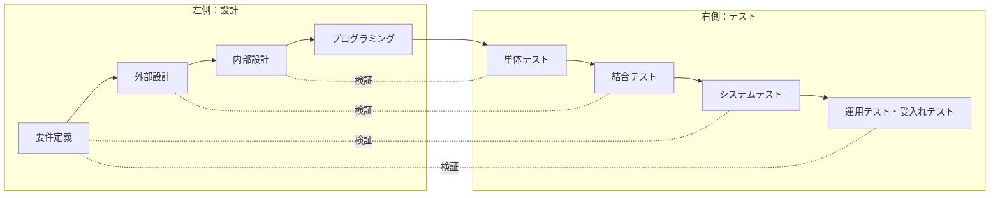
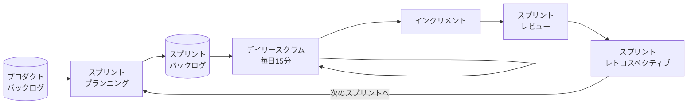
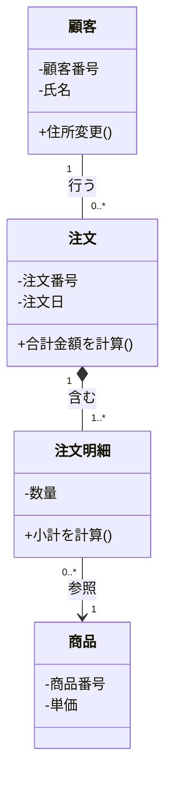
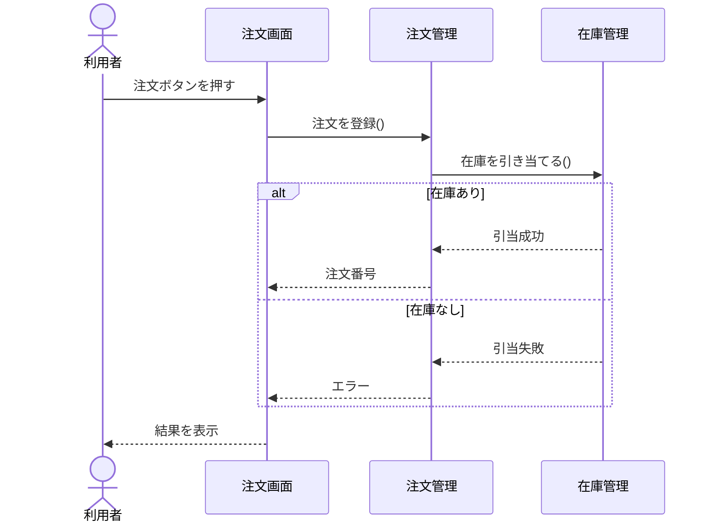
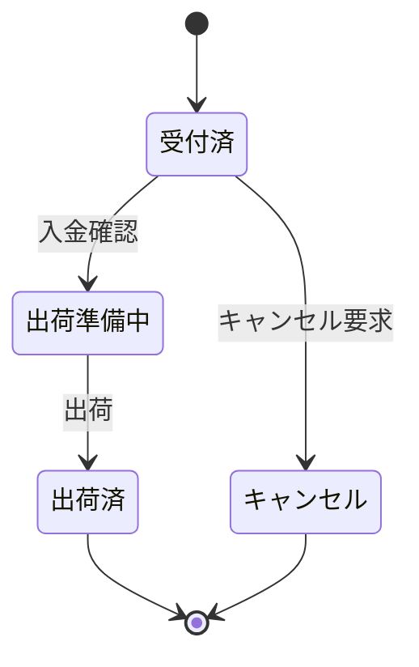
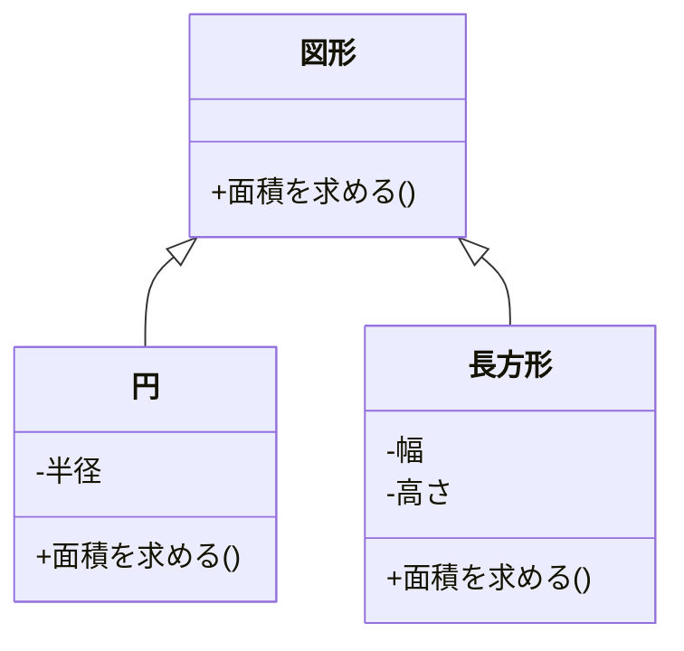
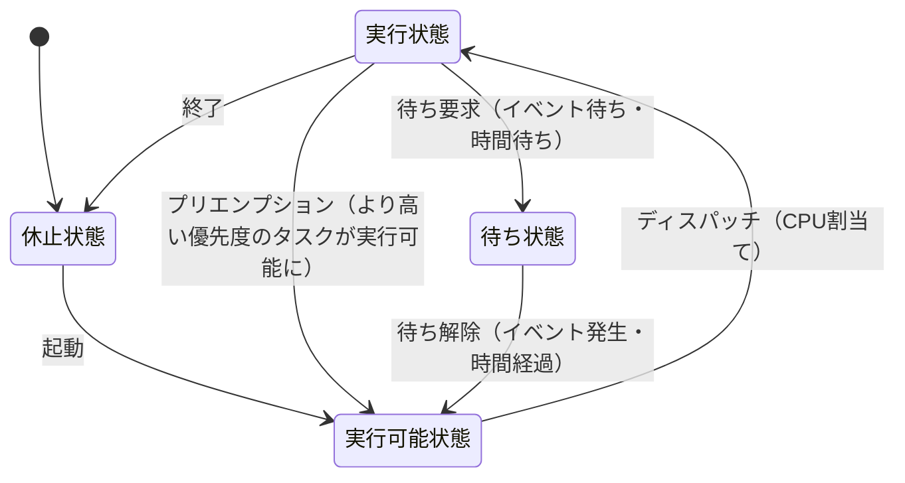

# システム開発技術

> **重要度：★★★**（科目A（旧午前）で毎回5〜6問、科目B（旧午後）では問7「組込みシステム開発」と問8「情報システム開発」の選択問題として出題）
> 開発プロセス（ウォーターフォール・アジャイル）、UML、オブジェクト指向、モジュール設計、テスト技法が科目Aの定番です。
> 科目Bの「情報システム開発」では、UMLやテストケースの空欄補充、設計変更の影響の読み取りが、「組込みシステム開発」では、状態遷移やタイミングの読み取りがよく問われます。
> この章では、用語を暗記するだけでなく、「なぜその手法を使うのか」を説明できることを目標にします。

## 目次

- [1. 開発プロセスとモデル](#1-開発プロセスとモデル)
- [2. アジャイル開発とDevOps](#2-アジャイル開発とdevops)
- [3. 共通フレームと要件定義](#3-共通フレームと要件定義)
- [4. 分析・設計の技法とUML](#4-分析設計の技法とuml)
- [5. オブジェクト指向](#5-オブジェクト指向)
- [6. モジュール設計](#6-モジュール設計)
- [7. テスト](#7-テスト)
- [8. レビュー技法](#8-レビュー技法)
- [9. 保守と構成管理](#9-保守と構成管理)
- [10. 知的財産の入口](#10-知的財産の入口)
- [11. 組込みシステム開発の基礎](#11-組込みシステム開発の基礎)
- [12. 科目B「情報システム開発」「組込みシステム開発」の解き方](#12-科目b情報システム開発組込みシステム開発の解き方)
- [確認問題](#確認問題)
- [📋 シラバス用語チェックリスト](#-シラバス用語チェックリスト)
- [参考](#参考)

---

## 1. 開発プロセスとモデル

### 1.1 ソフトウェア開発の流れ ★★

一般的なシステム開発は、**要件定義 → 外部設計（基本設計） → 内部設計（詳細設計） → プログラミング → テスト → 導入・運用・保守** の順に進みます。

- **外部設計**：利用者から見える部分（画面、帳票、入出力、機能の範囲）を設計します。利用者も参加してレビューします。
- **内部設計**：開発者から見た内部の構造（モジュール分割、データ構造、処理手順）を設計します。

### 1.2 主な開発モデル ★★★

| モデル | 特徴 | 向いているケース |
|---|---|---|
| **ウォーターフォールモデル** | 工程を順番に進め、原則として前の工程に戻らない。工程ごとに成果物を確定させる | 要件が明確で、変更が少ない大規模開発 |
| **V字モデル** | ウォーターフォールの各設計工程と、それを検証するテスト工程を対応付ける | 品質を工程ごとに確認したいとき |
| **プロトタイピングモデル** | 早い段階で試作品（プロトタイプ）を作り、利用者に確認してもらう | 要件があいまい、画面の使い勝手を確認したい |
| **スパイラルモデル** | 「計画 → リスク分析 → 開発 → 評価」のサイクルを繰り返し、システムを徐々に大きくする | リスクの大きな大規模開発 |
| **インクリメンタルモデル**（段階的モデル） | 全体の要件を最初に決め、機能を分割して段階的に開発・リリースする | 優先度の高い機能から早く使いたい |
| **進化的モデル** | 要件を少しずつ明確にしながら、システムを繰り返し改良する | 要件が変わりやすい |
| **RAD**（Rapid Application Development） | 少人数のチームが開発ツールを活用し、短期間で開発する。**タイムボックス**（期間の上限）を設ける | 短期開発 |

#### V字モデル（設計とテストの対応）



| 設計工程 | 対応するテスト | 確認すること |
|---|---|---|
| 要件定義 | システムテスト、運用テスト・受入れテスト | 要件どおりにシステム全体が動くか、業務で使えるか |
| 外部設計 | 結合テスト | モジュール間・サブシステム間のインタフェース |
| 内部設計 | 単体テスト | モジュール単体の動作 |

- ⚠️ ひっかけ注意：対応付けの細かい境界は文献によって少し異なります（外部設計 ↔ システムテストとする説明もあります）。試験では「上流の設計ほど、後のテストで検証される」という考え方を押さえておけば判断できます。

### 1.3 開発手法・アプローチ ★★

| 手法 | 内容 |
|---|---|
| **プロセス中心アプローチ（POA）** | 業務の処理（機能）に着目して設計する。DFDを使う構造化分析など |
| **データ中心アプローチ（DOA）** | 業務で扱う **データ** に着目して設計する。データは業務の変化に比べて安定しているため、変更に強い。E-R図を使う |
| **オブジェクト指向アプローチ（OOA）** | データとそれを操作する手続をまとめた **オブジェクト** に着目して設計する。UMLを使う |
| **リバースエンジニアリング** | 既存のプログラムを解析して、仕様や設計を明らかにする |
| **フォワードエンジニアリング** | リバースエンジニアリングで得た仕様をもとに、新しいシステムを開発する |
| **リエンジニアリング** | リバースとフォワードを組み合わせ、既存システムを作り直す |

---

## 2. アジャイル開発とDevOps

### 2.1 アジャイル開発の考え方 ★★★

**アジャイル開発** は、短い期間（**イテレーション**、反復）で「計画 → 設計 → 実装 → テスト」を繰り返し、動くソフトウェアを少しずつ提供する開発の進め方の総称です。2001年の **アジャイルソフトウェア開発宣言** で、次の4つの価値が示されています。

| 重視すること（左） | よりも | 右の価値も認める |
|---|---|---|
| **個人と対話** | > | プロセスやツール |
| **動くソフトウェア** | > | 包括的なドキュメント |
| **顧客との協調** | > | 契約交渉 |
| **変化への対応** | > | 計画に従うこと |

- ⚠️ ひっかけ注意：「ドキュメントは不要」「計画を立てない」という意味ではありません。右側にも価値があることを認めたうえで、**左側をより重視する** という宣言です。

### 2.2 スクラム ★★★

**スクラム** は、チームで仕事を進めるための軽量なフレームワークです。期間を区切った **スプリント**（1か月以内、2週間程度が多い）を繰り返します。用語は「スクラムガイド」（2020年版）に沿って押さえます。

#### 役割（スクラムチーム）

| 役割 | 責任 |
|---|---|
| **プロダクトオーナー** | プロダクトの価値を最大化する責任を持つ。**プロダクトバックログの管理**（項目の並び順＝優先順位の決定など）をする。1人の人間 |
| **スクラムマスター** | スクラムが正しく理解・実践されるよう支援する。チームの障害（妨げ）を取り除く。**指示・命令をする管理者ではない**（サーバントリーダー） |
| **開発者** | 各スプリントで、利用可能な **インクリメント** を作る |

#### イベント



| イベント | 内容 |
|---|---|
| **スプリントプランニング** | このスプリントで何を作るか（スプリントゴール）と、どう作るかを計画する |
| **デイリースクラム** | 開発者が毎日 **15分** で、スプリントゴールに向けた進み具合を確認し、計画を調整する |
| **スプリントレビュー** | 成果（インクリメント）を利害関係者に見せ、フィードバックを得る |
| **スプリントレトロスペクティブ** | チームの **進め方**（プロセス、人間関係、ツール）を振り返り、改善策を決める |

- 💡 覚え方：**レビュー = 成果物（プロダクト）の確認**、**レトロスペクティブ = 進め方（プロセス）の振り返り**。

#### 作成物（アーティファクト）

| 作成物 | 内容 | 対応する確約 |
|---|---|---|
| **プロダクトバックログ** | プロダクトに必要なものを並べた一覧 | プロダクトゴール |
| **スプリントバックログ** | スプリントで行う項目と、その作業計画 | スプリントゴール |
| **インクリメント** | 完成した、利用可能な成果 | **完成の定義**（Definition of Done） |

#### アジャイルでよく使う用語

| 用語 | 内容 |
|---|---|
| **ユーザーストーリー** | 「〈利用者〉として、〈目的〉のために、〈機能〉がほしい」の形で要求を書く |
| **ストーリーポイント** | 作業量の相対的な見積り単位 |
| **プランニングポーカー** | メンバーが見積りの数字のカードを一斉に出し、ばらつきを話し合って見積りを合わせる |
| **ベロシティ** | 1回のスプリントで完了できたストーリーポイントの合計。次の計画に使う |
| **バーンダウンチャート** | 残作業量の推移を表すグラフ。右下がりになる |
| **かんばん** | 作業を「ToDo・作業中・完了」などの列のカードで見える化し、作業中（WIP）の数を制限する |

#### 計算例：ベロシティによるリリース時期の見積り

- 公式：`必要なスプリント数 = 残りのストーリーポイント ÷ ベロシティ`（端数は切り上げ）
- 数値例：残りのプロダクトバックログが合計 180 ポイント、過去3スプリントの完了ポイントが 38、42、40
- 途中式：
  - ベロシティ（平均）：`(38 + 42 + 40) ÷ 3 = 120 ÷ 3 = 40 ポイント`
  - 必要なスプリント数：`180 ÷ 40 = 4.5` → 切り上げて **5スプリント**
  - 1スプリント2週間なら、`5 × 2 = 10週間` が目安になります。

### 2.3 XP（エクストリームプログラミング） ★★

**XP**（eXtreme Programming）は、プログラミングの具体的な実践（**プラクティス**）を重視するアジャイル手法です。

| プラクティス | 内容 |
|---|---|
| **テスト駆動開発（TDD）** | **先にテストコードを書き**、そのテストに合格するようにプログラムを書く。「失敗するテスト → 合格させる → リファクタリング」を繰り返す |
| **ペアプログラミング** | 2人1組で、1人がコードを書き、もう1人がその場でレビューする。役割は適宜交代する |
| **リファクタリング** | 外部から見た動作を **変えずに**、内部の構造をわかりやすく改善する |
| **継続的インテグレーション（CI）** | 変更したコードを頻繁に統合し、自動でビルドとテストを行う |
| **コードの共同所有** | 誰でもどのコードでも修正できる |
| **小さなリリース** | 短い間隔で少しずつリリースする |
| **YAGNI** | 「今必要ないものは作らない」（You Aren't Gonna Need It） |

- ⚠️ ひっかけ注意：**リファクタリングは機能を追加・変更する作業ではありません**。動作は変えず、構造だけを改善します。リファクタリング後には回帰テストで動作が変わっていないことを確認します。

### 2.4 DevOps と CI/CD ★★

**DevOps** は、開発（Development）と運用（Operations）の担当者が協力し、ツールによる自動化も活用して、ソフトウェアを素早く安定してリリースし続ける考え方です。

| 用語 | 内容 |
|---|---|
| **CI**（Continuous Integration：継続的インテグレーション） | コードの変更を頻繁に統合し、自動でビルド・テストする |
| **CD**（Continuous Delivery / Deployment：継続的デリバリー / デプロイメント） | いつでもリリースできる状態を保つ（デリバリー）。本番へのリリースまで自動化する（デプロイメント） |
| **IaC**（Infrastructure as Code） | サーバやネットワークの構成をコードで記述し、自動で構築する |
| **DevSecOps** | DevOps にセキュリティを組み込む。開発の早い段階からセキュリティ検査を行う（**シフトレフト**） |
| **カナリアリリース** | 新しい版を一部の利用者だけに先に公開し、問題がないことを確認してから全体に広げる |
| **ブルーグリーンデプロイメント** | 本番環境を2系統用意し、新しい版を待機系に配置してから切り替える。問題があればすぐ戻せる |

---

## 3. 共通フレームと要件定義

### 3.1 共通フレーム ★★

**共通フレーム**（SLCP-JCF：Software Life Cycle Process - Japan Common Frame）は、システム開発の **取引に関わる人が「同じ言葉」で話せるように**、ソフトウェアの企画から廃棄までの作業内容と用語を標準化した枠組みです。IPA が発行しており、最新版は **共通フレーム2013** です（国際規格 ISO/IEC 12207:2008 に対応する JIS X 0160:2012 をベースにしています）。

- 特徴：
  - 作業の **内容**（何をするか）を定めたもので、開発モデルや開発方法論、成果物の様式を **特定するものではありません**。
  - 自組織や取引の実情に合わせて、作業を選択・修正して使います（**テーラリング**）。
- 主なプロセスの流れ：
  - 企画プロセス → 要件定義プロセス → システム開発プロセス・ソフトウェア実装プロセス → 運用・サービスプロセス → 保守プロセス →（廃棄）

- ⚠️ ひっかけ注意：共通フレームの **要件定義プロセス** では、システムの利用者（業務部門）を含めた **利害関係者** の要件を定義します。要件の定義に責任を持つのは **発注者（利用者側）** で、開発者が勝手に決めるものではありません。

### 3.2 要件の種類 ★★★

| 種類 | 内容 | 例 |
|---|---|---|
| **業務要件** | 業務として実現したいこと | 「受注から出荷までを1日以内にする」 |
| **機能要件** | システムが提供すべき機能 | 受注登録、在庫引当、出荷指示 |
| **非機能要件** | 機能以外の、品質や制約に関する要件 | 応答時間3秒以内、稼働率99.9%、データの暗号化 |

IPA の **非機能要求グレード** は、非機能要件を次の **6つの大項目** に分けて、発注者と開発者が段階的にすり合わせるためのツールです。

| 大項目 | 例 |
|---|---|
| **可用性** | 稼働率、運用時間、災害時の復旧 |
| **性能・拡張性** | 応答時間、処理件数、将来の拡張 |
| **運用・保守性** | バックアップ、監視、保守の時間帯 |
| **移行性** | 移行の方式、移行期間 |
| **セキュリティ** | 認証、アクセス制御、暗号化 |
| **システム環境・エコロジー** | 設置環境、消費電力、法令などの制約 |

### 3.3 ソフトウェアの品質特性 ★★

ソフトウェア製品の品質は、**JIS X 25010**（ISO/IEC 25010:2011 に対応）の **製品品質モデル** で、8つの特性に分けられています。

| 品質特性 | 内容 |
|---|---|
| **機能適合性** | 必要な機能が正しくそろっている |
| **性能効率性** | 応答時間や資源の使用量が適切 |
| **互換性** | 他の製品と共存・連携できる |
| **使用性** | 利用者にとってわかりやすく使いやすい |
| **信頼性** | 障害が起きにくく、起きても回復できる（成熟性・可用性・障害許容性・回復性） |
| **セキュリティ** | 機密性・完全性・否認防止・責任追跡性・真正性 |
| **保守性** | 修正しやすい（モジュール性、再利用性、解析性、修正性、試験性） |
| **移植性** | 別の環境に移しやすい（適応性、設置性、置換性） |

- 補足：国際規格は 2023 年に改訂され（ISO/IEC 25010:2023）、「使用性」が「インタラクション能力」に、「移植性」が「柔軟性」に再編され、「安全性」が加わって9特性になりました。試験では JIS X 25010 の8特性で問われることが多いので、まずは上の表を押さえます。

### 3.4 要件定義の進め方と技法 ★

| 技法 | 内容 |
|---|---|
| **インタビュー** | 利用者に直接聞き取る |
| **ブレーンストーミング** | 批判せずに自由にアイデアを出し合う |
| **プロトタイピング** | 試作品を見せて要件を確認する |
| **ユースケース記述** | 利用者とシステムのやり取りを、シナリオ（基本フロー・代替フロー）で記述する |
| **要求のトレーサビリティ** | 要件 → 設計 → プログラム → テストの対応関係を追跡できるようにする。要件の漏れや変更の影響範囲を確認できる |

### 3.5 要件定義のタスクと要件の評価 ★★

共通フレーム（SLCP）では、要件定義を **システム要件定義** と **ソフトウェア要件定義** の2段階で行います。どちらも「**境界の定義 → 要件の定義 → 要件の評価 → 共同レビュー**」という同じ流れです。


**システムの境界の定義**
- 利害関係者要件で定義された **利用の状況** と **運用シナリオ** をもとに、システムが何を担当し、外部と何をやり取りするか（**API**、**GUI**、**インタフェースファイル**、**サービス**）を決めます。
- **システム化の目標** と **対象範囲**（対象業務・対象部署）をまとめます。

**システム要件として定義するもの**

| 区分 | 内容・用語 |
|---|---|
| 機能及び能力 | **システム機能仕様**、**レスポンスタイム**、**スループット** |
| 業務・組織・利用者の要件 | 業務処理手順、入出力情報要件、操作要件。**5W2H**（Why・When・Where・Who・What・How・How much）の観点で明確に文書化する |
| 各種の要件 | **性能要件**、**データベース要件**、**テスト要件**、**セキュリティ要件**、**移行要件**、**運用要件**（運用手順・運用形態・可用性・障害対応）、**保守要件**（保守の形態・タイミング）、**教育・訓練**、**費用** |
| その他 | **実行環境要件**、**周辺インタフェース要件**、**品質要件**、**パフォーマンス要件**（達成する遂行能力・性能・運用時の実績に対する要件）、設計及び実装の **制約条件**、**UX** を考慮した要件、**適格性確認要件**（開発するシステムが利用可能な品質であることを確認する基準）、開発環境 |

- **CRUD マトリクス**：機能（またはプロセス）とデータ（エンティティ）の表に、各機能がデータを **C**reate（生成）・**R**ead（参照）・**U**pdate（更新）・**D**elete（削除）するかを記入した表。「どの機能からも生成されないデータ」などの漏れを発見できます。

| 機能 ＼ データ | 顧客 | 注文 | 商品 |
|---|---|---|---|
| 顧客登録 | C | | |
| 注文受付 | R | C | R |
| 注文取消 | | D | |
| 商品登録 | | | C |

- **UX**（User Experience：ユーザー体験）**デザイン**：使いやすさだけでなく、利用前後を含めた体験全体（楽しさ、満足感）を設計すること。
- **イネーブリングシステム**：対象システムそのものではないが、そのライフサイクルを通じて **開発・製造・運用・保守を支えるシステム**（開発環境、テスト設備、教育訓練システムなど）。
- **使用性（usability）**：利用者が目的を有効・効率的・満足して達成できる度合い。

**ソフトウェア要件定義** では、**業務モデル**・**論理データモデル** を作成し、ソフトウェアの境界・機能・能力・インタフェースを決めます。業務分析には DFD、E-R 図、UML を使います。

- **要件の属性**：各要件に **根拠**、**優先順位**、ソフトウェア要素・テストケース・情報項目への **追跡可能性（トレーサビリティ）**、**検証手法** を記録します。
- **トレーサビリティマトリクス**：要件と、設計・プログラム・テストケースの対応を表にしたもの。

| 要件 | 設計書 | プログラム | テストケース |
|---|---|---|---|
| R-01 注文登録 | D-03 | P-010 | T-021, T-022 |
| R-02 在庫引当 | D-04 | P-011 | T-030 |

**要件（設計）の評価基準**

| 評価基準 | 意味 |
|---|---|
| **双方向の追跡可能性**（双方向のトレーサビリティ） | 上位要件 → 下位要件（設計・テスト）と、下位 → 上位の **両方向** にたどれること。漏れ（上位にあるのに下位にない）と余計なもの（下位にあるのに根拠がない）を発見できる |
| **外部一貫性** | 上位の文書（システム要件など）と矛盾がないこと |
| **内部一貫性** | その文書の中で矛盾がないこと |
| **テスト可能性** | テストで確認できる形で書かれていること（「速く」ではなく「3秒以内」） |
| **実現可能性** | システム設計（ソフトウェア）の実現可能性、**運用及び保守の実現可能性** |

- **共同レビュー**：要件定義書の作成後、**取得者（発注者）と供給者（受注者）が共同で** レビューします。**レビュー参加者** と **レビュー方式** をあらかじめ決めます。
- **アシュアランスケース**：システムが安全・セキュアであるといった **主張（クレーム）** を、**根拠（エビデンス）** と論証の構造で示した文書。GSN（Goal Structuring Notation）などで図示します。

### 3.6 品質モデルと設計で考慮する特性 ★★

**利用時の品質モデル**（JIS X 25010）は、利用者がシステムを使ったときの成果に関する **5つの特性** です。3.3 の製品品質モデル（8特性）とセットで押さえます。

| 特性 | 内容 |
|---|---|
| **有効性** | 利用者が目標を正確かつ完全に達成できるか |
| **効率性** | 達成のために使った資源（時間・労力）が適切か |
| **満足性** | 利用者が満足しているか（実用性、信用性、快感性、快適性） |
| **リスク回避性** | 経済・健康・安全・環境へのリスクを緩和できるか |
| **利用状況網羅性** | 想定した利用状況、さらに想定外の状況でも使えるか（利用状況完全性、柔軟性） |

- 製品品質の副特性の例：**使用性**（習得性、運用操作性、アクセシビリティ ほか）、**信頼性**（可用性、回復性 ほか）、**保守性**（解析性、試験性 ほか）。
- **ISO 9000**：品質マネジメントシステムの規格群（組織の品質管理の仕組み）。JIS X 25010 は製品の品質の規格である点が違います。

**セキュリティ要件の識別**：企業の **情報セキュリティ方針** に沿って、**セキュリティ要件** と **セキュリティ実現方式**（安全性対策・信頼性対策）を決めます。

| 区分 | 用語 | 内容 |
|---|---|---|
| 設計原則 | **最小限の原則** | 機能・権限を必要最小限にする |
| | **多層防御** | 複数の異なる対策を重ね、1つが破られても守る |
| | **システムサービスへのアクセス制限** | 利用者や他システムが使えるサービスを制限する |
| | **攻撃にさらされる境界面の最小化及び防御** | 攻撃対象領域（アタックサーフェス）を小さくし、残る部分を守る |
| 設計特性 | **アベイラビリティ** | 必要なときに使える（可用性） |
| | **障害許容性（耐故障性）** | 障害があっても機能を提供し続けられる |
| | **復元性（resilience）** | 障害や攻撃を受けても、すばやく正常な状態に戻れる |

**保守性の考慮**：運用開始後の機能追加・変更の工数を抑えるため、次の性質を設計で確保します。

| 性質 | 内容 |
|---|---|
| **無矛盾性** | 記法・用語・設計が全体で統一され矛盾がない |
| **自己記述性** | コードや文書そのものから意味が読み取れる（意味のある名前、コメント） |
| **構造性** | 構造化され、部分の関係が明確 |
| **簡潔性** | 不要な複雑さがない |
| **拡張性** | 機能追加がしやすい |
| **移植性** | 他の環境に移しやすい |

### 3.7 業務分析・要件定義の手法 ★★

| 手法 | 内容・用語 |
|---|---|
| **ヒアリング** | 利用者から要求を聞き取る。目的・対象者・質問項目を **ヒアリング計画** にまとめ、結果を **ヒアリング議事録** に残して相手の確認を得る |
| **ユースケース** | 1つの目標を達成するための **アクター**（利用者や外部システム）とシステムの **振舞い**（やり取り）を定義する。**ユースケース図** とユースケース記述で表す |
| **モックアップ** | 画面などの **見た目だけ** を再現した模型。動作はしない |
| **プロトタイプ** | 実際に動く試作品。**プロトタイプ版評価** で外部仕様の有効性・漏れ・実現可能性を確認し、手戻りを防ぐ |
| **ユーザーストーリー** | 要件を利用者視点の短い文で書く。大きすぎて1スプリントに収まらないストーリーを **エピック** と呼び、分割して使う。見積りは **ストーリーポイント**、並べたものが **プロダクトバックログ** |
| **SysML**（Systems Modeling Language） | UML を拡張した、ハードウェアを含む **システム全体** のモデリング言語。**要求図** やパラメトリック図などを追加している |
| **状態遷移表** | 状態遷移図の内容を「状態 × イベント → 次の状態・動作」の表にしたもの。抜け（未定義の組合せ）を見つけやすい |
| **決定表（デシジョンテーブル）** | 条件の組合せと動作を表にする（[7.3](#73-ブラックボックステスト-)） |

| プロトタイプの種類 | 内容 |
|---|---|
| **水平型プロトタイプ** | 多くの機能の **画面・操作（表層）だけ** を広く作る。全体の使い勝手や画面遷移の確認に向く |
| **垂直型プロトタイプ** | **特定の機能** について、画面から内部処理・データベースまで **深く** 作る。技術的な実現可能性や性能の確認に向く |

- 💡 覚え方：**水平＝広く浅く**、**垂直＝狭く深く**。

---

## 4. 分析・設計の技法とUML

### 4.1 構造化分析の図 ★★

| 図 | 内容 |
|---|---|
| **DFD**（Data Flow Diagram） | データの流れに着目して業務を表す。記号は4種類：**プロセス**（○ 処理）、**データフロー**（→）、**データストア**（＝ 保管）、**外部実体**（□ 源泉・吸収） |
| **E-R図** | 実体（エンティティ）と、その関連（リレーションシップ）を表す。データベース設計に使う |
| **状態遷移図** | 状態と、状態を変えるきっかけ（イベント）を表す。組込みシステムでよく使う |
| **決定表**（デシジョンテーブル） | 条件の組合せと、それに対する動作を表にまとめる |

- ⚠️ DFD は **データの流れ** を表す図で、処理の順序や条件分岐、制御の流れは表しません。

### 4.2 UML の図の種類 ★★★

**UML**（Unified Modeling Language：統一モデリング言語）は、OMG（Object Management Group）が標準化した、オブジェクト指向での設計を図で表す記法です。UML 2.x では14種類の図が定義されています。主なものは次のとおりです。

| 分類 | 図 | 何を表すか |
|---|---|---|
| 構造図 | **クラス図** | クラスの属性・操作と、クラス間の関係（静的な構造） |
| 構造図 | **オブジェクト図** | ある時点でのインスタンス（オブジェクト）どうしの関係 |
| 構造図 | **コンポーネント図** | ソフトウェアの部品（コンポーネント）とその依存関係 |
| 構造図 | **配置図** | ハードウェア（ノード）と、そこに配置されるソフトウェア |
| 構造図 | **パッケージ図** | クラスなどのグループ（パッケージ）とその依存関係 |
| 振る舞い図 | **ユースケース図** | 利用者（**アクター**）とシステムの機能（**ユースケース**）の関係 |
| 振る舞い図 | **アクティビティ図** | 処理の流れ（フローチャートに近い）。並行処理や、**スイムレーン**（担当の区分）も書ける |
| 振る舞い図 | **ステートマシン図** | オブジェクトの状態と、イベントによる状態遷移 |
| 相互作用図 | **シーケンス図** | オブジェクト間のメッセージのやり取りを **時系列** で表す |
| 相互作用図 | **コミュニケーション図** | オブジェクト間の **つながり（リンク）** に着目してメッセージを表す |
| 相互作用図 | **タイミング図** | 状態の変化を時間軸で表す |

- 💡 覚え方：「時間の順番ならシーケンス図、つながりならコミュニケーション図」「状態ならステートマシン図」「機能と利用者ならユースケース図」。

#### クラス図の例



- **多重度**：`1`（ちょうど1）、`0..1`（0または1）、`0..*` または `*`（0以上）、`1..*`（1以上）。
- 上の例の読み方：「顧客1人は0件以上の注文を行う」「注文1件は1件以上の注文明細を **含む**（注文を削除すると明細も消える → コンポジション）」「注文明細は1つの商品を参照する」。
- 可視性：`+` public（公開）、`-` private（非公開）、`#` protected（サブクラスに公開）。

#### シーケンス図の例



- 縦の点線が **ライフライン**（オブジェクトの存在期間）、横の矢印が **メッセージ** です。`alt` は条件分岐の **複合フラグメント**、`loop` は繰返しを表します。

#### ステートマシン図の例



#### ユースケース図の関係

| 関係 | 意味 |
|---|---|
| **包含**（`<<include>>`） | あるユースケースが、別のユースケースを **必ず** 含む（例：「注文する」は必ず「ログインする」を含む） |
| **拡張**（`<<extend>>`） | 特定の条件のときだけ、別のユースケースの機能を追加する（例：「注文する」に「クーポンを使う」が追加される） |
| **汎化** | アクターやユースケースの一般化・特化 |

### 4.3 DFD の詳細と構造化分析 ★★

**構造化分析法**（デマルコ法など）では、DFD を **段階的詳細化** して業務を分析します。

| 用語 | 内容 |
|---|---|
| **コンテキストダイアグラム** | 最上位の DFD。対象システム全体を **1つのプロセス** として描き、外部実体とのデータフローだけを示す。システムの境界が分かる |
| **段階的詳細化**（レベル分け） | プロセスを下位の DFD（レベル0、レベル1…）に分解していく。分解の前後で入出力のデータフローが一致すること（**バランシング**）が必要 |
| **ミニスペック** | これ以上分解しない最下位のプロセスの処理内容を、構造化言語・決定表などで記述した仕様 |
| **源泉と吸収** | 外部実体のうち、データの出どころを **源泉**、行き先を **吸収** という |
| **アクティビティ** | 業務の活動。DFD のプロセスに対応する（UML ではアクティビティ図で表す） |


上はコンテキストダイアグラムの例です。プロセス「受注システム」を分解すると、「注文受付」「在庫引当」「出荷指示」などの下位プロセスと、データストア（注文ファイル、在庫ファイル）が現れます。

### 4.4 構造化設計で使う図 ★

**構造化設計** では、機能を洗い出し → データフローを明確化 → 機能をグループ化 → **階層構造化** → プログラム機能の決定 → 機能仕様の文書化、という手順で分割します（**複合設計** とも呼ばれます）。プログラムは **順次・選択・繰返し** の3つの基本構造（**構造化プログラミング**）だけで記述します。

| 図・手法 | 内容 |
|---|---|
| **流れ図**（フローチャート） | 処理の流れを記号と矢印で表す |
| **NS 図**（Nassi-Shneiderman：ナッシシュナイダマン図） | 箱を入れ子にして順次・選択・繰返しを表す。**矢印（goto）がなく**、構造化プログラミングを強制できる |
| **PAD**（Problem Analysis Diagram） | 左から右へ階層を深くする木構造で制御構造を表す図 |
| **SPD・HCP チャート・PSD・DSD** | いずれも日本で考案された、木構造でプログラムの制御構造（モジュール仕様）を表す構造化チャート |
| **HIPO** | 図式目次と IPO（入力・処理・出力）図で機能を記述する |
| **構造化チャート**（階層構造図） | モジュールの階層と呼出し関係を木構造で表す |
| **ブロック図** | 構成要素をブロックと線で表し、要素間の関係を示す |
| **バブルチャート** | DFD の別名（プロセスを円＝バブルで描くため） |
| **イベントトレース図** | オブジェクト間のイベント（メッセージ）を時系列に表す図。UML のシーケンス図の前身 |
| **ジャクソン法** | 入出力のデータ構造（順次・選択・繰返し）の対応からプログラム構造を導く |
| **ワーニエ法** | 入力データを集合として捉え、その構造（いつ・何回）からプログラム構造を導く |
| **論理構造図**・**プログラミングテーブル** | プログラムの論理構造や処理条件を表形式・図で整理したもの |

```text
NS 図のイメージ（合計を求める）
┌──────────────────────────┐
│ 合計 ← 0                 │  順次
├──────────────────────────┤
│ i を 1 から N まで繰り返す │  繰返し
│ ┌────────────────────────┤
│ │      A[i] > 0 ?         │  選択
│ ├───── 真 ─────┬── 偽 ───┤
│ │ 合計←合計+A[i]│ 何もしない│
│ └──────────────┴─────────┤
├──────────────────────────┤
│ 合計を出力               │
└──────────────────────────┘
```

---

## 5. オブジェクト指向

### 5.1 基本概念 ★★★

**オブジェクト指向** は、データ（**属性**）とそれを操作する手続（**メソッド**、操作）を **オブジェクト** という単位にまとめて、システムを組み立てる考え方です。

| 概念 | 内容 | ねらい |
|---|---|---|
| **クラス** | オブジェクトのひな型（設計図）。属性とメソッドを定義する | — |
| **インスタンス** | クラスから実際に作られた個々のオブジェクト | — |
| **カプセル化** | 属性とメソッドを一体にし、内部の詳細を外部から隠す（**情報隠蔽**）。外部からは公開されたメソッドを通じてのみ操作する | 内部を変更しても、利用側に影響しにくい |
| **継承**（インヘリタンス） | 上位クラス（スーパークラス）の属性・メソッドを、下位クラス（サブクラス）が引き継ぐ | 共通部分を再利用し、差分だけを定義すればよい（**差分プログラミング**） |
| **多態性**（ポリモーフィズム） | 同じメッセージ（メソッド呼出し）を送っても、受け取ったオブジェクトのクラスに応じて異なる動作をする | 呼び出す側がオブジェクトの種類を意識しなくてよい |
| **メッセージパッシング** | オブジェクトどうしがメッセージを送り合って処理を進める | — |

- **オーバーライド**：サブクラスで、スーパークラスのメソッドを **同じ名前・同じ引数** で再定義すること。多態性を実現する手段です。
- **オーバーロード**：同じクラスの中で、**同じ名前で引数の型や数が異なる** メソッドを複数定義すること。
- ⚠️ ひっかけ注意：オーバーライドとオーバーロードは取り違えやすい用語です。「ライド＝上に乗る（上書き）」「ロード＝たくさん載せる（多重定義）」と覚えます。

#### 多態性の例



呼び出す側は、どの図形に対しても「面積を求める()」を送るだけです。円なら `半径 × 半径 × 3.14`、長方形なら `幅 × 高さ` が実行されます。新しい図形（三角形など）を追加しても、呼び出す側を変更する必要はありません。

- **抽象クラス**：インスタンスを作れないクラスで、サブクラスに共通の枠組みだけを定める（上の「図形」など）。
- **インタフェース**：実装を持たず、操作の名前（仕様）だけを定める。

### 5.2 クラス間の関係 ★★★

| 関係 | 意味 | UMLの記号 | 例 |
|---|---|---|---|
| **汎化 - 特化**（is-a） | 「BはAの一種である」。継承で実現する | 白抜き三角の矢印（`<|--`） | 「乗用車」は「自動車」の一種 |
| **集約**（part-of） | 「BはAの一部である」。全体と部分は **独立して存在できる** | 白抜きひし形（`o--`） | 「チーム」と「選手」（チームが解散しても選手は存在する） |
| **コンポジション**（合成） | 集約の中でも結び付きが強く、全体が消えると部分も消える | 黒塗りひし形（`*--`） | 「注文」と「注文明細」 |
| **関連** | クラス間に何らかの結び付きがある | 実線 | 「顧客」と「注文」 |
| **依存** | 一方が他方を一時的に利用する（変更の影響を受ける） | 点線の矢印 | 引数として受け取って使う |
| **実現** | インタフェースを実装する | 点線＋白抜き三角 | — |

- 💡 覚え方：「**is-a は汎化**、**part-of は集約**」。

### 5.3 デザインパターンなど ★

- **デザインパターン**：オブジェクト指向設計でよく使われる設計の型を、名前を付けて整理したものです。GoF（Gang of Four）の23パターンが有名です（例：**Singleton**＝インスタンスを1つに限定する、**Observer**＝状態の変化を登録先に通知する、**Adapter**＝インタフェースを変換して既存クラスを使えるようにする）。
- **フレームワーク**：アプリケーションの共通の骨組みを提供するもの。開発者は決められた場所に処理を書きます。
- **MVCモデル**：Model（データと処理）、View（表示）、Controller（入力の受付と制御）に分けて設計します。


### 5.4 SOLID 原則とクラス図の用語 ★★

**SOLID** は、保守しやすいオブジェクト指向設計のための5つの **ソフトウェア設計原則** の頭文字です。

| 原則 | 内容 |
|---|---|
| **S**：単一責任の原則（SRP） | 1つのクラスが持つ責任（変更の理由）は1つにする |
| **O**：開放閉鎖の原則（OCP） | 拡張に対して開いており、修正に対して閉じている（既存コードを変えずに機能を追加できる） |
| **L**：リスコフの置換原則（LSP） | サブクラスのオブジェクトは、スーパークラスのオブジェクトと置き換えても正しく動かなければならない |
| **I**：インタフェース分離の原則（ISP） | 利用者が使わない操作への依存を強制しない（大きなインタフェースを小さく分ける） |
| **D**：依存性逆転の原則（DIP） | 上位モジュールも下位モジュールも、具体的な実装ではなく **抽象（インタフェース）** に依存させる |

クラス図・オブジェクト指向設計のその他の用語

| 用語 | 内容 |
|---|---|
| **スーパークラス / サブクラス** | 継承元の上位クラス / 継承先の下位クラス |
| **汎化 / 特化** | 共通部分を上位クラスにまとめること / 上位クラスから差分を持つ下位クラスを作ること |
| **集約 / 分解** | 部分を組み合わせて全体を作ること / 全体を部分に分けること |
| **多相性** | 多態性（ポリモーフィズム）と同じ |
| **パッケージ** | クラスなどをまとめるグループ（名前空間）。**パッケージ図** で依存関係を表す |
| **ロール名** | 関連の端に付ける、相手から見たそのクラスの役割名（例：会社 — 従業員 の「雇用者」「被雇用者」） |
| **派生属性** | 他の属性から計算で求められる属性。UML では名前の前に `/` を付ける（例：`/年齢`） |
| **派生関連** | 他の関連をたどれば導ける関連。`/` を付けて表す |
| **コレクション** | 複数のオブジェクトをまとめて扱う入れ物（リスト、集合など）。多重度が `*` の関連の実装に使う |
| **エージェント指向** | 自律的に判断・行動する **エージェント** の協調としてシステムを捉える考え方 |
| **分析と設計の役割分担** | 分析モデルは「何をするか（問題領域）」、設計モデルは「どう実現するか（解決領域）」を表す |
| **イベントフロー分析** | ユースケースの基本フロー・代替フローを分析して、必要なオブジェクトや操作を見つける |
| **バックトラック** | 解を探索する途中で行き詰まったら1つ前の分岐に戻って別の候補を試す手法 |
| **コントロールフロー** | 処理の制御の流れ（アクティビティ図の矢印など） |

### 5.5 ドメイン駆動設計（DDD） ★

**ドメイン駆動設計**（DDD：Domain-Driven Design）は、業務の専門領域（**ドメイン**）の知識を中心に据え、その知識をそのままコードに反映させる設計手法です。

| 用語 | 内容 |
|---|---|
| **ドメイン** | ソフトウェアで解決したい業務の領域（例：受注、配送、会計） |
| **ドメインモデル** | ドメインの概念やルールを抽象化したモデル。コードと一致させる |
| **ドメインロジック** | 業務のルール・計算（例：送料の計算規則）。画面やデータベースの処理と分けて実装する |
| **ユビキタス言語** | 業務の専門家と開発者が **共通に使う言葉**。会話・文書・コードの名前で同じ用語を使う |
| **境界づけられたコンテキスト** | 1つのモデル・用語が一貫した意味を持つ範囲（例：「商品」の意味が販売と在庫で異なる） |
| **コンテキストマップ** | 複数の境界づけられたコンテキストの関係（どちらがどちらに依存するかなど）を表した図 |
| **エンティティ** | **識別子（ID）** によって区別されるオブジェクト。属性が変わっても同一とみなす（例：会員） |
| **値オブジェクト** | 識別子を持たず、**値そのもの** で等しさを判断する不変のオブジェクト（例：金額、住所） |
| **サービス**（ドメインサービス） | エンティティや値オブジェクトに自然に属さない業務処理を担うもの |

- 💡 DDD とマイクロサービスは相性がよく、境界づけられたコンテキストをサービス分割の単位にすることがあります。

### 5.6 システム設計と処理方式 ★★

**システム設計** では、システム要件を **ハードウェア・ソフトウェア・サービス・手作業** に振り分け（**利用者作業範囲** も決める）、必要な **ハードウェア構成品目**・**ソフトウェア構成品目** を決めます。ハードウェア構成は冗長化・フォールトトレラント設計などで、**IaaS・PaaS・SaaS** の利用も検討します（[04_システム構成要素](04_システム構成要素.md)）。

| 処理方式・用語 | 内容 |
|---|---|
| **集中処理 / 分散処理** | 1台のホストで処理する / 複数のコンピュータに処理を分担させる |
| **クライアントサーバシステム**、**Web システム** | 処理を利用者側と提供側に分ける方式 |
| **マイクロサービスアーキテクチャ** | システムを、独立して開発・デプロイできる **小さなサービス** の集まりとして構成し、API で連携させる |
| **サービスメッシュ** | マイクロサービス間の通信（ルーティング、暗号化、リトライ、監視）を、各サービスに付けた **プロキシ（サイドカー）** で共通に制御する基盤（例：Istio） |
| **サーキットブレーカー** | 呼出し先のサービスで障害が続いたら、一定時間 **呼出しを遮断** して即座にエラーを返し、障害が連鎖的に広がるのを防ぐ仕組み。状態は閉（通常）→ 開（遮断）→ 半開（試しに一部通す） |
| **サーバレスアーキテクチャ** | サーバの管理をクラウド事業者に任せ、イベント発生時に関数（FaaS）を実行する方式。使った分だけ課金 |
| **利用者の役割及び特権のマトリックス** | 利用者の役割ごとに、使える機能・権限を表にしたもの |
| **擬似コード** | 自然言語とプログラム言語の中間の形で処理手順を書いたもの |

**クリーンアーキテクチャ**：ソフトウェアを同心円状の層（中心から **エンティティ → ユースケース → インタフェースアダプター → フレームワークとドライバー**）に分け、**依存の向きを常に内側（業務ルール）へ** 向ける設計です。データベースや画面などの外側の技術を交換しても、中心の業務ルールに影響しません。

**データベース方式の決定**

| 種類 | 特徴 |
|---|---|
| **RDB**（関係データベース） | 表形式。SQL で操作 |
| **NDB**（網型データベース） | レコード間を親子のポインタで網状に結ぶ |
| **OODB**（オブジェクト指向データベース） | オブジェクトをそのまま格納 |
| **XML データベース** | XML 文書を階層構造のまま格納・検索 |
| **インメモリデータベース** | データを主記憶上に置き高速処理 |
| **分散データベース**、**NoSQL データベース** | 複数サイトに分散 / 表形式以外のデータモデル（[06_データベース](06_データベース.md)） |

### 5.7 アーキテクチャパターン・デザインパターン・部品化 ★★

- **アーキテクチャパターン**：ソフトウェア全体の構造の型。代表は **MVC モデル**（5.3）です。利点は設計の再利用と役割の明確化、留意点は小規模システムでは構造が過剰になることです。
- **デザインパターン**（GoF の23パターン）は、次の **3種類** に分類されます。

| 分類 | 目的 | 例 |
|---|---|---|
| **生成** に関するパターン | オブジェクトの作り方 | Singleton、Factory Method、Abstract Factory、Builder、Prototype |
| **構造** に関するパターン | クラス・オブジェクトの組み合わせ方 | Adapter、Composite、Decorator、Facade、Proxy |
| **振舞い** に関するパターン | オブジェクト間の責任分担・アルゴリズム | Observer、Strategy、Template Method、Iterator、State |

**部品化と再利用**（詳細は [12_ソフトウェア開発管理技術](12_ソフトウェア開発管理技術.md)）

| 用語 | 内容 |
|---|---|
| **コンポーネントウェア** | ソフトウェア部品（コンポーネント）を組み合わせてシステムを構築する方法 |
| **ホワイトボックス型 / ブラックボックス型** | 中身を修正して使う部品 / インタフェースだけで使う部品 |
| **クラスライブラリ** | 再利用可能なクラスを集めたもの |
| **レガシーラッピング** | 既存（レガシー）システムを作り直さず、新しいインタフェース（API など）で **包んで** 新システムから利用できるようにする |
| **COTS**（Commercial Off-The-Shelf） | 市販の既製ソフトウェア製品（パッケージ）をそのまま利用すること |

---

## 6. モジュール設計

### 6.1 モジュールの独立性 ★★★

**モジュール** は、プログラムを機能ごとに分割した単位です。よいモジュールは **独立性が高い**、つまり **モジュール強度（凝集度）が高く、モジュール結合度が低い** ものです。

- **モジュール強度**（凝集度）：1つのモジュールの **内部の結び付き** の強さ。**高いほどよい**。
- **モジュール結合度**：モジュール **どうしの結び付き** の強さ。**低いほどよい**。

#### モジュール強度（上ほど強度が高く、よい）

| 順位 | 強度 | 内容 |
|---|---|---|
| 1（最良） | **機能的強度** | 1つの機能だけを実行する |
| 2 | **情報的強度** | 同じデータ構造を扱う複数の機能を、それぞれ別の入口でまとめる |
| 3 | **連絡的強度** | 前の処理の結果を次の処理で使う、順番に意味のある処理をまとめる（データを共有） |
| 4 | **手順的強度** | 実行順序に関係のある処理をまとめる（データの受渡しはない） |
| 5 | **時間的強度** | 初期化処理など、同じ時期に実行する処理をまとめる |
| 6 | **論理的強度** | 関連する複数の機能を1つにまとめ、引数で選んで実行する |
| 7（最悪） | **暗合的強度** | 関係のない処理をまとめる |

#### モジュール結合度（上ほど結合度が低く、よい）

| 順位 | 結合度 | 内容 |
|---|---|---|
| 1（最良） | **データ結合** | 必要なデータ項目だけを引数で受け渡す |
| 2 | **スタンプ結合** | 構造体などのデータ構造をまとめて受け渡し、その一部だけを使う |
| 3 | **制御結合** | 処理を切り替えるための制御情報（フラグなど）を受け渡す |
| 4 | **外部結合** | 必要なデータだけを外部宣言（グローバル変数）で共有する |
| 5 | **共通結合** | 共通のデータ領域（構造体全体など）を共有する |
| 6（最悪） | **内容結合** | 他のモジュールの内部を直接参照・変更する |

- 💡 覚え方（強度・よい順）：「**き・じょう・れん・て・じ・ろん・あん**（機能・情報・連絡・手順・時間・論理・暗合）」。
- 💡 覚え方（結合度・よい順）：「**データ・スタンプ・制御・外部・共通・内容**」。受け渡す情報が「必要なデータだけ → 構造体 → 制御フラグ → 共有領域 → 相手の内部」と、相手への依存が強くなる順です。
- ⚠️ ひっかけ注意：強度は「高いほどよい」、結合度は「低いほどよい」。向きが逆なので注意します。

### 6.2 モジュール分割技法 ★

| 技法 | 分類 | 内容 |
|---|---|---|
| **STS分割** | データの流れに着目 | 処理を **源泉（Source）・変換（Transform）・吸収（Sink）** の3つに分ける |
| **TR分割**（トランザクション分割） | データの流れに着目 | 入力されるトランザクションの種類ごとに分ける |
| **共通機能分割** | データの流れに着目 | 共通する機能を1つのモジュールにまとめる |
| **ジャクソン法** | データ構造に着目 | 入力と出力のデータ構造の対応からプログラム構造を作る |
| **ワーニエ法** | データ構造に着目 | 入力データの構造（集合）に着目してプログラム構造を作る |


### 6.3 モジュール分割の評価とソフトウェア要素の設計 ★

**ソフトウェア設計** では、ソフトウェア要件をもとに **ソフトウェア要素** を **ソフトウェアユニット**（プログラム）まで分割し（**ソフトウェアユニット分割**）、各ユニットの機能（**ソフトウェアユニット機能仕様決定**）と **ソフトウェアユニット間インタフェース** を設計します。**入出力設計**、**物理データ設計**、**部品化・再利用** もここで検討します。

| 用語 | 内容 |
|---|---|
| **モジュールの制御領域** | あるモジュールと、そこから直接・間接に呼び出される下位モジュールの範囲 |
| **モジュールの影響領域** | あるモジュールの判定（条件分岐）の結果に影響を受けるモジュールの範囲 |
| 制御領域と影響領域の関係 | **影響領域が制御領域の中に収まる** ように設計するのが望ましい（判定の影響が呼出し関係の外に広がらない） |
| **分割量** | 1モジュールの大きさの目安（例：数十〜百数十行程度）。大きすぎるものは **モジュール再分割** する |
| **従属モジュール** | 他のモジュールから呼び出されて働く下位のモジュール |
| **論理設計 / 領域設計** | 処理論理にもとづく分割 / データ領域（扱うデータの範囲）にもとづく分割 |
| **サブルーチン / 再帰プログラム** | 共通処理を呼び出して使う単位 / 自分自身を呼び出すプログラム |

**ソフトウェア要素の分割の考え方**：処理パターン適用、**処理タイミング（処理の周期）** の違い、処理効率の違い、同時使用可能資源、入出力装置の特徴などで分けます。**ファイルの統合・分割**、**レコード処理** の単位もこの観点で決めます。

**プログラム分割基準**：**分かりやすさ**、**安全性**、**開発の生産性**、**運用性**、**処理能力**、**保守性**、**再利用性**。

**インタフェース設計**（入出力詳細設計）では、操作性・応答性・視認性を考えて、**画面設計**・**帳票設計**・**伝票設計**・**レイアウト設計** を行います（UI の考え方は [11_ユーザーインタフェースと情報メディア](11_ユーザーインタフェースと情報メディア.md)）。

| 用語 | 内容 |
|---|---|
| **インタフェース設計基準** | 画面の配置・色・用語・操作方法などの統一ルール |
| **画面構成** | 画面の領域（タイトル、入力欄、ボタン、メッセージ欄）の配置 |
| **フォームオーバーレイ** | 罫線や見出しなど帳票の **固定部分（フォーム）** を、可変データと重ねて印刷する方式。専用の印刷用紙が不要になる |
| **リミットチェック** | 入力値が **決められた範囲（上限・下限）** に入っているかを調べる入力チェック（例：月は1〜12） |
| **タイミング設計** | 処理や信号の発生する時点・順序・時間制約を設計する（組込み系で重要） |
| **インタフェース条件 / インタフェース項目** | モジュール・システム間でやり取りする条件 / データ項目 |

その他の入力チェックの例：**ニューメリックチェック**（数値か）、**フォーマットチェック**（形式）、**論理チェック**（項目間の矛盾）、**チェックディジット**（コード末尾の検査用数字で入力ミスを検出）。

---

## 7. テスト

### 7.1 テストの工程 ★★★

| テスト | 目的 | 主な担当 |
|---|---|---|
| **単体テスト** | モジュール単体が内部設計どおりに動くか | 開発者 |
| **結合テスト** | モジュール間のインタフェースが正しいか | 開発者 |
| **システムテスト**（総合テスト） | システム全体が要件（機能・性能など）を満たすか | 開発者 |
| **運用テスト** | 実際の業務の環境・手順で使えるか | 利用者 |
| **受入れテスト** | 発注者が、要件どおりか確認して受け入れる | 発注者（利用者） |

システムテストで行う主なテスト：**機能テスト**、**性能テスト**、**負荷テスト**（限界まで負荷をかける）、**ストレステスト**、**セキュリティテスト**、**障害回復テスト**、**ユーザビリティテスト**。

#### 結合テストの方法

| 方法 | 進め方 | 必要なテスト用モジュール |
|---|---|---|
| **トップダウンテスト** | 上位から順に下位へ結合する | 未完成の下位モジュールの代わりの **スタブ** |
| **ボトムアップテスト** | 下位から順に上位へ結合する | 未完成の上位モジュールの代わりに呼び出す **ドライバ** |
| **サンドイッチテスト** | 上位からと下位からを並行して進める | スタブとドライバ |
| **ビッグバンテスト** | 全モジュールを一度に結合する | 不要（ただし不具合の原因箇所を特定しにくい） |

- 💡 覚え方：**スタブは下の代役**（呼ばれる側）、**ドライバは上の代役**（呼ぶ側）。「ドライバ（運転手）が車（下位）を動かす」と覚えます。

#### 回帰テスト（リグレッションテスト）

**回帰テスト** は、プログラムを修正・変更したときに、**変更していない部分に悪影響（デグレード）が出ていないか** を確認するテストです。保守やリファクタリングの後に必ず行います。何度も繰り返すため、**テストの自動化** と相性がよいテストです。

### 7.2 ホワイトボックステスト ★★★

**ホワイトボックステスト** は、プログラムの **内部構造**（ソースコードの分岐や命令）に着目してテストケースを作る技法です。主に単体テストで使います。どこまで実行したかの割合を **網羅率**（カバレッジ）といいます。

例として、次の判定を考えます（else 側の処理はありません）。

```text
if (A > 0 and B > 0) then
    処理X
end if
```

| 網羅基準 | 条件 | 必要なテストケースの例 |
|---|---|---|
| **命令網羅**（C0） | すべての **命令** を少なくとも1回実行する | 1件：(A=1, B=1) → 判定が真で処理Xを実行 |
| **判定網羅**（分岐網羅、C1。IPAの問題では「判定条件網羅」とも） | すべての **判定** の **真と偽** を少なくとも1回ずつ実行する | 2件：(A=1, B=1) で真、(A=0, B=1) で偽 |
| **条件網羅** | 判定の中の **個々の条件**（A>0、B>0）の **真と偽** を少なくとも1回ずつ実行する | 2件：(A=1, B=0)、(A=0, B=1)。個々の条件はそれぞれ真・偽になるが、**判定はどちらも偽** |
| **判定条件／条件網羅** | 判定網羅と条件網羅の両方を満たす | 2件：(A=1, B=1) で判定は真、(A=0, B=0) で判定は偽 |
| **複数条件網羅** | 個々の条件の **真偽のすべての組合せ** を実行する | 4件：(真,真)(真,偽)(偽,真)(偽,偽) |

- ⚠️ ひっかけ注意：**条件網羅を満たしても、判定網羅を満たすとは限りません**（上の例のとおり、判定がすべて偽になることがあります）。逆に、判定網羅を満たしても条件網羅を満たすとは限りません。
- 網羅性の強さ：`命令網羅 < 判定網羅 < 判定条件／条件網羅 < 複数条件網羅`（条件網羅は判定網羅との強弱が決まらない点に注意）。
- 💡 ホワイトボックステストでは、**仕様にあるのに実装されていない機能**（機能の漏れ）は見つけられません。コードにない部分は網羅の対象にならないからです。

### 7.3 ブラックボックステスト ★★★

**ブラックボックステスト** は、内部構造を見ずに、**仕様（入力と出力）** に着目してテストケースを作る技法です。

#### 同値分割と境界値分析

例：「年齢（整数）を入力し、0〜17 は子ども料金、18〜64 は大人料金、65 以上はシニア料金。負の数はエラー」という仕様。

| 同値クラス | 範囲 | 代表値の例（同値分割） |
|---|---|---|
| 無効同値クラス | 0 未満 | −5 |
| 有効同値クラス（子ども） | 0〜17 | 10 |
| 有効同値クラス（大人） | 18〜64 | 40 |
| 有効同値クラス（シニア） | 65 以上 | 80 |

- **同値分割**：入力を、同じ扱いになるグループ（**同値クラス**）に分け、各クラスから **代表値** を1つずつ選びます。上の例では −5、10、40、80 の4件です。**有効同値クラス**（正しい入力）だけでなく **無効同値クラス**（誤った入力）も必ず含めます。
- **境界値分析**（限界値分析）：誤りが起きやすい **境界の前後の値** をテストします。上の例では **−1、0、17、18、64、65** を選びます。
- 💡 なぜ境界値か：プログラムの `<` と `<=` の書き間違いは、境界の値でしか見つからないからです。

#### デシジョンテーブル（決定表）

例：「会員で、かつ購入金額が5,000円以上なら送料無料。非会員でも10,000円以上なら送料無料。それ以外は送料500円」。

| | ルール1 | ルール2 | ルール3 | ルール4 | ルール5 | ルール6 |
|---|---|---|---|---|---|---|
| **条件** 会員である | Y | Y | Y | N | N | N |
| **条件** 金額 ≧ 10,000 | Y | N | N | Y | N | N |
| **条件** 金額 ≧ 5,000 | Y | Y | N | Y | Y | N |
| **動作** 送料無料 | X | X | — | X | — | — |
| **動作** 送料500円 | — | — | X | — | X | X |

- 条件の組合せを漏れなく洗い出せるので、仕様の **漏れや矛盾** にも気付けます。「金額 ≧ 10,000 は Y で 金額 ≧ 5,000 は N」のような **ありえない組合せ** は除外しています。

#### その他のブラックボックス技法

| 技法 | 内容 |
|---|---|
| **原因結果グラフ** | 入力（原因）と出力（結果）の論理関係をグラフにし、デシジョンテーブルに変換する |
| **状態遷移テスト** | 状態遷移図・状態遷移表をもとに、すべての遷移や、起こってはいけない遷移を確認する |
| **ペアワイズテスト** | どの2つの因子の値の組合せも少なくとも1回は現れるように、少ない件数でテストする（**直交表** を使う方法もある） |
| **エラー推測** | 経験から誤りが起きやすい箇所を推測してテストする |

### 7.4 テストの管理と品質の評価 ★★

#### バグ管理図（信頼度成長曲線）

テストを進めたときの **累積バグ数** は、一般に **S字型（ゴンペルツ曲線、ロジスティック曲線）** になります。最初はテストに慣れておらずバグの発見が少なく、中盤で急増し、終盤はバグが減って横ばい（**収束**）になります。

| グラフの状態 | 判断の例 |
|---|---|
| 累積バグ数が横ばいになった | バグが収束しつつあり、品質が安定してきた |
| 終盤でも累積バグ数が増え続けている | まだバグが多く残っている可能性。テスト終了は早い |
| 未消化のテスト項目が多いまま横ばい | テストが進んでいないだけかもしれない（消化状況とあわせて判断） |

#### エラー埋込み法（計算）

あらかじめ既知のエラー（埋込みエラー）を意図的に混ぜてテストし、その発見率から、まだ見つかっていない本来のエラー（固有エラー）の数を推定する方法です。

- 公式：`固有エラーの総数（推定） = 発見した固有エラー数 × 埋め込んだエラー数 ÷ 発見した埋込みエラー数`
- 数値例：エラーを 50 個埋め込んでテストしたところ、埋込みエラーが 40 個、固有エラーが 60 個見つかった。
- 途中式：
  - 埋込みエラーの発見率：`40 ÷ 50 = 0.8`
  - 固有エラーの総数（推定）：`60 ÷ 0.8 = 75 個`（公式どおりに `60 × 50 ÷ 40 = 75`）
  - 残っている固有エラー（推定）：`75 − 60 = 15 個`

- **テスト駆動開発（TDD）**、**静的解析**（プログラムを実行せずにソースコードを解析し、規約違反や欠陥の可能性を検出する）、**カバレッジツール** などもテストの品質向上に使われます。


### 7.5 実装（コーディング・コードレビュー・デバッグ） ★★

**実装・構築** では、コーディング標準とプログラム言語の仕様に従って **ソフトウェアユニット** を作成し、テスト手順・テストデータを作ってユニットのテストを行い、コードとテスト結果を評価（**追跡可能性**、外部一貫性、内部一貫性、**テスト網羅性**、コーディング方法及び作業標準の適切性など）します。

**コーディング標準** は、**インデンテーション**（字下げ）、**ネスト**（入れ子）の深さの上限、**命名規則**、**使用禁止命令**（goto など）などを定めたルールです。守らないと、読みにくく誤りを生みやすいコードになり、保守性が下がり、担当者以外が修正できなくなります（**プログラム書法**）。

| コーディング支援手法 | 内容 |
|---|---|
| **コード補完** | 入力途中の変数名・関数名などの候補を表示して補う |
| **オートインデント** | 構造に合わせて自動で字下げする |
| **シンタックスハイライト** | 予約語・文字列・コメントなどを色分けする |
| **コードオーディター** | コーディング標準に違反していないかを自動で検査する |
| **ブレークポイント** | 指定した行で実行を一時停止させ、変数の値などを確認する |

**コードレビュー**：コーディング標準・詳細設計書どおりか、効率性・保守性は適切かを確認します。**コードインスペクション**（公式・役割分担あり）、**ピアコードレビュー**、**ウォークスルー** などの方法があり、**メトリクス計測**（行数、複雑度など）も使います。

**サイクロマティック複雑度**（循環的複雑度：マッケーブの複雑度）は、プログラムの制御フローの複雑さを表す指標で、**独立した経路の数** を表します。

- 公式：`M = E − N + 2P`（E：辺の数、N：節点の数、P：連結成分の数。1つのプログラムなら P = 1）
- 簡便法：`M = 判定（分岐）の数 + 1`
- 数値例：if 文が2つ、while 文が1つあるプログラム。制御フローグラフの辺が 9 本、節点が 7 個
- 途中式：`M = 9 − 7 + 2 × 1 = 4`。簡便法でも `判定3個 + 1 = 4`
- 値が大きい（一般に10を超える）と、テストや保守が難しいとされます。

**デバッグ**

| 用語 | 内容 |
|---|---|
| **静的解析** | プログラムを **実行せずに** ソースコードを解析し、規約違反・未初期化変数などを検出する（机上デバッグもこの仲間） |
| **動的テスト** | プログラムを **実際に動かして** 確認する |
| **アサーション** | 「この時点で必ず成り立つべき条件」をコードに書き込み、成り立たなければ停止・警告する |
| **デバッガ** | ブレークポイント、ステップ実行、変数の表示などでプログラムの動作を調べるツール |
| **トレーサー** | 実行した命令の順序や変数の変化を記録・表示する |
| **スナップショット** | 指定した時点のメモリやレジスタの内容を出力（ダンプ）する |
| **デバッグ環境** | 実機の代わりのシミュレーターや ICE など、デバッグに使う環境 |

**プログラミングの方式**（ソフトウェアユニットの作成で使われるもの）

| 方式 | 内容 |
|---|---|
| **構造化プログラミング** | 順次・選択・繰返しの3構造だけで書く |
| **論理型プログラミング** | 事実と規則（論理式）を与え、推論で答えを求める（例：Prolog） |
| **並列処理プログラミング** | 複数の処理を同時に実行するよう記述する（スレッド、排他制御） |
| **アスペクト指向プログラミング** | ログ出力・認証など、多くのモジュールにまたがる **横断的な関心事** を「アスペクト」として分離して記述する |

### 7.6 テストの準備・ツール・評価指標 ★★

**テストの手順**：テスト計画（目的・方針・**テスト範囲**・スケジュール・体制・ツール）→ テスト準備（**テスト環境**、**テストデータ**、チェックシートの作成）→ 実施 → 結果の記録・分析・修正、の順に進めます。

| 用語 | 内容 |
|---|---|
| **障害 / 欠陥** | 障害（failure）は期待どおりに動かない現象、欠陥（defect、バグ）はその原因となるプログラムの誤り。原因を突き止めることを **障害分析** という |
| **テストオラクル** | テスト結果が正しいかどうかを判定するための **期待結果（またはその判定の仕組み）** |
| **テストデータジェネレーター** | テストデータを自動生成するツール |
| **テストベッド** | テストを実行するための環境（ハードウェア・ソフトウェア・ツール一式） |
| **シミュレーター** | 実機や外部システムの代わりに、その動作を模擬するもの |
| **テスト自動化** | テストの実行・結果判定をツールで自動化する。回帰テストで効果が大きい |

**テストの評価指標（計算）**

- **テスト密度** = `テスト項目数 ÷ プログラム規模（例：1,000行＝1kステップ当たり）`
- **欠陥密度（バグ密度）** = `発見した欠陥数 ÷ プログラム規模`
- 数値例：20kステップのプログラムで、テスト項目 1,200 件、欠陥 50 件
- 途中式：テスト密度 `1,200 ÷ 20 = 60 件/kステップ`、欠陥密度 `50 ÷ 20 = 2.5 件/kステップ`
- 判断：基準値と比べ、テスト密度が低ければテスト不足、欠陥密度が極端に低ければテスト不足、極端に高ければ品質に問題がある可能性を疑います。

**その他のテスト技法**

| 技法 | 内容 |
|---|---|
| **経路組合せ網羅** | プログラムのすべての経路の組合せを実行する（最も強いが現実的には困難） |
| **限界値分析法 / 同値分析法** | 境界値分析 / 同値分割の別名（[7.3](#73-ブラックボックステスト-)） |
| **実験計画法** | 直交表などを使い、少ない組合せで因子の影響を効率よく調べる |
| **ミューテーションテスト** | プログラムに **わざと小さな変更（ミュータント）** を加え、既存のテストがそれを検出できるかで **テストケースの品質** を評価する |
| **ドメイン分析テスト** | 複数の変数が関係する境界（ドメイン）について、境界上の点（on）・すぐ外の点（off）・内側の点（in）を選んでテストする。境界値分析の拡張 |
| **ファジング** | 予期しないデータ（**ファズ**）を大量に入力し、異常終了や脆弱性を見つける |
| **探索的テスト** | テスト担当者がソフトウェアを動かして学びながら、同時にテストを設計・実行する |

### 7.7 統合・検証テストと妥当性確認テスト ★★

共通フレームでは、テストを次のように整理します。


| テスト | 根拠となる文書 | ポイント |
|---|---|---|
| **ソフトウェア統合テスト** | ソフトウェア設計 | ユニットを **統合する順序** を決めて結合する。トップダウン・ボトムアップ、ドライバ・スタブ、**テストベッド** を使う |
| **ソフトウェア検証テスト** | ソフトウェア要件 | 機能テスト、非機能要件テスト、性能テスト、負荷テスト、セキュリティテスト、回帰テスト、ファジングなど |
| **システム統合テスト** | システム設計 | ソフトウェア・ハードウェア構成品目・**手作業**・他システムをすべて統合して確認 |
| **システム検証テスト** | システム要件 | 上記に加え **探索的テスト** など。結果により **システムのチューニング** を行う |
| **妥当性確認テスト** | 利用者の要求（意図した用途） | **使用性テスト**、ソフトウェアの試行利用（**ベータテスト**、**運用操作テスト**、**利用者テスト**、**受入れテスト**）、分析、相似性・類似性、自演による実証、シミュレーション |

- **再帰戦略（回帰戦略）**：統合のたびに、それまでに統合した部分を含めて **再テスト（回帰テスト）** する進め方。
- 各テストの結果は **テスト報告書**（ソフトウェア統合テスト報告書、システム検証テスト報告書など）に **文書化基準** に従って記録し、**監査の支援** も行います。
- ⚠️ ひっかけ注意：**検証**（verification）は「仕様（要件）どおりに作ったか」、**妥当性確認**（validation）は「利用者が本当に必要とするものを作ったか」です。
- 妥当性確認テストで見つかった問題は、**不具合の根本原因** を分析し、**是正処置**・**欠陥修正**・**改善作業** を行い、**学んだ教訓の記録** と **双方向の追跡可能性** を維持します。

---

## 8. レビュー技法

**レビュー** は、成果物（設計書やソースコード）を人が確認して、誤りを早い段階で見つける活動です。上流工程の誤りほど、後で見つかったときの修正コストが大きいので、早期のレビューが重要です。

| 技法 | 内容 |
|---|---|
| **ウォークスルー** | 作成者が説明役となり、参加者が成果物を順を追って確認する。比較的形式ばらない |
| **インスペクション** | **モデレータ**（進行役）が主導し、役割・手順・チェックリストを決めて **公式に** 行う。欠陥を記録し、修正を確認する |
| **ラウンドロビン** | 参加者が持ち回りで説明役（レビュー責任者）を務める |
| **パスアラウンド** | 成果物を関係者に回覧（メールなど）し、各自が確認してコメントする |
| **ピアレビュー** | 同僚どうしで行うレビュー |
| **共同レビュー** | 発注者と開発者など、立場の異なる関係者が合同で行うレビュー |

- ⚠️ ひっかけ注意：レビューの目的は **欠陥の発見** で、作成者の評価（人事評価）ではありません。作成者の上司が参加すると萎縮して指摘が出にくくなるため、注意が必要とされます。
- **デザインレビュー**：設計の工程ごとに行うレビュー。


#### レビューの手順・対象・妥当性評価

- **手順**：文書の作成 → レビューの実施（**レビュー方式の決定**、**評価基準の決定**、**レビュー参加者の選出**）→ 結果を文書へ反映。
- **対象と種類**：**コードレビュー**、**テスト仕様レビュー**、**利用者マニュアルレビュー**、デザインレビューなど。**文書化手法**（記述ルール）が守られているかも確認します。
- **モデレーター**：インスペクションの進行役。参加者の役割分担や記録、指摘事項の修正確認を取り仕切ります。
- **妥当性評価の項目**：機能、性能、容量・能力、信頼性、操作性、安定性、運用の容易性、技術的整合性、合目的性、実現可能性、開発の合理性、経済性、投資効果。
- **レビュー以外の妥当性評価手法**：測定器やテストプログラムによるデータ実測、利用者への **ヒアリング**・**アンケート**、**チェックリスト** による確認。

---

## 9. 保守と構成管理

### 9.1 保守の種類 ★★

保守は、JIS X 0161（ソフトウェア保守）で次のように分類されています。

| 種類 | 内容 |
|---|---|
| **是正保守** | 見つかった **不具合を修正** する |
| **予防保守** | 不具合が表面化する前に、**潜在的な欠陥を修正** する |
| **適応保守** | 法改正や OS の更新など、**環境の変化に合わせて** 修正する |
| **完全化保守** | 性能や保守性を **改善** する |
| **緊急保守** | 計画外で、システムを稼働させ続けるために一時的に行う |

- JIS X 0161 では、是正保守と予防保守をまとめて **訂正保守**、適応保守と完全化保守をまとめて **改良保守** と呼びます（[9.4](#94-保守の手順形態と廃棄-)）。

- 保守では、変更の影響範囲を調べる **影響分析** と、変更後の **回帰テスト** が重要です。

### 9.2 構成管理とバージョン管理 ★★

**構成管理** は、ソフトウェアを構成する要素（ソースコード、設計書、ライブラリなど）の版と変更を管理し、いつでも正しい組合せを再現できるようにする活動です。

| 用語 | 内容 |
|---|---|
| **構成品目** | 構成管理の対象となる個々の要素 |
| **ベースライン** | ある時点で正式に確定した構成。以後の変更はここからの差分として管理する |
| **変更管理** | 変更要求の受付、影響分析、承認、実施、記録を管理する |
| **バージョン管理システム** | ファイルの変更履歴を管理する。例：**Git**（分散型）、Subversion（集中型） |
| **ブランチ / マージ** | 開発の流れを分岐させる / 分岐した変更を統合する |


### 9.3 導入・移行・受入れ支援 ★★

**導入計画** では、実環境への導入と新旧システムの移行の方法、データ保全や業務への影響、スケジュール・体制を決めて文書化します（**導入要件**、**移行要件**、**導入可否判断基準**、インストール計画）。

| 移行方式 | 内容 | 長所 / 短所 |
|---|---|---|
| **一斉移行**（一括移行） | ある時点で全面的に新システムへ切り替える | 移行期間が短い / 問題が起きると影響が全体に及ぶ |
| **段階移行** | 業務・拠点・機能ごとに順に切り替える | リスクを分散できる / 移行期間が長く、新旧の連携が必要 |
| **並行稼働**（並行運用） | 新旧システムを一定期間同時に動かし、結果を比べてから切り替える | 安全性が高い / 二重の運用負荷とコストがかかる |
| **パイロット移行** | 一部の部署で先行導入し、問題がなければ全体に広げる | 問題を早期発見できる / 全体の完了まで時間がかかる |

- **移行リハーサル**：本番の移行手順を事前に試し、所要時間や問題点を確認します。**移行システム**（データ変換プログラムなど）も用意します。
- **リプレース**：既存システムを新しいシステムに置き換えること。
- 新しい版の段階的なリリース方式として **カナリアリリース**・**ブルーグリーンデプロイメント** もあります（[2.4](#24-devops-と-cicd-)）。
- **導入の実施**：導入手順・導入体制（**利用部門**、**システム運用部門**、運用サイト）を決め、仮想環境や通信用資源を含めて実行環境を整え、作業結果を文書化します。

**受入れ支援**：供給者は、取得者（発注者）が行う **受入れレビュー** と **受入れテスト** を支援します。取得者は **受入れ手順**・**受入れ基準** に従ってテストし、契約どおり完成していることを確認して **検収**（**検収基準** に照らして合格を認め、引渡しを受けること）します。これにより **納品** が完了します。

**教育訓練**：供給者は、取得者に初期・継続的な運用のための教育訓練を提供します（**教育訓練計画**、準備、体制、結果の評価方法）。**教育訓練システム**として **e-Learning**、**WBT**（Web Based Training）などを使います。

**カークパトリックの教育効果の4段階モデル**

| レベル | 評価の段階 | 測り方の例 |
|---|---|---|
| 1 | **反応**（Reaction） | 受講直後のアンケートで満足度を測る |
| 2 | **学習**（Learning） | テストで知識・技能の習得度を測る |
| 3 | **行動**（Behavior） | 職場で行動が変わったかを上司の観察などで測る |
| 4 | **結果**（Results） | 業績・品質・コストなど組織の成果への効果を測る |

**利用者用文書類（利用者マニュアル）**：システム設計時に暫定版を作り、開発の進行に合わせて更新します。

| 用語 | 内容 |
|---|---|
| **組込文書類** | ソフトウェアの中に組み込まれた文書（**オンラインヘルプ**、**ウィザード**、画面上の説明） |
| **分離形文書類** | ソフトウェアとは別に提供される文書（紙や PDF のマニュアル、**学習書（チュートリアル）**） |
| **運用規程** | システムの運用ルールを定めた文書 |
| **文書類のテスト** | マニュアルの記述どおりに操作して正しく動くか確認する |
| **ロジスティクス支援パッケージ** | 運用・保守に必要な予備品・文書・訓練などを一式にまとめた支援物 |

### 9.4 保守の手順・形態と廃棄 ★★

**保守の形態**

| 用語 | 内容 |
|---|---|
| **改良保守** | JIS X 0161 で、**適応保守** と **完全化保守** をまとめた呼び方（是正保守・予防保守をまとめたものは訂正保守） |
| **ハードウェア保守** | 機器の点検・部品交換など |
| **日常点検** | 毎日・定期的に行う簡易な点検 |
| **オンサイト保守** | 保守要員が **現地（設置場所）に出向いて** 行う保守 |
| **遠隔保守**（リモート保守） | ネットワーク経由で遠隔地から行う保守 |
| **保守契約**・**保守要件の定義** | 保守の範囲・時間帯・応答時間などを契約・要件として定める |
| **ライフサイクルの評価** | システムの寿命全体を見て、保守を続けるか更新するかを評価する |

**保守の手順**


- **保守テスト** と **回帰テスト** で、修正による悪影響がないことを確認します。**リファクタリング**、**リバースエンジニアリング**（仕様の復元）も保守で使われます。
- **完整性**（integrity）：修正後のシステムが欠けや矛盾なく正しい状態に保たれていること。

**再発防止のための解析技法**

| 技法 | 内容 |
|---|---|
| **FTA**（Fault Tree Analysis：故障の木解析） | 望ましくない事象（トップ事象）から、その原因を AND・OR の論理記号で **トップダウン** に木構造で展開する |
| **FMEA**（Failure Mode and Effects Analysis：故障モード影響解析） | 部品・工程ごとに起こりうる故障モードを洗い出し、システムへの影響を **ボトムアップ** に評価する |
| **STAMP/STPA** | STAMP は、事故を部品の故障ではなく **システムの構成要素間の相互作用（制御）の不適切さ** として捉える事故モデル。STPA はそれにもとづくハザード分析手法で、制御構造図から **非安全な制御動作（UCA）** を洗い出す |

- 💡 **FTA＝結果から原因へ（トップダウン）**、**FMEA＝原因から結果へ（ボトムアップ）**。

**移行**（保守での移行）：移行計画の文書化と検証 → 関係者全員への通知 → **新旧環境の並行運用と旧環境の停止** → 移行結果の検証・移行評価 → **旧環境関連データの保持と安全性確保**。

**廃棄**：不要になったシステムを、運用に支障のない状態にして停止・解体・除去します。**組織の運用の完整性** を保つことが目的です。

1. **廃棄計画の立案**
2. 廃棄計画などの **利用者への通知**
3. **新旧環境の並行運用** と利用者の教育訓練
4. 関係者全員への **廃棄の通知**
5. **廃棄関連データの保持とアクセス可能性の確保**（法令で保存が必要なデータを、後から参照できるようにする）

---

## 10. 知的財産の入口

詳しくは法務（ストラテジ系）の章で扱います。ここではシステム開発に関係する点を押さえます。

| 項目 | ポイント |
|---|---|
| **著作権法** | **プログラム** は著作物として保護される。一方、**プログラム言語、規約（プロトコル）、解法（アルゴリズム）** は保護されない |
| **職務著作** | 従業員が職務上作成したプログラムは、契約や就業規則に別段の定めがなければ、**法人（会社）が著作者** になる |
| **請負契約での開発** | 契約で定めがなければ、プログラムの著作権は **実際に作成した受注者（請負側）** に帰属する。発注者が著作権を得たいなら、契約書に譲渡を明記する |
| **労働者派遣での開発** | 派遣労働者が派遣先の指揮命令の下で作成したプログラムは、一般に **派遣先** に帰属すると考えられる |
| **特許法** | ソフトウェアに関するアイデア（発明）も、要件を満たせば特許の対象になる |
| **OSS ライセンス** | **GPL**：改変して配布する場合はソースコードを同じライセンスで公開する（**コピーレフト**）。**MIT / BSD / Apache**：著作権表示などを残せば、改変後のソースを公開しなくてよい（非コピーレフト） |

- ⚠️ ひっかけ注意：請負契約では「お金を払った発注者に著作権がある」と思いがちですが、**契約で定めない限り受注者** に帰属します。

---

## 11. 組込みシステム開発の基礎

### 11.1 組込みシステムの特徴 ★★

**組込みシステム** は、家電、自動車、産業機器などに組み込まれ、特定の機能を実現するコンピュータシステムです。

| 特徴 | 内容 |
|---|---|
| **リアルタイム性** | 決められた時間内に処理を終える必要がある。期限を守れないと重大な問題になる **ハードリアルタイム**（エアバッグ制御など）と、多少遅れても許容される **ソフトリアルタイム**（動画再生など）がある |
| **資源の制約** | CPU 性能、メモリ容量、消費電力、コストに制約がある |
| **高い信頼性・安全性** | 出荷後の修正が難しく、誤動作が事故につながる |
| **ハードウェアとの協調** | センサで状態を測り、**アクチュエータ**（モータなど、電気信号を物理的な動きに変える装置）で制御する |

### 11.2 リアルタイムOS（RTOS） ★★★

組込みシステムでは、**RTOS**（Real-Time Operating System）でタスク（処理の単位）を管理することが多いです。一般的な方式は **優先度ベースのプリエンプティブ方式**（優先度の高いタスクが実行可能になると、実行中の低いタスクを中断して切り替える）です。



| 用語 | 内容 |
|---|---|
| **割込み** | 外部のイベント（ボタン押下、タイマ、センサ）を CPU に知らせ、実行中の処理を中断して **割込み処理** を行う |
| **セマフォ / ミューテックス** | 共有資源を複数のタスクが同時に使わないように **排他制御** する |
| **優先度逆転** | 低優先度タスクが資源を占有している間に、中優先度タスクが割り込み、その資源を待つ高優先度タスクが長時間待たされる現象。対策は **優先度継承**（資源を持つ低優先度タスクの優先度を一時的に上げる） |
| **ウォッチドッグタイマ** | 一定時間ごとにタイマをリセットさせ、リセットされなければ **暴走・停止** とみなしてシステムを再起動する |
| **フェールセーフ** | 故障時に **安全側** に動作する（例：信号機が故障したら赤にする） |
| **フェールソフト** | 故障時に機能を縮小してでも **動作を継続** する |

### 11.3 ハードウェア関連の用語 ★

| 用語 | 内容 |
|---|---|
| **A/D 変換 / D/A 変換** | アナログ信号とデジタル信号の相互変換。センサの値は A/D 変換して読み込む |
| **PWM**（Pulse Width Modulation：パルス幅変調） | 一定周期のパルスの ON の時間の割合（**デューティ比**）を変えて、モータの速度や LED の明るさを制御する |
| **ファームウェア** | ハードウェアを制御するために、機器の ROM やフラッシュメモリに書き込まれたソフトウェア |
| **ハードウェアとソフトウェアのコデザイン** | どの機能をハードウェアで、どの機能をソフトウェアで実現するかを、性能・コストを考えて一緒に設計する |
| **ICE**（In-Circuit Emulator） | CPU の代わりに接続してプログラムの動作を細かく確認するデバッグ装置 |
| **クロス開発** | PC などの開発用環境でプログラムを作り、対象機器（ターゲット）向けにコンパイルして書き込む |

#### 計算例：PWM のデューティ比

- 公式：`デューティ比 = ON の時間 ÷ 周期 × 100（%）`
- 数値例：周期 20 ミリ秒のうち、ON の時間が 5 ミリ秒
- 途中式：`5 ÷ 20 × 100 = 25%`。電源電圧が 12V なら、平均電圧は `12 × 0.25 = 3V` 相当になります。

---

## 12. 科目B「情報システム開発」「組込みシステム開発」の解き方

### 12.1 情報システム開発（問8）

| よく出る題材 | 問われ方の例 |
|---|---|
| UML（クラス図、シーケンス図、ステートマシン図） | 多重度の空欄補充、メッセージの順番、状態遷移の抜け |
| テスト設計 | 同値分割・境界値の値、デシジョンテーブルの空欄、網羅に必要なテストケース |
| アジャイル開発 | ベロシティの計算、スクラムのイベントの目的、レトロスペクティブで出た改善策 |
| 設計変更 | 仕様変更でどのクラス・モジュールに影響するか、回帰テストの範囲 |
| 品質管理 | バグ管理図の読み取り、レビューでの指摘の分類 |

解き方のコツ：
1. **図と表の対応を確認する**：クラス図の多重度は、本文の業務ルール（「1人の会員は複数の注文」など）から1文ずつ根拠を探して決めます。
2. **境界値は「以上・以下・未満・超」に注目**：「5,000円以上」なら 4,999 と 5,000 が境界です。
3. **変更の影響は「どこから呼ばれているか」をたどる**：シーケンス図やクラス図の関連線から影響範囲を確認します。

### 12.2 組込みシステム開発（問7）

| よく出る題材 | 問われ方の例 |
|---|---|
| 状態遷移表・状態遷移図 | ある状態でイベントが起きたときの次の状態と動作 |
| タスク設計 | タスクの優先度、割込みとタスクの関係、処理時間の計算 |
| タイミング・時間計算 | センサの読取り周期、通信時間、バッテリーの持続時間 |
| 制御 | PWM、モータ制御、異常時（フェールセーフ）の動作 |

解き方のコツ：
1. **状態遷移表に指でたどるように書き込む**：「現在の状態 × イベント → 次の状態・動作」を表にして整理します。
2. **時間計算は単位をそろえる**：ミリ秒（ms）とマイクロ秒（μs）、bps と B/s の変換ミスが多いので、最初に単位を統一します。
3. **異常系に注目**：「センサが故障したら」「通信が途絶したら」など、本文の異常時の仕様が設問によく使われます。

- 💡 共通のコツ：科目Bは知識より **本文の読み取り** が中心です。問8・問7はプログラミング（問3）ほど計算が重くなく、図表が丁寧に読めれば得点しやすい選択問題です。

---

## 確認問題

すべてオリジナル問題です。

**問1** スクラムにおけるスプリントレトロスペクティブの目的として、適切なものはどれか。

- ア 完成したインクリメントを利害関係者に見せ、フィードバックを得る
- イ 次のスプリントで取り組むプロダクトバックログ項目を選ぶ
- ウ チームの進め方を振り返り、次のスプリントでの改善策を決める
- エ 開発者が毎日、スプリントゴールに向けた進捗を確認する

**問2** モジュール結合度が最も低い（独立性が高い）ものはどれか。

- ア 必要なデータ項目だけを引数として受け渡す
- イ 処理を切り替えるためのフラグを引数として受け渡す
- ウ 構造体全体を引数として受け渡し、その一部を使う
- エ 共通のデータ領域を複数のモジュールで参照・更新する

**問3** 判定 `if (A or B)` に対するテストケースの組のうち、**条件網羅** は満たすが **判定網羅** は満たさないものはどれか。ここで、(A, B) は各条件の真偽を表す。

- ア (真, 真)、(偽, 偽)
- イ (真, 偽)、(偽, 真)
- ウ (真, 偽)、(偽, 偽)
- エ (真, 真)、(真, 偽)、(偽, 偽)

**問4** 「数量に 1 以上 100 以下の整数を入力すると受け付け、それ以外はエラーとする」という仕様に対して、境界値分析でテストデータを選ぶ。適切な値の組はどれか。

- ア 0、1、100、101
- イ 1、50、100
- ウ −1、0、99、100
- エ 1、2、99、100

**問5**（計算） エラー埋込み法で、30 個のエラーを埋め込んでテストを行った。その結果、埋込みエラーが 24 個、固有エラーが 48 個発見された。まだ発見されていない固有エラーの数は何個と推定できるか。

- ア 6
- イ 12
- ウ 24
- エ 60

**問6**（計算） スクラムで開発しているチームの、直近3スプリントの完了ポイントは 28、32、30 である。プロダクトバックログの残りが 150 ポイントのとき、平均ベロシティで見積もると、完了までに必要なスプリント数はいくつか。

- ア 4
- イ 5
- ウ 6
- エ 30

**問7** ボトムアップテストで、下位モジュールのテストを行うために必要となるものはどれか。

- ア 下位モジュールの代わりに呼び出されるスタブ
- イ 上位モジュールの代わりに下位モジュールを呼び出すドライバ
- ウ テスト対象のモジュールを置き換えるモック画面
- エ 全モジュールを一度に結合した実行環境

**問8** オブジェクト指向における多態性（ポリモーフィズム）の説明として、適切なものはどれか。

- ア 属性と操作を一体化し、内部の詳細を外部から隠す
- イ 上位クラスの属性と操作を、下位クラスが引き継ぐ
- ウ 同じメッセージを送っても、受け取ったオブジェクトのクラスによって異なる動作をする
- エ 同じクラスに、名前が同じで引数の型や数が異なる操作を複数定義する

**問9** A社がB社に、請負契約でソフトウェアの開発を委託した。契約書に著作権の帰属についての定めがない場合、開発されたプログラムの著作権は原則として誰に帰属するか。

- ア A社
- イ A社とB社の共有
- ウ B社
- エ プログラムを実際に作成したB社の従業員個人

**問10** リアルタイムOSで、低優先度タスクが共有資源を確保している間に中優先度タスクが実行され、その資源を待つ高優先度タスクが長く待たされる現象への対策として、適切なものはどれか。

- ア 資源を確保している低優先度タスクの優先度を、一時的に待っているタスクの優先度まで上げる
- イ 高優先度タスクの優先度をさらに上げる
- ウ ウォッチドッグタイマの監視時間を長くする
- エ すべてのタスクを同じ優先度にしてラウンドロビンで実行する

<details><summary>解答・解説</summary>

**問1 正解：ウ**
- レトロスペクティブは **進め方（プロセス）** の振り返りです。
- アはスプリントレビュー、イはスプリントプランニング、エはデイリースクラムです。

**問2 正解：ア**
- 結合度は低いほどよく、よい順に「データ結合 < スタンプ結合 < 制御結合 < 外部結合 < 共通結合 < 内容結合」です。
- アはデータ結合、イは制御結合、ウはスタンプ結合、エは共通結合です。

**問3 正解：イ**
- 条件網羅：A と B のそれぞれが、真と偽の両方になればよい。イでは A が真・偽、B が偽・真になるので満たします。
- 判定網羅：判定 `A or B` の結果が真と偽の両方になる必要があります。イではどちらのケースも `A or B` は **真** なので、偽になるケースがなく満たしません。
- アは条件網羅と判定網羅の両方を満たします。ウは B が偽しかないので条件網羅を満たしません。エは両方を満たします。

**問4 正解：ア**
- 境界は「1」と「100」です。有効範囲の端（1、100）と、そのすぐ外側の無効な値（0、101）を選びます。
- イは同値分割の代表値に近く、境界の外側（無効値）が含まれていません。

**問5 正解：イ**
- 公式：`固有エラーの総数（推定） = 発見した固有エラー数 × 埋め込んだエラー数 ÷ 発見した埋込みエラー数`
- 途中式：
  - 発見率：`24 ÷ 30 = 0.8`
  - 総数：`48 ÷ 0.8 = 60 個`（`48 × 30 ÷ 24 = 60`）
  - 未発見：`60 − 48 = 12 個`
- エの 60 は固有エラーの総数で、未発見の数ではありません。

**問6 正解：イ**
- 公式：`必要なスプリント数 = 残りポイント ÷ ベロシティ`（端数は切り上げ）
- 途中式：
  - 平均ベロシティ：`(28 + 32 + 30) ÷ 3 = 90 ÷ 3 = 30`
  - 必要なスプリント数：`150 ÷ 30 = 5`
- エの 30 はベロシティそのものです。

**問7 正解：イ**
- ボトムアップテストでは、下位モジュールから先に完成するので、それを呼び出す **上位の代役（ドライバ）** が必要です。
- アのスタブは、トップダウンテストで未完成の下位モジュールの代わりに使います。

**問8 正解：ウ**
- アはカプセル化（情報隠蔽）、イは継承、エはオーバーロードの説明です。
- 多態性は、サブクラスでメソッドを **オーバーライド** することで実現します。

**問9 正解：ウ**
- 請負契約で著作権の定めがない場合、プログラムを作成した **受注者（B社）** に帰属します。B社の従業員が職務として作成したので、職務著作として著作者は個人ではなく B社になります。
- 発注者（A社）が著作権を得るには、契約で譲渡を定めておく必要があります。

**問10 正解：ア**
- この現象は **優先度逆転** です。資源を持つ低優先度タスクの優先度を一時的に引き上げる **優先度継承** により、中優先度タスクに割り込まれずに資源を早く解放させます。
- イでは低優先度タスクが資源を解放しない状況は変わりません。ウは暴走検知の設定で、関係ありません。

</details>

---

## 📋 シラバス用語チェックリスト

シラバス Ver.7.2 中分類12「システム開発技術」の用語例です（複数の小分類に繰り返し出る用語は最初の1回だけ載せています）。リンクのある用語は本文に詳しい説明があります。
開発プロセス・手法の管理、構成管理・変更管理、ライセンス管理などは [12_ソフトウェア開発管理技術](12_ソフトウェア開発管理技術.md) も参照してください。

### 1. システム要件定義・ソフトウェア要件定義

**（1）〜（4）システム要件定義**

| 用語 | 1行説明 |
|---|---|
| [利用の状況](#35-要件定義のタスクと要件の評価-) | 誰がどんな環境・目的でシステムを使うかという前提 |
| [運用シナリオ](#35-要件定義のタスクと要件の評価-) | システムが実際にどう運用されるかを時系列で描いたもの |
| [API](#35-要件定義のタスクと要件の評価-) | ソフトウェアどうしが機能を呼び出すためのインタフェース |
| [GUI](#35-要件定義のタスクと要件の評価-) | アイコンやボタンで操作するグラフィカルな画面インタフェース |
| [インタフェースファイル](#35-要件定義のタスクと要件の評価-) | 他システムとデータを受け渡すためのファイル |
| [サービス](#35-要件定義のタスクと要件の評価-) | システムが外部に提供する機能の単位 |
| [システム機能仕様](#35-要件定義のタスクと要件の評価-) | システムが提供する機能を定義した仕様 |
| [レスポンスタイム](#35-要件定義のタスクと要件の評価-) | 要求を出してから応答が返り始めるまでの時間 |
| [スループット](#35-要件定義のタスクと要件の評価-) | 単位時間当たりの処理件数 |
| [性能要件](#35-要件定義のタスクと要件の評価-) | 応答時間・処理量など性能に関する要件 |
| [データベース要件](#35-要件定義のタスクと要件の評価-) | 扱うデータ量・保存期間・整合性などデータベースへの要件 |
| [テスト要件](#35-要件定義のタスクと要件の評価-) | どのような条件・基準でテストするかの要件 |
| [セキュリティ要件](#36-品質モデルと設計で考慮する特性-) | 認証・アクセス制御・暗号化など安全性の要件 |
| [移行要件](#35-要件定義のタスクと要件の評価-) | 旧システムからのデータ・業務の移行に関する要件 |
| [運用要件](#35-要件定義のタスクと要件の評価-) | 運用時間・監視・バックアップなど運用に関する要件 |
| [運用手順](#35-要件定義のタスクと要件の評価-) | システムを運用する具体的な手順 |
| [運用形態](#35-要件定義のタスクと要件の評価-) | 24時間運用、無人運用など運用の形 |
| [保守要件](#35-要件定義のタスクと要件の評価-) | 保守の体制・形態・時間帯などの要件 |
| [可用性](#35-要件定義のタスクと要件の評価-) | 必要なときにシステムを使える度合い |
| [障害対応](#35-要件定義のタスクと要件の評価-) | 障害発生時の検知・連絡・復旧の要件 |
| [教育](#35-要件定義のタスクと要件の評価-)、[訓練](#35-要件定義のタスクと要件の評価-) | 利用者・運用者に必要な教育・訓練の要件 |
| [費用](#35-要件定義のタスクと要件の評価-) | 開発・運用にかかるコストの要件 |
| [保守の形態](#94-保守の手順形態と廃棄-) | オンサイト保守・遠隔保守など保守の提供方法 |
| [保守のタイミング](#35-要件定義のタスクと要件の評価-) | 定期保守・随時保守など保守を行う時期 |
| [CRUD マトリクス](#35-要件定義のタスクと要件の評価-) | 機能×データの表に生成・参照・更新・削除を記入し漏れを見つける |
| [実行環境要件](#35-要件定義のタスクと要件の評価-) | システムが動作するハードウェア・OS などの要件 |
| [周辺インタフェース要件](#35-要件定義のタスクと要件の評価-) | 周辺機器・外部システムとの接続の要件 |
| [品質要件](#36-品質モデルと設計で考慮する特性-) | 信頼性・使用性など品質特性に関する要件 |
| [機能要件](#32-要件の種類-) | システムが提供すべき機能 |
| [非機能要件](#32-要件の種類-) | 性能・信頼性・セキュリティなど機能以外の要件 |
| [パフォーマンス要件](#35-要件定義のタスクと要件の評価-) | 達成する遂行能力・性能・運用時の実績に対する要件 |
| [UX デザイン](#35-要件定義のタスクと要件の評価-) | 利用前後を含む利用者の体験全体を設計すること |
| [イネーブリングシステム](#35-要件定義のタスクと要件の評価-) | 開発・運用・保守など対象システムのライフサイクルを支えるシステム |
| [双方向の追跡可能性（双方向のトレーサビリティ）](#35-要件定義のタスクと要件の評価-) | 上位要件⇔下位の設計・テストを両方向にたどれること |
| [一貫性](#35-要件定義のタスクと要件の評価-) | 文書の内外で矛盾がないこと |
| [テスト可能性](#35-要件定義のタスクと要件の評価-) | テストで確認できる形で書かれていること |
| [システム設計の実現可能性](#35-要件定義のタスクと要件の評価-) | 要件どおりに設計・実現できる見込みがあること |
| [運用及び保守の実現可能性](#35-要件定義のタスクと要件の評価-) | 運用・保守を無理なく行えること |
| [レビュー参加者](#35-要件定義のタスクと要件の評価-)、[レビュー方式](#35-要件定義のタスクと要件の評価-) | 誰が参加し、どの方法（インスペクションなど）でレビューするか |
| [アシュアランスケース](#35-要件定義のタスクと要件の評価-) | 安全性などの主張を根拠と論証の構造で示した文書 |

**（5）〜（7）ソフトウェア要件定義**

| 用語 | 1行説明 |
|---|---|
| [要件の属性](#35-要件定義のタスクと要件の評価-) | 根拠・優先順位・追跡可能性・検証手法など要件ごとに記録する情報 |
| [トレーサビリティマトリクス](#35-要件定義のタスクと要件の評価-) | 要件と設計・プログラム・テストの対応表 |
| [使用性（usability）](#35-要件定義のタスクと要件の評価-) | 利用者が目的を有効・効率的・満足して達成できる度合い |
| [ユースケース](#37-業務分析要件定義の手法-) | 1つの目標達成のためのアクターとシステムのやり取り |
| [ユーザーストーリー](#37-業務分析要件定義の手法-) | 利用者視点で要求を短い文で書いたもの |
| [シナリオ](#34-要件定義の進め方と技法-) | ユースケースの具体的な流れ（基本フロー・代替フロー） |
| [DFD](#43-dfd-の詳細と構造化分析-) | データの流れと処理で業務を表す図 |
| [E-R 図](#41-構造化分析の図-) | 実体と関連でデータ構造を表す図 |
| [UML](#42-uml-の図の種類-) | オブジェクト指向の標準モデリング言語 |
| 運用の状態又はモード | 通常運用・保守モード・縮退運転などシステムの動作状態 |
| サブシステム分割 | システムを機能のまとまりごとのサブシステムに分けること |
| サブシステム機能仕様定義 | 各サブシステムの機能を定義すること |
| サブシステムインタフェース定義 | サブシステム間でやり取りするデータ・タイミングを定義すること |
| サブシステム関連図 | サブシステム間の関係（データの流れ）を表した図 |
| サービスの定義 | 提供するサービスの内容・インタフェースを定めること |
| 実装制約条件 | 使用言語・既存システム・法令など実装上の制約 |
| [品質特性](#33-ソフトウェアの品質特性-) | JIS X 25010 の機能適合性・性能効率性などの特性 |
| IoT | モノをネットワークにつなぎ情報をやり取りする仕組み。センサ・機器との境界も要件に含める |
| 論理モデル / 物理モデル | 実装に依存しない業務・データのモデル / 特定の DBMS や機器を前提にした実装用モデル |
| 業務モデリング | 業務の流れ・役割・情報をモデルとして表すこと |
| [画面設計](#63-モジュール分割の評価とソフトウェア要素の設計-)、[帳票設計](#63-モジュール分割の評価とソフトウェア要素の設計-)、[伝票設計](#63-モジュール分割の評価とソフトウェア要素の設計-) | 入出力となる画面・帳票・伝票の項目や配置の設計 |
| データモデリング | 業務で扱うデータを実体・属性・関連として整理すること |
| システム業務フロー | 業務とシステム処理の流れを担当者ごとに表した図 |
| データ要素、データ構造、データ形式 | データ項目 / 項目の組み立て / 型・桁数などの表現形式 |
| データベース又はデータ維持の要件 | データの保存期間・バックアップ・整合性維持の要件 |
| [ユーザーインタフェース](#63-モジュール分割の評価とソフトウェア要素の設計-) | 利用者とシステムの接点（画面・操作） |
| [利用者用文書類](#93-導入移行受入れ支援-) | 利用者マニュアル、オンラインヘルプなど |
| [利用者の教育訓練](#93-導入移行受入れ支援-) | 利用者に操作や業務を習得させること |
| [情報セキュリティ方針](#36-品質モデルと設計で考慮する特性-) | 組織の情報セキュリティに対する基本方針 |
| [セキュリティ実現方式](#36-品質モデルと設計で考慮する特性-) | セキュリティ要件を実現する技術・運用の方式 |
| [安全性対策](#36-品質モデルと設計で考慮する特性-)、[信頼性対策](#36-品質モデルと設計で考慮する特性-) | 事故・攻撃から守る対策 / 障害を起こしにくくする対策 |
| [最小限の原則](#36-品質モデルと設計で考慮する特性-) | 機能・権限を必要最小限にする設計原則 |
| [多層防御](#36-品質モデルと設計で考慮する特性-) | 複数の異なる対策を重ねる設計原則 |
| [システムサービスへのアクセス制限](#36-品質モデルと設計で考慮する特性-) | 利用できるサービスを制限する設計原則 |
| [攻撃にさらされる境界面の最小化及び防御](#36-品質モデルと設計で考慮する特性-) | 攻撃対象領域を小さくし、残る部分を守る |
| [アベイラビリティ](#36-品質モデルと設計で考慮する特性-) | 必要なときに使えること（可用性） |
| [障害許容性（耐故障性）](#36-品質モデルと設計で考慮する特性-) | 障害があっても機能を提供し続けられること |
| [復元性（resilience）](#36-品質モデルと設計で考慮する特性-) | 障害・攻撃から素早く回復できること |
| [無矛盾性](#36-品質モデルと設計で考慮する特性-) | 記法・用語・設計が統一され矛盾がない |
| [自己記述性](#36-品質モデルと設計で考慮する特性-) | コード・文書そのものから意味が読み取れる |
| [構造性](#36-品質モデルと設計で考慮する特性-) | 構造化され部分の関係が明確 |
| [簡潔性](#36-品質モデルと設計で考慮する特性-) | 不要な複雑さがない |
| [拡張性](#36-品質モデルと設計で考慮する特性-) | 機能追加がしやすい |
| [移植性](#33-ソフトウェアの品質特性-) | 別の環境に移しやすい |
| [外部一貫性](#35-要件定義のタスクと要件の評価-) | 上位文書と矛盾がないこと |
| [内部一貫性](#35-要件定義のタスクと要件の評価-) | 文書の中で矛盾がないこと |
| [ソフトウェアシステムの実現可能性](#35-要件定義のタスクと要件の評価-) | ソフトウェアとして実現できる見込み |

**（8）業務分析や要件定義に用いられる手法**

| 用語 | 1行説明 |
|---|---|
| [ヒアリング計画](#37-業務分析要件定義の手法-) | 目的・対象者・質問項目などを事前にまとめた計画 |
| [ヒアリング議事録](#37-業務分析要件定義の手法-) | 聞き取り結果の記録。相手の確認を得る |
| [アクター](#37-業務分析要件定義の手法-) | システムとやり取りする利用者や外部システム |
| [振舞い](#37-業務分析要件定義の手法-) | アクターとシステムのやり取り・システムの動作 |
| [ユースケース図](#42-uml-の図の種類-) | アクターとユースケースの関係を表す UML の図 |
| [プロトタイプ版評価](#37-業務分析要件定義の手法-) | 試作品を利用者に評価してもらい仕様を確認する |
| [垂直型プロトタイプ](#37-業務分析要件定義の手法-) | 特定機能を画面から内部処理まで深く作る試作 |
| [水平型プロトタイプ](#37-業務分析要件定義の手法-) | 多くの機能の画面・操作だけを広く作る試作 |
| [データストア](#41-構造化分析の図-) | DFD でデータの保管場所を表す記号（＝） |
| [データフロー](#41-構造化分析の図-) | DFD でデータの流れを表す矢印 |
| [プロセス](#41-構造化分析の図-) | DFD で処理を表す記号（○） |
| [源泉と吸収](#43-dfd-の詳細と構造化分析-) | 外部実体のうちデータの出どころと行き先 |
| [外部実体](#41-構造化分析の図-) | DFD でシステム外の人・組織を表す記号（□） |
| [コンテキストダイアグラム](#43-dfd-の詳細と構造化分析-) | システム全体を1プロセスで表した最上位の DFD |
| [ミニスペック](#43-dfd-の詳細と構造化分析-) | 最下位プロセスの処理内容を記述した仕様 |
| [段階的詳細化](#43-dfd-の詳細と構造化分析-) | 大まかなものから段階的に細かく分解すること |
| [構造化分析法](#43-dfd-の詳細と構造化分析-) | DFD を中心に業務を階層的に分析する手法 |
| [アクティビティ](#43-dfd-の詳細と構造化分析-) | 業務の活動。DFD のプロセスやアクティビティ図の処理に対応 |
| [実体](#41-構造化分析の図-)、[関連](#41-構造化分析の図-) | E-R 図のエンティティとリレーションシップ |
| [データ中心設計](#13-開発手法アプローチ-) | 安定したデータに着目して設計する（DOA） |
| [クラス図](#42-uml-の図の種類-) | クラスの属性・操作と関係を表す図 |
| [操作](#51-基本概念-)、[属性](#51-基本概念-) | クラスが持つ手続（メソッド）とデータ |
| [ロール名](#54-solid-原則とクラス図の用語-) | 関連の端に付ける相手から見た役割名 |
| [パッケージ図](#42-uml-の図の種類-) | パッケージ間の依存関係を表す図 |
| [アクティビティ図](#42-uml-の図の種類-) | 処理の流れ・並行処理を表す図 |
| [ステートマシン図](#42-uml-の図の種類-) | 状態とイベントによる遷移を表す図 |
| [シーケンス図](#42-uml-の図の種類-) | オブジェクト間のメッセージを時系列で表す図 |
| [コミュニケーション図](#42-uml-の図の種類-) | オブジェクト間のつながりに着目してメッセージを表す図 |
| [イベントフロー分析](#54-solid-原則とクラス図の用語-) | ユースケースのフローを分析してオブジェクトや操作を見つける |
| [バックトラック](#54-solid-原則とクラス図の用語-) | 行き詰まったら前の分岐に戻って別の候補を試す |
| [コントロールフロー](#54-solid-原則とクラス図の用語-) | 処理の制御の流れ |
| [分析と設計の役割分担](#54-solid-原則とクラス図の用語-) | 分析は「何を」、設計は「どう実現するか」を表す |
| [エージェント指向](#54-solid-原則とクラス図の用語-) | 自律的なエージェントの協調としてシステムを捉える |
| モデル | 対象の本質を抽象化して表したもの |
| [フレームワーク](#53-デザインパターンなど-) | アプリケーションの共通の骨組みを提供するもの |
| [エピック](#37-業務分析要件定義の手法-) | 1スプリントに収まらない大きなユーザーストーリー |
| [ストーリーポイント](#アジャイルでよく使う用語) | 作業量の相対的な見積り単位 |
| [プロダクトバックログ](#作成物アーティファクト) | プロダクトに必要なものを並べた一覧 |
| [決定表（デシジョンテーブル）](#デシジョンテーブル決定表) | 条件の組合せと動作を表にまとめたもの |
| [SysML](#37-業務分析要件定義の手法-) | ハードウェアを含むシステム全体向けに UML を拡張したモデリング言語 |
| [状態遷移図](#41-構造化分析の図-) | 状態とイベントによる遷移を表す図 |
| [状態遷移表](#37-業務分析要件定義の手法-) | 状態×イベント→次状態・動作の表。未定義の組合せが見つけやすい |

### 2. 設計

**（1）〜（4）システム設計**

| 用語 | 1行説明 |
|---|---|
| [ハードウェア構成品目](#56-システム設計と処理方式-)、[ソフトウェア構成品目](#56-システム設計と処理方式-) | システムを構成するハードウェア・ソフトウェアの管理単位 |
| [サービス](#56-システム設計と処理方式-)、[手作業](#56-システム設計と処理方式-) | 外部サービスの利用 / 人が行う作業。システム要件の振分け先 |
| [利用者作業範囲](#56-システム設計と処理方式-) | システムではなく利用者が手作業で担当する範囲 |
| アーキテクチャ | システムの基本構造（構成要素とその関係） |
| ハードウェア要素 | サーバ・ネットワーク機器などハードウェアの構成要素 |
| [IaaS](#56-システム設計と処理方式-)、[PaaS](#56-システム設計と処理方式-)、[SaaS](#56-システム設計と処理方式-) | インフラ / 実行基盤 / アプリケーションをサービスとして提供するクラウド形態 |
| ソフトウェアシステム要素、ソフトウェア要素 | ソフトウェアを構成する要素（サブシステム、コンポーネントなど） |
| [集中処理](#56-システム設計と処理方式-)、[分散処理](#56-システム設計と処理方式-) | 1か所で処理 / 複数のコンピュータで分担して処理 |
| [マイクロサービスアーキテクチャ](#56-システム設計と処理方式-) | 独立してデプロイできる小さなサービスを API で連携させる構成 |
| [サービスメッシュ](#56-システム設計と処理方式-) | サイドカープロキシでサービス間通信を共通制御する基盤 |
| [サーキットブレーカー](#56-システム設計と処理方式-) | 障害の続く呼出し先への呼出しを遮断し、障害の連鎖を防ぐ仕組み |
| [サーバレスアーキテクチャ](#56-システム設計と処理方式-) | サーバ管理を事業者に任せ、イベント駆動で関数を実行する方式 |
| [Web システム](#56-システム設計と処理方式-)、[クライアントサーバシステム](#56-システム設計と処理方式-) | ブラウザで使うシステム / 処理を利用側と提供側に分ける方式 |
| [プロトタイプ](#37-業務分析要件定義の手法-) | 実際に動く試作品 |
| データモデル | データの構造を表したモデル（E-R 図など） |
| [擬似コード](#56-システム設計と処理方式-) | 自然言語とプログラム言語の中間の形で書いた処理手順 |
| [利用者の役割及び特権のマトリックス](#56-システム設計と処理方式-) | 役割ごとに使える機能・権限を表にしたもの |
| インタフェース仕様、サービス記述、手順 | 外部との接続仕様 / 提供サービスの説明 / 処理・運用の手順 |
| [RDB](#56-システム設計と処理方式-) | 表形式で管理し SQL で操作する関係データベース |
| [NDB](#56-システム設計と処理方式-) | レコードをポインタで網状に結ぶ網型データベース |
| [OODB](#56-システム設計と処理方式-) | オブジェクトをそのまま格納するデータベース |
| [XML データベース](#56-システム設計と処理方式-) | XML 文書を階層構造のまま格納・検索するデータベース |
| [インメモリデータベース](#56-システム設計と処理方式-) | データを主記憶上に置く高速なデータベース |
| [分散データベース](#56-システム設計と処理方式-)、[NoSQL データベース](#56-システム設計と処理方式-) | 複数サイトに分散したデータベース / 表形式以外のデータモデルのデータベース |
| [テスト要求事項](#77-統合検証テストと妥当性確認テスト-) | 統合テストで確認すべき事項 |
| 設計標準や方法の適切性 | 設計が定められた標準・方法に従っているか（評価基準） |
| ソフトウェア要素の実現可能性 | 設計したソフトウェア要素が実現できるか（評価基準） |
| [クリーンアーキテクチャ](#56-システム設計と処理方式-) | 依存の向きを内側の業務ルールに向ける同心円状の層構造 |

**（5）〜（8）ソフトウェア設計・ソフトウェア品質**

| 用語 | 1行説明 |
|---|---|
| 構造化 | 処理を階層的に分割して分かりやすく構成すること |
| [ソフトウェアユニット](#63-モジュール分割の評価とソフトウェア要素の設計-) | これ以上分割しないプログラムの単位 |
| [ソフトウェアユニット分割](#63-モジュール分割の評価とソフトウェア要素の設計-) | ソフトウェア要素をユニットまで分割すること |
| [ソフトウェアユニット機能仕様決定](#63-モジュール分割の評価とソフトウェア要素の設計-) | 各ユニットの機能を定めること |
| [ソフトウェアユニット間インタフェース設計](#63-モジュール分割の評価とソフトウェア要素の設計-) | ユニット間の受渡しデータ・呼出し方法を設計すること |
| ソフトウェア統合のためのテスト要件 | ユニットを統合するときに確認すべき要件 |
| 基本機能 | ソフトウェアが提供する中核の機能 |
| [部品](#57-アーキテクチャパターンデザインパターン部品化-)、[部品化](#57-アーキテクチャパターンデザインパターン部品化-)、[再利用](#57-アーキテクチャパターンデザインパターン部品化-) | 再利用できるソフトウェアの単位 / 部品として作ること / 既存部品を使うこと |
| [入出力設計](#63-モジュール分割の評価とソフトウェア要素の設計-) | 画面・帳票・ファイルなど入出力の設計 |
| [物理データ設計](#63-モジュール分割の評価とソフトウェア要素の設計-) | 実際の記憶媒体上のデータ配置・形式を設計すること |
| [入出力詳細設計](#63-モジュール分割の評価とソフトウェア要素の設計-) | 入出力項目・形式・チェック方法などの詳細な設計 |
| [レイアウト設計](#63-モジュール分割の評価とソフトウェア要素の設計-) | 画面・帳票の項目配置の設計 |
| [インタフェース設計基準](#63-モジュール分割の評価とソフトウェア要素の設計-) | 画面の配置・色・用語・操作の統一ルール |
| [タイミング設計](#63-モジュール分割の評価とソフトウェア要素の設計-) | 処理・信号の発生時点や時間制約の設計 |
| [インタフェース条件](#63-モジュール分割の評価とソフトウェア要素の設計-)、[インタフェース項目](#63-モジュール分割の評価とソフトウェア要素の設計-) | やり取りの条件 / やり取りするデータ項目 |
| [画面構成](#63-モジュール分割の評価とソフトウェア要素の設計-) | 画面の領域の配置 |
| [フォームオーバーレイ](#63-モジュール分割の評価とソフトウェア要素の設計-) | 帳票の固定部分と可変データを重ねて印刷する方式 |
| [リミットチェック](#63-モジュール分割の評価とソフトウェア要素の設計-) | 入力値が上限・下限の範囲内かを調べるチェック |
| チェックリスト | 確認すべき項目を並べた一覧。テストやレビューの漏れを防ぐ |
| [ホワイトボックステスト](#72-ホワイトボックステスト-) | 内部構造に着目したテスト |
| ソフトウェア統合テスト仕様 | 統合テストの範囲・手順・合否基準を定めた仕様 |
| [ブラックボックステスト](#73-ブラックボックステスト-) | 仕様（入出力）に着目したテスト |
| 設計方法や作業標準の適切性 | 設計が定めた方法・標準に従っているか（評価基準） |
| テストの実現可能性 | 設計した内容をテストできるか（評価基準） |
| [JIS X 25010](#33-ソフトウェアの品質特性-) | システム及びソフトウェア製品の品質モデルの規格 |
| [ISO 9000](#36-品質モデルと設計で考慮する特性-) | 品質マネジメントシステムの規格群 |
| [有効性](#36-品質モデルと設計で考慮する特性-) | 利用者が目標を正確・完全に達成できるか |
| [効率性](#36-品質モデルと設計で考慮する特性-) | 達成に使った資源が適切か |
| [満足性](#36-品質モデルと設計で考慮する特性-) | 利用者が満足しているか |
| [リスク回避性](#36-品質モデルと設計で考慮する特性-) | 経済・健康・安全・環境へのリスクを緩和できるか |
| [利用状況網羅性](#36-品質モデルと設計で考慮する特性-) | 想定内外のさまざまな利用状況で使えるか |
| [機能適合性](#33-ソフトウェアの品質特性-) | 必要な機能が正しくそろっている |
| [性能効率性](#33-ソフトウェアの品質特性-) | 応答時間・資源使用量が適切 |
| [互換性](#33-ソフトウェアの品質特性-) | 他製品と共存・連携できる |
| [使用性](#33-ソフトウェアの品質特性-)（習得性、運用操作性、アクセシビリティ） | 使いやすさ（覚えやすさ・操作しやすさ・多様な人が使えること） |
| [信頼性](#33-ソフトウェアの品質特性-)（可用性、回復性） | 障害が起きにくく、起きても回復できる |
| [セキュリティ](#33-ソフトウェアの品質特性-) | 機密性・完全性・否認防止・責任追跡性・真正性 |
| [保守性](#33-ソフトウェアの品質特性-)（解析性、試験性） | 修正しやすい（原因を調べやすい・テストしやすい） |

**（9）ソフトウェア設計手法**

| 用語 | 1行説明 |
|---|---|
| [DOA（データ中心アプローチ）](#13-開発手法アプローチ-) | 業務で扱うデータに着目して設計する |
| [正規化](06_データベース.md) | データの重複をなくすよう表を分割すること |
| 一事実一箇所 | 1つの事実は1か所だけに記録する（データ中心設計の原則） |
| [階層](#44-構造化設計で使う図-)、[複合設計](#44-構造化設計で使う図-) | 機能を階層構造に分割する構造化設計の考え方 |
| [順次](#44-構造化設計で使う図-)、[選択](#44-構造化設計で使う図-)、[繰返し](#44-構造化設計で使う図-) | 構造化プログラミングの3つの基本構造 |
| [NS 図](#44-構造化設計で使う図-) | 箱の入れ子で制御構造を表す図。goto を書けない |
| [HIPO](#44-構造化設計で使う図-) | 図式目次と IPO 図で機能を記述する |
| [ブロック図](#44-構造化設計で使う図-) | 構成要素をブロックと線で表す図 |
| [バブルチャート](#44-構造化設計で使う図-) | DFD の別名 |
| [階層構造図](#44-構造化設計で使う図-) | モジュールの階層を木構造で表す図 |
| [イベントトレース図](#44-構造化設計で使う図-) | オブジェクト間のイベントを時系列に表す図 |
| [ジャクソン法](#62-モジュール分割技法-) | 入出力のデータ構造からプログラム構造を導く |
| [ワーニエ法](#62-モジュール分割技法-) | 入力データの集合構造からプログラム構造を導く |
| [モジュール分割](#62-モジュール分割技法-) | プログラムをモジュールに分けること |
| [ソフトウェア設計原則（SOLID）](#54-solid-原則とクラス図の用語-) | 単一責任・開放閉鎖・リスコフ置換・インタフェース分離・依存性逆転 |
| [クラス](#51-基本概念-)、[抽象クラス](#51-基本概念-)、[インスタンス](#51-基本概念-) | ひな型 / インスタンスを作れない枠組みのクラス / 実体 |
| [スーパークラス](#54-solid-原則とクラス図の用語-)、[サブクラス](#54-solid-原則とクラス図の用語-) | 継承元 / 継承先のクラス |
| [メソッド](#51-基本概念-) | オブジェクトの操作 |
| [カプセル化](#51-基本概念-) | データと操作を一体化し内部を隠す |
| [継承（インヘリタンス）](#51-基本概念-) | 上位クラスの性質を下位クラスが引き継ぐ |
| [多相性](#51-基本概念-) | 同じメッセージで受け手ごとに異なる動作をする |
| [パッケージ](#54-solid-原則とクラス図の用語-) | クラスをまとめるグループ |
| [関連](#52-クラス間の関係-) | クラス間の結び付き |
| [派生関連](#54-solid-原則とクラス図の用語-)、[派生属性](#54-solid-原則とクラス図の用語-) | 他から導ける関連・属性。`/` を付けて表す |
| [コレクション](#54-solid-原則とクラス図の用語-) | 複数のオブジェクトをまとめて扱う入れ物 |
| [汎化](#52-クラス間の関係-)、[特化](#54-solid-原則とクラス図の用語-) | 共通部分を上位にまとめる / 差分を持つ下位を作る |
| [分解](#54-solid-原則とクラス図の用語-)、[集約](#52-クラス間の関係-) | 全体を部分に分ける / 部分を組み合わせて全体を作る |
| [ドメイン](#55-ドメイン駆動設計ddd-) | ソフトウェアで扱う業務の領域 |
| [ドメインモデル](#55-ドメイン駆動設計ddd-) | ドメインの概念・ルールを抽象化したモデル |
| [ドメインロジック](#55-ドメイン駆動設計ddd-) | 業務のルール・計算処理 |
| [コンテキストマップ](#55-ドメイン駆動設計ddd-) | 境界づけられたコンテキスト間の関係を表した図 |
| [ユビキタス言語](#55-ドメイン駆動設計ddd-) | 業務の専門家と開発者が共通に使う言葉 |
| [エンティティ](#55-ドメイン駆動設計ddd-) | 識別子で区別されるオブジェクト |
| [値オブジェクト](#55-ドメイン駆動設計ddd-) | 値で等しさを判断する不変のオブジェクト |
| [サービス（DDD）](#55-ドメイン駆動設計ddd-) | エンティティ等に属さない業務処理を担うもの |

**（10）〜（14）ソフトウェア要素・モジュールの設計、部品化、パターン**

| 用語 | 1行説明 |
|---|---|
| [ファイルの統合](#63-モジュール分割の評価とソフトウェア要素の設計-)、[ファイルの分割](#63-モジュール分割の評価とソフトウェア要素の設計-) | 処理効率などの観点でファイルをまとめる / 分ける |
| [レコード処理](#63-モジュール分割の評価とソフトウェア要素の設計-) | レコード単位での処理方式の決定 |
| [処理の周期](#63-モジュール分割の評価とソフトウェア要素の設計-) | 日次・月次など処理タイミングの違いによる分割基準 |
| [分かりやすさ](#63-モジュール分割の評価とソフトウェア要素の設計-)、[安全性](#63-モジュール分割の評価とソフトウェア要素の設計-)、[開発の生産性](#63-モジュール分割の評価とソフトウェア要素の設計-)、[運用性](#63-モジュール分割の評価とソフトウェア要素の設計-)、[処理能力](#63-モジュール分割の評価とソフトウェア要素の設計-)、[保守性](#63-モジュール分割の評価とソフトウェア要素の設計-)、[再利用性](#63-モジュール分割の評価とソフトウェア要素の設計-) | プログラム分割基準 |
| [STS 分割](#62-モジュール分割技法-) | 源泉・変換・吸収に分けるモジュール分割 |
| [TR 分割](#62-モジュール分割技法-) | トランザクションの種類ごとに分けるモジュール分割 |
| [共通機能分割](#62-モジュール分割技法-) | 共通機能を1つのモジュールにまとめる |
| [論理設計](#63-モジュール分割の評価とソフトウェア要素の設計-)、[領域設計](#63-モジュール分割の評価とソフトウェア要素の設計-) | 処理論理による分割 / データ領域による分割 |
| [サブルーチン](#63-モジュール分割の評価とソフトウェア要素の設計-)、[再帰プログラム](#63-モジュール分割の評価とソフトウェア要素の設計-) | 呼び出して使う共通処理 / 自分自身を呼び出すプログラム |
| [モジュールの制御領域](#63-モジュール分割の評価とソフトウェア要素の設計-) | そのモジュールと配下の呼び出されるモジュールの範囲 |
| [モジュールの影響領域](#63-モジュール分割の評価とソフトウェア要素の設計-) | そのモジュールの判定結果に影響を受けるモジュールの範囲 |
| [分割量](#63-モジュール分割の評価とソフトウェア要素の設計-) | 1モジュールの大きさの目安 |
| [モジュール再分割](#63-モジュール分割の評価とソフトウェア要素の設計-) | 大きすぎるモジュールをさらに分割すること |
| [従属モジュール](#63-モジュール分割の評価とソフトウェア要素の設計-) | 他から呼び出されて働く下位のモジュール |
| [機能的結束性](#モジュール強度上ほど強度が高くよい) | 1つの機能だけを行う、最も強度の高いモジュール |
| [情報的結束性](#モジュール強度上ほど強度が高くよい) | 同じデータを扱う機能を別々の入口でまとめたモジュール |
| [データ結合](#モジュール結合度上ほど結合度が低くよい) | 必要なデータ項目だけを引数で渡す、最も望ましい結合 |
| [制御結合](#モジュール結合度上ほど結合度が低くよい) | 制御情報（フラグ）を渡す結合 |
| [流れ図](#44-構造化設計で使う図-) | 処理の流れを記号と矢印で表す図 |
| [PSD](#44-構造化設計で使う図-)、[DSD](#44-構造化設計で使う図-)、[SPD](#44-構造化設計で使う図-)、[HCP チャート](#44-構造化設計で使う図-)、[PAD](#44-構造化設計で使う図-) | 木構造で制御構造を表す構造化チャート（モジュール仕様の記述法） |
| [論理構造図](#44-構造化設計で使う図-)、[プログラミングテーブル](#44-構造化設計で使う図-) | プログラムの論理構造・処理条件を図や表で整理したもの |
| [コンポーネントウェア](#57-アーキテクチャパターンデザインパターン部品化-) | 部品を組み合わせてシステムを構築する方法 |
| [ホワイトボックス型](#57-アーキテクチャパターンデザインパターン部品化-)、[ブラックボックス型](#57-アーキテクチャパターンデザインパターン部品化-) | 中身を修正して使う部品 / インタフェースだけで使う部品 |
| [クラスライブラリ](#57-アーキテクチャパターンデザインパターン部品化-) | 再利用可能なクラスの集まり |
| [デザインパターン](#57-アーキテクチャパターンデザインパターン部品化-) | よく使う設計の型。GoF の23パターン |
| [レガシーラッピング](#57-アーキテクチャパターンデザインパターン部品化-) | 既存システムを新しいインタフェースで包んで再利用する |
| [COTS](#57-アーキテクチャパターンデザインパターン部品化-) | 市販の既製ソフトウェア製品の利用 |
| [MVC モデル](#53-デザインパターンなど-) | Model・View・Controller に分けるアーキテクチャパターン |
| [生成](#57-アーキテクチャパターンデザインパターン部品化-)、[構造](#57-アーキテクチャパターンデザインパターン部品化-)、[振舞い](#57-アーキテクチャパターンデザインパターン部品化-) | デザインパターンの3分類 |
| [GoF](#53-デザインパターンなど-) | デザインパターンを体系化した4人（Gang of Four） |

**（15）レビュー**

| 用語 | 1行説明 |
|---|---|
| [コードレビュー](#レビューの手順対象妥当性評価) | ソースコードを対象にしたレビュー |
| [テスト仕様レビュー](#レビューの手順対象妥当性評価) | テストケースの妥当性・網羅性を確認するレビュー |
| [利用者マニュアルレビュー](#レビューの手順対象妥当性評価) | 利用者向け文書の正確さ・分かりやすさを確認するレビュー |
| [ピアレビュー](#8-レビュー技法) | 同僚どうしで行うレビュー |
| [デザインレビュー](#8-レビュー技法) | 設計工程ごとに行うレビュー |
| [インスペクション](#8-レビュー技法) | モデレーターが主導する公式なレビュー |
| [モデレーター](#レビューの手順対象妥当性評価) | インスペクションの進行役 |
| [文書化手法](#レビューの手順対象妥当性評価) | 文書の記述ルール。守られているかもレビューで確認する |
| [ウォークスルー](#8-レビュー技法) | 作成者が説明し参加者が順に確認するレビュー |
| [共同レビュー](#8-レビュー技法) | 発注者と開発者など立場の異なる者が合同で行うレビュー |
| [機能・性能・容量・能力・信頼性・操作性・安定性・運用の容易性・技術的整合性・合目的性・実現可能性・開発の合理性・経済性・投資効果](#レビューの手順対象妥当性評価) | レビューで確認する妥当性評価の項目 |
| [ヒアリング](#レビューの手順対象妥当性評価)、[アンケート](#レビューの手順対象妥当性評価)、[チェックリスト](#レビューの手順対象妥当性評価) | レビュー以外の妥当性評価手法 |

### 3. 実装・構築

| 用語 | 1行説明 |
|---|---|
| コーディング | 設計にもとづいてプログラムを書くこと |
| プログラム言語 | プログラムを記述する言語（C、Java、Python など） |
| [プログラム書法](#75-実装コーディングコードレビューデバッグ-) | 読みやすく誤りの少ないプログラムを書くための作法 |
| セグメント化、制御セグメント、加工セグメント | プログラムを部分（セグメント）に分ける / 制御を担う部分 / データ加工を担う部分 |
| 制御構造 | 順次・選択・繰返しなど処理の流れの構造 |
| プログラム設計、アルゴリズム、データ処理、データベース | ユニット作成時に考慮する設計・処理手順・データの扱い |
| [構造化プログラミング](#75-実装コーディングコードレビューデバッグ-) | 3つの基本構造だけで書く |
| [モジュール分割](#62-モジュール分割技法-)、モジュール仕様 | モジュールに分ける / 各モジュールの機能・入出力の仕様 |
| [論理型プログラミング](#75-実装コーディングコードレビューデバッグ-) | 事実と規則から推論で答えを求める（Prolog） |
| [並列処理プログラミング](#75-実装コーディングコードレビューデバッグ-) | 複数の処理を同時に実行するよう記述する |
| [アスペクト指向プログラミング](#75-実装コーディングコードレビューデバッグ-) | 横断的な関心事をアスペクトとして分離する |
| [追跡可能性](#35-要件定義のタスクと要件の評価-) | 設計とコード・テストの対応をたどれること |
| [テスト網羅性](#75-実装コーディングコードレビューデバッグ-) | テストが必要な範囲を網羅しているか |
| コーディング方法及び作業標準の適切性 | コーディング標準・作業標準に従っているか（評価基準） |
| ソフトウェア統合及びテストの実現可能性 | 統合・テストを行える状態か（評価基準） |
| [インデンテーション](#75-実装コーディングコードレビューデバッグ-) | 字下げ |
| [ネスト](#75-実装コーディングコードレビューデバッグ-) | 入れ子構造。深さの上限を定める |
| [命名規則](#75-実装コーディングコードレビューデバッグ-) | 変数・関数の名前の付け方のルール |
| [使用禁止命令](#75-実装コーディングコードレビューデバッグ-) | 保守性・安全性を損なうため使わない命令（goto など） |
| [コード補完](#75-実装コーディングコードレビューデバッグ-) | 名前の候補を表示して入力を補う |
| [オートインデント](#75-実装コーディングコードレビューデバッグ-) | 自動字下げ |
| [コードオーディター](#75-実装コーディングコードレビューデバッグ-) | コーディング標準違反を自動検査するツール |
| [シンタックスハイライト](#75-実装コーディングコードレビューデバッグ-) | 予約語などを色分け表示する |
| [ブレークポイント](#75-実装コーディングコードレビューデバッグ-) | 指定行で実行を一時停止させる |
| [メトリクス計測](#75-実装コーディングコードレビューデバッグ-) | 行数・複雑度などを測定する |
| [コードインスペクション](#75-実装コーディングコードレビューデバッグ-) | ソースコードを対象にした公式なインスペクション |
| [ピアコードレビュー](#75-実装コーディングコードレビューデバッグ-) | 同僚どうしでのコードレビュー |
| [サイクロマティック複雑度](#75-実装コーディングコードレビューデバッグ-) | 制御フローの独立経路数。判定数＋1 |
| [デバッグ環境](#75-実装コーディングコードレビューデバッグ-) | シミュレーター・ICE などデバッグに使う環境 |
| [静的解析](#75-実装コーディングコードレビューデバッグ-) | 実行せずにソースコードを解析する |
| [動的テスト](#75-実装コーディングコードレビューデバッグ-) | 実際に動かして確認する |
| [アサーション](#75-実装コーディングコードレビューデバッグ-) | 必ず成り立つべき条件を埋め込んで検査する |
| [デバッガ](#75-実装コーディングコードレビューデバッグ-) | ステップ実行・変数表示などでプログラムを調べるツール |
| [トレーサー](#75-実装コーディングコードレビューデバッグ-) | 実行経路や変数の変化を記録・表示する |
| [スナップショット](#75-実装コーディングコードレビューデバッグ-) | ある時点のメモリ等の内容を出力する |
| [障害](#76-テストの準備ツール評価指標-)、[欠陥](#76-テストの準備ツール評価指標-)、[障害分析](#76-テストの準備ツール評価指標-) | 期待どおり動かない現象 / その原因の誤り / 原因の分析 |
| テスト方法論 | テストの進め方の体系 |
| [テスト範囲](#76-テストの準備ツール評価指標-) | テストの対象とする機能・範囲 |
| [テスト準備（テスト環境、テストデータなど）](#76-テストの準備ツール評価指標-) | テスト実施前に環境・データ・チェックシートを用意すること |
| [テストオラクル](#76-テストの準備ツール評価指標-) | テスト結果の正否を判定する期待結果（仕組み） |
| テスト実施者 | テストを実行する担当者 |
| [ユニットテスト](#71-テストの工程-) | 単体テスト |
| [チェックシートの作成](#76-テストの準備ツール評価指標-) | テスト項目と結果記入欄を一覧にした表を作ること |
| [シミュレーター](#76-テストの準備ツール評価指標-) | 実機・外部システムの動作を模擬するもの |
| [ドライバ](#結合テストの方法)、[スタブ](#結合テストの方法) | 上位モジュールの代役 / 下位モジュールの代役 |
| [テストデータジェネレーター](#76-テストの準備ツール評価指標-) | テストデータを自動生成するツール |
| [バグ曲線](#バグ管理図信頼度成長曲線)、エラー除去、[バグ管理図](#バグ管理図信頼度成長曲線) | 累積バグ数の推移（信頼度成長曲線）と、それを使ったテスト管理 |
| [テスト自動化](#76-テストの準備ツール評価指標-) | テストの実行・判定をツールで自動化する |
| テストの網羅度 | テストで実行した範囲の割合（カバレージ） |
| [テスト密度](#76-テストの準備ツール評価指標-) | 規模当たりのテスト項目数 |
| [欠陥密度（バグ密度）](#76-テストの準備ツール評価指標-) | 規模当たりの欠陥数 |
| トレーサビリティ要件 | 要件・設計とテストの対応付けに関する要件 |
| ソフトウェア要件又はソフトウェア設計との一貫性、ユニットの要件内の一貫性 | テスト結果の評価基準（上位文書・ユニット内で矛盾がないか） |
| テストケース | 入力・条件・期待結果の組 |
| [命令網羅](#72-ホワイトボックステスト-) | すべての命令を1回以上実行する |
| [条件網羅](#72-ホワイトボックステスト-) | 個々の条件の真偽を1回以上実行する |
| [判定条件網羅（decision coverage）](#72-ホワイトボックステスト-) | すべての判定の真偽を1回以上実行する |
| [複数条件網羅（multiple condition coverage）](#72-ホワイトボックステスト-) | 条件の真偽の全組合せを実行する |
| [経路組合せ網羅](#76-テストの準備ツール評価指標-) | すべての経路の組合せを実行する |
| [網羅率](#72-ホワイトボックステスト-)、[カバレージ](#72-ホワイトボックステスト-) | テストで実行した割合 |
| [限界値分析法](#76-テストの準備ツール評価指標-) | 境界値分析の別名 |
| [同値分析法](#76-テストの準備ツール評価指標-) | 同値分割の別名 |
| [原因結果グラフ法](#その他のブラックボックス技法) | 原因と結果の論理関係から決定表を作る |
| [エラー埋込法](#エラー埋込み法計算) | 既知のエラーを埋め込み、発見率から残存エラー数を推定する |
| [実験計画法](#76-テストの準備ツール評価指標-) | 直交表などで少ない組合せで因子の影響を調べる |
| [ミューテーションテスト](#76-テストの準備ツール評価指標-) | わざと変更を加えたプログラムでテストケースの検出力を評価する |
| [ドメイン分析テスト](#76-テストの準備ツール評価指標-) | 複数変数の境界の on/off/in 点を選んでテストする |

### 4. 統合・テスト

| 用語 | 1行説明 |
|---|---|
| テスト要件、テスト手順、テストデータ | 統合テストで確認すべき事項 / 実施手順 / 入力データ |
| ソフトウェア要件、システム要件 | 検証テストの根拠となる要件 |
| [監査](#77-統合検証テストと妥当性確認テスト-) | 検証テストの結果などを第三者が確認すること（監査の支援を行う） |
| [統合する順序](#77-統合検証テストと妥当性確認テスト-) | ユニット・構成品目を結合していく順番 |
| [再帰戦略（回帰戦略）](#77-統合検証テストと妥当性確認テスト-) | 統合のたびに既統合部分も含めて再テストする進め方 |
| テスト計画 | テストの目的・範囲・体制・日程を定めた計画 |
| [ソフトウェア統合テスト報告書](#77-統合検証テストと妥当性確認テスト-)、[統合テスト報告書](#77-統合検証テストと妥当性確認テスト-) | 統合テストの結果をまとめた文書 |
| [トップダウンテスト](#結合テストの方法) | 上位から下位へ結合する。スタブが必要 |
| [ボトムアップテスト](#結合テストの方法) | 下位から上位へ結合する。ドライバが必要 |
| [テストベッド](#76-テストの準備ツール評価指標-) | テストを実行するための環境一式 |
| [テスト結果の文書化](#77-統合検証テストと妥当性確認テスト-)、[文書化基準](#77-統合検証テストと妥当性確認テスト-) | 結果を記録すること / その記録ルール |
| [機能テスト](#71-テストの工程-) | 機能が要件どおりか |
| [非機能要件テスト](#77-統合検証テストと妥当性確認テスト-) | 性能・信頼性・セキュリティなど非機能要件の確認 |
| [性能テスト](#71-テストの工程-) | 応答時間・処理量が要件を満たすか |
| [負荷テスト](#71-テストの工程-) | 高負荷をかけて耐えられるかを確認 |
| [セキュリティテスト](#71-テストの工程-) | 脆弱性や不正アクセスへの耐性を確認 |
| [回帰テスト（リグレッションテスト）](#回帰テストリグレッションテスト) | 変更による他の部分への悪影響がないかを確認 |
| [ファジング](#76-テストの準備ツール評価指標-) | 予期しないデータを大量に入力し異常や脆弱性を見つける |
| [探索的テスト](#76-テストの準備ツール評価指標-) | 学びながら同時にテストを設計・実行する |
| [ソフトウェア検証テスト報告書](#77-統合検証テストと妥当性確認テスト-)、[システム統合テスト報告書](#77-統合検証テストと妥当性確認テスト-)、[システム検証テスト報告書](#77-統合検証テストと妥当性確認テスト-) | 各テストの結果をまとめた文書 |
| テスト標準及び方法の適切性、テスト方法及び作業標準の適切性 | テストが定めた標準・方法に従っているか（評価基準） |
| ソフトウェア検証テストの実現可能性、システム統合及びテストの実現可能性、システム検証テストの実現可能性 | 次のテスト段階に進める状態か（評価基準） |
| 期待した結果に対する適合性 | テスト結果が期待結果と一致しているか（評価基準） |
| [ハードウェア構成品目](#56-システム設計と処理方式-)、[ソフトウェア構成品目](#56-システム設計と処理方式-)、[手作業](#77-統合検証テストと妥当性確認テスト-) | システム統合で結合する対象 |
| [レビュー](#8-レビュー技法) | テスト結果を関係者で確認すること |

### 5. 導入・受入れ支援

| 用語 | 1行説明 |
|---|---|
| [納品](#93-導入移行受入れ支援-) | 完成したシステムを取得者に引き渡すこと |
| [導入要件](#93-導入移行受入れ支援-) | 導入時に満たすべき条件 |
| [移行要件](#93-導入移行受入れ支援-) | プロセス及びデータの移行、移行保守の方法とスケジュール |
| [導入可否判断基準](#93-導入移行受入れ支援-) | 本番導入してよいかを判断する基準 |
| [インストール計画の作成](#93-導入移行受入れ支援-)、導入作業 | 導入の手順・日程を計画し実施すること |
| [リプレース](#93-導入移行受入れ支援-) | 既存システムを新システムに置き換えること |
| [並行稼働対応](#93-導入移行受入れ支援-) | 新旧システムを同時に動かして比較・切替えすること |
| 導入文書 | 導入の手順・結果を記録した文書 |
| [一斉移行](#93-導入移行受入れ支援-) | 全面的に一度に切り替える |
| [段階移行](#93-導入移行受入れ支援-) | 業務・拠点ごとに順に切り替える |
| [移行リハーサル](#93-導入移行受入れ支援-) | 本番の移行手順を事前に試すこと |
| [移行システム](#93-導入移行受入れ支援-) | データ変換など移行のためのプログラム |
| [カナリアリリース](#24-devops-と-cicd-) | 一部の利用者から段階的に公開する |
| [ブルーグリーンデプロイメント](#24-devops-と-cicd-) | 本番2系統を用意して切り替える |
| [導入手順](#93-導入移行受入れ支援-)、[導入体制](#93-導入移行受入れ支援-) | 導入作業の手順 / 担当組織 |
| [利用部門](#93-導入移行受入れ支援-)、[システム運用部門](#93-導入移行受入れ支援-)、[運用サイト](#93-導入移行受入れ支援-) | システムを使う部門 / 運用する部門 / 設置場所 |
| [仮想環境](#93-導入移行受入れ支援-)、[通信用資源](#93-導入移行受入れ支援-)、ソフトウェア導入 | 導入時に整備する実行環境の要素 |
| [教育訓練資料](#93-導入移行受入れ支援-) | 教育訓練で使う教材 |
| [教育訓練システム（e-Learning、Web Based Training）](#93-導入移行受入れ支援-) | ネットワーク経由で学習できる仕組み |
| [ロジスティクス支援パッケージ](#93-導入移行受入れ支援-) | 運用・保守に必要な予備品・文書・訓練などの一式 |
| [受入れ手順](#93-導入移行受入れ支援-)、[受入れ基準](#93-導入移行受入れ支援-) | 受入れテストの進め方 / 合格の基準 |
| [受入れテスト](#71-テストの工程-) | 発注者が要件どおりか確認するテスト |
| [検収](#93-導入移行受入れ支援-)、[検収基準](#93-導入移行受入れ支援-) | 検査に合格したものを受け取ること / その合格基準 |
| 受入れ体制 | 取得者側で受入れを行う組織 |
| 利害関係者の合意 | 完成していることを関係者が相互に確認・合意すること |
| [教育訓練計画](#93-導入移行受入れ支援-)、[教育訓練の準備](#93-導入移行受入れ支援-)、[教育訓練体制](#93-導入移行受入れ支援-)、[教育訓練結果の評価方法](#93-導入移行受入れ支援-) | 教育訓練の計画・準備・体制・評価 |
| [カークパトリックの教育効果の4段階モデル](#93-導入移行受入れ支援-) | 反応・学習・行動・結果の4段階で教育効果を評価する |
| [運用規程](#93-導入移行受入れ支援-) | 運用ルールを定めた文書 |
| [ウィザード](#93-導入移行受入れ支援-)、[学習書（チュートリアル）](#93-導入移行受入れ支援-)、[オンラインヘルプ](#93-導入移行受入れ支援-) | 対話形式の操作案内 / 学習用の手引き / 画面上のヘルプ |
| [組込文書類](#93-導入移行受入れ支援-)、[分離形文書類](#93-導入移行受入れ支援-) | ソフトウェアに組み込まれた文書 / 別に提供される文書 |
| システム利用文書、ソフトウェア利用文書 | システム全体 / ソフトウェアの利用方法を説明する文書 |
| [文書類のテスト](#93-導入移行受入れ支援-) | マニュアルの記述どおりに操作できるか確認する |
| 妥当性確認される要件、関連する作成物、妥当性確認テストの目的、成功基準（期待される結果）、適用する技法、必要とするイネーブリングシステム、環境条件 | 妥当性確認テストの計画で定める項目 |
| [不具合の根本原因](#77-統合検証テストと妥当性確認テスト-)、[是正処置](#77-統合検証テストと妥当性確認テスト-)、[欠陥修正](#77-統合検証テストと妥当性確認テスト-)、[改善作業](#77-統合検証テストと妥当性確認テスト-)、[学んだ教訓の記録](#77-統合検証テストと妥当性確認テスト-) | 妥当性確認テストで見つかった問題の管理 |
| [使用性テスト](#77-統合検証テストと妥当性確認テスト-) | 利用者が使いやすいかを確認するテスト |
| [ベータテスト](#77-統合検証テストと妥当性確認テスト-)、[運用操作テスト](#77-統合検証テストと妥当性確認テスト-)、[利用者テスト](#77-統合検証テストと妥当性確認テスト-) | 試行利用による妥当性確認 |
| [分析](#77-統合検証テストと妥当性確認テスト-)、[相似性・類似性](#77-統合検証テストと妥当性確認テスト-)、[自演による実証](#77-統合検証テストと妥当性確認テスト-)、[シミュレーション](#77-統合検証テストと妥当性確認テスト-) | テスト以外の妥当性確認の技法（解析、類似品との比較、実演、模擬） |

### 6. 保守・廃棄

| 用語 | 1行説明 |
|---|---|
| [保守手順](#94-保守の手順形態と廃棄-)、保守体制、保守の実現可能性 | 保守の進め方 / 担当組織 / 保守できる見込み |
| [保守テスト](#94-保守の手順形態と廃棄-) | 修正後に正しく動くかを確認するテスト |
| [リファクタリング](#23-xpエクストリームプログラミング-) | 外部の動作を変えずに内部構造を改善する |
| [リバースエンジニアリング](#13-開発手法アプローチ-) | 既存プログラムから仕様・設計を復元する |
| [組織の運用の完整性（integrity）](#94-保守の手順形態と廃棄-) | 廃棄しても組織の運用が欠けなく保たれること |
| [保守契約](#94-保守の手順形態と廃棄-)、[保守要件の定義](#94-保守の手順形態と廃棄-) | 保守の範囲・条件を契約・要件として定める |
| [ハードウェア保守](#94-保守の手順形態と廃棄-) | 機器の点検・部品交換 |
| [日常点検](#94-保守の手順形態と廃棄-) | 日々の簡易な点検 |
| [是正保守](#91-保守の種類-) | 見つかった不具合を修正する |
| [改良保守](#94-保守の手順形態と廃棄-) | 適応保守と完全化保守の総称 |
| [予防保守](#91-保守の種類-) | 潜在的な欠陥を表面化する前に修正する |
| [適応保守](#91-保守の種類-) | 環境の変化に合わせて修正する |
| [完全化保守](#91-保守の種類-) | 性能・保守性を改善する |
| [オンサイト保守](#94-保守の手順形態と廃棄-) | 現地に出向いて行う保守 |
| [遠隔保守](#94-保守の手順形態と廃棄-) | ネットワーク経由で行う保守 |
| [ライフサイクルの評価](#94-保守の手順形態と廃棄-) | 寿命全体を見て保守継続か更新かを評価する |
| [開発プロセスからの保守に必要な成果物の引継ぎ](#94-保守の手順形態と廃棄-) | 設計書・ソースなどを保守担当へ引き継ぐ |
| [計画及び手続の作成](#94-保守の手順形態と廃棄-)、[問題管理手続の確立](#94-保守の手順形態と廃棄-)、[修正作業の管理](#94-保守の手順形態と廃棄-)、[保守のための文書作成](#94-保守の手順形態と廃棄-) | 保守プロセス開始の準備 |
| [問題報告又は修正依頼の分析](#94-保守の手順形態と廃棄-)、[問題の再現又は検証](#94-保守の手順形態と廃棄-)、[修正実施の選択肢の用意](#94-保守の手順形態と廃棄-) | 問題把握及び修正の分析 |
| [修正するシステムや関連文書の決定](#94-保守の手順形態と廃棄-)、[機能追加](#94-保守の手順形態と廃棄-)、[性能改良](#94-保守の手順形態と廃棄-)、[問題の是正](#94-保守の手順形態と廃棄-) | 修正の実施 |
| [修正されたシステムの完整性（integrity）](#94-保守の手順形態と廃棄-) | 修正後のシステムが欠けや矛盾なく正しい状態であること |
| [FTA](#94-保守の手順形態と廃棄-) | トップ事象から原因をトップダウンに展開する故障の木解析 |
| [FMEA](#94-保守の手順形態と廃棄-) | 故障モードからの影響をボトムアップに評価する |
| [STAMP/STPA](#94-保守の手順形態と廃棄-) | 構成要素間の制御の不適切さに着目した事故モデルとハザード分析 |
| [移行計画の文書化と検証](#94-保守の手順形態と廃棄-)、[関係者全員への移行計画などの通知](#94-保守の手順形態と廃棄-)、[新旧環境の並行運用と旧環境の停止](#94-保守の手順形態と廃棄-)、[関係者全員への移行の通知](#94-保守の手順形態と廃棄-)、[移行結果の検証](#94-保守の手順形態と廃棄-)、[移行評価](#94-保守の手順形態と廃棄-)、[旧環境関連データの保持と安全性確保](#94-保守の手順形態と廃棄-) | 保守における移行の手順 |
| [廃棄計画の立案](#94-保守の手順形態と廃棄-)、[廃棄計画などの利用者への通知](#94-保守の手順形態と廃棄-)、[新旧環境の並行運用と利用者の教育訓練](#94-保守の手順形態と廃棄-)、[関係者全員への廃棄の通知](#94-保守の手順形態と廃棄-)、[廃棄関連データの保持とアクセス可能性の確保](#94-保守の手順形態と廃棄-) | 廃棄の手順 |

---

## 参考

- IPA「試験要綱・シラバス」（応用情報技術者試験シラバス Ver.7.2） https://www.ipa.go.jp/shiken/syllabus/gaiyou.html
- IPA「応用情報技術者試験（AP）」 https://www.ipa.go.jp/shiken/kubun/ap.html
- IPA「共通フレーム2013」 https://www.ipa.go.jp/publish/secbooks20130304.html
- IPA「非機能要求グレード」 https://www.ipa.go.jp/archive/digital/iot-en-ci/jyouryuu/hikinou/ent03-b.html
- IPA「アジャイル領域へのスキル変革の指針（アジャイル開発の進め方）」 https://www.ipa.go.jp/jinzai/skill-standard/plus-it-ui/itssplus/agile.html
- スクラムガイド（2020年版・日本語） https://scrumguides.org/docs/scrumguide/v2020/2020-Scrum-Guide-Japanese.pdf
- アジャイルソフトウェア開発宣言 https://agilemanifesto.org/iso/ja/manifesto.html
- OMG「Unified Modeling Language（UML）」 https://www.omg.org/spec/UML/
- ISO/IEC 25010:2023 Product quality model https://www.iso.org/standard/78176.html
- 文化庁「著作権制度の概要」 https://www.bunka.go.jp/seisaku/chosakuken/seidokaisetsu/gaiyo/
- IPA「はじめての STAMP/STPA（活用編）」 https://www.ipa.go.jp/archive/publish/secbooks20180531.html
