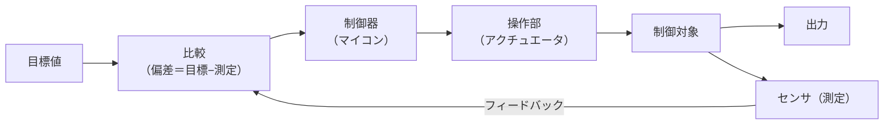
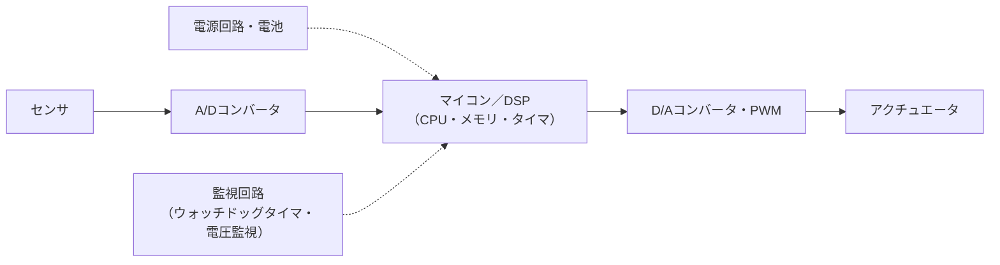

# ハードウェア

> **重要度：★★**（科目A（旧午前）で毎回 1〜2 問程度。科目B（旧午後）の「組込みシステム開発」でも前提知識になる）
> コンピュータや組込み機器を形づくる **電子回路・半導体・制御・電源** の分野です（シラバス中分類6）。
> 論理ゲートや半加算器、記憶素子、A/D 変換の基本は [03_コンピュータ構成要素](03_コンピュータ構成要素.md) で扱っているので、この章では **03 にない部分** を厚く説明します。
> この章のポイントは次の5つです。
> - 組合せ回路と順序回路の違い、フリップフロップと **タイミングチャート** の読み方
> - **加法標準形** と **カルノー図** による論理圧縮
> - **オープンループ／クローズドループ**、**シーケンス制御／フィードバック制御**、PWM
> - 半導体素子（フォトカプラ、トライアック、CMOS など）、**ASIC・FPGA・SoC**
> - 組込み機器の構成部品（センサ、アクチュエータ、電源、電池）と **低消費電力化技術**

## 目次

1. [論理回路の基礎（03 との分担）](#1-論理回路の基礎03-との分担)
2. [順序回路とタイミングチャート](#2-順序回路とタイミングチャート)
3. [論理設計](#3-論理設計)
4. [機械・制御](#4-機械制御)
5. [半導体素子と集積回路](#5-半導体素子と集積回路)
6. [カスタムICとシステムLSI](#6-カスタムicとシステムlsi)
7. [組込みシステムの構成部品](#7-組込みシステムの構成部品)
8. [消費電力と低消費電力化技術](#8-消費電力と低消費電力化技術)
9. [確認問題](#確認問題)
10. [📋 シラバス用語チェックリスト](#-シラバス用語チェックリスト)
11. [参考](#参考)

---

## 1. 論理回路の基礎（03 との分担）

### 1.1 03 で学ぶ内容 ★★

次の内容は 03 にまとめてあります。先に読んでおくと、この章がスムーズに理解できます。

| テーマ | 参照先 |
|---|---|
| AND・OR・NOT・**NAND・NOR・XOR** の図記号と真理値表 | [03 の 9.1 論理ゲートの図記号と真理値表](03_コンピュータ構成要素.md#91-論理ゲートの図記号と真理値表-) |
| 半加算器・全加算器 | [03 の 9.2 半加算器と全加算器](03_コンピュータ構成要素.md#92-半加算器と全加算器-) |
| 論理演算・ド・モルガンの法則 | [01 の 2.1 基本の論理演算](01_基礎理論.md#21-基本の論理演算-)、[01 の 3.2 論理式の簡略化](01_基礎理論.md#32-論理式の簡略化-) |
| SRAM（フリップフロップ）と DRAM（コンデンサ） | [03 の 6.1 RAM](03_コンピュータ構成要素.md#61-ram読み書き可能電源を切ると消える-) |
| センサ → A/D → マイコン → D/A・PWM → アクチュエータ の流れ | [03 の 8.1 組込みシステムの構成要素](03_コンピュータ構成要素.md#81-組込みシステムの構成要素-) |
| A/D 変換のデータ量計算 | [03 の 8.2 A/D 変換の計算](03_コンピュータ構成要素.md#82-ad-変換の計算-) |
| DVFS・クロックゲーティング・エネルギーハーベスティング（概要） | [03 の 8.3 IoT と省電力](03_コンピュータ構成要素.md#83-iot-と省電力-) |

### 1.2 組合せ論理回路と順序論理回路 ★★

論理回路は、**記憶（状態）を持つかどうか** で2つに分類できます。

| 分類 | 出力を決めるもの | 記憶 | 代表例 |
|---|---|---|---|
| **組合せ論理回路** | **現在の入力だけ** | 持たない | 加算器、デコーダ、エンコーダ、マルチプレクサ、比較器 |
| **順序論理回路** | **現在の入力 ＋ 過去の状態** | 持つ（フリップフロップ） | レジスタ、カウンタ、シフトレジスタ、SRAM |

💡 覚え方：「**順序**」回路は「**順番（これまでの経緯）を覚えている**」回路です。同じ入力でも、それまでの状態によって出力が変わります。

### 1.3 正論理と負論理 ★

実際の回路では「1／0」ではなく、**電圧の高低（H：High／L：Low）** で信号を表します。どちらを 1 とみなすかで、同じ回路でも論理の意味が変わります。

| 方式 | H（高電圧） | L（低電圧） |
|---|---|---|
| **正論理** | 1 | 0 |
| **負論理** | 0 | 1 |

**例**：「入力が両方とも H のときだけ出力が H」になる回路

| 入力A | 入力B | 出力 | 正論理で読むと | 負論理で読むと |
|:-:|:-:|:-:|:-:|:-:|
| L | L | L | 0,0→0 | 1,1→1 |
| L | H | L | 0,1→0 | 1,0→1 |
| H | L | L | 1,0→0 | 0,1→1 |
| H | H | H | 1,1→1 | 0,0→0 |

- 正論理で読むと **AND**、負論理で読むと「どちらかが 1 なら 1」なので **OR** になります。
- ⚠️ ひっかけ注意：正論理の AND 回路は負論理では OR 回路、正論理の NAND 回路は負論理では NOR 回路として働きます（ド・モルガンの法則の電気的な表れです）。

### 1.4 代表的な組合せ回路 ★

| 回路 | 働き | 例 |
|---|---|---|
| **デコーダ**（復号器） | n ビットの入力から、2ⁿ 本の出力のうち **1本だけ** を 1 にする | メモリのアドレスから1つの番地を選ぶ |
| **エンコーダ**（符号器） | 2ⁿ 本の入力のうち 1 になっている線の番号を n ビットで出力 | キーボードの押されたキー番号 |
| **マルチプレクサ**（MUX、セレクタ） | 選択信号に従って、複数の入力から **1つを選んで** 出力 | 3 入力のうちどのデータをバスに出すか選ぶ |
| **デマルチプレクサ** | 1つの入力を、選択信号で指定した出力先へ振り分ける | MUX の逆 |
| **比較器**（コンパレータ） | 2つの値の大小・一致を判定 | アドレス一致検出 |

**計算例**：アドレス線が 4 本のデコーダの出力本数
- 公式：`出力本数 = 2^(入力ビット数)`
- 途中式：`2⁴ = 16` 本

---

## 2. 順序回路とタイミングチャート

### 2.1 フリップフロップ ★★

**フリップフロップ**（FF）は、**1 ビットを記憶できる** 順序回路の基本部品です。入力がなくなっても状態（0 か 1）を保持します。

| 種類 | 入力 | 動作 |
|---|---|---|
| **RS-FF** | S（Set）、R（Reset） | S=1 で Q=1、R=1 で Q=0、両方 0 で保持。**S=R=1 は禁止** |
| **D-FF** | D（Data）、クロック | **クロックの立上り（または立下り）の瞬間の D を取り込み**、次のクロックまで保持 |
| **JK-FF** | J、K、クロック | RS-FF の禁止入力をなくしたもの。**J=K=1 で反転（トグル）** |
| **T-FF** | T（Toggle）、クロック | T=1 のときクロックごとに出力を反転。**2 分周**・カウンタに使う |

💡 レジスタやパイプラインの段の区切りは、ほとんどが D-FF でできています。「**D-FF ＝ クロックの瞬間に写真を撮る**」とイメージすると覚えやすいです。

### 2.2 タイミングチャートの読み方 ★★

**タイミングチャート**は、横軸に時間、縦軸に各信号の H/L を描き、信号の変化の関係を表す図です。

**例**：立上りエッジ（L→H に変わる瞬間）で動作する D-FF

```
クロック  _|‾|_|‾|_|‾|_|‾|_    ← ‾ が H、_ が L。_|‾ の部分が立上り
          t1  t2  t3  t4       （立上りの時刻）
```

| 立上りの時刻 | t1 | t2 | t3 | t4 |
|---|:-:|:-:|:-:|:-:|
| その瞬間の D | 1 | 0 | 0 | 1 |
| 直後から次の立上りまでの Q | **1** | **0** | **0** | **1** |

※ t1 と t2 の間で D が 1→0→1 と一瞬変化しても、Q は t2 の瞬間の D の値しか取り込みません。

読み方の手順：

1. クロックの **有効なエッジ（立上り／立下り）** に縦線を引く
2. 各エッジの瞬間の入力（D など）の値を読む
3. その値が、**エッジ直後から次のエッジまで** の出力になる

⚠️ ひっかけ注意：エッジとエッジの間で D が変化しても、D-FF の出力は変わりません（取り込むのはエッジの瞬間だけ）。

### 2.3 カウンタとシフトレジスタ ★

- **カウンタ**：クロックの数を数える回路。T-FF を n 段つなぐと 0〜2ⁿ−1 まで数えられます（例：3 段で 0〜7）。
- **シフトレジスタ**：D-FF を直列につなぎ、クロックごとにデータを1ビットずつ隣へ送る回路。直列 ↔ 並列の変換（シリアル通信）に使います。

---

## 3. 論理設計

**論理設計**とは、要求される動作を論理式・論理回路として表し、**性能・設計効率・コスト** を考えて最適な構成を決める作業です。

### 3.1 加法標準形 ★★

**加法標準形**（積和標準形）とは、真理値表で出力が 1 になる行ごとに、**全変数の AND（最小項）** を作り、それらを **OR** でつないだ式です。

**手順**（例：3 入力の多数決回路。2 つ以上が 1 なら出力 1）

| A | B | C | F | 最小項 |
|:-:|:-:|:-:|:-:|---|
| 0 | 0 | 0 | 0 | |
| 0 | 0 | 1 | 0 | |
| 0 | 1 | 0 | 0 | |
| 0 | 1 | 1 | 1 | `¬A・B・C` |
| 1 | 0 | 0 | 0 | |
| 1 | 0 | 1 | 1 | `A・¬B・C` |
| 1 | 1 | 0 | 1 | `A・B・¬C` |
| 1 | 1 | 1 | 1 | `A・B・C` |

```
F = ¬A・B・C + A・¬B・C + A・B・¬C + A・B・C   （加法標準形）
```

💡 真理値表から論理式を作る問題は「**1 の行を AND で書いて OR でつなぐ**」と覚えます。0 の変数には否定（¬）を付けます。

### 3.2 論理圧縮（ブール代数・カルノー図） ★★

**論理圧縮**とは、論理式を同じ働きのまま **より少ないゲートで実現できる形** に簡単化することです。ゲート数が減ると、コスト・消費電力・遅延が小さくなります。

**方法1：ブール代数の法則**（`X + ¬X = 1`、`X・1 = X` など）

```
A・B・¬C + A・B・C = A・B・(¬C + C) = A・B・1 = A・B
```

**方法2：カルノー図**

**カルノー図**は真理値表を2次元に並べた図で、隣り合うマスが **1 ビットだけ異なる**（グレイコード順：00, 01, 11, 10）ように配置します。隣り合う 1 を **2・4・8 個の長方形** でまとめると、まとめた範囲で変化する変数が消えます。

上の多数決回路のカルノー図：

| A ＼ BC | 00 | 01 | 11 | 10 |
|:-:|:-:|:-:|:-:|:-:|
| **0** | 0 | 0 | **1** | 0 |
| **1** | 0 | **1** | **1** | **1** |

- 列 BC=11 の縦 2 マス（A が変化）→ `B・C`
- A=1 行の BC=01・11 の横 2 マス（B が変化）→ `A・C`
- A=1 行の BC=11・10 の横 2 マス（C が変化）→ `A・B`

```
F = A・B + B・C + C・A   （AND 4 入力×4 個 → AND 2 入力×3 個に圧縮）
```

⚠️ ひっかけ注意：カルノー図は **端と端もつながっている**（BC=00 と BC=10 は隣同士）ものとして扱います。

### 3.3 回路設計とタイミング設計（同期式・非同期式） ★

| 方式 | 特徴 | 長所 | 短所 |
|---|---|---|---|
| **同期式設計** | すべての FF が **共通のクロック** に合わせて動作 | タイミング解析が容易で設計しやすい（現在の主流） | クロック配線の電力が大きい。最も遅い経路にクロックを合わせる必要がある |
| **非同期式設計** | 共通クロックを使わず、回路どうしが **ハンドシェイク**（完了の合図）で動作 | 必要なときだけ動くため低消費電力・高速化の余地 | 設計・検証が難しく、ハザード（一瞬の誤出力）に注意が必要 |

**タイミング設計** では、信号が回路を通るのにかかる **伝搬遅延** や、FF が正しく値を取り込むための **セットアップ時間／ホールド時間**、配線によるクロックの到着ずれ（**クロックスキュー**）を考慮し、クロック周波数を決めます。

**計算例**：FF 間で最も遅い経路（クリティカルパス）の遅延が 4 ns のときの最大クロック周波数
- 公式：`最大クロック周波数 = 1 ÷ 最大遅延時間`
- 途中式：`1 ÷ (4 × 10⁻⁹ 秒) = 0.25 × 10⁹ Hz = 250 MHz`

**回路設計** は、論理設計の結果を、トランジスタや部品、配線、電源などの具体的な電子回路に落とし込む作業です。

---

## 4. 機械・制御

### 4.1 オープンループ制御とクローズドループ制御 ★★

| 方式 | 仕組み | 例 |
|---|---|---|
| **オープンループ制御**（開ループ） | 結果（出力）を **測らず**、あらかじめ決めた量だけ操作する | タイマー式トースター、**ステッピングモータ** を指定パルス数だけ回す |
| **クローズドループ制御**（閉ループ） | 結果を **センサで測り**、操作に **戻して（フィードバックして）** 修正する | エアコンの温度制御、サーボモータ |



### 4.2 シーケンス制御とフィードバック制御 ★★

| 方式 | 考え方 | 例 |
|---|---|---|
| **シーケンス制御** | **あらかじめ決めた順序・条件** に従って、各段階を順に進める | 洗濯機（給水→洗い→すすぎ→脱水）、信号機、エレベータ、PLC（プログラマブルロジックコントローラ）による工場ライン |
| **フィードバック制御** | 目標値と測定値の **差（偏差）をなくす** ように操作量を連続的に調整する | 室温を 25℃ に保つ、自動車のクルーズコントロール |

💡 区別のコツ：「**手順を進める**」のがシーケンス制御、「**目標値に合わせ込む**」のがフィードバック制御です。フィードバック制御はクローズドループ制御の代表です。

- 参考：フィードバック制御の代表的な計算方法に **PID 制御**（比例 P・積分 I・微分 D の3つの動作を組み合わせる）があります。
- 参考：外乱（気温の急変など）を事前に測って先回りして操作する方式を **フィードフォワード制御** といいます。

### 4.3 PWM 制御 ★★

**PWM**（Pulse Width Modulation：パルス幅変調）制御は、一定周期で ON/OFF を繰り返し、**ON の時間の割合（デューティ比）** を変えることで、平均的な電力を調整する方法です。モータの回転数、LED の明るさの制御に使います。基本と計算例は [03 の 8.1](03_コンピュータ構成要素.md#81-組込みシステムの構成要素-) と [03 の 8.2](03_コンピュータ構成要素.md#82-ad-変換の計算-) を参照してください。

```
デューティ比 25%       デューティ比 75%
 ‾|___|‾|___|‾|___       ‾‾‾|_|‾‾‾|_|‾‾‾|_
 平均電圧 = 電源電圧 × 0.25    平均電圧 = 電源電圧 × 0.75
```

💡 ON/OFF の切替えだけで済むため、電圧を抵抗で下げる方式より **電力損失（発熱）が小さい** のが利点です。

---

## 5. 半導体素子と集積回路

**半導体**は、電気を通す「導体」と通さない「絶縁体」の中間の性質を持つ物質（シリコンなど）です。加える電圧や光によって電気の流れ方を制御できるため、電子部品の材料になります。

### 5.1 ダイオード・LED・OLED ★

| 素子 | 特徴・用途 |
|---|---|
| **ダイオード** | 電流を **一方向にだけ** 流す素子。交流を直流に変える **整流**、逆流防止に使う |
| **LED**（Light Emitting Diode：発光ダイオード） | 電流を流すと **発光** するダイオード。低消費電力・長寿命。表示灯、照明、液晶のバックライト |
| **OLED**（Organic LED：有機EL） | 有機材料が自ら発光する素子。**バックライト不要** で薄く、黒の表現・コントラストに優れる。スマートフォンのディスプレイ |

### 5.2 トランジスタと CMOS・バイポーラ ★

**トランジスタ**は、小さな信号で大きな電流を制御する素子で、**増幅** と **スイッチ（ON/OFF）** の2つの働きをします。デジタル回路ではスイッチとして使い、論理ゲートを構成します。

| 方式 | 特徴 |
|---|---|
| **バイポーラ**（バイポーラトランジスタ） | 電子と正孔の両方で動作。**高速・駆動力が大きい** が、**消費電力が大きい** |
| **CMOS**（Complementary MOS：相補型MOS） | p 型と n 型の MOS トランジスタを組み合わせる。**状態が切り替わるときだけ電流が流れる** ため **低消費電力・高集積**。現在の LSI の主流 |
| **BiCMOS**（Bipolar CMOS） | **バイポーラと CMOS を1つのチップに混載** し、バイポーラの高速性と CMOS の低消費電力を両立 |
| **バイポーラメモリ** | バイポーラトランジスタで作ったメモリ。**高速だが消費電力が大きく集積度が低い**（かつての高速キャッシュなど） |

### 5.3 光を使う素子 ★

| 素子 | 仕組み | 用途 |
|---|---|---|
| **フォトトランジスタ** | 光が当たると電流が流れるトランジスタ（光センサ） | 明るさの検出 |
| **フォトカプラ** | LED とフォトトランジスタを1つのパッケージに封入し、**光で信号を伝える**。入力側と出力側が **電気的に絶縁** される | 高電圧回路とマイコンの間のノイズ・故障の遮断 |
| **フォトインタラプタ** | 発光素子と受光素子を **すき間を空けて向かい合わせ**、間を物体が **遮る** ことで検出 | 紙送りの紙検出、回転数を数えるロータリエンコーダ |

⚠️ ひっかけ注意：「**絶縁** して信号を伝える」ならフォトカプラ、「**遮光** で物体を検知する」ならフォトインタラプタです。

### 5.4 トライアック・パワー半導体 ★

- **トライアック**：**交流（AC）** の電流を **双方向に ON/OFF** できるスイッチ素子（双方向サイリスタ）。照明の調光器、電気ヒーターや交流モータの制御に使います。
- **パワー半導体**：**大電圧・大電流** を扱い、電力の変換・制御を行う半導体（IGBT、パワー MOSFET など）。インバータ（電気自動車、エアコン、鉄道）、電源装置に使われ、SiC（炭化ケイ素）や GaN（窒化ガリウム）の素子で損失をさらに減らす開発が進んでいます。

### 5.5 集積回路（IC・LSI・VLSI） ★

**IC**（Integrated Circuit：集積回路）は、多数のトランジスタ・抵抗などを1つの半導体チップ上に作り込んだ部品です。集積度によって呼び名が変わります。

| 呼び名 | 集積度の目安（素子数） |
|---|---|
| IC（SSI/MSI） | 〜数千 |
| **LSI**（Large Scale Integration：大規模集積回路） | 数千〜数十万 |
| **VLSI**（Very Large Scale Integration：超大規模集積回路） | 数十万以上 |

※ 境界の数値は資料によって異なります。試験では「LSI より VLSI が大規模」という順序が分かれば十分です。

---

## 6. カスタムICとシステムLSI

### 6.1 ASIC と FPGA ★★

**カスタムIC** とは、利用者が求める回路を専用の IC として実現したものです。

| 項目 | **ASIC**（Application Specific IC：特定用途向けIC） | **FPGA**（Field Programmable Gate Array） |
|---|---|---|
| 回路の決め方 | **製造時** に回路を作り込む | **製造後に利用者が回路を書き換えられる**（Field＝現場で Programmable） |
| 開発費・期間 | 初期費用（マスク代など）が高く、期間が長い | 初期費用が低く、すぐ試せる |
| 1個あたりのコスト | **大量生産** すると安い | 割高 |
| 性能・消費電力 | 最適化でき高性能・低消費電力 | ASIC に劣る |
| 向いている用途 | 量産品（スマートフォン、ゲーム機） | 試作、少量生産、仕様変更が多い製品 |

💡 覚え方：「**F**PGA ＝ **F**ield（現場）で書き換えられる」。

### 6.2 HDL・CORDIC・オープンソースハードウェア ★

- **HDL**（Hardware Description Language：ハードウェア記述言語）：回路の構造や動作をプログラムのように文章で記述する言語（**Verilog HDL**、**VHDL** など）。記述から論理回路を自動生成する **論理合成** を行い、ASIC や FPGA を設計します。
- **CORDIC**（COordinate Rotation DIgital Computer）：三角関数・平方根・対数などを、**シフト演算と加減算の繰返しだけ** で計算するアルゴリズム。乗算器を持たない小さなハードウェア（FPGA など）での関数計算に向いています。
- **オープンソースハードウェア**：回路図・基板設計データ・HDL などの設計情報を公開し、誰でも利用・改変・製造できるようにしたハードウェア（例：Arduino のボード設計。命令セットを公開している RISC-V も関連する例としてよく挙げられます）。

### 6.3 SoC とコデザイン ★★

- **システムLSI**：CPU・メモリ・入出力・専用回路など、**システムに必要な機能を1つの LSI にまとめた** もの。部品点数と占有面積が減り、**小型化・高速化・低消費電力化・低コスト化** に役立ちます。
- **SoC**（System on a Chip）：システム LSI とほぼ同じ意味で、1つのチップ上にシステムを実現したもの（スマートフォンのプロセッサなど）。
- **コデザイン**（ハードウェアとソフトウェアのコデザイン、協調設計）：どの機能を **ハードウェア（高速だが変更しにくい）** で、どの機能を **ソフトウェア（柔軟だが遅い）** で実現するかを、**設計の初期段階から一緒に** 検討する手法。詳しくは [09 の 11.3 ハードウェア関連の用語](09_システム開発技術.md#113-ハードウェア関連の用語-) も参照。

---

## 7. 組込みシステムの構成部品



### 7.1 プロセッサ（マイクロプロセッサ・マイコン・DSP） ★★

| 部品 | 特徴 |
|---|---|
| **マイクロプロセッサ**（MPU） | CPU の機能を1チップにまとめたもの。メモリや入出力は外付け。PC やスマートフォンなど高性能向け |
| **マイクロコントローラ**（MCU、マイコン） | CPU に加え、**メモリ（ROM・RAM）・タイマ・入出力ポート・A/D 変換器** などを1チップに内蔵。家電など組込み機器の制御用 |
| **DSP**（Digital Signal Processor） | **積和演算** を高速に行えるよう特化したプロセッサ。音声・画像などの **デジタル信号処理**（フィルタ、圧縮）に使う |

### 7.2 センサ ★★

**センサ**は、温度・光・力などの **物理量を電気信号に変換** する部品です。

| センサ | 測るもの | 用途例 |
|---|---|---|
| 温度センサ（サーミスタなど） | 温度 | エアコン、炊飯器 |
| 光センサ（フォトトランジスタ、照度センサ） | 明るさ | 画面の明るさ自動調整 |
| **加速度センサ** | 加速度・傾き | スマートフォンの画面回転、万歩計 |
| **ジャイロセンサ** | 角速度（回転） | 手ぶれ補正、ドローンの姿勢制御 |
| 赤外線センサ（焦電型など） | 人や物の熱 | 人感センサ付き照明 |
| 超音波センサ | 距離（反射までの時間） | 自動車の障害物検知 |
| 圧力センサ | 圧力 | 気圧計、タッチ |
| 磁気センサ（ホール素子） | 磁界 | 電子コンパス、開閉検知 |
| イメージセンサ（CMOS センサ） | 光の像 | デジタルカメラ |

### 7.3 アクチュエータ ★★

**アクチュエータ**は、電気信号などの **エネルギーを物理的な動き** に変換する部品です。

| アクチュエータ | 特徴 |
|---|---|
| **DC モータ** | 直流で回転。PWM で回転数を制御 |
| **ステッピングモータ** | **パルス1つで決まった角度だけ** 回る。回転角をパルス数で決められるため、**オープンループ制御** で位置決めできる（プリンタ、3D プリンタ） |
| **サーボモータ** | 回転角などをセンサで測り **フィードバック制御** で正確に位置決めする（ロボット） |
| **ソレノイド** | 電磁石で鉄心を直線的に動かす（電子錠、バルブ） |
| **圧電素子**（ピエゾ素子） | 電圧をかけると変形する。ブザー、微小な位置決め |

### 7.4 A/D コンバータと D/A コンバータ ★

- **A/D コンバータ**：センサからのアナログ信号を **標本化 → 量子化 → 符号化** してデジタル値に変換します（計算は [03 の 8.2](03_コンピュータ構成要素.md#82-ad-変換の計算-)）。
- **D/A コンバータ**：デジタル値をアナログ電圧に戻します（スピーカーへの音声出力など）。

**計算例**：8 ビットの A/D 変換器で 0〜5 V を測るときの分解能（1 段階あたりの電圧）
- 公式：`分解能 = 入力電圧範囲 ÷ 2^(ビット数)`
- 途中式：`5 V ÷ 2⁸ = 5 ÷ 256 ≒ 0.0195 V ≒ 約 19.5 mV`

### 7.5 回路素子と MEMS ★

| 素子 | 働き | 主な用途 |
|---|---|---|
| **抵抗** | 電流の流れを妨げ、電流・電圧を調整する。**オームの法則 `V = I × R`** | LED の電流制限、分圧 |
| **コンデンサ**（キャパシタ） | **電荷をためる・放出する**。直流は通さず、交流は通しやすい | 電源の平滑化、ノイズ除去、DRAM の記憶 |
| **コイル**（インダクタ） | 電流を **磁界のエネルギーとしてためる**。電流の急な変化を妨げる | ノイズフィルタ、DC/DC コンバータ |
| **トランス**（変圧器） | 2つのコイルの **巻数比で交流の電圧を変換** する | AC アダプタ、電源回路、絶縁 |

**計算例**：5 V 電源で LED（順方向電圧 2 V）に 10 mA 流すための電流制限抵抗
- 公式：`R = (電源電圧 − LED の電圧) ÷ 電流`
- 途中式：`R = (5 − 2) V ÷ 0.01 A = 3 ÷ 0.01 = 300 Ω`

**MEMS**（Micro Electro Mechanical Systems：微小電気機械システム）は、半導体の製造技術を使って、**微小な機械構造（可動部）とセンサ・電子回路を1つのチップ上に作り込んだ** デバイスです。スマートフォンの加速度センサ・ジャイロセンサ・マイク、インクジェットプリンタのヘッドなどに使われています。

### 7.6 信頼性を支える部品（診断プログラム・監視回路） ★

| 用語 | 説明 |
|---|---|
| **診断プログラム** | 機器の起動時や動作中に、メモリ・センサ・回路などが正常かを **自己診断** するプログラム（RAM の読み書き検査、ROM のチェックサム確認など） |
| **監視回路** | システムの異常を検出してリセットなどを行う回路。プログラムの暴走を検出する **ウォッチドッグタイマ**（[03 の 8.1](03_コンピュータ構成要素.md#81-組込みシステムの構成要素-)）や、電源電圧の低下を検出してリセットする **電圧監視回路**（ブラウンアウト検出）がある |

### 7.7 電源回路と電池 ★

**電源回路**は、機器の各部に必要な電圧・電流を安定して供給する回路です。

| 種類 | 働き・特徴 |
|---|---|
| **AC/DC コンバータ** | 家庭用の交流（AC 100 V）を直流に変換（整流＋平滑＋変圧） |
| **DC/DC コンバータ** | 直流の電圧を別の電圧に変換 |
| リニアレギュレータ（LDO など） | 余分な電圧を熱として捨てて電圧を下げる。回路が簡単でノイズが少ないが **効率が低い** |
| スイッチングレギュレータ | 高速な ON/OFF で電圧を変換。**効率が高い** がノイズが出やすい |

**電池** は、繰り返し使えない **一次電池**（アルカリ乾電池、コイン形リチウム電池）と、充電して繰り返し使える **二次電池**（**リチウムイオン電池**、ニッケル水素電池）に分かれます。

**計算例**：容量 220 mAh のコイン電池で動く IoT センサの電池寿命。動作時 10 mA を 1% の時間、スリープ時 10 µA（0.01 mA）を 99% の時間とする。
- 公式：`平均電流 = Σ(各状態の電流 × 時間の割合)`、`電池寿命 = 電池容量 ÷ 平均電流`
- 途中式：
```
平均電流 = 10 × 0.01 + 0.01 × 0.99 = 0.1 + 0.0099 = 0.1099 mA
電池寿命 = 220 ÷ 0.1099 ≒ 2,002 時間 ≒ 約 83 日
```
- 💡 スリープ中の電流と、動作する時間の割合を減らすことが、電池寿命を延ばす鍵です。

---

## 8. 消費電力と低消費電力化技術

組込み機器（特に電池で動く IoT 機器やスマートフォン）では、**消費電力 ＝ 電池寿命・発熱・製品の大きさ** に直結するため、**低消費電力化** が重要な設計目標になります。

### 8.1 消費電力の内訳（動的電力とリーク電流） ★★

CMOS 回路の消費電力は、大きく2つに分かれます。

| 種類 | 発生する原因 | 主な対策 |
|---|---|---|
| **動的電力**（スイッチング電力） | トランジスタが ON/OFF を **切り替えるとき** に流れる電流 | クロックゲーティング、DVFS |
| **静的電力**（**リーク電流**による電力） | 動作していなくても **トランジスタから漏れ出す電流**。微細化や高温で増える | パワーゲーティング |

動的電力の目安となる式は次のとおりです。

```
動的電力 P ∝ C × V² × f
  C：負荷容量（回路の規模）  V：電源電圧  f：クロック周波数
```

**計算例**：DVFS で電圧を 0.8 倍、クロック周波数を 0.5 倍にしたときの動的電力
- 途中式：`0.8² × 0.5 = 0.64 × 0.5 = 0.32` → 元の **32%**（68% 削減）
- 💡 電圧は **2 乗** で効くため、周波数だけ下げるより電圧も一緒に下げる方が効果が大きくなります。

### 8.2 低消費電力化技術 ★★

| 技術 | 内容 | 減らす電力 |
|---|---|---|
| **クロックゲーティング** | 使っていない回路ブロックへの **クロック供給を止める** | 動的電力 |
| **パワーゲーティング** | 使っていない回路ブロックへの **電源供給そのものを遮断** する | リーク電流（静的電力）も含めて削減 |
| **DVFS**（Dynamic Voltage and Frequency Scaling：動的電圧・周波数制御） | 負荷に応じて **電圧とクロック周波数を動的に** 変える | 動的電力 |
| スリープモード | 処理がないときは CPU を休止状態にし、割込みで復帰 | 両方 |
| **エネルギーハーベスティング**（環境発電） | 光・振動・熱・電波など **周囲のわずかなエネルギーを電力に変換** して使い、電池交換を不要・低頻度にする | （電力の供給側の工夫） |

⚠️ ひっかけ注意：**クロック** ゲーティングは「クロックを止める（電源は入ったまま）」、**パワー** ゲーティングは「電源を切る」です。リーク電流を減らせるのはパワーゲーティングです。

---

## 確認問題

**問1** 組合せ論理回路に分類されるものはどれですか。

- ア　カウンタ
- イ　シフトレジスタ
- ウ　マルチプレクサ
- エ　フリップフロップ

**問2** 正論理で AND 回路として動作する回路を、負論理で読み替えたときの論理はどれですか。

- ア　AND
- イ　OR
- ウ　NAND
- エ　NOR

**問3** 次の真理値表で表される論理関数 F を、最も簡単にした論理式はどれですか（・は AND、＋は OR）。

| A | B | C | F |
|:-:|:-:|:-:|:-:|
| 0 | 0 | 0 | 0 |
| 0 | 0 | 1 | 0 |
| 0 | 1 | 0 | 1 |
| 0 | 1 | 1 | 1 |
| 1 | 0 | 0 | 0 |
| 1 | 0 | 1 | 1 |
| 1 | 1 | 0 | 1 |
| 1 | 1 | 1 | 1 |

- ア　`A・B + C`
- イ　`B + A・C`
- ウ　`A + B・C`
- エ　`A・C + B・C`

**問4** フィードバック制御の説明として、適切なものはどれですか。

- ア　あらかじめ定められた順序に従って、制御の各段階を逐次進める。
- イ　出力の結果を測定せず、決められた量だけ操作を行う。
- ウ　目標値と測定値の差を検出し、その差をなくすように操作量を調整する。
- エ　パルスの数に比例した角度だけモータを回転させる。

**問5** 入力側と出力側を電気的に絶縁したまま、光によって信号を伝達する素子はどれですか。

- ア　トライアック
- イ　フォトインタラプタ
- ウ　フォトカプラ
- エ　ダイオード

**問6** FPGA の説明として、適切なものはどれですか。

- ア　特定の用途向けに回路を製造時に作り込んだ IC で、大量生産時の単価が安い。
- イ　製造後に利用者が論理回路の構成を書き換えることができる IC である。
- ウ　積和演算を高速に実行することに特化したプロセッサである。
- エ　微小な機械構造と電子回路を一つのチップ上に作り込んだデバイスである。

**問7** CMOS 回路の動的消費電力は、電源電圧の2乗とクロック周波数に比例するものとします。DVFS によって電源電圧を 0.5 倍、クロック周波数を 0.6 倍にしたとき、動的消費電力は元の何％になりますか。

**問8** 低消費電力化技術のうち、使用していない回路ブロックへの電源供給を遮断し、リーク電流による電力も削減するものはどれですか。

- ア　クロックゲーティング
- イ　パワーゲーティング
- ウ　DVFS
- エ　エネルギーハーベスティング

**問9** 容量 600 mAh の電池で動作する機器があります。平均消費電流が 0.5 mA のとき、電池で動作できる時間は何日ですか（小数点以下切捨て）。

<details><summary>解答・解説</summary>

**問1　ウ**
マルチプレクサは選択信号と入力だけで出力が決まる組合せ回路です。ア・イはフリップフロップを使う順序回路、エは順序回路の基本素子です。

**問2　イ**
「両方 H のときだけ H」の回路は、L を 1 とみなす負論理では「どちらかが 1（L）なら 1（L）」となるので OR です（[1.3](#13-正論理と負論理-)）。

**問3　イ**
カルノー図で考えます。

| A ＼ BC | 00 | 01 | 11 | 10 |
|:-:|:-:|:-:|:-:|:-:|
| 0 | 0 | 0 | 1 | 1 |
| 1 | 0 | 1 | 1 | 1 |

- BC=11・10 の 4 マス（A と C が変化）→ `B`
- A=1 行の BC=01・11 の 2 マス → `A・C`

よって `F = B + A・C` です。

**問4　ウ**
アはシーケンス制御、イはオープンループ制御、エはステッピングモータの説明です。

**問5　ウ**
フォトカプラは LED とフォトトランジスタを組み合わせ、電気的に絶縁して信号を伝えます。イのフォトインタラプタは光が遮られることで物体を検出する素子です。

**問6　イ**
アは ASIC、ウは DSP、エは MEMS の説明です。

**問7　15%**
```
P ∝ V² × f
0.5² × 0.6 = 0.25 × 0.6 = 0.15 → 15%
```

**問8　イ**
クロックゲーティングはクロックを止めるだけなので、リーク電流は減りません。

**問9　50 日**
```
動作時間 = 600 mAh ÷ 0.5 mA = 1,200 時間
1,200 ÷ 24 = 50 日
```

</details>

---

## 📋 シラバス用語チェックリスト

シラバス Ver.7.2 中分類6「ハードウェア」の用語例を、1行で言えるかチェックしましょう。リンクは詳しい説明がある見出しです。

### (1) 電気・電子回路

| 用語 | 1行説明 |
|---|---|
| [NAND 回路](03_コンピュータ構成要素.md#91-論理ゲートの図記号と真理値表-) | AND の否定。両方 1 のときだけ 0。NAND だけで全回路を作れる |
| [NOR 回路](03_コンピュータ構成要素.md#91-論理ゲートの図記号と真理値表-) | OR の否定。両方 0 のときだけ 1 |
| [XOR 回路](03_コンピュータ構成要素.md#91-論理ゲートの図記号と真理値表-) | 排他的論理和。入力が異なるとき 1。半加算器の和に使う |
| [フリップフロップ](#21-フリップフロップ-) | 1 ビットを記憶する順序回路の基本部品（RS・D・JK・T） |
| [論理式](#31-加法標準形-) | 論理回路の働きを AND・OR・NOT の式で表したもの |
| [正論理](#13-正論理と負論理-) | 高電圧（H）を 1、低電圧（L）を 0 とみなす方式 |
| [負論理](#13-正論理と負論理-) | 低電圧（L）を 1、高電圧（H）を 0 とみなす方式 |
| [真理値表](#31-加法標準形-) | すべての入力の組合せに対する出力を表にしたもの |
| [タイミングチャート](#22-タイミングチャートの読み方-) | 横軸を時間として各信号の H/L の変化を描いた図 |
| [組合せ論理回路／順序論理回路](#12-組合せ論理回路と順序論理回路-) | 現在の入力だけで出力が決まる回路／過去の状態も出力に影響する回路 |

### (2) 機械・制御

| 用語 | 1行説明 |
|---|---|
| [オープンループ制御](#41-オープンループ制御とクローズドループ制御-) | 結果を測定せず、決めた量だけ操作する制御 |
| [クローズドループ制御](#41-オープンループ制御とクローズドループ制御-) | 結果をセンサで測定し、操作に戻して修正する制御 |
| [シーケンス制御](#42-シーケンス制御とフィードバック制御-) | あらかじめ決めた順序・条件に従って段階的に進める制御 |
| [フィードバック制御](#42-シーケンス制御とフィードバック制御-) | 目標値と測定値の偏差をなくすように操作量を調整する制御 |
| [PWM 制御](#43-pwm-制御-) | パルスの ON 時間の割合（デューティ比）で平均電力を調整する制御 |

### (3) 構成部品及び要素と実装

| 用語 | 1行説明 |
|---|---|
| [ダイオード](#51-ダイオードledoled-) | 電流を一方向にだけ流す素子。整流に使う |
| [LED](#51-ダイオードledoled-) | 電流を流すと発光するダイオード。低消費電力・長寿命 |
| [OLED](#51-ダイオードledoled-) | 有機EL。自発光でバックライト不要のディスプレイ素子 |
| [トランジスタ](#52-トランジスタと-cmosバイポーラ-) | 小さな信号で大きな電流を制御する素子。増幅とスイッチの働き |
| [フォトトランジスタ](#53-光を使う素子-) | 光が当たると電流が流れるトランジスタ（光センサ） |
| [フォトカプラ](#53-光を使う素子-) | LED と受光素子で、電気的に絶縁したまま光で信号を伝える素子 |
| [フォトインタラプタ](#53-光を使う素子-) | 向かい合う発光・受光素子の間を物体が遮ることで検出する素子 |
| [トライアック](#54-トライアックパワー半導体-) | 交流を双方向に ON/OFF できるスイッチ素子（調光器など） |
| [パワー半導体](#54-トライアックパワー半導体-) | 大電圧・大電流の変換・制御を行う半導体（IGBT など） |
| [IC](#55-集積回路iclsivlsi-) | 多数の素子を1チップに集積した集積回路 |
| [LSI](#55-集積回路iclsivlsi-) | 大規模集積回路 |
| [VLSI](#55-集積回路iclsivlsi-) | LSI よりさらに集積度の高い超大規模集積回路 |
| [CMOS](#52-トランジスタと-cmosバイポーラ-) | p 型・n 型 MOS を組み合わせた低消費電力・高集積の回路方式 |
| [バイポーラ](#52-トランジスタと-cmosバイポーラ-) | 高速・高駆動力だが消費電力が大きいトランジスタ方式 |
| [BiCMOS](#52-トランジスタと-cmosバイポーラ-) | バイポーラと CMOS を1チップに混載し高速性と低消費電力を両立 |
| [バイポーラメモリ](#52-トランジスタと-cmosバイポーラ-) | バイポーラトランジスタによる高速・高消費電力のメモリ |
| [ASIC](#61-asic-と-fpga-) | 特定用途向けに製造時に回路を作り込んだ IC |
| [FPGA](#61-asic-と-fpga-) | 製造後に利用者が回路を書き換えられる IC |
| [CORDIC](#62-hdlcordicオープンソースハードウェア-) | シフトと加減算だけで三角関数などを求めるアルゴリズム |
| [HDL](#62-hdlcordicオープンソースハードウェア-) | 回路を文章で記述する言語（Verilog HDL、VHDL） |
| [オープンソースハードウェア](#62-hdlcordicオープンソースハードウェア-) | 設計情報を公開し誰でも利用・改変・製造できるハードウェア |
| [コデザイン](#63-soc-とコデザイン-) | ハードとソフトの機能分担を初期から一緒に設計する手法 |
| [SoC](#63-soc-とコデザイン-) | システムに必要な機能を1チップに集積したもの |
| [マイクロプロセッサ](#71-プロセッサマイクロプロセッサマイコンdsp-) | CPU 機能を1チップにしたもの。メモリ等は外付け |
| [マイクロコントローラー](#71-プロセッサマイクロプロセッサマイコンdsp-) | CPU・メモリ・タイマ・入出力を1チップに内蔵した制御用 IC |
| [DSP](#71-プロセッサマイクロプロセッサマイコンdsp-) | 積和演算に特化したデジタル信号処理用プロセッサ |
| [センサー](#72-センサ-) | 物理量を電気信号に変換する部品 |
| [アクチュエーター](#73-アクチュエータ-) | 電気信号を物理的な動きに変換する部品（モータなど） |
| [メモリ](03_コンピュータ構成要素.md#6-記憶素子) | プログラムやデータを記憶する部品（RAM・ROM・フラッシュ） |
| [D/A コンバータ](#74-ad-コンバータと-da-コンバータ-) | デジタル値をアナログ信号に変換する回路 |
| [A/D コンバータ](#74-ad-コンバータと-da-コンバータ-) | アナログ信号を標本化・量子化・符号化してデジタル値にする回路 |
| [回路素子（抵抗）](#75-回路素子と-mems-) | 電流を妨げ電流・電圧を調整する。V＝I×R |
| [回路素子（コンデンサ）](#75-回路素子と-mems-) | 電荷をためる素子。平滑化・ノイズ除去 |
| [回路素子（コイル）](#75-回路素子と-mems-) | 磁界にエネルギーをためる素子。フィルタ・電源回路 |
| [回路素子（トランス）](#75-回路素子と-mems-) | 巻数比で交流電圧を変換する変圧器 |
| [MEMS](#75-回路素子と-mems-) | 微小な機械構造と電子回路を1チップに作り込んだデバイス |
| [診断プログラム](#76-信頼性を支える部品診断プログラム監視回路-) | 機器の部品や回路が正常かを自己診断するプログラム |
| [監視回路](#76-信頼性を支える部品診断プログラム監視回路-) | 暴走や電圧低下を検出しリセットする回路（ウォッチドッグタイマなど） |
| [電源回路](#77-電源回路と電池-) | 各部に必要な電圧を安定供給する回路（AC/DC・DC/DC コンバータ） |
| [電池](#77-電源回路と電池-) | 一次電池（使い切り）と二次電池（充電式。リチウムイオンなど） |

### (4) 論理設計

| 用語 | 1行説明 |
|---|---|
| [回路設計](#33-回路設計とタイミング設計同期式非同期式-) | 論理設計の結果を具体的な電子回路・部品・配線に落とし込む作業 |
| [タイミング設計](#33-回路設計とタイミング設計同期式非同期式-) | 伝搬遅延やセットアップ／ホールド時間を考えクロックなどを決める設計 |
| [同期式設計](#33-回路設計とタイミング設計同期式非同期式-) | 全 FF を共通クロックで動かす設計。解析が容易で主流 |
| [非同期式設計](#33-回路設計とタイミング設計同期式非同期式-) | 共通クロックを使わずハンドシェイクで動かす設計 |
| [加法標準形](#31-加法標準形-) | 出力が 1 の行の最小項（全変数の AND）を OR でつないだ式 |
| [論理圧縮](#32-論理圧縮ブール代数カルノー図-) | ブール代数やカルノー図で論理式を簡単化しゲート数を減らすこと |

### (5) 消費電力

| 用語 | 1行説明 |
|---|---|
| [低消費電力化](#8-消費電力と低消費電力化技術) | 電池寿命・発熱対策のため消費電力を減らす設計 |
| [エネルギーハーベスティング](#82-低消費電力化技術-) | 光・振動・熱など周囲の微小エネルギーを電力に変える環境発電 |
| [リーク電流](#81-消費電力の内訳動的電力とリーク電流-) | 動作していないトランジスタから漏れる電流。微細化・高温で増える |
| [パワーゲーティング](#82-低消費電力化技術-) | 未使用ブロックの電源を遮断しリーク電流も削減する技術 |
| [クロックゲーティング](#82-低消費電力化技術-) | 未使用ブロックへのクロック供給を止め動的電力を削減する技術 |
| [DVFS](#82-低消費電力化技術-) | 負荷に応じて電圧と周波数を動的に変える省電力技術 |

---

## 参考

- IPA「応用情報技術者試験 シラバス Ver.7.2（PDF）」中分類6 ハードウェア：https://www.ipa.go.jp/shiken/syllabus/omgdg50000005kq5-att/syllabus_ap_ver7_2.pdf
- IPA「試験要綱・シラバスについて」：https://www.ipa.go.jp/shiken/syllabus/gaiyou.html
- IPA「過去問題」：https://www.ipa.go.jp/shiken/mondai-kaiotu/index.html
- 応用情報技術者試験ドットコム（ハードウェア分野の午前過去問解説）：https://www.ap-siken.com/
- ルネサス エレクトロニクス「マイコンとは」：https://www.renesas.com/ja/support/engineer-school/mcu-programming-peripherals-01-gpio
