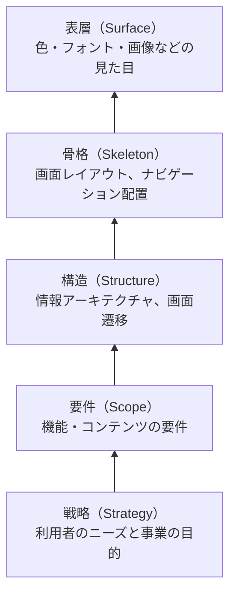
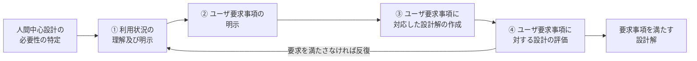
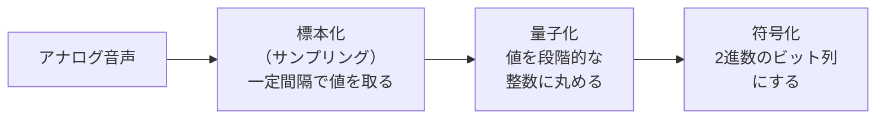
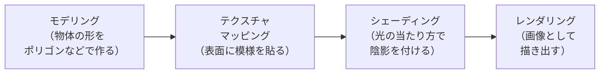

# ユーザーインタフェースと情報メディア

> **重要度：★★**（科目A（旧午前）で毎回 1〜3 問程度。入力チェック、コード設計、ユーザビリティ評価、画像・音声・動画の形式とデータ量計算がよく出る）
> シラバス中分類7「ユーザーインタフェース」と中分類8「情報メディア」をまとめた章です。
> 用語の数は多いですが、ほとんどは「**どんな目的のための考え方・技術か**」が分かれば解ける問題です。計算問題は **データ量 ＝ 画素数 × 色深度**（画像）、**標本化周波数 × 量子化ビット数**（音声）の2つが軸になります。
> この章のポイントは次の5つです。
> - 入力チェックの種類（ニューメリック・リミット・照合・バランスなど）と **チェックディジット** の計算
> - コード設計（順番・区分・桁別・表意・合成コード）
> - **人間中心設計（JIS Z 8530）**、**ユニバーサルデザイン7原則**、**JIS X 8341・WCAG**、ユーザビリティ評価手法の区別
> - 音声・静止画・動画のファイル形式と **可逆／非可逆圧縮**
> - 色の表現（RGB・CMYK・YUV）、CG（レンダリング・シェーディング）、AR／VR／MR

## 目次

1. [情報アーキテクチャ](#1-情報アーキテクチャ)
2. [ユーザーインタフェース技術](#2-ユーザーインタフェース技術)
3. [GUI](#3-gui)
4. [UXデザインと情報デザイン](#4-uxデザインと情報デザイン)
5. [画面設計・帳票設計・コード設計](#5-画面設計帳票設計コード設計)
6. [Webデザイン](#6-webデザイン)
7. [人間中心設計とユニバーサルデザイン](#7-人間中心設計とユニバーサルデザイン)
8. [ユーザビリティ評価](#8-ユーザビリティ評価)
9. [マルチメディア](#9-マルチメディア)
10. [音声処理](#10-音声処理)
11. [静止画処理](#11-静止画処理)
12. [動画処理](#12-動画処理)
13. [情報の圧縮・伸長](#13-情報の圧縮伸長)
14. [グラフィックス処理（色・画質・ソフトウェア）](#14-グラフィックス処理色画質ソフトウェア)
15. [マルチメディア応用（CG・XR）](#15-マルチメディア応用cgxr)
16. [確認問題](#確認問題)
17. [📋 シラバス用語チェックリスト](#-シラバス用語チェックリスト)
18. [参考](#参考)

---

## 1. 情報アーキテクチャ

### 1.1 情報アーキテクチャとは ★

**情報アーキテクチャ**（IA：Information Architecture）とは、利用者が **必要な情報を見つけやすく、理解しやすい** ように、情報を **組織化（分類）・構造化・ラベル付け** する考え方です。Web サイトのメニュー構成やアプリの画面構成を決める土台になります。

- **組織化**：情報をどの切り口で分けるか（五十音順、カテゴリ別、時系列など）
- **構造化**：分けた情報をどうつなぐか（階層、順番、リンク、タグなど）
- **ラベル**：分類や項目に付ける名前。利用者が **中身を想像できる言葉** にする
- **ナビゲーション**：利用者が今どこにいて、どこへ行けるかを示す仕組み（メニュー、パンくずリスト、サイトマップ）

### 1.2 情報の構造化パターン ★

| 構造 | 形 | 向いている例 |
|---|---|---|
| **階層型** | 大分類 → 中分類 → 小分類 のツリー | 企業サイトのメニュー、EC サイトの商品カテゴリ |
| **直線型**（シーケンシャル型） | 決まった順番に1本道で進む | 会員登録・購入手続のウィザード、オンライン講座 |
| **Web リンク型**（ハイパーリンク型） | ページ同士が網の目のように相互リンク | Wiki、関連記事のリンク |
| **フォークソノミー型** | 利用者が自由に **タグ** を付け、タグで情報がまとまる（folk ＋ taxonomy） | SNS のハッシュタグ、写真共有サイト |

### 1.3 関連用語 ★

| 用語 | 説明 |
|---|---|
| **チャンク** | 人が意味のあるひとまとまりとして認識・記憶する単位。人が一度に覚えられるのは数チャンク程度なので、電話番号を「090-1234-5678」と区切るなど **情報を小分けにする** |
| **メタデータ** | データについてのデータ（作成者、作成日時、キーワードなど）。検索や分類に使う |
| **セマンティック Web** | Web 上の情報に **意味を表すメタデータ**（RDF など）を付け、コンピュータが内容の意味を理解・処理できるようにする構想 |

---

## 2. ユーザーインタフェース技術

### 2.1 UI を決める要件 ★★

| 用語 | 説明 |
|---|---|
| **ユーザビリティ** | 使いやすさ。ISO 9241-11 では「特定の利用者が、特定の利用状況で、特定の目標を達成する際の **有効さ・効率・満足度** の度合い」と定義 |
| **アクセシビリティ** | 高齢者や障害のある人を含め、**できるだけ多くの人が利用できる** こと（→ [7.3](#73-アクセシビリティの規格jis-x-8341waiwcag-)） |
| **インタラクティブシステム** | 利用者の入力を受け、応答を返すことで対話的に使うシステム |
| **ヒューマンインタフェース** | 人とコンピュータ（機械）の接点。画面・操作方法・音声などの総称 |
| **インタラクションの原則** | 対話的なシステムを設計するときの原則（ISO 9241-110 ／ JIS Z 8520）。2020 年版では「ユーザのタスクへの適合性」「自己記述性」「ユーザの期待への一致」「学習性」「可制御性」「使用時の誤りに対する頑健性」「ユーザエンゲージメント」の7つ |

### 2.2 人の特性に関する用語 ★★

| 用語 | 説明 | 例 |
|---|---|---|
| **選択的知覚** | 人は多くの情報の中から、**関心のあるものだけ** を選んで知覚する | 騒がしい場所でも自分の名前は聞き取れる（カクテルパーティー効果）。重要な警告は目立たせる必要がある |
| **身体的適合性** | 操作部の大きさ・配置・力の要求などが、人の **身体の大きさや能力に合っている** こと | スマートフォンのボタンは指で押せる大きさにする |
| **アフォーダンス** | モノの形や性質が、**どう扱えるかを示唆する** こと（環境が行為を提供する） | 取っ手の形が「引ける」と感じさせる |
| **シグニファイア** | **どこを・どう操作すればよいかを伝える手がかり**（D.ノーマンが提唱） | ドアの「押」の表示、ボタンの影、下線付きの青い文字（リンク） |
| **ユーザー操作の分析** | 操作ログや観察から、利用者がどう操作しているか、どこでつまずくかを分析すること | クリック数や操作時間の計測 |

💡 アフォーダンスは「モノと人との関係（できること）」、シグニファイアは「それを **知らせる目印**」です。

### 2.3 さまざまなユーザーインタフェース ★

| UI | 説明 |
|---|---|
| **NUI**（Natural User Interface） | タッチ、ジェスチャー、音声など、**人の自然な動作** で操作する UI |
| **VUI**（Voice User Interface） | **音声** で操作する UI（スマートスピーカー、音声アシスタント） |
| **自然言語インタフェース** | 人が普段使う言葉（文章）で指示・質問できる UI（チャットボット、生成 AI） |
| **ジェスチャーインタフェース** | 手や体の動きをカメラやセンサで認識して操作する UI |
| **マルチタッチインタフェース** | 複数の指による同時タッチを認識する UI（→ [2.4](#24-マルチタッチの操作-)） |
| **ノンバーバルインタフェース** | 言葉以外（視線、表情、身振り、生体情報）を使う UI |
| **マルチモーダルインタフェース** | 音声・タッチ・視線など **複数の入出力手段（モダリティ）を組み合わせる** UI（「これを（指さし）あそこへ（音声）」） |
| **空間型インタフェース** | 3 次元空間の中で、手の動きや視線で仮想物体を操作する UI（VR/AR のヘッドセット） |

### 2.4 マルチタッチの操作 ★

| 操作 | 動き | 主な用途 |
|---|---|---|
| **タップ** | 軽く1回触れる | 選択・決定（クリックに相当） |
| **スワイプ** | 触れたまま滑らせる | 画面の切替え、スクロール |
| **フリック** | 素早くはじく | 素早いスクロール、フリック入力 |
| **ピンチ**（ピンチイン／ピンチアウト） | 2 本の指を狭める／広げる | 縮小／拡大 |
| **ロングプレス**（長押し） | 触れたまま一定時間待つ | メニューの表示、選択モード |

### 2.5 オブジェクト指向 UI とタスク指向 UI ★

| 方式 | 操作の順序 | 例 |
|---|---|---|
| **オブジェクト指向 UI**（OOUI） | **対象（名詞）を先に選び、次に操作（動詞）を選ぶ** | ファイルを選んでから「削除」「コピー」を選ぶ。メールを選んでから返信 |
| **タスク指向 UI** | **やりたいこと（動詞）を先に選び**、その後で対象を指定する | 「送金する」を選んでから口座・金額を入力。ATM の画面 |

💡 OOUI は「**名詞 → 動詞**」、タスク指向 UI は「**動詞 → 名詞**」。OOUI は自由度が高く、タスク指向 UI は手順が決まった業務・初心者向けです。

### 2.6 認識技術 ★

| 用語 | 説明 |
|---|---|
| **音声認識** | 音声を解析して文字（テキスト）や命令に変換する技術 |
| **画像認識** | 画像から物体・文字・顔などを識別する技術（OCR、顔認証） |
| **動画認識** | 動画から人の動作や出来事を認識する技術（監視カメラの異常行動検知） |
| **特徴抽出** | 画像や音声から、識別に役立つ特徴（輪郭、周波数成分など）を取り出す処理 |
| **学習機能** | 利用者の使い方やデータから学習し、認識精度や提案内容を改善する機能（機械学習は [01 の 8](01_基礎理論.md#8-ai機械学習の基礎) 参照） |

---

## 3. GUI

**GUI**（Graphical User Interface）は、アイコンやウィンドウなどの **図形で情報を表示し、マウスやタッチで直感的に操作する** UI です。

### 3.1 GUI の部品 ★★★

| 部品 | 特徴・使いどころ |
|---|---|
| **ウィンドウ** | 画面上の独立した表示領域。複数を重ねて表示できる |
| **アイコン** | 機能やファイルを小さな絵で表したもの |
| **ラジオボタン**（ラジオボックス） | 複数の選択肢から **1つだけ** 選ぶ（性別、支払方法） |
| **チェックボックス** | **複数選択可**、または1項目の ON/OFF（「利用規約に同意する」） |
| **トグルボタン** | 押すたびに ON と OFF が切り替わるボタン（Wi-Fi の ON/OFF スイッチ） |
| **リストボックス** | 選択肢の一覧を表示し、その中から選ぶ |
| **プルダウンメニュー**（ドロップダウンリスト） | クリックすると選択肢が下に展開される。**選択肢が多いが画面を広く使えない** とき（都道府県） |
| **ポップアップメニュー** | 右クリックなどで、その場に表示されるメニュー（コンテキストメニュー） |
| **アコーディオン** | 見出しをクリックすると内容が開閉する部品（FAQ ページ） |
| **ホバー**（ロールオーバー） | マウスポインタを重ねたときに表示や色が変わること |
| **ツールチップ** | ホバーしたときに表示される短い説明文 |
| **テキストボックス** | 文字を自由に入力する欄（氏名、住所） |

⚠️ ひっかけ注意：「1つだけ選ぶ」はラジオボタン、「複数選べる」はチェックボックスです。選択肢が少ない（2〜5 個程度）ならラジオボタン、多いならプルダウンメニューやリストボックスが向いています。

### 3.2 GUI 画面設計の手順と留意点 ★

1. 利用者と業務（タスク）を分析し、**利用シナリオ**（誰が、どんな状況で、何をするか）を作る
2. 画面の一覧と **画面遷移** を設計する
3. 画面レイアウトを作成し、試作（プロトタイプ）で利用者に評価してもらう

**留意点**：操作方法・用語・配置を **画面全体で統一** する、利用者の言葉を使う、誤操作を取り消せる（Undo）、処理中であることを表示する、重要な操作には確認を出す。

---

## 4. UXデザインと情報デザイン

**UX**（User Experience：ユーザー体験）とは、製品やサービスを利用する前・最中・後に利用者が得る **体験全体**（使いやすさだけでなく、楽しさ・満足感・信頼感など）を指します。

### 4.1 UX デザインの五段階モデル ★★

J.J.ギャレットが示したモデルで、UX を **抽象的な戦略から具体的な見た目まで** 5 つの段階（層）に分けて考えます。



💡 下（戦略）ほど抽象的、上（表層）ほど具体的。**下の段階が決まらないと上の段階は決められない** という関係です。

### 4.2 UX ハニカム構造 ★

P.モービルが示した、良い UX に必要な **7 つの要素** を蜂の巣（ハニカム）状に並べた図です。

| 要素 | 意味 |
|---|---|
| 役に立つ（Useful） | 利用者の目的を果たせる |
| 使いやすい（Usable） | 簡単に使える |
| 好ましい（Desirable） | 魅力的で使いたくなる |
| 見つけやすい（Findable） | 必要な情報・機能が見つかる |
| アクセスしやすい（Accessible） | 障害のある人も含め誰でも使える |
| 信頼できる（Credible） | 内容や提供者が信用できる |
| 価値がある（Valuable） | 利用者と事業者の双方に価値をもたらす（中心に置かれる） |

### 4.3 エモーショナルデザインとインタラクションデザイン ★

- **エモーショナルデザイン**：利用者の **感情**（楽しい、心地よい、愛着がわく）に働きかけるデザイン。D.ノーマンは、見た目の印象（本能レベル）、使い心地（行動レベル）、意味や思い出（内省レベル）の 3 つのレベルで説明しています。
- **インタラクションデザイン**：利用者の操作と、それに対するシステムの **反応（フィードバック）のやり取り** を設計すること（ボタンを押したときの動き、エラー時の案内など）。

### 4.4 デザインの 4 原則 ★★

**情報デザイン** とは、情報を可視化・構造化し、関係を分かりやすく整理して伝えるためのデザインです。基本となる 4 原則があります。

| 原則 | 内容 |
|---|---|
| **近接** | 関連する要素は **近づけて** グループにする |
| **整列** | 要素の端や中心を **そろえて** 配置する |
| **反復** | 色・フォント・形などのルールを **繰り返して** 統一感を出す |
| **対比** | 重要なものは大きさや色で **差をはっきり** つける |

### 4.5 LATCH の法則とその他の用語 ★

**LATCH の法則**（R.S.ワーマン）：情報を整理する切り口は次の 5 つしかない、という考え方です。

| 切り口 | 例 |
|---|---|
| **L**ocation（場所） | 地図、フロア案内 |
| **A**lphabet（五十音・アルファベット） | 辞書、索引 |
| **T**ime（時間） | 年表、時刻表 |
| **C**ategory（分類） | 商品ジャンル |
| **H**ierarchy（階層・順位） | 価格順、ランキング |

| 用語 | 説明 |
|---|---|
| **インフォグラフィック** | データや情報を、図・イラスト・グラフを使って **視覚的に分かりやすく表現** したもの |
| **タイポグラフィ** | 文字の書体・大きさ・行間・配置を工夫して、読みやすく美しく見せる技術 |
| **ムードボード** | 写真・色見本・素材などをコラージュし、デザインの **雰囲気（トーン）をチームで共有** するためのボード |

---

## 5. 画面設計・帳票設計・コード設計

### 5.1 画面設計の手順 ★

1. **画面構成**：業務に必要な画面と、各画面に表示する項目を決める（入出力項目と **データベースの項目の対応**、項目と処理の対応も整理）
2. **情報の検索・情報の関係性** を考え、利用者が必要な情報にたどり着ける画面遷移にする
3. **利用者の用語** を使い、**情報提示ストーリー**（どの順番で何を見せるか）を考える
4. **ストーリーボード**（画面の流れを紙芝居のように並べた図）で画面遷移を確認する

| 用語 | 説明 |
|---|---|
| **部分送信** | 画面全体を送り直すのではなく、**入力の一部だけをサーバへ送信** して検証や表示の更新を行う方式（Ajax など）。入力途中でのエラー通知や応答の高速化に役立つ |
| **穴埋め方式** | 決められた入力欄（枠）に値を埋めていく入力方式 |
| **メニューインプット方式** | 表示された選択肢（メニュー）から **選んで入力** する方式。入力ミスを減らせる |

### 5.2 入力チェック ★★★

入力データの誤りを、処理の前に見つけるためのチェックです。**名前と内容の組合せ** がよく問われます。

| チェック | 内容 | 例 |
|---|---|---|
| **ニューメリックチェック** | **数字であるべき項目に数字以外がないか** | 数量欄に「1O」（オー）が入っていないか |
| **フォーマットチェック** | 決められた **形式・桁数** に合っているか | 日付が YYYY/MM/DD 形式か、郵便番号が 7 桁か |
| **リミットチェック**（範囲チェック） | 値が **上限・下限の範囲内** か | 月が 1〜12、年齢が 0〜150 |
| **組合せチェック** | **複数の項目の組合せ** に矛盾がないか | 「2月30日」、性別「男」で続柄「長女」 |
| **照合チェック** | 入力値が **マスタファイルなどに登録されているか** 照合する | 入力した顧客コードが顧客マスタに存在するか |
| **バランスチェック** | 本来 **一致するはずの合計値** が一致するか | 伝票の借方合計と貸方合計、明細の合計と合計欄 |
| **シーケンスチェック**（順序チェック） | データが **決められた順番** に並んでいるか | 伝票番号が昇順か |
| **チェックキャラクター**（チェックディジット） | コードに **検査用の文字（数字）** を付けて、入力誤りを計算で検出する | → [5.3](#53-チェックキャラクターチェックディジットの計算-) |

**エラーの種類**

| エラー | 内容 | 主に見つけるチェック |
|---|---|---|
| **フォーマットエラー** | 形式・桁数・文字種が正しくない | ニューメリック、フォーマットチェック |
| **論理エラー** | 形式は正しいが、内容が **論理的に矛盾** している（退職日が入社日より前） | リミット、組合せ、バランスチェック |
| **シーケンスエラー** | データの **順序** が正しくない | シーケンスチェック |

### 5.3 チェックキャラクター（チェックディジット）の計算 ★★

**公式**（モジュラス 10・ウェイト方式の例）

```
① 各桁の数字に重み（ウェイト）を掛けて合計する
② 合計を 10（モジュラス）で割った余りを求める
③ チェックディジット = (10 − 余り) を 10 で割った余り（余り 0 なら 0）
```

**数値例**：コード「472」、ウェイトは左から 1, 2, 3

```
① 4×1 + 7×2 + 2×3 = 4 + 14 + 6 = 24
② 24 ÷ 10 = 2 余り 4
③ (10 − 4) mod 10 = 6
→ チェックディジット付きのコードは「4726」
```

誤って「4736」と入力した場合：`4×1 + 7×2 + 3×3 = 27` → 余り 7 → `10 − 7 = 3` となり、付いている 6 と一致しないので **誤りを検出** できます。

⚠️ 計算方法（ウェイトやモジュラス）は問題ごとに指定されます。問題文の手順どおりに計算しましょう。

### 5.4 帳票設計 ★

**帳票** は、請求書・納品書・一覧表など、紙や PDF に出力する書類です。

- **出力特性**：帳票の **利用目的・利用者・出力の頻度や量・保存期間** など、出力に関する性質。これに合わせて様式や出力装置（プリンタの種類）を決める
- **入力特性**：入力用の帳票（申込書など）の **記入のしやすさ・読み取りやすさ**（OCR で読む場合の枠の配置など）
- **装置の制約**：プリンタの種類（レーザ／インクジェット／ドットインパクト）や、複写式（カーボン紙）でコピーを作るかどうかによって、使える用紙や様式が変わる
- **フォームオーバーレイ**：罫線や固定の文字などの **様式（フォーム）を、データと重ね合わせて印刷** する方式。事前印刷用紙（プレ印刷用紙）を使わずに済む
- **事前印刷用紙**：あらかじめ様式を印刷した専用用紙に、データだけを印字する方式

### 5.5 コード設計 ★★

**コード** は、商品・顧客などを一意に識別するための記号です。目的に応じて種類を選びます。

| コード | 方法 | 例 | 長所／短所 |
|---|---|---|---|
| **順番コード**（連番コード） | 発生順・五十音順などに **通し番号** を付ける | 001, 002, 003 … | 桁数が少なく簡単／分類の意味を持たず、途中への追加がしにくい |
| **区分コード**（分類コード） | 分類ごとに **番号の範囲（ブロック）を割り当てる** | 001〜099 食品、100〜199 衣料 | 少ない桁で分類できる／範囲を使い切ると追加しにくい |
| **桁別コード** | **各桁（位置）に意味** を持たせる | 1 桁目＝大分類、2 桁目＝中分類、3〜4 桁目＝連番 | 分類が分かりやすく集計しやすい／桁数が多くなりやすい |
| **表意コード**（ニモニックコード） | 略号などで **コード自体が意味を表す** | TV-32-BK（32 型テレビ 黒） | 見ただけで内容が分かる／桁数が長く体系化しにくい |
| **合成コード** | 複数のコードを **組み合わせる** | 部門コード ＋ 連番 | 柔軟に設計できる／長くなる |

💡 「**桁ごとに意味がある**」なら桁別コード、「**範囲で分ける**」なら区分コード、「**見て分かる**」なら表意コードです。

---

## 6. Webデザイン

### 6.1 Web ユーザビリティとナビゲーション ★

| 用語 | 説明 |
|---|---|
| **ISO 9241** | 人とシステムのインタラクションの人間工学に関する国際規格群。**ユーザビリティの定義（ISO 9241-11）**、**人間中心設計（ISO 9241-210）**、インタラクションの原則（ISO 9241-110）などを含む |
| **ナビゲーションデザイン** | 利用者が迷わず目的のページに移動できるよう、グローバルナビゲーション（全ページ共通のメニュー）や **パンくずリスト**（現在位置を「トップ > 製品 > A」のように示す）を設計すること |
| **サイトマップ** | サイト全体のページ構成を一覧にしたページ |
| **サイト内検索機能** | サイト内のページをキーワードで検索できる機能 |
| **空間近接原理** | **近くに配置された要素は関連があると認識される** という原理（ゲシュタルト心理学の近接の要因）。関連する項目は近くに、無関係なものは離す |
| **アフォーダンス** | → [2.2](#22-人の特性に関する用語-) 参照。Web ではボタンらしい見た目にして押せることを示す |
| **フレーム** | 1 つのブラウザ画面を複数の領域に分割し、それぞれに別のページを表示する HTML の機能。ブックマークや検索エンジン、アクセシビリティの問題があり、現在は推奨されない |
| **カルーセル** | 複数の画像やコンテンツを、横にスライドして順に切り替えて表示する部品 |
| **スクローリーテリング** | **スクロール（scroll）とストーリーテリング（storytelling）** を組み合わせ、スクロールに合わせて画像や図が動いて物語のように情報を伝える表現手法 |
| **UX ライティング** | ボタンの文言、エラーメッセージ、案内文など、**UI 上の言葉** を利用者が迷わないように書くこと |

### 6.2 マルチデバイス対応 ★★

| 用語 | 説明 |
|---|---|
| **スタイルシート**（CSS） | 文書の構造（HTML）と見た目（CSS）を分け、**サイト全体のデザインを統一** して管理しやすくする |
| **クロスブラウザ** | 複数の種類の Web ブラウザで、同じように表示・動作するようにすること |
| **レスポンシブ Web デザイン** | **1 つの HTML** を、画面の幅に応じて CSS でレイアウトを切り替え、PC・タブレット・スマートフォンに対応させる手法 |
| **メディアクエリ** | 画面幅などの条件によって適用する CSS を切り替える CSS の機能（レスポンシブ Web デザインを実現する） |
| **モバイルファースト** | **スマートフォンでの表示・利用を最優先** に設計し、その後で大きい画面に広げる考え方 |
| **プログレッシブエンハンスメント** | まず **どの環境でも使える基本的な内容・機能** を作り、高機能なブラウザには段階的に表現や機能を追加していく考え方 |

### 6.3 制作・検証の用語 ★

| 用語 | 説明 |
|---|---|
| **ワイヤーフレーム** | 色や画像を入れずに、**画面のどこに何を配置するか（骨格）** を線と箱で描いた設計図（UX 五段階の「骨格」に当たる） |
| **ビジュアルリグレッション**（テスト） | 変更前後の **画面のスクリーンショットを比較** し、意図しない見た目の崩れを検出するテスト |

---

## 7. 人間中心設計とユニバーサルデザイン

### 7.1 人間中心設計（JIS Z 8530 ／ ISO 9241-210） ★★

**人間中心設計**（HCD：Human Centred Design）とは、システムの利用者に焦点を当て、**利用者の要求を理解し、設計と評価を繰り返す** ことでユーザビリティを高める設計の考え方です。規格は **ISO 9241-210**、その日本産業規格が **JIS Z 8530** です。



| 活動 | 内容 |
|---|---|
| ① **利用状況の理解及び明示** | 誰が（利用者）、何のために（タスク）、どんな環境で使うかを調べて明確にする |
| ② **ユーザ要求事項の明示** | 利用状況から、利用者や組織が求める要求事項を明確にする |
| ③ **設計解の作成** | 要求を満たす設計案を作る（プロトタイプなど） |
| ④ **設計の評価** | 利用者による評価を行い、要求を満たしているか確かめる。満たさなければ前の活動に戻る |

⚠️ ひっかけ注意：人間中心設計は「最後に1回評価する」のではなく、**設計と評価を反復** するのが特徴です。また、**利用者を設計に参加させる** ことも原則の1つです。

### 7.2 ユニバーサルデザインの 7 原則 ★★

**ユニバーサルデザイン**（UD）とは、年齢・性別・国籍・障害の有無などにかかわらず、**最初からできるだけ多くの人が使えるように** 設計する考え方です（R.メイスらが提唱）。

| 原則 | 内容 | IT での例 |
|---|---|---|
| 1. 公平な利用 | 誰でも公平に使える | 音声読み上げに対応 |
| 2. 利用における柔軟性 | 使い方を選べる | マウスでもキーボードでも操作できる |
| 3. 単純で直感的な利用 | 経験や知識に関係なく分かる | **イラストによる説明** |
| 4. 認知できる情報 | 必要な情報がすぐ分かる | 色だけでなく文字や形でも区別 |
| 5. 失敗に対する寛大さ | ミスが危険や損失につながらない | **Undo（取消）機能**、確認ダイアログ |
| 6. 少ない身体的な努力 | 楽な姿勢・少ない力で使える | 少ない操作回数 |
| 7. 接近や利用のための大きさと空間 | 使いやすい大きさ・広さ | 押しやすい大きさのボタン |

| 用語 | 説明 |
|---|---|
| **インクルーシブデザイン** | 高齢者・障害者など、これまで設計の対象から **除外されがちだった人を設計の初期から参加させ**、一緒に作るデザイン手法 |
| **エルゴノミクス**（人間工学） | 人の身体的・心理的な特性に合わせて、道具や作業環境を設計するための学問 |
| **ピクトグラム** | 情報や注意を **言葉を使わずに単純な絵文字で表した** もの（非常口のマーク、トイレの表示） |
| **UD フォント** | 文字の形が分かりやすく、**誤読しにくく読みやすい** ように設計された書体 |

💡 **アクセシビリティ** は「障害のある人などが **利用できるようにする**（障壁をなくす）」こと、**ユニバーサルデザイン** は「**はじめから** すべての人が使いやすいように作る」ことです。

### 7.3 アクセシビリティの規格（JIS X 8341・WAI・WCAG） ★★

| 規格・組織 | 説明 |
|---|---|
| **JIS X 8341** | 「高齢者・障害者等配慮設計指針 − 情報通信における機器，ソフトウェア及びサービス」の規格群。**JIS X 8341-3** が **Web コンテンツ** のアクセシビリティを定め、2016 年版は WCAG 2.0（ISO/IEC 40500:2012）と一致する内容 |
| **WAI**（Web Accessibility Initiative） | Web の標準化団体 **W3C** の中で、Web アクセシビリティのガイドラインを作る活動 |
| **WCAG**（Web Content Accessibility Guidelines） | WAI が作成した Web コンテンツのアクセシビリティ指針。**知覚可能・操作可能・理解可能・堅牢（ロバスト）** の 4 原則と、達成基準の **レベル A／AA／AAA** からなる（最新は WCAG 2.2） |

**Web アクセシビリティの具体例**：画像に代替テキスト（alt 属性）を付ける、キーボードだけで操作できる、十分なコントラスト比を確保する、動画に字幕を付ける、色だけで情報を伝えない。

---

## 8. ユーザビリティ評価

### 8.1 評価手法の一覧 ★★★

| 手法 | 誰が評価するか | 内容 |
|---|---|---|
| **ヒューリスティック評価** | **専門家** | 経験則（ヒューリスティクス：ニールセンの 10 原則など）に照らして、専門家が UI の問題点を洗い出す。安く早いが、評価者の能力に左右される |
| **認知的ウォークスルー** | **専門家** | 評価者が **初めて使う利用者になったつもり** で、タスクの操作を1ステップずつたどり、各ステップで利用者が迷わないかを検討する（**学習のしやすさ** の評価） |
| **ユーザビリティテスト** | **利用者** | 実際の利用者に課題（タスク）を実行してもらい、観察して問題点を見つける |
| **思考発話法** | **利用者** | 利用者に **考えていることを声に出しながら** 操作してもらい、つまずいた理由を把握する |
| **回顧法** | **利用者** | 操作が終わった **後で**、録画を見ながら利用者に操作中の考えをインタビューする |
| **アイトラッキング分析** | **利用者**（機器で計測） | 視線の動き（どこを見たか、どこを見なかったか）を専用の装置で計測・分析する |
| **NEM**（Novice Expert ratio Method） | **利用者**（初心者と熟練者） | **初心者と熟練者の操作時間の比** を操作ステップごとに求め、比が大きいステップを問題箇所とする（→ [8.2](#82-nem-の計算例-)） |
| **A/B テスト** | **利用者**（本番環境） | 2 種類のデザイン（A 案と B 案）を利用者にランダムに表示し、**クリック率や購入率などの成果を比較** して優れた方を選ぶ |

💡 区別のコツ：**専門家が見る** のはヒューリスティック評価と認知的ウォークスルー。利用者が **操作しながら話す** のが思考発話法、**操作した後で話す** のが回顧法です。

### 8.2 NEM の計算例 ★

**公式**

```
NE 比 = 初心者の操作時間 ÷ 熟練者の操作時間（ステップごと）
NE 比が大きいステップほど、初心者がつまずいている（UI に問題がある）
```

**数値例**

| ステップ | 初心者（秒） | 熟練者（秒） | NE 比 |
|---|---:|---:|---:|
| ① ログイン | 20 | 10 | 20 ÷ 10 = **2.0** |
| ② 商品検索 | 30 | 15 | 30 ÷ 15 = **2.0** |
| ③ 支払方法の選択 | 60 | 6 | 60 ÷ 6 = **10.0** |
| ④ 確定 | 8 | 4 | 8 ÷ 4 = **2.0** |

→ ステップ③の NE 比が突出して大きいので、支払方法の選択画面を優先的に改善します。

---

## 9. マルチメディア

**マルチメディア** とは、文字・音声・静止画・動画など **複数の種類のメディアをデジタル化して統合** し、利用者が対話的（インタラクティブ）に扱えるようにしたものです。

| 用語 | 説明 |
|---|---|
| **Web コンテンツ** | Web ページ上で提供される文字・画像・音声・動画などの情報 |
| **ハイパーメディア** | ハイパーテキスト（リンクで文書をつなぐ仕組み）を、画像・音声・動画にまで広げたもの |
| **メディア統合** | 文字・音声・画像などの異なるメディアを1つのコンテンツにまとめること |
| **オーサリング環境**（オーサリングツール） | 複数のメディア素材を組み合わせて、マルチメディアコンテンツを **編集・作成** するためのソフトウェア環境 |
| **コンテナフォーマット** | 映像・音声・字幕などの **複数のデータ（ストリーム）をまとめて格納する入れ物** のファイル形式（MP4、MOV、AVI、MKV など）。中身の圧縮方式（**コーデック**：H.264、AAC など）とは別物 |
| **ストリーミング** | 音声や動画を **ダウンロードしながら同時に再生** する方式（動画配信サービス）。全データの受信を待たずに再生できる |
| **PDF**（Portable Document Format） | 機器や OS に依存せず、**どの環境でも同じレイアウトで表示・印刷** できる電子文書の形式（ISO 32000） |
| **DTP**（DeskTop Publishing） | パソコン上で文書の編集・レイアウト・版下作成までを行い、印刷物を作ること |
| **4K／8K** | 高精細な映像の規格。4K は横 3,840 × 縦 2,160 画素、8K は 7,680 × 4,320 画素（フル HD 1,920 × 1,080 の 4 倍／16 倍の画素数） |

⚠️ ひっかけ注意：**MP4 はコンテナ**、**H.264 はコーデック（圧縮方式）** です。「MP4 ファイルの中に H.264 で圧縮した映像と AAC で圧縮した音声が入っている」という関係です。

---

## 10. 音声処理

### 10.1 音声のデジタル化（PCM） ★★

**PCM**（Pulse Code Modulation：パルス符号変調）は、アナログの音声を次の3段階でデジタル化する方式です。



| 用語 | 説明 |
|---|---|
| **サンプリング**（標本化） | 連続した波形から、**一定の時間間隔で値を取り出す** こと |
| **標本化周波数**（サンプリング周波数） | 1 秒間に標本化する回数（Hz）。**元の音の最高周波数の 2 倍より大きく** すると、元の波形を再現できる（標本化定理）。音楽 CD は 44.1 kHz |
| **量子化ビット数** | 1 回の標本を何ビットで表すか。ビット数が多いほど音の強弱を細かく表現できる。音楽 CD は 16 ビット |

データ量の計算は [03 の 8.2 A/D 変換の計算](03_コンピュータ構成要素.md#82-ad-変換の計算-) を参照してください（`データ量 ＝ 標本化周波数 × 量子化ビット数 × チャネル数 × 時間`）。

**計算例**：標本化周波数 48 kHz、量子化ビット数 16 ビット、ステレオで 3 分間録音したときのデータ量（非圧縮）
```
48,000 × 16 × 2 = 1,536,000 ビット/秒
1,536,000 × 180 秒 = 276,480,000 ビット
276,480,000 ÷ 8 = 34,560,000 バイト ≒ 約 34.6 M バイト
```

### 10.2 音声ファイル形式 ★★

| 形式 | 特徴 |
|---|---|
| **WAV**（Waveform Audio Format） | Windows 標準の音声形式。通常は **非圧縮の PCM** データを格納 |
| **AIFF**（Audio Interchange File Format） | Apple（macOS）で使われてきた音声形式。通常は非圧縮 PCM |
| **AU**（Audio、mu-law） | UNIX（旧 Sun Microsystems）で使われた音声形式。μ-law（ミューロー）方式で符号化することが多い |
| **MP3**（MPEG-1 Audio Layer-3） | 人の耳に聞こえにくい成分を削る **非可逆圧縮** で、データ量を約 1/10 にする |
| **MIDI**（Musical Instrument Digital Interface） | 音の波形ではなく、**「どの楽器で・どの音程を・どの強さで・いつ鳴らすか」という演奏情報** を記録する規格。データ量が非常に小さい |
| **MIDI 音源** | MIDI の演奏情報を受け取り、実際の音を合成して鳴らす装置・ソフトウェア。**同じ MIDI データでも音源によって音色が変わる** |

⚠️ ひっかけ注意：MIDI は「音声を録音したデータ」ではありません。人の声や自然の音をそのまま記録することはできません。

---

## 11. 静止画処理

### 11.1 ラスターデータとベクターデータ ★★

| 項目 | **ラスターデータ**（ビットマップデータ） | **ベクターデータ** |
|---|---|---|
| 表現方法 | 画像を **画素（ピクセル）の集まり** で表す | 点の座標・線・曲線などを **数式** で表す |
| 拡大したとき | **ギザギザ（ジャギー）** が目立つ | **拡大しても劣化しない** |
| 向いている画像 | 写真など色の変化が複雑な画像 | ロゴ、イラスト、図面、フォント |
| 編集ソフト | ペイント系ソフト | ドロー系ソフト |
| 形式の例 | BMP、JPEG、PNG、GIF | SVG、AI、PDF の図形 |

### 11.2 静止画ファイル形式 ★★★

| 形式 | 色数 | 圧縮 | 特徴・用途 |
|---|---|---|---|
| **JPEG** | フルカラー（1,677 万色） | **非可逆**（可逆モードもある） | **写真** に最適。圧縮率を選べる。DCT（離散コサイン変換）で圧縮 |
| **GIF** | **256 色まで** | **可逆**（LZW） | イラスト・アイコン、**アニメーション**、透過色に対応 |
| **PNG** | フルカラー | **可逆** | **アルファチャネル**（半透明）に対応。GIF の代替として普及 |
| **BMP** | フルカラーなど | 通常は **非圧縮** | Windows 標準。データ量が大きい |
| **TIFF** | フルカラーなど | 非圧縮・可逆など選べる | **タグ** で解像度や色の情報を記述でき、1 ファイルに複数の画像を格納できる。印刷・スキャナ・FAX で利用 |
| **HEIF**（High Efficiency Image File Format） | フルカラー | 非可逆（HEVC を利用） | **JPEG と同程度の画質で約半分のデータ量**。スマートフォンの写真（拡張子 .heic） |

**Exif**（Exchangeable Image File Format）は、デジタルカメラで撮影した画像に、**撮影日時・カメラの機種・絞り・位置情報（GPS）などのメタデータ** を埋め込む規格です。

⚠️ セキュリティの注意：SNS に写真を投稿するときに Exif の位置情報が残っていると、撮影場所（自宅など）が知られるおそれがあります。

### 11.3 画像のデータ量の計算 ★★

**公式**

```
データ量（バイト）= 横の画素数 × 縦の画素数 × 1 画素のビット数 ÷ 8
```

**数値例**：1,600 × 1,200 画素、24 ビットフルカラーの画像を、JPEG で 1/10 に圧縮したときのデータ量

```
1,600 × 1,200 × 24 ÷ 8 = 1,920,000 × 3 = 5,760,000 バイト（非圧縮）
5,760,000 ÷ 10 = 576,000 バイト ≒ 576 k バイト
```

（画面表示用 VRAM の容量も同じ考え方です：[03 の 8.4](03_コンピュータ構成要素.md#84-画面表示に必要なメモリ容量-)）

---

## 12. 動画処理

### 12.1 動画の仕組み ★★

動画は、少しずつ異なる静止画（**フレーム**）を連続して表示することで動きを表します。1 秒間に表示するフレーム数を **フレームレート**（fps：frames per second）といいます（テレビは約 30 fps、映画は 24 fps）。

| 用語 | 説明 |
|---|---|
| **インターレース方式** | 1 フレームを **奇数行と偶数行に分けて交互に** 表示する方式（従来のテレビ放送）。少ないデータでちらつきを抑えられるが、速い動きで横縞が出ることがある |
| **プログレッシブ方式** | 1 フレームの **全行を順に一度に** 表示する方式（PC のディスプレイ）。動きのある映像がきれい |
| **リニア編集** | ビデオテープなどの映像を、**先頭から順に再生しながら** 別のテープに録画して編集する方式 |
| **ノンリニア編集** | 映像をデジタルデータとして PC に取り込み、**任意の場面に直接アクセス** して、切り貼り・並べ替えを自由に行う編集方式 |

### 12.2 動画の圧縮方式とファイル形式 ★★★

動画の圧縮では、1 枚の画像の中の冗長性を減らす **フレーム内圧縮** に加え、前後のフレームとの **差分（動いた部分）だけを記録** する **フレーム間圧縮**（動き補償予測）でデータ量を大きく減らします。

| 方式・形式 | 特徴・用途 |
|---|---|
| **MPEG**（Moving Picture Experts Group） | 動画・音声の圧縮規格群。**MPEG-1**（ビデオ CD）、**MPEG-2**（DVD、デジタル放送）、**MPEG-4**（携帯機器・インターネット配信） |
| **H.264**（MPEG-4 AVC） | MPEG-2 の約 2 倍の圧縮効率。Blu-ray、ワンセグ、動画配信で広く利用 |
| **H.265**（**HEVC**：High Efficiency Video Coding） | **H.264 の約 2 倍の圧縮効率**。**4K／8K** 放送や高画質配信で利用 |
| **Motion JPEG** | **各フレームを JPEG で独立に圧縮** する方式。フレーム間圧縮をしないので **編集しやすい** が、圧縮率は低い（監視カメラ、デジタルカメラ） |
| **QuickTime** | Apple の動画・音声の形式（コンテナ）。拡張子 .mov |
| **AVI**（Audio Video Interleave） | Microsoft の動画のコンテナ形式（Windows で利用） |

### 12.3 動画のデータ量と圧縮率の計算 ★★

**公式**

```
1 秒間のデータ量 = 横の画素数 × 縦の画素数 × 1 画素のビット数 × フレームレート
圧縮後のデータ量 = 圧縮前のデータ量 × 圧縮率（または ÷ 圧縮比）
```

**数値例**：1,920 × 1,080 画素、24 ビットカラー、30 fps の動画（非圧縮）を、10 M ビット/秒で配信するために必要な圧縮率

```
1 フレーム：1,920 × 1,080 × 24 = 49,766,400 ビット
1 秒間  ：49,766,400 × 30 = 1,492,992,000 ビット ≒ 約 1.49 G ビット/秒
圧縮率  ：10,000,000 ÷ 1,492,992,000 ≒ 0.0067 → 約 1/149
```

→ 非圧縮のフル HD 動画は約 1.5 G ビット/秒もあるため、配信には H.264 などで **100 分の 1 以上に圧縮** する必要があります。

---

## 13. 情報の圧縮・伸長

### 13.1 圧縮の目的と可逆／非可逆 ★★★

**圧縮** はデータ量を小さくすること、**伸長**（解凍）は圧縮したデータを元に戻すことです。目的は **効率の良いデータ保存**（記憶容量の節約）と **ネットワーク負荷軽減**（通信量・転送時間の削減）です。

| 項目 | **可逆圧縮** | **非可逆圧縮** |
|---|---|---|
| 伸長したとき | **完全に元に戻る** | 元に戻らない（一部の情報を捨てる） |
| 圧縮率 | 低め | **高い** |
| 向いているデータ | プログラム、文書、表計算データ、医療画像 | 写真、音声、動画（人が気づきにくい情報を削る） |
| 例 | **ZIP**、ランレングス、ハフマン符号、PNG、GIF、MH・MR・MMR | **JPEG**、**MPEG**、**MP3** |

**圧縮率** は `圧縮後のデータ量 ÷ 圧縮前のデータ量` で表します（値が小さいほどよく圧縮できている）。

⚠️ ひっかけ注意：「圧縮率が高い」という表現は資料によって「よく縮む」意味で使われることもあります。問題文の定義を確認しましょう。

### 13.2 代表的な可逆圧縮方式 ★★

| 方式 | 内容 |
|---|---|
| **ランレングス**（連長圧縮） | 同じ値が **連続する部分を「値 × 個数」** で表す。単純な図形や白黒画像に有効 |
| ハフマン符号 | 出現頻度の高い記号に短い符号を割り当てる（[01 の 7.2](01_基礎理論.md#72-ハフマン符号-)） |
| **ZIP** | 複数のファイルをまとめて **可逆圧縮** するアーカイブ形式（LZ77 とハフマン符号を組み合わせた Deflate 方式が一般的） |
| **MH**（Modified Huffman） | **FAX** の符号化方式。1 行ごとに白と黒の **連続長（ランレングス）をハフマン符号化** する（1 次元符号化） |
| **MR**（Modified READ） | FAX の符号化方式。**直前の行との違い** を符号化する 2 次元符号化で、MH より圧縮率が高い |
| **MMR**（Modified Modified READ） | MR をさらに改良し、圧縮率を高めた FAX の符号化方式（主に G4 FAX で利用） |

**計算例**：ランレングス圧縮
```
元データ：AAAAABBBCCCCCCCC（16 文字）
圧縮後  ：A5B3C8（6 文字）
圧縮率  ：6 ÷ 16 = 0.375 → 37.5%
```

⚠️ 同じ値が連続しないデータ（例：ABCD）を「A1B1C1D1」とすると逆に **2 倍に増えて** しまいます。データの性質に合った方式を選ぶことが大切です。

---

## 14. グラフィックス処理（色・画質・ソフトウェア）

### 14.1 色の表現 ★★

| 項目 | **加法混色** | **減法混色** |
|---|---|---|
| 3 原色 | **光の 3 原色**：R（Red）、G（Green）、B（Blue） | **色の 3 原色**：C（Cyan）、M（Magenta）、Y（Yellow） |
| 混ぜると | 明るくなり、3 色で **白** | 暗くなり、3 色で（理論上）**黒** |
| 使われる場所 | ディスプレイ、プロジェクタ | **印刷**、プリンタ |

- **キープレート**（K）：印刷では CMY を混ぜてもきれいな黒にならないため、**黒（Key plate）のインク** を加えて **CMYK** の 4 色で印刷します。
- **色の 3 属性**：**色相**（赤・青などの色合い）、**明度**（明るさ）、**彩度**（鮮やかさ）。
- **コントラスト**：明るい部分と暗い部分（または色どうし）の **差の大きさ**。アクセシビリティでは文字と背景のコントラスト比を確保します。

### 14.2 YUV フォーマット ★

**YUV** は、色を **輝度（Y：明るさ）** と **色差（U：青の差、V：赤の差）** に分けて表す方式です。人の目は明るさの変化には敏感ですが、色の変化には鈍いため、**色差の情報を間引いて**（サブサンプリング）データ量を減らします。動画の圧縮や放送で使われます。

| 形式 | 色差の間引き方（4 × 2 画素のブロックで比較） | 1 画素あたりのサンプル数（平均） |
|---|---|---|
| **YUV444** | 間引きなし（全画素に Y・U・V） | 3 |
| **YUV422** | 色差を **横方向に 1/2** に間引く | 2 |
| **YUV420** | 色差を **横 1/2・縦 1/2** に間引く | 1.5 |
| **YUV411** | 色差を **横方向に 1/4** に間引く | 1.5 |

**計算例**：1,920 × 1,080 画素、各サンプル 8 ビットの 1 フレームのデータ量
```
YUV444：1,920 × 1,080 × 3   = 6,220,800 バイト
YUV420：1,920 × 1,080 × 1.5 = 3,110,400 バイト（YUV444 の半分）
```

### 14.3 画像の品質（画素・解像度） ★★

- **画素**（ピクセル）：画像を構成する最小の点。
- **解像度**：一定の長さあたりの点（画素）の数。細かいほど高精細です。
  - **dpi**（dots per inch）：**1 インチあたりのドット数**。主にプリンタやスキャナの解像度
  - **ppi**（pixels per inch）：**1 インチあたりの画素数**。主にディスプレイや画像データの解像度

**計算例**：横 4 インチ × 縦 6 インチの写真を 300 dpi でスキャンしたときの画素数と、24 ビットカラーでのデータ量
```
横：4 × 300 = 1,200 画素   縦：6 × 300 = 1,800 画素
データ量：1,200 × 1,800 × 3 バイト = 6,480,000 バイト ≒ 約 6.5 M バイト
```

⚠️ 解像度を 2 倍にすると、画素数（データ量）は縦横それぞれ 2 倍で **4 倍** になります。

### 14.4 グラフィックスソフトウェア ★

ペイント系（ラスター形式）とドロー系（ベクター形式）の違いは [11.1](#111-ラスターデータとベクターデータ-) を参照。

| 用語 | 説明 |
|---|---|
| **フォトレタッチ** | 写真の明るさ・色の補正、傷や不要物の除去などの加工 |
| **アンチエイリアシング** | 斜めの線や文字の輪郭に出る **ギザギザ（ジャギー）** を、中間の色を補って **滑らかに見せる** 処理 |
| **ディザリング** | 使える色数が少ないとき、**異なる色の点を混ぜて配置** することで、表示できない中間色を擬似的に表現する処理 |
| **ルックアップテーブル**（LUT） | 入力値と出力値の対応表。色番号から実際の色を引く **カラーパレット** や、色・明るさの変換に使う |
| **レイヤー** | 画像を透明なシートを重ねるように **複数の層に分けて** 編集する機能。層ごとに独立して加工できる |
| **トリミング** | 画像の **必要な部分だけを切り出す** こと |
| **ガンマ補正** | ディスプレイなどの明るさの特性（入力と出力が比例しない性質）を補正し、**中間の明るさ** を適切に表示する処理 |

---

## 15. マルチメディア応用（CG・XR）

### 15.1 XR（クロスリアリティ） ★★

**XR** は、現実と仮想を融合する技術の総称です。

| 技術 | 内容 | 例 |
|---|---|---|
| **VR**（Virtual Reality：仮想現実） | ヘッドマウントディスプレイなどで **完全に仮想の世界** に入り込んだように体験させる | VR ゲーム、仮想空間での訓練 |
| **AR**（Augmented Reality：拡張現実） | **現実の映像に、コンピュータが作った情報を重ねて** 表示する | スマートフォンで家具を部屋に置いて見るアプリ、位置情報ゲーム |
| **MR**（Mixed Reality：複合現実） | 現実と仮想を **より深く融合** させ、仮想物体を現実空間の中で **位置関係を保ったまま操作** できる | 現実の机の上に置いた 3D モデルを手で動かす |
| **メタバース** | インターネット上に作られた **3 次元の仮想空間**。利用者は **アバター**（分身）で参加し、他の人と交流・経済活動を行う | 仮想空間でのイベント、仮想店舗 |

💡 「現実を **置き換える**」のが VR、「現実に **付け足す**」のが AR、「現実と **混ぜて操作する**」のが MR です。

### 15.2 CG の作成手順と技法 ★★

**CG**（Computer Graphics）で 3 次元の画像を作るおおまかな流れは次のとおりです。



| 用語 | 説明 |
|---|---|
| **レンダリング** | 物体の形・光源・視点などの **3 次元データから、画面に表示する 2 次元の画像を生成** する処理。光の経路を追跡する **レイトレーシング** などの方法がある |
| **テクスチャマッピング** | 物体の表面に **画像（模様・質感）を貼り付けて**、リアルに見せる技法 |
| **シェーディング** | 光源の位置や面の向きから、物体の表面に **陰影（明暗）を付ける** 処理 |
| **グローシェーディング** | ポリゴンの **頂点の明るさ（色）を計算し、面の内部はその値を補間** する方法。計算が軽いが、ハイライト（光沢）の表現は苦手 |
| **フォンシェーディング** | 頂点の **法線ベクトル（面の向き）を補間** して、画素ごとに明るさを計算する方法。**ハイライトが自然** だが計算量が多い |

⚠️ ひっかけ注意：グローは「**明るさ（色）を補間**」、フォンは「**法線を補間**」。滑らかさ・リアルさはフォンの方が上です。

### 15.3 その他の応用 ★

| 用語 | 説明 |
|---|---|
| **CAD**（Computer Aided Design） | コンピュータを使って、機械・建築・電子回路などの **設計図面を作成** するシステム |
| **シミュレーター** | 現実の状況をコンピュータで模擬し、操作訓練や予測を行う装置（フライトシミュレーターなど） |
| **テレビゲーム** | CG・音声・入力装置を組み合わせた、代表的なインタラクティブなマルチメディア応用 |
| **マルチメディアデータ合成処理** | 複数の映像や音声を重ね合わせて1つにする処理（クロマキー合成など） |
| **ビデオオンデマンド**（VOD） | 利用者が **見たいときに見たい番組・動画を選んで** 視聴できるサービス |
| **DSP**（Digital Signal Processor） | 音声・映像の圧縮・伸長やフィルタ処理などを高速に行う信号処理専用プロセッサ（[10_ハードウェア](10_ハードウェア.md#71-プロセッサマイクロプロセッサマイコンdsp-) 参照） |
| **デジタル放送** | 映像・音声をデジタル化・圧縮して送る放送。高画質化、データ放送、双方向サービスが可能 |
| **3 次元映像**（3D 映像） | 左右の目に少しずれた映像（視差）を見せることで、立体的に見せる映像 |
| **ホログラム** | 光の干渉を利用して物体の光の情報を記録し、**見る角度によって変わる立体像** を再現する技術 |
| **モーションキャプチャ** | 人や物にセンサやマーカーを付けて **動きを計測し、デジタルデータ化** する技術。CG キャラクターの動きに利用 |
| **バーチャルサラウンド** | 2 つのスピーカーやヘッドホンだけで、**音の伝わり方を計算して、周囲を取り囲むような立体音響を擬似的に再現** する技術 |

---

## 確認問題

**問1** 入力された得意先コードが、得意先マスタファイルに登録されているかどうかを調べるチェックはどれですか。

- ア　リミットチェック
- イ　照合チェック
- ウ　バランスチェック
- エ　フォーマットチェック

**問2** コード「386」に、次の方法でチェックディジットを付加します。付加されるチェックディジットはどれですか。
方法：各桁に左から順に重み 3, 2, 1 を掛けて合計し、合計を 10 で割った余りを 10 から引いた値（余りが 0 のときは 0）をチェックディジットとする。

- ア　1
- イ　3
- ウ　7
- エ　9

**問3** コードの各桁に意味を持たせ、例えば1桁目で大分類、2桁目で中分類を表すコードはどれですか。

- ア　順番コード
- イ　区分コード
- ウ　桁別コード
- エ　表意コード

**問4** ユーザビリティ評価手法のうち、評価者が初めて使う利用者の立場に立って、タスクの操作手順を1ステップずつたどりながら問題点を検討する手法はどれですか。

- ア　ヒューリスティック評価
- イ　認知的ウォークスルー
- ウ　思考発話法
- エ　回顧法

**問5** JIS Z 8530（ISO 9241-210）の人間中心設計の活動に関する記述として、適切なものはどれですか。

- ア　設計の最終段階で一度だけ利用者による評価を行い、結果を次期システムに反映する。
- イ　利用状況の理解、ユーザ要求事項の明示、設計解の作成、設計の評価を、要求事項が満たされるまで反復する。
- ウ　利用者の負担を減らすため、利用者を設計活動には参加させない。
- エ　Web コンテンツのアクセシビリティの達成基準をレベル A、AA、AAA で定めている。

**問6** 静止画のファイル形式に関する記述として、適切なものはどれですか。

- ア　GIF はフルカラーの写真を非可逆圧縮で保存するのに適している。
- イ　PNG は可逆圧縮の形式で、アルファチャネルによる半透明の表現ができる。
- ウ　JPEG は 256 色までの画像を扱い、アニメーションを表現できる。
- エ　BMP は撮影日時や位置情報を画像に埋め込むための規格である。

**問7** 横 1,280 画素、縦 720 画素、1 画素 24 ビットのカラー画像を 1 秒間に 30 フレーム表示する動画を、圧縮せずに 10 秒間記録したときのデータ量は約何 M バイトですか（1 M バイト ＝ 10⁶ バイト）。

**問8** 3D-CG のシェーディング技法で、ポリゴンの頂点の法線ベクトルを補間して画素ごとに輝度を計算し、自然なハイライトを表現できるものはどれですか。

- ア　グローシェーディング
- イ　フォンシェーディング
- ウ　テクスチャマッピング
- エ　アンチエイリアシング

**問9** 現実の空間に、コンピュータが生成した情報を重ね合わせて表示する技術はどれですか。

- ア　VR
- イ　AR
- ウ　メタバース
- エ　モーションキャプチャ

**問10** 可逆圧縮方式だけを組み合わせたものはどれですか。

- ア　JPEG、MP3
- イ　MPEG、ZIP
- ウ　ZIP、ランレングス
- エ　MP3、PNG

<details><summary>解答・解説</summary>

**問1　イ**
マスタファイルなどと突き合わせて存在を確認するのは照合チェックです（[5.2](#52-入力チェック-)）。

**問2　エ**
```
3 × 3 = 9
8 × 2 = 16
6 × 1 = 6
合計 = 9 + 16 + 6 = 31
31 ÷ 10 = 3 余り 1
チェックディジット = 10 − 1 = 9
```
（[5.3](#53-チェックキャラクターチェックディジットの計算-) の手順と同じです。）

**問3　ウ**
桁（位置）ごとに意味を持たせるのは桁別コードです。区分コードは番号の範囲（ブロック）で分類します。

**問4　イ**
認知的ウォークスルーは専門家が利用者になりきって手順をたどる手法です。アは経験則に照らす専門家評価、ウは利用者が操作しながら考えを話す手法、エは操作後に振り返って話す手法です。

**問5　イ**
人間中心設計は4つの活動を反復するのが特徴です。エは WCAG の説明です。

**問6　イ**
GIF は 256 色・可逆、JPEG はフルカラー・非可逆で写真向き、撮影情報を埋め込む規格は Exif です。

**問7　約 829 M バイト**
```
1 フレーム：1,280 × 720 × 24 ÷ 8 = 921,600 × 3 = 2,764,800 バイト
1 秒間   ：2,764,800 × 30 = 82,944,000 バイト
10 秒間  ：82,944,000 × 10 = 829,440,000 バイト ≒ 約 829 M バイト
```

**問8　イ**
フォンシェーディングは法線を補間するため、ハイライトが自然です。グローシェーディングは頂点の輝度（色）を補間します。

**問9　イ**
AR（拡張現実）は現実に情報を付け足す技術です。VR は完全な仮想空間に入り込む技術です。

**問10　ウ**
ZIP とランレングスはどちらも可逆圧縮です。JPEG・MP3・MPEG は非可逆圧縮です。

</details>

---

## 📋 シラバス用語チェックリスト

シラバス Ver.7.2 中分類7「ユーザーインタフェース」・中分類8「情報メディア」の用語例を、1行で言えるかチェックしましょう。リンクは詳しい説明がある見出しです。

### 中分類7-1-(1) 情報アーキテクチャ

| 用語 | 1行説明 |
|---|---|
| [ラベル](#11-情報アーキテクチャとは-) | 分類や項目に付ける名前。中身を想像できる言葉にする |
| [チャンク](#13-関連用語-) | 人が意味のあるまとまりとして記憶する単位 |
| [ナビゲーション](#11-情報アーキテクチャとは-) | 現在地と移動先を示す仕組み（メニュー、パンくずリスト） |
| [階層型](#12-情報の構造化パターン-) | 大分類→小分類のツリー構造 |
| [直線型](#12-情報の構造化パターン-) | 決まった順に1本道で進む構造（ウィザード） |
| [Web リンク型](#12-情報の構造化パターン-) | ページ同士が網の目状に相互リンクする構造 |
| [フォークソノミー型](#12-情報の構造化パターン-) | 利用者が自由に付けたタグで情報がまとまる構造 |
| [セマンティック Web](#13-関連用語-) | 意味を表すメタデータで、コンピュータが情報の意味を処理できるようにする構想 |
| [メタデータ](#13-関連用語-) | データについてのデータ（作成者、日時、キーワードなど） |

### 中分類7-1-(2) ユーザーインタフェース

| 用語 | 1行説明 |
|---|---|
| [ユーザビリティ](#21-ui-を決める要件-) | 特定の利用者・状況・目標における有効さ、効率、満足度の度合い |
| [アクセシビリティ](#73-アクセシビリティの規格jis-x-8341waiwcag-) | 高齢者・障害者を含め、できるだけ多くの人が利用できること |
| [インタラクティブシステム](#21-ui-を決める要件-) | 利用者の入力に応答して対話的に使うシステム |
| [インタラクションの原則](#21-ui-を決める要件-) | 対話型システム設計の原則（ISO 9241-110、JIS Z 8520） |
| [ヒューマンインタフェース](#21-ui-を決める要件-) | 人とコンピュータの接点の総称 |
| [音声認識](#26-認識技術-) | 音声を解析して文字や命令に変換する技術 |
| [画像認識](#26-認識技術-) | 画像から物体・文字・顔などを識別する技術 |
| [動画認識](#26-認識技術-) | 動画から動作や出来事を認識する技術 |
| [特徴抽出](#26-認識技術-) | 識別に役立つ特徴を画像・音声から取り出す処理 |
| [学習機能](#26-認識技術-) | 使い方やデータから学習し、精度や提案を改善する機能 |
| [選択的知覚](#22-人の特性に関する用語-) | 人は関心のある情報だけを選んで知覚するという特性 |
| [ユーザー操作の分析](#22-人の特性に関する用語-) | 操作ログや観察から利用者のつまずきを分析すること |
| [身体的適合性](#22-人の特性に関する用語-) | 操作部が人の身体の大きさや能力に合っていること |
| [シグニファイア](#22-人の特性に関する用語-) | どこをどう操作すればよいかを伝える手がかり |
| [ノンバーバルインタフェース](#23-さまざまなユーザーインタフェース-) | 視線・表情・身振りなど言葉以外を使う UI |
| [マルチモーダルインタフェース](#23-さまざまなユーザーインタフェース-) | 音声・タッチ・視線など複数の入出力手段を組み合わせる UI |
| [空間型インタフェース](#23-さまざまなユーザーインタフェース-) | 3 次元空間で手や視線を使って仮想物体を操作する UI |
| [自然言語インタフェース](#23-さまざまなユーザーインタフェース-) | 普段の言葉で指示・質問できる UI |
| [NUI](#23-さまざまなユーザーインタフェース-) | タッチ・ジェスチャー・音声など自然な動作で操作する UI |
| [VUI](#23-さまざまなユーザーインタフェース-) | 音声で操作する UI（スマートスピーカー） |
| [ジェスチャーインタフェース](#23-さまざまなユーザーインタフェース-) | 手や体の動きを認識して操作する UI |
| [マルチタッチインタフェース](#24-マルチタッチの操作-) | 複数の指の同時タッチを認識する UI |
| [タップ](#24-マルチタッチの操作-) | 軽く1回触れる操作 |
| [スワイプ](#24-マルチタッチの操作-) | 触れたまま滑らせる操作 |
| [フリック](#24-マルチタッチの操作-) | 素早くはじく操作 |
| [ピンチ](#24-マルチタッチの操作-) | 2 本指を狭める／広げる操作（縮小／拡大） |
| [ロングプレス](#24-マルチタッチの操作-) | 触れたまま一定時間待つ長押し操作 |
| [オブジェクト指向 UI（OOUI）](#25-オブジェクト指向-ui-とタスク指向-ui-) | 対象（名詞）を先に選び、次に操作（動詞）を選ぶ UI |
| [タスク指向 UI](#25-オブジェクト指向-ui-とタスク指向-ui-) | やりたいこと（動詞）を先に選び、後で対象を指定する UI |

### 中分類7-1-(3) GUI

| 用語 | 1行説明 |
|---|---|
| [ウィンドウ](#31-gui-の部品-) | 画面上の独立した表示領域 |
| [アイコン](#31-gui-の部品-) | 機能やファイルを表す小さな絵 |
| [ラジオボタン（ラジオボックス）](#31-gui-の部品-) | 複数の選択肢から1つだけ選ぶ部品 |
| [トグルボタン](#31-gui-の部品-) | 押すたびに ON/OFF が切り替わるボタン |
| [チェックボックス](#31-gui-の部品-) | 複数選択や1項目の ON/OFF に使う部品 |
| [リストボックス](#31-gui-の部品-) | 選択肢の一覧から選ぶ部品 |
| [プルダウンメニュー](#31-gui-の部品-) | クリックで選択肢が下に展開されるメニュー |
| [ポップアップメニュー](#31-gui-の部品-) | 右クリックなどでその場に表示されるメニュー |
| [アコーディオン](#31-gui-の部品-) | 見出しクリックで内容が開閉する部品 |
| [ホバー（ロールオーバー）](#31-gui-の部品-) | ポインタを重ねると表示が変わること |
| [ツールチップ](#31-gui-の部品-) | ホバー時に表示される短い説明 |
| [テキストボックス](#31-gui-の部品-) | 文字を自由に入力する欄 |

### 中分類7-2-(1)(2) UX デザイン・情報デザイン

| 用語 | 1行説明 |
|---|---|
| [UX デザインの五段階モデル](#41-ux-デザインの五段階モデル-) | 戦略→要件→構造→骨格→表層の5段階で UX を設計するモデル |
| [UX ハニカム構造](#42-ux-ハニカム構造-) | 良い UX の7要素（役に立つ、使いやすい、好ましい等）を蜂の巣状に示した図 |
| [エモーショナルデザイン](#43-エモーショナルデザインとインタラクションデザイン-) | 利用者の感情に働きかけるデザイン（本能・行動・内省の3レベル） |
| [インタラクションデザイン](#43-エモーショナルデザインとインタラクションデザイン-) | 操作とシステムの反応のやり取りを設計すること |
| [デザインの原則（近接・整列・反復・対比）](#44-デザインの-4-原則-) | 情報を分かりやすく見せる4つの基本原則 |
| [LATCH の法則](#45-latch-の法則とその他の用語-) | 情報整理の切り口は場所・五十音・時間・分類・階層の5つという法則 |
| [インフォグラフィック](#45-latch-の法則とその他の用語-) | データや情報を図やイラストで視覚的に表現したもの |
| [タイポグラフィ](#45-latch-の法則とその他の用語-) | 書体・大きさ・行間などで文字を読みやすく見せる技術 |
| [ムードボード](#45-latch-の法則とその他の用語-) | 写真や色見本を集めてデザインの雰囲気を共有するボード |

### 中分類7-2-(3)(4) 画面設計・帳票設計・コード設計

| 用語 | 1行説明 |
|---|---|
| [画面構成](#51-画面設計の手順-) | 業務に必要な画面と各画面の表示項目を決めること |
| [情報の検索](#51-画面設計の手順-) | 利用者が必要な情報にたどり着ける画面遷移を考えること |
| [情報の関係性](#51-画面設計の手順-) | 情報同士のつながりを整理して画面に反映すること |
| [利用者の用語](#51-画面設計の手順-) | 開発者の用語でなく利用者が普段使う言葉で表示すること |
| [情報提示ストーリー](#51-画面設計の手順-) | どの順番で何を見せるかという画面の筋書き |
| [ストーリーボード](#51-画面設計の手順-) | 画面の流れを紙芝居のように並べた図 |
| [部分送信](#51-画面設計の手順-) | 入力の一部だけをサーバへ送って検証・更新する方式 |
| [ニューメリックチェック](#52-入力チェック-) | 数字項目に数字以外がないかのチェック |
| [フォーマットチェック](#52-入力チェック-) | 形式・桁数が決まりどおりかのチェック |
| [リミットチェック](#52-入力チェック-) | 値が上限・下限の範囲内かのチェック |
| [組合せチェック](#52-入力チェック-) | 複数項目の組合せに矛盾がないかのチェック |
| [照合チェック](#52-入力チェック-) | マスタファイルなどに登録された値かを照合するチェック |
| [バランスチェック](#52-入力チェック-) | 一致すべき合計値（借方・貸方など）が一致するかのチェック |
| [チェックキャラクター](#53-チェックキャラクターチェックディジットの計算-) | コードに付けた検査用文字で入力誤りを計算により検出する方法 |
| [穴埋め方式](#51-画面設計の手順-) | 決められた入力欄に値を埋めていく入力方式 |
| [メニューインプット方式](#51-画面設計の手順-) | 表示された選択肢から選んで入力する方式 |
| [フォーマットエラー](#52-入力チェック-) | 形式・桁数・文字種が正しくない誤り |
| [論理エラー](#52-入力チェック-) | 形式は正しいが内容が論理的に矛盾している誤り |
| [シーケンスエラー](#52-入力チェック-) | データの順序が正しくない誤り |
| [出力特性](#54-帳票設計-) | 帳票の利用目的・利用者・量・頻度・保存期間などの性質 |
| [入力特性](#54-帳票設計-) | 入力用帳票の記入・読み取りのしやすさに関する性質 |
| [順番コード](#55-コード設計-) | 発生順などに通し番号を付けるコード |
| [区分コード（分類コード）](#55-コード設計-) | 分類ごとに番号の範囲を割り当てるコード |
| [桁別コード](#55-コード設計-) | 各桁の位置に意味を持たせるコード |
| [表意コード](#55-コード設計-) | 略号などでコード自体が意味を表すコード |
| [合成コード](#55-コード設計-) | 複数のコードを組み合わせたコード |

### 中分類7-2-(5) Web デザイン

| 用語 | 1行説明 |
|---|---|
| [フレーム](#61-web-ユーザビリティとナビゲーション-) | ブラウザ画面を分割し別ページを表示する HTML 機能（現在は非推奨） |
| [空間近接原理](#61-web-ユーザビリティとナビゲーション-) | 近くに置かれた要素は関連があると認識されるという原理 |
| [アフォーダンス](#22-人の特性に関する用語-) | モノの形や性質が扱い方を示唆すること |
| [サイト内検索機能](#61-web-ユーザビリティとナビゲーション-) | サイト内のページをキーワードで探せる機能 |
| [ISO 9241](#61-web-ユーザビリティとナビゲーション-) | 人とシステムのインタラクションの人間工学の国際規格群（ユーザビリティ定義を含む） |
| [サイトマップ](#61-web-ユーザビリティとナビゲーション-) | サイト全体のページ構成を一覧にしたページ |
| [クロスブラウザ](#62-マルチデバイス対応-) | 複数のブラウザで同じように表示・動作させること |
| [プログレッシブエンハンスメント](#62-マルチデバイス対応-) | 基本機能を全環境向けに作り、高機能環境に段階的に機能を足す考え方 |
| [モバイルファースト](#62-マルチデバイス対応-) | スマートフォンでの利用を最優先に設計する考え方 |
| [レスポンシブ Web デザイン](#62-マルチデバイス対応-) | 1つの HTML を画面幅に応じて CSS でレイアウト変更する手法 |
| [UX ライティング](#61-web-ユーザビリティとナビゲーション-) | ボタンやエラーメッセージなど UI 上の言葉を分かりやすく書くこと |
| [ワイヤーフレーム](#63-制作検証の用語-) | 画面の要素配置を線と箱で描いた骨格の設計図 |
| [メディアクエリ](#62-マルチデバイス対応-) | 画面幅などの条件で適用する CSS を切り替える機能 |
| [カルーセル](#61-web-ユーザビリティとナビゲーション-) | 複数のコンテンツを横スライドで切り替え表示する部品 |
| [スクローリーテリング](#61-web-ユーザビリティとナビゲーション-) | スクロールに合わせて物語のように情報を見せる表現手法 |
| [ビジュアルリグレッション](#63-制作検証の用語-) | 変更前後の画面画像を比較し見た目の崩れを検出するテスト |
| [ナビゲーションデザイン](#61-web-ユーザビリティとナビゲーション-) | グローバルナビやパンくずリストなどで迷わない導線を設計すること |

### 中分類7-2-(6)〜(8) 人間中心設計・ユニバーサルデザイン・ユーザビリティ評価

| 用語 | 1行説明 |
|---|---|
| [JIS Z 8530（ISO 9241-210）](#71-人間中心設計jis-z-8530--iso-9241-210-) | 対話型システムの人間中心設計プロセスを定めた規格 |
| [利用状況の理解及び明示](#71-人間中心設計jis-z-8530--iso-9241-210-) | 利用者・タスク・環境を調べて明確にする活動 |
| [ユーザ要求事項の明示](#71-人間中心設計jis-z-8530--iso-9241-210-) | 利用状況から利用者・組織の要求事項を明確にする活動 |
| [ユーザ要求事項に対応した設計解の作成](#71-人間中心設計jis-z-8530--iso-9241-210-) | 要求を満たす設計案（プロトタイプ等）を作る活動 |
| [ユーザ要求事項に対する設計の評価](#71-人間中心設計jis-z-8530--iso-9241-210-) | 設計が要求を満たすか利用者評価で確かめる活動 |
| [ユニバーサルデザインの 7 原則](#72-ユニバーサルデザインの-7-原則-) | 公平・柔軟・単純直感・認知できる情報・失敗に寛大・少ない負担・大きさと空間 |
| [JIS X 8341](#73-アクセシビリティの規格jis-x-8341waiwcag-) | 高齢者・障害者等配慮設計指針（-3 が Web コンテンツ） |
| [インクルーシブデザイン](#72-ユニバーサルデザインの-7-原則-) | 除外されがちな人を初期から設計に参加させる手法 |
| [エルゴノミクス（人間工学）](#72-ユニバーサルデザインの-7-原則-) | 人の特性に合わせて道具や環境を設計する学問 |
| [ピクトグラム](#72-ユニバーサルデザインの-7-原則-) | 言葉を使わず単純な絵で情報を伝える絵文字 |
| [UD フォント](#72-ユニバーサルデザインの-7-原則-) | 誤読しにくく読みやすいよう設計された書体 |
| [WAI](#73-アクセシビリティの規格jis-x-8341waiwcag-) | W3C の Web アクセシビリティ推進活動 |
| [WCAG](#73-アクセシビリティの規格jis-x-8341waiwcag-) | WAI による Web アクセシビリティ指針（4原則、レベル A/AA/AAA） |
| [ヒューリスティック評価](#81-評価手法の一覧-) | 専門家が経験則に照らして UI の問題を洗い出す手法 |
| [認知的ウォークスルー](#81-評価手法の一覧-) | 専門家が初心者になりきって操作手順をたどり検討する手法 |
| [思考発話法](#81-評価手法の一覧-) | 利用者に考えを声に出しながら操作してもらう手法 |
| [NEM](#82-nem-の計算例-) | 初心者と熟練者の操作時間の比から問題箇所を探す手法 |
| [回顧法](#81-評価手法の一覧-) | 操作後に録画を見ながら利用者に考えを聞く手法 |
| [アイトラッキング分析](#81-評価手法の一覧-) | 視線の動きを計測して分析する手法 |
| [ユーザビリティテスト](#81-評価手法の一覧-) | 実際の利用者にタスクを実行してもらい観察する評価 |
| [A/B テスト](#81-評価手法の一覧-) | 2 案をランダムに表示して成果指標を比較する手法 |

### 中分類8-1 マルチメディア技術

| 用語 | 1行説明 |
|---|---|
| [Web コンテンツ](#9-マルチメディア) | Web ページで提供される文字・画像・音声・動画などの情報 |
| [ハイパーメディア](#9-マルチメディア) | ハイパーテキストを画像・音声・動画まで広げたもの |
| [コンテナフォーマット](#9-マルチメディア) | 映像・音声などのデータをまとめて格納する入れ物の形式（MP4 など） |
| [ストリーミング](#9-マルチメディア) | ダウンロードしながら同時に再生する方式 |
| [オーサリング環境](#9-マルチメディア) | 素材を組み合わせてマルチメディアコンテンツを作る編集環境 |
| [メディア統合](#9-マルチメディア) | 異なるメディアを1つのコンテンツにまとめること |
| [PDF](#9-マルチメディア) | 環境に依存せず同じレイアウトで表示・印刷できる文書形式 |
| [DTP](#9-マルチメディア) | パソコン上で編集・レイアウトして印刷物を作ること |
| [4K／8K](#9-マルチメディア) | 3,840×2,160／7,680×4,320 画素の高精細映像 |
| [PCM](#101-音声のデジタル化pcm-) | 標本化・量子化・符号化で音声をデジタル化する方式 |
| [MIDI](#102-音声ファイル形式-) | 音の波形ではなく演奏情報を記録する規格 |
| [WAV](#102-音声ファイル形式-) | Windows 標準の音声形式（通常は非圧縮 PCM） |
| [AU](#102-音声ファイル形式-) | UNIX で使われた音声形式（μ-law 符号化が多い） |
| [AIFF](#102-音声ファイル形式-) | Apple で使われてきた音声形式（通常は非圧縮 PCM） |
| [MP3](#102-音声ファイル形式-) | 聞こえにくい成分を削る非可逆の音声圧縮形式 |
| [標本化周波数](#101-音声のデジタル化pcm-) | 1 秒間に標本化する回数。最高周波数の 2 倍より大きくする |
| [量子化ビット数](#101-音声のデジタル化pcm-) | 1 標本を表すビット数。多いほど細かく表現できる |
| [MIDI 音源](#102-音声ファイル形式-) | MIDI の演奏情報から実際の音を合成して鳴らす装置 |
| [サンプリング](#101-音声のデジタル化pcm-) | 連続した波形から一定間隔で値を取り出すこと（標本化） |
| [JPEG](#112-静止画ファイル形式-) | フルカラー・非可逆圧縮の写真向け静止画形式 |
| [GIF](#112-静止画ファイル形式-) | 256 色・可逆圧縮、アニメーション・透過に対応する形式 |
| [PNG](#112-静止画ファイル形式-) | フルカラー・可逆圧縮、アルファチャネル対応の形式 |
| [BMP](#112-静止画ファイル形式-) | Windows 標準の通常非圧縮の画像形式 |
| [TIFF](#112-静止画ファイル形式-) | タグで情報を記述し複数画像を格納できる形式（印刷・FAX） |
| [HEIF](#112-静止画ファイル形式-) | HEVC を使い JPEG の約半分のデータ量で同等画質の形式 |
| [Exif](#112-静止画ファイル形式-) | 撮影日時・機種・位置情報などを画像に埋め込む規格 |
| [ラスターデータ（ビットマップデータ）](#111-ラスターデータとベクターデータ-) | 画素の集まりで表す画像データ。拡大でギザギザになる |
| [ベクターデータ](#111-ラスターデータとベクターデータ-) | 座標と数式で表す画像データ。拡大しても劣化しない |
| [MPEG](#122-動画の圧縮方式とファイル形式-) | 動画・音声の圧縮規格群（MPEG-1/2/4） |
| [H.264](#122-動画の圧縮方式とファイル形式-) | MPEG-4 AVC。Blu-ray や配信で広く使われる動画圧縮方式 |
| [HEVC](#122-動画の圧縮方式とファイル形式-) | High Efficiency Video Coding。H.265 と同じもの |
| [H.265](#122-動画の圧縮方式とファイル形式-) | H.264 の約 2 倍の圧縮効率。4K/8K で利用 |
| [QuickTime](#122-動画の圧縮方式とファイル形式-) | Apple の動画・音声形式（.mov） |
| [AVI](#122-動画の圧縮方式とファイル形式-) | Microsoft の動画のコンテナ形式 |
| [Motion JPEG](#122-動画の圧縮方式とファイル形式-) | 各フレームを JPEG で独立に圧縮する動画方式。編集しやすい |
| [インターレース方式](#121-動画の仕組み-) | 奇数行と偶数行を交互に表示する方式 |
| [プログレッシブ方式](#121-動画の仕組み-) | 全行を順に一度に表示する方式 |
| [リニア編集](#121-動画の仕組み-) | テープを先頭から順に再生・録画して行う編集 |
| [ノンリニア編集](#121-動画の仕組み-) | デジタル化した映像の任意の場面に直接アクセスして行う編集 |
| [ZIP](#132-代表的な可逆圧縮方式-) | 複数ファイルをまとめて可逆圧縮するアーカイブ形式 |
| [圧縮率](#131-圧縮の目的と可逆非可逆-) | 圧縮後のデータ量 ÷ 圧縮前のデータ量 |
| [可逆圧縮](#131-圧縮の目的と可逆非可逆-) | 伸長すると完全に元に戻る圧縮 |
| [非可逆圧縮](#131-圧縮の目的と可逆非可逆-) | 一部の情報を捨てて高い圧縮率を得る圧縮 |
| [ランレングス](#132-代表的な可逆圧縮方式-) | 同じ値の連続を「値×個数」で表す圧縮 |
| [MH](#132-代表的な可逆圧縮方式-) | FAX の1次元符号化。白黒の連続長をハフマン符号化 |
| [MR](#132-代表的な可逆圧縮方式-) | FAX の2次元符号化。直前の行との差分を符号化 |
| [MMR](#132-代表的な可逆圧縮方式-) | MR を改良して圧縮率を高めた FAX の符号化 |
| [効率の良いデータ保存](#131-圧縮の目的と可逆非可逆-) | 圧縮の目的の1つ。記憶容量を節約する |
| [ネットワーク負荷軽減](#131-圧縮の目的と可逆非可逆-) | 圧縮の目的の1つ。通信量・転送時間を減らす |

### 中分類8-2 マルチメディア応用

| 用語 | 1行説明 |
|---|---|
| [光の 3 原色（RGB）](#141-色の表現-) | 加法混色の原色。混ぜると白になる |
| [色の 3 原色（CMY）](#141-色の表現-) | 減法混色の原色。混ぜると黒になる |
| [キープレート](#141-色の表現-) | 印刷で黒を表現するために加える K（黒）の版 |
| [加法混色](#141-色の表現-) | 光を重ねるほど明るくなる混色（ディスプレイ） |
| [減法混色](#141-色の表現-) | 色材を重ねるほど暗くなる混色（印刷） |
| [コントラスト](#141-色の表現-) | 明暗や色の差の大きさ |
| [YUV フォーマット](#142-yuv-フォーマット-) | 輝度 Y と色差 U・V で色を表し、色差を間引いてデータ量を減らす方式 |
| [YUV411／420／422／444](#142-yuv-フォーマット-) | 色差の間引き方の違い（444 は間引きなし、420 は縦横 1/2） |
| [dpi](#143-画像の品質画素解像度-) | 1 インチあたりのドット数（プリンタ・スキャナ） |
| [ppi](#143-画像の品質画素解像度-) | 1 インチあたりの画素数（ディスプレイ・画像） |
| [フォトレタッチ](#144-グラフィックスソフトウェア-) | 写真の色補正や不要物除去などの加工 |
| [アンチエイリアシング](#144-グラフィックスソフトウェア-) | 輪郭のギザギザを中間色で滑らかに見せる処理 |
| [ディザリング](#144-グラフィックスソフトウェア-) | 少ない色の点を混ぜて中間色を擬似的に表現する処理 |
| [ルックアップテーブル](#144-グラフィックスソフトウェア-) | 入力値と出力値の対応表（カラーパレットなど） |
| [レイヤー](#144-グラフィックスソフトウェア-) | 画像を複数の層に分けて編集する機能 |
| [トリミング](#144-グラフィックスソフトウェア-) | 画像の必要な部分だけを切り出すこと |
| [ガンマ補正](#144-グラフィックスソフトウェア-) | 表示機器の明るさ特性を補正し中間調を適切にする処理 |
| [CG](#152-cg-の作成手順と技法-) | コンピュータで画像を生成する技術 |
| [CAD](#153-その他の応用-) | コンピュータで設計図面を作成するシステム |
| [シミュレーター](#153-その他の応用-) | 現実を模擬して訓練や予測を行う装置 |
| [テレビゲーム](#153-その他の応用-) | CG・音声・入力を組み合わせた対話的な応用 |
| [AR](#151-xrクロスリアリティ-) | 現実の映像に仮想の情報を重ねる拡張現実 |
| [VR](#151-xrクロスリアリティ-) | 完全な仮想世界に入り込んだように体験させる仮想現実 |
| [MR](#151-xrクロスリアリティ-) | 現実と仮想を融合し仮想物体を現実空間で操作できる複合現実 |
| [メタバース](#151-xrクロスリアリティ-) | アバターで参加するネット上の3次元仮想空間 |
| [マルチメディアデータ合成処理](#153-その他の応用-) | 複数の映像・音声を重ね合わせる処理（クロマキーなど） |
| [ビデオオンデマンド](#153-その他の応用-) | 見たいときに見たい動画を選んで視聴できるサービス |
| [DSP](#153-その他の応用-) | 音声・映像の信号処理を高速に行う専用プロセッサ |
| [デジタル放送](#153-その他の応用-) | 映像・音声をデジタル化・圧縮して送る放送 |
| [3 次元映像](#153-その他の応用-) | 左右の目の視差を利用して立体的に見せる映像 |
| [ホログラム](#153-その他の応用-) | 光の干渉で記録し見る角度で変わる立体像を再現する技術 |
| [モーションキャプチャ](#153-その他の応用-) | 人や物の動きを計測しデジタルデータ化する技術 |
| [バーチャルサラウンド](#153-その他の応用-) | 2 スピーカーやヘッドホンで立体音響を擬似再現する技術 |
| [レンダリング](#152-cg-の作成手順と技法-) | 3 次元データから表示用の2次元画像を生成する処理 |
| [テクスチャマッピング](#152-cg-の作成手順と技法-) | 物体の表面に画像を貼り付けて質感を出す技法 |
| [シェーディング](#152-cg-の作成手順と技法-) | 光源と面の向きから陰影を付ける処理 |
| [フォンシェーディング](#152-cg-の作成手順と技法-) | 法線を補間し画素ごとに輝度計算。ハイライトが自然 |
| [グローシェーディング](#152-cg-の作成手順と技法-) | 頂点の輝度を補間する。計算が軽い |

---

## 参考

- IPA「応用情報技術者試験 シラバス Ver.7.2（PDF）」中分類7・8：https://www.ipa.go.jp/shiken/syllabus/omgdg50000005kq5-att/syllabus_ap_ver7_2.pdf
- IPA「試験要綱・シラバスについて」：https://www.ipa.go.jp/shiken/syllabus/gaiyou.html
- IPA「過去問題」：https://www.ipa.go.jp/shiken/mondai-kaiotu/index.html
- 日本規格協会 JIS Z 8530:2019（人間工学−インタラクティブシステムの人間中心設計）プレビュー：https://webdesk.jsa.or.jp/preview/pre_jis_z_08530_000_000_2019_j_ed10_ch.pdf
- W3C「Web Content Accessibility Guidelines (WCAG) 2.2」：https://www.w3.org/TR/WCAG22/
- W3C WAI「WCAG 2 Overview」：https://www.w3.org/WAI/standards-guidelines/wcag/
- ウェブアクセシビリティ基盤委員会（WAIC）「JIS X 8341-3:2016 解説」：https://waic.jp/docs/jis2016/understanding/
- Wikipedia「ISO 9241」（ISO 9241-110:2020 のインタラクション原則）：https://en.wikipedia.org/wiki/ISO_9241
- Peter Morville「User Experience Design（UX ハニカム）」：https://semanticstudios.com/user_experience_design/
- 応用情報技術者試験ドットコム（ヒューマンインタフェース・マルチメディア分野の午前過去問解説）：https://www.ap-siken.com/
