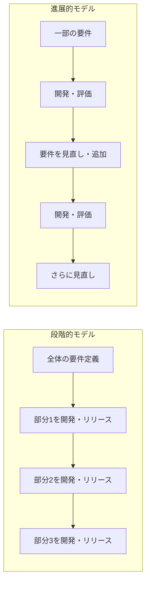
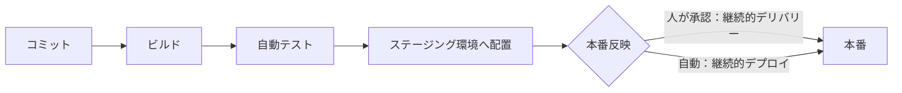
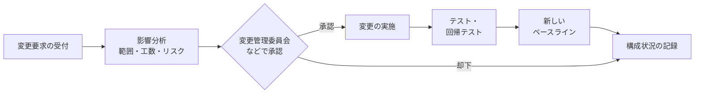

# ソフトウェア開発管理技術

> **重要度：★★**（科目A（旧午前）で毎回 1〜3 問程度。科目B（旧午後）では情報システム開発・プロジェクトマネジメントの問題の背景知識として出る）
> 「どう作るか（09 システム開発技術）」に対して、この章は **開発のやり方・権利・環境・構成をどう管理するか** を扱います。
> この章のポイントは次の5つです。
> - 開発モデル（段階的・進展的・プロダクトライン・MLOps）とアジャイル各手法（XP・スクラム・リーン・FDD・大規模アジャイル）の違い
> - DevOps を支える考え方（CALMS、SRE、Four Keys、オブザーバビリティ、カオスエンジニアリング）
> - SLCP（JIS X 0160 / 0170）のプロセス群と、プロセス能力水準（JIS X 33020）・CMMI の段階
> - 開発で生じる知的財産（職務著作・専用実施権／通常実施権・ライセンス・DRM）の管理
> - 構成管理・変更管理（ベースライン、構成状況の記録、完全性保証、リリース管理、SBOM）

📎 開発モデルの基本・スクラム・XP・CI/CD・構成管理の入口は [09_システム開発技術](09_システム開発技術.md) で説明しています。この章では **09 にない部分を厚く** 扱い、重複部分は 09 へのリンクで済ませます。

## 目次

1. [ソフトウェア開発モデル](#1-ソフトウェア開発モデル)
2. [アジャイル](#2-アジャイル)
3. [DevOps と SRE](#3-devops-と-sre)
4. [さまざまな開発手法（ローコード・再利用・リバースエンジニアリング・マッシュアップ・モバイル）](#4-さまざまな開発手法ローコード再利用リバースエンジニアリングマッシュアップモバイル)
5. [構造化手法と形式手法](#5-構造化手法と形式手法)
6. [開発プロセスの標準とプロセス成熟度](#6-開発プロセスの標準とプロセス成熟度)
7. [知的財産適用管理](#7-知的財産適用管理)
8. [開発環境管理](#8-開発環境管理)
9. [構成管理・変更管理](#9-構成管理変更管理)
10. [確認問題](#確認問題)
11. [📋 シラバス用語チェックリスト](#-シラバス用語チェックリスト)
12. [参考](#参考)

---

## 1. ソフトウェア開発モデル

### 1.1 開発モデルの全体像 ★★

**ソフトウェア開発モデル** は、開発作業をどんな順番・単位で進めるかを表した「型」です。型を決めておくと、計画・見積り・品質確認がしやすくなります。ウォーターフォール、V字、プロトタイピング、スパイラルの基本は [09 の 1.2 主な開発モデル](09_システム開発技術.md#12-主な開発モデル-) を参照してください。ここではシラバスで名前が挙がっている残りのモデルを整理します。

| モデル | 考え方 | ポイント |
|---|---|---|
| **段階的モデル**（Incremental Model：インクリメンタルモデル） | **最初に全体の要件を確定** し、それを複数の部分に分けて、部分ごとに開発・リリースする | 要件は最初に固まっている。「分割して順に作る」 |
| **進展的モデル**（Evolutionary Model：進化的モデル） | 最初は要件の一部しか分からない前提で、**開発を繰り返すたびに要件を明確化・追加** していく | 要件は途中で育つ。「作りながら要件を育てる」 |
| **ソフトウェアプロダクトライン** | 似た製品群（例：機種違いの家電のソフト）に共通する部分を **コア資産** として作っておき、製品ごとの違い（**可変性**）だけを追加して効率よく開発する | 計画的・戦略的な再利用。組込み分野で多い |
| **アジャイル** | 短い反復で動くソフトウェアを少しずつ届ける | [2. アジャイル](#2-アジャイル) |
| **DevOps** | 開発と運用が協力し、自動化で素早く安定してリリースし続ける | [3. DevOps と SRE](#3-devops-と-sre) |
| **MLOps** | 機械学習モデルの開発（学習）と運用（デプロイ・監視・再学習）を一体で回す DevOps の考え方 | データの変化でモデルの精度が落ちる（**ドリフト**）ため、**監視と再学習の自動化** が重要 |

- ⚠️ ひっかけ注意：**段階的（インクリメンタル）＝要件は最初に決まっている**、**進展的（エボリューショナリ）＝要件が反復ごとに変わる・増える**。この違いが選択肢でよく問われます。
- 💡 覚え方：インクリメント（increment）は「増分」。完成図はあって、それを **ピースごとに足す** イメージです。エボリューション（evolution）は「進化」。完成図自体が **育つ** イメージです。



### 1.2 MLOps の流れ ★

機械学習システムは、プログラムだけでなく **データとモデル** も成果物です。MLOps では次のサイクルを自動化・継続します。


- 学習に使ったデータ・コード・ハイパーパラメータの **バージョン管理**（再現性の確保）も重要です。

---

## 2. アジャイル

### 2.1 アジャイルソフトウェア開発宣言と12の原則 ★★

2001年の **アジャイルソフトウェア開発宣言** の4つの価値は [09 の 2.1](09_システム開発技術.md#21-アジャイル開発の考え方-) を参照してください。宣言の背後には **アジャイルソフトウェアの12の原則** があります。要点は次のとおりです。

| # | 原則の要点 |
|---|---|
| 1 | 価値のあるソフトウェアを **早く継続的に** 提供して顧客を満足させる |
| 2 | 開発の後半であっても **要求の変更を歓迎** する |
| 3 | 動くソフトウェアを **2〜3週間から2〜3か月** という短い間隔でリリースする（短いほどよい） |
| 4 | ビジネス側の人と開発者は、プロジェクトを通して **日々一緒に** 働く |
| 5 | 意欲に満ちた人々を集め、環境と支援を与え、**信頼** する |
| 6 | 情報を伝える最も効率的で効果的な方法は **フェイス・トゥ・フェイスで話す** こと |
| 7 | **動くソフトウェア** こそが進捗の最も重要な尺度 |
| 8 | 一定のペースを **持続可能** に維持する |
| 9 | 技術的卓越性と優れた設計に対する不断の注意が機敏さを高める |
| 10 | **シンプルさ**（ムダなく作れる量を最大限にすること）が本質 |
| 11 | 最良のアーキテクチャ・要求・設計は **自己組織的なチーム** から生まれる |
| 12 | チームは定期的に **ふりかえり**、やり方を調整する |

- ⚠️ ひっかけ注意：「ドキュメントを一切作らない」「長時間労働で短期間に仕上げる」は原則に反します（原則8：持続可能なペース）。

### 2.2 アジャイル開発手法の種類 ★★

| 手法 | 特徴 |
|---|---|
| **XP**（eXtreme Programming：エクストリームプログラミング） | **プログラミングの実践（プラクティス）** を重視。TDD・ペアプログラミングなど。[2.3](#23-xpの価値とプラクティス-) |
| **スクラム** | チームの **プロジェクト管理の枠組み**。役割・イベント・作成物を定める。[09 の 2.2](09_システム開発技術.md#22-スクラム-) |
| **リーンソフトウェア開発** | トヨタ生産方式（リーン生産）の考え方をソフトウェアに応用。**7つの原則**：ムダをなくす、品質を作り込む、知識を作り出す、決定を遅らせる、速く提供する、人を尊重する、全体を最適化する |
| **FDD**（Feature Driven Development：ユーザー機能駆動開発） | 利用者から見た価値のある **機能（フィーチャ）** を単位に、全体モデル作成 → フィーチャリスト作成 → フィーチャごとの計画・設計・構築を短い周期（2週間程度）で繰り返す |
| **TDD**（Test Driven Development：テスト駆動開発） | 先にテストを書き、「失敗（レッド）→ 合格（グリーン）→ リファクタリング」を繰り返す |
| **かんばん** | 作業を見える化し、仕掛り（WIP）を制限して流れを改善する（リーン由来） |

### 2.3 XPの価値とプラクティス ★★

XP は **五つの価値** を土台にしています。

| 価値 | 意味 |
|---|---|
| **コミュニケーション** | 対話を通じて問題を早く共有する |
| **シンプル** | 今必要な最も単純なものを作る |
| **フィードバック** | テストや顧客の反応から早く学ぶ |
| **勇気** | 必要なら設計を大胆に変える、悪い知らせも伝える |
| **尊重** | チームのメンバーを互いに尊重する |

プラクティスは、IPA の資料では立場ごとに次の4つに分類されています。

| 分類 | 主なプラクティス |
|---|---|
| **共同のプラクティス** | 反復（イテレーション）、共通の用語、開けた作業空間、回顧（ふりかえり） |
| **開発のプラクティス** | **テスト駆動開発（TDD）**、**ペアプログラミング**、**リファクタリング**、**ソースコードの共同所有**、**継続的インテグレーション（CI）**、**YAGNI**（You Aren't Gonna Need It：今必要ないものは作らない） |
| **管理者のプラクティス** | 責任の受入れ、援護、四半期ごとの見直し、ミラー（チームの状況をありのまま示す）、40時間労働（持続可能なペース） |
| **顧客のプラクティス** | ストーリーの作成、リリース計画、受入れテスト、短期リリース |

- **イテレーション**：XP の開発の反復単位（1〜2週間程度）。スクラムのスプリントに相当します。
- 各プラクティスの意味は [09 の 2.3](09_システム開発技術.md#23-xpエクストリームプログラミング-) にあります。

### 2.4 スクラムの要素（まとめ） ★★★

役割・イベント・作成物の詳細は [09 の 2.2 スクラム](09_システム開発技術.md#22-スクラム-) にあります。シラバスの用語を1枚で整理すると次のとおりです。

| 区分 | 用語 |
|---|---|
| 役割（**スクラムチーム**） | **プロダクトオーナー**（プロダクトバックログの管理・価値の最大化）、**開発者**（インクリメントを作る）、**スクラムマスター**（スクラムの実践を支援し、妨げを取り除く） |
| イベント | **スプリント**（1か月以内の固定期間。他のイベントの入れ物）、**スプリントプランニング**、**デイリースクラム**（15分）、**スプリントレビュー**（成果物の確認）、**スプリントレトロスペクティブ**（進め方の振り返り） |
| 作成物 | **プロダクトバックログ**、**スプリントバックログ**、**インクリメント** |

### 2.5 アジャイルのプラクティス・ツール ★★

| 用語 | 内容 |
|---|---|
| **ペルソナ** | 典型的な利用者像を、名前・年齢・目的・困りごとまで具体的に描いた架空の人物。要求の判断基準にする |
| **インセプションデッキ** | プロジェクト開始時に「我々はなぜここにいるのか」「やらないことリスト」「トレードオフスライダー」など **10の問い** に答え、関係者の認識をそろえる資料 |
| **ユーザーストーリー** | 「〈役割〉として、〈目的〉のために、〈機能〉がほしい」の形で書く要求 |
| **INVEST** | よいユーザーストーリーの条件：**I**ndependent（独立している）、**N**egotiable（交渉可能）、**V**aluable（価値がある）、**E**stimable（見積り可能）、**S**mall（小さい）、**T**estable（テスト可能） |
| **プランニングポーカー** | 見積りカードを一斉に出し、差が大きければ理由を話し合って再見積りする相対見積り手法 |
| **タイムボックス** | 作業に **固定の期間の上限** を設け、期限は延ばさずに範囲を調整する考え方（スプリント、デイリースクラム15分など） |
| **バーンダウンチャート** | 縦軸に残作業量、横軸に時間をとったグラフ。理想線と比べて遅れを見る |
| **ベロシティ** | 1スプリントで完了したストーリーポイントの合計（計算例は [09](09_システム開発技術.md#計算例ベロシティによるリリース時期の見積り)） |
| **モブプログラミング** | **チーム全員** が1台の画面の前に集まり、1人（ドライバー）がキーボードを操作し、他のメンバー（ナビゲーター）が指示・議論しながら同じコードを書く。役割は短時間で交代 |
| **リファクタリング** | 外部から見た振る舞いを変えずに内部構造を改善する |
| **ふりかえり（レトロスペクティブ）** | 一定期間ごとにチームの進め方を見直して改善する |
| **KPT**（Keep, Problem, Try） | ふりかえりの手法。**Keep**（良かったので続けること）、**Problem**（問題点）、**Try**（次に試すこと）を書き出す |
| **CI / CD** | 継続的インテグレーション / 継続的デリバリー。[3.2](#32-cicd-と継続的デプロイ-) |

- ⚠️ ひっかけ注意：**ペアプログラミング＝2人**、**モブプログラミング＝チーム全員** です。

### 2.6 大規模アジャイル（エンタープライズアジャイル） ★

1チーム（10人以下程度）を前提としたスクラムを、複数チーム・組織全体に広げるためのフレームワークです。

| 名称 | 特徴 |
|---|---|
| **SAFe**（Scaled Agile Framework） | 組織全体（ポートフォリオ・プログラム・チーム）で階層的にアジャイルを適用する。複数チームを **ART**（Agile Release Train）として同期させ、**PI**（Program Increment）計画で全体の計画を合わせる |
| **LeSS**（Large-Scale Scrum） | スクラムをできるだけそのまま拡張する。**1人のプロダクトオーナーと1つのプロダクトバックログ** を複数チームで共有する |
| **Scrum of Scrums** | 各スクラムチームの代表者が集まり、チーム間の依存関係や課題を調整する会議（仕組み） |
| **DA**（Disciplined Agile：ディシプリンドアジャイル） | スクラム・リーン・かんばんなどを状況に応じて **選択・組み合わせる** ためのツールキット（現在は PMI が提供） |

---

## 3. DevOps と SRE

### 3.1 CALMS フレームワーク ★

DevOps は単なるツール導入ではなく、組織文化の変革です。DevOps の取組みを評価する観点として **CALMS** があります。

| 頭文字 | 観点 | 内容 |
|---|---|---|
| **C** | Culture（文化） | 開発と運用が責任を共有し、失敗を責めずに学ぶ文化 |
| **A** | Automation（自動化） | ビルド・テスト・デプロイ・インフラ構築（IaC）の自動化 |
| **L** | Lean（リーン） | ムダを省き、小さな単位で素早く価値を届ける |
| **M** | Measurement（測定） | デプロイ頻度・障害などを数値で測って改善する |
| **S** | Sharing（共有） | 知識・ツール・成功や失敗の経験をチーム間で共有する |

### 3.2 CI/CD と継続的デプロイ ★★

| 用語 | 内容 |
|---|---|
| **継続的インテグレーション（CI）** | 変更を頻繁にメインラインへ統合し、自動でビルド・テストする |
| **継続的デリバリー（CD）** | 常に **本番にリリース可能な状態** を保つ。本番への反映は **人の判断（承認）** で行う |
| **継続的デプロイ** | テストに合格した変更を **自動的に本番環境へ反映** する |



- ⚠️ ひっかけ注意：**デリバリー＝リリース可能な状態まで自動化**、**デプロイ＝本番反映まで自動化**。

### 3.3 SRE ★★

**SRE**（Site Reliability Engineering：サイト信頼性エンジニアリング）は、Google が提唱した、**ソフトウェアエンジニアリングの手法で運用の課題を解決する** アプローチです。

| 用語 | 内容 |
|---|---|
| **SLI**（Service Level Indicator） | サービスの信頼性を測る指標（例：成功したリクエストの割合） |
| **SLO**（Service Level Objective） | SLI の目標値（例：月間の成功率 99.9%） |
| **エラーバジェット** | `1 − SLO` で許される失敗の量。使い切るまでは新機能のリリースを優先し、使い切ったら信頼性の改善を優先する |
| **トイル** | 手作業で繰り返し発生し、自動化できる運用作業。SRE では削減の対象 |
| **ポストモーテム** | 障害後に、個人を責めずに（ブレームレス）原因と再発防止策をまとめる |

計算例（エラーバジェット）
- 公式：`許容停止時間 = 期間 × (1 − SLO)`
- 数値例：30日間で可用性 SLO が 99.9%
- 途中式：`30日 × 24時間 × 60分 = 43,200分`、`43,200 × (1 − 0.999) = 43,200 × 0.001 = 43.2分`
- 答え：30日間で約 **43分** までの停止が許容されます。

### 3.4 Four Keys ★★

**Four Keys** は、ソフトウェアデリバリーの能力を測る4つの指標です（Google の DORA（DevOps Research and Assessment）の研究による）。

| 指標 | 意味 | 区分 |
|---|---|---|
| **デプロイの頻度** | 本番環境へどのくらいの頻度でリリースしているか | スピード |
| **変更のリードタイム** | コードのコミットから本番稼働までの時間 | スピード |
| **変更障害率** | デプロイが原因で障害（修正が必要な事態）が起きた割合 | 安定性 |
| **平均修復時間（MTTR）** | 障害発生からサービス復旧までの平均時間 | 安定性 |

- 💡 スピード（頻度・リードタイム）と安定性（障害率・修復時間）を **両方** 見るのがポイントです。

### 3.5 オブザーバビリティ・カオスエンジニアリング・DevSecOps ★

| 用語 | 内容 |
|---|---|
| **オブザーバビリティ**（可観測性） | システムが外部に出す情報から、内部の状態や **未知の問題の原因** を推測できる性質。**ログ・メトリクス・トレース** の3つのテレメトリデータを使う |
| **OpenTelemetry** | ログ・メトリクス・トレースを収集・送信するための **ベンダー中立なオープンソースの標準仕様とツール群**（CNCF のプロジェクト） |
| **カオスエンジニアリング** | 本番（に近い）環境で **意図的に障害を起こし**（サーバ停止、通信遅延など）、システムが耐えられるかを検証して弱点を見つける。例：Netflix の Chaos Monkey |
| **DevSecOps** | 開発・運用の流れにセキュリティを組み込み、早い段階から自動でセキュリティ検査を行う（シフトレフト） |
| **TDD** | DevOps でも自動テストの土台として重視される |

- ⚠️ ひっかけ注意：**モニタリング（監視）** は「あらかじめ決めた項目が正常か」を見るもの、**オブザーバビリティ** は「想定していない問題でも原因を探れる」性質です。

---

## 4. さまざまな開発手法（ローコード・再利用・リバースエンジニアリング・マッシュアップ・モバイル）

### 4.1 ローコード／ノーコード開発 ★★

**ローコード開発** は、GUI 上で部品を配置・設定し、少しのコードを書くだけでアプリケーションを作る手法です。**ノーコード開発** は、コードをまったく書かずに作ります。

| 利点 | 留意事項 |
|---|---|
| 開発期間の短縮、コスト削減 | 複雑な処理や大規模システムには向かないことがある |
| 業務部門の担当者（市民開発者）が自分で作れる | 特定の製品に依存しやすい（**ベンダーロックイン**） |
| 要求変更に素早く対応できる | 情報システム部門が把握しない **シャドーIT** の温床になる。開発ルールや管理（ガバナンス）が必要 |

### 4.2 ソフトウェア再利用と部品 ★

部品化・再利用は生産性と品質を高めます。ただし、**最初から再利用されることを前提に設計** しなければ使える部品になりません。ソフトウェアパッケージの活用も再利用の一種です。

| 分類 | 部品の種類 | 内容 |
|---|---|---|
| 形態 | **関数部品** | 特定の処理を行う関数・サブルーチン |
| | **オブジェクト部品（クラスライブラリ）** | データと手続をまとめたクラスの集まり。継承して拡張できる |
| | **データ部品** | 共通のデータ定義（コード表、データ構造、メッセージ定義など） |
| | **プロセス部品** | 独立して実行できる処理単位（プログラムやサービス）として再利用する部品 |
| 結合のしかた | **常駐部品** | 実行時にメモリ上に常駐し、複数のプログラムから共有して呼び出される部品（共有ライブラリなど） |
| | **組込み部品** | 利用するプログラムに組み込まれて（リンクされて）一体になる部品 |
| 内部の公開 | **ブラックボックス部品** | 内部を見せず、インタフェースだけで使う。そのまま使うので品質が安定 |
| | **ホワイトボックス部品** | ソースコードが公開され、利用者が中身を修正して使う |
| カスタマイズ | **パラメトリック部品** | パラメータ（引数・設定値）を与えて動作を変えられる部品 |
| | **ノンパラメトリック部品** | パラメータで変更できず、決まった動作をする部品 |
| 適用範囲 | **クローズドシステム部品** | 特定のシステム（環境）の中でだけ使える部品 |
| | **オープンシステム部品** | 標準的なインタフェースに従い、異なるシステム・環境でも使える部品 |

**部品設計の基準**
- **モジュールの独立性**：強度を高く、結合度を低くして単独で使えるようにする（[09 の 6.1](09_システム開発技術.md#61-モジュールの独立性-)）。
- **カスタマイズ**：パラメータなどで利用者の要件に合わせられるようにする。
- **ライブラリ**：部品を分類・登録して検索しやすくする。
- **命名規則**：名前から機能が分かるよう統一する。

### 4.3 リバースエンジニアリング ★★

**リバースエンジニアリング** は、既存のソフトウェア（実行形式やソースコード）を解析して、仕様・構造・構成部品の情報を得ることです。

- 用途：ドキュメントのない古いシステムの仕様復元、他製品との **互換性**（接続や連携ができること）の確保、脆弱性調査など。
- **コールグラフ**：関数（モジュール）どうしの **呼出し関係** を表した有向グラフ。解析結果の表現によく使われます。
- 留意事項：
  - 解析結果をもとに、元の権利者の許可なく同等のソフトウェアを開発・販売すると、**著作権や特許権などの知的財産権を侵害する可能性** があります。
  - **利用許諾契約（ライセンス契約）でリバースエンジニアリングを禁止** している場合があり、契約違反になります。

### 4.4 マッシュアップ ★

**マッシュアップ** は、**複数の提供元の API**（Web API など）を組み合わせて新しいサービスを作る手法です。例：地図 API と店舗情報 API を組み合わせた店舗検索サービス。

| 種類 | 組み合わせる層 | 例 |
|---|---|---|
| **プレゼンテーションマッシュアップ** | 画面（表示） | 1つの画面に地図・天気・ニュースを並べて表示 |
| **データマッシュアップ** | データ | 複数のデータを統合・加工して新しい情報を作る |
| **ロジックマッシュアップ** | 処理（ビジネスロジック） | 複数の API の処理を連携させて1つの業務処理にする |

- 利点：既存の API を使うので **短期間・低コスト** で開発でき、品質も実績のある API に支えられます。
- 留意事項：API 提供元の **仕様変更・サービス停止・障害の影響** を受けます。利用規約（商用利用可否、呼出し回数制限）の確認が必要です。

### 4.5 モバイルアプリケーション開発 ★★

| 方式 | 特徴 |
|---|---|
| **モバイル用 Web アプリケーション** | ブラウザで動く。OS に依存せず、インストール不要。端末機能の利用は限定的 |
| **ネイティブアプリケーション** | OS（iOS / Android）ごとの言語・SDK で開発し、ストアから配布。高速で端末機能をフルに使えるが、OS ごとに開発が必要 |
| **ハイブリッドアプリケーション** | Web 技術（HTML / JavaScript）で作った画面を、ネイティブアプリの中（WebView）で動かす。1つのコードで複数 OS に対応しやすい |
| **PWA**（Progressive Web Apps：プログレッシブウェブアプリ） | Web アプリでありながら、ホーム画面への追加、**オフライン動作**（Service Worker）、プッシュ通知など、ネイティブアプリに近い体験を提供する |

開発時の留意事項
- **User-Agent**：ブラウザが送る端末・ブラウザの識別文字列。端末に応じて表示を切り替える判断材料になります（偽装も可能なので、セキュリティの判断には使わない）。
- **パーミッション要求**：位置情報・カメラなどの利用には利用者の許可が必要。必要最小限にし、目的を説明します。
- **端末仕様の多様性への対応**：画面サイズ・解像度・OS バージョンの違いに対応（レスポンシブデザインなど）。
- **圏外時・着信時の対応**：通信断や電話着信でアプリが中断しても、データが失われず再開できるようにします。
- **アプリケーション審査・配布**：ストア（App Store、Google Play）で配布するには **審査** を通過する必要があります。企業内配布の仕組みもあります。

---

## 5. 構造化手法と形式手法

### 5.1 構造化手法 ★

**構造化手法** は、大規模・複雑なソフトウェアを、**階層的に分割** して理解しやすく・保守しやすくする手法です。

| 用語 | 内容 |
|---|---|
| **階層構造化** | システムを上位から下位へ、機能の階層として構成する |
| **段階的詳細化** | 大まかな処理から始めて、段階的に細かい処理へ分解していく（トップダウン） |
| **構造化チャート** | プログラムの構造（モジュールの階層・呼出し関係）を図で表す |
| **状態遷移図** | 状態とイベントによる遷移を表す。リアルタイム系・組込み系で使う |
| **HIPO**（Hierarchy plus Input Process Output） | **図式目次**（機能の階層構造）と、各機能の **入力・処理・出力** を表す **IPO 図**（総括図・詳細図）で機能を記述する |
| **DFD**（Data Flow Diagram） | データの流れと処理を表す（[09 の 4.1](09_システム開発技術.md#41-構造化分析の図-)） |
| **ソフトウェア構造** | 構造化の結果として得られるモジュールの構成。[09 の 6.2 モジュール分割技法](09_システム開発技術.md#62-モジュール分割技法-) も参照 |

### 5.2 形式手法 ★

**形式手法**（Formal Method）は、数学的に意味が厳密に定義された **形式仕様記述言語** で仕様を書き、あいまいさを排除して、**証明やツールによる検証** で品質を高める手法です。鉄道・航空・IC カードなど高信頼が求められる分野で使われます。

| 用語 | 内容 |
|---|---|
| **VDM-SL**（Vienna Development Method - Specification Language） | VDM の仕様記述言語。データ型・状態・関数（事前条件・事後条件）でモデルを記述する |
| **VDM++** | VDM-SL をオブジェクト指向に拡張した言語 |
| **VDMTools** | VDM の仕様の構文・型チェック、仕様の実行（アニメーション）、テストを支援するツール |
| **Z 言語**（Z 記法） | 集合論と述語論理にもとづく仕様記述言語。**スキーマ** という単位で状態と操作を記述する |
| **モデル検査** | システムの振る舞いを状態遷移モデルで表し、**すべての状態を網羅的に探索** して、デッドロックがない・性質が常に成り立つかを自動検証する |
| **SPIN** | 代表的なモデル検査ツール。**Promela** という言語でモデルを記述し、並行システムの検証に使う |

- 💡 形式手法は「モデルの **状態** を厳密に記述する」ことに重点があります。テストが「一部の入力で確かめる」のに対し、モデル検査は「全状態を確かめる」のが強みです。

---

## 6. 開発プロセスの標準とプロセス成熟度

### 6.1 SLCP（ソフトウェアライフサイクルプロセス） ★★

**SLCP**（Software Life Cycle Process）は、ソフトウェアの構想から開発・運用・保守・廃棄までに必要な **プロセスを体系化した国際標準の枠組み** です。

| 規格 | 内容 |
|---|---|
| **JIS X 0160** | ソフトウェアライフサイクルプロセス（ISO/IEC/IEEE 12207 に対応） |
| **JIS X 0170** | システムライフサイクルプロセス（ISO/IEC/IEEE 15288 に対応） |
| **SLCP-JCF（共通フレーム）** | IPA が日本の取引慣行に合わせて JIS X 0160 などをもとに作った枠組み（[09 の 3.1](09_システム開発技術.md#31-共通フレーム-)） |

**階層構造**：**プロセス** → **アクティビティ** → **タスク** の順に細かくなります。

**4つのプロセス群**（JIS X 0160 / 0170）

| プロセス群 | 内容 | 主なプロセスの例 |
|---|---|---|
| **合意プロセス** | 取得者（発注者）と供給者（受注者）の合意 | 取得プロセス、供給プロセス |
| **組織のプロジェクトイネーブリングプロセス** | 組織がプロジェクトを実施できるよう資源・環境を整える | ライフサイクルモデル管理、インフラストラクチャ管理、人的資源管理、品質マネジメント |
| **テクニカルマネジメントプロセス** | プロジェクトの計画・評価・管理 | プロジェクト計画、リスク管理、**構成管理**、情報管理、測定、品質保証 |
| **テクニカルプロセス** | 技術的な作業そのもの | 利害関係者ニーズ・要件定義、アーキテクチャ定義、設計、実装、統合、検証、移行、妥当性確認、運用、保守、廃棄 |

**プロセス修整（Tailoring：テーラリング）** と適合
- **プロセス修整**：プロジェクトの特性に合わせて、規格のプロセス・アクティビティ・タスクを取捨選択・変更すること。
- **完全適合**：規格の要求事項（該当するプロセスの成果やアクティビティ・タスク）をすべて満たしていること。
- **修整適合**：修整（テーラリング）した結果のプロセスについて、規格への適合を主張すること。

### 6.2 プロセス成熟度とプロセス能力 ★★

開発・保守プロセスを **評価し、改善** するための枠組みです。

**JIS X 33001 / JIS X 33020**（ISO/IEC 33000 シリーズ：プロセスアセスメント）
- **JIS X 33001**：プロセスアセスメントの概念と用語。
- **JIS X 33020**：**プロセス能力** をアセスメントするための測定の枠組み。個々のプロセスの能力を **6段階（レベル0〜5）** で評価します。

| 能力水準 | 名称 | 状態 |
|---|---|---|
| 0 | **不完全なプロセス** | プロセスが実施されていない、または目的を達成できていない |
| 1 | **実施されたプロセス** | プロセスが実施され、目的を達成している |
| 2 | **管理されたプロセス** | 計画・監視・調整され、作業成果物も管理されている |
| 3 | **確立されたプロセス** | **組織の標準プロセス** にもとづいて実施されている |
| 4 | **予測可能なプロセス** | 定量的に測定・分析され、決められた範囲内で予測どおりに動く |
| 5 | **革新しているプロセス** | 事業目標に向けて継続的に **プロセス改善**・革新されている |

**CMMI**（Capability Maturity Model Integration：能力成熟度モデル統合）
- 米国カーネギーメロン大学ソフトウェア工学研究所（SEI）が開発したモデル（現在は CMMI Institute / ISACA が提供）。
- 組織の **成熟度レベル** を5段階で表します。

| 成熟度レベル | 名称 | 状態 |
|---|---|---|
| 1 | 初期 | 場当たり的。個人の能力に依存 |
| 2 | 管理された | プロジェクト単位で計画・管理されている |
| 3 | 定義された | 組織として標準プロセスが定義され、各プロジェクトがそれを修整して使う |
| 4 | 定量的に管理された | プロセスを定量的に測定・管理している |
| 5 | 最適化している | 定量的な理解にもとづき継続的に改善している |

- 💡 覚え方：どちらも「**やっている → 管理 → 組織標準 → 定量 → 改善**」の順。JIS X 33020 は **0 から始まる6段階（プロセス単位）**、CMMI の成熟度は **1 から始まる5段階（組織単位）** です。
- ⚠️ ひっかけ注意：「組織の標準プロセスにもとづく」のは **レベル3**（確立された／定義された）。「定量的」は **レベル4** です。

---

## 7. 知的財産適用管理

開発の途中で生まれる成果物（プログラム、設計書、発明）の権利と、他者の権利の利用を正しく管理します。法律の詳細は [03_ストラテジ系/04_法務](../03_ストラテジ系/04_法務.md) を参照してください。

### 7.1 著作権管理 ★★★

- **プログラムの著作者**：原則として、実際にプログラムを作成した者です。
- **職務著作**（法人著作）：法人の発意にもとづき、従業員が **職務上作成** したプログラムは、契約や就業規則に別段の定めがなければ **法人が著作者** になります。プログラムの場合は、法人名義で公表しなくても職務著作が成立する点が特徴です（[法務 2.3](../03_ストラテジ系/04_法務.md#23-職務著作法人著作-)）。
- **外注する場合の留意事項**：請負契約で外部に開発を委託すると、契約で定めない限り著作権は **受注者** に残ります。発注者が改変・再利用したいなら、契約で **著作権の譲渡**（著作権法第27条・第28条の権利を含むことを明記）や **著作者人格権を行使しない** 旨を定めます（[法務 2.4](../03_ストラテジ系/04_法務.md#24-委託開発派遣と著作権-)）。

### 7.2 特許管理 ★★

- 開発中に生まれた発明は、**公開前に** 特許出願するかどうかを判断します（公開すると新規性を失うため）。職務発明の扱いは社内規程で定めます（[法務 3.2](../03_ストラテジ系/04_法務.md#32-職務発明特許法-第35条-)）。
- 他者の特許を使う必要がある場合は、**実施許諾（ライセンス）** を受けます。

| 用語 | 内容 |
|---|---|
| **特許権** | 発明を独占的に実施できる権利。出願から原則20年 |
| **専用実施権** | 設定した範囲内で、実施権者が **独占的に** 実施できる権利。**特許庁への登録で効力が発生** し、その範囲では **特許権者自身も実施できない** |
| **通常実施権** | 実施を許される権利（独占ではない）。**複数の者に** 許諾でき、特許権者自身も実施できる。登録は不要 |

- ⚠️ ひっかけ注意：「専用」＝独占、特許権者も使えない。「通常」＝非独占、何人にでも許諾できる。

### 7.3 ライセンス管理 ★★

- 自社が権利を持たないソフトウェア（市販製品、OSS、ライブラリ）を使う場合は **ライセンス（使用許諾）** を受けます。
- **ライセンサー**：使用を許諾する側（権利者）。**ライセンシー**：許諾を受ける側（利用者）。
- 取得したライセンスは、**使用実態・使用人数・インストール数** が契約の範囲を超えないように管理します。
- OSS のライセンス（GPL など）の条件も守る必要があります（[05 の 8.2 主なライセンス](05_ソフトウェア.md#82-主なライセンス-)）。

### 7.4 技術的保護 ★

ソフトウェアやデジタルコンテンツを、技術によって不正コピー・不正利用から守る手法です。

| 用語 | 内容 |
|---|---|
| **コピーガード** | 複製（コピー）を技術的に防止・制限する仕組みの総称 |
| **DRM**（Digital Rights Management：デジタル著作権管理） | 暗号化と利用条件（閲覧回数、期間、端末数など）の制御で、コンテンツの利用を管理する |
| **アクティベーション** | ソフトウェアのインストール後に、ライセンス情報と端末情報をメーカーに送って **認証（有効化）** することで、不正な多重インストールを防ぐ |
| **CPRM**（Content Protection for Recordable Media） | **録画用 DVD や SD カード** などの記録メディア向けの著作権保護技術。メディア固有の ID を使って暗号化し、1回だけ録画可能（コピーワンス）などを実現する |
| **AACS**（Advanced Access Content System） | **Blu-ray Disc** などで使われる著作権保護技術。AES による暗号化と、漏えいした機器の鍵を無効化する仕組みを持つ |

- 留意事項：保護を強くしすぎると、正規の利用者の利便性（機器の買替えなど）を損ないます。また、著作権法では **技術的保護手段の回避**（コピーガード外し）による複製は、私的使用目的でも認められていません。

---

## 8. 開発環境管理

### 8.1 開発環境の構築 ★

効率的な開発のために、開発用ハードウェア、ソフトウェア、ネットワーク、**シミュレーター** などの開発ツールを **開発要件に合わせて準備** します。

| 用語 | 内容 |
|---|---|
| **構成品目** | 管理の対象となる要素。開発環境では、使用するツール・ライブラリ・OS とその **バージョン** も構成品目として管理する |
| **ソフトウェアライセンス** | 開発ツールのライセンス数・期限を開発要員数に合わせて確保する |
| **SCM**（Source Code Management：ソースコード管理） | ソースコードの版・変更履歴を管理するツール・仕組み（Git など） |
| **ステージング環境** | 本番環境とほぼ同じ構成で、**リリース直前の最終確認** を行う環境 |


### 8.2 管理対象 ★

| 管理対象 | 内容 | 用語 |
|---|---|---|
| **開発環境稼働状況管理** | コンピュータ資源（サーバ、ストレージ）や開発支援ツールが足りているか、正常に動いているかを把握する | **資源管理**、**運用管理** |
| **設計データ管理** | 設計書などのデータの版管理、共有、安全管理。機密・個人情報を含むデータは **誰が・いつ・何の目的で** 使ったか、持出しや改ざんがないかを厳重に管理する | **更新履歴管理**、**アクセス権管理**、**検索**、**リポジトリ**（成果物を一元的に格納する場所） |
| **ツール管理** | メンバーごとにツールやバージョンが異なると、ソフトウェアの互換性問題が起きる。ツール起因のバグやセキュリティホールもあるので、**使うツールとバージョンを統一** する | **構成品目**、**バージョン管理** |
| **ライセンス管理** | ライセンス条項に違反した利用は不正利用で、法的処罰の対象。**定期的にインストール数と保有ライセンス数を照合（棚卸）** する | **不正コピー**、**バージョン管理**、**棚卸** |

---

## 9. 構成管理・変更管理

### 9.1 構成管理 ★★

構成管理の基本用語（構成品目、ベースライン、バージョン管理、ブランチ）は [09 の 9.2](09_システム開発技術.md#92-構成管理とバージョン管理-) を参照してください。

**ソフトウェア構成管理** は、ソフトウェア全体がどの **ソフトウェア構成品目**（ソースコード、設計書、テスト仕様、ライブラリなど）の組合せでできているかという **構成識別体系** を決め、その管理方法を明らかにしたうえで管理する活動です。SLCP では **テクニカルマネジメントプロセス** の1つに位置づけられています。

| 用語 | 内容 |
|---|---|
| **構成管理計画** | 何を構成品目とするか、命名規則、ベースラインの設定時期、変更の承認手順、使用ツールなどを定めた計画 |
| **ベースライン** | 正式にレビュー・承認され、以後は **正式な変更手続きを経なければ変更できない** 構成 |
| **SBOM**（Software Bill of Materials：ソフトウェア部品表） | ソフトウェアに含まれる **コンポーネント（OSS など）の名前・バージョン・ライセンス・依存関係** の一覧。脆弱性が公表されたときに影響のある製品をすぐ特定でき、ライセンス違反も防げる。形式に **SPDX**、**CycloneDX** などがある |

### 9.2 変更管理の流れ ★★



| 活動 | 内容 |
|---|---|
| **構成状況の記録** | ベースラインとなっているソフトウェア構成品目について、**状況や履歴を文書化** する。記録する内容：プロジェクトにおける **変更回数**、**最新のバージョン**、**移行状況**、変更の承認状況など |
| **ソフトウェア構成品目の完全性保証** | 構成品目の **機能的な完全性**（要求どおりの機能を満たしているか）と **物理的な完全性**（構成品目がすべてそろい、記録と実物が一致しているか）を決定し保証する。観点は **一貫性**（構成品目間・文書との矛盾がない）と **正確性** |
| **リリース管理及び出荷** | 完全性が保証された後に、ソフトウェアや関連文書の **新しい版を出荷** する手続き。ソフトウェアのコードや文書は、**ソフトウェアの寿命の間保守** できるよう、**保管期間** を決めて保管する |

- ⚠️ ひっかけ注意：変更は **承認してから実施** します。「緊急だからとりあえず本番を直して、後で記録する」は構成管理の考え方に反します（緊急時も事後承認・記録の手順を定めます）。
- 💡 構成管理の4つの活動（構成識別 → 構成管理（変更管理）→ 構成状況の記録 → 構成監査）として整理されることもあります。

---

## 確認問題

**問1** 段階的モデル（インクリメンタルモデル）の説明として、最も適切なものはどれか。

- ア　開発を繰り返すたびに利用者の評価を受け、要件そのものを見直しながらシステムを進化させる。
- イ　最初にシステム全体の要件を確定し、それを分割して部分ごとに開発・リリースする。
- ウ　計画、リスク分析、開発、評価のサイクルを繰り返し、リスクを低減しながら開発する。
- エ　似た製品群の共通部分をコア資産として用意し、製品ごとの差分を追加して開発する。

**問2** XP の開発のプラクティスに含まれるものはどれか。

- ア　40時間労働
- イ　四半期ごとの見直し
- ウ　ソースコードの共同所有
- エ　受入れテスト

**問3** よいユーザーストーリーの条件を表す INVEST に含まれないものはどれか。

- ア　Independent（独立している）
- イ　Estimable（見積り可能である）
- ウ　Testable（テスト可能である）
- エ　Visible（目に見える）

**問4** Four Keys において、ソフトウェアデリバリーの「安定性」を表す指標の組合せはどれか。

- ア　デプロイの頻度、変更のリードタイム
- イ　デプロイの頻度、変更障害率
- ウ　変更障害率、平均修復時間
- エ　変更のリードタイム、平均修復時間

**問5** あるサービスの可用性の SLO を、30日間で 99.95% と定めた。この期間のエラーバジェットとして許容される停止時間は約何分か。

**問6** JIS X 33020 のプロセス能力水準で、「組織の標準プロセスにもとづいてプロセスが実施されている」状態に該当するものはどれか。

- ア　実施されたプロセス
- イ　管理されたプロセス
- ウ　確立されたプロセス
- エ　予測可能なプロセス

**問7** 特許の専用実施権に関する記述として、適切なものはどれか。

- ア　同一の範囲について、複数の者に重ねて設定できる。
- イ　設定した範囲内では、特許権者自身も特許発明を実施できなくなる。
- ウ　当事者間の契約だけで効力が発生し、登録は不要である。
- エ　特許権の存続期間とは関係なく、無期限に効力をもつ。

**問8** 構成管理における「ソフトウェア構成品目の完全性保証」の説明として、最も適切なものはどれか。

- ア　変更要求を受け付け、影響範囲を分析して承認の可否を決める。
- イ　構成品目の変更回数、最新のバージョン、移行状況を文書に記録する。
- ウ　構成品目が要求された機能を満たし、かつ構成品目がすべてそろって記録と一致していることを確認する。
- エ　完全性が確認された新しい版を出荷し、保管期間を定めて保管する。

**問9** SBOM を整備しておくことによる効果として、最も適切なものはどれか。

- ア　ソースコードを難読化し、リバースエンジニアリングを防止できる。
- イ　ある OSS に脆弱性が公表されたとき、影響を受ける自社製品を迅速に特定できる。
- ウ　テストを自動化し、変更のたびにビルドとテストを実行できる。
- エ　利用者の端末ごとにライセンスを認証し、不正な多重インストールを防止できる。

<details><summary>解答・解説</summary>

**問1　イ**
アは進展的（進化的）モデル、ウはスパイラルモデル、エはソフトウェアプロダクトラインです。段階的モデルは「要件は最初に確定、作るのは分割して順番に」です。

**問2　ウ**
ア・イは管理者のプラクティス、エは顧客のプラクティスです。開発のプラクティスは TDD、ペアプログラミング、リファクタリング、ソースコードの共同所有、CI、YAGNI です。

**問3　エ**
INVEST は Independent、Negotiable、Valuable、Estimable、Small、Testable の頭文字です。V は Valuable（価値がある）です。

**問4　ウ**
デプロイの頻度と変更のリードタイムは「スピード」、変更障害率と平均修復時間（MTTR）は「安定性」の指標です。

**問5　約 21.6 分**
```
許容停止時間 = 期間 × (1 − SLO)
30日 = 30 × 24 × 60 = 43,200 分
43,200 × (1 − 0.9995) = 43,200 × 0.0005 = 21.6 分
```

**問6　ウ**
レベル3「確立されたプロセス」です。レベル2（管理された）は計画・監視されている段階、レベル4（予測可能な）は定量的に管理されている段階です。

**問7　イ**
専用実施権は独占的な権利で、特許庁への登録で効力が発生し、設定範囲では特許権者も実施できません。アは通常実施権の性質です。特許権が消滅すれば実施権も消滅するので、エは誤りです。

**問8　ウ**
完全性保証は、機能的な完全性と物理的な完全性を確認することです。アは変更管理（変更要求の評価）、イは構成状況の記録、エはリリース管理及び出荷です。

**問9　イ**
SBOM はソフトウェアに含まれるコンポーネントの一覧なので、脆弱性の影響範囲の特定やライセンス確認に役立ちます。アは難読化、ウは CI、エはアクティベーションの説明です。

</details>

---

## 📋 シラバス用語チェックリスト

シラバス Ver.7.2 中分類13「ソフトウェア開発管理技術」の用語例です。リンクのある用語は本文（または関連章）に詳しい説明があります。

### 1. 開発プロセス・手法

**（1）① ソフトウェア開発モデル**

| 用語 | 1行説明 |
|---|---|
| [ウォーターフォールモデル](09_システム開発技術.md#12-主な開発モデル-) | 工程を順番に進め、原則として前に戻らない開発モデル |
| [プロトタイピングモデル](09_システム開発技術.md#12-主な開発モデル-) | 早期に試作品を作り、利用者の確認を得ながら要件を固めるモデル |
| [アジャイル](#2-アジャイル) | 短い反復で動くソフトウェアを少しずつ届ける軽量な開発手法の総称 |
| [DevOps](#3-devops-と-sre) | 開発と運用が協力し、自動化で素早く安定したリリースを続ける考え方 |
| [MLOps](#12-mlops-の流れ-) | 機械学習モデルの学習・デプロイ・監視・再学習を継続的に回す DevOps |
| [ソフトウェアプロダクトライン](#11-開発モデルの全体像-) | 製品群の共通部分をコア資産化し、差分（可変性）を足して効率開発する |
| [段階的モデル（Incremental Model）](#11-開発モデルの全体像-) | 全体要件を先に確定し、分割して部分ごとに開発・リリースする |
| [進展的モデル（Evolutionary Model）](#11-開発モデルの全体像-) | 反復ごとに要件を明確化・追加しながらシステムを進化させる |

**（1）② アジャイル（a）概要**

| 用語 | 1行説明 |
|---|---|
| [アジャイルソフトウェア開発宣言](09_システム開発技術.md#21-アジャイル開発の考え方-) | 個人と対話・動くソフトウェア・顧客との協調・変化への対応を重視する4つの価値（2001年） |
| [アジャイルソフトウェアの12の原則](#21-アジャイルソフトウェア開発宣言と12の原則-) | 宣言を支える12の行動原則（早く継続的な提供、変更の歓迎、持続可能なペースなど） |
| [XP（エクストリームプログラミング）](#23-xpの価値とプラクティス-) | 5つの価値とプログラミングのプラクティスを重視するアジャイル手法 |
| [スクラム](#24-スクラムの要素まとめ-) | 役割・イベント・作成物を定めたチーム開発のフレームワーク |
| [リーンソフトウェア開発](#22-アジャイル開発手法の種類-) | トヨタ生産方式をソフト開発に応用。ムダ排除など7つの原則 |
| [ユーザー機能駆動開発（FDD）](#22-アジャイル開発手法の種類-) | 利用者にとって価値ある機能（フィーチャ）単位で短期に計画・設計・構築する手法 |
| [テスト駆動開発（TDD）](#22-アジャイル開発手法の種類-) | 先にテストを書き、合格するコードを書き、リファクタリングを繰り返す |
| [ペルソナ](#25-アジャイルのプラクティスツール-) | 具体的に描いた典型的な架空の利用者像 |
| [インセプションデッキ](#25-アジャイルのプラクティスツール-) | 開始時に10の問いに答えて関係者の認識をそろえる資料 |
| [ユーザーストーリー](#25-アジャイルのプラクティスツール-) | 「〈役割〉として〈目的〉のために〈機能〉がほしい」形式の要求 |
| [INVEST](#25-アジャイルのプラクティスツール-) | よいストーリーの6条件（独立・交渉可能・価値・見積り可能・小さい・テスト可能） |
| [プランニングポーカー](#25-アジャイルのプラクティスツール-) | カードを一斉に出して相対見積りを合わせる手法 |
| [タイムボックス](#25-アジャイルのプラクティスツール-) | 期間の上限を固定し、範囲の方を調整する考え方 |
| [バーンダウンチャート](#25-アジャイルのプラクティスツール-) | 残作業量の推移を表す右下がりのグラフ |
| [ベロシティ](#25-アジャイルのプラクティスツール-) | 1スプリントで完了したストーリーポイントの合計 |
| [モブプログラミング](#25-アジャイルのプラクティスツール-) | チーム全員が1つの画面で同じコードを書く手法 |
| [リファクタリング](#25-アジャイルのプラクティスツール-) | 外部の振る舞いを変えずに内部構造を改善すること |
| [ふりかえり（レトロスペクティブ）](#25-アジャイルのプラクティスツール-) | 定期的にチームの進め方を見直し改善する活動 |
| [KPT（Keep，Problem，Try）](#25-アジャイルのプラクティスツール-) | 続けること・問題・次に試すことを書き出すふりかえり手法 |
| [継続的インテグレーション（CI）](#32-cicd-と継続的デプロイ-) | 変更を頻繁に統合し自動でビルド・テストする |
| [継続的デリバリー（CD）](#32-cicd-と継続的デプロイ-) | 常に本番リリース可能な状態を保つ（本番反映は人が判断） |
| [エンタープライズアジャイル（SAFe）](#26-大規模アジャイルエンタープライズアジャイル-) | ポートフォリオ〜チームの階層で組織全体にアジャイルを適用するフレームワーク |
| [LeSS（Large-Scale Scrum）](#26-大規模アジャイルエンタープライズアジャイル-) | 1つのプロダクトバックログを複数チームで共有し、スクラムをそのまま拡張 |
| [Scrum of Scrums](#26-大規模アジャイルエンタープライズアジャイル-) | 各チームの代表が集まりチーム間の依存・課題を調整する仕組み |
| [DA（Disciplined Agile）](#26-大規模アジャイルエンタープライズアジャイル-) | 各種アジャイル手法を状況に応じて選択・組合せるツールキット |

**（1）② （b）XP の特徴**

| 用語 | 1行説明 |
|---|---|
| [五つの価値](#23-xpの価値とプラクティス-) | コミュニケーション・シンプル・フィードバック・勇気・尊重 |
| [共同のプラクティス](#23-xpの価値とプラクティス-) | 反復、共通の用語、開けた作業空間、回顧など全員で行う実践 |
| [開発のプラクティス](#23-xpの価値とプラクティス-) | TDD、ペアプログラミング、リファクタリング、共同所有、CI、YAGNI |
| [ペアプログラミング](09_システム開発技術.md#23-xpエクストリームプログラミング-) | 2人1組で1人が書き、もう1人がその場でレビューする |
| [ソースコードの共同所有](#23-xpの価値とプラクティス-) | 誰でもどのコードでも修正できる |
| [YAGNI](#23-xpの価値とプラクティス-) | 今必要ない機能は作らない（You Aren't Gonna Need It） |
| [管理者のプラクティス](#23-xpの価値とプラクティス-) | 責任の受入れ、援護、四半期ごとの見直し、ミラー、40時間労働 |
| [顧客のプラクティス](#23-xpの価値とプラクティス-) | ストーリーの作成、リリース計画、受入れテスト、短期リリース |
| [イテレーション](#23-xpの価値とプラクティス-) | 1〜2週間程度の開発の反復単位 |

**（1）② （c）スクラムの特徴**

| 用語 | 1行説明 |
|---|---|
| [スクラムチーム](#24-スクラムの要素まとめ-) | プロダクトオーナー・開発者・スクラムマスターからなるチーム |
| [プロダクトオーナー](09_システム開発技術.md#役割スクラムチーム) | プロダクトの価値を最大化し、プロダクトバックログを管理する1人 |
| [開発者](09_システム開発技術.md#役割スクラムチーム) | スプリントごとに利用可能なインクリメントを作る |
| [スクラムマスター](09_システム開発技術.md#役割スクラムチーム) | スクラムの理解と実践を支援し、妨げを取り除くサーバントリーダー |
| [スプリント](#24-スクラムの要素まとめ-) | 1か月以内の固定期間。他のイベントを含む入れ物 |
| [スプリントプランニング](09_システム開発技術.md#イベント) | スプリントで何をどう作るかを計画する |
| [デイリースクラム](09_システム開発技術.md#イベント) | 開発者が毎日15分で進捗を確認し計画を調整する |
| [スプリントレビュー](09_システム開発技術.md#イベント) | インクリメントを利害関係者に見せてフィードバックを得る |
| [スプリントレトロスペクティブ](09_システム開発技術.md#イベント) | チームの進め方を振り返り改善策を決める |
| [プロダクトバックログ](09_システム開発技術.md#作成物アーティファクト) | プロダクトに必要なものを並べた一覧 |
| [スプリントバックログ](09_システム開発技術.md#作成物アーティファクト) | スプリントで行う項目と作業計画 |
| [インクリメント](09_システム開発技術.md#作成物アーティファクト) | 完成の定義を満たした利用可能な成果 |

**（1）③ DevOps**

| 用語 | 1行説明 |
|---|---|
| [CALMS フレームワーク](#31-calms-フレームワーク-) | 文化・自動化・リーン・測定・共有の5観点で DevOps を捉える枠組み |
| [SRE（サイト信頼性エンジニアリング）](#33-sre-) | ソフトウェア工学の手法で運用を改善する Google 発のアプローチ（SLO・エラーバジェット） |
| [継続的インテグレーション（CI）](#32-cicd-と継続的デプロイ-) | 頻繁な統合と自動ビルド・テスト |
| [継続的デリバリー（CD）](#32-cicd-と継続的デプロイ-) | リリース可能な状態を常に保つ |
| [継続的デプロイ](#32-cicd-と継続的デプロイ-) | テスト合格した変更を自動で本番に反映する |
| [テスト駆動開発（TDD）](#22-アジャイル開発手法の種類-) | テストを先に書いて開発する |
| [カオスエンジニアリング](#35-オブザーバビリティカオスエンジニアリングdevsecops-) | 意図的に障害を注入し、システムの耐障害性を検証する |
| [Four Keys](#34-four-keys-) | デプロイ頻度・変更のリードタイム・変更障害率・MTTR の4指標 |
| [オブザーバビリティ（可観測性）](#35-オブザーバビリティカオスエンジニアリングdevsecops-) | ログ・メトリクス・トレースから内部状態や未知の問題の原因を推測できる性質 |
| [OpenTelemetry](#35-オブザーバビリティカオスエンジニアリングdevsecops-) | テレメトリデータ収集のためのベンダー中立な標準仕様・ツール群 |
| [DevSecOps](#35-オブザーバビリティカオスエンジニアリングdevsecops-) | DevOps の流れにセキュリティを組み込む（シフトレフト） |

**（1）④〜⑧ ローコード・再利用・リバースエンジニアリング・マッシュアップ・モバイル**

| 用語 | 1行説明 |
|---|---|
| [ローコード／ノーコード開発](#41-ローコードノーコード開発-) | GUI 操作中心で少量または無しのコードでアプリを作る。ガバナンスとロックインに注意 |
| [関数部品](#42-ソフトウェア再利用と部品-) | 特定の処理を行う関数・サブルーチンとしての部品 |
| [オブジェクト部品（クラスライブラリ）](#42-ソフトウェア再利用と部品-) | 継承して拡張できるクラスの集まり |
| [データ部品](#42-ソフトウェア再利用と部品-) | 共通のデータ定義（コード表・データ構造など） |
| [プロセス部品](#42-ソフトウェア再利用と部品-) | 独立して実行できる処理単位として再利用する部品 |
| [常駐部品と組込み部品](#42-ソフトウェア再利用と部品-) | 実行時に常駐して共有される部品と、プログラムに組み込まれ一体化する部品 |
| [ブラックボックス部品](#42-ソフトウェア再利用と部品-) | 内部を見せずインタフェースだけで使う部品 |
| [ホワイトボックス部品](#42-ソフトウェア再利用と部品-) | ソースが公開され、中身を修正して使う部品 |
| [パラメトリック部品](#42-ソフトウェア再利用と部品-) | パラメータで動作を変えられる部品 |
| [ノンパラメトリック部品](#42-ソフトウェア再利用と部品-) | パラメータで変更できない固定動作の部品 |
| [クローズドシステム部品](#42-ソフトウェア再利用と部品-) | 特定のシステム内でだけ使える部品 |
| [オープンシステム部品](#42-ソフトウェア再利用と部品-) | 標準インタフェースに従い異なる環境でも使える部品 |
| [モジュールの独立性](09_システム開発技術.md#61-モジュールの独立性-) | 強度を高く、結合度を低くして部品を単独で使えるようにする |
| [カスタマイズ](#42-ソフトウェア再利用と部品-) | 利用者の要件に合わせて部品を調整できるようにすること |
| [ライブラリ](#42-ソフトウェア再利用と部品-) | 部品を分類・登録し検索・再利用できるようにした集まり |
| [命名規則](#42-ソフトウェア再利用と部品-) | 名前から機能が分かるように統一した名前の付け方 |
| [互換性](#43-リバースエンジニアリング-) | 他の製品と置き換え・接続・連携ができる性質。リバースエンジニアリングの主な目的の1つ |
| [コールグラフ](#43-リバースエンジニアリング-) | 関数・モジュール間の呼出し関係を表す有向グラフ |
| [プレゼンテーションマッシュアップ](#44-マッシュアップ-) | 複数サービスを1画面に並べて表示する |
| [データマッシュアップ](#44-マッシュアップ-) | 複数のデータを統合・加工して新しい情報を作る |
| [ロジックマッシュアップ](#44-マッシュアップ-) | 複数 API の処理を連携させて1つの処理にする |
| [モバイル用 Web アプリケーションソフトウェア](#45-モバイルアプリケーション開発-) | ブラウザで動く。インストール不要で OS に依存しにくい |
| [ネイティブアプリケーションソフトウェア](#45-モバイルアプリケーション開発-) | OS ごとの SDK で開発。高速で端末機能をフル活用 |
| [ハイブリッドアプリケーションソフトウェア](#45-モバイルアプリケーション開発-) | Web 技術の画面をネイティブアプリ内の WebView で動かす |
| [PWA（プログレッシブウェブアプリ）](#45-モバイルアプリケーション開発-) | オフライン動作・ホーム画面追加・通知ができる Web アプリ |
| [User-Agent](#45-モバイルアプリケーション開発-) | ブラウザが送る端末・ブラウザの識別文字列 |
| [パーミッション要求](#45-モバイルアプリケーション開発-) | 位置情報・カメラなどの利用許可を利用者に求めること |
| [端末仕様の多様性への対応](#45-モバイルアプリケーション開発-) | 画面サイズ・OS バージョンの違いに対応すること |
| [圏外時・着信時の対応](#45-モバイルアプリケーション開発-) | 通信断や着信で中断してもデータを失わず再開できるようにすること |
| [アプリケーションソフトウェア審査](#45-モバイルアプリケーション開発-) | ストアで配布する前に受ける運営者の審査 |
| [アプリケーションソフトウェア配布](#45-モバイルアプリケーション開発-) | ストアや企業内配布の仕組みで利用者に届けること |

**（2）構造化手法、（3）形式手法**

| 用語 | 1行説明 |
|---|---|
| [階層構造化](#51-構造化手法-) | システムを上位から下位へ機能の階層として構成する |
| [段階的詳細化](#51-構造化手法-) | 大まかな処理から段階的に細かく分解する |
| [構造化チャート](#51-構造化手法-) | モジュールの階層・呼出し関係を表す図 |
| [状態遷移図](#51-構造化手法-) | 状態とイベントによる遷移を表す図 |
| [HIPO](#51-構造化手法-) | 図式目次と IPO 図（入力・処理・出力）で機能を記述する手法 |
| [DFD](09_システム開発技術.md#41-構造化分析の図-) | データの流れと処理を表す図 |
| [ソフトウェア構造](#51-構造化手法-) | 構造化の結果得られるモジュールの構成 |
| [モデル検査](#52-形式手法-) | 状態遷移モデルの全状態を網羅的に探索して性質を自動検証する |
| [VDMTools](#52-形式手法-) | VDM 仕様の型チェック・実行・テストを支援するツール |
| [Z 言語](#52-形式手法-) | 集合論と述語論理にもとづく仕様記述言語（スキーマで記述） |
| [SPIN](#52-形式手法-) | Promela でモデルを書く代表的なモデル検査ツール |

**（4）開発プロセス**

| 用語 | 1行説明 |
|---|---|
| [JIS X 0160](#61-slcpソフトウェアライフサイクルプロセス-) | ソフトウェアライフサイクルプロセスの規格（ISO/IEC/IEEE 12207） |
| [JIS X 0170](#61-slcpソフトウェアライフサイクルプロセス-) | システムライフサイクルプロセスの規格（ISO/IEC/IEEE 15288） |
| [プロセス、アクティビティ、タスク](#61-slcpソフトウェアライフサイクルプロセス-) | SLCP の階層（大 → 小） |
| [合意プロセス](#61-slcpソフトウェアライフサイクルプロセス-) | 取得者と供給者の合意（取得・供給）に関するプロセス群 |
| [組織のプロジェクトイネーブリングプロセス](#61-slcpソフトウェアライフサイクルプロセス-) | 組織がプロジェクト実施に必要な資源・環境を整えるプロセス群 |
| [テクニカルマネジメントプロセス](#61-slcpソフトウェアライフサイクルプロセス-) | 計画・リスク管理・構成管理などプロジェクト管理のプロセス群 |
| [テクニカルプロセス](#61-slcpソフトウェアライフサイクルプロセス-) | 要件定義・設計・実装・検証・運用・保守など技術作業のプロセス群 |
| [プロセス修整（Tailoring）](#61-slcpソフトウェアライフサイクルプロセス-) | プロジェクトに合わせてプロセスを取捨選択・変更すること |
| [完全適合](#61-slcpソフトウェアライフサイクルプロセス-) | 規格の要求事項をすべて満たしていること |
| [修整適合](#61-slcpソフトウェアライフサイクルプロセス-) | 修整したプロセスについて規格への適合を主張すること |
| [SLCP-JCF（共通フレーム）](09_システム開発技術.md#31-共通フレーム-) | IPA による日本版の SLCP の枠組み（共通フレーム2013） |
| [JIS X 33001](#62-プロセス成熟度とプロセス能力-) | プロセスアセスメントの概念と用語の規格 |
| [JIS X 33020](#62-プロセス成熟度とプロセス能力-) | プロセス能力を6段階で測定する枠組みの規格 |
| [組織の標準プロセス](#62-プロセス成熟度とプロセス能力-) | 組織で定めた基本となるプロセス。各プロジェクトはこれを修整して使う |
| [プロセス改善](#62-プロセス成熟度とプロセス能力-) | アセスメント結果をもとにプロセスを良くしていく活動 |
| [不完全なプロセス](#62-プロセス成熟度とプロセス能力-) | 能力水準0。実施されていない、または目的未達成 |
| [実施されたプロセス](#62-プロセス成熟度とプロセス能力-) | 能力水準1。実施され目的を達成している |
| [管理されたプロセス](#62-プロセス成熟度とプロセス能力-) | 能力水準2。計画・監視・調整されている |
| [確立されたプロセス](#62-プロセス成熟度とプロセス能力-) | 能力水準3。組織の標準プロセスにもとづいて実施 |
| [予測可能なプロセス](#62-プロセス成熟度とプロセス能力-) | 能力水準4。定量的に管理され予測どおりに動く |
| [革新しているプロセス](#62-プロセス成熟度とプロセス能力-) | 能力水準5。事業目標に向け継続的に改善・革新 |
| [CMMI](#62-プロセス成熟度とプロセス能力-) | 組織のプロセス成熟度を5段階で表すモデル |

### 2. 知的財産適用管理

| 用語 | 1行説明 |
|---|---|
| [プログラムの著作者](#71-著作権管理-) | 原則として実際に作成した者（職務著作なら法人） |
| [職務著作](#71-著作権管理-) | 法人の発意で従業員が職務上作成したプログラムは、別段の定めがなければ法人が著作者 |
| [特許権](#72-特許管理-) | 発明を独占的に実施できる権利（出願から原則20年） |
| [専用実施権](#72-特許管理-) | 登録で発生する独占的な実施権。範囲内では特許権者も実施不可 |
| [通常実施権](#72-特許管理-) | 非独占の実施権。複数の者に許諾でき登録不要 |
| [ライセンサー](#73-ライセンス管理-) | 使用を許諾する側（権利者） |
| [ライセンシー](#73-ライセンス管理-) | 使用の許諾を受ける側（利用者） |
| [コピーガード](#74-技術的保護-) | 複製を技術的に防止・制限する仕組み |
| [DRM](#74-技術的保護-) | 暗号化と利用条件の制御でデジタルコンテンツの利用を管理する技術 |
| [アクティベーション](#74-技術的保護-) | インストール後にライセンスと端末を認証して有効化し、不正利用を防ぐ |
| [CPRM](#74-技術的保護-) | 録画用 DVD・SD カードなど記録メディア向けの著作権保護技術 |
| [AACS](#74-技術的保護-) | Blu-ray Disc などで使われる AES ベースの著作権保護技術 |

### 3. 開発環境管理

| 用語 | 1行説明 |
|---|---|
| [構成品目](#81-開発環境の構築-) | 管理対象の要素。開発ツールやそのバージョンも含む |
| [ソフトウェアライセンス](#81-開発環境の構築-) | 開発ツールの使用許諾。要員数・期限に合わせて確保する |
| [SCM（ソースコード管理）](#81-開発環境の構築-) | ソースコードの版と変更履歴を管理する仕組み |
| [ステージング環境](#81-開発環境の構築-) | 本番と同等構成でリリース前の最終確認を行う環境 |
| [資源管理](#82-管理対象-) | サーバ・ストレージなど開発用資源の量と割当てを管理する |
| [運用管理](#82-管理対象-) | 開発環境が正常に稼働しているかを監視・維持する |
| [更新履歴管理](#82-管理対象-) | 設計データの誰がいつ何を変えたかを記録する |
| [アクセス権管理](#82-管理対象-) | 設計データを利用できる人と操作を制限する |
| [検索](#82-管理対象-) | 必要な設計データを素早く見つけられるようにする |
| [リポジトリ](#82-管理対象-) | 成果物・データを一元的に格納・共有する場所 |
| [バージョン管理](#82-管理対象-) | ファイルやツールの版を識別・記録し、統一や復元を可能にする |
| [不正コピー](#82-管理対象-) | ライセンスの範囲を超えた複製・インストール。違法行為 |
| [棚卸](#82-管理対象-) | インストール数と保有ライセンス数を定期的に照合すること |

### 4. 構成管理・変更管理

| 用語 | 1行説明 |
|---|---|
| [ソフトウェア構成管理](#91-構成管理-) | 構成品目の識別体系を定め、版と変更を管理する活動 |
| [ソフトウェア構成品目](#91-構成管理-) | ソースコード・設計書・ライブラリなど構成管理の対象 |
| [SLCP](#61-slcpソフトウェアライフサイクルプロセス-) | ソフトウェアライフサイクルプロセス。構成管理はテクニカルマネジメントプロセスの1つ |
| [構成管理計画](#91-構成管理-) | 構成品目・命名規則・ベースライン・変更手順・ツールを定めた計画 |
| [ベースライン](#91-構成管理-) | 正式に承認され、以後は正式な変更手続きでのみ変更できる構成 |
| [SBOM](#91-構成管理-) | ソフトウェアに含まれるコンポーネント・バージョン・ライセンスの一覧（ソフトウェア部品表） |
| [構成状況の記録](#92-変更管理の流れ-) | 変更回数・最新バージョン・移行状況などを文書化すること |
| [一貫性](#92-変更管理の流れ-) | 構成品目どうし・文書との間に矛盾がないこと |
| [正確性](#92-変更管理の流れ-) | 構成品目と記録の内容が正しいこと |
| [バージョン管理](#92-変更管理の流れ-) | 出荷する版を識別し、変更履歴を管理すること |
| [保管期間](#92-変更管理の流れ-) | ソフトウェアの寿命の間保守できるよう、コード・文書を保管する期間 |

---

## 参考

- IPA「応用情報技術者試験 シラバス Ver.7.2（PDF）」：https://www.ipa.go.jp/shiken/syllabus/omgdg50000005kq5-att/syllabus_ap_ver7_2.pdf
- IPA「アジャイル領域へのスキル変革の指針 アジャイル開発の進め方」（PDF）：https://www.ipa.go.jp/digital/hjuojm000000gwoo-att/000065606.pdf
- アジャイルソフトウェア開発宣言（日本語）：https://agilemanifesto.org/iso/ja/manifesto.html
- アジャイル宣言の背後にある原則（日本語）：https://agilemanifesto.org/iso/ja/principles.html
- スクラムガイド 2020（日本語）：https://scrumguides.org/docs/scrumguide/v2020/2020-Scrum-Guide-Japanese.pdf
- Google Cloud「DORA の Four Keys」：https://cloud.google.com/blog/ja/products/gcp/using-the-four-keys-to-measure-your-devops-performance
- Google「Site Reliability Engineering」：https://sre.google/
- OpenTelemetry 公式サイト：https://opentelemetry.io/
- 日本規格協会「JIS X 33020:2021 プロセス能力のアセスメントのためのプロセス測定フレームワーク」：https://webdesk.jsa.or.jp/
- CMMI Institute：https://cmmiinstitute.com/
- 特許庁「実施権」（専用実施権・通常実施権）：https://www.jpo.go.jp/
- 文化庁「著作権」：https://www.bunka.go.jp/seisaku/chosakuken/
- 経済産業省「ソフトウェア管理に向けたSBOMの導入に関する手引」：https://www.meti.go.jp/press/2023/07/20230728004/20230728004.html
- 応用情報技術者試験ドットコム：https://www.ap-siken.com/
