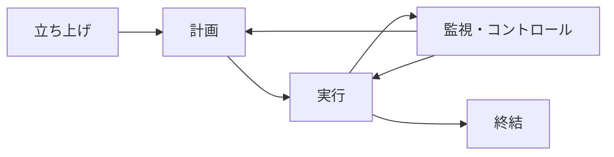
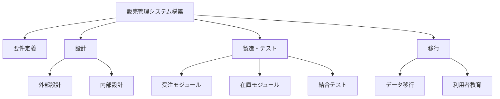
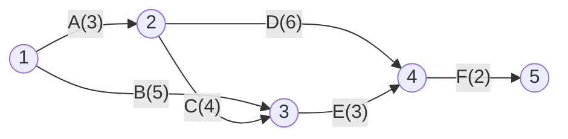
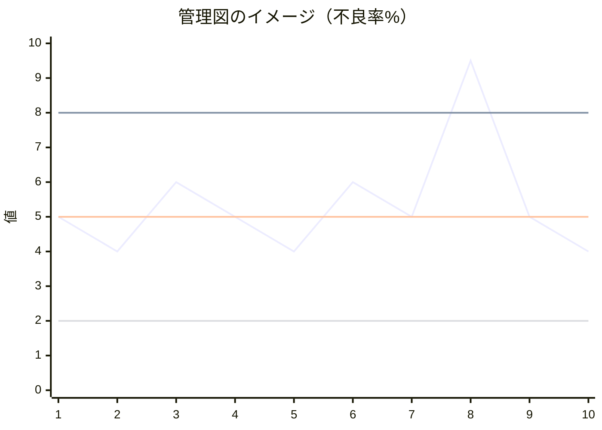
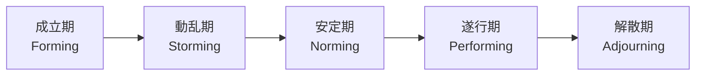
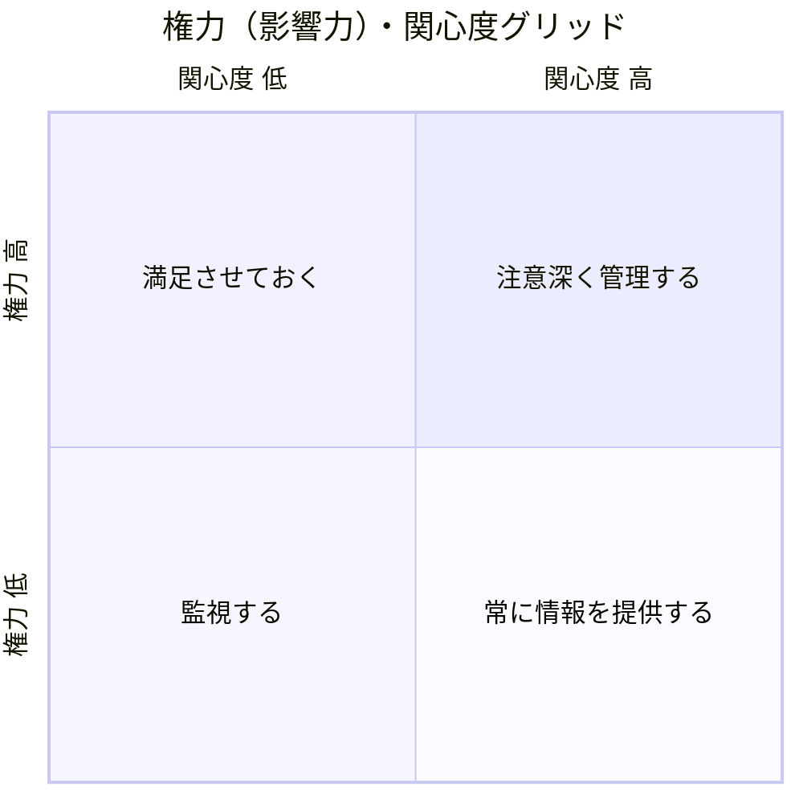
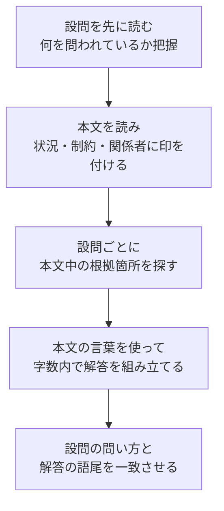
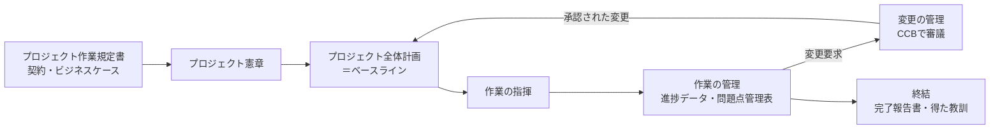

# プロジェクトマネジメント

> **重要度：★★★**（科目A（旧午前）で毎回3〜4問、科目B（旧午後）でも「プロジェクトマネジメント」が選択問題として毎回1問出題）
> 科目Aでは **アローダイアグラムのクリティカルパス**、**EVM（アーンドバリューマネジメント）**、**見積り手法**、**リスク対応戦略** が定番です。
> 科目Bでは長い事例文から「なぜその対応をしたのか」「どんなリスクがあるか」を本文の根拠に基づいて記述させる問題と、日数・工数の計算問題が組み合わさって出ます。
> この章では、PMBOK（ピンボック）の枠組み → スケジュール → 見積り → コスト（EVM） → リスク・品質・ステークホルダー・調達 → 科目Bの解き方 の順に学びます。

## 目次

- [1. プロジェクトマネジメントの全体像](#1-プロジェクトマネジメントの全体像)
- [2. スコープとWBS](#2-スコープとwbs)
- [3. スケジュールマネジメント](#3-スケジュールマネジメント)
- [4. スケジュール短縮（クラッシング・ファストトラッキング）](#4-スケジュール短縮クラッシングファストトラッキング)
- [5. 見積り手法](#5-見積り手法)
- [6. コストマネジメントとEVM](#6-コストマネジメントとevm)
- [7. リスクマネジメント](#7-リスクマネジメント)
- [8. 品質マネジメント](#8-品質マネジメント)
- [9. 資源・コミュニケーション・ステークホルダー](#9-資源コミュニケーションステークホルダー)
- [10. 調達マネジメントと契約形態](#10-調達マネジメントと契約形態)
- [11. 科目B「プロジェクトマネジメント」の解き方](#11-科目bプロジェクトマネジメントの解き方)
- [12. JIS Q 21500 のプロセスとシラバス追加用語](#12-jis-q-21500-のプロセスとシラバス追加用語)
- [確認問題](#確認問題)
- [📋 シラバス用語チェックリスト](#-シラバス用語チェックリスト)
- [参考](#参考)

## 1. プロジェクトマネジメントの全体像

### 1.1 プロジェクトとは

- **プロジェクト**とは、**独自の**プロダクト・サービス・所産を創造するために実施する **有期性のある（始まりと終わりがある）** 業務です。
- 理由：毎日同じことを繰り返す「定常業務（オペレーション）」と違い、プロジェクトは一度きりで不確実性が高いため、計画と管理の方法論が必要になります。
- 例：新しい販売管理システムの構築は「プロジェクト」、完成したシステムの日々の運用は「定常業務」です。
- **段階的詳細化**：最初から全部を詳細に決めることはできないため、情報が増えるにつれて計画を少しずつ詳しくしていく考え方です。
- **プロジェクトマネージャ（PM）**：プロジェクトの目標達成に責任を負う人。**PMO（Project Management Office：プロジェクトマネジメントオフィス）** は、組織内の複数プロジェクトを横断的に支援・標準化する部門です。

### 1.2 PMBOKの版の違い（第6版と第7版）

**PMBOK（Project Management Body of Knowledge：プロジェクトマネジメント知識体系）** は米国PMI（Project Management Institute）が発行するガイドです。
- 結論：**第6版は「プロセス（やり方）」中心、第7版は「原理・原則（考え方）」と「成果」中心** に大きく変わりました。
- 理由：アジャイル開発の普及などで「決められた手順どおりに進める」だけでは価値を届けられない場面が増えたためです。
- 試験対策：科目Aでは **第6版の知識エリア** を前提にした問題も、**第7版の原理・原則／パフォーマンス領域** を問う問題も出ます。両方の用語を押さえましょう。

| 項目 | 第6版（2017年） | 第7版（2021年） |
|---|---|---|
| 中心となる考え方 | プロセス・ベース（入力→ツールと技法→出力） | 原理・原則ベース（価値の実現） |
| 構成要素 | **5つのプロセス群**、**10の知識エリア**、49のプロセス | **12の原理・原則**、**8つのパフォーマンス領域** |
| 開発手法 | 主に予測型（ウォーターフォール） | 予測型・適応型（アジャイル）・ハイブリッドを包含 |
| テーラリング | 言及あり | **重視**（プロジェクトに合わせて手法を取捨選択する） |

#### 第6版：5つのプロセス群と10の知識エリア



| 知識エリア | 主な内容 |
|---|---|
| 統合マネジメント | プロジェクト憲章、統合変更管理、全体の調整 |
| スコープ・マネジメント | 要求事項の収集、スコープ定義、**WBS** 作成 |
| スケジュール・マネジメント | アクティビティ定義、順序設定、**クリティカルパス** |
| コスト・マネジメント | 見積り、予算設定、**EVM** |
| 品質マネジメント | 品質計画、品質保証、品質コントロール |
| 資源マネジメント | チーム編成、**RACIチャート**、物的資源 |
| コミュニケーション・マネジメント | 情報伝達の計画と実施 |
| リスク・マネジメント | 特定、定性・定量分析、**対応策** |
| 調達マネジメント | 外部委託、**契約形態** |
| ステークホルダー・マネジメント | 利害関係者の特定とエンゲージメント |

> 💡 覚え方：「**統・スコ・スケ・コ・品・資・コミュ・リ・調・ステ**」。第5版までの「人的資源」が第6版で「資源」に、第6版で「タイム」が「スケジュール」に名称変更されています。

#### 第7版：12の原理・原則

| No. | 原理・原則（要旨） |
|---|---|
| 1 | 勤勉で、敬意を払い、面倒見の良い**スチュワード**であること |
| 2 | 協働的なプロジェクト・**チーム**環境を構築すること |
| 3 | **ステークホルダー**と効果的に関わること |
| 4 | **価値**に焦点を当てること |
| 5 | **システムの相互作用**を認識し、評価し、対応すること |
| 6 | **リーダーシップ**を示すこと |
| 7 | 状況に基づいて**テーラリング**すること |
| 8 | プロセスと成果物に**品質**を組み込むこと |
| 9 | **複雑さ**に対処すること |
| 10 | **リスク**対応を最適化すること |
| 11 | **適応力と回復力**を持つこと |
| 12 | 想定した将来の状態を達成するために**変革**できるようにすること |

#### 第7版：8つのパフォーマンス領域と第6版知識エリアの対応

**パフォーマンス領域**とは、成果を効果的に生み出すために重要な、相互に関連する活動のまとまりです。第6版の知識エリアと1対1ではありませんが、おおよそ次のように対応します。

| 第7版 パフォーマンス領域 | 主に関連する第6版 知識エリア | ポイント |
|---|---|---|
| ステークホルダー | ステークホルダー、コミュニケーション | 関係者を特定し、関与（エンゲージメント）を高める |
| チーム | 資源 | リーダーシップ、チームの文化と育成 |
| 開発アプローチとライフサイクル | （統合、スコープ） | 予測型／適応型／ハイブリッドの選択 |
| 計画 | 統合、スコープ、スケジュール、コスト、資源、調達、コミュニケーション | 見積り、スケジュール、予算 |
| プロジェクト作業 | 統合、資源、調達、コミュニケーション | 作業プロセス、調達、学習 |
| デリバリー | スコープ、品質 | 要求事項・スコープ・品質を満たして価値を届ける |
| 測定 | 統合、スケジュール、コスト、品質 | **EVM**、KPI、ダッシュボード |
| 不確かさ | リスク | リスク、曖昧さ、複雑さ、変動性への対処 |

> ⚠️ ひっかけ注意：第7版では「知識エリア」「プロセス群」という言葉は使われません。「パフォーマンス領域」が知識エリアの後継というわけでもない点に注意しましょう（特に「不確かさ」は単なるリスクより広い概念です）。

> 📝 補足：PMIは2025年11月に **PMBOKガイド第8版** を発行しました（原理・原則を6つ、パフォーマンス領域を7つに整理し、プロセスのガイダンスを再び取り入れた構成とされています）。ただし応用情報のシラバスVer.7.2や過去問で直接問われてきたのは第6版・第7版の用語なので、まずは本章の内容を確実に押さえましょう。

### 1.3 JIS Q 21500（ISO 21500）

- **JIS Q 21500** は「プロジェクトマネジメントの手引」の日本産業規格で、PMBOK第5版とほぼ同じ構成（**5つのプロセス群 × 10の対象群**、39プロセス）です。
- 対象群は、統合・ステークホルダ・スコープ・資源・時間・コスト・リスク・品質・調達・コミュニケーションの10個です。
- 試験では「JIS Q 21500 のプロセス群は 立ち上げ・計画・実行・管理・終結」の **「管理」** という呼び方（PMBOKでは「監視・コントロール」）が問われることがあります。

## 2. スコープとWBS

### 2.1 スコープ

- **スコープ**とは、プロジェクトで「作るもの（プロダクト・スコープ）」と「行う作業（プロジェクト・スコープ）」の範囲です。
- **スコープ・クリープ**：正式な変更管理を経ずに、少しずつ範囲が広がってしまう現象。コスト超過・遅延の典型的な原因です。
- 対策：スコープ記述書で「含むもの・含まないもの」を明記し、変更は **統合変更管理（変更管理委員会：CCB）** を通して承認します。

### 2.2 WBS（Work Breakdown Structure：作業分解構成図）

- 結論：**WBSは、成果物と作業を階層的に分解した図**です。最下位の要素を **ワークパッケージ** と呼び、見積り・担当割当て・進捗管理の単位になります。
- 理由：大きすぎる作業は見積りも進捗把握もできないため、管理できる大きさまで分解します。
- **100%ルール**：下位要素の合計は上位要素の作業の100%と一致しなければならない（漏れも重複もない）。
- **WBS辞書**：各要素の作業内容・責任者・完了基準などを記述した補足文書。



| 用語 | 意味 |
|---|---|
| ワークパッケージ | WBSの最下位要素。コストと期間を見積もれる単位 |
| アクティビティ | ワークパッケージをさらにスケジュール用に分けた作業 |
| コントロール・アカウント | スコープ・コスト・スケジュールを統合管理する管理点（ワークパッケージの上位） |
| スコープ・ベースライン | 承認済みの「スコープ記述書＋WBS＋WBS辞書」 |

> ⚠️ ひっかけ注意：WBSは **時間順の工程表ではありません**。順序や日程を表すのはアローダイアグラムやガントチャートです。

## 3. スケジュールマネジメント

### 3.1 図の種類

| 図 | 特徴 |
|---|---|
| **ガントチャート** | 横軸に時間、縦に作業を並べ、棒で期間を表す。進捗が見やすいが**作業間の依存関係は分かりにくい** |
| **アローダイアグラム（ADM）** | **矢印＝作業**、丸（結合点）＝作業の開始・終了時点。依存関係を表すために **ダミー作業（点線、所要0）** を使う |
| **PDM（Precedence Diagramming Method：プレシデンス・ダイアグラム法）** | **四角（ノード）＝作業**、矢印＝依存関係。4種類の依存関係とリード・ラグを表せる |
| **マイルストーンチャート** | 重要な節目（マイルストーン）だけを示す。経営層への報告向き |

#### PDMの4種類の依存関係

| 種類 | 意味 | 例 |
|---|---|---|
| **FS（Finish-to-Start）** | 先行が終わったら後続を開始（最も一般的） | 設計が終わったら製造開始 |
| **SS（Start-to-Start）** | 先行が始まったら後続も開始できる | 書類作成開始と同時に校正開始 |
| **FF（Finish-to-Finish）** | 先行が終わったら後続も終われる | テスト完了と同時にテスト報告書完了 |
| **SF（Start-to-Finish）** | 先行が始まったら後続を終われる（まれ） | 新システム稼働開始で旧システム運用終了 |

- **リード**：後続作業を前倒しで開始できる時間（例：FS−2日＝先行終了の2日前に後続開始）。
- **ラグ**：後続作業の開始を遅らせる待ち時間（例：FS＋3日＝コンクリートの乾燥待ち）。

### 3.2 アローダイアグラムの計算（★★★）

#### 用語と公式

| 用語 | 意味 | 求め方 |
|---|---|---|
| **最早結合点時刻（ES）** | その結合点から出る作業を最も早く始められる時刻 | 始点から **前向き** に計算。入ってくる矢印が複数あれば **最大値** |
| **最遅結合点時刻（LS）** | 全体の完了を遅らせずに済む、その結合点の最も遅い時刻 | 終点から **後ろ向き** に計算。出ていく矢印が複数あれば **最小値** |
| **クリティカルパス** | 始点から終点までで **所要日数が最長の経路**。この上の作業が1日遅れると全体が1日遅れる | 最早＝最遅となる結合点を結ぶ経路（余裕0） |
| **全余裕（トータルフロート）** | 全体の完了日を遅らせずに、その作業が遅れてよい日数 | `後の結合点の最遅 − 前の結合点の最早 − 所要日数` |
| **自由余裕（フリーフロート）** | 後続作業の最早開始を遅らせずに、その作業が遅れてよい日数 | `後の結合点の最早 − 前の結合点の最早 − 所要日数` |

#### 例題

次の作業からなるプロジェクトがあります。

| 作業 | 所要日数 | 先行作業 |
|---|---|---|
| A | 3 | なし |
| B | 5 | なし |
| C | 4 | A |
| D | 6 | A |
| E | 3 | B, C |
| F | 2 | D, E |

これをアローダイアグラムにすると次のようになります（丸数字は結合点番号）。



**手順1：最早結合点時刻を前向きに計算する（複数入力は最大値）**

```
結合点1: 0
結合点2: 0 + A(3) = 3
結合点3: max( 結合点1 + B, 結合点2 + C ) = max( 0+5, 3+4 ) = max(5, 7) = 7
結合点4: max( 結合点2 + D, 結合点3 + E ) = max( 3+6, 7+3 ) = max(9, 10) = 10
結合点5: 10 + F(2) = 12   → プロジェクト全体の所要日数は 12日
```

**手順2：最遅結合点時刻を後ろ向きに計算する（複数出力は最小値）**

```
結合点5: 12（最早と同じ値から始める）
結合点4: 12 − F(2) = 10
結合点3: 10 − E(3) = 7
結合点2: min( 結合点3 − C, 結合点4 − D ) = min( 7−4, 10−6 ) = min(3, 4) = 3
結合点1: min( 結合点2 − A, 結合点3 − B ) = min( 3−3, 7−5 ) = min(0, 2) = 0
```

| 結合点 | 最早 | 最遅 | 余裕 |
|---|---|---|---|
| 1 | 0 | 0 | 0 |
| 2 | 3 | 3 | 0 |
| 3 | 7 | 7 | 0 |
| 4 | 10 | 10 | 0 |
| 5 | 12 | 12 | 0 |

**手順3：クリティカルパスを求める**

最早＝最遅の結合点をつなぎ、さらに「前の最早＋所要日数＝後の最早」となる作業をたどります。

```
A → C → E → F ： 3 + 4 + 3 + 2 = 12日（最長）  ← クリティカルパス
A → D → F     ： 3 + 6 + 2     = 11日
B → E → F     ： 5 + 3 + 2     = 10日
```

> ⚠️ ひっかけ注意：結合点はすべて余裕0ですが、作業D（2→4）は `3 + 6 = 9 ≠ 10` なのでクリティカルパス上にはありません。**結合点だけでなく作業の所要日数も確認** しましょう。

**手順4：各作業の余裕日数**

```
全余裕 = 後の結合点の最遅 − 前の結合点の最早 − 所要日数
  B: 7  − 0 − 5 = 2日
  D: 10 − 3 − 6 = 1日
  A, C, E, F: 0日（クリティカルパス上）

自由余裕 = 後の結合点の最早 − 前の結合点の最早 − 所要日数
  B: 7  − 0 − 5 = 2日
  D: 10 − 3 − 6 = 1日
```

**検算**：B が2日遅れて7日目に終わっても、E は C の終了（7日目）を待つので開始は7日目のまま。B が3日遅れると E の開始が8日目になり全体が13日になる → 全余裕2日で正しい。

#### ダミー作業

- **ダミー作業** は所要時間0の点線矢印で、**依存関係だけ** を表します。
- 例：「作業Eは B と C の両方が終わってから」「作業Gは C だけが終わればよい」という関係は、矢印1本では表せないため、C の終点からダミーを引いて区別します。
- 計算ではダミーも **所要0の作業** として扱い、最早は最大値、最遅は最小値のルールをそのまま適用します。

### 3.3 その他のスケジュール手法

| 手法 | 内容 |
|---|---|
| **PERT（Program Evaluation and Review Technique）** | 作業時間を三点見積り（楽観・最可能・悲観）で求め、確率的にスケジュールを評価する |
| **CPM（Critical Path Method：クリティカルパス法）** | 最長経路を求め、重点管理する。所要時間とコストのトレードオフ（クラッシング）も扱う |
| **クリティカルチェーン法** | 各作業の安全余裕を削り、**プロジェクトバッファ・合流バッファ** としてまとめて管理する。資源の競合も考慮 |
| **資源平準化** | 特定の要員に作業が集中しないよう作業時期をずらす。**クリティカルパスが延びることがある** |
| **ローリングウェーブ計画法** | 近い将来は詳細に、遠い将来は大まかに計画する段階的詳細化の手法 |

## 4. スケジュール短縮（クラッシング・ファストトラッキング）

### 4.1 2つの代表的手法

| 手法 | 内容 | トレードオフ | 例 |
|---|---|---|---|
| **クラッシング** | **資源（要員・費用）を追加** してクリティカルパス上の作業期間を短縮する | **コストが増える** | 要員追加、残業、外部委託 |
| **ファストトラッキング** | 本来順番に行う作業を **並行して（重ねて）** 実施する | **手戻りのリスクが増える** | 設計完了前に一部製造を開始 |

> 💡 覚え方：クラッシング＝「**お金で時間を買う**」、ファストトラッキング＝「**リスクで時間を買う**」。

> ⚠️ ひっかけ注意：**クリティカルパス以外の作業を短縮しても全体は短くなりません**。また、短縮するとクリティカルパスが別の経路に移る（複数になる）ことがあります。

### 4.2 クラッシングの計算例

- **費用勾配（コストスロープ）** ＝ 1日短縮あたりの追加費用。
- 公式：`費用勾配 = (特急費用 − 標準費用) ÷ (標準日数 − 特急日数)`
- 方針：**クリティカルパス上で費用勾配が最小の作業** から短縮します。

例題（3.2の例題を使用。全体12日を10日に短縮したい）

| 作業 | 標準日数 | 最大短縮可能日数 | 費用勾配（万円/日） |
|---|---|---|---|
| A | 3 | 1 | 20 |
| B | 5 | 0 | − |
| C | 4 | 2 | 15 |
| D | 6 | 1 | 25 |
| E | 3 | 1 | 30 |
| F | 2 | 0 | − |

```
【1日目の短縮】クリティカルパス A→C→E→F 上で費用勾配最小は C（15万円）
  C を4日→3日に短縮
  経路の長さ： A→C→E→F = 3+3+3+2 = 11日
               A→D→F   = 3+6+2   = 11日
               B→E→F   = 5+3+2   = 10日
  → クリティカルパスが2本（ACEF と ADF）になった

【2日目の短縮】2本を同時に1日縮める必要がある
  候補1: 両方に共通の A を短縮            → 20万円
  候補2: C（15万円）と D（25万円）を両方 → 40万円
  候補3: E（30万円）と D（25万円）を両方 → 55万円
  → 最安は A（20万円）
  経路の長さ： ACEF = 2+3+3+2 = 10日、ADF = 2+6+2 = 10日、BEF = 10日

追加費用の合計 = 15 + 20 = 35万円
```

## 5. 見積り手法

### 5.1 見積り手法の全体像

| 手法 | 内容 | 特徴 |
|---|---|---|
| **類推見積り** | 過去の類似プロジェクトの実績をもとに見積もる（トップダウン） | 早期に使える。精度は低め |
| **パラメトリック見積り** | 過去データから作った統計式（パラメータ）で算出 | COCOMOなど |
| **ボトムアップ見積り** | WBSのワークパッケージごとに見積もって積み上げる | 精度は高いが手間がかかる |
| **三点見積り** | 楽観値・最可能値・悲観値から期待値を求める | 不確実性を反映できる |
| **ファンクションポイント法（FP法）** | 機能の数と複雑さから規模を見積もる | **利用者から見た機能** に着目。言語に依存しない |
| **LOC法（Lines Of Code）／プログラムステップ法** | ソースコード行数で規模を見積もる | 言語・書き方に依存 |
| **標準タスク法** | WBSの作業ごとに標準工数を設定し積み上げる | |
| **デルファイ法** | 複数の専門家に匿名で繰り返し意見を聞き、収束させる | 権威者の影響を排除 |

### 5.2 ファンクションポイント法（★★）

- 結論：システムの **機能（ファンクション）を5種類に分類し、それぞれの複雑さで重み付けして合計** した値で規模を表します。
- 理由：プログラム言語や実装方法に左右されず、要件定義の段階から利用者視点で見積もれるためです。

| 機能区分 | 内容 | 重み（平均の場合） |
|---|---|---|
| **外部入力（EI）** | 外部からデータを入力し内部ファイルを更新する処理（登録画面など） | 4 |
| **外部出力（EO）** | 計算・加工したデータを外部へ出力（帳票など） | 5 |
| **外部照会（EQ）** | 入力をきっかけに加工せずデータを取り出して表示（検索画面など） | 4 |
| **内部論理ファイル（ILF）** | システム内部で維持・更新するデータ群（マスタファイルなど） | 10 |
| **外部インタフェースファイル（EIF）** | 他システムが維持し、参照だけするデータ群 | 7 |

**計算例**

```
公式：
  未調整FP = Σ（機能数 × 重み）
  調整係数 = 0.65 + 0.01 × （システム特性14項目の影響度の合計：0〜70）
  調整済みFP = 未調整FP × 調整係数

数値例（すべて「平均」の複雑さとする）：
  外部入力 4個 × 4  = 16
  外部出力 3個 × 5  = 15
  外部照会 2個 × 4  =  8
  内部論理ファイル 2個 × 10 = 20
  外部インタフェースファイル 1個 × 7 = 7
  未調整FP = 16 + 15 + 8 + 20 + 7 = 66

  影響度の合計が30の場合
  調整係数 = 0.65 + 0.01 × 30 = 0.95
  調整済みFP = 66 × 0.95 = 62.7
```

### 5.3 COCOMO（★）

- **COCOMO（COnstructive COst MOdel）** は、B.W.ベームが提唱した **パラメトリック見積り** モデルで、**ソースコード行数（KDSI：千行単位）** から工数と期間を算出します。
- 基本形：`工数（人月） = a × (KDSI)^b`、`開発期間（月） = c × (工数)^d`
- 係数は開発形態（組込み型・半組込み型・組織型）で異なり、さらに **工数乗数（コストドライバ）** で補正する中間COCOMOもあります。
- 後継の **COCOMO II** は、FPなどを入力にでき、スパイラル型など現代的な開発にも対応します。

```
数値例（基本COCOMO・組織型：a = 2.4, b = 1.05, c = 2.5, d = 0.38）
  規模 32KDSI のとき
  工数 = 2.4 × 32^1.05 ≒ 2.4 × 38.05 ≒ 91.3 人月
  期間 = 2.5 × 91.3^0.38 ≒ 2.5 × 5.56 ≒ 13.9 か月
  平均要員 = 91.3 ÷ 13.9 ≒ 6.6 人
```

> 💡 覚え方：「**COCOMOは行数（LOC）から**」「**FP法は機能から**」。

### 5.4 三点見積り（★★）

- 楽観値（O）・最可能値（M）・悲観値（P）の3つを使います。
- **ベータ分布（PERT）** による期待値：`E = (O + 4M + P) ÷ 6`
- 標準偏差：`σ = (P − O) ÷ 6`
- **三角分布** の場合：`E = (O + M + P) ÷ 3`

```
数値例：O = 4日、M = 6日、P = 14日
  E = (4 + 4×6 + 14) ÷ 6 = (4 + 24 + 14) ÷ 6 = 42 ÷ 6 = 7日
  σ = (14 − 4) ÷ 6 = 10 ÷ 6 ≒ 1.67日
  → 7 ± 1.67日の範囲に約68%の確率で収まる（正規分布で近似した場合）
```

## 6. コストマネジメントとEVM

### 6.1 予算の構成

- **コスト・ベースライン**：承認された時間軸付きの予算。累積すると **Sカーブ** になります。
- **コンティンジェンシー予備（予備費）**：特定済みのリスク（既知の未知）に備える予算。コスト・ベースラインに **含む**。
- **マネジメント予備**：想定外の事象（未知の未知）に備える予算。コスト・ベースラインに **含まない**（使うにはマネジメントの承認が必要）。

### 6.2 EVM（Earned Value Management：アーンドバリューマネジメント）（★★★）

- 結論：**「計画（PV）」「出来高（EV）」「実コスト（AC）」の3つを同じ金額の単位で比べ、スケジュールとコストの状況を同時に評価** する手法です。
- 理由：「予算を半分使った」だけでは、作業が半分進んだのか分からないためです。出来高（EV）を導入することで、進捗とコストを切り分けて評価できます。

| 指標 | 正式名称 | 意味 |
|---|---|---|
| **PV** | Planned Value（計画価値） | 現時点までに **予定していた作業** の予算額 |
| **EV** | Earned Value（出来高、アーンドバリュー） | 現時点までに **完了した作業** の予算額 |
| **AC** | Actual Cost（実コスト） | 現時点までに **実際にかかった** 費用 |
| **BAC** | Budget At Completion（完成時総予算） | プロジェクト全体の予算 |

| 指標 | 公式 | 判断 |
|---|---|---|
| **SV**（スケジュール差異） | `SV = EV − PV` | **マイナスなら遅れ** |
| **CV**（コスト差異） | `CV = EV − AC` | **マイナスなら予算超過** |
| **SPI**（スケジュール効率指数） | `SPI = EV ÷ PV` | **1未満なら遅れ** |
| **CPI**（コスト効率指数） | `CPI = EV ÷ AC` | **1未満なら予算超過** |
| **EAC**（完成時総コスト見積り） | 典型的な場合 `EAC = BAC ÷ CPI` ／ 非典型的な場合 `EAC = AC + (BAC − EV)` | |
| **ETC**（残作業のコスト見積り） | `ETC = EAC − AC` | |
| **VAC**（完成時差異） | `VAC = BAC − EAC` | マイナスなら最終的に予算超過 |

> 💡 覚え方：**すべて EV が主役**。差異は「EV − ○○」、指数は「EV ÷ ○○」。S（スケジュール）は **P**V と、C（コスト）は **A**C と比べる。

#### 計算例

完成時総予算（BAC）1,000万円のプロジェクトで、4か月目末時点の状況が次のとおりです。

- PV（4か月目末までに予定していた作業の予算）＝ 400万円
- EV（4か月目末までに完了した作業の予算）＝ 320万円
- AC（4か月目末までに実際にかかった費用）＝ 360万円

```
SV  = EV − PV = 320 − 400 = −80万円   → スケジュール遅れ
CV  = EV − AC = 320 − 360 = −40万円   → 予算超過
SPI = EV ÷ PV = 320 ÷ 400 = 0.80      → 計画の80%のペースでしか進んでいない
CPI = EV ÷ AC = 320 ÷ 360 ≒ 0.889     → 1万円使って約0.89万円分の出来高

EAC（今後も現在のコスト効率が続く＝典型的な場合）
    = BAC ÷ CPI = 1,000 ÷ (320/360) = 1,000 × 360 ÷ 320 = 1,125万円
ETC = EAC − AC = 1,125 − 360 = 765万円
VAC = BAC − EAC = 1,000 − 1,125 = −125万円

EAC（今後は計画どおりのコスト効率に戻る＝非典型的な場合）
    = AC + (BAC − EV) = 360 + (1,000 − 320) = 1,040万円
```

**検算**：`EAC = BAC ÷ CPI` は `AC + (BAC − EV) ÷ CPI` と同じです。`360 + 680 × 360/320 = 360 + 765 = 1,125` で一致します。

> ⚠️ ひっかけ注意：PV と AC を直接比べても意味がありません（「予定より多く使った」が、進みすぎたせいか非効率のせいか区別できないため）。

## 7. リスクマネジメント

### 7.1 リスクマネジメントのプロセス


| プロセス | 主な技法 |
|---|---|
| リスクの特定 | ブレーンストーミング、チェックリスト、**SWOT分析**、デルファイ法、前提条件分析 |
| 定性的リスク分析 | **発生確率・影響度マトリックス**（優先順位付け） |
| 定量的リスク分析 | **期待金額価値（EMV）**、**デシジョンツリー**、**モンテカルロ・シミュレーション**、感度分析（トルネード図） |
| リスクの監視 | リスク登録簿の更新、リスク監査、予備の分析 |

- **リスク** とは、発生すればプロジェクト目標に影響を与える **不確実な事象** です。PMBOKでは **マイナスのリスク（脅威）だけでなく、プラスのリスク（好機）** も含みます。
- **期待金額価値（EMV）** ＝ `発生確率 × 影響額`。例：確率20%で500万円の損失 → `0.2 × (−500) = −100万円`。

### 7.2 リスク対応戦略（★★★）

| 脅威（マイナス）への戦略 | 内容 | 例 |
|---|---|---|
| **回避** | 計画を変えて **リスクそのものを取り除く** | 実績のない新技術の採用をやめる |
| **転嫁（移転）** | 影響と責任を **第三者に移す** | 保険加入、請負契約、保証 |
| **軽減** | **発生確率や影響度を下げる** | 事前のプロトタイプ作成、テスト追加、冗長化 |
| **受容** | 対策をとらず受け入れる（積極的受容＝予備費を確保／受動的受容＝何もしない） | 影響が小さいリスク |
| **エスカレーション** | プロジェクトの権限外なので **上位組織に委ねる**（第6版から追加） | 全社的な法規制対応 |

| 好機（プラス）への戦略 | 内容 | 例 |
|---|---|---|
| **活用** | 好機を **確実に実現** させる | 優秀な要員を割り当てて早期完了を確実にする |
| **共有** | 好機を実現できる **第三者と組む** | ジョイントベンチャー |
| **強化** | 好機の **発生確率や効果を高める** | 資源を追加して早期完了の可能性を上げる |
| **受容** | 特に行動しない | |
| **エスカレーション** | 上位組織に委ねる | |

> 💡 覚え方：脅威は「**か・て・け・じゅ**（回避・転嫁・軽減・受容）」、好機は「**かつ・きょう・きょう**（活用・共有・強化）」。

> ⚠️ ひっかけ注意：「保険をかける」は **転嫁**、「発生しても損害が小さくなるようにバックアップを取る」は **軽減** です。リスクの **原因そのものを除去する** のが回避です。

## 8. 品質マネジメント

### 8.1 品質の3プロセス

| プロセス | 内容 |
|---|---|
| 品質マネジメント計画 | 品質基準と達成方法を決める。**品質コスト（予防・評価・失敗コスト）** を考慮 |
| 品質のマネジメント（品質保証） | プロセスが適切に実施されているかを確認・改善する |
| 品質のコントロール | 成果物を検査・測定し、基準を満たすか確認する |

- **品質コスト**：適合コスト（**予防コスト**：教育・標準化、**評価コスト**：レビュー・テスト）と、不適合コスト（**内部失敗コスト**：手戻り、**外部失敗コスト**：納品後の障害対応・補償）。一般に予防に投資するほど総コストは下がります。

### 8.2 QC七つ道具（★★）

| 道具 | 用途 | ポイント |
|---|---|---|
| **パレート図** | 項目を件数の多い順に並べた棒グラフ＋累積比率の折れ線 | **重点的に対策すべき項目**（ABC分析）を見つける |
| **特性要因図（フィッシュボーン図）** | 結果（特性）と原因（要因）の関係を魚の骨状に整理 | 原因の洗い出し |
| **管理図** | 時系列データに中心線と **上方管理限界（UCL）・下方管理限界（LCL）** を引く | **工程が安定しているか** を判断 |
| **ヒストグラム** | データの分布（ばらつき）を柱状で表す | 分布の形、規格外れの把握 |
| **散布図** | 2つの変数の相関を点で表す | 相関関係の確認 |
| **チェックシート** | 項目ごとにデータを記録・集計する表 | データ収集 |
| **層別** | データを属性（担当者別、機械別など）で分ける | 原因の切り分け |

#### 管理図の読み方

- 点が管理限界線（UCL / LCL）の **外に出たら異常**。
- 管理限界内でも、**中心線の片側に連続して点が並ぶ（例：7点以上）**、**連続して上昇・下降する** などの「**くせ**」がある場合は異常の兆候と判断します。
- 管理限界は一般に **平均 ± 3σ** で設定します。



（8が UCL、5が中心線、2が LCL。8番目のデータ 9.5 は UCL を超えているので **異常** と判断します）

### 8.3 新QC七つ道具（★）

言語データ（数値でない情報）を整理するための道具です。
- **親和図法**（アイデアを似たもの同士でグループ化）、**連関図法**（絡み合う因果関係を矢印で表す）、**系統図法**（目的と手段を階層展開）、**マトリックス図法**（2要素の関係を行列で表す）、**PDPC法**（起こり得る事態を予測し対策の流れを図示）、**アローダイアグラム法**（作業順序と日程）、**マトリックスデータ解析法**（唯一数値データを扱う。主成分分析）の7つです。

### 8.4 ソフトウェア開発の品質指標

- **信頼度成長曲線（ゴンペルツ曲線、ロジスティック曲線）**：テスト時間と累積バグ検出数の関係。**S字** を描き、収束してきたらテスト終了の目安になります。
- **バグ密度**（1kステップ当たり、または1FP当たりのバグ件数）や **レビュー密度**（1kステップ当たりのレビュー時間）を過去の基準値と比べて、品質の良し悪しを判断します。
  - バグが **少なすぎる** 場合も「テスト不足ではないか」と疑うのがポイントです（科目Bで頻出）。

## 9. 資源・コミュニケーション・ステークホルダー

### 9.1 責任分担マトリックス（RACIチャート）

| 記号 | 意味 |
|---|---|
| **R**（Responsible：実行責任） | 実際に作業を行う |
| **A**（Accountable：説明責任） | 最終的な承認・説明責任を負う（**1作業につき1人**） |
| **C**（Consulted：相談対象） | 作業前に意見を求められる |
| **I**（Informed：報告対象） | 結果を知らされる |

### 9.2 チームの成長段階（タックマンモデル）



- 動乱期に **意見の衝突（コンフリクト）** が生じます。コンフリクトの解決法の中で最も望ましいのは **協調／問題解決（Win-Win）** です。

### 9.3 コミュニケーション

- **コミュニケーション・チャネル数** ＝ `n(n − 1) ÷ 2`（n は人数）

```
数値例：6人のチームに4人追加して10人になった場合
  追加前： 6 × 5 ÷ 2 = 15
  追加後：10 × 9 ÷ 2 = 45
  増加数：45 − 15 = 30チャネル
```

- コミュニケーションの方法：**双方向型**（会議、電話）、**プッシュ型**（メール、報告書の送付）、**プル型**（Webポータル、共有フォルダに置いて各自が見る）。
- **ブルックスの法則**：遅れているプロジェクトに要員を追加すると、教育やコミュニケーションの負荷でさらに遅れる。

### 9.4 ステークホルダー・マネジメント

- **ステークホルダー（利害関係者）**：プロジェクトに影響を与える、または影響を受ける個人・組織。顧客、スポンサー、利用者、経営層、協力会社など。
- **ステークホルダー登録簿** に、影響力・関心度・期待などを記録します。



- **エンゲージメント・レベル**（関与度）は、**不認識 → 抵抗 → 中立 → 支援 → 指導** の5段階で表します（指導＝積極的に関与し成功を確実にしようとしている状態）。
- **ステークホルダー関与度評価マトリックス** で、各人の「現在（C）」と「望ましい（D）」レベルを比較し、ギャップを埋める施策を考えます。

## 10. 調達マネジメントと契約形態

### 10.1 調達の流れ


| 用語 | 意味 |
|---|---|
| **RFI（Request For Information：情報提供依頼書）** | 候補ベンダに技術動向や製品情報の提供を依頼 |
| **RFP（Request For Proposal：提案依頼書）** | 要件を示し、具体的な提案を依頼 |
| **RFQ（Request For Quotation：見積依頼書）** | 価格見積りを依頼 |
| **SOW（Statement Of Work：作業範囲記述書）** | 調達する作業の内容・範囲を記述した文書 |
| **NDA（Non-Disclosure Agreement：秘密保持契約）** | 提案前の情報開示時に結ぶ |
| **内外製分析（Make or Buy分析）** | 自社で作るか外部から調達するかを判断 |

### 10.2 価格による契約形態

| 契約形態 | 内容 | コスト超過リスクを負う側 |
|---|---|---|
| **定額契約（FFP：完全定額）** | 金額をあらかじめ固定 | **受注者（売り手）** |
| **インセンティブ・フィー付き定額（FPIF）** | 定額＋目標達成時の報奨 | 主に受注者 |
| **実費償還契約（コスト・プラス・フィー）** | 実際のコスト＋報酬（定額 CPFF／インセンティブ CPIF／アワード CPAF） | **発注者（買い手）** |
| **タイム・アンド・マテリアル（T&M）** | 時間単価×作業時間＋材料費 | 発注者寄り（範囲が曖昧なとき） |

### 10.3 法的な契約形態（★★★）

| 項目 | **請負契約** | **準委任契約** | **労働者派遣契約** |
|---|---|---|---|
| 目的 | **仕事の完成** | **事務（業務）の処理** | 労働力の提供 |
| 受注側の責任 | 完成責任・**契約不適合責任** | **善管注意義務**（善良な管理者の注意義務） | − |
| 指揮命令権 | **受注者** | **受注者** | **派遣先（発注者）** |
| 典型的な工程 | 設計〜テスト（要件が確定した後） | 要件定義、運用支援、システム方式設計の支援 | − |

- 2020年の民法改正で、準委任契約に **成果完成型**（成果物の引渡しに対して報酬を払う）と **履行割合型**（作業量に応じて払う）が整理されました。また、請負の「瑕疵担保責任」は **契約不適合責任** に改められ、買主（発注者）は追完請求・代金減額請求・損害賠償請求・契約解除ができます。
- ⚠️ ひっかけ注意：**請負契約や準委任契約なのに発注者が受注者の要員に直接指示する** と **偽装請負** になり違法です（指揮命令できるのは派遣だけ）。
- **二重派遣**（派遣された労働者をさらに別の会社へ派遣すること）は禁止されています。
- 関連法規：シラバスVer.7.2では「下請法」に代わり「**中小受託取引適正化法**」（下請法の改正後の名称）が扱われています。

> 💡 覚え方：「**請負は完成、準委任は努力、派遣は指示**」。

## 11. 科目B「プロジェクトマネジメント」の解き方

### 11.1 出題パターン

出題は大きく、①PMの行動の **目的・理由** を問う記述、②想定される **リスクと対策** を問う記述、③用語や数値の **穴埋め**、④工数・要員・日数・EVMなどの **計算**、の4パターンの組み合わせです。

### 11.2 解き方の手順



### 11.3 得点のコツ

1. **本文の言葉を使う**：自分の経験や一般論ではなく、「本文に書かれている事実」を根拠に書きます。採点は本文の記述に基づいて行われます。
2. **語尾を設問に合わせる**：「目的は？」→「〜するため」、「理由は？」→「〜だから」、「リスクは？」→「〜するおそれ」。
3. **PMの立場で考える**：PMは「プロジェクト目標（QCD：品質・コスト・納期）の達成」と「ステークホルダーの合意」を重視します。答えに迷ったら「どの目標が脅かされるか」「誰と合意すべきか」を考えます。
4. **伏線を探す**：本文中で一見関係なさそうな記述（「A社は過去に〇〇でトラブルになった」「Bさんは業務に詳しいが△△の経験がない」など）は、ほぼ必ずどこかの設問の根拠になっています。
5. **定番の着眼点**：
   - 要員追加 → 立ち上げ期間、教育負荷、コミュニケーション増（ブルックスの法則）
   - 並行作業（ファストトラッキング）→ 手戻りリスク
   - 品質指標が基準値より **良すぎる** → テスト不足・レビュー不足の疑い
   - 契約形態 → 指揮命令関係（偽装請負になっていないか）、成果物の責任
   - 変更要求 → 影響範囲の分析、変更管理手続、スポンサーの承認
6. **計算問題は確実に**：単位（人日・人月）と条件（稼働率、生産性）を読み落とさない。

## 12. JIS Q 21500 のプロセスとシラバス追加用語

シラバスVer.7.2 は、プロジェクトマネジメントを **JIS Q 21500（プロジェクトマネジメントの手引）** の用語で整理しています。PMBOK の用語と名前が少し違うものがあるので、この節で対応づけておきます。

### 12.1 プロジェクトを取り巻く概念（ポートフォリオ・プログラム・ガバナンス）

| 用語 | 意味 | 例 |
|---|---|---|
| **プロジェクトの環境** | プロジェクトに影響する組織内外の要因（組織の文化・方針、法規制、市場、技術など） | 社内の標準プロセス、業界規制 |
| **プロジェクトポートフォリオマネジメント** | 組織の戦略目標を達成するために、**複数のプロジェクト・プログラムを選択し優先順位を付け、資源を配分**する活動 | 今年度どのIT投資案件に予算を付けるか決める |
| **プログラム** | 互いに関連する複数のプロジェクトを **まとめて管理** することで、個別に管理するより大きな便益を得るためのまとまり | 「全社DX」の下の基幹刷新・EC構築・データ基盤構築 |
| **プログラムマネジメント** | プログラムの目標を達成するために、構成プロジェクト間の依存関係や資源を調整する活動 | |
| **プロジェクトガバナンス** | プロジェクトを指揮・管理するための枠組み（意思決定の権限、承認ルール、報告ルートなど） | ステアリングコミッティによるフェーズ移行判定 |
| **プロジェクトライフサイクル** | 開始から終了までのフェーズの並び（例：立上げ→要件定義→設計→開発→移行→終結） | 予測型・適応型・ハイブリッド型 |
| **プロジェクトの制約** | プロジェクトが守らなければならない制限。スコープ・品質・スケジュール・予算・資源・リスクなど | 「QCD」は代表的な制約 |
| **テーラリング** | 標準のプロセスや手法を、プロジェクトの特性（規模・リスク・開発手法）に合わせて **取捨選択・調整** すること | 小規模案件では文書を簡略化 |

> 💡 覚え方：**ポートフォリオ ⊃ プログラム ⊃ プロジェクト**。ポートフォリオは「**正しいことを選ぶ**」、プロジェクトは「**選んだことを正しく行う**」。

### 12.2 3種類のプロセス・5つのプロセス群・10の対象群

- JIS Q 21500 では、プロジェクトで使うプロセスを次の **3種類** に分けます。

| プロセスの種類 | 内容 | 例 |
|---|---|---|
| **プロジェクトマネジメントのプロセス** | プロジェクト全体を計画・管理するためのプロセス（本規格の対象） | スケジュールの作成、リスクの評価 |
| **引渡しのプロセス** | 成果物（製品・サービス）そのものを作り、引き渡すためのプロセス | 設計、プログラミング、テスト |
| **支援のプロセス** | 上の2つを支援するプロセス | 構成管理、経理、人事、調達事務 |

- プロジェクトマネジメントのプロセス（**39個**）は、**5つのプロセス群 × 10の対象群** のマトリックスで整理されます。

| 対象群 ＼ プロセス群 | 立ち上げ | 計画 | 実行 | 管理 | 終結 |
|---|---|---|---|---|---|
| **統合** | プロジェクト憲章の作成 | プロジェクト全体計画の作成 | プロジェクト作業の指揮 | プロジェクト作業の管理、変更の管理 | プロジェクトフェーズ又はプロジェクトの終結、得た教訓の収集 |
| **ステークホルダ** | ステークホルダの特定 | | ステークホルダのマネジメント | | |
| **スコープ** | | スコープの定義、WBSの作成、活動の定義 | | スコープの管理 | |
| **資源** | プロジェクトチームの編成 | 資源の見積り、プロジェクト組織の定義 | プロジェクトチームの開発 | 資源の管理、プロジェクトチームのマネジメント | |
| **時間** | | 活動の順序付け、活動期間の見積り、スケジュールの作成 | | スケジュールの管理 | |
| **コスト** | | コストの見積り、予算の作成 | | コストの管理 | |
| **リスク** | | リスクの特定、リスクの評価 | リスクへの対応 | リスクの管理 | |
| **品質** | | 品質の計画 | 品質保証の遂行 | 品質管理の遂行 | |
| **調達** | | 調達の計画 | 供給者の選定 | 調達の運営管理 | |
| **コミュニケーション** | | コミュニケーションの計画 | 情報の配布 | コミュニケーションのマネジメント | |

> ⚠️ ひっかけ注意：JIS Q 21500 では **「管理のプロセス群」**（PMBOKでは監視・コントロール）、**「時間の対象群」**（PMBOK第6版ではスケジュール）と呼びます。また、**ステークホルダの特定とプロジェクトチームの編成は「立ち上げ」**、**リスクへの対応は「実行」** に入る点も問われます。

### 12.3 プロジェクトの体制と自己管理

| 役割 | 内容 |
|---|---|
| **プロジェクトスポンサー** | プロジェクトを承認し、資金・資源を提供し、**上位の意思決定**（重大な変更の承認、障害の除去）を行う人 |
| **プロジェクトマネージャ** | プロジェクトの目標達成に責任を負い、日々のマネジメントを行う人 |
| **プロジェクトマネジメントチーム** | プロジェクトマネージャを補佐してマネジメント業務（計画・進捗管理・品質管理など）を担うメンバー |
| **プロジェクトチーム** | プロジェクトマネジメントチームを含め、プロジェクトの作業を実際に行うメンバー全体 |
| **PMO** | 組織内のプロジェクトを横断的に支援する部門（標準化、教育、監視、要員調整） |
| **ステアリングコミッティ（運営委員会）** | スポンサーや関係部門長で構成される上位の意思決定機関 |

- **自己管理**：チームの一員として、自分の担当作業について **作業計画立案 → 作業量見積り → 進捗管理・品質管理・コスト管理・リスク管理 → 変更管理** を行い、**問題発見 → 問題報告 → 対策立案** をし、結果を **文書化** して報告・連絡・相談（**コミュニケーション**）することが求められます。
- 例：担当モジュールの遅れに気づいたら、自分で抱え込まず、事実（どれだけ遅れているか）・原因・対策案をそろえて早めにPMへ報告します。

### 12.4 統合の対象群（憲章・全体計画・変更管理・終結）



| 用語 | 意味 |
|---|---|
| **プロジェクト作業規定書** | 発注者（スポンサー）が作る「何を作ってほしいか」の記述。憲章作成のインプット |
| **ビジネスケース** | プロジェクトを行う **経営上の理由**（投資対効果、解決する課題）をまとめた文書 |
| **契約** | 外部の顧客から受注する場合のインプット |
| **プロジェクト憲章** | プロジェクトを **正式に認可** し、目的・主要な成果物・PMとその権限・概算予算などを示す文書。スポンサーが発行 |
| **プロジェクト全体計画** | プロジェクトの進め方を定めた計画（JIS Q 21500 では「プロジェクト計画」と「プロジェクトマネジメント計画」の両方を含む） |
| **ベースライン** | 承認された計画（スコープ・スケジュール・コスト）。**実績と比較する基準** で、変更には正式な承認が必要 |
| **変更要求** | スコープ・スケジュール・コストなどの変更の申請 |
| **CCB（Change Control Board：変更管理委員会）** | 変更要求を審議し、承認・却下する会議体 |
| **承認された変更** | CCBなどで承認され、計画に反映される変更 |
| **変更登録簿** | 変更要求とその審議結果・状況を記録する一覧 |
| **是正処置** | 計画からのずれ（実績の差異）を **計画どおりに戻すため** の処置 |
| **問題点管理表** | 発生した問題（課題）と担当者・期限・対応状況を管理する一覧 |
| **プロジェクト評価／プロジェクト評価指標** | 目標（QCD、顧客満足など）の達成度を評価すること、その指標 |
| **プロジェクト完了報告書／プロジェクト又はフェーズの終結報告書** | プロジェクトまたはフェーズの成果と実績をまとめた報告書 |
| **得た教訓文書** | うまくいったこと・失敗したことを記録し、**将来のプロジェクトに活かす** 文書 |

> ⚠️ ひっかけ注意：**是正処置**＝起きたずれを直す、**予防処置**＝将来の問題を未然に防ぐ。品質の対象群でも同じ使い分けです。

### 12.5 ステークホルダ・スコープ・資源の追加用語

- **ステークホルダ分析**：ステークホルダを特定し、関心・影響力・期待を分析して、関与の方法を決めること（[9.4](#94-ステークホルダーマネジメント)の権力・関心度グリッドなど）。結果は **ステークホルダ登録簿** にまとめます。
- **スコープ規定書**：スコープ（作業及び成果物）、受入れ基準、除外事項、前提条件・制約条件を記述した文書（PMBOKのスコープ記述書）。
- **要素分解**：成果物や作業を管理可能な大きさまで階層的に分けていく技法。WBS作成の中心技法です。
- **活動リスト**：WBSのワークパッケージを、スケジュールを立てられる「活動」に分けて一覧にしたもの。
- **進捗データ**：作業の実績（開始日・完了日・進捗率・実コストなど）。管理のプロセス群のインプットになります。
- **資源要求事項／資源計画／プロジェクトの組織図／役割規定書**：必要な要員・設備の種類と量、その調達・配置計画、組織図、各役割の責任と権限を記述したもの。

| ブレークダウン構造 | 何を分解するか |
|---|---|
| **WBS** | 作業・成果物 |
| **OBS（Organizational Breakdown Structure：組織ブレークダウンストラクチャ）** | プロジェクト組織（部門・チーム）。WBSと組み合わせて担当を決める |
| **RBS（Resource Breakdown Structure：資源ブレークダウンストラクチャ）** | 資源（要員・機器・材料）をカテゴリ別に分解 |
| **RBS（Risk Breakdown Structure：リスクブレークダウンストラクチャ）** | リスクの発生源（技術・外部・組織・PM）をカテゴリ別に分解。リスク特定の漏れ防止 |

> ⚠️ ひっかけ注意：**RBS は資源とリスクの2つの意味がある** ので文脈で判断します。

**コンフリクトマネジメント**：チーム内の対立（コンフリクト）を解決する技法です。PMBOKでは次の5つに分類されます。

| 解決モード | 内容 | 評価 |
|---|---|---|
| **協力／問題解決** | 複数の視点を取り入れ、双方が納得する解決策を探る | **最も望ましい（Win-Win）** |
| 妥協／和解 | 双方が一部を譲り合う | 一時的・部分的な解決 |
| 鎮静／適応 | 合意点を強調し、相違点は目立たせない | 根本解決にならない |
| 強制／指示 | 一方の意見を権限で押し通す | 緊急時のみ |
| 撤退／回避 | 問題から身を引く、先送りする | 根本解決にならない |

### 12.6 時間の対象群の追加用語

#### クリティカルチェーン・プロジェクトマネジメント（CCPM：Critical Chain Project Management）

- 結論：各作業の見積りに含まれる **安全余裕（さば）を取り除き**、その一部を **プロジェクトバッファ**（最後にまとめて置く）と **合流バッファ**（非クリティカルな経路がクリティカルチェーンに合流する直前に置く）として集中管理する手法です。
- 理由：作業ごとに余裕を持たせても「学生症候群（ぎりぎりまで着手しない）」「パーキンソンの法則（与えられた時間を使い切る）」で余裕が消費されてしまうためです。
- **クリティカルチェーン**：作業の依存関係だけでなく **資源の競合** も考慮したうえでの最長経路です。

```
数値例：作業A→B→C（直列）。従来の見積りは各10日（うち安全余裕5日）で合計30日
  CCPM では各作業を50%（5日）で見積もる      → 5 + 5 + 5 = 15日
  削った余裕 15日 の半分をプロジェクトバッファに → 7.5日
  計画上の完了日 = 15 + 7.5 = 22.5日（従来の30日より短い）
  進捗管理では「バッファの消費率」を見て危険度を判断する
```

#### 資源最適化

| 技法 | 内容 | クリティカルパスへの影響 |
|---|---|---|
| **資源平準化** | 資源の過負荷を解消するため、作業の開始・終了をずらす | **延びることがある** |
| **資源円滑化** | 作業の **余裕（フロート）の範囲内** で作業をずらして資源の山を均す | **変わらない**（すべては解消できないこともある） |

#### その他

| 用語 | 意味 |
|---|---|
| **活動順序／活動所用期間見積り／スケジュールの制約** | 活動間の依存関係、各活動の所要期間の見積り、指定日・資源の制限など。スケジュール作成のインプット |
| **予備設定分析** | 見積りの不確かさに備えて、スケジュールやコストに **予備（コンティンジェンシー予備）** をどれだけ確保するか分析すること |
| **スケジュールネットワーク分析** | アローダイアグラム・PDMなどのネットワーク図を使って、最早・最遅日やクリティカルパスを求める分析の総称 |
| **What-If シナリオ分析** | 「主要要員が1か月離脱したら」など、仮定のシナリオでスケジュールへの影響を評価する |
| **マイルストーン** | 重要な節目（フェーズ完了、顧客承認など）。所要期間 0 の時点として表す |
| **傾向分析** | 実績の推移を時系列で見て、今後よくなるか悪くなるかを予測する |
| **差異分析** | 計画（ベースライン）と実績の差の大きさと原因を分析する |
| **大日程計画表（マスタスケジュール）** | プロジェクト全体の主要工程とマイルストーンを示す。経営層・顧客向け |
| **中日程計画表（工程別作業計画）** | 工程（フェーズ）ごとに作業と日程を示す |
| **小日程計画表（週間作業計画）** | 担当者単位の日々・週単位の作業計画 |
| **進捗報告／進捗報告書** | 進捗状況（実績、差異、課題、見通し）を関係者に報告すること、その文書 |

#### アーンドスケジュール（ES）理論

- EVMの SV・SPI は「金額」で遅れを表すため、プロジェクトの終盤では EV が PV に近づき（最後は EV＝PV＝BAC）、**遅れていても SV が 0、SPI が 1 に近づいてしまう** 欠点があります。
- そこで **「現在の出来高（EV）は、計画上いつの時点で達成されるはずだったか」＝ES（Earned Schedule）** を求め、**時間の単位** で遅れを表します。

```
公式：
  ES      = 累積PV が EV と等しくなる時点（線形補間で求める）
  SV(t)   = ES − AT（AT：Actual Time＝実際の経過時間）
  SPI(t)  = ES ÷ AT

数値例：累積PV（万円）が 1か月目100、2か月目200、3か月目300、4か月目400
        4か月目末（AT=4）時点で EV = 250 万円
  EV=250 は 2か月目（200）と3か月目（300）の間
  ES     = 2 + (250 − 200) ÷ (300 − 200) = 2.5か月
  SV(t)  = 2.5 − 4 = −1.5か月  → 1.5か月の遅れ
  SPI(t) = 2.5 ÷ 4 = 0.625
```

### 12.7 コスト・リスク・品質の追加用語

| 用語 | 意味 |
|---|---|
| **予算／実コスト／予想コスト** | 承認されたコスト計画（ベースライン）／実際に発生したコスト（AC）／完了までに見込まれるコスト（EAC） |
| **LOC（Lines of Code）法** | ソースコードの行数（ステップ数）で規模を見積もる方法（[5.1](#51-見積り手法の全体像)） |
| **COCOMO II** | COCOMOの改良版。FPや画面数などからも見積もれ、開発の段階に応じたモデルを持つ（[5.3](#53-cocomo)） |
| **優先順位付けされたリスク** | リスクの評価（発生確率×影響度）で並べたリスク一覧。リスク登録簿に記録 |
| **リスクの定性的分析技法** | 発生確率・影響度を「高・中・低」などで評価し優先順位を付ける（発生確率・影響度マトリックス） |
| **リスクの定量的分析技法** | 影響を **数値（金額・日数）** で分析する（EMV、デシジョンツリー、モンテカルロ・シミュレーション） |
| **感度分析** | どの不確実要素がプロジェクト目標に **最も大きく影響するか** を調べる。結果はトルネード図で表す |
| **コンティンジェンシー対応戦略** | 「ある兆候（トリガー）が現れたら実行する」とあらかじめ決めておく対応策（例：主要部品の納期が1週間遅れたら代替業者に切り替える） |
| **JIS Q 31000（ISO 31000）** | リスクマネジメントの指針。リスクを「目的に対する不確かさの影響」と定義し、特定→分析→評価→対応のプロセスを示す |
| **品質要求事項／品質計画** | 満たすべき品質基準と、その達成方法・確認方法を定めた計画 |
| **品質管理測定値／検査報告書** | 品質管理の遂行で得た測定結果（バグ密度、レビュー指摘数など）と検査結果の報告 |
| **品質管理測定値の活用** | 測定値を目的に合ったデータ表現（管理図、パレート図、ヒストグラムなど）で示し、判断に使う |
| **費用便益分析** | 品質向上策にかかる **費用** と得られる **便益**（手戻り削減など）を比べて、実施の是非を判断する |
| **品質コスト（COQ：Cost Of Quality）** | 予防コスト・評価コスト・内部失敗コスト・外部失敗コストの合計（[8.1](#81-品質の3プロセス)） |

### 12.8 調達・コミュニケーションの追加用語

- **調達計画**：何を・いつ・どの契約形態で調達するかの計画です。**調達戦略**（契約のタイプの選択：定額、実費償還、T&M など）を含みます（[10.2](#102-価格による契約形態)）。
- **情報提供・提案・入札・応札・見積りに関する依頼書**：RFI・RFP・RFQ・IFB（入札募集）など、供給者に情報や提案を求める文書の総称です。
- **選定された供給者リスト**：評価基準に基づいて選ばれた供給者の一覧。供給者の選定プロセスのアウトプットです。
- **契約書又は注文書**：供給者の選定の結果として締結される合意文書です。
- **調達作業範囲記述書（SOW）**：調達する作業の範囲を、供給者が提供可能かどうか判断できるよう詳細に記述した文書です。
- **配布情報**：情報の配布プロセスで関係者に配られる情報（進捗報告書、議事録、変更通知など）です。

| コミュニケーションの手段 | 種類 | 特徴 |
|---|---|---|
| 会議・電話・**テレビ会議** | 双方向 | 即時に意思確認できる。日程調整が必要 |
| **電子メール**・**ボイスメール**・**紙面**（報告書・通知文） | プッシュ型 | 送り手から特定の相手へ送る。読まれたかは保証されない |
| Webポータル・共有フォルダ・知識ベース | プル型 | 受け手が必要なときに取りに行く。大人数・大量情報向き |

- **コミュニケーションチャネル**：情報がやり取りされる経路。数は `n(n−1)/2`（[9.3](#93-コミュニケーション)）。
- **コミュニケーションスキル**：**積極的傾聴**（相手の話を遮らず、うなずき・言い換えで理解を確認する）、**フィードバック**（相手の言動に対する評価・反応を伝える）、**非言語コミュニケーション**（表情・身振り・声の調子）、**プレゼンテーション** など。
- **メラビアンの法則**：話し手の **言葉の内容と態度が矛盾しているとき**、聞き手は **言語情報7%・聴覚情報（声のトーン）38%・視覚情報（表情・しぐさ）55%** の割合で影響を受けるという実験結果です。

> ⚠️ ひっかけ注意：メラビアンの法則は「話の内容は7%しか重要でない」という意味ではありません。**言葉と態度が食い違う場面** での実験結果です。

## 確認問題

**問1** 次の作業からなるプロジェクトのクリティカルパスと所要日数として、正しいものはどれか。

| 作業 | 所要日数 | 先行作業 |
|---|---|---|
| A | 4 | なし |
| B | 2 | なし |
| C | 5 | A |
| D | 6 | B |
| E | 3 | C, D |

ア A→C→E、12日　イ B→D→E、11日　ウ A→C→E、11日　エ B→D→E、12日

<details><summary>解答・解説</summary>

**正解：ア**

```
A→C→E = 4 + 5 + 3 = 12日
B→D→E = 2 + 6 + 3 = 11日
→ 最長は A→C→E の12日（クリティカルパス）
```

最早結合点時刻で確認すると、E の開始は max(A+C, B+D) = max(9, 8) = 9日目、終了は 9 + 3 = 12日目です。作業 B・D の経路には 12 − 11 = 1日の余裕があります。

ポイント：クリティカルパスは **複数存在することもある** ので、すべての経路を計算して比べましょう。

</details>

**問2** プロジェクトのある時点で、PV＝500万円、EV＝450万円、AC＝400万円であった。この時点の状況として適切なものはどれか。

ア スケジュールは遅れており、コストは予算内である。
イ スケジュールは遅れており、コストも予算を超過している。
ウ スケジュールは進んでおり、コストは予算内である。
エ スケジュールは進んでおり、コストは予算を超過している。

<details><summary>解答・解説</summary>

**正解：ア**

```
SV = EV − PV = 450 − 500 = −50（マイナス → 遅れ）
CV = EV − AC = 450 − 400 = +50（プラス → 予算内）
SPI = 450 ÷ 500 = 0.90、CPI = 450 ÷ 400 = 1.125
```

出来高は計画より少ない（遅れ）が、出来高に対して使った費用は少ない（予算内）状況です。

</details>

**問3** BAC＝2,000万円、EV＝800万円、AC＝1,000万円のプロジェクトにおいて、現在のコスト効率が今後も続くと仮定した場合のEAC（完成時総コスト見積り）はいくらか。

ア 1,600万円　イ 2,200万円　ウ 2,500万円　エ 2,800万円

<details><summary>解答・解説</summary>

**正解：ウ**

```
CPI = EV ÷ AC = 800 ÷ 1,000 = 0.8
EAC = BAC ÷ CPI = 2,000 ÷ 0.8 = 2,500万円
```

検算：`AC + (BAC − EV) ÷ CPI = 1,000 + 1,200 ÷ 0.8 = 1,000 + 1,500 = 2,500` で一致。
なお、イの2,200万円は `AC + (BAC − EV)`（今後は計画どおりの効率に戻ると仮定した場合）の値です。

</details>

**問4** ある作業の所要日数を三点見積りで求める。楽観値6日、最可能値9日、悲観値18日のとき、PERTによる期待値は何日か。

ア 9日　イ 10日　ウ 11日　エ 12日

<details><summary>解答・解説</summary>

**正解：イ**

```
E = (O + 4M + P) ÷ 6 = (6 + 4×9 + 18) ÷ 6 = (6 + 36 + 18) ÷ 6 = 60 ÷ 6 = 10日
```

三角分布 `(6 + 9 + 18) ÷ 3 = 11日` と混同しないよう注意しましょう（ウはこの値）。

</details>

**問5** プロジェクトのリスク対応のうち、「転嫁」に該当するものはどれか。

ア 技術的に不安のある機能を、プロジェクトのスコープから除外する。
イ 納期遅延に対する損害賠償に備えて、保険に加入する。
ウ 性能不足のリスクを下げるため、早期にプロトタイプで性能を検証する。
エ 影響が小さいので特に対策をとらず、発生したら予備費で対応する。

<details><summary>解答・解説</summary>

**正解：イ**

- ア：リスクの原因を取り除く → **回避**
- イ：損害の負担を保険会社（第三者）に移す → **転嫁**
- ウ：発生確率を下げる → **軽減**
- エ：予備費を確保して受け入れる → **積極的受容**

</details>

**問6** スケジュール短縮技法の「ファストトラッキング」の説明として、適切なものはどれか。

ア クリティカルパス上の作業に要員を追加して、作業期間を短縮する。
イ 本来は順番に行う作業を並行して行い、全体の期間を短縮する。
ウ 各作業の余裕をまとめてバッファとして管理する。
エ 要員の負荷が平準化されるように作業の開始時期を調整する。

<details><summary>解答・解説</summary>

**正解：イ**

- ア：**クラッシング**（コスト増）
- イ：**ファストトラッキング**（手戻りリスク増）
- ウ：**クリティカルチェーン法**
- エ：**資源平準化**

</details>

**問7** 5人のプロジェクトチームに3人を追加した。コミュニケーション・チャネル数はいくつ増えるか。

ア 3　イ 10　ウ 18　エ 28

<details><summary>解答・解説</summary>

**正解：ウ**

```
追加前： 5 × 4 ÷ 2 = 10
追加後： 8 × 7 ÷ 2 = 28
増加数： 28 − 10 = 18
```

エの28は追加後の総数です。

</details>

**問8** システム開発を外部に委託する際の契約形態に関する記述のうち、適切なものはどれか。

ア 請負契約では、発注者は受注者の作業者に対して直接作業の指示を行うことができる。
イ 準委任契約では、受注者は仕事の完成義務を負い、成果物の契約不適合責任を負う。
ウ 労働者派遣契約では、派遣先が派遣労働者に対して指揮命令を行う。
エ 準委任契約では、受注者は善管注意義務を負わない。

<details><summary>解答・解説</summary>

**正解：ウ**

- ア：請負で発注者が直接指示すると **偽装請負**。指揮命令権は受注者にあります。
- イ：完成義務・契約不適合責任を負うのは **請負契約**。
- ウ：正しい。派遣では派遣先が指揮命令を行います。
- エ：準委任契約の受注者は **善管注意義務を負います**。

</details>

**問9** 管理図に関する記述として、適切なものはどれか。

ア 不良の原因を件数の多い順に並べ、累積比率を折れ線で示した図である。
イ 管理限界内であれば、点の並び方にかかわらず工程は安定していると判断できる。
ウ 時系列にデータを打点し、管理限界線を用いて工程が安定しているかを判断する図である。
エ 2つの特性の相関関係を把握するための図である。

<details><summary>解答・解説</summary>

**正解：ウ**

- ア：**パレート図**
- イ：管理限界内でも、中心線の片側に連続して並ぶ・連続上昇するなどの **くせ** があれば異常の兆候と判断します。
- エ：**散布図**

</details>

**問10** PMBOKガイド第7版に関する記述として、適切なものはどれか。

ア 5つのプロセス群と10の知識エリアで構成され、49のプロセスを定義している。
イ 12の原理・原則と8つのプロジェクト・パフォーマンス領域を中心に構成されている。
ウ 予測型（ウォーターフォール型）の開発のみを対象としている。
エ テーラリングは推奨されず、標準プロセスをそのまま適用することが求められる。

<details><summary>解答・解説</summary>

**正解：イ**

- ア：**第6版** の構成です。
- ウ：第7版は予測型・適応型（アジャイル）・ハイブリッドのすべてを対象とします。
- エ：第7版は **テーラリングを重視** しています（原理・原則の一つ）。

</details>

## 📋 シラバス用語チェックリスト

シラバスVer.7.2 の「用語例」を小分類ごとに一覧にしました。リンクのある用語は本文に詳しい説明があります（クリックで該当の見出しへ移動）。説明を隠して、用語から意味を言えるか確認しましょう。

### 1. プロジェクトマネジメント

| 用語 | 一言説明 |
|---|---|
| [プロジェクト](#11-プロジェクトとは) | 独自の成果を生み出すための、開始日と終了日のある有期の活動 |
| [プロジェクトマネジメント](#11-プロジェクトとは) | 方法・ツール・技法・コンピテンシーをプロジェクトに適用し、目標を達成すること |
| [プロジェクトの環境](#121-プロジェクトを取り巻く概念ポートフォリオプログラムガバナンス) | プロジェクトに影響する組織内外の要因（文化、方針、法規制、市場など） |
| [プロジェクトポートフォリオマネジメント](#121-プロジェクトを取り巻く概念ポートフォリオプログラムガバナンス) | 戦略目標に沿って複数のプロジェクト・プログラムを選択・優先順位付けし資源配分する |
| [プログラム／プログラムマネジメント](#121-プロジェクトを取り巻く概念ポートフォリオプログラムガバナンス) | 関連する複数プロジェクトのまとまりと、それらを統合的に管理する活動 |
| [プロジェクトガバナンス](#121-プロジェクトを取り巻く概念ポートフォリオプログラムガバナンス) | 意思決定権限・承認・報告ルートなど、プロジェクトを指揮・管理する枠組み |
| [プロジェクトライフサイクル](#121-プロジェクトを取り巻く概念ポートフォリオプログラムガバナンス) | 開始から終了までのフェーズの並び（予測型・適応型など） |
| [プロジェクトの制約](#121-プロジェクトを取り巻く概念ポートフォリオプログラムガバナンス) | スコープ・品質・スケジュール・予算・資源・リスクなどの守るべき制限 |
| [テーラリング](#121-プロジェクトを取り巻く概念ポートフォリオプログラムガバナンス) | 標準プロセスをプロジェクトの特性に合わせて取捨選択・調整すること |
| [JIS Q 21500](#13-jis-q-21500iso-21500) | プロジェクトマネジメントの手引のJIS。5プロセス群×10対象群・39プロセス |
| [PMBOK](#12-pmbokの版の違い第6版と第7版) | 米国PMIが発行するプロジェクトマネジメント知識体系ガイド（第6版：プロセス中心、第7版：原理・原則中心） |
| [プロジェクトマネジメントのプロセス／引渡しのプロセス／支援のプロセス](#122-3種類のプロセス5つのプロセス群10の対象群) | プロジェクトで使う3種類のプロセス（管理するもの／成果物を作るもの／それらを支えるもの） |
| [立ち上げ／計画／実行／管理／終結のプロセス群](#122-3種類のプロセス5つのプロセス群10の対象群) | JIS Q 21500 の5つのプロセス群（PMBOKの「監視・コントロール」を「管理」と呼ぶ） |
| [統合・ステークホルダ・スコープ・資源・時間の対象群](#122-3種類のプロセス5つのプロセス群10の対象群) | 10の対象群の前半。時間＝PMBOKのスケジュール |
| [コスト・リスク・品質・調達・コミュニケーションの対象群](#122-3種類のプロセス5つのプロセス群10の対象群) | 10の対象群の後半 |
| [プロジェクトスポンサー](#123-プロジェクトの体制と自己管理) | プロジェクトを承認し資金を提供、重大な意思決定を行う人 |
| [プロジェクトマネージャ](#123-プロジェクトの体制と自己管理) | プロジェクト目標の達成に責任を負う人 |
| [プロジェクトマネジメントチーム](#123-プロジェクトの体制と自己管理) | PMを補佐してマネジメント業務を担うメンバー |
| [プロジェクトチーム](#123-プロジェクトの体制と自己管理) | プロジェクトの作業を行うメンバー全体 |
| [PMO（Project Management Office）](#123-プロジェクトの体制と自己管理) | 組織内のプロジェクトを横断的に支援・標準化する部門 |
| [作業計画立案・作業量見積り・進捗管理](#123-プロジェクトの体制と自己管理) | 自己管理の基本。担当作業の計画を立て、量を見積もり、進み具合を管理する |
| [品質管理・コスト管理・リスク管理・変更管理](#123-プロジェクトの体制と自己管理) | 担当作業の品質・費用・リスク・変更を自ら管理すること |
| [問題発見・問題報告・対策立案](#123-プロジェクトの体制と自己管理) | 問題に早く気づき、事実と対策案を添えて報告すること |
| [文書化・コミュニケーション](#123-プロジェクトの体制と自己管理) | 作業結果を記録に残し、報告・連絡・相談を行うこと |

### 2. プロジェクトの統合

| 用語 | 一言説明 |
|---|---|
| [プロジェクト憲章の作成](#124-統合の対象群憲章全体計画変更管理終結) | 立ち上げのプロセス群。プロジェクトを正式に認可する文書を作る |
| [プロジェクト全体計画の作成](#124-統合の対象群憲章全体計画変更管理終結) | 計画のプロセス群。プロジェクトの進め方全体を計画する |
| [プロジェクト作業の指揮／プロジェクト作業の管理](#124-統合の対象群憲章全体計画変更管理終結) | 計画に沿って作業を進める（実行）／進捗を監視し是正する（管理） |
| [変更の管理](#124-統合の対象群憲章全体計画変更管理終結) | 変更要求を評価し、承認・却下を決めて計画に反映する |
| [プロジェクトフェーズ又はプロジェクトの終結](#124-統合の対象群憲章全体計画変更管理終結) | フェーズまたはプロジェクトの完了を確認し、正式に終える |
| [得た教訓の収集](#124-統合の対象群憲章全体計画変更管理終結) | 成功・失敗の経験を記録し将来に活かす（終結のプロセス群） |
| [プロジェクト作業規定書](#124-統合の対象群憲章全体計画変更管理終結) | 発注者が「何を作ってほしいか」を記述した文書 |
| [契約](#124-統合の対象群憲章全体計画変更管理終結) | 外部顧客から受注する場合の合意文書。憲章作成のインプット |
| [ビジネスケース](#124-統合の対象群憲章全体計画変更管理終結) | プロジェクトを行う経営上の理由・投資対効果をまとめた文書 |
| [プロジェクト憲章](#124-統合の対象群憲章全体計画変更管理終結) | プロジェクトを正式に認可し、目的・PMの権限などを示す文書 |
| [プロジェクト全体計画（プロジェクト計画及びプロジェクトマネジメント計画）](#124-統合の対象群憲章全体計画変更管理終結) | プロジェクトの進め方を定めた計画の全体 |
| [変更要求／承認された変更](#124-統合の対象群憲章全体計画変更管理終結) | 計画変更の申請／CCBなどで承認され計画に反映される変更 |
| [変更登録簿](#124-統合の対象群憲章全体計画変更管理終結) | 変更要求と審議結果・状況の一覧 |
| [是正処置](#124-統合の対象群憲章全体計画変更管理終結) | 計画からのずれを計画どおりに戻す処置 |
| [プロジェクト完了報告書](#124-統合の対象群憲章全体計画変更管理終結) | プロジェクトの成果と実績をまとめた報告書 |
| [プロジェクト又はフェーズの終結報告書](#124-統合の対象群憲章全体計画変更管理終結) | フェーズまたはプロジェクトの終結時にまとめる報告書 |
| [得た教訓文書](#124-統合の対象群憲章全体計画変更管理終結) | 教訓（うまくいった点・改善点）を記録した文書 |
| [ベースライン](#124-統合の対象群憲章全体計画変更管理終結) | 承認された計画。実績と比べる基準で、変更には正式承認が必要 |
| [CCB（Change Control Board：変更管理委員会）](#124-統合の対象群憲章全体計画変更管理終結) | 変更要求を審議・承認する会議体 |
| [問題点管理表](#124-統合の対象群憲章全体計画変更管理終結) | 問題と担当・期限・対応状況を管理する一覧 |
| [プロジェクト評価／プロジェクト評価指標](#124-統合の対象群憲章全体計画変更管理終結) | 目標の達成度を評価すること／その指標（QCD、顧客満足など） |

### 3. プロジェクトのステークホルダ

| 用語 | 一言説明 |
|---|---|
| [ステークホルダの特定](#125-ステークホルダスコープ資源の追加用語) | 立ち上げのプロセス群。影響を与える・受ける人や組織を洗い出す |
| [ステークホルダのマネジメント](#94-ステークホルダーマネジメント) | 実行のプロセス群。期待を把握し適切に関与してもらう |
| [ステークホルダ登録簿](#94-ステークホルダーマネジメント) | ステークホルダの影響力・関心・期待などを記録した一覧 |
| [ステークホルダ分析](#94-ステークホルダーマネジメント) | 関心・影響力・期待を分析して関与方法を決める技法（権力・関心度グリッドなど） |

### 4. プロジェクトのスコープ

| 用語 | 一言説明 |
|---|---|
| [スコープの定義／WBSの作成／活動の定義](#21-スコープ) | 計画のプロセス群。範囲を明確にし、WBSに分解し、活動に落とし込む |
| [スコープの管理](#21-スコープ) | スコープの変更を管理し、スコープ・クリープを防ぐ |
| [スコープ規定書](#125-ステークホルダスコープ資源の追加用語) | スコープ・受入れ基準・除外事項・前提などを記述した文書 |
| [WBS](#22-wbswork-breakdown-structure作業分解構成図) | 成果物と作業を階層的に分解した図 |
| [WBS辞書](#22-wbswork-breakdown-structure作業分解構成図) | WBSの各要素の作業内容・責任者・完了基準などを記述した文書 |
| [活動リスト](#125-ステークホルダスコープ資源の追加用語) | ワークパッケージをスケジュール用の活動に分けた一覧 |
| [進捗データ](#125-ステークホルダスコープ資源の追加用語) | 作業の実績（開始日・完了日・進捗率・実コストなど） |
| [スコープ（作業及び成果物）](#21-スコープ) | プロジェクトで行う作業と作る成果物の範囲 |
| [ワークパッケージ](#22-wbswork-breakdown-structure作業分解構成図) | WBSの最下位要素。見積り・担当・進捗管理の単位 |
| [要素分解](#125-ステークホルダスコープ資源の追加用語) | 成果物や作業を管理可能な大きさまで階層的に分ける技法 |
| [100パーセントルール](#22-wbswork-breakdown-structure作業分解構成図) | 下位要素の合計が上位要素の100%に一致する（漏れ・重複なし） |
| [プロジェクトスコープのクリープ](#21-スコープ) | 正式な変更管理を経ずに範囲が少しずつ広がる現象 |

### 5. プロジェクトの資源

| 用語 | 一言説明 |
|---|---|
| [プロジェクトチームの編成](#122-3種類のプロセス5つのプロセス群10の対象群) | 立ち上げのプロセス群。必要な人材を確保しチームを作る |
| [資源の見積り／プロジェクト組織の定義](#122-3種類のプロセス5つのプロセス群10の対象群) | 必要な資源の種類と量を見積もる／役割と組織構造を決める |
| [プロジェクトチームの開発](#122-3種類のプロセス5つのプロセス群10の対象群) | メンバーの能力向上とチームワークの強化 |
| [資源の管理／プロジェクトチームのマネジメント](#122-3種類のプロセス5つのプロセス群10の対象群) | 資源の利用状況を管理する／チームの成果を管理し問題を解決する |
| [資源要求事項](#125-ステークホルダスコープ資源の追加用語) | 必要な要員・設備などの種類と量 |
| [プロジェクトの組織図](#125-ステークホルダスコープ資源の追加用語) | プロジェクトの体制と報告関係を示す図 |
| [役割規定書](#125-ステークホルダスコープ資源の追加用語) | 各役割の責任・権限・必要スキルを記述した文書 |
| [資源計画](#125-ステークホルダスコープ資源の追加用語) | 資源の調達・配置・解放の計画 |
| [RAM（Responsibility Assignment Matrix：責任分担マトリックス）](#91-責任分担マトリックスraciチャート) | 作業と担当者の責任関係を表す表（RACIチャートが代表例） |
| [OBS（組織ブレークダウンストラクチャ）](#125-ステークホルダスコープ資源の追加用語) | プロジェクト組織を階層的に分解した図 |
| [RBS（資源ブレークダウンストラクチャ）](#125-ステークホルダスコープ資源の追加用語) | 資源をカテゴリ別に分解した図 |
| [タックマンモデル（成立期，動乱期，安定期，遂行期，解散期）](#92-チームの成長段階タックマンモデル) | チームが成長する5段階のモデル |
| [コンフリクトマネジメント](#125-ステークホルダスコープ資源の追加用語) | チーム内の対立を解決する技法。協力／問題解決が最も望ましい |

### 6. プロジェクトの時間

| 用語 | 一言説明 |
|---|---|
| [活動の順序付け／活動期間の見積り／スケジュールの作成](#122-3種類のプロセス5つのプロセス群10の対象群) | 計画のプロセス群。依存関係を決め、期間を見積もり、スケジュールを作る |
| [スケジュールの管理](#126-時間の対象群の追加用語) | 管理のプロセス群。進捗を監視し差異に対処する |
| [活動順序／活動所用期間見積り／スケジュールの制約](#126-時間の対象群の追加用語) | スケジュール作成のインプット（依存関係、所要期間、制限） |
| [活動リスト（時間）](#125-ステークホルダスコープ資源の追加用語) | スケジュールを立てる対象となる活動の一覧 |
| [スケジュール](#31-図の種類) | 各活動の開始・終了日を定めた計画 |
| [類推見積り](#51-見積り手法の全体像) | 過去の類似プロジェクトの実績から見積もる |
| [パラメトリック見積り](#51-見積り手法の全体像) | 過去データから作った統計式で見積もる |
| [三点見積り](#54-三点見積り) | 楽観値・最可能値・悲観値から期待値を求める |
| [ボトムアップ見積り](#51-見積り手法の全体像) | ワークパッケージごとの見積りを積み上げる |
| [予備設定分析](#126-時間の対象群の追加用語) | 不確かさに備えた予備の量を分析する |
| [スケジュールネットワーク分析](#126-時間の対象群の追加用語) | ネットワーク図で最早・最遅日やクリティカルパスを求める分析 |
| [PERT](#33-その他のスケジュール手法) | 三点見積りを使い確率的にスケジュールを評価する手法 |
| [CPM（Critical Path Method：クリティカルパス法）](#33-その他のスケジュール手法) | 最長経路を求め重点管理する。時間とコストのトレードオフも扱う |
| [PDM（Precedence Diagramming Method：プレシデンスダイアグラム法）](#31-図の種類) | 四角を作業、矢印を依存関係とする図。FS・SS・FF・SFを表せる |
| [CCPM（Critical Chain Project Management）](#クリティカルチェーンプロジェクトマネジメントccpmcritical-chain-project-management) | 安全余裕をバッファとして集中管理し、資源競合も考慮する手法 |
| [プロジェクトバッファ／合流バッファ](#クリティカルチェーンプロジェクトマネジメントccpmcritical-chain-project-management) | CCPMで最後に置く余裕／合流点の手前に置く余裕 |
| [アローダイアグラム](#32-アローダイアグラムの計算) | 矢印を作業、丸を結合点とする日程計画図 |
| [ガントチャート](#31-図の種類) | 横軸に時間をとり作業期間を棒で表す図 |
| [マイルストーン](#126-時間の対象群の追加用語) | 重要な節目（所要期間0の時点） |
| [資源最適化（資源平準化，資源円滑化）](#資源最適化) | 資源の過負荷を解消する技法（平準化はCPが延びうる、円滑化はフロート内） |
| [What-If シナリオ分析](#126-時間の対象群の追加用語) | 仮定のシナリオでスケジュールへの影響を評価する |
| [クラッシング](#41-2つの代表的手法) | 資源を追加してクリティカルパス上の作業を短縮する（コスト増） |
| [ファストトラッキング](#41-2つの代表的手法) | 順番に行う作業を並行させて短縮する（手戻りリスク増） |
| [ラグ／リード](#pdmの4種類の依存関係) | 後続作業の開始を遅らせる待ち時間／前倒しできる時間 |
| [傾向分析](#126-時間の対象群の追加用語) | 実績の推移から今後を予測する |
| [差異分析](#126-時間の対象群の追加用語) | 計画と実績の差とその原因を分析する |
| [EVM（Earned Value Management）](#62-evmearned-value-managementアーンドバリューマネジメント) | PV・EV・ACでスケジュールとコストを同時に評価する手法 |
| [大日程計画表（マスタスケジュール）](#126-時間の対象群の追加用語) | 全体の主要工程とマイルストーンを示す計画表 |
| [中日程計画表（工程別作業計画）](#126-時間の対象群の追加用語) | 工程ごとの作業と日程を示す計画表 |
| [小日程計画表（週間作業計画）](#126-時間の対象群の追加用語) | 担当者単位の週・日単位の計画表 |
| [進捗報告](#126-時間の対象群の追加用語) | 実績・差異・課題・見通しを関係者に報告すること |
| [コンティンジェンシー予備](#61-予算の構成) | 特定済みのリスクに備える予備。ベースラインに含む |

### 7. プロジェクトのコスト

| 用語 | 一言説明 |
|---|---|
| [コストの見積り／予算の作成／コストの管理](#122-3種類のプロセス5つのプロセス群10の対象群) | コスト対象群の3プロセス（見積もる→ベースライン化→監視・是正） |
| [予算／実コスト／予想コスト](#127-コストリスク品質の追加用語) | 承認されたコスト計画／実際の費用（AC）／完了時の見込み（EAC） |
| [類推・パラメトリック・三点・ボトムアップ見積り（コスト）](#51-見積り手法の全体像) | 時間の見積りと同じ手法をコストにも使う |
| [予備設定分析（コスト）](#126-時間の対象群の追加用語) | コストの不確かさに対する予備費の量を分析する |
| [ファンクションポイント法](#52-ファンクションポイント法) | 機能の数と複雑さから規模を見積もる |
| [LOC（Lines of Code）法](#51-見積り手法の全体像) | ソースコード行数で規模を見積もる |
| [COCOMO（Constructive Cost Model）](#53-cocomo) | 行数（KDSI）から工数・期間を算出するパラメトリックモデル |
| [COCOMOⅡ](#53-cocomo) | FPなども入力にできるCOCOMOの改良版 |
| [EVM（コスト）](#62-evmearned-value-managementアーンドバリューマネジメント) | CV＝EV−AC、CPI＝EV÷AC でコスト効率を評価する |
| [アーンドスケジュール（ES）理論](#アーンドスケジュールes理論) | EVが計画上達成されるはずだった時点（ES）で遅れを時間単位で表す |
| [コストベースライン](#61-予算の構成) | 承認された時間軸付きの予算（累積でSカーブ） |
| [マネジメント予備](#61-予算の構成) | 想定外の事象に備える予備。ベースラインに含まない |

### 8. プロジェクトのリスク

| 用語 | 一言説明 |
|---|---|
| [リスクの特定／リスクの評価](#71-リスクマネジメントのプロセス) | 計画のプロセス群。リスクを洗い出し、発生確率と影響で評価する |
| [リスクへの対応／リスクの管理](#122-3種類のプロセス5つのプロセス群10の対象群) | 対応策を実行する（実行）／リスクを監視し新たなリスクを特定する（管理） |
| [リスク登録簿](#71-リスクマネジメントのプロセス) | 特定したリスクと評価・対応策・担当を記録した一覧 |
| [優先順位付けされたリスク](#127-コストリスク品質の追加用語) | 評価結果で並べたリスク一覧 |
| [リスクの定性的分析技法](#127-コストリスク品質の追加用語) | 発生確率・影響度を段階評価して優先順位を付ける |
| [リスクの定量的分析技法](#127-コストリスク品質の追加用語) | 影響を金額・日数で分析する（EMV、モンテカルロなど） |
| [感度分析](#127-コストリスク品質の追加用語) | どの要素が目標に最も影響するかを調べる（トルネード図） |
| [脅威への戦略](#72-リスク対応戦略) | 回避・転嫁・軽減・受容・エスカレーション |
| [好機への戦略](#72-リスク対応戦略) | 活用・共有・強化・受容・エスカレーション |
| [コンティンジェンシー対応戦略](#127-コストリスク品質の追加用語) | トリガーが現れたら実行するとあらかじめ決めておく対応策 |
| [RBS（Risk Breakdown Structure：リスクブレークダウンストラクチャ）](#125-ステークホルダスコープ資源の追加用語) | リスクの発生源をカテゴリ別に分解した図 |
| [JIS Q 31000](#127-コストリスク品質の追加用語) | リスクマネジメントの指針（ISO 31000）。リスク＝目的に対する不確かさの影響 |

### 9. プロジェクトの品質

| 用語 | 一言説明 |
|---|---|
| [品質の計画／品質保証の遂行／品質管理の遂行](#81-品質の3プロセス) | 品質の3プロセス（計画→プロセスの確認→成果物の検査） |
| [品質要求事項／品質計画](#127-コストリスク品質の追加用語) | 満たすべき品質基準と、その達成・確認方法の計画 |
| [進捗データ（品質）](#125-ステークホルダスコープ資源の追加用語) | 品質管理の遂行のインプットとなる作業実績 |
| [品質管理測定値](#127-コストリスク品質の追加用語) | バグ密度・レビュー指摘数などの測定結果 |
| [検査報告書](#127-コストリスク品質の追加用語) | 成果物の検査結果の報告 |
| [是正処置／予防処置](#124-統合の対象群憲章全体計画変更管理終結) | 起きた不適合を直す処置／将来の不適合を防ぐ処置 |
| [品質管理測定値の活用（データ表現技法の選択など）](#127-コストリスク品質の追加用語) | 管理図・パレート図など目的に合う表現で測定値を示し判断に使う |
| [費用便益分析](#127-コストリスク品質の追加用語) | 品質向上策の費用と便益を比べて実施を判断する |
| [品質コスト（COQ）](#81-品質の3プロセス) | 予防・評価・内部失敗・外部失敗コストの合計 |

### 10. プロジェクトの調達

| 用語 | 一言説明 |
|---|---|
| [調達の計画／供給者の選定／調達の運営管理](#122-3種類のプロセス5つのプロセス群10の対象群) | 調達の3プロセス（計画→選定→契約の履行管理） |
| [調達計画](#128-調達コミュニケーションの追加用語) | 何を・いつ・どの契約形態で調達するかの計画 |
| [情報提供・提案・入札・応札・見積りに関する依頼書](#101-調達の流れ) | RFI・RFP・IFB・RFQなど供給者に情報や提案を求める文書 |
| [契約書又は注文書](#128-調達コミュニケーションの追加用語) | 選定した供給者と取り交わす合意文書 |
| [選定された供給者リスト](#128-調達コミュニケーションの追加用語) | 評価基準で選ばれた供給者の一覧 |
| [プロジェクトにおける調達戦略（契約のタイプの選択など）](#102-価格による契約形態) | 定額・実費償還・T&Mなどの契約タイプを選ぶ |
| [調達作業範囲記述書（SOW）](#101-調達の流れ) | 調達する作業の範囲を詳細に記述した文書 |

### 11. プロジェクトのコミュニケーション

| 用語 | 一言説明 |
|---|---|
| [コミュニケーションの計画／情報の配布／コミュニケーションのマネジメント](#122-3種類のプロセス5つのプロセス群10の対象群) | 誰に何をどう伝えるか計画→配布→管理する3プロセス |
| [進捗報告書](#126-時間の対象群の追加用語) | 進捗・差異・課題・見通しをまとめた報告書 |
| [配布情報](#128-調達コミュニケーションの追加用語) | 関係者に配られる情報（報告書、議事録、変更通知など） |
| [双方向コミュニケーション](#128-調達コミュニケーションの追加用語) | 会議・電話など、その場で相互にやり取りする方法 |
| [プッシュ型コミュニケーション](#128-調達コミュニケーションの追加用語) | メール・報告書送付など、送り手から相手に送る方法 |
| [プル型コミュニケーション](#128-調達コミュニケーションの追加用語) | ポータル・共有フォルダなど、受け手が取りに行く方法 |
| [電子メール／ボイスメール／テレビ会議／紙面](#128-調達コミュニケーションの追加用語) | 代表的な伝達手段（メール・ボイスメール・紙面はプッシュ型、テレビ会議は双方向） |
| [コミュニケーションチャネル](#93-コミュニケーション) | 情報のやり取りの経路。数は n(n−1)/2 |
| [コミュニケーションスキル（積極的傾聴，フィードバック，非言語コミュニケーション，プレゼンテーションほか）](#128-調達コミュニケーションの追加用語) | 正確に伝え・受け取るための技能 |
| [メラビアンの法則](#128-調達コミュニケーションの追加用語) | 言葉と態度が矛盾するとき、言語7%・聴覚38%・視覚55%の割合で影響を受ける |

## 参考

- IPA 試験要綱・シラバス（応用情報技術者試験 シラバス Ver.7.2）: https://www.ipa.go.jp/shiken/syllabus/gaiyou.html
- IPA 応用情報技術者試験 シラバスPDF（Ver.7.2）: https://www.ipa.go.jp/shiken/syllabus/omgdg50000005kq5-att/syllabus_ap_ver7_2.pdf
- IPA 過去問題（問題冊子・解答例・採点講評）: https://www.ipa.go.jp/shiken/mondai-kaiotu/index.html
- PMI「PMBOK Guide」: https://www.pmi.org/standards/pmbok
- PMI日本支部: https://www.pmi-japan.org/
- 日本産業標準調査会（JIS Q 21500 検索）: https://www.jisc.go.jp/
- 厚生労働省「労働者派遣事業・職業紹介事業等」（派遣と請負の区分に関する資料）: https://www.mhlw.go.jp/stf/seisakunitsuite/bunya/koyou_roudou/koyou/haken-shoukai/index.html
