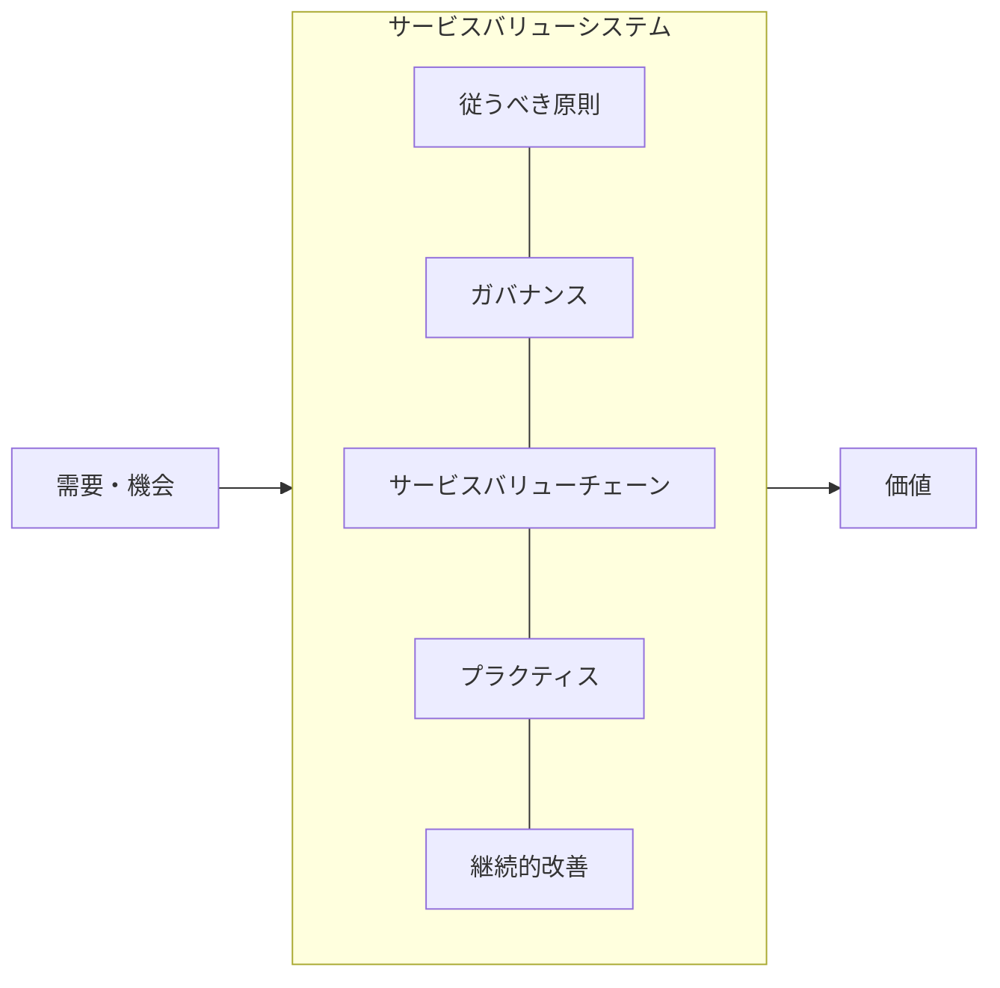
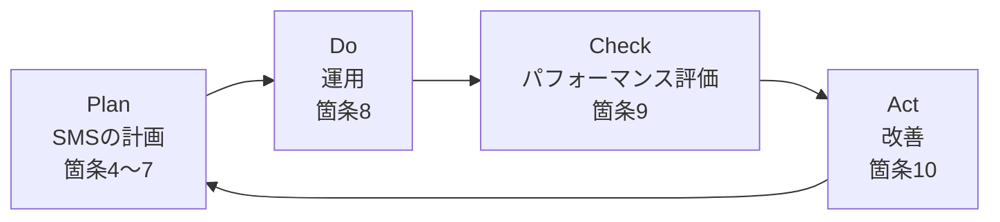
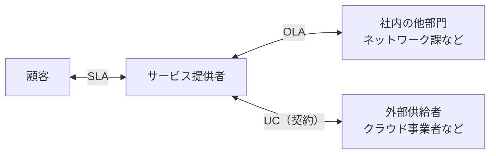
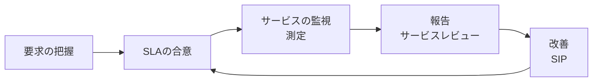
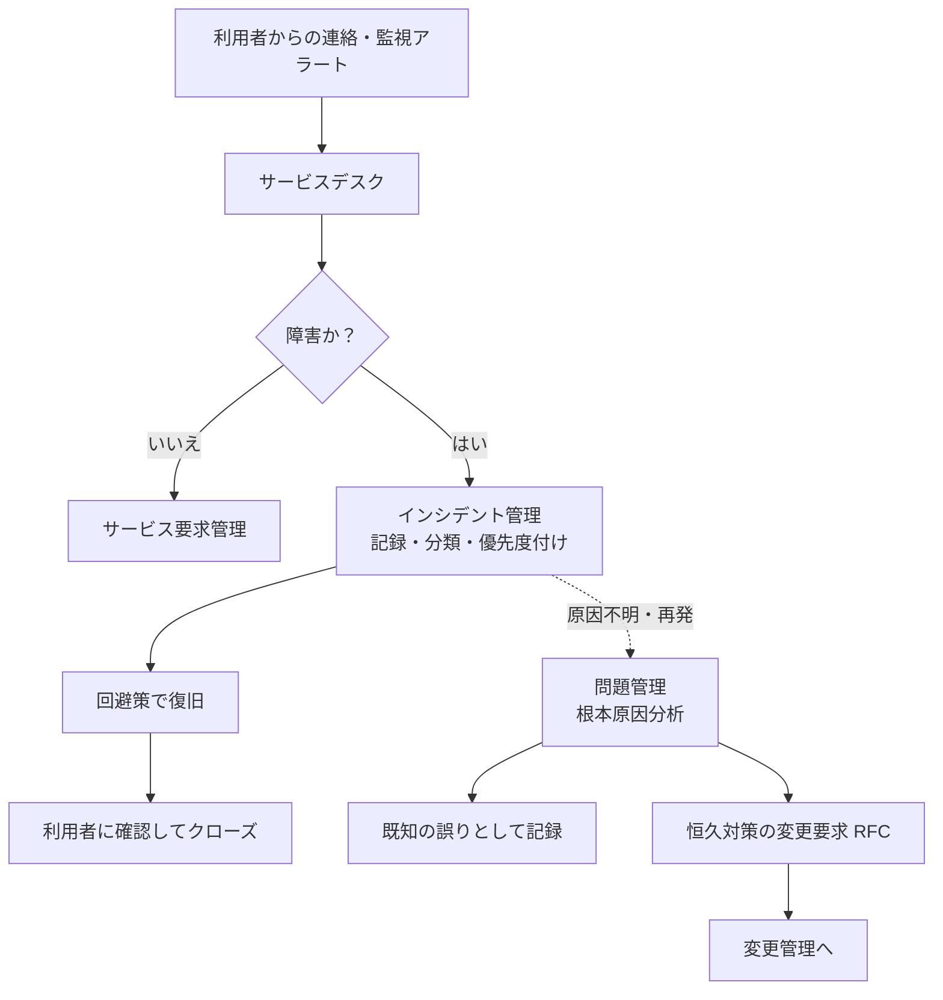
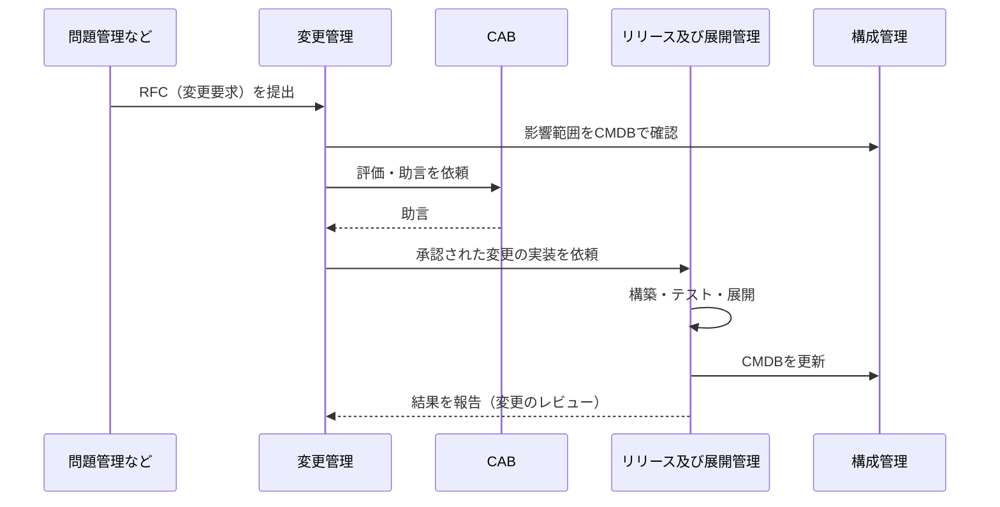
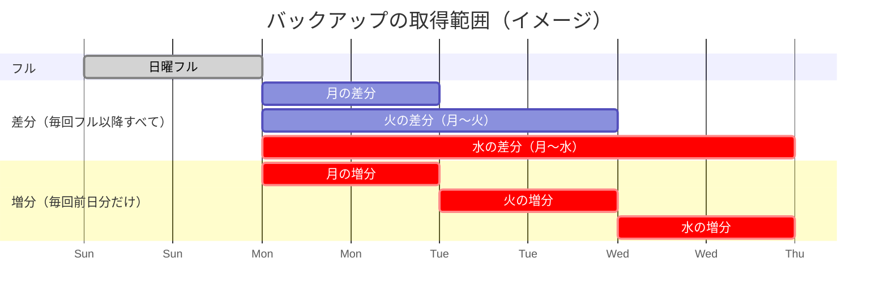
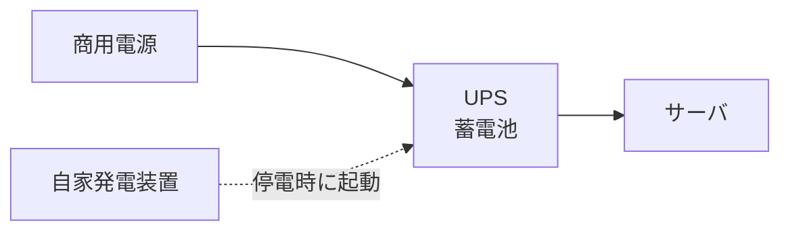
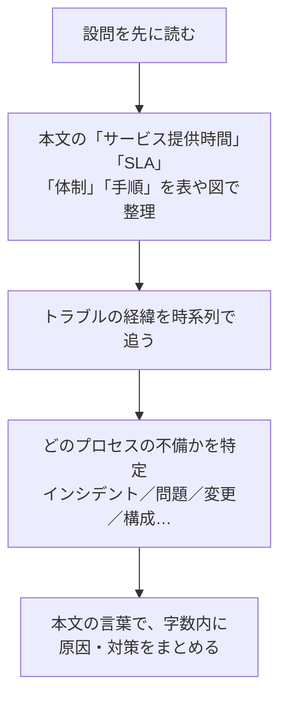

# サービスマネジメント

> **重要度：★★★**（科目A（旧午前）で毎回3〜4問、科目B（旧午後）でも「サービスマネジメント」が選択問題として毎回1問出題）
> 科目Aでは **インシデント管理と問題管理の違い**、**変更管理・構成管理・リリース管理の役割**、**SLA**、**バックアップ方式**、**UPSなどのファシリティ** が定番です。
> 科目Bでは、運用中のシステムで起きたトラブルを題材に「どのプロセスが何をすべきか」「SLAを守るには何を変えるべきか」を問われ、稼働率・容量・時間の計算も出ます。
> この章では、ITIL 4 と JIS Q 20000 の枠組み → SLA → 各プロセス → 可用性・容量 → バックアップ → ファシリティ → 科目Bの解き方 の順に学びます。

## 目次

- [1. サービスマネジメントの全体像](#1-サービスマネジメントの全体像)
- [2. サービスレベル管理（SLA/SLM）](#2-サービスレベル管理slaslm)
- [3. インシデント管理・問題管理・サービス要求管理](#3-インシデント管理問題管理サービス要求管理)
- [4. 変更管理・構成管理・リリース管理](#4-変更管理構成管理リリース管理)
- [5. サービスデスク](#5-サービスデスク)
- [6. 可用性管理・容量（キャパシティ）管理・サービス継続管理](#6-可用性管理容量キャパシティ管理サービス継続管理)
- [7. バックアップ方式](#7-バックアップ方式)
- [8. ファシリティマネジメント](#8-ファシリティマネジメント)
- [9. 科目B「サービスマネジメント」の解き方](#9-科目bサービスマネジメントの解き方)
- [確認問題](#確認問題)
- [参考](#参考)

## 1. サービスマネジメントの全体像

### 1.1 サービスマネジメントとは

- **サービスマネジメント** とは、ITサービスを利用者のニーズに合わせて **安定的・効率的に提供し続ける** ための管理活動です。
- 理由：システムは作って終わりではなく、運用期間のほうがはるかに長く、利用者にとって価値があるのは「システム」ではなく「サービス（使える状態）」だからです。
- 例：社内メールサービスを「平日9〜18時は稼働率99.9%以上、障害時は30分以内に一次回答」という約束のもとで提供・改善し続けること。

### 1.2 ITIL 4

**ITIL（Information Technology Infrastructure Library）** は、英国政府が策定したITサービスマネジメントの **ベストプラクティス集**（成功事例をまとめたもの）です。最新版の **ITIL 4**（2019年〜）は、価値の共創を中心に再構成されています。

| 要素 | 内容 |
|---|---|
| **サービスバリューシステム（SVS）** | 組織が価値を生み出す仕組み全体。従うべき原則、ガバナンス、サービスバリューチェーン、プラクティス、継続的改善からなる |
| **サービスバリューチェーン（SVC）** | 価値を生む6つの活動：**計画／改善／エンゲージ／設計および移行／取得または構築／提供およびサポート** |
| **プラクティス** | 作業を行うための組織的資源のまとまり。**34個**（一般マネジメント14、サービスマネジメント17、技術マネジメント3） |
| **4つの側面** | 組織と人材／情報と技術／パートナーとサプライヤ／バリューストリームとプロセス |
| **7つの従うべき原則** | 価値に着目する、現状から始める、フィードバックをもとに反復して進化する、協働し可視性を高める、包括的に考え取り組む、シンプルにし実践的にする、最適化し自動化する |



> ⚠️ ひっかけ注意：ITIL v3 までは「サービスストラテジ／デザイン／トランジション／オペレーション／継続的改善」の **ライフサイクル（5段階）** で構成されていました。ITIL 4 では「プロセス」ではなく **「プラクティス」** という言葉を使い、「変更管理」は **「変更実現（Change Enablement）」** と呼ばれます。

### 1.3 JIS Q 20000（ISO/IEC 20000）

- **JIS Q 20000-1** は、ITサービスマネジメントシステム（SMS）の **要求事項（認証の基準）** を定めた日本産業規格です（現行は JIS Q 20000-1:2020、元は ISO/IEC 20000-1:2018）。
- **JIS Q 20000-2** は、その **適用の手引（ガイダンス）** です。
- ITILが「ベストプラクティス（やり方の手本）」であるのに対し、JIS Q 20000 は **第三者認証に使える規格** という違いがあります。
- ISO/IEC 27001（ISMS）などと同じ **マネジメントシステム規格の共通構造**（箇条4〜10、PDCA）を採用しています。

#### JIS Q 20000-1 の箇条8「サービスマネジメントシステムの運用」の構成

（ISO/IEC 20000-1:2018 の構成にもとづく整理です。細かな名称は規格票の訳語と異なる場合があります）

| 区分 | 含まれるプロセス |
|---|---|
| 8.2 サービスポートフォリオ | サービスの提供、計画、SMSの運用に携わる他の関係者の管理、サービスカタログ管理、資産管理、**構成管理** |
| 8.3 関係及び合意 | 事業関係管理、**サービスレベル管理**、供給者管理 |
| 8.4 供給及び需要 | サービスの予算業務及び会計業務、需要管理、**容量管理** |
| 8.5 サービスの設計、構築及び移行 | **変更管理**、サービスの設計及び移行、**リリース及び展開管理** |
| 8.6 解決及び実現 | **インシデント管理**、**サービス要求管理**、**問題管理** |
| 8.7 サービス保証 | **サービス可用性管理**、**サービス継続管理**、情報セキュリティ管理 |



## 2. サービスレベル管理（SLA/SLM）

### 2.1 用語

| 用語 | 意味 |
|---|---|
| **SLA（Service Level Agreement：サービスレベル合意書）** | サービス提供者と **顧客** との間で、サービスの内容と水準（稼働率、応答時間など）を合意した文書 |
| **SLM（Service Level Management：サービスレベル管理）** | SLAを合意し、達成状況を監視・報告・改善するプロセス |
| **OLA（Operational Level Agreement：運用レベル合意書）** | サービス提供者と **組織内部の部門** との合意 |
| **UC（Underpinning Contract：裏付け契約）** | サービス提供者と **外部の供給者** との契約 |
| **SLO（Service Level Objective：サービスレベル目標）** | SLAに盛り込む個々の目標値（例：稼働率99.9%） |
| **サービスカタログ** | 提供中のサービスの一覧と内容・提供条件 |



> 💡 覚え方：**SLA は外向き（顧客）、OLA は内向き（社内）、UC は外注（供給者）**。SLAを守るためには、OLA と UC の水準が SLA を下回らないようにする必要があります。

### 2.2 SLAの数値例

```
例：SLA「月間稼働率 99.9% 以上」（1か月 = 30日、24時間365日運用）
  月間の総時間 = 30日 × 24時間 × 60分 = 43,200分
  許容停止時間 = 43,200分 × (1 − 0.999) = 43,200 × 0.001 = 43.2分
  → 1か月の停止を43分程度に抑える必要がある

例：99.99% の場合
  許容停止時間 = 43,200 × 0.0001 = 4.32分
```

- **計画停止（定期保守）を稼働率の計算に含めるか** はSLAの中で定義します。科目Bでは「サービス提供時間帯」「計画停止の扱い」の条件を必ず確認しましょう。

### 2.3 SLMのサイクル



- **SIP（Service Improvement Plan：サービス改善計画）**：SLAの未達や改善機会に対する計画。

## 3. インシデント管理・問題管理・サービス要求管理

### 3.1 3つのプロセスの違い（★★★）

| プロセス | 目的 | キーワード |
|---|---|---|
| **インシデント管理** | **サービスをできるだけ早く通常の状態に戻す**（根本原因の究明は目的ではない） | 迅速な復旧、**回避策（ワークアラウンド）**、優先度、エスカレーション |
| **問題管理** | インシデントの **根本原因を突き止め、再発を防止する** | 根本原因分析、**既知の誤り（既知のエラー）**、プロアクティブな問題管理 |
| **サービス要求管理** | 利用者からの **障害ではない定型的な要求** に対応する | パスワードリセット、アカウント追加、情報提供 |

- **インシデント**：サービスの計画外の中断、または品質の低下（例：メールが送れない、Webが遅い）。まだ影響が出ていなくても、放置すると影響が出る事象（冗長構成の片系故障など）も含みます。
- **問題**：1つ以上のインシデントの **原因（または潜在的な原因）**。
- **既知の誤り**：根本原因または回避策が特定された問題。**既知の誤りデータベース（KEDB）** に記録し、インシデント対応の迅速化に使います。



> ⚠️ ひっかけ注意：「インシデント管理では、根本原因を究明してから復旧する」は **誤り**。まず復旧、原因究明は問題管理です。また、問題管理は **恒久対策を直接実施するのではなく、変更要求（RFC）を出して変更管理に渡します**。

### 3.2 優先度とエスカレーション

- **優先度** は **影響度（何人・どの業務に影響するか）× 緊急度（どれだけ早く解決が必要か）** で決めます。

| 影響度＼緊急度 | 高 | 中 | 低 |
|---|---|---|---|
| **高** | 1（最優先） | 2 | 3 |
| **中** | 2 | 3 | 4 |
| **低** | 3 | 4 | 5 |

| エスカレーション | 内容 |
|---|---|
| **機能的エスカレーション** | より専門的な技術を持つ部門（第2線・第3線のサポート）へ対応を引き継ぐ |
| **階層的エスカレーション** | 上位の管理者へ報告し、判断や資源の追加を求める（SLA違反のおそれがあるときなど） |

## 4. 変更管理・構成管理・リリース管理

### 4.1 役割の違い（★★★）

| プロセス | 目的 | キーワード |
|---|---|---|
| **変更管理** | 変更を **評価・承認・スケジューリング** し、変更によるリスクと障害を最小にする | **RFC（変更要求）**、**CAB（変更諮問委員会）**、影響分析、切り戻し計画 |
| **構成管理** | サービスを構成する要素（**CI：構成品目**）の情報を正確に記録・維持する | **CMDB（構成管理データベース）**、ベースライン、構成監査 |
| **リリース及び展開管理** | 承認された変更を、**本番環境へ計画的に展開（配付）** する | リリースパッケージ、受入れテスト、**DML（確定版ソフトウェア保管庫）**、展開計画 |



> 💡 覚え方：**変更管理は「やってよいかを決める」、リリース管理は「実際に届ける」、構成管理は「今どうなっているかを記録する」**。

### 4.2 変更の種類

| 種類 | 内容 |
|---|---|
| **標準変更** | リスクが低く手順が確立された変更。**事前承認済み** で、都度CABにかけない（例：PCの増設） |
| **通常変更** | 通常の評価・承認手続を経る変更 |
| **緊急変更** | 重大インシデントの解決など、急を要する変更。**ECAB（緊急変更諮問委員会）** で迅速に判断する |

- 変更を実施する前に、失敗した場合に元に戻す **切り戻し（バックアウト）計画** を用意します。
- **変更スケジュール（FSC：Forward Schedule of Change）** で変更の予定を関係者に周知します。

### 4.3 構成管理の用語

| 用語 | 意味 |
|---|---|
| **CI（Configuration Item：構成品目）** | 管理対象となる要素。ハードウェア、ソフトウェア、ネットワーク、文書、SLAなど |
| **CMDB（Configuration Management DataBase）** | CIの属性と **CI間の関係** を記録したデータベース。変更の影響分析やインシデントの原因調査に使う |
| **構成ベースライン** | ある時点で正式に合意された構成の状態。変更の基準点となる |
| **構成監査（検証）** | CMDBの記録と実際の構成が一致しているかを確認する |

> ⚠️ ひっかけ注意：CMDBの情報を更新するのは **構成管理** の役割です。変更が実施されたのにCMDBが更新されないと、次の変更の影響分析を誤ります（科目Bで頻出）。

## 5. サービスデスク

### 5.1 役割

- **サービスデスク** は、利用者からの問い合わせ・障害連絡・要求を受け付ける **単一窓口（SPOC：Single Point Of Contact）** です。
- 理由：窓口が一つなら利用者は迷わず、提供者側は記録・傾向分析を一元化できるためです。
- 一次対応で解決できない場合は、専門部署へ **エスカレーション** します。一次対応での解決率（**一次解決率**）が重要な指標です。

### 5.2 組織形態

| 形態 | 内容 | 特徴 |
|---|---|---|
| **ローカル・サービスデスク** | 利用者の拠点ごとに設置 | 現地の言語・文化に対応しやすいが、コスト高 |
| **中央サービスデスク** | 1か所に集約 | 効率的・低コスト。遠隔地の対応は電話・リモート中心 |
| **バーチャル・サービスデスク** | 物理的に分散した要員を、ネットワークで **1つの窓口に見せる** | 在宅勤務の要員も活用可能 |
| **フォロー・ザ・サン** | 時差のある拠点が順番に引き継ぎ **24時間対応** | グローバル企業向け |

### 5.3 支援ツール

- **FAQ・ナレッジベース**：よくある質問と回答を公開し、**利用者自身による解決（セルフヘルプ）** を促す。
- **チャットボット**：AIなどで定型的な問い合わせに自動応答。
- **CTI（Computer Telephony Integration）**：電話とコンピュータを連携し、着信時に顧客情報を自動表示。
- **エスカレーションの基準と時間** を事前に決めておくことで、対応のばらつきを防ぎます。

## 6. 可用性管理・容量（キャパシティ）管理・サービス継続管理

### 6.1 可用性管理（★★）

- **可用性** とは、サービスを **使いたいときに使える** 度合いです。
- 主な指標：

| 指標 | 公式 |
|---|---|
| **MTBF（平均故障間隔）** | 稼働時間の合計 ÷ 故障回数 |
| **MTTR（平均修復時間）** | 修復時間の合計 ÷ 故障回数 |
| **稼働率** | `MTBF ÷ (MTBF + MTTR)` |
| 直列システムの稼働率 | `A1 × A2`（両方動かないと動かない） |
| 並列システムの稼働率 | `1 − (1 − A1) × (1 − A2)`（どちらか動けば動く） |

```
数値例：MTBF = 480時間、MTTR = 20時間の装置
  稼働率 = 480 ÷ (480 + 20) = 480 ÷ 500 = 0.96

  同じ装置2台を直列に接続：0.96 × 0.96 = 0.9216
  同じ装置2台を並列に接続：1 − (1 − 0.96) × (1 − 0.96) = 1 − 0.04 × 0.04 = 1 − 0.0016 = 0.9984
```

- 可用性を高める方法：**MTBFを延ばす**（高信頼部品、予防保守、冗長化）、**MTTRを縮める**（監視の自動化、保守部品の常備、手順書整備）。
- 関連する特性：**信頼性**（故障しにくさ）、**保守性**（直しやすさ）、**サービス性（サービサビリティ）**（外部供給者の保守体制）。

### 6.2 容量（キャパシティ）管理

- 結論：**現在と将来の需要に見合う処理能力（CPU、メモリ、ディスク、回線など）を、費用対効果よく確保する** プロセスです。
- 理由：容量が足りないと性能低下や停止（インシデント）が起き、過剰だとコストの無駄になるためです。
- 主な活動：
  - **監視**：CPU使用率、ディスク使用率、応答時間などを継続的に測定する。
  - **分析・傾向予測**：利用者数の増加やキャンペーンなどの事業計画から将来の需要を予測する。
  - **チューニング**：設定変更やインデックス追加などで性能を改善する。
  - **需要管理**：ピークの分散（夜間バッチへの移動、料金設定による誘導）。
  - **容量計画** の作成：いつ・どれだけ増強するかを計画する。

```
数値例：ディスク容量 2,000GB、現在の使用量 1,200GB、毎月 50GB ずつ増加。
       使用率 80% を超えたら増設するというしきい値の場合
  しきい値 = 2,000 × 0.8 = 1,600GB
  しきい値までの余裕 = 1,600 − 1,200 = 400GB
  到達までの期間 = 400 ÷ 50 = 8か月後
  → 調達リードタイムを考慮し、それより前に増設を計画する
```

### 6.3 サービス継続管理

- 災害などの重大な事象が発生しても、**合意した水準でサービスを継続・復旧できるようにする** プロセスです。事業全体の **BCP（事業継続計画）** と整合させます。

| 指標 | 意味 |
|---|---|
| **RPO（Recovery Point Objective：目標復旧時点）** | **どの時点までのデータを復旧するか**（許容できるデータ損失の範囲）。バックアップ頻度を決める |
| **RTO（Recovery Time Objective：目標復旧時間）** | **停止から何時間以内に復旧するか** |
| **RLO（Recovery Level Objective：目標復旧レベル）** | どの水準まで復旧するか（例：通常の50%の処理能力） |

| 代替拠点の方式 | 内容 | 復旧の速さ・コスト |
|---|---|---|
| **ホットサイト** | 同じ設備を常時稼働させ、データも同期 | 速い・高い |
| **ウォームサイト** | 設備はあるが、データの反映や起動に時間がかかる | 中程度 |
| **コールドサイト** | 場所と電源などだけ用意し、機器は災害後に搬入 | 遅い・安い |

## 7. バックアップ方式

### 7.1 3つの方式（★★）

| 方式 | バックアップの対象 | バックアップ時間 | 復元（リストア）に必要なもの |
|---|---|---|---|
| **フルバックアップ** | **全データ** | 長い | フルバックアップ **1つ** |
| **差分バックアップ** | **直前のフルバックアップ以降** に変更されたデータ | 日を追うごとに長くなる | フル ＋ **最新の差分1つ** |
| **増分バックアップ** | **直前のバックアップ（フルまたは増分）以降** に変更されたデータ | 短い | フル ＋ **それ以降のすべての増分** |

> 💡 覚え方：**差分は「フルからの差」、増分は「前回からの増え分」**。バックアップは増分が速く、リストアは差分が速い。

### 7.2 復元の例

日曜日にフルバックアップ、月〜土曜日の夜に差分または増分バックアップを取得しているとします。**木曜日の昼に障害** が発生し、水曜日の夜の状態に戻したい場合：



| 方式 | 復元に必要なバックアップ | 媒体の数 |
|---|---|---|
| 差分 | 日曜のフル ＋ **水曜の差分** | 2つ |
| 増分 | 日曜のフル ＋ **月・火・水の増分（この順に）** | 4つ |

- バックアップ後から障害発生までの更新（木曜の午前中の更新）は、**ジャーナル（更新ログ）** を使った **ロールフォワード** で回復します（データベースの場合）。

### 7.3 その他のポイント

- **世代管理**：複数世代のバックアップを保管し、データ破損やランサムウェア感染に気づくのが遅れても、感染前の世代から復元できるようにします。
- **3-2-1ルール**：データのコピーを **3つ**、**2種類** の媒体に、うち **1つは遠隔地（オフサイト）** に保管する。
- **オフライン（エアギャップ）バックアップ**：ネットワークから切り離して保管し、ランサムウェアによる暗号化を防ぐ。
- **リストアテスト**：バックアップが実際に復元できるかを定期的に確認する（取得しているだけでは不十分）。

## 8. ファシリティマネジメント

### 8.1 ファシリティマネジメントとは

- **ファシリティマネジメント** は、建物・電源・空調・防災・入退室などの **設備（ファシリティ）を最適な状態で維持** する活動です。データセンタやサーバ室の安定稼働の土台になります。

| 対象 | 主な設備・対策 |
|---|---|
| 電源 | **UPS**、**自家発電装置**、**CVCF**、二系統受電、**サージ保護（雷対策）** |
| 空調 | 精密空調、ホットアイル／コールドアイルの分離、温湿度監視 |
| 防災 | **免震・耐震** 構造、ガス系消火設備（水損を防ぐ）、漏水検知 |
| セキュリティ | 入退室管理（ICカード、生体認証）、**共連れ防止**（アンチパスバック、セキュリティゲート）、監視カメラ、**セキュリティワイヤ**（盗難防止） |
| 省エネ | **PUE**（データセンタ全体の消費電力 ÷ IT機器の消費電力。1に近いほど効率的） |

### 8.2 UPSと自家発電（★★）

- **UPS（Uninterruptible Power Supply：無停電電源装置）**：停電や瞬断（瞬間的な停電）のとき、**蓄電池から短時間（数分〜数十分）電力を供給** する装置。その間に **安全なシャットダウン** を行うか、**自家発電装置の起動** を待ちます。
- **自家発電装置**：燃料で発電し、**長時間** の停電に対応します。起動に数十秒かかるため、その間をUPSでつなぎます。
- **CVCF（Constant Voltage Constant Frequency：定電圧定周波数装置）**：電圧と周波数を一定に保つ装置。



| UPSの給電方式 | 仕組み | 特徴 |
|---|---|---|
| **常時商用給電方式** | 通常は商用電源をそのまま供給し、停電時にバッテリへ切り替える | 安価。**切替時に瞬断が生じる**ことがある |
| **ラインインタラクティブ方式** | 常時商用給電に電圧調整機能を加えたもの | 中程度 |
| **常時インバータ給電方式** | 常にバッテリ（インバータ）経由で給電する | **停電時も瞬断なし**、電源品質も安定。高価 |

```
UPSの容量計算の例：
  サーバの消費電力 合計 2,400W、UPSの力率 0.8 のとき、
  必要な皮相電力 = 2,400W ÷ 0.8 = 3,000VA → 3kVA 以上のUPSを選ぶ
```

> ⚠️ ひっかけ注意：UPSは **長時間の停電には対応できません**。「UPSを導入したので数時間の停電でも業務を継続できる」は誤りで、長時間なら自家発電装置が必要です。

## 9. 科目B「サービスマネジメント」の解き方

### 9.1 よく出る題材

| 題材 | 典型的な問われ方 |
|---|---|
| インシデント対応 | 回避策の妥当性、エスカレーションの基準、サービスデスクの改善 |
| 問題管理 | 根本原因と再発防止策、プロアクティブな対策 |
| 変更・リリース | 変更の影響分析不足による障害、切り戻し手順、CMDBの更新漏れ |
| SLA | 稼働率・応答時間の算出、SLA達成のための改善策、OLA・UCとの整合 |
| 容量管理 | 将来の需要予測、しきい値の設定、増強のタイミング |
| バックアップ・継続 | 復旧時間・RPOを満たす方式、リストア手順と所要時間の計算 |
| クラウド・外部委託 | 供給者管理、責任分界点、SLAの確認 |

### 9.2 解き方の手順



### 9.3 得点のコツ

1. **プロセスの役割の境界を意識する**：「復旧」はインシデント管理、「原因究明・再発防止」は問題管理、「承認」は変更管理、「展開」はリリース管理、「記録の正確性」は構成管理。設問はこの境界を突いてきます。
2. **SLAの条件を厳密に読む**：サービス提供時間帯、計画停止の扱い、測定期間、「応答時間」の定義（受付から回答まで？ 復旧まで？）を表にまとめてから計算します。
3. **時系列を図にする**：障害発生 → 検知 → 連絡 → 回避策 → 復旧、の各時刻を書き出すと、どこで時間を浪費したか（＝改善点）が見えます。
4. **「人に依存した手順」を疑う**：手作業、属人化、チェックリストの不備、引き継ぎ漏れは、本文中にあれば高確率で設問の答えになります。
5. **計算は単位と前提をそろえる**：稼働率（時間ベースか件数ベースか）、容量の増加率（毎月一定か複利的か）、バックアップ・リストアの転送速度（MB/秒とGB/時の換算）に注意します。

## 確認問題

**問1** ITサービスマネジメントにおける問題管理の目的として、適切なものはどれか。

ア 障害が発生したサービスを、できるだけ迅速に通常の状態に回復させる。
イ インシデントの根本原因を特定し、再発を防止する。
ウ 変更要求を評価し、承認するかどうかを決定する。
エ 利用者からのパスワードリセットなどの定型的な要求に対応する。

<details><summary>解答・解説</summary>

**正解：イ**

- ア：**インシデント管理** の目的です。
- ウ：**変更管理** の役割です。
- エ：**サービス要求管理** の役割です。

</details>

**問2** サービスレベル管理に関する記述のうち、OLA の説明として適切なものはどれか。

ア サービス提供者と顧客との間で合意する、サービス水準に関する文書
イ サービス提供者と外部の供給者との間で締結する契約
ウ サービス提供者と同じ組織内の他部門との間で合意する、運用水準に関する文書
エ 提供中のサービスの一覧とその内容を示した文書

<details><summary>解答・解説</summary>

**正解：ウ**

- ア：**SLA**、イ：**UC（裏付け契約）**、エ：**サービスカタログ** です。
- OLA は組織の **内部** 向けの合意です。

</details>

**問3** 1か月を30日とし、24時間運用されるサービスのSLAで「月間稼働率99.95%以上」と定めた。1か月に許容される停止時間は最大何分か。

ア 7.2分　イ 14.4分　ウ 21.6分　エ 43.2分

<details><summary>解答・解説</summary>

**正解：ウ**

```
総時間 = 30 × 24 × 60 = 43,200分
許容停止時間 = 43,200 × (1 − 0.9995) = 43,200 × 0.0005 = 21.6分
```

エの43.2分は稼働率99.9%の場合の値です。

</details>

**問4** 日曜日にフルバックアップを、月曜日から土曜日まで毎晩増分バックアップを取得している。金曜日の昼にディスクが故障したので、木曜日の夜の状態まで復元したい。必要なバックアップはどれか。

ア 日曜日のフルバックアップだけ
イ 日曜日のフルバックアップと木曜日の増分バックアップ
ウ 日曜日のフルバックアップと月曜日から木曜日までの増分バックアップ
エ 月曜日から木曜日までの増分バックアップだけ

<details><summary>解答・解説</summary>

**正解：ウ**

増分バックアップは「前回のバックアップ以降の変更」だけを含むため、フルに **月→火→水→木** の増分を順番に適用する必要があります（合計5つ）。
差分バックアップ方式であれば、イ（フル＋木曜の差分）で済みます。

</details>

**問5** 変更管理、構成管理、リリース及び展開管理に関する記述のうち、適切なものはどれか。

ア 構成管理は、変更要求を評価して実施の可否を決定する。
イ 変更管理は、承認された変更を本番環境に展開し、展開後にCMDBを更新しないことを原則とする。
ウ リリース及び展開管理は、承認された変更を本番環境に計画的に展開する。
エ 構成管理では、CIの属性だけを記録し、CI間の関係は記録しない。

<details><summary>解答・解説</summary>

**正解：ウ**

- ア：変更の可否を決めるのは **変更管理**。
- イ：変更実施後は **CMDBを更新** して記録と実態を一致させる必要があります。
- エ：CMDBには **CI間の関係** も記録し、影響分析に使います。

</details>

**問6** UPSに関する記述として、適切なものはどれか。

ア 常時インバータ給電方式は、停電時に商用電源からバッテリへの切替えが発生するため、瞬断が生じる。
イ UPSは燃料で発電するため、数日間の停電にも対応できる。
ウ UPSは、停電時に短時間の電力を供給し、その間にサーバの安全な停止や自家発電装置への切替えを可能にする。
エ UPSを設置すれば、落雷による過電圧への対策は不要になる。

<details><summary>解答・解説</summary>

**正解：ウ**

- ア：常時インバータ給電方式は、常にバッテリ（インバータ）経由で給電するため **瞬断が生じません**。瞬断の可能性があるのは常時商用給電方式です。
- イ：燃料で長時間発電するのは **自家発電装置** です。
- エ：雷による過電圧には **サージ保護（避雷器など）** の対策も必要です。

</details>

**問7** MTBFが900時間、MTTRが100時間の装置を2台並列に接続したシステムの稼働率はいくらか（どちらか1台が稼働していればシステムは稼働する）。

ア 0.81　イ 0.90　ウ 0.95　エ 0.99

<details><summary>解答・解説</summary>

**正解：エ**

```
1台の稼働率 = 900 ÷ (900 + 100) = 0.9
並列の稼働率 = 1 − (1 − 0.9) × (1 − 0.9) = 1 − 0.1 × 0.1 = 1 − 0.01 = 0.99
```

アの0.81は直列（0.9 × 0.9）の値です。

</details>

**問8** サービスデスクの組織形態のうち、地理的に分散した要員を通信ネットワークで結び、利用者には一つの窓口として見せるものはどれか。

ア ローカル・サービスデスク
イ 中央サービスデスク
ウ バーチャル・サービスデスク
エ フォロー・ザ・サン

<details><summary>解答・解説</summary>

**正解：ウ**

- ア：利用者の拠点ごとに設置。
- イ：1か所に集約。
- エ：時差のある拠点で引き継ぎ、24時間対応する形態（バーチャルの一種と位置づけられることもありますが、「時差を利用した24時間対応」が特徴です）。

</details>

## 参考

- IPA 試験要綱・シラバス（応用情報技術者試験 シラバス Ver.7.2）: https://www.ipa.go.jp/shiken/syllabus/gaiyou.html
- IPA 応用情報技術者試験 シラバスPDF（Ver.7.2）: https://www.ipa.go.jp/shiken/syllabus/omgdg50000005kq5-att/syllabus_ap_ver7_2.pdf
- IPA 過去問題（問題冊子・解答例・採点講評）: https://www.ipa.go.jp/shiken/mondai-kaiotu/index.html
- PeopleCert（AXELOS）ITIL 4: https://www.axelos.com/certifications/itil-service-management
- 日本産業標準調査会（JIS Q 20000-1 検索）: https://www.jisc.go.jp/
- itSMF Japan（ITサービスマネジメントの普及団体）: https://www.itsmf-japan.org/
- 経済産業省「システム管理基準」（運用・事業継続に関する管理項目）: https://www.meti.go.jp/policy/netsecurity/sys-kansa/
