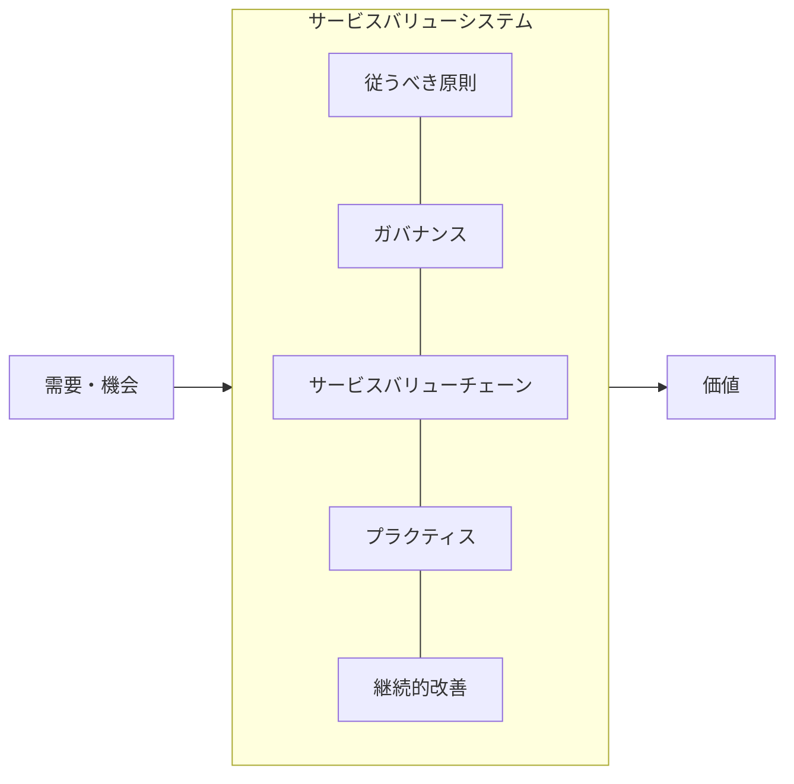
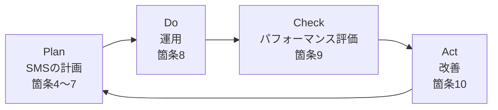
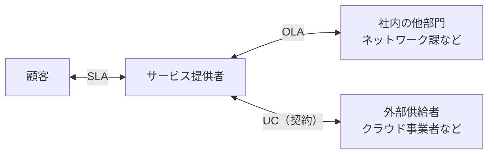
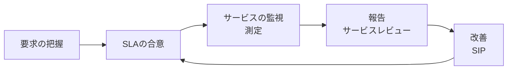
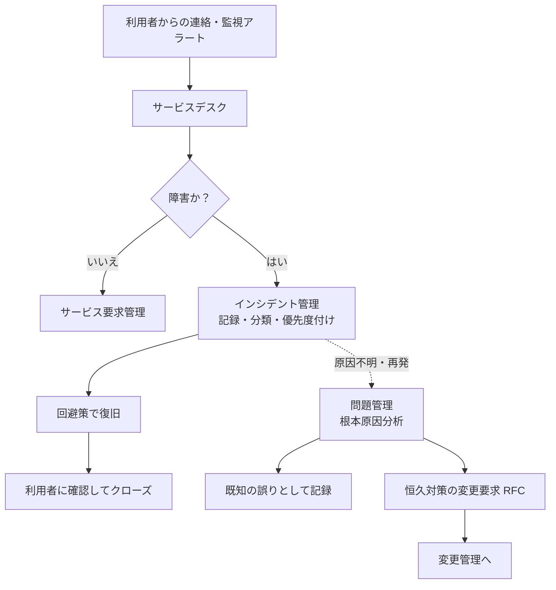
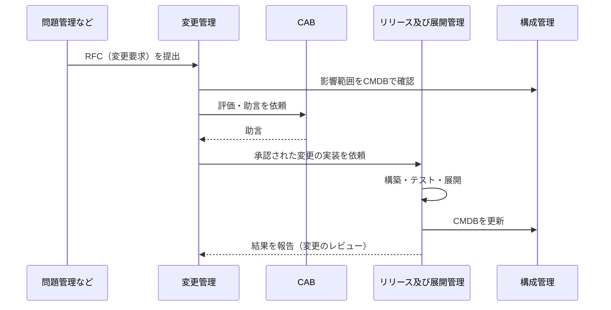
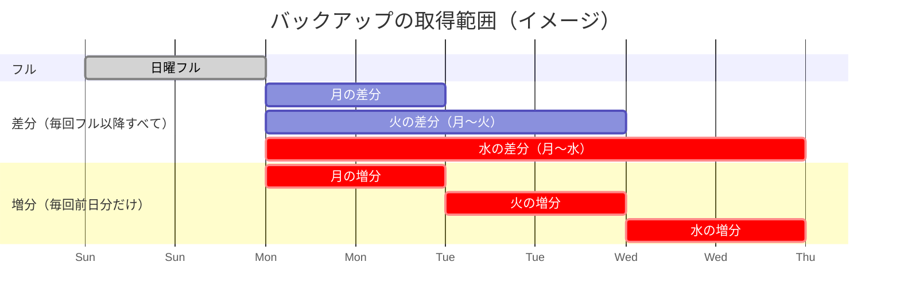
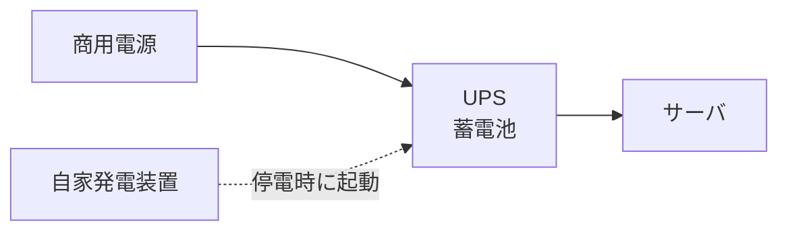
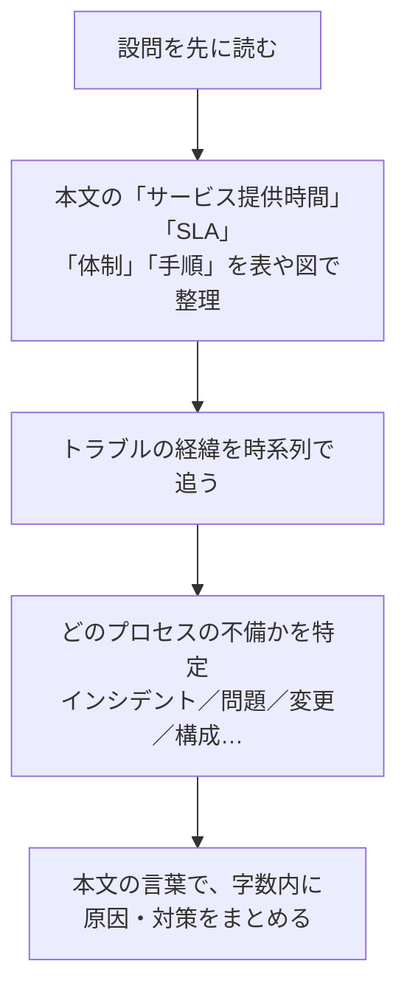

# サービスマネジメント

> **重要度：★★★**（科目A（旧午前）で毎回3〜4問、科目B（旧午後）でも「サービスマネジメント」が選択問題として毎回1問出題）
> 科目Aでは **インシデント管理と問題管理の違い**、**変更管理・構成管理・リリース管理の役割**、**SLA**、**バックアップ方式**、**UPSなどのファシリティ** が定番です。
> 科目Bでは、運用中のシステムで起きたトラブルを題材に「どのプロセスが何をすべきか」「SLAを守るには何を変えるべきか」を問われ、稼働率・容量・時間の計算も出ます。
> この章では、ITIL 4 と JIS Q 20000 の枠組み → SLA → 各プロセス → 可用性・容量 → バックアップ → ファシリティ → 科目Bの解き方 の順に学びます。

## 目次

- [1. サービスマネジメントの全体像](#1-サービスマネジメントの全体像)
- [2. サービスレベル管理（SLA/SLM）](#2-サービスレベル管理slaslm)
- [3. インシデント管理・問題管理・サービス要求管理](#3-インシデント管理問題管理サービス要求管理)
- [4. 変更管理・構成管理・リリース管理](#4-変更管理構成管理リリース管理)
- [5. サービスデスク](#5-サービスデスク)
- [6. 可用性管理・容量（キャパシティ）管理・サービス継続管理](#6-可用性管理容量キャパシティ管理サービス継続管理)
- [7. バックアップ方式](#7-バックアップ方式)
- [8. ファシリティマネジメント](#8-ファシリティマネジメント)
- [9. 科目B「サービスマネジメント」の解き方](#9-科目bサービスマネジメントの解き方)
- [10. JIS Q 20000 の各プロセスとサービスの運用（シラバス追加用語）](#10-jis-q-20000-の各プロセスとサービスの運用シラバス追加用語)
- [確認問題](#確認問題)
- [📋 シラバス用語チェックリスト](#-シラバス用語チェックリスト)
- [参考](#参考)

## 1. サービスマネジメントの全体像

### 1.1 サービスマネジメントとは

- **サービスマネジメント** とは、ITサービスを利用者のニーズに合わせて **安定的・効率的に提供し続ける** ための管理活動です。
- 理由：システムは作って終わりではなく、運用期間のほうがはるかに長く、利用者にとって価値があるのは「システム」ではなく「サービス（使える状態）」だからです。
- 例：社内メールサービスを「平日9〜18時は稼働率99.9%以上、障害時は30分以内に一次回答」という約束のもとで提供・改善し続けること。

### 1.2 ITIL 4

**ITIL（Information Technology Infrastructure Library）** は、英国政府が策定したITサービスマネジメントの **ベストプラクティス集**（成功事例をまとめたもの）です。**ITIL 4**（2019年〜）は、価値の共創を中心に再構成されています。

> 📝 補足：2026年1〜2月に後継の **ITIL（Version 5）** が公開されました（ITIL 4 を土台に、デジタルプロダクトやAI活用を強化した版とされています）。シラバスVer.7.2 は版を指定せず「ITILの目的・考え方」を問うので、本章では過去問で使われてきた ITIL 4 の用語で解説します。

| 要素 | 内容 |
|---|---|
| **サービスバリューシステム（SVS）** | 組織が価値を生み出す仕組み全体。従うべき原則、ガバナンス、サービスバリューチェーン、プラクティス、継続的改善からなる |
| **サービスバリューチェーン（SVC）** | 価値を生む6つの活動：**計画／改善／エンゲージ／設計および移行／取得または構築／提供およびサポート** |
| **プラクティス** | 作業を行うための組織的資源のまとまり。**34個**（一般マネジメント14、サービスマネジメント17、技術マネジメント3） |
| **4つの側面** | 組織と人材／情報と技術／パートナーとサプライヤ／バリューストリームとプロセス |
| **7つの従うべき原則** | 価値に着目する、現状から始める、フィードバックをもとに反復して進化する、協働し可視性を高める、包括的に考え取り組む、シンプルにし実践的にする、最適化し自動化する |



> ⚠️ ひっかけ注意：ITIL v3 までは「サービスストラテジ／デザイン／トランジション／オペレーション／継続的改善」の **ライフサイクル（5段階）** で構成されていました。ITIL 4 では「プロセス」ではなく **「プラクティス」** という言葉を使い、「変更管理」は **「変更実現（Change Enablement）」** と呼ばれます。

### 1.3 JIS Q 20000（ISO/IEC 20000）

- **JIS Q 20000-1** は、ITサービスマネジメントシステム（SMS）の **要求事項（認証の基準）** を定めた日本産業規格です（現行は JIS Q 20000-1:2020、元は ISO/IEC 20000-1:2018）。
- **JIS Q 20000-2** は、その **適用の手引（ガイダンス）** です。
- ITILが「ベストプラクティス（やり方の手本）」であるのに対し、JIS Q 20000 は **第三者認証に使える規格** という違いがあります。
- ISO/IEC 27001（ISMS）などと同じ **マネジメントシステム規格の共通構造**（箇条4〜10、PDCA）を採用しています。

#### JIS Q 20000-1 の箇条8「サービスマネジメントシステムの運用」の構成

（ISO/IEC 20000-1:2018 の構成にもとづく整理です。細かな名称は規格票の訳語と異なる場合があります）

| 区分 | 含まれるプロセス |
|---|---|
| 8.2 サービスポートフォリオ | サービスの提供、計画、SMSの運用に携わる他の関係者の管理、サービスカタログ管理、資産管理、**構成管理** |
| 8.3 関係及び合意 | 事業関係管理、**サービスレベル管理**、供給者管理 |
| 8.4 供給及び需要 | サービスの予算業務及び会計業務、需要管理、**容量管理** |
| 8.5 サービスの設計、構築及び移行 | **変更管理**、サービスの設計及び移行、**リリース及び展開管理** |
| 8.6 解決及び実現 | **インシデント管理**、**サービス要求管理**、**問題管理** |
| 8.7 サービス保証 | **サービス可用性管理**、**サービス継続管理**、情報セキュリティ管理 |



## 2. サービスレベル管理（SLA/SLM）

### 2.1 用語

| 用語 | 意味 |
|---|---|
| **SLA（Service Level Agreement：サービスレベル合意書）** | サービス提供者と **顧客** との間で、サービスの内容と水準（稼働率、応答時間など）を合意した文書 |
| **SLM（Service Level Management：サービスレベル管理）** | SLAを合意し、達成状況を監視・報告・改善するプロセス |
| **OLA（Operational Level Agreement：運用レベル合意書）** | サービス提供者と **組織内部の部門** との合意 |
| **UC（Underpinning Contract：裏付け契約）** | サービス提供者と **外部の供給者** との契約 |
| **SLO（Service Level Objective：サービスレベル目標）** | SLAに盛り込む個々の目標値（例：稼働率99.9%） |
| **サービスカタログ** | 提供中のサービスの一覧と内容・提供条件 |



> 💡 覚え方：**SLA は外向き（顧客）、OLA は内向き（社内）、UC は外注（供給者）**。SLAを守るためには、OLA と UC の水準が SLA を下回らないようにする必要があります。

### 2.2 SLAの数値例

```
例：SLA「月間稼働率 99.9% 以上」（1か月 = 30日、24時間365日運用）
  月間の総時間 = 30日 × 24時間 × 60分 = 43,200分
  許容停止時間 = 43,200分 × (1 − 0.999) = 43,200 × 0.001 = 43.2分
  → 1か月の停止を43分程度に抑える必要がある

例：99.99% の場合
  許容停止時間 = 43,200 × 0.0001 = 4.32分
```

- **計画停止（定期保守）を稼働率の計算に含めるか** はSLAの中で定義します。科目Bでは「サービス提供時間帯」「計画停止の扱い」の条件を必ず確認しましょう。

### 2.3 SLMのサイクル



- **SIP（Service Improvement Plan：サービス改善計画）**：SLAの未達や改善機会に対する計画。

## 3. インシデント管理・問題管理・サービス要求管理

### 3.1 3つのプロセスの違い（★★★）

| プロセス | 目的 | キーワード |
|---|---|---|
| **インシデント管理** | **サービスをできるだけ早く通常の状態に戻す**（根本原因の究明は目的ではない） | 迅速な復旧、**回避策（ワークアラウンド）**、優先度、エスカレーション |
| **問題管理** | インシデントの **根本原因を突き止め、再発を防止する** | 根本原因分析、**既知の誤り（既知のエラー）**、プロアクティブな問題管理 |
| **サービス要求管理** | 利用者からの **障害ではない定型的な要求** に対応する | パスワードリセット、アカウント追加、情報提供 |

- **インシデント**：サービスの計画外の中断、または品質の低下（例：メールが送れない、Webが遅い）。まだ影響が出ていなくても、放置すると影響が出る事象（冗長構成の片系故障など）も含みます。
- **問題**：1つ以上のインシデントの **原因（または潜在的な原因）**。
- **既知の誤り**：根本原因または回避策が特定された問題。**既知の誤りデータベース（KEDB）** に記録し、インシデント対応の迅速化に使います。



> ⚠️ ひっかけ注意：「インシデント管理では、根本原因を究明してから復旧する」は **誤り**。まず復旧、原因究明は問題管理です。また、問題管理は **恒久対策を直接実施するのではなく、変更要求（RFC）を出して変更管理に渡します**。

### 3.2 優先度とエスカレーション

- **優先度** は **影響度（何人・どの業務に影響するか）× 緊急度（どれだけ早く解決が必要か）** で決めます。

| 影響度＼緊急度 | 高 | 中 | 低 |
|---|---|---|---|
| **高** | 1（最優先） | 2 | 3 |
| **中** | 2 | 3 | 4 |
| **低** | 3 | 4 | 5 |

| エスカレーション | 内容 |
|---|---|
| **機能的エスカレーション** | より専門的な技術を持つ部門（第2線・第3線のサポート）へ対応を引き継ぐ |
| **階層的エスカレーション** | 上位の管理者へ報告し、判断や資源の追加を求める（SLA違反のおそれがあるときなど） |

## 4. 変更管理・構成管理・リリース管理

### 4.1 役割の違い（★★★）

| プロセス | 目的 | キーワード |
|---|---|---|
| **変更管理** | 変更を **評価・承認・スケジューリング** し、変更によるリスクと障害を最小にする | **RFC（変更要求）**、**CAB（変更諮問委員会）**、影響分析、切り戻し計画 |
| **構成管理** | サービスを構成する要素（**CI：構成品目**）の情報を正確に記録・維持する | **CMDB（構成管理データベース）**、ベースライン、構成監査 |
| **リリース及び展開管理** | 承認された変更を、**本番環境へ計画的に展開（配付）** する | リリースパッケージ、受入れテスト、**DML（確定版ソフトウェア保管庫）**、展開計画 |



> 💡 覚え方：**変更管理は「やってよいかを決める」、リリース管理は「実際に届ける」、構成管理は「今どうなっているかを記録する」**。

### 4.2 変更の種類

| 種類 | 内容 |
|---|---|
| **標準変更** | リスクが低く手順が確立された変更。**事前承認済み** で、都度CABにかけない（例：PCの増設） |
| **通常変更** | 通常の評価・承認手続を経る変更 |
| **緊急変更** | 重大インシデントの解決など、急を要する変更。**ECAB（緊急変更諮問委員会）** で迅速に判断する |

- 変更を実施する前に、失敗した場合に元に戻す **切り戻し（バックアウト）計画** を用意します。
- **変更スケジュール（FSC：Forward Schedule of Change）** で変更の予定を関係者に周知します。

### 4.3 構成管理の用語

| 用語 | 意味 |
|---|---|
| **CI（Configuration Item：構成品目）** | 管理対象となる要素。ハードウェア、ソフトウェア、ネットワーク、文書、SLAなど |
| **CMDB（Configuration Management DataBase）** | CIの属性と **CI間の関係** を記録したデータベース。変更の影響分析やインシデントの原因調査に使う |
| **構成ベースライン** | ある時点で正式に合意された構成の状態。変更の基準点となる |
| **構成監査（検証）** | CMDBの記録と実際の構成が一致しているかを確認する |

> ⚠️ ひっかけ注意：CMDBの情報を更新するのは **構成管理** の役割です。変更が実施されたのにCMDBが更新されないと、次の変更の影響分析を誤ります（科目Bで頻出）。

## 5. サービスデスク

### 5.1 役割

- **サービスデスク** は、利用者からの問い合わせ・障害連絡・要求を受け付ける **単一窓口（SPOC：Single Point Of Contact）** です。
- 理由：窓口が一つなら利用者は迷わず、提供者側は記録・傾向分析を一元化できるためです。
- 一次対応で解決できない場合は、専門部署へ **エスカレーション** します。一次対応での解決率（**一次解決率**）が重要な指標です。

### 5.2 組織形態

| 形態 | 内容 | 特徴 |
|---|---|---|
| **ローカル・サービスデスク** | 利用者の拠点ごとに設置 | 現地の言語・文化に対応しやすいが、コスト高 |
| **中央サービスデスク** | 1か所に集約 | 効率的・低コスト。遠隔地の対応は電話・リモート中心 |
| **バーチャル・サービスデスク** | 物理的に分散した要員を、ネットワークで **1つの窓口に見せる** | 在宅勤務の要員も活用可能 |
| **フォロー・ザ・サン** | 時差のある拠点が順番に引き継ぎ **24時間対応** | グローバル企業向け |

### 5.3 支援ツール

- **FAQ・ナレッジベース**：よくある質問と回答を公開し、**利用者自身による解決（セルフヘルプ）** を促す。
- **チャットボット**：AIなどで定型的な問い合わせに自動応答。
- **CTI（Computer Telephony Integration）**：電話とコンピュータを連携し、着信時に顧客情報を自動表示。
- **エスカレーションの基準と時間** を事前に決めておくことで、対応のばらつきを防ぎます。

## 6. 可用性管理・容量（キャパシティ）管理・サービス継続管理

### 6.1 可用性管理（★★）

- **可用性** とは、サービスを **使いたいときに使える** 度合いです。
- 主な指標：

| 指標 | 公式 |
|---|---|
| **MTBF（平均故障間隔）** | 稼働時間の合計 ÷ 故障回数 |
| **MTTR（平均修復時間）** | 修復時間の合計 ÷ 故障回数 |
| **稼働率** | `MTBF ÷ (MTBF + MTTR)` |
| 直列システムの稼働率 | `A1 × A2`（両方動かないと動かない） |
| 並列システムの稼働率 | `1 − (1 − A1) × (1 − A2)`（どちらか動けば動く） |

```
数値例：MTBF = 480時間、MTTR = 20時間の装置
  稼働率 = 480 ÷ (480 + 20) = 480 ÷ 500 = 0.96

  同じ装置2台を直列に接続：0.96 × 0.96 = 0.9216
  同じ装置2台を並列に接続：1 − (1 − 0.96) × (1 − 0.96) = 1 − 0.04 × 0.04 = 1 − 0.0016 = 0.9984
```

- 可用性を高める方法：**MTBFを延ばす**（高信頼部品、予防保守、冗長化）、**MTTRを縮める**（監視の自動化、保守部品の常備、手順書整備）。
- 関連する特性：**信頼性**（故障しにくさ）、**保守性**（直しやすさ）、**サービス性（サービサビリティ）**（外部供給者の保守体制）。

### 6.2 容量（キャパシティ）管理

- 結論：**現在と将来の需要に見合う処理能力（CPU、メモリ、ディスク、回線など）を、費用対効果よく確保する** プロセスです。
- 理由：容量が足りないと性能低下や停止（インシデント）が起き、過剰だとコストの無駄になるためです。
- 主な活動：
  - **監視**：CPU使用率、ディスク使用率、応答時間などを継続的に測定する。
  - **分析・傾向予測**：利用者数の増加やキャンペーンなどの事業計画から将来の需要を予測する。
  - **チューニング**：設定変更やインデックス追加などで性能を改善する。
  - **需要管理**：ピークの分散（夜間バッチへの移動、料金設定による誘導）。
  - **容量計画** の作成：いつ・どれだけ増強するかを計画する。

```
数値例：ディスク容量 2,000GB、現在の使用量 1,200GB、毎月 50GB ずつ増加。
       使用率 80% を超えたら増設するというしきい値の場合
  しきい値 = 2,000 × 0.8 = 1,600GB
  しきい値までの余裕 = 1,600 − 1,200 = 400GB
  到達までの期間 = 400 ÷ 50 = 8か月後
  → 調達リードタイムを考慮し、それより前に増設を計画する
```

### 6.3 サービス継続管理

- 災害などの重大な事象が発生しても、**合意した水準でサービスを継続・復旧できるようにする** プロセスです。事業全体の **BCP（事業継続計画）** と整合させます。

| 指標 | 意味 |
|---|---|
| **RPO（Recovery Point Objective：目標復旧時点）** | **どの時点までのデータを復旧するか**（許容できるデータ損失の範囲）。バックアップ頻度を決める |
| **RTO（Recovery Time Objective：目標復旧時間）** | **停止から何時間以内に復旧するか** |
| **RLO（Recovery Level Objective：目標復旧レベル）** | どの水準まで復旧するか（例：通常の50%の処理能力） |

| 代替拠点の方式 | 内容 | 復旧の速さ・コスト |
|---|---|---|
| **ホットサイト** | 同じ設備を常時稼働させ、データも同期 | 速い・高い |
| **ウォームサイト** | 設備はあるが、データの反映や起動に時間がかかる | 中程度 |
| **コールドサイト** | 場所と電源などだけ用意し、機器は災害後に搬入 | 遅い・安い |

## 7. バックアップ方式

### 7.1 3つの方式（★★）

| 方式 | バックアップの対象 | バックアップ時間 | 復元（リストア）に必要なもの |
|---|---|---|---|
| **フルバックアップ** | **全データ** | 長い | フルバックアップ **1つ** |
| **差分バックアップ** | **直前のフルバックアップ以降** に変更されたデータ | 日を追うごとに長くなる | フル ＋ **最新の差分1つ** |
| **増分バックアップ** | **直前のバックアップ（フルまたは増分）以降** に変更されたデータ | 短い | フル ＋ **それ以降のすべての増分** |

> 💡 覚え方：**差分は「フルからの差」、増分は「前回からの増え分」**。バックアップは増分が速く、リストアは差分が速い。

### 7.2 復元の例

日曜日にフルバックアップ、月〜土曜日の夜に差分または増分バックアップを取得しているとします。**木曜日の昼に障害** が発生し、水曜日の夜の状態に戻したい場合：



| 方式 | 復元に必要なバックアップ | 媒体の数 |
|---|---|---|
| 差分 | 日曜のフル ＋ **水曜の差分** | 2つ |
| 増分 | 日曜のフル ＋ **月・火・水の増分（この順に）** | 4つ |

- バックアップ後から障害発生までの更新（木曜の午前中の更新）は、**ジャーナル（更新ログ）** を使った **ロールフォワード** で回復します（データベースの場合）。

### 7.3 その他のポイント

- **世代管理**：複数世代のバックアップを保管し、データ破損やランサムウェア感染に気づくのが遅れても、感染前の世代から復元できるようにします。
- **3-2-1ルール**：データのコピーを **3つ**、**2種類** の媒体に、うち **1つは遠隔地（オフサイト）** に保管する。
- **オフライン（エアギャップ）バックアップ**：ネットワークから切り離して保管し、ランサムウェアによる暗号化を防ぐ。
- **リストアテスト**：バックアップが実際に復元できるかを定期的に確認する（取得しているだけでは不十分）。

## 8. ファシリティマネジメント

### 8.1 ファシリティマネジメントとは

- **ファシリティマネジメント** は、建物・電源・空調・防災・入退室などの **設備（ファシリティ）を最適な状態で維持** する活動です。データセンタやサーバ室の安定稼働の土台になります。

| 対象 | 主な設備・対策 |
|---|---|
| 電源 | **UPS**、**自家発電装置**、**CVCF**、二系統受電、**サージ保護（雷対策）** |
| 空調 | 精密空調、ホットアイル／コールドアイルの分離、温湿度監視 |
| 防災 | **免震・耐震** 構造、ガス系消火設備（水損を防ぐ）、漏水検知 |
| セキュリティ | 入退室管理（ICカード、生体認証）、**共連れ防止**（アンチパスバック、セキュリティゲート）、監視カメラ、**セキュリティワイヤ**（盗難防止） |
| 省エネ | **PUE**（データセンタ全体の消費電力 ÷ IT機器の消費電力。1に近いほど効率的） |

### 8.2 UPSと自家発電（★★）

- **UPS（Uninterruptible Power Supply：無停電電源装置）**：停電や瞬断（瞬間的な停電）のとき、**蓄電池から短時間（数分〜数十分）電力を供給** する装置。その間に **安全なシャットダウン** を行うか、**自家発電装置の起動** を待ちます。
- **自家発電装置**：燃料で発電し、**長時間** の停電に対応します。起動に数十秒かかるため、その間をUPSでつなぎます。
- **CVCF（Constant Voltage Constant Frequency：定電圧定周波数装置）**：電圧と周波数を一定に保つ装置。



| UPSの給電方式 | 仕組み | 特徴 |
|---|---|---|
| **常時商用給電方式** | 通常は商用電源をそのまま供給し、停電時にバッテリへ切り替える | 安価。**切替時に瞬断が生じる**ことがある |
| **ラインインタラクティブ方式** | 常時商用給電に電圧調整機能を加えたもの | 中程度 |
| **常時インバータ給電方式** | 常にバッテリ（インバータ）経由で給電する | **停電時も瞬断なし**、電源品質も安定。高価 |

```
UPSの容量計算の例：
  サーバの消費電力 合計 2,400W、UPSの力率 0.8 のとき、
  必要な皮相電力 = 2,400W ÷ 0.8 = 3,000VA → 3kVA 以上のUPSを選ぶ
```

> ⚠️ ひっかけ注意：UPSは **長時間の停電には対応できません**。「UPSを導入したので数時間の停電でも業務を継続できる」は誤りで、長時間なら自家発電装置が必要です。

## 9. 科目B「サービスマネジメント」の解き方

### 9.1 よく出る題材

| 題材 | 典型的な問われ方 |
|---|---|
| インシデント対応 | 回避策の妥当性、エスカレーションの基準、サービスデスクの改善 |
| 問題管理 | 根本原因と再発防止策、プロアクティブな対策 |
| 変更・リリース | 変更の影響分析不足による障害、切り戻し手順、CMDBの更新漏れ |
| SLA | 稼働率・応答時間の算出、SLA達成のための改善策、OLA・UCとの整合 |
| 容量管理 | 将来の需要予測、しきい値の設定、増強のタイミング |
| バックアップ・継続 | 復旧時間・RPOを満たす方式、リストア手順と所要時間の計算 |
| クラウド・外部委託 | 供給者管理、責任分界点、SLAの確認 |

### 9.2 解き方の手順



### 9.3 得点のコツ

1. **プロセスの役割の境界を意識する**：「復旧」はインシデント管理、「原因究明・再発防止」は問題管理、「承認」は変更管理、「展開」はリリース管理、「記録の正確性」は構成管理。設問はこの境界を突いてきます。
2. **SLAの条件を厳密に読む**：サービス提供時間帯、計画停止の扱い、測定期間、「応答時間」の定義（受付から回答まで？ 復旧まで？）を表にまとめてから計算します。
3. **時系列を図にする**：障害発生 → 検知 → 連絡 → 回避策 → 復旧、の各時刻を書き出すと、どこで時間を浪費したか（＝改善点）が見えます。
4. **「人に依存した手順」を疑う**：手作業、属人化、チェックリストの不備、引き継ぎ漏れは、本文中にあれば高確率で設問の答えになります。
5. **計算は単位と前提をそろえる**：稼働率（時間ベースか件数ベースか）、容量の増加率（毎月一定か複利的か）、バックアップ・リストアの転送速度（MB/秒とGB/時の換算）に注意します。

## 10. JIS Q 20000 の各プロセスとサービスの運用（シラバス追加用語）

シラバスVer.7.2 は、サービスマネジメントを **JIS Q 20000-1（ISO/IEC 20000-1）** のプロセスに沿って整理しています。1〜8 で扱っていないプロセスと、運用現場の用語をここでまとめます。

### 10.1 サービス・SMSの基本用語

| 用語 | 意味 |
|---|---|
| **サービス** | 顧客が望む成果を、顧客が特定のコストやリスクを負わずに得られるようにして価値を提供する手段 |
| **サービスコンポーネント** | サービスを構成する部品（アプリ、サーバ、ネットワーク、手順、要員など）。構成品目（CI）として管理される |
| **サービス品質** | サービスが要求事項（機能・可用性・応答時間など）を満たしている度合い |
| **サービスライフサイクルの段階** | **計画立案 → 設計 → 移行 → 提供 → 改善** |
| **サービスマネジメントシステム（SMS）** | サービスマネジメントの方針・目的・プロセスを確立し、PDCAで運用・改善する仕組み |
| **顧客／利用者／サービス提供者** | サービスを受け取り費用を負担する組織・人／実際に使う人／サービスを提供する組織 |
| **サービスの要求事項** | 顧客・利用者・組織がサービスに求めること（機能、サービスレベル、法規制など） |
| **JIS Q 9001** | 品質マネジメントシステムの要求事項（ISO 9001）。JIS Q 20000-1 と同じ共通構造を持つ |
| **資源・力量・認識・コミュニケーション・文書化した情報・知識** | マネジメントシステム規格の「支援」の要素。**力量**＝知識と技能を適用して結果を出す能力、**認識**＝要員が方針や自分の貢献を理解していること、**文書化した情報**＝管理・維持が必要な情報（手順書・記録） |

- **SLA・SLO・SLI の関係**：**SLI（Service Level Indicator：サービスレベル指標）** は実際に測る指標（例：月間のリクエスト成功率）、**SLO（Service Level Objective：サービスレベル目標）** はその目標値（例：99.9%以上）、**SLA** は SLO を含む顧客との合意文書です。
- 代表的なサービスレベル項目：**サービス可用性**（稼働率）、**信頼性**（MTBF、障害件数）、**サービス時間**（サービスを提供する時間帯。例：平日8〜20時）、**応答時間**（オンライン処理の応答、問い合わせへの一次回答までの時間）。

> 💡 覚え方：**I（Indicator：測る）→ O（Objective：目標にする）→ A（Agreement：約束する）**。

### 10.2 サービスの計画・ポートフォリオ・カタログ

- **サービスの計画**：サービスの要求事項を決め、資源を考慮して、**変更要求** や新規サービスの提案に優先順位を付けます。
- **サービスポートフォリオ**：組織が管理するサービス全体の一覧で、状態によって3つに分けられます。

| 区分 | サービスの状態 | 公開範囲 |
|---|---|---|
| **サービス・パイプライン** | 計画中・開発中（これから提供するもの） | 主に社内 |
| **サービスカタログ** | 稼働中（現在提供しているもの） | 顧客・利用者に公開 |
| 廃止済みサービス | 廃止 | 記録として保持 |

- **サービスカタログ管理**：サービスカタログ（サービスの内容、意図した成果、サービス間の依存関係、申込み方法など）を作成・維持し、**顧客・利用者などにそれぞれ適切な部分へのアクセスを提供** します。

### 10.3 資産管理（ITAM・SAM）

| 用語 | 意味 |
|---|---|
| **資産管理（ITAM：IT Asset Management）** | ハードウェア・ソフトウェア・クラウド契約などのIT資産を、取得から廃棄までライフサイクル全体で管理する |
| **SAM（Software Asset Management：ソフトウェアアセットマネジメント）** | ソフトウェアとライセンスを管理し、**不正コピーやライセンス違反を防ぎ、コストを最適化** する |
| **ライセンスマネジメント** | 保有ライセンス数と実際のインストール数・利用者数を照合し、過不足を管理する |
| **JIS X 0164 シリーズ（ISO/IEC 19770）** | IT資産管理（SAM／ITAM）に関する規格群 |

> ⚠️ ひっかけ注意：資産管理は「何をいくつ持っていて、権利（ライセンス）や費用はどうか」を、構成管理は「構成要素どうしがどうつながり、今どの版か」を管理します。

### 10.4 事業関係管理と供給者管理

- **事業関係管理**：顧客との良好な関係（**顧客関係**）を維持するため、コミュニケーションの取決めを確立し、定期的にサービスの成果をレビューし、**サービス満足度**（**顧客満足**）を測定し、**苦情** を管理します。
- **供給者管理**：サービスの一部を他者に頼る場合に、その関係を管理します。

| 供給者の種類 | 例 | 合意の形 |
|---|---|---|
| **外部供給者** | クラウド事業者、データセンタ事業者、保守ベンダ（**アウトソーシングの利用**、**SaaS・PaaS・IaaS などのクラウドサービスの利用**） | **契約**（UC） |
| **内部供給者** | 同じ組織内のネットワーク部門、DB管理部門 | 合意文書（OLA） |
| **供給者として行動する顧客** | 顧客自身がサービスの一部（例：利用者のPC管理、データ入力）を担う場合 | 合意文書 |

### 10.5 サービスの予算業務及び会計業務（財務管理）

- **予算業務**：サービスにかかる費用を事前に見積もり、予算化します。**会計業務**：実際の費用を把握し、予算と比べて監視・報告します。**課金**：サービスの利用者（部門）に費用を請求することです。
- **直接費**：特定のサービスのためだけに発生する費用（そのサービス専用サーバのリース料など）。**間接費**：複数のサービスで共有する費用（データセンタの電気代、共通基盤の運用要員費など）。
- **配賦**：間接費を、利用量などの基準で各サービス・各部門に割り振ることです。
- **減価償却**：購入した機器の費用を耐用年数にわたって分けて計上すること。**総所有費用（TCO：Total Cost of Ownership）**：導入費だけでなく運用・保守・教育・廃棄まで含めた総費用です。

```
配賦の数値例：共通基盤の運用費（間接費）月300万円を、CPU利用時間で3部門に配賦する
  CPU利用時間：営業部 600時間、経理部 300時間、人事部 100時間（合計1,000時間）
  営業部 = 300 × 600/1,000 = 180万円
  経理部 = 300 × 300/1,000 =  90万円
  人事部 = 300 × 100/1,000 =  30万円
```

### 10.6 需要管理

- **需要管理**：サービスに対する現在の **需要** を把握し、**需要予測** を行い、需要と消費を監視・報告します。容量・能力管理（[6.2](#62-容量キャパシティ管理)）のインプットになります。
- 例：月末の経理処理に利用が集中する → バッチ処理を夜間に分散させる、繁忙期の前に容量を増強する。

### 10.7 変更管理・設計及び移行・リリース及び展開管理の補足

- **変更管理方針**：変更管理の対象とするサービスコンポーネント、**変更のカテゴリー**（標準変更、通常の変更、緊急変更、そして大規模な新規・廃止を伴う **プロジェクト変更** など）とその管理方法、顧客に重大な影響を及ぼす変更の判断基準を定めます。
- 重大な変更は、変更管理の活動ではなく **サービスの設計及び移行** のプロセスで管理します。
- **ロールバック（切り戻し）**：変更が失敗したときに元の状態に戻すこと。計画し、可能なら事前に試験します。
- **変更実施後のレビュー（PIR：Post Implementation Review）**：変更が目的を達成したか、予期しない影響がなかったかを実施後に確認します。

**サービスの設計及び移行** の主な用語：

| 用語 | 意味 |
|---|---|
| **新規サービス又はサービス変更の計画** | サービスの要求事項をもとに、設計・構築・移行の計画を立てる |
| **サービス受入れ基準** | 新しいサービスを稼働させてよいかを判断する基準（機能、性能、運用体制、文書の整備など） |
| **サービス設計書** | サービスの機能・**非機能要件**（性能、可用性、セキュリティ、運用性）などを記述した設計文書 |
| **運用サービス基準** | 運用部門がサービスを受け入れる条件（運用手順書・監視設定・バックアップ設計など） |
| **移行計画** | 業務及びシステムの移行（旧から新への切替え）の手順・体制・スケジュール・切戻し条件 |
| **移行リハーサル** | 本番と同じ手順・時間で移行作業を事前に試すこと |
| **移行判断** | 移行可否の判定（Go/No-Go判定） |
| **移行の通知** | 利用者・関係者へ移行の日時や影響を知らせること |
| **移行評価** | 移行後に計画どおりだったか、問題がなかったかを評価すること |
| **運用テスト** | 運用部門が、実際の運用手順・体制でシステムを運用できるか確認するテスト |
| **受入れテスト** | 利用者（顧客）が、要件どおりかを確認して受け入れるテスト |
| **運用引継ぎ** | 開発（プロジェクト）側から運用部門へ、文書・知識・責任を引き継ぐこと |

**リリース及び展開管理** の主な用語：

| 用語 | 意味 |
|---|---|
| **リリース** | 一緒に展開する1つ以上の変更のまとまり |
| **リリースの種類** | 大規模リリース、小規模リリース、**緊急リリース**（緊急変更に対応） |
| **リリースの受入れ基準** | 稼働環境へ展開してよいかの判断基準 |
| **受入れ試験環境／稼働環境** | 本番前に受入れテストを行う環境／実際にサービスを提供する本番環境 |
| **展開／リリースの配付** | リリースを稼働環境に配置すること、ソフトウェアを各端末・拠点に配ること |
| **継続的インテグレーション（CI）** | コードの変更を頻繁に統合し、自動でビルド・テストする |
| **継続的デリバリー** | CIに加え、いつでも本番にリリースできる状態を自動で保つ（本番反映は人が承認） |
| **継続的デプロイ** | テストに合格した変更を **自動で本番環境に反映** する |

### 10.8 インシデント・サービス要求の補足

| 用語 | 意味 |
|---|---|
| **インシデントモデル** | よく起きる種類のインシデントについて、あらかじめ定めた対応手順・担当・時間枠 |
| **解決目標時間** | 優先度ごとに定めた、インシデントを解決すべき目標時間（例：優先度1は4時間以内） |
| **重大なインシデント** | 事業への影響が大きいインシデント。基準を決めておき、文書化した手順で管理し、**トップマネジメントに通知** する |
| **回避策／解決策** | 根本原因を取り除かずに影響を減らす一時的な方法／根本原因を取り除く恒久的な方法 |
| **終了（クローズ）** | 利用者に解決を確認して記録を閉じること |
| **サービス要求の実現に関する指示書** | パスワードリセットなど定型の要求を誰でも同じように処理できるようにした手順書 |
| **傾向分析・予防処置（問題管理）** | インシデントの傾向を分析して問題を見つけ、発生前に手を打つ（プロアクティブな問題管理） |

### 10.9 サービス可用性の指標（MTRS・MTBSI）

- ITサービスの視点では、機器の故障（MTBF・MTTR）だけでなく、**サービスとしての中断** を測ります。

| 指標 | 意味 |
|---|---|
| **MTRS（Mean Time to Restore Service：平均サービス回復時間）** | サービスが中断してから **利用者が再び使えるようになるまで** の平均時間（検知・連絡・修理・確認を含む） |
| **MTBSI（Mean Time Between Service Incidents：平均サービスインシデント間隔）** | あるインシデントの発生から次のインシデントの発生までの平均時間。**MTBSI ＝ MTBF ＋ MTRS** |
| **回復力（レジリエンス）** | 構成要素が故障してもサービスを続けられる、または素早く回復できる能力（冗長化など） |
| **保守性** | 故障したときに直しやすい性質（MTTR・MTRSを短くする） |

```
数値例：ある月（720時間）にサービス中断が3回、合計6時間あった
  MTRS  = 6 ÷ 3 = 2時間
  MTBF（サービスが使えていた時間の平均） = (720 − 6) ÷ 3 = 238時間
  MTBSI = MTBF + MTRS = 238 + 2 = 240時間（＝720 ÷ 3）
  可用性 = 238 ÷ 240 ≒ 99.17%
```

### 10.10 サービス継続：スタンバイ方式

| 方式 | 予備系の状態 | 切替え時間 | コスト |
|---|---|---|---|
| **ホットスタンバイ** | 予備系も起動済みで、データも同期している | 数秒〜数分 | 高い |
| **ウォームスタンバイ** | 予備系は起動しているが、業務アプリの起動やデータ反映が必要 | 数十分〜数時間 | 中 |
| **コールドスタンバイ** | 予備機は用意してあるが停止している（起動・設定から行う） | 数時間〜数日 | 安い |

- **サービス継続計画** は、事業全体の **BCP（事業継続計画）** と整合させ、RTO・RPO・RLO（[6.3](#63-サービス継続管理)）を満たすように作り、**定期的、及び重大な変更があったときに試験** します。

### 10.11 情報セキュリティ管理

- 情報セキュリティ方針を定め、管理策を実施し、**情報セキュリティインシデント** を管理するプロセスです。具体的な要求事項・管理策は **ISO/IEC 27000 シリーズ（JIS Q 27001・27002 など）** が規定しています（詳しくは [08_情報セキュリティ](../01_テクノロジ系/08_情報セキュリティ.md)）。

### 10.12 パフォーマンス評価及び改善

| 用語 | 意味 |
|---|---|
| **サービスの報告** | サービスのパフォーマンス・**有効性**（意図した結果が出たか）・**傾向情報** を、合意した頻度で顧客・経営層に報告する |
| **不適合／是正処置** | 要求事項を満たしていないこと／その原因を除去し **再発を防ぐ** 処置（応急の「修正」とは区別） |
| **継続的改善** | SMSとサービスの適切性・妥当性・有効性を継続的に高める。改善の機会を評価基準で選び、承認された改善活動を管理する |
| **プロセス能力水準（プロセス成熟度水準）** | プロセスがどこまで確立しているかの段階評価。例：**CMMI** の成熟度レベル（1 初期 → 2 管理された → 3 定義された → 4 定量的に管理された → 5 最適化している） |
| **プロセスアセスメント** | プロセスを基準モデルと比べて能力水準を評価すること |
| **ギャップ分析** | 現状（As-Is）とあるべき姿（To-Be）の差を明らかにし、改善策を決めること |
| **KGI／CSF／KPI** | 最終目標の達成度（例：顧客満足度80%）／目標達成の鍵となる要因（例：一次解決率の向上）／その進み具合を測る指標（例：一次解決率70%） |

### 10.13 システム運用管理と運用オペレーション

**システム運用管理**：日常の運用計画、障害時の運用計画、運用負荷を下げる改善計画などを立て、運用資源を管理します。

| 用語 | 意味 |
|---|---|
| **運用の資源管理** | **人的資源**（運用要員）と **技術的資源**（ハードウェア、ソフトウェア、データ、ネットワーク）を組織の目標に合うよう維持・運用する |
| **仮想環境の運用管理** | 仮想サーバの配置・リソース割当て・ライブマイグレーション・スナップショット・不要VMの整理などを管理する |
| **ジョブの管理** | バッチジョブの登録・実行順序・実行結果を管理する |
| **データ管理** | データのバックアップ、保管期間、媒体、廃棄を管理する |
| **利用者の管理** | 利用者IDの登録・変更・削除、権限の付与、パスワードの管理 |
| **コールドスタート** | システムを **初期状態から起動** する（前回の処理状態を引き継がない）。障害でメモリ上の情報が失われた場合など |
| **ウォームスタート** | 障害発生時点の **処理状態（チェックポイントなど）を引き継いで再開** する |
| **AIOps（Artificial Intelligence for IT Operations）** | AIや機械学習で監視データ・ログを分析し、異常検知・原因推定・自動対応を行う |

**運用オペレーション**：定められた手順に沿ってシステムを監視・操作し、状況を連絡します。操作は **作業指示書** に従って行います。

| 用語 | 意味 |
|---|---|
| **スケジュール設計／ジョブスケジューリング** | ジョブの実行日時・順序・依存関係（Aが正常終了したらBを開始など）を設計し、ジョブ管理ツールで自動実行する |
| **バックアップ** | 決められたスケジュールでデータを保存する（[7](#7-バックアップ方式)） |
| **システムの監視と操作** | 稼働状況・性能・ログを監視し、起動・停止などの操作を行う |
| **アウトプットの管理** | 帳票・出力ファイルの作成、配付、保管、廃棄を管理する（機密帳票の誤配付防止） |
| **ジョブの復旧と再実行** | 異常終了したジョブを原因除去後に再実行する。途中から再開（リスタート）するか最初から再実行（リラン）するかを手順で定める |
| **運用支援ツール（監視ツール，診断ツール）** | 稼働監視・性能監視・ログ監視などのツール、障害原因を調べる診断ツール |
| **業務運用マニュアル** | 利用部門・運用部門が行う業務手順（日次・月次処理、障害時の連絡など）をまとめた文書 |

### 10.14 サービスデスクの補足

| 用語 | 意味 |
|---|---|
| **コールセンター** | 大量の電話応対を専門に行う窓口。サービスデスクより定型的な受付が中心 |
| **応対マニュアル** | 問い合わせの受け方・聞き取る項目・回答例・エスカレーション基準をまとめた手引 |
| **知識ベース** | 過去の問い合わせと解決方法、既知の誤りなどを蓄積したデータベース |
| **一次サポート** | サービスデスクが受付時に行う対応（FAQや手順で解決できるもの） |
| **二次サポート／三次サポート** | 専門技術部門による対応／開発元・ベンダなど最も専門的な対応 |
| **AIの活用（チャットボットなど）** | 定型的な問い合わせへの自動応答、問い合わせの自動分類、回答候補の提示 |

### 10.15 ファシリティマネジメントの補足

**施設管理・建物管理**

| 設備 | 主な内容 |
|---|---|
| **建物管理** | **免震装置**（建物と地盤の間で揺れを吸収）、**アレスタ（避雷器）などのサージ防護デバイス（SPD）**（雷などの異常電圧から機器を守る）、防災防犯設備（火災報知器、監視カメラ）、安全管理 |
| **消火設備** | **泡消火設備**（油火災向け。水分を含むので電子機器室には不向き）、**ハロゲン化物消火設備**（燃焼の化学反応を抑える。機器への影響が小さい）、**不活性ガス消火設備**（窒素などで **酸素濃度を下げて** 消火。放出前に人の退避が必要） |
| **電気設備** | UPS、自家発電設備、分電盤、二系統受電 |
| **空調設備** | 空調機器、**エアフロー**（冷気・排気の流れ）、**コールドアイル**（ラックの吸気側を向かい合わせた冷気の通路）、**ホットアイル**（排気側を向かい合わせた暖気の通路）。両者を分離（キャッピング）すると冷却効率が上がる |
| **通信設備** | **MDF（Main Distributing Frame：主配線盤）**（建物に引き込んだ通信回線を集める）、**IDF（Intermediate Distributing Frame：中間配線盤）**（各フロアへ分配する） |
| **データファシリティスタンダード（ティア基準）** | 日本データセンター協会（JDCC）などが定めるデータセンタの信頼性の格付け。**Tier1〜Tier4**（数字が大きいほど冗長性・耐災害性が高く、Tier4は設備の単一故障でも停止しない水準） |

- **施設・設備の維持保全**：水道光熱費・保守費・修繕費を含む **ライフサイクル費用** を下げるため、修繕計画を立て、設備の長寿命化を図ります。

**環境側面（グリーンIT）**

| 用語 | 意味 |
|---|---|
| **グリーンIT** | IT機器・データセンタ自体の省エネ（of IT）と、ITを使った社会の省エネ（by IT） |
| **PUE（Power Usage Effectiveness）** | `データセンタ全体の消費電力 ÷ IT機器の消費電力`。**1に近いほど効率的** |
| **GEC（Green Energy Coefficient）** | 消費エネルギーのうち **再生可能エネルギー** の割合 |
| **ITEE（IT Equipment Energy Efficiency）** | IT機器の **処理能力 ÷ 定格消費電力**（省エネ性能の高い機器を使っているか） |
| **ITEU（IT Equipment Utilization）** | IT機器の **実際の消費電力量 ÷ 定格消費電力量**（機器を有効に使っているか） |
| **データセンター総合エネルギー効率指標（DPPE）** | 上の4指標を組み合わせた総合指標 |
| **ZEB（net Zero Energy Building）** | 省エネと再生可能エネルギーにより、年間の一次エネルギー消費量の収支を **正味ゼロ** にすることを目指す建物 |
| **LEED（Leadership in Energy & Environmental Design）認証** | 米国グリーンビルディング協会による、環境に配慮した建物の認証制度 |
| **GHGプロトコル** | 温室効果ガス排出量の算定・報告の国際基準。**Scope1**（自社の直接排出）、**Scope2**（購入した電気・熱の使用に伴う間接排出）、**Scope3**（取引先・製品使用など、それ以外のサプライチェーン排出） |

```
PUEの数値例：データセンタ全体の消費電力 1,500kW、そのうちIT機器 1,000kW
  PUE = 1,500 ÷ 1,000 = 1.5（空調・照明などに IT機器の0.5倍の電力を使っている）
```

## 確認問題

**問1** ITサービスマネジメントにおける問題管理の目的として、適切なものはどれか。

ア 障害が発生したサービスを、できるだけ迅速に通常の状態に回復させる。
イ インシデントの根本原因を特定し、再発を防止する。
ウ 変更要求を評価し、承認するかどうかを決定する。
エ 利用者からのパスワードリセットなどの定型的な要求に対応する。

<details><summary>解答・解説</summary>

**正解：イ**

- ア：**インシデント管理** の目的です。
- ウ：**変更管理** の役割です。
- エ：**サービス要求管理** の役割です。

</details>

**問2** サービスレベル管理に関する記述のうち、OLA の説明として適切なものはどれか。

ア サービス提供者と顧客との間で合意する、サービス水準に関する文書
イ サービス提供者と外部の供給者との間で締結する契約
ウ サービス提供者と同じ組織内の他部門との間で合意する、運用水準に関する文書
エ 提供中のサービスの一覧とその内容を示した文書

<details><summary>解答・解説</summary>

**正解：ウ**

- ア：**SLA**、イ：**UC（裏付け契約）**、エ：**サービスカタログ** です。
- OLA は組織の **内部** 向けの合意です。

</details>

**問3** 1か月を30日とし、24時間運用されるサービスのSLAで「月間稼働率99.95%以上」と定めた。1か月に許容される停止時間は最大何分か。

ア 7.2分　イ 14.4分　ウ 21.6分　エ 43.2分

<details><summary>解答・解説</summary>

**正解：ウ**

```
総時間 = 30 × 24 × 60 = 43,200分
許容停止時間 = 43,200 × (1 − 0.9995) = 43,200 × 0.0005 = 21.6分
```

エの43.2分は稼働率99.9%の場合の値です。

</details>

**問4** 日曜日にフルバックアップを、月曜日から土曜日まで毎晩増分バックアップを取得している。金曜日の昼にディスクが故障したので、木曜日の夜の状態まで復元したい。必要なバックアップはどれか。

ア 日曜日のフルバックアップだけ
イ 日曜日のフルバックアップと木曜日の増分バックアップ
ウ 日曜日のフルバックアップと月曜日から木曜日までの増分バックアップ
エ 月曜日から木曜日までの増分バックアップだけ

<details><summary>解答・解説</summary>

**正解：ウ**

増分バックアップは「前回のバックアップ以降の変更」だけを含むため、フルに **月→火→水→木** の増分を順番に適用する必要があります（合計5つ）。
差分バックアップ方式であれば、イ（フル＋木曜の差分）で済みます。

</details>

**問5** 変更管理、構成管理、リリース及び展開管理に関する記述のうち、適切なものはどれか。

ア 構成管理は、変更要求を評価して実施の可否を決定する。
イ 変更管理は、承認された変更を本番環境に展開し、展開後にCMDBを更新しないことを原則とする。
ウ リリース及び展開管理は、承認された変更を本番環境に計画的に展開する。
エ 構成管理では、CIの属性だけを記録し、CI間の関係は記録しない。

<details><summary>解答・解説</summary>

**正解：ウ**

- ア：変更の可否を決めるのは **変更管理**。
- イ：変更実施後は **CMDBを更新** して記録と実態を一致させる必要があります。
- エ：CMDBには **CI間の関係** も記録し、影響分析に使います。

</details>

**問6** UPSに関する記述として、適切なものはどれか。

ア 常時インバータ給電方式は、停電時に商用電源からバッテリへの切替えが発生するため、瞬断が生じる。
イ UPSは燃料で発電するため、数日間の停電にも対応できる。
ウ UPSは、停電時に短時間の電力を供給し、その間にサーバの安全な停止や自家発電装置への切替えを可能にする。
エ UPSを設置すれば、落雷による過電圧への対策は不要になる。

<details><summary>解答・解説</summary>

**正解：ウ**

- ア：常時インバータ給電方式は、常にバッテリ（インバータ）経由で給電するため **瞬断が生じません**。瞬断の可能性があるのは常時商用給電方式です。
- イ：燃料で長時間発電するのは **自家発電装置** です。
- エ：雷による過電圧には **サージ保護（避雷器など）** の対策も必要です。

</details>

**問7** MTBFが900時間、MTTRが100時間の装置を2台並列に接続したシステムの稼働率はいくらか（どちらか1台が稼働していればシステムは稼働する）。

ア 0.81　イ 0.90　ウ 0.95　エ 0.99

<details><summary>解答・解説</summary>

**正解：エ**

```
1台の稼働率 = 900 ÷ (900 + 100) = 0.9
並列の稼働率 = 1 − (1 − 0.9) × (1 − 0.9) = 1 − 0.1 × 0.1 = 1 − 0.01 = 0.99
```

アの0.81は直列（0.9 × 0.9）の値です。

</details>

**問8** サービスデスクの組織形態のうち、地理的に分散した要員を通信ネットワークで結び、利用者には一つの窓口として見せるものはどれか。

ア ローカル・サービスデスク
イ 中央サービスデスク
ウ バーチャル・サービスデスク
エ フォロー・ザ・サン

<details><summary>解答・解説</summary>

**正解：ウ**

- ア：利用者の拠点ごとに設置。
- イ：1か所に集約。
- エ：時差のある拠点で引き継ぎ、24時間対応する形態（バーチャルの一種と位置づけられることもありますが、「時差を利用した24時間対応」が特徴です）。

</details>

## 📋 シラバス用語チェックリスト

シラバスVer.7.2 の「用語例」を小分類ごとに一覧にしました。リンクのある用語は本文に詳しい説明があります（クリックで該当の見出しへ移動）。説明を隠して、用語から意味を言えるか確認しましょう。

### 1. サービスマネジメント

| 用語 | 一言説明 |
|---|---|
| [サービス](#101-サービスsmsの基本用語) | 顧客が望む成果を、特定のコストやリスクを負わずに得られるようにして価値を提供する手段 |
| [サービスコンポーネント](#101-サービスsmsの基本用語) | サービスを構成する部品（アプリ、サーバ、手順、要員など） |
| [サービス品質](#101-サービスsmsの基本用語) | サービスが要求事項を満たしている度合い |
| [サービスマネジメント](#11-サービスマネジメントとは) | サービスの計画立案・設計・移行・提供・改善を指揮し管理する能力とプロセス |
| [サービスライフサイクルの段階（計画立案，設計，移行，提供，改善）](#101-サービスsmsの基本用語) | サービスが計画から改善までたどる5段階 |
| [サービスマネジメントシステム](#101-サービスsmsの基本用語) | サービスマネジメントの方針・目的・プロセスをPDCAで運用する仕組み（SMS） |
| [サービスの要求事項](#101-サービスsmsの基本用語) | 顧客・利用者・組織がサービスに求めること |
| [顧客／サービス提供者](#101-サービスsmsの基本用語) | サービスを受け取り費用を負担する側／サービスを提供する組織 |
| [JIS Q 20000 の規格群（ISO/IEC 20000 シリーズ）](#13-jis-q-20000isoiec-20000) | ITサービスマネジメントシステムの要求事項（-1）と手引（-2）などの規格群 |
| [ITIL](#12-itil-4) | ITサービスマネジメントのベストプラクティス集（デファクトスタンダード） |
| [SLA](#21-用語) | サービス提供者と顧客が、サービス内容と水準を合意した文書 |
| [SLO](#101-サービスsmsの基本用語) | SLAに含める個々のサービスレベル目標値 |
| [SLI](#101-サービスsmsの基本用語) | 実際に測定するサービスレベル指標（成功率、応答時間など） |
| [サービス可用性](#61-可用性管理) | 合意した時点・期間にサービスを使える能力（稼働率） |
| [信頼性](#61-可用性管理) | 中断せずに機能し続ける能力（MTBFなど） |
| [サービス時間](#101-サービスsmsの基本用語) | サービスを提供する合意済みの時間帯 |
| [応答時間](#101-サービスsmsの基本用語) | 処理や問い合わせに応答するまでの時間 |
| [サービス及びサービスマネジメントシステムのパフォーマンス](#1012-パフォーマンス評価及び改善) | サービスやSMSの測定可能な結果。SLAの達成度などで評価 |

### 2. サービスマネジメントシステムの計画及び運用

| 用語 | 一言説明 |
|---|---|
| [PDCA](#13-jis-q-20000isoiec-20000) | Plan-Do-Check-Actの改善サイクル。JIS Q 20000 は箇条4〜10をこれに対応させる |
| [JIS Q 9001](#101-サービスsmsの基本用語) | 品質マネジメントシステムの要求事項（ISO 9001） |
| [マネジメントシステム](#101-サービスsmsの基本用語) | 方針・目的を定め、それを達成するプロセスを確立する仕組み |
| [資源・力量・認識](#101-サービスsmsの基本用語) | 支援の要素。必要な人や設備、要員の能力、方針の理解 |
| [コミュニケーション・文書化した情報・知識](#101-サービスsmsの基本用語) | 支援の要素。内外への伝達、管理すべき文書・記録、運用に必要な知識 |
| [変更要求](#41-役割の違い) | サービスやコンポーネントの変更の申請（RFC） |
| [サービスポートフォリオ](#102-サービスの計画ポートフォリオカタログ) | 組織が管理するサービス全体（パイプライン＋カタログ＋廃止） |
| [サービス・パイプライン](#102-サービスの計画ポートフォリオカタログ) | 計画中・開発中のサービス |
| [サービスの状態（計画中，開発中，稼働中，廃止など）](#102-サービスの計画ポートフォリオカタログ) | サービスポートフォリオ上の各サービスの段階 |
| [サービスカタログ](#102-サービスの計画ポートフォリオカタログ) | 稼働中のサービスの内容・成果・依存関係・申込方法をまとめた文書 |
| [資産管理（ITAM：IT asset management）](#103-資産管理itamsam) | IT資産をライフサイクル全体で管理する |
| [ソフトウェアアセットマネジメント（SAM）](#103-資産管理itamsam) | ソフトウェアとライセンスを管理し違反防止・コスト最適化を図る |
| [ライセンスマネジメント](#103-資産管理itamsam) | 保有ライセンスと利用実態を照合し過不足を管理する |
| [JIS X 0164 シリーズ](#103-資産管理itamsam) | IT資産管理の規格群（ISO/IEC 19770） |
| [構成管理](#43-構成管理の用語) | CIを識別・記録・制御・検証し構成情報を正確に保つ |
| [構成品目（CI）](#43-構成管理の用語) | 構成管理の対象となる要素 |
| [構成情報](#43-構成管理の用語) | CIの属性とCI間の関係の情報 |
| [文書化された構成情報（例：構成管理データベース（CMDB））](#43-構成管理の用語) | 構成情報を記録したデータベース |
| [版（バージョン）](#43-構成管理の用語) | CIの変更履歴を識別する番号 |
| [構成ベースライン](#43-構成管理の用語) | 正式に合意された、ある時点の構成 |
| [構成識別](#43-構成管理の用語) | 管理対象のCIを決め、一意の識別子を付けること |
| [構成監査](#43-構成管理の用語) | 記録と実際の構成が一致しているか確認すること |
| [事業関係管理](#104-事業関係管理と供給者管理) | 顧客との関係を維持し、満足度測定や苦情管理を行う |
| [顧客関係／顧客満足／サービス満足度](#104-事業関係管理と供給者管理) | 顧客とのつながり／期待が満たされた度合い／その測定結果 |
| [苦情](#104-事業関係管理と供給者管理) | サービスに対する顧客の不満の表明。記録・調査・対応して終了させる |
| [サービスレベル管理](#21-用語) | SLAを合意し、目標に照らして監視・レビュー・報告する |
| [サービスレベル目標／サービスレベル指標](#101-サービスsmsの基本用語) | SLO／SLI |
| [パフォーマンス](#1012-パフォーマンス評価及び改善) | 測定可能な結果 |
| [供給者管理](#104-事業関係管理と供給者管理) | 外部・内部の供給者との関係と契約・パフォーマンスを管理する |
| [外部供給者／内部供給者](#104-事業関係管理と供給者管理) | 組織外の供給者（契約で管理）／組織内の他部門（合意文書で管理） |
| [供給者として行動する顧客](#104-事業関係管理と供給者管理) | サービスの一部を顧客自身が担う場合のその顧客 |
| [契約](#104-事業関係管理と供給者管理) | 外部供給者との法的な合意文書 |
| [アウトソーシングの利用](#104-事業関係管理と供給者管理) | 業務の一部を外部に委託すること |
| [SaaS，PaaS，IaaS などのクラウドサービスの利用](#104-事業関係管理と供給者管理) | 外部のクラウドサービスを供給者として管理する対象 |
| [サービスの予算業務及び会計業務](#105-サービスの予算業務及び会計業務財務管理) | サービスの費用を予算化し、実績を監視・報告する |
| [財務管理／予算業務／会計業務](#105-サービスの予算業務及び会計業務財務管理) | 財務の方針に沿った管理／事前の予算化／実績の把握 |
| [課金](#105-サービスの予算業務及び会計業務財務管理) | サービスの利用者（部門）に費用を請求すること |
| [配賦](#105-サービスの予算業務及び会計業務財務管理) | 間接費を利用量などの基準で各サービス・部門に割り振ること |
| [費用・直接費・間接費](#105-サービスの予算業務及び会計業務財務管理) | 特定サービス専用の費用（直接費）と共有費用（間接費） |
| [減価償却](#105-サービスの予算業務及び会計業務財務管理) | 資産の取得費を耐用年数にわたって費用配分すること |
| [総所有費用（TCO）](#105-サービスの予算業務及び会計業務財務管理) | 導入から運用・廃棄までの総費用 |
| [需要／需要管理／需要予測](#106-需要管理) | サービスの利用要求とその把握・監視、将来予測 |
| [容量・能力（キャパシティ）](#62-容量キャパシティ管理) | 資源が処理できる最大量 |
| [容量・能力計画](#62-容量キャパシティ管理) | いつ・どれだけ増強するかの計画 |
| [容量・能力管理](#62-容量キャパシティ管理) | 需要に見合う容量を費用対効果よく確保する |
| [監視](#62-容量キャパシティ管理) | 使用率などを継続的に測定すること |
| [しきい（閾）値](#62-容量キャパシティ管理) | 警告や増強の判断の基準となる値（例：使用率80%） |
| [管理指標（CPU使用率，メモリ使用率，ディスク使用率，ネットワーク使用率ほか）](#62-容量キャパシティ管理) | 容量管理で監視する代表的な指標 |
| [変更管理](#41-役割の違い) | 変更を評価・承認し、リスクを抑えて実施させる |
| [変更管理方針](#107-変更管理設計及び移行リリース及び展開管理の補足) | 対象、変更のカテゴリー、重大な変更の判断基準を定めたもの |
| [変更要求（RFC）](#41-役割の違い) | 変更の正式な申請 |
| [優先度](#32-優先度とエスカレーション) | 変更・インシデントの対応順序。影響度と緊急度で決める |
| [変更のカテゴリー（標準変更，通常の変更，プロジェクト変更，緊急変更など）](#42-変更の種類) | 変更の分類。標準変更は事前承認済み |
| [ロールバック（切り戻し）](#107-変更管理設計及び移行リリース及び展開管理の補足) | 失敗した変更を元に戻すこと |
| [変更諮問委員会（CAB）](#41-役割の違い) | 変更の評価・助言を行う委員会 |
| [変更実施後のレビュー（PIR）](#107-変更管理設計及び移行リリース及び展開管理の補足) | 変更の目的達成と予期しない影響の有無を実施後に確認する |
| [サービスの設計及び移行](#107-変更管理設計及び移行リリース及び展開管理の補足) | 新規サービスや重大な変更を計画・設計・構築・移行するプロセス |
| [新規サービス又はサービス変更の計画](#107-変更管理設計及び移行リリース及び展開管理の補足) | 設計・構築・移行の計画を立てる |
| [サービス受入れ基準](#107-変更管理設計及び移行リリース及び展開管理の補足) | 新サービスを稼働させてよいか判断する基準 |
| [設計・開発](#107-変更管理設計及び移行リリース及び展開管理の補足) | サービスの要求事項を満たすよう設計し文書化・構築すること |
| [サービス設計書](#107-変更管理設計及び移行リリース及び展開管理の補足) | サービスの機能・非機能要件を記述した設計文書 |
| [非機能要件](#107-変更管理設計及び移行リリース及び展開管理の補足) | 性能・可用性・セキュリティ・運用性など機能以外の要件 |
| [構築](#107-変更管理設計及び移行リリース及び展開管理の補足) | 設計どおりにサービスを作り、受入れ基準を満たすか試験する |
| [継続的インテグレーション](#107-変更管理設計及び移行リリース及び展開管理の補足) | 変更を頻繁に統合し自動でビルド・テストする |
| [移行](#107-変更管理設計及び移行リリース及び展開管理の補足) | 旧サービス・旧システムから新しいものへ切り替えること |
| [運用サービス基準](#107-変更管理設計及び移行リリース及び展開管理の補足) | 運用部門がサービスを受け入れる条件 |
| [業務及びシステムの移行](#107-変更管理設計及び移行リリース及び展開管理の補足) | 業務手順とシステムの両方を新しいものへ切り替えること |
| [移行計画](#107-変更管理設計及び移行リリース及び展開管理の補足) | 移行の手順・体制・スケジュール・切戻し条件 |
| [移行リハーサル](#107-変更管理設計及び移行リリース及び展開管理の補足) | 本番同様の手順で移行を事前に試すこと |
| [移行判断](#107-変更管理設計及び移行リリース及び展開管理の補足) | 移行可否（Go/No-Go）の判定 |
| [移行の通知](#107-変更管理設計及び移行リリース及び展開管理の補足) | 利用者・関係者に移行日時や影響を知らせること |
| [移行評価](#107-変更管理設計及び移行リリース及び展開管理の補足) | 移行後に結果と問題を評価すること |
| [運用テスト](#107-変更管理設計及び移行リリース及び展開管理の補足) | 実際の運用手順・体制で運用できるか確認するテスト |
| [受入れテスト](#107-変更管理設計及び移行リリース及び展開管理の補足) | 利用者が要件どおりか確認して受け入れるテスト |
| [運用引継ぎ](#107-変更管理設計及び移行リリース及び展開管理の補足) | 開発側から運用部門へ文書・知識・責任を引き継ぐこと |
| [リリース及び展開管理](#41-役割の違い) | 承認された変更を計画的に稼働環境へ展開する |
| [リリース](#107-変更管理設計及び移行リリース及び展開管理の補足) | 一緒に展開する変更のまとまり |
| [緊急リリースを含むリリースの種類](#107-変更管理設計及び移行リリース及び展開管理の補足) | 大規模・小規模・緊急リリースなど |
| [展開](#107-変更管理設計及び移行リリース及び展開管理の補足) | リリースを稼働環境に配置すること |
| [リリースの受入れ基準](#107-変更管理設計及び移行リリース及び展開管理の補足) | 稼働環境へ展開してよいかの判断基準 |
| [受入れ試験環境](#107-変更管理設計及び移行リリース及び展開管理の補足) | 本番前に受入れテストを行う環境 |
| [稼働環境](#107-変更管理設計及び移行リリース及び展開管理の補足) | 実際にサービスを提供する本番環境 |
| [リリースの配付](#107-変更管理設計及び移行リリース及び展開管理の補足) | ソフトウェアなどを各拠点・端末に配ること |
| [継続的デリバリー](#107-変更管理設計及び移行リリース及び展開管理の補足) | いつでも本番リリースできる状態を自動で保つ（反映は承認後） |
| [継続的デプロイ](#107-変更管理設計及び移行リリース及び展開管理の補足) | テスト合格した変更を自動で本番に反映する |
| [インシデント管理](#31-3つのプロセスの違い) | サービスをできるだけ早く通常状態に戻す |
| [インシデント](#31-3つのプロセスの違い) | 計画外の中断、品質低下、まだ影響していない事象 |
| [記録・分類](#31-3つのプロセスの違い) | インシデントや要求を受け付けて記録し、種類を分ける |
| [影響・緊急度・優先順位](#32-優先度とエスカレーション) | 影響の大きさと解決の急ぎ具合から対応順序を決める |
| [解決目標時間](#108-インシデントサービス要求の補足) | 優先度ごとの解決すべき目標時間 |
| [エスカレーション（機能的エスカレーション，階層的エスカレーション）](#32-優先度とエスカレーション) | 専門部署への引継ぎ／上位管理者への報告 |
| [解決／回避策／終了](#108-インシデントサービス要求の補足) | 復旧させる／一時的に影響を減らす方法／利用者に確認して記録を閉じる |
| [インシデントモデル](#108-インシデントサービス要求の補足) | よく起きるインシデントの定型的な対応手順 |
| [重大なインシデント](#108-インシデントサービス要求の補足) | 影響が大きく、手順に従って管理しトップマネジメントへ通知するインシデント |
| [サービス要求管理](#31-3つのプロセスの違い) | 障害ではない定型的な要求に対応する |
| [サービス要求](#31-3つのプロセスの違い) | パスワードリセット、情報提供などの定型の依頼 |
| [実現](#31-3つのプロセスの違い) | サービス要求を処理して完了させること |
| [サービス要求の実現に関する指示書](#108-インシデントサービス要求の補足) | 定型要求の処理手順書 |
| [問題管理](#31-3つのプロセスの違い) | インシデントの根本原因を特定し再発を防ぐ |
| [問題](#31-3つのプロセスの違い) | 1つ以上のインシデントの原因（潜在的な原因を含む） |
| [傾向分析](#108-インシデントサービス要求の補足) | インシデントの傾向から問題を見つける |
| [根本原因](#31-3つのプロセスの違い) | 問題を引き起こした本当の原因 |
| [予防処置](#108-インシデントサービス要求の補足) | 発生前に問題を防ぐ処置 |
| [既知の誤り](#31-3つのプロセスの違い) | 根本原因または回避策が特定された問題 |
| [解決策](#108-インシデントサービス要求の補足) | 根本原因を取り除く恒久的な方法 |
| [サービス可用性管理](#61-可用性管理) | 可用性のリスクを評価し、目標を決めて監視する |
| [回復力](#109-サービス可用性の指標mtrsmtbsi) | 故障してもサービスを続ける・素早く回復する能力 |
| [保守性](#109-サービス可用性の指標mtrsmtbsi) | 直しやすさ |
| [MTBF／MTTR](#61-可用性管理) | 平均故障間隔／平均修復時間 |
| [MTBSI](#109-サービス可用性の指標mtrsmtbsi) | インシデント発生から次の発生までの平均時間（MTBF＋MTRS） |
| [MTRS](#109-サービス可用性の指標mtrsmtbsi) | サービス中断から利用者が使えるようになるまでの平均時間 |
| [事業継続計画（BCP）](#63-サービス継続管理) | 災害時などに重要な事業を継続・早期復旧するための計画 |
| [サービス継続計画](#1010-サービス継続スタンバイ方式) | BCPと整合し、合意した水準でサービスを継続・復旧する計画 |
| [復旧](#63-サービス継続管理) | 中断したサービスを再び利用可能にすること |
| [RTO（目標復旧時間）／RPO（目標復旧時点）／RLO（目標復旧レベル）](#63-サービス継続管理) | 何時間で／どの時点のデータまで／どの水準まで復旧するか |
| [コールドスタンバイ／ウォームスタンバイ／ホットスタンバイ](#1010-サービス継続スタンバイ方式) | 予備系の待機状態による方式（停止中／一部起動／同期稼働） |
| [情報セキュリティ管理](#1011-情報セキュリティ管理) | 情報セキュリティ方針・管理策・インシデントを管理する（ISO/IEC 27000 シリーズ） |

### 3. パフォーマンス評価及び改善

| 用語 | 一言説明 |
|---|---|
| [サービスの報告](#1012-パフォーマンス評価及び改善) | パフォーマンスや有効性、傾向を定期的に報告する |
| [パフォーマンス／有効性／傾向情報](#1012-パフォーマンス評価及び改善) | 測定結果／意図した結果が出たか／時系列での変化 |
| [不適合](#1012-パフォーマンス評価及び改善) | 要求事項を満たしていないこと |
| [是正処置](#1012-パフォーマンス評価及び改善) | 不適合の原因を除去し再発を防ぐ処置 |
| [継続的改善](#1012-パフォーマンス評価及び改善) | SMSとサービスの適切性・妥当性・有効性を継続的に高める |
| [プロセス能力水準（プロセス成熟度水準）](#1012-パフォーマンス評価及び改善) | プロセスの確立度合いの段階評価（CMMIのレベル1〜5など） |
| [プロセスアセスメント](#1012-パフォーマンス評価及び改善) | 基準モデルと比べてプロセスの能力を評価する |
| [ギャップ分析](#1012-パフォーマンス評価及び改善) | 現状とあるべき姿の差を明らかにする |
| [CSF／KPI／KGI](#1012-パフォーマンス評価及び改善) | 重要成功要因／重要業績評価指標／重要目標達成指標 |

### 4. サービスの運用

| 用語 | 一言説明 |
|---|---|
| [システム運用管理](#1013-システム運用管理と運用オペレーション) | 運用計画を立て、運用資源と各種管理方針に基づく活動を行う |
| [運用の資源管理（人的資源及び技術的資源）](#1013-システム運用管理と運用オペレーション) | 運用要員とハード・ソフト・データ・ネットワークを維持・運用する |
| [仮想環境の運用管理](#1013-システム運用管理と運用オペレーション) | 仮想サーバの配置・資源割当て・スナップショットなどを管理する |
| [ジョブの管理](#1013-システム運用管理と運用オペレーション) | バッチジョブの登録・実行順序・結果を管理する |
| [データ管理](#1013-システム運用管理と運用オペレーション) | バックアップ・保管期間・媒体・廃棄を管理する |
| [利用者の管理](#1013-システム運用管理と運用オペレーション) | 利用者IDと権限を管理する |
| [コールドスタート](#1013-システム運用管理と運用オペレーション) | 初期状態から起動する（前の処理状態を引き継がない） |
| [ウォームスタート](#1013-システム運用管理と運用オペレーション) | 障害時点の処理状態を引き継いで再開する |
| [AIOps](#1013-システム運用管理と運用オペレーション) | AIで監視データを分析し異常検知・原因推定・自動対応を行う |
| [運用オペレーション](#1013-システム運用管理と運用オペレーション) | 手順に沿ってシステムを監視・操作し状況を連絡する |
| [スケジュール設計](#1013-システム運用管理と運用オペレーション) | ジョブの実行日時・順序・依存関係を設計する |
| [ジョブスケジューリング](#1013-システム運用管理と運用オペレーション) | ジョブを計画どおり自動実行させる |
| [バックアップ](#71-3つの方式) | データの複製を保存し、障害時に復元できるようにする |
| [システムの監視と操作](#1013-システム運用管理と運用オペレーション) | 稼働・性能・ログを監視し起動・停止などを行う |
| [アウトプットの管理](#1013-システム運用管理と運用オペレーション) | 帳票・出力の作成・配付・保管・廃棄を管理する |
| [ジョブの復旧と再実行](#1013-システム運用管理と運用オペレーション) | 異常終了したジョブを原因除去後に再実行する |
| [運用支援ツール（監視ツール，診断ツール）](#1013-システム運用管理と運用オペレーション) | 監視や障害原因調査のためのツール |
| [業務運用マニュアル](#1013-システム運用管理と運用オペレーション) | 日次・月次処理や障害時連絡などの業務手順書 |
| [サービスデスク](#51-役割) | 利用者からの問い合わせの単一窓口 |
| [SPOC（Single Point Of Contact）](#51-役割) | 単一の窓口 |
| [コールセンター](#1014-サービスデスクの補足) | 大量の電話応対を専門に行う窓口 |
| [CTI（Computer Telephony Integration）](#53-支援ツール) | 電話とコンピュータを連携し着信時に顧客情報を表示する |
| [FAQ](#53-支援ツール) | よくある質問と回答の集まり。セルフヘルプを促す |
| [応対マニュアル](#1014-サービスデスクの補足) | 問い合わせ対応の手引 |
| [知識ベース](#1014-サービスデスクの補足) | 解決方法・既知の誤りなどを蓄積したデータベース |
| [一次サポート](#1014-サービスデスクの補足) | サービスデスクが受付時に行う対応 |
| [二次サポート及び三次サポート](#1014-サービスデスクの補足) | 専門技術部門の対応／開発元・ベンダの対応 |
| [サービスデスク組織の構造（ローカル，バーチャル，中央，フォロー・ザ・サン）](#52-組織形態) | サービスデスクの組織形態 |
| [AIの活用（チャットボットなど）](#1014-サービスデスクの補足) | 定型問い合わせの自動応答や分類にAIを使う |

### 5. ファシリティマネジメント

| 用語 | 一言説明 |
|---|---|
| [ファシリティマネジメント](#81-ファシリティマネジメントとは) | 施設・設備を最適な状態に維持し、費用削減・快適性・安全性を確保する |
| [施設管理](#1015-ファシリティマネジメントの補足) | データセンタなどの施設とその設備の管理 |
| [建物管理（免震装置，サージ防護デバイス，防災防犯設備，安全管理関連知識ほか）](#1015-ファシリティマネジメントの補足) | 建物の耐震・雷対策・防災防犯などの管理 |
| [消火設備（泡消火設備，ハロゲン化物消火設備，不活性ガス消火設備など）](#1015-ファシリティマネジメントの補足) | サーバ室ではガス系（ハロゲン化物・不活性ガス）が使われる |
| [電気設備（UPS，自家発電設備ほか）](#82-upsと自家発電) | 停電・瞬断に備える電源設備 |
| [空調設備（空調機器，エアフロー，コールドアイル，ホットアイルほか）](#1015-ファシリティマネジメントの補足) | 冷気と暖気の通路を分けて冷却効率を上げる |
| [通信設備（MDF，IDFほか）](#1015-ファシリティマネジメントの補足) | 主配線盤と中間配線盤 |
| [データファシリティスタンダード（ティア（Tier）基準）](#1015-ファシリティマネジメントの補足) | データセンタの信頼性をTier1〜4で格付けする基準 |
| [施設・設備の維持保全](#1015-ファシリティマネジメントの補足) | ライフサイクル費用を下げるための修繕計画・長寿命化 |
| [環境側面](#1015-ファシリティマネジメントの補足) | 事業活動のうち環境に影響を与える要素 |
| [グリーンIT](#1015-ファシリティマネジメントの補足) | IT自体の省エネと、ITによる社会の省エネ |
| [データセンター総合エネルギー効率指標（GEC，PUE，ITEE，ITEUほか）](#1015-ファシリティマネジメントの補足) | DPPEを構成する4つの指標 |
| [ZEB（net Zero Energy Building）](#1015-ファシリティマネジメントの補足) | 年間の一次エネルギー収支を正味ゼロにすることを目指す建物 |
| [LEED認証](#1015-ファシリティマネジメントの補足) | 環境に配慮した建物の米国の認証制度 |
| [GHGプロトコル](#1015-ファシリティマネジメントの補足) | 温室効果ガス排出量の算定基準（Scope1〜3） |

## 参考

- IPA 試験要綱・シラバス（応用情報技術者試験 シラバス Ver.7.2）: https://www.ipa.go.jp/shiken/syllabus/gaiyou.html
- IPA 応用情報技術者試験 シラバスPDF（Ver.7.2）: https://www.ipa.go.jp/shiken/syllabus/omgdg50000005kq5-att/syllabus_ap_ver7_2.pdf
- IPA 過去問題（問題冊子・解答例・採点講評）: https://www.ipa.go.jp/shiken/mondai-kaiotu/index.html
- PeopleCert（AXELOS）ITIL 4: https://www.axelos.com/certifications/itil-service-management
- 日本産業標準調査会（JIS Q 20000-1 検索）: https://www.jisc.go.jp/
- itSMF Japan（ITサービスマネジメントの普及団体）: https://www.itsmf-japan.org/
- 経済産業省「システム管理基準」（運用・事業継続に関する管理項目）: https://www.meti.go.jp/policy/netsecurity/sys-kansa/
