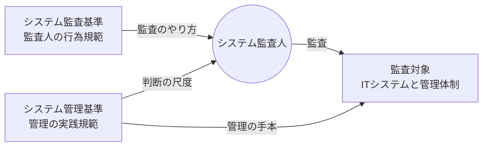
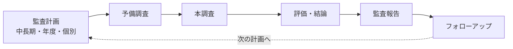
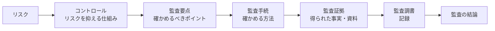
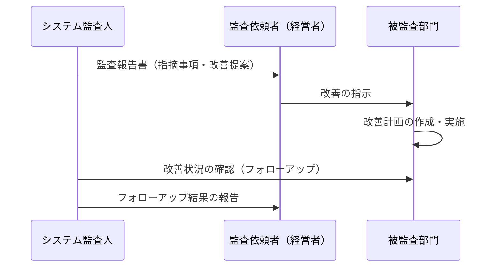
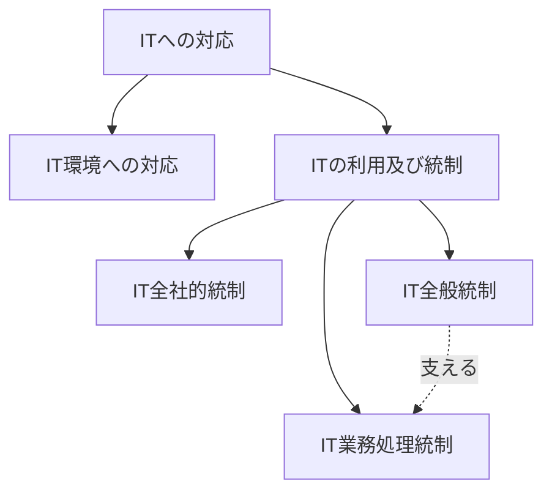
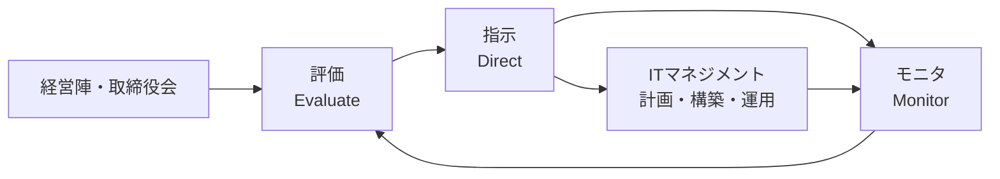
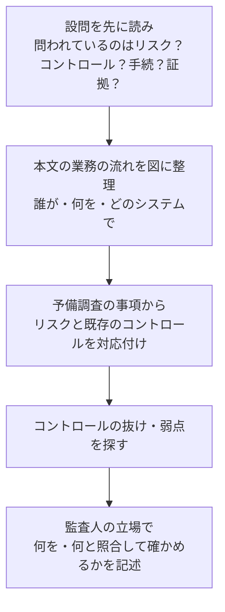

# システム監査

> **重要度：★★★**（科目A（旧午前）で毎回3〜4問、科目B（旧午後）でも「システム監査」が選択問題として毎回1問出題）
> 科目Aでは **監査人の独立性**、**監査手続と監査技法（CAAT など）**、**監査証拠・監査調書**、**IT全般統制／業務処理統制の区別**、**監査報告とフォローアップ** が定番です。
> 科目Bは、事例の業務とシステムを読み「どのリスクに対して、どのコントロールがあり、何を確認すればよいか（監査手続）」を記述させる問題です。技術的な深い知識より **読解力と監査の考え方** で得点できるため、狙い目の選択分野です。
> この章では、システム監査基準・システム管理基準 → 監査人 → 監査の流れ → 監査手続・証拠・調書 → 内部統制 → ITガバナンス → 科目Bの解き方 の順に学びます。

## 目次

- [1. システム監査とは](#1-システム監査とは)
- [2. システム監査基準とシステム管理基準](#2-システム監査基準とシステム管理基準)
- [3. システム監査人と独立性](#3-システム監査人と独立性)
- [4. システム監査の流れ](#4-システム監査の流れ)
- [5. 監査手続・監査技法・監査証拠・監査調書](#5-監査手続監査技法監査証拠監査調書)
- [6. 監査報告とフォローアップ](#6-監査報告とフォローアップ)
- [7. 内部統制](#7-内部統制)
- [8. ITガバナンス](#8-itガバナンス)
- [9. 科目B「システム監査」の解き方](#9-科目bシステム監査の解き方)
- [確認問題](#確認問題)
- [参考](#参考)

## 1. システム監査とは

### 1.1 定義

- 結論：**システム監査** とは、**専門性と客観性を備えた監査人** が、一定の基準に基づいてITシステムの利活用に係る検証・評価を行い、監査結果の利用者に対して、ITシステムの **ガバナンス・マネジメント・コントロールの適切性等について保証を与える、または改善のための助言を行う** 監査です（システム監査基準 令和5年改訂版の考え方）。
- 理由：ITシステムが経営に欠かせなくなった一方、障害・情報漏えい・投資の失敗などのリスクも大きくなったため、第三者的な立場から「きちんと管理されているか」を確かめる仕組みが必要になったからです。
- 例：販売管理システムのアクセス権限が適切に管理されているかを、内部監査部門が権限一覧と人事異動記録を照合して確かめる。

> 📝 令和5年改訂では、対象となる「ITシステム」は、サーバやアプリケーションだけでなく、**企画・調達・外部委託・開発・運用・保守・廃棄** や、**クラウドなど外部のITサービスの利用** まで含む広い概念とされています。

### 1.2 保証型監査と助言型監査

| 種類 | 目的 | 報告の例 |
|---|---|---|
| **保証型監査** | 監査対象が基準に照らして適切であることを **保証する**（意見を表明する） | 「〇〇の管理は、すべての重要な点において適切であると認める」 |
| **助言型監査** | 問題点を指摘し **改善のための助言を行う** | 「〇〇に不備があるため、△△することを推奨する」 |

### 1.3 内部監査と外部監査

| 種類 | 実施者 | 特徴 |
|---|---|---|
| **内部監査** | 組織内の **内部監査部門**（監査対象部門から独立） | 経営者（または取締役会・監査委員会）の依頼で実施。改善に役立てる |
| **外部監査** | 組織外の **独立した第三者**（監査法人、監査会社など） | 利害関係者に対する信頼性の付与 |

## 2. システム監査基準とシステム管理基準

### 2.1 2つの基準の関係（★★★）

経済産業省は、**システム監査基準** と **システム管理基準** の2つを公表しています（いずれも最新は **令和5年（2023年）4月26日改訂版**）。

| 基準 | 位置づけ | 誰のためのものか |
|---|---|---|
| **システム監査基準** | システム監査人の **行為規範**（監査をどう行うか） | **監査人** |
| **システム管理基準** | 組織がITシステムを管理するための **実践規範**。監査の際の **判断の尺度（監査上の判断基準）** として使われる | **監査を受ける組織（経営者・IT部門）**、および監査人 |



> 💡 覚え方：**監査基準 ＝「監査人の守るべきルール」**、**管理基準 ＝「組織が守るべき管理のものさし」**。

> ⚠️ ひっかけ注意：「システム管理基準は、監査人が監査を実施する手順を定めたもの」は誤りです。監査の手順や監査人の行動を定めているのは **システム監査基準** です。

### 2.2 システム監査基準（令和5年版）の構成

前文、システム監査の意義と目的、**監査人の倫理**、そして **12の基準** から構成されます。

**監査人の倫理（4つ）**：**誠実性**、**客観性**、**監査人としての能力及び正当な注意**、**秘密の保持**

| 区分 | 基準 | 名称 | ポイント |
|---|---|---|---|
| 属性に係る基準 | 1 | 権限と責任等の明確化 | 監査の目的・権限・責任を文書（監査規程など）で明確にする |
| | 2 | 専門的能力の保持と向上 | 必要な知識・技能を保持し、継続的に向上させる |
| | 3 | ニーズの把握と品質の確保 | 監査依頼者のニーズを把握し、監査の品質を管理する |
| | 4 | 独立性と客観性の保持 | 監査対象から **独立** し、**客観的** な立場で判断する |
| | 5 | 能力及び正当な注意と秘密の保持 | 専門職としての正当な注意を払い、知り得た秘密を守る |
| 実施に係る基準 | 6 | 監査計画の策定 | **リスクに基づく** 監査計画を策定する |
| | 7 | 監査計画の種類 | 中長期計画、年度計画、個別監査計画 など |
| | 8 | 監査証拠の入手と評価 | **十分かつ適切な監査証拠** を入手し評価する |
| | 9 | 監査調書の作成と保管 | 監査の記録（監査調書）を作成し、適切に保管する |
| | 10 | 監査の結論の形成 | 監査証拠に基づいて結論を導く |
| 報告に係る基準 | 11 | 監査報告書の作成と報告 | 監査報告書を作成し、依頼者に報告する |
| | 12 | 改善提案のフォローアップ | 改善提案の実施状況を確認する |

> 📝 平成30年版までは「一般基準・実施基準・報告基準」という区分でした。過去問ではこの旧区分の言葉が出ることもありますが、意味（監査人の資質 → 実施方法 → 報告）は同じ流れです。

### 2.3 システム管理基準（令和5年版）の構成

| 編 | 内容 |
|---|---|
| **ITガバナンス編** | 経営陣（取締役会等）がITの利活用を **評価（Evaluate）・指示（Direct）・モニタ（Monitor）** するための項目。IT戦略、ITに関する原則・方針、リスク・資源の管理など |
| **ITマネジメント編** | ITガバナンスの方針に沿って、IT部門などがITシステムを管理するための項目。推進・管理体制、企画、開発、アジャイル開発、運用・利用、保守、廃棄、外部サービス管理、事業継続、人的資源管理など |

- システム管理基準は「すべての項目を守らなければならない」ものではなく、組織の状況に応じて **取捨選択・追加して利用する** ことが前提です。

### 2.4 関連する基準

| 基準 | 内容 |
|---|---|
| **情報セキュリティ監査基準**（経済産業省） | 情報セキュリティに特化した監査の行為規範。**保証型** と **助言型** がある |
| **情報セキュリティ管理基準**（経済産業省） | 情報セキュリティ監査の判断の尺度。JIS Q 27001／27002 をもとに作成 |
| **システム監査基準ガイドライン** | 各基準の実施方法を具体的に解説したもの |

## 3. システム監査人と独立性

### 3.1 独立性（★★★）

- 結論：システム監査人は、**監査対象から独立した立場** でなければなりません。
- 理由：自分が関わった業務やシステムを自分で監査しても、公正な評価にならず、監査結果の信頼性が損なわれるためです。

| 独立性の種類 | 内容 | 例 |
|---|---|---|
| **外観上の独立性** | 組織上・身分上、監査対象と利害関係がないこと（**第三者から見て独立していると判断できる**） | 監査対象部門に所属していない、監査対象の開発に関与していない |
| **精神上の独立性（客観性）** | 公正かつ客観的に判断する **心構え** を持つこと | 先入観や依頼者への配慮で判断をゆがめない |

> ⚠️ ひっかけ注意（頻出）
> - 「監査対象システムの **開発プロジェクトに参加していた者** が、そのシステムの監査を担当する」→ **独立性が損なわれる**（外観上の独立性）。
> - 「内部監査部門を **情報システム部長の配下** に置く」→ 監査対象部門の指揮下にあるので不適切。内部監査部門は **経営者（社長）や取締役会の直轄** に置くのが望ましい。
> - 監査人が **改善策を自ら実施する** と、次の監査で自分の作業を評価することになり独立性が損なわれます。**改善の実施は被監査部門の責任** です。

### 3.2 専門的能力と正当な注意

- **専門的能力**：ITの知識だけでなく、監査の手法・関連法規・業務知識などが必要です。足りない場合は外部の専門家を活用できます（ただし最終的な責任は監査人が負います）。
- **正当な注意**：専門職として当然払うべき注意を払うこと。
- **秘密の保持**：監査で知り得た情報を、正当な理由なく漏らしたり、目的外に利用したりしないこと。

## 4. システム監査の流れ

### 4.1 全体の流れ（★★）



| 段階 | 主な内容 |
|---|---|
| **監査計画** | **中長期計画**（複数年の方針）→ **年度計画（基本計画）**（その年の対象・時期・要員）→ **個別監査計画**（監査ごとの目的・範囲・手続・日程） |
| **予備調査** | 監査対象の **実態を概括的に把握** する。資料の入手、関係者へのヒアリングなど。結果に応じて個別監査計画を修正する |
| **本調査** | 監査手続を実施して **監査証拠を入手** し、**監査調書** に記録する |
| **評価・結論** | 監査証拠をもとに、コントロールが適切か評価し、監査の結論（指摘事項）をまとめる |
| **監査報告** | **監査報告書** を作成し、**監査の依頼者（経営者など）** に報告する |
| **フォローアップ** | 改善提案（改善勧告）の **実施状況を確認** する |

### 4.2 リスクアプローチ

- 結論：**リスクの大きい領域に監査の資源（時間・人員）を重点的に配分** する考え方です。
- 理由：すべてを同じ深さで監査することは時間的に不可能なため、重大な問題が起こりやすい領域を優先します。
- 監査リスク（誤った結論を出してしまうリスク）を、許容できる水準に抑えることが目的です。

```
監査リスク ＝ 固有リスク × 統制リスク × 発見リスク

  固有リスク：コントロールがないと仮定した場合に、重大な誤り・不正が起こるリスク
  統制リスク：内部統制（コントロール）で防止・発見できないリスク
  発見リスク：監査手続によっても発見できないリスク
  → 固有リスク・統制リスクが高い領域ほど、監査手続を増やして発見リスクを下げる
```

## 5. 監査手続・監査技法・監査証拠・監査調書

### 5.1 用語の整理（★★★）



| 用語 | 意味 | 例 |
|---|---|---|
| **監査要点** | 監査で確かめるべき目標・ポイント | 「退職者のIDが速やかに削除されているか」 |
| **監査手続** | 監査要点を確かめるために実施する **具体的な方法**（監査技法の組合せ） | 「退職者一覧とIDの一覧を **突合** し、退職日以降に有効なIDがないかを確かめる」 |
| **監査証拠** | 監査手続によって入手した、結論を裏付ける **事実や資料** | 突合の結果表、ID一覧の出力、承認済みの削除申請書 |
| **監査調書** | 実施した監査手続と入手した監査証拠、判断の過程を記録した文書 | 監査人が作成する作業記録 |

### 5.2 監査技法

| 技法 | 内容 |
|---|---|
| **チェックリスト法** | 事前に作成したチェックリストに沿って、質問や確認を行う |
| **ドキュメントレビュー法** | 規程・設計書・議事録・ログなどの文書を閲覧して確かめる |
| **インタビュー法** | 関係者に直接質問して回答を得る（**単独では証拠力が弱い** ため、他の証拠で裏付ける） |
| **ウォークスルー法** | 業務やデータの流れを、**実際の取引を例に始めから終わりまでたどって** 確かめる |
| **突合・照合法** | 関連する記録同士を突き合わせて、一致しているか確かめる |
| **現地調査法（観察法）** | 監査人が現場に出向いて、作業の状況や設備を **自ら観察** する |
| **ログ分析法** | アクセスログや操作ログを分析し、不正や異常を見つける |

#### CAAT（Computer Assisted Audit Techniques：コンピュータ支援監査技法）（★★）

コンピュータを利用して監査手続を行う技法の総称です。

| 技法 | 内容 |
|---|---|
| **テストデータ法** | 監査人が用意した **テストデータ** を本番プログラムで処理し、結果が期待どおりか確かめる |
| **監査モジュール法** | 本番プログラムに **監査用のモジュールを組み込み**、処理中に条件に合うデータを抽出・記録する |
| **ITF法（Integrated Test Facility：ミニカンパニー法）** | 本番システム内に **架空の口座や部門** を設け、本番と同時にテスト取引を処理して確かめる |
| **スナップショット法** | 処理の途中の特定時点の **データの内容を記録（スナップショット）** し、処理の正確性を確かめる |
| **トレーシング法** | プログラムの **実行経路を追跡** して記録し、処理の流れを確かめる |
| **並行シミュレーション法** | 監査人が本番と同じ機能のプログラムを用意し、**同じデータで処理した結果を比較** する |
| **汎用監査ソフトウェア（GAS）** | データの抽出・集計・突合を行う市販の監査用ソフトウェア |

> 💡 覚え方：**テスト「データ」法は監査人がデータを用意**、**並行「シミュレーション」法は監査人がプログラムを用意**。

### 5.3 監査証拠（★★）

- 監査人は、監査の結論を裏付けるために、**十分かつ適切な監査証拠** を入手しなければなりません。
  - **十分性**：証拠の **量** が足りているか。
  - **適切性**：証拠の **質**（監査要点との関連性と信頼性）が適切か。
- 証拠力の一般的な傾向：

| 証拠力が高い | 証拠力が低い |
|---|---|
| 監査人が **自ら観察・再実施** して得たもの | 被監査部門の **口頭説明** だけ |
| **外部の第三者** から直接入手したもの | 被監査部門が作成して手渡したもの |
| **文書・システムの記録**（承認印・ログなど） | 記憶に基づく証言 |

| 証拠の種類 | 例 |
|---|---|
| 物理的証拠 | 現地調査で観察した設備の状況 |
| 文書的証拠 | 規程、承認済み申請書、議事録、ログ |
| 口頭的証拠 | インタビューの回答 |

### 5.4 監査調書（★★）

- **監査調書** は、監査人が実施した **監査手続・入手した監査証拠・判断の過程と結論** を記録した文書です。
- 役割：
  - **監査の結論の根拠** となる（「なぜその結論になったか」を後から説明できる）。
  - 監査の品質管理・レビューに使う。
  - 次回以降の監査の参考資料になる。
- 監査調書は **監査人が作成** し、**適切な方法で保管** しなければなりません（機密保持・改ざん防止）。

> ⚠️ ひっかけ注意：「監査調書は、被監査部門が作成して監査人に提出する」は誤り。監査調書は **監査人自身が作成** します。また、監査報告書に記載する指摘事項は、**監査調書に記録された監査証拠に裏付けられている** 必要があります。

## 6. 監査報告とフォローアップ

### 6.1 監査報告書

- **監査報告書** は、監査の目的・対象・期間・実施した手続の概要・**監査の結論（意見）**・**指摘事項**・**改善提案（改善勧告）** などを記載し、**監査の依頼者** に提出します。
- 記載する前に、指摘事項について **被監査部門と事実確認（意見交換）** を行い、事実誤認がないようにします。ただし、監査の結論は **監査人が独自に判断** します（被監査部門の同意は必要ありません）。

### 6.2 フォローアップ



- **改善を実施する責任は被監査部門（とその指示を出す経営者）** にあります。
- 監査人は **改善状況を確認** し、不十分なら再度報告します。監査人自身が改善を行ってはいけません（独立性の確保）。

## 7. 内部統制

### 7.1 内部統制とは

- 結論：**内部統制** とは、組織の目的を達成するために、**組織内のすべての者によって遂行されるプロセス**（仕組み）です。
- 理由：経営者一人の目ではすべての業務を管理できないため、ルール・承認・チェック・監視の仕組みを業務に組み込み、不正や誤りを防ぎます。
- 例：発注を担当者が入力し、上長が承認しないと発注できない（**職務の分離** と **承認**）。

### 7.2 COSOフレームワーク（★★）

**COSO（Committee of Sponsoring Organizations of the Treadway Commission：トレッドウェイ委員会支援組織委員会）** が公表した、内部統制の国際的な標準的枠組みです（1992年公表、2013年改訂）。

| 3つの目的 | 5つの構成要素 |
|---|---|
| 業務（の有効性・効率性） | **統制環境**（組織の気風、経営者の誠実性・倫理観。**他の要素の基礎**） |
| 報告（の信頼性） | **リスク評価** |
| コンプライアンス（法令遵守） | **統制活動**（承認、職務分離、照合などの方針と手続） |
| | **情報と伝達** |
| | **モニタリング**（日常的モニタリング・独立的評価） |

### 7.3 J-SOX（日本版SOX法）（★★）

- **J-SOX** は、**金融商品取引法** に基づく **財務報告に係る内部統制の評価・報告制度** の通称です。上場企業は、経営者が内部統制を評価した **内部統制報告書** を作成し、**公認会計士または監査法人の監査** を受けます（2008年4月以降開始の事業年度から適用）。
- 金融庁の「財務報告に係る内部統制の評価及び監査の基準」は、COSOをもとに日本独自の要素を加えています（2023年改訂、2024年4月1日以後開始の事業年度から適用）。

| 4つの目的 | 6つの基本的要素 |
|---|---|
| 業務の有効性及び効率性 | 統制環境 |
| **報告の信頼性** | リスクの評価と対応 |
| 事業活動に関わる法令等の遵守 | 統制活動 |
| **資産の保全**（日本独自） | 情報と伝達 |
| | モニタリング |
| | **ITへの対応**（日本独自） |

> 💡 覚え方：COSO の「3目的・5要素」に、J-SOXは **「資産の保全」と「ITへの対応」を1つずつ追加** して「4目的・6要素」。

- **3線モデル**（内部監査人協会 IIA が提唱）：第1線＝業務部門（リスクの所有・管理）、第2線＝リスク管理・コンプライアンス部門（支援・監視）、第3線＝**内部監査部門**（独立した保証）。2023年の改訂基準でも言及されています。

### 7.4 ITへの対応とIT統制（★★★）



| 統制の種類 | 内容 | 例 |
|---|---|---|
| **IT全社的統制** | 組織全体のITに関する方針・体制 | IT戦略の策定、IT管理規程の整備 |
| **IT全般統制** | 業務処理統制が **有効に機能する環境を保証する** ための統制（複数の業務処理統制に共通する基盤） | **システムの開発・保守の管理**、**運用管理**、**アクセス管理などシステムの安全性の確保**、**外部委託に関する契約の管理** |
| **IT業務処理統制** | 個々の業務システムで、**承認された取引が正確・網羅的に処理・記録される** ことを確保する統制 | **入力データのエディットチェック**、**コントロールトータル（件数・合計金額の照合）**、マスタデータの維持管理、例外処理（エラー）の修正と再処理、アクセス制限による承認 |

> ⚠️ ひっかけ注意（頻出）
> - 「プログラム変更時に承認とテストを行う」「本番環境へのアクセス権を管理する」「バックアップを取得する」→ **IT全般統制**。
> - 「受注入力画面で、入力された数量が上限を超えるとエラーにする」「バッチ処理の入力件数と出力件数を照合する」→ **IT業務処理統制**。
> - IT全般統制に不備があると、その上で動く業務処理統制の有効性も **信頼できなくなります**。

#### 業務処理統制の観点

| 観点 | 意味 | 統制の例 |
|---|---|---|
| **網羅性** | 取引が漏れなく、重複なく処理されている | 連番チェック、件数照合 |
| **正確性** | 正しい金額・数量で処理されている | エディットチェック（桁・範囲・形式）、チェックディジット |
| **正当性（妥当性）** | 承認された取引だけが処理されている | 承認ワークフロー、権限管理 |
| **維持継続性** | 処理されたデータが改ざんされず維持されている | マスタ変更の承認、変更ログの確認 |

## 8. ITガバナンス

### 8.1 ITガバナンスとは

- 結論：**ITガバナンス** とは、**経営陣がステークホルダーのニーズに基づき、組織の価値を高めるために、IT戦略を策定し実行をコントロールする仕組み** です。
- 理由：IT投資の成否が経営の成否を左右するため、IT部門任せにせず、**経営者自身** がITの方向付けと監視に責任を持つ必要があるからです。
- **ITガバナンスは経営陣（取締役会）の責任**、**ITマネジメントはIT部門などの責任** という役割分担がポイントです。

### 8.2 JIS Q 38500（ISO/IEC 38500）

ITガバナンスの国際規格で、経営陣が行う **3つのタスク（EDMモデル）** と **6つの原則** を示しています。



| 6つの原則 | 内容 |
|---|---|
| 責任 | ITに関する責任を明確にし、理解・受容させる |
| 戦略 | 事業戦略にITの能力を考慮し、ITが戦略を支える |
| 取得 | IT投資は妥当な理由に基づき、透明な意思決定で行う |
| パフォーマンス | ITが事業を支援するのに適した目的を果たす |
| 適合 | 法令や規則、内部方針に適合する |
| 人間行動 | ITの方針・実践が人間の行動を尊重する |

### 8.3 その他の関連フレームワーク

| フレームワーク | 内容 |
|---|---|
| **COBIT**（ISACA） | ITガバナンス・ITマネジメントのフレームワーク。目標の連鎖やプロセスを体系化 |
| **DX推進指標**（経済産業省） | 企業がDXの取組状況を自己診断するための指標 |
| **デジタルガバナンス・コード**（経済産業省） | 経営者がDXを推進するうえで実践すべき事項をまとめたもの |

## 9. 科目B「システム監査」の解き方

### 9.1 出題の形

- 事例企業の **業務・システム・管理状況** が説明され、監査人が **予備調査で把握した事項** が表で示されることが多いです。
- 典型的な設問：
  - 「〇〇のリスクに対して、確認すべきコントロールは何か」
  - 「監査人が入手すべき **監査証拠** は何か」
  - 「〇〇を確かめるための **監査手続** を述べよ」
  - 「この監査手続だけでは不十分な理由は何か」
  - 「（監査人の）指摘事項／改善提案として適切なものは何か」

### 9.2 解き方の手順



### 9.3 得点のコツ

1. **リスク → コントロール → 監査手続 → 監査証拠** の流れで考える：本文中のリスク（不正・誤り・漏えい・停止）を見つけ、それを防ぐコントロールが本文にあるか、あれば「それが実際に運用されているか」を確かめる手続を考えます。
2. **監査手続は「何を」「何と」「どう確かめるか」まで具体的に書く**：
   - ×「アクセス権を確認する」
   - ○「**退職者リスト** と **IDの一覧** を **突合** し、退職日以降に有効なIDがないことを確かめる」
3. **整備状況と運用状況を区別する**：
   - **整備状況**：ルールや仕組みが **存在し、設計が適切か**（規程・手順書を閲覧）。
   - **運用状況**：ルールどおりに **実際に運用されているか**（承認記録・ログをサンプルで確かめる）。「規程がある」だけでは運用されている証拠にならない点が頻出です。
4. **インタビューだけで終わらせない**：口頭の説明は記録（ログ・承認書）で裏付けます。
5. **監査人の立場を守る**：監査人は **改善を実施しない**、**被監査部門に命令しない**。解答は「〜を確かめる」「〜を改善するよう勧告する」の形にします。
6. **本文の言葉を使う**：表の項目名、システム名、帳票名などを解答にそのまま使うと、採点者に意図が伝わりやすくなります。

## 確認問題

**問1** システム監査基準とシステム管理基準に関する記述として、適切なものはどれか。

ア システム監査基準は、組織がITシステムを管理するための実践規範である。
イ システム管理基準は、システム監査人の行為規範である。
ウ システム監査基準はシステム監査人の行為規範であり、システム管理基準は監査上の判断の尺度として利用される。
エ システム管理基準は、すべての管理項目を例外なく適用しなければならない。

<details><summary>解答・解説</summary>

**正解：ウ**

- ア・イ：説明が逆です。
- エ：システム管理基準は、組織の状況に応じて **取捨選択・追加して利用する** ことが前提です。

</details>

**問2** システム監査人の独立性の観点から、最も問題があるものはどれか。

ア 内部監査部門を社長直轄の組織とした。
イ 監査対象システムの開発プロジェクトでプロジェクトマネージャを務めた者を、そのシステムの監査チームのリーダにした。
ウ 専門知識を補うため、外部の専門家に監査業務の一部を依頼した。
エ 監査の結論をまとめる前に、指摘事項について被監査部門と事実確認を行った。

<details><summary>解答・解説</summary>

**正解：イ**

自分が関与したシステムを監査することになり、**外観上の独立性** が損なわれます。
- ア：望ましい組織体制です。
- ウ：外部専門家の活用は認められています（最終的な責任は監査人）。
- エ：事実誤認を防ぐための適切な手続です。

</details>

**問3** 本番のプログラムに監査用のモジュールを組み込み、処理の過程で監査人が指定した条件に合致するデータを抽出・記録する監査技法はどれか。

ア テストデータ法
イ 監査モジュール法
ウ 並行シミュレーション法
エ ITF法

<details><summary>解答・解説</summary>

**正解：イ**

- ア：監査人が作成した **テストデータ** を本番プログラムで処理する。
- ウ：監査人が用意した **プログラム** で同じデータを処理し、結果を比較する。
- エ：本番システム内に **架空の口座** を設けてテスト取引を処理する。

</details>

**問4** 監査調書に関する記述として、適切なものはどれか。

ア 監査調書は、被監査部門が作成し、監査人に提出する文書である。
イ 監査調書は、監査の結論を導いた根拠となるものであり、監査人が作成して適切に保管する。
ウ 監査調書は監査報告書の提出後、直ちに廃棄しなければならない。
エ 監査調書には、監査報告書に記載した指摘事項だけを記録する。

<details><summary>解答・解説</summary>

**正解：イ**

- ア：監査調書は **監査人自身が作成** します。
- ウ：結論の根拠として、また次回監査の参考として **適切に保管** します。
- エ：実施した監査手続、入手した証拠、判断過程も記録します（指摘にならなかった事項も含む）。

</details>

**問5** 監査報告書で改善提案を行った後の対応として、適切なものはどれか。

ア 監査人が被監査部門に代わって改善策を実施する。
イ 改善の実施は被監査部門の責任で行い、監査人はその実施状況を確認する。
ウ 監査人は、改善策の実施を被監査部門に直接命令する。
エ 監査報告書を提出した時点で監査人の業務はすべて終了し、改善状況は確認しない。

<details><summary>解答・解説</summary>

**正解：イ**

監査人は **フォローアップ** で改善状況を確認します。自ら改善を実施すると独立性が損なわれ（ア）、改善の指示は経営者（監査依頼者）が行います（ウ）。

</details>

**問6** 財務報告に係る内部統制において、IT業務処理統制に該当するものはどれか。

ア 本番プログラムの変更は、承認とテストを経てから実施する。
イ システム運用担当者の本番環境へのアクセス権限を定期的に見直す。
ウ 売上入力画面で、入力された単価が商品マスタの単価と一致しない場合はエラーとする。
エ システムの開発・保守業務を外部に委託する際に、委託先の管理状況を評価する。

<details><summary>解答・解説</summary>

**正解：ウ**

個々の業務アプリケーションで入力の **正確性** を確保する統制なので **IT業務処理統制** です。
ア（開発・保守）、イ（アクセス管理）、エ（外部委託管理）はいずれも **IT全般統制** です。

</details>

**問7** 金融庁の「財務報告に係る内部統制の評価及び監査の基準」が示す内部統制の基本的要素のうち、COSOフレームワークの構成要素に含まれず、日本独自に追加されたものはどれか。

ア 統制環境　イ 情報と伝達　ウ モニタリング　エ ITへの対応

<details><summary>解答・解説</summary>

**正解：エ**

J-SOXの基本的要素は、COSOの5要素（統制環境・リスク評価・統制活動・情報と伝達・モニタリング）に **ITへの対応** を加えた6つです。また目的には **資産の保全** が加えられています。

</details>

**問8** システム監査において、「退職者のIDが速やかに削除されていること」を確かめる監査手続として、最も適切なものはどれか。

ア 情報システム部長に、退職者のIDを削除しているかどうかをインタビューする。
イ ID管理規程に、退職時にIDを削除する旨が定められていることを確かめる。
ウ 人事部の退職者リストとシステムの有効なID一覧を突合し、退職日以降に有効なIDが残っていないことを確かめる。
エ 監査人が退職者のIDを自ら削除する。

<details><summary>解答・解説</summary>

**正解：ウ**

- ア：口頭の説明だけでは証拠力が弱い。
- イ：**整備状況** の確認にとどまり、実際に運用されているか（**運用状況**）は確かめられません。
- ウ：独立した記録（人事部の退職者リスト）とシステムの記録を **突合** しており、運用状況を確かめられます。
- エ：監査人が業務を実施すると独立性が損なわれます。

</details>

**問9** JIS Q 38500 で示されている、経営陣がITガバナンスにおいて行う3つのタスクの組合せはどれか。

ア 計画・実行・評価
イ 評価・指示・モニタ
ウ 特定・分析・対応
エ 方針・実施・改善

<details><summary>解答・解説</summary>

**正解：イ**

**EDMモデル**：評価（Evaluate）・指示（Direct）・モニタ（Monitor）。システム管理基準のITガバナンス編もこの考え方に基づいています。

</details>

## 参考

- IPA 試験要綱・シラバス（応用情報技術者試験 シラバス Ver.7.2）: https://www.ipa.go.jp/shiken/syllabus/gaiyou.html
- IPA 応用情報技術者試験 シラバスPDF（Ver.7.2）: https://www.ipa.go.jp/shiken/syllabus/omgdg50000005kq5-att/syllabus_ap_ver7_2.pdf
- IPA 過去問題（問題冊子・解答例・採点講評）: https://www.ipa.go.jp/shiken/mondai-kaiotu/index.html
- 経済産業省「システム監査制度（システム監査基準・システム管理基準）」: https://www.meti.go.jp/policy/netsecurity/sys-kansa/
- 経済産業省「システム監査基準（令和5年4月26日）」PDF: https://www.meti.go.jp/policy/netsecurity/sys-kansa/sys-kansa-2023r.pdf
- 経済産業省「情報セキュリティ監査制度」: https://www.meti.go.jp/policy/netsecurity/is-kansa/
- 金融庁「財務報告に係る内部統制の評価及び監査の基準」等（2023年改訂）: https://www.fsa.go.jp/news/r4/sonota/20230407/20230407.html
- 日本システム監査人協会（SAAJ）: https://www.saaj.or.jp/
