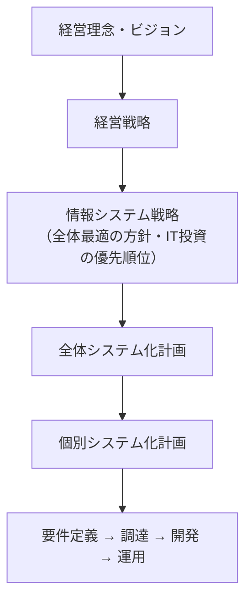
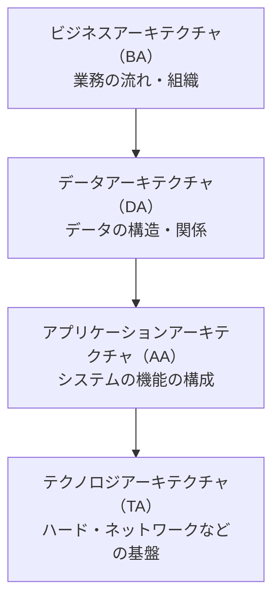
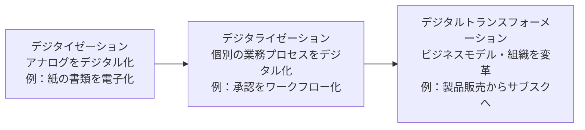
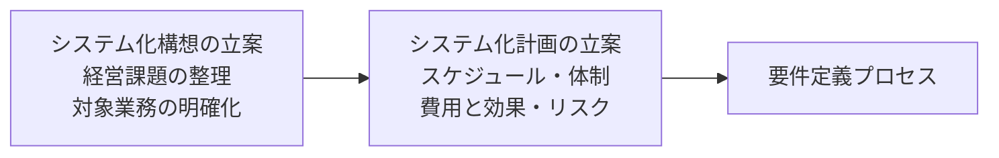
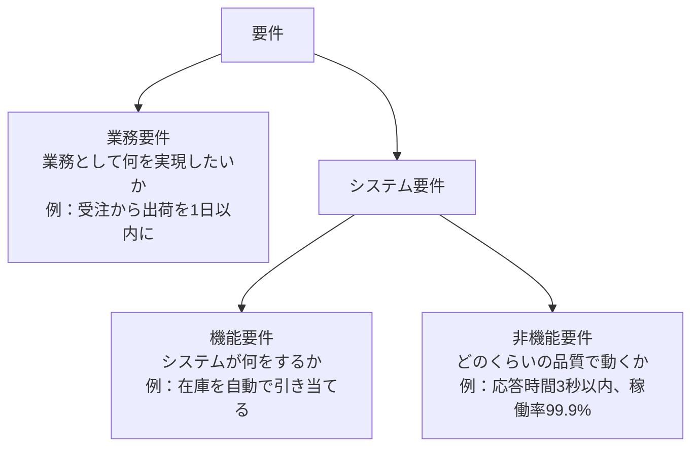
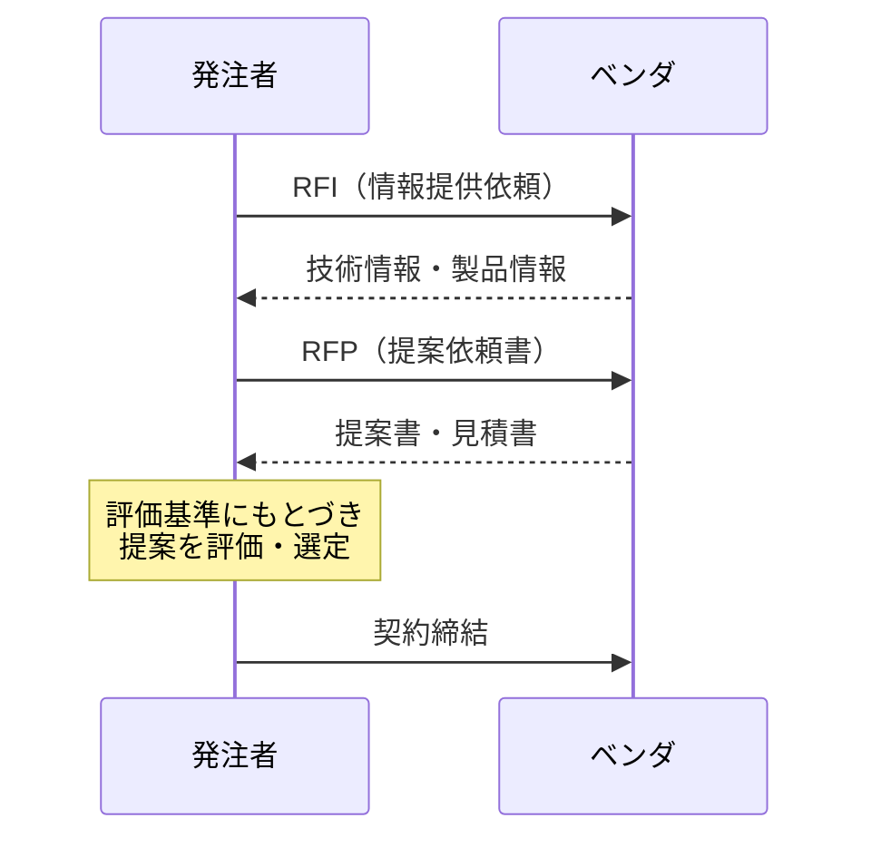
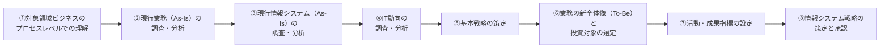

# システム戦略

> **出題傾向・重要度：★★**
> 科目A（旧午前）では、ストラテジ系の中でも「情報システム戦略」「業務プロセス改善」「クラウドサービス」「システム化計画・要件定義」「調達」から毎回数問が出ます。用語の定義を問う問題が中心です。
> 科目B（旧午後）では、**問2（経営戦略）** の中で、DX推進や業務改善、システム化の投資評価などとして出題されます。
> この章で押さえるポイントは次の4つです。
> ① EA・BPR・BPM・RPAなど「業務とITをどう変えるか」の用語の違い、② IaaS／PaaS／SaaSの責任分担、③ システム化計画 → 要件定義 → 調達（RFI → RFP → 契約）という流れ、④ 投資評価（ROI・回収期間・NPV）の計算。

## 目次

- [1. 情報システム戦略](#1-情報システム戦略)
- [2. エンタープライズアーキテクチャ（EA）](#2-エンタープライズアーキテクチャea)
- [3. 業務プロセスの改善](#3-業務プロセスの改善)
- [4. DX（デジタルトランスフォーメーション）](#4-dxデジタルトランスフォーメーション)
- [5. クラウドサービスとソリューションビジネス](#5-クラウドサービスとソリューションビジネス)
- [6. システム化計画と投資評価](#6-システム化計画と投資評価)
- [7. 要件定義](#7-要件定義)
- [8. 調達](#8-調達)
- [9. 科目Bでの出題のされ方](#9-科目bでの出題のされ方)
- [10. 情報システム戦略・業務プロセス・システム活用の補足](#10-情報システム戦略業務プロセスシステム活用の補足)
- [11. システム企画の詳細（システム化構想・要件定義・調達）](#11-システム企画の詳細システム化構想要件定義調達)
- [確認問題](#確認問題)
- [📋 シラバス用語チェックリスト](#-シラバス用語チェックリスト)
- [参考](#参考)

---

## 1. 情報システム戦略

### 1.1 情報システム戦略とは ★★

- **結論**：情報システム戦略は、**経営戦略を実現するために、ITをどう使うかを決めた中長期の計画**です。
- **理由**：IT投資は「経営目標に役立つか」で評価されます。部門ごとにバラバラにシステムを作ると、データが分断され、二重投資も起きます。このため、経営戦略から下ろした**全体最適**の計画が必要です。
- **例**：「3年で顧客満足度を20%上げる」という経営戦略に対し、「顧客データを全社で統合するCRM基盤を2年で構築する」という情報システム戦略を立てます。



- 策定・推進の責任者は **CIO（Chief Information Officer：最高情報責任者）** です。CIOは経営者の一員として、IT投資の優先順位を決めます。
- ⚠️ ひっかけ注意：情報システム戦略は **情報システム部門が単独で作るもの ではありません**。経営層が主導し、業務部門と一緒に作ります。

### 1.2 ITガバナンス ★★

- **ITガバナンス**とは、**経営者がITの活用を方向付け、管理・監視する仕組み**です。
- 国際規格 ISO/IEC 38500（日本ではJIS Q 38500）では、経営者の役割を次の3つで表しています。

| 役割 | 英語 | 内容 |
|---|---|---|
| 評価 | Evaluate | 現在と将来のITの利用を評価する |
| 指示 | Direct | 戦略や方針の作成と実行を指示する |
| モニタ | Monitor | 方針どおりの成果が出ているかを監視する |

- 💡 覚え方：頭文字をとって **EDM（評価・指示・モニタ）** です。
- 関連する枠組みに **COBIT（Control Objectives for Information and related Technology）** があります。ISACAが作ったITガバナンスのフレームワークです。

### 1.3 情報システム戦略で使う考え方

| 用語 | 意味 |
|---|---|
| **全体最適化** | 部門ごとの最適（部分最適）ではなく、全社でみて最適なシステム構成にすること |
| **情報システム化基本方針** | 全体最適化の目標・方針・対象範囲などをまとめた文書 |
| **IT投資マネジメント** | 投資前の評価・投資中の管理・投資後の評価をPDCAで回すこと |
| **プログラムマネジメント** | 複数の関連するプロジェクトをまとめて管理し、全体の効果を最大にすること |
| **データ利活用** | 社内外のデータを分析し、意思決定や新サービスに使うこと |

---

## 2. エンタープライズアーキテクチャ（EA）

### 2.1 EAの4つの体系 ★★

- **結論**：**EA（Enterprise Architecture：エンタープライズアーキテクチャ）** は、組織全体の業務とシステムを**4つの階層で整理し、全体最適化を進める手法**です。
- **理由**：業務・データ・アプリケーション・技術基盤を同じ枠組みで描くと、重複や抜けが見えます。
- **進め方**：**現状（As-Is）** と **あるべき姿（To-Be）** を描き、その差（ギャップ）を埋める移行計画を作ります。



| 体系 | 何を描くか | 代表的な成果物 |
|---|---|---|
| ビジネスアーキテクチャ | 業務機能、業務の流れ | 業務説明書、DMM（機能情報関連図）、業務流れ図（WFA） |
| データアーキテクチャ | 業務で使う情報の構造 | 情報体系整理図（UMLのクラス図）、実体関連ダイアグラム（E-R図）、データ定義表 |
| アプリケーションアーキテクチャ | システムの機能とつながり | 情報システム関連図、情報システム機能構成図 |
| テクノロジアーキテクチャ | ハード・ソフト・ネットワーク | ネットワーク構成図、ハードウェア構成図、ソフトウェア構成図 |

- 💡 覚え方：**「ビ・デ・ア・テ」**（ビジネス → データ → アプリ → テクノロジ）と、上から下へ具体的になります。
- ⚠️ ひっかけ注意：「業務の流れ」はBA、「データの構造」はDAです。E-R図はDAの成果物です。

---

## 3. 業務プロセスの改善

### 3.1 BPR・BPM・BPOの違い ★★★

| 用語 | 正式名称 | 特徴 | キーワード |
|---|---|---|---|
| **BPR** | Business Process Reengineering（業務プロセス再構築） | 既存の業務を**根本から見直し、抜本的に作り直す** | 「抜本的」「ゼロベース」 |
| **BPM** | Business Process Management（業務プロセス管理） | 業務プロセスを**PDCAで継続的に改善**する | 「継続的」「PDCA」 |
| **BPO** | Business Process Outsourcing（業務プロセスの外部委託） | 経理・人事など**業務そのものを外部に委託**する | 「業務ごと外部に任せる」 |

- 💡 覚え方：BPR は「**R**＝作り直す（**R**eengineering）」、BPMは「**M**＝回し続ける（**M**anagement）」、BPOは「**O**＝外に出す（**O**utsourcing）」です。
- ⚠️ ひっかけ注意：「業務プロセスを継続的に改善する」という選択肢はBPRではなく **BPM** です。

### 3.2 RPA ★★

- **RPA（Robotic Process Automation：ソフトウェアロボットによる業務自動化）** は、人がPCで行う**定型的な操作**（画面のクリック、データの転記など）を、ソフトウェアのロボットに代わりにやらせる技術です。
- 向いている業務：ルールが決まっていて、繰り返しが多い業務（伝票入力、システム間のデータ転記、帳票の作成など）。
- 向いていない業務：判断が毎回変わる業務、手順がよく変わる業務。
- ⚠️ ひっかけ注意：RPAは**工場の産業用ロボット**ではありません。また、プログラムを新しく大規模に開発するものでもありません。

### 3.3 業務改善で使う手法・システム

| 用語 | 意味 |
|---|---|
| **ワークフローシステム** | 申請・承認などの業務の流れを電子化するシステム |
| **SFA**（Sales Force Automation：営業支援システム） | 営業活動（商談の進み具合、訪問記録など）を共有・管理する |
| **グループウェア** | スケジュール共有、掲示板など、組織内の共同作業を支援する |
| **シェアードサービス** | 複数のグループ会社の共通業務（経理・人事など）を1か所に集める |
| **BYOD**（Bring Your Own Device） | 従業員の私物の端末を業務で使うこと |
| **ECRS（イクルス）** | 改善の4原則。排除（Eliminate）→結合（Combine）→交換（Rearrange）→簡素化（Simplify）の順に検討する |

---

## 4. DX（デジタルトランスフォーメーション）

### 4.1 DXの定義 ★★★

- **DX（Digital Transformation：デジタルトランスフォーメーション）** は、経済産業省の定義では次のように説明されています（要約）。
  > 企業が環境の激しい変化に対応し、データとデジタル技術を活用して、顧客や社会のニーズをもとに**製品・サービス・ビジネスモデルを変革**するとともに、**業務・組織・プロセス・企業文化・風土を変革**し、競争上の優位性を確立すること。
- 段階として次の3つに分けて説明されることが多いです。



- ⚠️ ひっかけ注意：「紙をPDFにする」だけではDXではありません。**ビジネスモデルや組織の変革**まで含むのがDXです。

### 4.2 DXレポートと「2025年の崖」 ★

- 経済産業省の「DXレポート」（2018年）は、複雑化・老朽化・ブラックボックス化した既存システム（**レガシーシステム**）が残ると、DXが進まず、**2025年以降に最大で年12兆円の経済損失**が生じる可能性があると指摘しました。これを **「2025年の崖」** と呼びます。
- **技術的負債**：その場しのぎの改修を重ねた結果、将来の保守費用がふくらむ状態のことです。

### 4.3 デジタルガバナンス・コードとDX認定 ★★

- **デジタルガバナンス・コード**は、経済産業省がまとめた「DXを進める経営者に求められる対応」の指針です。2020年に策定され、2022年に2.0、**2024年9月に3.0**（副題「DX経営による企業価値向上に向けて」）に改訂されました。
- 3.0では「3つの視点と5つの柱」で整理されています。

| 5つの柱 | 内容（要点） |
|---|---|
| 1. 経営ビジョン・ビジネスモデルの策定 | デジタルによる環境変化をふまえ、ビジョンとビジネスモデルを描く |
| 2. DX戦略の策定 | ビジョンを実現するためのDX戦略を立てる |
| 3. DX戦略の推進 | 組織づくり、デジタル人材の育成・確保、ITシステム・サイバーセキュリティ |
| 4. 成果指標の設定・DX戦略の見直し | KPIを決め、達成度をみて戦略を見直す |
| 5. ステークホルダーとの対話 | 投資家などに取組みを情報発信し、対話する |

- 3つの視点：①経営ビジョンとDX戦略の連動、②As is–To beギャップの定量把握・見直し、③企業文化への定着。
- **DX認定制度**：デジタルガバナンス・コードの基本的事項に対応した企業を、国（経済産業省）が認定する制度です。認定企業の中から特に優れた企業が「**DX銘柄**」（経済産業省・東京証券取引所などが選定）に選ばれます。
- **DX推進指標**：企業がDXの取組み状況を**自己診断**するための指標です（IPAが自己診断結果を収集・分析）。

### 4.4 SoR・SoE・SoI ★★

| 種類 | 正式名称 | 目的 | 例 | 開発スタイル |
|---|---|---|---|---|
| **SoR** | System of Record（記録のシステム） | 正確にデータを**記録**する | 会計、販売管理、基幹系システム | 品質重視・計画的（ウォーターフォール型が多い） |
| **SoE** | System of Engagement（つながりのシステム） | 顧客との**つながり・関係づくり** | ECサイト、スマホアプリ、SNS連携 | スピード重視・変更しやすさ（アジャイル型が多い） |
| **SoI** | System of Insight（洞察のシステム） | データを分析して**洞察**を得る | BI、データ分析基盤、AI | SoRとSoEのデータを統合して分析 |

- 💡 覚え方：**R＝Record（記録）**、**E＝Engagement（顧客との絆）**、**I＝Insight（洞察）**。
- 関連用語：**バイモーダルIT**（ガートナー社の用語）は、SoRのような安定重視の「モード1」と、SoEのような俊敏性重視の「モード2」を併用する考え方です。

---

## 5. クラウドサービスとソリューションビジネス

### 5.1 クラウドのサービスモデル（IaaS／PaaS／SaaS） ★★★

- **結論**：クラウドサービスは、**事業者がどの層まで提供するか**で、IaaS・PaaS・SaaSに分かれます（米国NIST SP 800-145の定義が基本）。
- 利用者が管理する範囲は、IaaS → PaaS → SaaS の順に**狭く**なります。

| 層 | オンプレミス | IaaS | PaaS | SaaS |
|---|---|---|---|---|
| アプリケーション | 利用者 | 利用者 | 利用者 | **事業者** |
| データ・ランタイム（実行環境）・ミドルウェア | 利用者 | 利用者 | **事業者**（※データは利用者） | **事業者**（※データは利用者） |
| OS | 利用者 | 利用者 | **事業者** | **事業者** |
| 仮想化・サーバ・ストレージ・ネットワーク | 利用者 | **事業者** | **事業者** | **事業者** |

| モデル | 正式名称 | 提供されるもの | 例 |
|---|---|---|---|
| **IaaS** | Infrastructure as a Service | 仮想サーバ、ストレージ、ネットワークなどの**基盤** | 仮想マシンを借りてOSから自分で入れる |
| **PaaS** | Platform as a Service | OS・ミドルウェア・実行環境などの**プラットフォーム** | DBやアプリ実行環境を借りて、自作アプリを載せる |
| **SaaS** | Software as a Service | **アプリケーションそのもの** | Webメール、クラウド型の会計ソフト |

- 💡 覚え方：**I＝インフラだけ**、**P＝プラットフォームまで**、**S＝ソフトまで全部**。
- ⚠️ ひっかけ注意：どのモデルでも、**データ（何を入れるか）とアカウント（誰に使わせるか）の管理責任は利用者側**に残ります。これを **責任共有モデル** といいます。
- 関連用語：**DaaS**（Desktop as a Service：仮想デスクトップの提供）、**FaaS**（Function as a Service：関数単位でプログラムを実行。サーバレスとも）。

### 5.2 クラウドの実装モデル（配置モデル） ★

| 実装モデル | 説明 |
|---|---|
| パブリッククラウド | 不特定多数の利用者が共同で使うクラウド |
| プライベートクラウド | 1つの組織が専用で使うクラウド |
| コミュニティクラウド | 目的が共通する複数の組織（例：自治体どうし）が共同で使うクラウド |
| ハイブリッドクラウド | 上の2つ以上を組み合わせたもの |

### 5.3 クラウド以外のサービス形態

| 用語 | 意味 |
|---|---|
| **オンプレミス** | 自社の設備に自社でサーバを置いて運用する |
| **ハウジング** | 事業者のデータセンターの場所・電源・回線を借り、**自社のサーバ**を置く |
| **ホスティング** | 事業者が持つ**サーバを借りる** |
| **ASP**（Application Service Provider） | アプリケーションをネットワーク経由で提供する事業者。SaaSの前身にあたる |

- 💡 覚え方：ハウジングは「**家（場所）だけ**借りる」、ホスティングは「**サーバごと**借りる」。

### 5.4 ソリューションビジネス ★

- **ソリューションビジネス**とは、顧客の経営課題を分析し、ハード・ソフト・サービスを組み合わせた**解決策（ソリューション）を提供するビジネス**です。

| 用語 | 意味 |
|---|---|
| **SI**（System Integration：システムインテグレーション） | システムの企画から構築・運用までを一括で請け負うこと。請け負う事業者をSIer（エスアイヤー）という |
| **アウトソーシング** | 業務やシステム運用を外部に委託すること |
| **PoC**（Proof of Concept：概念実証） | 新しい技術やアイデアが実現できるか、効果があるかを小さく試して検証すること |
| **SLA**（Service Level Agreement：サービスレベル合意書） | 提供者と利用者の間で、サービスの品質（稼働率など）を合意した文書 |
| **SOA**（Service Oriented Architecture：サービス指向アーキテクチャ） | 業務機能を「サービス」という部品にし、組み合わせてシステムを作る考え方 |

---

## 6. システム化計画と投資評価

### 6.1 システム化計画の流れ ★★

- **結論**：システム化計画は、情報システム戦略にもとづき、**個々のシステムの目的・範囲・スケジュール・費用・効果**を決める工程です。
- 「共通フレーム2013」（IPA）では、企画プロセスの中で「システム化構想の立案」→「システム化計画の立案」の順に行います。



- システム化計画で決める主な項目：**対象範囲**、**開発の優先順位**、**全体スケジュール**、**体制**、**費用対効果**、**リスク**。

### 6.2 投資評価の計算 ★★

IT投資の評価では次の3つの指標が出ます。

| 指標 | 公式 | 判断 |
|---|---|---|
| **ROI**（Return On Investment：投資利益率） | `ROI = 利益（効果額 − 投資額） ÷ 投資額 × 100（%）` | 大きいほど良い |
| **回収期間法** | `回収期間 = 投資額 ÷ 毎年の効果額` | 短いほど良い |
| **NPV**（Net Present Value：正味現在価値） | `NPV = 各年の効果額の現在価値の合計 − 投資額` | 0より大きければ投資する価値がある |

**具体例**：システム投資額 1,000万円、効果額（費用の削減額）が毎年 400万円、3年間使う。割引率は 5%とします。

**① ROI**

```
効果額の合計 = 400 × 3 = 1,200万円
利益        = 1,200 − 1,000 = 200万円
ROI         = 200 ÷ 1,000 × 100 = 20%
```

**② 回収期間**

```
回収期間 = 1,000 ÷ 400 = 2.5年
```

**③ NPV**（お金の価値は時間とともに下がると考え、将来の金額を「今の価値」に直します）

```
現在価値 = 将来の金額 ÷ (1 + 割引率)^年数

1年目：400 ÷ 1.05     ≒ 381.0万円
2年目：400 ÷ 1.05^2   ≒ 362.8万円
3年目：400 ÷ 1.05^3   ≒ 345.5万円
合計                  ≒ 1,089.3万円

NPV = 1,089.3 − 1,000 = 89.3万円（> 0 なので投資する価値がある）
```

- ⚠️ ひっかけ注意：割引率を考えない単純な合計（1,200万円）を使うのは ROI や回収期間です。NPVは必ず**割り引いてから**合計します。

### 6.3 TCO ★

- **TCO（Total Cost of Ownership：総所有コスト）** は、システムの導入から廃棄までにかかる**すべての費用**です。
- 初期費用（ハード・ソフトの購入、開発）だけでなく、**運用費・保守費・教育費・利用者の手間**など、見えにくい費用も含めます。
- ⚠️ ひっかけ注意：「初期費用が安い案」が、TCOでみると高くなることがあります。

---

## 7. 要件定義

### 7.1 要件の種類 ★★★

- **要件定義**は、システムに求められること（要件）を明らかにし、**利害関係者（ステークホルダ）の合意**を得る工程です。



| 区分 | 説明 | 例 |
|---|---|---|
| **業務要件** | 業務の目的・流れ・ルール | 「受注当日に出荷指示を出す」 |
| **機能要件** | システムが提供する機能 | 「受注データから出荷指示書を自動作成する」 |
| **非機能要件** | 性能、信頼性、セキュリティなど機能以外の要件 | 「ピーク時でも応答3秒以内」「稼働率99.9%」 |

- ⚠️ ひっかけ注意：「応答時間」「稼働率」「セキュリティ」「移行」は **非機能要件** です。

### 7.2 非機能要求グレード ★

- IPAが公開している「**非機能要求グレード**」は、非機能要件を発注者とベンダが漏れなく合意するためのツールです。次の**6大項目**に分かれます。

| 大項目 | 例 |
|---|---|
| 可用性 | 稼働率、障害時の復旧時間 |
| 性能・拡張性 | 応答時間、処理件数、将来の拡張 |
| 運用・保守性 | 運用時間、バックアップ、監視 |
| 移行性 | 移行の方式、移行期間 |
| セキュリティ | アクセス制限、暗号化、ログ |
| システム環境・エコロジー | 設置環境、消費電力、法令・規格 |

### 7.3 要件の分析・確認の技法

| 技法 | 説明 |
|---|---|
| インタビュー | 利用者に聞き取りをする |
| **ブレーンストーミング** | 批判せずに自由にアイデアを出し合う |
| **プロトタイピング** | 試作品（画面など）を作り、利用者に確認してもらう |
| **ユースケース** | 利用者（アクター）とシステムのやり取りを場面ごとに書く |
| **CRUD分析** | 各機能が、各データを生成（Create）・参照（Read）・更新（Update）・削除（Delete）するかを表にして、漏れを見つける |
| **ペルソナ** | 典型的な利用者像を具体的な人物として設定する |

- **要件の満たすべき性質**：正確であること、曖昧でないこと、検証できること、実現できること、利害関係者の合意があること。

---

## 8. 調達

### 8.1 調達の流れ ★★★

- **調達**は、システムやサービスを外部から購入・委託する一連の手続きです。



| 文書 | 正式名称 | 目的 | 出すタイミング |
|---|---|---|---|
| **RFI** | Request For Information（情報提供依頼書） | ベンダから**技術動向や製品の情報を集める** | 最初（RFPを作る前） |
| **RFP** | Request For Proposal（提案依頼書） | システムの要件を示し、**具体的な提案を依頼する** | RFIの後 |
| **RFQ** | Request For Quotation（見積依頼書） | 仕様が決まっているものの**見積金額を依頼する** | 仕様確定後 |

- 💡 覚え方：**I（Information）＝情報を集める → P（Proposal）＝提案をもらう → Q（Quotation）＝見積をもらう**。
- ⚠️ ひっかけ注意：RFIの段階では、**まだ要件は確定していません**。「提案書の作成を依頼する」のはRFPです。

### 8.2 RFPに書く内容と提案の評価 ★★

- RFPに書く主な項目：システムの目的・概要、対象範囲、**要求する機能・非機能**、納期、契約条件、**提案の評価基準**、提出期限。
- 評価基準を**事前に決めて**おき、すべてのベンダを同じ基準で評価します（公平性の確保）。

**重み付け採点の例**（各項目10点満点、重みを掛けて合計）

| 評価項目 | 重み | A社の点 | A社の重み付き点 | B社の点 | B社の重み付き点 |
|---|---|---|---|---|---|
| 機能 | 4 | 8 | 32 | 7 | 28 |
| 価格 | 3 | 6 | 18 | 9 | 27 |
| 実績 | 2 | 9 | 18 | 6 | 12 |
| サポート | 1 | 7 | 7 | 6 | 6 |
| **合計** | | | **75** | | **73** |

```
A社 = 8×4 + 6×3 + 9×2 + 7×1 = 32 + 18 + 18 + 7 = 75
B社 = 7×4 + 9×3 + 6×2 + 6×1 = 28 + 27 + 12 + 6 = 73
→ A社を選定
```

### 8.3 調達に関するその他の用語

| 用語 | 意味 |
|---|---|
| **グリーン調達（グリーン購入）** | 環境への負荷が小さい製品・サービスを優先して購入すること（グリーン購入法） |
| **一般競争入札** | 条件を満たす誰でも参加できる入札（公共調達の原則） |
| **総合評価落札方式** | 価格だけでなく、技術点も合わせて評価して落札者を決める方式 |
| **内製／外製（Make or Buy）** | 自社で作るか、外部から買う（委託する）かの判断 |
| **契約の形態** | 請負契約・準委任契約など。違いは「[04_法務.md](./04_法務.md)」を参照 |

---

## 9. 科目Bでの出題のされ方

- 科目B（旧午後）の **問2（経営戦略）** では、経営戦略・マーケティングとあわせて、**情報戦略**（情報システム戦略、業務プロセス改善、ソリューションビジネス、企画・要件定義）も出題範囲に入っています。
- よくある設問のパターン：

| パターン | 解き方のコツ |
|---|---|
| 業務の課題に対するシステム化の施策を選ぶ | 問題文の「課題」と「施策」を1対1で対応させる。課題に書かれていない効果を答えない |
| 投資評価（回収期間・ROI・NPV）の計算 | 問題文の「効果額」に何が含まれるか（費用削減・売上増）を正確に拾う |
| DX推進で必要な取組みを記述 | 「経営層の関与」「データの全社統合」「人材育成」など、本文のキーワードを使って書く |
| RFPの記載事項・ベンダ選定 | 評価基準・重み付けの計算。公平性の観点 |

- 💡 コツ：科目Bは「一般論」ではなく**問題文の事例に即して答える**のが原則です。答えの根拠は、ほぼ必ず本文に書いてあります。

---

## 10. 情報システム戦略・業務プロセス・システム活用の補足

### 10.1 情報システム戦略の策定手順と留意事項

シラバスでは、情報システム戦略の策定を次の8つのタスクで説明しています。



- **策定の留意事項**：経営課題解決・事業展開・**競争優位** への貢献、業務革新、**情報技術の動向** と **新技術導入**、**情報基盤整備**、**情報システム化範囲** の明確化、**経営資源配分**、**業務プロセス標準化**、業務モデル・ビジネスモデルとの整合、**情報システム投資環境** と **投資効果**、**情報資産管理**、BCP、コンプライアンス、リスクマネジメント、情報セキュリティ、**スケーラビリティ**（将来の事業成長に対応できる拡張性）などを考慮します。
- 評価の物差しとして、**IT経営力指標**（ITを経営に活用する能力を段階評価する経済産業省の指標）や **DX推進指標**（[4.3](#43-デジタルガバナンスコードとdx認定-)）が使われます。
- **情報システム戦略評価**：策定した戦略が経営戦略と整合しているか、実行結果が目標を達成したかを評価することです。

**情報システム化基本計画（中長期計画）** に盛り込む主な項目：

| 項目 | 内容 |
|---|---|
| ITガバナンスの実現・経営戦略との整合性 | 経営の方針とITの方針を一致させる |
| 情報システムのあるべき姿（To-beモデル） | 目指す業務とシステムの全体像 |
| 組織や業務の変更方針 | システム化に伴う組織・業務の見直し方針 |
| 情報セキュリティ方針 | 情報資産をどう守るかの基本方針 |
| 業務固有のルール・規制・関連法規など | 業界規制、法令の制約 |
| 社内外利害関係者との調整と合意 | 業務部門・取引先などとの合意 |
| システム構築・運用のための標準化方針及び品質方針 | 開発標準、品質基準 |
| 外部資源の活用 | クラウド、アウトソーシングの方針 |
| システム管理基準 | 管理の物差しとして参照する（[システム監査](../02_マネジメント系/03_システム監査.md)） |

**組織体制・投資計画・個別計画**

| 用語 | 意味 |
|---|---|
| **CIO（最高情報責任者）** | 情報システム戦略の策定・推進に責任を持つ役員 |
| **CDO（Chief Digital Officer：最高デジタル責任者）** | デジタル技術による事業変革（DX）を推進する役員（Chief Data Officer：最高データ責任者を指すこともある） |
| **情報システム戦略委員会** | 経営層・業務部門・IT部門で構成し、IT投資の優先順位や戦略を審議する会議体 |
| **情報システム部門** | 情報システムの企画・開発・運用を担う部門 |
| **情報システム投資計画** | 経営戦略と整合させ、影響・効果・期間・実現性の観点から複数案を比較して決める投資計画。**情報システム投資方針**、**確保すべき経営資源**、**投資効果やリスクの算定方法** を定める |
| **個別の開発計画（個別計画）** | 基本計画に従い、優先順位を明確にして立てる個々のシステムの開発計画 |
| **基幹系システム** | 販売・生産・会計・人事など事業の中核業務を処理するシステム（SoR） |
| **ERP／SCM／CRM／SFA** | 企業資源の統合管理／供給連鎖の管理／顧客関係管理／営業支援（詳しくは [02_経営戦略とマーケティング](./02_経営戦略とマーケティング.md)） |
| **KMS（Knowledge Management System：知識管理システム）** | 社員の知識やノウハウを蓄積・共有するシステム |
| **シェアードサービス** | グループ会社の共通業務（経理・人事など）を1か所に集約する |
| **経営ダッシュボード** | 売上・KPIなど経営指標をグラフなどで一画面にまとめて表示し、意思決定を支援する |
| **エンタープライズサーチ** | 社内の文書・データベース・メールなどを横断的に検索できる仕組み |
| **ビジネスモデル／業務モデル／情報システムモデル** | 企業が価値を生み収益を得る仕組み／業務の流れと機能をモデル化したもの／それを支える情報システムの構成をモデル化したもの |

### 10.2 EAのフレームワークと関連用語

| 用語 | 意味 |
|---|---|
| **ザックマンフレームワーク** | J.A.ザックマンが提唱したEAの枠組み。「何を（What）・どのように（How）・どこで（Where）・誰が（Who）・いつ（When）・なぜ（Why）」の6つの視点と、計画者・所有者・設計者などの立場を行列で整理する |
| **TOGAF（The Open Group Architecture Framework）** | The Open Group が策定したEAのフレームワーク。アーキテクチャを開発する手順 **ADM（Architecture Development Method）** を中心に構成される |
| **業務・システム最適化** | 日本の政府・自治体がEAの考え方で進めた、業務とシステムの全体最適化の取組 |
| **As-is モデル／To-be モデル** | 現状の姿／あるべき姿。差（ギャップ）を埋める移行計画を作る |
| **参照モデル** | アーキテクチャを作るときの手本となる標準的なモデル（例：政府のEAでの業務・データ・技術の参照モデル） |
| **EAI（Enterprise Application Integration）** | 社内の複数のアプリケーションを、ミドルウェア（ハブ）を介して連携・統合すること |
| **SOA（Service Oriented Architecture）** | 業務機能を「サービス」という部品にして組み合わせる設計思想（AAの代表的な考え方） |
| **DFD／WFA／UML** | BAの記述に使う図。データの流れ（DFD）、業務の流れ（WFA：業務流れ図）、オブジェクト指向のモデル（UML） |

### 10.3 プログラムマネジメント・オーナー・フレームワーク・品質統制

| 用語 | 意味 |
|---|---|
| **プログラムマネジメント** | 目的が明確な複数のプロジェクトを有機的に組み合わせ、相互の関係を最適化して全体の使命を達成する活動 |
| **PMO（Program Management Office：プログラムマネジメントオフィス）** | プログラム全体の進捗・資源・リスクを横断的に管理・支援する組織 |
| **プログラム統合** | 構成プロジェクトの成果をまとめ、プログラムとしての便益を実現すること |
| **システムオーナー／データオーナー** | 情報システムの責任者（通常は業務の責任者）／システムが保有するデータの責任者（データの正確性・アクセス権の承認に責任を持つ） |
| **システム利用部門・業務部門** | システムを使って業務を行う部門。要件の提示、受入れ、運用ルールの遵守に責任を持つ |
| **フレームワーク（プロセスフレームワーク／コントロールフレームワーク）** | 情報システム関連組織の位置付けと統制の要件を定める枠組み。業務の進め方を定めるもの（ITIL、SLCP-JCF）と、統制の目標を定めるもの（COBIT、COSO）がある |
| **コントロール目標** | 統制によって達成すべき目標（例：「承認されていない変更が本番環境に反映されない」） |
| **SLCP-JCF（共通フレーム）** | ソフトウェアライフサイクルの作業項目と用語を標準化したIPAの枠組み（共通フレーム2013） |
| **財務報告に係る内部統制の評価及び監査に関する実施基準** | 金融庁が定めたJ-SOXの具体的な実施方法 |
| **KGI／KPI** | 最終目標の達成度を測る指標／途中の活動の進み具合を測る指標 |
| **品質統制** | 情報システムに関する標準への準拠性を確保し、遵守状況を継続的にモニタリングして品質を確保する組織・体制・活動。**品質統制フレームワーク**（品質方針・標準・役割・評価方法の体系）と **管理プロセス**（標準の策定→遵守状況の確認→是正）からなる |
| **情報システム戦略実行マネジメント** | 戦略の実行状況を **モニタリング指標** で監視し、計画との **差異分析** を行い、**リスクへの対応** をとって戦略の実現を確保する活動 |

### 10.4 業務プロセス改善の補足

- **プロセスの可視化 → 標準化 → 自動化**：まず業務を図にして見える化し、ばらつきをなくして標準手順にし、そのうえでRPAやワークフローで自動化します。可視化せずに自動化すると、非効率な手順をそのまま自動化してしまいます。
- **ECRSの原則**：排除（Eliminate：やめられないか）→ 結合（Combine：まとめられないか）→ 交換（Rearrange：順序や担当を入れ替えられないか）→ 簡略化（Simplify：単純にできないか）の順に検討します（効果の大きい順）。
- **BPMS（Business Process Management System）**：業務プロセスをモデル化し、ワークフローとして実行し、実績をモニタリング・分析する機能を持つシステムです。BPMのサイクル（**業務分析 → 業務設計 → 業務の実行 → モニタリング → 評価**）を支えます。
- **プロセスマイニング**：業務システムの **イベントログ**（いつ・誰が・どの処理をしたか）を分析して、実際の業務の流れを自動的に再現し、ボトルネックや手順の逸脱を見つける手法です。
- **BPRの視点**：部門の壁を越えた **プロセス視点**、**顧客志向**（顧客から見て価値のある成果を中心に考える）、**顧客価値向上**。
- **BPOとオフショア**：BPOは業務の外部委託、**オフショア** は委託先を人件費の安い **海外** に置くこと（例：オフショア開発）。言語・時差・品質管理・情報管理の課題があります。

| 業務プロセスの可視化手法 | 特徴 |
|---|---|
| **WFA（業務流れ図）／BPD（BP図）** | 部門・担当ごとのレーンに業務の流れを描く |
| **BPMN（Business Process Model and Notation）** | OMGが標準化した業務プロセスの表記法。イベント（○）、アクティビティ（角丸四角）、ゲートウェイ（◇）、レーンなどで描く |
| **IDEF（Integrated DEFinition methods）** | 米空軍で開発されたモデリング手法群。**IDEF0** は機能を箱で表し、**入力・出力・制御・メカニズム（ICOM）** の4種類の矢印で関係を表す |
| **フローチャート** | 処理の順序と分岐を記号で表す |
| **状態遷移図** | 状態と、状態を変えるイベントを表す（例：受注→出荷待ち→出荷済み） |
| **DFD・E-Rモデル・UML** | データの流れ・データの構造・オブジェクト指向のモデル |

### 10.5 ソリューションサービスの補足

| 用語 | 意味 |
|---|---|
| **ソリューションプロバイダ** | 顧客の課題に対する解決策（製品・サービスの組合せ）を提供する事業者 |
| **業務システム提案／問題解決支援** | 顧客の業務課題を分析してシステムを提案すること／課題の発見から解決までを支援すること |
| **業務パッケージ／ERPパッケージ** | 特定業務（会計、人事など）向けの既製ソフトウェア／基幹業務全体を統合したパッケージ |
| **ソフトウェアパッケージの適用サービス** | パッケージの選定・設定（カスタマイズ）・導入を支援するサービス |
| **CRMソリューション／セキュリティソリューション** | 顧客関係管理の仕組み一式／セキュリティ対策の製品・運用サービス一式 |
| **アウトソーシングサービス** | システムの運用・保守や業務を一括して外部が請け負うサービス |
| **オンデマンド** | 必要なときに必要な量だけ利用し、使った分だけ支払う形態 |
| **ソブリンクラウド** | データの保存場所・運用者・法的管轄を特定の国（地域）の中に限定し、**データ主権** を確保したクラウド |
| **クラウドネイティブ** | コンテナ、マイクロサービス、自動化などを使い、クラウドの利点（弾力性・回復力）を最大限に活かすよう設計されたシステム |
| **クラウドバイデフォルト** | システムを整備する際に **クラウドサービスの利用を第一候補** として検討する原則（政府の方針） |
| **イミュータブルインフラストラクチャ** | 稼働中のサーバに変更を加えず、変更が必要なら **新しい環境を作り直して置き換える** 運用方法（設定のずれを防ぐ） |

### 10.6 システム活用促進・評価と廃棄

- システムは導入して終わりではなく、**活用促進・普及啓発 → 利用実態の評価・検証 → 改善** を続け、寿命に達したら計画的に廃棄します。

| 区分 | 用語 | 意味 |
|---|---|---|
| 活用促進 | **BYOD** | 私物端末の業務利用。利便性とセキュリティ（MDMなど）の両立が課題 |
| | **チャットボット** | 社内問い合わせへの自動応答で、システム活用を支援する |
| デジタルリテラシー | **ITリテラシー** | ITを理解し使いこなす能力 |
| | **メディアリテラシー** | メディアの情報を批判的に読み解き、適切に発信する能力 |
| | **セキュリティ意識** | 情報セキュリティのリスクを理解し、ルールを守って行動する意識 |
| 普及啓発 | **利用者用文書類（利用者マニュアル）・業務マニュアル** | システムの操作方法／業務の手順をまとめた文書 |
| | **e-ラーニング・講習会** | ネットを使った自習形式の教育／集合形式の教育 |
| | **人材育成計画** | 必要なスキルと育成方法・時期を定めた計画 |
| | **ゲーミフィケーション** | ポイント、ランキング、バッジなどゲームの要素を取り入れて、利用や学習の意欲を高める |
| | **デジタルディバイド** | ITを使える人と使えない人の間に生じる情報格差 |
| 評価・検証 | **投資対効果分析** | 投資額と得られた効果を比較する |
| | **利用者満足度** | アンケートなどで利用者の満足度を測る |
| | **モニタリング・ログ分析・ログ監視** | 利用状況をログで把握し、使われていない機能や問題を見つける |
| | **第三者評価・検証** | 客観性を確保するため外部専門家が評価する |
| | **学習マネジメントシステム（LMS）** | e-ラーニングの配信、受講履歴・成績を管理するシステム |
| 廃棄 | **システムライフサイクル** | 企画→開発→運用→保守→廃棄の一生。機能・性能・運用性・拡張性・コストから寿命を判断する |
| | **情報セキュリティポリシー** | 廃棄時もポリシーに従い、媒体やデータを適切に処分する |
| | **データの消去** | 上書き消去、暗号化消去、物理的破壊などで、復元できないようにする。廃棄計画を立て、消去証明を残す |

---

---

## 11. システム企画の詳細（システム化構想・要件定義・調達）

### 11.1 システム化構想の立案

- 目的：経営課題を解決するために、**どんな業務・システムにするかの全体像（構想）** を描き、経営の承認を得ることです。結果は **システム化構想書** にまとめます。

| No. | タスク（シラバスの例） | 内容 |
|---|---|---|
| ⅰ | 対象業務システム課題の定義 | 経営課題・経営要求から、解決すべき課題を明確にする |
| ⅱ | 対象業務システムの分析 | 事業環境・業務環境、現行の業務フローを分析する（業務分析） |
| ⅲ | 適用情報技術の調査 | 情報技術動向を調べ、使える技術を見極める |
| ⅳ | ビジネスモデルの企画 | 新しい事業の仕組みを企画する |
| ⅴ | 業務プロセスの企画 | 新しい業務の流れを企画する（BPRを含む） |
| ⅵ | システム方式の策定 | システムの大まかな構成（クラウドかオンプレミスか等）を決める |
| ⅶ | 業務運用の評価指標の設定 | 効果を測る指標を決める |
| ⅷ | 費用とシステム投資効果の予測 | 概算費用と効果を見積もる |
| ⅸ | 情報システム戦略との検証 | 戦略と整合しているか確認する |
| ⅹ | 承認 | 経営層の承認を得る |

| 用語 | 意味 |
|---|---|
| **システム化推進体制** | 構想を進めるための体制（経営層、業務部門、IT部門の役割分担） |
| **システム最適化手法** | 全体最適の観点で業務とシステムを見直す手法（EAなど） |
| **BABOK（Business Analysis Body of Knowledge：ビジネスアナリシス知識体系ガイド）** | IIBAが発行する、ビジネスアナリシス（業務の課題を分析し、解決策と要求を定義する活動）の知識体系 |
| **SoR／SoE／SoI** | 記録のシステム／つながりのシステム／洞察のシステム（[4.4](#44-sorsoesoi-)） |
| **Fit to Standard** | パッケージ（特にクラウドERP）の **標準機能に業務を合わせる** ことを前提に、適合性を確認して導入する進め方。アドオン開発を最小限にする |
| **OOTB（Out Of The Box）** | 製品を **追加開発やカスタマイズなしに、購入したそのままの状態で** 使えること |

> ⚠️ ひっかけ注意：従来の **Fit & Gap 分析** は「業務とパッケージの差（ギャップ）を見つけ、アドオン開発で埋める」考え方です。**Fit to Standard** は「業務のほうを標準に合わせる」点が逆です。

### 11.2 システム化計画の立案

| No. | タスク（シラバスの例） |
|---|---|
| ⅰ | 基本要件の実現性の検討 |
| ⅱ | 開発スケジュールの大枠作成 |
| ⅲ | システム選定方針の策定（パッケージか個別開発かなど） |
| ⅳ | プロジェクト推進体制の策定 |
| ⅴ | システム移行、システム運用と保守、環境整備、教育・訓練、品質に対する基本方針の明確化 |
| ⅵ | システム運用の評価指標の設定 |
| ⅶ | 承認 |

| 用語 | 意味 |
|---|---|
| **全体システム化計画／個別システム化計画** | 全社のシステム化の全体計画／個々のシステムの計画 |
| **システム化計画の基本要件** | **システム化の目的**、**開発範囲**（作る範囲）、**システム適用範囲**（使う業務・部署の範囲）、制約条件など |
| **関連する情報技術の調査・業務モデルの作成・システム化機能の整理・システム方式の策定** | 計画立案時に行う主な作業 |
| **サービスレベルと品質に対する基本方針** | 稼働率・応答時間などの目標と、品質確保の考え方 |
| **プロジェクト推進体制** | プロジェクトの組織と役割。**プロジェクトオーナー**（プロジェクトの最終責任者。通常は業務部門の役員）と **実行責任者**（プロジェクトマネージャ）を明確にする |

### 11.3 システム化計画の検討項目

| 検討項目 | 主な内容 |
|---|---|
| **全体開発スケジュール** | **サブシステム分割**、**優先順位付け**、要員・納期・費用・品質を考慮し、**クリティカルパス** を意識して全体日程を作る |
| **要員教育計画** | **教育・訓練の基本要件**（誰に何を習得させるか）、**教育訓練体制**、スケジュール、対象者（開発要員・利用者・運用者） |
| **投資の意思決定法** | PBP、DCF法、NPV など（下記） |
| **開発投資対効果** | **工数の概算見積り** → **概算費用の算出**、**開発効果の算定**（定量効果・定性効果）、**投資回収期間**、NPV。**システムライフサイクル** 全体の費用（TCO）で考え、**ITポートフォリオ**（IT投資案件をリスクと効果で分類し、全体として最適な組合せにする）で優先順位を決める |
| **情報システム導入リスク分析** | 下記 |

#### 投資の意思決定法（PBP・DCF法）

| 手法 | 考え方 | 判断 |
|---|---|---|
| **PBP（Pay Back Period：回収期間法）** | 投資額を何年で回収できるか（[6.2](#62-投資評価の計算-)の回収期間） | 短いほど良い。回収後の効果やお金の時間価値を考慮しない欠点 |
| **DCF（Discounted Cash Flow）法** | 将来のキャッシュフローを **割引率で現在価値に直して** 評価する手法の総称 | NPV法、IRR法、割引回収期間法など |
| **NPV（正味現在価値）法** | 現在価値の合計 − 投資額 | **0より大きければ** 採用 |
| **IRR（Internal Rate of Return：内部収益率）法** | NPVが **ちょうど0になる割引率** | IRRが資本コスト（要求収益率）より大きければ採用 |

```
PBPの数値例（効果が毎年同じでない場合）：投資額 1,000万円
  効果：1年目 300、2年目 400、3年目 500（万円）
  累積：1年目 300、2年目 700、3年目 1,200
  2年目末で 700 回収、残り 300 を3年目の 500 で回収 → 300 ÷ 500 = 0.6年
  PBP = 2 + 0.6 = 2.6年

IRRのイメージ：投資 1,000万円、1年後に 1,100万円戻る
  NPV = 1,100 ÷ (1 + r) − 1,000 = 0 となる r = 0.10 → IRR = 10%
```

#### 情報システム導入リスク分析

- **リスク分析の対象** を決め、**リスクの発生頻度・影響・範囲** を見積もり、**リスクの種類に応じた損害内容と損害額** を算定（**リスク測定**）して、対応策を選びます。

| 損失の種類 | 例 |
|---|---|
| **財産損失** | 機器の故障・盗難、データの消失 |
| **賠償責任損失** | 情報漏えいによる損害賠償 |
| **純収益損失** | システム停止による売上の減少（逸失利益） |
| **人的損失** | 主要な要員の離職・事故 |

| リスク対応 | 内容 | 例 |
|---|---|---|
| **リスク回避** | リスクの原因となる活動をやめる | 実績のない新技術の採用を見送る |
| **損失予防** | 発生確率を下げる | 定期保守、アクセス制御 |
| **損失軽減** | 発生したときの損害を小さくする | バックアップ、冗長化 |
| **リスク移転** | 第三者に損失を負担させる | 保険、外部委託契約 |
| **リスク保有** | 損失を自社で受け入れる | 影響が小さいリスク、予備費の確保 |

> 💡 損失予防と損失軽減をまとめて **リスク低減（リスク最適化）** と呼ぶこともあります。

### 11.4 要求分析の手順と手法

- **手順**：要求項目の洗い出し（**ユーザーニーズ調査**）→ **現状分析** → **課題定義** → システム化ニーズの整理 → 前提条件・制約条件の整理 → **要求仕様書** の作成。
- **要求工学（Requirements Engineering）**：要求の獲得・分析・仕様化・検証・管理を体系的に行う工学分野です。

| アプローチ | 考え方 | 向いている場面 |
|---|---|---|
| **現状指向型アプローチ** | 現在の業務の問題点を分析し、改善する形で要求を導く | 既存業務の効率化 |
| **目的指向型アプローチ** | あるべき目的（ゴール）から出発し、必要な機能を導く | 新規事業、BPR |

| 要求分析の手法 | 内容 |
|---|---|
| **アンケート** | 多数の利用者から同じ質問で意見を集める |
| **インタビュー** | **構造化**（質問を事前に固定）、**半構造化**（主な質問は決めつつ、回答に応じて深掘り）、**非構造化**（テーマだけ決めて自由に話してもらう） |
| **親和図** | 集めた意見をカードにし、似たもの同士をグループ化して要求を整理する |
| **機能分析／構造分析** | システムの機能を階層的に分解する／データや処理の構造を分析する |
| **データフローモデル** | データの流れと処理（DFD）で要求を表す |
| **ペトリネットモデル** | プレース（○）とトランジション（｜）とトークン（●）で、**並行処理や同期** の振る舞いを表す |
| **E-Rモデル** | データ（実体）とその関連で要求を表す |
| **並列プロセスモデル** | 並行して動く複数のプロセスと、その間のやり取りで表す |
| **ゴール指向要求分析** | 最上位のゴールを、AND/ORで下位ゴールに分解し、システムの要求まで導く。**KAOS法**（ゴールを木構造で分解）、**アイスター（i\*）**（関係者（アクター）間の依存関係を分析）が代表 |
| **BABOK** | ビジネスアナリシスの知識体系（[11.1](#111-システム化構想の立案)） |

### 11.5 要件定義の内容と手法

**要件定義で明確化する内容**

| 要件 | 内容の例 |
|---|---|
| **業務要件定義** | 業務の目的・範囲・流れ、**業務処理手順**、業務ルール |
| **機能要件定義** | システムが提供する機能（画面・帳票・処理） |
| **非機能要件定義** | **性能要件**（応答時間・処理件数）、**セキュリティ要件**（認証・暗号化・ログ）、信頼性・可用性 |
| **周辺インタフェース要件** | 他システムや外部機関とのデータ連携の方式・形式・タイミング |
| **情報・データ要件** | 扱うデータの項目・量・保存期間・品質 |
| **運用要件** | 運用時間、監視、バックアップ、運用体制 |
| **移行要件** | 移行の方式・時期・データ移行の範囲 |
| **保守要件** | 保守の体制・対応時間・改修の方針 |

**要件定義の手法**

| 区分 | 手法 | 内容 |
|---|---|---|
| 構造化分析 | **DFD** | データの流れ（プロセス、データフロー、データストア、外部実体） |
| | **DD（Data Dictionary：データ辞書）** | DFDに現れるデータの意味・構成を定義する |
| | **プロセス仕様（ミニスペック）** | DFDの最下位のプロセスの処理内容を、構造化言語・決定表などで記述する |
| | **決定表（デシジョンテーブル）** | 条件の組合せと実行する動作を表で表す |
| | **デシジョンツリー** | 条件の分岐を木構造で表す |
| データ中心 | **DOA（Data Oriented Approach：データ中心アプローチ）** | 業務で使う **データの構造を先に分析** し、処理はデータに合わせて設計する。データは処理より安定している（変わりにくい）ため |
| オブジェクト指向分析 | **UML** | クラス図・ユースケース図などでモデル化 |
| | **コード・ヨードン技法** | 構造化分析で知られる P.コードと E.ヨードンが提唱したオブジェクト指向分析手法（OOA）。クラス・属性・サービス・構造などの層でモデル化する |
| | **シュレア・メラー技法** | S.シュレアと S.メラーが提唱したオブジェクト指向分析手法。情報モデル・状態モデル・プロセスモデルの3つで、組込み・リアルタイム系で使われる |

**利害関係者要件の確認**

- 定義した要件の **実現可能性**、**妥当性**、**情報システム戦略との整合性** を検証し、**ステークホルダ** 間で合意・承認を得ます。
- **アカウンタビリティ**：要件の決定理由や結果について説明する責任です。
- **トレーサビリティ**：要求 → 要件 → 設計 → テストの対応関係を追跡できることです。変更の影響範囲を把握できます。
- **要件変更のルール**：要件確定後の変更の申請・評価・承認の手順を決めておきます。
- **ファシリテーション**：会議で中立の立場から議論を促し、合意形成を支援することです（進行役をファシリテータという）。

### 11.6 調達計画と外部資源の利用

- **調達の前提**：開発するシステムの用途・規模・取組方針・制約に応じて調達方法を選びます。
- **調達計画**：要件定義を踏まえ、**既成製品・サービスの購入**、**内部開発**、**外部委託** から調達方法を選び、調達の対象・要求事項・条件を定めます。
- **内外作基準**：自社で作る（内作）か外部に任せる（外作）かを判断する基準です（コア業務・機密性・コスト・技術力など）。
- **IFB（Invitation For Bids：入札募集）**：仕様と条件を示して入札を募る文書・手続です。

| 外部資源 | 意味 |
|---|---|
| **システムインテグレーター（SI事業者）** | システムの企画から構築・運用までを一括して請け負う事業者 |
| **アウトソーシング** | 業務やシステムの運用を外部に委託する |
| **SaaS／ASP** | アプリケーションをネット経由で利用する（ASPはSaaSの前身） |
| **IDC（Internet Data Center）** | サーバの設置場所・回線・電源などを提供するデータセンタ（ハウジング・ホスティング） |
| **Webサービス（SOAを含む）** | ネットワーク経由で呼び出せる機能部品（API）を利用する |
| **ソフトウェアパッケージの適用** | 既製のパッケージを導入する |
| **オープンソースソフトウェアの適用** | OSSを利用する（ライセンス条件の遵守が必要） |
| **OEM（Original Equipment Manufacturer）** | 他社ブランドの製品を製造すること（製造を受託する側）。発注側は自社ブランドで販売 |
| **ODM（Original Design Manufacturer）** | 他社ブランドの製品を **設計から** 受託して製造すること |
| **ファブレス** | 自社では工場を持たず、製造を外部に委託する企業形態（企画・設計・販売に集中） |
| **ファウンドリ** | 他社から製造だけを受託する専業の工場（特に半導体） |

- **システム資産及びソフトウェア資産管理**：調達を適切に行うため、**ライセンス管理** と **構成管理** を行い、**ソフトウェアのサプライチェーンマネジメント**（利用する部品・OSSの出所と脆弱性を把握する。SBOM（ソフトウェア部品表）の活用など）を行います。

### 11.7 調達の実施と契約

**調達の方法**

| 方法 | 内容 |
|---|---|
| **一般競争入札** | 条件を満たす誰でも参加でき、原則として **最も安い価格** で落札（**価格評価**） |
| **企画競争入札（プロポーザル方式）** | 企画・提案の内容を競わせ、最も優れた提案者を選ぶ |
| **総合評価落札方式** | 価格と技術（提案内容）を **総合評価** して落札者を決める |
| **WTO政府調達協定** | 一定額以上の政府調達について、内外無差別・透明な手続を定めた国際協定 |

```
総合評価落札方式（加算方式）の数値例
  総合評価点 = 技術点 + 価格点
  価格点 = 価格点の満点 × (1 − 入札価格 ÷ 予定価格)
  条件：技術点の満点100点、価格点の満点100点、予定価格 1,000万円

  A社：技術点 80点、入札価格 900万円
    価格点 = 100 × (1 − 900/1,000) = 10点 → 総合評価点 = 90点
  B社：技術点 60点、入札価格 750万円
    価格点 = 100 × (1 − 750/1,000) = 25点 → 総合評価点 = 85点
  → A社が落札（価格は高いが技術点の差が大きい）
```

> 📝 もう一つの方式として、**除算方式**（`総合評価値 = 技術点 ÷ 入札価格`）もあります。

**RFI・RFP・RFQ と提案・選定**

- **RFI（情報提供依頼書）**：システム化の目的や業務内容を示し、ベンダに技術・製品・実績の情報提供を依頼します。
- **RFP（提案依頼書）・RFQ（見積依頼書）**：調達対象システム、提案依頼事項、調達条件を示し、提案書・見積書を依頼します。RFPには、**対象範囲**、**システムモデル**、**サービス要件**、**目標スケジュール**、**契約条件**、**ベンダーの経営要件**（財務の健全性など）、**ベンダーのプロジェクト体制要件**、**ベンダーの技術及び実績評価** の基準などを記載します。
- **提案書・見積書**：ベンダはRFPをもとにシステム構成・開発手法などを検討して作成します。
- **調達選定**：提案評価基準と重み付けを事前に決め、**開発の確実性・信頼性**、**費用内訳（原価構成）**、**工程別スケジュール（工期）**、最終納期などを比較評価します（[8.2](#82-rfpに書く内容と提案の評価-)）。

**調達リスク分析**

- 内部統制、法令遵守、**CSR調達**（取引先の人権・労働・環境への配慮も考慮して調達する）、**グリーン調達** などの観点も含め、リスクを分析・評価して対策を立てます。
- リスクの分類：**品質リスク**（品質が要求水準に届かない）、**納期リスク**（遅延）、**費用超過リスク**、**要員スキルに関するリスク**（ベンダ要員の能力不足）。

**契約締結**

| 用語 | 意味 |
|---|---|
| **情報システム・モデル取引・契約書** | 経済産業省が公表したシステム開発取引のモデル契約書。工程ごとに請負・準委任を使い分ける（2020年に民法改正対応の第二版、アジャイル開発版も公表） |
| **ソフトウェア開発委託モデル契約** | 業界団体（JISA）などが公表したソフトウェア開発委託のモデル契約 |
| **請負契約／（準）委任契約** | 仕事の完成に対価を払う／事務処理（業務の遂行）に対価を払う（[04_法務](./04_法務.md)） |
| **定額契約** | 金額をあらかじめ固定する（コスト超過のリスクは受注者） |
| **実費償還契約（CPIF，CPFF）** | 実際のコストに報酬を加えて支払う。CPIF（Cost Plus Incentive Fee：インセンティブ報酬加算）、CPFF（Cost Plus Fixed Fee：定額報酬加算） |
| **Time＆Material 契約** | 作業時間×単価＋材料費で支払う |
| **知的財産権利用許諾契約** | 特許や著作物などの利用を許諾する契約 |
| **ソフトウェア使用許諾契約・ライセンス契約** | ソフトウェアの利用条件を定める契約 |
| **ランニングロイヤリティ** | 売上高や販売数量に応じて継続的に支払う使用料（一括で払う「イニシャルペイメント」と対比） |
| **レベニューシェア** | 開発費を抑える代わりに、システムが生んだ **収益を発注者と受注者で分配** する契約形態 |
| **サブライセンス** | ライセンスを受けた者（ライセンシー）が、さらに第三者に再許諾すること |
| **グラントバック** | ライセンシーが改良した技術の権利を、元の権利者（ライセンサー）にも許諾・譲渡する条項 |

---

## 確認問題

**問1** BPMの説明として、最も適切なものはどれか。

- ア：業務プロセスを根本から見直し、抜本的に再設計する。
- イ：業務プロセスをPDCAサイクルで継続的に分析・改善する。
- ウ：自社の業務プロセスの一部を、専門の外部事業者に委託する。
- エ：PC上の定型操作を、ソフトウェアロボットによって自動化する。

**問2** EAにおいて、業務で扱う情報の構造や相互関係を体系的に示すものはどれか。

- ア：ビジネスアーキテクチャ
- イ：データアーキテクチャ
- ウ：アプリケーションアーキテクチャ
- エ：テクノロジアーキテクチャ

**問3** PaaSを利用する場合に、利用者側が管理する範囲として、最も適切なものはどれか。

- ア：OSのパッチ適用
- イ：物理サーバの保守
- ウ：利用者が開発したアプリケーションと、そこで扱うデータ
- エ：ミドルウェアのバージョンアップ

**問4** システム開発の調達において、RFPを発行する前に、ベンダから技術動向や製品情報を収集するために用いる文書はどれか。

- ア：RFI　　イ：RFQ　　ウ：SLA　　エ：NDA

**問5** 次のうち、非機能要件に該当するものはどれか。

- ア：受注データから請求書を自動で作成する。
- イ：顧客の住所変更をオンラインで受け付ける。
- ウ：オンライン処理の応答時間を、ピーク時でも3秒以内とする。
- エ：在庫が発注点を下回ったら、発注データを作成する。

**問6（計算）** 投資額 900万円のシステムを導入すると、毎年 300万円の費用削減効果が4年間続く。割引率を 10%とするとき、NPV（正味現在価値）は約何万円か。小数第1位を四捨五入して答えよ。

**問7** SoEの説明として、最も適切なものはどれか。

- ア：会計や販売管理など、正確な記録を重視する基幹系システム
- イ：顧客や利用者との関係を強化することを目的としたシステム
- ウ：蓄積したデータを分析し、洞察を得ることを目的としたシステム
- エ：複数のグループ会社の共通業務を集約したシステム

**問8** ITガバナンスに関する規格（JIS Q 38500）で示される、経営者の3つの役割の組合せとして適切なものはどれか。

- ア：計画・実行・評価
- イ：評価・指示・モニタ
- ウ：方針・統制・監査
- エ：分析・設計・改善

<details><summary>解答・解説</summary>

**問1：イ**
BPMは「継続的な改善（PDCA）」がキーワードです。アはBPR、ウはBPO、エはRPAの説明です。

**問2：イ**
情報の構造（データの関係）を描くのはデータアーキテクチャです。アは業務機能・業務の流れ、ウはシステムの機能構成、エはハード・ネットワークなどの技術基盤です。

**問3：ウ**
PaaSでは、OS・ミドルウェア・実行環境までを事業者が管理します。利用者が管理するのは、自分で載せたアプリケーションとデータです。ア・エはPaaSでは事業者側（IaaSなら利用者側）、イはどのクラウドモデルでも事業者側です。

**問4：ア**
RFI（情報提供依頼書）はRFPの前に情報を集めるための文書です。イのRFQは見積依頼書、ウのSLAはサービスレベル合意書、エのNDAは秘密保持契約です。

**問5：ウ**
応答時間は性能に関する非機能要件です。ア・イ・エは「システムが何をするか」なので機能要件です。

**問6：約51万円**

```
現在価値 = 300 ÷ 1.1^n

1年目：300 ÷ 1.1     ≒ 272.73
2年目：300 ÷ 1.21    ≒ 247.93
3年目：300 ÷ 1.331   ≒ 225.39
4年目：300 ÷ 1.4641  ≒ 204.90
合計                 ≒ 950.96

NPV = 950.96 − 900 ≒ 50.96 → 約51万円
```

単純合計（1,200万円）から900万円を引いた300万円は、割引を考えていないので誤りです。NPVが0より大きいので、投資する価値があると判断します。

**問7：イ**
SoE（System of Engagement）は顧客とのつながりを強化するシステムです。アはSoR、ウはSoI、エはシェアードサービスの説明です。

**問8：イ**
JIS Q 38500では、経営者の役割を「評価（Evaluate）・指示（Direct）・モニタ（Monitor）」の3つとしています。

</details>

---

## 📋 シラバス用語チェックリスト

シラバスVer.7.2 の「用語例」を小分類ごとに一覧にしました。リンクのある用語は本文に詳しい説明があります（クリックで該当の見出しへ移動）。説明を隠して、用語から意味を言えるか確認しましょう。

### 中分類17-1. 情報システム戦略

| 用語 | 一言説明 |
|---|---|
| [情報システム戦略評価](#101-情報システム戦略の策定手順と留意事項) | 戦略と経営戦略の整合、実行結果の目標達成度を評価する |
| [経営課題解決・事業展開・競争優位](#101-情報システム戦略の策定手順と留意事項) | 情報システム戦略が貢献すべき経営上の目的 |
| [情報システム構築・業務革新](#101-情報システム戦略の策定手順と留意事項) | システムを作ること自体でなく、業務の革新につなげることが重要 |
| [情報技術の動向・新技術導入](#101-情報システム戦略の策定手順と留意事項) | 技術動向を調べ、効果のある新技術を取り入れる |
| [情報基盤整備](#101-情報システム戦略の策定手順と留意事項) | 全社で共通に使うネットワーク・データ基盤などを整える |
| [情報システム化範囲](#101-情報システム戦略の策定手順と留意事項) | システム化の対象とする業務・組織の範囲 |
| [経営資源配分](#101-情報システム戦略の策定手順と留意事項) | ヒト・モノ・カネ・情報を優先度に応じて配分する |
| [業務プロセス標準化](#101-情報システム戦略の策定手順と留意事項) | 部門ごとにばらばらな業務手順を統一する |
| [業務モデル／ビジネスモデル](#101-情報システム戦略の策定手順と留意事項) | 業務の流れと機能のモデル／価値を生み収益を得る仕組み |
| [情報システム投資環境・投資効果](#101-情報システム戦略の策定手順と留意事項) | 投資を取り巻く条件（予算・技術・規制）と、投資で得られる効果 |
| [情報資産管理](#101-情報システム戦略の策定手順と留意事項) | データ・ソフトウェア・機器などの情報資産を把握し管理する |
| [BCP（Business Continuity Plan：事業継続計画）](#101-情報システム戦略の策定手順と留意事項) | 災害時などに重要業務を継続・早期復旧するための計画 |
| [コンプライアンス・リスクマネジメント・情報セキュリティ](#101-情報システム戦略の策定手順と留意事項) | 戦略策定時に考慮すべき統制面の事項 |
| [IT経営力指標](#101-情報システム戦略の策定手順と留意事項) | ITを経営に活用する能力を段階評価する経済産業省の指標 |
| [デジタル経営改革のための評価指標（DX推進指標）](#43-デジタルガバナンスコードとdx認定-) | DXの取組状況を自己診断する指標 |
| [スケーラビリティ（将来の成長への対応）](#101-情報システム戦略の策定手順と留意事項) | 事業の成長に合わせて規模を拡張できること |
| [ITガバナンスの実現](#12-itガバナンス-) | 経営者がITの活用を評価・指示・モニタする仕組みを整える |
| [経営戦略との整合性](#101-情報システム戦略の策定手順と留意事項) | 情報システム化基本計画が経営戦略に沿っていること |
| [情報システムのあるべき姿（To-beモデル）](#101-情報システム戦略の策定手順と留意事項) | 目指す業務とシステムの全体像 |
| [組織や業務の変更方針・情報セキュリティ方針](#101-情報システム戦略の策定手順と留意事項) | システム化に伴う組織・業務の見直し方針、情報資産保護の基本方針 |
| [業務固有のルール・規制・関連法規など](#101-情報システム戦略の策定手順と留意事項) | 業界規制や法令などの制約 |
| [社内外利害関係者との調整と合意](#101-情報システム戦略の策定手順と留意事項) | 業務部門・取引先などと合意を形成する |
| [システム構築・運用のための標準化方針及び品質方針](#101-情報システム戦略の策定手順と留意事項) | 開発標準と品質基準の方針 |
| [外部資源の活用](#101-情報システム戦略の策定手順と留意事項) | クラウドやアウトソーシングなどの外部資源を使う方針 |
| [システム管理基準](../02_マネジメント系/03_システム監査.md#21-2つの基準の関係) | 組織がITを管理するための実践規範（経済産業省） |
| [CIO／CDO](#101-情報システム戦略の策定手順と留意事項) | 最高情報責任者／最高デジタル（データ）責任者 |
| [情報システム戦略委員会](#101-情報システム戦略の策定手順と留意事項) | IT投資の優先順位や戦略を審議する会議体 |
| [情報システム部門](#101-情報システム戦略の策定手順と留意事項) | 情報システムの企画・開発・運用を担う部門 |
| [情報システム投資方針・IT投資マネジメント](#13-情報システム戦略で使う考え方) | 投資の基本方針／投資前評価・実施管理・事後評価のPDCA |
| [確保すべき経営資源・投資効果やリスク算定の方法](#101-情報システム戦略の策定手順と留意事項) | 投資計画で定める資源と評価方法 |
| [基幹系システム](#101-情報システム戦略の策定手順と留意事項) | 販売・生産・会計など事業の中核業務を処理するシステム |
| [ERP（Enterprise Resource Planning：企業資源計画）](02_経営戦略とマーケティング.md#81-主な経営管理システム-) | 基幹業務を統合し経営資源を一元管理する |
| [SCM／CRM／SFA](02_経営戦略とマーケティング.md#81-主な経営管理システム-) | 供給連鎖管理／顧客関係管理／営業支援 |
| [KMS（Knowledge Management System：知識管理システム）](#101-情報システム戦略の策定手順と留意事項) | 社員の知識・ノウハウを蓄積・共有するシステム |
| [シェアードサービス](#33-業務改善で使う手法システム) | グループ会社の共通業務を1か所に集約する |
| [経営ダッシュボード](#101-情報システム戦略の策定手順と留意事項) | 経営指標を一画面にまとめて表示し意思決定を支援する |
| [エンタープライズサーチ](#101-情報システム戦略の策定手順と留意事項) | 社内の文書・データを横断検索する仕組み |
| [情報システムモデル](#101-情報システム戦略の策定手順と留意事項) | 業務を支える情報システムの構成のモデル |
| [ザックマンフレームワーク](#102-eaのフレームワークと関連用語) | 6つの視点（What・How・Where・Who・When・Why）と立場で整理するEAの枠組み |
| [業務・システム最適化](#102-eaのフレームワークと関連用語) | 政府・自治体がEAで進めた業務とシステムの全体最適化 |
| [As-isモデル／To-beモデル](#102-eaのフレームワークと関連用語) | 現状の姿／あるべき姿 |
| [参照モデル](#102-eaのフレームワークと関連用語) | アーキテクチャ作成の手本となる標準モデル |
| [EAI（Enterprise Application Integration）](#102-eaのフレームワークと関連用語) | 社内の複数アプリケーションをミドルウェアで連携・統合する |
| [TOGAF](#102-eaのフレームワークと関連用語) | The Open GroupのEAフレームワーク。ADMが中心 |
| [ビジネスアーキテクチャ（業務説明書，DFD，WFA，UML）](#21-eaの4つの体系-) | 組織の目標や業務を体系化したアーキテクチャ |
| [データアーキテクチャ（データ定義表，情報体系整理図，E-R図）](#21-eaの4つの体系-) | 業務に必要なデータの構成と関連を体系化 |
| [アプリケーションアーキテクチャ（情報システム関連図，情報システム機能構成図，SOA）](#21-eaの4つの体系-) | 業務とアプリケーションの関係を体系化 |
| [テクノロジアーキテクチャ（ハードウェア構成図，ソフトウェア構成図，ネットワーク構成図）](#21-eaの4つの体系-) | 業務を実現する技術基盤を体系化 |
| [PMO（Program Management Office：プログラムマネジメントオフィス）](#103-プログラムマネジメントオーナーフレームワーク品質統制) | プログラム全体を横断的に管理・支援する組織 |
| [プログラム統合](#103-プログラムマネジメントオーナーフレームワーク品質統制) | 構成プロジェクトの成果をまとめてプログラムの便益を実現する |
| [システム利用部門・業務部門](#103-プログラムマネジメントオーナーフレームワーク品質統制) | システムを使って業務を行う部門 |
| [コントロール目標](#103-プログラムマネジメントオーナーフレームワーク品質統制) | 統制によって達成すべき目標 |
| [COBIT](#12-itガバナンス-) | ISACAのITガバナンスのフレームワーク |
| [ITIL](../02_マネジメント系/02_サービスマネジメント.md#12-itil-4) | ITサービスマネジメントのベストプラクティス集 |
| [SLCP-JCF（共通フレーム）](#103-プログラムマネジメントオーナーフレームワーク品質統制) | ソフトウェアライフサイクルの作業項目を標準化した枠組み |
| [COSO](../02_マネジメント系/03_システム監査.md#72-cosoフレームワーク) | 内部統制の国際的な枠組み |
| [財務報告に係る内部統制の評価及び監査に関する実施基準](#103-プログラムマネジメントオーナーフレームワーク品質統制) | 金融庁のJ-SOX実施基準 |
| [KGI／KPI](#103-プログラムマネジメントオーナーフレームワーク品質統制) | 重要目標達成指標／重要業績評価指標 |
| [品質統制フレームワーク・管理プロセス](#103-プログラムマネジメントオーナーフレームワーク品質統制) | 標準への準拠性を確保・監視するための体系と手順 |
| [モニタリング指標・差異分析・リスクへの対応](#103-プログラムマネジメントオーナーフレームワーク品質統制) | 戦略の実行状況を監視し、ずれを分析し、対処する |

### 中分類17-2. 業務プロセス

| 用語 | 一言説明 |
|---|---|
| [プロセスの可視化／標準化／自動化](#104-業務プロセス改善の補足) | 業務を見える化→統一→自動化する改善の順序 |
| [RPA（Robotic Process Automation）](#32-rpa-) | PC上の定型操作をソフトウェアロボットで自動化する |
| [ECRSの原則](#104-業務プロセス改善の補足) | 排除→結合→交換→簡略化の順に改善を検討する |
| [BPM／BPMS](#104-業務プロセス改善の補足) | 業務プロセスの継続的改善／それを支えるシステム |
| [SFA・ワークフローシステム・PDCA](#33-業務改善で使う手法システム) | BPMで使う道具と改善サイクル |
| [プロセスマイニング](#104-業務プロセス改善の補足) | イベントログから実際の業務の流れを再現し分析する |
| [BPR](#31-bprbpmbpoの違い-) | 業務プロセスを根本から作り直す |
| [プロセス視点・顧客志向・顧客価値向上](#104-業務プロセス改善の補足) | BPRの基本的な考え方 |
| [BPO／アウトソーシング／オフショア](#104-業務プロセス改善の補足) | 業務の外部委託／外部委託全般／海外への委託 |
| [IDEF（統合化定義方法論）](#104-業務プロセス改善の補足) | IDEF0は機能を入力・出力・制御・メカニズムの矢印で表す |
| [BPMN](#104-業務プロセス改善の補足) | OMGが標準化した業務プロセスの表記法 |
| [E-Rモデル・フローチャート・状態遷移図・UML・DFD](#104-業務プロセス改善の補足) | 業務プロセスの可視化に使う図 |

### 中分類17-3. ソリューションビジネス

| 用語 | 一言説明 |
|---|---|
| [ソリューション／ソリューションプロバイダ](#105-ソリューションサービスの補足) | 顧客の課題の解決策／それを提供する事業者 |
| [業務システム提案・問題解決支援](#105-ソリューションサービスの補足) | 業務課題を分析してシステムを提案し、解決を支援する |
| [業務パッケージ](#105-ソリューションサービスの補足) | 特定業務向けの既製ソフトウェア |
| [システムインテグレーション](#54-ソリューションビジネス-) | 企画から構築・運用まで一括して請け負う |
| [クラウドサービス（SaaS，PaaS，IaaSなど）](#51-クラウドのサービスモデルiaaspaassaas-) | 事業者が提供する層で分類したクラウドのサービスモデル |
| [パブリッククラウド／プライベートクラウド／ハイブリッドクラウド](#52-クラウドの実装モデル配置モデル-) | クラウドの実装モデル |
| [ソブリンクラウド](#105-ソリューションサービスの補足) | データの保存場所・運用・法的管轄を国内に限定しデータ主権を確保したクラウド |
| [ASP](#53-クラウド以外のサービス形態) | アプリケーションをネット経由で提供する事業者（SaaSの前身） |
| [BPO（ソリューション）](#31-bprbpmbpoの違い-) | 業務そのものを外部に委託するサービス |
| [オンデマンド](#105-ソリューションサービスの補足) | 必要なときに必要な分だけ使い、使った分だけ払う |
| [SOA](#54-ソリューションビジネス-) | 業務機能をサービス部品として組み合わせる設計思想 |
| [クラウドネイティブ](#105-ソリューションサービスの補足) | クラウドの利点を最大限活かすよう設計されたシステム |
| [クラウドバイデフォルト](#105-ソリューションサービスの補足) | クラウド利用を第一候補とする原則 |
| [イミュータブルインフラストラクチャ](#105-ソリューションサービスの補足) | 環境を変更せず作り直して置き換える運用方法 |
| [アウトソーシングサービス](#105-ソリューションサービスの補足) | 運用・保守や業務を一括して外部が請け負う |
| [ホスティングサービス／ハウジングサービス](#53-クラウド以外のサービス形態) | 事業者のサーバを借りる／事業者の施設に自社サーバを置く |
| [ソフトウェアパッケージの適用サービス](#105-ソリューションサービスの補足) | パッケージの選定・設定・導入支援 |
| [オンプレミス](#53-クラウド以外のサービス形態) | 自社設備でシステムを運用する |
| [CRMソリューション／セキュリティソリューション](#105-ソリューションサービスの補足) | 顧客関係管理／セキュリティ対策の一式 |
| [ERPパッケージ](#105-ソリューションサービスの補足) | 基幹業務全体を統合したパッケージ |

### 中分類17-4. システム活用促進・評価

| 用語 | 一言説明 |
|---|---|
| [BYOD](#106-システム活用促進評価と廃棄) | 私物端末の業務利用 |
| [チャットボット](#106-システム活用促進評価と廃棄) | 自動応答で問い合わせ対応や活用を支援する |
| [ITリテラシー・メディアリテラシー・セキュリティ意識](#106-システム活用促進評価と廃棄) | デジタルリテラシーを構成する能力と意識 |
| [利用者用文書類（利用者マニュアル）・業務マニュアル](#106-システム活用促進評価と廃棄) | 操作方法／業務手順の文書 |
| [e-ラーニング・講習会](#106-システム活用促進評価と廃棄) | ネットを使った自習型教育／集合教育 |
| [人材育成計画](#106-システム活用促進評価と廃棄) | 必要なスキルと育成方法・時期の計画 |
| [ゲーミフィケーション](#106-システム活用促進評価と廃棄) | ゲームの要素で利用・学習の意欲を高める |
| [デジタルディバイド](#106-システム活用促進評価と廃棄) | ITを使える人と使えない人の情報格差 |
| [投資対効果分析・利用者満足度](#106-システム活用促進評価と廃棄) | 投資と効果の比較／利用者の満足度測定 |
| [モニタリング・ログ分析・ログ監視](#106-システム活用促進評価と廃棄) | ログで利用実態や問題を把握する |
| [第三者評価・検証](#106-システム活用促進評価と廃棄) | 外部専門家による客観的な評価 |
| [学習マネジメントシステム](#106-システム活用促進評価と廃棄) | e-ラーニングの配信と受講履歴を管理する（LMS） |
| [システムライフサイクル](#106-システム活用促進評価と廃棄) | 企画から廃棄までのシステムの一生 |
| [情報セキュリティポリシー・データの消去](#106-システム活用促進評価と廃棄) | 廃棄時もポリシーに従い、データを復元不能に消去する |

### 中分類18-1. システム化計画

| 用語 | 一言説明 |
|---|---|
| [経営課題・経営要求・事業環境・業務環境](#111-システム化構想の立案) | システム化構想の出発点となる経営と業務の状況 |
| [情報技術動向](#111-システム化構想の立案) | 適用できる技術の動向 |
| [業務分析・業務フロー](#111-システム化構想の立案) | 現行業務を分析し、流れを図にする |
| [システム最適化手法](#111-システム化構想の立案) | 全体最適の観点で業務とシステムを見直す手法 |
| [システム化構想書](#111-システム化構想の立案) | システム化構想の立案結果をまとめた文書 |
| [システム化推進体制](#111-システム化構想の立案) | 構想を進めるための体制 |
| [BABOK（ビジネスアナリシス知識体系ガイド）](#111-システム化構想の立案) | ビジネスアナリシスの知識体系（IIBA） |
| [BPR（システム化構想）](#31-bprbpmbpoの違い-) | 業務プロセスの抜本的な再設計 |
| [SoR／SoE／SoI](#44-sorsoesoi-) | 記録・つながり・洞察のシステム |
| [Fit to Standard](#111-システム化構想の立案) | パッケージ標準機能に業務を合わせて導入する |
| [OOTB（Out Of The Box）](#111-システム化構想の立案) | 追加開発なしにそのまま使えること |
| [全体システム化計画／個別システム化計画](#112-システム化計画の立案) | 全社の計画／個々のシステムの計画 |
| [システム化計画の基本要件](#112-システム化計画の立案) | システム化の目的・開発範囲・適用範囲・制約など |
| [システム化の目的・開発範囲・システム適用範囲](#112-システム化計画の立案) | なぜ作るか・どこまで作るか・どこで使うか |
| [関連する情報技術の調査・業務モデルの作成](#112-システム化計画の立案) | 計画立案時の調査とモデル化 |
| [システム化機能の整理・システム方式の策定](#112-システム化計画の立案) | 必要な機能を整理し、システム構成の方式を決める |
| [サービスレベルと品質に対する基本方針](#112-システム化計画の立案) | 稼働率などの目標と品質確保の考え方 |
| [プロジェクト推進体制・プロジェクトオーナー（と実行責任者）](#112-システム化計画の立案) | プロジェクトの組織、最終責任者とPM |
| [サブシステム分割・優先順位付け](#113-システム化計画の検討項目) | 全体を分けて開発順序を決める |
| [要員・納期・費用・品質・クリティカルパス](#113-システム化計画の検討項目) | 全体開発スケジュールで考慮する要素 |
| [教育・訓練の基本要件・教育訓練体制・スケジュール・対象者](#113-システム化計画の検討項目) | 要員教育計画の検討項目 |
| [PBP](#投資の意思決定法pbpdcf法) | 回収期間法。投資額を何年で回収できるか |
| [DCF法](#投資の意思決定法pbpdcf法) | 将来キャッシュフローを現在価値に割り引いて評価する |
| [NPV（Net Present Value：正味現在価値）](#62-投資評価の計算-) | 現在価値の合計−投資額。正なら採用 |
| [工数の概算見積り・開発効果の算定・概算費用の算出](#113-システム化計画の検討項目) | 開発投資対効果を検討する作業 |
| [ITポートフォリオ](#113-システム化計画の検討項目) | IT投資案件をリスクと効果で分類し最適な組合せにする |
| [投資回収期間](#62-投資評価の計算-) | 投資額を回収するまでの期間 |
| [リスク分析の対象・リスクの発生頻度・影響・範囲](#情報システム導入リスク分析) | 導入リスク分析で見積もる事項 |
| [リスクの種類に応じた損害内容と損害額・リスク測定](#情報システム導入リスク分析) | 損害を見積もって定量化する |
| [リスク対応（リスク回避，損失予防，損失軽減，リスク移転，リスク保有など）](#情報システム導入リスク分析) | 導入リスクへの対応策の種類 |
| [財産損失・賠償責任損失・純収益損失・人的損失](#情報システム導入リスク分析) | 損失の4分類 |

### 中分類18-2. 要件定義

| 用語 | 一言説明 |
|---|---|
| [ユーザーニーズ調査・現状分析・課題定義](#114-要求分析の手順と手法) | 要求分析の初期の作業 |
| [要求仕様書](#114-要求分析の手順と手法) | 分析した要求をまとめた文書 |
| [現状指向型アプローチ／目的指向型アプローチ](#114-要求分析の手順と手法) | 現状の問題から導く／目的から導く |
| [要求工学（Requirements Engineering）](#114-要求分析の手順と手法) | 要求の獲得から管理までを体系的に扱う分野 |
| [アンケート・インタビュー（構造化，半構造化，非構造化）](#114-要求分析の手順と手法) | 要求を集める手法 |
| [親和図](#114-要求分析の手順と手法) | 意見をグループ化して整理する |
| [機能分析・構造分析](#114-要求分析の手順と手法) | 機能の階層分解／データや処理の構造の分析 |
| [データフローモデル・E-Rモデル](#114-要求分析の手順と手法) | データの流れ／データの構造でモデル化する |
| [ペトリネットモデル・並列プロセスモデル](#114-要求分析の手順と手法) | 並行処理や同期の振る舞いを表すモデル |
| [ゴール指向要求分析（KAOS法，アイスター）](#114-要求分析の手順と手法) | ゴールを分解して要求を導く手法 |
| [業務要件定義・業務処理手順](#115-要件定義の内容と手法) | 業務の目的・流れ・ルールの定義 |
| [機能要件定義・非機能要件定義](#71-要件の種類-) | システムの機能／機能以外の品質の定義 |
| [性能要件・セキュリティ要件](#115-要件定義の内容と手法) | 応答時間など／認証・暗号化など |
| [周辺インタフェース要件・情報・データ要件](#115-要件定義の内容と手法) | 他システム連携／扱うデータの定義 |
| [運用要件・移行要件・保守要件](#115-要件定義の内容と手法) | 運用・移行・保守に関する要件 |
| [プロセス仕様](#115-要件定義の内容と手法) | DFDの最下位プロセスの処理内容の記述（ミニスペック） |
| [DFD・DD（データ辞書）](#115-要件定義の内容と手法) | データの流れ図／データの定義 |
| [決定表（デシジョンテーブル）・デシジョンツリー](#115-要件定義の内容と手法) | 条件と動作の組合せを表・木で表す |
| [UML](#115-要件定義の内容と手法) | オブジェクト指向のモデリング言語 |
| [DOA（データ中心アプローチ）](#115-要件定義の内容と手法) | データ構造を先に分析する設計手法 |
| [コード・ヨードン技法・シュレア・メラー技法](#115-要件定義の内容と手法) | オブジェクト指向分析の手法 |
| [ステークホルダ・アカウンタビリティ・トレーサビリティ](#115-要件定義の内容と手法) | 利害関係者／説明責任／追跡可能性 |
| [要件変更のルール・ファシリテーション](#115-要件定義の内容と手法) | 変更手順の取決め／合意形成の支援 |

### 中分類18-3. 調達計画・実施

| 用語 | 一言説明 |
|---|---|
| [内外作基準](#116-調達計画と外部資源の利用) | 内作か外作かを判断する基準 |
| [IFB（Invitation For Bids：入札募集）](#116-調達計画と外部資源の利用) | 入札を募る文書・手続 |
| [システムインテグレーター・SI事業者](#116-調達計画と外部資源の利用) | 構築を一括請負する事業者 |
| [アウトソーシング・SaaS・ASP](#116-調達計画と外部資源の利用) | 外部資源の利用形態 |
| [IDC（Internet Data Center）](#116-調達計画と外部資源の利用) | サーバ設置場所・回線を提供するデータセンタ |
| [SOAを含むWebサービス](#116-調達計画と外部資源の利用) | ネットワーク経由で呼び出せる機能部品 |
| [ソフトウェアパッケージの適用・オープンソースソフトウェアの適用](#116-調達計画と外部資源の利用) | 既製品・OSSを使って調達する |
| [OEM・ODM](#116-調達計画と外部資源の利用) | 他社ブランド品の製造受託／設計からの受託 |
| [ファブレス・ファウンドリ](#116-調達計画と外部資源の利用) | 工場を持たない企業／製造専業の受託工場 |
| [ソフトウェアのサプライチェーンマネジメント](#116-調達計画と外部資源の利用) | 部品・OSSの出所と脆弱性を管理する（SBOMなど） |
| [ライセンス管理・構成管理](#116-調達計画と外部資源の利用) | ライセンスの過不足と構成を管理する |
| [企画競争入札・一般競争入札](#117-調達の実施と契約) | 提案内容で選ぶ／価格で選ぶ入札 |
| [総合評価落札方式（加算方式）・総合評価・価格評価](#117-調達の実施と契約) | 技術点＋価格点で落札者を決める |
| [WTO政府調達協定](#117-調達の実施と契約) | 政府調達の内外無差別を定めた国際協定 |
| [RFI（情報提供依頼書）](#81-調達の流れ-) | ベンダに情報提供を依頼する |
| [RFP（提案依頼書）・RFQ（見積依頼書）](#81-調達の流れ-) | 提案を依頼する／見積りを依頼する |
| [対象範囲・システムモデル・サービス要件・目標スケジュール・契約条件](#117-調達の実施と契約) | RFPの記載事項 |
| [ベンダーの経営要件・プロジェクト体制要件・技術及び実績評価](#117-調達の実施と契約) | RFPで示すベンダの評価基準 |
| [提案書・見積書](#117-調達の実施と契約) | RFPに基づきベンダが作成する文書 |
| [原価構成・工期](#117-調達の実施と契約) | 見積りの費用内訳と工程別スケジュール |
| [品質リスク・納期リスク・費用超過リスク・要員スキルに関するリスク](#117-調達の実施と契約) | 調達リスクの分類 |
| [CSR調達・グリーン調達](#117-調達の実施と契約) | 社会・環境への配慮を調達基準に含める |
| [ソフトウェア開発委託モデル契約・情報システム・モデル取引・契約書](#117-調達の実施と契約) | 業界団体・経済産業省のモデル契約 |
| [（準）委任契約・請負契約](#117-調達の実施と契約) | 事務処理への対価／完成への対価 |
| [知的財産権利用許諾契約](#117-調達の実施と契約) | 特許・著作物などの利用を許諾する契約 |
| [定額契約・実費償還契約（CPIF，CPFF）・Time＆Material契約](#117-調達の実施と契約) | 価格の決め方による契約形態 |
| [ソフトウェア使用許諾契約・ライセンス契約](#117-調達の実施と契約) | ソフトウェアの利用条件を定める契約 |
| [ランニングロイヤリティ・レベニューシェア](#117-調達の実施と契約) | 売上に応じた使用料／収益の分配 |
| [サブライセンス・グラントバック](#117-調達の実施と契約) | 第三者への再許諾／改良技術の権利を元の権利者に許諾 |

## 参考

- IPA「試験要綱・シラバス」（応用情報技術者試験 シラバス Ver.7.2）：https://www.ipa.go.jp/shiken/syllabus/gaiyou.html
- IPA「非機能要求グレード」：https://www.ipa.go.jp/archive/digital/iot-en-ci/jyouryuu/hikinou/index.html
- IPA「共通フレーム2013」：https://www.ipa.go.jp/publish/secbooks20130304.html
- 経済産業省「デジタルガバナンス・コード」：https://www.meti.go.jp/policy/it_policy/investment/dgc/dgc.html
- 経済産業省「デジタルガバナンス・コード3.0を策定しました」（2024年9月19日）：https://www.meti.go.jp/press/2024/09/20240919001/20240919001.html
- 経済産業省「DXレポート ～ITシステム『2025年の崖』の克服とDXの本格的な展開～」：https://www.meti.go.jp/shingikai/mono_info_service/digital_transformation/20180907_report.html
- 経済産業省「DX認定制度」：https://www.meti.go.jp/policy/it_policy/investment/dx-nintei/dx-nintei.html
- NIST SP 800-145 "The NIST Definition of Cloud Computing"：https://csrc.nist.gov/pubs/sp/800/145/final
