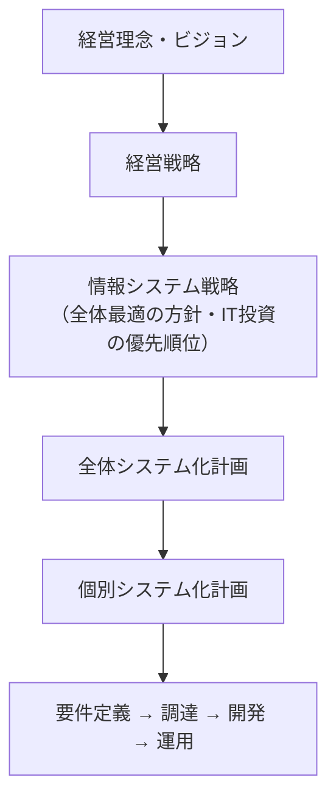
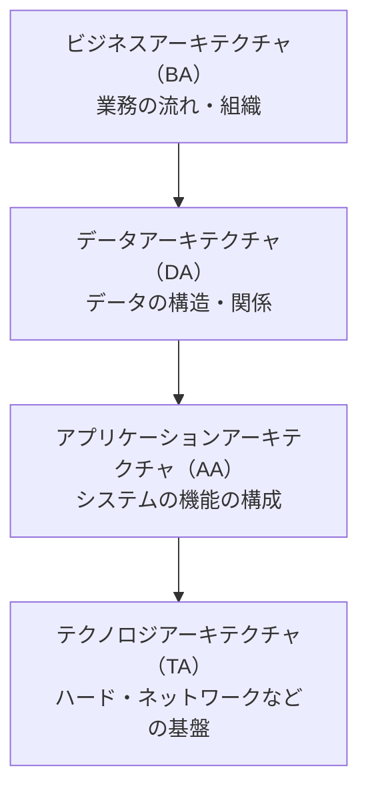
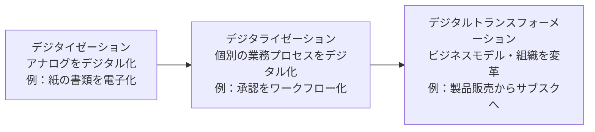
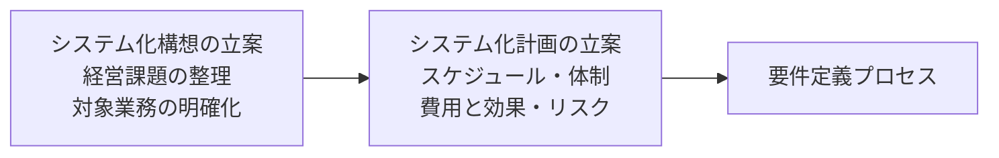
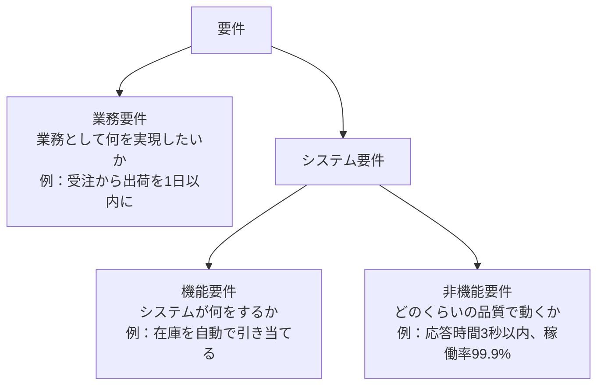
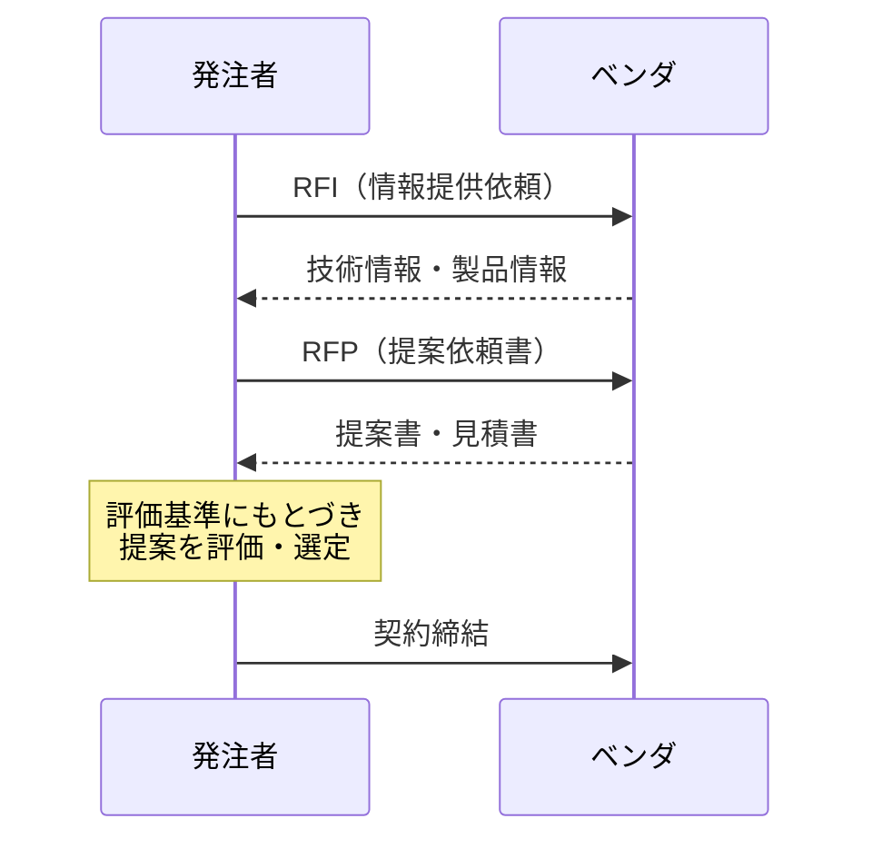

# システム戦略

> **出題傾向・重要度：★★**
> 科目A（旧午前）では、ストラテジ系の中でも「情報システム戦略」「業務プロセス改善」「クラウドサービス」「システム化計画・要件定義」「調達」から毎回数問が出ます。用語の定義を問う問題が中心です。
> 科目B（旧午後）では、**問2（経営戦略）** の中で、DX推進や業務改善、システム化の投資評価などとして出題されます。
> この章で押さえるポイントは次の4つです。
> ① EA・BPR・BPM・RPAなど「業務とITをどう変えるか」の用語の違い、② IaaS／PaaS／SaaSの責任分担、③ システム化計画 → 要件定義 → 調達（RFI → RFP → 契約）という流れ、④ 投資評価（ROI・回収期間・NPV）の計算。

## 目次

- [1. 情報システム戦略](#1-情報システム戦略)
- [2. エンタープライズアーキテクチャ（EA）](#2-エンタープライズアーキテクチャea)
- [3. 業務プロセスの改善](#3-業務プロセスの改善)
- [4. DX（デジタルトランスフォーメーション）](#4-dxデジタルトランスフォーメーション)
- [5. クラウドサービスとソリューションビジネス](#5-クラウドサービスとソリューションビジネス)
- [6. システム化計画と投資評価](#6-システム化計画と投資評価)
- [7. 要件定義](#7-要件定義)
- [8. 調達](#8-調達)
- [9. 科目Bでの出題のされ方](#9-科目bでの出題のされ方)
- [確認問題](#確認問題)
- [参考](#参考)

---

## 1. 情報システム戦略

### 1.1 情報システム戦略とは ★★

- **結論**：情報システム戦略は、**経営戦略を実現するために、ITをどう使うかを決めた中長期の計画**です。
- **理由**：IT投資は「経営目標に役立つか」で評価されます。部門ごとにバラバラにシステムを作ると、データが分断され、二重投資も起きます。このため、経営戦略から下ろした**全体最適**の計画が必要です。
- **例**：「3年で顧客満足度を20%上げる」という経営戦略に対し、「顧客データを全社で統合するCRM基盤を2年で構築する」という情報システム戦略を立てます。



- 策定・推進の責任者は **CIO（Chief Information Officer：最高情報責任者）** です。CIOは経営者の一員として、IT投資の優先順位を決めます。
- ⚠️ ひっかけ注意：情報システム戦略は **情報システム部門が単独で作るもの ではありません**。経営層が主導し、業務部門と一緒に作ります。

### 1.2 ITガバナンス ★★

- **ITガバナンス**とは、**経営者がITの活用を方向付け、管理・監視する仕組み**です。
- 国際規格 ISO/IEC 38500（日本ではJIS Q 38500）では、経営者の役割を次の3つで表しています。

| 役割 | 英語 | 内容 |
|---|---|---|
| 評価 | Evaluate | 現在と将来のITの利用を評価する |
| 指示 | Direct | 戦略や方針の作成と実行を指示する |
| モニタ | Monitor | 方針どおりの成果が出ているかを監視する |

- 💡 覚え方：頭文字をとって **EDM（評価・指示・モニタ）** です。
- 関連する枠組みに **COBIT（Control Objectives for Information and related Technology）** があります。ISACAが作ったITガバナンスのフレームワークです。

### 1.3 情報システム戦略で使う考え方

| 用語 | 意味 |
|---|---|
| **全体最適化** | 部門ごとの最適（部分最適）ではなく、全社でみて最適なシステム構成にすること |
| **情報システム化基本方針** | 全体最適化の目標・方針・対象範囲などをまとめた文書 |
| **IT投資マネジメント** | 投資前の評価・投資中の管理・投資後の評価をPDCAで回すこと |
| **プログラムマネジメント** | 複数の関連するプロジェクトをまとめて管理し、全体の効果を最大にすること |
| **データ利活用** | 社内外のデータを分析し、意思決定や新サービスに使うこと |

---

## 2. エンタープライズアーキテクチャ（EA）

### 2.1 EAの4つの体系 ★★

- **結論**：**EA（Enterprise Architecture：エンタープライズアーキテクチャ）** は、組織全体の業務とシステムを**4つの階層で整理し、全体最適化を進める手法**です。
- **理由**：業務・データ・アプリケーション・技術基盤を同じ枠組みで描くと、重複や抜けが見えます。
- **進め方**：**現状（As-Is）** と **あるべき姿（To-Be）** を描き、その差（ギャップ）を埋める移行計画を作ります。



| 体系 | 何を描くか | 代表的な成果物 |
|---|---|---|
| ビジネスアーキテクチャ | 業務機能、業務の流れ | 業務説明書、DMM（機能情報関連図）、業務流れ図（WFA） |
| データアーキテクチャ | 業務で使う情報の構造 | 情報体系整理図（UMLのクラス図）、実体関連ダイアグラム（E-R図）、データ定義表 |
| アプリケーションアーキテクチャ | システムの機能とつながり | 情報システム関連図、情報システム機能構成図 |
| テクノロジアーキテクチャ | ハード・ソフト・ネットワーク | ネットワーク構成図、ハードウェア構成図、ソフトウェア構成図 |

- 💡 覚え方：**「ビ・デ・ア・テ」**（ビジネス → データ → アプリ → テクノロジ）と、上から下へ具体的になります。
- ⚠️ ひっかけ注意：「業務の流れ」はBA、「データの構造」はDAです。E-R図はDAの成果物です。

---

## 3. 業務プロセスの改善

### 3.1 BPR・BPM・BPOの違い ★★★

| 用語 | 正式名称 | 特徴 | キーワード |
|---|---|---|---|
| **BPR** | Business Process Reengineering（業務プロセス再構築） | 既存の業務を**根本から見直し、抜本的に作り直す** | 「抜本的」「ゼロベース」 |
| **BPM** | Business Process Management（業務プロセス管理） | 業務プロセスを**PDCAで継続的に改善**する | 「継続的」「PDCA」 |
| **BPO** | Business Process Outsourcing（業務プロセスの外部委託） | 経理・人事など**業務そのものを外部に委託**する | 「業務ごと外部に任せる」 |

- 💡 覚え方：BPR は「**R**＝作り直す（**R**eengineering）」、BPMは「**M**＝回し続ける（**M**anagement）」、BPOは「**O**＝外に出す（**O**utsourcing）」です。
- ⚠️ ひっかけ注意：「業務プロセスを継続的に改善する」という選択肢はBPRではなく **BPM** です。

### 3.2 RPA ★★

- **RPA（Robotic Process Automation：ソフトウェアロボットによる業務自動化）** は、人がPCで行う**定型的な操作**（画面のクリック、データの転記など）を、ソフトウェアのロボットに代わりにやらせる技術です。
- 向いている業務：ルールが決まっていて、繰り返しが多い業務（伝票入力、システム間のデータ転記、帳票の作成など）。
- 向いていない業務：判断が毎回変わる業務、手順がよく変わる業務。
- ⚠️ ひっかけ注意：RPAは**工場の産業用ロボット**ではありません。また、プログラムを新しく大規模に開発するものでもありません。

### 3.3 業務改善で使う手法・システム

| 用語 | 意味 |
|---|---|
| **ワークフローシステム** | 申請・承認などの業務の流れを電子化するシステム |
| **SFA**（Sales Force Automation：営業支援システム） | 営業活動（商談の進み具合、訪問記録など）を共有・管理する |
| **グループウェア** | スケジュール共有、掲示板など、組織内の共同作業を支援する |
| **シェアードサービス** | 複数のグループ会社の共通業務（経理・人事など）を1か所に集める |
| **BYOD**（Bring Your Own Device） | 従業員の私物の端末を業務で使うこと |
| **ECRS（イクルス）** | 改善の4原則。排除（Eliminate）→結合（Combine）→交換（Rearrange）→簡素化（Simplify）の順に検討する |

---

## 4. DX（デジタルトランスフォーメーション）

### 4.1 DXの定義 ★★★

- **DX（Digital Transformation：デジタルトランスフォーメーション）** は、経済産業省の定義では次のように説明されています（要約）。
  > 企業が環境の激しい変化に対応し、データとデジタル技術を活用して、顧客や社会のニーズをもとに**製品・サービス・ビジネスモデルを変革**するとともに、**業務・組織・プロセス・企業文化・風土を変革**し、競争上の優位性を確立すること。
- 段階として次の3つに分けて説明されることが多いです。



- ⚠️ ひっかけ注意：「紙をPDFにする」だけではDXではありません。**ビジネスモデルや組織の変革**まで含むのがDXです。

### 4.2 DXレポートと「2025年の崖」 ★

- 経済産業省の「DXレポート」（2018年）は、複雑化・老朽化・ブラックボックス化した既存システム（**レガシーシステム**）が残ると、DXが進まず、**2025年以降に最大で年12兆円の経済損失**が生じる可能性があると指摘しました。これを **「2025年の崖」** と呼びます。
- **技術的負債**：その場しのぎの改修を重ねた結果、将来の保守費用がふくらむ状態のことです。

### 4.3 デジタルガバナンス・コードとDX認定 ★★

- **デジタルガバナンス・コード**は、経済産業省がまとめた「DXを進める経営者に求められる対応」の指針です。2020年に策定され、2022年に2.0、**2024年9月に3.0**（副題「DX経営による企業価値向上に向けて」）に改訂されました。
- 3.0では「3つの視点と5つの柱」で整理されています。

| 5つの柱 | 内容（要点） |
|---|---|
| 1. 経営ビジョン・ビジネスモデルの策定 | デジタルによる環境変化をふまえ、ビジョンとビジネスモデルを描く |
| 2. DX戦略の策定 | ビジョンを実現するためのDX戦略を立てる |
| 3. DX戦略の推進 | 組織づくり、デジタル人材の育成・確保、ITシステム・サイバーセキュリティ |
| 4. 成果指標の設定・DX戦略の見直し | KPIを決め、達成度をみて戦略を見直す |
| 5. ステークホルダーとの対話 | 投資家などに取組みを情報発信し、対話する |

- 3つの視点：①経営ビジョンとDX戦略の連動、②As is–To beギャップの定量把握・見直し、③企業文化への定着。
- **DX認定制度**：デジタルガバナンス・コードの基本的事項に対応した企業を、国（経済産業省）が認定する制度です。認定企業の中から特に優れた企業が「**DX銘柄**」（経済産業省・東京証券取引所などが選定）に選ばれます。
- **DX推進指標**：企業がDXの取組み状況を**自己診断**するための指標です（IPAが自己診断結果を収集・分析）。

### 4.4 SoR・SoE・SoI ★★

| 種類 | 正式名称 | 目的 | 例 | 開発スタイル |
|---|---|---|---|---|
| **SoR** | System of Record（記録のシステム） | 正確にデータを**記録**する | 会計、販売管理、基幹系システム | 品質重視・計画的（ウォーターフォール型が多い） |
| **SoE** | System of Engagement（つながりのシステム） | 顧客との**つながり・関係づくり** | ECサイト、スマホアプリ、SNS連携 | スピード重視・変更しやすさ（アジャイル型が多い） |
| **SoI** | System of Insight（洞察のシステム） | データを分析して**洞察**を得る | BI、データ分析基盤、AI | SoRとSoEのデータを統合して分析 |

- 💡 覚え方：**R＝Record（記録）**、**E＝Engagement（顧客との絆）**、**I＝Insight（洞察）**。
- 関連用語：**バイモーダルIT**（ガートナー社の用語）は、SoRのような安定重視の「モード1」と、SoEのような俊敏性重視の「モード2」を併用する考え方です。

---

## 5. クラウドサービスとソリューションビジネス

### 5.1 クラウドのサービスモデル（IaaS／PaaS／SaaS） ★★★

- **結論**：クラウドサービスは、**事業者がどの層まで提供するか**で、IaaS・PaaS・SaaSに分かれます（米国NIST SP 800-145の定義が基本）。
- 利用者が管理する範囲は、IaaS → PaaS → SaaS の順に**狭く**なります。

| 層 | オンプレミス | IaaS | PaaS | SaaS |
|---|---|---|---|---|
| アプリケーション | 利用者 | 利用者 | 利用者 | **事業者** |
| データ・ランタイム（実行環境）・ミドルウェア | 利用者 | 利用者 | **事業者**（※データは利用者） | **事業者**（※データは利用者） |
| OS | 利用者 | 利用者 | **事業者** | **事業者** |
| 仮想化・サーバ・ストレージ・ネットワーク | 利用者 | **事業者** | **事業者** | **事業者** |

| モデル | 正式名称 | 提供されるもの | 例 |
|---|---|---|---|
| **IaaS** | Infrastructure as a Service | 仮想サーバ、ストレージ、ネットワークなどの**基盤** | 仮想マシンを借りてOSから自分で入れる |
| **PaaS** | Platform as a Service | OS・ミドルウェア・実行環境などの**プラットフォーム** | DBやアプリ実行環境を借りて、自作アプリを載せる |
| **SaaS** | Software as a Service | **アプリケーションそのもの** | Webメール、クラウド型の会計ソフト |

- 💡 覚え方：**I＝インフラだけ**、**P＝プラットフォームまで**、**S＝ソフトまで全部**。
- ⚠️ ひっかけ注意：どのモデルでも、**データ（何を入れるか）とアカウント（誰に使わせるか）の管理責任は利用者側**に残ります。これを **責任共有モデル** といいます。
- 関連用語：**DaaS**（Desktop as a Service：仮想デスクトップの提供）、**FaaS**（Function as a Service：関数単位でプログラムを実行。サーバレスとも）。

### 5.2 クラウドの実装モデル（配置モデル） ★

| 実装モデル | 説明 |
|---|---|
| パブリッククラウド | 不特定多数の利用者が共同で使うクラウド |
| プライベートクラウド | 1つの組織が専用で使うクラウド |
| コミュニティクラウド | 目的が共通する複数の組織（例：自治体どうし）が共同で使うクラウド |
| ハイブリッドクラウド | 上の2つ以上を組み合わせたもの |

### 5.3 クラウド以外のサービス形態

| 用語 | 意味 |
|---|---|
| **オンプレミス** | 自社の設備に自社でサーバを置いて運用する |
| **ハウジング** | 事業者のデータセンターの場所・電源・回線を借り、**自社のサーバ**を置く |
| **ホスティング** | 事業者が持つ**サーバを借りる** |
| **ASP**（Application Service Provider） | アプリケーションをネットワーク経由で提供する事業者。SaaSの前身にあたる |

- 💡 覚え方：ハウジングは「**家（場所）だけ**借りる」、ホスティングは「**サーバごと**借りる」。

### 5.4 ソリューションビジネス ★

- **ソリューションビジネス**とは、顧客の経営課題を分析し、ハード・ソフト・サービスを組み合わせた**解決策（ソリューション）を提供するビジネス**です。

| 用語 | 意味 |
|---|---|
| **SI**（System Integration：システムインテグレーション） | システムの企画から構築・運用までを一括で請け負うこと。請け負う事業者をSIer（エスアイヤー）という |
| **アウトソーシング** | 業務やシステム運用を外部に委託すること |
| **PoC**（Proof of Concept：概念実証） | 新しい技術やアイデアが実現できるか、効果があるかを小さく試して検証すること |
| **SLA**（Service Level Agreement：サービスレベル合意書） | 提供者と利用者の間で、サービスの品質（稼働率など）を合意した文書 |
| **SOA**（Service Oriented Architecture：サービス指向アーキテクチャ） | 業務機能を「サービス」という部品にし、組み合わせてシステムを作る考え方 |

---

## 6. システム化計画と投資評価

### 6.1 システム化計画の流れ ★★

- **結論**：システム化計画は、情報システム戦略にもとづき、**個々のシステムの目的・範囲・スケジュール・費用・効果**を決める工程です。
- 「共通フレーム2013」（IPA）では、企画プロセスの中で「システム化構想の立案」→「システム化計画の立案」の順に行います。



- システム化計画で決める主な項目：**対象範囲**、**開発の優先順位**、**全体スケジュール**、**体制**、**費用対効果**、**リスク**。

### 6.2 投資評価の計算 ★★

IT投資の評価では次の3つの指標が出ます。

| 指標 | 公式 | 判断 |
|---|---|---|
| **ROI**（Return On Investment：投資利益率） | `ROI = 利益（効果額 − 投資額） ÷ 投資額 × 100（%）` | 大きいほど良い |
| **回収期間法** | `回収期間 = 投資額 ÷ 毎年の効果額` | 短いほど良い |
| **NPV**（Net Present Value：正味現在価値） | `NPV = 各年の効果額の現在価値の合計 − 投資額` | 0より大きければ投資する価値がある |

**具体例**：システム投資額 1,000万円、効果額（費用の削減額）が毎年 400万円、3年間使う。割引率は 5%とします。

**① ROI**

```
効果額の合計 = 400 × 3 = 1,200万円
利益        = 1,200 − 1,000 = 200万円
ROI         = 200 ÷ 1,000 × 100 = 20%
```

**② 回収期間**

```
回収期間 = 1,000 ÷ 400 = 2.5年
```

**③ NPV**（お金の価値は時間とともに下がると考え、将来の金額を「今の価値」に直します）

```
現在価値 = 将来の金額 ÷ (1 + 割引率)^年数

1年目：400 ÷ 1.05     ≒ 381.0万円
2年目：400 ÷ 1.05^2   ≒ 362.8万円
3年目：400 ÷ 1.05^3   ≒ 345.5万円
合計                  ≒ 1,089.3万円

NPV = 1,089.3 − 1,000 = 89.3万円（> 0 なので投資する価値がある）
```

- ⚠️ ひっかけ注意：割引率を考えない単純な合計（1,200万円）を使うのは ROI や回収期間です。NPVは必ず**割り引いてから**合計します。

### 6.3 TCO ★

- **TCO（Total Cost of Ownership：総所有コスト）** は、システムの導入から廃棄までにかかる**すべての費用**です。
- 初期費用（ハード・ソフトの購入、開発）だけでなく、**運用費・保守費・教育費・利用者の手間**など、見えにくい費用も含めます。
- ⚠️ ひっかけ注意：「初期費用が安い案」が、TCOでみると高くなることがあります。

---

## 7. 要件定義

### 7.1 要件の種類 ★★★

- **要件定義**は、システムに求められること（要件）を明らかにし、**利害関係者（ステークホルダ）の合意**を得る工程です。



| 区分 | 説明 | 例 |
|---|---|---|
| **業務要件** | 業務の目的・流れ・ルール | 「受注当日に出荷指示を出す」 |
| **機能要件** | システムが提供する機能 | 「受注データから出荷指示書を自動作成する」 |
| **非機能要件** | 性能、信頼性、セキュリティなど機能以外の要件 | 「ピーク時でも応答3秒以内」「稼働率99.9%」 |

- ⚠️ ひっかけ注意：「応答時間」「稼働率」「セキュリティ」「移行」は **非機能要件** です。

### 7.2 非機能要求グレード ★

- IPAが公開している「**非機能要求グレード**」は、非機能要件を発注者とベンダが漏れなく合意するためのツールです。次の**6大項目**に分かれます。

| 大項目 | 例 |
|---|---|
| 可用性 | 稼働率、障害時の復旧時間 |
| 性能・拡張性 | 応答時間、処理件数、将来の拡張 |
| 運用・保守性 | 運用時間、バックアップ、監視 |
| 移行性 | 移行の方式、移行期間 |
| セキュリティ | アクセス制限、暗号化、ログ |
| システム環境・エコロジー | 設置環境、消費電力、法令・規格 |

### 7.3 要件の分析・確認の技法

| 技法 | 説明 |
|---|---|
| インタビュー | 利用者に聞き取りをする |
| **ブレーンストーミング** | 批判せずに自由にアイデアを出し合う |
| **プロトタイピング** | 試作品（画面など）を作り、利用者に確認してもらう |
| **ユースケース** | 利用者（アクター）とシステムのやり取りを場面ごとに書く |
| **CRUD分析** | 各機能が、各データを生成（Create）・参照（Read）・更新（Update）・削除（Delete）するかを表にして、漏れを見つける |
| **ペルソナ** | 典型的な利用者像を具体的な人物として設定する |

- **要件の満たすべき性質**：正確であること、曖昧でないこと、検証できること、実現できること、利害関係者の合意があること。

---

## 8. 調達

### 8.1 調達の流れ ★★★

- **調達**は、システムやサービスを外部から購入・委託する一連の手続きです。



| 文書 | 正式名称 | 目的 | 出すタイミング |
|---|---|---|---|
| **RFI** | Request For Information（情報提供依頼書） | ベンダから**技術動向や製品の情報を集める** | 最初（RFPを作る前） |
| **RFP** | Request For Proposal（提案依頼書） | システムの要件を示し、**具体的な提案を依頼する** | RFIの後 |
| **RFQ** | Request For Quotation（見積依頼書） | 仕様が決まっているものの**見積金額を依頼する** | 仕様確定後 |

- 💡 覚え方：**I（Information）＝情報を集める → P（Proposal）＝提案をもらう → Q（Quotation）＝見積をもらう**。
- ⚠️ ひっかけ注意：RFIの段階では、**まだ要件は確定していません**。「提案書の作成を依頼する」のはRFPです。

### 8.2 RFPに書く内容と提案の評価 ★★

- RFPに書く主な項目：システムの目的・概要、対象範囲、**要求する機能・非機能**、納期、契約条件、**提案の評価基準**、提出期限。
- 評価基準を**事前に決めて**おき、すべてのベンダを同じ基準で評価します（公平性の確保）。

**重み付け採点の例**（各項目10点満点、重みを掛けて合計）

| 評価項目 | 重み | A社の点 | A社の重み付き点 | B社の点 | B社の重み付き点 |
|---|---|---|---|---|---|
| 機能 | 4 | 8 | 32 | 7 | 28 |
| 価格 | 3 | 6 | 18 | 9 | 27 |
| 実績 | 2 | 9 | 18 | 6 | 12 |
| サポート | 1 | 7 | 7 | 6 | 6 |
| **合計** | | | **75** | | **73** |

```
A社 = 8×4 + 6×3 + 9×2 + 7×1 = 32 + 18 + 18 + 7 = 75
B社 = 7×4 + 9×3 + 6×2 + 6×1 = 28 + 27 + 12 + 6 = 73
→ A社を選定
```

### 8.3 調達に関するその他の用語

| 用語 | 意味 |
|---|---|
| **グリーン調達（グリーン購入）** | 環境への負荷が小さい製品・サービスを優先して購入すること（グリーン購入法） |
| **一般競争入札** | 条件を満たす誰でも参加できる入札（公共調達の原則） |
| **総合評価落札方式** | 価格だけでなく、技術点も合わせて評価して落札者を決める方式 |
| **内製／外製（Make or Buy）** | 自社で作るか、外部から買う（委託する）かの判断 |
| **契約の形態** | 請負契約・準委任契約など。違いは「[04_法務.md](./04_法務.md)」を参照 |

---

## 9. 科目Bでの出題のされ方

- 科目B（旧午後）の **問2（経営戦略）** では、経営戦略・マーケティングとあわせて、**情報戦略**（情報システム戦略、業務プロセス改善、ソリューションビジネス、企画・要件定義）も出題範囲に入っています。
- よくある設問のパターン：

| パターン | 解き方のコツ |
|---|---|
| 業務の課題に対するシステム化の施策を選ぶ | 問題文の「課題」と「施策」を1対1で対応させる。課題に書かれていない効果を答えない |
| 投資評価（回収期間・ROI・NPV）の計算 | 問題文の「効果額」に何が含まれるか（費用削減・売上増）を正確に拾う |
| DX推進で必要な取組みを記述 | 「経営層の関与」「データの全社統合」「人材育成」など、本文のキーワードを使って書く |
| RFPの記載事項・ベンダ選定 | 評価基準・重み付けの計算。公平性の観点 |

- 💡 コツ：科目Bは「一般論」ではなく**問題文の事例に即して答える**のが原則です。答えの根拠は、ほぼ必ず本文に書いてあります。

---

## 確認問題

**問1** BPMの説明として、最も適切なものはどれか。

- ア：業務プロセスを根本から見直し、抜本的に再設計する。
- イ：業務プロセスをPDCAサイクルで継続的に分析・改善する。
- ウ：自社の業務プロセスの一部を、専門の外部事業者に委託する。
- エ：PC上の定型操作を、ソフトウェアロボットによって自動化する。

**問2** EAにおいて、業務で扱う情報の構造や相互関係を体系的に示すものはどれか。

- ア：ビジネスアーキテクチャ
- イ：データアーキテクチャ
- ウ：アプリケーションアーキテクチャ
- エ：テクノロジアーキテクチャ

**問3** PaaSを利用する場合に、利用者側が管理する範囲として、最も適切なものはどれか。

- ア：OSのパッチ適用
- イ：物理サーバの保守
- ウ：利用者が開発したアプリケーションと、そこで扱うデータ
- エ：ミドルウェアのバージョンアップ

**問4** システム開発の調達において、RFPを発行する前に、ベンダから技術動向や製品情報を収集するために用いる文書はどれか。

- ア：RFI　　イ：RFQ　　ウ：SLA　　エ：NDA

**問5** 次のうち、非機能要件に該当するものはどれか。

- ア：受注データから請求書を自動で作成する。
- イ：顧客の住所変更をオンラインで受け付ける。
- ウ：オンライン処理の応答時間を、ピーク時でも3秒以内とする。
- エ：在庫が発注点を下回ったら、発注データを作成する。

**問6（計算）** 投資額 900万円のシステムを導入すると、毎年 300万円の費用削減効果が4年間続く。割引率を 10%とするとき、NPV（正味現在価値）は約何万円か。小数第1位を四捨五入して答えよ。

**問7** SoEの説明として、最も適切なものはどれか。

- ア：会計や販売管理など、正確な記録を重視する基幹系システム
- イ：顧客や利用者との関係を強化することを目的としたシステム
- ウ：蓄積したデータを分析し、洞察を得ることを目的としたシステム
- エ：複数のグループ会社の共通業務を集約したシステム

**問8** ITガバナンスに関する規格（JIS Q 38500）で示される、経営者の3つの役割の組合せとして適切なものはどれか。

- ア：計画・実行・評価
- イ：評価・指示・モニタ
- ウ：方針・統制・監査
- エ：分析・設計・改善

<details><summary>解答・解説</summary>

**問1：イ**
BPMは「継続的な改善（PDCA）」がキーワードです。アはBPR、ウはBPO、エはRPAの説明です。

**問2：イ**
情報の構造（データの関係）を描くのはデータアーキテクチャです。アは業務機能・業務の流れ、ウはシステムの機能構成、エはハード・ネットワークなどの技術基盤です。

**問3：ウ**
PaaSでは、OS・ミドルウェア・実行環境までを事業者が管理します。利用者が管理するのは、自分で載せたアプリケーションとデータです。ア・エはPaaSでは事業者側（IaaSなら利用者側）、イはどのクラウドモデルでも事業者側です。

**問4：ア**
RFI（情報提供依頼書）はRFPの前に情報を集めるための文書です。イのRFQは見積依頼書、ウのSLAはサービスレベル合意書、エのNDAは秘密保持契約です。

**問5：ウ**
応答時間は性能に関する非機能要件です。ア・イ・エは「システムが何をするか」なので機能要件です。

**問6：約51万円**

```
現在価値 = 300 ÷ 1.1^n

1年目：300 ÷ 1.1     ≒ 272.73
2年目：300 ÷ 1.21    ≒ 247.93
3年目：300 ÷ 1.331   ≒ 225.39
4年目：300 ÷ 1.4641  ≒ 204.90
合計                 ≒ 950.96

NPV = 950.96 − 900 ≒ 50.96 → 約51万円
```

単純合計（1,200万円）から900万円を引いた300万円は、割引を考えていないので誤りです。NPVが0より大きいので、投資する価値があると判断します。

**問7：イ**
SoE（System of Engagement）は顧客とのつながりを強化するシステムです。アはSoR、ウはSoI、エはシェアードサービスの説明です。

**問8：イ**
JIS Q 38500では、経営者の役割を「評価（Evaluate）・指示（Direct）・モニタ（Monitor）」の3つとしています。

</details>

---

## 参考

- IPA「試験要綱・シラバス」（応用情報技術者試験 シラバス Ver.7.2）：https://www.ipa.go.jp/shiken/syllabus/gaiyou.html
- IPA「非機能要求グレード」：https://www.ipa.go.jp/archive/digital/iot-en-ci/jyouryuu/hikinou/index.html
- IPA「共通フレーム2013」：https://www.ipa.go.jp/publish/secbooks20130304.html
- 経済産業省「デジタルガバナンス・コード」：https://www.meti.go.jp/policy/it_policy/investment/dgc/dgc.html
- 経済産業省「デジタルガバナンス・コード3.0を策定しました」（2024年9月19日）：https://www.meti.go.jp/press/2024/09/20240919001/20240919001.html
- 経済産業省「DXレポート ～ITシステム『2025年の崖』の克服とDXの本格的な展開～」：https://www.meti.go.jp/shingikai/mono_info_service/digital_transformation/20180907_report.html
- 経済産業省「DX認定制度」：https://www.meti.go.jp/policy/it_policy/investment/dx-nintei/dx-nintei.html
- NIST SP 800-145 "The NIST Definition of Cloud Computing"：https://csrc.nist.gov/pubs/sp/800/145/final
