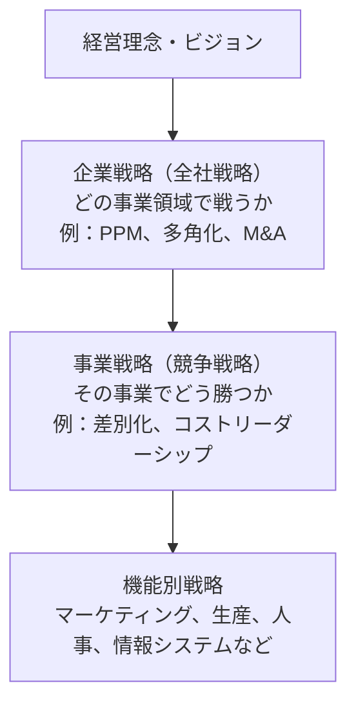
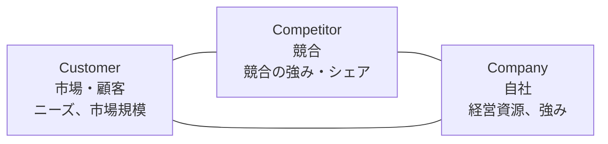
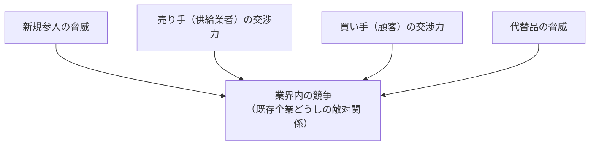
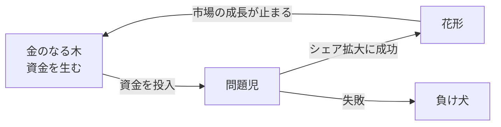
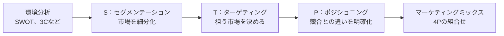
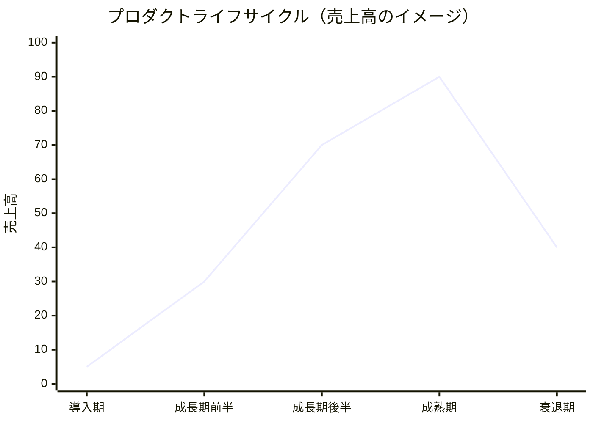
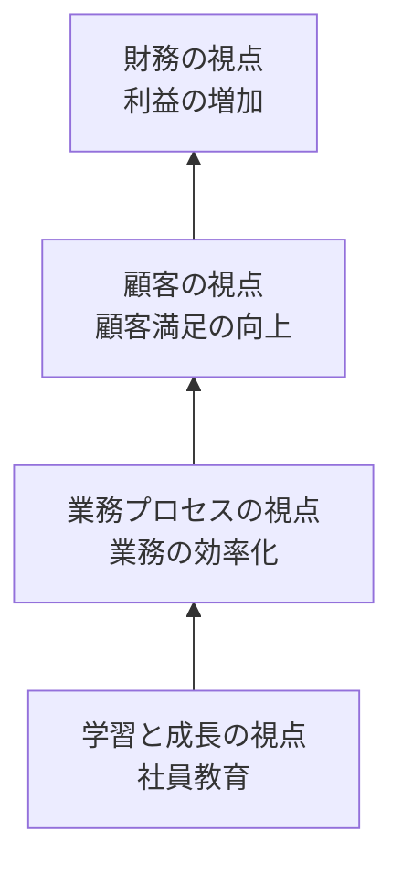
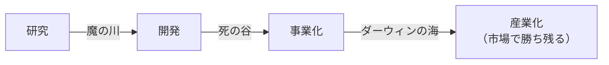
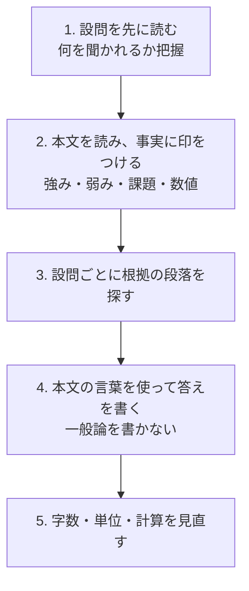

# 経営戦略とマーケティング

> **出題傾向・重要度：★★★**
> 科目A（旧午前）では、SWOT・PPM・アンゾフ・ポーターの競争戦略・マーケティングの4P／STP・バランススコアカードなどのフレームワークが、**ほぼ毎回**出題されます。
> 科目B（旧午後）の **問2（経営戦略）** は、架空企業の事例を読んで、これらのフレームワークを当てはめる問題です。計算問題（売上・利益・シェアなど）も混ざります。
> この章で押さえるポイントは次の4つです。
> ① 分析フレームワークの「軸」と「象限」、② 戦略の種類の名前と中身、③ マーケティング用語、④ 技術戦略・ビジネスインダストリの用語。

## 目次

- [1. 経営戦略の全体像](#1-経営戦略の全体像)
- [2. 環境分析のフレームワーク](#2-環境分析のフレームワーク)
- [3. 事業ポートフォリオと成長戦略](#3-事業ポートフォリオと成長戦略)
- [4. 競争戦略](#4-競争戦略)
- [5. 企業間の連携・M&A](#5-企業間の連携ma)
- [6. マーケティング](#6-マーケティング)
- [7. 目標管理（バランススコアカード・KGI／KPI）](#7-目標管理バランススコアカードkgikpi)
- [8. 経営管理システム（CRM／SCM／ERPなど）](#8-経営管理システムcrmscmerpなど)
- [9. 技術戦略](#9-技術戦略)
- [10. ビジネスインダストリ](#10-ビジネスインダストリ)
- [11. 科目B「経営戦略」の解き方](#11-科目b経営戦略の解き方)
- [12. 経営戦略・マーケティングの補足（シラバス追加用語）](#12-経営戦略マーケティングの補足シラバス追加用語)
- [確認問題](#確認問題)
- [📋 シラバス用語チェックリスト](#-シラバス用語チェックリスト)
- [参考](#参考)

---

## 1. 経営戦略の全体像

### 1.1 戦略の階層 ★

- **結論**：経営戦略は、**企業戦略 → 事業戦略 → 機能別戦略** の3階層で考えます。
- **理由**：会社全体で「どの事業をやるか」を決めてから、各事業で「どう勝つか」を決め、最後に各部門（営業・生産・ITなど）で「何をするか」を決める、という順で具体化するためです。



- **ドメイン（事業領域）**：自社が戦う領域を「誰に・何を・どのように」で定義したものです。狭く定義しすぎると成長の機会を逃します（「マーケティング近視眼」）。

---

## 2. 環境分析のフレームワーク

### 2.1 SWOT分析 ★★★

- **結論**：**SWOT分析**は、**内部環境**（自社の強み・弱み）と**外部環境**（機会・脅威）の2軸で現状を整理する手法です。

| | プラス要因 | マイナス要因 |
|---|---|---|
| **内部環境**（自社で変えられる） | **S**trength（強み） | **W**eakness（弱み） |
| **外部環境**（自社では変えられない） | **O**pportunity（機会） | **T**hreat（脅威） |

- 例：自社の「高い技術力」はS、「市場の拡大」や「規制緩和」はO、「競合の参入」はT です。
- **クロスSWOT分析**：要素を掛け合わせて戦略を考えます。

| | 機会（O） | 脅威（T） |
|---|---|---|
| **強み（S）** | **SO戦略**：強みで機会をつかむ（積極策） | **ST戦略**：強みで脅威をかわす（差別化） |
| **弱み（W）** | **WO戦略**：弱みを補って機会をつかむ（改善） | **WT戦略**：最悪の事態を避ける（撤退・防衛） |

- ⚠️ ひっかけ注意：「競合他社の新製品」「法改正」「為替」は自社では変えられないので **外部環境（O または T）** です。「自社の営業力不足」は内部環境（W）です。

### 2.2 PEST分析 ★

- **PEST分析**は、外部環境のうち、自社ではコントロールできない**マクロ環境**を4つの観点で分析します。
- **P**olitics（政治：法規制、税制）、**E**conomy（経済：景気、為替、金利）、**S**ociety（社会：人口、流行、価値観）、**T**echnology（技術：新技術、特許）。

### 2.3 3C分析 ★★

- **3C分析**は、次の3つの観点から、事業の**成功要因（KSF：Key Success Factor）** を見つける手法です。



- 関連：3Cに **Co-operator（協力者）** を加えて「4C分析」と呼ぶこともありますが、マーケティングミックスの「4C」（6章）とは別物です。

### 2.4 ファイブフォース分析（5フォース） ★★

- **結論**：**ファイブフォース分析**は、マイケル・ポーターが提唱した、**業界の収益性を決める5つの競争要因**を分析する手法です。



- 5つの力が強いほど、その業界はもうかりにくくなります。
- ⚠️ ひっかけ注意：5つの力に「**補完財**」や「**政府の規制**」は含まれません。

### 2.5 バリューチェーン分析 ★★

- **結論**：**バリューチェーン（価値連鎖）** は、ポーターが提唱した、企業の活動を**主活動**と**支援活動**に分け、どの活動で価値（利益）が生まれているかを分析する手法です。

| 区分 | 活動 |
|---|---|
| **主活動** | 購買物流 → 製造（オペレーション） → 出荷物流 → 販売・マーケティング → サービス |
| **支援活動** | 全般管理（インフラストラクチャ）、人事・労務管理、技術開発、調達 |

- 💡 覚え方：主活動は「**モノが流れる順番**」に並んでいます。

### 2.6 経営資源の分析：コアコンピタンス・VRIO ★★

| 用語 | 意味 |
|---|---|
| **コアコンピタンス** | 競合他社がまねできない、**自社の中核的な強み**（技術・ノウハウなど） |
| **VRIO分析** | 経営資源を **V**alue（経済価値）、**R**arity（希少性）、**I**mitability（模倣困難性）、**O**rganization（組織）の4観点で評価する |
| **ベンチマーキング** | 優れた他社（業界外も含む）のやり方を指標にして、自社と比較・改善する |
| **ケイパビリティ** | 組織としての業務遂行能力（プロセスの強み） |

- ⚠️ ひっかけ注意：コアコンピタンスに集中し、それ以外を外部に任せることを「**選択と集中**」といいます。

---

## 3. 事業ポートフォリオと成長戦略

### 3.1 PPM（プロダクトポートフォリオマネジメント） ★★★

- **結論**：**PPM（Product Portfolio Management）** は、ボストン コンサルティング グループ（BCG）が考えた、**市場成長率** と **相対的市場占有率** の2軸で事業を4つに分類し、**経営資源（お金）の配分**を決める手法です。

| | 相対的市場占有率：**高** | 相対的市場占有率：**低** |
|---|---|---|
| **市場成長率：高** | **花形**（Star）<br/>シェアは高いが、競争に勝つための投資も必要 | **問題児**（Problem Child）<br/>投資して花形に育てるか、撤退するか |
| **市場成長率：低** | **金のなる木**（Cash Cow）<br/>投資が少なくてすみ、**資金を生み出す** | **負け犬**（Dog）<br/>撤退・縮小を検討 |



- **相対的市場占有率**の計算：

```
相対的市場占有率 = 自社のシェア ÷ 最大の競合のシェア
（自社が1位のときは、2位の企業のシェアで割る）

例：自社 30%、最大競合 20% → 30 ÷ 20 = 1.5（1より大きい＝「高」）
例：自社 10%、最大競合 40% → 10 ÷ 40 = 0.25（「低」）
```

- 💡 覚え方：「**金のなる木**」で稼いだお金を「**問題児**」に投資して「**花形**」に育てるのが基本の流れです。
- ⚠️ ひっかけ注意：縦軸は「市場**成長率**」、横軸は「**相対的**市場占有率」です。「市場規模」や「利益率」ではありません。

### 3.2 アンゾフの成長マトリクス ★★★

- **結論**：**アンゾフの成長マトリクス**は、**製品**（既存・新規）と**市場**（既存・新規）の2軸で、成長戦略を4つに分けます。

| | 既存製品 | 新製品 |
|---|---|---|
| **既存市場** | **市場浸透**<br/>今の顧客にもっと売る（販促、値下げ） | **新製品開発**<br/>今の顧客に新しい製品を売る |
| **新市場** | **新市場開拓**<br/>今の製品を新しい市場に売る（海外進出など） | **多角化**<br/>新しい製品で新しい市場に出る |

- 例：国内向けの家電を海外で販売する → **新市場開拓**。食品メーカーが医薬品事業に参入する → **多角化**。
- **多角化の種類**：既存事業と技術や販路が関係する「**関連型多角化**」と、関係しない「**非関連型（コングロマリット型）多角化**」があります。
- **シナジー効果**：複数の事業を組み合わせることで、個々の合計以上の効果が出ることです（例：販路の共有）。

---

## 4. 競争戦略

### 4.1 ポーターの3つの基本戦略 ★★★

| 戦略 | 内容 | 例 |
|---|---|---|
| **コストリーダーシップ戦略** | 業界で**最も低いコスト**を実現し、価格で優位に立つ | 大量生産・大量仕入れで低価格を実現 |
| **差別化戦略** | 品質・ブランド・機能などで**他社にない価値**を出す | 独自デザイン、高品質サービス |
| **集中戦略** | **特定の市場（顧客層・地域）に絞る**。その中でコストか差別化で勝つ | 高齢者向けに特化したスマートフォン |

- ⚠️ ひっかけ注意：集中戦略は、さらに「コスト集中」と「差別化集中」に分かれます。

### 4.2 コトラーの競争地位別戦略 ★★

| 地位 | 特徴 | 基本の戦略 |
|---|---|---|
| **リーダー** | 業界シェア1位 | 市場全体を拡大する（**全方位型**）。同質化（他社の差別化をまねて打ち消す） |
| **チャレンジャー** | 2位〜3位でリーダーを狙う | リーダーとの**差別化** |
| **フォロワー** | 上位をまねて、効率よく利益を出す | **模倣**（低コストで追随） |
| **ニッチャー** | 小さな特定市場（すき間）で強い | **特定市場に集中**（専門化） |

### 4.3 その他の競争戦略の用語 ★

| 用語 | 意味 |
|---|---|
| **ブルーオーシャン戦略** | 競争の激しい既存市場（レッドオーシャン）ではなく、**競争のない新しい市場**を作る |
| **先行者利益** | 市場に最初に参入することで得られる優位性（ブランドの認知、顧客の囲い込み） |
| **規模の経済** | 生産量が増えるほど、1個当たりのコストが下がる |
| **範囲の経済** | 複数の事業で資源を共有し、コストを下げる |
| **経験曲線効果** | 累積生産量が増えるほど、経験によって単位コストが下がる |
| **ロックイン効果** | 他の製品に乗り換えるコスト（スイッチングコスト）が高く、顧客が離れにくくなる |
| **ネットワーク効果** | 利用者が増えるほど、製品・サービスの価値が上がる（SNSなど） |

---

## 5. 企業間の連携・M&A

### 5.1 M&Aと関連用語 ★★

- **M&A（Mergers and Acquisitions：合併と買収）** は、他社を合併したり買収したりして、**時間をかけずに経営資源（技術・人材・販路）を得る**手法です。

| 用語 | 意味 |
|---|---|
| **TOB**（Take Over Bid：株式公開買付け） | 買付けの価格・期間・株数を公告し、**市場外で不特定多数の株主から株式を買い集める** |
| **MBO**（Management Buyout） | **経営陣が**自社の株式を買い取って独立する |
| **EBO**（Employee Buyout） | **従業員が**自社や事業部門を買い取る |
| **LBO**（Leveraged Buyout） | **買収先の資産や将来のキャッシュフローを担保に借入れ**をして買収する |
| **アライアンス（業務提携）** | 資本関係なし、または少ない資本で、技術・販売などで協力する |
| **ジョイントベンチャー（合弁会社）** | 複数の企業が**共同で出資**して新しい会社を作る |
| **持株会社（ホールディングス）** | 他の会社の株式を持ち、グループ全体を支配・管理する会社 |

- 💡 覚え方：MBOの **M＝Management（経営陣）**、LBOの **L＝Leverage（てこ＝借金で大きな買収）**。

### 5.2 生産・販売の連携の形 ★★

| 用語 | 意味 |
|---|---|
| **OEM**（Original Equipment Manufacturing） | **相手先のブランド名**で製品を製造すること |
| **ファブレス** | 自社では工場（ファブ）を持たず、**設計・開発に特化**して製造は外部に委託する |
| **EMS**（Electronics Manufacturing Service） | 電子機器の**製造を専門に受託**するサービス（ファブレス企業の委託先） |
| **フランチャイズチェーン** | 本部（フランチャイザー）が加盟店にブランドやノウハウを提供し、加盟店がロイヤルティ（対価）を払う |
| **ファウンドリ** | 半導体の**製造だけ**を受託する企業 |

---

## 6. マーケティング

### 6.1 マーケティングの流れ（STP → 4P） ★★★



| 手順 | 内容 | 例 |
|---|---|---|
| **S**egmentation（セグメンテーション） | 年齢・地域・ライフスタイルなどで市場を細分化 | 「20代・都市部・一人暮らし」など |
| **T**argeting（ターゲティング） | どのセグメントを狙うか決める | 「20代の一人暮らし」を狙う |
| **P**ositioning（ポジショニング） | 顧客の頭の中で、競合とどう違うかを位置付ける | 「手軽で健康的な冷凍食品」 |

### 6.2 4Pと4C ★★★

- **マーケティングミックス**とは、マーケティングの手段を組み合わせることです。売り手の視点の **4P** と、買い手の視点の **4C** が対応します。

| 4P（売り手の視点） | 4C（買い手の視点） | 内容 |
|---|---|---|
| **P**roduct（製品） | **C**ustomer Value（顧客にとっての価値） | 品質、機能、デザイン、ブランド |
| **P**rice（価格） | **C**ost（顧客の負担） | 価格、割引、支払条件 |
| **P**lace（流通） | **C**onvenience（入手の利便性） | 販売チャネル、店舗、物流 |
| **P**romotion（販売促進） | **C**ommunication（コミュニケーション） | 広告、販促、広報、人的販売 |

- ⚠️ ひっかけ注意：Place は「場所」ではなく「**流通（チャネル）**」の意味です。

### 6.3 プロダクトライフサイクル（PLC） ★★★

- **結論**：製品は **導入期 → 成長期 → 成熟期 → 衰退期** と変化し、それぞれの時期で取るべき戦略が違います。

| 時期 | 売上 | 利益 | 競合 | 主な戦略 |
|---|---|---|---|---|
| **導入期** | 少ない | 赤字が多い | 少ない | 製品の**認知度を上げる**（広告・試供品） |
| **成長期** | 急増 | 増える | 増える | **シェアを拡大**、販路の拡大、ブランドの確立 |
| **成熟期** | 最大・横ばい | 最大 | 多い（安定） | **差別化**、既存顧客の維持、コスト削減 |
| **衰退期** | 減少 | 減少 | 撤退が増える | **撤退**、または投資を抑えて利益を回収 |



- 💡 覚え方：PPMとセットで考えると、**成長期＝花形・問題児**、**成熟期＝金のなる木**、**衰退期＝負け犬**に対応しやすいです。

### 6.4 価格戦略 ★★

| 価格の決め方・戦略 | 内容 |
|---|---|
| **コストプラス法** | 原価に一定の利益を上乗せして価格を決める |
| **市場価格追随法（実勢価格）** | 競合の価格に合わせる |
| **スキミングプライシング（上澄み吸収価格）** | 新製品を**高価格**で出し、早く開発費を回収する（その後に値下げ） |
| **ペネトレーションプライシング（市場浸透価格）** | 新製品を**低価格**で出し、**早くシェアを取る** |
| **ダイナミックプライシング** | 需要と供給に応じて価格を**リアルタイムに変える**（航空券、ホテル） |
| **フリーミアム** | 基本は**無料**、高機能は**有料**にする（Free＋Premium） |
| **サブスクリプション** | 一定期間の利用に定額料金を払う |
| **端数価格** | 980円のように、端数をつけて安く感じさせる |
| **名声価格（威光価格）** | あえて高い価格にして、高級感を出す |
| **バンドル価格** | 複数の製品をセットで割安に売る |

- ⚠️ ひっかけ注意：「スキミング」は**高い**、「ペネトレーション」は**安い**。英単語のイメージ（skim＝上澄みをすくう、penetrate＝浸透する）で覚えます。

### 6.5 その他のマーケティング用語 ★★

| 用語 | 意味 |
|---|---|
| **プッシュ戦略** | 販売員や流通業者に働きかけて、製品を**押し出す** |
| **プル戦略** | 広告などで消費者の購買意欲を高め、消費者が自ら**引き寄せられる**ようにする |
| **AIDMA（アイドマ）** | 消費者の購買行動のモデル：Attention（注意）→ Interest（関心）→ Desire（欲求）→ Memory（記憶）→ Action（行動） |
| **AISAS（アイサス）** | ネット時代のモデル：Attention → Interest → **Search（検索）** → Action → **Share（共有）** |
| **RFM分析** | **R**ecency（最終購買日）、**F**requency（購買頻度）、**M**onetary（購買金額）で顧客をランク付けする |
| **ワントゥワンマーケティング** | 顧客一人ひとりに合わせたマーケティング |
| **オムニチャネル** | 店舗・EC・アプリなど**すべてのチャネルを統合**し、どこでも同じ購買体験を提供する |
| **O2O**（Online to Offline） | ネットのクーポンなどで、**実店舗**へ客を誘導する |
| **インバウンドマーケティング** | 役立つ情報（ブログ・動画）で顧客に見つけてもらう |
| **LTV**（Life Time Value：顧客生涯価値） | 1人の顧客が取引期間全体で企業にもたらす利益 |
| **アンバサダーマーケティング** | 製品の熱心なファンに、口コミで広めてもらう |

---

## 7. 目標管理（バランススコアカード・KGI／KPI）

### 7.1 バランススコアカード（BSC） ★★★

- **結論**：**BSC（Balanced Scorecard：バランススコアカード）** は、財務だけでなく、**4つの視点**からバランスよく戦略を具体化し、業績を評価する手法です（キャプランとノートンが提唱）。
- **理由**：売上や利益だけを見ると、短期的な成果に偏ります。顧客・業務・人材の育成という「将来の利益の源」も合わせて管理するためです。

| 視点 | 問い | 指標の例 |
|---|---|---|
| **財務の視点** | 株主に対して、どう行動すべきか | 売上高、営業利益率、ROE |
| **顧客の視点** | 顧客に対して、どう行動すべきか | 顧客満足度、リピート率、市場シェア |
| **業務プロセスの視点**（内部ビジネスプロセス） | どの業務プロセスに秀でるべきか | 不良率、リードタイム、納期遵守率 |
| **学習と成長の視点** | どうやって変化・改善できる能力を養うか | 従業員の資格取得数、研修時間、提案件数 |



- **戦略マップ**：4つの視点の目標を、上の図のように**因果関係**でつないだ図です。
- ⚠️ ひっかけ注意：「従業員の教育」は**学習と成長の視点**、「業務の効率化・品質」は**業務プロセスの視点**です。

### 7.2 KGI・KPI・CSF ★★★

| 用語 | 正式名称 | 意味 | 例 |
|---|---|---|---|
| **KGI** | Key Goal Indicator（重要目標達成指標） | **最終目標**が達成できたかを測る指標 | 年間売上高 10億円 |
| **CSF**（KSF） | Critical Success Factor（重要成功要因） | 目標を達成するために**最も重要な要因** | 新規顧客の獲得 |
| **KPI** | Key Performance Indicator（重要業績評価指標） | CSFの**途中経過**を測る指標 | 月間の新規契約件数 50件 |

- 流れ：**KGI（ゴール）を決める → CSF（勝ち筋）を見つける → KPI（途中の数値目標）を設定する**。
- 💡 覚え方：**G＝Goal（ゴール）**、**P＝Performance（途中の頑張り）**。

---

## 8. 経営管理システム（CRM／SCM／ERPなど）

### 8.1 主な経営管理システム ★★★

| 用語 | 正式名称 | 目的 |
|---|---|---|
| **CRM** | Customer Relationship Management（顧客関係管理） | 顧客情報を一元管理し、**長期的に良い関係を築き、顧客満足と収益を高める** |
| **SCM** | Supply Chain Management（供給連鎖管理） | 調達 → 生産 → 物流 → 販売の流れを、**企業の枠を超えて全体最適化**し、在庫削減・リードタイム短縮を図る |
| **ERP** | Enterprise Resource Planning（企業資源計画） | 販売・生産・会計・人事など**基幹業務を統合**し、経営資源を有効に使う。そのためのソフトを**ERPパッケージ**という |
| **KMS** | Knowledge Management System | 個人が持つ知識やノウハウを**組織で共有**し、活用する（ナレッジマネジメント） |
| **SFA** | Sales Force Automation（営業支援） | 営業活動を記録・共有して効率化する |

- ⚠️ ひっかけ注意：「**企業間で**、資材の調達から販売までの流れを最適化」は **SCM**、「**社内の**基幹業務を統合」は **ERP** です。

### 8.2 品質・経営の改善手法 ★

| 用語 | 意味 |
|---|---|
| **TQM**（Total Quality Management：総合的品質管理） | 品質管理を**全社・全部門**で経営戦略として行う |
| **シックスシグマ** | 統計的手法で業務のばらつきを減らし、不良を100万回に3.4回程度に抑えることを目指す。DMAIC（定義・測定・分析・改善・管理）の手順で進める |
| **TOC**（Theory Of Constraints：制約理論） | 全体の成果を決める**ボトルネック（制約）を見つけて集中的に改善**する |
| **ナレッジマネジメントのSECIモデル** | 暗黙知と形式知を変換する4段階：共同化 → 表出化 → 連結化 → 内面化 |

---

## 9. 技術戦略

> 📘 この節は要点のまとめです。シラバスの用語（価値創出の三要素、PoC／PoV／MVP、外部資源活用、ロードマップの種類など）は [05_技術戦略とビジネスインダストリ](./05_技術戦略とビジネスインダストリ.md) で詳しく解説しています。

### 9.1 MOTと技術ロードマップ ★★

- **MOT（Management Of Technology：技術経営）** は、技術を経営に結びつけ、**技術から事業の価値を生み出す**ための経営の考え方です。
- **技術ロードマップ**は、将来の技術の進み方と、製品・市場との関係を**時間軸で示した図**です。研究開発の計画づくりや、関係者の目線合わせに使います。
- **技術ポートフォリオ**は、技術を「技術の重要度」「自社の技術水準」などの軸で分類し、投資の優先順位を決める手法です。

### 9.2 研究開発から事業化までの障壁 ★★



| 障壁 | 意味 |
|---|---|
| **魔の川** | 研究成果を、具体的な製品の**開発**に進めるまでの障壁 |
| **死の谷** | 開発した製品を**事業化**するまでの障壁（資金・人材の不足など） |
| **ダーウィンの海** | 事業化した製品が、市場の競争で**生き残り産業になる**までの障壁 |

- 💡 覚え方：「**川 → 谷 → 海**」と、だんだん大きくなる順です。

### 9.3 イノベーションの用語 ★★★

| 用語 | 意味 |
|---|---|
| **プロダクトイノベーション** | 新しい**製品・サービス**そのものを生み出す革新 |
| **プロセスイノベーション** | 製造方法や業務の**やり方（工程）**の革新 |
| **イノベーションのジレンマ** | 優良な大企業が、既存顧客の要望に応える改良（持続的イノベーション）を続けた結果、**破壊的イノベーション**を起こした新興企業に負けてしまう現象（クリステンセンが提唱） |
| **オープンイノベーション** | 自社だけでなく、**社外（大学・他社・スタートアップ）の技術やアイデアを取り入れて**革新を起こす |
| **キャズム** | 新製品が、初期の利用者（イノベーター・アーリーアダプター）から、多数派（アーリーマジョリティ）に広がる間にある**大きな溝** |
| **ハイプ・サイクル** | ガートナー社が提唱。新技術への期待が、黎明期 → 「過度な期待」のピーク期 → 幻滅期 → 啓蒙活動期 → 生産性の安定期と変化する |
| **デザイン思考** | 利用者への**共感**から課題を見つけ、試作と検証を繰り返して解決策を作る（共感 → 問題定義 → 創造 → プロトタイプ → テスト） |
| **リーンスタートアップ** | 最小限の製品（**MVP**：Minimum Viable Product）を作り、顧客の反応を見て改善を素早く繰り返す |
| **ビジネスモデルキャンバス** | ビジネスモデルを、顧客セグメント・価値提案など**9つの要素**で1枚に表す |

- **イノベーター理論**（ロジャーズ）：新製品を採用する時期で、利用者を5つに分けます。

| 区分 | 割合 |
|---|---|
| イノベーター（革新者） | 2.5% |
| アーリーアダプター（初期採用者） | 13.5% |
| アーリーマジョリティ（前期追随者） | 34% |
| レイトマジョリティ（後期追随者） | 34% |
| ラガード（遅滞者） | 16% |

- キャズムは、**アーリーアダプターとアーリーマジョリティの間**にあります（ムーアが提唱）。

---

## 10. ビジネスインダストリ

> 📘 この節は要点のまとめです。ビジネスシステム・行政システム・AIの利活用・エンジニアリングシステム・e-ビジネス・民生機器・産業機器の詳細は [05_技術戦略とビジネスインダストリ](./05_技術戦略とビジネスインダストリ.md) を参照してください。

### 10.1 IoT・製造業のデジタル化 ★★

| 用語 | 意味 |
|---|---|
| **IoT**（Internet of Things：モノのインターネット） | 機器やセンサをインターネットにつなぎ、データを集めて活用する |
| **CPS**（Cyber Physical System） | 現実世界（フィジカル）のデータをサイバー空間で分析し、結果を現実世界に戻して制御する仕組み |
| **デジタルツイン** | 現実の設備や都市を、サイバー空間上に**双子のように再現**し、シミュレーションする |
| **インダストリー4.0** | ドイツが進める、IoTやAIで製造業を高度化する国家戦略（第4次産業革命） |
| **Society 5.0** | 日本が目指す、サイバー空間と現実空間を融合させた人間中心の社会（狩猟→農耕→工業→情報に続く5番目の社会） |
| **スマートファクトリー** | IoTで機械や工程をつなぎ、生産を最適化する工場 |
| **CAD／CAM** | CADはコンピュータによる設計支援、CAMは設計データを使った製造支援 |
| **FMS**（Flexible Manufacturing System） | 多品種少量生産に柔軟に対応できる生産システム |
| **MRP**（Material Requirements Planning：資材所要量計画） | 生産計画と部品表（BOM）から、必要な部品の量と時期を計算する |
| **JIT**（Just In Time） | 必要なものを、必要なときに、必要な量だけ生産・調達する。トヨタの**かんばん方式**が代表例 |

### 10.2 電子商取引（EC） ★★

| 用語 | 意味 |
|---|---|
| **B to B / B to C / C to C** | 企業間 / 企業と消費者 / 消費者間の取引（例：ネットオークションはC to C） |
| **G to B / G to C** | 行政と企業 / 行政と国民の取引（電子申請など） |
| **EDI**（Electronic Data Interchange：電子データ交換） | 企業間で、受発注などの取引データを**標準的な形式で電子的にやり取りする** |
| **ロングテール** | ECでは、あまり売れない商品（テール）も多数そろえることで、全体として大きな売上になる |
| **レコメンデーション** | 購買履歴などから、顧客におすすめの商品を表示する |
| **アフィリエイト** | Webサイトに広告を載せ、成果（購入など）に応じて報酬を得る |
| **エスクローサービス** | 取引の間に第三者が入り、代金の受け渡しを仲介して安全を確保する |
| **SEO**（Search Engine Optimization：検索エンジン最適化） | 検索結果の上位に表示されるようにWebサイトを工夫する |
| **リスティング広告（検索連動型広告）** | 検索したキーワードに関連する広告を表示する |

### 10.3 フィンテックなど ★★

| 用語 | 意味 |
|---|---|
| **フィンテック**（FinTech） | 金融（Finance）とIT（Technology）を組み合わせた新しいサービス |
| **オープンAPI**（銀行API） | 銀行が、外部の事業者（家計簿アプリなど）に、APIを通じて安全に口座情報などを提供する |
| **暗号資産** | ブロックチェーン技術などを使う、インターネット上で取引される財産的価値（資金決済法で規定） |
| **ブロックチェーン** | 取引記録をブロックにまとめ、ハッシュ値で鎖のようにつないで改ざんを困難にする分散型台帳技術 |
| **クラウドファンディング** | インターネットを通じて、多数の人から少額ずつ資金を集める |
| **キャッシュレス決済** | クレジットカード、電子マネー、QRコード決済など |
| **MaaS**（Mobility as a Service） | 電車・バス・タクシーなど複数の交通手段を、1つのサービスとして検索・予約・決済できる |
| **シェアリングエコノミー** | 個人が持つモノや場所・スキルを、ネットを介して他人と共有する |
| **スマートグリッド** | IT技術で電力の需要と供給を最適に制御する次世代の送電網 |
| **トレーサビリティ** | 製品の生産から消費・廃棄までの履歴を追跡できること |
| **POSシステム**（Point Of Sales：販売時点情報管理） | 商品が売れた時点で、売上情報を記録・集計する |
| **RFID**（Radio Frequency IDentification） | ICタグと無線で情報をやり取りし、物を識別する |

---

## 11. 科目B「経営戦略」の解き方

### 11.1 出題の形式

- 科目B **問2（経営戦略）** は、**架空の企業の事例**（経営状況・課題・新しい取組み）を読み、次のような設問に答えます。
  - **フレームワークの当てはめ**：本文の事実を、SWOTのどこに入るか、PPMのどの象限か、BSCのどの視点か、などに分類する。
  - **施策の目的・効果の記述**：「なぜこの施策をとるのか」を、本文の言葉を使って20〜40字程度で書く。
  - **計算**：売上高・利益・損益分岐点・市場シェア・投資回収期間など。

### 11.2 解き方の手順



### 11.3 解答のコツ

| コツ | 説明 |
|---|---|
| **本文の言葉を使う** | 採点者は本文の該当箇所を基準に採点します。自分の言葉に言い換えすぎないこと |
| **「課題」と「施策」を対応させる** | 「〜という課題があるため、〜する」の形で書くと、因果関係がはっきりします |
| **内部か外部かを区別する** | SWOTでは、自社の努力で変えられるか（内部）、変えられないか（外部）で判断します |
| **数値の単位をそろえる** | 「千円」「万円」「%」の混在に注意。計算の途中で単位を書いておくと間違えにくくなります |
| **字数の8割以上を書く** | 短すぎると要素が足りない可能性があります |

- **記述の例**（設問：「A社が、自社ECサイトで購買履歴の分析を始めた目的を、30字以内で述べよ」）
  - 悪い例：「売上を増やすため。」（一般論で、本文の事例とつながっていない）
  - 良い例：「**顧客ごとの嗜好に合わせた商品を推奨し、リピート購入を増やすため**」（本文の「リピート率の低下」という課題に対応）

---

---

## 12. 経営戦略・マーケティングの補足（シラバス追加用語）

> 技術戦略マネジメント（中分類20）とビジネスインダストリ（中分類21）は、[05_技術戦略とビジネスインダストリ](./05_技術戦略とビジネスインダストリ.md) で詳しく解説しています。

### 12.1 経営戦略の基本用語

| 用語 | 意味 |
|---|---|
| **企業理念** | 企業の存在意義や価値観を示した根本的な考え方 |
| **企業戦略／ビジネス戦略（事業戦略）／機能別戦略** | 戦略の3階層（[1.1](#11-戦略の階層-)） |
| **競争戦略** | 特定の事業で競合に勝つための戦略（[4](#4-競争戦略)） |
| **多角化** | 新しい製品で新しい市場に進出すること（[3.2](#32-アンゾフの成長マトリクス-)） |
| **イノベーション** | 新しい技術・製品・仕組みによって経済的・社会的な価値を生み出す革新 |
| **チェンジマネジメント** | 組織の変革（新システム導入、組織再編など）を、人の抵抗を抑えながら定着させるための管理手法 |
| **ADKARモデル** | 個人が変化を受け入れる5段階：**Awareness（認知：変化の必要性を知る）→ Desire（欲求：参加したいと思う）→ Knowledge（知識：やり方を知る）→ Ability（能力：実際にできる）→ Reinforcement（定着：元に戻らないよう強化する）** |
| **ダイナミックケイパビリティ** | 環境の変化を感知し、機会をとらえ、経営資源を組み替えて **自らを変革し続ける組織の能力** |
| **ベンチマーキング／ベストプラクティス** | 優れた他社と比較して改善する手法／最も優れたやり方（手本） |
| **SDGs（Sustainable Development Goals：持続可能な開発目標）** | 2015年に国連で採択された、2030年までの17の目標 |
| **コ・クリエーション戦略** | 企業が顧客やパートナーと **共同で価値を創造（共創）** する戦略 |
| **IPランドスケープ** | 特許などの知財情報と市場情報を組み合わせて分析し、経営戦略・事業戦略の立案に活用する手法 |
| **サーキュラーエコノミー（循環経済）** | 製品や資源を廃棄せず、再利用・修理・リサイクルで **循環させ続ける** 経済の仕組み |
| **VUCA** | Volatility（変動性）・Uncertainty（不確実性）・Complexity（複雑性）・Ambiguity（曖昧性）。先が読めない経営環境を表す言葉 |
| **TCFD開示** | 気候関連財務情報開示タスクフォース（TCFD）の提言に沿って、気候変動のリスクと機会が経営に与える影響を **ガバナンス・戦略・リスク管理・指標と目標** の4項目で開示すること（現在はISSB基準・SSBJ基準に引き継がれている） |

### 12.2 全社戦略・事業戦略の補足

| 用語 | 意味 |
|---|---|
| **資源配分** | 経営資源（ヒト・モノ・カネ・情報）を事業間に配分すること |
| **競争優位** | 競合より高い価値または低いコストを持続的に実現できる状態 |
| **経験曲線** | 累積生産量が2倍になるごとに単位コストが一定の割合で下がる関係（[4.3](#43-その他の競争戦略の用語-)） |
| **CS（Customer Satisfaction：顧客満足）** | 顧客の期待に対する満足度。全社的に高めることで長期的な収益につなげる |
| **グループ経営** | 親会社と子会社・関連会社をグループとして一体的に運営すること |
| **エコシステム** | 複数の企業・顧客・開発者などが互いに依存し合い、共に価値を生む事業の生態系（例：スマートフォンのアプリ市場） |
| **シェアードサービス** | グループの共通業務を1か所に集約する |
| **ベンチャービジネス** | 新技術や新しいビジネスモデルで急成長を目指す新興企業（スタートアップ） |
| **クラウドファンディング** | インターネットで多数の人から少額の資金を集める |
| **インキュベーター** | 創業間もない企業に、オフィス・資金・経営助言などを提供して育成する組織 |
| **同質化戦略** | リーダー企業が、チャレンジャーの差別化をまねて **差別化の効果を打ち消す** 戦略 |
| **ESG投資** | 財務情報だけでなく、**環境（Environment）・社会（Social）・ガバナンス（Governance）** への取組みを考慮して投資先を選ぶ |
| **バリューチェーン再設計** | 価値活動のうち、付加価値の低い活動を外部資源（アウトソーシング）に任せ、強みのある活動に集中するなど、価値連鎖を組み替えること |

### 12.3 マーケティング分析の手法

| 用語 | 意味 |
|---|---|
| **マクロ環境分析（PEST分析，文化的環境）** | 政治・経済・社会・技術に加え、宗教・言語・慣習などの **文化的環境** も分析する |
| **市場調査（マーケティングリサーチ）** | 市場や顧客の情報を集めて分析すること |
| **サンプリング** | 母集団から一部（標本）を選んで調べること |
| **フィールド調査** | 現地に出向いて行う調査 |
| **エスノグラフィー調査** | 調査者が顧客の生活や現場に入り込み、**行動を長期間観察** して、本人も意識していないニーズを見つける |
| **質問法／観察法／実験法** | アンケートやインタビューで聞く／行動を観察する／条件を変えて反応を比べる |
| **クロス集計** | 2つ以上の項目を掛け合わせて集計する（例：年代別×購入有無） |
| **コンジョイント分析** | 製品の属性（価格・色・機能など）の組合せを複数提示して選ばせ、**各属性が購買の決定にどれだけ影響するか（効用）** を推定する |
| **価格感度測定法（PSM：Price Sensitivity Meter）** | 「高すぎて買わない」「高いと感じ始める」「安いと感じ始める」「安すぎて品質が不安」の4つの価格を質問し、**受け入れられる価格帯** を求める |
| **RFM分析** | 最終購買日・購買頻度・購買金額で顧客を分類する（[6.5](#65-その他のマーケティング用語-)） |
| **消費者行動モデル（AIDMA）** | 注意→関心→欲求→記憶→行動 |
| **アサエルの購買行動類型** | 購買への **関与（こだわり）の高低** と **ブランド間の差の大小** で購買行動を4つに分類する（下表） |
| **DEARフレームワーク** | 顧客の状態（カスタマーヘルス）を **Deployment（導入状況）・Engagement（関係性）・Adoption（利用・定着状況）・ROI（費用対効果）** の4観点で評価する、カスタマーサクセスの枠組み |
| **デザイン思考** | 利用者への共感から課題を見つけ、試作と検証を繰り返す（[9.3](#93-イノベーションの用語-)） |
| **アサンプションマップ** | 新事業の前提となる **仮説（アサンプション）** を「重要度」と「確からしさ（根拠の有無）」の2軸に配置し、**重要なのに根拠のない仮説から検証** する |
| **バリュープロポジション** | 顧客に提供する価値の提案。「なぜ競合ではなく自社を選ぶべきか」を示す |
| **ブランドプロポジション** | ブランドが顧客に約束する価値 |
| **ブランドアイデンティティ** | 企業が顧客に「こう認識してほしい」と考えるブランドの姿（ロゴ・理念・世界観など） |

| アサエルの類型 | 関与 | ブランド間の差 | 例 |
|---|---|---|---|
| **複雑な購買行動** | 高 | 大 | パソコン、自動車（よく調べて比較する） |
| **不協和低減型購買行動** | 高 | 小 | 高価だが差の少ない家具（買った後に「これでよかったか」と不安になりやすい） |
| **バラエティシーキング型購買行動** | 低 | 大 | お菓子（気分で色々なブランドを試す） |
| **習慣型購買行動** | 低 | 小 | 塩、トイレットペーパー（いつものものを買う） |

### 12.4 マーケティングミックス・CXデザイン・サービスデザイン

- **マーチャンダイジング**：顧客ニーズに合う商品を、適切な数量・価格・時期・場所で提供するための **商品計画** の活動です。
- **CX（Customer Experience：顧客体験）デザイン**：顧客が企業・製品・サービスと接する **すべての接点** での体験を設計し、精神的・主観的な満足を高めます。

| 用語 | 意味 |
|---|---|
| **顧客価値** | 顧客が製品・サービスから得る便益と、支払うコストとの差 |
| **UX（User Experience）** | 製品やサービスを利用することで得られる体験 |
| **UXタイムスパン** | **予期的UX**（使う前の期待）→ **一時的UX**（使っている最中）→ **エピソード的UX**（使った後の振り返り）→ **累積的UX**（長期間の利用を通じた全体の評価） |
| **LTV（Life Time Value：顧客生涯価値）** | 1人の顧客が取引期間全体でもたらす利益 |
| **顧客ロイヤルティ** | 顧客が企業やブランドに抱く愛着・信頼。継続購入や推奨につながる |
| **ブランド戦略** | ブランドの価値を高め、他社と区別して選ばれるようにする戦略 |
| **コンバージョン率（CVR：Conversion Rate）** | サイト訪問者などのうち、購入・会員登録など **目標の行動（コンバージョン）に至った割合** |
| **リテンション率** | 一定期間後も **継続して利用している顧客の割合**（顧客維持率） |
| **顧客価値ヒエラルキー** | コトラーが示した製品の5段階：**中核ベネフィット**（本質的な便益）→ **基本製品** → **期待製品**（当然期待される水準）→ **膨張製品**（期待を超える付加価値）→ **潜在製品**（将来の進化） |

```
LTVの数値例：平均購入単価 5,000円、粗利率 40%、年間購入回数 6回、平均継続年数 3年
  LTV = 5,000 × 0.4 × 6 × 3 = 36,000円
  → 新規顧客1人の獲得費用（CAC）が36,000円未満なら採算が合う

CVRの数値例：広告クリックで来訪 2,000人、購入 50人
  CVR = 50 ÷ 2,000 × 100 = 2.5%
```

- **サービスデザイン**：顧客体験だけでなく、それを継続的に実現する **組織や仕組み（裏側）まで設計** して価値を生み出す考え方です。

| 用語 | 意味 |
|---|---|
| **サービスデザインの6原則** | **人間中心**（利用者・提供者すべての人の体験を考える）、**共働的であること**（多様な関係者を巻き込む）、**反復的であること**（試作と検証を繰り返す）、**連続的であること**（一連の行動の流れとして描く）、**リアルであること**（実際の現場で検証する）、**ホリスティック（全体的）な視点** |
| **カスタマージャーニーマップ** | 顧客がサービスを認知してから利用・継続するまでの **行動・接点・感情の変化を時系列** で可視化した図 |
| **ペルソナ** | 典型的な顧客像を、名前・年齢・生活などを持つ具体的な人物として設定したもの |
| **参加型デザイン** | 利用者や現場の担当者を設計プロセスに参加させてデザインする |
| **サービスブループリント** | 顧客の行動と、それを支える **表舞台（フロントステージ）・裏舞台（バックステージ）の従業員の行動や支援システム** を対応させて描いた設計図 |

### 12.5 マーケティング戦略（製品・価格・流通・プロモーション・Web）

**製品戦略**

| 用語 | 意味 |
|---|---|
| **プロダクトビジョンの定義・共有・進化** | 製品が目指す姿を定め、チームで共有し、市場の変化に合わせて更新する |
| **ライフサイクルエクステンション** | 成熟期の製品に新しい用途・改良・新市場を加えて、**寿命を延ばす** |
| **製品ライン／製品ポートフォリオ（製品ミックス）** | 機能や顧客が似た製品のグループ／企業が提供する全製品の組合せ |
| **製品多様化戦略** | 製品の種類を増やして多様なニーズに応える |
| **製品差別化戦略** | 品質・機能・デザインなどで競合製品との違いを打ち出す |
| **市場細分化戦略** | 市場をセグメントに分け、それぞれに合った製品を投入する |
| **計画的陳腐化** | 新モデルの投入などで、旧製品を意図的に古く感じさせ、買替えを促す |
| **コモディティ化** | 製品の機能・品質が均質になり、**価格以外で差別化できなくなる** こと |
| **カニバリゼーション** | 自社の新製品が **自社の既存製品の売上を奪う**（共食い）こと |
| **PLM（Product Life cycle Management）** | 製品の企画・設計から生産・保守・廃棄までの情報を一元管理する |
| **マスカスタマイゼーション** | 大量生産の効率を保ちながら、個々の顧客に合わせた製品を提供する |

**価格戦略**

- **バリュープライシング**：顧客が感じる **価値** を基準に価格を決める方法です（コストプラス法と対比）。
- **需要の価格弾力性**：価格の変化に対して需要がどれだけ変化するかを表します。

```
需要の価格弾力性 = 需要の変化率 ÷ 価格の変化率（絶対値で見る）

数値例：価格を 1,000円 → 1,100円（+10%）にしたら、販売数が 500個 → 400個（−20%）
  弾力性 = 20% ÷ 10% = 2.0（1より大きい＝弾力的）
  売上高：値上げ前 1,000 × 500 = 50万円、値上げ後 1,100 × 400 = 44万円 → 減少
  → 弾力性が1より大きい商品は、値下げすると売上高が増えやすい
```

**流通戦略・プロモーション戦略**

| 用語 | 意味 |
|---|---|
| **ボランタリーチェーン** | 独立した小売店が **自主的に** 集まり、共同仕入れなどを行う組織（各店の独立性が高い） |
| **フランチャイズチェーン** | 本部が加盟店に商標・ノウハウを提供し、対価（ロイヤルティ）を受け取る |
| **チャネル統合／オムニチャネル** | 複数の販売経路を統合して管理する／すべてのチャネルで一貫した購買体験を提供する |
| **広告** | 費用を払ってメディアで情報を伝える |
| **販売促進** | 値引き・クーポン・試供品などで購買を直接促す |
| **パブリシティ** | 報道機関にニュースとして取り上げてもらう（費用はかからないが内容は管理できない） |

**Webマーケティング戦略**

| 用語 | 意味 |
|---|---|
| **インターネット広告／バナー広告** | Web上の広告／画像で表示する広告 |
| **オプトインメール広告** | 事前に受信を **承諾した人だけ** に送るメール広告 |
| **ジオターゲティング広告（位置連動型広告）** | 利用者の位置情報に応じて広告を出し分ける |
| **リスティング広告（検索連動型広告）** | 検索キーワードに連動して表示する広告 |
| **成功報酬型広告** | 購入などの成果が出たときだけ広告費を払う（アフィリエイトなど） |
| **SEO** | 検索結果の上位に表示されるようサイトを最適化する |
| **LPO（Landing Page Optimization）** | 広告などから最初に訪れるページ（ランディングページ）を改善し、CVRを高める |
| **CVR** | 顧客転換率（コンバージョン率） |
| **アフィリエイト／レコメンデーション** | 成果報酬型の広告提携／購買履歴などによるおすすめ表示 |
| **デジタルサイネージ** | ディスプレイを使った電子看板。時間帯や場所に応じて表示内容を変えられる |
| **A/Bテスト** | 2つの案（AとB）を利用者に無作為に出し分け、どちらの成果（CVRなど）が高いかを比較する |

### 12.6 マーケティング手法

| 手法 | 内容 |
|---|---|
| **マスマーケティング** | 市場全体を対象に、同じ製品を大量生産・大量広告で販売する |
| **ターゲットマーケティング** | 特定のセグメントに絞って展開する |
| **ワントゥワンマーケティング** | 顧客一人ひとりに合わせる |
| **リレーションシップマーケティング** | 顧客との **長期的な関係** を重視し、継続購入を促す |
| **ダイレクトマーケティング** | 流通業者を通さず、カタログ・DM・ECなどで顧客と直接やり取りする |
| **バイラルマーケティング** | 口コミ（SNSでの拡散）で情報をウイルスのように広げる |
| **クロスメディアマーケティング** | テレビ・Web・雑誌など複数のメディアを組み合わせ、相互に誘導する |
| **インバウンドマーケティング** | 役立つ情報を発信し、顧客に見つけてもらう |
| **ロケーションベースマーケティング** | 位置情報を活用し、近くにいる顧客に情報やクーポンを届ける |
| **パーミッションマーケティング** | 顧客の **許諾（パーミッション）** を得てから情報を送る |
| **市場テスト（テストマーケティング）** | 地域や期間を限定して試験販売し、本格展開の前に反応を確かめる |
| **コーズリレーテッドマーケティング** | 売上の一部を社会貢献（寄付など）に充てることを訴求して購買を促す |
| **プッシュ戦略／プル戦略** | 流通に働きかけて押し出す／消費者の需要を喚起して引き寄せる |
| **グロースハック** | データ分析と小さな実験を高速に繰り返し、製品やサービスの成長（利用者数・売上）を加速させる |

### 12.7 ビジネス戦略と目標・評価の補足

**ビジネス戦略と目標設定の手順**：①企業理念・ビジョン・全社戦略を踏まえ、ビジネス環境分析と戦略立案を行い、戦略目標を定める → ②重点的に取り組む **CSF** を明確にする → ③達成度を測る指標（KGI・KPI）を設定し、**モニタリング** して評価する。

| 用語 | 意味 |
|---|---|
| **MVV（ミッション，ビジョン，バリュー）** | 使命（何のために存在するか）、ビジョン（目指す将来像）、バリュー（大切にする価値観・行動指針） |
| **ビジネスモデルキャンバス** | ビジネスモデルを9要素で1枚に表す（[9.3](#93-イノベーションの用語-)） |
| **フィージビリティスタディ** | 計画を実行に移す前に、技術・経済・運用などの面から **実現可能性を調査** すること |
| **ニーズ・ウォンツ分析** | **ニーズ**（必要性：満たされていない基本的な欲求。例：喉が渇いた）と **ウォンツ**（欲求：ニーズを満たす具体的な手段への欲求。例：炭酸飲料が飲みたい）を区別して分析する |
| **競合分析** | 競争状況、競合相手の数、製品やサービスの価格、技術動向などを分析する |
| **ハーフィンダール・ハーシュマン指数（HHI）** | 市場の **集中度** を表す指標。各社の市場シェア（%）の **2乗の合計**。独占なら10,000、多数の企業で分け合うほど0に近づく |

```
HHIの数値例：A社 40%、B社 30%、C社 20%、D社 10%
  HHI = 40² + 30² + 20² + 10² = 1,600 + 900 + 400 + 100 = 3,000
  （10社が10%ずつなら 10² × 10 = 1,000 → 集中度が低い）
```

**バリューエンジニアリング（VE）**

- **結論**：製品・サービスの **価値（V）＝ 機能（F）÷ コスト（C）** ととらえ、必要な機能を下げずにコストを下げる、または機能を高めて価値を上げる手法です。
- 手順：**機能定義**（その製品は何のためにあるか、名詞＋動詞で定義）→ **機能評価**（各機能の価値と **機能別コスト分析**）→ **代替案作成** → 評価・実施。コストは購入価格だけでなく **ライフサイクルコスト** で考えます。

```
VEの数値例：機能評価値（その機能に払うべきコスト）が 80万円の部品の、現在のコストが 100万円
  価値 V = F ÷ C = 80 ÷ 100 = 0.8（1未満 → コスト削減の余地がある）
  改善目標 = 100 − 80 = 20万円のコスト削減
```

- その他：**TQM**（総合的品質管理）、**シックスシグマ**（[8.2](#82-品質経営の改善手法-)）も目標設定・評価の手法として使われます。

### 12.8 経営管理システムの補足

| 用語 | 意味 |
|---|---|
| **全社システム／部門システム** | ERPのように全社を対象とするシステム／特定の部門の業務を対象とするシステム |
| **バリューチェーンマネジメント** | 調達から販売・サービスまでの価値連鎖全体を管理し、付加価値を最大化する |
| **ECR（Efficient Consumer Response：効率的消費者対応）** | メーカー・卸・小売が協力し、POSデータなどを共有して、消費者に効率よく商品を届ける取組み（食品・日用品業界のSCM） |
| **SECIモデル** | 暗黙知と形式知の変換：**共同化**（暗黙知→暗黙知：体験の共有）→ **表出化**（暗黙知→形式知：言葉や図にする）→ **連結化**（形式知→形式知：組み合わせて体系化）→ **内面化**（形式知→暗黙知：実践して身につける） |
| **KM（Knowledge Management：ナレッジマネジメント）** | 組織の知識を共有・活用して競争力を高める経営手法 |
| **企業内情報ポータル（EIP：Enterprise Information Portal）** | 社内の情報・アプリケーションへの入口を1つのWeb画面にまとめたもの |
| **TOC（制約条件理論）** | ボトルネックに集中して全体の成果を高める（[8.2](#82-品質経営の改善手法-)） |

---

## 確認問題

**問1** SWOT分析において、「競合他社が低価格の類似製品を発売した」という事実が分類されるものはどれか。

- ア：強み　　イ：弱み　　ウ：機会　　エ：脅威

**問2** PPMにおいて、市場成長率が低く、相対的市場占有率が高い事業の一般的な位置付けとして、適切なものはどれか。

- ア：花形。シェアを維持するため、多くの投資が必要である。
- イ：金のなる木。少ない投資で多くの資金を生み出し、他事業の原資となる。
- ウ：問題児。投資して育成するか、撤退するかを判断する必要がある。
- エ：負け犬。撤退や縮小を検討する。

**問3（計算）** ある市場で、自社のシェアは 15%、最大の競合企業のシェアは 25% である。PPMで用いる相対的市場占有率を求めよ。

**問4** アンゾフの成長マトリクスで、国内で販売している既存の製品を、新たに東南アジア市場で販売する戦略はどれか。

- ア：市場浸透　　イ：新市場開拓　　ウ：新製品開発　　エ：多角化

**問5** バランススコアカードで、「従業員のスキル向上のための研修受講時間」を指標とする視点はどれか。

- ア：財務の視点　　イ：顧客の視点　　ウ：業務プロセスの視点　　エ：学習と成長の視点

**問6** 新製品を発売するとき、早期に市場シェアを獲得するため、意図的に低い価格を設定する戦略はどれか。

- ア：スキミングプライシング
- イ：ペネトレーションプライシング
- ウ：ダイナミックプライシング
- エ：名声価格

**問7** 研究開発の成果を事業化する過程で、開発した製品を事業として成立させるまでの資金や体制の障壁を表す用語はどれか。

- ア：魔の川　　イ：死の谷　　ウ：ダーウィンの海　　エ：キャズム

**問8** 資材の調達から生産・物流・販売に至る一連の流れを、取引先も含めて全体最適化し、在庫の削減やリードタイムの短縮を目指す考え方はどれか。

- ア：CRM　　イ：ERP　　ウ：SCM　　エ：SFA

**問9** 経営陣が、自社の株式を株主から買い取り、経営権を取得して独立する手法はどれか。

- ア：TOB　　イ：MBO　　ウ：LBO　　エ：OEM

<details><summary>解答・解説</summary>

**問1：エ**
競合の動きは自社では変えられない**外部環境**で、自社にとってマイナスなので**脅威**です。

**問2：イ**
成長率が低い市場で高いシェアを持つ事業は「金のなる木」です。追加の投資が少なくてすみ、資金を生みます。アは高成長・高シェア、ウは高成長・低シェア、エは低成長・低シェアです。

**問3：0.6**

```
相対的市場占有率 = 自社のシェア ÷ 最大競合のシェア
                 = 15 ÷ 25
                 = 0.6
```

1より小さいので、PPMでは相対的市場占有率「低」に分類されます（市場シェアの数値そのもの 15% を答えないよう注意）。

**問4：イ**
製品は既存のまま、市場（地域）が新しいので「新市場開拓」です。

**問5：エ**
人材の育成・能力向上は「学習と成長の視点」です。

**問6：イ**
低価格で一気にシェアを取るのはペネトレーションプライシング（市場浸透価格）です。アは高価格で開発費を早く回収する戦略、ウは需要に応じて価格を変える方式、エは高価格で高級感を出す方式です。

**問7：イ**
開発 → 事業化の障壁が「死の谷」です。アは研究 → 開発、ウは事業化 → 産業化の障壁です。エのキャズムは、新製品の普及過程で初期採用者から多数派に広がる間の溝です。

**問8：ウ**
企業の枠を超えて供給の流れを最適化するのはSCMです。アのCRMは顧客との関係管理、イのERPは社内の基幹業務の統合、エのSFAは営業支援です。

**問9：イ**
経営陣（Management）による買収がMBOです。アのTOBは株式の公開買付け、ウのLBOは買収先の資産を担保にした借入れでの買収、エのOEMは相手先ブランドでの製造です。

</details>

---

## 📋 シラバス用語チェックリスト

シラバスVer.7.2 の「用語例」を小分類ごとに一覧にしました。リンクのある用語は本文に詳しい説明があります（クリックで該当の見出しへ移動）。説明を隠して、用語から意味を言えるか確認しましょう。

> この章のチェックリストは中分類19（経営戦略マネジメント）です。中分類20・21は [05_技術戦略とビジネスインダストリ](./05_技術戦略とビジネスインダストリ.md) のチェックリストを参照してください。

### 1. 経営戦略手法

| 用語 | 一言説明 |
|---|---|
| [企業理念](#121-経営戦略の基本用語) | 企業の存在意義や価値観を示す根本的な考え方 |
| [企業戦略／ビジネス戦略／機能別戦略](#11-戦略の階層-) | 全社・事業・部門の3階層の戦略 |
| [競争戦略](#41-ポーターの3つの基本戦略-) | 特定事業で競合に勝つための戦略 |
| [多角化](#32-アンゾフの成長マトリクス-) | 新製品で新市場に進出する |
| [シナジー効果](#32-アンゾフの成長マトリクス-) | 事業の組合せで合計以上の効果が出ること |
| [規模の経済／範囲の経済](#43-その他の競争戦略の用語-) | 量が増えると単位コストが下がる／資源共有でコストが下がる |
| [イノベーション](#93-イノベーションの用語-) | 新しい技術・仕組みで価値を生む革新 |
| [チェンジマネジメント](#121-経営戦略の基本用語) | 組織変革を人の抵抗を抑えて定着させる管理手法 |
| [ADKARモデル](#121-経営戦略の基本用語) | 認知→欲求→知識→能力→定着の5段階で個人の変化を促す |
| [ダイナミックケイパビリティ](#121-経営戦略の基本用語) | 環境変化に応じて資源を組み替え自らを変革する能力 |
| [ベンチマーキング](#26-経営資源の分析コアコンピタンスvrio-) | 優れた他社と比較して改善する |
| [ベストプラクティス](#121-経営戦略の基本用語) | 最も優れたやり方（手本） |
| [SDGs](#121-経営戦略の基本用語) | 国連の持続可能な開発目標（17目標） |
| [コ・クリエーション戦略](#121-経営戦略の基本用語) | 顧客やパートナーと価値を共創する戦略 |
| [IPランドスケープ](#121-経営戦略の基本用語) | 知財情報と市場情報を分析して経営戦略に活用する |
| [サーキュラーエコノミー（循環経済）](#121-経営戦略の基本用語) | 資源を循環させ続ける経済の仕組み |
| [VUCA](#121-経営戦略の基本用語) | 変動性・不確実性・複雑性・曖昧性の高い環境 |
| [TCFD開示](#121-経営戦略の基本用語) | 気候変動のリスクと機会を4項目で開示する |
| [ドメイン](#11-戦略の階層-) | 自社の事業領域（誰に・何を・どのように） |
| [資源配分](#122-全社戦略事業戦略の補足) | 経営資源を事業間に配分する |
| [競争優位](#122-全社戦略事業戦略の補足) | 競合より高い価値や低コストを持続的に実現できる状態 |
| [経験曲線](#43-その他の競争戦略の用語-) | 累積生産量の増加に伴い単位コストが下がる |
| [CS（Customer Satisfaction：顧客満足）](#122-全社戦略事業戦略の補足) | 顧客の期待に対する満足度 |
| [グループ経営](#122-全社戦略事業戦略の補足) | グループ会社を一体的に運営する |
| [コアコンピタンス](#26-経営資源の分析コアコンピタンスvrio-) | 他社がまねできない中核的な強み |
| [アウトソーシング](#26-経営資源の分析コアコンピタンスvrio-) | 業務を外部に委託する |
| [M&A／TOB（Take Over Bid：公開買付け）](#51-maと関連用語-) | 合併・買収／市場外で株式を公告して買い集める |
| [エコシステム](#122-全社戦略事業戦略の補足) | 複数の企業・顧客などが共に価値を生む事業の生態系 |
| [アライアンス](#51-maと関連用語-) | 資本関係が少ない業務提携 |
| [シェアードサービス](#122-全社戦略事業戦略の補足) | グループの共通業務を集約する |
| [ベンチャービジネス](#122-全社戦略事業戦略の補足) | 急成長を目指す新興企業 |
| [クラウドファンディング](#122-全社戦略事業戦略の補足) | ネットで多数から少額の資金を集める |
| [インキュベーター](#122-全社戦略事業戦略の補足) | 創業期の企業を支援・育成する組織 |
| [経営資源配分の最適化](#31-ppmプロダクトポートフォリオマネジメント-) | PPMの目的 |
| [市場成長率／相対的市場シェア](#31-ppmプロダクトポートフォリオマネジメント-) | PPMの縦軸／横軸 |
| [問題児／花形製品／金のなる木／負け犬](#31-ppmプロダクトポートフォリオマネジメント-) | PPMの4象限 |
| [ファイブフォース分析](#24-ファイブフォース分析5フォース-) | 業界の収益性を決める5つの競争要因の分析 |
| [競争の基本戦略（コストリーダーシップ戦略，差別化戦略，集中戦略）](#41-ポーターの3つの基本戦略-) | ポーターの3つの基本戦略 |
| [同質化戦略](#122-全社戦略事業戦略の補足) | リーダーが他社の差別化をまねて打ち消す |
| [ブルーオーシャン戦略](#43-その他の競争戦略の用語-) | 競争のない新市場を作る |
| [ESG投資](#122-全社戦略事業戦略の補足) | 環境・社会・ガバナンスを考慮した投資 |
| [SWOT分析（外部環境，内部環境，クロスSWOT分析）](#21-swot分析-) | 内部の強み・弱みと外部の機会・脅威の分析 |
| [VRIO分析（Value，Rarity，Imitability，Organization）](#26-経営資源の分析コアコンピタンスvrio-) | 経営資源を4観点で評価する |
| [バリューチェーン分析（価値活動，付加価値，コスト）](#25-バリューチェーン分析-) | 主活動・支援活動のどこで価値が生まれるか分析する |
| [調達・製造・販売・サービス（価値活動）](#25-バリューチェーン分析-) | バリューチェーンを構成する活動 |
| [外部資源活用・バリューチェーン再設計](#122-全社戦略事業戦略の補足) | 価値活動を組み替え、弱い部分を外部に任せる |
| [成長マトリクス（製品・市場マトリクス）](#32-アンゾフの成長マトリクス-) | 製品と市場の新旧で成長戦略を4つに分ける |
| [市場浸透戦略／市場開拓戦略／製品開発戦略／多角化戦略](#32-アンゾフの成長マトリクス-) | アンゾフの4つの成長戦略 |

### 2. マーケティング

| 用語 | 一言説明 |
|---|---|
| [3C分析](#23-3c分析-) | 顧客・競合・自社の分析 |
| [マクロ環境分析（PEST分析，文化的環境）](#123-マーケティング分析の手法) | 政治・経済・社会・技術・文化の分析 |
| [市場調査（マーケティングリサーチ）](#123-マーケティング分析の手法) | 市場や顧客の情報を集めて分析する |
| [STP分析（セグメンテーション，ターゲティング，ポジショニング）](#61-マーケティングの流れstp--4p-) | 市場を分け、狙いを決め、位置付ける |
| [コンジョイント分析](#123-マーケティング分析の手法) | 属性の組合せから各属性の効用を推定する |
| [サンプリング・フィールド調査](#123-マーケティング分析の手法) | 標本の抽出／現地での調査 |
| [エスノグラフィー調査](#123-マーケティング分析の手法) | 顧客の生活に入り込み行動を観察する |
| [質問法・観察法・実験法](#123-マーケティング分析の手法) | 聞く／観察する／条件を変えて比べる調査法 |
| [クロス集計](#123-マーケティング分析の手法) | 複数項目を掛け合わせた集計 |
| [価格感度測定法](#123-マーケティング分析の手法) | 4つの質問から受け入れられる価格帯を求める（PSM） |
| [RFM分析](#65-その他のマーケティング用語-) | 最終購買日・頻度・金額で顧客を分類 |
| [消費者行動モデル（AIDMA）](#65-その他のマーケティング用語-) | 注意→関心→欲求→記憶→行動 |
| [アサエルの購買行動類型](#123-マーケティング分析の手法) | 関与の高低とブランド差の大小で4分類 |
| [DEARフレームワーク](#123-マーケティング分析の手法) | 導入・関係性・定着・ROIで顧客の健康度を評価する |
| [デザイン思考](#93-イノベーションの用語-) | 共感から課題を見つけ試作と検証を繰り返す |
| [アサンプションマップ](#123-マーケティング分析の手法) | 仮説を重要度と確からしさで整理し検証順を決める |
| [バリュープロポジション](#123-マーケティング分析の手法) | 顧客に提供する価値の提案 |
| [ブランドプロポジション／ブランドアイデンティティ](#123-マーケティング分析の手法) | ブランドが約束する価値／企業が意図するブランドの姿 |
| [マーチャンダイジング](#124-マーケティングミックスcxデザインサービスデザイン) | 適切な商品を適切な数量・価格・時期・場所で提供する商品計画 |
| [マーケティングの4P（Product，Price，Place，Promotion）](#62-4pと4c-) | 売り手視点のマーケティングミックス |
| [マーケティングの4C（Customer Value，Customer Cost，Convenience，Communication）](#62-4pと4c-) | 買い手視点のマーケティングミックス |
| [顧客価値](#124-マーケティングミックスcxデザインサービスデザイン) | 顧客が得る便益と支払うコストの差 |
| [UX（User Experience）](#124-マーケティングミックスcxデザインサービスデザイン) | 利用を通じて得られる体験 |
| [UXタイムスパン（予期的UX，一時的UX，エピソード的UX，累積的UX）](#124-マーケティングミックスcxデザインサービスデザイン) | 利用前・中・後・長期のUX |
| [LTV（Life Time Value）](#124-マーケティングミックスcxデザインサービスデザイン) | 顧客生涯価値 |
| [顧客ロイヤルティ](#124-マーケティングミックスcxデザインサービスデザイン) | ブランドへの愛着・信頼 |
| [ブランド戦略](#124-マーケティングミックスcxデザインサービスデザイン) | ブランド価値を高め選ばれるようにする戦略 |
| [コンバージョン率／リテンション率](#124-マーケティングミックスcxデザインサービスデザイン) | 目標行動に至った割合／継続利用している割合 |
| [顧客価値ヒエラルキー](#124-マーケティングミックスcxデザインサービスデザイン) | 中核ベネフィット〜潜在製品の5段階 |
| [サービスデザインの6原則](#124-マーケティングミックスcxデザインサービスデザイン) | 人間中心・共働的・反復的・連続的・リアル・ホリスティック |
| [カスタマージャーニーマップ](#124-マーケティングミックスcxデザインサービスデザイン) | 顧客の行動・接点・感情を時系列で可視化 |
| [ペルソナ](#124-マーケティングミックスcxデザインサービスデザイン) | 典型的な顧客像を具体的な人物として設定 |
| [参加型デザイン](#124-マーケティングミックスcxデザインサービスデザイン) | 利用者を設計に参加させる |
| [サービスブループリント](#124-マーケティングミックスcxデザインサービスデザイン) | 顧客行動と表舞台・裏舞台の活動を対応させた設計図 |
| [プロダクトビジョンの定義・共有・進化](#125-マーケティング戦略製品価格流通プロモーションweb) | 製品が目指す姿を定め共有し更新する |
| [導入期／成長期／成熟期／衰退期](#63-プロダクトライフサイクルplc-) | プロダクトライフサイクルの4段階 |
| [ライフサイクルエクステンション](#125-マーケティング戦略製品価格流通プロモーションweb) | 成熟製品の寿命を延ばす |
| [製品ライン／製品ポートフォリオ](#125-マーケティング戦略製品価格流通プロモーションweb) | 似た製品のグループ／全製品の組合せ |
| [製品多様化戦略／製品差別化戦略／市場細分化戦略](#125-マーケティング戦略製品価格流通プロモーションweb) | 種類を増やす／違いを出す／セグメントごとに投入する |
| [計画的陳腐化](#125-マーケティング戦略製品価格流通プロモーションweb) | 意図的に旧製品を古く感じさせ買替えを促す |
| [コモディティ化](#125-マーケティング戦略製品価格流通プロモーションweb) | 価格以外で差別化できなくなること |
| [カニバリゼーション](#125-マーケティング戦略製品価格流通プロモーションweb) | 自社製品同士の共食い |
| [PLM（Product Life cycle Management）](#125-マーケティング戦略製品価格流通プロモーションweb) | 製品の企画から廃棄までの情報を一元管理 |
| [マスカスタマイゼーション](#125-マーケティング戦略製品価格流通プロモーションweb) | 大量生産の効率で個別対応する |
| [バリュープライシング](#125-マーケティング戦略製品価格流通プロモーションweb) | 顧客が感じる価値で価格を決める |
| [スキミングプライシング／ペネトレーションプライシング](#64-価格戦略-) | 高価格で早期回収／低価格で早期にシェア獲得 |
| [ダイナミックプライシング](#64-価格戦略-) | 需給に応じて価格を変える |
| [その他の価格設定方法（コストプラス法ほか）](#64-価格戦略-) | 原価＋利益などで価格を決める |
| [需要の価格弾力性](#125-マーケティング戦略製品価格流通プロモーションweb) | 価格の変化率に対する需要の変化率 |
| [サブスクリプションモデル](#64-価格戦略-) | 一定期間の利用に定額料金を払う |
| [ボランタリーチェーン](#125-マーケティング戦略製品価格流通プロモーションweb) | 独立小売店が自主的に共同化した組織 |
| [フランチャイズチェーン](#125-マーケティング戦略製品価格流通プロモーションweb) | 本部がノウハウを提供し加盟店が対価を払う |
| [チャネル統合](#125-マーケティング戦略製品価格流通プロモーションweb) | 複数の販売経路を統合して管理する |
| [オムニチャネル](#65-その他のマーケティング用語-) | 全チャネルで一貫した購買体験 |
| [広告／販売促進／パブリシティ](#125-マーケティング戦略製品価格流通プロモーションweb) | 有料の情報発信／直接の購買促進／報道として取り上げてもらう |
| [インターネット広告・バナー広告](#125-マーケティング戦略製品価格流通プロモーションweb) | Web上の広告／画像の広告 |
| [オプトインメール広告](#125-マーケティング戦略製品価格流通プロモーションweb) | 受信を承諾した人だけに送る広告メール |
| [ジオターゲティング広告（位置連動型広告）](#125-マーケティング戦略製品価格流通プロモーションweb) | 位置情報で出し分ける広告 |
| [リスティング広告（検索連動型広告）](#125-マーケティング戦略製品価格流通プロモーションweb) | 検索キーワードに連動した広告 |
| [成功報酬型広告](#125-マーケティング戦略製品価格流通プロモーションweb) | 成果が出たときだけ費用を払う広告 |
| [SEO（検索エンジン最適化）](#125-マーケティング戦略製品価格流通プロモーションweb) | 検索結果の上位に表示されるよう最適化 |
| [LPO（ランディングページ最適化）](#125-マーケティング戦略製品価格流通プロモーションweb) | 最初に訪れるページを改善しCVRを上げる |
| [CVR（Conversion Rate：顧客転換率）](#124-マーケティングミックスcxデザインサービスデザイン) | 訪問者のうち目標行動に至った割合 |
| [アフィリエイト／レコメンデーション](#125-マーケティング戦略製品価格流通プロモーションweb) | 成果報酬型の広告提携／おすすめ表示 |
| [デジタルサイネージ](#125-マーケティング戦略製品価格流通プロモーションweb) | ディスプレイを使った電子看板 |
| [A/Bテスト](#125-マーケティング戦略製品価格流通プロモーションweb) | 2案を出し分けて成果を比較する |
| [マスマーケティング／ターゲットマーケティング](#126-マーケティング手法) | 市場全体を対象／特定セグメントに絞る |
| [ワントゥワンマーケティング](#126-マーケティング手法) | 顧客一人ひとりに合わせる |
| [リレーションシップマーケティング](#126-マーケティング手法) | 長期的な関係を重視する |
| [ダイレクトマーケティング](#126-マーケティング手法) | 流通を通さず顧客と直接やり取り |
| [バイラルマーケティング](#126-マーケティング手法) | 口コミで拡散させる |
| [クロスメディアマーケティング](#126-マーケティング手法) | 複数メディアを組み合わせ相互誘導 |
| [インバウンドマーケティング](#126-マーケティング手法) | 情報発信で顧客に見つけてもらう |
| [ロケーションベースマーケティング](#126-マーケティング手法) | 位置情報を活用する |
| [パーミッションマーケティング](#126-マーケティング手法) | 許諾を得てから情報を送る |
| [市場テスト（テストマーケティング）](#126-マーケティング手法) | 地域・期間を限定した試験販売 |
| [コーズリレーテッドマーケティング](#126-マーケティング手法) | 社会貢献とひも付けて購買を促す |
| [プッシュ戦略／プル戦略](#126-マーケティング手法) | 流通に働きかける／消費者を引き寄せる |
| [グロースハック](#126-マーケティング手法) | データと小さな実験の高速な繰り返しで成長を加速 |

### 3. ビジネス戦略と目標・評価

| 用語 | 一言説明 |
|---|---|
| [MVV（ミッション，ビジョン，バリュー）](#127-ビジネス戦略と目標評価の補足) | 使命・将来像・価値観 |
| [ビジネスモデルキャンバス](#93-イノベーションの用語-) | ビジネスモデルを9要素で1枚に表す |
| [KGI／KPI](#72-kgikpicsf-) | 重要目標達成指標／重要業績評価指標 |
| [CSF（重要成功要因）](#72-kgikpicsf-) | 目標達成に最も重要な要因 |
| [モニタリング](#127-ビジネス戦略と目標評価の補足) | 指標を継続的に監視する |
| [フィージビリティスタディ](#127-ビジネス戦略と目標評価の補足) | 実現可能性の調査 |
| [財務の視点／顧客の視点／業務プロセスの視点／学習と成長の視点](#71-バランススコアカードbsc-) | BSCの4つの視点 |
| [評価指標・差異分析](#71-バランススコアカードbsc-) | BSCで目標と実績の差を分析する |
| [必要性（ニーズ）／欲求（ウォンツ）](#127-ビジネス戦略と目標評価の補足) | 基本的な欲求／具体的な手段への欲求 |
| [競争状況・競合相手の数・製品やサービスの価格・技術動向](#127-ビジネス戦略と目標評価の補足) | 競合分析の観点 |
| [ハーフィンダール・ハーシュマン指数（HHI）](#127-ビジネス戦略と目標評価の補足) | シェアの2乗の合計で市場集中度を表す |
| [製品・サービスの価値・機能・コスト](#127-ビジネス戦略と目標評価の補足) | VEの価値＝機能÷コスト |
| [ライフサイクルコスト](#127-ビジネス戦略と目標評価の補足) | 取得から廃棄までの総コスト |
| [機能定義・機能評価・機能別コスト分析・代替案作成](#127-ビジネス戦略と目標評価の補足) | VEの手順 |
| [TQM（総合的品質管理）](#82-品質経営の改善手法-) | 全社・全部門で行う品質管理 |
| [シックスシグマ](#82-品質経営の改善手法-) | 統計的手法でばらつきを減らす（DMAIC） |

### 4. 経営管理システム

| 用語 | 一言説明 |
|---|---|
| [全社システム／部門システム](#128-経営管理システムの補足) | 全社対象のシステム／部門対象のシステム |
| [ERP](#81-主な経営管理システム-) | 基幹業務を統合し経営資源を一元管理 |
| [バリューチェーンマネジメント](#128-経営管理システムの補足) | 価値連鎖全体を管理し付加価値を最大化 |
| [ECR（効率的消費者対応）](#128-経営管理システムの補足) | メーカー・卸・小売がデータ共有して効率的に商品を届ける |
| [SFA／KMS](#81-主な経営管理システム-) | 営業支援／知識管理システム |
| [SECIモデル](#128-経営管理システムの補足) | 共同化→表出化→連結化→内面化 |
| [CRM／SCM](#81-主な経営管理システム-) | 顧客関係管理／供給連鎖管理 |
| [TOC（制約条件理論）](#82-品質経営の改善手法-) | ボトルネックに集中して全体最適化 |
| [企業内情報ポータル（EIP）](#128-経営管理システムの補足) | 社内情報への入口を1画面にまとめたもの |
| [KM（ナレッジマネジメント）](#128-経営管理システムの補足) | 組織の知識を共有・活用する経営手法 |

## 参考

- IPA「試験要綱・シラバス」（応用情報技術者試験 シラバス Ver.7.2）：https://www.ipa.go.jp/shiken/syllabus/gaiyou.html
- IPA「応用情報技術者試験（AP）」試験の概要：https://www.ipa.go.jp/shiken/kubun/ap.html
- 経済産業省「デジタルガバナンス・コード」：https://www.meti.go.jp/policy/it_policy/investment/dgc/dgc.html
- 内閣府「Society 5.0」：https://www8.cao.go.jp/cstp/society5_0/
- 金融庁「暗号資産関係」：https://www.fsa.go.jp/policy/virtual_currency02/
- 経済産業省「電子商取引に関する市場調査」：https://www.meti.go.jp/policy/it_policy/statistics/outlook/ie_outlook.html
- ボストン コンサルティング グループ "What Is the Growth Share Matrix?"：https://www.bcg.com/about/overview/our-history/growth-share-matrix
