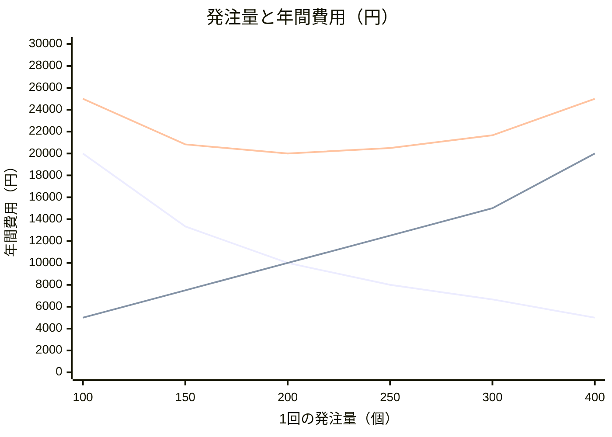
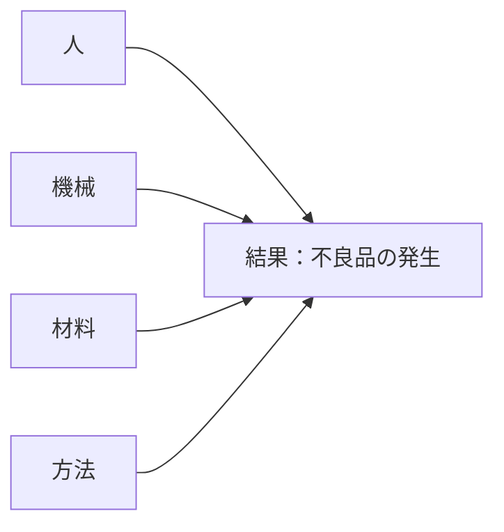
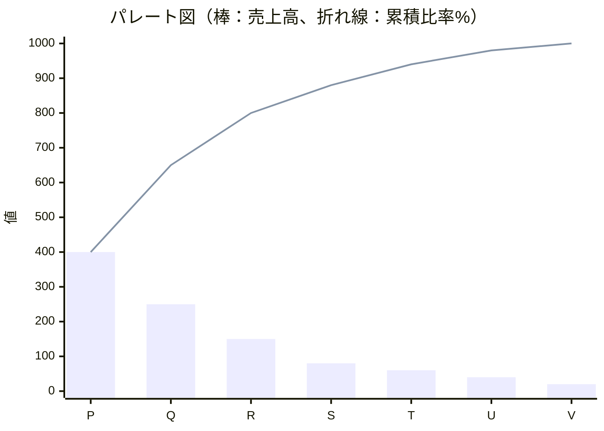
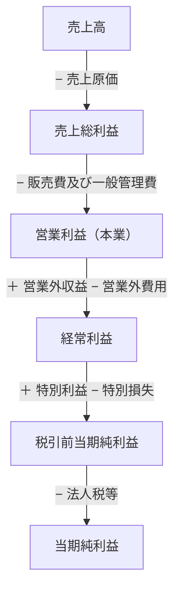
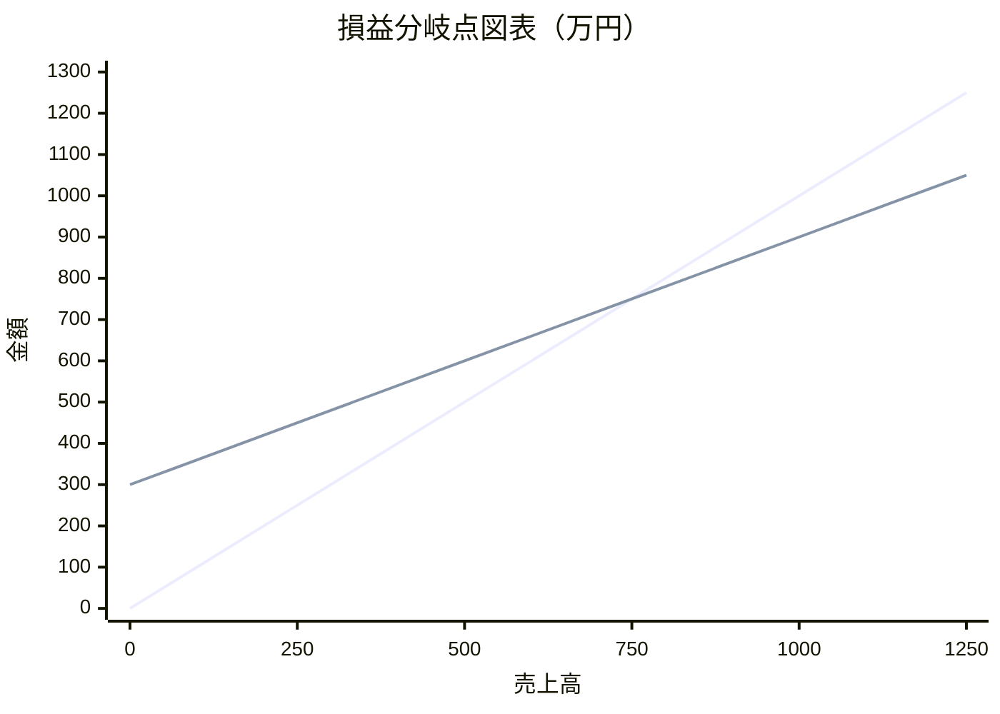
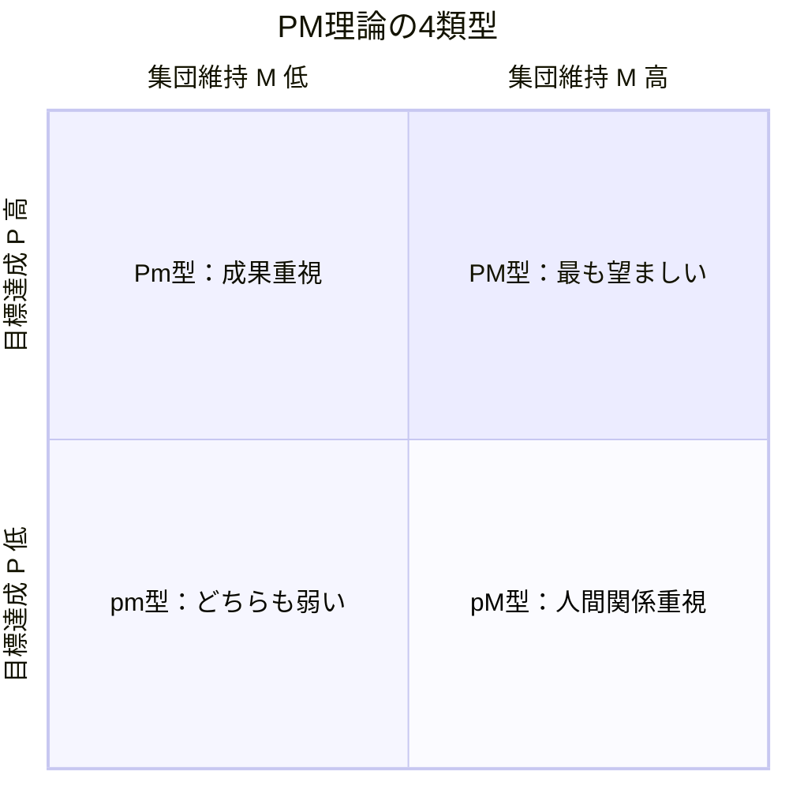
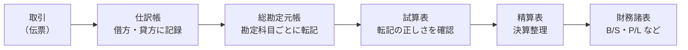

# 企業活動と会計

> **出題傾向・重要度：★★★**
> 科目A（旧午前）では、**計算問題**（損益分岐点、発注量、期待値、減価償却、在庫評価、財務指標）と、**QC七つ道具・新QC七つ道具**の図の見分けが毎回のように出ます。経営組織やCSR・SDGsの用語も時々出ます。
> 科目B（旧午後）の **問2（経営戦略）** では、損益分岐点や利益計算、財務指標が事例の中で問われます。
> この章で押さえるポイントは次の4つです。
> ① 公式を覚え、**途中式を書いて**計算する習慣、② 発注方式・意思決定基準の違い、③ QC七つ道具・新QC七つ道具の用途、④ 損益計算書と貸借対照表の構造。

## 目次

- [1. 経営組織とコーポレートガバナンス](#1-経営組織とコーポレートガバナンス)
- [2. CSR・SDGs・BCP](#2-csrsdgsbcp)
- [3. OR・IE：線形計画法](#3-orie線形計画法)
- [4. 在庫管理と発注方式](#4-在庫管理と発注方式)
- [5. ゲーム理論と意思決定](#5-ゲーム理論と意思決定)
- [6. 需要予測](#6-需要予測)
- [7. 品質管理（QC七つ道具・新QC七つ道具）](#7-品質管理qc七つ道具新qc七つ道具)
- [8. 財務諸表（損益計算書・貸借対照表）](#8-財務諸表損益計算書貸借対照表)
- [9. 損益分岐点](#9-損益分岐点)
- [10. 財務指標](#10-財務指標)
- [11. 減価償却](#11-減価償却)
- [12. 在庫の評価（棚卸資産の評価）](#12-在庫の評価棚卸資産の評価)
- [13. キャッシュフロー](#13-キャッシュフロー)
- [14. 経営・組織論の補足（シラバス追加用語）](#14-経営組織論の補足シラバス追加用語)
- [15. 会計・財務の補足（シラバス追加用語）](#15-会計財務の補足シラバス追加用語)
- [確認問題](#確認問題)
- [📋 シラバス用語チェックリスト](#-シラバス用語チェックリスト)
- [参考](#参考)

---

## 1. 経営組織とコーポレートガバナンス

### 1.1 組織の形態 ★★

| 組織形態 | 特徴 | 長所 | 短所 |
|---|---|---|---|
| **職能別組織** | 営業・製造・経理など**機能ごと**に部門を分ける | 専門性が高まる、規模の経済 | 部門間の調整が難しい |
| **事業部制組織** | **製品・地域・顧客ごと**に事業部を作り、各事業部が利益責任を持つ | 意思決定が速い、責任が明確 | 経営資源が重複する |
| **カンパニー制組織** | 事業部をさらに独立させ、**社内の独立会社**のように扱う（投資の権限も持つ） | 事業部制よりさらに自律性が高い | 全社の一体感が弱まる |
| **マトリックス組織** | 職能別と事業別など、**2つの軸を組み合わせる**。社員は2人の上司を持つ | 資源を柔軟に共有できる | **命令系統が2つ**になり、混乱しやすい |
| **プロジェクト組織** | 特定の目的のために**期間を限って**集めた組織。終わったら解散 | 目的に集中できる | ノウハウが残りにくい |
| **ネットワーク組織** | 部門や企業の枠を超えて、対等な立場でゆるやかにつながる | 柔軟 | 責任があいまいになりやすい |

- ⚠️ ひっかけ注意：「1人の社員が、機能部門と事業部門の**両方の上司**から指示を受ける」のはマトリックス組織です。

### 1.2 経営者の役職 ★

| 略語 | 正式名称 | 役割 |
|---|---|---|
| **CEO** | Chief Executive Officer（最高経営責任者） | 経営の最終責任者 |
| **COO** | Chief Operating Officer（最高執行責任者） | 日々の業務執行の責任者 |
| **CFO** | Chief Financial Officer（最高財務責任者） | 財務・会計の責任者 |
| **CIO** | Chief Information Officer（最高情報責任者） | 情報システム・IT戦略の責任者 |
| **CISO** | Chief Information Security Officer（最高情報セキュリティ責任者） | 情報セキュリティの責任者 |

### 1.3 コーポレートガバナンスと内部統制 ★

- **コーポレートガバナンス（企業統治）**：株主などの利害関係者（ステークホルダ）の立場から、**経営者を監視・規律する仕組み**です。社外取締役の設置などがあります。東京証券取引所は上場会社向けに「**コーポレートガバナンス・コード**」を定めています。
- **内部統制**：業務を適正に進めるため、**組織の内部で作る仕組み**です。金融庁の基準では、4つの目的（業務の有効性・効率性、報告の信頼性、法令等の遵守、資産の保全）と、6つの基本的要素（統制環境、リスクの評価と対応、統制活動、情報と伝達、モニタリング、**ITへの対応**）が示されています。
- **コンプライアンス（法令遵守）**：法令だけでなく、社会の規範や倫理も守ることです。

### 1.4 人事・人材育成の用語 ★

| 用語 | 意味 |
|---|---|
| **OJT**（On the Job Training） | 職場で、実際の仕事を通じて教育する |
| **Off-JT**（Off the Job Training） | 職場を離れて、研修やセミナーで教育する |
| **目標管理制度（MBO：Management By Objectives）** | 社員が上司と相談して目標を決め、達成度で評価する（M&AのMBOとは別物） |
| **ジョブ型雇用** | 職務の内容（ジョブディスクリプション）を明確にして雇用する |
| **タレントマネジメント** | 社員の能力・経験の情報を管理し、配置や育成に戦略的に活かす |
| **HRテック** | AIやクラウドなどのITを人事業務に活用すること |
| **ワークエンゲージメント** | 仕事に対して「熱意・没頭・活力」がある、前向きな心の状態 |
| **ダイバーシティ** | 性別・年齢・国籍など多様な人材を活かすこと |
| **リスキリング** | 新しい仕事や変化に対応するため、新しいスキルを学び直すこと |

---

## 2. CSR・SDGs・BCP

### 2.1 CSRとSDGs ★★

| 用語 | 意味 |
|---|---|
| **CSR**（Corporate Social Responsibility：企業の社会的責任） | 企業が利益の追求だけでなく、環境・社会・従業員・地域などに責任を持って行動すること |
| **SDGs**（Sustainable Development Goals：持続可能な開発目標） | 2015年の国連サミットで採択された、**2030年**までの国際目標。**17のゴールと169のターゲット**からなる |
| **ESG投資** | **E**nvironment（環境）、**S**ocial（社会）、**G**overnance（企業統治）に配慮している企業を選んで投資する |
| **グリーンIT** | IT機器の省電力化や、ITを使った環境負荷の低減 |
| **ディスクロージャー** | 企業が投資家などに、経営や財務の情報を公開すること |
| **IR**（Investor Relations） | 投資家向けの広報活動 |
| **カーボンニュートラル** | 温室効果ガスの排出量と吸収量を差し引きゼロにすること |

- 💡 覚え方：SDGsは「**17・169・2030**」と数字で覚えます。

### 2.2 BCPとBCM ★★

- **BCP（Business Continuity Plan：事業継続計画）**：災害やシステム障害などが起きても、**重要な業務を中断させない、または早く復旧させる**ための計画です。
- **BCM（Business Continuity Management：事業継続マネジメント）**：BCPを作り、訓練・見直しを続ける**管理の活動全体**です。
- BCPで決める主な目標：

| 指標 | 意味 |
|---|---|
| **RTO**（Recovery Time Objective：目標復旧時間） | **いつまでに**業務を復旧させるか |
| **RPO**（Recovery Point Objective：目標復旧時点） | **どの時点のデータまで**戻すか（どれだけのデータ損失を許すか） |
| **RLO**（Recovery Level Objective：目標復旧レベル） | **どの水準まで**業務を復旧させるか |

---

## 3. OR・IE：線形計画法

- **OR（Operations Research：オペレーションズリサーチ）**：数学的な手法で、最適な意思決定を導く学問です。
- **IE（Industrial Engineering：インダストリアルエンジニアリング）**：作業の方法や時間を分析して、生産性を高める手法です（作業研究、動作研究など）。

### 3.1 線形計画法 ★★

- **結論**：**線形計画法**は、**限られた資源（制約条件）の中で、利益を最大にする（またはコストを最小にする）組合せ**を求める方法です。
- **解き方の手順**：
  1. 変数を決める（製品Aを x 個、製品Bを y 個）。
  2. 制約条件を不等式で書く。
  3. 目的関数（最大にしたい利益の式）を書く。
  4. 制約条件の直線が交わる**頂点**を求め、それぞれの利益を計算して比べる（最適解は必ず頂点にあります）。

**具体例**：製品A・Bを作る。原料と機械の使用時間に上限があります。

| | 製品A（1個） | 製品B（1個） | 上限 |
|---|---|---|---|
| 原料 | 2 kg | 1 kg | 80 kg |
| 機械時間 | 1 時間 | 2 時間 | 70 時間 |
| 利益 | 3万円 | 4万円 | |

```
変数      ：A を x 個、B を y 個
制約条件  ：2x +  y ≦ 80   …①（原料）
             x + 2y ≦ 70   …②（機械時間）
             x ≧ 0, y ≧ 0
目的関数  ：利益 = 3x + 4y → 最大化

①と②の交点：①×2 − ② より
  4x + 2y = 160
−) x + 2y =  70
  3x       =  90 → x = 30
  ①に代入：60 + y = 80 → y = 20

頂点ごとの利益：
  (x, y) = (0, 0)  → 0
  (x, y) = (40, 0) → 3×40         = 120万円（①で y=0）
  (x, y) = (0, 35) → 4×35         = 140万円（②で x=0）
  (x, y) = (30, 20)→ 3×30 + 4×20 = 170万円 ← 最大

検算：原料 2×30 + 20 = 80 ≦ 80、機械 30 + 2×20 = 70 ≦ 70 （どちらも上限ちょうど）
```

- **答え**：製品Aを30個、製品Bを20個作ると、利益は最大の**170万円**です。
- ⚠️ ひっかけ注意：利益が高い製品B「だけ」を作る（35個・140万円）のが最適とは限りません。必ず**すべての頂点**を比べます。

---

## 4. 在庫管理と発注方式

### 4.1 定量発注方式と定期発注方式 ★★★

| 項目 | **定量発注方式**（発注点方式） | **定期発注方式** |
|---|---|---|
| 発注の時期 | 在庫が**発注点**を下回ったとき（不定期） | **決まった間隔**（毎週月曜など） |
| 発注量 | **毎回同じ量**（経済的発注量など） | **毎回計算する**（変わる） |
| 向いている品目 | 単価が**安く**、需要が**安定**している品目（C品目など） | 単価が**高く**、需要の**変動が大きい**重要品目（A品目など） |
| 管理の手間 | 少ない | 多い（毎回の予測が必要） |

- **ダブルビン方式**：在庫を2つの箱に分け、1つめの箱が空になったら発注する、定量発注方式の簡単なやり方です。

### 4.2 発注点の計算 ★★★

```
発注点 = 1日の平均使用量 × 調達期間（リードタイム） + 安全在庫
```

**具体例**：1日の平均使用量 20個、調達期間 5日、安全在庫 30個

```
発注点 = 20 × 5 + 30 = 100 + 30 = 130個
→ 在庫が130個を下回ったら発注する
```

- **安全在庫**：需要のばらつきに備えて余分に持つ在庫です。次の式で求めることもあります。

```
安全在庫 = 安全係数 × 使用量の標準偏差 × √調達期間
```

### 4.3 定期発注方式の発注量 ★★

```
発注量 = (発注間隔 + 調達期間) × 1日の平均使用量 + 安全在庫 − 現在の在庫量 − 発注残（注文済みで未入荷の量）
```

**具体例**：発注間隔 7日、調達期間 3日、1日の平均使用量 20個、安全在庫 40個、現在の在庫 120個、発注残 30個

```
発注量 = (7 + 3) × 20 + 40 − 120 − 30
       = 200 + 40 − 150
       = 90個
```

### 4.4 経済的発注量（EOQ） ★★★

- **結論**：**EOQ（Economic Order Quantity：経済的発注量）** は、**発注費用と保管費用の合計（在庫総費用）が最小になる1回当たりの発注量**です。
- **理由**：1回にたくさん発注すると発注回数が減って**発注費用は下がる**が、在庫が増えて**保管費用は上がります**。この2つが等しくなるところで、合計が最小になります。

```
EOQ = √( 2 × 年間需要量 × 1回当たりの発注費用 ÷ 1個当たりの年間保管費用 )

年間発注費用 = (年間需要量 ÷ 発注量) × 1回の発注費用
年間保管費用 = (発注量 ÷ 2) × 1個当たりの年間保管費用   ※平均在庫は発注量の半分
```

**具体例**：年間需要量 4,000個、1回の発注費用 500円、1個当たりの年間保管費用 100円

```
EOQ = √(2 × 4,000 × 500 ÷ 100)
    = √(4,000,000 ÷ 100)
    = √40,000
    = 200個

検算：
  発注回数     = 4,000 ÷ 200 = 20回
  年間発注費用 = 20 × 500        = 10,000円
  年間保管費用 = (200 ÷ 2) × 100 = 10,000円
  → 2つの費用が等しい（合計 20,000円で最小）
```



（右下がりの線が発注費用、右上がりの線が保管費用、下に凸の線が合計。合計は発注量200個で最小）

### 4.5 ABC分析 ★★

- **ABC分析**は、品目を売上高（または使用金額）の大きい順に並べ、**累積比率**で A・B・C の3グループに分けて、管理の重点を決める手法です。グラフは**パレート図**を使います（7章）。
- 例：累積比率が70%までをA、70〜90%をB、残りをCとします（境界の値は問題文で与えられます）。

| 品目 | 売上高（万円） | 構成比 | 累積比率 | 区分 |
|---|---|---|---|---|
| P | 400 | 40% | 40% | A |
| Q | 250 | 25% | 65% | A |
| R | 150 | 15% | 80% | B |
| S | 80 | 8% | 88% | B |
| T | 60 | 6% | 94% | C |
| U | 40 | 4% | 98% | C |
| V | 20 | 2% | 100% | C |
| 合計 | 1,000 | 100% | | |

- A品目は重点的に管理（定期発注方式）、C品目は簡単な管理（定量発注方式・ダブルビン方式）にします。

---

## 5. ゲーム理論と意思決定

### 5.1 不確実性下の意思決定 ★★★

- 将来の状況（市場の状態など）がわからない中で、どの戦略を選ぶかを決める基準です。

**具体例**：3つの戦略と、市場の3つの状態ごとの利益（万円）

| 戦略 | 好況（確率0.3） | 普通（確率0.5） | 不況（確率0.2） |
|---|---|---|---|
| A | 100 | 50 | −20 |
| B | 70 | 60 | 10 |
| C | 40 | 40 | 30 |

| 基準 | 考え方 | 計算 | 選ぶ戦略 |
|---|---|---|---|
| **期待値原理** | 確率で重み付けした**平均（期待値）が最大** | A：100×0.3 + 50×0.5 + (−20)×0.2 = 30 + 25 − 4 = **51**<br/>B：70×0.3 + 60×0.5 + 10×0.2 = 21 + 30 + 2 = **53**<br/>C：40×0.3 + 40×0.5 + 30×0.2 = 12 + 20 + 6 = **38** | **B** |
| **マクシマックス原理**（楽観的） | 各戦略の**最大**利益のうち、最大のものを選ぶ | A：100、B：70、C：40 | **A** |
| **マクシミン原理**（悲観的） | 各戦略の**最小**利益のうち、最大のものを選ぶ（最悪の場合でも一番ましな案） | A：−20、B：10、C：30 | **C** |
| **ミニマックスリグレット原理** | 各戦略の**機会損失（後悔）の最大値**が最小のものを選ぶ | 下の表 | **B** |
| **ラプラス原理** | 確率がわからないので、すべて**同じ確率**とみて平均する | A：130÷3 ≒ 43.3、B：140÷3 ≒ 46.7、C：110÷3 ≒ 36.7 | **B** |

**ミニマックスリグレット原理の計算**：機会損失 ＝（その状態での最大利益）−（その戦略の利益）

```
各状態の最大利益：好況 100、普通 60、不況 30
```

| 戦略 | 好況 | 普通 | 不況 | 最大の機会損失 |
|---|---|---|---|---|
| A | 100 − 100 = 0 | 60 − 50 = 10 | 30 − (−20) = 50 | 50 |
| B | 100 − 70 = 30 | 60 − 60 = 0 | 30 − 10 = 20 | **30（最小）** |
| C | 100 − 40 = 60 | 60 − 40 = 20 | 30 − 30 = 0 | 60 |

- 💡 覚え方：「**マクシ・ミン**」は「**ミン（最小）の中のマクシ（最大）**」と、**後ろから読む**とわかりやすいです。
- ⚠️ ひっかけ注意：マクシミンは「悲観的（最悪を考える）」、マクシマックスは「楽観的（最良を考える）」です。

### 5.2 ゲーム理論（2人ゼロ和ゲーム） ★

- **ゼロ和ゲーム**：一方の得が、もう一方の損になる（合計がゼロ）ゲームです。
- 自分（行）はマクシミン、相手（列）は**ミニマックス**（自分の利得の最大値を最小にする）で戦略を選びます。両者が一致する点を **鞍点（あんてん）** といい、そこが均衡になります。

**具体例**：表は自社（A1〜A3）の利得。相手（B1〜B3）にとっては損失。

| | B1 | B2 | B3 | 行の最小 |
|---|---|---|---|---|
| A1 | 3 | 1 | 4 | 1 |
| A2 | 5 | **2** | 6 | **2**（最大） |
| A3 | 0 | −1 | 7 | −1 |
| 列の最大 | 5 | **2**（最小） | 7 | |

```
自社のマクシミン   ：行の最小 {1, 2, −1} の最大 = 2（A2）
相手のミニマックス ：列の最大 {5, 2, 7} の最小 = 2（B2）
→ 一致するので (A2, B2) が鞍点。ゲームの値は 2
```

- **囚人のジレンマ**：お互いが自分にとって合理的な行動をとると、協力した場合より**両者とも悪い結果**になる状況です。**ナッシュ均衡**（どちらも自分だけ戦略を変えても得をしない状態）の例として出ます。

---

## 6. 需要予測

### 6.1 予測の手法 ★★

| 手法 | 考え方 |
|---|---|
| **移動平均法** | 直近の数期間の実績の平均を予測値とする |
| **指数平滑法** | 前回の予測値を、前回の実績との誤差で修正する |
| **回帰分析** | 売上と気温など、変数どうしの関係を式（回帰式）にして予測する。最小二乗法で直線を求める |
| **デルファイ法** | 複数の専門家にアンケートを繰り返し、意見を集約する（定性的な予測） |

**移動平均法の例**（3か月移動平均）：月ごとの実績が 1月 100、2月 120、3月 110、4月 130 のとき

```
5月の予測値 = (2月 + 3月 + 4月) ÷ 3 = (120 + 110 + 130) ÷ 3 = 360 ÷ 3 = 120
```

**指数平滑法の例**：

```
次回の予測値 = 前回の予測値 + α × (前回の実績値 − 前回の予測値)
             = α × 前回の実績値 + (1 − α) × 前回の予測値     （α：平滑化係数、0 ≦ α ≦ 1）

前回の予測値 100、前回の実績値 120、α = 0.4 のとき
次回の予測値 = 100 + 0.4 × (120 − 100) = 100 + 8 = 108
（検算：0.4 × 120 + 0.6 × 100 = 48 + 60 = 108）
```

- ⚠️ ひっかけ注意：α が**大きい**ほど、最近の実績を**強く反映**します（変化に敏感）。

---

## 7. 品質管理（QC七つ道具・新QC七つ道具）

### 7.1 QC七つ道具 ★★★

- **QC七つ道具**は、主に**数値データ**を分析するための道具です。

| 道具 | 何がわかるか | 図のイメージ |
|---|---|---|
| **パレート図** | 項目を多い順に並べた棒グラフと、**累積比率の折れ線**を重ねる。**重点的に対策すべき項目**がわかる | 棒（降順）＋右上がりの折れ線 |
| **特性要因図**（フィッシュボーン図） | 結果（特性）と、その**原因（要因）の関係**を魚の骨の形で整理する | 魚の骨 |
| **ヒストグラム** | データの**ばらつき（分布）**を柱状のグラフで表す | 柱状グラフ |
| **管理図** | 時系列のデータに**上方管理限界・下方管理限界**の線を引き、工程が**安定しているか（異常がないか）**をみる | 折れ線＋上下の限界線 |
| **散布図** | 2つのデータの**相関関係**をみる | 点の散らばり |
| **チェックシート** | データを漏れなく**記録・集計**するための表 | 記入用の表 |
| **層別** | データを機械別・担当者別などの**グループに分けて**比較する | （考え方） |

> ※ 「層別」の代わりに「グラフ」を七つ道具に入れる場合もあります。



（特性要因図のイメージ。実際の図では、大骨から中骨・小骨へとさらに原因を枝分かれさせます）

- **パレート図の例**（4.5のABC分析のデータ）：



（折れ線は累積売上高。1,000を100%として読みます）

- **管理図の読み方**：管理限界線の外に点が出た場合に加えて、限界線の内側でも**中心線の片側に点が連続する**（連）、**上昇・下降が続く**（傾向）、**周期的な変化**がある場合は、異常の兆しと判断します。

### 7.2 新QC七つ道具 ★★

- **新QC七つ道具**は、主に**言語データ（文字の情報）**を整理し、問題の構造を明らかにするための道具です。

| 道具 | 何に使うか |
|---|---|
| **親和図法** | ばらばらの意見や事実を、**似たもの（親和性）でグループ化**して整理する（KJ法と同じ考え方） |
| **連関図法** | 原因と結果が**複雑にからみ合った**問題を、矢印で結んで関係を明らかにする |
| **系統図法** | 目的を達成する手段を、**目的 → 手段 → さらに細かい手段**と**ツリー状に展開**する |
| **マトリックス図法** | 2つの要素（例：問題と原因）を**行と列**に並べ、交点で関係の有無・強さを示す |
| **マトリックスデータ解析法** | マトリックス図の数値データを、**主成分分析**などで解析する（新QC七つ道具で唯一、数値を扱う） |
| **PDPC法**（Process Decision Program Chart：過程決定計画図） | 計画の実行中に起こりうる**トラブルを予測**し、事前に対策の道筋を決めておく |
| **アローダイアグラム法** | 作業の**順序と日程**を矢印で表し、**クリティカルパス**を求める（PERT図） |

- 💡 覚え方：QC七つ道具は「**数字**」、新QC七つ道具は「**言葉**」を扱う、と大きく分けます。
- ⚠️ ひっかけ注意：「原因と結果」でも、**魚の骨の形**なら特性要因図（QC七つ道具）、**複雑にからみ合った矢印**なら連関図法（新QC七つ道具）です。

---

## 8. 財務諸表（損益計算書・貸借対照表）

### 8.1 損益計算書（P/L） ★★★

- **損益計算書（P/L：Profit and Loss Statement）** は、**一定期間（1年など）の経営成績**（どれだけもうかったか）を表します。
- 5つの利益の順番を確実に覚えます。

**具体例**（単位：万円）

| 項目 | 金額 | 計算 |
|---|---|---|
| 売上高 | 10,000 | |
| 売上原価 | 6,000 | |
| **売上総利益**（粗利） | **4,000** | 10,000 − 6,000 |
| 販売費及び一般管理費 | 3,000 | 給料、広告費、減価償却費など |
| **営業利益** | **1,000** | 4,000 − 3,000（本業のもうけ） |
| 営業外収益 | 100 | 受取利息、受取配当金など |
| 営業外費用 | 300 | 支払利息など |
| **経常利益** | **800** | 1,000 + 100 − 300（ふだんの活動全体のもうけ） |
| 特別利益 | 0 | 固定資産売却益など（臨時の利益） |
| 特別損失 | 200 | 災害損失、固定資産売却損など（臨時の損失） |
| **税引前当期純利益** | **600** | 800 + 0 − 200 |
| 法人税等 | 180 | |
| **当期純利益** | **420** | 600 − 180 |



- 💡 覚え方：「**う・え・け・ぜ・と**」（**売**上総利益 → **営**業利益 → **経**常利益 → **税**引前当期純利益 → 当期純利益）。
- ⚠️ ひっかけ注意：**支払利息は営業外費用**です（販管費ではありません）。**災害による損失は特別損失**です。

### 8.2 貸借対照表（B/S） ★★★

- **貸借対照表（B/S：Balance Sheet）** は、**ある時点（期末など）の財政状態**を表します。
- 左側（借方）に**資産**（お金の使い道）、右側（貸方）に**負債と純資産**（お金の集め方）を書き、**左右の合計は必ず一致**します。

```
資産 = 負債 + 純資産
```

**具体例**（単位：万円）

| 資産の部 | 金額 | 負債・純資産の部 | 金額 |
|---|---|---|---|
| **流動資産** | **3,000** | **流動負債** | **2,000** |
| 　現金・預金 | 1,000 | 　買掛金、短期借入金 など | |
| 　売掛金 | 1,200 | **固定負債** | **3,000** |
| 　棚卸資産（在庫） | 800 | 　長期借入金、社債 など | |
| **固定資産** | **7,000** | **純資産（自己資本）** | **5,000** |
| 　建物、機械、ソフトウェア など | | 　資本金、利益剰余金 など | |
| **資産合計** | **10,000** | **負債・純資産合計** | **10,000** |

- **流動**と**固定**の区別は、原則として**1年以内**に現金化（支払い）されるかどうかで判断します（ワンイヤールール）。
- 負債（他人資本）＋ 純資産（自己資本）＝ **総資本**（＝総資産）です。
- ⚠️ ひっかけ注意：**ソフトウェアは固定資産（無形固定資産）**です。

---

## 9. 損益分岐点

### 9.1 公式 ★★★

- **損益分岐点**は、**利益がちょうどゼロ**になる売上高です。これより売上が多いと黒字、少ないと赤字です。
- 費用を、売上に比例して増える**変動費**（材料費など）と、売上にかかわらず一定の**固定費**（家賃、人件費など）に分けて考えます。

```
変動費率          = 変動費 ÷ 売上高
限界利益          = 売上高 − 変動費                （限界利益は「貢献利益」ともいう）
限界利益率        = 1 − 変動費率
損益分岐点売上高  = 固定費 ÷ (1 − 変動費率)
                  = 固定費 ÷ 限界利益率
目標利益を達成する売上高 = (固定費 + 目標利益) ÷ (1 − 変動費率)
安全余裕率        = (実際の売上高 − 損益分岐点売上高) ÷ 実際の売上高 × 100（%）
損益分岐点比率    = 損益分岐点売上高 ÷ 実際の売上高 × 100（%）
```

### 9.2 計算例 ★★★

**具体例**：売上高 1,000万円、変動費 600万円、固定費 300万円

```
① 変動費率         = 600 ÷ 1,000 = 0.6
② 限界利益率       = 1 − 0.6 = 0.4
③ 損益分岐点売上高 = 300 ÷ 0.4 = 750万円

検算：売上高 750万円のとき
  変動費 = 750 × 0.6 = 450
  利益   = 750 − 450 − 300 = 0 ✓

④ 利益 100万円を出す売上高 = (300 + 100) ÷ 0.4 = 1,000万円
⑤ 安全余裕率 = (1,000 − 750) ÷ 1,000 × 100 = 25%
   （売上が25%減っても赤字にならない）
⑥ 損益分岐点比率 = 750 ÷ 1,000 × 100 = 75%
```



（傾き1の線が売上高、切片300の線が総費用 ＝ 固定費300 ＋ 変動費。2本が交わる **750万円** が損益分岐点）

- **損益分岐点を下げる方法**：①固定費を減らす、②変動費率を下げる、③販売価格を上げる（変動費率が下がる）。
- ⚠️ ひっかけ注意：問題が「販売数量」で与えられたときは、`損益分岐点販売数量 = 固定費 ÷ (販売単価 − 1個当たりの変動費)` で求めます。

---

## 10. 財務指標

### 10.1 主な指標と計算例 ★★★

8章の財務諸表（売上高 10,000、当期純利益 420、流動資産 3,000（うち棚卸資産 800）、固定資産 7,000、流動負債 2,000、固定負債 3,000、自己資本 5,000、総資本 10,000）を使って計算します。

| 分類 | 指標 | 公式 | 計算 | 結果 | 判断 |
|---|---|---|---|---|---|
| 収益性 | **ROE**（Return On Equity：自己資本利益率） | 当期純利益 ÷ 自己資本 × 100 | 420 ÷ 5,000 × 100 | **8.4%** | 高いほど良い |
| 収益性 | **ROA**（Return On Assets：総資産利益率） | 当期純利益 ÷ 総資産 × 100 | 420 ÷ 10,000 × 100 | **4.2%** | 高いほど良い |
| 収益性 | 売上高営業利益率 | 営業利益 ÷ 売上高 × 100 | 1,000 ÷ 10,000 × 100 | **10%** | 高いほど良い |
| 安全性 | **流動比率** | 流動資産 ÷ 流動負債 × 100 | 3,000 ÷ 2,000 × 100 | **150%** | 高いほど良い（200%以上が理想とされる） |
| 安全性 | **当座比率** | 当座資産 ÷ 流動負債 × 100 | (3,000 − 800) ÷ 2,000 × 100 | **110%** | 高いほど良い |
| 安全性 | **自己資本比率** | 自己資本 ÷ 総資本 × 100 | 5,000 ÷ 10,000 × 100 | **50%** | 高いほど良い |
| 安全性 | **固定比率** | 固定資産 ÷ 自己資本 × 100 | 7,000 ÷ 5,000 × 100 | **140%** | **低い**ほど良い（100%以下が理想） |
| 安全性 | 固定長期適合率 | 固定資産 ÷ (自己資本 + 固定負債) × 100 | 7,000 ÷ 8,000 × 100 | **87.5%** | **低い**ほど良い（100%以下が望ましい） |
| 効率性 | 総資本回転率 | 売上高 ÷ 総資本 | 10,000 ÷ 10,000 | **1.0回** | 高いほど資産を効率よく使っている |

> ※ ROAは、分子に経常利益や営業利益を使う場合もあります。問題文の指示に従います。
> ※ 当座資産は、流動資産のうち現金・預金、売掛金など**すぐに現金化しやすい資産**です。ここでは簡単に「流動資産 − 棚卸資産」としています。

### 10.2 ROEの分解（デュポン分析） ★★

```
ROE = 売上高当期純利益率 × 総資本回転率 × 財務レバレッジ
    = (当期純利益 ÷ 売上高) × (売上高 ÷ 総資本) × (総資本 ÷ 自己資本)

例：(420 ÷ 10,000) × (10,000 ÷ 10,000) × (10,000 ÷ 5,000)
  = 0.042 × 1.0 × 2.0
  = 0.084 → 8.4%（10.1の結果と一致 ✓）
```

- ⚠️ ひっかけ注意：借金（負債）を増やすと財務レバレッジが上がって**ROEは上がりやすい**ですが、自己資本比率は下がり、安全性は低くなります。

---

## 11. 減価償却

### 11.1 減価償却とは ★★

- **結論**：**減価償却**は、建物や機械など長く使う固定資産の取得費用を、**使用する期間（耐用年数）に分けて費用にする**手続きです。
- **理由**：資産は数年間にわたって売上に貢献するので、買った年に全額を費用にすると、その年だけ利益が極端に少なくなるためです。
- 減価償却費は**現金が出ていかない費用**です（13章のキャッシュフローで重要）。

### 11.2 定額法 ★★★

```
毎年の減価償却費 = (取得原価 − 残存価額) ÷ 耐用年数
```

**具体例**：取得原価 100万円、耐用年数 5年、残存価額 0円

```
減価償却費 = (100 − 0) ÷ 5 = 20万円（毎年同じ）
```

| 年 | 減価償却費 | 期末の帳簿価額 |
|---|---|---|
| 1年目 | 20万円 | 80万円 |
| 2年目 | 20万円 | 60万円 |
| 3年目 | 20万円 | 40万円 |
| 4年目 | 20万円 | 20万円 |
| 5年目 | 20万円 | 0円 |

- **期の途中で取得した場合**は**月割り**にします。例：決算が3月で、10月に取得した場合、1年目は10月〜3月の6か月分なので `20万円 × 6 ÷ 12 = 10万円` です。
- 💡 現在の日本の税法では、2007年4月1日以降に取得した資産は**残存価額をゼロ**（最後に**備忘価額1円**を残す）として計算します。古い問題では「残存価額は取得原価の10%」とする場合があるので、問題文の条件に従います。

### 11.3 定率法 ★★

```
毎年の減価償却費 = 期首の帳簿価額（未償却残高） × 償却率
```

- 初めの年ほど償却費が**大きく**、だんだん小さくなります。
- 日本の税法（2012年4月1日以降に取得した資産）では、**200%定率法**（償却率 ＝ 定額法の償却率 1/耐用年数 の **2倍**）を使います。償却費が「**償却保証額**（取得原価 × 保証率）」を下回った年からは、「**改定取得価額 × 改定償却率**」で均等に償却します。

**具体例**：取得原価 1,000,000円、耐用年数 5年（償却率 0.400、改定償却率 0.500、保証率 0.10800）

```
償却保証額 = 1,000,000 × 0.108 = 108,000円

1年目：1,000,000 × 0.4 = 400,000円 （帳簿価額 600,000円）
2年目：  600,000 × 0.4 = 240,000円 （帳簿価額 360,000円）
3年目：  360,000 × 0.4 = 144,000円 （帳簿価額 216,000円）
4年目：  216,000 × 0.4 =  86,400円 → 償却保証額 108,000円を下回る
        → 改定取得価額 216,000円 × 改定償却率 0.5 = 108,000円 （帳簿価額 108,000円）
5年目：  108,000円 − 備忘価額1円 = 107,999円 （帳簿価額 1円）

合計：400,000 + 240,000 + 144,000 + 108,000 + 107,999 = 999,999円 ✓
```

| 年 | 定額法 | 定率法（200%） |
|---|---|---|
| 1年目 | 200,000 | 400,000 |
| 2年目 | 200,000 | 240,000 |
| 3年目 | 200,000 | 144,000 |
| 4年目 | 200,000 | 108,000 |
| 5年目 | 199,999 | 107,999 |

（定額法の5年目は備忘価額1円を残すため199,999円）

- ⚠️ ひっかけ注意：科目Aでは、償却率が問題文で与えられ、「期首の帳簿価額 × 償却率」を数年分くり返すだけの問題が多いです。**取得原価に毎年償却率を掛けない**よう注意します（それは定額法の考え方です）。

---

## 12. 在庫の評価（棚卸資産の評価）

### 12.1 評価方法と売上原価 ★★★

- 同じ商品でも仕入れた時期によって単価が違うとき、**払い出した（売った）商品の単価**をどう決めるかで、売上原価と期末在庫の金額が変わります。

```
売上原価 = 期首の在庫 + 当期の仕入 − 期末の在庫
```

| 方法 | 考え方 |
|---|---|
| **先入先出法**（FIFO：First In First Out） | **先に仕入れたものから先に払い出す**とみなす |
| **移動平均法** | 仕入れのたびに、**その時点の在庫の平均単価**を計算し直す |
| **総平均法** | 期間全体の**平均単価**（期首在庫と仕入の合計 ÷ 数量の合計）で計算する |

> ※ 後入先出法は、日本の会計基準では2010年4月1日以後に始まる事業年度から廃止されています。

### 12.2 計算例 ★★★

| 日付 | 取引 | 数量 | 単価 |
|---|---|---|---|
| 4/1 | 期首在庫 | 10個 | 100円 |
| 4/5 | 仕入 | 20個 | 130円 |
| 4/10 | 払出 | 15個 | |
| 4/20 | 仕入 | 10個 | 160円 |
| 4/25 | 払出 | 15個 | |

**① 先入先出法**

```
4/10 払出 15個：古いものから → 4/1の10個 × 100 + 4/5の5個 × 130 = 1,000 + 650 = 1,650円
     残り：4/5の15個（@130）
4/20 仕入：10個 × 160 = 1,600円
4/25 払出 15個：4/5の残り15個 × 130 = 1,950円
     残り：4/20の10個（@160）

売上原価 = 1,650 + 1,950 = 3,600円
期末在庫 = 10 × 160     = 1,600円
```

**② 移動平均法**

```
4/5 仕入後：数量 10 + 20 = 30個、金額 1,000 + 2,600 = 3,600円
           平均単価 = 3,600 ÷ 30 = 120円
4/10 払出：15 × 120 = 1,800円 → 残り 15個、1,800円
4/20 仕入後：数量 15 + 10 = 25個、金額 1,800 + 1,600 = 3,400円
           平均単価 = 3,400 ÷ 25 = 136円
4/25 払出：15 × 136 = 2,040円 → 残り 10個、1,360円

売上原価 = 1,800 + 2,040 = 3,840円
期末在庫 = 10 × 136     = 1,360円
```

**③ 総平均法**

```
平均単価 = (1,000 + 2,600 + 1,600) ÷ (10 + 20 + 10) = 5,200 ÷ 40 = 130円
売上原価 = 30 × 130 = 3,900円
期末在庫 = 10 × 130 = 1,300円
```

**検算**（どの方法でも 売上原価 + 期末在庫 = 期首在庫 + 仕入 = 5,200円）

| 方法 | 売上原価 | 期末在庫 | 合計 |
|---|---|---|---|
| 先入先出法 | 3,600 | 1,600 | 5,200 ✓ |
| 移動平均法 | 3,840 | 1,360 | 5,200 ✓ |
| 総平均法 | 3,900 | 1,300 | 5,200 ✓ |

- 💡 ポイント：**仕入単価が上がっている（物価上昇の）とき**、先入先出法は古い安い単価が売上原価になるので、**売上原価が小さく、利益が大きく**なります。

---

## 13. キャッシュフロー

### 13.1 キャッシュフロー計算書 ★★

- **キャッシュフロー計算書**は、一定期間の**現金の増減**を、3つの活動に分けて表します。
- **理由**：損益計算書で黒字でも、売掛金が回収できずに現金が足りなくなると倒産します（**黒字倒産**）。現金の流れを別に確認する必要があります。

| 区分 | 内容 | プラスの例 | マイナスの例 |
|---|---|---|---|
| **営業活動によるキャッシュフロー** | 本業で生んだ現金 | 商品の販売による収入 | 仕入・給料の支払い |
| **投資活動によるキャッシュフロー** | 設備投資や有価証券の売買 | 固定資産の売却 | 設備の購入 |
| **財務活動によるキャッシュフロー** | 資金の調達と返済 | 借入れ、株式の発行 | 借入金の返済、配当の支払い |

```
フリーキャッシュフロー（FCF） = 営業キャッシュフロー + 投資キャッシュフロー
（企業が自由に使える現金。投資キャッシュフローは通常マイナス）
```

### 13.2 間接法による営業キャッシュフローの計算 ★★

- **間接法**は、税引前当期純利益から出発し、**現金の動きと利益のずれ**を調整して営業キャッシュフローを求めます。

| 調整項目 | 加算か減算か | 理由 |
|---|---|---|
| 減価償却費 | **加算** | 費用だが、現金は出ていない |
| 売掛金の増加 | **減算** | 売上は計上したが、現金はまだ入っていない |
| 棚卸資産の増加 | **減算** | 在庫を買うために現金が出た |
| 買掛金の増加 | **加算** | 仕入れたが、現金はまだ払っていない |
| 法人税等の支払額 | **減算** | 現金が出た |

**具体例**（単位：万円）

```
税引前当期純利益      600
＋ 減価償却費         200
− 売掛金の増加        100
− 棚卸資産の増加       30
＋ 買掛金の増加        50
− 法人税等の支払額    180
────────────────────────
営業キャッシュフロー  540

計算：600 + 200 − 100 − 30 + 50 − 180 = 540

設備の購入（投資CF） −400 → フリーキャッシュフロー = 540 + (−400) = 140
```

- 💡 覚え方：**資産が増えたら現金はマイナス**、**負債が増えたら現金はプラス**。

---

## 14. 経営・組織論の補足（シラバス追加用語）

> 業務分析・データ利活用（OR・IEの追加用語、データの収集・加工・分析・可視化）は [06_業務分析とデータ利活用](./06_業務分析とデータ利活用.md) で詳しく解説しています。

### 14.1 企業活動・企業形態・企業の特徴

| 用語 | 意味 |
|---|---|
| **企業理念** | 企業の存在意義・価値観。経営の判断の拠り所になる |
| **人的資本経営** | 人材を「コスト」ではなく「**資本**」ととらえ、教育・育成への投資で人材の価値を最大化し、企業価値の向上につなげる経営（人的資本の情報開示も求められている） |
| **パーパス経営** | 「社会の中で何のために存在するのか」という **存在意義（パーパス）** を軸に据えて経営する |
| **企業文化（風土）** | 組織の構成員が共有する価値観・行動様式 |
| **カーボンフットプリント** | 製品やサービスの原材料調達から廃棄・リサイクルまでの **ライフサイクル全体で排出される温室効果ガス** をCO2量に換算して表示すること |
| **持分会社** | **合名会社**（全員が無限責任社員）、**合資会社**（無限責任社員と有限責任社員）、**合同会社**（全員が有限責任社員）の総称。出資者（社員）が経営にも当たる |
| **株式会社** | 株式を発行して資金を集め、株主は **出資額の範囲でのみ責任を負う（有限責任）**。株主総会・取締役などの **会社機関が分化** している |
| **準則主義** | 法律の定める要件を満たせば、行政の許可なしに登記だけで会社を設立できるという原則 |
| **株式公開（IPO：Initial Public Offering）** | 未上場企業が証券取引所に上場し、株式を一般の投資家に売り出すこと |
| **所有と経営の分離** | 会社の所有者（株主）と経営者（取締役）が別の人であること。経営者を監視する仕組み（ガバナンス）が必要になる |
| **ゴーイングコンサーン（継続企業の前提）** | 企業は将来にわたって事業を **継続する** ことを前提とする考え方 |
| **コーポレートガバナンス・コード** | 東京証券取引所が定めた、上場会社のガバナンスの原則（株主の権利、取締役会の責務など） |
| **IR（Investor Relations）／統合報告書／アニュアルレポート／CSR報告書** | 投資家向け広報／財務情報と非財務情報（戦略・ESGなど）をまとめた報告書／年次報告書／社会・環境への取組みの報告書 |
| **コーポレートアイデンティティ（CI）／コーポレートブランド** | 企業の理念・特徴をロゴなどで統一的に表現し、社内外に示すこと／企業そのもののブランド |

### 14.2 経営管理と経営管理論

| 用語 | 意味 |
|---|---|
| **経営目標・経営計画・事業計画・業績評価** | 達成すべき目標／それを達成する全社の計画／事業ごとの計画／成果の評価 |
| **PDCA** | Plan→Do→Check→Act の管理サイクル |
| **OODAループ** | **Observe（観察）→ Orient（状況判断）→ Decide（意思決定）→ Act（行動）**。変化の速い状況で、計画より **素早い判断と行動** を重視するサイクル |
| **財務・資産・人事・情報管理** | 経営資源（カネ・モノ・ヒト・情報）ごとの管理 |
| **TQM** | 全社的な品質管理 |
| **科学的管理法** | テイラーが提唱。作業を時間研究・動作研究で分析し、**標準作業量（課業）** を決めて管理する |
| **経営過程論（管理過程論）** | ファヨールが提唱。管理を **計画・組織・命令・調整・統制** の過程としてとらえる |
| **協働システム** | バーナードが提唱。組織を、人々が協力する仕組みととらえ、成立の3要素を **共通目的・貢献意欲・コミュニケーション** とした。サイモンは意思決定を中心に組織をとらえた（**限定された合理性**） |
| **一般システム理論** | ベルタランフィが提唱。生物・社会などあらゆるものを、相互に作用する要素からなる **システム** としてとらえる理論。システム工学の基礎 |

### 14.3 ヒューマンリソースマネジメント（人的資源管理）

| 用語 | 意味 |
|---|---|
| **OJT／目標管理（MBO：Management by Objectives and self-control）** | 職場での実務を通じた教育／本人が上司と目標を決め、自己統制で達成を目指す制度（[1.4](#14-人事人材育成の用語-)） |
| **裁量労働制** | 実際の労働時間ではなく、あらかじめ決めた時間働いたものとみなす制度（[04_法務](./04_法務.md)） |
| **エンプロイヤビリティ** | 雇用される能力（社内外で通用する能力） |
| **年俸制** | 1年単位で給与額を決める制度（成果で翌年の額が変わる） |
| **コンピテンシー** | 高い成果を上げる人に共通する **行動特性**。採用・評価・育成の基準に使う |
| **コーチング／メンタリング** | 質問などで相手の考えを引き出し、自ら答えを見つけさせる／経験豊富な先輩（メンター）が助言・支援する |
| **ケーススタディ** | 実際の事例を教材にして考えさせる教育 |
| **e-ラーニング／アダプティブラーニング** | ネットを使った学習／学習者の理解度に応じて内容や難易度を **個別に最適化** する学習 |
| **リスキリング** | 新しい業務に必要なスキルを学び直すこと |
| **ジョブローテーション** | 計画的に部署や職務を異動させ、幅広い経験を積ませる |
| **キャリア開発／CDP（Career Development Program）** | 長期的なキャリアの形成を支援すること／その計画的な仕組み |
| **選抜型人事** | 将来の幹部候補などを早期に選抜して重点的に育成する |
| **チームビルディング** | チームの目標を共有し、協力して成果を出せる集団を作る取組み |
| **アルムナイ採用** | 退職した元社員（アルムナイ：卒業生）を再び採用すること |
| **リテンション** | 優秀な人材の **流出を防ぎ、定着させる** 施策 |
| **タレントマネジメント** | 人材の能力・経験を把握し、配置・育成に戦略的に活かす |
| **エンパワーメント** | 部下に権限を委譲し、自律的に判断・行動できるようにする |
| **HPI（High Potential Individual）** | 将来の幹部として高い潜在能力を持つ人材（ハイポテンシャル人材） |
| **HRテック** | AI・クラウドなどを人事業務に活用すること |
| **ワークライフバランス／ワークエンゲージメント** | 仕事と生活の調和／仕事への熱意・没頭・活力のある状態 |
| **EAP（Employee Assistance Program：従業員支援プログラム）** | 従業員のメンタルヘルスや個人的な問題を、専門家の相談などで支援する仕組み |
| **ワークシェアリング** | 1人当たりの労働時間を減らし、仕事を多くの人で分け合って雇用を維持・創出する |
| **テレワーク** | 情報通信技術を使い、オフィス以外の場所で働くこと |
| **DE&I（Diversity, Equity & Inclusion）** | 多様性（ダイバーシティ）、公平性（エクイティ：一人ひとりの状況に応じた支援）、包摂性（インクルージョン：誰もが受け入れられ活躍できること） |
| **ウェルビーイング（well-being）** | 身体的・精神的・社会的に **良好で満たされた状態** |

### 14.4 行動科学（モチベーション・リーダーシップ）

**思考法・集団**

| 用語 | 意味 |
|---|---|
| **ロジカルシンキング** | 筋道を立てて矛盾なく考える方法（MECE、ロジックツリーなど） |
| **垂直思考／水平思考** | 論理を順に積み上げて深く考える／前提にとらわれず多角的に発想する（ラテラルシンキング） |
| **仮説思考** | 限られた情報から先に仮説（仮の答え）を立て、検証しながら結論に近づく |
| **グループダイナミクス（集団力学）** | 集団の中で人の行動や考え方がどう影響し合うかを研究する |
| **親和図／ブレーンストーミング** | 意見をグループ化して整理する／批判せず自由に多くのアイデアを出す |

**モチベーション理論**

| 理論 | 提唱者 | 内容 |
|---|---|---|
| **欲求段階説** | マズロー | 人の欲求は **生理的 → 安全 → 社会的（所属と愛）→ 承認（尊厳）→ 自己実現** の5段階で、低次の欲求が満たされると次の段階を求める |
| **動機づけ・衛生理論（二要因理論）** | ハーズバーグ | 仕事の満足を生む **動機づけ要因**（達成、承認、仕事そのもの、責任、昇進）と、不足すると不満を生むが満たしても満足にはつながらない **衛生要因**（給与、作業条件、人間関係、会社の方針）は別物 |
| **XY理論** | マクレガー | **X理論**：人は本来怠け者で、命令と管理が必要。**Y理論**：人は本来働くことを好み、自ら目標に向かう。Y理論に基づく管理（目標管理など）を提唱 |
| **期待理論** | ブルーム | 動機づけの強さ ＝ **期待**（努力すれば成果が出るという見込み）× **誘意性**（成果から得られる報酬の魅力） |
| **内発的動機づけ** | （デシなど） | 報酬や罰ではなく、興味・好奇心・やりがいなど **自分の内側から生じる意欲**（対：外発的動機づけ） |

**リーダーシップ理論**

| 理論 | 提唱者 | 内容 |
|---|---|---|
| **PM理論** | 三隅二不二 | リーダーシップを **P（Performance：目標達成機能）** と **M（Maintenance：集団維持機能）** の2軸で4類型（PM型・Pm型・pM型・pm型）に分け、**PM型（両方が高い）が最も望ましい** とする |
| **SL理論（Situational Leadership）** | ハーシーとブランチャード | 部下の **成熟度** に応じて、**指示型 → 説得（コーチ）型 → 参加（援助）型 → 委任型** と、適したリーダーシップが変わる |
| **コンティンジェンシー理論** | フィードラー | 唯一最善のリーダーシップはなく、**状況（リーダーと部下の関係、仕事の構造、権限）によって有効なスタイルが変わる** |
| **シェアードリーダーシップ** | − | 特定の1人ではなく、**メンバー全員が状況に応じてリーダーシップを発揮** する |
| **サーバントリーダーシップ** | グリーンリーフ | リーダーはまず **部下に奉仕し、支援する** ことで、部下の成長と組織の成果を導く |



### 14.5 リスクマネジメントと事業継続

- **リスク分析の手順（例）**：①リスクの想定 → ②影響の分析 → ③重要な業務の選定 → ④重要業務を継続させる計画の立案 → ⑤実施可能な体制の整備 → ⑥継続的改善のための計画の策定。
- **事業影響度分析（BIA：Business Impact Analysis）**：業務が停止した場合の影響（損失額、顧客・社会への影響）を時間経過とともに分析し、**優先して復旧すべき業務** と **目標復旧時間（RTO）** を決めます。
- **JIS Q 22301（ISO 22301）**：事業継続マネジメントシステム（BCMS）の要求事項の規格です。
- **レジリエンス**：災害や障害などの衝撃を受けても、しなやかに **回復・適応する力** です。

### 14.6 経営組織と役職の補足

| 用語 | 意味 |
|---|---|
| **階層型組織（ピラミッド型組織）** | 上から下へ命令系統が階層的につながる組織 |
| **フラット型組織** | 中間管理職の階層を減らし、意思決定を速くした組織 |
| **職能別組織（機能別組織）** | 営業・製造・経理など機能ごとに部門を分けた組織（[1.1](#11-組織の形態-)） |
| **ラインアンドスタッフ組織** | 命令系統（ライン）に、専門的な助言を行う **スタッフ部門**（企画、人事、法務など）を加えた組織 |
| **DAO（Decentralized Autonomous Organization：分散型自律組織）** | 中央の管理者を置かず、ブロックチェーン上のルール（スマートコントラクト）と参加者の投票で運営される組織 |
| **CDO（Chief Digital Officer：最高デジタル責任者）** | DXの推進責任者 |
| **CPO（Chief Privacy Officer：最高プライバシー責任者）** | 個人情報・プライバシー保護の責任者 |
| **CoE（Center of Excellence）** | 組織横断で、特定分野（AI、データ分析、クラウドなど）の専門知識・人材・ノウハウを集約し、全社を支援する拠点となる組織 |

### 14.7 経営環境の変化

| 用語 | 意味 |
|---|---|
| **企業環境の内部化** | 環境問題や地域社会など、これまで企業の外にあった課題を、企業が自らの経営課題として取り込むこと |
| **ディスクロージャー／アカウンタビリティ** | 情報開示／説明責任 |
| **レピュテーションリスク** | 不祥事や悪い評判によって企業の **信用・ブランドが傷つき**、損失を被るリスク |
| **持株会社／グループ経営** | 他社の株式を持ちグループを統括する会社／グループ一体の経営 |
| **SRI（Socially Responsible Investment：社会的責任投資）** | 企業の社会的責任への取組みを評価して投資先を選ぶ（ESG投資の前身） |
| **環境経営** | 環境への配慮を経営戦略の中心に組み込む経営 |
| **サテライトオフィス／在宅勤務／SOHO（Small Office Home Office）** | 本社以外の小規模な拠点／自宅での勤務／自宅や小さな事務所で事業を営む形態 |
| **企業市民** | 企業も社会の一員（市民）として、地域社会への貢献などの責任を果たすべきだという考え方 |
| **ギグエコノミー** | ネットを通じて単発の仕事（ギグ）を請け負う働き方が広がった経済（配達・運転など） |

### 14.8 社会におけるIT利活用の動向

| 用語 | 意味 |
|---|---|
| **AI言語モデルのスケーリング則** | 大規模言語モデルの性能が、**パラメータ数・学習データ量・計算量** を増やすほど、べき乗則に従って予測可能な形で向上するという経験則 |
| **第4次産業革命** | IoT・ビッグデータ・AI・ロボットによる産業構造の変革（蒸気機関、電力、コンピュータに続く4番目） |
| **Society 5.0／超スマート社会** | サイバー空間とフィジカル空間を高度に融合させ、経済発展と社会課題の解決を両立する人間中心の社会（狩猟・農耕・工業・情報に続く5番目の社会） |
| **データ駆動型社会** | 現実世界のデータを集め、分析して価値を生み、現実世界にフィードバックすることで社会が動く社会 |
| **デジタルガバナンス・コード** | 経営者がDXで実践すべき事項（シラバスは2.0を記載。2024年9月に **3.0** に改訂。[01_システム戦略](./01_システム戦略.md)） |
| **アジャイル・ガバナンス** | 変化の速い技術に対応するため、ルールを固定せず、**環境・リスク分析 → ゴール設定 → システム設計 → 運用 → 評価 → 改善** のサイクルを素早く回すガバナンス |
| **デジタルトランスフォーメーション（DX）** | データとデジタル技術で製品・ビジネスモデル・組織を変革すること |
| **コーポレートトランスフォーメーション（CX）** | 事業ポートフォリオ、組織、人事制度、企業文化などを含めた **会社全体の抜本的な変革** |
| **グリーントランスフォーメーション（GX）** | 化石エネルギー中心から **クリーンエネルギー中心** の産業・社会構造へ転換する変革 |
| **GXリーグ基本構想** | 経済産業省が示した、GXに積極的に取り組む企業群が、排出削減目標や **排出量取引** などに取り組む枠組み（GXリーグ） |
| **カーボンニュートラル** | 温室効果ガスの排出量と吸収量を均衡させ、実質ゼロにすること（日本は2050年に実現を目指す） |
| **カーボントレーシング** | 製品やサプライチェーンでの CO2 排出量をデータで追跡・可視化すること |
| **国家戦略特別区域法（スーパーシティ法）／スーパーシティ構想** | 区域を限って規制改革を行う法律と、それを使って複数分野のサービスをデータ連携で一体的に提供する未来都市の構想 |
| **データスペース** | 複数の組織が、データの主権（誰がどう使えるか）を保ちながら、共通のルールでデータを共有・連携できる仕組み |
| **DFFT（Data Free Flow with Trust：信頼性のある自由なデータ流通）** | プライバシーやセキュリティを確保しつつ、国境を越えた自由なデータ流通を促進するという、日本が提唱した国際的な考え方 |

---

## 15. 会計・財務の補足（シラバス追加用語）

### 15.1 売上と利益の関係（利益図表・費用分解）

| 用語 | 意味 |
|---|---|
| **販売量** | 売れた数量。損益分岐点を数量で求めるときに使う |
| **機会損失** | 品切れなどで、本来得られたはずの売上・利益を失うこと |
| **利益図表（損益分岐点図表）** | 売上高線と総費用線（固定費＋変動費）を描き、交点で損益分岐点を示す図（[9.2](#92-計算例-)） |
| **限界利益図表** | 横軸に売上高、縦軸に限界利益と固定費をとり、限界利益線が固定費線と交わる点を損益分岐点として示す図 |
| **目標利益売上高** | 目標利益を達成するのに必要な売上高 ＝ (固定費 ＋ 目標利益) ÷ 限界利益率 |
| **費用分解（固変分解）** | 費用を固定費と変動費に分けること。**勘定科目法**（科目ごとに判断）、**高低点法**（最高と最低の売上の2点から求める）、**最小二乗法** などがある |
| **原価計算・原価制度・原価分析・原価構成・原価管理** | 製品の原価を計算し、その構成（材料費・労務費・経費）を分析して管理すること |
| **変動損益計算書** | 費用を変動費と固定費に分けて、売上高 − 変動費 ＝ **限界利益**、限界利益 − 固定費 ＝ 営業利益 の形で表す（管理会計用） |

```
高低点法の数値例：売上高が最高の月 1,000万円で総費用 800万円、最低の月 600万円で総費用 560万円
  変動費率 = (800 − 560) ÷ (1,000 − 600) = 240 ÷ 400 = 0.6
  固定費   = 800 − 1,000 × 0.6 = 200万円
```

### 15.2 企業会計の手順と決算



| 用語 | 意味 |
|---|---|
| **仕訳帳／現預金出納帳／総勘定元帳** | 取引を日付順に仕訳して記録する帳簿／現金・預金の出入りを記録する帳簿／勘定科目ごとに集計した帳簿 |
| **試算表／精算表** | 総勘定元帳の各勘定の合計・残高を一覧にし、記帳の誤りを確認する表／試算表から決算整理を経て財務諸表を作る過程を1枚にまとめた表 |
| **中間決算／四半期決算** | 事業年度の途中（半年・3か月ごと）に行う決算。上場会社の四半期報告書は2024年4月から廃止され、**半期報告書** と取引所の **四半期決算短信** に一本化された |
| **財務諸表** | **貸借対照表**、**損益計算書**、**キャッシュフロー計算書**、**株主資本等変動計算書**（純資産の各項目が期中にどう変動したかを示す） |
| **連結財務諸表** | 親会社と子会社を一つの企業グループとみなして作る財務諸表（連結貸借対照表、連結損益計算書、連結キャッシュフロー計算書、連結株主資本等変動計算書） |
| **支配力基準** | 議決権の過半数を持つ場合だけでなく、**実質的に意思決定を支配している** 会社も子会社として連結する基準 |
| **有価証券報告書** | 上場会社などが金融商品取引法に基づき、事業年度ごとに提出する開示書類（EDINETで公開） |
| **会計監査** | 公認会計士・監査法人による財務諸表の監査 |
| **決算公告** | 会社法に基づき、株式会社が貸借対照表（大会社は損益計算書も）を公告すること |
| **決算短信** | 証券取引所の規則に基づき、決算の内容を速報として開示する書類 |
| **のれん** | 企業買収で、**買収価格が買収先の純資産（時価）を上回った超過額**。ブランド力や将来の収益力を表す無形固定資産 |
| **IFRS（International Financial Reporting Standards：国際財務報告基準）** | 国際会計基準審議会（IASB）が定める国際的な会計基準。日本の上場企業も任意で適用できる |

**財務諸表の項目の補足**

| 用語 | 意味 |
|---|---|
| **有形固定資産／無形固定資産** | 建物・機械・土地など形のある資産／ソフトウェア・特許権・のれんなど形のない資産 |
| **繰延資産** | 支出の効果が将来にわたって現れるため、資産として計上し数年で償却する費用（創立費、開業費、開発費など） |
| **純資産・株主資本** | 資産 − 負債。株主資本は資本金・資本剰余金・利益剰余金など |
| **販売費及び一般管理費／営業損益／営業外損益／特別損益** | 販売・管理の費用／本業の損益／財務活動などの損益／臨時の損益（[8.1](#81-損益計算書pl-)） |
| **発生主義** | 現金の受け払いではなく、**取引や経済的な事実が発生した時点** で収益・費用を計上する原則（対：現金主義） |
| **保守主義** | 将来の危険に備え、**利益は控えめに、損失は早めに** 計上する慎重な会計処理の原則 |

### 15.3 財務会計と管理会計

| 区分 | 目的 | 利用者 | ルール |
|---|---|---|---|
| **財務会計** | 外部への **情報公開**（投資家・債権者の判断材料） | 株主・債権者・税務当局 | 法律・会計基準に従う |
| **管理会計** | 社内の **意思決定・業績管理**（経営計画、予算管理） | 経営者・管理者 | 企業が自由に設計 |

**会計基準などの用語**

| 用語 | 意味 |
|---|---|
| **会計基準／国際会計基準／企業会計原則** | 財務諸表を作るルール（日本基準、IFRS、米国基準）／その基本的な原則（真実性の原則など） |
| **財務諸表等規則／連結財務諸表規則** | 金融商品取引法に基づく財務諸表・連結財務諸表の用語・様式・作成方法を定めた内閣府令 |
| **税効果会計** | 会計上の利益と税法上の所得の差（タイミングのずれ）を調整し、法人税等を適切な期間に配分する |
| **ソフトウェア会計** | ソフトウェアの制作費の処理。**研究開発目的** は発生時に費用。**市場販売目的** は製品マスター完成後の制作費を、**自社利用目的** は将来の収益獲得や費用削減が確実な場合に、**無形固定資産** として計上し償却する（自社利用は原則5年以内の定額法） |
| **減損会計** | 固定資産の収益性が低下し、投資額を回収できなくなった場合に、**帳簿価額を回収可能価額まで減額** して損失を計上する |
| **時価会計** | 有価証券などを取得原価ではなく **期末の時価** で評価する |
| **退職給付会計** | 将来の退職金・年金の支払義務を見積もり、現在の負債・費用として計上する |
| **リース会計** | リース取引の会計処理。従来、**ファイナンスリース** は売買処理（資産・負債に計上）、**オペレーティングリース** は賃貸借処理（**オフバランス**）だったが、新しいリース会計基準（2024年9月公表、2027年4月1日以後開始の事業年度から適用）では、**借手は原則すべてのリースを資産・負債に計上（オンバランス）** する |

**原価計算の種類**

| 種類 | 内容 |
|---|---|
| **個別原価計算** | 受注生産で、製品（注文）ごとに原価を集計する |
| **総合原価計算** | 見込み生産で、一定期間の総製造費用を生産量で割って単位原価を求める |
| **標準原価計算** | あらかじめ科学的に決めた **標準原価** と実際原価を比べ、**差異を分析** して原価を管理する |
| **直接原価計算** | 変動費だけを製品原価とし、固定費は期間費用とする（限界利益が分かり、損益分岐点分析に向く） |
| **ABC（Activity Based Costing：活動基準原価計算）** | 間接費を、**活動（発注処理、段取り替え、検査など）ごとに集計** し、各製品がその活動をどれだけ使ったか（コストドライバ）で配賦する |
| **原価企画** | 製品の **企画・設計段階** で、目標販売価格から目標利益を引いた **目標原価** を決め、それを達成するように設計する（原価の大部分は設計段階で決まるため） |

```
原価企画の数値例：目標販売価格 50,000円、目標利益率 20%
  目標原価 = 50,000 − 50,000 × 0.2 = 40,000円 → この原価で作れるよう設計する
```

### 15.4 財務諸表の分析の補足

| 用語 | 意味 |
|---|---|
| **内部分析／外部分析** | 経営者が自社を分析する／投資家・取引先など外部の者が分析する |
| **実数法／比率法** | 金額そのもので分析する／比率（指標）で分析する |
| **趨勢法（すうせい法）** | 基準年度を100として、各年度の数値を指数で表し、**推移（トレンド）** を見る |
| **構成比率／関係比率** | 全体に占める割合（例：売上原価率）／関連する2項目の比率（例：流動比率） |
| **静態分析／動態分析** | ある時点の財政状態（B/S）を分析する／一定期間の流れ（P/L、CF）を分析する |
| **収益性指標** | **資本利益率**（ROE・ROAなど）、**売上高利益率**、**資本回転率**（[10.1](#101-主な指標と計算例-)） |
| **ROI（Return on Investment：投資利益率）** | 利益 ÷ 投資額 × 100 |
| **ROIC（Return on Invested Capital：投下資本利益率）** | 税引後営業利益（NOPAT）÷ **投下資本**（有利子負債＋株主資本）× 100。事業に投じた資本の効率を測る |
| **PBR（Price Book-value Ratio：株価純資産倍率）** | 株価 ÷ 1株当たり純資産。**1倍を下回る** と、株価が解散価値を下回っていることを意味する |
| **安全性指標** | 流動比率、自己資本比率など（**流動性**＝短期の支払能力） |
| **付加価値** | 企業が新たに生み出した価値（売上高 − 外部から購入した費用） |
| **生産性・労働生産性・資本生産性** | 投入に対する産出／付加価値 ÷ 従業員数／付加価値 ÷ 有形固定資産など |
| **分配率（労働分配率）** | 付加価値のうち人件費として分配された割合 ＝ 人件費 ÷ 付加価値 × 100 |
| **EVA（Economic Value Added：経済的付加価値）** | 税引後営業利益から、**資本コスト（投下資本 × WACC）を差し引いた** 利益。プラスなら企業価値を生んでいる |

```
数値例：営業利益 100億円、税率 30%、投下資本 1,000億円、WACC 5.64%
  NOPAT = 100 × (1 − 0.3) = 70億円
  ROIC  = 70 ÷ 1,000 × 100 = 7%
  EVA   = 70 − 1,000 × 0.0564 = 70 − 56.4 = 13.6億円（ROIC 7% ＞ WACC 5.64% なので正）

PBRの数値例：株価 1,500円、1株当たり純資産 2,000円
  PBR = 1,500 ÷ 2,000 = 0.75倍（1倍割れ）
```

### 15.5 資金計画・資金管理と資産管理

| 用語 | 意味 |
|---|---|
| **キャッシュフロー経営** | 利益だけでなく、**現金の流れ（キャッシュフロー）** を重視する経営 |
| **キャッシュマネジメント** | グループ全体の資金を集中管理し、余剰資金と不足資金を融通して効率化する |
| **資金繰り表** | 将来の現金の収入・支出を月別などに予測し、資金不足を防ぐための表 |
| **社債／増資** | 債券を発行して資金を借りる（負債）／新株を発行して資金を集める（純資産） |
| **企業間信用** | 買掛金・支払手形など、取引先からの **支払猶予** による資金調達 |
| **自己金融** | 内部留保（利益の蓄積）や減価償却費など、**社内で生み出した資金** による調達 |
| **ネッティング** | グループ会社間などで、債権と債務を **相殺して差額だけを決済** し、送金の手数料や為替コストを減らす |
| **棚卸資産評価（先入先出法，総平均法，移動平均法）** | 払い出した在庫の単価の決め方（[12](#12-在庫の評価棚卸資産の評価)） |
| **資産運用** | 余剰資金を預金・有価証券などで運用すること |
| **ファイナンスリース／オペレーションリース** | 中途解約できず、借手が実質的に購入したのと同じリース／それ以外のリース（中途解約可能、短期のレンタルに近い） |
| **オフバランス** | 資産・負債を **貸借対照表に計上しない** こと（新リース会計基準では借手のオフバランスは原則なくなる） |

| 比較 | リース | レンタル |
|---|---|---|
| 物件 | 利用者が選んだ物件をリース会社が購入して貸す | レンタル会社の在庫品を貸す |
| 期間 | 長期（数年）、原則中途解約不可 | 短期、中途解約可 |
| 保守 | 利用者が行う | レンタル会社が行う |

### 15.6 経済性計算（DCF法・IRR法・WACC）

| 手法 | 内容 |
|---|---|
| **DCF（Discounted Cash Flow）法** | 将来のキャッシュフローを **割引率で現在価値に直して** 評価する方法の総称 |
| **NPV（正味現在価値）法** | 現在価値の合計 − 投資額 ＞ 0 なら採用（[01_システム戦略](./01_システム戦略.md)の投資評価） |
| **IRR（Internal Rate of Return：内部利益率）法** | NPVが0になる割引率。IRR ＞ 資本コストなら採用 |
| **DPP（Discounted Pay-Back Period：割引回収期間）法** | 割り引いたキャッシュフローの累計で回収期間を求める（単純な回収期間法より長くなる） |
| **WACC（Weighted Average Cost of Capital：加重平均資本コスト）** | 負債コストと株主資本コストを、資本構成の比率で加重平均したもの。投資判断の割引率（ハードルレート）に使う |
| **コーポレートファイナンス／事業価値評価／採算比較** | 企業の資金調達と投資の意思決定を扱う分野／将来キャッシュフローの現在価値で事業や企業の価値を評価すること／複数案の採算を比べること |

```
WACC = 株主資本 ÷ (負債 + 株主資本) × 株主資本コスト
     + 負債 ÷ (負債 + 株主資本) × 負債コスト × (1 − 税率)

数値例：株主資本 600億円（コスト 8%）、負債 400億円（金利 3%）、税率 30%
  WACC = 0.6 × 8% + 0.4 × 3% × (1 − 0.3) = 4.8% + 0.84% = 5.64%
  （負債の利息は税金を減らす効果があるので (1 − 税率) を掛ける）

DPPの数値例：投資額 1,000万円、毎年の効果 400万円、割引率 5%
  1年目 400 ÷ 1.05   ≒ 381.0 → 累計 381.0
  2年目 400 ÷ 1.05^2 ≒ 362.8 → 累計 743.8
  3年目 400 ÷ 1.05^3 ≒ 345.5 → 累計 1,089.3（ここで1,000を超える）
  DPP = 2 + (1,000 − 743.8) ÷ 345.5 ≒ 2 + 0.74 = 2.74年
  （割り引かない回収期間 1,000 ÷ 400 = 2.5年より長い）

IRRの数値例：投資額 1,000万円、2年後に 1,210万円を回収
  1,210 ÷ (1 + r)^2 = 1,000 → (1 + r)^2 = 1.21 → 1 + r = 1.1 → IRR = 10%
```

---

## 確認問題

**問1（計算）** ある製品の売上高は 2,000万円、変動費は 1,200万円、固定費は 600万円である。(1) 損益分岐点売上高と、(2) 営業利益を 300万円にするために必要な売上高を求めよ。

**問2（計算）** ある部品の年間需要量は 1,800個、1回当たりの発注費用は 1,000円、1個当たりの年間保管費用は 40円である。経済的発注量（EOQ）は何個か。

**問3** 次の利益表（単位：万円）で、マクシミン原理によって選ばれる戦略はどれか。

| 戦略 | 状態1 | 状態2 | 状態3 |
|---|---|---|---|
| ア | 80 | 20 | −10 |
| イ | 50 | 40 | 5 |
| ウ | 30 | 25 | 15 |
| エ | 60 | 10 | 0 |

**問4（計算）** 取得原価 600万円、耐用年数 6年、残存価額 0円の設備を、期首に取得した。定額法で減価償却するとき、3年目の期末の帳簿価額はいくらか。

**問5（計算）** 期首在庫が 20個（単価 50円）で、期中に 30個（単価 60円）を仕入れ、その後 40個を払い出した。先入先出法と移動平均法それぞれの払出額（売上原価）を求めよ。

**問6（計算）** ある企業の当期純利益は 300万円、総資産は 6,000万円、自己資本は 2,500万円である。ROEとROAを求めよ。

**問7** 工程で作られる製品の寸法を時系列でプロットし、上方管理限界と下方管理限界の線を引いて、工程が安定状態にあるかを判断する図はどれか。

- ア：パレート図　　イ：ヒストグラム　　ウ：管理図　　エ：散布図

**問8** 新QC七つ道具のうち、計画を実行する過程で起こりうる不測の事態を予測し、事前に対応策を検討して望ましい結果に至る道筋を決めておく手法はどれか。

- ア：PDPC法　　イ：系統図法　　ウ：親和図法　　エ：連関図法

**問9（計算）** 指数平滑法で需要を予測する。前回の予測値が 200個、前回の実績値が 230個、平滑化係数 α が 0.2 のとき、次回の予測値は何個か。

<details><summary>解答・解説</summary>

**問1：(1) 1,500万円、(2) 2,250万円**

```
変動費率   = 1,200 ÷ 2,000 = 0.6
限界利益率 = 1 − 0.6 = 0.4
(1) 損益分岐点売上高 = 600 ÷ 0.4 = 1,500万円
    検算：1,500 − 1,500 × 0.6 − 600 = 1,500 − 900 − 600 = 0 ✓
(2) 必要な売上高 = (600 + 300) ÷ 0.4 = 900 ÷ 0.4 = 2,250万円
    検算：2,250 − 2,250 × 0.6 − 600 = 2,250 − 1,350 − 600 = 300 ✓
```

**問2：300個**

```
EOQ = √(2 × 1,800 × 1,000 ÷ 40) = √(3,600,000 ÷ 40) = √90,000 = 300個
検算：発注費用 = (1,800 ÷ 300) × 1,000 = 6,000円
      保管費用 = (300 ÷ 2) × 40         = 6,000円 → 等しい ✓
```

**問3：ウ**

```
各戦略の最小値：ア −10、イ 5、ウ 15、エ 0
最小値の中の最大 = 15 → ウ
```

マクシマックス原理ならア（最大値80）が選ばれます。

**問4：300万円**

```
毎年の減価償却費 = (600 − 0) ÷ 6 = 100万円
3年目の期末の帳簿価額 = 600 − 100 × 3 = 300万円
```

**問5：先入先出法 2,200円、移動平均法 2,240円**

```
先入先出法：期首の20個 × 50 + 仕入の20個 × 60 = 1,000 + 1,200 = 2,200円
           （期末在庫：10個 × 60 = 600円）
移動平均法：平均単価 = (20 × 50 + 30 × 60) ÷ (20 + 30) = (1,000 + 1,800) ÷ 50 = 56円
           払出額 = 40 × 56 = 2,240円（期末在庫：10個 × 56 = 560円）
検算：どちらも 払出額 + 期末在庫 = 2,800円 ✓
```

**問6：ROE 12%、ROA 5%**

```
ROE = 300 ÷ 2,500 × 100 = 12%
ROA = 300 ÷ 6,000 × 100 = 5%
```

**問7：ウ**
管理限界線を使って工程の安定（異常の有無）をみるのは管理図です。アは重点項目の把握、イは分布（ばらつき）、エは2変数の相関をみる図です。

**問8：ア**
PDPC法（過程決定計画図）は、不測の事態を事前に予測して対策の道筋を決める手法です。イは目的と手段のツリー展開、ウは言語データのグループ化、エは複雑な因果関係の整理です。

**問9：206個**

```
次回の予測値 = 200 + 0.2 × (230 − 200) = 200 + 6 = 206個
（検算：0.2 × 230 + 0.8 × 200 = 46 + 160 = 206 ✓）
```

</details>

---

## 📋 シラバス用語チェックリスト

シラバスVer.7.2 の「用語例」を小分類ごとに一覧にしました。リンクのある用語は本文に詳しい説明があります（クリックで該当の見出しへ移動）。説明を隠して、用語から意味を言えるか確認しましょう。

> この章のチェックリストは中分類22の小分類1「経営・組織論」と小分類3「会計・財務」です。小分類2「業務分析・データ利活用」は [06_業務分析とデータ利活用](./06_業務分析とデータ利活用.md) のチェックリストを参照してください。

### 1. 経営・組織論（企業活動・経営管理）

| 用語 | 一言説明 |
|---|---|
| [企業理念](#141-企業活動企業形態企業の特徴) | 企業の存在意義・価値観 |
| [人的資本経営](#141-企業活動企業形態企業の特徴) | 人材を資本ととらえ投資して企業価値を高める経営 |
| [パーパス経営](#141-企業活動企業形態企業の特徴) | 社会における存在意義を軸にした経営 |
| [企業の社会的責任（CSR）](#21-csrとsdgs-) | 利益だけでなく社会・環境に責任を持つこと |
| [企業文化（風土）](#141-企業活動企業形態企業の特徴) | 組織で共有される価値観・行動様式 |
| [グリーンIT](#21-csrとsdgs-) | IT機器の省電力化と、ITによる環境負荷低減 |
| [カーボンフットプリント](#141-企業活動企業形態企業の特徴) | ライフサイクル全体の温室効果ガス排出量の表示 |
| [持分会社](#141-企業活動企業形態企業の特徴) | 合名・合資・合同会社の総称 |
| [株式会社](#141-企業活動企業形態企業の特徴) | 株式で資金を集め株主が有限責任を負う会社 |
| [株式公開（IPO）](#141-企業活動企業形態企業の特徴) | 証券取引所への上場 |
| [コーポレートガバナンス](#13-コーポレートガバナンスと内部統制-) | 経営者を監視・規律する仕組み |
| [コーポレートガバナンス・コード](#141-企業活動企業形態企業の特徴) | 東証が定めた上場会社のガバナンス原則 |
| [IR（Investor Relations）](#21-csrとsdgs-) | 投資家向け広報 |
| [統合報告書・アニュアルレポート・CSR報告書](#141-企業活動企業形態企業の特徴) | 財務と非財務の統合報告／年次報告書／社会・環境への取組みの報告 |
| [BCP（事業継続計画）](#22-bcpとbcm-) | 重要業務を中断させない・早期に復旧させる計画 |
| [コーポレートアイデンティティ・コーポレートブランド](#141-企業活動企業形態企業の特徴) | 企業の理念・特徴の統一的表現／企業そのもののブランド |
| [経営目標・経営計画・事業計画・業績評価](#142-経営管理と経営管理論) | 経営管理の基本要素 |
| [PDCA](#142-経営管理と経営管理論) | 計画・実行・評価・改善のサイクル |
| [OODAループ](#142-経営管理と経営管理論) | 観察→状況判断→意思決定→行動 |
| [財務・資産・人事・情報管理](#142-経営管理と経営管理論) | 経営資源ごとの管理 |
| [TQM](#142-経営管理と経営管理論) | 全社的品質管理 |
| [科学的管理法](#142-経営管理と経営管理論) | テイラーの標準作業量による管理 |
| [経営過程論](#142-経営管理と経営管理論) | ファヨールの管理過程（計画・組織・命令・調整・統制） |
| [協働システム](#142-経営管理と経営管理論) | バーナードの組織論（共通目的・貢献意欲・コミュニケーション） |
| [一般システム理論](#142-経営管理と経営管理論) | ベルタランフィのシステム理論 |

### 2. 経営・組織論（ヒューマンリソースマネジメント・行動科学）

| 用語 | 一言説明 |
|---|---|
| [OJT・目標管理（MBO）](#14-人事人材育成の用語-) | 実務を通じた教育／目標による管理 |
| [裁量労働制](#143-ヒューマンリソースマネジメント人的資源管理) | 一定時間働いたとみなす制度 |
| [エンプロイヤビリティ](#143-ヒューマンリソースマネジメント人的資源管理) | 雇用される能力 |
| [年俸制](#143-ヒューマンリソースマネジメント人的資源管理) | 1年単位で給与を決める制度 |
| [コンピテンシー](#143-ヒューマンリソースマネジメント人的資源管理) | 高業績者に共通する行動特性 |
| [コーチング・メンタリング](#143-ヒューマンリソースマネジメント人的資源管理) | 問いかけで答えを引き出す／先輩が助言・支援する |
| [ケーススタディ・e-ラーニング](#143-ヒューマンリソースマネジメント人的資源管理) | 事例教材による教育／ネットを使った学習 |
| [リスキリング](#14-人事人材育成の用語-) | 新しい業務のためのスキルの学び直し |
| [アダプティブラーニング](#143-ヒューマンリソースマネジメント人的資源管理) | 理解度に応じて個別最適化する学習 |
| [ジョブローテーション](#143-ヒューマンリソースマネジメント人的資源管理) | 計画的な異動で幅広い経験を積ませる |
| [キャリア開発・CDP](#143-ヒューマンリソースマネジメント人的資源管理) | キャリア形成の支援とその計画的な仕組み |
| [選抜型人事](#143-ヒューマンリソースマネジメント人的資源管理) | 幹部候補を早期選抜して育成する |
| [チームビルディング](#143-ヒューマンリソースマネジメント人的資源管理) | 協力して成果を出せるチームを作る |
| [アルムナイ採用](#143-ヒューマンリソースマネジメント人的資源管理) | 元社員の再雇用 |
| [リテンション](#143-ヒューマンリソースマネジメント人的資源管理) | 人材の定着施策 |
| [タレントマネジメント](#14-人事人材育成の用語-) | 人材情報を配置・育成に戦略的に活かす |
| [エンパワーメント](#143-ヒューマンリソースマネジメント人的資源管理) | 権限委譲で自律的に動けるようにする |
| [HPI（High Potential Individual）](#143-ヒューマンリソースマネジメント人的資源管理) | 高い潜在能力を持つ幹部候補人材 |
| [HRテック](#14-人事人材育成の用語-) | 人事業務へのIT活用 |
| [ワークライフバランス・ワークエンゲージメント](#143-ヒューマンリソースマネジメント人的資源管理) | 仕事と生活の調和／仕事への熱意・没頭・活力 |
| [EAP（従業員支援プログラム）](#143-ヒューマンリソースマネジメント人的資源管理) | メンタルヘルスなどの相談支援 |
| [ワークシェアリング](#143-ヒューマンリソースマネジメント人的資源管理) | 仕事を分け合って雇用を維持・創出する |
| [テレワーク](#143-ヒューマンリソースマネジメント人的資源管理) | ICTを使ったオフィス外での勤務 |
| [DE&I](#143-ヒューマンリソースマネジメント人的資源管理) | 多様性・公平性・包摂性 |
| [ウェルビーイング](#143-ヒューマンリソースマネジメント人的資源管理) | 身体的・精神的・社会的に満たされた状態 |
| [ロジカルシンキング・垂直思考・水平思考・仮説思考](#144-行動科学モチベーションリーダーシップ) | 論理的思考／深掘り／多角的発想／仮説から考える |
| [グループダイナミクス](#144-行動科学モチベーションリーダーシップ) | 集団の中での相互作用 |
| [親和図・ブレーンストーミング](#144-行動科学モチベーションリーダーシップ) | 意見のグループ化／自由なアイデア出し |
| [マズロの欲求段階説](#144-行動科学モチベーションリーダーシップ) | 生理的→安全→社会的→承認→自己実現 |
| [動機づけ・衛生理論](#144-行動科学モチベーションリーダーシップ) | ハーズバーグ。満足を生む要因と不満を防ぐ要因は別物 |
| [XY理論](#144-行動科学モチベーションリーダーシップ) | マクレガー。X＝怠け者前提、Y＝自ら働く前提 |
| [期待理論](#144-行動科学モチベーションリーダーシップ) | ブルーム。期待×誘意性 |
| [内発的動機づけ](#144-行動科学モチベーションリーダーシップ) | 興味ややりがいなど内側から生じる意欲 |
| [PM理論](#144-行動科学モチベーションリーダーシップ) | 三隅。目標達成機能と集団維持機能の2軸 |
| [SL理論](#144-行動科学モチベーションリーダーシップ) | 部下の成熟度に応じて指示型→説得型→参加型→委任型 |
| [コンティンジェンシー理論](#144-行動科学モチベーションリーダーシップ) | 状況によって有効なリーダーシップが変わる |
| [シェアードリーダーシップ・サーバントリーダーシップ](#144-行動科学モチベーションリーダーシップ) | 全員がリーダーシップを発揮／奉仕して支援するリーダー |

### 3. 経営・組織論（リスクマネジメント・経営組織・経営環境・IT利活用）

| 用語 | 一言説明 |
|---|---|
| [BCM（事業継続マネジメント）](#22-bcpとbcm-) | BCPの策定・訓練・見直しの活動全体 |
| [JIS Q 22301（ISO 22301）](#145-リスクマネジメントと事業継続) | 事業継続マネジメントシステムの要求事項 |
| [事業影響度分析（BIA）](#145-リスクマネジメントと事業継続) | 業務停止の影響を分析し優先業務とRTOを決める |
| [レジリエンス](#145-リスクマネジメントと事業継続) | 衝撃から回復・適応する力 |
| [階層型組織（ピラミッド型組織）・フラット型組織](#146-経営組織と役職の補足) | 階層的な命令系統／階層を減らした組織 |
| [職能別組織・機能別組織](#11-組織の形態-) | 機能ごとに部門を分けた組織 |
| [ラインアンドスタッフ組織](#146-経営組織と役職の補足) | 命令系統に専門スタッフ部門を加えた組織 |
| [事業部制組織・カンパニー制組織・マトリックス組織・プロジェクト組織](#11-組織の形態-) | 主な組織形態 |
| [DAO（分散型自律組織）](#146-経営組織と役職の補足) | ブロックチェーン上のルールと投票で運営される組織 |
| [CEO・COO・CFO・CIO・CISO](#12-経営者の役職-) | 主な経営者の役職 |
| [CDO・CPO](#146-経営組織と役職の補足) | 最高デジタル責任者・最高プライバシー責任者 |
| [CoE（Center of Excellence）](#146-経営組織と役職の補足) | 特定分野の専門知識を集約した横断組織 |
| [企業環境の内部化](#147-経営環境の変化) | 外部の社会課題を経営課題として取り込む |
| [IR・ディスクロージャー・アカウンタビリティ](#147-経営環境の変化) | 投資家向け広報／情報開示／説明責任 |
| [レピュテーションリスク](#147-経営環境の変化) | 評判の悪化による損失のリスク |
| [持株会社・グループ経営](#147-経営環境の変化) | グループを統括する会社／グループ一体の経営 |
| [SRI（社会的責任投資）](#147-経営環境の変化) | 社会的責任への取組みで投資先を選ぶ |
| [環境経営](#147-経営環境の変化) | 環境配慮を経営の中心に置く |
| [サテライトオフィス・在宅勤務・SOHO](#147-経営環境の変化) | 本社以外の拠点／自宅勤務／小規模事業形態 |
| [企業市民・ギグエコノミー](#147-経営環境の変化) | 社会の一員としての企業／単発の仕事を請け負う働き方の経済 |
| [AI言語モデルのスケーリング則](#148-社会におけるit利活用の動向) | 規模を増やすほど性能が予測可能に向上する経験則 |
| [第4次産業革命・Society5.0・超スマート社会](#148-社会におけるit利活用の動向) | IoT・AIによる変革／サイバーとフィジカルを融合した人間中心の社会 |
| [データ駆動型社会](#148-社会におけるit利活用の動向) | データの収集・分析・フィードバックで動く社会 |
| [デジタルガバナンス・コード2.0](#148-社会におけるit利活用の動向) | 経営者がDXで実践すべき事項（現在は3.0） |
| [アジャイル・ガバナンス](#148-社会におけるit利活用の動向) | サイクルを素早く回して変化に対応するガバナンス |
| [デジタルトランスフォーメーション（DX）](#148-社会におけるit利活用の動向) | データとデジタル技術による変革 |
| [コーポレートトランスフォーメーション（CX）](#148-社会におけるit利活用の動向) | 会社全体の抜本的変革 |
| [グリーントランスフォーメーション（GX）・GXリーグ基本構想](#148-社会におけるit利活用の動向) | クリーンエネルギー中心への転換／その企業群の枠組み |
| [カーボンニュートラル・カーボントレーシング](#148-社会におけるit利活用の動向) | 排出実質ゼロ／排出量の追跡・可視化 |
| [国家戦略特別区域法（スーパーシティ法）・スーパーシティ構想](#148-社会におけるit利活用の動向) | 規制改革特区とデータ連携による未来都市 |
| [データスペース](#148-社会におけるit利活用の動向) | 主権を保ちながら組織間でデータ共有する仕組み |
| [DFFT](#148-社会におけるit利活用の動向) | 信頼性のある自由なデータ流通 |

### 4. 会計・財務

| 用語 | 一言説明 |
|---|---|
| [販売量・機会損失](#151-売上と利益の関係利益図表費用分解) | 売れた数量／失われた売上・利益 |
| [利益図表・限界利益図表](#151-売上と利益の関係利益図表費用分解) | 損益分岐点を示す図 |
| [目標利益売上高](#91-公式-) | (固定費＋目標利益)÷限界利益率 |
| [費用分解](#151-売上と利益の関係利益図表費用分解) | 費用を固定費と変動費に分ける（高低点法など） |
| [原価計算・原価制度・原価分析・原価構成・原価管理](#151-売上と利益の関係利益図表費用分解) | 製品原価を計算・分析・管理する |
| [変動損益計算書](#151-売上と利益の関係利益図表費用分解) | 限界利益を示す損益計算書 |
| [損益分岐点](#91-公式-) | 利益が0になる売上高 |
| [仕訳帳・現預金出納帳・総勘定元帳](#152-企業会計の手順と決算) | 主要な帳簿 |
| [中間決算・四半期決算](#152-企業会計の手順と決算) | 期中の決算 |
| [試算表・精算表](#152-企業会計の手順と決算) | 記帳の確認表／決算の過程をまとめた表 |
| [貸借対照表・損益計算書](#81-損益計算書pl-) | 財政状態／経営成績 |
| [キャッシュフロー計算書](#131-キャッシュフロー計算書-) | 現金の増減を3活動で表す |
| [株主資本等変動計算書](#152-企業会計の手順と決算) | 純資産の変動を示す |
| [連結貸借対照表・連結損益計算書・連結キャッシュフロー計算書・連結株主資本等変動計算書](#152-企業会計の手順と決算) | 企業グループの財務諸表 |
| [支配力基準](#152-企業会計の手順と決算) | 実質的に支配している会社を子会社とする基準 |
| [有価証券報告書・会計監査・決算公告・決算短信](#152-企業会計の手順と決算) | 開示書類と監査・公告・速報 |
| [のれん](#152-企業会計の手順と決算) | 買収価格が純資産を上回る超過額 |
| [IFRS](#152-企業会計の手順と決算) | 国際財務報告基準 |
| [流動資産・固定資産・流動負債・固定負債・純資産](#82-貸借対照表bs-) | B/Sの区分 |
| [有形固定資産・無形固定資産・繰延資産](#152-企業会計の手順と決算) | 形のある／ない固定資産／将来に効果がある費用の資産計上 |
| [株主資本](#152-企業会計の手順と決算) | 資本金・資本剰余金・利益剰余金など |
| [費用・収益・販売費及び一般管理費](#81-損益計算書pl-) | P/Lの項目 |
| [営業損益・営業外損益・特別損益](#81-損益計算書pl-) | 本業／財務など／臨時の損益 |
| [発生主義・保守主義](#152-企業会計の手順と決算) | 事実の発生時に計上／慎重な計上 |
| [会計基準・国際会計基準・企業会計原則](#153-財務会計と管理会計) | 会計のルール |
| [税効果会計](#153-財務会計と管理会計) | 会計と税務の差を調整する |
| [ソフトウェア会計](#153-財務会計と管理会計) | 目的別のソフトウェア制作費の処理 |
| [減損会計・時価会計・退職給付会計・リース会計](#153-財務会計と管理会計) | 主な会計処理 |
| [財務諸表等規則・連結財務諸表規則](#153-財務会計と管理会計) | 財務諸表の作成方法を定めた内閣府令 |
| [原価計算（個別・総合・標準・直接）](#153-財務会計と管理会計) | 原価計算の種類 |
| [ABC（活動基準原価計算）](#153-財務会計と管理会計) | 活動ごとに間接費を配賦する |
| [原価企画](#153-財務会計と管理会計) | 企画・設計段階で目標原価を作り込む |
| [内部分析・外部分析](#154-財務諸表の分析の補足) | 自社による／外部者による分析 |
| [趨勢法・構成比率・関係比率](#154-財務諸表の分析の補足) | 推移の指数／全体比／2項目の比 |
| [静態分析・動態分析](#154-財務諸表の分析の補足) | 時点の分析／期間の流れの分析 |
| [収益性指標・資本利益率・売上高利益率・資本回転率](#101-主な指標と計算例-) | 収益性を測る指標 |
| [ROA・ROE](#101-主な指標と計算例-) | 総資産利益率・自己資本利益率 |
| [ROI・ROIC](#154-財務諸表の分析の補足) | 投資利益率・投下資本利益率 |
| [PBR](#154-財務諸表の分析の補足) | 株価純資産倍率 |
| [安全性指標・流動性・流動比率・自己資本比率](#101-主な指標と計算例-) | 支払能力などを測る指標 |
| [付加価値・生産性・資本生産性・労働生産性・分配率](#154-財務諸表の分析の補足) | 付加価値をもとにした指標 |
| [EVA（経済的付加価値）](#154-財務諸表の分析の補足) | 税引後営業利益−資本コスト |
| [キャッシュフロー経営](#155-資金計画資金管理と資産管理) | 現金の流れを重視する経営 |
| [営業・投資・財務活動によるキャッシュフロー・フリーキャッシュフロー](#131-キャッシュフロー計算書-) | CF計算書の3区分と自由に使える現金 |
| [キャッシュマネジメント・資金繰り表](#155-資金計画資金管理と資産管理) | グループ資金の集中管理／資金の収支予測表 |
| [社債・増資・企業間信用・自己金融](#155-資金計画資金管理と資産管理) | 資金調達の方法 |
| [ネッティング](#155-資金計画資金管理と資産管理) | 債権債務を相殺して差額だけ決済 |
| [棚卸資産評価・先入先出法・総平均法・移動平均法](#121-評価方法と売上原価-) | 在庫の払出単価の決め方 |
| [減価償却・償却費](#111-減価償却とは-) | 固定資産の取得費を耐用年数で費用配分 |
| [資産運用](#155-資金計画資金管理と資産管理) | 余剰資金の運用 |
| [ファイナンスリース・オペレーションリース・オフバランス](#155-資金計画資金管理と資産管理) | リースの種類とB/Sに載せないこと |
| [DCF法・NPV法・IRR法・DPP法](#156-経済性計算dcf法irr法wacc) | 現在価値で投資を評価する手法 |
| [コーポレートファイナンス・事業価値評価・採算比較](#156-経済性計算dcf法irr法wacc) | 企業の資金と投資の意思決定 |
| [WACC（加重平均資本コスト）](#156-経済性計算dcf法irr法wacc) | 負債と株主資本のコストの加重平均 |

## 参考

- IPA「試験要綱・シラバス」（応用情報技術者試験 シラバス Ver.7.2）：https://www.ipa.go.jp/shiken/syllabus/gaiyou.html
- 国税庁「No.2106 定額法と定率法による減価償却（平成19年4月1日以後に取得する場合）」：https://www.nta.go.jp/taxes/shiraberu/taxanswer/shotoku/2106.htm
- 国税庁「減価償却資産の償却率等表」：https://www.keisan.nta.go.jp/r5yokuaru/aoiroshinkoku/hitsuyokeihi/genkashokyakuhi/taiyonensuhyo.html
- 金融庁「財務報告に係る内部統制の評価及び監査の基準」改訂（2023年4月）：https://www.fsa.go.jp/news/r4/sonota/20230407/20230407.html
- 外務省「JAPAN SDGs Action Platform」：https://www.mofa.go.jp/mofaj/gaiko/oda/sdgs/index.html
- 内閣府「事業継続ガイドライン」：https://www.bousai.go.jp/kyoiku/kigyou/keizoku/sk.html
- 日本取引所グループ「コーポレートガバナンス・コード」：https://www.jpx.co.jp/equities/listing/cg/index.html
- 企業会計基準委員会（ASBJ）「企業会計基準第9号 棚卸資産の評価に関する会計基準」：https://www.asb-j.jp/
- 日本規格協会（JSA）「QC七つ道具」関連解説：https://webdesk.jsa.or.jp/
