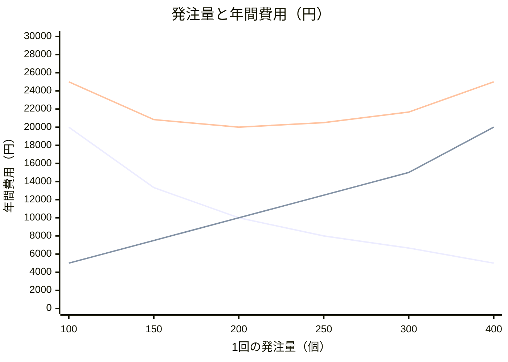
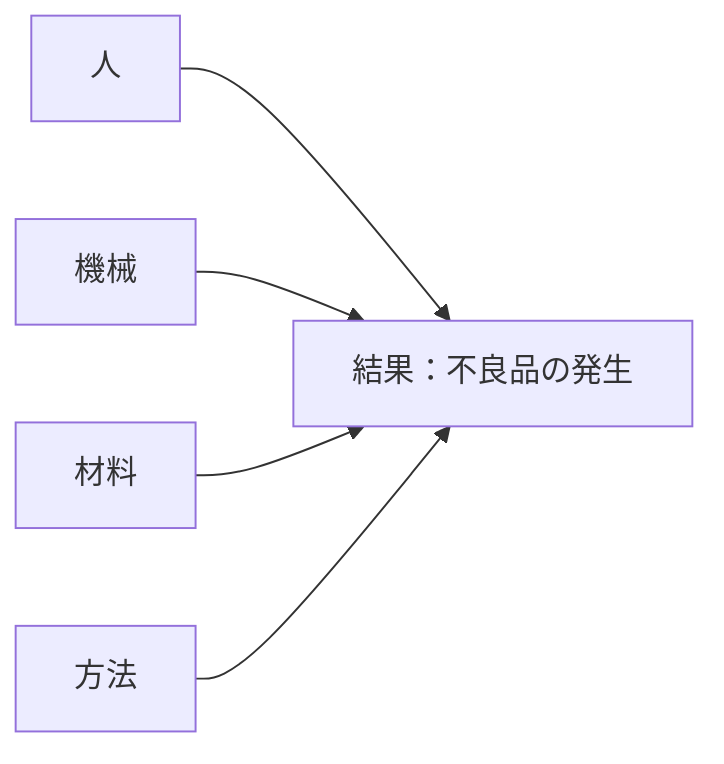
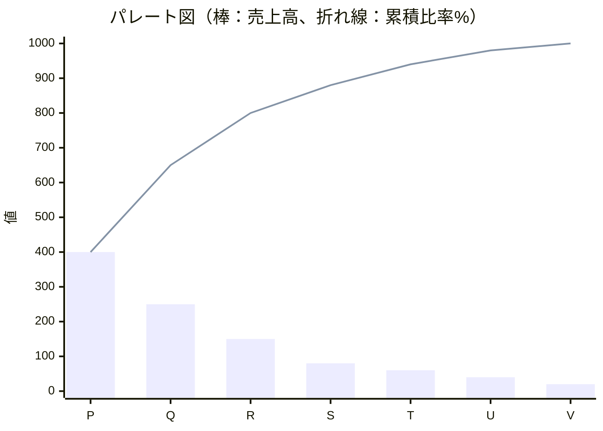
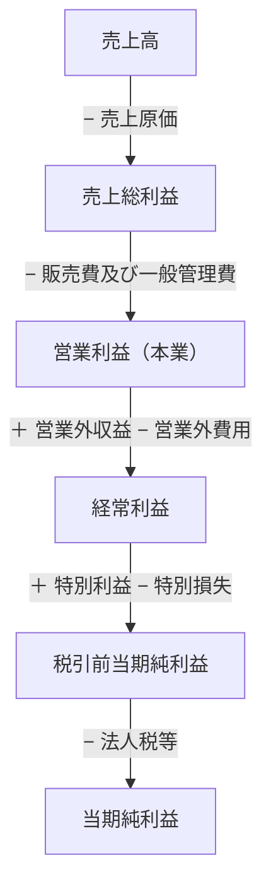
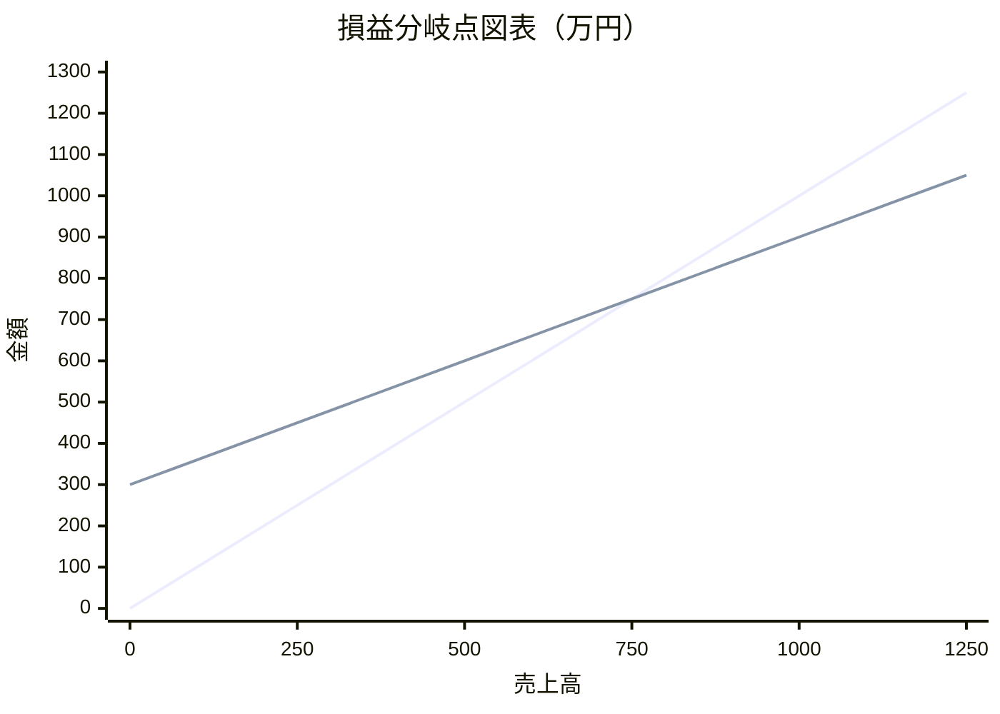

# 企業活動と会計

> **出題傾向・重要度：★★★**
> 科目A（旧午前）では、**計算問題**（損益分岐点、発注量、期待値、減価償却、在庫評価、財務指標）と、**QC七つ道具・新QC七つ道具**の図の見分けが毎回のように出ます。経営組織やCSR・SDGsの用語も時々出ます。
> 科目B（旧午後）の **問2（経営戦略）** では、損益分岐点や利益計算、財務指標が事例の中で問われます。
> この章で押さえるポイントは次の4つです。
> ① 公式を覚え、**途中式を書いて**計算する習慣、② 発注方式・意思決定基準の違い、③ QC七つ道具・新QC七つ道具の用途、④ 損益計算書と貸借対照表の構造。

## 目次

- [1. 経営組織とコーポレートガバナンス](#1-経営組織とコーポレートガバナンス)
- [2. CSR・SDGs・BCP](#2-csrsdgsbcp)
- [3. OR・IE：線形計画法](#3-orie線形計画法)
- [4. 在庫管理と発注方式](#4-在庫管理と発注方式)
- [5. ゲーム理論と意思決定](#5-ゲーム理論と意思決定)
- [6. 需要予測](#6-需要予測)
- [7. 品質管理（QC七つ道具・新QC七つ道具）](#7-品質管理qc七つ道具新qc七つ道具)
- [8. 財務諸表（損益計算書・貸借対照表）](#8-財務諸表損益計算書貸借対照表)
- [9. 損益分岐点](#9-損益分岐点)
- [10. 財務指標](#10-財務指標)
- [11. 減価償却](#11-減価償却)
- [12. 在庫の評価（棚卸資産の評価）](#12-在庫の評価棚卸資産の評価)
- [13. キャッシュフロー](#13-キャッシュフロー)
- [確認問題](#確認問題)
- [参考](#参考)

---

## 1. 経営組織とコーポレートガバナンス

### 1.1 組織の形態 ★★

| 組織形態 | 特徴 | 長所 | 短所 |
|---|---|---|---|
| **職能別組織** | 営業・製造・経理など**機能ごと**に部門を分ける | 専門性が高まる、規模の経済 | 部門間の調整が難しい |
| **事業部制組織** | **製品・地域・顧客ごと**に事業部を作り、各事業部が利益責任を持つ | 意思決定が速い、責任が明確 | 経営資源が重複する |
| **カンパニー制組織** | 事業部をさらに独立させ、**社内の独立会社**のように扱う（投資の権限も持つ） | 事業部制よりさらに自律性が高い | 全社の一体感が弱まる |
| **マトリックス組織** | 職能別と事業別など、**2つの軸を組み合わせる**。社員は2人の上司を持つ | 資源を柔軟に共有できる | **命令系統が2つ**になり、混乱しやすい |
| **プロジェクト組織** | 特定の目的のために**期間を限って**集めた組織。終わったら解散 | 目的に集中できる | ノウハウが残りにくい |
| **ネットワーク組織** | 部門や企業の枠を超えて、対等な立場でゆるやかにつながる | 柔軟 | 責任があいまいになりやすい |

- ⚠️ ひっかけ注意：「1人の社員が、機能部門と事業部門の**両方の上司**から指示を受ける」のはマトリックス組織です。

### 1.2 経営者の役職 ★

| 略語 | 正式名称 | 役割 |
|---|---|---|
| **CEO** | Chief Executive Officer（最高経営責任者） | 経営の最終責任者 |
| **COO** | Chief Operating Officer（最高執行責任者） | 日々の業務執行の責任者 |
| **CFO** | Chief Financial Officer（最高財務責任者） | 財務・会計の責任者 |
| **CIO** | Chief Information Officer（最高情報責任者） | 情報システム・IT戦略の責任者 |
| **CISO** | Chief Information Security Officer（最高情報セキュリティ責任者） | 情報セキュリティの責任者 |

### 1.3 コーポレートガバナンスと内部統制 ★

- **コーポレートガバナンス（企業統治）**：株主などの利害関係者（ステークホルダ）の立場から、**経営者を監視・規律する仕組み**です。社外取締役の設置などがあります。東京証券取引所は上場会社向けに「**コーポレートガバナンス・コード**」を定めています。
- **内部統制**：業務を適正に進めるため、**組織の内部で作る仕組み**です。金融庁の基準では、4つの目的（業務の有効性・効率性、報告の信頼性、法令等の遵守、資産の保全）と、6つの基本的要素（統制環境、リスクの評価と対応、統制活動、情報と伝達、モニタリング、**ITへの対応**）が示されています。
- **コンプライアンス（法令遵守）**：法令だけでなく、社会の規範や倫理も守ることです。

### 1.4 人事・人材育成の用語 ★

| 用語 | 意味 |
|---|---|
| **OJT**（On the Job Training） | 職場で、実際の仕事を通じて教育する |
| **Off-JT**（Off the Job Training） | 職場を離れて、研修やセミナーで教育する |
| **目標管理制度（MBO：Management By Objectives）** | 社員が上司と相談して目標を決め、達成度で評価する（M&AのMBOとは別物） |
| **ジョブ型雇用** | 職務の内容（ジョブディスクリプション）を明確にして雇用する |
| **タレントマネジメント** | 社員の能力・経験の情報を管理し、配置や育成に戦略的に活かす |
| **HRテック** | AIやクラウドなどのITを人事業務に活用すること |
| **ワークエンゲージメント** | 仕事に対して「熱意・没頭・活力」がある、前向きな心の状態 |
| **ダイバーシティ** | 性別・年齢・国籍など多様な人材を活かすこと |
| **リスキリング** | 新しい仕事や変化に対応するため、新しいスキルを学び直すこと |

---

## 2. CSR・SDGs・BCP

### 2.1 CSRとSDGs ★★

| 用語 | 意味 |
|---|---|
| **CSR**（Corporate Social Responsibility：企業の社会的責任） | 企業が利益の追求だけでなく、環境・社会・従業員・地域などに責任を持って行動すること |
| **SDGs**（Sustainable Development Goals：持続可能な開発目標） | 2015年の国連サミットで採択された、**2030年**までの国際目標。**17のゴールと169のターゲット**からなる |
| **ESG投資** | **E**nvironment（環境）、**S**ocial（社会）、**G**overnance（企業統治）に配慮している企業を選んで投資する |
| **グリーンIT** | IT機器の省電力化や、ITを使った環境負荷の低減 |
| **ディスクロージャー** | 企業が投資家などに、経営や財務の情報を公開すること |
| **IR**（Investor Relations） | 投資家向けの広報活動 |
| **カーボンニュートラル** | 温室効果ガスの排出量と吸収量を差し引きゼロにすること |

- 💡 覚え方：SDGsは「**17・169・2030**」と数字で覚えます。

### 2.2 BCPとBCM ★★

- **BCP（Business Continuity Plan：事業継続計画）**：災害やシステム障害などが起きても、**重要な業務を中断させない、または早く復旧させる**ための計画です。
- **BCM（Business Continuity Management：事業継続マネジメント）**：BCPを作り、訓練・見直しを続ける**管理の活動全体**です。
- BCPで決める主な目標：

| 指標 | 意味 |
|---|---|
| **RTO**（Recovery Time Objective：目標復旧時間） | **いつまでに**業務を復旧させるか |
| **RPO**（Recovery Point Objective：目標復旧時点） | **どの時点のデータまで**戻すか（どれだけのデータ損失を許すか） |
| **RLO**（Recovery Level Objective：目標復旧レベル） | **どの水準まで**業務を復旧させるか |

---

## 3. OR・IE：線形計画法

- **OR（Operations Research：オペレーションズリサーチ）**：数学的な手法で、最適な意思決定を導く学問です。
- **IE（Industrial Engineering：インダストリアルエンジニアリング）**：作業の方法や時間を分析して、生産性を高める手法です（作業研究、動作研究など）。

### 3.1 線形計画法 ★★

- **結論**：**線形計画法**は、**限られた資源（制約条件）の中で、利益を最大にする（またはコストを最小にする）組合せ**を求める方法です。
- **解き方の手順**：
  1. 変数を決める（製品Aを x 個、製品Bを y 個）。
  2. 制約条件を不等式で書く。
  3. 目的関数（最大にしたい利益の式）を書く。
  4. 制約条件の直線が交わる**頂点**を求め、それぞれの利益を計算して比べる（最適解は必ず頂点にあります）。

**具体例**：製品A・Bを作る。原料と機械の使用時間に上限があります。

| | 製品A（1個） | 製品B（1個） | 上限 |
|---|---|---|---|
| 原料 | 2 kg | 1 kg | 80 kg |
| 機械時間 | 1 時間 | 2 時間 | 70 時間 |
| 利益 | 3万円 | 4万円 | |

```
変数      ：A を x 個、B を y 個
制約条件  ：2x +  y ≦ 80   …①（原料）
             x + 2y ≦ 70   …②（機械時間）
             x ≧ 0, y ≧ 0
目的関数  ：利益 = 3x + 4y → 最大化

①と②の交点：①×2 − ② より
  4x + 2y = 160
−) x + 2y =  70
  3x       =  90 → x = 30
  ①に代入：60 + y = 80 → y = 20

頂点ごとの利益：
  (x, y) = (0, 0)  → 0
  (x, y) = (40, 0) → 3×40         = 120万円（①で y=0）
  (x, y) = (0, 35) → 4×35         = 140万円（②で x=0）
  (x, y) = (30, 20)→ 3×30 + 4×20 = 170万円 ← 最大

検算：原料 2×30 + 20 = 80 ≦ 80、機械 30 + 2×20 = 70 ≦ 70 （どちらも上限ちょうど）
```

- **答え**：製品Aを30個、製品Bを20個作ると、利益は最大の**170万円**です。
- ⚠️ ひっかけ注意：利益が高い製品B「だけ」を作る（35個・140万円）のが最適とは限りません。必ず**すべての頂点**を比べます。

---

## 4. 在庫管理と発注方式

### 4.1 定量発注方式と定期発注方式 ★★★

| 項目 | **定量発注方式**（発注点方式） | **定期発注方式** |
|---|---|---|
| 発注の時期 | 在庫が**発注点**を下回ったとき（不定期） | **決まった間隔**（毎週月曜など） |
| 発注量 | **毎回同じ量**（経済的発注量など） | **毎回計算する**（変わる） |
| 向いている品目 | 単価が**安く**、需要が**安定**している品目（C品目など） | 単価が**高く**、需要の**変動が大きい**重要品目（A品目など） |
| 管理の手間 | 少ない | 多い（毎回の予測が必要） |

- **ダブルビン方式**：在庫を2つの箱に分け、1つめの箱が空になったら発注する、定量発注方式の簡単なやり方です。

### 4.2 発注点の計算 ★★★

```
発注点 = 1日の平均使用量 × 調達期間（リードタイム） + 安全在庫
```

**具体例**：1日の平均使用量 20個、調達期間 5日、安全在庫 30個

```
発注点 = 20 × 5 + 30 = 100 + 30 = 130個
→ 在庫が130個を下回ったら発注する
```

- **安全在庫**：需要のばらつきに備えて余分に持つ在庫です。次の式で求めることもあります。

```
安全在庫 = 安全係数 × 使用量の標準偏差 × √調達期間
```

### 4.3 定期発注方式の発注量 ★★

```
発注量 = (発注間隔 + 調達期間) × 1日の平均使用量 + 安全在庫 − 現在の在庫量 − 発注残（注文済みで未入荷の量）
```

**具体例**：発注間隔 7日、調達期間 3日、1日の平均使用量 20個、安全在庫 40個、現在の在庫 120個、発注残 30個

```
発注量 = (7 + 3) × 20 + 40 − 120 − 30
       = 200 + 40 − 150
       = 90個
```

### 4.4 経済的発注量（EOQ） ★★★

- **結論**：**EOQ（Economic Order Quantity：経済的発注量）** は、**発注費用と保管費用の合計（在庫総費用）が最小になる1回当たりの発注量**です。
- **理由**：1回にたくさん発注すると発注回数が減って**発注費用は下がる**が、在庫が増えて**保管費用は上がります**。この2つが等しくなるところで、合計が最小になります。

```
EOQ = √( 2 × 年間需要量 × 1回当たりの発注費用 ÷ 1個当たりの年間保管費用 )

年間発注費用 = (年間需要量 ÷ 発注量) × 1回の発注費用
年間保管費用 = (発注量 ÷ 2) × 1個当たりの年間保管費用   ※平均在庫は発注量の半分
```

**具体例**：年間需要量 4,000個、1回の発注費用 500円、1個当たりの年間保管費用 100円

```
EOQ = √(2 × 4,000 × 500 ÷ 100)
    = √(4,000,000 ÷ 100)
    = √40,000
    = 200個

検算：
  発注回数     = 4,000 ÷ 200 = 20回
  年間発注費用 = 20 × 500        = 10,000円
  年間保管費用 = (200 ÷ 2) × 100 = 10,000円
  → 2つの費用が等しい（合計 20,000円で最小）
```



（右下がりの線が発注費用、右上がりの線が保管費用、下に凸の線が合計。合計は発注量200個で最小）

### 4.5 ABC分析 ★★

- **ABC分析**は、品目を売上高（または使用金額）の大きい順に並べ、**累積比率**で A・B・C の3グループに分けて、管理の重点を決める手法です。グラフは**パレート図**を使います（7章）。
- 例：累積比率が70%までをA、70〜90%をB、残りをCとします（境界の値は問題文で与えられます）。

| 品目 | 売上高（万円） | 構成比 | 累積比率 | 区分 |
|---|---|---|---|---|
| P | 400 | 40% | 40% | A |
| Q | 250 | 25% | 65% | A |
| R | 150 | 15% | 80% | B |
| S | 80 | 8% | 88% | B |
| T | 60 | 6% | 94% | C |
| U | 40 | 4% | 98% | C |
| V | 20 | 2% | 100% | C |
| 合計 | 1,000 | 100% | | |

- A品目は重点的に管理（定期発注方式）、C品目は簡単な管理（定量発注方式・ダブルビン方式）にします。

---

## 5. ゲーム理論と意思決定

### 5.1 不確実性下の意思決定 ★★★

- 将来の状況（市場の状態など）がわからない中で、どの戦略を選ぶかを決める基準です。

**具体例**：3つの戦略と、市場の3つの状態ごとの利益（万円）

| 戦略 | 好況（確率0.3） | 普通（確率0.5） | 不況（確率0.2） |
|---|---|---|---|
| A | 100 | 50 | −20 |
| B | 70 | 60 | 10 |
| C | 40 | 40 | 30 |

| 基準 | 考え方 | 計算 | 選ぶ戦略 |
|---|---|---|---|
| **期待値原理** | 確率で重み付けした**平均（期待値）が最大** | A：100×0.3 + 50×0.5 + (−20)×0.2 = 30 + 25 − 4 = **51**<br/>B：70×0.3 + 60×0.5 + 10×0.2 = 21 + 30 + 2 = **53**<br/>C：40×0.3 + 40×0.5 + 30×0.2 = 12 + 20 + 6 = **38** | **B** |
| **マクシマックス原理**（楽観的） | 各戦略の**最大**利益のうち、最大のものを選ぶ | A：100、B：70、C：40 | **A** |
| **マクシミン原理**（悲観的） | 各戦略の**最小**利益のうち、最大のものを選ぶ（最悪の場合でも一番ましな案） | A：−20、B：10、C：30 | **C** |
| **ミニマックスリグレット原理** | 各戦略の**機会損失（後悔）の最大値**が最小のものを選ぶ | 下の表 | **B** |
| **ラプラス原理** | 確率がわからないので、すべて**同じ確率**とみて平均する | A：130÷3 ≒ 43.3、B：140÷3 ≒ 46.7、C：110÷3 ≒ 36.7 | **B** |

**ミニマックスリグレット原理の計算**：機会損失 ＝（その状態での最大利益）−（その戦略の利益）

```
各状態の最大利益：好況 100、普通 60、不況 30
```

| 戦略 | 好況 | 普通 | 不況 | 最大の機会損失 |
|---|---|---|---|---|
| A | 100 − 100 = 0 | 60 − 50 = 10 | 30 − (−20) = 50 | 50 |
| B | 100 − 70 = 30 | 60 − 60 = 0 | 30 − 10 = 20 | **30（最小）** |
| C | 100 − 40 = 60 | 60 − 40 = 20 | 30 − 30 = 0 | 60 |

- 💡 覚え方：「**マクシ・ミン**」は「**ミン（最小）の中のマクシ（最大）**」と、**後ろから読む**とわかりやすいです。
- ⚠️ ひっかけ注意：マクシミンは「悲観的（最悪を考える）」、マクシマックスは「楽観的（最良を考える）」です。

### 5.2 ゲーム理論（2人ゼロ和ゲーム） ★

- **ゼロ和ゲーム**：一方の得が、もう一方の損になる（合計がゼロ）ゲームです。
- 自分（行）はマクシミン、相手（列）は**ミニマックス**（自分の利得の最大値を最小にする）で戦略を選びます。両者が一致する点を **鞍点（あんてん）** といい、そこが均衡になります。

**具体例**：表は自社（A1〜A3）の利得。相手（B1〜B3）にとっては損失。

| | B1 | B2 | B3 | 行の最小 |
|---|---|---|---|---|
| A1 | 3 | 1 | 4 | 1 |
| A2 | 5 | **2** | 6 | **2**（最大） |
| A3 | 0 | −1 | 7 | −1 |
| 列の最大 | 5 | **2**（最小） | 7 | |

```
自社のマクシミン   ：行の最小 {1, 2, −1} の最大 = 2（A2）
相手のミニマックス ：列の最大 {5, 2, 7} の最小 = 2（B2）
→ 一致するので (A2, B2) が鞍点。ゲームの値は 2
```

- **囚人のジレンマ**：お互いが自分にとって合理的な行動をとると、協力した場合より**両者とも悪い結果**になる状況です。**ナッシュ均衡**（どちらも自分だけ戦略を変えても得をしない状態）の例として出ます。

---

## 6. 需要予測

### 6.1 予測の手法 ★★

| 手法 | 考え方 |
|---|---|
| **移動平均法** | 直近の数期間の実績の平均を予測値とする |
| **指数平滑法** | 前回の予測値を、前回の実績との誤差で修正する |
| **回帰分析** | 売上と気温など、変数どうしの関係を式（回帰式）にして予測する。最小二乗法で直線を求める |
| **デルファイ法** | 複数の専門家にアンケートを繰り返し、意見を集約する（定性的な予測） |

**移動平均法の例**（3か月移動平均）：月ごとの実績が 1月 100、2月 120、3月 110、4月 130 のとき

```
5月の予測値 = (2月 + 3月 + 4月) ÷ 3 = (120 + 110 + 130) ÷ 3 = 360 ÷ 3 = 120
```

**指数平滑法の例**：

```
次回の予測値 = 前回の予測値 + α × (前回の実績値 − 前回の予測値)
             = α × 前回の実績値 + (1 − α) × 前回の予測値     （α：平滑化係数、0 ≦ α ≦ 1）

前回の予測値 100、前回の実績値 120、α = 0.4 のとき
次回の予測値 = 100 + 0.4 × (120 − 100) = 100 + 8 = 108
（検算：0.4 × 120 + 0.6 × 100 = 48 + 60 = 108）
```

- ⚠️ ひっかけ注意：α が**大きい**ほど、最近の実績を**強く反映**します（変化に敏感）。

---

## 7. 品質管理（QC七つ道具・新QC七つ道具）

### 7.1 QC七つ道具 ★★★

- **QC七つ道具**は、主に**数値データ**を分析するための道具です。

| 道具 | 何がわかるか | 図のイメージ |
|---|---|---|
| **パレート図** | 項目を多い順に並べた棒グラフと、**累積比率の折れ線**を重ねる。**重点的に対策すべき項目**がわかる | 棒（降順）＋右上がりの折れ線 |
| **特性要因図**（フィッシュボーン図） | 結果（特性）と、その**原因（要因）の関係**を魚の骨の形で整理する | 魚の骨 |
| **ヒストグラム** | データの**ばらつき（分布）**を柱状のグラフで表す | 柱状グラフ |
| **管理図** | 時系列のデータに**上方管理限界・下方管理限界**の線を引き、工程が**安定しているか（異常がないか）**をみる | 折れ線＋上下の限界線 |
| **散布図** | 2つのデータの**相関関係**をみる | 点の散らばり |
| **チェックシート** | データを漏れなく**記録・集計**するための表 | 記入用の表 |
| **層別** | データを機械別・担当者別などの**グループに分けて**比較する | （考え方） |

> ※ 「層別」の代わりに「グラフ」を七つ道具に入れる場合もあります。



（特性要因図のイメージ。実際の図では、大骨から中骨・小骨へとさらに原因を枝分かれさせます）

- **パレート図の例**（4.5のABC分析のデータ）：



（折れ線は累積売上高。1,000を100%として読みます）

- **管理図の読み方**：管理限界線の外に点が出た場合に加えて、限界線の内側でも**中心線の片側に点が連続する**（連）、**上昇・下降が続く**（傾向）、**周期的な変化**がある場合は、異常の兆しと判断します。

### 7.2 新QC七つ道具 ★★

- **新QC七つ道具**は、主に**言語データ（文字の情報）**を整理し、問題の構造を明らかにするための道具です。

| 道具 | 何に使うか |
|---|---|
| **親和図法** | ばらばらの意見や事実を、**似たもの（親和性）でグループ化**して整理する（KJ法と同じ考え方） |
| **連関図法** | 原因と結果が**複雑にからみ合った**問題を、矢印で結んで関係を明らかにする |
| **系統図法** | 目的を達成する手段を、**目的 → 手段 → さらに細かい手段**と**ツリー状に展開**する |
| **マトリックス図法** | 2つの要素（例：問題と原因）を**行と列**に並べ、交点で関係の有無・強さを示す |
| **マトリックスデータ解析法** | マトリックス図の数値データを、**主成分分析**などで解析する（新QC七つ道具で唯一、数値を扱う） |
| **PDPC法**（Process Decision Program Chart：過程決定計画図） | 計画の実行中に起こりうる**トラブルを予測**し、事前に対策の道筋を決めておく |
| **アローダイアグラム法** | 作業の**順序と日程**を矢印で表し、**クリティカルパス**を求める（PERT図） |

- 💡 覚え方：QC七つ道具は「**数字**」、新QC七つ道具は「**言葉**」を扱う、と大きく分けます。
- ⚠️ ひっかけ注意：「原因と結果」でも、**魚の骨の形**なら特性要因図（QC七つ道具）、**複雑にからみ合った矢印**なら連関図法（新QC七つ道具）です。

---

## 8. 財務諸表（損益計算書・貸借対照表）

### 8.1 損益計算書（P/L） ★★★

- **損益計算書（P/L：Profit and Loss Statement）** は、**一定期間（1年など）の経営成績**（どれだけもうかったか）を表します。
- 5つの利益の順番を確実に覚えます。

**具体例**（単位：万円）

| 項目 | 金額 | 計算 |
|---|---|---|
| 売上高 | 10,000 | |
| 売上原価 | 6,000 | |
| **売上総利益**（粗利） | **4,000** | 10,000 − 6,000 |
| 販売費及び一般管理費 | 3,000 | 給料、広告費、減価償却費など |
| **営業利益** | **1,000** | 4,000 − 3,000（本業のもうけ） |
| 営業外収益 | 100 | 受取利息、受取配当金など |
| 営業外費用 | 300 | 支払利息など |
| **経常利益** | **800** | 1,000 + 100 − 300（ふだんの活動全体のもうけ） |
| 特別利益 | 0 | 固定資産売却益など（臨時の利益） |
| 特別損失 | 200 | 災害損失、固定資産売却損など（臨時の損失） |
| **税引前当期純利益** | **600** | 800 + 0 − 200 |
| 法人税等 | 180 | |
| **当期純利益** | **420** | 600 − 180 |



- 💡 覚え方：「**う・え・け・ぜ・と**」（**売**上総利益 → **営**業利益 → **経**常利益 → **税**引前当期純利益 → 当期純利益）。
- ⚠️ ひっかけ注意：**支払利息は営業外費用**です（販管費ではありません）。**災害による損失は特別損失**です。

### 8.2 貸借対照表（B/S） ★★★

- **貸借対照表（B/S：Balance Sheet）** は、**ある時点（期末など）の財政状態**を表します。
- 左側（借方）に**資産**（お金の使い道）、右側（貸方）に**負債と純資産**（お金の集め方）を書き、**左右の合計は必ず一致**します。

```
資産 = 負債 + 純資産
```

**具体例**（単位：万円）

| 資産の部 | 金額 | 負債・純資産の部 | 金額 |
|---|---|---|---|
| **流動資産** | **3,000** | **流動負債** | **2,000** |
| 　現金・預金 | 1,000 | 　買掛金、短期借入金 など | |
| 　売掛金 | 1,200 | **固定負債** | **3,000** |
| 　棚卸資産（在庫） | 800 | 　長期借入金、社債 など | |
| **固定資産** | **7,000** | **純資産（自己資本）** | **5,000** |
| 　建物、機械、ソフトウェア など | | 　資本金、利益剰余金 など | |
| **資産合計** | **10,000** | **負債・純資産合計** | **10,000** |

- **流動**と**固定**の区別は、原則として**1年以内**に現金化（支払い）されるかどうかで判断します（ワンイヤールール）。
- 負債（他人資本）＋ 純資産（自己資本）＝ **総資本**（＝総資産）です。
- ⚠️ ひっかけ注意：**ソフトウェアは固定資産（無形固定資産）**です。

---

## 9. 損益分岐点

### 9.1 公式 ★★★

- **損益分岐点**は、**利益がちょうどゼロ**になる売上高です。これより売上が多いと黒字、少ないと赤字です。
- 費用を、売上に比例して増える**変動費**（材料費など）と、売上にかかわらず一定の**固定費**（家賃、人件費など）に分けて考えます。

```
変動費率          = 変動費 ÷ 売上高
限界利益          = 売上高 − 変動費                （限界利益は「貢献利益」ともいう）
限界利益率        = 1 − 変動費率
損益分岐点売上高  = 固定費 ÷ (1 − 変動費率)
                  = 固定費 ÷ 限界利益率
目標利益を達成する売上高 = (固定費 + 目標利益) ÷ (1 − 変動費率)
安全余裕率        = (実際の売上高 − 損益分岐点売上高) ÷ 実際の売上高 × 100（%）
損益分岐点比率    = 損益分岐点売上高 ÷ 実際の売上高 × 100（%）
```

### 9.2 計算例 ★★★

**具体例**：売上高 1,000万円、変動費 600万円、固定費 300万円

```
① 変動費率         = 600 ÷ 1,000 = 0.6
② 限界利益率       = 1 − 0.6 = 0.4
③ 損益分岐点売上高 = 300 ÷ 0.4 = 750万円

検算：売上高 750万円のとき
  変動費 = 750 × 0.6 = 450
  利益   = 750 − 450 − 300 = 0 ✓

④ 利益 100万円を出す売上高 = (300 + 100) ÷ 0.4 = 1,000万円
⑤ 安全余裕率 = (1,000 − 750) ÷ 1,000 × 100 = 25%
   （売上が25%減っても赤字にならない）
⑥ 損益分岐点比率 = 750 ÷ 1,000 × 100 = 75%
```



（傾き1の線が売上高、切片300の線が総費用 ＝ 固定費300 ＋ 変動費。2本が交わる **750万円** が損益分岐点）

- **損益分岐点を下げる方法**：①固定費を減らす、②変動費率を下げる、③販売価格を上げる（変動費率が下がる）。
- ⚠️ ひっかけ注意：問題が「販売数量」で与えられたときは、`損益分岐点販売数量 = 固定費 ÷ (販売単価 − 1個当たりの変動費)` で求めます。

---

## 10. 財務指標

### 10.1 主な指標と計算例 ★★★

8章の財務諸表（売上高 10,000、当期純利益 420、流動資産 3,000（うち棚卸資産 800）、固定資産 7,000、流動負債 2,000、固定負債 3,000、自己資本 5,000、総資本 10,000）を使って計算します。

| 分類 | 指標 | 公式 | 計算 | 結果 | 判断 |
|---|---|---|---|---|---|
| 収益性 | **ROE**（Return On Equity：自己資本利益率） | 当期純利益 ÷ 自己資本 × 100 | 420 ÷ 5,000 × 100 | **8.4%** | 高いほど良い |
| 収益性 | **ROA**（Return On Assets：総資産利益率） | 当期純利益 ÷ 総資産 × 100 | 420 ÷ 10,000 × 100 | **4.2%** | 高いほど良い |
| 収益性 | 売上高営業利益率 | 営業利益 ÷ 売上高 × 100 | 1,000 ÷ 10,000 × 100 | **10%** | 高いほど良い |
| 安全性 | **流動比率** | 流動資産 ÷ 流動負債 × 100 | 3,000 ÷ 2,000 × 100 | **150%** | 高いほど良い（200%以上が理想とされる） |
| 安全性 | **当座比率** | 当座資産 ÷ 流動負債 × 100 | (3,000 − 800) ÷ 2,000 × 100 | **110%** | 高いほど良い |
| 安全性 | **自己資本比率** | 自己資本 ÷ 総資本 × 100 | 5,000 ÷ 10,000 × 100 | **50%** | 高いほど良い |
| 安全性 | **固定比率** | 固定資産 ÷ 自己資本 × 100 | 7,000 ÷ 5,000 × 100 | **140%** | **低い**ほど良い（100%以下が理想） |
| 安全性 | 固定長期適合率 | 固定資産 ÷ (自己資本 + 固定負債) × 100 | 7,000 ÷ 8,000 × 100 | **87.5%** | **低い**ほど良い（100%以下が望ましい） |
| 効率性 | 総資本回転率 | 売上高 ÷ 総資本 | 10,000 ÷ 10,000 | **1.0回** | 高いほど資産を効率よく使っている |

> ※ ROAは、分子に経常利益や営業利益を使う場合もあります。問題文の指示に従います。
> ※ 当座資産は、流動資産のうち現金・預金、売掛金など**すぐに現金化しやすい資産**です。ここでは簡単に「流動資産 − 棚卸資産」としています。

### 10.2 ROEの分解（デュポン分析） ★★

```
ROE = 売上高当期純利益率 × 総資本回転率 × 財務レバレッジ
    = (当期純利益 ÷ 売上高) × (売上高 ÷ 総資本) × (総資本 ÷ 自己資本)

例：(420 ÷ 10,000) × (10,000 ÷ 10,000) × (10,000 ÷ 5,000)
  = 0.042 × 1.0 × 2.0
  = 0.084 → 8.4%（10.1の結果と一致 ✓）
```

- ⚠️ ひっかけ注意：借金（負債）を増やすと財務レバレッジが上がって**ROEは上がりやすい**ですが、自己資本比率は下がり、安全性は低くなります。

---

## 11. 減価償却

### 11.1 減価償却とは ★★

- **結論**：**減価償却**は、建物や機械など長く使う固定資産の取得費用を、**使用する期間（耐用年数）に分けて費用にする**手続きです。
- **理由**：資産は数年間にわたって売上に貢献するので、買った年に全額を費用にすると、その年だけ利益が極端に少なくなるためです。
- 減価償却費は**現金が出ていかない費用**です（13章のキャッシュフローで重要）。

### 11.2 定額法 ★★★

```
毎年の減価償却費 = (取得原価 − 残存価額) ÷ 耐用年数
```

**具体例**：取得原価 100万円、耐用年数 5年、残存価額 0円

```
減価償却費 = (100 − 0) ÷ 5 = 20万円（毎年同じ）
```

| 年 | 減価償却費 | 期末の帳簿価額 |
|---|---|---|
| 1年目 | 20万円 | 80万円 |
| 2年目 | 20万円 | 60万円 |
| 3年目 | 20万円 | 40万円 |
| 4年目 | 20万円 | 20万円 |
| 5年目 | 20万円 | 0円 |

- **期の途中で取得した場合**は**月割り**にします。例：決算が3月で、10月に取得した場合、1年目は10月〜3月の6か月分なので `20万円 × 6 ÷ 12 = 10万円` です。
- 💡 現在の日本の税法では、2007年4月1日以降に取得した資産は**残存価額をゼロ**（最後に**備忘価額1円**を残す）として計算します。古い問題では「残存価額は取得原価の10%」とする場合があるので、問題文の条件に従います。

### 11.3 定率法 ★★

```
毎年の減価償却費 = 期首の帳簿価額（未償却残高） × 償却率
```

- 初めの年ほど償却費が**大きく**、だんだん小さくなります。
- 日本の税法（2012年4月1日以降に取得した資産）では、**200%定率法**（償却率 ＝ 定額法の償却率 1/耐用年数 の **2倍**）を使います。償却費が「**償却保証額**（取得原価 × 保証率）」を下回った年からは、「**改定取得価額 × 改定償却率**」で均等に償却します。

**具体例**：取得原価 1,000,000円、耐用年数 5年（償却率 0.400、改定償却率 0.500、保証率 0.10800）

```
償却保証額 = 1,000,000 × 0.108 = 108,000円

1年目：1,000,000 × 0.4 = 400,000円 （帳簿価額 600,000円）
2年目：  600,000 × 0.4 = 240,000円 （帳簿価額 360,000円）
3年目：  360,000 × 0.4 = 144,000円 （帳簿価額 216,000円）
4年目：  216,000 × 0.4 =  86,400円 → 償却保証額 108,000円を下回る
        → 改定取得価額 216,000円 × 改定償却率 0.5 = 108,000円 （帳簿価額 108,000円）
5年目：  108,000円 − 備忘価額1円 = 107,999円 （帳簿価額 1円）

合計：400,000 + 240,000 + 144,000 + 108,000 + 107,999 = 999,999円 ✓
```

| 年 | 定額法 | 定率法（200%） |
|---|---|---|
| 1年目 | 200,000 | 400,000 |
| 2年目 | 200,000 | 240,000 |
| 3年目 | 200,000 | 144,000 |
| 4年目 | 200,000 | 108,000 |
| 5年目 | 199,999 | 107,999 |

（定額法の5年目は備忘価額1円を残すため199,999円）

- ⚠️ ひっかけ注意：科目Aでは、償却率が問題文で与えられ、「期首の帳簿価額 × 償却率」を数年分くり返すだけの問題が多いです。**取得原価に毎年償却率を掛けない**よう注意します（それは定額法の考え方です）。

---

## 12. 在庫の評価（棚卸資産の評価）

### 12.1 評価方法と売上原価 ★★★

- 同じ商品でも仕入れた時期によって単価が違うとき、**払い出した（売った）商品の単価**をどう決めるかで、売上原価と期末在庫の金額が変わります。

```
売上原価 = 期首の在庫 + 当期の仕入 − 期末の在庫
```

| 方法 | 考え方 |
|---|---|
| **先入先出法**（FIFO：First In First Out） | **先に仕入れたものから先に払い出す**とみなす |
| **移動平均法** | 仕入れのたびに、**その時点の在庫の平均単価**を計算し直す |
| **総平均法** | 期間全体の**平均単価**（期首在庫と仕入の合計 ÷ 数量の合計）で計算する |

> ※ 後入先出法は、日本の会計基準では2010年4月1日以後に始まる事業年度から廃止されています。

### 12.2 計算例 ★★★

| 日付 | 取引 | 数量 | 単価 |
|---|---|---|---|
| 4/1 | 期首在庫 | 10個 | 100円 |
| 4/5 | 仕入 | 20個 | 130円 |
| 4/10 | 払出 | 15個 | |
| 4/20 | 仕入 | 10個 | 160円 |
| 4/25 | 払出 | 15個 | |

**① 先入先出法**

```
4/10 払出 15個：古いものから → 4/1の10個 × 100 + 4/5の5個 × 130 = 1,000 + 650 = 1,650円
     残り：4/5の15個（@130）
4/20 仕入：10個 × 160 = 1,600円
4/25 払出 15個：4/5の残り15個 × 130 = 1,950円
     残り：4/20の10個（@160）

売上原価 = 1,650 + 1,950 = 3,600円
期末在庫 = 10 × 160     = 1,600円
```

**② 移動平均法**

```
4/5 仕入後：数量 10 + 20 = 30個、金額 1,000 + 2,600 = 3,600円
           平均単価 = 3,600 ÷ 30 = 120円
4/10 払出：15 × 120 = 1,800円 → 残り 15個、1,800円
4/20 仕入後：数量 15 + 10 = 25個、金額 1,800 + 1,600 = 3,400円
           平均単価 = 3,400 ÷ 25 = 136円
4/25 払出：15 × 136 = 2,040円 → 残り 10個、1,360円

売上原価 = 1,800 + 2,040 = 3,840円
期末在庫 = 10 × 136     = 1,360円
```

**③ 総平均法**

```
平均単価 = (1,000 + 2,600 + 1,600) ÷ (10 + 20 + 10) = 5,200 ÷ 40 = 130円
売上原価 = 30 × 130 = 3,900円
期末在庫 = 10 × 130 = 1,300円
```

**検算**（どの方法でも 売上原価 + 期末在庫 = 期首在庫 + 仕入 = 5,200円）

| 方法 | 売上原価 | 期末在庫 | 合計 |
|---|---|---|---|
| 先入先出法 | 3,600 | 1,600 | 5,200 ✓ |
| 移動平均法 | 3,840 | 1,360 | 5,200 ✓ |
| 総平均法 | 3,900 | 1,300 | 5,200 ✓ |

- 💡 ポイント：**仕入単価が上がっている（物価上昇の）とき**、先入先出法は古い安い単価が売上原価になるので、**売上原価が小さく、利益が大きく**なります。

---

## 13. キャッシュフロー

### 13.1 キャッシュフロー計算書 ★★

- **キャッシュフロー計算書**は、一定期間の**現金の増減**を、3つの活動に分けて表します。
- **理由**：損益計算書で黒字でも、売掛金が回収できずに現金が足りなくなると倒産します（**黒字倒産**）。現金の流れを別に確認する必要があります。

| 区分 | 内容 | プラスの例 | マイナスの例 |
|---|---|---|---|
| **営業活動によるキャッシュフロー** | 本業で生んだ現金 | 商品の販売による収入 | 仕入・給料の支払い |
| **投資活動によるキャッシュフロー** | 設備投資や有価証券の売買 | 固定資産の売却 | 設備の購入 |
| **財務活動によるキャッシュフロー** | 資金の調達と返済 | 借入れ、株式の発行 | 借入金の返済、配当の支払い |

```
フリーキャッシュフロー（FCF） = 営業キャッシュフロー + 投資キャッシュフロー
（企業が自由に使える現金。投資キャッシュフローは通常マイナス）
```

### 13.2 間接法による営業キャッシュフローの計算 ★★

- **間接法**は、税引前当期純利益から出発し、**現金の動きと利益のずれ**を調整して営業キャッシュフローを求めます。

| 調整項目 | 加算か減算か | 理由 |
|---|---|---|
| 減価償却費 | **加算** | 費用だが、現金は出ていない |
| 売掛金の増加 | **減算** | 売上は計上したが、現金はまだ入っていない |
| 棚卸資産の増加 | **減算** | 在庫を買うために現金が出た |
| 買掛金の増加 | **加算** | 仕入れたが、現金はまだ払っていない |
| 法人税等の支払額 | **減算** | 現金が出た |

**具体例**（単位：万円）

```
税引前当期純利益      600
＋ 減価償却費         200
− 売掛金の増加        100
− 棚卸資産の増加       30
＋ 買掛金の増加        50
− 法人税等の支払額    180
────────────────────────
営業キャッシュフロー  540

計算：600 + 200 − 100 − 30 + 50 − 180 = 540

設備の購入（投資CF） −400 → フリーキャッシュフロー = 540 + (−400) = 140
```

- 💡 覚え方：**資産が増えたら現金はマイナス**、**負債が増えたら現金はプラス**。

---

## 確認問題

**問1（計算）** ある製品の売上高は 2,000万円、変動費は 1,200万円、固定費は 600万円である。(1) 損益分岐点売上高と、(2) 営業利益を 300万円にするために必要な売上高を求めよ。

**問2（計算）** ある部品の年間需要量は 1,800個、1回当たりの発注費用は 1,000円、1個当たりの年間保管費用は 40円である。経済的発注量（EOQ）は何個か。

**問3** 次の利益表（単位：万円）で、マクシミン原理によって選ばれる戦略はどれか。

| 戦略 | 状態1 | 状態2 | 状態3 |
|---|---|---|---|
| ア | 80 | 20 | −10 |
| イ | 50 | 40 | 5 |
| ウ | 30 | 25 | 15 |
| エ | 60 | 10 | 0 |

**問4（計算）** 取得原価 600万円、耐用年数 6年、残存価額 0円の設備を、期首に取得した。定額法で減価償却するとき、3年目の期末の帳簿価額はいくらか。

**問5（計算）** 期首在庫が 20個（単価 50円）で、期中に 30個（単価 60円）を仕入れ、その後 40個を払い出した。先入先出法と移動平均法それぞれの払出額（売上原価）を求めよ。

**問6（計算）** ある企業の当期純利益は 300万円、総資産は 6,000万円、自己資本は 2,500万円である。ROEとROAを求めよ。

**問7** 工程で作られる製品の寸法を時系列でプロットし、上方管理限界と下方管理限界の線を引いて、工程が安定状態にあるかを判断する図はどれか。

- ア：パレート図　　イ：ヒストグラム　　ウ：管理図　　エ：散布図

**問8** 新QC七つ道具のうち、計画を実行する過程で起こりうる不測の事態を予測し、事前に対応策を検討して望ましい結果に至る道筋を決めておく手法はどれか。

- ア：PDPC法　　イ：系統図法　　ウ：親和図法　　エ：連関図法

**問9（計算）** 指数平滑法で需要を予測する。前回の予測値が 200個、前回の実績値が 230個、平滑化係数 α が 0.2 のとき、次回の予測値は何個か。

<details><summary>解答・解説</summary>

**問1：(1) 1,500万円、(2) 2,250万円**

```
変動費率   = 1,200 ÷ 2,000 = 0.6
限界利益率 = 1 − 0.6 = 0.4
(1) 損益分岐点売上高 = 600 ÷ 0.4 = 1,500万円
    検算：1,500 − 1,500 × 0.6 − 600 = 1,500 − 900 − 600 = 0 ✓
(2) 必要な売上高 = (600 + 300) ÷ 0.4 = 900 ÷ 0.4 = 2,250万円
    検算：2,250 − 2,250 × 0.6 − 600 = 2,250 − 1,350 − 600 = 300 ✓
```

**問2：300個**

```
EOQ = √(2 × 1,800 × 1,000 ÷ 40) = √(3,600,000 ÷ 40) = √90,000 = 300個
検算：発注費用 = (1,800 ÷ 300) × 1,000 = 6,000円
      保管費用 = (300 ÷ 2) × 40         = 6,000円 → 等しい ✓
```

**問3：ウ**

```
各戦略の最小値：ア −10、イ 5、ウ 15、エ 0
最小値の中の最大 = 15 → ウ
```

マクシマックス原理ならア（最大値80）が選ばれます。

**問4：300万円**

```
毎年の減価償却費 = (600 − 0) ÷ 6 = 100万円
3年目の期末の帳簿価額 = 600 − 100 × 3 = 300万円
```

**問5：先入先出法 2,200円、移動平均法 2,240円**

```
先入先出法：期首の20個 × 50 + 仕入の20個 × 60 = 1,000 + 1,200 = 2,200円
           （期末在庫：10個 × 60 = 600円）
移動平均法：平均単価 = (20 × 50 + 30 × 60) ÷ (20 + 30) = (1,000 + 1,800) ÷ 50 = 56円
           払出額 = 40 × 56 = 2,240円（期末在庫：10個 × 56 = 560円）
検算：どちらも 払出額 + 期末在庫 = 2,800円 ✓
```

**問6：ROE 12%、ROA 5%**

```
ROE = 300 ÷ 2,500 × 100 = 12%
ROA = 300 ÷ 6,000 × 100 = 5%
```

**問7：ウ**
管理限界線を使って工程の安定（異常の有無）をみるのは管理図です。アは重点項目の把握、イは分布（ばらつき）、エは2変数の相関をみる図です。

**問8：ア**
PDPC法（過程決定計画図）は、不測の事態を事前に予測して対策の道筋を決める手法です。イは目的と手段のツリー展開、ウは言語データのグループ化、エは複雑な因果関係の整理です。

**問9：206個**

```
次回の予測値 = 200 + 0.2 × (230 − 200) = 200 + 6 = 206個
（検算：0.2 × 230 + 0.8 × 200 = 46 + 160 = 206 ✓）
```

</details>

---

## 参考

- IPA「試験要綱・シラバス」（応用情報技術者試験 シラバス Ver.7.2）：https://www.ipa.go.jp/shiken/syllabus/gaiyou.html
- 国税庁「No.2106 定額法と定率法による減価償却（平成19年4月1日以後に取得する場合）」：https://www.nta.go.jp/taxes/shiraberu/taxanswer/shotoku/2106.htm
- 国税庁「減価償却資産の償却率等表」：https://www.keisan.nta.go.jp/r5yokuaru/aoiroshinkoku/hitsuyokeihi/genkashokyakuhi/taiyonensuhyo.html
- 金融庁「財務報告に係る内部統制の評価及び監査の基準」改訂（2023年4月）：https://www.fsa.go.jp/news/r4/sonota/20230407/20230407.html
- 外務省「JAPAN SDGs Action Platform」：https://www.mofa.go.jp/mofaj/gaiko/oda/sdgs/index.html
- 内閣府「事業継続ガイドライン」：https://www.bousai.go.jp/kyoiku/kigyou/keizoku/sk.html
- 日本取引所グループ「コーポレートガバナンス・コード」：https://www.jpx.co.jp/equities/listing/cg/index.html
- 企業会計基準委員会（ASBJ）「企業会計基準第9号 棚卸資産の評価に関する会計基準」：https://www.asb-j.jp/
- 日本規格協会（JSA）「QC七つ道具」関連解説：https://webdesk.jsa.or.jp/
