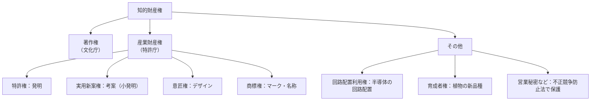
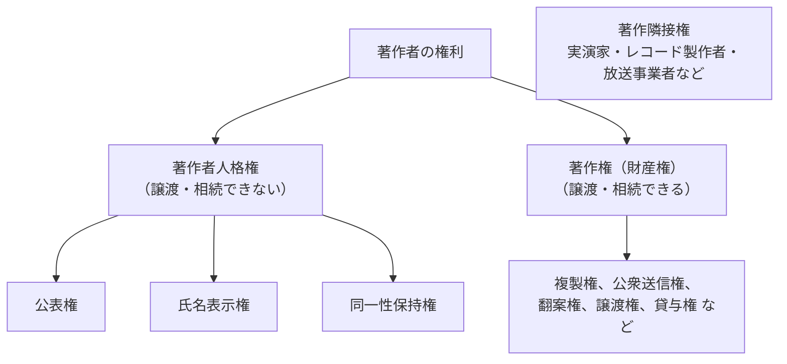
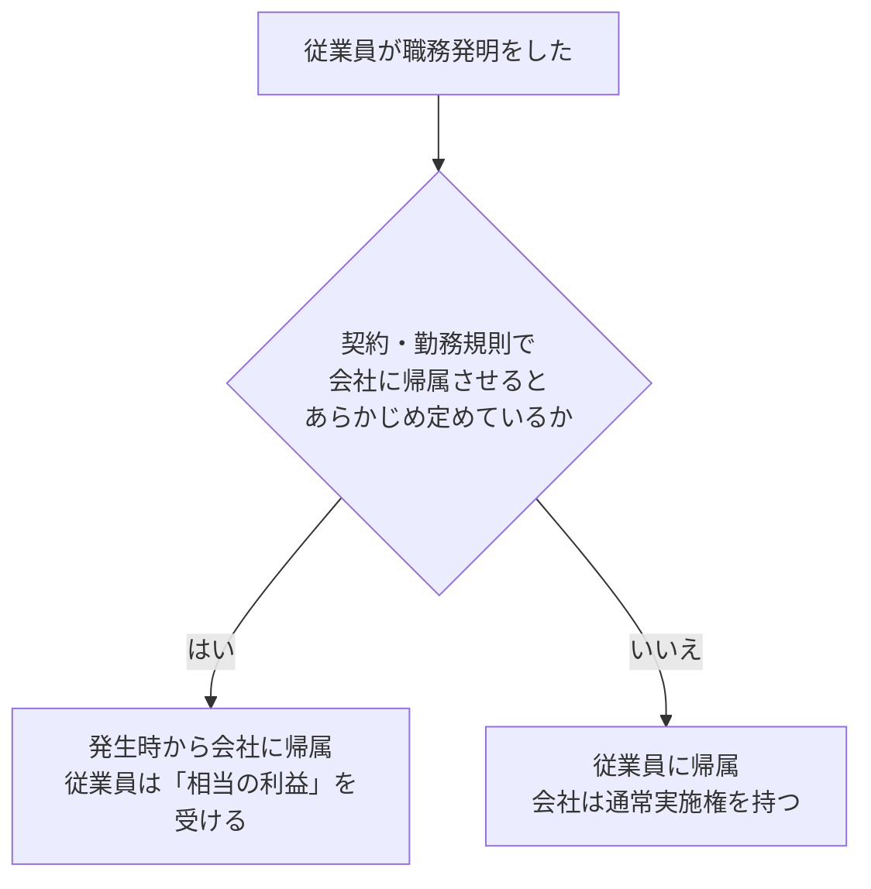
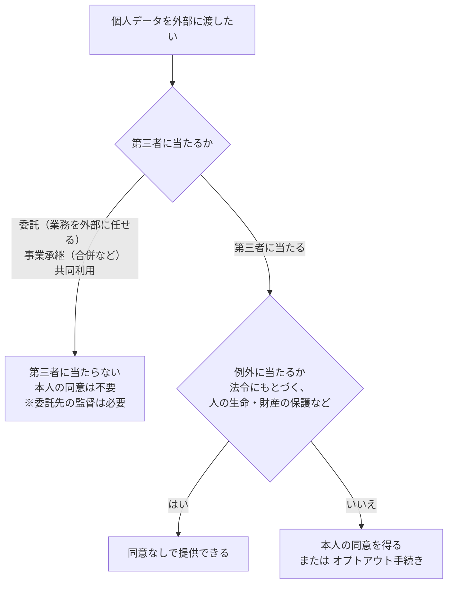
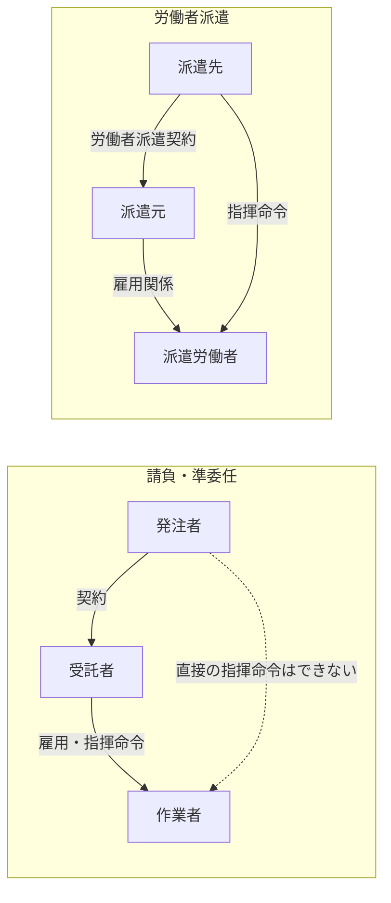

# 法務

> **出題傾向・重要度：★★★**
> 科目A（旧午前）では毎回3〜4問程度出ます。特に **著作権（職務著作・プログラムの扱い）**、**請負・準委任・派遣の違い（偽装請負）**、**個人情報保護法**、**不正アクセス禁止法**、**下請法（2026年1月からは中小受託取引適正化法）** が頻出です。
> 科目B（旧午後）では、情報セキュリティ（問1）やシステム監査・プロジェクトマネジメントの事例の中で、契約形態や個人情報の扱いが問われることがあります。
> この章で押さえるポイントは次の4つです。
> ① 「誰に権利が帰属するか」（職務著作・職務発明・請負）、② 「誰が指揮命令するか」（請負・準委任・派遣）、③ 個人情報の区分（要配慮・仮名加工・匿名加工）、④ **最新の法改正**（取適法、情報流通プラットフォーム対処法、2026年の個人情報保護法改正など）。

## 目次

- [1. 知的財産権の全体像](#1-知的財産権の全体像)
- [2. 著作権法](#2-著作権法)
- [3. 産業財産権（特許権など）と職務発明](#3-産業財産権特許権などと職務発明)
- [4. ソフトウェアのライセンス](#4-ソフトウェアのライセンス)
- [5. 不正競争防止法](#5-不正競争防止法)
- [6. 個人情報保護法](#6-個人情報保護法)
- [7. セキュリティ関連の法律](#7-セキュリティ関連の法律)
- [8. 労働関連法と契約（請負・準委任・派遣）](#8-労働関連法と契約請負準委任派遣)
- [9. 取引関連法（中小受託取引適正化法・フリーランス法など）](#9-取引関連法中小受託取引適正化法フリーランス法など)
- [10. 電子文書・電子署名に関する法律](#10-電子文書電子署名に関する法律)
- [11. 標準化](#11-標準化)
- [確認問題](#確認問題)
- [参考](#参考)

> ⚠️ この資料は2026年10月時点の法令にもとづいて書いています。試験では、原則として試験実施時点で施行されている法令が前提になります。

---

## 1. 知的財産権の全体像

- **知的財産権**は、人の知的な創作活動から生まれたもの（発明、デザイン、著作物など）を、一定期間、独占的に使えるようにする権利です。

| 権利 | 保護対象 | 権利の発生 | 存続期間 |
|---|---|---|---|
| **著作権** | 著作物（思想・感情の創作的な表現） | **創作した時点で自動的に発生**（登録不要：**無方式主義**） | 原則 **著作者の死後70年**（法人名義は公表後70年） |
| **特許権** | 発明（自然法則を利用した技術的思想の創作のうち高度なもの） | 出願・審査・**登録** | **出願から20年**（医薬品などは最長5年延長可） |
| **実用新案権** | 考案（物品の形状・構造・組合せ） | 出願・**登録**（実体審査なし） | **出願から10年** |
| **意匠権** | 物品・建築物・画像のデザイン | 出願・審査・**登録** | **出願から25年** |
| **商標権** | 商品・サービスに使うマーク（文字・図形・音など） | 出願・審査・**登録** | **登録から10年**（**更新できる**） |

- 💡 覚え方：期間は「**特許20・実用10・意匠25・商標10（更新可）・著作は死後70**」。
- ⚠️ ひっかけ注意：著作権は**登録しなくても発生**します。一方、産業財産権は**登録しないと発生しません**。

---

## 2. 著作権法

### 2.1 著作権の構成 ★★★

| 権利 | 内容 |
|---|---|
| **公表権** | 未公表の著作物を、公表するかどうか・いつ公表するかを決める |
| **氏名表示権** | 著作者名を表示するか、どう表示するかを決める |
| **同一性保持権** | 著作物の内容やタイトルを、意に反して改変されない |
| 複製権 | コピーする権利 |
| 公衆送信権 | インターネットなどで公衆に送信する（送信できる状態にする）権利 |
| 翻案権 | 翻訳・編曲・改変などをして、二次的著作物を作る権利 |

- ⚠️ ひっかけ注意：契約で「著作権をすべて譲渡する」としても、**著作者人格権は譲渡できません**。そのため、実務では「著作者人格権を行使しない」という条項（不行使特約）を入れることが多いです。

### 2.2 プログラムと著作権 ★★★

- **結論**：プログラムは著作物として保護されますが、**プログラム言語・規約（プロトコルなど）・解法（アルゴリズム）は保護されません**（著作権法 第10条第3項）。
- **理由**：著作権は「**表現**」を保護するもので、「**アイデア**」は保護しないからです。

| 保護される | 保護されない |
|---|---|
| ソースプログラム、オブジェクトプログラム | プログラム言語（C言語、Javaそのもの） |
| | 規約（インタフェース仕様、通信プロトコル） |
| | 解法（アルゴリズム） |

- **プログラムの複製物の所有者**は、自分で使うために**必要と認められる限度**で、複製や翻案（バックアップ、自分のPC環境に合わせた改変など）ができます（第47条の3）。
- **データベース**：情報の選択や体系的な構成に創作性があれば、著作物（データベースの著作物）として保護されます。

### 2.3 職務著作（法人著作） ★★★

- **結論**：従業員が仕事として作った著作物は、次の要件をすべて満たせば、**会社（法人）が著作者**になります（著作権法 第15条）。

| 要件 | プログラム以外 | プログラム |
|---|---|---|
| ① 法人等の発意（会社の企画）にもとづく | 必要 | 必要 |
| ② 法人等の業務に従事する者が、職務上作成する | 必要 | 必要 |
| ③ **法人等の名義で公表する** | 必要 | **不要** |
| ④ 契約・勤務規則などに別段の定めがない | 必要 | 必要 |

- 職務著作では、**著作者人格権も含めて**会社が持ちます。
- 💡 プログラムは社内だけで使い、公表しないことが多いため、「法人名義で公表」の要件が**不要**になっています。

### 2.4 委託開発・派遣と著作権 ★★★

| 開発の形態 | 著作権（原則） | ポイント |
|---|---|---|
| 自社の従業員が職務で作成 | **自社**（職務著作） | |
| **請負契約**で外部に委託 | **受託者（開発した会社）** | 発注者が権利を得るには、**契約で著作権の譲渡を定める**必要がある |
| **派遣労働者**が派遣先の指揮命令で作成 | **派遣先**（派遣先の職務著作となるのが一般的） | 派遣先の指揮命令下で業務に従事しているため |

- ⚠️ ひっかけ注意：「お金を払って作ってもらったから発注者のもの」ではありません。**請負では、特約がなければ著作権は受託者に残ります**。

### 2.5 権利が制限される場合（著作権者の許諾なしで使える場合） ★★

| 条文 | 内容 |
|---|---|
| 第30条 | **私的使用のための複製**（個人・家庭内）。ただし、違法にアップロードされたと知りながらのダウンロードなどは除く |
| 第30条の4 | **著作物に表現された思想・感情の享受を目的としない利用**（AIの学習のための情報解析など）。ただし、著作権者の利益を**不当に害する場合は除く** |
| 第32条 | 正当な範囲内での**引用**（主従関係が明確、出所の明示など） |
| 第35条 | 学校での授業のための複製など |
| 第47条の3 | プログラムの複製物の所有者による必要な限度での複製・翻案 |

- **未管理著作物裁定制度**（2026年4月1日施行）：集中管理されておらず、利用の可否について権利者の意思が確認できない著作物について、文化庁長官の裁定を受け、補償金を支払えば、**時限的に（最長3年）利用できる**制度が始まりました。

---

## 3. 産業財産権（特許権など）と職務発明

### 3.1 特許の要件と権利 ★★

- 特許を受けるには、**産業上利用できる**こと、**新規性**（まだ知られていない）、**進歩性**（専門家が簡単に思いつかない）などが必要です。
- 日本は、最初に出願した人に権利を与える **先願主義** です。
- **ビジネスモデル特許**：ITを使ったビジネスの方法が、ソフトウェアとハードウェアを使って具体的に実現されていれば、特許の対象になります（ビジネスの方法そのもの、アイデアだけでは対象外）。
- **実施権**（他人に特許を使わせる権利）：

| 種類 | 内容 |
|---|---|
| **専用実施権** | 設定した範囲で、**実施権者だけ**が独占的に使える。特許権者自身も使えなくなる。**特許庁への登録が必要** |
| **通常実施権** | 複数の相手に、重ねて許諾できる。登録は不要 |
| **クロスライセンス** | 企業どうしが、**お互いの特許を使えるように許諾し合う** |

### 3.2 職務発明（特許法 第35条） ★★★

- **結論**：従業員が職務として行った発明（**職務発明**）について、**契約・勤務規則などであらかじめ定めておけば、特許を受ける権利は、発明が生まれた時点から会社（使用者）に帰属**させることができます（2016年4月施行の改正）。
- そのとき、従業員は、会社から **「相当の利益」**（金銭のほか、昇進、留学の機会などのお金以外の利益も含む）を受ける権利があります。
- あらかじめ定めていない場合は、特許を受ける権利は**従業員（発明者）**に帰属し、会社はその特許を無償で使える**通常実施権**を持ちます。

- ⚠️ ひっかけ注意：職務**著作**（著作権法）では要件を満たせば最初から会社が**著作者**になりますが、職務**発明**（特許法）の発明者は**あくまで従業員**です。会社に帰属するのは「特許を受ける権利」です。

### 3.3 商標権・意匠権のポイント ★

- **商標権**：文字・図形・記号・立体的形状・色彩・**音**なども登録できます。10年ごとに**更新**すれば、半永久的に権利を持てます。
- **意匠権**：2020年4月施行の改正で、**建築物の外観・内装**や、物品に記録されていない**画像**（Webサイトの操作画面など）も保護の対象になり、存続期間が**出願から25年**になりました。

---

## 4. ソフトウェアのライセンス

### 4.1 ライセンス契約の形態 ★★

| 用語 | 意味 |
|---|---|
| **シュリンクラップ契約** | パッケージの**包装（シュリンク）を破ると**、使用許諾契約に同意したとみなす |
| **クリックオン契約**（クリックラップ） | インストール時の画面で「**同意する」ボタンを押す**と契約が成立する |
| **ボリュームライセンス** | 1つの契約で、**多数のPCへのインストール**を許諾する（大量購入の割引） |
| **サイトライセンス** | 特定の**場所（事業所など）**の中であれば、台数を制限せず使える |
| **CAL**（Client Access License） | サーバに**接続するクライアント**ごとに必要なライセンス |
| **サブスクリプション** | 一定期間の利用権を定額で購入する |
| **サブライセンス** | ライセンスを受けた者が、**さらに第三者に再許諾する**こと（元の契約で認められている必要がある） |

### 4.2 OSS（オープンソースソフトウェア）のライセンス ★★

- **OSS**は、ソースコードが公開され、利用・改変・再配布が認められたソフトウェアです。ただし、**著作権は放棄されておらず**、ライセンスの条件を守る必要があります。
- OSI（Open Source Initiative）の定義（OSD）では、**特定の個人・グループ・利用分野を差別しない**ことなどが求められます。

| ライセンス | 特徴 | 分類 |
|---|---|---|
| **GPL**（GNU General Public License） | 改変したソフトを配布するとき、**ソースコードを公開し、同じGPLで配布**しなければならない | **コピーレフト**型 |
| LGPL | ライブラリ向け。リンクして使うだけなら、自分のプログラムのソース公開は不要 | 弱いコピーレフト |
| MPL（Mozilla Public License） | 改変したファイル単位でソース公開が必要 | 弱いコピーレフト |
| **BSDライセンス／MITライセンス** | **著作権表示とライセンス文**を残せば、改変後に**ソースを公開しなくてよい**（商用ソフトに組み込める） | 非コピーレフト（パーミッシブ）型 |
| **Apache License 2.0** | BSD型に近いが、**特許の許諾**に関する条項がある | 非コピーレフト型 |

- 💡 **コピーレフト**：著作権（コピーライト）を使って、派生物も自由なソフトのままにする考え方です。
- **クリエイティブ・コモンズ・ライセンス（CC）**：主に文章・画像などの作品に使うライセンスです。「表示（BY）」「非営利（NC）」「改変禁止（ND）」「継承（SA）」を組み合わせて条件を示します。

---

## 5. 不正競争防止法

### 5.1 営業秘密の3要件 ★★★

- **結論**：**営業秘密**として保護されるには、次の **3つの要件**をすべて満たす必要があります。

| 要件 | 意味 | 例 |
|---|---|---|
| **秘密管理性** | **秘密として管理されている** | 「社外秘」の表示、アクセス制限、パスワード |
| **有用性** | 事業活動に**有用な**技術上・営業上の情報 | 製造ノウハウ、顧客名簿、設計図 |
| **非公知性** | **一般に知られていない** | 公開されていない、刊行物に載っていない |

- ⚠️ ひっかけ注意：重要な情報でも、**誰でも見られる場所に置いていた**（秘密管理性がない）場合は、営業秘密として保護されません。
- 営業秘密を不正に取得・使用・開示する行為には、**差止請求、損害賠償請求**ができ、悪質な場合は**刑事罰**（個人は10年以下の拘禁刑・2,000万円以下の罰金など）もあります。

### 5.2 限定提供データ ★★

- **限定提供データ**（2019年7月施行）は、ID・パスワードなどで管理しながら、**特定の相手に提供するデータ**（例：会員企業だけに販売する気象データ・地図データ）です。営業秘密に当たらない共有データを保護します。

| 要件 | 意味 |
|---|---|
| **限定提供性** | 業として、**特定の者に提供**する |
| **相当蓄積性** | 電磁的方法で**相当量蓄積**されている |
| **電磁的管理性** | ID・パスワードなど**電磁的方法で管理**されている |

- 2024年4月施行の改正で、限定提供データの定義から除外されるものが「秘密として管理されているもの」から「**営業秘密**」に改められ、秘密管理されたデータでも営業秘密に当たらなければ、限定提供データとして保護されうることが明確になりました。

### 5.3 主な不正競争行為 ★★

| 行為 | 例 |
|---|---|
| 周知表示混同惹起行為 | 広く知られた他社の商品表示をまね、**混同**させる |
| 著名表示冒用行為 | 著名なブランド名を、無関係な商品に勝手に使う |
| **形態模倣商品の提供** | 他社の商品の形をそのまままねた商品を売る。2024年4月から**デジタル空間（メタバースなど）での模倣品の提供**も対象 |
| **営業秘密の侵害** | 転職者が前の会社の顧客名簿を持ち出して使う |
| **技術的制限手段の無効化** | コピーガードを外す装置・プログラム・シリアルコードの提供 |
| **ドメイン名の不正取得** | 不正の利益を得る目的で、他社の商標と同じドメイン名を取得する |
| 誤認惹起行為 | 原産地・品質などを偽って表示する |
| 信用毀損行為 | 競合他社について、うその情報を流す |

---

## 6. 個人情報保護法

### 6.1 基本の定義 ★★★

| 用語 | 意味 |
|---|---|
| **個人情報** | **生存する個人**に関する情報で、①氏名・生年月日など**特定の個人を識別できる**もの（他の情報と容易に照合して識別できるものを含む）、または②**個人識別符号**を含むもの |
| **個人識別符号** | それだけで個人を特定できる符号。**指紋・顔・DNAなどの身体の特徴をデータ化したもの**や、**マイナンバー、旅券番号、運転免許証番号、基礎年金番号**など |
| **個人データ** | 検索できるように体系化した**個人情報データベース等**を構成する個人情報 |
| **保有個人データ** | 事業者が、開示・訂正・削除などの**権限を持つ**個人データ |

- ⚠️ ひっかけ注意：**亡くなった人の情報は、個人情報保護法の「個人情報」に当たりません**（ただし、遺族の個人情報に当たる場合はあります）。また、「メールアドレス」も、`taro.yamada@会社名.co.jp` のように個人を識別できれば個人情報です。

### 6.2 要配慮個人情報 ★★★

- **要配慮個人情報**は、不当な差別や偏見が生じないよう、取扱いに**特に配慮が必要な**個人情報です。
- 例：**人種、信条、社会的身分、病歴、犯罪の経歴、犯罪により害を被った事実**、身体障害・知的障害などの心身の機能の障害、健康診断の結果、医師などによる診療や調剤の情報、刑事事件の手続きを受けた事実など。

| 取扱い | 一般の個人情報 | 要配慮個人情報 |
|---|---|---|
| **取得** | 利用目的を通知・公表すれば、同意なしで取得できる | **原則として本人の同意が必要** |
| **第三者提供** | 原則本人の同意が必要（**オプトアウト**も可能） | 原則本人の同意が必要（**オプトアウトによる提供は禁止**） |

- **オプトアウト**：本人が反対しない限り提供できる方式です。あらかじめ本人に通知し、**個人情報保護委員会に届け出る**必要があります。
- ⚠️ ひっかけ注意：「国籍」「本籍地」だけでは要配慮個人情報に当たりません（「人種」は該当します）。

### 6.3 第三者提供のルール ★★★

- 第三者提供の際には、提供した側・受け取った側の双方に**記録を作成・保存する義務**があります。
- **外国にある第三者**への提供では、移転先の国の制度などの情報を本人に提供したうえで同意を得るのが原則です。

### 6.4 仮名加工情報と匿名加工情報 ★★★

| 項目 | **仮名加工情報**（2022年4月新設） | **匿名加工情報** |
|---|---|---|
| 加工の程度 | **他の情報と照合しない限り**、特定の個人を識別できないように加工 | 特定の個人を識別できず、**元の個人情報に復元できない**ように加工 |
| 主な用途 | **社内での分析**（例：医療データやPOSデータの分析） | **社外への提供・販売**（例：ポイントカードの購買データを他社に提供） |
| 利用目的の変更 | 変更できる（公表すればよい） | ― |
| 第三者提供 | **原則禁止**（委託・共同利用などを除く） | **できる**（提供する情報の項目などを公表する） |
| 開示・利用停止などの請求 | 対象外 | 対象外 |
| 加工の例 | 氏名を削除、IDを別の記号に置き換える | 氏名・IDを削除、年齢を「30代」に丸める、珍しい値を削除する |

- 💡 覚え方：**仮名＝「仮の名前」なので、照合すれば戻せる（社内用）**。**匿名＝「名前を匿す（かくす）」ので、戻せない（社外OK）**。
- **個人関連情報**（2022年4月新設）：Cookieや閲覧履歴など、それ自体では個人情報ではないが、**提供先で個人データとして取得されることが想定される**場合は、提供元が**本人の同意が得られていることを確認**する必要があります。

### 6.5 漏えい等の報告義務 ★★

- 2022年4月から、次のような漏えい等（おそれを含む）が起きたときは、**個人情報保護委員会への報告**と**本人への通知**が**義務**になっています。
  1. **要配慮個人情報**が含まれる
  2. 不正利用により**財産的な被害**が生じるおそれがある（クレジットカード番号など）
  3. **不正の目的**によるおそれがある（不正アクセス、内部不正による持ち出しなど）
  4. 本人の数が **1,000人を超える**
- 報告は、**速報**（知ってから速やかに。目安は3〜5日以内）と、**確報**（原則30日以内。不正目的によるものは60日以内）の2段階です。

### 6.6 最近の改正の動き ★

| 時期 | 内容 |
|---|---|
| 2022年4月 | 仮名加工情報・個人関連情報の新設、漏えい等報告の義務化、罰則の強化（法人の罰金の上限を**1億円**に） |
| 2023年4月 | 地方公共団体などの公的部門も、個人情報保護法で**全国共通のルール**に一本化 |
| **2026年7月公布** | 「個人情報の保護に関する法律等の一部を改正する法律」が成立・公布。違法な取扱いで利益を得た事業者への**課徴金制度の新設**、統計作成やAI開発などのための利用で**本人同意が不要となる場合の新設**、顔などの身体的特徴に関する情報について**利用停止等の請求の拡充**、罰則の強化など。**施行は一部を除き公布から2年以内**（政令で定める日） |

- ⚠️ 2026年改正の大部分は、2026年10月時点ではまだ施行されていません。試験対策としては、まず現行のルール（6.1〜6.5）を確実に押さえます。

---

## 7. セキュリティ関連の法律

### 7.1 不正アクセス禁止法 ★★★

- **結論**：**不正アクセス禁止法**（不正アクセス行為の禁止等に関する法律）は、**ネットワーク（電気通信回線）を通じて**、アクセス制御（ID・パスワードなど）のかかったコンピュータに不正にアクセスする行為などを禁止します。所管は警察庁・総務省・経済産業省です。

| 禁止される行為 | 内容 | 罰則 |
|---|---|---|
| **不正アクセス行為** | ①他人のID・パスワード（識別符号）を無断で入力して利用する、②セキュリティホールを攻撃して制限を回避する | **3年以下の拘禁刑または100万円以下の罰金** |
| 識別符号の**不正取得** | 不正アクセスの目的で、他人のID・パスワードを取得する | 1年以下の拘禁刑または50万円以下の罰金 |
| 不正アクセス行為の**助長** | 正当な理由なく、他人のID・パスワードを第三者に提供する | 1年以下の拘禁刑または50万円以下の罰金（相手の目的を知らない場合は30万円以下の罰金） |
| 識別符号の**不正保管** | 不正アクセスの目的で、不正に取得したID・パスワードを保管する | 1年以下の拘禁刑または50万円以下の罰金 |
| **不正入力要求**（フィッシング） | 正規のサイトになりすまして、ID・パスワードの入力を求める | 1年以下の拘禁刑または50万円以下の罰金 |

> ※ 2025年6月1日施行の刑法改正で、「懲役」と「禁錮」は **「拘禁刑」** に一本化されました。古い資料では「懲役」と書かれています。

- ⚠️ ひっかけ注意：
  - **ネットワークにつながっていないPC（スタンドアロン）**を直接操作して不正に使っても、不正アクセス禁止法の対象にはなりません。
  - **実際に被害が出ていなくても**、他人のIDでログインした時点で不正アクセス行為になります。
  - アクセス管理者（システムの管理者）には、防御措置を講じる**努力義務**があります。

### 7.2 刑法のコンピュータ犯罪 ★★

| 罪名 | 内容 |
|---|---|
| **不正指令電磁的記録に関する罪**（ウイルス作成罪など） | 正当な理由なく、**コンピュータウイルスを作成・提供・供用・取得・保管**する |
| 電子計算機使用詐欺罪 | 虚偽の情報を入力して、不正に財産上の利益を得る（例：口座残高の改ざん） |
| 電子計算機損壊等業務妨害罪 | コンピュータやデータを壊したり、虚偽の情報を与えたりして、業務を妨害する（例：DoS攻撃でサービスを止める） |
| 電磁的記録不正作出及び供用罪 | 他人の事務処理を誤らせる目的で、データを不正に作る |

### 7.3 サイバーセキュリティ基本法と関連法 ★★

- **サイバーセキュリティ基本法**（2014年成立、2015年1月全面施行）は、サイバーセキュリティに関する**国の基本理念と、関係者の責務**を定めた法律です。
- 内閣に **サイバーセキュリティ戦略本部** を置き、**サイバーセキュリティ戦略**を定めます。
- 責務（努力義務を含む）が定められている主体：**国、地方公共団体、重要社会基盤事業者（電力・通信・金融など）、サイバー関連事業者、教育研究機関、国民**。
- **2025年の動き**：
  - 2025年5月、能動的サイバー防御を導入する **サイバー対処能力強化法**（重要電子計算機に対する不正な行為による被害の防止に関する法律）と、その**整備法**が成立しました。基幹インフラ事業者のインシデント報告義務、通信情報の利用、攻撃元サーバへのアクセス・無害化措置などを定めています。整備法によってサイバーセキュリティ基本法も改正され、戦略本部の改組・機能強化が行われます。施行は公布（2025年5月23日）から1年6か月以内に段階的に行われます。
  - 2025年7月1日、内閣官房の **NISC（内閣サイバーセキュリティセンター）** が改組され、**国家サイバー統括室（NCO）** が発足しました。
- ⚠️ ひっかけ注意：サイバーセキュリティ基本法は**理念法**で、民間企業に対する罰則はありません。

### 7.4 その他のネット関連の法律 ★★

| 法律 | ポイント |
|---|---|
| **情報流通プラットフォーム対処法**（旧：プロバイダ責任制限法） | 2025年4月1日に改正法が施行され、名称が変わりました。ネット上の権利侵害について、①プロバイダの**損害賠償責任の制限**、②**発信者情報の開示請求**、③大規模プラットフォーム事業者に対する**削除申出への迅速な対応・削除基準の公表の義務**などを定めています |
| **特定電子メール法** | 広告・宣伝メールは、原則としてあらかじめ同意した人にだけ送れる（**オプトイン方式**）。送信者の氏名・名称や、配信停止の方法を表示する |
| **電気通信事業法** | 通信の秘密の保護など。2023年6月から、利用者の情報を外部に送信する場合の通知・公表などのルール（**外部送信規律**）が追加 |

---

## 8. 労働関連法と契約（請負・準委任・派遣）

### 8.1 請負・準委任・派遣の違い ★★★

- **結論**：3つの形態の違いは、**① 何に対して報酬を払うか**と、**② 誰が作業者に指揮命令するか**です。

| 項目 | **請負契約** | **準委任契約** | **労働者派遣** |
|---|---|---|---|
| 目的 | **仕事の完成**（成果物） | **事務の処理**（業務の遂行） | 労働力の提供 |
| 完成責任 | **ある** | ない（ただし善管注意義務がある） | ない |
| 作業者への**指揮命令** | **受託者（請負人）** | **受託者** | **派遣先**（発注者） |
| 雇用関係 | 受託者と作業者 | 受託者と作業者 | **派遣元**と派遣労働者 |
| 発注者が作業者に直接指示 | **できない** | **できない** | **できる** |
| システム開発での例 | 内部設計〜テスト（成果物が明確な工程） | 要件定義・運用支援など | 派遣先の社員と一緒に開発 |

- **善管注意義務**（善良な管理者の注意義務）：その立場の専門家として、一般的に求められる注意を払って業務を行う義務です。
- **2020年4月施行の民法改正のポイント**：
  - 請負の「瑕疵担保責任」は「**契約不適合責任**」に変わりました。注文者は、**不適合を知った時から1年以内に通知**すれば、追完（修補）請求・代金減額請求・損害賠償請求・契約解除ができます。
  - 準委任には、作業時間などに応じて報酬を払う「**履行割合型**」と、成果物の完成に対して報酬を払う「**成果完成型**」があると整理されました（成果完成型でも、仕事の完成義務はありません）。

### 8.2 偽装請負 ★★★

- **偽装請負**とは、契約は**請負（または準委任）**なのに、実態は**発注者が受託者の作業者に直接指揮命令している**状態です。実質的に労働者派遣にあたるため、**労働者派遣法**や**職業安定法**に違反します。
- 例：請負契約で常駐している受託者のプログラマに、発注者の課長が**直接**「今日はこの機能を作って」「残業して」と指示する。
- 正しいやり方：発注者は、受託者の**責任者**に要望を伝え、責任者から作業者に指示してもらいます。

### 8.3 労働者派遣法のポイント ★★

| ルール | 内容 |
|---|---|
| **二重派遣の禁止** | 派遣先が、受け入れた派遣労働者を、さらに別の会社に派遣することはできない |
| **派遣労働者を特定する行為** | 派遣先は、派遣前の**事前面接**や履歴書の送付要求など、派遣労働者を**特定することを目的とする行為**をしないよう努めなければならない（紹介予定派遣を除く） |
| **派遣期間の制限** | 同じ事業所での派遣受入れは**原則3年**まで（延長には過半数労働組合などの意見聴取が必要）。同じ派遣労働者を同じ組織単位（課など）で受け入れられるのも**3年**まで |
| **日雇派遣の原則禁止** | 30日以内の短期派遣は、原則禁止 |
| **派遣禁止業務** | 港湾運送、建設、警備、医療関係（一部例外あり） |
| **同一労働同一賃金** | 2020年4月から、派遣労働者と派遣先の労働者との不合理な待遇差が禁止されている |
| **派遣元の許可制** | 労働者派遣事業を行うには、厚生労働大臣の**許可**が必要 |

- ⚠️ ひっかけ注意：派遣労働者の**雇用主は派遣元**です。給与の支払いや有給休暇の付与は派遣元が行います。

### 8.4 労働基準法など ★

| 用語 | 意味 |
|---|---|
| **36（サブロク）協定** | 法定労働時間（1日8時間・週40時間）を超えて残業させる場合に、労使で結び、労働基準監督署に届け出る協定。時間外労働には原則**月45時間・年360時間**の上限がある |
| **フレックスタイム制** | 一定期間の総労働時間を決め、始業・終業の時刻を労働者が決める。必ず勤務する時間帯（コアタイム）を設けることもある |
| **裁量労働制** | 実際の労働時間ではなく、あらかじめ決めた時間働いたとみなす。**専門業務型**（システムエンジニアの業務などが対象）と**企画業務型**がある |
| **変形労働時間制** | 一定期間を平均して週40時間以内なら、特定の日・週に法定労働時間を超えて働かせることができる |
| **労働契約法** | 有期労働契約が通算**5年**を超えると、労働者の申込みにより無期労働契約に転換できる（**無期転換ルール**） |

---

## 9. 取引関連法（中小受託取引適正化法・フリーランス法など）

### 9.1 中小受託取引適正化法（取適法、旧：下請法） ★★★

- **結論**：**下請法**（下請代金支払遅延等防止法）は、改正により **2026年1月1日から「中小受託取引適正化法」（通称：取適法）** になりました。正式名称は「製造委託等に係る中小受託事業者に対する代金の支払の遅延等の防止に関する法律」です。**シラバスVer.7.2**でも「下請法」が削除され、「中小受託取引適正化法」が追加されています。
- 目的は、立場の強い発注側の事業者が、立場の弱い受注側の中小事業者に不当な扱いをすることを防ぐことです。所管は**公正取引委員会**と**中小企業庁**です。

**用語の変更**

| 旧（下請法） | 新（取適法） |
|---|---|
| 親事業者 | **委託事業者** |
| 下請事業者 | **中小受託事業者** |
| 下請代金 | **製造委託等代金** |

**主な改正点**

1. **従業員数の基準**を追加（資本金が小さくても、従業員数が多い委託事業者は対象になる）
2. **特定運送委託**（製造・販売などの目的物を取引の相手方に届ける運送の委託）を対象取引に追加
3. **手形払いなどの禁止**（支払期日までに代金の全額を現金で受け取ることが難しい支払手段の使用も禁止）
4. **協議に応じない一方的な代金決定の禁止**（コスト上昇などで中小受託事業者が価格の協議を求めたのに、協議に応じず、必要な説明もせずに一方的に代金を決めることを禁止）
5. 事業所管省庁の大臣にも**指導・助言の権限**を与えるなど、執行を強化

**適用対象**（資本金基準 **または** 従業員数基準のどちらかに当てはまれば対象）

| 取引の内容 | 委託事業者 | 中小受託事業者 |
|---|---|---|
| 製造委託・修理委託・特定運送委託、**情報成果物作成委託のうちプログラムの作成**、役務提供委託のうち運送・倉庫保管・**情報処理** | 資本金 **3億円超** | 資本金 3億円以下（個人を含む） |
| 〃 | 資本金 1千万円超 3億円以下 | 資本金 1千万円以下（個人を含む） |
| 〃 | 常時使用する従業員 **300人超** | 従業員 300人以下（個人を含む） |
| 上記以外の情報成果物作成委託（デザイン、コンテンツなど）・役務提供委託 | 資本金 **5千万円超** | 資本金 5千万円以下（個人を含む） |
| 〃 | 資本金 1千万円超 5千万円以下 | 資本金 1千万円以下（個人を含む） |
| 〃 | 常時使用する従業員 **100人超** | 従業員 100人以下（個人を含む） |

**委託事業者の義務**

| 義務 | 内容 |
|---|---|
| **発注内容の明示** | 発注の内容（給付の内容、代金の額、支払期日など）を、**書面または電磁的方法**で直ちに明示する（中小受託事業者から書面を求められたら書面で交付） |
| **支払期日を定める** | 給付を受領した日から **60日以内**（できる限り短い期間）に支払期日を定める |
| **書類の作成・保存** | 取引の記録を作成し、**2年間**保存する |
| **遅延利息の支払** | 支払が遅れたら、受領日から60日を経過した日から、**年率14.6%** の遅延利息を払う |

**委託事業者の禁止行為（11項目）**

| 禁止行為 | 例 |
|---|---|
| 受領拒否 | 発注した成果物を、理由なく受け取らない |
| **支払遅延** | 支払期日までに払わない（**手形の交付など**、期日までに現金化しにくい支払いも含む） |
| **代金の減額** | 発注後に、理由なく代金を減らす |
| 返品 | 受け取った後に、理由なく返品する |
| **買いたたき** | 通常の対価より著しく低い代金を不当に定める |
| 購入・利用強制 | 自社の製品・サービスを無理に買わせる |
| 報復措置 | 公正取引委員会などに知らせたことを理由に、取引を減らす・停止する |
| 有償支給原材料等の対価の早期決済 | 有償で支給した原材料の代金を、製品の代金の支払日より前に払わせる |
| 不当な経済上の利益の提供要請 | 協賛金や、無償での作業を求める |
| **不当な給付内容の変更・やり直し** | 費用を負担せずに、仕様の変更や作り直しをさせる |
| **協議に応じない一方的な代金決定**（新設） | 価格協議の求めに応じず、一方的に代金を決める |

- ⚠️ ひっかけ注意：**ソフトウェア（プログラム）の開発委託**は「情報成果物作成委託」で、資本金の区分は**3億円**（従業員基準は300人）の区分です。

### 9.2 フリーランス法 ★★

- **フリーランス法**（特定受託事業者に係る取引の適正化等に関する法律、2024年11月1日施行）は、**従業員を使用しない個人・一人社長**（特定受託事業者）に業務を委託する事業者に、次のような義務を課します。**取適法と違い、発注者の資本金の大きさに関係なく適用**されます。
  - 取引条件（業務の内容、報酬の額、支払期日など）の**明示**（従業員を使用しない発注者にも適用）
  - 報酬は、給付を受け取った日から**60日以内**に支払う
  - 一定期間以上の継続的な業務委託では、受領拒否・報酬の減額・返品などの禁止
  - 募集情報を正確に表示する、ハラスメント対策の体制整備、育児・介護への配慮、中途解除の**30日前までの予告**など
- 取適法とフリーランス法の両方に違反する行為については、公正取引委員会は原則として**フリーランス法を優先して適用**するとしています。

### 9.3 その他の取引・消費者関連の法律 ★

| 法律 | ポイント |
|---|---|
| **独占禁止法** | 私的独占、不当な取引制限（カルテル・入札談合）、**優越的地位の濫用**などを禁止。公正取引委員会が所管 |
| **PL法**（製造物責任法） | 製造物の**欠陥**で損害が出たとき、製造業者は**過失がなくても**賠償責任を負う。**ソフトウェア単体は「製造物」に当たらない**（ソフトを組み込んだ機器は対象） |
| **景品表示法** | 不当な表示（優良誤認・有利誤認）や過大な景品を禁止。2023年10月から**ステルスマーケティング**も規制 |
| **公益通報者保護法** | 組織の不正を通報した労働者などを、解雇などの不利益な扱いから保護する。常時使用する労働者が**300人を超える事業者**には、内部通報の体制整備が義務付けられている |

---

## 10. 電子文書・電子署名に関する法律

### 10.1 電子帳簿保存法 ★★

- **電子帳簿保存法**は、税法で保存が必要な帳簿・書類を、**電子データで保存する**ためのルールを定めた法律です。所管は**国税庁**（財務省）です。

| 区分 | 内容 | 義務か任意か |
|---|---|---|
| **電子帳簿等保存** | 会計ソフトなどで**最初から電子で作った**帳簿・書類を、電子データのまま保存する | 任意 |
| **スキャナ保存** | **紙で受け取った**請求書・領収書などを、スキャンして画像で保存する | 任意 |
| **電子取引データ保存** | メール・Webサイト・EDIなど、**電子でやり取りした取引情報**を、電子データのまま保存する | **義務**（2024年1月から） |

- ⚠️ ひっかけ注意：電子取引でもらった請求書のPDFを、**紙に印刷して保存するだけでは原則として認められません**（電子データで保存する）。ただし、システム整備が間に合わない「相当の理由」があり、税務調査でデータのダウンロードや印刷した書面の提示に応じられる場合などの **猶予措置** があります。
- **保存の要件**（電子取引データ）：
  - **真実性の確保**：タイムスタンプを付ける、訂正・削除の履歴が残るシステムを使う、訂正・削除を防ぐ事務処理規程を作る、のいずれか
  - **可視性の確保**：ディスプレイやプリンタを備える、**取引年月日・取引金額・取引先**で検索できるようにする（売上高が一定以下の事業者で、ダウンロードの求めに応じる場合などは検索要件が不要）

### 10.2 電子署名法 ★★

- **電子署名法**（電子署名及び認証業務に関する法律）では、**電子署名**を次の2つを満たすものと定義しています。
  1. その情報が、**署名した本人によって作成された**ことを示すもの
  2. その情報が、**改変されていないか確認できる**もの
- **本人だけが行うことができる電子署名**がされた電子文書は、**真正に成立したもの（本人の意思で作成されたもの）と推定**されます（第3条）。手書きの署名や押印と同じような効果です。
- 電子証明書を発行する認証業務のうち、一定の基準を満たすもの（**特定認証業務**）は、主務大臣（デジタル大臣・法務大臣）の**認定**を受けることができます。

### 10.3 その他 ★

| 法律・制度 | ポイント |
|---|---|
| **e-文書法** | 法令で保存が義務付けられた書類を、電子データで保存することを認める |
| **マイナンバー法** | 個人番号（12桁）の利用は、社会保障・税・災害対策などの**法律で定めた事務に限られる** |
| **デジタル手続法** | 行政手続きのオンライン化を原則とする（デジタルファースト、ワンスオンリー、コネクテッド・ワンストップ） |

---

## 11. 標準化

### 11.1 標準化の種類と標準化団体 ★★

| 種類 | 意味 | 例 |
|---|---|---|
| **デジュレスタンダード** | 公的な標準化機関が定めた標準 | ISO、JIS |
| **デファクトスタンダード** | 市場での競争の結果、**事実上の標準**になったもの | Windows、PDF（後にISO化） |
| **フォーラム標準** | 関心のある企業が集まった団体（フォーラム）で決めた標準 | W3CのHTML、Bluetooth |

| 団体 | 正式名称 | 分野 |
|---|---|---|
| **ISO** | International Organization for Standardization（国際標準化機構） | 工業・技術・マネジメントシステムなど幅広い分野 |
| **IEC** | International Electrotechnical Commission（国際電気標準会議） | 電気・電子技術 |
| **ITU** | International Telecommunication Union（国際電気通信連合） | 電気通信（国連の専門機関） |
| **IEEE** | Institute of Electrical and Electronics Engineers（米国電気電子学会） | LAN（IEEE 802.3）、無線LAN（IEEE 802.11）など |
| **IETF** | Internet Engineering Task Force | インターネットの技術（**RFC**として公開） |
| **W3C** | World Wide Web Consortium | Webの技術（HTML、CSSなど） |
| **JISC** | Japanese Industrial Standards Committee（日本産業標準調査会） | JISの制定の審議 |

- **JIS**（Japanese Industrial Standards）は、2019年7月の法改正（工業標準化法 → **産業標準化法**）により、「日本工業規格」から **「日本産業規格」** に名称が変わりました。対象にデータ・サービスなども加わりました。

### 11.2 主なマネジメントシステム規格 ★★

| 規格 | 内容 |
|---|---|
| **ISO 9001**（JIS Q 9001） | 品質マネジメントシステム（QMS） |
| **ISO 14001**（JIS Q 14001） | 環境マネジメントシステム（EMS） |
| **ISO/IEC 27001**（JIS Q 27001） | 情報セキュリティマネジメントシステム（ISMS） |
| **ISO/IEC 20000**（JIS Q 20000） | ITサービスマネジメントシステム |
| **ISO 22301** | 事業継続マネジメントシステム（BCMS） |
| **ISO 26000** | 社会的責任に関する**手引**（ガイダンス規格のため、**認証規格ではない**） |
| **ISO 31000**（JIS Q 31000） | リスクマネジメントの指針 |
| **JIS Q 15001** | 個人情報保護マネジメントシステム。**プライバシーマーク制度**の審査基準のもとになっている |

### 11.3 コード（識別番号）の標準 ★

| コード | 内容 |
|---|---|
| **JANコード**（GTIN） | 商品を識別するバーコード。13桁（標準）と8桁（短縮）がある |
| **QRコード** | 2次元コード（ISO/IEC 18004）。縦横に情報を持ち、**誤り訂正機能**がある。デンソーウェーブが開発 |
| **ISBNコード** | 書籍を識別する国際標準図書番号（13桁） |
| **ITF**コード | 段ボールなどの物流用のバーコード |

---

## 確認問題

**問1** 著作権法で保護の対象となるものはどれか。

- ア：プログラム言語の文法
- イ：通信プロトコル
- ウ：ソートのアルゴリズム
- エ：ソースプログラム

**問2** A社が、B社と請負契約を結んで業務システムの開発を委託した。契約書に著作権の帰属についての定めがない場合、開発されたプログラムの著作権は、原則として誰に帰属するか。

- ア：A社
- イ：B社
- ウ：A社とB社の共有
- エ：プログラムを作成したB社の従業員個人

**問3** 個人情報保護法における「仮名加工情報」の説明として、適切なものはどれか。

- ア：特定の個人を識別できず、かつ元の個人情報に復元できないように加工したもので、公表などの手続きにより第三者に提供できる。
- イ：他の情報と照合しない限り特定の個人を識別できないように加工したもので、原則として第三者に提供できない。
- ウ：Cookieや閲覧履歴など、それだけでは個人を識別できない情報で、提供先で個人データになると想定される場合は本人の同意の確認が必要になる。
- エ：病歴や犯罪の経歴など、本人に対する不当な差別が生じないよう取扱いに特に配慮が必要な情報である。

**問4** 不正アクセス禁止法で処罰の対象となる行為はどれか。

- ア：ネットワークに接続されていないPCを、他人のパスワードを使って操作した。
- イ：他人のIDとパスワードを使って、インターネット経由で会員制サイトにログインした。ただし、情報は閲覧しただけで、何も持ち出さなかった。
- ウ：自社のシステムの脆弱性診断を、管理者の許可を得て実施した。
- エ：自分のIDとパスワードを使って、許可された範囲で社内システムにログインした。

**問5** 請負契約で発注者の事務所に常駐して開発作業を行っている受託者の作業者に対して、発注者の行為として適切なものはどれか。

- ア：発注者の担当者が、作業者に直接、作業の手順や残業を指示する。
- イ：発注者の担当者が、作業者の勤怠を管理し、評価する。
- ウ：発注者の担当者が、受託者側の責任者に仕様の変更を申し入れ、責任者から作業者に指示してもらう。
- エ：作業者が足りないので、発注者が他社から受け入れている派遣労働者を、受託者に派遣する。

**問6** 中小受託取引適正化法（2026年1月施行）に関する記述として、適切なものはどれか。

- ア：委託事業者は、給付を受領した日から起算して90日以内に代金の支払期日を定めなければならない。
- イ：委託事業者が手形で代金を支払うことは、引き続き認められている。
- ウ：資本金基準に当てはまらなくても、従業員数の基準に当てはまれば、適用対象となる場合がある。
- エ：中小受託事業者が価格の協議を求めた場合でも、委託事業者は協議に応じる必要はない。

**問7** 営業秘密として不正競争防止法で保護されるための要件の組合せとして、適切なものはどれか。

- ア：新規性・進歩性・産業上の利用可能性
- イ：秘密管理性・有用性・非公知性
- ウ：限定提供性・相当蓄積性・電磁的管理性
- エ：創作性・独自性・公表性

**問8** OSSのライセンスのうち、改変したソフトウェアを配布する場合に、そのソースコードを同じライセンスで公開することを求める「コピーレフト」型のものはどれか。

- ア：GPL　　イ：BSDライセンス　　ウ：MITライセンス　　エ：Apache License 2.0

**問9** 電子帳簿保存法に関する記述として、適切なものはどれか。

- ア：電子メールで受け取った請求書のPDFは、原則として印刷して紙で保存すればよい。
- イ：電子取引の取引情報は、原則として電子データのまま保存しなければならない。
- ウ：紙で受け取った領収書をスキャナで保存することは、すべての事業者に義務付けられている。
- エ：電子データの保存では、検索機能の確保は一切求められていない。

解答・解説

**問1：エ**
ソースプログラムは著作物として保護されます。プログラム言語、規約（プロトコル）、解法（アルゴリズム）は、著作権法 第10条第3項により保護の対象外です。アルゴリズムは、条件を満たせば特許で保護される可能性はあります。

**問2：イ**
請負契約では、契約で譲渡を定めていなければ、著作権は開発した受託者（B社）に帰属します。B社の従業員が職務上作成したので、職務著作によりB社が著作者になります（エは誤り）。A社が著作権を得たい場合は、契約に譲渡条項を入れます。

**問3：イ**
アは匿名加工情報、ウは個人関連情報、エは要配慮個人情報の説明です。仮名加工情報は、他の情報と照合すれば識別できる程度の加工で、社内での分析に使うためのものなので、原則として第三者提供が禁止されています。

**問4：イ**
他人のID・パスワードを無断で使ってネットワーク経由でログインした時点で不正アクセス行為になり、情報を持ち出したかどうかは関係ありません。アはネットワークを通じたアクセスではないので対象外です（ただし、他の法律に触れる可能性はあります）。ウ・エはアクセス管理者の許諾がある正当な行為です。

**問5：ウ**
請負契約では、作業者への指揮命令は受託者が行います。発注者は受託者の責任者を通して要望を伝えます。ア・イは発注者による直接の指揮命令・労務管理で、**偽装請負**にあたります。エは派遣先が派遣労働者をさらに派遣する**二重派遣**で、禁止されています。

**問6：ウ**
取適法では、資本金基準に加えて従業員数の基準（300人または100人）が新設され、どちらかに当てはまれば対象になります。アは「60日以内」が正しく、イは手形払いは禁止されました。エは「協議に応じない一方的な代金決定」が新たに禁止行為に加わりました。

**問7：イ**
営業秘密の3要件は、秘密管理性・有用性・非公知性です。アは特許の要件、ウは限定提供データの要件です。

**問8：ア**
GPLは、改変物を配布する際に同じGPLでソースコードを公開することを求めるコピーレフト型のライセンスです。イ・ウ・エは、著作権表示などの条件を守れば、ソースを公開せずに商用ソフトに組み込めるパーミッシブ型です。

**問9：イ**
2024年1月から、電子取引の取引情報は電子データのまま保存することが義務です（アは誤り。ただし一定の猶予措置あり）。ウのスキャナ保存は任意です。エは、取引年月日・取引金額・取引先で検索できることが原則として求められます（一定の条件で不要になる場合があります）。

---

## 参考

- IPA「試験要綱・シラバス」（応用情報技術者試験 シラバス Ver.7.2、「下請法」を削除し「中小受託取引適正化法」を追加）：https://www.ipa.go.jp/shiken/syllabus/gaiyou.html
- 文化庁「著作権」：https://www.bunka.go.jp/seisaku/chosakuken/
- 文化庁「著作権制度の概要」：https://www.bunka.go.jp/seisaku/chosakuken/seidokaisetsu/
- 国立国会図書館 カレントアウェアネス「2026年度から始まる未管理著作物裁定制度について」（文化庁著作権課）：https://current.ndl.go.jp/e2800
- 特許庁「知的財産権について」：https://www.jpo.go.jp/system/patent/gaiyo/seidogaiyo/chizai02.html
- 特許庁「職務発明制度の概要」：https://www.jpo.go.jp/system/patent/shutugan/shokumu/shokumu.html
- 経済産業省「不正競争防止法」：https://www.meti.go.jp/policy/economy/chizai/chiteki/
- 経済産業省「最近の不正競争防止法の改正」：https://www.meti.go.jp/policy/economy/chizai/chiteki/kaisei_recent.html
- 個人情報保護委員会「法令・ガイドライン等」：https://www.ppc.go.jp/personalinfo/legal/
- 個人情報保護委員会「漏えい等の対応とお役立ち資料」：https://www.ppc.go.jp/personalinfo/legal/leakAction/
- 警察庁「不正アクセス対策」：https://www.npa.go.jp/bureau/cyber/countermeasures/unauthorized-access.html
- 国家サイバー統括室「サイバーセキュリティ基本法」等：https://www.cyber.go.jp/
- 衆議院調査局「サイバー対処能力強化法及び同整備法の概要」：https://www.shugiin.go.jp/internet/itdb_rchome.nsf/html/rchome/shiryo/2025ron22-11.pdf/$File/2025ron22-11.pdf
- 総務省「情報流通プラットフォーム対処法」：https://www.soumu.go.jp/main_sosiki/joho_tsusin/d_syohi/ihoyugai.html
- 公正取引委員会「中小受託取引適正化法（取適法）」：https://www.jftc.go.jp/toriteki/
- 中小企業庁「取引適正化」：https://www.chusho.meti.go.jp/keiei/torihiki/
- 公正取引委員会「フリーランス法特設サイト」：https://www.jftc.go.jp/freelancelaw_2024/
- 厚生労働省「労働者派遣事業・職業紹介事業等」：https://www.mhlw.go.jp/stf/seisakunitsuite/bunya/koyou_roudou/koyou/haken-shoukai/index.html
- 厚生労働省・都道府県労働局「労働者派遣・請負を適正に行うためのガイド」：https://www.mhlw.go.jp/bunya/koyou/gigi_outou01.html
- 国税庁「電子帳簿保存法関係」：https://www.nta.go.jp/law/joho-zeikaishaku/sonota/jirei/index.htm
- デジタル庁「電子署名法の概要と認定制度について」：https://www.digital.go.jp/policies/digitalsign
- 日本産業標準調査会（JISC）：https://www.jisc.go.jp/
- e-Gov法令検索：https://laws.e-gov.go.jp/
