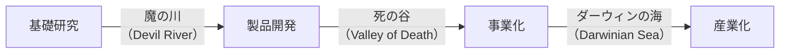
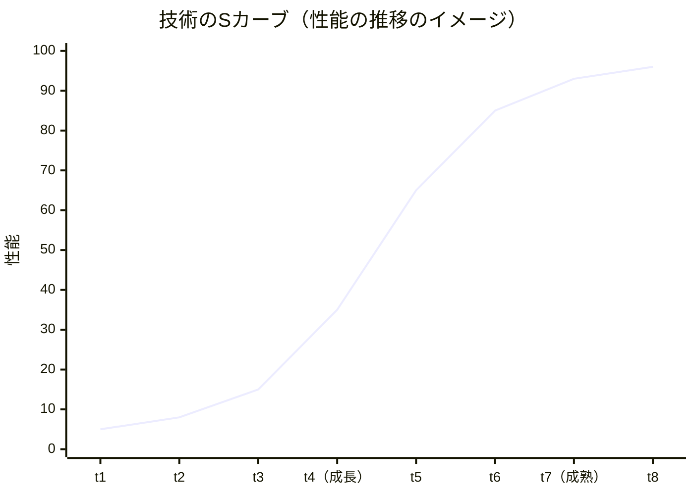
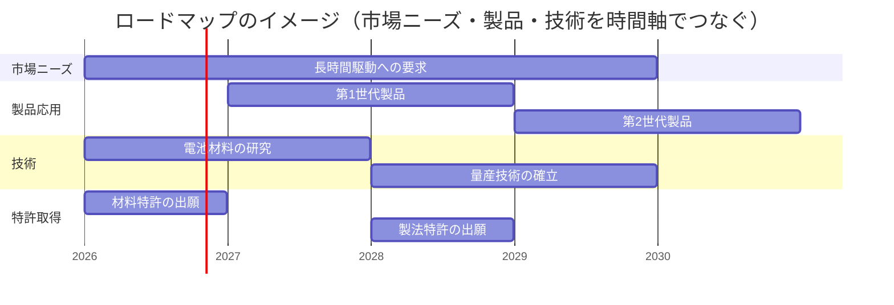
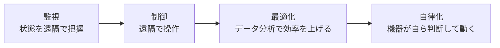
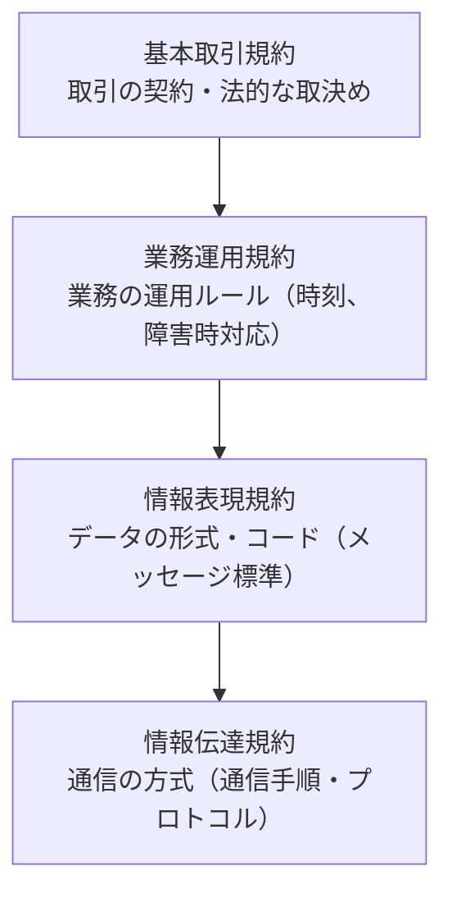

# 技術戦略とビジネスインダストリ

> **出題傾向・重要度：★★**
> 科目A（旧午前）では、**技術戦略マネジメント**（イノベーション、魔の川・死の谷、PoC／MVP、ロードマップなど）と **ビジネスインダストリ**（IoT・AI・EC・EDI・生産システム・自動運転など）から、毎回2〜4問程度が出題されます。用語の意味を問う問題がほとんどです。
> 科目B（旧午後）では、**問2（経営戦略）** や **問3（プログラミング以外の事例問題）** の背景として、新規事業・IoT活用・AIサービスなどの事例が登場します。
> この章は、シラバスVer.7.2 の **中分類20（技術戦略マネジメント）** と **中分類21（ビジネスインダストリ）** を網羅します。[02_経営戦略とマーケティング](./02_経営戦略とマーケティング.md) の9章・10章で要点を押さえたうえで、ここで用語の幅を広げましょう。
> 押さえるポイント：① 研究開発から事業化までの流れと障壁、② PoC・PoV・MVPなど検証の段階、③ 業種別システムと行政システムの名称、④ AI利活用の原則と留意事項、⑤ 生産・e-ビジネス・組込み機器の用語。

## 目次

- [1. 技術開発戦略の立案](#1-技術開発戦略の立案)
- [2. 技術開発計画とロードマップ](#2-技術開発計画とロードマップ)
- [3. ビジネスシステム](#3-ビジネスシステム)
- [4. AIの利活用](#4-aiの利活用)
- [5. エンジニアリングシステム](#5-エンジニアリングシステム)
- [6. e-ビジネス](#6-e-ビジネス)
- [7. 民生機器・IoT・組込みシステム](#7-民生機器iot組込みシステム)
- [8. 産業機器と自動車制御システム](#8-産業機器と自動車制御システム)
- [確認問題](#確認問題)
- [📋 シラバス用語チェックリスト](#-シラバス用語チェックリスト)
- [参考](#参考)

---

## 1. 技術開発戦略の立案

### 1.1 技術開発戦略の目的と考え方 ★★

- **結論**：技術開発戦略は、**技術と市場ニーズを結び付けて事業を成功に導く** ための戦略で、経営戦略・事業戦略と連携させて立てます。
- **理由**：優れた技術を持っていても、それが顧客の価値や収益につながらなければ事業になりません。技術への投資とイノベーションの促進を、経営の視点で管理する必要があります。
- この考え方を **MOT（Management of Technology：技術経営）** といいます。

| 用語 | 意味 |
|---|---|
| **プロダクトイノベーション** | 新しい製品・サービスそのものを生み出す革新 |
| **プロセスイノベーション** | 生産方法や業務プロセスの革新（コスト削減・品質向上） |
| **ラディカルイノベーション** | 既存の技術や市場を根本から変える、**非連続で急進的な** 革新（対：既存製品を少しずつ改良するインクリメンタルイノベーション） |
| **オープンイノベーション** | 社外（大学・他社・スタートアップ）の技術やアイデアを取り入れ、また自社技術を外部に出して革新を起こす |
| **イノベーションのジレンマ** | 優良企業が既存顧客向けの改良を続けた結果、**破壊的イノベーション** を起こした新興企業に市場を奪われる現象（クリステンセン） |
| **メイカームーブメント** | 3Dプリンタなどのデジタル工作機械やネット上の設計データの共有により、個人や小規模の組織でも **ものづくり** ができるようになった潮流 |
| **リーンスタートアップ** | 最小限の製品（MVP）で仮説を検証し、「構築 → 計測 → 学習」のサイクルを素早く回して事業を作る |
| **APIエコノミー** | 企業が自社の機能やデータを **API（Application Programming Interface）** で公開し、他社のサービスと連携することで新しい価値や市場が生まれる経済圏 |
| **市場創生／市場価値** | 新しい技術で、これまでなかった市場を生み出すこと／技術や製品が市場で認められる価値 |
| **イノベータ理論** | ロジャーズが提唱。新製品の採用時期で、イノベーター（2.5%）、アーリーアダプター（13.5%）、アーリーマジョリティ（34%）、レイトマジョリティ（34%）、ラガード（16%）に分ける |
| **R&D（Research and Development）** | 研究開発 |
| **VC（Venture Capital：ベンチャーキャピタル）** | 成長が見込める未上場企業に出資し、株式公開や売却で利益を得る投資会社 |
| **CVC（Corporate Venture Capital：コーポレートベンチャーキャピタル）** | 事業会社が自社の戦略目的（新技術の獲得、新事業の探索）のために設立する投資組織 |
| **MFTフレームワーク** | **市場（Market）・製品（Function／Product）・技術（Technology）** の3層で、自社の技術がどの製品機能を通じてどの市場の価値につながるかを整理する技術マーケティングの枠組み |

> 💡 覚え方：VCは「**投資のリターン**」が目的、CVCは「**自社事業とのシナジー**」が主な目的です。

### 1.2 価値創出の三要素と技術の普及 ★★★

- 技術開発を経済的価値に結び付けるには、次の3つがそろう必要があります。

| 要素 | 意味 | 例 |
|---|---|---|
| **価値創造（Value Creation）** | 技術・製品として新しい価値を生み出す | 高効率の電池を開発する |
| **価値実現（Value Delivery）** | その価値を顧客に届ける（製品化・量産・販売チャネル） | 量産体制と販路を整える |
| **価値利益化（Value Capture）** | 届けた価値から **利益を回収** する（価格、ビジネスモデル、知財による保護） | 特許で模倣を防ぎ、適正な価格で売る |

- ⚠️ ひっかけ注意：「良い技術を作った（創造）」「売った（実現）」だけでは足りず、**模倣されて価格競争になれば利益化できない** 点がポイントです。

**研究開発から産業化までの3つの障壁**



| 障壁 | 意味 |
|---|---|
| **魔の川** | 研究成果を、具体的な製品開発のテーマに結び付けるまでの障壁 |
| **死の谷** | 開発した製品を事業化するまでの障壁（資金・生産設備・販路の不足） |
| **ダーウィンの海** | 事業化した製品が、競合や顧客の選別を勝ち抜いて **産業として定着** するまでの障壁 |

**技術の普及に関するモデル**

| 用語 | 意味 |
|---|---|
| **技術のSカーブ** | 技術の性能は、初めはゆっくり、やがて急速に向上し、成熟すると **限界に近づいて伸びが鈍る**（S字を描く）。限界が近づいたら **次の新技術（新しいSカーブ）への乗り換え** を考える |
| **キャズム** | アーリーアダプターとアーリーマジョリティの間にある大きな溝（ムーア） |
| **ハイプサイクル** | ガートナー社が提唱。新技術への期待は **黎明期 → 過度な期待のピーク期 → 幻滅期 → 啓発期 → 生産性の安定期** と推移する |
| **QCDE（Quality，Cost，Delivery，Environment）** | 品質・価格（コスト）・納期・環境。製品や技術の評価・開発目標の観点（QCDに環境を加えたもの） |



### 1.3 技術開発戦略の立案手順 ★★

- 立案に先立ち、**製品動向・技術動向・標準化動向** を分析し、自社の **コア技術**（競争力の源泉となる中核技術）を見極めます。そのうえで、自社研究だけでなく外部資源も柔軟に使います。

| 用語 | 意味 |
|---|---|
| **技術研究／委託研究／共同研究** | 自社で行う研究／大学・研究機関などに委託する研究／他社や大学と一緒に行う研究 |
| **技術マーケティング** | 自社技術が活かせる市場や用途を探し、技術を事業につなげる活動 |
| **発想法** | ブレーンストーミング、KJ法、マインドマップなど、アイデアを出す方法 |
| **成功事例** | 他社・他業界の成功事例を分析して参考にする |
| **デザイン思考** | 利用者への共感から課題を定義し、試作と検証を繰り返す |
| **システム思考** | 物事を要素のつながり（因果のループ）として全体的にとらえ、根本的な解決策を探る考え方 |
| **ペルソナ法** | 典型的な利用者像（ペルソナ）を具体的に設定し、その人のニーズから発想する |
| **バックキャスティング** | **望ましい未来の姿を先に描き**、そこから逆算して今やるべきことを決める（対：現在から積み上げて未来を予測する **フォアキャスティング**） |

**検証の段階（PoC・PoV・PoB・MVP）**

| 用語 | 何を確かめるか | 例 |
|---|---|---|
| **PoC（Proof of Concept：概念実証）** | アイデアや技術が **実現できるか**（技術的に動くか） | AIで不良品を検出できるか、試作モデルで確認 |
| **PoV（Proof of Value：価値実証）** | 実現したものが **顧客や業務にとって価値があるか**（効果があるか） | 実際の工場で使い、検査時間がどれだけ減るか測る |
| **PoB（Proof of Business）** | **事業として成り立つか**（収益性・持続性） | 価格を付けて販売し、採算が取れるか確かめる |
| **MVP（Minimum Viable Product：実用最小限の製品）** | 顧客の反応を得るための **最小限の機能を持つ製品** で仮説を検証する | 主要機能1つだけのアプリを公開し、利用状況を見る |

> 💡 覚え方：**PoC（できるか）→ PoV（役立つか）→ PoB（もうかるか）**。

### 1.4 外部資源活用戦略 ★★

| 用語 | 意味 |
|---|---|
| **技術獲得／技術供与／技術提携** | 他社から技術を導入する／自社技術を他社に提供する（ライセンスなど）／他社と技術面で協力する |
| **M&A** | 技術や人材を持つ企業を合併・買収し、短期間で技術を獲得する |
| **産学官連携** | 企業（産）・大学（学）・国や自治体（官）が協力して研究開発を行う |
| **TLO（Technology Licensing Organization：技術移転機関）** | 大学の研究成果を特許化し、企業にライセンスして実用化を支援する機関 |
| **標準化戦略** | 自社技術を業界標準（デファクト／デジュール）にして市場を有利にする戦略。どこまで公開し、どこを秘匿するか（**オープン＆クローズ戦略**）を決める |
| **知的財産権** | 特許権などで技術を保護し、模倣を防いで利益化する |
| **早期審査制度** | 一定の条件を満たす特許出願について、特許庁が通常より **早く審査** する制度（中小企業、外国出願を予定する案件など） |
| **パテントプール** | 複数の特許権者が特許を持ち寄り、**一括してライセンス** する仕組み（標準規格の実施に必要な特許で多い） |
| **クロスライセンス** | 企業同士が互いの特許の実施を **相互に許諾** し合う |
| **防衛特許** | 自社で使う予定がなくても、他社に特許を取られて事業を妨げられないように取得・公開しておく特許 |
| **アイディアソン** | アイデア（Idea）とマラソン（Marathon）の造語。テーマについて短期間で集中的に **アイデアを出し合う** イベント |
| **ハッカソン** | ハック（Hack）とマラソンの造語。短期間で集中的に **ソフトウェアやサービスを開発** し、成果を競うイベント |

---

## 2. 技術開発計画とロードマップ

### 2.1 技術開発計画 ★

- 経営戦略や技術開発戦略にもとづき、**何を・いつまでに・どの資源で** 開発するかを定めた計画です。

| 計画の要素 | 内容 |
|---|---|
| **技術開発投資計画** | 研究開発にどれだけ投資するか（**投資対効果** を評価） |
| **技術開発拠点計画** | どこで研究開発を行うか（国内外の研究所、共同研究先） |
| **人材計画** | 研究者・技術者の確保と育成 |
| **経営資源の最適配分** | テーマ間で資金・人材を最適に配分する |
| **コンカレントエンジニアリング** | 設計・生産準備・調達などの工程を **並行して進め**、開発期間を短縮する |
| **パイロット生産** | 量産の前に小規模な試験生産を行い、生産上の問題を洗い出す |
| **知的財産権管理** | 開発成果の特許出願、他社特許の調査、ライセンス管理 |
| **市場ニーズ** | 開発テーマが市場の需要に合っているかを常に確認する |

### 2.2 技術開発のロードマップ ★★

- **ロードマップ**：科学的な裏付けと関係者の合意（コンセンサス）にもとづく未来像を、**時系列で描いた** 技術開発のシナリオです。

| 種類 | 内容 |
|---|---|
| **技術ロードマップ** | 技術の発展の道筋（どの技術がいつ実現するか）を時系列で示す |
| **製品応用ロードマップ** | 技術を **どの製品にいつ応用するか** を示す |
| **特許取得ロードマップ** | 技術開発の進行に合わせて、**どの特許をいつ取得するか** を示す |



---

## 3. ビジネスシステム

### 3.1 社内業務支援システム ★

| システム | 内容 |
|---|---|
| **会計・経理・財務システム** | 仕訳、決算、資金管理などを行う。財務データの開示には **XBRL（eXtensible Business Reporting Language）**（財務情報を記述するためのXMLベースの言語）が使われる |
| **人事・給与システム** | 人事情報、勤怠、給与計算、社会保険手続を管理する |
| **営業支援システム（SFA）** | 顧客訪問・商談の進捗を共有し、営業活動を効率化する |
| **グループウェア** | スケジュール、掲示板、文書共有など組織の協働を支援する |
| **ワークフローシステム** | 申請・承認の流れを電子化する |
| **Web会議システム** | ネットワーク経由で音声・映像・画面を共有して会議を行う |

### 3.2 基幹業務支援システムと業務パッケージ ★★

| システム | 内容 |
|---|---|
| **流通情報システム／物流情報システム** | 仕入・販売・在庫などの流通業務／入出庫・配送・倉庫管理などの物流業務を支援する |
| **フィールド業務支援システム** | 外回りの保守・点検・営業担当者に、スマートフォンなどで作業指示・記録・報告を行わせる |
| **金融情報システム** | 銀行の勘定系（預金・為替・融資）、ATM、証券取引などのシステム |
| **医療情報システム** | 電子カルテ、オーダリング（検査・処方の指示）、医事会計などのシステム |
| **電子カルテ** | 診療記録を電子的に記録・保存するシステム |
| **POSシステム（Point Of Sales）** | 商品が売れた時点で、商品・数量・時刻などを記録・集計する（販売時点情報管理） |
| **EOS（Electronic Ordering System：電子補充発注システム）** | 店舗の端末から、本部や取引先へ商品を電子的に発注する |
| **販売管理／購買管理／在庫管理システム** | 受注・出荷・請求／発注・検収・支払／入出庫・在庫数・棚卸を管理する |
| **顧客情報システム** | 顧客の属性・取引履歴を管理する（CRMの基盤） |
| **CDN（Content Delivery Network）** | 世界各地のキャッシュサーバにコンテンツを配置し、利用者の近くから配信して高速化・負荷分散する |
| **ERP** | 基幹業務を統合したシステム・パッケージ |
| **トレーサビリティ** | 生産・流通の履歴を追跡できること（食品の産地、部品のロットなど） |
| **ユビキタスコンピューティング** | いつでも・どこでも・誰でもコンピュータを意識せずに利用できる環境 |

**IoT・デジタルツイン・CPS・ブロックチェーン**

- **IoT（Internet of Things）** がもたらす効果は、段階的に次の4つで説明されます。



| 用語 | 意味 |
|---|---|
| **デジタルツイン** | 現実の設備・都市などをサイバー空間に **双子のように再現** し、シミュレーションや予測に使う |
| **サイバーフィジカルシステム（CPS）** | 現実空間のデータをセンサで集め、サイバー空間で分析し、結果を現実空間にフィードバックして制御する仕組み |
| **ブロックチェーンの活用** | 改ざんが困難な分散型台帳を、**トレーサビリティ確保**（生産・流通履歴の記録）や **スマートコントラクト**（契約の条件を満たすと自動的に実行されるプログラム）に使う |

### 3.3 行政システム ★★

- **電子政府** は、情報技術で行政サービスの提供と行政活動の効率化を行う仕組みです。現在は「**デジタルガバメント**」として、デジタル庁を中心に、利用者中心の行政サービスへの転換が進められています。

| システム・用語 | 内容 |
|---|---|
| **ガバメントクラウド** | 国や地方公共団体が共通して利用するクラウド基盤（デジタル庁が整備） |
| **e-Gov（イーガブ）** | 政府の総合窓口ポータル。電子申請、法令検索、パブリックコメントなど |
| **電子自治体／電子申請** | 地方公共団体の行政のデジタル化／行政手続をオンラインで行うこと |
| **電子調達／GEPS（Government Electronic Procurement System：政府電子調達システム）** | 入札・契約手続をオンラインで行うこと／その政府共通システム |
| **LGWAN（Local Government Wide Area Network：総合行政ネットワーク）** | 地方公共団体を相互に接続する、インターネットから分離された行政専用ネットワーク |
| **EDINET（Electronic Disclosure for Investors' NETwork）** | 金融庁の、有価証券報告書などの開示書類を電子的に提出・閲覧するシステム（XBRLを利用） |
| **出入国管理システム／登記情報システム／社会保険オンラインシステム** | 出入国の審査・記録／不動産・商業登記／年金・社会保険の記録などを扱う行政システム |
| **地域気象観測システム（アメダス）** | 全国の観測所で降水量・気温・風などを自動観測する気象庁のシステム |
| **緊急速報** | 緊急地震速報・津波警報・避難情報などを携帯電話へ一斉配信する |
| **Jアラート（全国瞬時警報システム）** | 弾道ミサイル情報や緊急地震速報などを、人工衛星などを通じて自治体へ伝え、防災行政無線などで住民に瞬時に伝えるシステム |
| **公共情報システム** | 道路・交通・防災などの公共分野の情報システム（[3.4](#34-公共情報システム-)） |
| **住民基本台帳ネットワークシステム（住基ネット）** | 住民票の本人確認情報を、全国の自治体で共有するネットワーク |
| **公的個人認証サービス（JPKI）** | マイナンバーカードの電子証明書を使い、オンラインで本人確認や電子署名を行うサービス |
| **マイナンバー／マイナポータル** | 個人番号（12桁）による行政の情報連携／政府が運営する個人向けのオンラインサービス（行政手続、情報の確認） |
| **自治体窓口のキャッシュレス化** | 住民票の手数料などをキャッシュレス決済で支払えるようにすること |
| **ユニバーサルデザイン** | 年齢・障害の有無などにかかわらず、**最初から誰もが使いやすいように** 設計すること |
| **デジタルディバイド** | ITを使える人と使えない人の間の格差。行政のデジタル化では取り残される人への配慮が必要 |

### 3.4 公共情報システム ★

| システム | 内容 |
|---|---|
| **スマートグリッド** | ITで電力の需要と供給を双方向に制御し、効率化・安定化する次世代送電網 |
| **EMS（Energy Management System）** | エネルギーの使用状況を見える化し、最適に制御するシステム（HEMS・BEMS・CEMS など対象により呼び分ける） |
| **GPS応用システム** | 衛星測位（GPS、日本の準天頂衛星「みちびき」など）を使ったカーナビ、物流の位置管理、測量など |
| **ITS（Intelligent Transport Systems：高度道路交通システム）** | 人・道路・車両を情報でつなぎ、交通事故・渋滞・環境問題を解決するシステムの総称 |
| **VICS（Vehicle Information and Communication System：道路交通情報通信システム）** | 渋滞・交通規制などの情報をカーナビに配信する |
| **ETC（Electronic Toll Collection System：自動料金支払システム）** | 有料道路の料金所で、車載器と路側アンテナの無線通信により停車せずに料金を支払う |
| **AIオンデマンド交通** | 利用者の予約に応じて、AIが最適な経路・配車を計算して運行する乗合交通 |
| **座席予約システム** | 鉄道・航空などの座席をリアルタイムで予約・発券するオンラインシステム |

---

## 4. AIの利活用

### 4.1 AI利活用の原則と指針 ★★

**人間中心のAI社会原則**（2019年、内閣府「統合イノベーション戦略推進会議」決定）は、AIを社会に実装する際の基本原則で、次の7つからなります。

| 原則 | 要点 |
|---|---|
| **人間中心の原則** | AIは人間の能力を拡張するものであり、基本的人権を侵さない |
| 教育・リテラシーの原則 | 誰もがAIを理解し使えるよう教育する |
| プライバシー確保の原則 | パーソナルデータを本人の望まない形で使わない |
| セキュリティ確保の原則 | AIのリスクに対するセキュリティを確保する |
| 公正競争確保の原則 | AIによる富や支配力の偏りを防ぐ |
| **公平性、説明責任及び透明性の原則** | AIによって不当な差別をされない。判断の説明責任と透明性を確保する |
| **イノベーションの原則** | 国境や産学官を越えて人材・研究を連携させ、イノベーションを促進する |

| 用語 | 意味 |
|---|---|
| **AI-ready** | 社会・企業・個人がAIを使いこなせる準備ができている状態（人材、データ、制度などが整っている） |
| **AI利活用ガイドライン（AI利活用原則）／AI開発ガイドライン** | 総務省の会議が策定した、AIの利用者・開発者が留意すべき原則。現在は経済産業省・総務省の「**AI事業者ガイドライン**」（第1.0版 2024年4月 → **第1.2版 2026年3月**）に統合・更新されている |
| **信頼できるAIのための倫理ガイドライン（Ethics guidelines for trustworthy AI）** | 欧州委員会の専門家グループが2019年に公表した、AIが満たすべき要件（人間の主体性、透明性、公平性など）。EUではその後 **AI法（AI Act）** が成立し、リスクに応じた規制が段階的に適用されている |
| **倫理的に調和した設計（Ethically Aligned Design）** | IEEEが公表した、人間の幸福を優先するAI・自律システムの設計指針 |
| **人工知能学会倫理指針** | 人工知能学会が会員の研究者に求める倫理（人類への貢献、誠実な振る舞い、公正性など） |
| **AIの社会的受容性** | AIが社会の人々に信頼され、受け入れられる度合い |
| **AI Risk Management Framework（AI RMF）** | 米国NISTが2023年に公表した、AIのリスクを管理するための枠組み（統治・マップ・測定・管理の4機能） |

> 📝 2026年10月時点の国内の動き：**AI推進法（人工知能関連技術の研究開発及び活用の推進に関する法律）** が2025年9月に全面施行され、内閣総理大臣を本部長とする **AI戦略本部** が設置されました。2025年12月には同法に基づく **人工知能基本計画** が閣議決定されています。罰則で縛る規制法ではなく、研究開発と活用を推進する基本法である点がEUのAI法と異なります。

### 4.2 AIの活用領域と活用目的 ★★

- AIは、研究開発・調達・製造・物流・販売・マーケティング・金融・インフラ・公共・ヘルスケアなど、あらゆる領域で使われています。
- **利活用の目的**：仮説検証、知識発見、原因究明、計画策定、判断支援、活動代替など。

| 学習の種類 | 活用例 |
|---|---|
| **教師あり学習による予測** | 売上予測、り患予測（病気にかかる可能性）、成約予測、離反予測（解約しそうな顧客の発見） |
| **教師なし学習によるグルーピング** | 顧客セグメンテーション、店舗クラスタリング |
| **生成AIの活用** | 文章の添削・要約、アイデアの提案、科学論文の執筆支援、プログラミング支援、画像生成 |

| 用語 | 意味 |
|---|---|
| **特化型AI／汎用AI** | 特定のタスク（画像認識、翻訳など）だけを行うAI／人間のように様々なタスクをこなせるAI（AGI） |
| **チューリングテスト** | 人間の審査員が、文字の会話で相手が機械か人間かを見分けられなければ、その機械は知的であるとみなすテスト |
| **フレーム問題** | 現実の無数の事柄の中から、今の課題に **関係のあることだけを取り出して考える** ことがAIには難しいという問題 |
| **シンボルグラウンディング問題** | 記号（言葉）を、それが指す **実世界の意味と結び付ける** ことがAIには難しいという問題（記号接地問題） |
| **AIによる認識／AIによる自動化** | 画像・音声・文字などを認識する／判断や作業を自動で行う |
| **AIアシスタント** | 自然言語で指示を受け、検索・予定管理・文書作成などを手伝うAI |
| **生成AI** | 学習したデータをもとに、文章・画像・音声・プログラムなどを **新たに生成** するAI |
| **マルチモーダルAI** | テキスト・画像・音声など **複数の種類のデータ** をまとめて扱えるAI |
| **ランダム性** | 生成AIは確率的に出力を選ぶため、**同じ入力でも毎回異なる出力** になることがある |
| **マテリアルズインフォマティクス** | AIやデータ科学を使って、新しい材料（素材）の開発を効率化する手法 |

### 4.3 AIを利活用するうえでの留意事項 ★★★

- AIの出力には、**ハルシネーション**（もっともらしいが事実でない内容）、**悪意ある情報**（差別的表現など）、**古い情報** が含まれるリスクがあります。
- このため、**AIの出力を人間が確認し、必要に応じて人間が加工して用いる**（人間の関与）ことが重要です。

| 用語 | 意味 |
|---|---|
| **説明可能なAI（XAI：Explainable AI）** | AIが **なぜその判断をしたのか** を人間が理解できるように説明できるAI、またはその技術 |
| **説明可能性／解釈可能性** | 判断の根拠を説明できること／モデルの仕組み自体が人間に理解しやすいこと（決定木など） |
| **大局説明／局所説明** | モデル全体としてどの特徴量が重要かの説明／**個々の予測結果** について、なぜそう判断したかの説明 |
| **ヒューマンインザループ（HITL：Human-in-the-Loop）** | AIの判断プロセスの中に **人間による確認・修正** を組み込む |
| **AI利用者の関与によるバイアス** | 利用者の入力や使い方（質問の仕方、結果の選び方）によって生じる偏り |
| **アルゴリズムのバイアス** | 学習データの偏りやアルゴリズムの設計によって、特定の属性（性別・人種など）に不公平な結果が出ること |
| **AIサービスの責任論** | AIの誤判断で損害が生じたとき、開発者・提供者・利用者の誰が責任を負うかという議論 |
| **ディープフェイク** | 深層学習で作られた、本物と見分けにくい偽の画像・動画・音声。なりすましや偽情報に悪用される |
| **AIサービスのオプトアウトポリシー** | 利用者が入力したデータを **AIの学習に使わせない** よう選択できる仕組み・方針 |
| **AI倫理アセスメント** | AIシステムの開発・導入前に、公平性・プライバシー・安全性などの倫理的リスクを評価すること |

> ⚠️ ひっかけ注意：生成AIの出力は「AIが作ったから正しい」わけではありません。**事実確認（ファクトチェック）** と **著作権・個人情報の確認** は利用者の責任です。

---

## 5. エンジニアリングシステム

### 5.1 生産方式と生産形態 ★★

| 用語 | 意味 |
|---|---|
| **かんばん方式** | 後工程が前工程に「かんばん（部品の種類・数量を書いた札）」で必要な分だけを引き取りに行き、前工程は引き取られた分だけ作る（**後工程引取り方式**） |
| **JIT（Just In Time）** | 必要なものを、必要なときに、必要な量だけ生産・調達して在庫を最小化する（トヨタ生産方式の柱） |
| **リーン生産方式** | トヨタ生産方式を体系化したもので、あらゆる **ムダを徹底的に排除** する生産方式 |
| **セル生産方式** | 1人または少人数のチーム（セル）が、部品の取付けから検査まで **多くの工程を担当** して完成させる。多品種少量生産に向く（対：ベルトコンベア方式のライン生産） |
| **生産ラインの編成** | 工程の作業時間を均等にし（ライン・バランシング）、ムダな待ちをなくすように作業を各工程に割り振る |
| **個別生産／ロット生産／連続生産** | 1個ずつ作る（船舶・特注機械）／一定数量（ロット）ごとにまとめて作る／同じ製品を連続して大量に作る |
| **受注生産／見込み生産** | 注文を受けてから作る／需要を予測して先に作る（在庫を持つ） |
| **ニーズの多様化・多品種少量生産** | 顧客ニーズの多様化に応じて、多くの種類の製品を少しずつ作る |
| **NC（Numerical Control：数値制御）** | 工作機械の動きを数値データ（プログラム）で制御する |
| **自動監視装置／無人搬送車／自動倉庫／産業用ロボット** | 生産を自動化する要素技術（[8.2](#82-産業機器の例-)） |
| **ファブレス** | 工場を持たず、製造を外部に委託する |

### 5.2 生産システムと生産管理 ★★

- **FA（Factory Automation）システム**：設計から組立・検査・出荷・在庫管理までの工程を、生産管理システムや計画支援ツールで **装置制御から工場管理まで自動化** するシステムです。
- **生産管理** の主な機能：**品質管理**、**工程管理**（作業の進み具合の管理）、**日程管理**、**在庫管理**、**設計管理**、**積算支援**（原価の見積り）、**調達管理**、**原価管理**、**利益管理**、**戦略管理**、**変化のマネジメント**（需要や設計の変更への対応）。

| 用語 | 意味 |
|---|---|
| **CAP（Computer Aided Planning）** | コンピュータによる生産計画の支援 |
| **CAPP（Computer Aided Process Planning）** | 設計データから、加工の順序・機械・条件などの **工程設計** を自動化・支援する |
| **MRP（Material Requirements Planning：資材所要量計画）** | 生産計画（基準生産計画）と部品表（BOM）・在庫情報から、**必要な部品の量と発注時期** を計算する |
| **FMS（Flexible Manufacturing System）** | NC工作機械・ロボット・自動搬送装置をコンピュータで統合制御し、**多品種少量生産に柔軟に対応** する生産システム |
| **FMC（Flexible Manufacturing Cell）** | FMSを小規模にした単位（数台の工作機械とロボットからなるセル） |
| **MES（Manufacturing Execution System：製造実行システム）** | 工場の現場で、作業指示・進捗・品質・設備の状態をリアルタイムに管理する（ERPなどの計画系と現場の制御系をつなぐ） |
| **生産性指標** | 投入（労働時間・設備）に対する産出（生産量・付加価値）の比率。労働生産性など |

```
MRPの計算例：製品Xを来週100個作る。Xは部品Aを2個使う。
  部品Aの在庫は30個、発注済みで来週までに入る分（発注残）は20個
  総所要量 = 100 × 2 = 200個
  正味所要量 = 総所要量 − 在庫 − 発注残 = 200 − 30 − 20 = 150個
  → 部品Aの調達リードタイムが1週間なら、今週中に150個を発注する
```

### 5.3 コンピュータ支援システム ★★

| 用語 | 意味 |
|---|---|
| **CAD（Computer Aided Design）** | コンピュータによる設計支援（2D／3Dの図面作成） |
| **CAM（Computer Aided Manufacturing）** | CADの設計データから、NC工作機械の加工プログラムを作るなど、製造を支援する |
| **CAE（Computer Aided Engineering）** | 設計データをもとに、強度・熱・流体などを **シミュレーションして解析** する（試作の回数を減らす） |
| **BIM／CIM（Building／Construction Information Modeling, Management）** | 建築（BIM）や土木（CIM）で、3次元モデルに部材の属性・コスト・工程などの情報を持たせ、設計から施工・維持管理まで活用する |
| **PDM（Product Data Management）** | 図面・部品表・仕様書など製品に関するデータを一元管理する |
| **PMS（Project Management System）** | プロジェクトの計画・進捗・資源を管理するシステム |
| **CIM（Computer Integrated Manufacturing）** | 設計・生産・販売など製造業の情報をコンピュータで **統合管理** し、全体を最適化する（土木のCIMとは別物） |

> ⚠️ ひっかけ注意：**CAD＝設計、CAM＝製造、CAE＝解析** の区別が頻出です。

---

## 6. e-ビジネス

### 6.1 EC（電子商取引） ★★

**電子受発注・電子決済**

| 用語 | 意味 |
|---|---|
| **オンラインモール／オンラインショッピング** | 複数の店舗が出店するWeb上の商店街／ネット通販 |
| **電子入札** | 入札手続をネット上で行う |
| **インターネットバンキング** | ネット経由で残高照会・振込などを行う |
| **組み込み型金融（Embedded Finance）** | 金融業以外の事業者が、自社のサービス（ECアプリなど）の中に決済・融資・保険などの **金融機能を組み込んで** 提供する |
| **EFT（Electronic Fund Transfer：電子資金移動）** | ネットワークを介して資金を電子的に移動すること |
| **SET（Secure Electronic Transaction）** | クレジットカード決済を安全に行うために策定された電子決済の規格（現在は普及していない） |
| **スマートカード・ICカード・RFID応用システム** | ICチップを搭載したカードや無線タグを使い、決済・入退室・物流管理などを行う |
| **キャッシュレス決済** | スマートフォンのキャリア決済（携帯料金と一緒に支払う）、非接触IC決済（タッチ決済）、QRコード決済など |
| **フィンテック（FinTech）** | 金融とITを組み合わせた新しいサービス |
| **電子マネー** | 前払い（プリペイド）や後払いで、ICカードやスマホに記録した電子的な価値で支払う |
| **暗号資産（仮想通貨）** | ブロックチェーン技術などを用い、ネット上で取引される財産的価値（資金決済法で規定） |
| **中央銀行発行デジタル通貨（CBDC：Central Bank Digital Currency）** | 中央銀行が発行する、デジタル形式の法定通貨 |
| **電子記録債権** | 手形などに代わり、電子債権記録機関の記録原簿への **電子記録** で発生・譲渡する金銭債権（でんさいなど） |
| **電子契約** | 紙と印鑑の代わりに、電子文書と電子署名で契約を結ぶ |

**e-ビジネスの形態と考え方**

| 用語 | 意味 |
|---|---|
| **BtoB／BtoC／CtoC** | 企業間／企業と消費者／消費者間の取引 |
| **DtoC（Direct to Consumer）** | メーカーが小売店を通さず、自社ECなどで **消費者に直接販売** する |
| **GtoB／GtoC** | 行政と企業／行政と国民（電子申請、電子調達など） |
| **OtoO（Online to Offline）** | ネット上の情報やクーポンで、実店舗への来店を促す |
| **OMO（Online Merges with Offline）** | ネットと実店舗を区別せず、**融合した一つの顧客体験** として設計する（O2Oより進んだ考え方） |
| **インターネットビジネス／オンライン商用サービス** | インターネットを使った事業全般／ネット経由で提供される有料サービス |
| **バーチャルカンパニー** | 複数の企業や個人が、ネットワークで連携して一つの会社のように事業を行う形態 |
| **アグリゲーションサービス** | 複数のサービスや情報を集約し、一か所で利用できるようにする（例：複数の銀行口座をまとめて見る） |
| **eマーケットプレイス** | 多数の売り手と買い手が参加する、ネット上の取引市場 |
| **オンライントランザクション処理** | 利用者の要求をその場で即時に処理する方式（OLTP） |
| **SCM** | 供給連鎖全体の最適化。ECではネット経由の受発注と連携する |
| **ロングテール** | 販売数の少ない商品（テール）も多数そろえることで、全体として大きな売上になる（ネット販売で顕著） |
| **マネタイズ** | 無料サービスなどから **収益を得る仕組みを作る** こと |
| **フリーミアム** | 基本機能は無料、高度な機能は有料にする |
| **クラウドソーシング** | ネット上で **不特定多数の人に業務を発注** する（クラウドファンディングは資金を集めるもので別物） |
| **NFT（Non-Fungible Token：非代替性トークン）** | ブロックチェーン上で、デジタルデータに **唯一性（替えがきかないこと）** を持たせるトークン。デジタルアートや会員権などに使われる |

**電子商取引の留意点**

| 用語 | 意味 |
|---|---|
| **アカウントアグリゲーション** | 利用者のIDとパスワードを預かって、複数の金融機関の口座情報をまとめて表示するサービス。**認証情報の預託によるリスク** があり、現在はAPI連携への移行が進んでいる |
| **eKYC（electronic Know Your Customer）** | 口座開設などの本人確認を、本人確認書類の撮影と顔写真の照合などで **オンラインで完結** させる |
| **AML・CFT（マネー・ローンダリング・テロ資金供与対策）ソリューション** | 不審な取引を検知・監視し、犯罪資金の移動を防ぐ仕組み |

### 6.2 EDI（電子データ交換） ★★

- **EDI（Electronic Data Interchange）**：企業間で、受発注・出荷・請求・支払などの取引データを、**標準的な形式で電子的に交換** する仕組みです。**資材調達**、**補充発注**、**貨物追跡**、**電子決済** などに使われます。
- 利点：入力の手間・ミスの削減、処理の迅速化、紙のコスト削減。留意点：取引先ごとに形式が違うと対応が大変（**多端末現象**）なので、標準の採用が重要です。



| 用語 | 意味 |
|---|---|
| **情報伝達規約／情報表現規約／業務運用規約／基本取引規約** | EDIで合意すべき4つの階層の取決め（上図） |
| **Web-EDI** | Webブラウザを使ってEDIを行う方式。導入が容易だが、取引先ごとに画面が異なりがち |
| **UN/CEFACT（貿易簡易化と電子ビジネスのための国連センター）** | 国際的なEDI標準（**UN/EDIFACT** など）を策定する国連の機関 |
| **JIS X 7011-1、JIS X 7012-1** | 国連のEDI標準（UN/EDIFACT の構文規則やデータ要素など）に対応する日本産業規格 |
| **EANCOM** | 流通業界向けに GS1 が定めた UN/EDIFACT のサブセット（国際標準メッセージ） |
| **STEP（製品モデルデータの表現及び交換に関する標準）** | CADなどの製品データを異なるシステム間で交換するための国際規格（ISO 10303） |
| **全国銀行協会手順** | 銀行と企業の間で、振込・入出金明細などのデータを交換するための通信手順（全銀手順） |
| **XBRL** | 財務情報を記述するXMLベースの言語 |
| **XML-EDI／ebXML** | XMLを使ったEDI／国連とOASISが策定した、XMLによる電子商取引の国際標準 |
| **JCA手順（J手順，H手順）** | 日本チェーンストア協会（JCA）が定めた、小売業と取引先の間の通信手順（電話回線時代の標準） |
| **流通BMS（流通ビジネスメッセージ標準）** | 流通業界のEDI標準。JCA手順に代わり、インターネットとXMLを使う |
| **JX手順** | 流通BMSなどで使われる、インターネット上でデータを送受信する通信手順（主に中小企業向け） |
| **オープンAPI** | 銀行などが外部の事業者に、安全な方式で口座情報や決済機能をAPIとして公開すること |

### 6.3 ソーシャルメディア ★

| 用語 | 意味 |
|---|---|
| **SNS（Social Networking Service）** | 利用者同士がつながり、情報を発信・共有するサービス |
| **電子掲示板／ブログ／ミニブログ** | 書き込みを共有する場／日記形式のWebサイト／短い文章を投稿するブログ |
| **リアルタイムウェブ** | SNSなどで、情報が発信と同時に即座に共有・閲覧されるWebの形態 |
| **ライフログ** | 人の行動・健康・位置などの生活の記録をデジタルデータとして蓄積したもの |
| **情報銀行** | 個人の同意のもとでパーソナルデータを預かり、本人に代わって第三者に提供し、便益を本人に還元する事業（情報利用信用銀行） |
| **シェアリングエコノミー** | 個人が持つモノ・場所・スキルを、ネットを介して他人と共有・貸し借りする |
| **CMS（Content Management System）** | Webサイトの文章・画像などを、専門知識なしに作成・管理・公開できるシステム |
| **CGM（Consumer Generated Media：消費者生成メディア）** | 口コミサイトや動画投稿サイトなど、**利用者自身が内容を作る** メディア |

---

## 7. 民生機器・IoT・組込みシステム

### 7.1 IoTシステム・組込みシステムの特徴 ★★

- **組込みシステム**：家電・自動車・産業機器などに組み込まれ、特定の機能を制御するコンピュータシステムです。

| 用語 | 意味 |
|---|---|
| **マイクロコンピュータ（マイコン）** | CPU・メモリ・入出力機能を1つのチップに集積した小型コンピュータ |
| **エッジコンピューティング／エッジAI** | データの発生源（機器）の近くで処理を行い、通信量や遅延を減らす／機器側でAIの推論を行う |
| **省電力・高信頼設計・安全性設計・耐環境性** | 組込み機器に求められる特性（電池で長く動く、故障しにくい、故障しても危険にならない（フェールセーフ）、温度・振動・ほこりに強い） |
| **組込みOS／リアルタイムOS（RTOS）** | 組込み機器向けのOS／処理を **決められた時間内に確実に終える** ことを重視したOS |
| **リアルタイム制御** | 外部の変化（**イベント**）に対して、決められた時間内に応答する制御 |
| **センサー** | 温度・光・加速度などの物理量を電気信号に変換する素子 |
| **シーケンス制御** | あらかじめ決めた **順序や条件** に従って、制御の各段階を順に進める制御（例：全自動洗濯機） |
| **ロボティクス** | ロボットの設計・制御などに関する技術分野 |
| **ファームウェア** | 機器に組み込まれ、ハードウェアを直接制御するソフトウェア（更新できるものが多い） |
| **WPS（Wi-Fi Protected Setup）** | ボタンを押すなどの簡単な操作で、無線LANの接続設定を行う規格 |
| **Wi-Fi Direct** | アクセスポイントを介さず、端末同士を直接無線LANで接続する規格 |
| **Wi-Fi中継器** | 無線LANの電波を中継して、届く範囲を広げる機器 |
| **ワイヤレス給電** | ケーブルをつながずに電力を送る技術（スマートフォンの置くだけ充電など） |
| **BLEビーコン** | Bluetooth Low Energy で識別信号を発信する小型装置。屋内での位置検知や店舗での情報配信に使う |
| **屋内測位技術（AoA，AoD）** | 電波の **到来角度（AoA：Angle of Arrival）** や **発射角度（AoD：Angle of Departure）** から、屋内での位置を推定する技術 |

### 7.2 民生機器の特徴と例 ★

- 近年の動向：**小型化・軽量化・ネットワーク化・パーソナル化（個人所有）・インタラクティブ性の高まり**。家電もネットにつながる **情報家電**・IoT機器になっています。

| 分類 | 例 |
|---|---|
| 家電・AV機器 | 炊飯器、洗濯機、エアコン、**HDTV**（高精細テレビ）、**セットトップボックス**（テレビに接続して放送・ネット動画を受信する機器） |
| 個人用情報機器 | **スマートフォン**、**タブレット端末**、**ウェアラブルコンピュータ**（腕時計型・眼鏡型など身に着けるコンピュータ） |
| AR・VR機器 | **ARグラス**（現実の視界に情報を重ねて表示）、**MRグラス**（現実と仮想物体を融合させ、操作もできる）、**VRゴーグル**（視界を覆い仮想空間に没入させる）、**スマートグラス**（眼鏡型の情報端末） |
| 家庭のネットワーク | **スマートスピーカー**（音声で操作するAIアシスタント搭載スピーカー）、**ホームネットワーク**、**HEMS（Home Energy Management System）**（家庭の電力使用を見える化・制御する） |
| 業務用・その他 | **コンピュータ周辺／OA機器**（プリンタ、複合機）、**民生用通信端末機器**、**車載情報機器**（カーナビ、ドライブレコーダ）、**アプライアンス**（特定用途に特化した機器）、POS端末、ハンディターミナル、金融端末 |
| センサー関連 | **センサーネットワーク**（多数のセンサーを無線でつないだネットワーク）、**センサー基地局**、**センサー端末** |

---

## 8. 産業機器と自動車制御システム

### 8.1 産業機器の動向 ★★

- 近年の動向：**省力化・無人化・ネットワーク化・インタラクティブ性の高まり**。

| 用語 | 意味 |
|---|---|
| **M2M（Machine to Machine）** | 機械同士が人を介さずにネットワークで通信し、制御や監視を行う |
| **SoS（System of Systems）** | 独立して運用される複数のシステムが連携し、全体として一つの大きなシステムとして機能するもの（例：交通・電力・通信が連携するスマートシティ） |
| **スマートシティ** | ICTを活用して、交通・エネルギー・防災などの都市の課題を解決し、生活の質を高める都市 |
| **スーパーシティ** | 国家戦略特区制度を使い、規制改革とデータ連携で、移動・物流・行政・医療など **複数分野のサービスを一体的に提供** する未来都市（スーパーシティ構想） |
| **都市OS** | スマートシティで、分野ごとのデータやサービスを連携させるための共通のデータ連携基盤 |
| **スマートファクトリー** | IoT・AIで設備や工程をつなぎ、生産を最適化する工場 |
| **スマート農業** | ロボット・ドローン・センサー・AIを活用して、農作業の省力化や品質向上を図る農業 |
| **MaaS（Mobility as a Service）** | 複数の交通手段を、一つのサービスとして検索・予約・決済できるようにする |
| **バーチャルパワープラント（VPP：仮想発電所）** | 各地に分散した太陽光発電・蓄電池・電気自動車などをIoTで束ね、**一つの発電所のように制御** する |
| **ソフトウェアファースト** | ハードウェアより先にソフトウェアの価値を中心に製品・事業を設計し、ソフトの更新で機能を高め続ける考え方 |

### 8.2 産業機器の例 ★

| 機器 | 内容 |
|---|---|
| **工業機器・FA機器** | 工作機械、組立装置など工場の自動化機器 |
| **ロボット（産業用，医療用，介護用，災害対応用ほか）** | 溶接・搬送、手術支援、移乗支援、災害現場の調査など |
| **AMR（Autonomous Mobile Robot：自律走行搬送ロボット）** | センサーで周囲を認識し、地図をもとに **自分で経路を決めて** 走行する搬送ロボット |
| **AGV（Automatic Guided Vehicle：無人搬送車）** | 床の磁気テープなど **決められた経路に沿って** 走行する搬送車 |
| **ドローン** | 遠隔操作や自律飛行ができる無人航空機 |
| **PLC（Programmable Logic Controller）** | 工場の機械を **シーケンス制御** するための専用コントローラ |
| **自動倉庫** | コンピュータ制御で、入出庫・保管を自動で行う立体倉庫 |
| **自動販売機・ATM（現金自動預払機）** | ネットワークで在庫・売上・取引を管理する |
| **医療機器・AED（自動体外式除細動器）・患者モニタリング装置** | 心臓に電気ショックを与えて正常なリズムに戻すAED、心拍・血圧などを監視する装置 |
| **MT法（Mahalanobis-Taguchi System）** | 正常なデータの集まり（単位空間）からの **マハラノビス距離** で、異常や不良を判定する品質工学の手法 |
| **スマートメーター（AMI：Advanced Metering Infrastructure）** | 通信機能を持つ電力量計と、検針データを収集・活用する仕組み |
| **マシンビジョン** | カメラと画像処理で、製品の検査・位置決め・識別を自動で行う |
| **BEMS（Building EMS）／CEMS（Community EMS）** | ビルのエネルギー管理システム／地域全体のエネルギー管理システム |
| 通信設備機器など | ルータ、MDF（主配線盤）、船舶・航空機などの運輸機器、分析機器、計測機器、空調などの設備機器、建設機器 |

> 💡 覚え方：EMSは対象で頭文字が変わります。**H**ome → **B**uilding → **C**ommunity（家 → ビル → 地域）。

### 8.3 自動車制御システム ★★

| 用語 | 意味 |
|---|---|
| **CASE** | 自動車業界の変革を表す4つのキーワード：**Connected**（つながる）、**Autonomous**（自動運転）、**Shared & Services**（シェアとサービス）、**Electric**（電動化） |
| **SDV（Software Defined Vehicle）** | ソフトウェアによって機能が定義され、**OTA（無線通信）によるソフト更新で機能を追加・改善** できる自動車 |
| **コネクテッドカー** | 通信機能を持ち、ネットワークにつながる自動車（緊急通報、遠隔診断、地図の自動更新など） |
| **自動運転／自動運転レベル** | 運転操作の自動化。レベル0〜5に分けられる（下表） |
| **自動バレー駐車システム** | 駐車場の降車場所で車を降りると、車が無人で空いている区画まで走行して駐車する |
| **ADAS（Advanced Driving Assistant System：先進運転支援システム）** | 衝突被害軽減ブレーキ、車線維持支援、追従走行など、運転者を支援する機能 |
| **ダイナミックマップ** | 高精度3次元地図に、交通規制・渋滞・事故などの **変化する情報を重ねた** 自動運転用の地図 |
| **車車間通信（V2V）** | 車同士が直接通信して、位置や速度を共有する（路車間通信はV2I、総称はV2X） |
| **CAN（Controller Area Network）** | 車内の多数のECU（電子制御ユニット）をつなぐ車載ネットワークの規格 |
| **SLAM（Simultaneous Localization and Mapping）** | センサーで周囲を計測しながら、**自己位置の推定と地図の作成を同時に行う** 技術（自動運転、AMR、掃除ロボット） |
| **グリーンスローモビリティ** | 時速20km未満で公道を走る、電動の小型車両による移動サービス（観光地や地域の足） |
| **超小型モビリティ** | 1〜2人乗り程度の、軽自動車より小さい電動車両 |

| 自動運転レベル | 名称 | 運転の主体 |
|---|---|---|
| レベル0 | 運転自動化なし | 運転者 |
| レベル1 | 運転支援（加減速 **または** 操舵の一方） | 運転者 |
| レベル2 | 部分運転自動化（加減速 **と** 操舵の両方） | 運転者（常に監視が必要） |
| レベル3 | 条件付運転自動化（特定条件下でシステムが運転、緊急時は運転者が対応） | システム（作動中） |
| レベル4 | 高度運転自動化（**特定条件下** でシステムがすべて運転） | システム |
| レベル5 | 完全運転自動化（**条件なし** でシステムがすべて運転） | システム |

> ⚠️ ひっかけ注意：**レベル2までは運転者が主体**、**レベル3からシステムが主体** になります。レベル4とレベル5の違いは「走行できる条件（場所・速度など）が限定されているかどうか」です。日本では2023年4月の改正道路交通法の施行で、特定条件下での **レベル4の運行（特定自動運行）** が許可制で可能になりました。

---

## 確認問題

**問1** 研究開発の成果を事業化する過程の障壁のうち、「開発した製品を事業として成立させるまでの、資金や生産体制の不足などによる障壁」を表すものはどれか。

ア 魔の川　イ 死の谷　ウ ダーウィンの海　エ キャズム

<details><summary>解答・解説</summary>

**正解：イ**

- ア：魔の川は、**研究** を **製品開発** に結び付けるまでの障壁です。
- イ：死の谷は、**開発** した製品を **事業化** するまでの障壁です。正しい。
- ウ：ダーウィンの海は、事業化した製品が市場競争を勝ち抜いて **産業化** するまでの障壁です。
- エ：キャズムは、新製品の普及の過程で、アーリーアダプターとアーリーマジョリティの間にある溝です。

</details>

**問2** 新規事業の検証の段階に関する記述のうち、PoV（Proof of Value）の説明として適切なものはどれか。

ア 新しい技術やアイデアが技術的に実現できるかどうかを、試作によって確かめる。
イ 実現した仕組みが、顧客や業務にとって効果や価値をもたらすかどうかを確かめる。
ウ 事業として収益が見込めるかどうかを、価格を付けた販売などで確かめる。
エ 顧客の反応を得るために、最小限の機能だけを持つ製品を作って市場に出す。

<details><summary>解答・解説</summary>

**正解：イ**

- ア：**PoC**（概念実証：実現できるか）の説明です。
- イ：**PoV**（価値実証：役立つか）の説明です。正しい。
- ウ：**PoB**（事業として成り立つか）の説明です。
- エ：**MVP**（実用最小限の製品）の説明です。

</details>

**問3** 技術開発の外部資源活用に関する用語の説明として、適切なものはどれか。

ア クロスライセンスとは、複数の特許権者が特許を持ち寄り、第三者に一括して実施許諾する仕組みである。
イ TLOとは、大学の研究成果を特許化し、企業への技術移転を支援する機関である。
ウ パテントプールとは、2社が互いの保有特許の実施を相互に許諾し合う契約である。
エ ハッカソンとは、特許出願について通常より早く審査を受けられる制度である。

<details><summary>解答・解説</summary>

**正解：イ**

- ア：これは **パテントプール** の説明です。
- イ：TLO（技術移転機関）の説明として正しい。
- ウ：これは **クロスライセンス** の説明です（アとウは説明が入れ替わっています）。
- エ：これは **早期審査制度** の説明です。ハッカソンは短期間で集中的にソフトウェアなどを開発するイベントです。

</details>

**問4** 製品Yを来月200個生産する。製品Y 1個には部品Bが3個必要である。部品Bの現在の在庫は150個、発注済みで来月までに入荷する分が50個ある。MRPの考え方で計算した、部品Bの正味所要量は何個か。

ア 200　イ 400　ウ 450　エ 600

<details><summary>解答・解説</summary>

**正解：イ**

```
総所要量   = 200 × 3 = 600個
正味所要量 = 総所要量 − 在庫 − 発注残
           = 600 − 150 − 50 = 400個
```

- エ（600）は総所要量のままで、在庫と発注残を差し引いていません。
- ウ（450）は在庫だけを引いて、発注残を引き忘れた値です。

</details>

**問5** AIの判断の根拠に関する用語の説明として、適切なものはどれか。

ア 局所説明とは、モデル全体として、どの特徴量が予測に重要であるかを示すことである。
イ ヒューマンインザループとは、AIの学習データに人間の個人情報を含めないようにする仕組みである。
ウ 説明可能なAI（XAI）とは、AIがなぜその判断をしたのかを人間が理解できるようにする技術や考え方である。
エ アルゴリズムのバイアスとは、AIの利用者が質問の仕方を工夫することで生じる出力の偏りである。

<details><summary>解答・解説</summary>

**正解：ウ**

- ア：これは **大局説明** の説明です。局所説明は、**個々の予測結果** の根拠を示します。
- イ：ヒューマンインザループは、AIの判断プロセスに **人間の確認・修正** を組み込むことです。
- ウ：正しい。
- エ：これは **AI利用者の関与によるバイアス** です。アルゴリズムのバイアスは、学習データの偏りやアルゴリズムの設計によって生じます。

</details>

**問6** コンピュータ支援システムに関する記述のうち、CAEの説明として適切なものはどれか。

ア コンピュータを用いて、製品の図面を作成する。
イ 設計データをもとに、強度や熱などのシミュレーションを行い、製品の性能を解析・評価する。
ウ 設計データから、NC工作機械の加工プログラムを作成するなど、製造を支援する。
エ 製造業の設計・生産・販売などの情報を統合管理し、全体を最適化する。

<details><summary>解答・解説</summary>

**正解：イ**

- ア：**CAD**（設計）です。
- イ：**CAE**（解析）です。正しい。
- ウ：**CAM**（製造）です。
- エ：**CIM**（コンピュータ統合生産）です。

</details>

**問7** e-ビジネスの形態のうち、OMO（Online Merges with Offline）の説明として、適切なものはどれか。

ア メーカーが小売店を通さず、自社のECサイトで消費者に直接販売する。
イ ネット上で配布したクーポンなどによって、実店舗への来店を促す。
ウ オンラインとオフラインを区別せず、両者を融合した一つの顧客体験として設計する。
エ ネット上で不特定多数の人に業務を発注する。

<details><summary>解答・解説</summary>

**正解：ウ**

- ア：**DtoC** です。
- イ：**OtoO（O2O）** です。ネットから実店舗へ「送客」する一方向の考え方です。
- ウ：**OMO** です。正しい。
- エ：**クラウドソーシング** です。

</details>

**問8** 自動運転レベルに関する記述として、適切なものはどれか。

ア レベル2では、特定の条件下でシステムがすべての運転操作を行い、運転者は監視しなくてよい。
イ レベル3では、特定の条件下でシステムが運転を行うが、システムからの要請があれば運転者が対応する必要がある。
ウ レベル4では、場所や速度などの条件の制限なく、システムがすべての運転操作を行う。
エ レベル5は、加減速と操舵の両方をシステムが支援するが、運転の主体は運転者である。

<details><summary>解答・解説</summary>

**正解：イ**

- ア：レベル2は部分運転自動化で、**運転者が常に監視** する必要があります。
- イ：レベル3（条件付運転自動化）の説明として正しい。
- ウ：条件の制限がないのは **レベル5** です。レベル4は **特定条件下** での自動運転です。
- エ：これは **レベル2** の説明です。

</details>

**問9** 産業機器に関する記述として、適切なものはどれか。

ア AGVは、センサーで周囲を認識し、地図をもとに自ら経路を決めて走行する搬送ロボットである。
イ PLCは、工場の機械の動作を、あらかじめ定めた順序や条件に従って制御する専用のコントローラである。
ウ VPPは、自動車同士が直接通信して位置や速度を共有する仕組みである。
エ SLAMは、ビル全体のエネルギー使用を監視・制御するシステムである。

<details><summary>解答・解説</summary>

**正解：イ**

- ア：これは **AMR**（自律走行搬送ロボット）です。AGVは磁気テープなど **決められた経路** に沿って走行します。
- イ：PLC（プログラマブルロジックコントローラ）の説明として正しい（シーケンス制御）。
- ウ：これは **V2V（車車間通信）** です。VPPは分散した電源を束ねて一つの発電所のように制御する仕組みです。
- エ：これは **BEMS** です。SLAMは自己位置推定と地図作成を同時に行う技術です。

</details>

## 📋 シラバス用語チェックリスト

シラバスVer.7.2 の「用語例」を小分類ごとに一覧にしました。リンクのある用語は本文に詳しい説明があります（クリックで該当の見出しへ移動）。説明を隠して、用語から意味を言えるか確認しましょう。

### 中分類20-1. 技術開発戦略の立案

| 用語 | 一言説明 |
|---|---|
| [MOT（Management of Technology：技術経営）](#11-技術開発戦略の目的と考え方-) | 技術を経営に結び付け事業価値を生む経営 |
| [プロダクトイノベーション／プロセスイノベーション](#11-技術開発戦略の目的と考え方-) | 製品そのものの革新／作り方・業務の革新 |
| [ラディカルイノベーション](#11-技術開発戦略の目的と考え方-) | 既存の技術・市場を根本から変える非連続な革新 |
| [オープンイノベーション](#11-技術開発戦略の目的と考え方-) | 社外の技術・アイデアを取り入れる革新 |
| [イノベーションのジレンマ](#11-技術開発戦略の目的と考え方-) | 優良企業が破壊的イノベーションに敗れる現象 |
| [メイカームーブメント](#11-技術開発戦略の目的と考え方-) | デジタル工作機械で個人でもものづくりができる潮流 |
| [リーンスタートアップ](#11-技術開発戦略の目的と考え方-) | MVPで仮説を素早く検証し事業を作る |
| [APIエコノミー](#11-技術開発戦略の目的と考え方-) | APIで機能を公開・連携して生まれる経済圏 |
| [市場創生／市場価値](#11-技術開発戦略の目的と考え方-) | 新市場を生み出す／市場で認められる価値 |
| [イノベータ理論](#11-技術開発戦略の目的と考え方-) | 採用時期で利用者を5区分（ロジャーズ） |
| [R&D（Research and Development）](#11-技術開発戦略の目的と考え方-) | 研究開発 |
| [VC（ベンチャーキャピタル）／CVC（コーポレートベンチャーキャピタル）](#11-技術開発戦略の目的と考え方-) | 投資リターン目的の投資会社／事業会社が戦略目的で作る投資組織 |
| [MFTフレームワーク](#11-技術開発戦略の目的と考え方-) | 市場・製品（機能）・技術の3層で技術の価値を整理する |
| [価値創造・価値実現・価値利益化](#12-価値創出の三要素と技術の普及-) | 技術を経済的価値にする三要素（Creation／Delivery／Capture） |
| [技術のSカーブ](#12-価値創出の三要素と技術の普及-) | 技術の性能はS字で伸び、成熟すると鈍化する |
| [キャズム](#12-価値創出の三要素と技術の普及-) | アーリーアダプターとアーリーマジョリティの間の溝 |
| [魔の川（Devil River）](#12-価値創出の三要素と技術の普及-) | 研究から製品開発への障壁 |
| [死の谷（Valley of Death）](#12-価値創出の三要素と技術の普及-) | 開発から事業化への障壁 |
| [ダーウィンの海（Darwinian Sea）](#12-価値創出の三要素と技術の普及-) | 事業化から産業化への障壁 |
| [ハイプサイクル](#12-価値創出の三要素と技術の普及-) | 新技術への期待の推移（黎明期→ピーク期→幻滅期→啓発期→安定期） |
| [QCDE（Quality，Cost，Delivery，Environment）](#12-価値創出の三要素と技術の普及-) | 品質・価格・納期・環境の評価観点 |
| [製品動向・技術動向・標準化動向](#13-技術開発戦略の立案手順-) | 技術開発戦略の立案前に分析する動向 |
| [コア技術](#13-技術開発戦略の立案手順-) | 競争力の源泉となる中核技術 |
| [技術研究・委託研究・共同研究](#13-技術開発戦略の立案手順-) | 自社研究／外部への委託／他者との共同 |
| [技術マーケティング](#13-技術開発戦略の立案手順-) | 技術を活かせる市場・用途を探す活動 |
| [発想法・成功事例](#13-技術開発戦略の立案手順-) | アイデアを出す方法、参考にする成功例 |
| [デザイン思考・システム思考](#13-技術開発戦略の立案手順-) | 共感から試作を繰り返す／要素のつながりで全体を捉える |
| [ペルソナ法](#13-技術開発戦略の立案手順-) | 典型的な利用者像から発想する |
| [バックキャスティング](#13-技術開発戦略の立案手順-) | 未来の姿から逆算して今やることを決める |
| [PoC（概念実証）／PoV（価値実証）／PoB（Proof of Business）](#13-技術開発戦略の立案手順-) | できるか／役立つか／もうかるかの検証 |
| [MVP（Minimum Viable Product：実用最小限の製品）](#13-技術開発戦略の立案手順-) | 最小限の機能で仮説を検証する製品 |
| [技術獲得・技術供与・技術提携](#14-外部資源活用戦略-) | 技術を導入する／提供する／協力する |
| [M&A（技術獲得）](#14-外部資源活用戦略-) | 合併・買収で技術を短期に獲得する |
| [産学官連携](#14-外部資源活用戦略-) | 企業・大学・行政の協力 |
| [TLO（技術移転機関）](#14-外部資源活用戦略-) | 大学の研究成果を企業に移転する機関 |
| [標準化戦略](#14-外部資源活用戦略-) | 自社技術を業界標準にする戦略（オープン＆クローズ） |
| [知的財産権（技術戦略）](#14-外部資源活用戦略-) | 技術を保護し利益化する権利 |
| [早期審査制度](#14-外部資源活用戦略-) | 条件を満たす特許出願を早く審査する制度 |
| [パテントプール](#14-外部資源活用戦略-) | 複数の特許を持ち寄り一括ライセンスする |
| [クロスライセンス](#14-外部資源活用戦略-) | 互いの特許を相互に許諾し合う |
| [防衛特許](#14-外部資源活用戦略-) | 他社に権利を取られないために取得する特許 |
| [アイディアソン／ハッカソン](#14-外部資源活用戦略-) | 短期集中でアイデアを出す／開発するイベント |

### 中分類20-2. 技術開発計画

| 用語 | 一言説明 |
|---|---|
| [技術開発投資計画・技術開発拠点計画・人材計画](#21-技術開発計画-) | 技術開発計画の主な構成要素 |
| [経営資源の最適配分・投資対効果](#21-技術開発計画-) | 開発テーマへの資源配分とその評価 |
| [コンカレントエンジニアリング](#21-技術開発計画-) | 設計・生産準備などを並行して進め期間を短縮する |
| [パイロット生産](#21-技術開発計画-) | 量産前の試験生産 |
| [知的財産権管理・市場ニーズ](#21-技術開発計画-) | 開発成果の権利化と、需要との整合の確認 |
| [技術ロードマップ／製品応用ロードマップ／特許取得ロードマップ](#22-技術開発のロードマップ-) | 技術・製品応用・特許取得の道筋を時系列で示す |

### 中分類21-1. ビジネスシステム

| 用語 | 一言説明 |
|---|---|
| [会計・経理・財務システム](#31-社内業務支援システム-) | 仕訳・決算・資金管理を行う |
| [XBRL](#31-社内業務支援システム-) | 財務情報を記述するXMLベースの言語 |
| [人事・給与システム・営業支援システム](#31-社内業務支援システム-) | 人事・勤怠・給与／営業活動の管理 |
| [グループウェア・ワークフローシステム・Web会議システム](#31-社内業務支援システム-) | 協働・承認・遠隔会議の支援 |
| [流通情報システム・物流情報システム](#32-基幹業務支援システムと業務パッケージ-) | 流通業務・物流業務の支援 |
| [フィールド業務支援システム](#32-基幹業務支援システムと業務パッケージ-) | 外回りの作業指示・記録・報告を支援する |
| [金融情報システム・医療情報システム](#32-基幹業務支援システムと業務パッケージ-) | 銀行・証券の業務／病院の業務のシステム |
| [POSシステム](#32-基幹業務支援システムと業務パッケージ-) | 販売時点で売上情報を記録・集計する |
| [EOS（電子補充発注システム）](#32-基幹業務支援システムと業務パッケージ-) | 店舗から電子的に発注する |
| [販売管理・購買管理・在庫管理システム](#32-基幹業務支援システムと業務パッケージ-) | 受注〜請求／発注〜支払／在庫の管理 |
| [顧客情報システム](#32-基幹業務支援システムと業務パッケージ-) | 顧客の属性・取引履歴を管理する |
| [CDN（Content Delivery Network）](#32-基幹業務支援システムと業務パッケージ-) | キャッシュサーバで利用者の近くから配信する |
| [ERP・電子カルテ](#32-基幹業務支援システムと業務パッケージ-) | 基幹業務の統合／診療記録の電子化 |
| [トレーサビリティ](#32-基幹業務支援システムと業務パッケージ-) | 生産・流通の履歴を追跡できること |
| [ユビキタスコンピューティング](#32-基幹業務支援システムと業務パッケージ-) | いつでもどこでもコンピュータを意識せず使える環境 |
| [IoT・IoTがもたらす効果（監視，制御，最適化，自律化）](#32-基幹業務支援システムと業務パッケージ-) | モノをネットにつなぐ／その効果の4段階 |
| [デジタルツイン](#32-基幹業務支援システムと業務パッケージ-) | 現実をサイバー空間に再現してシミュレーションする |
| [サイバーフィジカルシステム（CPS）](#32-基幹業務支援システムと業務パッケージ-) | 現実のデータをサイバーで分析し現実を制御する |
| [ブロックチェーンの活用（トレーサビリティ確保，スマートコントラクトほか）](#32-基幹業務支援システムと業務パッケージ-) | 改ざん困難な台帳の活用 |
| [デジタルガバメント](#33-行政システム-) | デジタル技術による利用者中心の行政 |
| [ガバメントクラウド](#33-行政システム-) | 国・自治体の共通クラウド基盤 |
| [e-Gov](#33-行政システム-) | 政府の総合窓口ポータル |
| [電子自治体・電子申請・電子調達](#33-行政システム-) | 自治体のデジタル化／行政手続・入札のオンライン化 |
| [GEPS（政府電子調達システム）](#33-行政システム-) | 政府の電子入札・契約システム |
| [LGWAN（総合行政ネットワーク）](#33-行政システム-) | 自治体を結ぶ行政専用ネットワーク |
| [EDINET](#33-行政システム-) | 有価証券報告書などの電子開示システム（金融庁） |
| [出入国管理システム・登記情報システム・社会保険オンラインシステム](#33-行政システム-) | 主な行政の業務システム |
| [地域気象観測システム（アメダス）](#33-行政システム-) | 気象庁の自動気象観測システム |
| [緊急速報・Jアラート（全国瞬時警報システム）](#33-行政システム-) | 携帯への一斉配信／国から自治体・住民への瞬時警報 |
| [公共情報システム](#34-公共情報システム-) | 道路・交通・防災など公共分野のシステム |
| [住民基本台帳ネットワークシステム](#33-行政システム-) | 住民の本人確認情報を自治体間で共有する |
| [公的個人認証サービス](#33-行政システム-) | マイナンバーカードの電子証明書による本人確認・電子署名 |
| [マイナンバー・マイナポータル](#33-行政システム-) | 個人番号／政府の個人向けオンラインサービス |
| [自治体窓口のキャッシュレス化](#33-行政システム-) | 行政手数料のキャッシュレス決済 |
| [ユニバーサルデザイン・デジタルディバイド](#33-行政システム-) | 誰もが使いやすい設計／情報格差 |
| [スマートグリッド](#34-公共情報システム-) | ITで電力の需給を制御する次世代送電網 |
| [EMS（エネルギーマネジメントシステム）](#34-公共情報システム-) | エネルギー使用を見える化・制御する |
| [GPS応用システム](#34-公共情報システム-) | 衛星測位を使うカーナビ・物流管理など |
| [VICS・ITS・ETC](#34-公共情報システム-) | 交通情報配信／高度道路交通システム／自動料金支払 |
| [AIオンデマンド交通・座席予約システム](#34-公共情報システム-) | AI配車の乗合交通／座席のオンライン予約 |
| [人間中心のAI社会原則](#41-ai利活用の原則と指針-) | 人間中心、公平性・説明責任・透明性、イノベーションなど7原則 |
| [AI-ready](#41-ai利活用の原則と指針-) | AIを使いこなせる準備ができた状態 |
| [AI利活用ガイドライン（AI利活用原則）・AI開発ガイドライン](#41-ai利活用の原則と指針-) | 総務省系の指針（現在はAI事業者ガイドラインに統合） |
| [信頼できるAIのための倫理ガイドライン](#41-ai利活用の原則と指針-) | 欧州委員会の専門家グループの指針 |
| [倫理的に調和した設計（Ethically Aligned Design）](#41-ai利活用の原則と指針-) | IEEEのAI設計指針 |
| [人工知能学会倫理指針・AIの社会的受容性](#41-ai利活用の原則と指針-) | 学会の倫理指針／AIが社会に受け入れられる度合い |
| [AI Risk Management Framework（AI RMF）](#41-ai利活用の原則と指針-) | NISTのAIリスク管理の枠組み |
| [特化型AI／汎用AI](#42-aiの活用領域と活用目的-) | 特定タスク向け／多様なタスクをこなすAI |
| [チューリングテスト](#42-aiの活用領域と活用目的-) | 会話で機械か人間か見分けられるかで知性を判定 |
| [フレーム問題・シンボルグラウンディング問題](#42-aiの活用領域と活用目的-) | 関係ある事柄だけを扱う難しさ／記号を実世界の意味に結び付ける難しさ |
| [AIによる認識・AIによる自動化・AIアシスタント](#42-aiの活用領域と活用目的-) | 認識／判断・作業の自動化／対話型の支援 |
| [生成AI・マルチモーダルAI](#42-aiの活用領域と活用目的-) | 新たにコンテンツを生成するAI／複数種類のデータを扱うAI |
| [ランダム性](#42-aiの活用領域と活用目的-) | 同じ入力でも出力が変わる性質 |
| [マテリアルズインフォマティクス](#42-aiの活用領域と活用目的-) | AIで材料開発を効率化する |
| [説明可能なAI（XAI）](#43-aiを利活用するうえでの留意事項-) | 判断の根拠を人間が理解できるようにする |
| [説明可能性・解釈可能性・大局説明・局所説明](#43-aiを利活用するうえでの留意事項-) | 根拠の説明／仕組みの分かりやすさ／全体の説明／個々の予測の説明 |
| [ヒューマンインザループ（HITL）](#43-aiを利活用するうえでの留意事項-) | 判断プロセスに人間の確認を組み込む |
| [AI利用者の関与によるバイアス・アルゴリズムのバイアス](#43-aiを利活用するうえでの留意事項-) | 利用者の使い方による偏り／データや設計による偏り |
| [AIサービスの責任論](#43-aiを利活用するうえでの留意事項-) | 損害時に誰が責任を負うかの議論 |
| [ディープフェイク](#43-aiを利活用するうえでの留意事項-) | 深層学習で作られた偽の画像・動画・音声 |
| [AIサービスのオプトアウトポリシー](#43-aiを利活用するうえでの留意事項-) | 入力データを学習に使わせない選択の仕組み |
| [AI倫理アセスメント](#43-aiを利活用するうえでの留意事項-) | 導入前に倫理的リスクを評価する |

### 中分類21-2. エンジニアリングシステム

| 用語 | 一言説明 |
|---|---|
| [生産方式（かんばん方式，リーン生産方式，セル生産方式）](#51-生産方式と生産形態-) | 後工程引取り／ムダの排除／少人数で多工程を担当 |
| [生産ラインの編成](#51-生産方式と生産形態-) | 工程の作業時間を均等にして割り振る |
| [生産形態・個別生産・ロット生産・連続生産](#51-生産方式と生産形態-) | 1個ずつ／まとめて／連続して大量に作る |
| [受注生産・見込み生産](#51-生産方式と生産形態-) | 注文後に作る／予測して先に作る |
| [ニーズの多様化・多品種少量生産](#51-生産方式と生産形態-) | 多くの種類を少しずつ作る |
| [JIT（ジャストインタイム）](#51-生産方式と生産形態-) | 必要なものを必要なときに必要な量だけ |
| [NC（数値制御）](#51-生産方式と生産形態-) | 工作機械を数値データで制御する |
| [自動監視装置・無人搬送車・自動倉庫・産業用ロボット](#51-生産方式と生産形態-) | 生産自動化の要素技術 |
| [ファブレス](#51-生産方式と生産形態-) | 工場を持たず製造を委託する |
| [品質管理・工程管理・日程管理・在庫管理・設計管理](#52-生産システムと生産管理-) | 生産管理の機能 |
| [積算支援・調達管理・原価管理・利益管理・戦略管理・変化のマネジメント](#52-生産システムと生産管理-) | 生産管理の機能（続き） |
| [CAP・CAPP](#52-生産システムと生産管理-) | 生産計画の支援／工程設計の支援 |
| [MRP](#52-生産システムと生産管理-) | 資材所要量計画 |
| [FMS・FMC](#52-生産システムと生産管理-) | 多品種少量に柔軟対応する生産システム／その小規模単位 |
| [MES（製造実行システム）](#52-生産システムと生産管理-) | 現場の作業指示・進捗・品質をリアルタイム管理 |
| [生産性指標](#52-生産システムと生産管理-) | 投入に対する産出の比率 |
| [CAD・CAM・CAE](#53-コンピュータ支援システム-) | 設計・製造・解析の支援 |
| [BIM/CIM](#53-コンピュータ支援システム-) | 建築・土木の3次元モデルによる情報管理 |
| [PDM（Product Data Management）](#53-コンピュータ支援システム-) | 製品データの一元管理 |
| [PMS（Project Management System）](#53-コンピュータ支援システム-) | プロジェクト管理の支援システム |
| [CIM（Computer Integrated Manufacturing）](#53-コンピュータ支援システム-) | 製造業の情報を統合管理する |

### 中分類21-3. e-ビジネス

| 用語 | 一言説明 |
|---|---|
| [オンラインモール・オンラインショッピング・電子入札](#61-ec電子商取引-) | 電子受発注・電子調達の形態 |
| [金融取引・インターネットバンキング](#61-ec電子商取引-) | ネット経由の金融取引 |
| [組み込み型金融（Embedded Finance）](#61-ec電子商取引-) | 非金融事業者のサービスに金融機能を組み込む |
| [EFT（電子資金移動）・SET](#61-ec電子商取引-) | 資金の電子的な移動／カード決済の規格 |
| [スマートカード・ICカード・RFID応用システム](#61-ec電子商取引-) | ICチップや無線タグの応用 |
| [キャッシュレス決済（キャリア決済，非接触IC決済，QRコード決済ほか）](#61-ec電子商取引-) | 現金を使わない決済 |
| [フィンテック・電子マネー](#61-ec電子商取引-) | 金融とITの融合／電子的な価値による支払 |
| [暗号資産（仮想通貨）・中央銀行発行デジタル通貨（CBDC）](#61-ec電子商取引-) | ブロックチェーンなどの財産的価値／中央銀行のデジタル通貨 |
| [電子記録債権・電子契約](#61-ec電子商取引-) | 電子記録による金銭債権／電子署名による契約 |
| [インターネットビジネス・オンライン商用サービス・バーチャルカンパニー](#61-ec電子商取引-) | ネット事業全般／有料サービス／ネットで連携する仮想企業 |
| [BtoB・BtoC・CtoC・DtoC・GtoB・GtoC](#61-ec電子商取引-) | 取引主体による分類 |
| [OtoO・OMO](#61-ec電子商取引-) | ネットから店舗への送客／オンラインとオフラインの融合 |
| [アグリゲーションサービス・eマーケットプレイス](#61-ec電子商取引-) | 複数サービスの集約／多数の売り手と買い手の取引市場 |
| [オンライントランザクション処理・SCM](#61-ec電子商取引-) | 即時処理／供給連鎖管理 |
| [ロングテール・マネタイズ・フリーミアム](#61-ec電子商取引-) | 少量品の積み上げ／収益化／基本無料 |
| [クラウドソーシング・NFT](#61-ec電子商取引-) | 不特定多数への業務発注／唯一性を持つトークン |
| [アカウントアグリゲーション](#61-ec電子商取引-) | ID・パスワードを預かり複数口座をまとめて表示 |
| [eKYC](#61-ec電子商取引-) | オンラインで完結する本人確認 |
| [AML・CFTソリューション](#61-ec電子商取引-) | マネロン・テロ資金対策の仕組み |
| [資材調達・補充発注・貨物追跡・電子決済（EDI）](#62-edi電子データ交換-) | EDIの主な用途 |
| [Web-EDI](#62-edi電子データ交換-) | ブラウザで行うEDI |
| [UN/CEFACT](#62-edi電子データ交換-) | 国際EDI標準を策定する国連機関 |
| [JIS X 7011-1・JIS X 7012-1](#62-edi電子データ交換-) | 国連EDI標準に対応するJIS |
| [STEP](#62-edi電子データ交換-) | 製品モデルデータ交換の国際規格（ISO 10303） |
| [全国銀行協会手順](#62-edi電子データ交換-) | 銀行と企業のデータ交換の通信手順 |
| [XBRL・XML-EDI・ebXML](#62-edi電子データ交換-) | XMLベースの財務言語／XMLのEDI／電子商取引の国際標準 |
| [情報伝達規約・情報表現規約・業務運用規約・基本取引規約](#62-edi電子データ交換-) | EDIの4階層の取決め |
| [JCA手順（J手順，H手順）・JX手順](#62-edi電子データ交換-) | チェーンストア協会の通信手順／流通BMSなどの通信手順 |
| [EANCOM・流通BMS](#62-edi電子データ交換-) | 流通向けのEDIFACTサブセット／流通業界のEDI標準 |
| [オープンAPI](#62-edi電子データ交換-) | 銀行などが機能をAPIで外部に公開する |
| [SNS・電子掲示板・ブログ・ミニブログ](#63-ソーシャルメディア-) | ソーシャルメディアの類型 |
| [リアルタイムウェブ・ライフログ](#63-ソーシャルメディア-) | 即時に共有されるWeb／生活記録のデータ |
| [情報銀行](#63-ソーシャルメディア-) | 同意のもとでパーソナルデータを預かり第三者に提供する |
| [シェアリングエコノミー](#63-ソーシャルメディア-) | 個人のモノ・場所・スキルの共有 |
| [CMS・CGM](#63-ソーシャルメディア-) | コンテンツ管理システム／消費者生成メディア |

### 中分類21-4. 民生機器

| 用語 | 一言説明 |
|---|---|
| [マイクロコンピュータ（マイコン）](#71-iotシステム組込みシステムの特徴-) | CPU・メモリ・入出力を1チップにした小型コンピュータ |
| [エッジコンピューティング・エッジAI](#71-iotシステム組込みシステムの特徴-) | 機器の近くで処理する／機器側でAI推論する |
| [省電力・高信頼設計・安全性設計・耐環境性](#71-iotシステム組込みシステムの特徴-) | 組込み機器に求められる特性 |
| [組込みOS・リアルタイムOS・リアルタイム制御](#71-iotシステム組込みシステムの特徴-) | 組込み向けOS／時間制約を守るOS／時間内に応答する制御 |
| [イベント・センサー・シーケンス制御](#71-iotシステム組込みシステムの特徴-) | 外部の変化／物理量の検出素子／順序に従う制御 |
| [ロボティクス・ファームウェア](#71-iotシステム組込みシステムの特徴-) | ロボット技術／機器に組み込まれた制御ソフト |
| [WPS・Wi-Fi Direct・Wi-Fi中継器](#71-iotシステム組込みシステムの特徴-) | 簡単接続／端末同士の直接接続／電波の中継 |
| [ワイヤレス給電・BLEビーコン](#71-iotシステム組込みシステムの特徴-) | 無線での送電／BLEの識別信号発信装置 |
| [屋内測位技術（AoA，AoD）](#71-iotシステム組込みシステムの特徴-) | 電波の到来角・発射角による屋内位置推定 |
| [情報家電・ユビキタスコンピューティング・IoT（民生機器）](#72-民生機器の特徴と例-) | ネットにつながる家電と、その背景にある考え方 |
| [コンピュータ周辺／OA機器・民生用通信端末機器](#72-民生機器の特徴と例-) | プリンタ・複合機など／家庭用の通信機器 |
| [スマートフォン・タブレット端末・HDTV・セットトップボックス](#72-民生機器の特徴と例-) | 代表的な民生機器 |
| [車載情報機器・アプライアンス・ホームネットワーク](#72-民生機器の特徴と例-) | カーナビなど／特定用途機器／家庭内ネットワーク |
| [ウェアラブルコンピュータ](#72-民生機器の特徴と例-) | 身に着けるコンピュータ |
| [ARグラス・MRグラス・VRゴーグル・スマートグラス](#72-民生機器の特徴と例-) | 現実に重ねる／融合させる／没入させる／眼鏡型端末 |
| [スマートスピーカー](#72-民生機器の特徴と例-) | 音声で操作するAIアシスタント搭載スピーカー |
| [センサーネットワーク・センサー基地局・センサー端末](#72-民生機器の特徴と例-) | 多数のセンサーを結ぶネットワークとその構成要素 |
| [HEMS](#72-民生機器の特徴と例-) | 家庭のエネルギー管理システム |

### 中分類21-5. 産業機器

| 用語 | 一言説明 |
|---|---|
| [M2M（Machine to Machine）](#81-産業機器の動向-) | 機械同士が直接通信する |
| [SoS（System of Systems）](#81-産業機器の動向-) | 独立システムが連携して全体として機能する |
| [スマートシティ・スーパーシティ・都市OS](#81-産業機器の動向-) | ICT活用都市／複数分野を一体提供する未来都市／データ連携基盤 |
| [スマートファクトリー・スマート農業](#81-産業機器の動向-) | IoT・AIを活用した工場／農業 |
| [MaaS（Mobility as a Service）](#81-産業機器の動向-) | 複数交通手段の一体的な検索・予約・決済 |
| [バーチャルパワープラント（VPP）](#81-産業機器の動向-) | 分散電源を束ねて一つの発電所のように制御 |
| [ソフトウェアファースト](#81-産業機器の動向-) | ソフトウェアの価値を中心に製品を設計する |
| [工業機器・FA機器](#82-産業機器の例-) | 工場の自動化機器 |
| [ロボット（産業用，医療用，介護用，災害対応用ほか）](#82-産業機器の例-) | 用途別のロボット |
| [AMR・AGV](#82-産業機器の例-) | 自律走行搬送ロボット／決められた経路を走る無人搬送車 |
| [ドローン](#82-産業機器の例-) | 無人航空機 |
| [PLC（プログラマブルロジックコントローラー）](#82-産業機器の例-) | シーケンス制御用の専用コントローラ |
| [自動倉庫・自動販売機・ATM](#82-産業機器の例-) | 代表的な産業機器 |
| [医療機器・AED・患者モニタリング装置](#82-産業機器の例-) | 医療分野の機器 |
| [MT法（Mahalanobis-Taguchi System）](#82-産業機器の例-) | マハラノビス距離で異常を判定する |
| [スマートメーター（AMI）](#82-産業機器の例-) | 通信機能付き電力量計と検針データの活用基盤 |
| [マシンビジョン](#82-産業機器の例-) | カメラと画像処理による自動検査 |
| [BEMS・CEMS](#82-産業機器の例-) | ビル／地域のエネルギー管理システム |
| [CASE](#83-自動車制御システム-) | Connected・Autonomous・Shared & Services・Electric |
| [グリーンスローモビリティ・超小型モビリティ](#83-自動車制御システム-) | 時速20km未満の電動車両サービス／1〜2人乗りの小型電動車 |
| [SDV（Software Defined Vehicle）](#83-自動車制御システム-) | ソフト更新で機能を高められる自動車 |
| [コネクテッドカー](#83-自動車制御システム-) | ネットワークにつながる自動車 |
| [自動運転・自動運転レベル](#83-自動車制御システム-) | 運転の自動化とレベル0〜5 |
| [自動バレー駐車システム](#83-自動車制御システム-) | 無人で駐車区画まで走行して駐車する |
| [ADAS](#83-自動車制御システム-) | 先進運転支援システム |
| [ダイナミックマップ](#83-自動車制御システム-) | 高精度地図に変化する情報を重ねた地図 |
| [車車間通信（V2V）・CAN](#83-自動車制御システム-) | 車同士の通信／車載ネットワーク規格 |
| [SLAM](#83-自動車制御システム-) | 自己位置推定と地図作成の同時実行 |

## 参考

- IPA「応用情報技術者試験 シラバス Ver.7.2」（中分類20 技術戦略マネジメント、中分類21 ビジネスインダストリ）: https://www.ipa.go.jp/shiken/syllabus/gaiyou.html
- 内閣府「人間中心のAI社会原則」: https://www8.cao.go.jp/cstp/ai/aigensoku.pdf
- 内閣府「AI法 全面施行 －次なるフェーズへ－」（2025年10月）: https://www.cao.go.jp/press/new_wave/20251003.html
- 経済産業省「AI事業者ガイドライン」: https://www.meti.go.jp/shingikai/mono_info_service/ai_shakai_jisso/
- NIST「AI Risk Management Framework」: https://www.nist.gov/itl/ai-risk-management-framework
- デジタル庁（ガバメントクラウド、マイナポータルなど）: https://www.digital.go.jp/
