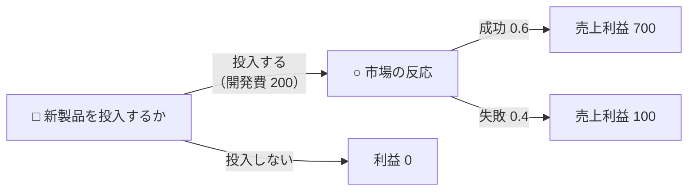
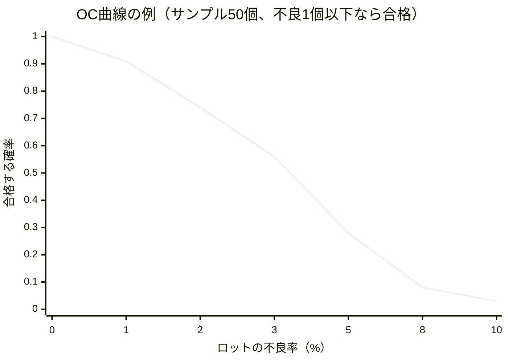
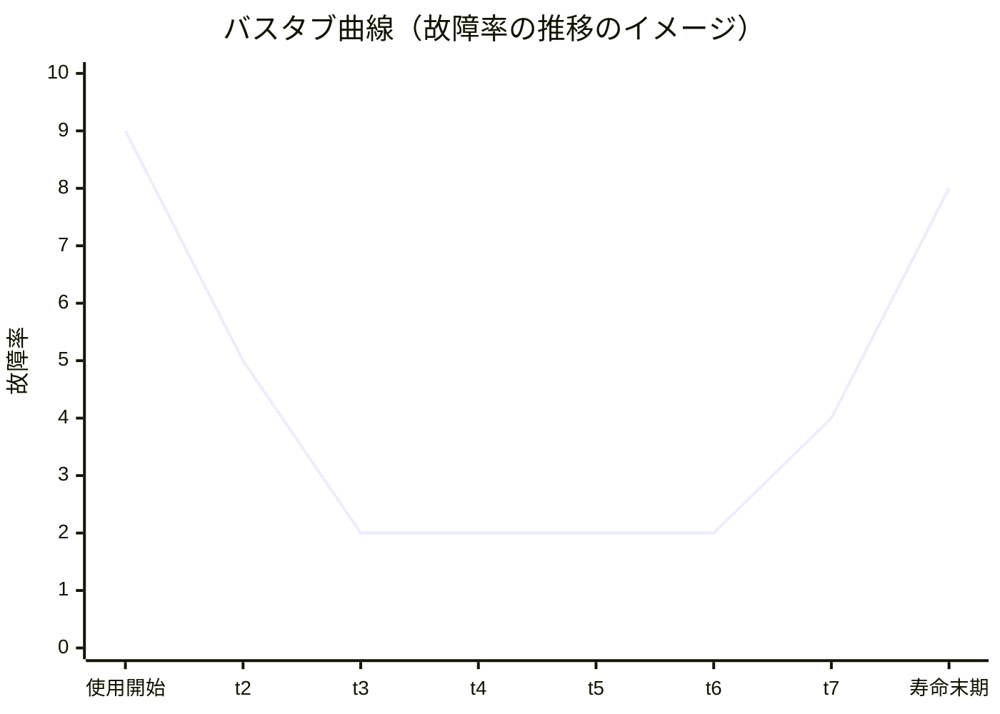
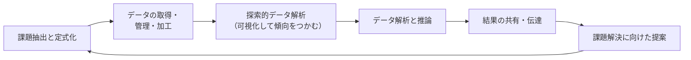
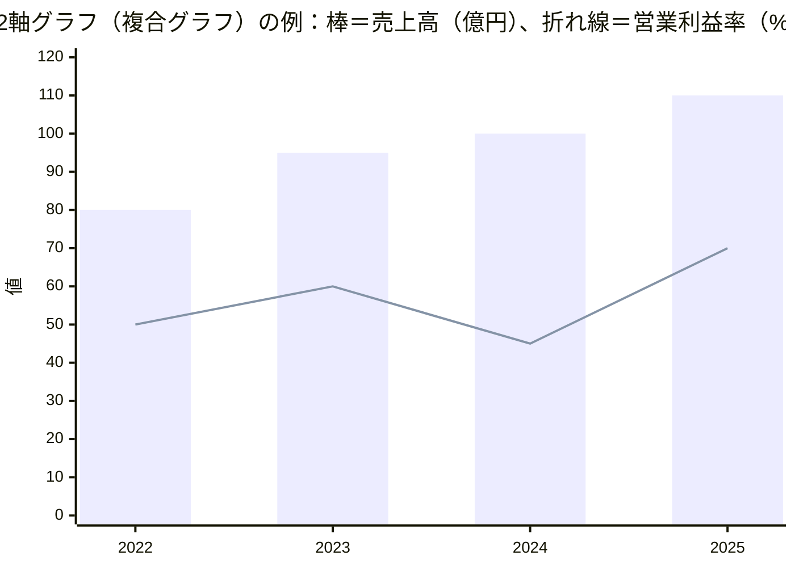

# 業務分析とデータ利活用

> **出題傾向・重要度：★★**
> 科目A（旧午前）では、OR・IEの計算（作業時間、抜取検査、期待値、回帰分析など）と、**データ利活用**（データの種類、前処理、統計的バイアス、グラフの選び方、アソシエーション分析）の用語が出題されます。シラバスVer.7.2 で「データ利活用」の内容が大きく拡充されており、今後の出題が増えると考えられる分野です。
> 科目B（旧午後）では、**問2（経営戦略）** で需要予測やデータ分析の結果の読み取り、**問1（情報セキュリティ）以外の事例問題** でグラフや集計表の解釈が問われることがあります。
> この章は、シラバスの **中分類22「企業活動」の小分類2「業務分析・データ利活用」** を扱います。線形計画法・在庫管理・ゲーム理論の基本・需要予測・QC七つ道具は [03_企業活動と会計](./03_企業活動と会計.md) の3〜7章で学んでから読んでください。
> 押さえるポイント：① ジョンソン法・ワークサンプリング・標準時間などIEの計算、② OC曲線と生産者危険・消費者危険、③ 意思決定の原理の違い、④ データの種類と前処理、⑤ 統計的バイアス・認知バイアスとグラフの読み方。

## 目次

- [1. OR・IEの追加手法](#1-orieの追加手法)
- [2. ゲーム理論と意思決定の原理](#2-ゲーム理論と意思決定の原理)
- [3. IE（経営工学）の分析手法](#3-ie経営工学の分析手法)
- [4. 検査手法とシミュレーション](#4-検査手法とシミュレーション)
- [5. 品質管理・需要予測・業務分析の追加用語](#5-品質管理需要予測業務分析の追加用語)
- [6. データの収集](#6-データの収集)
- [7. データの加工・分析](#7-データの加工分析)
- [8. データ分析における統計的手法とバイアス](#8-データ分析における統計的手法とバイアス)
- [9. 図表やグラフによるデータの可視化](#9-図表やグラフによるデータの可視化)
- [確認問題](#確認問題)
- [📋 シラバス用語チェックリスト](#-シラバス用語チェックリスト)
- [参考](#参考)

---

## 1. OR・IEの追加手法

### 1.1 線形計画法の関連用語 ★

| 用語 | 意味 |
|---|---|
| **シンプレックス法** | 線形計画問題を、制約条件が作る領域の **頂点を順にたどりながら、目的関数が改善する方向へ移動** して最適解を求める代表的な解法。変数が3つ以上でグラフが描けない場合に使う |
| **配分問題** | 限られた資源（原料・機械時間など）を、どの製品にどれだけ配分すると利益が最大になるかを求める問題（[03の3.1](./03_企業活動と会計.md#31-線形計画法-)の例題） |
| **輸送問題** | 複数の工場（供給地）から複数の店舗（需要地）へ、**輸送費が最小** になるように輸送量を決める問題 |
| **DP（Dynamic Programming：動的計画法）** | 大きな問題を小さな部分問題に分け、**部分問題の最適解を記録して再利用** しながら全体の最適解を求める方法（多段階の意思決定、最短経路など） |

```
輸送問題の考え方（例）：工場X・Yから店舗P・Qへ運ぶ。1個当たりの輸送費（円）
            店舗P   店舗Q   供給量
  工場X      40      60      30個
  工場Y      70      50      20個
  需要量     25個    25個

  安い経路から優先して割り当てる：
    X→P（40円）に25個 → Pの需要を満たす。Xの残り5個
    Y→Q（50円）に20個 → Yの供給を使い切る。Qの残り需要5個
    X→Q（60円）に5個
  総輸送費 = 25×40 + 20×50 + 5×60 = 1,000 + 1,000 + 300 = 2,300円
  （この例ではこれが最小。一般には、シンプレックス法などで最適性を確認する）
```

### 1.2 在庫問題の関連用語 ★

- **発注費用**：1回の発注にかかる費用（事務処理・運送など）。発注回数に比例します。
- **在庫費用（保管費用）**：在庫を持つための費用（倉庫代、保険料、資金の金利、陳腐化）。平均在庫量に比例します。
- 両者の合計を最小にする発注量が **EOQ（経済的発注量）** です（[03の4.4](./03_企業活動と会計.md#44-経済的発注量eoq-)）。
- **季節変動**：季節によって需要が周期的に変わること。発注量や安全在庫を季節ごとに見直す必要があります。

### 1.3 日程計画（フローショップとジョブショップ） ★★

| 用語 | 意味 |
|---|---|
| **日程計画・プロジェクトスケジューリング** | 作業の順序と日程を決めること。PERT・CPM・アローダイアグラム・クリティカルパスを使う（[プロジェクトマネジメント](../02_マネジメント系/01_プロジェクトマネジメント.md)） |
| **フローショップ** | すべての仕事（ジョブ）が **同じ順序で同じ機械を通る** 生産形態（例：全ジョブが機械1→機械2の順） |
| **ジョブショップ** | ジョブごとに **通る機械の順序が異なる** 生産形態（多品種少量の受注生産に多い） |

**ジョンソン法**（2台の機械のフローショップで、全体の完了時間を最短にする順序の決め方）

1. 全ジョブの処理時間の中で **最小のもの** を探す。
2. それが **機械1** の時間なら、そのジョブを **できるだけ前** に、**機械2** の時間なら **できるだけ後ろ** に置く。
3. 決まったジョブを除いて、1に戻る。

```
例：5つのジョブ（処理時間：分）
  ジョブ   機械1   機械2
  J1        3       6
  J2        5       2
  J3        1       2
  J4        6       6
  J5        7       5

  最小 1（J3・機械1）→ 先頭へ        ：J3 _ _ _ _
  最小 2（J2・機械2）→ 最後へ        ：J3 _ _ _ J2
  最小 3（J1・機械1）→ 前から2番目へ ：J3 J1 _ _ J2
  最小 5（J5・機械2）→ 後ろから2番目へ：J3 J1 _ J5 J2
  残り J4                            ：J3 J1 J4 J5 J2

  完了時刻の計算（機械2は「機械1の終了」と「機械2の前ジョブ終了」の遅いほうから開始）
  機械1：J3 0→1、J1 1→4、J4 4→10、J5 10→17、J2 17→22
  機械2：J3 1→3、J1 4→10、J4 10→16、J5 17→22、J2 22→24
  → 全体の完了時間は 24分
```

---

## 2. ゲーム理論と意思決定の原理

### 2.1 ゲーム理論の用語 ★

| 用語 | 意味 |
|---|---|
| **選択基準** | 複数の戦略から1つを選ぶための判断の基準（期待値原理、マクシミン原理など） |
| **戦略型ゲーム** | プレイヤーが **同時に** 戦略を選ぶゲーム。ペイオフ行列で表す |
| **展開型ゲーム** | プレイヤーが **順番に** 手を選ぶゲーム。木の形（ゲームの木）で表す |
| **ペイオフ行列（利得表）** | 各プレイヤーの戦略の組合せごとの利得を表にしたもの |
| **純粋戦略／混合戦略** | 1つの戦略を確実に選ぶ／複数の戦略を **確率的に組み合わせて** 選ぶ |
| **ゼロ和2人ゲーム／非ゼロ和2人ゲーム** | 2人の利得の合計が常に0（一方の得は他方の損）／合計が0とは限らない（協力すると両者が得をすることもある。囚人のジレンマなど） |
| **マクシミン原理** | 最悪の場合の利得が最大になる戦略を選ぶ |
| **ミニマックス定理** | ゼロ和2人ゲームでは、混合戦略まで考えれば、**自分のマクシミン値と相手のミニマックス値が必ず一致する**（ゲームの値が存在する）という定理（フォン・ノイマン） |
| **ナッシュ均衡** | どのプレイヤーも、**自分だけ戦略を変えても得をしない** 戦略の組合せ |

**混合戦略の計算例**（鞍点がない場合）

```
自社の利得表（相手にとっては損失）
          B1    B2
  A1       3    −1
  A2      −2     4

  行の最小 {−1, −2} の最大 = −1、列の最大 {3, 4} の最小 = 3 → 一致しないので鞍点なし

  自社が A1 を確率 p、A2 を確率 (1 − p) で選ぶとする
    相手が B1 のときの期待利得 = 3p − 2(1 − p) = 5p − 2
    相手が B2 のときの期待利得 = −p + 4(1 − p) = 4 − 5p
  相手がどちらを選んでも同じになる p を求める：5p − 2 = 4 − 5p → p = 0.6
  ゲームの値 = 5 × 0.6 − 2 = 1
  → A1 を60%、A2 を40%の確率で選ぶと、相手の出方によらず期待利得1を確保できる
```

### 2.2 意思決定の原理 ★★

[03の5.1](./03_企業活動と会計.md#51-不確実性下の意思決定-)の期待値原理・マクシマックス原理・マクシミン原理・ミニマックスリグレット原理・ラプラス原理に加え、次の原理があります。

| 原理 | 考え方 |
|---|---|
| **決定理論** | 不確実な状況での合理的な意思決定を、利得・確率・選択基準で扱う理論の総称 |
| **期待値原理** | 確率で重み付けした期待値が最大の案を選ぶ |
| **最尤未来の原理** | **最も起こる確率が高い状態だけ** に注目し、その状態で利得が最大の案を選ぶ |
| **要求水準原理** | あらかじめ決めた **要求水準（目標値）以上の利得を得られる確率が最も高い** 案を選ぶ |
| **安定性原理** | 期待値だけでなく、利得の **ばらつき（分散）が小さく安定している** 案を重視して選ぶ |
| **ラプラスの原理** | すべての状態を等確率とみなして期待値を比べる |
| **ベイジアン理論（ベイズの定理）** | 新しい情報（調査結果など）を得たときに、**事前確率を事後確率に更新** して判断する |

```
最尤未来の原理の例（03の5.1の表を使用）：確率が最も高いのは「普通（0.5）」
  普通のときの利得：A 50、B 60、C 40 → B を選ぶ

要求水準原理の例：要求水準を「利益 40万円以上」とする
  A：好況100・普通50 が40以上 → 確率 0.3 + 0.5 = 0.8
  B：好況70・普通60 が40以上  → 確率 0.8
  C：好況40・普通40 が40以上  → 確率 0.8（不況30は未満）
  → 3案とも0.8で同じ。要求水準を「30万円以上」にすると C は 1.0 で C を選ぶ

ベイズの定理の例：製品の不良率は2%。検査は不良品の95%を「不良」と判定し、
                  良品の5%も誤って「不良」と判定する。「不良」と判定された製品が本当に不良である確率は？
  P(不良かつ「不良」判定) = 0.02 × 0.95 = 0.019
  P(良品かつ「不良」判定) = 0.98 × 0.05 = 0.049
  P(本当に不良 |「不良」判定) = 0.019 ÷ (0.019 + 0.049) = 0.019 ÷ 0.068 ≒ 0.28（約28%）
  → 判定が「不良」でも、実際に不良なのは3割弱しかない（元の不良率が低いため）
```

### 2.3 デシジョンツリー ★★

- **デシジョンツリー（決定木）**：意思決定の選択肢（□：決定ノード）と、起こりうる結果（○：確率ノード）を木の形に描き、**右（末端）から期待値を計算して** 最良の選択肢を選ぶ手法です。



```
投入する場合の期待値 = (0.6 × 700 + 0.4 × 100) − 200 = (420 + 40) − 200 = 260
投入しない場合       = 0
→ 期待値が大きい「投入する」を選ぶ
```

---

## 3. IE（経営工学）の分析手法

### 3.1 作業測定の方法 ★★

| 方法 | 内容 | 特徴 |
|---|---|---|
| **作業時間分析法（時間研究、ストップウオッチ法）** | 作業を要素に分け、ストップウオッチなどで **直接時間を測定** する | 繰り返しの多い短い作業向き |
| **PTS（Predetermined Time Standard）法** | 「手を伸ばす」「つかむ」などの **基本動作ごとに決められた標準時間** を組み合わせて作業時間を求める（MTM法、WF法など） | 実際に測定しなくても、作業を始める前に時間を設定できる |
| **ワークサンプリング法** | ランダムな時刻に作業者や機械を **瞬間的に観測** し、「稼働中」「停止中」などの **出現比率** から稼働率や作業の構成比を推定する | 長時間の観測が不要。多数の対象を同時に調べられる |

```
ワークサンプリング法の例：ある機械を無作為な時刻に 400回観測し、稼働中だったのが 300回
  稼働率 = 300 ÷ 400 = 0.75（75%）
  1日8時間（480分）のうち稼働時間の推定 = 480 × 0.75 = 360分
```

### 3.2 作業分析・標準時間 ★★

| 用語 | 意味 |
|---|---|
| **作業分析** | 作業を工程・動作などの単位に分けて調べ、ムダを見つけて改善する |
| **サーブリック** | ギルブレスが考案した、人の動作を「探す」「つかむ」「運ぶ」「組み合わせる」など **18種類の基本動作（記号）** に分けて分析する方法（動作研究） |
| **標準時間** | 決められた方法・条件で、標準的な熟練度の作業者が、正常なペースで1単位の作業を行うのに必要な時間 ＝ **正味時間 ＋ 余裕時間** |
| **余裕時間** | 作業中に避けられない遅れ（打合せ、疲労回復、用便、材料待ちなど）のための時間 |
| **稼働分析** | 作業者や機械が、時間のうちどれだけ稼働しているか（稼働率）と、停止の内訳を分析する |
| **オペレーションスケジューリング** | 個々の作業を、機械・作業者・時間にどう割り付けるかを決めること（ジョンソン法など） |

```
標準時間の計算（余裕率を正味時間に対する割合とする「外掛け法」）
  標準時間 = 正味時間 × (1 + 余裕率)
  例：正味時間 10分、余裕率 20% → 10 × 1.2 = 12分

  （余裕率を標準時間に対する割合とする「内掛け法」の場合）
  標準時間 = 正味時間 ÷ (1 − 余裕率) = 10 ÷ 0.8 = 12.5分
```

> ⚠️ ひっかけ注意：余裕率の定義（外掛け／内掛け）は問題文で必ず確認します。

---

## 4. 検査手法とシミュレーション

### 4.1 抜取検査とOC曲線 ★★

- **抜取検査**：ロット（製品のまとまり）から一部（**サンプル**）を抜き取って検査し、不良品の数が基準以下ならロット全体を合格とする方法です。全数検査より費用が安く、**破壊検査** の場合は抜取検査しかできません。
- **非破壊検査**：X線・超音波などで、製品を **壊さずに** 内部の欠陥を調べる検査です。
- **OC曲線（Operating Characteristic curve：検査特性曲線）**：横軸にロットの **不良率**、縦軸にそのロットが **合格する確率** をとった曲線で、抜取検査の性能を表します。



| 用語 | 意味 |
|---|---|
| **生産者危険（α）** | **品質の良いロット** なのに、検査で **不合格** にされてしまう確率（売り手が損をする） |
| **消費者危険（β）** | **品質の悪いロット** なのに、検査で **合格** してしまう確率（買い手が損をする） |
| **不良率** | ロット中の不良品の割合 |

- サンプル数を増やすと OC曲線の傾きが急になり、良いロットと悪いロットを **見分ける力が高く** なります（ただし検査費用は増えます）。

> 💡 覚え方：**α（生産者）＝良いものを落とす**、**β（消費者）＝悪いものを通す**。

### 4.2 故障率曲線（バスタブ曲線） ★



| 期間 | 故障の原因 | 対策 |
|---|---|---|
| **初期故障期**（故障率が減少） | 製造上の欠陥、設計ミス | エージング（出荷前の慣らし運転）、出荷前検査 |
| **偶発故障期**（故障率がほぼ一定） | 偶発的な原因 | 冗長化、予備品の確保 |
| **摩耗故障期**（故障率が増加） | 部品の劣化・摩耗 | 予防保守、部品交換 |

### 4.3 シミュレーションと実験計画法 ★

| 用語 | 意味 |
|---|---|
| **シミュレーション** | 現実のシステムをモデル化し、コンピュータ上で動かして結果を予測・評価する。モデルが現実を正しく表しているか（**妥当性**）を検証・評価することが重要 |
| **モンテカルロ法** | **乱数** を使って何度も試行し、その結果から確率的な現象の値（期待値・分布）を推定する方法 |
| **実験計画法** | 少ない実験回数で、どの要因（温度・圧力など）が結果に影響するかを効率よく調べるための実験の計画と解析の方法（直交表など） |

```
モンテカルロ法のイメージ：ある作業の所要時間が「2日（確率0.3）、3日（0.5）、4日（0.2）」
  乱数（0〜99）を割り当てる：00〜29 → 2日、30〜79 → 3日、80〜99 → 4日
  乱数 57 → 3日、乱数 12 → 2日、乱数 91 → 4日 …と何千回も繰り返し、平均や分布を求める
  （理論上の期待値 = 2×0.3 + 3×0.5 + 4×0.2 = 2.9日 に近づく）
```

---

## 5. 品質管理・需要予測・業務分析の追加用語

### 5.1 品質管理手法の追加用語 ★★

| 用語 | 意味 |
|---|---|
| **品質特性** | 製品の品質を評価するための性質（寸法、重量、強度、応答時間など） |
| **品質機能展開（QFD：Quality Function Deployment）** | 顧客の要求（「軽い」「長持ち」など）を、**品質特性や設計・部品・工程の要件に体系的に変換** する手法（品質表を使う） |
| **不良率推定** | サンプルの不良品数から、ロットや工程全体の不良率を統計的に推定する |
| **時系列分析** | データを時間の順に並べ、傾向・周期・変動を分析する |
| **管理水準** | 工程が管理状態にあるときの、特性値の平均やばらつきの水準 |
| **品質保証** | 顧客が安心して使える品質を、企画から設計・製造・サービスまでの全段階で確保する活動 |
| **QC七つ道具／新QC七つ道具** | 数値データの分析道具／言語データの整理道具（[03の7章](./03_企業活動と会計.md#7-品質管理qc七つ道具新qc七つ道具)） |
| **x̄-R管理図（エックスバー・アール管理図）** | 群（サンプルのまとまり）ごとの **平均値（x̄）** と **範囲（R：最大値 − 最小値）** を2つの管理図で管理する。計量値（長さ・重さなど）に使う |
| **p管理図** | 群ごとの **不良率（p）** を管理する。計数値（不良品の数）に使う |
| **管理状態** | 工程に異常原因がなく、ばらつきが偶然原因だけによる安定した状態（点が管理限界内にあり、くせもない） |
| **群内変動／群間変動** | 同じ群（同じ時間に作ったもの）の中のばらつき／群と群の間の平均のずれ。x̄-R管理図では R が群内変動、x̄ の動きが群間変動を表す |
| **群分け** | 管理図を作るために、同じ条件で作られたデータをまとめて群にすること（合理的な群分けが重要） |

### 5.2 需要予測の統計手法 ★★

| 用語 | 意味 |
|---|---|
| **最小二乗法** | 実際のデータと直線（回帰式）との **誤差の2乗の合計が最小** になるように直線を決める方法 |
| **相関係数（r）** | 2つの変数の直線的な関係の強さを −1〜1 で表す。1に近いほど正の相関、−1に近いほど負の相関、0付近は相関なし |
| **決定係数（R²）** | 回帰式がデータの変動をどれだけ説明できているか（0〜1）。単回帰では相関係数の2乗 |
| **移動平均法／指数平滑法** | 直近数期間の平均で予測する／前回の予測値を誤差で修正する（[03の6.1](./03_企業活動と会計.md#61-予測の手法-)） |

```
最小二乗法の計算例：広告費 x（百万円）と売上 y（千万円）
  x： 1  2  3  4  5      平均 x̄ = 3
  y： 3  5  6  8  8      平均 ȳ = 6

  Sxy = Σ(x − x̄)(y − ȳ) = (−2)(−3) + (−1)(−1) + 0×0 + 1×2 + 2×2 = 6 + 1 + 0 + 2 + 4 = 13
  Sxx = Σ(x − x̄)²       = 4 + 1 + 0 + 1 + 4 = 10
  傾き b = Sxy ÷ Sxx = 13 ÷ 10 = 1.3
  切片 a = ȳ − b × x̄ = 6 − 1.3 × 3 = 2.1
  回帰式：y = 2.1 + 1.3x → 広告費 6 のときの予測 = 2.1 + 1.3 × 6 = 9.9

  Syy = Σ(y − ȳ)² = 9 + 1 + 0 + 4 + 4 = 18
  相関係数 r = Sxy ÷ √(Sxx × Syy) = 13 ÷ √180 ≒ 13 ÷ 13.42 ≒ 0.97
  決定係数 R² = r² ≒ 0.94（売上の変動の約94%を広告費で説明できる）
```

> ⚠️ ひっかけ注意：相関係数が高くても **因果関係があるとは限りません**（第3の要因＝交絡因子が両方に影響している場合があります。[8.3](#83-統計的バイアス-)）。

### 5.3 業務分析・業務計画の手法 ★★

| 手法 | 内容 |
|---|---|
| **パレート分析** | 項目を大きい順に並べて累積比率を求め、**重点項目** を見つける（ABC分析） |
| **G-P分析（Good-Poor Analysis）** | 成果の良いグループ（Good）と悪いグループ（Poor）を比較し、**差を生んでいる要因** を見つける |
| **フォーカスグループ** | 少人数の対象者を集めて、司会者のもとで特定のテーマについて **座談会形式で自由に話し合ってもらう** 定性調査 |
| **質問紙法／観察法** | アンケート用紙で回答を集める／対象者の行動を観察して記録する |
| **ブレーンストーミング** | 批判厳禁・自由奔放・質より量・結合改善の4原則でアイデアを出す |
| **ブレーンライティング** | 発言ではなく **用紙に書いて回す** ことでアイデアを出す方法（6人が3つずつ5分で書いて回す **6-3-5法** が代表）。発言が苦手な人も参加しやすい |
| **クラスタ分析法** | 似ているデータどうしを **グループ（クラスタ）にまとめる** 分析。正解ラベルのない教師なし学習の一種（k-means法、階層的クラスタリング） |
| **指数平滑法・デルファイ法** | 需要予測の定量的手法／専門家への匿名アンケートを繰り返して意見を集約する定性的手法 |
| **モンテカルロ法・決定木** | 乱数による試行で推定する／選択肢と結果を木構造で整理し期待値で判断する |
| **モデル化（確定モデル，確率モデル）** | 現実を数式などで表すこと。入力が決まれば結果が一つに決まる **確定モデル** と、偶然の要素を確率で扱う **確率モデル** がある |

---

## 6. データの収集

### 6.1 データの種類 ★★★

| 分類 | 種類 | 意味・例 |
|---|---|---|
| 発生源 | **調査データ** | アンケート・インタビューで集めたデータ |
| | **実験データ** | 条件を変えて行った実験の結果 |
| | **人の行動ログデータ** | Webの閲覧履歴、購買履歴、位置情報 |
| | **機械の稼働ログデータ** | IoTセンサーや設備の稼働記録 |
| | **ソーシャルメディアデータ** | SNSの投稿、口コミ |
| | **GISデータ** | 地理情報システムで扱う、位置と結び付いたデータ（地図、住所、緯度経度） |
| 性質 | **量的データ** | 数値で表され計算できるデータ（身長、売上） |
| | **質的データ** | 分類や順序を表すデータ（性別、満足度の5段階評価） |
| 取得方法 | **1次データ** | 目的に合わせて **自分で新たに集めた** データ |
| | **2次データ** | 他者がすでに集めて公開・提供している **既存の** データ（統計、論文） |
| 構造 | **構造化データ** | 表形式（行と列）に整理されたデータ（RDBのデータ） |
| | **非構造化データ** | 決まった形式のないデータ（文章、画像、音声、動画） |
| 時間軸 | **時系列データ** | 同じ対象を **時間を追って** 記録したデータ（月別売上） |
| | **クロスセクションデータ** | **ある一時点** で複数の対象を記録したデータ（今月の店舗別売上） |
| その他 | **メタデータ** | データについてのデータ（作成日時、作成者、項目の定義、形式） |
| | **オルタナティブデータ** | 財務情報などの従来のデータ以外の、新しい種類のデータ（衛星画像、POSデータ、SNSの投稿、位置情報）。投資判断や景気予測に使う |

> 💡 覚え方：**時系列＝縦に時間を追う**、**クロスセクション＝ある瞬間を横に切る**。

### 6.2 データの収集方法と保管 ★★

| 用語 | 意味 |
|---|---|
| **Webクローリング** | プログラム（クローラ）が **Webページのリンクをたどって自動的に巡回** し、ページを収集すること |
| **スクレイピング** | 収集したWebページなどから **必要な情報だけを抽出** すること（利用規約や著作権、サーバ負荷への配慮が必要） |
| **データレイク** | 構造化・非構造化を問わず、**大量の生データをそのままの形式で** 蓄積しておく保管場所（対：目的別に整理して格納するデータウェアハウス） |
| **データのサイロ化** | 部門やシステムごとにデータが **ばらばらに管理されて連携できない** 状態。全社的な分析の妨げになる |

- 目的に応じて、データの **発生タイミング**（リアルタイムか、日次か）や **発生頻度** を把握して収集方法を決めます。

---

## 7. データの加工・分析

### 7.1 データの前処理 ★★★

- **結論**：収集したデータはそのままでは分析に使えないことが多く、**前処理（クレンジング・加工）** が分析の品質を左右します。前処理では、**扱うデータのドメイン知識**（業務の知識）が重要です。

| 処理 | 内容 | 例 |
|---|---|---|
| **データ結合** | 複数のデータを共通のキーでつなぐ | 顧客マスタと購買履歴を顧客IDで結合 |
| **名寄せ** | 表記の異なる **同一の対象を1つにまとめる** | 「(株)A商事」と「株式会社A商事」を同一顧客にする |
| **外れ値・異常値の処理** | 他から大きく離れた値を調べ、誤り（異常値）なら除外・修正する | 年齢「250歳」を除外 |
| **欠損値の処理** | 値が抜けているデータを、削除する・平均値などで補完する | 未回答の項目を平均値で埋める |
| **ストップワード除去** | テキスト分析で、「は」「の」「です」など **意味の少ない頻出語** を取り除く | |
| **標準化** | 平均0・標準偏差1になるよう変換し、**単位や尺度の違いをそろえる** | `(値 − 平均) ÷ 標準偏差` |
| **二値化** | 値をしきい値で0と1の2つに分ける | 購入あり＝1、なし＝0 |
| **離散化** | 連続値を区間（カテゴリ）に分ける | 年齢を「20代」「30代」に |
| **対数変換** | 値の対数をとり、桁の大きく違うデータの偏りを小さくする | 売上高、人口 |
| **アノテーション** | 画像やテキストに、機械学習の **正解ラベル（タグ）を付ける** 作業 | 画像に「犬」「猫」のラベル |
| **季節調整** | 季節による周期的な変動を取り除き、本来の傾向を見やすくする | 月別売上の季節要因の除去 |
| **移動平均・周期性** | 一定期間の平均で短期の変動をならす／一定の間隔で繰り返すパターン | 7日移動平均、曜日による周期 |

- **特徴量エンジニアリング**：分析や機械学習の精度が上がるよう、元のデータから **有用な特徴量（説明変数）を作る** ことです（例：購買日から「前回購入からの日数」を作る）。
- 加工したデータに不具合がないか、**検証項目（件数、合計値、値の範囲など）を設計して確認** します。

```
標準化の例：テストA（平均60点、標準偏差10点）で80点、テストB（平均50点、標準偏差5点）で60点
  Aの標準化得点 = (80 − 60) ÷ 10 = 2.0
  Bの標準化得点 = (60 − 50) ÷ 5  = 2.0 → どちらも同じくらい優れた成績
```

### 7.2 データ分析の手法 ★★

| 用語 | 意味 |
|---|---|
| **BI（Business Intelligence）** | 社内のデータを集計・分析・可視化し、経営の意思決定に役立てる仕組み・ツール |
| **データマイニング** | 大量のデータから、統計や機械学習で **隠れたパターンや規則性** を発見する |
| **テキストマイニング** | 文章データを単語に分解し、**出現頻度や単語の結び付き（共起）** を分析する |
| **コレスポンデンス分析** | クロス集計表の行と列の項目の **関係の近さ** を、2次元の散布図（ポジショニングマップ）に表す |
| **アソシエーション分析** | 「AとBが一緒に買われる」といった **同時に起こる事柄の関連（ルール）** を見つける。**バスケット分析** とも呼ばれる |
| **アドホック分析** | 定型のレポートではなく、その場の疑問に応じて **臨時に行う** 分析 |
| **リフト値** | アソシエーション分析で、ルールの有効性を表す指標（下記） |
| **ビッグデータ** | 量（Volume）・種類（Variety）・発生頻度（Velocity）が大きく、従来の方法では処理が難しいデータ |
| **オープンデータ** | 国や自治体などが、**誰でも自由に利用（二次利用）できる** ルールで公開するデータ |
| **パーソナルデータ** | 個人に関する情報（個人情報に限らず、位置情報や購買履歴なども含む） |
| **CDP（Customer Data Platform）** | 社内外に散らばる **顧客データを統合** し、一人ひとりの顧客像を作ってマーケティングに活用する基盤 |
| **機械学習を用いたデータ分析** | 回帰・分類・クラスタリングなどの機械学習モデルで、予測や分類を行う |
| **シミュレーション・データ同化** | モデルで将来を予測する／シミュレーションに **実際の観測データを取り込んで** 予測の精度を高める（気象予報など） |
| **パターン発見・最適化** | データの中の規則性を見つける／制約の中で最良の解を求める |
| **データサイエンティスト** | 統計・情報科学・業務知識を組み合わせてデータから価値を引き出す専門家 |
| **データドリブンマーケティング** | 勘や経験ではなく、**データ分析に基づいて** マーケティングの意思決定を行う |

**アソシエーション分析の指標**

```
ルール「商品Aを買った人は商品Bも買う（A → B）」の評価

  支持度（サポート） = AとBを両方含む取引数 ÷ 全取引数
  確信度（信頼度）   = AとBを両方含む取引数 ÷ Aを含む取引数
  リフト値           = 確信度 ÷ （Bを含む取引数 ÷ 全取引数）

数値例：全取引 1,000件、Aを含む 200件、Bを含む 250件、AとBを両方含む 100件
  支持度 = 100 ÷ 1,000 = 0.10（10%）
  確信度 = 100 ÷ 200   = 0.50（50%）
  リフト値 = 0.50 ÷ (250 ÷ 1,000) = 0.50 ÷ 0.25 = 2.0
  → Aを買った人がBを買う確率は、全体平均の2倍。リフト値が1より大きいほど関連が強い
```

> ⚠️ ひっかけ注意：**リフト値が1** なら、Aを買ったかどうかはBの購入に **影響しない**（無関係）ことを意味します。

### 7.3 データサイエンスのサイクル ★★



- 最初の **課題抽出と定式化**（何を明らかにすれば事業の課題が解決するか）が最も重要です。手段（分析手法）から入ると、役に立たない分析になりがちです。

---

## 8. データ分析における統計的手法とバイアス

### 8.1 母集団と標本抽出 ★★

| 用語 | 意味 |
|---|---|
| **母集団** | 調べたい対象全体（例：日本の全有権者） |
| **全数調査（悉皆調査）** | 母集団のすべてを調べる（例：**国勢調査**）。正確だが費用と時間がかかる |
| **標本調査・アンケート調査** | 母集団から一部（標本）を抽出して調べ、母集団の性質を推定する |
| **単純無作為抽出** | 母集団の全員が **等しい確率** で選ばれるように、くじや乱数で抽出する |
| **層別抽出** | 母集団を性別・年代などの **層（グループ）に分け**、各層から無作為に抽出する（層ごとの偏りを防ぐ） |
| **多段抽出** | 段階を踏んで抽出する（例：まず市町村を選び、その中から地区を選び、さらに世帯を選ぶ）。広い範囲の調査の手間を減らせる |
| **精度と偏り** | **精度**＝結果のばらつきの小ささ（標本を大きくすると上がる）、**偏り（バイアス）**＝真の値からの系統的なずれ（標本を大きくしても消えない） |

### 8.2 認知バイアス ★★

| バイアス | 意味 | 例 |
|---|---|---|
| **ハロー効果** | 目立つ特徴（良い・悪い）に引きずられて、**ほかの評価までゆがむ** | 有名大学卒だから仕事もできるはずと思い込む |
| **バンドワゴン効果** | **多くの人が支持しているもの** を、さらに支持したくなる | 「売上No.1」の表示で購入が増える |
| **正常性バイアス** | 異常事態に直面しても、「**自分は大丈夫**」「たいしたことはない」と思い込む | 警報が鳴っても避難しない |
| **確証バイアス** | 自分の考えに **合う情報ばかり集め**、反する情報を無視する | 仮説に合うデータだけを分析に使う |

### 8.3 統計的バイアス ★★

| バイアス | 意味 | 例 |
|---|---|---|
| **選択バイアス** | 標本の選び方が偏っていて、**母集団を代表していない** | Webアンケートだけで「国民のネット利用率」を調べる |
| **情報バイアス** | データの **測定や回答が不正確** で生じる偏り（思い出し違い、質問の誘導など） | 「健康に良い〇〇を食べていますか？」という誘導的な質問 |
| **交絡バイアス** | 原因と結果の両方に影響する **第3の要因（交絡因子）** のために、見かけの関係が生じる | アイスの売上と水難事故はともに「気温」の影響で増えるが、アイスが事故の原因ではない |

> ⚠️ ひっかけ注意：**相関関係 ≠ 因果関係**。データから「AがBの原因」と言うには、交絡因子の影響を除く工夫（ランダム化比較試験、A/Bテストなど）が必要です。

---

## 9. 図表やグラフによるデータの可視化

### 9.1 目的に応じたグラフの選び方 ★★★

| 目的 | グラフ・図 | 特徴 |
|---|---|---|
| 量の大小を比べる | **棒グラフ** | 項目間の比較 |
| 時間の推移を見る | **折れ線グラフ** | 時系列の変化・傾向 |
| 分布・ばらつきを見る | **箱ひげ図** | 最小値・第1四分位数・中央値・第3四分位数・最大値（と外れ値）を1つの図で表す。複数グループの分布の比較に便利 |
| 2つの量の関係を見る | **散布図** | 相関の有無・強さ |
| 多数の変数の関係を一度に見る | **散布図行列**／**相関係数行列** | 変数のすべての組合せの散布図を並べる／相関係数を行列にする |
| 表の値の大小を色で見る | **ヒートマップ** | 値の大きさを色の濃淡で表す（相関係数行列、時間帯×曜日のアクセス数など） |
| 複数の指標のバランスを見る | **レーダーチャート** | 複数の評価項目を放射状の軸に並べる（能力評価、製品比較） |
| 構成比を2つの軸で見る | **モザイク図** | クロス集計表の比率を、長方形の面積で表す |
| 2つの項目の組合せを集計する | **クロス集計表（分割表）** | 行と列に項目をとり、度数を集計した表 |
| 似たもの同士のまとまりを見る | **デンドログラム（樹形図）** | 階層的クラスタ分析で、データがまとまっていく過程を木の形で表す |
| 異なる量を1つの図で見る | **複合グラフ／2軸グラフ** | 棒と折れ線を組み合わせる（売上と利益率など）／左右に別の目盛りの軸をとる |
| 問題を分解する | **ロジックツリー** | 問題や原因を、漏れなく重複なく（MECE）木の形に分解する |
| 概念の関係を表す | **コンセプトマップ** | 概念（キーワード）を線で結び、関係を言葉で示した図 |
| 地図上に表す | **シェープファイル** | GISで、地図上の点・線・面（行政区域など）の形と属性を記録するデータ形式。地図上の色分け表示（コロプレス図）などに使う |
| 文章中の語の関係を表す | **共起キーワード（共起ネットワーク）** | テキストマイニングで、同じ文の中に一緒に出現しやすい語どうしを線で結んだ図 |



（Mermaidでは右軸を描けないため、利益率を10倍して同じ軸に描いています。実際の2軸グラフでは右側に利益率の目盛りをとります）

### 9.2 不適切なグラフに惑わされない ★★

| 不適切な表現 | 何が問題か |
|---|---|
| **起点が0ではないグラフ** | 縦軸の途中から始めると、**わずかな差が大きく見える** |
| **不要な立体表現（3Dグラフ）** | 手前の要素が大きく見え、**割合や大小が正しく読めない** |
| 目盛りの間隔が不均等 | 変化の速さを誤解させる |
| 2軸グラフの軸の取り方の操作 | 左右の目盛りを調整すると、相関があるように見せかけられる |
| 一部の期間だけを切り取る | 都合のよい傾向だけを見せる |

```
例：A社の売上 98億円、B社の売上 100億円
  縦軸を 0 から描くと：ほぼ同じ高さの棒（差は約2%）
  縦軸を 97 から描くと：Aの棒の高さ 1、Bの棒の高さ 3 → Bが3倍に見える
```

---

## 確認問題

**問1** 2台の機械（機械1 → 機械2の順に処理）で4つのジョブを処理する。処理時間（分）が次のとき、ジョンソン法で決めた順序で処理した場合の全体の完了時間は何分か。

| ジョブ | 機械1 | 機械2 |
|---|---|---|
| J1 | 4 | 3 |
| J2 | 1 | 5 |
| J3 | 6 | 2 |
| J4 | 3 | 4 |

ア 14　イ 15　ウ 16　エ 17

<details><summary>解答・解説</summary>

**正解：ウ**

```
順序の決定：
  最小 1（J2・機械1）→ 先頭        ：J2 _ _ _
  最小 2（J3・機械2）→ 最後        ：J2 _ _ J3
  最小 3（J1・機械2 と J4・機械1 が同じ3）
    J4（機械1）→ 前から2番目、J1（機械2）→ 後ろから2番目：J2 J4 J1 J3

完了時刻：
  機械1：J2 0→1、J4 1→4、J1 4→8、J3 8→14
  機械2：J2 1→6、J4 6→10、J1 10→13、J3 14→16
→ 16分
```

</details>

**問2** ある工程を無作為な時刻に500回観測したところ、作業者が作業していたのは400回、手待ちだったのは100回であった。1日の勤務時間を8時間とするとき、手待ち時間の推定値は何分か。

ア 60　イ 80　ウ 96　エ 120

<details><summary>解答・解説</summary>

**正解：ウ**

```
手待ちの比率 = 100 ÷ 500 = 0.2
手待ち時間   = 480分 × 0.2 = 96分
```

これは **ワークサンプリング法** の考え方です。

</details>

**問3** 抜取検査における消費者危険の説明として、適切なものはどれか。

ア 品質の良いロットが、検査で不合格と判定される確率
イ 品質の悪いロットが、検査で合格と判定される確率
ウ 検査によって製品が破壊され、出荷できなくなる確率
エ ロット全体のうち不良品が含まれる割合

<details><summary>解答・解説</summary>

**正解：イ**

- ア：**生産者危険（α）** です。
- イ：**消費者危険（β）** です。悪いロットが買い手に渡ってしまうので消費者が損をします。正しい。
- ウ：破壊検査の性質で、危険の定義ではありません。
- エ：**不良率** です。

</details>

**問4** 全取引1,000件のうち、商品Xを含む取引が400件、商品Yを含む取引が200件、XとYを両方含む取引が120件あった。ルール「X → Y」のリフト値はいくらか。

ア 0.3　イ 0.6　ウ 1.2　エ 1.5

<details><summary>解答・解説</summary>

**正解：エ**

```
確信度   = 120 ÷ 400 = 0.3
Yの出現率 = 200 ÷ 1,000 = 0.2
リフト値 = 0.3 ÷ 0.2 = 1.5
```

- ア（0.3）は確信度です。
- リフト値が1より大きいので、Xを買う人はYも買いやすいといえます。

</details>

**問5** 時間の経過とともに同一の対象を繰り返し記録したデータとして、適切なものはどれか。

ア クロスセクションデータ　イ 時系列データ　ウ メタデータ　エ 2次データ

<details><summary>解答・解説</summary>

**正解：イ**

- ア：ある **一時点** で複数の対象を記録したデータです。
- ウ：データについてのデータ（作成日、項目の定義など）です。
- エ：他者がすでに集めた既存のデータです。

</details>

**問6** 夏に「アイスクリームの売上」と「熱中症の搬送者数」の間に強い正の相関が見られた。この関係について「アイスクリームの販売が熱中症を引き起こしている」と結論付けることの問題点を表すものとして、最も適切なものはどれか。

ア 選択バイアス　イ 情報バイアス　ウ 交絡バイアス　エ 正常性バイアス

<details><summary>解答・解説</summary>

**正解：ウ**

- 「気温」という **第3の要因（交絡因子）** が、アイスの売上と熱中症の両方を増やしています。見かけの因果関係が生じるのは **交絡バイアス** です。
- ア：標本の選び方の偏り、イ：測定・回答の不正確さによる偏り、エ：「自分は大丈夫」と思い込む認知バイアスです。

</details>

**問7** データの前処理に関する記述として、適切なものはどれか。

ア 名寄せとは、データの値を平均0、標準偏差1になるように変換することである。
イ アノテーションとは、画像やテキストに機械学習用の正解ラベルを付けることである。
ウ 離散化とは、欠損している値を平均値などで補うことである。
エ ストップワード除去とは、数値データから外れ値を取り除くことである。

<details><summary>解答・解説</summary>

**正解：イ**

- ア：これは **標準化** です。名寄せは表記の異なる同一の対象を1つにまとめることです。
- ウ：これは **欠損値の処理（補完）** です。離散化は連続値を区間に分けることです。
- エ：ストップワード除去は、テキスト分析で「は」「の」などの意味の少ない語を除くことです。

</details>

**問8** 意思決定の原理のうち、「最も起こる確率が高い状態に注目し、その状態で利得が最大となる案を選ぶ」ものはどれか。

ア 期待値原理　イ 最尤未来の原理　ウ ラプラスの原理　エ マクシミン原理

<details><summary>解答・解説</summary>

**正解：イ**

- ア：すべての状態の確率で重み付けした期待値で比べます。
- ウ：すべての状態を等確率とみなします。
- エ：最悪の場合の利得が最大の案を選びます。

</details>

## 📋 シラバス用語チェックリスト

シラバスVer.7.2 の「用語例」を小分類ごとに一覧にしました。リンクのある用語は本文に詳しい説明があります（クリックで該当の見出しへ移動）。説明を隠して、用語から意味を言えるか確認しましょう。

### 1. OR・IE（線形計画法・在庫・日程計画）

| 用語 | 一言説明 |
|---|---|
| [LP（線形計画法）](03_企業活動と会計.md#31-線形計画法-) | 制約の中で目的関数を最大・最小にする組合せを求める |
| [シンプレックス法](#11-線形計画法の関連用語-) | 頂点をたどって最適解を求める線形計画法の解法 |
| [配分問題・輸送問題](#11-線形計画法の関連用語-) | 資源配分の最適化／輸送費最小の輸送量決定 |
| [DP（動的計画法）](#11-線形計画法の関連用語-) | 部分問題の最適解を再利用して全体の最適解を求める |
| [安全在庫・発注点](03_企業活動と会計.md#42-発注点の計算-) | 需要のばらつきへの備え／発注のタイミングの在庫量 |
| [発注費用・在庫費用](#12-在庫問題の関連用語-) | 発注回数に比例する費用／平均在庫に比例する費用 |
| [EOQ（経済的発注量）](03_企業活動と会計.md#44-経済的発注量eoq-) | 発注費用と在庫費用の合計が最小となる発注量 |
| [ABC分析](03_企業活動と会計.md#45-abc分析-) | 金額の累積比率で重点管理品目を決める |
| [季節変動](#12-在庫問題の関連用語-) | 季節による周期的な需要の変化 |
| [日程計画・プロジェクトスケジューリング](#13-日程計画フローショップとジョブショップ-) | 作業の順序と日程を決める |
| [フローショップ・ジョブショップ](#13-日程計画フローショップとジョブショップ-) | 全ジョブが同じ順序で処理／ジョブごとに順序が異なる |
| [アローダイアグラム・クリティカルパス](../02_マネジメント系/01_プロジェクトマネジメント.md#32-アローダイアグラムの計算) | 作業の順序を矢印で表す図／最長経路 |

### 2. ゲーム理論・意思決定

| 用語 | 一言説明 |
|---|---|
| [選択基準](#21-ゲーム理論の用語-) | 戦略を選ぶための判断基準 |
| [戦略型ゲーム・展開型ゲーム](#21-ゲーム理論の用語-) | 同時に選ぶ／順番に選ぶゲーム |
| [純粋戦略・混合戦略](#21-ゲーム理論の用語-) | 1つを確実に選ぶ／確率的に組み合わせる |
| [ペイオフ行列（利得表）](#21-ゲーム理論の用語-) | 戦略の組合せごとの利得の表 |
| [ゼロ和2人ゲーム・非ゼロ和2人ゲーム](#21-ゲーム理論の用語-) | 利得の合計が0／0とは限らない |
| [マクシミン原理](03_企業活動と会計.md#51-不確実性下の意思決定-) | 最悪の場合の利得が最大の案を選ぶ |
| [ミニマックス定理](#21-ゲーム理論の用語-) | 混合戦略まで考えればマクシミン値とミニマックス値が一致する |
| [ナッシュ均衡](#21-ゲーム理論の用語-) | 自分だけ戦略を変えても得をしない組合せ |
| [デシジョンツリー](#23-デシジョンツリー-) | 選択肢と結果を木で表し期待値で判断する |
| [決定理論](#22-意思決定の原理-) | 不確実な状況での合理的な意思決定の理論 |
| [期待値原理](#22-意思決定の原理-) | 期待値が最大の案を選ぶ |
| [安定性原理](#22-意思決定の原理-) | 利得のばらつきが小さい案を重視する |
| [最尤未来の原理](#22-意思決定の原理-) | 最も起こりやすい状態で最大利得の案を選ぶ |
| [要求水準原理](#22-意思決定の原理-) | 要求水準以上を得る確率が最大の案を選ぶ |
| [ラプラスの原理](#22-意思決定の原理-) | 全状態を等確率とみなす |
| [ベイジアン理論](#22-意思決定の原理-) | 新情報で事前確率を事後確率に更新する |

### 3. IE分析手法・検査手法

| 用語 | 一言説明 |
|---|---|
| [作業時間分析法・PTS法・ワークサンプリング法](#31-作業測定の方法-) | 直接測定／基本動作の標準時間の組合せ／瞬間観測の比率で推定 |
| [サーブリック](#32-作業分析標準時間-) | 動作を18の基本要素に分ける動作研究 |
| [作業分析](#32-作業分析標準時間-) | 作業を分解してムダを見つける |
| [標準時間・余裕時間](#32-作業分析標準時間-) | 正味時間＋余裕時間／避けられない遅れのための時間 |
| [稼働分析](#32-作業分析標準時間-) | 稼働率と停止の内訳を分析する |
| [オペレーションスケジューリング](#32-作業分析標準時間-) | 作業を機械・人・時間に割り付ける |
| [抜取り検査・サンプリング](#41-抜取検査とoc曲線-) | ロットの一部を抜き取って合否を判定する |
| [OC曲線（検査特性曲線）](#41-抜取検査とoc曲線-) | 不良率とロットの合格確率の関係を示す曲線 |
| [不良率](#41-抜取検査とoc曲線-) | ロット中の不良品の割合 |
| [消費者危険・生産者危険](#41-抜取検査とoc曲線-) | 悪いロットを合格させる確率／良いロットを不合格にする確率 |
| [非破壊検査](#41-抜取検査とoc曲線-) | 製品を壊さずに内部の欠陥を調べる |
| [故障率曲線（バスタブ曲線）](#42-故障率曲線バスタブ曲線-) | 初期故障→偶発故障→摩耗故障 |
| [シミュレーション・モンテカルロ法](#43-シミュレーションと実験計画法-) | モデルで予測する／乱数で試行を繰り返す |
| [実験計画法](#43-シミュレーションと実験計画法-) | 少ない実験で要因の影響を調べる |

### 4. 品質管理手法・需要予測・業務分析

| 用語 | 一言説明 |
|---|---|
| [品質特性](#51-品質管理手法の追加用語-) | 品質を評価するための性質 |
| [品質機能展開](#51-品質管理手法の追加用語-) | 顧客要求を品質特性や設計要件に変換する |
| [不良率推定・時系列分析](#51-品質管理手法の追加用語-) | サンプルから不良率を推定／時間順のデータを分析 |
| [管理水準・品質保証](#51-品質管理手法の追加用語-) | 管理状態での水準／全段階で品質を確保する活動 |
| [QC七つ道具（層別管理，ヒストグラム，パレート図，散布図，特性要因図，チェックシート，管理図）](03_企業活動と会計.md#71-qc七つ道具-) | 主に数値データの分析道具 |
| [新QC七つ道具（親和図法，連関図法，系統図法，マトリックス図法，マトリックスデータ解析法，PDPC法，アローダイアグラム法）](03_企業活動と会計.md#72-新qc七つ道具-) | 主に言語データの整理道具 |
| [x-R管理図・p管理図](#51-品質管理手法の追加用語-) | 平均と範囲の管理図／不良率の管理図 |
| [管理状態・群内変動と群間変動・群分け](#51-品質管理手法の追加用語-) | 安定した状態／群の中と群の間のばらつき／データを群にまとめる |
| [最小二乗法・決定係数・相関係数](#52-需要予測の統計手法-) | 誤差の2乗和最小の直線／説明力／相関の強さ |
| [移動平均法・指数平滑法](03_企業活動と会計.md#61-予測の手法-) | 需要予測の代表的な手法 |
| [パレート分析・G-P分析](#53-業務分析業務計画の手法-) | 重点項目の発見／良い群と悪い群の比較 |
| [フォーカスグループ・質問紙法・観察法](#53-業務分析業務計画の手法-) | 座談会形式の調査／アンケート／行動観察 |
| [ブレーンストーミング・ブレーンライティング](#53-業務分析業務計画の手法-) | 発言で／書いて回してアイデアを出す |
| [クラスタ分析法](#53-業務分析業務計画の手法-) | 似たデータをグループにまとめる |
| [デルファイ法](#53-業務分析業務計画の手法-) | 専門家への匿名アンケートを繰り返し集約する |
| [モンテカルロ法・決定木](#53-業務分析業務計画の手法-) | 乱数による推定／木構造の意思決定 |
| [モデル化（確定モデル，確率モデル）](#53-業務分析業務計画の手法-) | 結果が一つに決まるモデル／確率を扱うモデル |

### 5. データの収集

| 用語 | 一言説明 |
|---|---|
| [調査データ・実験データ](#61-データの種類-) | アンケートなどのデータ／実験結果のデータ |
| [人の行動ログデータ・機械の稼働ログデータ](#61-データの種類-) | 閲覧・購買・位置の履歴／センサー・設備の記録 |
| [ソーシャルメディアデータ・GISデータ](#61-データの種類-) | SNSの投稿など／位置と結び付いたデータ |
| [量的データ・質的データ](#61-データの種類-) | 数値で計算できる／分類・順序を表す |
| [1次データ・2次データ](#61-データの種類-) | 自分で集めた／既存のデータ |
| [メタデータ](#61-データの種類-) | データについてのデータ |
| [構造化データ・非構造化データ](#61-データの種類-) | 表形式／形式のないデータ |
| [時系列データ・クロスセクションデータ](#61-データの種類-) | 時間を追った／一時点のデータ |
| [オルタナティブデータ](#61-データの種類-) | 従来の財務データ以外の新しいデータ |
| [Webクローリング・スクレイピング](#62-データの収集方法と保管-) | Webを巡回して収集／必要な情報を抽出 |
| [データレイク](#62-データの収集方法と保管-) | 生データをそのまま蓄積する保管場所 |
| [データのサイロ化](#62-データの収集方法と保管-) | データが部門ごとに分断された状態 |

### 6. データの加工・分析

| 用語 | 一言説明 |
|---|---|
| [データ結合・名寄せ](#71-データの前処理-) | キーでつなぐ／同一対象をまとめる |
| [外れ値・異常値・欠損値の処理](#71-データの前処理-) | 離れた値・誤った値・抜けた値への対処 |
| [ストップワード除去](#71-データの前処理-) | 意味の少ない頻出語を除く |
| [標準化・二値化・離散化・対数変換](#71-データの前処理-) | 尺度をそろえる／0と1にする／区間に分ける／対数をとる |
| [アノテーション](#71-データの前処理-) | 正解ラベルを付ける |
| [季節調整・移動平均・周期性](#71-データの前処理-) | 季節変動の除去／平滑化／繰り返しのパターン |
| [BI（Business Intelligence）](#72-データ分析の手法-) | データを集計・可視化し意思決定に活かす |
| [データマイニング・テキストマイニング](#72-データ分析の手法-) | 大量データからパターン発見／文章の分析 |
| [コレスポンデンス分析](#72-データ分析の手法-) | クロス集計の行と列の関係を2次元に表す |
| [アソシエーション分析・リフト値](#72-データ分析の手法-) | 同時に起こる事柄の関連の発見／その有効性の指標 |
| [アドホック分析](#72-データ分析の手法-) | その場の疑問に応じた臨時の分析 |
| [ビッグデータ・オープンデータ・パーソナルデータ](#72-データ分析の手法-) | 大量多様なデータ／自由に使える公開データ／個人に関するデータ |
| [CDP（カスタマーデータプラットフォーム）](#72-データ分析の手法-) | 顧客データを統合する基盤 |
| [データサイエンスのサイクル](#73-データサイエンスのサイクル-) | 課題抽出→取得・加工→探索的解析→解析と推論→共有→提案 |
| [機械学習を用いたデータ分析](#72-データ分析の手法-) | 機械学習モデルによる予測・分類 |
| [シミュレーション・シミュレーションのデータ同化](#72-データ分析の手法-) | モデルによる予測／観測データを取り込み精度を高める |
| [パターン発見・最適化](#72-データ分析の手法-) | 規則性の発見／最良解の探索 |
| [データサイエンティスト](#72-データ分析の手法-) | データから価値を引き出す専門家 |
| [データドリブンマーケティング](#72-データ分析の手法-) | データ分析に基づくマーケティング |

### 7. 統計的手法・可視化

| 用語 | 一言説明 |
|---|---|
| [母集団](#81-母集団と標本抽出-) | 調べたい対象全体 |
| [標本抽出（国勢調査，アンケート調査，全数調査，単純無作為抽出，層別抽出，多段抽出）](#81-母集団と標本抽出-) | 調査の対象の選び方 |
| [精度と偏り](#81-母集団と標本抽出-) | ばらつきの小ささ／系統的なずれ |
| [統計的バイアス（選択バイアス，情報バイアス，交絡バイアス）](#83-統計的バイアス-) | 標本の偏り／測定の不正確さ／第3の要因による偏り |
| [認知バイアス（ハロー効果，バンドワゴン効果，正常性バイアス，確証バイアスなど）](#82-認知バイアス-) | 人の判断の偏り |
| [棒グラフ・折れ線グラフ・箱ひげ図](#91-目的に応じたグラフの選び方-) | 比較／推移／分布 |
| [ヒートマップ・レーダーチャート・モザイク図](#91-目的に応じたグラフの選び方-) | 色の濃淡／多項目のバランス／比率を面積で |
| [クロス集計表・分割表](#91-目的に応じたグラフの選び方-) | 2項目の組合せの度数表 |
| [相関係数行列・散布図行列](#91-目的に応じたグラフの選び方-) | 多数の変数の関係を一覧する |
| [デンドログラム](#91-目的に応じたグラフの選び方-) | 階層的クラスタ分析の樹形図 |
| [複合グラフ・2軸グラフ](#91-目的に応じたグラフの選び方-) | 棒と折れ線の組合せ／左右に別の軸 |
| [ロジックツリー・コンセプトマップ](#91-目的に応じたグラフの選び方-) | 問題の木構造の分解／概念の関係図 |
| [シェープファイル](#91-目的に応じたグラフの選び方-) | 地図上の形と属性を記録するGISのデータ形式 |
| [共起キーワード](#91-目的に応じたグラフの選び方-) | 一緒に出現しやすい語の関係 |

## 参考

- IPA「応用情報技術者試験 シラバス Ver.7.2」（中分類22 企業活動 ／ 2. 業務分析・データ利活用）: https://www.ipa.go.jp/shiken/syllabus/gaiyou.html
- 総務省統計局「なるほど統計学園」（標本調査・グラフの見方など）: https://www.stat.go.jp/naruhodo/
- 日本規格協会（JIS Z 9015 計数値検査に対する抜取検査手順 などの品質管理規格）: https://www.jsa.or.jp/
