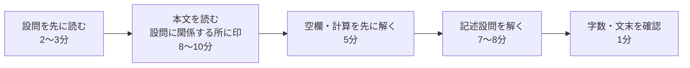
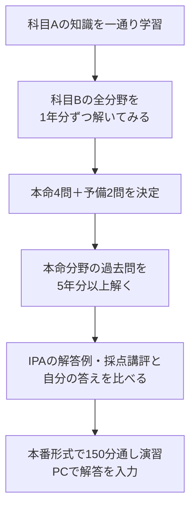

# 科目Bの全体戦略

> 科目B（旧午後）は **11問から5問を選んで150分で解く記述式** の試験です。知識量よりも「本文を正確に読み、設問の要求どおりに短く書く力」で差がつきます。
> 重要度：★★★（科目Aに合格していても、科目Bで60点に届かず不合格になる人が多い）
> この章で押さえるポイント：①問題構成と時間配分 ②自分に合った選択問題の決め方 ③記述式の答え方の型 ④CBT（キーボード入力）ならではの注意 ⑤ありがちな失点パターン
> 分野ごとの具体的な解き方は [02_分野別の解き方](02_分野別の解き方.md)、練習は [03_記述式練習問題](03_記述式練習問題.md) へ。

## 目次

1. [科目Bの問題構成](#1-科目bの問題構成)
2. [時間配分](#2-時間配分)
3. [選択問題の選び方](#3-選択問題の選び方)
4. [記述式の答え方](#4-記述式の答え方)
5. [CBT（キーボード入力）での注意点](#5-cbtキーボード入力での注意点)
6. [ありがちな失点パターン](#6-ありがちな失点パターン)
7. [学習の進め方（科目B）](#7-学習の進め方科目b)

---

## 1. 科目Bの問題構成

| 項目 | 内容 |
|---|---|
| 試験時間 | **150分** |
| 出題数／解答数 | **11問出題、5問解答** |
| 必須問題 | **問1 情報セキュリティ**（全員が解答） |
| 選択問題 | **問2〜問11 の10問から4問** を選択 |
| 配点 | 1問20点 × 5問 = 100点満点 |
| 合格基準 | 科目A・科目B **それぞれ** 100点満点中 **60点以上** |
| 解答方式 | 記述式（記号選択・数値・字数指定の文章）を **キーボード入力** |
| 実施日 | CBT方式では **科目Aとは別の日** に受験（申込み時に両方の日時を予約） |

### 1.1 選択問題10分野

| 問 | 分野 | 区分 |
|---|---|---|
| 問1 | 情報セキュリティ | 必須 |
| 問2 | 経営戦略 | ストラテジ系 |
| 問3 | プログラミング | テクノロジ系 |
| 問4 | システムアーキテクチャ | テクノロジ系 |
| 問5 | ネットワーク | テクノロジ系 |
| 問6 | データベース | テクノロジ系 |
| 問7 | 組込みシステム開発 | テクノロジ系 |
| 問8 | 情報システム開発 | テクノロジ系 |
| 問9 | プロジェクトマネジメント | マネジメント系 |
| 問10 | サービスマネジメント | マネジメント系 |
| 問11 | システム監査 | マネジメント系 |

> 💡 問題番号と分野の対応は近年の出題で固定されていますが、IPAが保証しているものではありません。当日は問題タイトルで分野を確認しましょう。

### 1.2 1問の中身

1問は、A4で3〜4ページ程度の **事例本文**（架空の会社・システムの状況説明、図表）と、**設問1〜3（または4）** で構成されます。設問は次の形式が混ざります。

| 形式 | 例 | 得点しやすさ |
|---|---|---|
| 空欄補充（語句・記号選択） | 「本文中の **a** に入れる適切な字句を解答群から選び…」 | ◎ 知識で即答できる |
| 数値計算 | 「必要な帯域を求めよ」「損益分岐点売上高を求めよ」 | ○ 公式を知っていれば確実 |
| 字数指定の記述 | 「〜の理由を **30字以内** で答えよ」 | △ 部分点狙い。差がつく |
| 本文からの抜出し | 「本文中の字句を用いて **15字以内** で答えよ」 | ○ 本文に答えがある |

---

## 2. 時間配分

### 2.1 基本の配分（150分）

| 時間 | やること |
|---|---|
| 0〜5分 | **選択問題の決定**（全11問のタイトルと設問をざっと見る） |
| 5〜35分 | 問1 情報セキュリティ（必須） |
| 35〜125分 | 選択問題4問（**1問約22〜25分**を目標、上限30分） |
| 125〜150分 | **見直し**・空欄埋め |

- 単純に割ると **150分 ÷ 5問 = 1問30分** です。ただしこれだと見直し時間がゼロになります。
- 目標は **1問25分 × 5問 = 125分**、残り **約20〜25分を問題選択と見直し** にあてることです。
- 1問が30分を超えたら、わからない設問は空欄のまま **次の問題へ進む** のが鉄則です（後で戻る）。

### 2.2 1問（約25分）の中の配分

- **設問を先に読む** と、本文のどこを注意して読めばよいかがわかります。
- **得点しやすい空欄補充・計算から先に** 片づけ、記述は後に回します。

> ⚠️ CBTでは紙の問題冊子に書き込めません。本文中の重要箇所を「メモ用紙（入室時に1枚配布）」や「画面上のメモ機能」に **段落番号＋キーワード** で控えるなど、自分なりの印の付け方を事前に決めておきましょう。

---

## 3. 選択問題の選び方

### 3.1 選び方の原則

1. **事前に「本命4問＋予備2問」を決めておく**。当日に全問を読んで選ぶ時間はありません。
2. 本命の問題が当日難しかった場合に備え、**予備の分野も過去問で2〜3年分は解いておく**。
3. 当日は5分以内で決める。判断材料は「設問の空欄補充や計算が自分の知識で解けそうか」。本文のテーマが見慣れないだけで捨てない。
4. **知識で解ける分野**（ネットワーク、データベース、セキュリティ）と、**読解で解ける分野**（プロジェクトマネジメント、サービスマネジメント、システム監査）をバランスよく組み合わせると、出来の波を小さくできます。

### 3.2 分野別の難易度傾向と特徴

難易度・必要知識量は年度によって変動します。以下は近年の傾向をもとにした目安です。

| 分野 | 必要な専門知識 | 読解力の比重 | 計算 | 得点の安定性 | 特徴 |
|---|---|---|---|---|---|
| 問1 情報セキュリティ（必須） | 多い | 中 | 少 | 中 | 攻撃手法・対策・認証・暗号の知識が直接問われる。避けられないので最優先で対策 |
| 問2 経営戦略 | 中 | 中 | **多い** | 中 | SWOT・バリューチェーン等のフレームワーク＋損益・利益計算 |
| 問3 プログラミング | 中 | 低 | 中 | **低（年度差大）** | 擬似言語でアルゴリズムを追う。はまれば満点、外すと大きく崩れる |
| 問4 システムアーキテクチャ | 多い | 中 | 多い | 中 | 可用性、性能、クラウド構成、稼働率・処理時間の計算 |
| 問5 ネットワーク | 多い | 中 | 中 | **高（知識があれば）** | TCP/IP、DNS、VLAN、プロキシ、サブネット計算。空欄補充が多い |
| 問6 データベース | 多い | 中 | 少 | **高（知識があれば）** | E-R図、SQL（SELECT/JOIN/GROUP BY）、正規化。型が決まっている |
| 問7 組込みシステム開発 | 多い | 中 | 中 | 中 | タイマ・割込み・状態遷移・センサ制御。受験者が少なく情報が少ない |
| 問8 情報システム開発 | 中 | 中 | 少 | 中 | UML、テスト設計、アジャイル、設計レビュー |
| 問9 プロジェクトマネジメント | 少〜中 | **高** | 少〜中 | **高** | 本文の状況から「PMとしてどうするか」を答える。EVMや工数計算も |
| 問10 サービスマネジメント | 少〜中 | **高** | 少 | 中〜高 | ITIL用語、インシデント・問題・変更管理、SLA、可用性の計算 |
| 問11 システム監査 | 少 | **高** | なし | 中〜高 | 監査証拠・監査手続を本文から抜き出して答える。国語力勝負 |

### 3.3 タイプ別のおすすめ組み合わせ（問1＋4問）

| タイプ | おすすめ4問 | 予備 | 理由 |
|---|---|---|---|
| **文系・非エンジニア** | 経営戦略、プロジェクトマネジメント、サービスマネジメント、システム監査 | 情報システム開発、データベース | 読解中心で専門知識が少なくても戦える。経営戦略は計算が得点源 |
| **理系・学生** | プログラミング、データベース、ネットワーク、プロジェクトマネジメント | システムアーキテクチャ、経営戦略 | アルゴリズムやSQLは理屈で解ける。PMで読解問題を1つ入れて安定させる |
| **インフラ系エンジニア** | ネットワーク、システムアーキテクチャ、サービスマネジメント、データベース | プロジェクトマネジメント | 実務知識がそのまま使える |
| **アプリ開発エンジニア** | プログラミング、データベース、情報システム開発、プロジェクトマネジメント | ネットワーク | 開発工程の経験が活きる |
| **組込み・制御系エンジニア** | 組込みシステム開発、プログラミング、ネットワーク、プロジェクトマネジメント | システムアーキテクチャ | 組込みは経験者に有利 |
| **PM・SE（上流工程）経験者** | プロジェクトマネジメント、システム監査、サービスマネジメント、経営戦略 | 情報システム開発 | 実務の判断感覚が活きる |
| **迷ったら（汎用）** | データベース、プロジェクトマネジメント、サービスマネジメント、システム監査 | ネットワーク、経営戦略 | 知識1＋読解3。過去問の型を覚えやすい |

> 💡 問1 情報セキュリティの対策は、問5 ネットワークの対策と重なる部分（ファイアウォール、DMZ、DNS、TLS、プロキシ）が多いです。セキュリティに自信がない人ほど、ネットワークの基礎を固めると相乗効果があります。

---

## 4. 記述式の答え方

### 4.1 答えの「型」

| 設問の聞き方 | 文末の型 | 例 |
|---|---|---|
| 「理由を答えよ」「なぜか」 | **〜ため** ／ 〜から | 「通信内容が暗号化されず盗聴されるため」 |
| 「目的を答えよ」 | **〜するため** ／ 〜を防ぐため | 「不正アクセス時の被害範囲を限定するため」 |
| 「どのような問題（リスク）があるか」 | **〜（という）こと** ／ 〜おそれがある | 「検証前のプログラムが本番環境に適用されるおそれがある」 |
| 「何を確認すべきか」（監査） | **〜を確認する** ／ 〜かどうか | 「変更申請書に承認者の押印があるかどうか」 |
| 「どのような対策をとるべきか」 | **〜する** | 「管理者アカウントに多要素認証を導入する」 |
| 「〜とは何か」「何を指すか」 | **名詞で終える**（体言止め） | 「顧客ごとの累計購入金額」 |

- **聞かれた形で答える** のが最重要です。「理由」を聞かれて「対策」を書くと0点になりえます。
- **主語・目的語を省略しない**。「誰が」「何を」が抜けると採点者に伝わりません。
  - ✕「確認しなかったため」 → ○「**担当者が** 入金データを **承認前に** 確認しなかったため」

### 4.2 字数指定への対応

| ルール | 説明 |
|---|---|
| 目安は **指定字数の7〜9割** | 「30字以内」なら 21〜27字程度。短すぎると要素不足、超過は不可 |
| 句読点も1字 | 「、」「。」も字数に数えるのが一般的。文末の「。」は省いても可 |
| 要素は1〜2個 | 30字なら「原因＋結果」程度。40字超なら要素を2〜3個入れる |
| 英数字 | 本試験の解答例には英字略語（DNS、SQL など）がそのまま使われる。字数の数え方は試験画面・問題冊子の注意書きに従う |

### 4.3 本文中の語句を使う

- 科目Bの答えの多くは **本文中にヒント（キーワード）が書かれています**。採点も本文の用語を基準に行われると考えましょう。
- 「本文中の字句を用いて」と指定がある場合は、**本文の表現をそのまま** 使います（言い換えると不正解になることがある）。
- 本文に書かれていない「一般論」「自分の実務経験」は書かない。**問題文の状況に即して** 答えます。
- 本文の中で **一度しか出てこない不自然に具体的な記述**（「〜は月末に一括して行っている」「〜は担当者1名が兼務している」など）は、設問の伏線であることが多いです。

### 4.4 部分点の考え方

- IPAは科目B（旧午後）の詳細な採点基準を公開していませんが、公開されている **解答例と出題趣旨・採点講評** から、キーワードを含む答えが評価されていると読み取れます。
- 自信がなくても **空欄にしない**。本文中の関連キーワードを入れて書けば部分点の可能性があります。

---

## 5. CBT（キーボード入力）での注意点

2026年度から、記述式の解答は **キーボード入力** です。手書きより修正が楽な一方、次の点に注意します。

| 注意点 | 対策 |
|---|---|
| **かな漢字変換ミス** | 「回線／会線」「起動／軌道」「並行／平行／並列」「保守／補修」など同音異義語に注意。入力後に必ず読み返す |
| **全角・半角の混在** | 英数字・記号の扱いは試験画面の注意書きに従う。数値解答は指定の単位・桁数（「小数第2位を四捨五入」など）を守る |
| **字数の数え方** | 画面の文字数表示の有無・数え方は事前に操作説明・体験版で確認しておく。数え方が不明なときは指定字数より少し短めに |
| **タイピング時間** | 1問あたり記述は合計80〜150字程度。タイピングが遅い人は、過去問の解答を **実際にPCで入力して練習** する |
| **紙に書き込めない** | 問題文はすべて画面表示。設問番号ごとのキーワードは **メモ機能やメモ用紙** に控える |
| **画面の切替え** | 問題本文と解答欄を行き来する操作に慣れておく（CBT運営会社が公開している操作説明を事前に見る） |
| **計算は画面上の電卓** | 私物の電卓は使えない。画面上の電卓の操作（桁数、クリア）に慣れておく |
| **得点はその場で出ない** | 科目Bの得点・評価は試験終了時の画面に表示されない予定。合格発表まで待つ |

> 💡 キーボード入力の最大のメリットは **書き直しが簡単** なことです。まず思いついた答えを入力し、字数や文末を整えながら推敲すると時間を節約できます。

---

## 6. ありがちな失点パターン

| パターン | 例 | 防ぎ方 |
|---|---|---|
| 聞かれたことに答えていない | 「理由」を聞かれて「対策」を書く | 設問文の **最後の述語**（理由／目的／問題点／対策）に印をつける |
| 本文の状況を無視した一般論 | 「セキュリティ教育を徹底する」 | 本文の登場人物・システム名を使って具体的に書く |
| 解答群の記号ミス | 「ア」を選ぶつもりで「イ」を入力 | 選択問題は最後に記号を再確認 |
| 単位・桁の指定違反 | 「千円単位で」「小数第1位まで」を無視 | 設問の数値条件に下線（メモ） |
| 字数超過・極端な字数不足 | 30字以内に35字、または8字 | 指定字数の7〜9割を目安に |
| 時間切れ | 最初の問題に50分かけて最後の1問が白紙 | 1問30分で強制的に次へ |
| 選択問題の迷い | 当日に問題を読み比べて15分消費 | 本命・予備を事前に決める |
| 問1を後回しにして失敗 | 必須問題が時間不足に | 問1は **最初に** 解く（または最初から2番目まで） |
| 変換ミス・誤字 | 「冗長化」→「冗長花」 | 入力後に1回読み返す |
| 解答欄の取り違え | 設問2(1)の答えを(2)に入力 | 設問番号と解答欄を確認してから入力 |

---

## 7. 学習の進め方（科目B）

- **IPAが公開している過去問・解答例・採点講評** が最良の教材です。特に採点講評には「正答率が低かった設問」と「多かった誤答」が書かれています。
- 解答例と自分の答えを比べ、**どのキーワードが足りなかったか** を分析するのが上達の近道です。
- 本番前に少なくとも1回は **150分通しで、PC上に解答を入力する** 練習をしましょう。

---

## 参考

- [IPA 応用情報技術者試験（AP）](https://www.ipa.go.jp/shiken/kubun/ap.html)
- [IPA 令和8年度 前期試験の実施について（CBT方式）](https://www.ipa.go.jp/shiken/2026/r08zen_exam.html)
- [IPA プレス発表：応用情報技術者試験、高度試験及び情報処理安全確保支援士試験がCBT方式での実施に移行予定（2025年8月12日）](https://www.ipa.go.jp/pressrelease/2025/press20250812.html)
- [IPA 試験要綱・シラバス](https://www.ipa.go.jp/shiken/syllabus/gaiyou.html)
- [IPA 過去問題（問題冊子・解答例・採点講評）](https://www.ipa.go.jp/shiken/mondai-kaiotu/index.html)
- [＠IT：情報処理技術者試験が令和8年度からCBT方式に全面移行](https://atmarkit.itmedia.co.jp/ait/articles/2608/31/news097.html)
- [STUDYing 応用情報技術者試験 科目B（午後）試験の概要](https://studying.jp/oyojoho/about-more/exam_pm.html)
