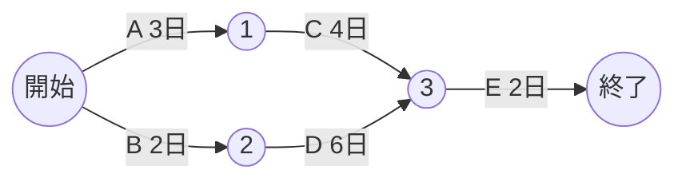

# 計算問題公式集（全分野横断）

> 科目A（旧午前）では毎回 **10〜15問前後** が計算問題です。科目B（旧午後）でも経営戦略・システムアーキテクチャ・ネットワーク・プロジェクトマネジメントなどで計算設問が出ます。
> 重要度：★★★（どの分野の計算も「公式を知っていれば1〜2分で解ける」得点源）
> この資料は **公式 → 1行の数値例** で一覧化したものです。数値例はすべて Python で検算済みです。
> 詳しい解説は各分野ファイル（01_テクノロジ系／02_マネジメント系／03_ストラテジ系）を参照してください。
> CBTでは **画面上の電卓** が使えますが、桁の多い計算は入力ミスが起きやすいので、概算で検算するクセをつけましょう。

## 目次

1. [基礎理論（基数・誤差・データ量）](#1-基礎理論基数誤差データ量)
2. [コンピュータ・性能](#2-コンピュータ性能)
3. [システム構成・信頼性](#3-システム構成信頼性)
4. [待ち行列](#4-待ち行列)
5. [OS（ページ置換）](#5-osページ置換)
6. [ネットワーク](#6-ネットワーク)
7. [プロジェクトマネジメント](#7-プロジェクトマネジメント)
8. [サービスマネジメント](#8-サービスマネジメント)
9. [会計・財務](#9-会計財務)
10. [OR・IE・意思決定](#10-orie意思決定)
11. [単位の早見表](#11-単位の早見表)

---

## 1. 基礎理論（基数・誤差・データ量）

| 項目 | 公式・手順 | 数値例（検算済み） |
|---|---|---|
| 10進→2進（整数） | 2で割り続け、余りを下から読む | 45 → `101101` |
| 10進→2進（小数） | 2を掛け続け、整数部を上から読む | 0.625 → `0.101`（0.5 + 0.125） |
| 16進→10進 | 各桁 × 16のべき乗の和 | `2F` = 2×16 + 15 = **47** |
| 2進↔16進 | 2進を下位から **4ビットずつ** 区切る | `0010 1111` = `2F` |
| 2の補数 | 全ビット反転 + 1 | −5（8ビット）: `00000101` → `11111010` + 1 = `11111011` |
| nビットの表現範囲 | 符号なし: 0 〜 2^n − 1 ／ 2の補数: −2^(n−1) 〜 2^(n−1) − 1 | 8ビット: 0〜255 ／ −128〜127 |
| 相対誤差 | `|近似値 − 真値| / |真値|` | 真値100、近似98 → 2/100 = **2%** |
| 循環小数になる例 | 10進の 0.1 は2進で有限桁にならない | 0.0001100110011（13桁）= 0.0999755859375 |
| シフト演算 | 左に nビットシフト = ×2^n、右に nビット = ÷2^n（論理シフト・正の数） | 3 を左に2ビット → 12 |
| 情報量 | n通りを区別するのに必要なビット数 = ⌈log2 n⌉ | 26文字 → 2^5 = 32 ≧ 26 なので **5ビット** |
| 画像データ量 | 横画素 × 縦画素 × 1画素のビット数 ÷ 8 | 1920×1080×24ビット ÷ 8 = **6,220,800バイト**（約6.2MB） |
| 音声データ量（PCM） | サンプリング周波数 × 量子化ビット数 × チャネル数 | 44.1kHz × 16ビット × 2ch = **1,411,200ビット/秒** |

⚠️ **誤差の種類**（計算ではなく用語で問われる）：**桁落ち**＝値がほぼ等しい数どうしの減算で有効桁が減る／**情報落ち**＝絶対値の大きな数と小さな数の加減算で小さい数が無視される／**丸め誤差**＝指定桁で四捨五入・切捨てする誤差／**打切り誤差**＝無限の計算を途中で打ち切る誤差。

---

## 2. コンピュータ・性能

| 項目 | 公式 | 数値例（検算済み） |
|---|---|---|
| MIPS | `MIPS = クロック周波数 / CPI / 10^6` | 2GHz、CPI 4 → 2×10^9 / 4 / 10^6 = **500 MIPS** |
| 平均CPI（命令ミックス） | `Σ（命令のCPI × 出現率）` | CPI 2が50%、6が30%、4が20% → 1.0 + 1.8 + 0.8 = **3.6** |
| CPU実行時間 | `命令数 × CPI × クロック周期`（= 命令数 × CPI / 周波数） | 1.8GHz、平均CPI 3.6 → 1.8×10^9 / 3.6 = 5×10^8 命令/秒 = **500 MIPS** |
| クロック周期 | `1 / クロック周波数` | 2GHz → **0.5ナノ秒** |
| キャッシュ実効アクセス時間 | `h × Tc + (1 − h) × Tm`（h: ヒット率） | h = 0.9、Tc = 10ns、Tm = 60ns → 9 + 6 = **15ns** |
| パイプライン処理時間 | `(段数 + 命令数 − 1) × 1段の時間` | 5段、命令10個、1段1ns → (5 + 10 − 1) × 1 = **14ns** |
| アムダールの法則 | `速度向上比 = 1 / ((1 − p) + p / n)`（p: 並列化できる割合、n: プロセッサ数） | p = 0.8、n = 4 → 1 / (0.2 + 0.2) = **2.5倍** |
| 磁気ディスクのアクセス時間 | `平均シーク時間 + 平均回転待ち時間 + データ転送時間` | シーク8ms、6,000回転/分（1回転10ms → 平均回転待ち5ms）、1トラック100KB で4KB転送（10ms × 4/100 = 0.4ms）→ **13.4ms** |
| 平均回転待ち時間 | `1回転の時間 / 2` | 6,000回転/分 → 60,000ms / 6,000 = 10ms → **5ms** |

💡 **MIPS は「1秒に何百万命令」**。CPI（Cycles Per Instruction：1命令あたりのクロック数）が大きいほど遅い、と覚えます。

---

## 3. システム構成・信頼性

| 項目 | 公式 | 数値例（検算済み） |
|---|---|---|
| 稼働率 | `MTBF / (MTBF + MTTR)` | MTBF 480時間、MTTR 20時間 → 480 / 500 = **0.96** |
| 故障率 | `λ = 1 / MTBF` | MTBF 500時間 → 0.002回/時間 |
| 直列システム | `A × B`（どちらか止まれば全体停止） | 0.9 × 0.8 = **0.72** |
| 並列システム | `1 − (1 − A)(1 − B)`（両方止まったときだけ停止） | 1 − 0.1 × 0.2 = **0.98** |
| 3台中2台以上稼働（2 out of 3） | `3a² − 2a³`（a: 1台の稼働率） | a = 0.9 → 3×0.81 − 2×0.729 = **0.972** |
| RAID 0（ストライピング） | 容量 = n × C | 1TB × 4台 → 4TB（冗長性なし） |
| RAID 1（ミラーリング） | 容量 = C（2台構成の場合） | 1TB × 2台 → **1TB** |
| RAID 5（分散パリティ） | 容量 = (n − 1) × C | 1TB × 4台 → **3TB**（1台故障まで耐える） |
| RAID 6（二重パリティ） | 容量 = (n − 2) × C | 2TB × 6台 → **8TB**（2台故障まで耐える） |
| RAID 1+0 | 容量 = n / 2 × C | 1TB × 4台 → **2TB** |

⚠️ **MTBF**（Mean Time Between Failures：平均故障間隔）は「動いている時間」、**MTTR**（Mean Time To Repair：平均修復時間）は「止まっている時間」。MTBFを長く、MTTRを短くすると稼働率が上がります。

---

## 4. 待ち行列

M/M/1モデル（到着はランダム、サービス時間は指数分布、窓口1つ）の公式です。

| 項目 | 公式 | 数値例（検算済み：平均到着間隔5分、平均サービス時間4分） |
|---|---|---|
| 利用率 | `ρ = 平均サービス時間 / 平均到着間隔`（= λ / μ） | 4 / 5 = **0.8** |
| 平均待ち時間 | `Wq = ρ / (1 − ρ) × 平均サービス時間` | 0.8 / 0.2 × 4 = **16分** |
| 平均応答時間（待ち＋サービス） | `W = Wq + 平均サービス時間` | 16 + 4 = **20分** |
| 平均待ち行列長（待っている人数） | `Lq = ρ² / (1 − ρ)` | 0.64 / 0.2 = **3.2人** |
| 系内の平均人数（サービス中を含む） | `L = ρ / (1 − ρ)` | 0.8 / 0.2 = **4人** |

💡 ρが1に近づくと待ち時間は急増します（ρ = 0.5 なら待ちはサービス時間の1倍、0.8 なら4倍、0.9 なら9倍）。

---

## 5. OS（ページ置換）

ページ枠3つ、参照列 `1, 2, 3, 1, 4, 2, 5, 1` の例（検算済み）。

| 参照 | 1 | 2 | 3 | 1 | 4 | 2 | 5 | 1 | ページフォールト回数 |
|---|---|---|---|---|---|---|---|---|---|
| **FIFO**（最も古く読み込んだページを追い出す） | F | F | F | ヒット | F（1を追出し） | ヒット | F（2を追出し） | F（3を追出し） | **6回** |
| **LRU**（最も長く参照されていないページを追い出す） | F | F | F | ヒット | F（2を追出し） | F（3を追出し） | F（1を追出し） | F（4を追出し） | **7回** |

- FIFO（First In First Out）、LRU（Least Recently Used）、LFU（Least Frequently Used：参照回数が最も少ないページを追い出す）。
- ⚠️ LRU は **ヒットしたときに「最近使った」扱いに更新** する点が FIFO との違いです。この例のように LRU のほうがフォールトが多くなることもあります。

---

## 6. ネットワーク

| 項目 | 公式 | 数値例（検算済み） |
|---|---|---|
| 伝送時間 | `データ量（ビット） / (回線速度 × 伝送効率)` | 100Mバイト × 8 = 800Mビット ÷ (100Mbps × 0.8) = **10秒** |
| 回線利用率 | `実際に流すデータ量（ビット/秒） / 回線速度` | 1秒に4Mバイト（32Mビット）を100Mbpsで → **32%** |
| サブネットのホスト数 | `2^(ホスト部ビット数) − 2`（ネットワークアドレスとブロードキャストアドレスを除く） | /26 → ホスト部6ビット → 64 − 2 = **62台** |
| ネットワークアドレス | IPアドレス AND サブネットマスク | 192.168.10.100/27 → **192.168.10.96** |
| ブロードキャストアドレス | ホスト部をすべて1にする | 192.168.10.100/27 → **192.168.10.127**（ホスト数30） |
| サブネット分割数 | `2^(借りたビット数)` | /24 を /26 に分割 → 2^2 = **4個** |
| /27 のサブネットマスク | 上位27ビットが1 | **255.255.255.224** |

⚠️ 通信速度の「M」は **10^6**（1Mbps = 1,000,000ビット/秒）で計算するのが一般的です。**バイト→ビットの ×8** を忘れるミスが最多です。

---

## 7. プロジェクトマネジメント

### 7.1 クリティカルパス（★★★）

- 公式：**全経路の所要日数を足し、最長の経路がクリティカルパス**（＝プロジェクトの最短所要期間）。
- 数値例（検算済み）：A→C→E = 3 + 4 + 2 = 9日、B→D→E = 2 + 6 + 2 = **10日** → クリティカルパスは **B→D→E（10日）**。A・C の **余裕（フロート）は 10 − 9 = 1日**。
- 最早開始日（ES）は前から最大値、最遅開始日（LS）は後ろから最小値で計算。`余裕 = LS − ES`。余裕0の作業がクリティカルパス上の作業です。

### 7.2 その他

| 項目 | 公式 | 数値例（検算済み） |
|---|---|---|
| 三点見積り（PERT） | `期待値 = (楽観値 + 4 × 最可能値 + 悲観値) / 6` | (4 + 4×6 + 14) / 6 = **7日** |
| 三点見積りの標準偏差 | `σ = (悲観値 − 楽観値) / 6` | (14 − 4) / 6 ≒ **1.67日** |
| EVM：スケジュール差異 | `SV = EV − PV` | BAC 1,000万円、PV 500、EV 400、AC 500 → **−100**（遅れ） |
| EVM：コスト差異 | `CV = EV − AC` | 400 − 500 = **−100**（超過） |
| EVM：SPI | `SPI = EV / PV`（1未満なら遅れ） | 400 / 500 = **0.8** |
| EVM：CPI | `CPI = EV / AC`（1未満ならコスト超過） | 400 / 500 = **0.8** |
| EVM：完成時総コスト見積り | `EAC = BAC / CPI`（今のコスト効率が続く場合） | 1,000 / 0.8 = **1,250万円** |
| EVM：残作業コスト見積り | `ETC = EAC − AC` | 1,250 − 500 = **750万円** |
| ファンクションポイント（FP） | `調整後FP = 未調整FP × 調整係数`、`調整係数 = 0.65 + 0.01 × 影響度の合計` | 外部入力3×4 + 外部出力2×5 + 外部照会2×4 + 内部論理ファイル1×10 + 外部インタフェースファイル1×7 = 47、影響度合計30 → 47 × 0.95 = **44.65** |
| 工数・期間 | `期間 = 工数（人月） / 要員数` | 120人月 ÷ 10人 = **12か月** |

⚠️ EVMの略語：**PV**（Planned Value：計画価値）、**EV**（Earned Value：出来高）、**AC**（Actual Cost：実コスト）、**BAC**（Budget At Completion：完成時総予算）。差は「EV から引く」、比は「EV を分子」と覚えます。
⚠️ FPの重みは問題文で与えられるのが普通です（上の例は IFPUG法の「平均」複雑度の重み）。

---

## 8. サービスマネジメント

| 項目 | 公式 | 数値例（検算済み） |
|---|---|---|
| SLAの許容停止時間 | `サービス時間 × (1 − 稼働率目標)` | 30日 × 24時間 × 60分 × (1 − 0.999) = **43.2分/月** |
| 可用性（サービス稼働率） | `(合意したサービス時間 − 停止時間) / 合意したサービス時間` | 720時間中 停止3.6時間 → 716.4 / 720 = **99.5%** |

---

## 9. 会計・財務

### 9.1 損益分岐点（★★★）

| 項目 | 公式 | 数値例（検算済み：売上高1,000万円、変動費400万円、固定費300万円） |
|---|---|---|
| 変動費率 | `変動費 / 売上高` | 400 / 1,000 = **0.4** |
| 限界利益 | `売上高 − 変動費` | 1,000 − 400 = 600万円 |
| 損益分岐点売上高 | `固定費 / (1 − 変動費率)` | 300 / 0.6 = **500万円** |
| 目標利益達成売上高 | `(固定費 + 目標利益) / (1 − 変動費率)` | 目標利益300 → 600 / 0.6 = **1,000万円** |
| 安全余裕率 | `(売上高 − 損益分岐点売上高) / 売上高` | (1,000 − 500) / 1,000 = **50%** |

### 9.2 財務指標

数値例（検算済み）：当期純利益50、自己資本500、総資産2,000、流動資産300、流動負債200（単位：百万円）

| 指標 | 公式 | 数値例 |
|---|---|---|
| ROE（Return On Equity：自己資本利益率） | `当期純利益 / 自己資本` | 50 / 500 = **10%** |
| ROA（Return On Assets：総資産利益率） | `利益 / 総資産` | 50 / 2,000 = **2.5%** |
| 流動比率 | `流動資産 / 流動負債`（高いほど短期の支払能力が高い） | 300 / 200 = **150%** |
| 自己資本比率 | `自己資本 / 総資産`（高いほど安全） | 500 / 2,000 = **25%** |
| ROI（Return On Investment：投資利益率） | `利益 / 投資額` | 利益30、投資200 → **15%** |

💡 **損益計算書の利益の順番**：売上総利益（粗利）→ 営業利益（本業）→ 経常利益（＋営業外損益）→ 税引前当期純利益（＋特別損益）→ 当期純利益（−法人税等）。

### 9.3 減価償却

| 方法 | 公式 | 数値例（検算済み：取得価額1,000万円、耐用年数5年、残存価額0） |
|---|---|---|
| 定額法 | `(取得価額 − 残存価額) / 耐用年数` | 1,000 / 5 = **毎年200万円** |
| 定率法 | `期首帳簿価額 × 償却率` | 償却率0.4 → 1年目 **400万円**、2年目 (1,000 − 400) × 0.4 = **240万円**、3年目 360 × 0.4 = 144万円 |

⚠️ 定率法は「最初に多く、だんだん少なく」。実際の税法では途中から保証額による切替えがありますが、試験では問題文の条件に従います。

### 9.4 投資評価

| 項目 | 公式 | 数値例（検算済み） |
|---|---|---|
| NPV（Net Present Value：正味現在価値） | `Σ（各年のキャッシュフロー / (1 + 割引率)^年数） − 初期投資` | 投資250、毎年100を3年、割引率10% → 90.91 + 82.64 + 75.13 = 248.69 − 250 ≒ **−1.31**（投資しない判断） |
| 回収期間法 | 累積キャッシュフローが初期投資に達するまでの期間 | 投資250、毎年100 → **2.5年** |

---

## 10. OR・IE・意思決定

| 項目 | 公式 | 数値例（検算済み） |
|---|---|---|
| 経済的発注量（EOQ：Economic Order Quantity） | `√(2 × 年間需要量 × 1回の発注費用 / 1個あたり年間保管費用)` | √(2 × 3,600 × 500 / 40) = √90,000 = **300個** |
| 発注点 | `1日の平均使用量 × 調達期間（リードタイム） + 安全在庫` | 20個 × 5日 + 30個 = **130個** |
| 期待値 | `Σ（確率 × 値）` | 成功0.6で+500、失敗0.4で−200 → 300 − 80 = **220** |
| 指数平滑法 | `次期予測 = 前期予測 + α × (前期実績 − 前期予測)` | 予測100、実績120、α0.3 → 100 + 6 = **106** |
| 移動平均法 | 直近 n期の実績の平均 | 実績 10, 12, 14 の3期移動平均 → **12** |

💡 **意思決定の基準**（不確実性下）：**マクシミン原理**＝各案の最悪値の中で最大を選ぶ（悲観的）、**マクシマックス原理**＝各案の最良値の中で最大を選ぶ（楽観的）、**ミニマックスリグレット原理**＝機会損失（後悔）の最大値が最小の案を選ぶ。

---

## 11. 単位の早見表

| 接頭語 | 10進（通信速度など） | 2進（記憶容量で問題文に指定がある場合） |
|---|---|---|
| k（キロ） | 10^3 | 2^10 = 1,024 |
| M（メガ） | 10^6 | 2^20 |
| G（ギガ） | 10^9 | 2^30 |
| T（テラ） | 10^12 | 2^40 |
| m（ミリ） | 10^−3 | ― |
| μ（マイクロ） | 10^−6 | ― |
| n（ナノ） | 10^−9 | ― |
| p（ピコ） | 10^−12 | ― |

⚠️ 問題文に「1kバイト = 1,000バイトとする」などの注記があれば必ずそれに従います。

---

## 参考

- [IPA 応用情報技術者試験（AP）](https://www.ipa.go.jp/shiken/kubun/ap.html)
- [IPA 試験要綱・シラバス](https://www.ipa.go.jp/shiken/syllabus/gaiyou.html)
- [IPA 過去問題（問題冊子・配点割合・解答例）](https://www.ipa.go.jp/shiken/mondai-kaiotu/index.html)
- [IFPUG（International Function Point Users Group）](https://ifpug.org/)
- [国税庁 No.2100 減価償却のあらまし](https://www.nta.go.jp/taxes/shiraberu/taxanswer/shotoku/2100.htm)
