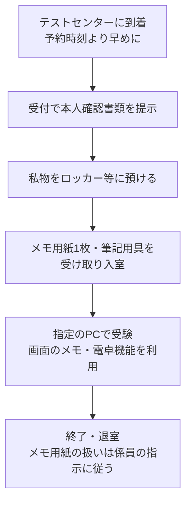

# 直前チェックリスト

> 試験の **前日〜当日の朝** に見返すための資料です。新しいことを覚えるのではなく、「知っているのに間違える」ポイントを最終確認します。
> 重要度：★★★（科目A・科目Bの両方で頻出のひっかけを集めています）
> 構成：①間違えやすいポイント（分野別）②対になる用語の違い ③計算ミスの最終チェック ④CBT受験当日の持ち物・注意点
> 計算の公式は [01_計算問題公式集](01_計算問題公式集.md)、略語は [02_頻出略語・用語集](02_頻出略語・用語集.md) を参照してください。

## 目次

1. [間違えやすいポイント（分野別）](#1-間違えやすいポイント分野別)
2. [対になる用語の違い](#2-対になる用語の違い)
3. [計算ミスの最終チェック](#3-計算ミスの最終チェック)
4. [CBT受験当日の持ち物・注意点](#4-cbt受験当日の持ち物注意点)

---

## 1. 間違えやすいポイント（分野別）

チェックボックスは、自信を持って説明できたら印をつけましょう。

### 1.1 テクノロジ系

- [ ] **デジタル署名** は「送信者の **秘密鍵** で署名 → 受信者が送信者の **公開鍵** で検証」。暗号化（受信者の公開鍵で暗号化 → 受信者の秘密鍵で復号）と逆になる。
- [ ] **ハッシュ関数** は一方向（元に戻せない）。改ざん検知には使えるが、単独では「誰が作ったか」は証明できない（→ デジタル署名やHMACが必要）。
- [ ] **共通鍵暗号の鍵の数** は n人で `n(n−1)/2` 個、**公開鍵暗号** は `2n` 個（各人が公開鍵と秘密鍵の1組）。
- [ ] **SQLインジェクション** の根本対策は **プレースホルダ（バインド機構）**。WAFは補助的な対策。
- [ ] **XSS** は利用者のブラウザでスクリプトが動く攻撃、**CSRF** は利用者に意図しないリクエストを送らせる攻撃。
- [ ] サブネットの **ホスト数は 2^n − 2**（ネットワークアドレスとブロードキャストアドレスを除く）。
- [ ] **TCP は3ウェイハンドシェイク**（SYN → SYN/ACK → ACK）。**UDP** はコネクションを確立しない。
- [ ] **DNS** の Aレコード＝IPv4アドレス、AAAA＝IPv6アドレス、MX＝メールサーバ、CNAME＝別名、PTR＝逆引き。
- [ ] **WHERE** は集計前の行、**HAVING** は集計後のグループの絞り込み。`COUNT(*)` は NULL行も数え、`COUNT(列)` は NULL を数えない。
- [ ] **第2正規形** は部分関数従属を排除、**第3正規形** は推移的関数従属を排除。
- [ ] **ホワイトボックステスト** の網羅率：命令網羅 < 判定条件網羅（分岐網羅）< 複数条件網羅。
- [ ] **パイプラインハザード**：データハザード（前の命令の結果待ち）、制御ハザード（分岐）、構造ハザード（資源の競合）。
- [ ] **キャッシュの書込み方式**：ライトスルー（主記憶にも同時に書く、一貫性が高い）／ライトバック（キャッシュだけに書き、追い出し時に反映、高速）。
- [ ] **スラッシング**：ページ置換が多発して処理がほとんど進まない状態。**断片化（フラグメンテーション）** とは別物。

### 1.2 マネジメント系

- [ ] **EVM**：差は「EV − 〇〇」、比は「EV / 〇〇」。SV・CV がマイナス、SPI・CPI が1未満なら悪い状態。
- [ ] **クリティカルパス** は「最長」の経路。余裕（フロート）0の作業が並ぶ。ダミー作業（点線）は所要時間0。
- [ ] **リスク対応（マイナスのリスク）**：回避（原因を取り除く）／転嫁（保険・外部委託で第三者に移す）／軽減（発生確率や影響を下げる）／受容（何もしない、予備費を用意）。
- [ ] **インシデント管理** の目的はサービスの **迅速な回復**。根本原因の究明は **問題管理**。
- [ ] **変更管理** で承認された変更を本番環境に展開するのが **リリース管理（リリース及び展開管理）**。
- [ ] **システム監査人** は監査対象から **独立** し、**指摘・改善提案** をする。改善の実施は被監査部門（監査人が直接直さない）。
- [ ] 監査報告の **改善提案のフォローアップ** も監査人の役割。

### 1.3 ストラテジ系

- [ ] **PPM**：花形（成長率高・シェア高）／金のなる木（成長率低・シェア高）／問題児（成長率高・シェア低）／負け犬（成長率低・シェア低）。
- [ ] **SWOT**：S・W は **内部** 環境、O・T は **外部** 環境。
- [ ] **BSCの4つの視点**：財務、顧客、業務プロセス、学習と成長。
- [ ] **著作権** は創作した時点で自動的に発生（登録不要）。**特許権** は出願・審査・登録が必要（存続期間は原則出願から20年）。
- [ ] 職務上作成したプログラムの著作権は、契約や就業規則に別段の定めがなければ **法人（会社）** に帰属する（職務著作）。
- [ ] 外部委託で開発したプログラムの著作権は、契約で定めなければ **受託者（作った側）** に帰属する。
- [ ] **労働者派遣**：派遣先が派遣労働者に指揮命令する。**請負・準委任**：発注者は受託者の要員に直接指揮命令できない（すると偽装請負）。
- [ ] **損益分岐点売上高 = 固定費 / (1 − 変動費率)**。変動費率は「変動費 / 売上高」。

---

## 2. 対になる用語の違い

| 用語A | 用語B | 違い（覚え方） |
|---|---|---|
| **ロールフォワード** | **ロールバック** | 前進復帰：バックアップ＋**更新後ログ** で障害直前まで進める（媒体障害）／後退復帰：**更新前ログ** で処理前の状態に戻す（トランザクション障害） |
| **内部統制** | **ITガバナンス** | 業務の有効性・財務報告の信頼性・法令遵守等を確保するための **組織内の仕組み**（経営者が整備）／IT活用の方針を定め、価値創出とリスク管理を **経営者（取締役会）が指揮・評価・モニタ** する活動 |
| **請負契約** | **準委任契約** | **仕事の完成** に責任を負う（成果物、契約不適合責任あり）／**作業の遂行（事務処理）** に責任を負う（完成義務なし、善管注意義務あり）。どちらも発注者は要員に指揮命令できない |
| **準委任契約** | **労働者派遣契約** | 受託者が要員を指揮命令／**派遣先** が派遣労働者を指揮命令する |
| **フェールセーフ** | **フェールソフト** | 故障時に **安全側** に倒す（信号を赤にする）／故障時に **機能を縮小して運転を続ける** |
| **フォールトトレランス** | **フォールトアボイダンス** | 故障しても機能を維持する設計（冗長化）／そもそも故障しないよう高品質な部品を使う |
| **フールプルーフ** | **フェールセーフ** | 人が **誤操作** できないようにする／**故障時** に安全側に倒す |
| **スケールアップ** | **スケールアウト** | 1台の性能を上げる（CPU・メモリ増強）／台数を増やして負荷分散する |
| **ホットスタンバイ** | **コールドスタンバイ** | 待機系が常に起動していて即座に切替え／障害後に待機系を起動するため切替えに時間がかかる |
| **フルバックアップ** | **差分／増分バックアップ** | 全データを毎回／差分＝前回 **フル** 以降の変更（復元はフル＋最新差分）、増分＝前回 **バックアップ（種類を問わず）** 以降の変更（復元はフル＋全増分） |
| **RPO** | **RTO** | **どの時点** のデータまで戻すか（データ損失の許容範囲）／**何時間で** 復旧するか |
| **MTBF** | **MTTR** | 平均故障間隔（長いほど良い）／平均修復時間（短いほど良い） |
| **IDS** | **IPS** | 不正通信を **検知・通知** するだけ／検知して **遮断** もする |
| **共有ロック** | **専有ロック** | 読取り用：他も読める（他は書けない）／更新用：他は読みも書きもできない |
| **内部結合** | **外部結合** | 両表に一致する行だけ／一致しない行も残す（相手側の列はNULL） |
| **ブラックボックステスト** | **ホワイトボックステスト** | 仕様（入力と出力）に基づく：同値分割・境界値分析／内部構造（ロジック）に基づく：命令網羅・分岐網羅 |
| **スタブ** | **ドライバ** | トップダウンテストで **下位** モジュールの代わり／ボトムアップテストで **上位** モジュールの代わり |
| **回帰テスト（リグレッションテスト）** | **結合テスト** | 修正で既存機能に悪影響がないかの確認／モジュールを組み合わせたインタフェースの確認 |
| **検証（Verification）** | **妥当性確認（Validation）** | 仕様どおりに **正しく作ったか**／利用者のニーズに合った **正しいものを作ったか** |
| **インシデント** | **問題** | サービスの中断・品質低下という **事象**／インシデントの **根本原因**（未知のもの） |
| **SLA** | **OLA** | サービス提供者と **顧客** の合意／サービス提供者の **組織内部** の合意 |
| **予備調査** | **本調査** | 監査対象の実態を把握し監査計画を具体化する／監査手続を実施して監査証拠を入手する |
| **外観上の独立性** | **精神上の独立性** | 監査対象と身分・利害関係がない／公正不偏な態度を保つ |
| **ファストトラッキング** | **クラッシング** | 順番に行う予定の作業を **並行** させて短縮（手戻りリスク増）／**資源（要員・費用）を追加** して短縮（コスト増） |
| **定性的リスク分析** | **定量的リスク分析** | 発生確率と影響度を「高・中・低」で評価／金額・日数などの数値で評価（期待金額値 等） |
| **TCP** | **UDP** | コネクション型・再送制御あり（信頼性重視）／コネクションレス・再送なし（リアルタイム性重視：音声・動画・DNS問合せ） |
| **L2スイッチ** | **L3スイッチ／ルータ** | **MACアドレス** で中継（同じセグメント内）／**IPアドレス** で中継（セグメント間） |
| **NAT** | **NAPT** | IPアドレスのみ1対1変換／ポート番号も変換して1つのグローバルIPを複数端末で共有 |
| **定額法** | **定率法** | 毎年同じ額を償却／期首帳簿価額 × 償却率で、初年度が最も大きい |
| **固定費** | **変動費** | 売上に関係なく一定（家賃・人件費）／売上に比例（材料費・仕入原価） |
| **著作権** | **産業財産権（特許権 等）** | 創作と同時に発生（無方式主義）／出願・登録が必要（方式主義） |
| **CRM** | **SCM** | 顧客との関係管理／調達から販売までの供給連鎖の管理 |
| **RFI** | **RFP** | ベンダに **情報提供** を依頼／ベンダに **提案** を依頼（要件を提示） |
| **KGI** | **KPI** | 最終目標の達成度（売上高 等）／途中プロセスの指標（訪問件数 等） |

💡 迷ったら「**前・後**」「**内・外**」「**検知・防御**」「**時点・時間**」のどの軸で対になっているかを考えると整理できます。

---

## 3. 計算ミスの最終チェック

- [ ] **バイトとビット**：通信速度はビット/秒。データ量がバイトなら **× 8**。
- [ ] **k・M・G** は通信では10^3・10^6・10^9。記憶容量で 2^10 系を使うかは問題文の注記に従う。
- [ ] **ミリ（10^−3）・マイクロ（10^−6）・ナノ（10^−9）** の換算。
- [ ] **稼働率の直列・並列**：直列は掛け算、並列は「1 − 両方故障の確率」。
- [ ] **待ち行列** の平均待ち時間は `ρ / (1 − ρ) × 平均サービス時間`（応答時間はこれにサービス時間を足す）。
- [ ] **パーセントと小数**：利用率 80% は 0.8 で計算する。
- [ ] **四捨五入の指定**（「小数第2位を四捨五入」＝小数第1位まで答える）。
- [ ] CBTの **画面上の電卓** で桁を打ち間違えていないか、概算で検算する。

---

## 4. CBT受験当日の持ち物・注意点

2026年度から、応用情報技術者試験は **CBT方式**（テストセンターのPCで受験）です。従来の紙の試験とはルールが大きく違うので必ず確認しましょう。

### 4.1 持ち物チェック

| 持ち物 | 必要度 | 説明 |
|---|---|---|
| **本人確認書類（顔写真付き・原本）** | **必須** | 運転免許証、マイナンバーカード、パスポート、在留カード、顔写真付き学生証・社員証など。**コピー不可**。氏名が登録情報と一致していること。**提示できないと理由を問わず受験できない** |
| 予約内容の控え | 推奨 | **受験票は送付されません**。試験日時・テストセンターの場所を、予約確認メールなどで確認しておく |
| 腕時計 | 不要 | 私物は試験室に持ち込めないのが原則。残り時間は試験画面に表示される |
| 電卓 | **持込み不可** | 試験画面上の **電卓機能** を使う |
| 筆記用具・メモ用紙 | 不要 | 入室時に **メモ用紙1枚と筆記用具が配布** される（IPA発表） |

> ⚠️ 本人確認書類の詳細（有効な書類の種類、改姓時の扱いなど）は CBT運営会社（CBT-Solutions）のページで必ず確認してください。本人確認は登録済みの利用者情報（姓名）と照合されます。

### 4.2 当日の流れと注意点

- [ ] **科目Aと科目Bは別の日** に受験します（申込み時に両方の日時・会場を予約）。**両方の日に本人確認書類が必要** です。
- [ ] 会場ごとに試験日・時間帯が違います。**自分が予約した日時・会場** を前日に再確認する。
- [ ] 遅刻の扱い・到着時刻の目安は予約確認の案内やCBT運営会社の注意事項に従う（早めの到着が安全）。
- [ ] 試験画面には **メモ機能・電卓機能** がある。事前に CBT運営会社が公開している **操作説明** を見て、画面の切替えや解答の入力方法に慣れておく。
- [ ] **メモ用紙は1枚だけ**。計算や科目Bのキーワードのメモは、紙と画面のメモ機能を使い分ける（大きな字で書きすぎない）。
- [ ] **科目A** の得点は試験終了時の画面で確認できる予定ですが、**科目B** の得点は表示されません（合格発表を待つ）。
- [ ] 科目B の記述は **キーボード入力**。かな漢字の **変換ミス** と **字数** を最後に確認する。

### 4.3 前日・当日朝のチェック

- [ ] 本人確認書類を **かばんに入れた**（有効期限・氏名を確認）
- [ ] テストセンターの場所と **交通手段・所要時間** を確認した
- [ ] 科目Bの **本命4問と予備2問** を決めてある（[01_科目Bの全体戦略](../04_科目B対策/01_科目Bの全体戦略.md)）
- [ ] この資料の「対になる用語の違い」と [01_計算問題公式集](01_計算問題公式集.md) をひととおり見た
- [ ] 睡眠を十分にとる（150分の試験は集中力勝負）

> ⚠️ 当日のルールは変更されることがあります。受験前に必ず **IPAの実施案内** と **CBT運営会社の注意事項** を確認してください。

---

## 参考

- [IPA 令和8年度 前期試験の実施について（CBT方式）](https://www.ipa.go.jp/shiken/2026/r08zen_exam.html)
- [IPA 応用情報技術者試験（AP）](https://www.ipa.go.jp/shiken/kubun/ap.html)
- [CBT-Solutions 情報処理技術者試験 本人確認書類](https://cbt-s.com/page/itee_id)
- [IPA プレス発表：応用情報技術者試験、高度試験及び情報処理安全確保支援士試験がCBT方式での実施に移行予定](https://www.ipa.go.jp/pressrelease/2025/press20250812.html)
- [＠IT：情報処理技術者試験が令和8年度からCBT方式に全面移行](https://atmarkit.itmedia.co.jp/ait/articles/2608/31/news097.html)
- [経済産業省 システム監査基準・システム管理基準](https://www.meti.go.jp/policy/netsecurity/sys-kansa/)
- [厚生労働省 労働者派遣事業と請負により行われる事業との区分に関する基準 関係疑義応答集](https://www.mhlw.go.jp/bunya/koyou/gigi_outou01.html)
- [文化庁 著作権制度の概要](https://www.bunka.go.jp/seisaku/chosakuken/seidokaisetsu/gaiyo/)
