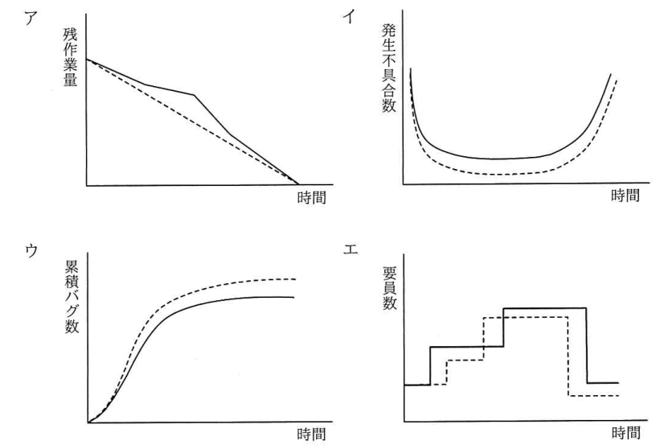
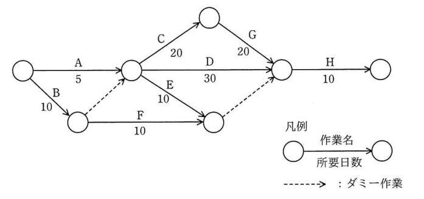

# 平成31年度春期 科目A（旧午前）過去問解説

> 平成31年度 春期 応用情報技術者試験 午前（全80問）を書き起こし、オリジナルの解説を付けたものです。問題の著作権は IPA（独立行政法人 情報処理推進機構）にあります。
> 図を表に書き換えるなど一部改変した問題には、その旨を記載しています。
> インタラクティブ教材の [科目A 四択クイズ](../../06_インタラクティブ教材/quiz.html) では、この回を本番形式（150分）で解けます。

## 目次

| 問 | 分野 | 中分類 | キーワード |
|---|---|---|---|
| [問1](#q01) | テクノロジ系 | 基礎理論 | ビット演算、論理積、マスク、剰余 |
| [問2](#q02) | テクノロジ系 | 基礎理論 | 桁落ち、丸め誤差、情報落ち、打切り誤差 |
| [問3](#q03) | テクノロジ系 | 基礎理論 | ディープラーニング、ニューラルネットワーク、機械学習、エキスパートシステム |
| [問4](#q04) | テクノロジ系 | 基礎理論 | TOF、距離画像センサ、LiDAR、GPS |
| [問5](#q05) | テクノロジ系 | ソフトウェア | ベストフィット、2分探索木、メモリ管理、可変区画 |
| [問6](#q06) | テクノロジ系 | アルゴリズムとプログラミング | シェルソート、挿入ソート、間隔 |
| [問7](#q07) | テクノロジ系 | アルゴリズムとプログラミング | JSON、JavaScript、データ記述言語 |
| [問8](#q08) | テクノロジ系 | コンピュータ構成要素 | スーパスカラ、SIMD、マルチコア、マルチスレッド |
| [問9](#q09) | テクノロジ系 | コンピュータ構成要素 | ブロック転送、メモリ転送、領域の重なり |
| [問10](#q10) | テクノロジ系 | コンピュータ構成要素 | データ転送速度、バス幅、メモリサイクルタイム |
| [問11](#q11) | テクノロジ系 | ネットワーク | ZigBee、Bluetooth、IrDA、センサネットワーク |
| [問12](#q12) | テクノロジ系 | システム構成要素 | タイムアウト、Web システム、3層構成 |
| [問13](#q13) | テクノロジ系 | システム構成要素 | 稼働率、直列システム、並列システム |
| [問14](#q14) | テクノロジ系 | システム構成要素 | キャッシュ、ヒット率、平均応答時間 |
| [問15](#q15) | テクノロジ系 | システム構成要素 | MIPS、スループット、ボトルネック、転送速度 |
| [問16](#q16) | テクノロジ系 | ソフトウェア | 処理時間順方式、SPT、ターンアラウンドタイム、スケジューリング |
| [問17](#q17) | テクノロジ系 | ソフトウェア | スタック領域、ヒープ領域、動的メモリ割当て |
| [問18](#q18) | テクノロジ系 | ソフトウェア | デッドロック、排他制御、資源獲得順序 |
| [問19](#q19) | テクノロジ系 | ソフトウェア | LRU、ページ置換え、仮想記憶 |
| [問20](#q20) | テクノロジ系 | コンピュータ構成要素 | DRAM、SRAM、コンデンサ、リフレッシュ |
| [問21](#q21) | テクノロジ系 | ハードウェア | アクチュエータ、センサ、A/D変換器、組込みシステム |
| [問22](#q22) | テクノロジ系 | 情報メディア | 標本化、量子化、ADPCM、PCM |
| [問23](#q23) | テクノロジ系 | コンピュータ構成要素 | 論理回路、論理積、論理和、真理値表 |
| [問24](#q24) | テクノロジ系 | ユーザーインタフェース | ニモニックコード、コード設計、シーケンスコード、ブロックコード |
| [問25](#q25) | テクノロジ系 | 情報メディア | レンダリング、モデリング、ディザリング、CG |
| [問26](#q26) | テクノロジ系 | データベース | 3層スキーマ、内部スキーマ、概念スキーマ、外部スキーマ |
| [問27](#q27) | テクノロジ系 | データベース | GRANT、REVOKE、アクセス権限、SQL |
| [問28](#q28) | テクノロジ系 | データベース | SQL、GROUP BY、HAVING、WHERE |
| [問29](#q29) | テクノロジ系 | データベース | データレイク、データウェアハウス、ビッグデータ、メタデータ |
| [問30](#q30) | テクノロジ系 | データベース | ACID特性、一貫性、原子性、独立性、耐久性 |
| [問31](#q31) | テクノロジ系 | ネットワーク | NAPT、IPマスカレード、ポート番号、プライベートIPアドレス |
| [問32](#q32) | テクノロジ系 | ネットワーク | マルチホーミング、冗長化、ISP、VPN |
| [問33](#q33) | テクノロジ系 | ネットワーク | MACアドレス、IPアドレス、ルータ、デフォルトゲートウェイ |
| [問34](#q34) | テクノロジ系 | ネットワーク | サブネットマスク、ネットワークアドレス、ブロードキャストアドレス |
| [問35](#q35) | テクノロジ系 | ネットワーク | リバースプロキシ、フォワードプロキシ、DMZ、プロキシARP |
| [問36](#q36) | テクノロジ系 | セキュリティ | エクスプロイトコード、脆弱性、攻撃コード |
| [問37](#q37) | テクノロジ系 | セキュリティ | リスクベース認証、多要素認証、不正ログイン |
| [問38](#q38) | テクノロジ系 | セキュリティ | レインボー攻撃、レインボーテーブル、ハッシュ値、ソルト |
| [問39](#q39) | テクノロジ系 | セキュリティ | ディジタルフォレンジックス、証拠保全、インシデント対応 |
| [問40](#q40) | テクノロジ系 | セキュリティ | DNSSEC、DNSキャッシュポイズニング、ディジタル署名 |
| [問41](#q41) | テクノロジ系 | セキュリティ | フォールスネガティブ、フォールスポジティブ、誤検知、検知漏れ |
| [問42](#q42) | テクノロジ系 | ネットワーク | IPsec、L2TP、TLS、OSI基本参照モデル、VPN |
| [問43](#q43) | テクノロジ系 | セキュリティ | サンドボックス、SIEM、サニタイジング、リバースプロキシ |
| [問44](#q44) | テクノロジ系 | セキュリティ | パケットフィルタリング、ファイアウォール、ポート番号 |
| [問45](#q45) | テクノロジ系 | セキュリティ | WAF、SQLインジェクション、クロスサイトスクリプティング |
| [問46](#q46) | テクノロジ系 | システム開発技術 | データ中心アプローチ、DOA、プロセス中心アプローチ、E-R図 |
| [問47](#q47) | テクノロジ系 | システム構成要素 | フェールセーフ、フールプルーフ、フォールトトレランス、フェールソフト |
| [問48](#q48) | テクノロジ系 | システム開発技術 | 適応保守、是正保守、予防保守、完全化保守 |
| [問49](#q49) | テクノロジ系 | ソフトウェア開発管理技術 | バーンダウンチャート、アジャイル、スクラム、信頼度成長曲線 |
| [問50](#q50) | テクノロジ系 | システム開発技術 | システム要件定義、要求事項評価、共通フレーム、追跡可能性 |
| [問51](#q51) | マネジメント系 | プロジェクトマネジメント | JIS Q 21500、プロセス群、実行のプロセス群 |
| [問52](#q52) | マネジメント系 | プロジェクトマネジメント | EVM、EAC、CPI、アーンドバリュー |
| [問53](#q53) | マネジメント系 | プロジェクトマネジメント | アローダイアグラム、クリティカルパス、総余裕時間、ダミー作業 |
| [問54](#q54) | マネジメント系 | サービスマネジメント | 問題管理、インシデント管理、根本原因、既知の誤り |
| [問55](#q55) | マネジメント系 | サービスマネジメント | IT サービス継続性管理、コールドスタンバイ、ホットスタンバイ、ITIL |
| [問56](#q56) | マネジメント系 | サービスマネジメント | バックアップ、フルバックアップ、差分バックアップ、世代管理 |
| [問57](#q57) | マネジメント系 | システム監査 | 受入テスト、システム監査、委託者、要件定義 |
| [問58](#q58) | マネジメント系 | システム監査 | 監査手続、監査証拠、システム監査基準 |
| [問59](#q59) | マネジメント系 | システム監査 | システム監査基準、フォローアップ、独立性、改善計画 |
| [問60](#q60) | マネジメント系 | システム監査 | 物理的入退管理、JIS Q 27002、情報セキュリティ監査 |
| [問61](#q61) | ストラテジ系 | システム戦略 | プログラムマネジメント、PMO、ポートフォリオマネジメント |
| [問62](#q62) | ストラテジ系 | システム戦略 | CRM、ワントゥワンマーケティング、SCM、HRM |
| [問63](#q63) | ストラテジ系 | 企業活動 | データサイエンティスト、データサイエンス力、ビッグデータ |
| [問64](#q64) | ストラテジ系 | システム企画 | 正味現在価値、NPV、割引率、投資評価 |
| [問65](#q65) | ストラテジ系 | システム企画 | ユースケース図、UML、要件定義、アクター |
| [問66](#q66) | ストラテジ系 | システム企画 | サブスクリプション、ライセンス、SaaS、調達 |
| [問67](#q67) | ストラテジ系 | 経営戦略マネジメント | コアコンピタンス、経営資源、競争優位 |
| [問68](#q68) | ストラテジ系 | 経営戦略マネジメント | バランススコアカード、BSC、KPI、戦略マップ |
| [問69](#q69) | ストラテジ系 | 経営戦略マネジメント | SECIモデル、表出化、暗黙知、形式知、ナレッジマネジメント |
| [問70](#q70) | ストラテジ系 | 技術戦略マネジメント | オープンイノベーション、クローズドイノベーション、技術戦略 |
| [問71](#q71) | ストラテジ系 | ビジネスインダストリ | ディジタルツイン、IoT、シミュレーション、CPS |
| [問72](#q72) | ストラテジ系 | ビジネスインダストリ | PDM、FMS、MRP、SCM |
| [問73](#q73) | ストラテジ系 | 経営戦略マネジメント | SEO、リスティング広告、アフィリエイト、レコメンデーション |
| [問74](#q74) | ストラテジ系 | 企業活動 | パレート図、QC七つ道具、ABC分析、特性要因図 |
| [問75](#q75) | ストラテジ系 | 企業活動 | 発注点、定量発注方式、安全在庫、経済的発注量 |
| [問76](#q76) | ストラテジ系 | 企業活動 | 変動費率、限界利益、固定費、損益計算 |
| [問77](#q77) | ストラテジ系 | 企業活動 | 標準原価計算、原価差異分析、実際原価 |
| [問78](#q78) | ストラテジ系 | 法務 | 要配慮個人情報、個人情報保護法、個人識別符号 |
| [問79](#q79) | ストラテジ系 | 法務 | 下請法、取適法、書面交付義務、中小受託取引適正化法 |
| [問80](#q80) | ストラテジ系 | 法務 | 技術者倫理、公衆の安全、公益通報 |

### 問1　〔基礎理論〕 🧮

0 以上 255 以下の整数 n に対して，

next(n) = n+1　（0 ≦ n < 255）
next(n) = 0　　（n = 255）

と定義する。next(n) と等しい式はどれか。ここで，x AND y 及び x OR y は，それぞれ x と y を2進数表現にして，桁ごとの論理積及び論理和をとったものとする。

- **ア**　(n+1) AND 255
- **イ**　(n+1) AND 256
- **ウ**　(n+1) OR 255
- **エ**　(n+1) OR 256

解答・解説

**正解：ア**

(n+1) と 255（2進数 1111 1111）の AND をとると下位8ビットだけが残る。n=255 のとき n+1=256（1 0000 0000）の下位8ビットは 0 になり，それ以外は n+1 がそのまま残るので next(n) と一致する。

**途中式**

- n=254：n+1=255=0 1111 1111 → AND 255 = 255 ＝ next(254)
- n=255：n+1=256=1 0000 0000 → AND 255 = 0000 0000 = 0 ＝ next(255)

- イ：256（1 0000 0000）との AND は第9ビットだけを残すので，n<255 では常に 0 になってしまう
- ウ：255 との OR は下位8ビットが全て 1 になり，常に 255 以上の値になる
- エ：256 との OR は第9ビットを立てるので，常に 256 以上の値になる

💡 **ポイント**：「x AND (2^k − 1)」は x を 2^k で割った余り（下位 k ビットの取り出し）と同じ。カウンタを 0〜255 で循環させるときの定番テクニック。

📖 関連：[基礎理論](../../01_テクノロジ系/01_基礎理論.md)

出典：平成31年度 春期 応用情報技術者試験 午前 問1（場合分けの式をテキストで表記）

---

### 問2　〔基礎理論〕

桁落ちによる誤差の説明として，適切なものはどれか。

- **ア**　値がほぼ等しい二つの数値の差を求めたとき，有効桁数が減ることによって発生する誤差
- **イ**　指定された有効桁数で演算結果を表すために，切捨て，切上げ，四捨五入などで下位の桁を削除することによって発生する誤差
- **ウ**　絶対値が非常に大きな数値と小さな数値の加算や減算を行ったとき，小さい数値が計算結果に反映されないことによって発生する誤差
- **エ**　無限級数で表される数値の計算処理を有限項で打ち切ったことによって発生する誤差

解答・解説

**正解：ア**

桁落ちは，ほぼ等しい値どうしを引き算したとき上位の桁が打ち消し合い，意味のある有効数字が少なくなってしまう誤差。

- イ：丸め誤差の説明
- ウ：情報落ちの説明
- エ：打切り誤差の説明

💡 **ポイント**：数値計算の誤差4種（桁落ち・丸め誤差・情報落ち・打切り誤差）は定義文の言い換えで繰り返し出題される。「ほぼ等しい数の差」なら桁落ち，「大きい数と小さい数の加減算」なら情報落ち。

📖 関連：[基礎理論](../../01_テクノロジ系/01_基礎理論.md)

出典：平成31年度 春期 応用情報技術者試験 午前 問2

---

### 問3　〔基礎理論〕

AI におけるディープラーニングに関する記述として，最も適切なものはどれか。

- **ア**　あるデータから結果を求める処理を，人間の脳神経回路のように多層の処理を重ねることによって，複雑な判断をできるようにする。
- **イ**　大量のデータからまだ知られていない新たな規則や仮説を発見するために，想定値から大きく外れている例外事項を取り除きながら分析を繰り返す手法である。
- **ウ**　多様なデータや大量のデータに対して，三段論法，統計的手法やパターン認識手法を組み合わせることによって，高度なデータ分析を行う手法である。
- **エ**　知識がルールに従って表現されており，演繹手法を利用した推論によって有意な結論を導く手法である。

解答・解説

**正解：ア**

ディープラーニングは，脳の神経回路を模したニューラルネットワークを多層（深層）に重ね，データから特徴を自動で学習して複雑な判断を可能にする機械学習の手法。

- イ：データマイニングの説明。ディープラーニングの本質である多層ニューラルネットワークに触れていない
- ウ：三段論法などの論理推論と統計手法を組み合わせたデータ分析の一般的な説明で，ディープラーニングではない
- エ：ルールベースで演繹的に推論するエキスパートシステム（推論エンジン）の説明

💡 **ポイント**：ディープラーニング＝多層のニューラルネットワーク。特徴量を人が設計しなくても自動で抽出できる点が従来の機械学習との違い。

📖 関連：[基礎理論](../../01_テクノロジ系/01_基礎理論.md)

出典：平成31年度 春期 応用情報技術者試験 午前 問3

---

### 問4　〔基礎理論〕

家庭用ゲーム機に採用され，自動車の先端運転支援システムにも使われる距離画像センサの一つである，TOF（Time of Flight）方式のセンサの説明として，適切なものはどれか。

- **ア**　光源から射出されたレーザなどの光が，対象物に反射してセンサに届くまでの時間を利用して距離を測定する。
- **イ**　ステレオカメラによって，三角測量の原理を利用して距離を測定する。
- **ウ**　単眼カメラによって，道路の幅や車線は無限遠の地平線で一点に収束するという遠近法の原理を利用して距離を測定する。
- **エ**　複数の衛星からの電波を受け取り，電波に含まれる情報から発信と受信の時刻差を求め，電波の伝播速度をかけることによって，各衛星との距離を割り出し，それを基に緯度及び経度を特定する。

解答・解説

**正解：ア**

TOF（Time of Flight）は「光の飛行時間」の意味で，照射した光が対象物で反射して戻るまでの時間と光速から距離を求める方式。

- イ：ステレオカメラ方式（視差から三角測量で距離を求める）の説明
- ウ：単眼カメラで遠近法を利用する方式の説明
- エ：GPS などの衛星測位（GNSS）の説明で，距離画像センサではない

💡 **ポイント**：距離 ＝ 光速 × 往復時間 ÷ 2。TOF の考え方はスマートフォンの深度センサや LiDAR にも使われる。

📖 関連：[基礎理論](../../01_テクノロジ系/01_基礎理論.md)／[ハードウェア](../../01_テクノロジ系/10_ハードウェア.md)

出典：平成31年度 春期 応用情報技術者試験 午前 問4

---

### 問5　〔ソフトウェア〕

要求に応じて可変量のメモリを割り当てるメモリ管理方式がある。要求量以上の大きさをもつ空き領域のうちで最小のものを割り当てる最適適合（best-fit）アルゴリズムを用いる場合，空き領域を管理するためのデータ構造として，メモリ割当て時の平均処理時間が最も短いものはどれか。

- **ア**　空き領域のアドレスをキーとする2分探索木
- **イ**　空き領域の大きさが小さい順の片方向連結リスト
- **ウ**　空き領域の大きさをキーとする2分探索木
- **エ**　アドレスに対応したビットマップ

解答・解説

**正解：ウ**

best-fit では「要求量以上で最小の空き領域」を探す必要がある。大きさをキーとする2分探索木なら，木をたどるだけで平均 O(log n) で目的の領域を見つけられる。

- ア：アドレスをキーにしても大きさで探索できず，全ノードを調べることになる
- イ：大きさ順のリストなら先頭から順にたどれば見つかるが，線形探索なので平均 O(n) かかる
- エ：ビットマップは使用中・空きの区別は速いが，空き領域の大きさを調べるには全体を走査する必要がある

💡 **ポイント**：「キーで大小比較しながら探す」なら2分探索木（平均 O(log n)），「順にたどる」連結リストは O(n)。何をキーにするかが速さを決める。

📖 関連：[ソフトウェア](../../01_テクノロジ系/05_ソフトウェア.md)／[アルゴリズムとプログラミング](../../01_テクノロジ系/02_アルゴリズムとプログラミング.md)

出典：平成31年度 春期 応用情報技術者試験 午前 問5

---

### 問6　〔アルゴリズムとプログラミング〕 🧮

次の手順はシェルソートによる整列を示している。データ列 7, 2, 8, 3, 1, 9, 4, 5, 6 を手順 (1)〜(4) に従って整列するとき，手順 (3) を何回繰り返して完了するか。ここで，[ ] は小数点以下を切り捨てた結果を表す。

〔手順〕

(1) “H ← [データ数÷3]” とする。
(2) データ列を，互いに H 要素分だけ離れた要素の集まりから成る部分列とし，それぞれの部分列を，挿入法を用いて整列する。
(3) “H ← [H÷3]” とする。
(4) H が 0 であればデータ列の整列は完了し，0 でなければ (2) に戻る。

- **ア**　2
- **イ**　3
- **ウ**　4
- **エ**　5

解答・解説

**正解：ア**

H の値の変化だけを追えばよい。データ数9なので H=3 → 手順(3)で H=1 → 手順(3)で H=0 となり，手順(3)は2回実行される。

**途中式**

- (1) H = [9÷3] = 3 → (2) 3要素おきの部分列を整列
- (3) 1回目：H = [3÷3] = 1 → (4) 0 でないので (2) へ（間隔1＝通常の挿入ソート）
- (3) 2回目：H = [1÷3] = 0 → (4) 完了

- イ・ウ・エ：H は 3 → 1 → 0 と変化するだけなので，3回以上にはならない

💡 **ポイント**：シェルソートは間隔 H を徐々に縮めながら挿入ソートを繰り返し，最後に H=1 の挿入ソートで仕上げる。整列結果ではなく「H の変化」を問う問題は値を追うだけで解ける。

📖 関連：[アルゴリズムとプログラミング](../../01_テクノロジ系/02_アルゴリズムとプログラミング.md)

出典：平成31年度 春期 応用情報技術者試験 午前 問6

---

### 問7　〔アルゴリズムとプログラミング〕

JavaScript の言語仕様のうち，オブジェクトの表記法などの一部の仕様を基にして規定したものであって，“名前と値の組みの集まり”と“値の順序付きリスト”の二つの構造に基づいてオブジェクトを表現する，データ記述の仕様はどれか。

- **ア**　DOM
- **イ**　JSON
- **ウ**　SOAP
- **エ**　XML

解答・解説

**正解：イ**

JSON（JavaScript Object Notation）は JavaScript のオブジェクト表記を基にしたデータ形式で，`{"名前": 値}` のオブジェクト（名前と値の組の集まり）と `[値, 値]` の配列（順序付きリスト）でデータを表す。

- ア：DOM は HTML や XML 文書をツリー構造としてプログラムから操作するための API
- ウ：SOAP は XML 形式のメッセージをやり取りする Web サービスの通信プロトコル
- エ：XML はタグでデータの意味や構造を記述するマークアップ言語で，JavaScript を基にしたものではない

💡 **ポイント**：JSON は Web API のデータ交換で最もよく使われる形式。「名前と値の組」「順序付きリスト」が JSON のキーワード。

📖 関連：[アルゴリズムとプログラミング](../../01_テクノロジ系/02_アルゴリズムとプログラミング.md)

出典：平成31年度 春期 応用情報技術者試験 午前 問7

---

### 問8　〔コンピュータ構成要素〕

スーパスカラの説明として，適切なものはどれか。

- **ア**　一つのチップ内に複数のプロセッサコアを実装し，複数のスレッドを並列に実行する。
- **イ**　一つのプロセッサコアで複数のスレッドを切り替えて並列に実行する。
- **ウ**　一つの命令で，複数の異なるデータに対する演算を，複数の演算器を用いて並列に実行する。
- **エ**　並列実行可能な複数の命令を，複数の演算器に振り分けることによって並列に実行する。

解答・解説

**正解：エ**

スーパスカラは，プロセッサ内に複数の演算器（パイプライン）をもち，同時に実行できる複数の命令をハードウェアが見つけて振り分け，並列に実行する方式。

- ア：マルチコアプロセッサの説明
- イ：マルチスレッディング（ハイパースレッディングなど）の説明
- ウ：SIMD（Single Instruction Multiple Data）の説明

💡 **ポイント**：命令レベルの並列化として，スーパスカラ（ハードウェアが並列実行命令を判断）と VLIW（コンパイル時に並列実行命令をまとめる）の違いもよく問われる。

📖 関連：[コンピュータ構成要素](../../01_テクノロジ系/03_コンピュータ構成要素.md)

出典：平成31年度 春期 応用情報技術者試験 午前 問8

---

### 問9　〔コンピュータ構成要素〕

同一メモリ上で転送するとき，転送元の開始アドレス，転送先の開始アドレス，方向フラグ及び転送語数をパラメタとして指定することによってブロック転送ができる CPU がある。図のようにアドレス 1001 から 1004 の内容をアドレス 1003 から 1006 に転送するとき，パラメタとして適切なものはどれか。ここで，転送は開始アドレスから1語ずつ行われ，方向フラグに 0 を指定するとアドレスの昇順に，1 を指定するとアドレスの降順に転送を行うものとする。

〔図の内容〕実行前にアドレス 1001〜1004 にある4語のデータを，実行後にはアドレス 1003〜1006 に置く（1001 の内容が 1003 へ，1004 の内容が 1006 へ移る）。

- **ア**　転送元の開始アドレス：1001，転送先の開始アドレス：1003，方向フラグ：0，転送語数：4
- **イ**　転送元の開始アドレス：1001，転送先の開始アドレス：1003，方向フラグ：1，転送語数：4
- **ウ**　転送元の開始アドレス：1004，転送先の開始アドレス：1006，方向フラグ：0，転送語数：4
- **エ**　転送元の開始アドレス：1004，転送先の開始アドレス：1006，方向フラグ：1，転送語数：4

解答・解説

**正解：エ**

転送元（1001〜1004）と転送先（1003〜1006）が 1003〜1004 で重なっている。後ろ（高いアドレス）へずらすときは，末尾の 1004 → 1006 から降順に転送しないと，まだ読んでいないデータを上書きしてしまう。よって開始アドレスは 1004 と 1006，方向フラグ 1。

**途中式（アの場合の失敗）**

1001→1003 を先に転送すると，元の 1003 の内容が消える。続く 1003→1005 では，すでに上書きされた（元 1001 の）値がコピーされてしまう。

- ア：昇順に転送すると，重なった 1003・1004 が読み出される前に上書きされる
- イ：開始アドレス 1001 から降順に転送すると 1000，999… へ進み，指定範囲を転送できない
- ウ：開始アドレス 1004 から昇順に転送すると 1005，1006… へ進み，指定範囲を転送できない

💡 **ポイント**：重なりのある領域を高いアドレス側へずらすときは後ろから（降順），低いアドレス側へずらすときは前から（昇順）コピーする。C 言語の memmove が同じ考え方をとる。

📖 関連：[コンピュータ構成要素](../../01_テクノロジ系/03_コンピュータ構成要素.md)

出典：平成31年度 春期 応用情報技術者試験 午前 問9（図を文章で説明し，選択肢の表を文章に書き換え）

---

### 問10　〔コンピュータ構成要素〕 🧮

バス幅が 16 ビット，メモリサイクルタイムが 80 ナノ秒で連続して動作できるメモリがある。このメモリのデータ転送速度は何 M バイト／秒か。ここで，M は 10^6 を表す。

- **ア**　12.5
- **イ**　25
- **ウ**　160
- **エ**　200

解答・解説

**正解：イ**

1回のメモリサイクル（80 ナノ秒）で 16 ビット＝2 バイトを転送できるので，2 バイト ÷ 80×10^−9 秒 ＝ 25×10^6 バイト／秒 ＝ 25 M バイト／秒。

**途中式**

- 1秒間のサイクル数 ＝ 1 ÷ (80×10^−9) ＝ 12.5×10^6 回
- 転送速度 ＝ 12.5×10^6 回 × 2 バイト ＝ 25×10^6 バイト／秒 → **25**

- ア：12.5 は1秒間のサイクル数（百万回）で，1回あたり2バイト転送することを掛け忘れている
- ウ：160 は 2 バイト × 80 のように，サイクルタイムで割るべきところを掛けた値
- エ：200 は 12.5 × 16 で，ビット単位（M ビット／秒）の値

💡 **ポイント**：転送速度 ＝ 1回の転送量 ÷ サイクルタイム。ビットとバイト（÷8）の換算を最後に必ず確認する。

📖 関連：[コンピュータ構成要素](../../01_テクノロジ系/03_コンピュータ構成要素.md)／[計算問題公式集](../../05_まとめ・横断資料/01_計算問題公式集.md)

出典：平成31年度 春期 応用情報技術者試験 午前 問10（10の6乗をテキストで表記）

---

### 問11　〔ネットワーク〕

ZigBee の説明として，適切なものはどれか。

- **ア**　携帯電話などのモバイル端末とヘッドセットなどの周辺機器とを接続するための近距離の無線通信として使われる。
- **イ**　赤外線を利用して実現される無線通信であり，テレビ，エアコンなどのリモコンに使われる。
- **ウ**　低消費電力で低速の通信を行い，センサネットワークなどに使われる。
- **エ**　連絡用，業務用などに利用される小型の携帯型トランシーバに使われる。

解答・解説

**正解：ウ**

ZigBee は IEEE 802.15.4 を基にした近距離無線通信規格で，通信速度は低いが消費電力が非常に小さく，多数のセンサをつなぐセンサネットワークや家電・設備の制御に使われる。

- ア：Bluetooth の説明
- イ：IrDA など赤外線通信の説明
- エ：特定小電力無線などのトランシーバ（無線機）の説明

💡 **ポイント**：近距離無線の比較：Bluetooth＝周辺機器接続，ZigBee＝低速・低消費電力のセンサ網，NFC＝数 cm の非接触通信。広域・低消費電力なら LPWA。

📖 関連：[ネットワーク](../../01_テクノロジ系/07_ネットワーク.md)

出典：平成31年度 春期 応用情報技術者試験 午前 問11

---

### 問12　〔システム構成要素〕

Web サーバ，アプリケーション（AP）サーバ及びデータベース（DB）サーバが各1台で構成される Web システムにおいて，次の3種類のタイムアウトを設定した。タイムアウトに設定する時間の長い順に並べたものはどれか。ここで，トランザクションは Web リクエスト内で処理を完了するものとする。

〔タイムアウトの種類〕

① AP サーバの AP が，処理を開始してから終了するまで
② AP サーバの AP において，DB アクセスなどのトランザクションを開始してから終了するまで
③ Web サーバが，AP サーバにリクエストを送信してから返信を受けるまで

- **ア**　①，③，②
- **イ**　②，①，③
- **ウ**　③，①，②
- **エ**　③，②，①

解答・解説

**正解：ウ**

処理は「③ Web サーバの待ち」の中に「① AP の処理」があり，その中に「② トランザクション」が含まれる入れ子の関係。外側ほど時間を長くしないと，内側の処理が正常に終わる前に外側がタイムアウトしてしまうので，③ ＞ ① ＞ ②。

- ア：① を ③ より長くすると，AP の処理中に Web サーバ側が先にタイムアウトし，応答を受け取れない
- イ：② を最も長くすると，AP 処理全体や Web サーバの待ちがトランザクションより先に打ち切られる
- エ：② を ① より長くすると，トランザクション中に AP の処理がタイムアウトしてしまう

💡 **ポイント**：呼出し元（外側）のタイムアウト ＞ 呼出し先（内側）のタイムアウト。入れ子の関係を図に描いて考えるとよい。

📖 関連：[システム構成要素](../../01_テクノロジ系/04_システム構成要素.md)

出典：平成31年度 春期 応用情報技術者試験 午前 問12

---

### 問13　〔システム構成要素〕 🧮

稼働率が等しい装置を直列や並列に組み合わせたとき，システム全体の稼働率を高い順に並べたものはどれか。ここで，各装置の稼働率は 0 よりも大きく 1 未満である。

〔構成〕

- A：装置2台を並列に接続
- B：装置1台と，装置2台を並列に接続したものとを直列に接続
- C：装置2台を直列に接続したものを，二つ並列に接続

- **ア**　A，B，C
- **イ**　A，C，B
- **ウ**　C，A，B
- **エ**　C，B，A

解答・解説

**正解：イ**

各装置の稼働率を a（0＜a＜1）とすると，A＝1−(1−a)^2，B＝a{1−(1−a)^2}，C＝1−(1−a^2)^2。A ＞ C ＞ B となる。

**途中式**

- B ＝ a × A なので，a＜1 より B ＜ A
- C の各経路の稼働率 a^2 は a より小さいので，C ＝ 1−(1−a^2)^2 ＜ 1−(1−a)^2 ＝ A
- C − B を a=0.9 で確かめる：A ＝ 1−0.01 ＝ 0.99，B ＝ 0.9×0.99 ≒ 0.891，C ＝ 1−0.19^2 ≒ 0.964 → A ＞ C ＞ B
- 一般に C − B ＝ a(1−a)^2(1+a) ＞ 0 なので，どの a でも C ＞ B

- ア：B と C の順序が逆。B は直列部分の装置1台が止まると全体が止まる
- ウ・エ：C は並列の各経路が2台直列で稼働率 a^2 に下がるので，並列2台の A を上回らない

💡 **ポイント**：直列は掛け算（a×b），並列は「1−両方停止の確率」（1−(1−a)(1−b)）。比較問題は具体的な値（0.9 など）を代入すると速い。

📖 関連：[システム構成要素](../../01_テクノロジ系/04_システム構成要素.md)／[計算問題公式集](../../05_まとめ・横断資料/01_計算問題公式集.md)

出典：平成31年度 春期 応用情報技術者試験 午前 問13（構成図を文章に書き換え）

---

### 問14　〔システム構成要素〕 🧮

キャッシュサーバを利用した検索処理の平均応答時間は，キャッシュサーバでヒットした場合には 0.2 秒，ヒットしない場合には 2.2 秒である。現在の平均検索応答時間は，1.0 秒である。3年後のキャッシュサーバのヒット率は，検索量の増加によって現状の半分になると予測されている。3年後の平均検索応答時間は何秒か。ここで，その他のオーバヘッドは考慮しない。

- **ア**　1.1
- **イ**　1.3
- **ウ**　1.6
- **エ**　1.9

解答・解説

**正解：ウ**

現在のヒット率を h とすると 0.2h＋2.2(1−h)＝1.0 から h＝0.6。3年後は h＝0.3 なので 0.2×0.3＋2.2×0.7＝1.6 秒。

**途中式**

- 現在：0.2h ＋ 2.2(1 − h) ＝ 1.0 → 2.2 − 2.0h ＝ 1.0 → h ＝ 0.6
- 3年後：h ＝ 0.6 ÷ 2 ＝ 0.3
- 平均応答時間 ＝ 0.2 × 0.3 ＋ 2.2 × 0.7 ＝ 0.06 ＋ 1.54 ＝ **1.6 秒**

- ア：1.1 はヒット率の低下をほとんど反映していない値
- イ：1.3 はヒット率を 0.45 程度とした値で，「半分」を正しく反映していない
- エ：1.9 はヒット率を 0.15 とした値で，半分にし過ぎている

💡 **ポイント**：平均アクセス時間 ＝ ヒット時間 × ヒット率 ＋ ミス時間 ×（1 − ヒット率）。逆算でヒット率を求めてから条件を変える2段階の問題が多い。

📖 関連：[システム構成要素](../../01_テクノロジ系/04_システム構成要素.md)／[計算問題公式集](../../05_まとめ・横断資料/01_計算問題公式集.md)

出典：平成31年度 春期 応用情報技術者試験 午前 問14

---

### 問15　〔システム構成要素〕 🧮

あるクライアントサーバシステムにおいて，クライアントから要求された1件の検索を処理するために，サーバで平均 100 万命令が実行される。1件の検索につき，ネットワーク内で転送されるデータは平均 2×10^5 バイトである。このサーバの性能は 100 MIPS であり，ネットワークの転送速度は 8×10^7 ビット／秒である。このシステムにおいて，1秒間に処理できる検索要求は何件か。ここで，処理できる件数は，サーバとネットワークの処理能力だけで決まるものとする。また，1バイトは8ビットとする。

- **ア**　50
- **イ**　100
- **ウ**　200
- **エ**　400

解答・解説

**正解：ア**

サーバは1秒に 100 件，ネットワークは1秒に 50 件処理できる。システム全体の処理件数は遅い方（ボトルネック）で決まるので 50 件。

**途中式**

- サーバ：100×10^6 命令／秒 ÷ 100×10^4 命令／件 ＝ 100 件／秒
- ネットワーク：1件 2×10^5 バイト ＝ 1.6×10^6 ビット → 8×10^7 ÷ 1.6×10^6 ＝ 50 件／秒
- 全体：min(100, 50) ＝ **50 件／秒**

- イ：サーバの処理能力だけで計算した値
- ウ：200 件はサーバ・ネットワークどちらの処理能力も超えており，処理できない
- エ：ネットワーク側でバイトをビットに換算（×8）し忘れた値（8×10^7 ÷ 2×10^5 ＝ 400）

💡 **ポイント**：処理が直列につながるシステムのスループットは，最も遅い構成要素（ボトルネック）で決まる。ネットワークはビット，データ量はバイトで与えられやすいので換算に注意。

📖 関連：[システム構成要素](../../01_テクノロジ系/04_システム構成要素.md)／[計算問題公式集](../../05_まとめ・横断資料/01_計算問題公式集.md)

出典：平成31年度 春期 応用情報技術者試験 午前 問15（10のべき乗をテキストで表記）

---

### 問16　〔ソフトウェア〕 🧮

五つのジョブ A〜E に対して，ジョブの多重度が1で，処理時間順方式のスケジューリングを適用した場合，ジョブ B のターンアラウンドタイムは何秒か。ここで，OS のオーバヘッドは考慮しないものとする。

単位　秒

| ジョブ | 到着時刻 | 単独実行時の処理時間 |
|---|---|---|
| A | 0 | 2 |
| B | 1 | 4 |
| C | 2 | 3 |
| D | 3 | 2 |
| E | 4 | 1 |

- **ア**　8
- **イ**　9
- **ウ**　10
- **エ**　11

解答・解説

**正解：エ**

処理時間順方式では，実行中のジョブが終わった時点で待っているジョブのうち処理時間が最も短いものを選ぶ。実行順は A→C→E→D→B で，B は時刻 12 に終わるので，ターンアラウンドタイムは 12−1＝11 秒。

**途中式**

- 0〜2：A（到着しているのは A だけ）
- 2 の時点で待ち B(4)，C(3) → C を実行：2〜5
- 5 の時点で待ち B(4)，D(2)，E(1) → E：5〜6 → D：6〜8 → B：8〜12
- B のターンアラウンドタイム ＝ 終了時刻 12 − 到着時刻 1 ＝ **11 秒**

- ア：8 は B の実行開始時刻で，ターンアラウンドタイムではない
- イ・ウ：処理時間順の選び方（到着済みのジョブの中で最短のものを選ぶ）を誤ると出る値。B は処理時間が最も長いので最後に回される

💡 **ポイント**：ターンアラウンドタイム ＝ 終了時刻 − 到着時刻。処理時間順（SPT）は「その時点で到着済みのジョブ」だけから選ぶ点に注意し，ガントチャートを描いて追う。

📖 関連：[ソフトウェア](../../01_テクノロジ系/05_ソフトウェア.md)

出典：平成31年度 春期 応用情報技術者試験 午前 問16

---

### 問17　〔ソフトウェア〕

プログラムの実行時に利用される記憶領域にスタック領域とヒープ領域がある。それらの領域に関する記述のうち，適切なものはどれか。

- **ア**　サブルーチンからの戻り番地の退避にはスタック領域が使用され，割当てと解放の順序に関連がないデータの格納にはヒープ領域が使用される。
- **イ**　スタック領域には未使用領域が存在するが，ヒープ領域には未使用領域は存在しない。
- **ウ**　ヒープ領域はスタック領域の予備領域であり，スタック領域が一杯になった場合にヒープ領域が動的に使用される。
- **エ**　ヒープ領域も構造的にはスタックと同じプッシュとポップの操作によって，データの格納と取出しを行う。

解答・解説

**正解：ア**

スタック領域は後入れ先出し（LIFO）で管理され，サブルーチンの戻り番地や局所変数に使われる。ヒープ領域は任意の順序で確保・解放できる領域で，プログラムが動的に確保するデータに使われる。

- イ：ヒープ領域にも未使用領域はあり，確保・解放を繰り返すと断片化（フラグメンテーション）も起こる
- ウ：ヒープ領域はスタック領域の予備ではなく，用途の異なる独立した領域
- エ：ヒープ領域はプッシュ・ポップではなく，必要な大きさを確保（malloc など）・解放（free など）して使う

💡 **ポイント**：スタック＝関数呼出しに伴う LIFO の領域，ヒープ＝順序に関係なく動的に確保・解放する領域。ヒープの解放漏れはメモリリーク，不要領域の自動回収はガーベジコレクション。

📖 関連：[ソフトウェア](../../01_テクノロジ系/05_ソフトウェア.md)

出典：平成31年度 春期 応用情報技術者試験 午前 問17

---

### 問18　〔ソフトウェア〕

二つのタスクが共用する二つの資源を排他的に使用するとき，デッドロックが発生するおそれがある。このデッドロックの発生を防ぐ方法はどれか。

- **ア**　一方のタスクの優先度を高くする。
- **イ**　資源獲得の順序を両方のタスクで同じにする。
- **ウ**　資源獲得の順序を両方のタスクで逆にする。
- **エ**　両方のタスクの優先度を同じにする。

解答・解説

**正解：イ**

デッドロックは，タスク1が資源X→Y，タスク2が資源Y→Xの順で獲得しようとして，互いに相手の資源の解放を待ち続ける状態。両方のタスクで資源の獲得順序をそろえれば，循環待ちが起こらない。

- ア：優先度を変えても，資源を確保したまま相手を待つ状態は解消されない
- ウ：獲得順序を逆にすると，まさにデッドロックが起こる典型的な条件になる
- エ：優先度を同じにしても，資源の獲得順序の問題は解決しない

💡 **ポイント**：デッドロックの防止策は「資源の獲得順序を統一する」「必要な資源をまとめて確保する」など。データベースのロックでも同じ考え方を使う。

📖 関連：[ソフトウェア](../../01_テクノロジ系/05_ソフトウェア.md)／[データベース](../../01_テクノロジ系/06_データベース.md)

出典：平成31年度 春期 応用情報技術者試験 午前 問18

---

### 問19　〔ソフトウェア〕 🧮

仮想記憶管理におけるページ置換えアルゴリズムとして LRU 方式を採用する。主記憶のページ枠が，4000，5000，6000，7000 番地（いずれも16進数）の4ページ分で，プログラムが参照するページ番号の順が，1 → 2 → 3 → 4 → 2 → 5 → 3 → 1 → 6 → 5 → 4 のとき，最後の参照ページ 4 は何番地にページインされているか。ここで，最初の 1 → 2 → 3 → 4 の参照で，それぞれのページは 4000，5000，6000，7000 番地にページインされるものとする。

- **ア**　4000
- **イ**　5000
- **ウ**　6000
- **エ**　7000

解答・解説

**正解：ウ**

LRU は最も長い間参照されていないページを追い出す方式。順に追うと，最後のページ4は，そのとき最も長く参照されていないページ3がいた 6000 番地にページインされる。

**途中式**（［ ］内は 4000／5000／6000／7000 番地の内容）

| 参照 | 処理 | 4000 | 5000 | 6000 | 7000 |
|---|---|---|---|---|---|
| 1,2,3,4 | 順にページイン | 1 | 2 | 3 | 4 |
| 2 | ヒット | 1 | 2 | 3 | 4 |
| 5 | 最も古い参照は1 → 1を置換え | 5 | 2 | 3 | 4 |
| 3 | ヒット | 5 | 2 | 3 | 4 |
| 1 | 最も古い参照は4 → 4を置換え | 5 | 2 | 3 | 1 |
| 6 | 最も古い参照は2 → 2を置換え | 5 | 6 | 3 | 1 |
| 5 | ヒット | 5 | 6 | 3 | 1 |
| 4 | 最も古い参照は3 → 3を置換え | 5 | 6 | **4** | 1 |

- ア：4000 番地には直前に参照されたページ5があり，追い出されない
- イ：5000 番地のページ6は2番目に新しい参照なので追い出されない
- エ：7000 番地のページ1は3番目に新しい参照なので追い出されない（FIFO とすると別の結果になる）

💡 **ポイント**：LRU は「最後に参照された時刻」，FIFO は「ページインした時刻」で追い出す対象を決める。表を作って1つずつ追うのが確実。

📖 関連：[ソフトウェア](../../01_テクノロジ系/05_ソフトウェア.md)

出典：平成31年度 春期 応用情報技術者試験 午前 問19

---

### 問20　〔コンピュータ構成要素〕

DRAM のメモリセルにおいて，情報を記憶するために利用されているものはどれか。

- **ア**　コイル
- **イ**　コンデンサ
- **ウ**　抵抗
- **エ**　フリップフロップ

解答・解説

**正解：イ**

DRAM はコンデンサ（キャパシタ）に電荷を蓄えているかどうかで 0/1 を記憶する。電荷は時間とともに漏れるので，定期的なリフレッシュが必要。

- ア：コイルは電流の変化を妨げる素子で，DRAM の記憶には使わない
- ウ：抵抗は電流を制限する素子で，情報の記憶には使わない
- エ：フリップフロップは SRAM の記憶素子。リフレッシュ不要で高速だが集積度が低い

💡 **ポイント**：DRAM＝コンデンサ・リフレッシュ必要・大容量で主記憶向き，SRAM＝フリップフロップ・リフレッシュ不要・高速でキャッシュ向き。

📖 関連：[コンピュータ構成要素](../../01_テクノロジ系/03_コンピュータ構成要素.md)

出典：平成31年度 春期 応用情報技術者試験 午前 問20

---

### 問21　〔ハードウェア〕

アクチュエータの機能として，適切なものはどれか。

- **ア**　アナログ電気信号を，コンピュータが処理可能なディジタル信号に変える。
- **イ**　キーボード，タッチパネルなどに使用され，コンピュータに情報を入力する。
- **ウ**　コンピュータが出力した電気信号を力学的な運動に変える。
- **エ**　物理量を検出して，電気信号に変える。

解答・解説

**正解：ウ**

アクチュエータは，コンピュータからの電気信号を受けて，モータやソレノイドなどで回転・移動といった機械的な動きに変換する装置。

- ア：A/D 変換器の説明
- イ：入力装置（キーボード，タッチパネルのスイッチ類）の説明
- エ：センサの説明。センサで状態を検出し，コンピュータが判断して，アクチュエータで動かすという関係になる

💡 **ポイント**：制御システムの流れは「センサ（検出）→ A/D 変換 → コンピュータ（判断）→ D/A 変換 → アクチュエータ（動作）」。

📖 関連：[ハードウェア](../../01_テクノロジ系/10_ハードウェア.md)／[基礎理論](../../01_テクノロジ系/01_基礎理論.md)

出典：平成31年度 春期 応用情報技術者試験 午前 問21

---

### 問22　〔情報メディア〕 🧮

音声を標本化周波数 10 kHz，量子化ビット数 16 ビットで4秒間サンプリングして音声データを取得した。この音声データを，圧縮率 1／4 の ADPCM を用いて圧縮した場合のデータ量は何 k バイトか。ここで，1 k バイトは 1,000 バイトとする。

- **ア**　10
- **イ**　20
- **ウ**　80
- **エ**　160

解答・解説

**正解：イ**

圧縮前のデータ量は 10,000 回／秒 × 2 バイト × 4 秒 ＝ 80,000 バイト。これを 1／4 に圧縮するので 20 k バイト。

**途中式**

- 1秒あたり：10×10^3 回 × 16 ビット ＝ 160,000 ビット ＝ 20,000 バイト
- 4秒間：20,000 × 4 ＝ 80,000 バイト ＝ 80 k バイト
- 圧縮後：80 × 1/4 ＝ **20 k バイト**

- ア：10 k バイトは圧縮率 1/8 に相当し，条件の 1/4 と合わない
- ウ：80 は圧縮する前のデータ量
- エ：160 は1秒あたりのビット数（k ビット）で，バイトへの換算と時間・圧縮率の反映が抜けている

💡 **ポイント**：PCM のデータ量 ＝ 標本化周波数 × 量子化ビット数 × 時間（× チャネル数）。最後にビット→バイト（÷8）と圧縮率を忘れずに。

📖 関連：[ユーザーインタフェースと情報メディア](../../01_テクノロジ系/11_ユーザーインタフェースと情報メディア.md)／[計算問題公式集](../../05_まとめ・横断資料/01_計算問題公式集.md)

出典：平成31年度 春期 応用情報技術者試験 午前 問22

---

### 問23　〔コンピュータ構成要素〕 🧮

次の二つの回路の入力に値を与えたとき，表の入力 A，B，C，D と出力 E，F の組合せのうち，全ての素子が論理積素子で構成された左側の回路でだけ成立するものはどれか。

〔回路〕

- 左側の回路（全て論理積素子）：B と C の論理積を G とし，E ＝ A AND G，F ＝ G AND D
- 右側の回路（全て論理和素子）：B と C の論理和を H とし，E ＝ A OR H，F ＝ H OR D

- **ア**　A＝0，B＝0，C＝0，D＝0 のとき，E＝0，F＝0
- **イ**　A＝0，B＝0，C＝1，D＝1 のとき，E＝1，F＝1
- **ウ**　A＝1，B＝1，C＝0，D＝1 のとき，E＝0，F＝0
- **エ**　A＝1，B＝1，C＝1，D＝1 のとき，E＝1，F＝1

解答・解説

**正解：ウ**

ウの入力では，左側（AND）は B・C＝0 なので E＝0，F＝0 となり成立する。右側（OR）は B＋C＝1 なので E＝1，F＝1 となり成立しない。左側だけで成立するのはウ。

**途中式**

| 選択肢 | 左側（AND）の E, F | 右側（OR）の E, F | 表の E, F | 判定 |
|---|---|---|---|---|
| ア | 0, 0 | 0, 0 | 0, 0 | 両方で成立 |
| イ | 0, 0 | 1, 1 | 1, 1 | 右側だけで成立 |
| ウ | 0, 0 | 1, 1 | 0, 0 | **左側だけで成立** |
| エ | 1, 1 | 1, 1 | 1, 1 | 両方で成立 |

- ア：全て 0 の入力では AND も OR も 0 を出力するので，両方の回路で成立する
- イ：左側では A＝0，B・C＝0 なので E＝0，F＝0 となり，表の値（1, 1）にならない
- エ：全て 1 の入力では AND も OR も 1 を出力するので，両方の回路で成立する

💡 **ポイント**：AND は「一つでも 0 なら 0」，OR は「一つでも 1 なら 1」。全入力が同じ値なら AND と OR の出力は一致する。

📖 関連：[コンピュータ構成要素](../../01_テクノロジ系/03_コンピュータ構成要素.md)／[基礎理論](../../01_テクノロジ系/01_基礎理論.md)

出典：平成31年度 春期 応用情報技術者試験 午前 問23（回路図を論理式で説明し，選択肢の表を文章に書き換え）

---

### 問24　〔ユーザーインタフェース〕

コードの値からデータの対象物が連想できるものはどれか。

- **ア**　シーケンスコード
- **イ**　デシマルコード
- **ウ**　ニモニックコード
- **エ**　ブロックコード

解答・解説

**正解：ウ**

ニモニックコード（表意コード）は，“JP”（日本）や“M”（男性）のように，コード値を見ただけで対象物が連想できるよう記号や略語を使うコード。

- ア：シーケンスコード（順番コード）は対象に一連番号を振るもので，値から対象は連想できない
- イ：デシマルコード（10進分類コード）は 10 進数の桁で大分類・中分類…を表すもの（図書の分類など）
- エ：ブロックコード（区分コード）は番号の範囲（ブロック）ごとに分類を割り当てるもの

💡 **ポイント**：コードの種類は「何で分類するか」で区別する。順番＝シーケンス，範囲＝ブロック，桁＝けた別（グループ）・デシマル，意味＝ニモニック。

📖 関連：[ユーザーインタフェースと情報メディア](../../01_テクノロジ系/11_ユーザーインタフェースと情報メディア.md)

出典：平成31年度 春期 応用情報技術者試験 午前 問24

---

### 問25　〔情報メディア〕

コンピュータグラフィックスにおける，レンダリングに関する記述として，適切なものはどれか。

- **ア**　異なる色のピクセルを混ぜて配置することによって，中間色を表現すること
- **イ**　複数の静止画を1枚ずつ連続表示することによって，動画を作ること
- **ウ**　物体の表面に陰影を付けたり，光を反射させたりして，画像を作ること
- **エ**　物体をワイヤフレーム，ポリゴンなどを用いて，モデル化すること

解答・解説

**正解：ウ**

レンダリングは，モデル化された3次元の物体データに，光源・視点・材質などの情報を基に陰影や反射を計算して，表示用の画像を生成する処理。

- ア：ディザリングの説明
- イ：アニメーション（パラパラ漫画の原理）の説明
- エ：モデリングの説明。モデリングで形を作った後にレンダリングで画像にする

💡 **ポイント**：3DCG の流れは「モデリング（形状を作る）→ レンダリング（画像にする）」。レンダリング手法としてレイトレーシング，シェーディング，Z バッファ法なども問われる。

📖 関連：[ユーザーインタフェースと情報メディア](../../01_テクノロジ系/11_ユーザーインタフェースと情報メディア.md)

出典：平成31年度 春期 応用情報技術者試験 午前 問25

---

### 問26　〔データベース〕

データベースを記録媒体にどのように格納するかを記述したものはどれか。

- **ア**　概念スキーマ
- **イ**　外部スキーマ
- **ウ**　サブスキーマ
- **エ**　内部スキーマ

解答・解説

**正解：エ**

ANSI/SPARC の3層スキーマのうち，データを記録媒体（ディスク）上にどのような形式・編成で格納するかという物理的な構造を定義するのが内部スキーマ。

- ア：概念スキーマは，データベース全体の論理的な構造（関係データベースでは表の定義）
- イ：外部スキーマは，利用者やアプリケーションから見たデータの見え方（ビューなど）
- ウ：サブスキーマは外部スキーマの別名で，物理的な格納方法は定義しない

💡 **ポイント**：外部スキーマ＝利用者の見え方，概念スキーマ＝論理構造，内部スキーマ＝物理構造。3層に分けることでデータの独立性（物理・論理）が保たれる。

📖 関連：[データベース](../../01_テクノロジ系/06_データベース.md)

出典：平成31年度 春期 応用情報技術者試験 午前 問26

---

### 問27　〔データベース〕

RDBMS において，特定の利用者だけに表を更新する権限を与える方法として，適切なものはどれか。

- **ア**　CONNECT 文で接続を許可する。
- **イ**　CREATE ASSERTION 文で表明して制限する。
- **ウ**　CREATE TABLE 文の参照制約で制限する。
- **エ**　GRANT 文で許可する。

解答・解説

**正解：エ**

SQL の GRANT 文で，表に対する SELECT・INSERT・UPDATE・DELETE などの権限を特定の利用者に与えられる。例：`GRANT UPDATE ON 表名 TO 利用者`。

- ア：CONNECT 文はデータベースへの接続を行う文で，表ごとの更新権限は制御できない
- イ：CREATE ASSERTION 文はデータが満たすべき条件（表明）を定義するもので，利用者の権限とは関係ない
- ウ：参照制約（外部キー制約）は表間のデータの整合性を保つもので，利用者ごとの権限ではない

💡 **ポイント**：権限の付与は GRANT，取消しは REVOKE（DCL：データ制御言語）。ビューと組み合わせると，見せる列や行を限定した権限付与もできる。

📖 関連：[データベース](../../01_テクノロジ系/06_データベース.md)

出典：平成31年度 春期 応用情報技術者試験 午前 問27

---

### 問28　〔データベース〕

過去3年分の記録を保存している“試験結果”表から，2018 年度の平均点数が 600 点以上となったクラスのクラス名と平均点数の一覧を取得する SQL 文はどれか。ここで，実線の下線は主キーを表す。

試験結果（学生番号，受験年月日，点数，クラス名）
（主キー：学生番号，受験年月日）

- **ア**　SELECT クラス名, AVG(点数) FROM 試験結果
  GROUP BY クラス名 HAVING AVG(点数) >= 600
- **イ**　SELECT クラス名, AVG(点数) FROM 試験結果
  WHERE 受験年月日 BETWEEN '2018-04-01' AND '2019-03-31'
  GROUP BY クラス名 HAVING AVG(点数) >= 600
- **ウ**　SELECT クラス名, AVG(点数) FROM 試験結果
  WHERE 受験年月日 BETWEEN '2018-04-01' AND '2019-03-31'
  GROUP BY クラス名 HAVING 点数 >= 600
- **エ**　SELECT クラス名, AVG(点数) FROM 試験結果
  WHERE 点数 >= 600
  GROUP BY クラス名
  HAVING (MAX(受験年月日)
    BETWEEN '2018-04-01' AND '2019-03-31')

解答・解説

**正解：イ**

まず WHERE 句で 2018 年度（2018-04-01〜2019-03-31）の行に絞り，GROUP BY でクラスごとにまとめ，HAVING 句でグループの平均点が 600 以上のものを選ぶ。この順で書かれているのはイ。

- ア：WHERE 句がないので，3年分全ての記録の平均点で判定してしまう
- ウ：HAVING 句にはグループ単位の条件（集約関数など）を書く。グループ化されていない列“点数”を直接条件にはできない
- エ：WHERE 点数 >= 600 で先に 600 点以上の行だけに絞るので，平均点が実際より高くなる。また年度の条件も最新の受験日だけで判定しており不適切

💡 **ポイント**：行の絞込みは WHERE（グループ化の前），グループの絞込みは HAVING（グループ化の後）。「〜の平均が〜以上」は HAVING に集約関数を書く。

📖 関連：[データベース](../../01_テクノロジ系/06_データベース.md)

出典：平成31年度 春期 応用情報技術者試験 午前 問28（主キーの下線を注記で表記）

---

### 問29　〔データベース〕

ビッグデータのデータ貯蔵場所であるデータレイクの特徴として，適切なものはどれか。

- **ア**　あらゆるデータをそのままの形式や構造で格納しておく。
- **イ**　データ量を抑えるために，データの記述情報であるメタデータは格納しない。
- **ウ**　データを格納する前にデータ利用方法を設計し，それに沿ってスキーマをあらかじめ定義しておく。
- **エ**　テキストファイルやバイナリデータなど，格納するデータの形式に応じてリポジトリを使い分ける。

解答・解説

**正解：ア**

データレイクは，構造化データも非構造化データも，加工せず元の形式のまま一か所に貯めておく貯蔵庫。使うときにスキーマを当てはめる（スキーマオンリード）。

- イ：生データを後から探して使うためには，データの意味や出所を示すメタデータの管理が重要になる
- ウ：格納前にスキーマを定義するのはデータウェアハウス（スキーマオンライト）の特徴
- エ：形式ごとに格納先を分けるのではなく，あらゆる形式を一つの貯蔵場所にまとめるのがデータレイク

💡 **ポイント**：データウェアハウス＝目的に合わせて整形してから格納，データレイク＝そのまま格納して後から使い方を決める。

📖 関連：[データベース](../../01_テクノロジ系/06_データベース.md)

出典：平成31年度 春期 応用情報技術者試験 午前 問29

---

### 問30　〔データベース〕

トランザクションの ACID 特性のうち，一貫性（consistency）の説明はどれか。

- **ア**　整合性の取れたデータベースに対して，トランザクション実行後も整合性が取れている性質である。
- **イ**　同時実行される複数のトランザクションは互いに干渉しないという性質である。
- **ウ**　トランザクションは，完全に実行が完了するか，全く実行されなかったかの状態しかとらない性質である。
- **エ**　ひとたびコミットすれば，その後どのような障害が起こっても状態の変更が保たれるという性質である。

解答・解説

**正解：ア**

一貫性は，トランザクションの実行前に整合性のとれていたデータベースが，実行後も整合性（制約を満たした状態）を保つという性質。

- イ：独立性（Isolation）の説明
- ウ：原子性（Atomicity）の説明
- エ：耐久性（Durability）の説明

💡 **ポイント**：ACID＝Atomicity（全部か無か）・Consistency（整合性維持）・Isolation（互いに干渉しない）・Durability（コミット後は失われない）。

📖 関連：[データベース](../../01_テクノロジ系/06_データベース.md)

出典：平成31年度 春期 応用情報技術者試験 午前 問30

---

### 問31　〔ネットワーク〕

プライベート IP アドレスを割り当てられた PC が NAPT（IP マスカレード）機能をもつルータを経由して，インターネット上の Web サーバにアクセスしている。Web サーバから PC への応答パケットに含まれるヘッダ情報のうち，このルータで書き換えられるフィールドの組合せとして，適切なものはどれか。ここで，表中の ○ はフィールドの情報が書き換えられることを表す。

|  | 宛先 IP アドレス | 送信元 IP アドレス | 宛先ポート番号 | 送信元ポート番号 |
|---|---|---|---|---|
| ア | ○ | ○ |  |  |
| イ | ○ |  | ○ |  |
| ウ |  | ○ |  | ○ |
| エ |  |  | ○ | ○ |

- **ア**　（表のア）
- **イ**　（表のイ）
- **ウ**　（表のウ）
- **エ**　（表のエ）

解答・解説

**正解：イ**

NAPT は，PC からの送信時に「送信元 IP アドレス・送信元ポート番号」をルータのグローバル IP アドレスと割り当てたポート番号に変換する。応答パケットではこれが宛先になっているので，「宛先 IP アドレス・宛先ポート番号」を元の PC のものに戻す。

- ア：応答パケットの送信元 IP アドレスは Web サーバのアドレスで，書き換える必要はない。宛先ポート番号の変換が抜けている
- ウ：送信元の書き換えは，PC から Web サーバへの要求パケット（行き）で行われる処理
- エ：ポート番号だけでは不十分で，宛先 IP アドレスもプライベート IP アドレスに戻す必要がある。送信元ポート番号（Web サーバの 80 番など）は変わらない

💡 **ポイント**：NAPT は IP アドレスとポート番号の組を変換表で管理し，1つのグローバル IP アドレスを複数の PC で共有する。行きは送信元，帰りは宛先を書き換える。

📖 関連：[ネットワーク](../../01_テクノロジ系/07_ネットワーク.md)

出典：平成31年度 春期 応用情報技術者試験 午前 問31

---

### 問32　〔ネットワーク〕

インターネット接続において，複数の ISP の回線を使用した冗長化構成を表す用語はどれか。

- **ア**　IP-VPN
- **イ**　インターネット VPN
- **ウ**　広域イーサネット
- **エ**　マルチホーミング

解答・解説

**正解：エ**

マルチホーミングは，複数の ISP（インターネット接続事業者）と契約して複数の回線でインターネットに接続し，一方の障害時にも通信を継続できるようにする構成。負荷分散にも使える。

- ア：IP-VPN は通信事業者の閉域 IP 網を使って拠点間を結ぶ VPN サービス
- イ：インターネット VPN はインターネット上に暗号化トンネルを作って拠点間を結ぶ方式
- ウ：広域イーサネットは通信事業者の網を使って拠点間をレイヤ2（イーサネット）で接続するサービス

💡 **ポイント**：拠点間接続の方式（IP-VPN・インターネット VPN・広域イーサネット）と，インターネット接続の冗長化（マルチホーミング）を区別して覚える。

📖 関連：[ネットワーク](../../01_テクノロジ系/07_ネットワーク.md)

出典：平成31年度 春期 応用情報技術者試験 午前 問32

---

### 問33　〔ネットワーク〕

図のような IP ネットワークの LAN 環境で，ホスト A からホスト B にパケットを送信する。LAN1 において，パケット内のイーサネットフレームの宛先と IP データグラムの宛先の組合せとして，適切なものはどれか。ここで，図中の MACn/IPm はホスト又はルータがもつインタフェースの MAC アドレスと IP アドレスを示す。

〔図の内容〕

- LAN1 には，ホスト A（MAC1/IP1）と，ルータの LAN1 側インタフェース（MAC3/IP3）が接続されている。
- LAN2 には，ホスト B（MAC2/IP2）と，ルータの LAN2 側インタフェース（MAC4/IP4）が接続されている。

|  | イーサネットフレームの宛先 | IP データグラムの宛先 |
|---|---|---|
| ア | MAC2 | IP2 |
| イ | MAC2 | IP3 |
| ウ | MAC3 | IP2 |
| エ | MAC3 | IP3 |

- **ア**　（表のア）
- **イ**　（表のイ）
- **ウ**　（表のウ）
- **エ**　（表のエ）

解答・解説

**正解：ウ**

IP データグラムの宛先は最終的な通信相手であるホスト B の IP2 のまま変わらない。一方，イーサネットフレームは同じ LAN 内でしか届かないので，LAN1 では次に中継するルータの MAC3 を宛先にする。

- ア：MAC2 のホスト B は別の LAN にあり，LAN1 のフレームを直接届けることはできない
- イ：フレームの宛先も IP の宛先も逆になっている
- エ：IP データグラムの宛先をルータ（IP3）にすると，ルータ自身宛てのパケットになり，ホスト B に届かない

💡 **ポイント**：ルータを越えるとき，IP アドレス（端から端）は変わらず，MAC アドレス（隣の機器まで）は区間ごとに付け替えられる。

📖 関連：[ネットワーク](../../01_テクノロジ系/07_ネットワーク.md)

出典：平成31年度 春期 応用情報技術者試験 午前 問33（ネットワーク構成図を文章で説明）

---

### 問34　〔ネットワーク〕 🧮

次の IP アドレスとサブネットマスクをもつ PC がある。この PC のネットワークアドレスとして，適切なものはどれか。

IP アドレス：10.170.70.19
サブネットマスク：255.255.255.240

- **ア**　10.170.70.0
- **イ**　10.170.70.16
- **ウ**　10.170.70.31
- **エ**　10.170.70.255

解答・解説

**正解：イ**

IP アドレスとサブネットマスクの論理積がネットワークアドレス。第4オクテットは 19 AND 240 ＝ 16 なので，10.170.70.16。

**途中式**

- 19 ＝ 0001 0011
- 240 ＝ 1111 0000
- AND ＝ 0001 0000 ＝ 16 → **10.170.70.16**
- このサブネットの範囲は 16〜31（ホスト部4ビット＝16個）

- ア：サブネットマスクを 255.255.255.0 とみなした場合のネットワークアドレス
- ウ：10.170.70.31 はこのサブネットのブロードキャストアドレス（ホスト部が全て 1）
- エ：255.255.255.0 のサブネットとみなした場合のブロードキャストアドレス

💡 **ポイント**：ネットワークアドレス＝IP AND マスク，ブロードキャストアドレス＝ホスト部を全て 1。/28（240）ならアドレスは 16 個ずつの区切りになる。

📖 関連：[ネットワーク](../../01_テクノロジ系/07_ネットワーク.md)

出典：平成31年度 春期 応用情報技術者試験 午前 問34

---

### 問35　〔ネットワーク〕

Web サーバを使ったシステムにおいて，インターネット経由でアクセスしてくるクライアントから受け取ったリクエストを Web サーバに中継する仕組みはどれか。

- **ア**　DMZ
- **イ**　フォワードプロキシ
- **ウ**　プロキシ ARP
- **エ**　リバースプロキシ

解答・解説

**正解：エ**

リバースプロキシは Web サーバの手前に置かれ，インターネット側のクライアントからのリクエストを代わりに受け取って内部の Web サーバへ中継する。負荷分散，キャッシュ，SSL/TLS 処理の肩代わりなどにも使われる。

- ア：DMZ は外部ネットワークと内部ネットワークの間に設ける緩衝領域で，中継の仕組みではない
- イ：フォワードプロキシは社内などのクライアント側に置き，クライアントの代わりにインターネット上のサーバへアクセスする
- ウ：プロキシ ARP は，ルータなどが別のネットワークのホストに代わって ARP 要求に応答する仕組み

💡 **ポイント**：フォワードプロキシ＝クライアントの代理（内→外），リバースプロキシ＝サーバの代理（外→内）。

📖 関連：[ネットワーク](../../01_テクノロジ系/07_ネットワーク.md)／[情報セキュリティ](../../01_テクノロジ系/08_情報セキュリティ.md)

出典：平成31年度 春期 応用情報技術者試験 午前 問35

---

### 問36　〔セキュリティ〕

情報セキュリティにおけるエクスプロイトコードの説明はどれか。

- **ア**　同じセキュリティ機能をもつ製品に乗り換える場合に，CSV 形式など他の製品に取り込むことができる形式でファイルを出力するプログラム
- **イ**　コンピュータに接続されたハードディスクなどの外部記憶装置や，その中に保存されている暗号化されたファイルなどを閲覧，管理するソフトウェア
- **ウ**　セキュリティ製品を設計する際の早い段階から実際に動作する試作品を作成し，それに対する利用者の反応を見ながら徐々に完成に近づける開発手法
- **エ**　ソフトウェアやハードウェアの脆弱性を検査するために作成されたプログラム

解答・解説

**正解：エ**

エクスプロイトコードは，ソフトウェアやハードウェアの脆弱性を実際に突くプログラム。脆弱性の存在を検証する目的で作られるが，攻撃者に悪用されると攻撃コードになる。

- ア：データのエクスポート（移行用出力）機能の説明
- イ：ファイル管理ソフトウェア（ファイルマネージャ）の説明
- ウ：プロトタイピングの説明

💡 **ポイント**：脆弱性が公表されると，それを突くエクスプロイトコードが短期間で出回ることがある。パッチを早く適用することが対策の基本。

📖 関連：[情報セキュリティ](../../01_テクノロジ系/08_情報セキュリティ.md)

出典：平成31年度 春期 応用情報技術者試験 午前 問36

---

### 問37　〔セキュリティ〕

リスクベース認証の特徴はどれか。

- **ア**　いかなる環境からの認証の要求においても認証方法を変更せずに，同一の手順によって普段どおりにシステムが利用できる。
- **イ**　ハードウェアトークンとパスワードを併用させるなど，認証要求元の環境によらず常に二つの認証方式を併用することによって，安全性を高める。
- **ウ**　普段と異なる環境からのアクセスと判断した場合，追加の本人認証をすることによって，不正アクセスに対抗し安全性を高める。
- **エ**　利用者が認証情報を忘れ，かつ，Web ブラウザに保存しているパスワード情報も使用できない場合でも，救済することによって，利用者は普段どおりにシステムを利用できる。

解答・解説

**正解：ウ**

リスクベース認証は，アクセス元の IP アドレス・端末・時間帯などから普段と異なる「リスクの高い」アクセスと判断したときだけ，秘密の質問やワンタイムパスワードなどの追加認証を求める方式。

- ア：環境によって認証方法を変えるのがリスクベース認証であり，「変更しない」は逆
- イ：環境によらず常に二つの方式を使うのは二要素認証（多要素認証）の説明
- エ：パスワードを忘れたときの救済手段（パスワードリセット）の説明

💡 **ポイント**：リスクベース認証は「普段は利便性を保ち，怪しいときだけ認証を強める」方式。パスワードリスト攻撃などによる不正ログインの対策として使われる。

📖 関連：[情報セキュリティ](../../01_テクノロジ系/08_情報セキュリティ.md)

出典：平成31年度 春期 応用情報技術者試験 午前 問37

---

### 問38　〔セキュリティ〕

パスワードクラック手法の一種である，レインボー攻撃に該当するものはどれか。

- **ア**　何らかの方法で事前に利用者 ID と平文のパスワードのリストを入手しておき，複数のシステム間で使い回されている利用者 ID とパスワードの組みを狙って，ログインを試行する。
- **イ**　パスワードに成り得る文字列の全てを用いて，総当たりでログインを試行する。
- **ウ**　平文のパスワードとハッシュ値をチェーンによって管理するテーブルを準備しておき，それを用いて，不正に入手したハッシュ値からパスワードを解読する。
- **エ**　利用者の誕生日や電話番号などの個人情報を言葉巧みに聞き出して，パスワードを類推する。

解答・解説

**正解：ウ**

レインボー攻撃は，平文とハッシュ値の対応をチェーン状に圧縮したレインボーテーブルをあらかじめ作っておき，盗んだハッシュ値から元のパスワードを効率よく割り出す手法。

- ア：パスワードリスト攻撃の説明
- イ：ブルートフォース攻撃（総当たり攻撃）の説明
- エ：ソーシャルエンジニアリングの説明

💡 **ポイント**：レインボー攻撃への対策は，パスワードにソルト（ランダムな値）を加えてからハッシュ化すること。ソルトがあると事前計算したテーブルが使えなくなる。

📖 関連：[情報セキュリティ](../../01_テクノロジ系/08_情報セキュリティ.md)

出典：平成31年度 春期 応用情報技術者試験 午前 問38

---

### 問39　〔セキュリティ〕

ディジタルフォレンジックスの手順を収集，検査，分析，報告に分けたとき，そのいずれかに該当するものはどれか。

- **ア**　サーバとネットワーク機器のログをログ管理サーバに集約し，リアルタイムに相関分析することによって，不正アクセスを検出する。
- **イ**　ディスクを解析し，削除されたログファイルを復元することによって，不正アクセスの痕跡を発見する。
- **ウ**　電子メールを外部に送る際に，本文及び添付ファイルを暗号化することによって，情報漏えいを防ぐ。
- **エ**　プログラムを実行する際に，プログラムファイルのハッシュ値と脅威情報を突き合わせることによって，マルウェアを発見する。

解答・解説

**正解：イ**

ディジタルフォレンジックスは，インシデント発生後に電子的な証拠を保全・解析し，原因や被害を法的にも通用する形で明らかにする活動。削除されたログを復元して不正アクセスの痕跡を探すのは，その検査・分析に当たる。

- ア：SIEM によるリアルタイムの監視・検知で，事後の証拠調査ではない
- ウ：メール暗号化による情報漏えいの予防策
- エ：ハッシュ値と脅威情報を照合するマルウェア対策ソフトなどの検知機能

💡 **ポイント**：フォレンジックスは「事後」に「証拠を保全して解析する」活動。予防策やリアルタイム検知の選択肢は誤り。調査はオリジナルではなく複製したデータで行う。

📖 関連：[情報セキュリティ](../../01_テクノロジ系/08_情報セキュリティ.md)

出典：平成31年度 春期 応用情報技術者試験 午前 問39

---

### 問40　〔セキュリティ〕

DNSSEC についての記述のうち，適切なものはどれか。

- **ア**　DNS サーバへの問合せ時の送信元ポート番号をランダムに選択することによって，DNS 問合せへの不正な応答を防止する。
- **イ**　DNS の再帰的な問合せの送信元として許可するクライアントを制限することによって，DNS を悪用した DoS 攻撃を防止する。
- **ウ**　共通鍵暗号方式によるメッセージ認証を用いることによって，正当な DNS サーバからの応答であることをクライアントが検証できる。
- **エ**　公開鍵暗号方式によるディジタル署名を用いることによって，正当な DNS サーバからの応答であることをクライアントが検証できる。

解答・解説

**正解：エ**

DNSSEC は DNS の応答にディジタル署名を付け，受け取った側が公開鍵で検証することで，応答が正当なサーバから改ざんされずに届いたことを確認できる仕組み。DNS キャッシュポイズニング対策になる。

- ア：送信元ポート番号のランダム化（ソースポートランダマイゼーション）の説明で，キャッシュポイズニング対策の一つだが DNSSEC ではない
- イ：オープンリゾルバ対策（再帰問合せの制限）の説明
- ウ：DNSSEC は共通鍵ではなく公開鍵暗号方式のディジタル署名を用いる

💡 **ポイント**：DNSSEC＝DNS 応答へのディジタル署名。キャッシュポイズニング対策として，ポート番号のランダム化や再帰問合せの制限と並べて問われる。

📖 関連：[情報セキュリティ](../../01_テクノロジ系/08_情報セキュリティ.md)／[ネットワーク](../../01_テクノロジ系/07_ネットワーク.md)

出典：平成31年度 春期 応用情報技術者試験 午前 問40

---

### 問41　〔セキュリティ〕

マルウェア対策ソフトでのフォールスネガティブに該当するものはどれか。

- **ア**　マルウェアに感染していないファイルを，マルウェアに感染していないと判断する。
- **イ**　マルウェアに感染していないファイルを，マルウェアに感染していると判断する。
- **ウ**　マルウェアに感染しているファイルを，マルウェアに感染していないと判断する。
- **エ**　マルウェアに感染しているファイルを，マルウェアに感染していると判断する。

解答・解説

**正解：ウ**

フォールスネガティブ（偽陰性）は，本来検知すべきもの（感染ファイル）を「問題なし（陰性）」と誤って判断すること，つまり検知漏れ。

- ア：正しく陰性と判断しており，トゥルーネガティブ（真陰性）
- イ：問題のないものを陽性と誤判断しており，フォールスポジティブ（偽陽性，誤検知）
- エ：正しく陽性と判断しており，トゥルーポジティブ（真陽性）

💡 **ポイント**：「フォールス／トゥルー」は判断が正しいか，「ポジティブ／ネガティブ」は検知したかどうか。セキュリティではフォールスネガティブ（見逃し）の方が危険なことが多い。

📖 関連：[情報セキュリティ](../../01_テクノロジ系/08_情報セキュリティ.md)

出典：平成31年度 春期 応用情報技術者試験 午前 問41

---

### 問42　〔ネットワーク〕

VPN で使用されるセキュアなプロトコルである IPsec，L2TP，TLS の，OSI 基本参照モデルにおける相対的な位置関係はどれか。

〔図の内容〕各列は上段ほど上位層（アプリケーション層側），下段ほど下位層（物理層側）を表す。

| 段 | A | B | C | D |
|---|---|---|---|---|
| 上段 | IPsec | IPsec | TLS | TLS |
| 中段 | L2TP | TLS | IPsec | L2TP |
| 下段 | TLS | L2TP | L2TP | IPsec |

- **ア**　A
- **イ**　B
- **ウ**　C
- **エ**　D

解答・解説

**正解：ウ**

TLS はトランスポート層の上（セッション層〜トランスポート層付近）で TCP の通信を暗号化し，IPsec はネットワーク層で IP パケットを暗号化・認証し，L2TP はデータリンク層（レイヤ2）のフレームをトンネリングする。上位から TLS，IPsec，L2TP の C が正しい。

- ア：A は上下が逆の順序になっている
- イ：B は TLS を IPsec より下位にしているが，TLS はトランスポート層より上で動作する
- エ：D は IPsec を L2TP より下位にしているが，IPsec はネットワーク層，L2TP はデータリンク層のプロトコル

💡 **ポイント**：VPN プロトコルの層：SSL/TLS-VPN＝トランスポート層より上，IPsec＝ネットワーク層，L2TP・PPTP＝データリンク層。L2TP 単体は暗号化機能がないので IPsec と組み合わせて使う（L2TP over IPsec）。

📖 関連：[ネットワーク](../../01_テクノロジ系/07_ネットワーク.md)／[情報セキュリティ](../../01_テクノロジ系/08_情報セキュリティ.md)

出典：平成31年度 春期 応用情報技術者試験 午前 問42（図を表に書き換え）

---

### 問43　〔セキュリティ〕

情報セキュリティにおけるサンドボックスの説明はどれか。

- **ア**　OS，DBMS，アプリケーションソフトウェア，ネットワーク機器など多様なソフトウェアや機器が出力する大量のログデータを分析する。
- **イ**　Web アプリケーションの入力フォームへの入力データに含まれる HTML タグ，JavaScript，SQL 文などを他の文字列に置き換えることによって，入力データ中に含まれる悪意のあるプログラムの実行を防ぐ。
- **ウ**　Web サーバの前段に設置し，不特定多数の PC から特定の Web サーバへのリクエストに代理応答する。
- **エ**　不正な動作をする可能性があるプログラムを特別な領域で動作させることによって，他の領域に悪影響が及ぶのを防ぐ。

解答・解説

**正解：エ**

サンドボックス（砂場）は，外部から入手したプログラムなどを隔離された領域で実行し，不正な動作をしてもシステム本体に影響が及ばないようにする仕組み。マルウェアの振る舞いを観察する解析にも使われる。

- ア：SIEM（セキュリティ情報イベント管理）の説明
- イ：サニタイジング（エスケープ処理）の説明。XSS や SQL インジェクションの対策
- ウ：リバースプロキシの説明

💡 **ポイント**：サンドボックス＝隔離環境での実行。未知のマルウェアを実際に動かして挙動で判定する「動的解析」にも利用される。

📖 関連：[情報セキュリティ](../../01_テクノロジ系/08_情報セキュリティ.md)

出典：平成31年度 春期 応用情報技術者試験 午前 問43

---

### 問44　〔セキュリティ〕

パケットフィルタリング型ファイアウォールが，通信パケットの通過を許可するかどうかを判断するときに用いるものはどれか。

- **ア**　Web アプリケーションに渡される POST データ
- **イ**　送信元と宛先の IP アドレスとポート番号
- **ウ**　送信元の MAC アドレス
- **エ**　利用者の PC から送信された URL

解答・解説

**正解：イ**

パケットフィルタリング型ファイアウォールは，IP ヘッダ・TCP/UDP ヘッダにある送信元・宛先の IP アドレスやポート番号（プロトコル種別）をルールと照合して，パケットの通過・遮断を決める。

- ア：POST データ（アプリケーション層のデータ）を検査するのは WAF の役割
- ウ：MAC アドレスはルータを越えると付け替えられるので，インターネットからの通信の判断には使えない。MAC アドレスフィルタリングは無線 LAN アクセスポイントなどの機能
- エ：URL によるフィルタリングはプロキシサーバや URL フィルタリングソフトの機能

💡 **ポイント**：ファイアウォールの種類と見る情報：パケットフィルタリング＝IP アドレス・ポート番号（ネットワーク層・トランスポート層），アプリケーションゲートウェイ／WAF＝通信の中身（アプリケーション層）。

📖 関連：[情報セキュリティ](../../01_テクノロジ系/08_情報セキュリティ.md)／[ネットワーク](../../01_テクノロジ系/07_ネットワーク.md)

出典：平成31年度 春期 応用情報技術者試験 午前 問44

---

### 問45　〔セキュリティ〕

WAF の説明はどれか。

- **ア**　Web アプリケーションへの攻撃を検知し，阻止する。
- **イ**　Web ブラウザの通信内容を改ざんする攻撃を PC 内で監視し，検出する。
- **ウ**　サーバの OS への不正なログインを監視する。
- **エ**　ファイルへのマルウェア感染を監視し，検出する。

解答・解説

**正解：ア**

WAF（Web Application Firewall）は，Web サーバへの HTTP 通信の内容を検査し，SQL インジェクションやクロスサイトスクリプティングなど Web アプリケーションの脆弱性を狙う攻撃を検知・遮断する。

- イ：MITB（Man-in-the-Browser）攻撃を PC 上で検出する対策ソフトの説明
- ウ：ホスト型 IDS などによる不正ログイン監視の説明
- エ：マルウェア対策ソフト（ウイルス対策ソフト）の説明

💡 **ポイント**：WAF はアプリケーション層の中身（リクエストのパラメータなど）を見る点が，IP アドレスやポート番号で判断する通常のファイアウォールとの違い。

📖 関連：[情報セキュリティ](../../01_テクノロジ系/08_情報セキュリティ.md)

出典：平成31年度 春期 応用情報技術者試験 午前 問45

---

### 問46　〔システム開発技術〕

ソフトウェアの分析・設計技法の特徴のうち，データ中心分析・設計技法の特徴として，最も適切なものはどれか。

- **ア**　機能を詳細化する過程で，モジュールの独立性が高くなるようにプログラムを分割していく。
- **イ**　システムの開発後の仕様変更は，データ構造や手続の局所的な変更で対応可能なので，比較的容易に実現できる。
- **ウ**　対象業務領域のモデル化に当たって，情報資源であるデータの構造に着目する。
- **エ**　プログラムが最も効率よくアクセスできるようにデータ構造を設計する。

解答・解説

**正解：ウ**

データ中心分析・設計技法（DOA）は，業務で扱うデータは処理手順より変化しにくいことに注目し，業務領域をデータの構造（E-R 図など）でモデル化してからシステムを設計する手法。

- ア：機能を段階的に詳細化してモジュールに分割するのはプロセス中心（構造化）分析・設計の特徴
- イ：データと手続をひとまとめにして変更の影響を局所化するのは，オブジェクト指向の特徴
- エ：特定のプログラムの効率に合わせてデータ構造を決めると，データが業務全体で共有しにくくなる。DOA はプログラムから独立した共有資源としてデータを設計する

💡 **ポイント**：分析・設計技法の3分類：プロセス中心（機能の流れ・DFD），データ中心（データ構造・E-R 図），オブジェクト指向（データと手続のカプセル化・UML）。

📖 関連：[システム開発技術](../../01_テクノロジ系/09_システム開発技術.md)

出典：平成31年度 春期 応用情報技術者試験 午前 問46

---

### 問47　〔システム構成要素〕

フェールセーフの考えに基づいて設計したものはどれか。

- **ア**　乾電池のプラスとマイナスを逆にすると，乾電池が装填できないようにする。
- **イ**　交通管制システムが故障したときには，信号機に赤色が点灯するようにする。
- **ウ**　ネットワークカードのコントローラを二重化しておき，片方のコントローラが故障しても運用できるようにする。
- **エ**　ハードディスクに RAID1 を採用して，MTBF で示される信頼性が向上するようにする。

解答・解説

**正解：イ**

フェールセーフは，故障が起きたときにシステムを安全な側の状態に移す設計。信号機が故障時に全て赤を点灯すれば，車両が止まり事故を防げる。

- ア：誤った操作をそもそもできないようにするフールプルーフの例
- ウ：部品を二重化して故障しても機能を維持するフォールトトレランスの例
- エ：RAID1（ミラーリング）による冗長化で，これもフォールトトレランスの考え方

💡 **ポイント**：フェールセーフ＝安全側に止める，フェールソフト＝機能を縮小して動かし続ける，フールプルーフ＝誤操作をさせない，フォールトトレランス＝冗長化で機能を維持する。

📖 関連：[システム構成要素](../../01_テクノロジ系/04_システム構成要素.md)

出典：平成31年度 春期 応用情報技術者試験 午前 問47

---

### 問48　〔システム開発技術〕

オペレーティングシステムの更新によって，既存のアプリケーションソフトウェアが正常に動作しなくなることが判明したので，正常に動作するように修正した。この保守を何と呼ぶか。

- **ア**　完全化保守
- **イ**　是正保守
- **ウ**　適応保守
- **エ**　予防保守

解答・解説

**正解：ウ**

適応保守は，OS の更新や法令の改正など，ソフトウェアを取り巻く環境の変化に合わせてソフトウェアを修正する保守。

- ア：完全化保守は，潜在的な故障が顕在化する前に性能や保守性などを改善する保守
- イ：是正保守は，見つかった故障（バグ）を直すために行う事後の保守
- エ：予防保守は，潜在的な欠陥が故障として現れる前に発見して修正する保守

💡 **ポイント**：JIS X 0161 の保守の分類：是正保守（故障の修正），予防保守（潜在欠陥の事前修正），適応保守（環境変化への対応），完全化保守（性能・保守性の改善）。

📖 関連：[システム開発技術](../../01_テクノロジ系/09_システム開発技術.md)

出典：平成31年度 春期 応用情報技術者試験 午前 問48

---

### 問49　〔ソフトウェア開発管理技術〕

アジャイル開発におけるプラクティスの一つであるバーンダウンチャートはどれか。ここで，図中の破線は予定又は予想を，実線は実績を表す。

- **ア**　（図のア）
- **イ**　（図のイ）
- **ウ**　（図のウ）
- **エ**　（図のエ）

解答・解説

**正解：ア**

バーンダウンチャートは，縦軸に残作業量，横軸に時間をとり，残作業が 0 に向かって減っていく予定線と実績線を比べて進捗を把握するグラフ。右下がりの線になるアが該当する。

- イ：縦軸が発生不具合数で，初期と末期に多く中間で少ない形。ハードウェアの故障率曲線（バスタブ曲線）に似た図で，バーンダウンチャートではない
- ウ：縦軸が累積バグ数で S 字型に増えて飽和するのは，信頼度成長曲線（ゴンペルツ曲線など）
- エ：縦軸が要員数の階段状のグラフは，要員計画（山積み）を表す図

💡 **ポイント**：バーンダウンチャートは「残り」を描くので右下がり。スクラムではスプリントやリリースの進捗を見える化するために使う。逆に完了した量を積み上げるのはバーンアップチャート。

📖 関連：[ソフトウェア開発管理技術](../../01_テクノロジ系/12_ソフトウェア開発管理技術.md)

出典：平成31年度 春期 応用情報技術者試験 午前 問49

---

### 問50　〔システム開発技術〕

ソフトウェアライフサイクルプロセスのうちの，システム要求事項分析プロセスにおける要求事項評価の基準はどれか。

- **ア**　システム要求事項のテスト網羅性
- **イ**　システム要求事項への追跡可能性
- **ウ**　取得ニーズとの一貫性
- **エ**　使用された試験方法及び作業標準の適切性

解答・解説

**正解：ウ**

システム要求事項分析（現在の共通フレームではシステム要件定義）では，定義したシステム要求事項が，取得者（発注者）のニーズと一貫しているか，テスト可能か，実現可能かなどを評価する。

- ア：要求事項がテストで網羅されているかは，システムの適格性確認テスト（システムテスト）などの評価基準
- イ：「システム要求事項への追跡可能性」は，その後のシステム方式設計などで，設計結果が要求事項にさかのぼれるかを評価する基準
- エ：使用されたテスト方法や作業標準の適切性は，テスト工程の結果を評価する基準

💡 **ポイント**：評価基準は「一つ前の工程の成果物にさかのぼれるか（追跡可能性）・一貫しているか」が基本。要件定義の段階では，さかのぼる先は取得者のニーズになる。

📖 関連：[システム開発技術](../../01_テクノロジ系/09_システム開発技術.md)

出典：平成31年度 春期 応用情報技術者試験 午前 問50

---

### 問51　〔プロジェクトマネジメント〕

JIS Q 21500:2018（プロジェクトマネジメントの手引）によれば，プロジェクトマネジメントの“実行のプロセス群”の説明はどれか。

- **ア**　プロジェクトの計画に照らしてプロジェクトパフォーマンスを監視し，測定し，管理するために使用する。
- **イ**　プロジェクトフェーズ又はプロジェクトが完了したことを正式に確定するために使用し，必要に応じて考慮し，実行するように得た教訓を提供するために使用する。
- **ウ**　プロジェクトフェーズ又はプロジェクトを開始するために使用し，プロジェクトフェーズ又はプロジェクトの目標を定義し，プロジェクトマネージャがプロジェクト作業を進める許可を得るために使用する。
- **エ**　プロジェクトマネジメントの活動を遂行し，プロジェクトの全体計画に従ってプロジェクトの成果物の提示を支援するために使用する。

解答・解説

**正解：エ**

実行のプロセス群は，計画に従ってプロジェクトマネジメントの活動を行い，成果物を作り出すことを支援するプロセス群。

- ア：管理のプロセス群（監視・測定・管理）の説明
- イ：終結のプロセス群（完了の確定と教訓の提供）の説明
- ウ：立ち上げのプロセス群（目標の定義と作業開始の許可）の説明

💡 **ポイント**：JIS Q 21500 のプロセス群は「立ち上げ・計画・実行・管理・終結」の5つ。PMBOK の「監視・コントロール」に当たるものを JIS Q 21500 では「管理」と呼ぶ。

📖 関連：[プロジェクトマネジメント](../../02_マネジメント系/01_プロジェクトマネジメント.md)

出典：平成31年度 春期 応用情報技術者試験 午前 問51

---

### 問52　〔プロジェクトマネジメント〕 🧮

ある組織では，プロジェクトのスケジュールとコストの管理にアーンドバリューマネジメントを用いている。期間 10 日間のプロジェクトの，5日目の終了時点の状況は表のとおりである。この時点でのコスト効率が今後も続くとしたとき，完成時総コスト見積り（EAC）は何万円か。

| 管理項目 | 金額（万円） |
|---|---|
| 完成時総予算（BAC） | 100 |
| プランドバリュー（PV） | 50 |
| アーンドバリュー（EV） | 40 |
| 実コスト（AC） | 60 |

- **ア**　110
- **イ**　120
- **ウ**　135
- **エ**　150

解答・解説

**正解：エ**

コスト効率指数 CPI ＝ EV ÷ AC ＝ 40 ÷ 60 ＝ 2/3。この効率が続くので，残りの作業（BAC − EV ＝ 60 万円分）には 60 ÷ (2/3) ＝ 90 万円かかり，EAC ＝ 60 ＋ 90 ＝ 150 万円。

**途中式**

- CPI ＝ EV / AC ＝ 40 / 60 ＝ 0.667
- 残作業の見積り ＝ (BAC − EV) / CPI ＝ (100 − 40) / (2/3) ＝ 90
- EAC ＝ AC ＋ 90 ＝ 60 ＋ 90 ＝ **150 万円**（BAC / CPI ＝ 100 ÷ 2/3 ＝ 150 でも同じ）

- ア：110 万円では，これまでのコスト超過（AC − EV ＝ 20 万円）すら吸収できず，現状の効率では達成できない
- イ：120 は AC ＋ (BAC − EV) ＝ 60 ＋ 60 で，今後は予算どおりの効率で進むとした場合の EAC。「現在のコスト効率が続く」条件に合わない
- ウ：135 万円は，残作業 60 万円分に CPI ＝ 2/3 の効率を正しく反映した値（90 万円）になっていない

💡 **ポイント**：CPI ＝ EV/AC，SPI ＝ EV/PV。現状のコスト効率が続くなら EAC ＝ BAC/CPI，残りを予定どおり進めるなら EAC ＝ AC ＋ (BAC − EV)。

📖 関連：[プロジェクトマネジメント](../../02_マネジメント系/01_プロジェクトマネジメント.md)／[計算問題公式集](../../05_まとめ・横断資料/01_計算問題公式集.md)

出典：平成31年度 春期 応用情報技術者試験 午前 問52

---

### 問53　〔プロジェクトマネジメント〕 🧮

図のアローダイアグラムから読み取れることとして，適切なものはどれか。ここで，プロジェクトの開始日を1日目とする。

- **ア**　作業 C を最も早く開始できるのは6日目である。
- **イ**　作業 D はクリティカルパス上の作業である。
- **ウ**　作業 E の総余裕時間は 30 日である。
- **エ**　作業 F を最も遅く開始できるのは 11 日目である。

解答・解説

**正解：ウ**

各結合点の最早・最遅時刻を求めると，作業 E は最早開始が 10 日経過時点，最遅終了が 50 日経過時点で，所要 10 日なので総余裕時間は 50 − 10 − 10 ＝ 30 日。

**途中式**（結合点を ①開始，②A の終点，③B の終点，④C の終点，⑤G・D の終点，⑥E・F の終点，⑦終了 とする）

- 最早時刻：① 0，③ 10，② max(5, 10＋ダミー 0) ＝ 10，④ 30，⑥ max(10＋10, 10＋10) ＝ 20，⑤ max(30＋20, 10＋30, 20＋ダミー 0) ＝ 50，⑦ 60
- 最遅時刻：⑦ 60，⑤ 50，④ 30，⑥ 50，② min(30−20, 50−30, 50−10) ＝ 10，③ min(10, 50−10) ＝ 10
- クリティカルパス：B → ダミー → C → G → H（全体 60 日）
- E の総余裕時間 ＝ ⑥の最遅 50 − ②の最早 10 − 10 ＝ **30 日**

- ア：C の前の結合点②は，B（10 日）からダミー作業でつながっているので最早時刻は 10 日。C は 11 日目からしか開始できない
- イ：D は 10＋30＝40 日で終わり，結合点⑤の最早時刻 50 日に対して 10 日の余裕がある
- エ：F の最遅開始は ⑥の最遅 50 − 10 ＝ 40 日経過時点，つまり 41 日目

💡 **ポイント**：ダミー作業（所要0日）も依存関係として最早・最遅時刻の計算に必ず含める。「○日目」と「○日経過」を取り違えないこと（経過日数＋1＝○日目）。

📖 関連：[プロジェクトマネジメント](../../02_マネジメント系/01_プロジェクトマネジメント.md)／[計算問題公式集](../../05_まとめ・横断資料/01_計算問題公式集.md)

出典：平成31年度 春期 応用情報技術者試験 午前 問53

---

### 問54　〔サービスマネジメント〕

IT サービスマネジメントにおける問題管理プロセスにおいて実施することはどれか。

- **ア**　インシデントの発生後に暫定的にサービスを復旧させ，業務を継続できるようにする。
- **イ**　インシデントの発生後に未知の根本原因を特定し，恒久的な解決策を策定する。
- **ウ**　インシデントの発生に備えて，復旧のための設計をする。
- **エ**　インシデントの発生を記録し，関係する部署に状況を連絡する。

解答・解説

**正解：イ**

問題管理は，インシデントの根本原因を突き止め，再発を防ぐ恒久的な解決策を講じるプロセス。

- ア：暫定的にでも早くサービスを復旧させるのはインシデント管理
- ウ：インシデントに備えた復旧の設計は，サービス継続管理や可用性管理の活動
- エ：インシデントの記録と関係部署への連絡は，インシデント管理（サービスデスク）の活動

💡 **ポイント**：インシデント管理＝とにかく早く復旧（暫定対処），問題管理＝根本原因を除いて再発防止（恒久対策）。原因が分かっているが未解決のものは「既知の誤り」として記録する。

📖 関連：[サービスマネジメント](../../02_マネジメント系/02_サービスマネジメント.md)

出典：平成31年度 春期 応用情報技術者試験 午前 問54

---

### 問55　〔サービスマネジメント〕

ITIL 2011 edition によれば，IT サービス継続性管理における復旧オプションのうち，段階的復旧（コールド・スタンバイ）はどれか。

- **ア**　遠隔地のデータセンタに機器を設置できる場所を確保しておき，災害時にはコンピュータ機器を設置し，ソフトウェアのセットアップやデータの復元を行って，IT サービスを復旧させる。
- **イ**　遠隔地のデータセンタに本稼働システムと同一構成の機器を準備するとともに，本稼働システムのデータをバックアップしておき，災害時にはその遠隔地のデータセンタに切り替えて IT サービスを復旧させる。
- **ウ**　災害時の IT 資源の相互利用について他の組織と合意しておき，災害時には他の組織の IT 資源を利用して IT サービスを復旧させる。
- **エ**　同時に被災する可能性がほとんどない複数のデータセンタにシステムを分散して稼働させることによって，一部のデータセンタが被災しても顧客に対するサービスの深刻な停止を引き起こすことなく，IT サービスを即時に復旧させる。

解答・解説

**正解：ア**

段階的復旧（コールド・スタンバイ）は，設置場所（電源・空調・回線など）だけを用意しておき，災害が起きてから機器を搬入・設定してデータを戻すので，復旧に数日以上かかるが費用は安い。

- イ：同一構成の機器とデータを準備して切り替えるのは，中間的復旧（ウォーム・スタンバイ）
- ウ：他の組織と IT 資源を融通し合うのは，相互協定（互恵協定）による復旧
- エ：複数拠点で同時に稼働させて即時に復旧するのは，即時的復旧（ホット・スタンバイ）

💡 **ポイント**：復旧オプションは「準備の度合い」と「復旧の速さ・費用」のトレードオフ。コールド（場所だけ）→ウォーム（機器あり）→ホット（常時稼働）の順に速く高価になる。現在の ITIL は ITIL 4（2019 年〜）が最新版で，試験では JIS Q 20000 シリーズの用語も併せて問われる。

📖 関連：[サービスマネジメント](../../02_マネジメント系/02_サービスマネジメント.md)

出典：平成31年度 春期 応用情報技術者試験 午前 問55

---

### 問56　〔サービスマネジメント〕 🧮

次の処理条件で磁気ディスクに保存されているファイルを磁気テープにバックアップするとき，バックアップの運用に必要な磁気テープは最少で何本か。

〔処理条件〕

(1) 毎月初日（1日）にフルバックアップを取る。フルバックアップは1本の磁気テープに1回分を記録する。
(2) フルバックアップを取った翌日から次のフルバックアップを取るまでは，毎日，差分バックアップを取る。差分バックアップは，差分バックアップ用としてフルバックアップとは別の磁気テープに追記録し，1本に1か月分を記録する。
(3) 常に6か月前の同一日までのデータについて，指定日の状態にファイルを復元できるようにする。ただし，6か月前の月に同一日が存在しない場合は，当該月の末日までのデータについて，指定日の状態にファイルを復元できるようにする（例：本日が 10 月 31 日の場合は，4月 30 日までのデータについて，指定日の状態にファイルを復元できるようにする）。

- **ア**　12
- **イ**　13
- **ウ**　14
- **エ**　15

解答・解説

**正解：ウ**

例の 10 月 31 日で考えると，4 月 30 日以降の任意の日を復元するには，4 月〜10 月の7か月分のフルバックアップ7本と，同じ7か月分の差分バックアップ7本が必要で，合計 14 本。

**途中式**

- 4 月 30 日の状態を復元するには，4 月1日のフルバックアップ＋4 月分の差分バックアップが必要
- 必要なフルバックアップ：4/1，5/1，6/1，7/1，8/1，9/1，10/1 → 7本
- 必要な差分バックアップ：4 月分〜10 月分 → 7本
- 合計 7 ＋ 7 ＝ **14 本**（11 月1日になれば 4 月分のテープは不要になり再利用できるので，これが最少）

- ア：12 本は6か月分しか確保しておらず，6か月前の月（例では4月）を復元できない
- イ：13 本では，月末に必要な7か月分のフルバックアップと差分バックアップのうち，どれか1本を保持できない
- エ：15 本は条件を満たすが最少ではない

💡 **ポイント**：差分バックアップからの復元は「直前のフル＋その差分」の2本が必要。保存期間の起点となる月を含めて何か月分必要かを数えるのがコツ。

📖 関連：[サービスマネジメント](../../02_マネジメント系/02_サービスマネジメント.md)

出典：平成31年度 春期 応用情報技術者試験 午前 問56

---

### 問57　〔システム監査〕

システム開発委託先（受託者）から委託元（委託者）に納品される成果物に対するユーザ受入テストの適切性を確かめるためのシステム監査の要点はどれか。

- **ア**　委託者が作成したユーザ受入テスト計画書に従って，受託者が成果物に対してユーザ受入テストを実施していること
- **イ**　受託者が成果物と一緒にユーザ受入テスト計画書を納品していること
- **ウ**　受託者から納品された成果物に対して，委託者が要件定義に基づきユーザ受入テストを実施していること
- **エ**　受託者から納品された成果物に対して，監査人がユーザ受入テスト計画を策定していること

解答・解説

**正解：ウ**

ユーザ受入テストは，発注した側（委託者）が，納品された成果物が自分たちの要件を満たしているかを確認するテスト。委託者自身が要件定義に基づいて実施していることが監査の要点になる。

- ア：受入テストを受託者が実施すると，委託者の立場での確認にならない
- イ：受入テストの計画は委託者が作成するものであり，受託者が納品するものではない
- エ：監査人は独立した立場で監査を行うので，受入テスト計画の策定のような監査対象業務を自ら行ってはいけない

💡 **ポイント**：受入テストの主体は委託者（ユーザ側）。システム監査人は計画や実施には関与せず，適切に行われているかを確かめる立場。

📖 関連：[システム監査](../../02_マネジメント系/03_システム監査.md)

出典：平成31年度 春期 応用情報技術者試験 午前 問57

---

### 問58　〔システム監査〕

システム監査における“監査手続”として，最も適切なものはどれか。

- **ア**　監査計画の立案や監査業務の進捗管理を行うための手順
- **イ**　監査結果を受けて，監査報告書に監査人の結論や指摘事項を記述する手順
- **ウ**　監査項目について，十分かつ適切な証拠を入手するための手順
- **エ**　監査テーマに合わせて，監査チームを編成する手順

解答・解説

**正解：ウ**

監査手続は，監査意見の根拠となる十分かつ適切な監査証拠を入手するために行う手順（書類の閲覧，インタビュー，観察，突合，テストなど）。

- ア：監査計画の立案や進捗管理は，監査業務の管理であり監査手続ではない
- イ：監査報告書の作成は，監査手続の結果を受けて行う報告の段階
- エ：監査チームの編成は，監査の体制づくりであり監査手続ではない

💡 **ポイント**：監査手続の目的は「監査証拠の入手」。チェックリスト法，ドキュメントレビュー法，インタビュー法，突合・照合法，テストデータ法などの技法と結び付けて覚える。

📖 関連：[システム監査](../../02_マネジメント系/03_システム監査.md)

出典：平成31年度 春期 応用情報技術者試験 午前 問58

---

### 問59　〔システム監査〕

システム監査基準（平成 30 年）に基づいて，監査報告書に記載された指摘事項に対応する際に，**不適切なもの**はどれか。

- **ア**　監査対象部門が，経営者の指摘事項に対するリスク受容を理由に改善を行わないこととする。
- **イ**　監査対象部門が，自発的な取組によって指摘事項に対する改善に着手する。
- **ウ**　システム監査人が，監査対象部門の改善計画を作成する。
- **エ**　システム監査人が，監査対象部門の改善実施状況を確認する。

解答・解説

**正解：ウ**

改善計画を作成し実施するのは監査対象部門の責任であり，システム監査人が作成すると，監査人が自らの作ったものを監査することになり，独立性・客観性が損なわれる。よって不適切なのはウ。

- ア：経営者がリスクを受容すると判断した場合は，改善を行わないことも適切な対応になり得る
- イ：監査対象部門が自発的に改善に取り組むのは望ましい対応
- エ：監査人が改善の実施状況を確認するフォローアップは，システム監査基準に沿った活動

💡 **ポイント**：システム監査人は改善を「提案し，フォローアップする」立場で，改善の計画・実施は監査対象部門が行う。なお，システム監査基準は現在は令和5年改訂版が最新だが，この考え方は変わらない。

📖 関連：[システム監査](../../02_マネジメント系/03_システム監査.md)

出典：平成31年度 春期 応用情報技術者試験 午前 問59

---

### 問60　〔システム監査〕

事務所の物理的セキュリティ対策について，JIS Q 27002:2014（情報セキュリティ管理策の実践のための規範）に基づいて情報セキュリティ監査を実施した。判明した状況のうち，監査人が監査報告書に指摘事項として記載すべきものはどれか。

- **ア**　外部からの荷物の受渡しは，サーバ室などの情報処理施設にアクセスすることなく荷物の積降ろしができる場所で行っている。
- **イ**　機密性の高い情報資産が置かれている部屋には，入室許可を得た者が共通の暗証番号を入力して入室している。
- **ウ**　機密性の高い情報資産が置かれる部屋は，社員以外の者の目に触れる場所を避けて設けている。
- **エ**　取引先との打合せは，社員が業務を行っている執務室から分離された場所であって，かつ，機密性の高い情報資産が置かれていない場所で行っている。

解答・解説

**正解：イ**

共通の暗証番号では，誰が入室したかを個人単位で識別・記録できず，番号が漏れても気付きにくい。機密性の高い部屋の入退管理としては不十分なので，指摘事項になる。

- ア：荷物の受渡し場所を情報処理施設から分離するのは，JIS Q 27002 の管理策に沿った適切な対策
- ウ：重要な部屋を外部の人の目に触れにくい場所に設けるのは，適切な対策
- エ：外部の人との打合せ場所を執務室や機密情報から分離するのは，適切な対策

💡 **ポイント**：物理的入退管理では，入室者を個人単位で認証し記録すること（個人別の IC カードや生体認証など）が求められる。なお，JIS Q 27002 は現在は 2024 年版（ISO/IEC 27002:2022 対応）が最新で，管理策は「組織的・人的・物理的・技術的」の4分類に再編されている。

📖 関連：[システム監査](../../02_マネジメント系/03_システム監査.md)／[情報セキュリティ](../../01_テクノロジ系/08_情報セキュリティ.md)

出典：平成31年度 春期 応用情報技術者試験 午前 問60

---

### 問61　〔システム戦略〕

事業目標達成のためのプログラムマネジメントの考え方として，適切なものはどれか。

- **ア**　活動全体を複数のプロジェクトの結合体と捉え，複数のプロジェクトの連携，統合，相互作用を通じて価値を高め，組織全体の戦略の実現を図る。
- **イ**　個々のプロジェクト管理を更に細分化することによって，プロジェクトに必要な技術や確保すべき経営資源の明確化を図る。
- **ウ**　システムの開発に使用するプログラム言語や開発手法を早期に検討することによって，開発リスクを低減し，投資効果の最大化を図る。
- **エ**　リスクを最小化するように支援する専門組織を設けることによって，組織全体のプロジェクトマネジメントの能力と品質の向上を図る。

解答・解説

**正解：ア**

プログラムマネジメントは，共通の目的をもつ複数のプロジェクトをまとめて「プログラム」として管理し，プロジェクト間の連携・調整によって個々では得られない価値を生み出し，組織の戦略を実現する考え方。

- イ：個々のプロジェクトを細かく管理することで，複数プロジェクトを束ねるプログラムマネジメントとは逆方向
- ウ：プログラム言語の「プログラム」とは無関係で，開発手法の検討は個々のプロジェクトの話
- エ：プロジェクトマネジメントを支援する専門組織は PMO（プロジェクトマネジメントオフィス）の説明

💡 **ポイント**：管理の範囲：プロジェクト（単独）＜ プログラム（関連する複数）＜ ポートフォリオ（組織全体の投資配分）。

📖 関連：[システム戦略](../../03_ストラテジ系/01_システム戦略.md)／[プロジェクトマネジメント](../../02_マネジメント系/01_プロジェクトマネジメント.md)

出典：平成31年度 春期 応用情報技術者試験 午前 問61

---

### 問62　〔システム戦略〕

A 社は，ソリューションプロバイダから，顧客に対するワントゥワンマーケティングを実現する統合的なソリューションの提案を受けた。この提案が該当するソリューションとして，最も適切なものはどれか。

- **ア**　CRM ソリューション
- **イ**　HRM ソリューション
- **ウ**　SCM ソリューション
- **エ**　財務管理ソリューション

解答・解説

**正解：ア**

ワントゥワンマーケティングは顧客一人一人の購買履歴や嗜好に合わせて個別に働きかける手法で，その基盤となる顧客情報を統合管理するのが CRM（顧客関係管理）ソリューション。

- イ：HRM（人的資源管理）は従業員の採用・評価・育成などを管理するもので，顧客向けではない
- ウ：SCM（サプライチェーンマネジメント）は調達から販売までの供給の流れを最適化するもの
- エ：財務管理ソリューションは会計・資金などを管理するもので，マーケティングとは直接関係しない

💡 **ポイント**：CRM＝顧客との関係強化（顧客満足・リピート），SCM＝供給の流れの最適化，ERP＝基幹業務の統合，HRM＝人材管理。

📖 関連：[システム戦略](../../03_ストラテジ系/01_システム戦略.md)／[経営戦略とマーケティング](../../03_ストラテジ系/02_経営戦略とマーケティング.md)

出典：平成31年度 春期 応用情報技術者試験 午前 問62

---

### 問63　〔企業活動〕

ビッグデータを有効活用し，事業価値を生み出す役割を担う専門人材であるデータサイエンティストに求められるスキルセットを表の三つの領域と定義した。データサイエンス力に該当する具体的なスキルはどれか。

データサイエンティストに求められるスキルセット

| 領域 | 内容 |
|---|---|
| ビジネス力 | 課題の背景を理解した上で，ビジネス課題を整理・分析し，解決する力 |
| データサイエンス力 | 人工知能や統計学などの情報科学に関する知識を用いて，予測，検定，関係性の把握及びデータ加工・可視化する力 |
| データエンジニアリング力 | データ分析によって作成したモデルを使えるように，分析システムを実装，運用する力 |

- **ア**　扱うデータの規模や機密性を理解した上で，分析システムをオンプレミスで構築するか，クラウドサービスを利用して構築するかを判断し，設計できる。
- **イ**　事業モデル，バリューチェーンなどの特徴や事業の主たる課題を自力で構造的に理解でき，問題の大枠を整理できる。
- **ウ**　分散処理のフレームワークを用いて，計算処理を複数サーバに分散させる並列処理システムを設計できる。
- **エ**　分析要件に応じ，決定木分析，ニューラルネットワークなどのモデリング手法の選択，モデルへのパラメタの設定，分析結果の評価ができる。

解答・解説

**正解：エ**

決定木分析やニューラルネットワークなど，統計学・機械学習の手法を選び，パラメタを設定し，結果を評価するのは，情報科学の知識を使って予測や関係性の把握を行う「データサイエンス力」に当たる。

- ア：分析システムの構築方式（オンプレミスかクラウドか）を判断・設計するのは，データエンジニアリング力
- イ：事業モデルや事業課題を構造的に理解し，問題を整理するのは，ビジネス力
- ウ：分散処理フレームワークで並列処理システムを設計するのは，データエンジニアリング力

💡 **ポイント**：データサイエンティスト協会の3つのスキル：ビジネス力（課題を整理し解決する），データサイエンス力（分析手法を使いこなす），データエンジニアリング力（分析を実装・運用する）。

📖 関連：[企業活動と会計](../../03_ストラテジ系/03_企業活動と会計.md)／[システム戦略](../../03_ストラテジ系/01_システム戦略.md)

出典：平成31年度 春期 応用情報技術者試験 午前 問63

---

### 問64　〔システム企画〕 🧮

投資効果を正味現在価値法で評価するとき，最も投資効果が大きい（又は損失が小さい）シナリオはどれか。ここで，期間は3年間，割引率は 5% とし，各シナリオのキャッシュフローは表のとおりとする。

単位　万円

| シナリオ | 投資額 | 回収額 1年目 | 回収額 2年目 | 回収額 3年目 |
|---|---|---|---|---|
| A | 220 | 40 | 80 | 120 |
| B | 220 | 120 | 80 | 40 |
| C | 220 | 80 | 80 | 80 |
| 投資をしない | 0 | 0 | 0 | 0 |

- **ア**　A
- **イ**　B
- **ウ**　C
- **エ**　投資をしない

解答・解説

**正解：イ**

正味現在価値（NPV）は，将来の回収額を割引率で現在の価値に直した合計から投資額を引いたもの。回収額の合計はどれも 240 万円だが，早く回収するほど割引が小さいので，1年目に多く回収する B が最大になる（NPV ≒ ＋1.4 万円）。

**途中式**（現在価値 ＝ 回収額 ÷ 1.05^年数）

- A：40/1.05 ＋ 80/1.05^2 ＋ 120/1.05^3 ≒ 38.10 ＋ 72.56 ＋ 103.66 ＝ 214.32 → NPV ≒ −5.68
- B：120/1.05 ＋ 80/1.05^2 ＋ 40/1.05^3 ≒ 114.29 ＋ 72.56 ＋ 34.55 ＝ 221.40 → NPV ≒ **＋1.40**
- C：80/1.05 ＋ 80/1.05^2 ＋ 80/1.05^3 ≒ 76.19 ＋ 72.56 ＋ 69.11 ＝ 217.86 → NPV ≒ −2.14
- 投資をしない：NPV ＝ 0

- ア：回収が後に偏るので割引の影響が最も大きく，NPV は約 −5.68 万円で最も悪い
- ウ：NPV は約 −2.14 万円で損失になる
- エ：NPV は 0 で，B（約 ＋1.40 万円）の方が投資効果が大きい

💡 **ポイント**：回収額の合計が同じなら，早く回収するシナリオほど NPV が大きい。NPV が正なら投資する価値あり，負なら投資しない方がよい。

📖 関連：[システム戦略](../../03_ストラテジ系/01_システム戦略.md)／[計算問題公式集](../../05_まとめ・横断資料/01_計算問題公式集.md)

出典：平成31年度 春期 応用情報技術者試験 午前 問64（表の見出しを1行にまとめた）

---

### 問65　〔システム企画〕

要件定義において，利用者や外部システムと，業務の機能を分離して表現することによって，利用者を含めた業務全体の範囲を明らかにするために使用される図はどれか。

- **ア**　アクティビティ図
- **イ**　オブジェクト図
- **ウ**　クラス図
- **エ**　ユースケース図

解答・解説

**正解：エ**

ユースケース図は，システムの外にいる利用者や外部システム（アクター）と，システムが提供する機能（ユースケース）を分けて描き，システムの範囲と誰が何に使うかを明らかにする UML の図。

- ア：アクティビティ図は，業務や処理の流れ（手順・分岐・並行処理）を表す図
- イ：オブジェクト図は，ある時点でのインスタンス（オブジェクト）どうしの関係を表す図
- ウ：クラス図は，クラスの属性・操作とクラス間の関係（静的な構造）を表す図

💡 **ポイント**：要件定義で「システムの境界」と「利用者から見た機能」を示すならユースケース図。処理の流れならアクティビティ図，時系列のやり取りならシーケンス図。

📖 関連：[システム戦略](../../03_ストラテジ系/01_システム戦略.md)／[システム開発技術](../../01_テクノロジ系/09_システム開発技術.md)

出典：平成31年度 春期 応用情報技術者試験 午前 問65

---

### 問66　〔システム企画〕

サブスクリプション方式のソフトウェア調達はどれか。

- **ア**　ERP ソフトウェアの利用人数分の永続使用ライセンスをイニシャルコストとして購入し，必要に応じてライセンスを追加購入する。
- **イ**　新しい OS 上で動作する最新バージョンのソフトウェアパッケージを販売代理店から購入する。
- **ウ**　新規開発した業務システムのソフトウェア開発費を無形固定資産として計上して，自社で利用する。
- **エ**　ベンダが提供するソフトウェアを，利用料金を支払うことによって一定期間の利用権を得て利用する。

解答・解説

**正解：エ**

サブスクリプション方式は，ソフトウェアを買い取るのではなく，月額・年額などの利用料を払っている期間だけ利用権を得る方式。

- ア：永続使用ライセンスを買い切る従来型の購入方式
- イ：パッケージソフトウェアを購入する買取り方式
- ウ：自社開発したソフトウェアを資産計上して使う方式で，調達方式としては自社開発

💡 **ポイント**：サブスクリプション＝期間の利用権に対して料金を払う。初期費用を抑えられ，常に最新版を使える一方，使い続ける限り費用が発生する。SaaS の多くがこの方式。

📖 関連：[システム戦略](../../03_ストラテジ系/01_システム戦略.md)

出典：平成31年度 春期 応用情報技術者試験 午前 問66

---

### 問67　〔経営戦略マネジメント〕

コアコンピタンスに該当するものはどれか。

- **ア**　主な事業ドメインの高い成長率
- **イ**　競合他社よりも効率性が高い生産システム
- **ウ**　参入を予定している事業分野の競合状況
- **エ**　収益性が高い事業分野での市場シェア

解答・解説

**正解：イ**

コアコンピタンスは，競合他社がまねしにくい，自社の中核となる強み（技術・ノウハウ・仕組みなど）。他社より効率性が高い生産システムは自社の能力そのものなので該当する。

- ア：事業ドメインの成長率は市場環境（外部要因）で，自社の能力ではない
- ウ：参入予定分野の競合状況は外部環境の分析対象で，自社の強みではない
- エ：市場シェアは強みを発揮した「結果」であり，強みの源泉となる能力ではない

💡 **ポイント**：コアコンピタンス＝「他社に真似できない自社の核となる能力」。結果（シェア・売上）や外部環境（成長率・競合）と区別する。

📖 関連：[経営戦略とマーケティング](../../03_ストラテジ系/02_経営戦略とマーケティング.md)

出典：平成31年度 春期 応用情報技術者試験 午前 問67

---

### 問68　〔経営戦略マネジメント〕

バランススコアカードの四つの視点とは，財務，学習と成長，内部ビジネスプロセスと，もう一つはどれか。

- **ア**　ガバナンス
- **イ**　顧客
- **ウ**　自社の強み
- **エ**　遵法

解答・解説

**正解：イ**

バランススコアカード（BSC）は，財務・顧客・内部ビジネスプロセス・学習と成長の四つの視点で戦略目標と評価指標を設定し，業績を多面的に管理する手法。

- ア：ガバナンスは企業統治の考え方で，BSC の視点ではない
- ウ：自社の強みは SWOT 分析の要素（Strength）で，BSC の視点ではない
- エ：遵法（コンプライアンス）は BSC の四つの視点に含まれない

💡 **ポイント**：BSC の4つの視点は「財務・顧客・業務プロセス・学習と成長」。視点間の因果関係を図にしたものが戦略マップ。

📖 関連：[経営戦略とマーケティング](../../03_ストラテジ系/02_経営戦略とマーケティング.md)

出典：平成31年度 春期 応用情報技術者試験 午前 問68

---

### 問69　〔経営戦略マネジメント〕

知識創造プロセス（SECI モデル）における“表出化”はどれか。

- **ア**　暗黙知から新たに暗黙知を得ること
- **イ**　暗黙知から新たに形式知を得ること
- **ウ**　形式知から新たに暗黙知を得ること
- **エ**　形式知から新たに形式知を得ること

解答・解説

**正解：イ**

SECI モデルの表出化（Externalization）は，個人がもつ経験やコツなどの暗黙知を，言葉や図などの形式知に表すこと。

- ア：暗黙知 → 暗黙知は共同化（Socialization）
- ウ：形式知 → 暗黙知は内面化（Internalization）
- エ：形式知 → 形式知は連結化（Combination）

💡 **ポイント**：SECI＝共同化（S）→ 表出化（E）→ 連結化（C）→ 内面化（I）のらせんで知識が組織に広がる。頭文字の順番と「暗黙知・形式知」の変換を対応させて覚える。

📖 関連：[経営戦略とマーケティング](../../03_ストラテジ系/02_経営戦略とマーケティング.md)

出典：平成31年度 春期 応用情報技術者試験 午前 問69

---

### 問70　〔技術戦略マネジメント〕

オープンイノベーションに関する事例として，適切なものはどれか。

- **ア**　社外からアイディアを募集し，新サービスの開発に活用した。
- **イ**　社内の製造部と企画部で共同プロジェクトを設置し，新規製品を開発した。
- **ウ**　物流システムを変更し，効率的な販売を行えるようにした。
- **エ**　ブランド向上を図るために，自社製品の革新性について Web に掲載した。

解答・解説

**正解：ア**

オープンイノベーションは，自社だけで研究開発を行うのではなく，社外の企業・大学・個人などのアイディアや技術を積極的に取り入れて，新しい価値を生み出す考え方。

- イ：社内の部署どうしの協業にとどまり，社外の知見を活用していない（自前主義のクローズドイノベーション）
- ウ：物流システムの改善による業務効率化で，イノベーションの方式とは関係ない
- エ：自社製品の情報発信（広報活動）で，社外の知見の活用ではない

💡 **ポイント**：オープンイノベーション＝社外の知識・技術を取り込む（又は自社技術を外に出す）。ハッカソンやアイディアコンテスト，大学との共同研究が代表例。

📖 関連：[経営戦略とマーケティング](../../03_ストラテジ系/02_経営戦略とマーケティング.md)

出典：平成31年度 春期 応用情報技術者試験 午前 問70

---

### 問71　〔ビジネスインダストリ〕

IoT 活用におけるディジタルツインの説明はどれか。

- **ア**　インターネットを介して遠隔地に設置した 3D プリンタへ設計データを送り，短時間に複製物を製作すること
- **イ**　システムを正副の二重に用意し，災害や故障時にシステムの稼働の継続を保証すること
- **ウ**　自宅の家電機器とインターネットでつながり，稼働監視や操作を遠隔で行うことができるウェアラブルデバイスのこと
- **エ**　ディジタル空間に現実世界と同等な世界を，様々なセンサで収集したデータを用いて構築し，現実世界では実施できないようなシミュレーションを行うこと

解答・解説

**正解：エ**

ディジタルツインは，IoT センサなどで集めた現実のデータを基に，仮想空間に現実の“双子”を作り，状態の監視や将来予測，現実では試せないシミュレーションに使う技術。

- ア：3D プリンタを使った遠隔地での製造（デジタルファブリケーション）の説明
- イ：システムの二重化（デュプレックスシステムなど）の説明
- ウ：家電を遠隔操作するウェアラブル機器の説明で，仮想空間に現実を再現するものではない

💡 **ポイント**：ディジタルツインは CPS（サイバーフィジカルシステム）の代表的な応用。工場の設備保全や都市計画などで，現実を変える前に仮想空間で試せる点が利点。

📖 関連：[経営戦略とマーケティング](../../03_ストラテジ系/02_経営戦略とマーケティング.md)

出典：平成31年度 春期 応用情報技術者試験 午前 問71

---

### 問72　〔ビジネスインダストリ〕

PDM（Product Data Management）の目的はどれか。

- **ア**　NC 工作機械，自動搬送装置，倉庫などを有機的に結合し，コンピュータで集中管理することによって，多品種少量生産に対応できる生産の自動化を実現する。
- **イ**　図面・部品構成データ，仕様書データなどの設計及び開発の段階で発生する情報を一元管理することによって，設計業務及び開発業務の効率を向上させる。
- **ウ**　製品の生産計画に基づいてその生産に必要な資材の所要量を展開し，これを基準にして資材の需要とその発注時期を算出する。
- **エ**　部品の供給から製品の販売までの一連のプロセスの情報をリアルタイムで交換することによって，在庫の削減とリードタイムの短縮を実現する。

解答・解説

**正解：イ**

PDM（製品データ管理）は，CAD の図面，部品表（BOM），仕様書など設計・開発で生まれる製品情報を一元管理し，設計変更の反映や情報共有を効率化する仕組み。

- ア：FMS（フレキシブル生産システム）の説明
- ウ：MRP（資材所要量計画）の説明
- エ：SCM（サプライチェーンマネジメント）の説明

💡 **ポイント**：PDM＝設計・開発情報の一元管理。対象を製品の企画から廃棄までのライフサイクル全体に広げたものが PLM（製品ライフサイクル管理）。

📖 関連：[経営戦略とマーケティング](../../03_ストラテジ系/02_経営戦略とマーケティング.md)

出典：平成31年度 春期 応用情報技術者試験 午前 問72

---

### 問73　〔経営戦略マネジメント〕

SEO の説明はどれか。

- **ア**　EC サイトにおいて，個々の顧客の購入履歴を分析し，新たに購入が見込まれる商品を自動的に推奨する機能
- **イ**　Web ページに掲載した広告が契機となって商品が購入された場合，売主から成功報酬が得られる仕組み
- **ウ**　検索エンジンの検索結果一覧において自社サイトがより上位にランクされるように Web ページの記述内容を見直すなど様々な試みを行うこと
- **エ**　検索エンジンを運営する企業と契約し，自社の商品・サービスと関連したキーワードが検索に用いられた際に広告を表示する仕組み

解答・解説

**正解：ウ**

SEO（Search Engine Optimization：検索エンジン最適化）は，検索結果で自社サイトが上位に表示されるよう，ページの内容・構造やキーワードなどを工夫する取組み。

- ア：レコメンデーション（推奨）機能の説明
- イ：アフィリエイト（成果報酬型広告）の説明
- エ：リスティング広告（検索連動型広告）の説明

💡 **ポイント**：検索結果の「広告枠」に費用を払って表示するのがリスティング広告，「通常の検索結果（自然検索）」で上位を狙うのが SEO。

📖 関連：[経営戦略とマーケティング](../../03_ストラテジ系/02_経営戦略とマーケティング.md)

出典：平成31年度 春期 応用情報技術者試験 午前 問73

---

### 問74　〔企業活動〕

発生した故障について，発生要因ごとの件数の記録を基に，故障発生件数で上位を占める主な要因を明確に表現するのに適している図法はどれか。

- **ア**　特性要因図
- **イ**　パレート図
- **ウ**　マトリックス図
- **エ**　連関図

解答・解説

**正解：イ**

パレート図は，項目を件数の多い順に棒グラフで並べ，累積比率を折れ線で重ねた図。件数の上位を占める重要な要因がひと目で分かる。

- ア：特性要因図（フィッシュボーン図）は，結果（特性）と原因の関係を魚の骨の形で体系的に整理する図
- ウ：マトリックス図は，二つの要素の組合せを行と列に並べて関連の有無や強さを整理する図
- エ：連関図は，複雑に絡み合った原因と結果の関係を矢印で結んで整理する図

💡 **ポイント**：「上位の要因」「重点管理」ならパレート図（ABC 分析にも利用）。「原因の洗い出し」なら特性要因図。QC 七つ道具と新 QC 七つ道具の区別も問われる。

📖 関連：[企業活動と会計](../../03_ストラテジ系/03_企業活動と会計.md)

出典：平成31年度 春期 応用情報技術者試験 午前 問74

---

### 問75　〔企業活動〕 🧮

定量発注方式における経済的発注量を計算したところ，600 個であった。発注から納入までの調達期間は5日であり，安全在庫量が 30 個である場合，この購買品目の発注点は何個か。ここで，1日の平均消費量は 50 個であるとする。

- **ア**　220
- **イ**　250
- **ウ**　280
- **エ**　300

解答・解説

**正解：ウ**

発注点 ＝ 1日の平均消費量 × 調達期間 ＋ 安全在庫 ＝ 50 × 5 ＋ 30 ＝ 280 個。経済的発注量（600 個）は1回に発注する量で，発注点の計算には使わない。

**途中式**

- 調達期間中の消費量 ＝ 50 個／日 × 5 日 ＝ 250 個
- 発注点 ＝ 250 ＋ 30 ＝ **280 個**

- ア：220 は安全在庫を足すのではなく引いた値（250 − 30）
- イ：250 は安全在庫を加え忘れた値
- エ：300 は安全在庫を 30 個ではなく 50 個（1日分）とした値で，条件と合わない

💡 **ポイント**：発注点 ＝ 調達期間中の平均需要 ＋ 安全在庫。経済的発注量（1回の発注量）はダミーの数値として出されることが多い。

📖 関連：[企業活動と会計](../../03_ストラテジ系/03_企業活動と会計.md)／[計算問題公式集](../../05_まとめ・横断資料/01_計算問題公式集.md)

出典：平成31年度 春期 応用情報技術者試験 午前 問75

---

### 問76　〔企業活動〕 🧮

表の事業計画案に対して，新規設備投資に伴う減価償却費（固定費）の増加 1,000 万円を織り込み，かつ，売上総利益を 3,000 万円とするようにしたい。変動費率に変化がないとすると，売上高の増加を何万円にすればよいか。

単位　万円

| 項目 | 内訳 | 金額 |
|---|---|---|
| 売上高 |  | 20,000 |
| 売上原価 | 変動費 | 10,000 |
| 売上原価 | 固定費 | 8,000 |
| 売上原価 | 計 | 18,000 |
| 売上総利益 |  | 2,000 |
| ⋮ |  | ⋮ |

- **ア**　2,000
- **イ**　3,000
- **ウ**　4,000
- **エ**　5,000

解答・解説

**正解：ウ**

変動費率は 10,000 ÷ 20,000 ＝ 0.5。固定費が 9,000 万円になる計画で売上総利益 3,000 万円を得るには，売上高 S が S − 0.5S − 9,000 ＝ 3,000 を満たせばよく S ＝ 24,000 万円。増加額は 4,000 万円。

**途中式**

- 変動費率 ＝ 10,000 / 20,000 ＝ 0.5
- 固定費 ＝ 8,000 ＋ 1,000 ＝ 9,000
- 必要な限界利益 ＝ 固定費 ＋ 売上総利益 ＝ 9,000 ＋ 3,000 ＝ 12,000
- 売上高 ＝ 12,000 / (1 − 0.5) ＝ 24,000 → 増加額 ＝ 24,000 − 20,000 ＝ **4,000 万円**

- ア：2,000 は必要な利益の増加分（固定費増 1,000 ＋ 利益増 1,000）で，変動費率で割り戻していない
- イ：3,000 は目標の売上総利益の額で，売上高の増加額ではない
- エ：5,000 は増加額として過大で，このとき売上総利益は 3,500 万円になる

💡 **ポイント**：目標売上高 ＝（固定費 ＋ 目標利益）÷（1 − 変動費率）。損益分岐点売上高は目標利益を 0 とした場合。

📖 関連：[企業活動と会計](../../03_ストラテジ系/03_企業活動と会計.md)／[計算問題公式集](../../05_まとめ・横断資料/01_計算問題公式集.md)

出典：平成31年度 春期 応用情報技術者試験 午前 問76（表の結合セルを行ごとに展開）

---

### 問77　〔企業活動〕

図に示す標準原価計算の手続について，a〜c に該当する適切な組合せはどれか。

〔図の内容〕原価標準の設定 → 標準原価の計算 → a → b → c → 原価報告

|  | a | b | c |
|---|---|---|---|
| ア | 実際原価の計算 | 原価差異分析 | 標準原価差額の計算 |
| イ | 実際原価の計算 | 標準原価差額の計算 | 原価差異分析 |
| ウ | 標準原価差額の計算 | 原価差異分析 | 実際原価の計算 |
| エ | 標準原価差額の計算 | 実際原価の計算 | 原価差異分析 |

- **ア**　（表のア）
- **イ**　（表のイ）
- **ウ**　（表のウ）
- **エ**　（表のエ）

解答・解説

**正解：イ**

標準原価計算では，目標となる標準原価を決めた後，実際にかかった原価を計算し（a），標準原価との差額を求め（b），その差額がなぜ生じたか（価格差異・数量差異など）を分析して（c），結果を報告する。

- ア：差額を計算する前に原価差異を分析することはできない
- ウ：実際原価が分からないうちに標準原価との差額は計算できない
- エ：同じく，実際原価の計算より先に差額を求めることはできない

💡 **ポイント**：標準原価計算の流れは「標準を決める → 実際を測る → 差を求める → 差の原因を分析する → 報告・改善」。「差額の計算は実際原価の後，分析は差額の後」と順序で考えれば解ける。

📖 関連：[企業活動と会計](../../03_ストラテジ系/03_企業活動と会計.md)

出典：平成31年度 春期 応用情報技術者試験 午前 問77（流れ図を文章で説明）

---

### 問78　〔法務〕

個人情報のうち，個人情報保護法における要配慮個人情報に該当するものはどれか。

- **ア**　個人情報の取得時に，本人が取扱いの配慮を申告することによって設定される情報
- **イ**　個人に割り当てられた，運転免許証，クレジットカードなどの番号
- **ウ**　生存する個人に関する，個人を特定するために用いられる勤務先や住所などの情報
- **エ**　本人の病歴，犯罪の経歴など不当な差別や不利益を生じさせるおそれのある情報

解答・解説

**正解：エ**

要配慮個人情報は，人種，信条，社会的身分，病歴，犯罪の経歴，犯罪により害を被った事実など，本人に対する不当な差別や偏見などの不利益が生じないよう特に配慮が必要な情報。取得には原則として本人の同意が必要。

- ア：要配慮個人情報は法律で類型が定められており，本人の申告で設定されるものではない
- イ：運転免許証番号などは個人識別符号（クレジットカード番号は該当しない）であり，要配慮個人情報ではない
- ウ：住所や勤務先など個人を特定できる情報は一般的な個人情報の説明

💡 **ポイント**：要配慮個人情報は「本人の同意なしの取得禁止」「オプトアウトによる第三者提供の禁止」が特徴。個人識別符号（マイナンバー，旅券番号，免許証番号，指紋データなど）と区別する。

📖 関連：[法務](../../03_ストラテジ系/04_法務.md)

出典：平成31年度 春期 応用情報技術者試験 午前 問78

---

### 問79　〔法務〕

ソフトウェア開発を下請事業者に委託する場合，下請代金支払遅延等防止法に照らして，禁止されている行為はどれか。

- **ア**　継続的な取引が行われているので，支払条件，支払期日などを記載した書面をあらかじめ交付し，個々の発注書面にはその事項の記載を省略する。
- **イ**　顧客が求める仕様が確定していなかったので，発注の際に，下請事業者に仕様が未記載の書面を交付し，仕様が確定した時点では，内容を書面ではなく口頭で伝えた。
- **ウ**　顧客の都合で仕様変更の必要が生じたので，下請事業者と協議の上，発生する費用の増加分を下請代金に加算することによって仕様変更に応じてもらう。
- **エ**　振込手数料を下請事業者が負担する旨を発注前に書面で合意したので，親事業者が負担した実費の範囲内で振込手数料を差し引いて下請代金を支払う。

解答・解説

**正解：イ**

下請代金支払遅延等防止法（下請法）では，発注時に給付内容・代金・支払期日などを記載した書面（3条書面）を交付する義務がある。内容が定まっていない事項は，確定後直ちに補充の書面を交付しなければならず，口頭で伝えるだけでは違反になる。

- ア：継続的な取引で共通する支払条件などをあらかじめ書面で通知しておき，個々の発注書面で省略することは認められていた
- ウ：協議の上で増加費用を代金に加算するのは，下請事業者に不当な負担をさせない適切な対応
- エ：出題当時は，発注前に書面で合意していれば実費の範囲内で振込手数料を差し引くことは認められていた

💡 **ポイント**：書面（現在は電磁的方法も可）で取引条件を明示すること，代金の減額・支払遅延・買いたたきの禁止が下請法の柱。なお，2026 年1月から下請法は改正され「中小受託取引適正化法（取適法）」となり，用語も「親事業者 → 委託事業者」「下請事業者 → 中小受託事業者」に変わった。改正後は，合意があっても振込手数料を代金から差し引くことは減額として禁止されるので，エも認められない点に注意。

📖 関連：[法務](../../03_ストラテジ系/04_法務.md)

出典：平成31年度 春期 応用情報技術者試験 午前 問79

---

### 問80　〔法務〕

技術者倫理の観点から，職務遂行において技術者が優先すべきこととして，最も適切なものはどれか。

- **ア**　会社の利益
- **イ**　技術者個人の名誉
- **ウ**　公衆の安全
- **エ**　コストの低減

解答・解説

**正解：ウ**

技術者倫理では，技術者は自らの仕事が社会に大きな影響を与えることを自覚し，何よりも公衆の安全・健康・福祉を優先すべきとされる。

- ア：会社の利益は大切だが，公衆の安全を犠牲にしてまで優先すべきものではない
- イ：技術者個人の名誉は，公衆の安全より優先されるものではない
- エ：コストの低減のために安全性を損なうことは，技術者倫理に反する

💡 **ポイント**：多くの学会・団体の倫理綱領は「公衆の安全・健康・福祉を最優先」とする。組織の不正を通報した労働者を保護する公益通報者保護法と合わせて問われることがある。

📖 関連：[法務](../../03_ストラテジ系/04_法務.md)

出典：平成31年度 春期 応用情報技術者試験 午前 問80

---
