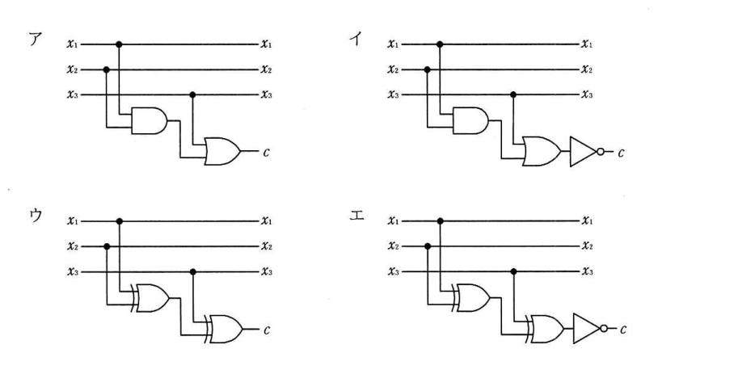
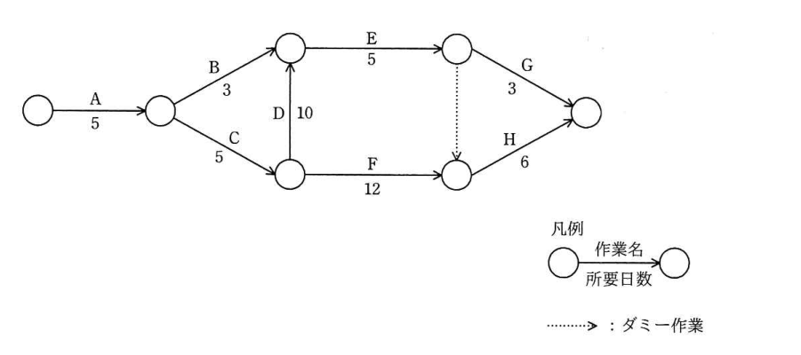

# 令和元年度秋期 科目A（旧午前）過去問解説

> 令和元年度 秋期 応用情報技術者試験 午前（全80問）を書き起こし、オリジナルの解説を付けたものです。問題の著作権は IPA（独立行政法人 情報処理推進機構）にあります。
> 図を表に書き換えるなど一部改変した問題には、その旨を記載しています。
> インタラクティブ教材の [科目A 四択クイズ](../../06_インタラクティブ教材/quiz.html) では、この回を本番形式（150分）で解けます。

## 目次

| 問 | 分野 | 中分類 | キーワード |
|---|---|---|---|
| [問1](#q01) | テクノロジ系 | 基礎理論 | 8進数、基数変換、部屋番号 |
| [問2](#q02) | テクノロジ系 | 基礎理論 | 集合、補集合、ド・モルガンの法則、差集合 |
| [問3](#q03) | テクノロジ系 | 基礎理論 | M/M/1、待ち行列、回線利用率 |
| [問4](#q04) | テクノロジ系 | 基礎理論 | 教師なし学習、クラスタリング、機械学習 |
| [問5](#q05) | テクノロジ系 | コンピュータ構成要素 | リアルタイムシステム、組込みシステム、デッドライン |
| [問6](#q06) | テクノロジ系 | アルゴリズムとプログラミング | 線形リスト、単方向リスト、ポインタ |
| [問7](#q07) | テクノロジ系 | アルゴリズムとプログラミング | ハッシュ、衝突、シノニム、剰余 |
| [問8](#q08) | テクノロジ系 | アルゴリズムとプログラミング | 分割統治法、クイックソート、整列アルゴリズム |
| [問9](#q09) | テクノロジ系 | コンピュータ構成要素 | プログラムカウンタ、レジスタ、命令実行サイクル |
| [問10](#q10) | テクノロジ系 | コンピュータ構成要素 | キャッシュメモリ、実効アクセス時間、ヒット率 |
| [問11](#q11) | テクノロジ系 | コンピュータ構成要素 | DisplayPort、映像インタフェース、HDMI、DVI |
| [問12](#q12) | テクノロジ系 | コンピュータ構成要素 | SDXC、exFAT、SDメモリカード |
| [問13](#q13) | テクノロジ系 | システム構成要素 | スケールアウト、スケールアップ、分散処理 |
| [問14](#q14) | テクノロジ系 | システム構成要素 | キャパシティプランニング、性能管理、応答時間 |
| [問15](#q15) | テクノロジ系 | システム構成要素 | 並行処理、パイプライン、スループット、ボトルネック |
| [問16](#q16) | テクノロジ系 | システム構成要素 | フォールトアボイダンス、フェールセーフ、フェールソフト、フォールトトレランス |
| [問17](#q17) | テクノロジ系 | ソフトウェア | ジョブスケジューリング、多重度、一時ファイル |
| [問18](#q18) | テクノロジ系 | ソフトウェア | ページング、ページフォールト、ページアウト、仮想記憶 |
| [問19](#q19) | テクノロジ系 | ソフトウェア | ワーストフィット、領域割当て、記憶管理 |
| [問20](#q20) | テクノロジ系 | ハードウェア | D/A変換、分解能、LSB |
| [問21](#q21) | テクノロジ系 | ハードウェア | ウォッチドッグタイマ、組込みシステム、暴走検知 |
| [問22](#q22) | テクノロジ系 | ハードウェア | エネルギーハーベスティング、環境発電、IoT |
| [問23](#q23) | テクノロジ系 | ハードウェア | 偶数パリティ、排他的論理和、論理回路 |
| [問24](#q24) | テクノロジ系 | ユーザーインタフェース | ユーザビリティ評価、思考発話法、ヒューリスティック評価法 |
| [問25](#q25) | テクノロジ系 | 情報メディア | H.264、MPEG-4 AVC、動画圧縮 |
| [問26](#q26) | テクノロジ系 | データベース | E-Rモデル、概念データモデル、エンティティ |
| [問27](#q27) | テクノロジ系 | データベース | 参照制約、ON DELETE CASCADE、外部キー |
| [問28](#q28) | テクノロジ系 | データベース | 共有ロック、専有ロック、ロック粒度 |
| [問29](#q29) | テクノロジ系 | データベース | 媒体障害、ロールフォワード、バックアップ、障害回復 |
| [問30](#q30) | テクノロジ系 | データベース | 2相コミット、分散データベース、原子性 |
| [問31](#q31) | テクノロジ系 | ネットワーク | VoIP、パケット、ペイロード |
| [問32](#q32) | テクノロジ系 | ネットワーク | CSMA/CD、イーサネット、衝突検出 |
| [問33](#q33) | テクノロジ系 | ネットワーク | ARP、MACアドレス、IPアドレス |
| [問34](#q34) | テクノロジ系 | ネットワーク | IPv6、アドレス表記、省略表記 |
| [問35](#q35) | テクノロジ系 | ネットワーク | フォワードプロキシ、リバースプロキシ、代理サーバ |
| [問36](#q36) | テクノロジ系 | ネットワーク | IPv6、拡張ヘッダ、IPsec |
| [問37](#q37) | テクノロジ系 | セキュリティ | NAPT、IPマスカレード、ファイアウォール |
| [問38](#q38) | テクノロジ系 | セキュリティ | チャレンジレスポンス認証、ワンタイムパスワード、認証方式 |
| [問39](#q39) | テクノロジ系 | セキュリティ | WPA2-PSK、事前共有鍵、無線LAN |
| [問40](#q40) | テクノロジ系 | セキュリティ | 情報セキュリティの3要素、可用性、JIS Q 27000 |
| [問41](#q41) | テクノロジ系 | セキュリティ | VDI、画面転送、Web分離 |
| [問42](#q42) | テクノロジ系 | セキュリティ | エクスプロイトキット、脆弱性、ドライブバイダウンロード |
| [問43](#q43) | テクノロジ系 | セキュリティ | ダークネット、スキャン、観測 |
| [問44](#q44) | テクノロジ系 | セキュリティ | ファジング、脆弱性検査、ファズ |
| [問45](#q45) | テクノロジ系 | セキュリティ | 虹彩認証、生体認証、他人受入率 |
| [問46](#q46) | テクノロジ系 | システム開発技術 | ペトリネット、プレース、トランジション |
| [問47](#q47) | テクノロジ系 | システム開発技術 | 機能適合性、JIS X 25010、品質特性、SQuaRE |
| [問48](#q48) | テクノロジ系 | システム開発技術 | インスペクション、モデレータ、レビュー技法 |
| [問49](#q49) | テクノロジ系 | ソフトウェア開発管理技術 | リーンソフトウェア開発、アジャイル、七つの原則 |
| [問50](#q50) | テクノロジ系 | ソフトウェア開発管理技術 | 使用許諾、ライセンス、著作権 |
| [問51](#q51) | マネジメント系 | プロジェクトマネジメント | PMO、PMBOK、プログラムマネジメント、ポートフォリオマネジメント |
| [問52](#q52) | マネジメント系 | プロジェクトマネジメント | アローダイアグラム、クリティカルパス、最早開始日 |
| [問53](#q53) | マネジメント系 | プロジェクトマネジメント | クラッシング、ファストトラッキング、スケジュール短縮 |
| [問54](#q54) | マネジメント系 | プロジェクトマネジメント | 要員計画、開発生産性、コスト見積り |
| [問55](#q55) | マネジメント系 | サービスマネジメント | サービス・パッケージ、ITIL、コアサービス |
| [問56](#q56) | マネジメント系 | サービスマネジメント | 7ステップの改善プロセス、継続的サービス改善、ITIL |
| [問57](#q57) | マネジメント系 | サービスマネジメント | インシデント管理、既知の誤り、サービス要求管理 |
| [問58](#q58) | マネジメント系 | システム監査 | クラウドサービス、システム監査、事業継続性 |
| [問59](#q59) | マネジメント系 | システム監査 | システム監査技法、インタビュー法、システム監査基準 |
| [問60](#q60) | マネジメント系 | システム監査 | プルーフリスト、網羅性、監査手続 |
| [問61](#q61) | ストラテジ系 | 企業活動 | BCP、事業継続計画、BCM |
| [問62](#q62) | ストラテジ系 | システム企画 | TCO、総所有費用、隠れたコスト |
| [問63](#q63) | ストラテジ系 | 企業活動 | オープンデータ、二次利用、機械判読 |
| [問64](#q64) | ストラテジ系 | システム戦略 | 重み付け評価、目標達成度、定量化 |
| [問65](#q65) | ストラテジ系 | システム企画 | 共通フレーム、要件定義プロセス、利害関係者 |
| [問66](#q66) | ストラテジ系 | システム企画 | ファウンドリ、ファブレス、半導体 |
| [問67](#q67) | ストラテジ系 | 経営戦略マネジメント | PPM、花形、市場成長率、市場占有率 |
| [問68](#q68) | ストラテジ系 | 経営戦略マネジメント | 4P、4C、マーケティングミックス |
| [問69](#q69) | ストラテジ系 | 経営戦略マネジメント | CRM、顧客関係管理、顧客ロイヤルティ |
| [問70](#q70) | ストラテジ系 | 技術戦略マネジメント | TLO、技術移転、産学連携 |
| [問71](#q71) | ストラテジ系 | システム戦略 | RPA、業務自動化、ホワイトカラー |
| [問72](#q72) | ストラテジ系 | ビジネスインダストリ | アカウントアグリゲーション、フィンテック、家計簿アプリ |
| [問73](#q73) | ストラテジ系 | ビジネスインダストリ | コンバージョン率、CTR、CPA、ROAS |
| [問74](#q74) | ストラテジ系 | 経営戦略マネジメント | デシジョンツリー、期待値、意思決定 |
| [問75](#q75) | ストラテジ系 | 企業活動 | ワークサンプリング法、作業測定、PTS法 |
| [問76](#q76) | ストラテジ系 | 企業活動 | IFRS、国際財務報告基準、会計基準 |
| [問77](#q77) | ストラテジ系 | 企業活動 | 損益分岐点、安全余裕率、限界利益率 |
| [問78](#q78) | ストラテジ系 | 法務 | 著作権法、プログラムの著作物、同一性保持権 |
| [問79](#q79) | ストラテジ系 | 法務 | 下請法、取適法、返品の禁止 |
| [問80](#q80) | ストラテジ系 | 法務 | 技適マーク、電波法、技術基準適合証明 |

### 問1　〔基礎理論〕 🧮

あるホテルは客室を 1,000 部屋もち，部屋番号は，数字 4 と 9 を使用しないで 0001 から順に数字 4 桁の番号としている。部屋番号が 0330 の部屋は，何番目の部屋か。

- **ア**　204
- **イ**　210
- **ウ**　216
- **エ**　218

解答・解説

**正解：ウ**

4 と 9 を使わない部屋番号は，0〜3，5〜8 の 8 種類の数字だけで数えるので **8進数** と同じ仕組みになる。0330 を8進数とみなして10進数に直すと 216 で，0001 が1番目なので 0330 は 216 番目。

**途中式**

- 使う数字：0, 1, 2, 3, 5, 6, 7, 8 → 8進数の 0〜7 に対応（5→4，6→5，7→6，8→7）
- 0330 の各桁はすべて 3 以下なので，そのまま 8進数 (0330)₈ と読める
- (0330)₈ = 3×8² ＋ 3×8 ＋ 0 = 192 ＋ 24 = **216**
- 0001 が1番目（＝(1)₈），0330 は (216)₁₀ 番目

- ア・イ・エ：いずれも 8進数としての変換結果 216 と一致しない。10進数の 330 から 4 と 9 を含む番号を手で数えて引く方法は数え漏れ・重複が起きやすく，こうした近い値になりやすい（検算：0001〜0330 のうち 4・9 を含まない番号を数えると 216 個）

💡 **ポイント**：「使わない数字がある連番」は，使える数字の種類数を基数とする n 進数として扱う。桁に 5〜8 が出てくるときは1つ詰めてから変換するのを忘れない。

📖 関連：[基礎理論](../../01_テクノロジ系/01_基礎理論.md)／[計算問題公式集](../../05_まとめ・横断資料/01_計算問題公式集.md)

出典：令和元年度 秋期 応用情報技術者試験 午前 問1

---

### 問2　〔基礎理論〕

全体集合 S 内に異なる部分集合 A と B があるとき，A̅∩B̅ に等しいものはどれか。ここで，A∪B は A と B の和集合，A∩B は A と B の積集合，A̅ は S における A の補集合，A−B は A から B を除いた差集合を表す。

- **ア**　A̅−B
- **イ**　(A̅∪B̅)−(A∩B)
- **ウ**　(S−A)∪(S−B)
- **エ**　S−(A∩B)

解答・解説

**正解：ア**

A̅∩B̅ は「A にも B にも属さない要素」。A̅（A に属さない要素）から B に属する要素を除いた A̅−B と等しい。

**途中式**

- X−Y ＝ X∩Y̅ なので，A̅−B ＝ A̅∩B̅
- ド・モルガンの法則で A̅∩B̅ ＝ (A∪B)の補集合 ＝ S−(A∪B) とも書ける

- イ：A̅∪B̅ ＝ (A∩B)の補集合 で，そもそも A∩B と重ならないので (A∩B) を除いても A̅∪B̅ のまま。A̅∩B̅ より大きい
- ウ：(S−A)∪(S−B) ＝ A̅∪B̅ で，「A と B の両方に属する要素」以外すべて。∩ と ∪ を取り違えている
- エ：S−(A∩B) ＝ A̅∪B̅ で，ウと同じ集合

💡 **ポイント**：ド・モルガン A̅∩B̅ ＝ (A∪B)̅，A̅∪B̅ ＝ (A∩B)̅。差集合 X−Y ＝ X∩Y̅ に置き換えると判断しやすい。迷ったらベン図を描く。

📖 関連：[基礎理論](../../01_テクノロジ系/01_基礎理論.md)

出典：令和元年度 秋期 応用情報技術者試験 午前 問2

---

### 問3　〔基礎理論〕 🧮

通信回線を使用したデータ伝送システムに M/M/1 の待ち行列モデルを適用すると，平均回線待ち時間，平均伝送時間，回線利用率の関係は，次の式で表すことができる。

平均回線待ち時間 ＝ 平均伝送時間 × 回線利用率 / (1−回線利用率)

回線利用率が 0 から徐々に増加していく場合，平均回線待ち時間が平均伝送時間よりも最初に長くなるのは，回線利用率が幾つを超えたときか。

- **ア**　0.4
- **イ**　0.5
- **ウ**　0.6
- **エ**　0.7

解答・解説

**正解：イ**

平均回線待ち時間が平均伝送時間より長くなるのは，係数 ρ/(1−ρ) が 1 を超えるとき。ρ/(1−ρ) > 1 を解くと ρ > 0.5。

**途中式**

ρ / (1 − ρ) > 1 ⇔ ρ > 1 − ρ ⇔ 2ρ > 1 ⇔ ρ > **0.5**

- ア：ρ=0.4 では 0.4/0.6 ≒ 0.67 倍で，まだ伝送時間より短い
- ウ：ρ=0.6 では 0.6/0.4 = 1.5 倍で長くなっているが，「最初に」超える値ではない
- エ：ρ=0.7 では 0.7/0.3 ≒ 2.3 倍。これも最初の境目ではない

💡 **ポイント**：M/M/1 の待ち時間係数 ρ/(1−ρ) は，ρ=0.5 で 1，ρ=0.8 で 4，ρ=0.9 で 9。利用率が高くなると待ち時間が急増する。

📖 関連：[基礎理論](../../01_テクノロジ系/01_基礎理論.md)／[計算問題公式集](../../05_まとめ・横断資料/01_計算問題公式集.md)

出典：令和元年度 秋期 応用情報技術者試験 午前 問3（数式をテキストで表記）

---

### 問4　〔基礎理論〕

AI の機械学習における教師なし学習で用いられる手法として，最も適切なものはどれか。

- **ア**　幾つかのグループに分かれている既存データ間に分離境界を定め，新たなデータがどのグループに属するかはその分離境界によって判別するパターン認識手法
- **イ**　数式で解を求めることが難しい場合に，乱数を使って疑似データを作り，数値計算をすることによって解を推定するモンテカルロ法
- **ウ**　データ同士の類似度を定義し，その定義した類似度に従って似たもの同士は同じグループに入るようにデータをグループ化するクラスタリング
- **エ**　プロットされた時系列データに対して，曲線の当てはめを行い，得られた近似曲線によってデータの補完や未来予測を行う回帰分析

解答・解説

**正解：ウ**

教師なし学習は，正解ラベルのないデータから構造やまとまりを見つける学習。データ同士の類似度だけでグループを作るクラスタリングが代表例。

- ア：既にグループ分け（ラベル付け）されたデータから境界を学ぶので，教師あり学習の「分類」（SVM など）
- イ：モンテカルロ法は乱数を使った数値シミュレーション手法で，機械学習の学習方式ではない
- エ：回帰分析は既知の値（目的変数）を使って予測式を求めるもので，教師あり学習の「回帰」

💡 **ポイント**：教師あり＝分類・回帰（正解ラベルあり），教師なし＝クラスタリング・次元削減（主成分分析など），強化学習＝報酬で行動を学ぶ。

📖 関連：[基礎理論](../../01_テクノロジ系/01_基礎理論.md)

出典：令和元年度 秋期 応用情報技術者試験 午前 問4

---

### 問5　〔コンピュータ構成要素〕

組込みシステムにおけるリアルタイムシステムにおいて，システムへの入力に対する応答のうち，最も適切なものはどれか。

- **ア**　OS を使用しないで応答する。
- **イ**　定められた制限時間内に応答する。
- **ウ**　入力された順序を守って応答する。
- **エ**　入力時刻を記録して応答する。

解答・解説

**正解：イ**

リアルタイムシステムで重要なのは「速さ」そのものより，**決められた時間（デッドライン）内に必ず応答すること**（時間制約の保証）。

- ア：リアルタイム OS（RTOS）を使うのが一般的で，OS を使わないことが条件ではない
- ウ：優先度の高い入力を先に処理することが多く，入力順を守ることは要件ではない
- エ：入力時刻の記録はログなどの機能であり，リアルタイム性の本質ではない

💡 **ポイント**：ハードリアルタイム（デッドライン超過が致命的：エアバッグ等）とソフトリアルタイム（多少の遅れは許容：動画再生等）の区別も問われる。

📖 関連：[コンピュータ構成要素](../../01_テクノロジ系/03_コンピュータ構成要素.md)／[ソフトウェア](../../01_テクノロジ系/05_ソフトウェア.md)

出典：令和元年度 秋期 応用情報技術者試験 午前 問5

---

### 問6　〔アルゴリズムとプログラミング〕

先頭ポインタと末尾ポインタをもち，多くのデータがポインタでつながった単方向の線形リストの処理のうち，先頭ポインタ，末尾ポインタ又は各データのポインタをたどる回数が最も多いものはどれか。ここで，単方向のリストは先頭ポインタからつながっているものとし，追加するデータはポインタをたどらなくても参照できるものとする。

- **ア**　先頭にデータを追加する処理
- **イ**　先頭のデータを削除する処理
- **ウ**　末尾にデータを追加する処理
- **エ**　末尾のデータを削除する処理

解答・解説

**正解：エ**

末尾のデータを削除するには，末尾の **一つ前** のデータのポインタを書き換え（末尾ポインタもそこへ移す）必要がある。単方向リストでは前へ戻れないので，先頭から順にほぼ全データをたどらなければならず，回数が最も多い。

- ア：先頭ポインタが指すデータを新データの次に付け，先頭ポインタを新データに替えるだけで済む
- イ：先頭ポインタを 2 番目のデータに付け替えるだけで済む
- ウ：末尾ポインタから最後のデータにすぐ到達でき，そのポインタと末尾ポインタを新データに替えるだけで済む

💡 **ポイント**：単方向リストは「前の要素」を知る手段がないため，末尾削除や任意要素の直前への挿入が O(n)。双方向リストならこれが O(1) になる。

📖 関連：[アルゴリズムとプログラミング](../../01_テクノロジ系/02_アルゴリズムとプログラミング.md)

出典：令和元年度 秋期 応用情報技術者試験 午前 問6

---

### 問7　〔アルゴリズムとプログラミング〕

自然数をキーとするデータを，ハッシュ表を用いて管理する。キー x のハッシュ関数 h(x) を

h(x) ＝ x mod n

とすると，任意のキー a と b が衝突する条件はどれか。ここで，n はハッシュ表の大きさであり，x mod n は x を n で割った余りを表す。

- **ア**　a＋b が n の倍数
- **イ**　a−b が n の倍数
- **ウ**　n が a＋b の倍数
- **エ**　n が a−b の倍数

解答・解説

**正解：イ**

衝突（シノニム）は h(a) = h(b)，つまり a と b を n で割った余りが等しいとき。余りが等しいことは，差 a−b が n で割り切れる（n の倍数である）ことと同じ。

**途中式**

a = n·p + r，b = n·q + r とおくと，a − b = n(p − q) → n の倍数

- ア：a＋b が n の倍数なのは余りの和が n（または 0）のときで，余りが等しいとは限らない（例：n=5，a=1，b=4）
- ウ：n が a＋b の倍数，は大小関係が逆で衝突の条件と無関係
- エ：n が a−b の倍数，も倍数関係が逆。正しくは「a−b が n の倍数」

💡 **ポイント**：除算法のハッシュでは「差が n の倍数」なら同じ番地になる。衝突を減らすため n には素数を選ぶことが多い。

📖 関連：[アルゴリズムとプログラミング](../../01_テクノロジ系/02_アルゴリズムとプログラミング.md)

出典：令和元年度 秋期 応用情報技術者試験 午前 問7

---

### 問8　〔アルゴリズムとプログラミング〕

分割統治を利用した整列法はどれか。

- **ア**　基数ソート
- **イ**　クイックソート
- **ウ**　選択ソート
- **エ**　挿入ソート

解答・解説

**正解：イ**

クイックソートは基準値（ピボット）より小さいグループと大きいグループに分割し，それぞれを再帰的に整列する分割統治法の代表例。

- ア：基数ソートは桁ごとに値を振り分けることを繰り返す方法で，分割統治ではない
- ウ：選択ソートは未整列部分から最小値を探して先頭と交換することを繰り返す方法
- エ：挿入ソートは整列済み部分の適切な位置に要素を一つずつ挿入していく方法

💡 **ポイント**：分割統治を使う整列はクイックソートとマージソート。平均計算量はどちらも O(n log n)，クイックソートの最悪は O(n²)。

📖 関連：[アルゴリズムとプログラミング](../../01_テクノロジ系/02_アルゴリズムとプログラミング.md)

出典：令和元年度 秋期 応用情報技術者試験 午前 問8

---

### 問9　〔コンピュータ構成要素〕

CPU のプログラムレジスタ（プログラムカウンタ）の役割はどれか。

- **ア**　演算を行うために，メモリから読み出したデータを保持する。
- **イ**　条件付き分岐命令を実行するために，演算結果の状態を保持する。
- **ウ**　命令のデコードを行うために，メモリから読み出した命令を保持する。
- **エ**　命令を読み出すために，次の命令が格納されたアドレスを保持する。

解答・解説

**正解：エ**

プログラムカウンタ（プログラムレジスタ）は，次に実行する命令が格納されている主記憶上のアドレスを保持するレジスタ。命令を取り出すたびに次の命令のアドレスに更新される。

- ア：汎用レジスタやアキュムレータの役割
- イ：フラグレジスタ（ステータスレジスタ）の役割
- ウ：命令レジスタの役割

💡 **ポイント**：命令実行の流れ「PC のアドレスから命令を取り出す→命令レジスタに格納→デコーダで解読→実行」とレジスタ名を対応付けて覚える。

📖 関連：[コンピュータ構成要素](../../01_テクノロジ系/03_コンピュータ構成要素.md)

出典：令和元年度 秋期 応用情報技術者試験 午前 問9

---

### 問10　〔コンピュータ構成要素〕 🧮

容量が a M バイトでアクセス時間が x ナノ秒の命令キャッシュと，容量が b M バイトでアクセス時間が y ナノ秒の主記憶をもつシステムにおいて，CPU からみた，主記憶と命令キャッシュとを合わせた平均アクセス時間を表す式はどれか。ここで，読み込みたい命令コードがキャッシュに**存在しない確率**を r とし，キャッシュ管理に関するオーバヘッドは無視できるものとする。

- **ア**　(1−r)·a / (a＋b) · x ＋ r·b / (a＋b) · y
- **イ**　(1−r)·x ＋ r·y
- **ウ**　r·a / (a＋b) · x ＋ (1−r)·b / (a＋b) · y
- **エ**　r·x ＋ (1−r)·y

解答・解説

**正解：イ**

平均（実効）アクセス時間は「ヒット率×キャッシュのアクセス時間＋ミス率×主記憶のアクセス時間」。キャッシュに存在しない確率（ミス率）が r なのでヒット率は 1−r で，(1−r)·x ＋ r·y。容量 a, b は計算に関係しない。

**途中式**

平均アクセス時間 = ヒット率 × x ＋ (1 − ヒット率) × y = (1 − r)·x ＋ r·y

- ア：容量の比で重み付けしているが，アクセス時間の平均に容量は関係しない
- ウ：容量で重み付けしたうえ，r と 1−r も逆になっている
- エ：r をヒット率と取り違えている（r はミス率）

💡 **ポイント**：実効アクセス時間 = h·キャッシュ時間 ＋ (1−h)·主記憶時間。問題文の確率が「ヒット率」か「ミス率（存在しない確率）」かを必ず確認する。

📖 関連：[コンピュータ構成要素](../../01_テクノロジ系/03_コンピュータ構成要素.md)／[計算問題公式集](../../05_まとめ・横断資料/01_計算問題公式集.md)

出典：令和元年度 秋期 応用情報技術者試験 午前 問10（分数式をテキストで表記）

---

### 問11　〔コンピュータ構成要素〕

PC とディスプレイの接続に用いられるインタフェースの一つである DisplayPort の説明として，適切なものはどれか。

- **ア**　DVI と同じサイズのコネクタで接続する。
- **イ**　アナログ映像信号も伝送できる。
- **ウ**　映像と音声をパケット化して，シリアル伝送できる。
- **エ**　著作権保護の機能をもたない。

解答・解説

**正解：ウ**

DisplayPort は VESA が策定したデジタル映像インタフェースで，映像と音声をパケット化し，シリアル伝送する。

- ア：DisplayPort のコネクタは DVI よりずっと小さい（DVI は大型の多ピンコネクタ）
- イ：DisplayPort はデジタル専用で，アナログ映像信号（VGA で使う RGB 信号）は伝送しない
- エ：著作権保護技術 DPCP や HDCP に対応している

💡 **ポイント**：映像インタフェース：VGA（アナログ），DVI（デジタル，音声なし），HDMI（映像＋音声，家電向け），DisplayPort（映像＋音声をパケット伝送，PC 向け）。

📖 関連：[コンピュータ構成要素](../../01_テクノロジ系/03_コンピュータ構成要素.md)

出典：令和元年度 秋期 応用情報技術者試験 午前 問11

---

### 問12　〔コンピュータ構成要素〕

SD メモリカードの上位規格の一つである SDXC の特徴として，適切なものはどれか。

- **ア**　GPS，カメラ，無線 LAN アダプタなどの周辺機能をハードウェアとしてカードに搭載している。
- **イ**　SD メモリカードの 4 分の 1 以下の小型サイズで，最大 32G バイトの容量をもつ。
- **ウ**　著作権保護技術として AACS を採用し，従来の SD メモリカードよりもセキュリティが強化された。
- **エ**　ファイルシステムに exFAT を採用し，最大 2T バイトの容量に対応できる。

解答・解説

**正解：エ**

SDXC は 32G バイトを超える容量に対応するため，ファイルシステムに exFAT を採用し，規格上最大 2T バイトまで扱える。

- ア：周辺機能を搭載したカードは SDIO カードの説明
- イ：小型サイズで最大 32G バイトは microSDHC の説明（microSD のサイズは SD の約4分の1）
- ウ：AACS は Blu-ray Disc などで使われる著作権保護技術。SD カードは CPRM を使う

💡 **ポイント**：容量規格 SD（〜2GB，FAT16）→ SDHC（〜32GB，FAT32）→ SDXC（〜2TB，exFAT）→ SDUC（〜128TB）。

📖 関連：[コンピュータ構成要素](../../01_テクノロジ系/03_コンピュータ構成要素.md)

出典：令和元年度 秋期 応用情報技術者試験 午前 問12

---

### 問13　〔システム構成要素〕

システムの性能を向上させるための方法として，スケールアウトが適しているシステムはどれか。

- **ア**　一連の大きな処理を一括して実行しなければならないので，並列処理が困難な処理が中心のシステム
- **イ**　参照系のトランザクションが多いので，複数のサーバで分散処理を行っているシステム
- **ウ**　データを追加するトランザクションが多いので，データの整合性を取るためのオーバヘッドを小さくしなければならないシステム
- **エ**　同一のマスタデータベースがシステム内に複数配置されているので，マスタを更新する際にはデータベース間で整合性を保持しなければならないシステム

解答・解説

**正解：イ**

スケールアウトはサーバの台数を増やして処理を分散させる方法。データの更新がなく，サーバ間の整合性を気にしなくてよい参照系トランザクション中心で，既に分散処理をしているシステムに向く。

- ア：並列化できない一括処理は台数を増やしても速くならず，CPU やメモリを強化するスケールアップが向く
- ウ：追加（更新）が多いと複数サーバ間でデータの整合性を取るオーバヘッドが増えるので，スケールアウトは不向き
- エ：複数のデータベースの整合性を保つ必要があり，台数が増えるほど更新の同期負荷が大きくなる

💡 **ポイント**：スケールアウト＝台数を増やす（参照中心・Web サーバ向き），スケールアップ＝1台の性能を上げる（更新中心の DB サーバ向き）。

📖 関連：[システム構成要素](../../01_テクノロジ系/04_システム構成要素.md)

出典：令和元年度 秋期 応用情報技術者試験 午前 問13

---

### 問14　〔システム構成要素〕

キャパシティプランニングの目的の一つに関する記述のうち，最も適切なものはどれか。

- **ア**　応答時間に最も影響があるボトルネックだけに着目して，適切な変更を行うことによって，そのボトルネックの影響を低減又は排除することである。
- **イ**　システムの現在の応答時間を調査し，長期的に監視することによって，将来を含めて応答時間を維持することである。
- **ウ**　ソフトウェアとハードウェアをチューニングして，現状の処理能力を最大限に引き出して，スループットを向上させることである。
- **エ**　パフォーマンスの問題はリソースの過剰使用によって発生するので，特定のリソースの有効利用を向上させることである。

解答・解説

**正解：イ**

キャパシティプランニングは，現在の性能や資源の使用状況を把握・監視し，将来の需要（業務量の増加）を予測して，必要な性能を維持できるよう資源の増強などを計画すること。将来を見据えて応答時間を維持する イ が目的に合う。

- ア：特定のボトルネックの解消はパフォーマンスチューニングの説明で，将来の計画が含まれていない
- ウ：現状の処理能力を最大限に引き出すのはチューニングであり，将来の需要予測に基づく計画ではない
- エ：特定リソースの有効利用の向上もチューニングの視点で，全体の将来計画ではない

💡 **ポイント**：キャパシティプランニングの手順は「現状把握（モニタリング）→ 将来需要の予測 → 必要な構成・資源の計画」。キーワードは「将来」「長期的」。

📖 関連：[システム構成要素](../../01_テクノロジ系/04_システム構成要素.md)／[サービスマネジメント](../../02_マネジメント系/02_サービスマネジメント.md)

出典：令和元年度 秋期 応用情報技術者試験 午前 問14

---

### 問15　〔システム構成要素〕 🧮

1 件のデータを処理する際に，読取りには 40 ミリ秒，CPU 処理には 30 ミリ秒，書込みには 50 ミリ秒掛かるプログラムがある。このプログラムで，n 件目の書込みと並行して n＋1 件目の CPU 処理と n＋2 件目の読取りを実行すると，1 分当たりの最大データ処理件数は幾つか。ここで，OS のオーバヘッドは考慮しないものとする。

- **ア**　500
- **イ**　666
- **ウ**　750
- **エ**　1,200

解答・解説

**正解：エ**

読取り・CPU 処理・書込みを並行して流れ作業（パイプライン）にすると，定常状態では最も遅い段階（書込み 50 ミリ秒）ごとに1件が完了する。1分＝60,000 ミリ秒なので 60,000 ÷ 50 ＝ 1,200 件。

**途中式**

- 1件当たりの処理間隔 = max(40, 30, 50) = 50 ミリ秒
- 1分当たりの件数 = 60,000 ÷ 50 = **1,200** 件

- ア：60,000 ÷ (40＋30＋50) = 500 で，並行処理せずに順番に処理した場合の件数
- イ：60,000 ÷ (40＋50) ≒ 666 で，CPU 処理だけを並行させたような誤った計算
- ウ：60,000 ÷ 80 = 750 で，ボトルネックの段階を取り違えた計算

💡 **ポイント**：段階を重ねて並行処理する場合のスループットは「最も遅い段階の処理時間」で決まる。

📖 関連：[システム構成要素](../../01_テクノロジ系/04_システム構成要素.md)／[計算問題公式集](../../05_まとめ・横断資料/01_計算問題公式集.md)

出典：令和元年度 秋期 応用情報技術者試験 午前 問15

---

### 問16　〔システム構成要素〕

システムの信頼性向上技術に関する記述のうち，適切なものはどれか。

- **ア**　故障が発生したときに，あらかじめ指定されている安全な状態にシステムを保つことを，フェールソフトという。
- **イ**　故障が発生したときに，あらかじめ指定されている縮小した範囲のサービスを提供することを，フォールトマスキングという。
- **ウ**　故障が発生したときに，その影響が誤りとなって外部に出ないように訂正することを，フェールセーフという。
- **エ**　故障が発生したときに対処するのではなく，品質管理などを通じてシステム構成要素の信頼性を高めることを，フォールトアボイダンスという。

解答・解説

**正解：エ**

フォールトアボイダンスは，故障そのものが起きないように，品質の高い部品の使用や品質管理によって構成要素の信頼性を高める考え方。

- ア：安全な状態に保つのはフェールセーフの説明
- イ：縮小した範囲でサービスを続けるのはフェールソフト（縮退運転）の説明
- ウ：故障の影響を外部に出さないよう訂正・隠蔽するのはフォールトマスキングの説明

💡 **ポイント**：フォールトアボイダンス＝故障させない，フォールトトレランス＝故障しても機能を維持（フェールセーフ・フェールソフト・フォールトマスキングなど），フールプルーフ＝誤操作をさせない。

📖 関連：[システム構成要素](../../01_テクノロジ系/04_システム構成要素.md)

出典：令和元年度 秋期 応用情報技術者試験 午前 問16

---

### 問17　〔ソフトウェア〕 🧮

ジョブ群と実行の条件が次のとおりであるとき，一時ファイルを作成する磁気ディスクに必要な容量は最低何 M バイトか。

〔ジョブ群〕

A→B，A→C，B→D，B→E，C→E，D→F，E→F（図では B は D の上，C は E の上に描かれ，A からは B，C の順，B からは D，E の順に矢印が出ている）

〔実行の条件〕

(1)　ジョブの実行多重度を 2 とする。
(2)　各ジョブの処理時間は同一であり，他のジョブの影響は受けない。
(3)　各ジョブは開始時に 50 M バイトの一時ファイルを新たに作成する。
(4)　X→Y の関係があれば，ジョブ X の開始時に作成した一時ファイルは，直後のジョブ Y で参照し，ジョブ Y の終了時にその一時ファイルを削除する。直後のジョブが複数個ある場合には，最初に生起されるジョブだけが先行ジョブの一時ファイルを参照する。
(5)　X→Y，X→Z（Y が上，Z が下に描かれている）はジョブ X の終了時に，ジョブ Y，Z のようにジョブ X と矢印で結ばれる全てのジョブが，上から記述された順に優先して生起されることを示す。
(6)　X→Z，Y→Z は先行するジョブ X，Y 両方が終了したときにジョブ Z が生起されることを示す。
(7)　ジョブの生起とは実行待ち行列への追加を意味し，各ジョブは待ち行列の順に実行される。
(8)　OS のオーバヘッドは考慮しない。

- **ア**　100
- **イ**　150
- **ウ**　200
- **エ**　250

解答・解説

**正解：ウ**

時間を処理単位で区切って，各時点で存在する一時ファイルを数えると，最大は D と E を実行している時点の 4 個（B，C，D，E のファイル）で，50×4 ＝ 200 M バイト。

**途中式**

| 時点 | 実行中のジョブ | 開始時点で存在する一時ファイル | 終了時に削除されるファイル |
|---|---|---|---|
| 1 | A | A | （なし） |
| 2 | B，C | A，B，C（150M） | A（B が参照） |
| 3 | D，E | B，C，D，E（**200M**） | B（D が参照），C（E が参照） |
| 4 | F | D，E，F（150M） | D，E |

- A の後続は B，C の順に生起し，A のファイルは最初に生起した B だけが参照する（C は参照しない）
- B の後続は D，E の順。E は B と C の両方の終了後に生起されるが，B，C は同時に終わるので D，E が同時に実行される
- 時点3で B，C のファイルがまだ残ったまま D，E が新しいファイルを作るため，ここが最大

- ア：100 は同時に実行する2ジョブ分のファイルしか数えていない
- イ：150 は時点2または時点4の量で，最大ではない
- エ：250 は時点3に A のファイルも残っているとした値。A のファイルは時点2の B の終了時に削除済み

💡 **ポイント**：一時ファイル・メモリ量の問題は，時間軸の表を作って「いつ作成され，いつ削除されるか」を1行ずつ追うと確実。

📖 関連：[ソフトウェア](../../01_テクノロジ系/05_ソフトウェア.md)

出典：令和元年度 秋期 応用情報技術者試験 午前 問17（ジョブ群の図と条件中の記号図を文章（矢印の一覧）に書き換え）

---

### 問18　〔ソフトウェア〕

ページング方式の仮想記憶において，主記憶に存在しないページをアクセスした場合の処理や状態の順番として，適切なものはどれか。ここで，現在主記憶には，空きページはないものとする。

- **ア**　置換え対象ページの決定 → ページイン → ページフォールト → ページアウト
- **イ**　置換え対象ページの決定 → ページフォールト → ページアウト → ページイン
- **ウ**　ページフォールト → 置換え対象ページの決定 → ページアウト → ページイン
- **エ**　ページフォールト → 置換え対象ページの決定 → ページイン → ページアウト

解答・解説

**正解：ウ**

主記憶にないページをアクセスするとまず **ページフォールト**（割込み）が起きる。空きページがないので，OS は LRU などで追い出すページを決め，そのページを補助記憶に **ページアウト** して空きを作ってから，必要なページを **ページイン** する。

- ア：ページフォールトが発生する前に置換え対象を決めることはない。また，ページインの後にページアウトでは領域が空いていない
- イ：置換え対象ページの決定はページフォールトの発生を受けて行う処理なので，順番が逆
- エ：空きページがないので，先にページアウトして領域を空けなければページインできない

💡 **ポイント**：「フォールト → 追い出し対象決定（LRU・FIFO など）→ ページアウト → ページイン」の順。ページイン・アウトが頻発して性能が落ちる状態がスラッシング。

📖 関連：[ソフトウェア](../../01_テクノロジ系/05_ソフトウェア.md)

出典：令和元年度 秋期 応用情報技術者試験 午前 問18

---

### 問19　〔ソフトウェア〕 🧮

三つの媒体 A〜C に次の条件でファイル領域を割り当てた場合，割り当てた領域の総量が大きい順に媒体を並べたものはどれか。

〔条件〕

(1)　ファイル領域を割り当てる際の媒体選択アルゴリズムとして，空き領域が最大の媒体を選択する方式を採用する。
(2)　割当て要求されるファイル領域の大きさは，順に 90，30，40，40，70，30（M バイト）であり，割り当てられたファイル領域は，途中で解放されない。
(3)　各媒体は容量が同一であり，割当て要求に対して十分な大きさをもち，初めは全て空きの状態である。
(4)　空き領域の大きさが等しい場合には，A，B，C の順に選択する。

- **ア**　A，B，C
- **イ**　A，C，B
- **ウ**　B，A，C
- **エ**　C，B，A

解答・解説

**正解：エ**

容量が同じなので「空き領域が最大」＝「割当て済みが最小」の媒体を選ぶ。順に割り当てると最終的に A＝90，B＝100，C＝110 となり，大きい順は C，B，A。

**途中式**（各要求後の割当て済み量）

| 要求 | 選ぶ媒体（理由） | A | B | C |
|---|---|---|---|---|
| 90 | A（全て空きなので A） | 90 | 0 | 0 |
| 30 | B（B=C=0，同じなら B） | 90 | 30 | 0 |
| 40 | C（C が最小） | 90 | 30 | 40 |
| 40 | B（B=30 が最小） | 90 | 70 | 40 |
| 70 | C（C=40 が最小） | 90 | 70 | 110 |
| 30 | B（B=70 が最小） | 90 | **100** | **110** |

- ア：4番目の要求までの状態（A=90，B=70，C=40）の並びで，5・6番目の割当てを反映していない
- イ：A が最大になるのは途中までで，最終的に C と B が A を上回る
- ウ：B が最大，C が最小としているが，最終的に C=110 が最大で，最後の 30 を割り当てた B も 100 にとどまる

💡 **ポイント**：空き領域が最大の領域を選ぶのはワーストフィット，要求を満たす最小の領域を選ぶのはベストフィット，最初に見つかった領域はファーストフィット。

📖 関連：[ソフトウェア](../../01_テクノロジ系/05_ソフトウェア.md)

出典：令和元年度 秋期 応用情報技術者試験 午前 問19

---

### 問20　〔ハードウェア〕 🧮

分解能が 8 ビットの D/A 変換器に，ディジタル値 0 を入力したときの出力電圧が 0 V となり，ディジタル値 128 を入力したときの出力電圧が 2.5 V となる場合，最下位の 1 ビットの変化による当該 D/A 変換器の出力電圧の変化は何 V か。

- **ア**　2.5／128
- **イ**　2.5／255
- **ウ**　2.5／256
- **エ**　2.5／512

解答・解説

**正解：ア**

ディジタル値が 0 から 128 に 128 増えると出力が 2.5 V 増えるので，ディジタル値 1（最下位ビット1つ分）当たりの変化は 2.5／128 V。

**途中式**

1 LSB 当たりの電圧 = 2.5 V ÷ (128 − 0) = **2.5／128 V**

- イ：2.5／255 は 8 ビットの最大値 255 で割っており，128 で 2.5 V という条件を使っていない
- ウ：2.5／256 は 8 ビットで表せる値の個数 256 で割った値。2.5 V はフルスケールではない
- エ：2.5／512 は 9 ビット分で割った値で，根拠がない

💡 **ポイント**：D/A・A/D 変換の 1 ビット当たりの電圧は「電圧の変化量 ÷ ディジタル値の変化量」。分解能のビット数から機械的に 2ⁿ で割らず，与えられた対応点を使う。

📖 関連：[ハードウェア](../../01_テクノロジ系/10_ハードウェア.md)／[計算問題公式集](../../05_まとめ・横断資料/01_計算問題公式集.md)

出典：令和元年度 秋期 応用情報技術者試験 午前 問20

---

### 問21　〔ハードウェア〕

組込みシステムにおける，ウォッチドッグタイマの機能はどれか。

- **ア**　あらかじめ設定された一定時間内にタイマがクリアされなかった場合，システム異常とみなしてシステムをリセット又は終了する。
- **イ**　システム異常を検出した場合，タイマで設定された時間だけ待ってシステムに通知する。
- **ウ**　システム異常を検出した場合，マスカブル割込みでシステムに通知する。
- **エ**　システムが一定時間異常であった場合，上位の管理プログラムを呼び出す。

解答・解説

**正解：ア**

ウォッチドッグタイマは，正常に動作しているプログラムが定期的にタイマをクリアする仕組みで，一定時間内にクリアされなければ暴走やハングアップとみなしてリセットなどを行う。

- イ：異常検出後に一定時間待って通知する機能ではない。ウォッチドッグタイマ自体が「クリアされない」ことで異常を検出する
- ウ：マスクできる割込みでは異常時に通知が無視されるおそれがあり，ウォッチドッグタイマの説明ではない（通常はリセットやマスク不能割込み）
- エ：異常を検出する仕組みの説明がなく，上位プログラムの呼出しは本来の機能ではない

💡 **ポイント**：ウォッチドッグタイマは「番犬」。プログラムが定期的に“餌”をやる（タイマをクリアする）のをやめたら異常とみなす，というイメージで覚える。

📖 関連：[ハードウェア](../../01_テクノロジ系/10_ハードウェア.md)

出典：令和元年度 秋期 応用情報技術者試験 午前 問21

---

### 問22　〔ハードウェア〕

エネルギーハーベスティングの適用例として，適切なものはどれか。

- **ア**　AC 電源で充電したバッテリで駆動される携帯電話機
- **イ**　インバータ制御を用いるエアーコンディショナの室外機
- **ウ**　スイッチを押す力を電力に変換して作動する RF リモコン
- **エ**　無停電電源装置を備えたデータサーバ

解答・解説

**正解：ウ**

エネルギーハーベスティング（環境発電）は，光・振動・熱・人の動作などの周囲の微小なエネルギーを電力に変換して利用する技術。ボタンを押す力で発電して電波を送るリモコンが該当する。

- ア：商用電源（AC 電源）で充電したバッテリの利用で，環境からエネルギーを得ていない
- イ：インバータ制御はモーターの回転数を調整して省エネルギーを図る技術
- エ：無停電電源装置（UPS）は停電時にバッテリから電力を供給する装置

💡 **ポイント**：電池交換や配線が難しい IoT センサーなどの電源として注目される。太陽光・振動・温度差・電波などが代表的なエネルギー源。

📖 関連：[ハードウェア](../../01_テクノロジ系/10_ハードウェア.md)

出典：令和元年度 秋期 応用情報技術者試験 午前 問22

---

### 問23　〔ハードウェア〕

3 ビットのデータ x₁，x₂，x₃ に偶数パリティビット c を付加する回路はどれか。

- **ア**　（図のア：AND と OR）
- **イ**　（図のイ：AND と OR の出力を NOT）
- **ウ**　（図のウ：XOR を2段）
- **エ**　（図のエ：XOR を2段の出力を NOT）

解答・解説

**正解：ウ**

偶数パリティは，データとパリティビットを合わせた 1 の個数が偶数になるように c を決める。x₁，x₂，x₃ の 1 の個数が奇数なら c=1，偶数なら c=0 なので，c ＝ x₁ ⊕ x₂ ⊕ x₃（XOR を2段）となり，ウの回路。

**途中式**（例）

- x₁x₂x₃ ＝ 110 → 1⊕1⊕0 ＝ 0 → 1 の個数は 2＋0 ＝ 偶数 ✓
- x₁x₂x₃ ＝ 111 → 1⊕1⊕1 ＝ 1 → 1 の個数は 3＋1 ＝ 4（偶数）✓

- ア：(x₁・x₂)＋x₃ で，例えば 100 のとき c=0 となり 1 の個数が奇数のまま
- イ：アの否定。例えば 000 のとき c=1 となり 1 の個数が奇数になる
- エ：XOR の結果を反転しているので奇数パリティを生成する回路

💡 **ポイント**：XOR は「1 の個数が奇数なら 1」を返すので，偶数パリティ＝全ビットの XOR，奇数パリティ＝その否定（XNOR）。

📖 関連：[ハードウェア](../../01_テクノロジ系/10_ハードウェア.md)／[基礎理論](../../01_テクノロジ系/01_基礎理論.md)

出典：令和元年度 秋期 応用情報技術者試験 午前 問23（選択肢の回路図に素子構成を補記）

---

### 問24　〔ユーザーインタフェース〕

ユーザインタフェースのユーザビリティを評価するときの，利用者の立場からの評価手法と専門家の立場からの評価手法の適切な組みはどれか。

|  | 利用者の立場からの評価手法 | 専門家の立場からの評価手法 |
|---|---|---|
| ア | アンケート | 回顧法 |
| イ | 回顧法 | 思考発話法 |
| ウ | 思考発話法 | ヒューリスティック評価法 |
| エ | 認知的ウォークスルー法 | ヒューリスティック評価法 |

- **ア**　利用者：アンケート，専門家：回顧法
- **イ**　利用者：回顧法，専門家：思考発話法
- **ウ**　利用者：思考発話法，専門家：ヒューリスティック評価法
- **エ**　利用者：認知的ウォークスルー法，専門家：ヒューリスティック評価法

解答・解説

**正解：ウ**

思考発話法は，利用者に操作してもらいながら考えていることを声に出してもらう利用者参加型の手法。ヒューリスティック評価法は，専門家が経験則（ガイドライン）に照らして問題点を洗い出す手法。

- ア：回顧法は，操作を終えた利用者に後から感想や理由を聞く利用者側の手法
- イ：回顧法・思考発話法はどちらも利用者の立場からの手法
- エ：認知的ウォークスルー法は，専門家（設計者）が利用者の思考過程を想定しながら操作手順をたどる手法で，専門家側の手法

💡 **ポイント**：利用者が参加＝アンケート・インタビュー・思考発話法・回顧法・ユーザテスト，専門家が評価＝ヒューリスティック評価法・認知的ウォークスルー法。

📖 関連：[ユーザーインタフェースと情報メディア](../../01_テクノロジ系/11_ユーザーインタフェースと情報メディア.md)

出典：令和元年度 秋期 応用情報技術者試験 午前 問24（選択肢の表を文章に書き換え）

---

### 問25　〔情報メディア〕

H.264/MPEG-4 AVC の説明として，適切なものはどれか。

- **ア**　インターネットで動画や音声データのストリーミング配信を制御するための通信方式
- **イ**　テレビ会議やテレビ電話で双方向のビデオ配信を制御するための通信方式
- **ウ**　テレビの電子番組案内で使用される番組内容のメタデータを記述する方式
- **エ**　ワンセグやインターネットで用いられる動画データの圧縮符号化方式

解答・解説

**正解：エ**

H.264/MPEG-4 AVC は，ITU-T と ISO/IEC が共同で策定した動画の圧縮符号化方式で，ワンセグ放送，Blu-ray Disc，動画配信などで広く使われている。

- ア：ストリーミング配信の制御は RTSP などの通信プロトコルの説明
- イ：テレビ会議の双方向通信の制御は H.323 や SIP などの説明
- ウ：電子番組案内（EPG）のメタデータの記述方式の説明で，符号化方式ではない

💡 **ポイント**：動画圧縮方式の系譜：MPEG-2（DVD・地デジ）→ H.264/AVC（ワンセグ・BD）→ H.265/HEVC（4K・8K 放送）。H.265 は H.264 の約2倍の圧縮効率。

📖 関連：[ユーザーインタフェースと情報メディア](../../01_テクノロジ系/11_ユーザーインタフェースと情報メディア.md)

出典：令和元年度 秋期 応用情報技術者試験 午前 問25

---

### 問26　〔データベース〕

データベースの概念設計に用いられ，対象世界を，実体と実体間の関連という二つの概念で表現するデータモデルはどれか。

- **ア**　E-R モデル
- **イ**　階層モデル
- **ウ**　関係モデル
- **エ**　ネットワークモデル

解答・解説

**正解：ア**

E-R モデルは，対象世界を実体（エンティティ）と実体間の関連（リレーションシップ）で表現するモデルで，DBMS に依存しない概念設計で使われる。

- イ：階層モデルは親子関係の木構造でデータを表す論理データモデル
- ウ：関係モデルはデータを表（関係）で表す論理データモデルで，RDBMS の基礎
- エ：ネットワークモデルはレコード間を網構造で結び，多対多も表す論理データモデル

💡 **ポイント**：概念データモデル＝E-R モデル（DBMS に依存しない），論理データモデル＝階層・ネットワーク・関係モデル（DBMS の種類に依存）。

📖 関連：[データベース](../../01_テクノロジ系/06_データベース.md)

出典：令和元年度 秋期 応用情報技術者試験 午前 問26

---

### 問27　〔データベース〕

図のような関係データベースの“注文”表と“注文明細”表がある。“注文”表の行を削除すると，対応する“注文明細”表の行が，自動的に削除されるようにしたい。SQL 文の ON DELETE 句に指定する語句はどれか。ここで，図中の実線の下線は主キーを，破線の下線は外部キーを表す。

注文

| 注文番号 | 注文日 | 顧客番号 |
|---|---|---|
| 主キー |  | 外部キー |

注文明細

| 注文番号 | 明細番号 | 商品番号 | 数量 |
|---|---|---|---|
| 主キー・外部キー | 主キー | 外部キー |  |

- **ア**　CASCADE
- **イ**　INTERSECT
- **ウ**　RESTRICT
- **エ**　UNIQUE

解答・解説

**正解：ア**

ON DELETE CASCADE を指定すると，参照される側（注文）の行を削除したときに，それを参照している側（注文明細）の行も連鎖的に自動削除される。

- イ：INTERSECT は二つの問合せ結果の共通部分を求める集合演算子で，参照動作の指定ではない
- ウ：RESTRICT は参照している行があれば被参照側の削除を拒否する指定で，自動削除はされない
- エ：UNIQUE は列の値の一意性を指定する制約で，ON DELETE 句には書かない

💡 **ポイント**：参照動作は CASCADE（連鎖して削除・更新），SET NULL（外部キーを NULL に），RESTRICT / NO ACTION（削除・更新を拒否）を区別して覚える。

📖 関連：[データベース](../../01_テクノロジ系/06_データベース.md)

出典：令和元年度 秋期 応用情報技術者試験 午前 問27（表の図を GFM の表に書き換え，下線（主キー・外部キー）を行で表記）

---

### 問28　〔データベース〕

RDBMS のロックに関する記述のうち，適切なものはどれか。ここで，X，Y はトランザクションとする。

- **ア**　X が A 表内の特定行 a に対して共有ロックを獲得しているときは，Y は A 表内の別の特定行 b に対して専有ロックを獲得することができない。
- **イ**　X が A 表内の特定行 a に対して共有ロックを獲得しているときは，Y は A 表に対して専有ロックを獲得することができない。
- **ウ**　X が A 表に対して共有ロックを獲得しているときでも，Y は A 表に対して専有ロックを獲得することができる。
- **エ**　X が A 表に対して専有ロックを獲得しているときでも，Y は A 表内の特定行 a に対して専有ロックを獲得することができる。

解答・解説

**正解：イ**

A 表全体に専有ロックを掛けると，行 a も含めて表全体を占有することになる。X が行 a に共有ロックを掛けている間は，Y は行 a を含む A 表全体に専有ロックを掛けられない。

- ア：行 a と行 b は別の資源なので，X が行 a をロックしていても Y は行 b に専有ロックを獲得できる
- ウ：共有ロックと専有ロックは両立しないので，同じ A 表に対して専有ロックは獲得できない
- エ：A 表全体が専有ロックされている間は，表内のどの行にもロックを獲得できない

💡 **ポイント**：共有ロック同士は両立，専有ロックはどのロックとも両立しない。表と行のように範囲が包含関係にある場合は，重なる部分があれば競合する。

📖 関連：[データベース](../../01_テクノロジ系/06_データベース.md)

出典：令和元年度 秋期 応用情報技術者試験 午前 問28

---

### 問29　〔データベース〕

データベースに媒体障害が発生したときのデータベースの回復法はどれか。

- **ア**　障害発生時，異常終了したトランザクションをロールバックする。
- **イ**　障害発生時点でコミットしていたがデータベースの実更新がされていないトランザクションをロールフォワードする。
- **ウ**　障害発生時点でまだコミットもアボートもしていなかった全てのトランザクションをロールバックする。
- **エ**　バックアップコピーでデータベースを復元し，バックアップ取得以降にコミットした全てのトランザクションをロールフォワードする。

解答・解説

**正解：エ**

媒体障害ではディスク上のデータベースそのものが失われるので，バックアップから復元し，ログ（更新後ログ）を使ってバックアップ取得以降にコミットしたトランザクションを再実行（ロールフォワード）する。

- ア：トランザクション障害（異常終了）時の回復法
- イ：システム障害時に，チェックポイント後にコミットした更新を反映する回復法
- ウ：システム障害時に，未完了のトランザクションを取り消す回復法

💡 **ポイント**：トランザクション障害→ロールバック，システム障害→ロールバック＋ロールフォワード（チェックポイントから），媒体障害→バックアップから復元＋ロールフォワード。

📖 関連：[データベース](../../01_テクノロジ系/06_データベース.md)

出典：令和元年度 秋期 応用情報技術者試験 午前 問29

---

### 問30　〔データベース〕

分散トランザクション管理において，複数サイトのデータベースを更新する場合に用いられる 2 相コミットプロトコルに関する記述のうち，適切なものはどれか。

- **ア**　主サイトが一部の従サイトからのコミット準備完了メッセージを受け取っていない場合，コミット準備が完了した従サイトに対してだけコミット要求を発行する。
- **イ**　主サイトが一部の従サイトからのコミット準備完了メッセージを受け取っていない場合，全ての従サイトに対して再度コミット準備要求を発行する。
- **ウ**　主サイトが全ての従サイトからコミット準備完了メッセージを受け取った場合，全ての従サイトに対してコミット要求を発行する。
- **エ**　主サイトが全ての従サイトに対してコミット準備要求を発行した場合，従サイトは，コミット準備が完了したときだけ応答メッセージを返す。

解答・解説

**正解：ウ**

2相コミットでは，第1相で主サイトが全ての従サイトにコミット準備を要求し，全てから準備完了の応答を受け取った場合だけ，第2相で全ての従サイトにコミットを要求する。

- ア：一部だけコミットするとサイト間でデータが食い違う。一つでも準備完了でなければ全てのサイトをロールバックさせる
- イ：準備完了を受け取れない場合は再要求ではなく，全サイトにロールバック（アボート）を要求する
- エ：従サイトは準備ができない場合も「準備不可（アボート）」を応答する。完了時だけ返すのではない

💡 **ポイント**：2相コミットは「全員の準備OK → 全員コミット，一人でもNG → 全員ロールバック」で分散トランザクションの原子性を保証する。

📖 関連：[データベース](../../01_テクノロジ系/06_データベース.md)

出典：令和元年度 秋期 応用情報技術者試験 午前 問30

---

### 問31　〔ネットワーク〕 🧮

VoIP 通信において 8 k ビット／秒の音声符号化を行い，パケット生成周期が 10 ミリ秒のとき，1 パケットに含まれる音声ペイロードは何バイトか。

- **ア**　8
- **イ**　10
- **ウ**　80
- **エ**　100

解答・解説

**正解：イ**

10 ミリ秒ごとに 1 パケットを作るので，1 パケットに入る音声データは 10 ミリ秒分。8,000 ビット／秒 × 0.01 秒 ＝ 80 ビット ＝ 10 バイト。

**途中式**

- 8 k ビット／秒 × 10 ミリ秒 ＝ 8,000 × 0.01 ＝ 80 ビット
- 80 ビット ÷ 8 ＝ **10 バイト**

- ア：8 は「8 k ビット」の数字をそのまま使った値
- ウ：80 はビット数のままで，バイトに換算していない
- エ：100 は 1 秒当たりのパケット数（1 秒 ÷ 10 ミリ秒）

💡 **ポイント**：ビットとバイトの換算（÷8）と，ミリ秒を秒に直す（×0.001）単位の取り違えが典型的なミス。

📖 関連：[ネットワーク](../../01_テクノロジ系/07_ネットワーク.md)／[計算問題公式集](../../05_まとめ・横断資料/01_計算問題公式集.md)

出典：令和元年度 秋期 応用情報技術者試験 午前 問31

---

### 問32　〔ネットワーク〕

イーサネットで使用されるメディアアクセス制御方式である CSMA/CD に関する記述として，適切なものはどれか。

- **ア**　それぞれのステーションがキャリア検知を行うとともに，送信データの衝突が起きた場合は再送する。
- **イ**　タイムスロットと呼ばれる単位で分割して，同一周波数において複数の通信を可能にする。
- **ウ**　データ送受信の開始時にデータ送受信のネゴシエーションとして RTS/CTS 方式を用い，受信の確認は ACK を使用する。
- **エ**　伝送路上にトークンを巡回させ，トークンを受け取った端末だけがデータを送信できる。

解答・解説

**正解：ア**

CSMA/CD は，送信前に伝送路が空いているかを確認（キャリア検知）し，送信中に衝突を検出したら，ランダムな時間待って再送する方式。

- イ：時分割多重（TDMA）の説明
- ウ：無線 LAN で使われる CSMA/CA の説明（RTS/CTS や ACK を使う）
- エ：トークンパッシング方式（トークンリングなど）の説明

💡 **ポイント**：CSMA/CD（有線・衝突を検出），CSMA/CA（無線・衝突を回避）。現在のスイッチングハブを使った全二重通信では衝突自体が起きない。

📖 関連：[ネットワーク](../../01_テクノロジ系/07_ネットワーク.md)

出典：令和元年度 秋期 応用情報技術者試験 午前 問32

---

### 問33　〔ネットワーク〕

TCP/IP ネットワークで使用される ARP の説明として，適切なものはどれか。

- **ア**　IP アドレスから MAC アドレスを得るためのプロトコル
- **イ**　IP アドレスからホスト名（ドメイン名）を得るためのプロトコル
- **ウ**　MAC アドレスから IP アドレスを得るためのプロトコル
- **エ**　ホスト名（ドメイン名）から IP アドレスを得るためのプロトコル

解答・解説

**正解：ア**

ARP（Address Resolution Protocol）は，宛先の IP アドレスをブロードキャストで問い合わせ，対応する MAC アドレスを得るプロトコル。

- イ：DNS の逆引きの説明
- ウ：RARP の説明
- エ：DNS の正引きの説明

💡 **ポイント**：ARP＝IP→MAC，RARP＝MAC→IP，DNS＝ホスト名↔IP。IPv6 では ARP の代わりに ICMPv6 の近隣探索（NDP）を使う。

📖 関連：[ネットワーク](../../01_テクノロジ系/07_ネットワーク.md)

出典：令和元年度 秋期 応用情報技術者試験 午前 問33

---

### 問34　〔ネットワーク〕

IPv6 アドレスの表記として，適切なものはどれか。

- **ア**　2001:db8::3ab::ff01
- **イ**　2001:db8::3ab:ff01
- **ウ**　2001:db8.3ab:ff01
- **エ**　2001.db8.3ab.ff01

解答・解説

**正解：イ**

IPv6 アドレスは 16 ビットずつ 16 進数で表し「:」で区切る。0 が連続するフィールドは「::」で 1 回だけ省略できる。イはこの規則に合っている。

- ア：「::」が 2 回使われており，それぞれ何フィールド分の 0 を省略したのか決まらないので不可
- ウ：区切りに「.」が混じっている。「.」は IPv4 の区切り
- エ：全て「.」で区切られており，IPv6 の表記ではない

💡 **ポイント**：IPv6 の省略規則は「各フィールドの先頭の 0 は省略可」「連続する 0 のフィールドは :: で 1 か所だけ省略可」。

📖 関連：[ネットワーク](../../01_テクノロジ系/07_ネットワーク.md)

出典：令和元年度 秋期 応用情報技術者試験 午前 問34

---

### 問35　〔ネットワーク〕

TCP/IP ネットワークのフォワードプロキシに関する説明のうち，最も適切なものはどれか。

- **ア**　Web サーバと同一の組織内（例えば企業内）にあって，Web ブラウザからのリクエストに対して Web サーバの代理として応答する。
- **イ**　Web ブラウザと同一の組織内（例えば企業内）になければならない。
- **ウ**　Web ブラウザの代理として，Web サーバに対するリクエストを送信する。
- **エ**　電子メールをインターネット上の複数のサーバを経由して転送する。

解答・解説

**正解：ウ**

フォワードプロキシは，クライアント（Web ブラウザ）の代わりに Web サーバへリクエストを送り，結果をクライアントに返すサーバ。アクセス制御やキャッシュに利用される。

- ア：Web サーバの代理として応答するのはリバースプロキシの説明
- イ：インターネット上で提供されるプロキシサービスもあり，必ずしもブラウザと同じ組織内にある必要はない
- エ：電子メールの中継は MTA（SMTP サーバ）の役割

💡 **ポイント**：フォワードプロキシ＝クライアント側の代理（社内からの外部アクセスを集約），リバースプロキシ＝サーバ側の代理（負荷分散や SSL 終端に利用）。

📖 関連：[ネットワーク](../../01_テクノロジ系/07_ネットワーク.md)

出典：令和元年度 秋期 応用情報技術者試験 午前 問35

---

### 問36　〔ネットワーク〕

IPv6 において，拡張ヘッダを利用することによって実現できるセキュリティ機能はどれか。

- **ア**　URL フィルタリング機能
- **イ**　暗号化通信機能
- **ウ**　情報漏えい検知機能
- **エ**　マルウェア検知機能

解答・解説

**正解：イ**

IPv6 では IPsec の認証ヘッダ（AH）と暗号ペイロード（ESP）を拡張ヘッダとして扱い，ネットワーク層での暗号化通信や認証を実現できる。

- ア：URL フィルタリングは Web プロキシなどアプリケーション層で行う機能
- ウ：情報漏えい検知は DLP 製品などが通信内容を検査して行う機能
- エ：マルウェア検知はウイルス対策ソフトや UTM などが行う機能

💡 **ポイント**：IPsec は IPv4 ではオプションだが，IPv6 では拡張ヘッダ（AH・ESP）として標準的に組み込まれている。

📖 関連：[ネットワーク](../../01_テクノロジ系/07_ネットワーク.md)／[情報セキュリティ](../../01_テクノロジ系/08_情報セキュリティ.md)

出典：令和元年度 秋期 応用情報技術者試験 午前 問36

---

### 問37　〔セキュリティ〕

インターネットとの接続において，ファイアウォールの NAPT 機能によるセキュリティ上の効果はどれか。

- **ア**　DMZ 上にある公開 Web サーバの脆弱性を悪用する攻撃から防御できる。
- **イ**　インターネットから内部ネットワークへの侵入を検知し，検知後の通信を遮断できる。
- **ウ**　インターネット上の特定の Web サービスを利用する HTTP 通信を検知し，遮断できる。
- **エ**　内部ネットワークからインターネットにアクセスする利用者 PC について，インターネットからの不正アクセスを困難にすることができる。

解答・解説

**正解：エ**

NAPT（IP マスカレード）は，内部の複数の PC のプライベート IP アドレスとポート番号を，グローバル IP アドレスとポート番号に変換する。外部からは内部 PC のアドレスが見えず，内部から開始した通信の応答以外は内部 PC に届かないので，不正アクセスを困難にする効果がある。

- ア：公開 Web サーバの脆弱性を突く攻撃の防御は WAF の役割
- イ：侵入の検知と遮断は IPS（侵入防止システム）の役割
- ウ：特定の Web サービスへの HTTP 通信の遮断は URL フィルタリングやプロキシの役割

💡 **ポイント**：NAT はアドレスだけ，NAPT はアドレス＋ポート番号を変換し，1 つのグローバルアドレスを複数台で共有できる。副次的に内部構成を隠す効果がある。

📖 関連：[情報セキュリティ](../../01_テクノロジ系/08_情報セキュリティ.md)／[ネットワーク](../../01_テクノロジ系/07_ネットワーク.md)

出典：令和元年度 秋期 応用情報技術者試験 午前 問37

---

### 問38　〔セキュリティ〕

チャレンジレスポンス認証方式に該当するものはどれか。

- **ア**　固定パスワードを TLS によって暗号化し，クライアントからサーバに送信する。
- **イ**　端末のシリアル番号を，クライアントで秘密鍵を使って暗号化してサーバに送信する。
- **ウ**　トークンという装置が自動的に表示する，認証のたびに異なるデータをパスワードとしてサーバに送信する。
- **エ**　利用者が入力したパスワードと，サーバから受け取ったランダムなデータとをクライアントで演算し，その結果をサーバに送信する。

解答・解説

**正解：エ**

チャレンジレスポンス認証は，サーバが毎回異なる乱数（チャレンジ）を送り，クライアントがパスワードとチャレンジから計算した値（レスポンス）を返す方式。パスワードそのものがネットワークを流れず，盗聴したレスポンスも再利用できない。

- ア：暗号化通信路でパスワードを送る方式で，チャレンジを使っていない
- イ：シリアル番号に署名して送る機器認証の一種で，サーバからのチャレンジを使わないため，送信データを盗まれると再利用されるおそれがある
- ウ：トークンを使った時刻同期方式などのワンタイムパスワードの説明

💡 **ポイント**：チャレンジレスポンスの要点は「サーバ発の乱数」と「パスワードを送らない」こと。リプレイ攻撃への耐性がある。

📖 関連：[情報セキュリティ](../../01_テクノロジ系/08_情報セキュリティ.md)

出典：令和元年度 秋期 応用情報技術者試験 午前 問38

---

### 問39　〔セキュリティ〕

無線 LAN 環境における WPA2-PSK の機能はどれか。

- **ア**　アクセスポイントに設定されている SSID を共通鍵とし，通信を暗号化する。
- **イ**　アクセスポイントに設定されているのと同じ SSID とパスワード（Pre-Shared Key）が設定されている端末だけに接続を許可する。
- **ウ**　アクセスポイントは，IEEE 802.11ac に準拠している端末だけに接続を許可する。
- **エ**　アクセスポイントは，利用者ごとに付与された SSID を確認し，無線 LAN へのアクセス権限を識別する。

解答・解説

**正解：イ**

WPA2-PSK（パーソナルモード）は，アクセスポイントと端末に同じ事前共有鍵（パスフレーズ）を設定しておき，SSID と事前共有鍵が一致する端末だけを接続させ，その鍵を基に暗号化鍵を生成して通信を暗号化する方式。

- ア：SSID はネットワークの識別名で，暗号化の鍵ではない
- ウ：WPA2 は IEEE 802.11ac 以外の規格（802.11n など）の端末でも利用でき，接続可否を通信規格で判断する機能ではない
- エ：SSID はアクセスポイント（ネットワーク）ごとの識別名で，利用者ごとに付与するものではない。利用者ごとの認証は WPA2 エンタープライズ（IEEE 802.1X）で行う

💡 **ポイント**：PSK＝全員で同じ鍵を共有（家庭・小規模向け），エンタープライズ＝IEEE 802.1X と RADIUS で利用者ごとに認証。現在は後継の WPA3（SAE による鍵交換）も普及している。

📖 関連：[情報セキュリティ](../../01_テクノロジ系/08_情報セキュリティ.md)／[ネットワーク](../../01_テクノロジ系/07_ネットワーク.md)

出典：令和元年度 秋期 応用情報技術者試験 午前 問39

---

### 問40　〔セキュリティ〕

JIS Q 27000:2019（情報セキュリティマネジメントシステム−用語）では，情報セキュリティは主に三つの特性を維持することとされている。それらのうちの二つは機密性と完全性である。残りの一つはどれか。

- **ア**　可用性
- **イ**　効率性
- **ウ**　保守性
- **エ**　有効性

解答・解説

**正解：ア**

情報セキュリティの主要な三つの特性は，機密性（Confidentiality）・完全性（Integrity）・可用性（Availability）で，頭文字から CIA と呼ばれる。

- イ：効率性はソフトウェア品質特性（性能効率性）などで使う用語
- ウ：保守性はソフトウェア品質特性や RASIS の一つ
- エ：有効性は ISMS の有効性評価など，管理策の効果を表す用語で，情報セキュリティの特性ではない

💡 **ポイント**：CIA に加え，真正性・責任追跡性・否認防止・信頼性を含めた7要素も JIS Q 27000 で定義されている。

📖 関連：[情報セキュリティ](../../01_テクノロジ系/08_情報セキュリティ.md)

出典：令和元年度 秋期 応用情報技術者試験 午前 問40

---

### 問41　〔セキュリティ〕

内部ネットワークの PC からインターネット上の Web サイトを参照するときに，DMZ に設置した VDI（Virtual Desktop Infrastructure）サーバ上の Web ブラウザを利用すると，未知のマルウェアが PC にダウンロードされるのを防ぐというセキュリティ上の効果が期待できる。この効果を生み出す VDI サーバの動作の特徴はどれか。

- **ア**　Web サイトからの受信データのうち，実行ファイルを削除し，その他のデータを PC に送信する。
- **イ**　Web サイトからの受信データは，IPsec でカプセル化し，PC に送信する。
- **ウ**　Web サイトからの受信データは，受信処理ののち生成したデスクトップ画面の画像データだけを PC に送信する。
- **エ**　Web サイトからの受信データは，不正なコード列が検知されない場合だけ PC に送信する。

解答・解説

**正解：ウ**

VDI では Web ブラウザは VDI サーバ上で動き，PC には画面の画像データだけが送られる。Web サイトからのデータ（マルウェアを含む可能性があるもの）そのものは PC に届かないので，未知のマルウェアでも PC への侵入を防げる。

- ア：実行ファイル以外の文書ファイルやスクリプトにマルウェアが含まれることもあり，データ自体は PC に届いてしまう
- イ：IPsec は通信路を暗号化するだけで，マルウェアを含むデータもそのまま PC に届く
- エ：不正なコード列のパターンで検知する方式では，パターンが知られていない未知のマルウェアは検知できない

💡 **ポイント**：インターネット閲覧を隔離された環境で行い，画面だけを転送する考え方を「Web 分離（インターネット分離）」という。

📖 関連：[情報セキュリティ](../../01_テクノロジ系/08_情報セキュリティ.md)

出典：令和元年度 秋期 応用情報技術者試験 午前 問41

---

### 問42　〔セキュリティ〕

エクスプロイトキットの説明はどれか。

- **ア**　JPEG データを読み込んで表示する機能をもつ製品に対して，セキュリティ上の問題を発生させる可能性のある値を含んだ JPEG データを読み込ませることによって，脆弱性がないかをテストするツール
- **イ**　JVN などに掲載された脆弱性情報の中に，利用者自身が PC 又はサーバにインストールした製品に関する情報が含まれているかどうかを確認するツール
- **ウ**　OS やアプリケーションソフトウェアの脆弱性を悪用して攻撃するツール
- **エ**　Web サイトのアクセスログから，Web サイトの脆弱性を悪用した攻撃を検出するツール

解答・解説

**正解：ウ**

エクスプロイトキットは，OS やブラウザ，プラグインなどの既知の脆弱性を突く攻撃コード（エクスプロイト）をまとめたツール群。改ざんされた Web サイトに仕込まれ，閲覧者の環境に合った攻撃を自動で行いマルウェアを感染させる（ドライブバイダウンロード）のに使われる。

- ア：ファジングツールの説明
- イ：脆弱性情報の確認ツール（MyJVN バージョンチェッカなど）の説明
- エ：ログ解析による攻撃検知ツールの説明

💡 **ポイント**：「エクスプロイト＝脆弱性を悪用するコード」。キット化されているため，専門知識の乏しい攻撃者でも攻撃できてしまう。

📖 関連：[情報セキュリティ](../../01_テクノロジ系/08_情報セキュリティ.md)

出典：令和元年度 秋期 応用情報技術者試験 午前 問42

---

### 問43　〔セキュリティ〕

ダークネットは，インターネット上で到達可能であるが，使われていない IP アドレス空間を示す。このダークネットにおいて観測されるものはどれか。

- **ア**　インターネット上で公開されている Web サイトに対して Web ブラウザから送信するパケット
- **イ**　インターネットにつながっており，実在する IoT 機器から実在するサーバに送信されるパケット
- **ウ**　マルウェアが IoT 機器やサーバなどの攻撃対象を探すために送信するパケット
- **エ**　有効な電子メールアドレスに対して攻撃者が標的型攻撃メールを送信する SMTP のパケット

解答・解説

**正解：ウ**

ダークネットには機器が存在しないので，正規の通信は届かない。届くのは，マルウェアなどが IP アドレスを機械的に走査（スキャン）して攻撃対象を探すパケットなどで，攻撃動向の観測に利用される。

- ア：公開 Web サイトは実在するアドレスで運用されているので，その通信はダークネットに届かない
- イ：実在するサーバ宛ての正規の通信であり，ダークネットには届かない
- エ：有効なメールアドレス宛ての SMTP 通信は実在するメールサーバに届く

💡 **ポイント**：NICT の NICTER などがダークネットを観測し，スキャン活動の増加から新たなマルウェアの流行を早期に把握している。

📖 関連：[情報セキュリティ](../../01_テクノロジ系/08_情報セキュリティ.md)

出典：令和元年度 秋期 応用情報技術者試験 午前 問43

---

### 問44　〔セキュリティ〕

ファジングに該当するものはどれか。

- **ア**　サーバに FIN パケットを送信し，サーバからの応答を観測して，稼働しているサービスを見つけ出す。
- **イ**　サーバの OS やアプリケーションソフトウェアが生成したログやコマンド履歴などを解析して，ファイルサーバに保存されているファイルの改ざんを検知する。
- **ウ**　ソフトウェアに，問題を引き起こしそうな多様なデータを入力し，挙動を監視して，脆弱性を見つけ出す。
- **エ**　ネットワーク上を流れるパケットを収集し，そのプロトコルヘッダやペイロードを解析して，あらかじめ登録された攻撃パターンと一致した場合は不正アクセスと判断する。

解答・解説

**正解：ウ**

ファジングは，ソフトウェアに予測不能な値や異常なデータ（ファズ）を大量に入力し，異常終了などの挙動を監視して未知の脆弱性を発見する検査手法。

- ア：FIN スキャン（ポートスキャンの一種）の説明
- イ：ログ解析によるファイル改ざんの検知（フォレンジックなど）の説明
- エ：シグネチャ型の IDS（侵入検知システム）の説明

💡 **ポイント**：ファジングは開発者が出荷前に脆弱性を見つける目的でも使われる。IPA も入門用ツールや手引きを公開している。

📖 関連：[情報セキュリティ](../../01_テクノロジ系/08_情報セキュリティ.md)

出典：令和元年度 秋期 応用情報技術者試験 午前 問44

---

### 問45　〔セキュリティ〕

虹彩認証に関する記述のうち，最も適切なものはどれか。

- **ア**　経年変化による認証精度の低下を防止するために，利用者の虹彩情報を定期的に登録し直さなければならない。
- **イ**　赤外線カメラを用いると，照度を高くするほど，目に負担を掛けることなく認証精度を向上させることができる。
- **ウ**　他人受入率を顔認証と比べて低くすることが可能である。
- **エ**　本人が装置に接触したあとに残された遺留物を採取し，それを加工することによって認証データを偽造し，本人になりすますことが可能である。

解答・解説

**正解：ウ**

虹彩の模様は個人差が大きく，顔と比べて高い識別精度が得られるため，他人受入率（FAR）を顔認証より低くできる。

- ア：虹彩は幼児期以降ほとんど変化しないとされ，定期的な再登録は不要
- イ：照度を高くすると目への負担が増すうえ，瞳孔が縮んで虹彩の見え方も変わるため，照度を上げるほど精度が上がるわけではない
- エ：非接触で撮影する方式なので，装置に遺留物は残らない。遺留物による偽造は指紋認証で問題になる

💡 **ポイント**：生体認証の精度は他人受入率（FAR）と本人拒否率（FRR）で評価する。両者はトレードオフで，しきい値を厳しくすると FAR は下がり FRR は上がる。

📖 関連：[情報セキュリティ](../../01_テクノロジ系/08_情報セキュリティ.md)

出典：令和元年度 秋期 応用情報技術者試験 午前 問45

---

### 問46　〔システム開発技術〕

ソフトウェアの要求分析や設計に利用されるモデルに関する記述のうち，ペトリネットの説明として，適切なものはどれか。

- **ア**　外界の事象をデータ構造として表現する，データモデリングのアプローチをとる。その表現は，エンティティ，関連及び属性で構成される。
- **イ**　システムの機能を入力データから出力データへの変換とみなすとともに，機能を段階的に詳細化して階層的に分割していく。
- **ウ**　対象となる問題領域に対して，プロセスではなくオブジェクトを用いて解決を図るというアプローチをとる。
- **エ**　並行して進行する事象間の同期を表す。その構造はプレースとトランジションという2種類の節点をもつ有向2部グラフで表される。

解答・解説

**正解：エ**

ペトリネットは，プレース（状態・条件）とトランジション（事象）を交互に有向辺で結んだ有向2部グラフで，トークンの移動によって並行動作や同期を表現するモデル。

- ア：E-R モデル（データ中心アプローチ）の説明
- イ：構造化分析（DFD など）による機能の段階的詳細化の説明
- ウ：オブジェクト指向分析の説明

💡 **ポイント**：ペトリネットは「並行・同期」，状態遷移図は「状態と遷移」，DFD は「データの流れ」，E-R 図は「データ構造」と，表現対象で区別する。

📖 関連：[システム開発技術](../../01_テクノロジ系/09_システム開発技術.md)

出典：令和元年度 秋期 応用情報技術者試験 午前 問46

---

### 問47　〔システム開発技術〕

JIS X 25010:2013（システム及びソフトウェア製品の品質要求及び評価（SQuaRE）−システム及びソフトウェア品質モデル）で規定されたシステム及びソフトウェア製品の品質特性の一つである“機能適合性”の説明はどれか。

- **ア**　同じハードウェア環境又はソフトウェア環境を共有する間，製品，システム又は構成要素が他の製品，システム又は構成要素の情報を交換することができる度合い，及び／又はその要求された機能を実行することができる度合い
- **イ**　人間又は他の製品若しくはシステムが，認められた権限の種類及び水準に応じたデータアクセスの度合いをもてるように，製品又はシステムが情報及びデータを保護する度合い
- **ウ**　明示された時間帯で，明示された条件下に，システム，製品又は構成要素が明示された機能を実行する度合い
- **エ**　明示された状況下で使用するとき，明示的ニーズ及び暗黙のニーズを満足させる機能を，製品又はシステムが提供する度合い

解答・解説

**正解：エ**

機能適合性は，製品やシステムが，明示されたニーズと暗黙のニーズを満たす機能を提供する度合い。

- ア：互換性の説明
- イ：セキュリティの説明
- ウ：信頼性の説明

💡 **ポイント**：JIS X 25010:2013 の製品品質は8特性（機能適合性・性能効率性・互換性・使用性・信頼性・セキュリティ・保守性・移植性）。なお国際規格は ISO/IEC 25010:2023 で改訂され，安全性の追加や使用性→インタラクション能力，移植性→柔軟性などの名称変更が行われている。

📖 関連：[システム開発技術](../../01_テクノロジ系/09_システム開発技術.md)

出典：令和元年度 秋期 応用情報技術者試験 午前 問47

---

### 問48　〔システム開発技術〕

作業成果物の作成者以外の参加者がモデレータとしてレビューを主導する役割を受け持つこと，並びに公式な記録及び分析を行うことが特徴のレビュー技法はどれか。

- **ア**　インスペクション
- **イ**　ウォークスルー
- **ウ**　パスアラウンド
- **エ**　ペアプログラミング

解答・解説

**正解：ア**

インスペクションは，作成者以外のモデレータが進行役となり，役割分担や手順を決めて公式に行うレビュー。指摘事項を記録・分析し，是正まで確認する。

- イ：ウォークスルーは作成者自身が主催し，成果物を順に説明して参加者が問題点を指摘する比較的非公式なレビュー
- ウ：パスアラウンドは成果物を複数の参加者に回覧（配布）して，それぞれがコメントする方式
- エ：ペアプログラミングは2人1組で一方がコードを書き，もう一方がその場で確認する開発手法

💡 **ポイント**：「モデレータ」「公式な記録」はインスペクション，「作成者が説明」はウォークスルー，「回覧」はパスアラウンドがキーワード。

📖 関連：[システム開発技術](../../01_テクノロジ系/09_システム開発技術.md)

出典：令和元年度 秋期 応用情報技術者試験 午前 問48

---

### 問49　〔ソフトウェア開発管理技術〕

(1)〜(7) に示した七つの原則を適用して，アジャイル開発プラクティスを実践する考え方はどれか。

(1) ムダをなくす　(2) 品質を作り込む
(3) 知識を作り出す　(4) 決定を遅らせる
(5) 早く提供する　(6) 人を尊重する
(7) 全体を最適化する

- **ア**　エクストリームプログラミング
- **イ**　スクラム
- **ウ**　フィーチャ駆動型開発
- **エ**　リーンソフトウェア開発

解答・解説

**正解：エ**

リーンソフトウェア開発は，トヨタ生産方式（リーン生産方式）の考え方をソフトウェア開発に応用したもので，「ムダをなくす」「全体を最適化する」など七つの原則を掲げる。

- ア：エクストリームプログラミング（XP）は「コミュニケーション・シンプルさ・フィードバック・勇気・尊重」の価値と，ペアプログラミングやテスト駆動開発などのプラクティスで構成される
- イ：スクラムはスプリントを単位とし，プロダクトオーナー・スクラムマスター・開発者の役割で進めるフレームワーク
- ウ：フィーチャ駆動型開発（FDD）は，利用者にとって価値のある機能（フィーチャ）単位で計画・設計・実装を短い周期で繰り返す手法

💡 **ポイント**：「ムダ」「全体最適」とくればリーン。製造業のカイゼンやかんばんの考え方がもとになっている。

📖 関連：[ソフトウェア開発管理技術](../../01_テクノロジ系/12_ソフトウェア開発管理技術.md)

出典：令和元年度 秋期 応用情報技術者試験 午前 問49（原則の2列配置を行に書き換え）

---

### 問50　〔ソフトウェア開発管理技術〕

自社開発したソフトウェアの他社への使用許諾に関する説明として，適切なものはどれか。

- **ア**　既に自社の製品に搭載して販売していると，ソフトウェア単体では使用許諾できない。
- **イ**　既にハードウェアと組み合わせて特許を取得していると，ソフトウェア単体では使用許諾できない。
- **ウ**　ソースコードを無償で使用許諾すると，無条件でオープンソースソフトウェアになる。
- **エ**　特許で保護された技術を使っていないソフトウェアであっても，使用許諾することは可能である。

解答・解説

**正解：エ**

ソフトウェアは著作物として著作権で保護されるので，特許技術を使っているかどうかに関係なく，著作権者として他社に使用を許諾（ライセンス）できる。

- ア：自社製品に搭載して販売していても，著作権者はソフトウェア単体を別途使用許諾できる
- イ：特許を取得していても，ソフトウェアの著作権に基づく使用許諾は単体でも可能
- ウ：オープンソースソフトウェアは，再頒布の自由やソースコードの公開など OSI の定義を満たすライセンスで提供されるもの。無償で許諾しただけでは該当しない

💡 **ポイント**：ソフトウェアの権利は，プログラムの表現を守る著作権（登録不要）と，技術的アイデアを守る特許権（出願・登録が必要）の両方で考える。

📖 関連：[ソフトウェア開発管理技術](../../01_テクノロジ系/12_ソフトウェア開発管理技術.md)／[法務](../../03_ストラテジ系/04_法務.md)

出典：令和元年度 秋期 応用情報技術者試験 午前 問50

---

### 問51　〔プロジェクトマネジメント〕

PMBOK ガイド第 6 版によれば，プロジェクト・マネジャー，プログラム・マネジャー，ポートフォリオ・マネジャー，プロジェクトマネジメント・オフィス（PMO）は，それぞれ他と異なる役割を担っている。それぞれに対応した役割の説明のうち，PMO のものはどれか。

- **ア**　戦略目標に整合させるよう，関連する複数のプロジェクトに影響する制約条件及びコンフリクトを解消する。
- **イ**　戦略目標を達成するために，プログラム及びプロジェクトの最適な組合せを選択して，構成要素の優先順位を決定し，必要な資源を提供する。
- **ウ**　プロジェクトに関連するガバナンス・プロセスを標準化し，資源，方法論，ツール及び技法の共有を促進する。
- **エ**　プロジェクトの要求事項を満たすために，知識，スキル，ツールと技法をプロジェクトのアクティビティへ適用する。

解答・解説

**正解：ウ**

PMO は組織内のプロジェクトを横断的に支援する部門で，プロジェクトのガバナンス・プロセスの標準化や，資源・方法論・ツール・技法の共有の促進を担う。

- ア：関連する複数のプロジェクト間の調整はプログラム・マネジャーの役割
- イ：戦略目標に沿ってプログラムやプロジェクトの組合せと優先順位を決めるのはポートフォリオ・マネジャーの役割
- エ：個々のプロジェクトに知識・スキル・技法を適用して要求事項を満たすのはプロジェクト・マネジャーの役割

💡 **ポイント**：範囲の広い順にポートフォリオ（戦略・選択）＞プログラム（関連プロジェクトの調整）＞プロジェクト（個別の遂行）。PMO は支援・標準化の部門。なお現在の PMBOK ガイドは第7版（12の原則と8つのパフォーマンス領域による構成）だが，これらの役割分担の考え方は変わらない。

📖 関連：[プロジェクトマネジメント](../../02_マネジメント系/01_プロジェクトマネジメント.md)

出典：令和元年度 秋期 応用情報技術者試験 午前 問51

---

### 問52　〔プロジェクトマネジメント〕 🧮

アローダイアグラムで表される作業 A〜H を見直したところ，作業 D だけが短縮可能であり，その所要日数は 6 日に短縮できることが分かった。作業全体の所要日数は何日短縮できるか。

- **ア**　1
- **イ**　2
- **ウ**　3
- **エ**　4

解答・解説

**正解：ウ**

短縮前の全体日数は 31 日（A→C→D→E→ダミー→H），D を 6 日にすると，今度は A→C→F→H（5＋5＋12＋6）が 28 日のクリティカルパスになり，3 日短縮できる。

**途中式**（各結合点の最早日数。結合点を左から ①〜⑦ とする：①→A→②，②→B→③，②→C→④，④→D→③，③→E→⑤，④→F→⑥，⑤→ダミー→⑥，⑤→G→⑦，⑥→H→⑦）

| 結合点 | 短縮前 | D=6 日 |
|---|---|---|
| ②（A 完了） | 5 | 5 |
| ④（C 完了） | 5＋5＝10 | 10 |
| ③（B，D 完了） | max(5＋3, 10＋10)＝20 | max(8, 10＋6)＝16 |
| ⑤（E 完了） | 20＋5＝25 | 16＋5＝21 |
| ⑥（F，ダミー完了） | max(10＋12, 25)＝25 | max(22, 21)＝22 |
| ⑦（終了） | max(25＋3, 25＋6)＝**31** | max(21＋3, 22＋6)＝**28** |

31 − 28 ＝ **3 日**

- ア・イ：短縮後のクリティカルパス A→C→F→H（28 日）を正しく求めていない値
- エ：D の短縮量 4 日がそのまま全体の短縮になると考えた値。D を 6 日にすると今度は F（12 日）を通る経路がクリティカルパスになるため，3 日しか短縮できない

💡 **ポイント**：クリティカルパス上の作業を短縮すると，別の経路が新たなクリティカルパスになることがある。短縮後にもう一度全経路を計算し直す。

📖 関連：[プロジェクトマネジメント](../../02_マネジメント系/01_プロジェクトマネジメント.md)／[計算問題公式集](../../05_まとめ・横断資料/01_計算問題公式集.md)

出典：令和元年度 秋期 応用情報技術者試験 午前 問52

---

### 問53　〔プロジェクトマネジメント〕

プロジェクトのスケジュールを短縮するために，アクティビティに割り当てる資源を増やして，アクティビティの所要期間を短縮する技法はどれか。

- **ア**　クラッシング
- **イ**　クリティカルチェーン法
- **ウ**　ファストトラッキング
- **エ**　モンテカルロ法

解答・解説

**正解：ア**

クラッシングは，要員の追加など資源を追加投入して（コストを掛けて）アクティビティの所要期間を短縮する技法。

- イ：クリティカルチェーン法は資源の制約も考慮して経路を求め，個々の作業の余裕をまとめたバッファでプロジェクト全体を管理する技法
- ウ：ファストトラッキングは，本来は順番に行う作業を並行して進めることで期間を短縮する技法（手戻りのリスクが増える）
- エ：モンテカルロ法は乱数を使ったシミュレーションで，所要期間のばらつきなどを分析する技法

💡 **ポイント**：期間短縮の二大技法：クラッシング＝資源追加（コスト増），ファストトラッキング＝並行作業（リスク増）。

📖 関連：[プロジェクトマネジメント](../../02_マネジメント系/01_プロジェクトマネジメント.md)

出典：令和元年度 秋期 応用情報技術者試験 午前 問53

---

### 問54　〔プロジェクトマネジメント〕 🧮

プログラム x，y，z の開発を 2 か月以内に完了したい。外部から調達可能な要員は A，B，C の 3 名であり，開発生産性と単価が異なる。このプログラム群を開発する最小のコストは，何千円か。ここで，各プログラムの開発は，それぞれ 1 名が担当し，要員は開発生産性どおりの効率で開発できるものとする。また，それぞれの要員は，担当したプログラムの開発が完了する時点までの契約とする。

〔プログラムの規模〕

| プログラム | 規模（キロステップ） |
|---|---|
| x | 4 |
| y | 2 |
| z | 2 |

〔要員の開発生産性と単価〕

| 要員 | 開発生産性（キロステップ／月） | 単価（千円／月） |
|---|---|---|
| A | 2 | 1,000 |
| B | 2 | 900 |
| C | 1 | 400 |

- **ア**　3,200
- **イ**　3,400
- **ウ**　3,600
- **エ**　3,700

解答・解説

**正解：ウ**

2 か月以内という条件から，4 キロステップの x は生産性 2 の A か B しか担当できない。C は 2 か月で 2 キロステップまでなので y か z の一方だけ。費用が最小になるのは x を B，y と z を A と C に分ける割当てで，1,800＋1,000＋800 ＝ 3,600 千円。

**途中式**（費用＝期間×単価）

| 割当て | 費用 | 合計 |
|---|---|---|
| x：B（2か月），y：A（1か月），z：C（2か月） | 1,800＋1,000＋800 | **3,600** |
| x：A（2か月），y：B（1か月），z：C（2か月） | 2,000＋900＋800 | 3,700 |
| x：A（2か月），y と z：B（1か月ずつ，計2か月） | 2,000＋1,800 | 3,800 |
| x：B（2か月），y と z：A（計2か月） | 1,800＋2,000 | 3,800 |

C が x を担当すると 4 か月かかり，C が y と z の両方を担当しても 4 か月かかるので，いずれも条件を満たさない。

- ア：3,200 は全部を最も安い C（1 キロステップ当たり 400 千円）で開発した場合の値で，期間の条件を満たさない
- イ：3,400 になる割当ては存在しない
- エ：3,700 は x を A に担当させた場合で，最小ではない

💡 **ポイント**：「1 キロステップ当たりの単価（単価÷生産性）」は A=500，B=450，C=400 千円。安い要員から使いたいが，納期の制約で使える組合せが限られる点に注意する。

📖 関連：[プロジェクトマネジメント](../../02_マネジメント系/01_プロジェクトマネジメント.md)／[計算問題公式集](../../05_まとめ・横断資料/01_計算問題公式集.md)

出典：令和元年度 秋期 応用情報技術者試験 午前 問54（表の図を GFM の表に書き換え）

---

### 問55　〔サービスマネジメント〕

ITIL 2011 edition によれば，サービス・パッケージの説明として，適切なものはどれか。

- **ア**　コアサービス，実現サービス及び強化サービスの組合せで構成された，特定の種類の顧客ニーズへのソリューションを提供する複数のサービスの集まりである。
- **イ**　サービス・パイプライン，サービス・カタログ及び廃止済みサービスで構成された，サービス・プロバイダによって管理されている全てのサービスである。
- **ウ**　成果物，価格，連絡先などが内容として含まれた，稼働中の全ての IT サービスに関する情報を格納するデータベース又は構造化された文書である。
- **エ**　ハードウェア，ソフトウェア，ライセンス，文書などで構成された，稼働中の IT サービスに対して承認された変更を実施するためのコンポーネントの集合である。

解答・解説

**正解：ア**

サービス・パッケージは，中心となるコアサービスと，それを実現・強化するサービスを組み合わせ，特定の顧客ニーズに応えるサービスの集まりとして提供するもの。

- イ：サービス・ポートフォリオの説明（パイプライン＋カタログ＋廃止済みサービス）
- ウ：サービス・カタログの説明（稼働中のサービスの情報）
- エ：リリース・パッケージの説明（承認された変更を展開するための構成要素の集合）

💡 **ポイント**：コアサービス＝顧客が求める基本的な成果，実現サービス＝コアサービスの提供に必要な裏方のサービス，強化サービス＝付加価値を与えるサービス。なお ITIL は 2019 年以降 ITIL 4 に改訂され，サービスバリューシステムや「プラクティス」を中心とした構成になっている。

📖 関連：[サービスマネジメント](../../02_マネジメント系/02_サービスマネジメント.md)

出典：令和元年度 秋期 応用情報技術者試験 午前 問55

---

### 問56　〔サービスマネジメント〕

ITIL 2011 edition によれば，7 ステップの改善プロセスにおける a，b 及び c の適切な組合せはどれか。

〔7 ステップの改善プロセス〕

ステップ1　改善の戦略を識別する → ステップ2　測定するものを定義する → ステップ3　データを収集する → ステップ4　a → ステップ5　b → ステップ6　c → ステップ7　改善を実施する →（ステップ1に戻る）

|  | a | b | c |
|---|---|---|---|
| ア | 情報とデータを分析する | 情報を提示して利用する | データを処理する |
| イ | 情報とデータを分析する | データを処理する | 情報を提示して利用する |
| ウ | データを処理する | 情報とデータを分析する | 情報を提示して利用する |
| エ | データを処理する | 情報を提示して利用する | 情報とデータを分析する |

- **ア**　a：情報とデータを分析する，b：情報を提示して利用する，c：データを処理する
- **イ**　a：情報とデータを分析する，b：データを処理する，c：情報を提示して利用する
- **ウ**　a：データを処理する，b：情報とデータを分析する，c：情報を提示して利用する
- **エ**　a：データを処理する，b：情報を提示して利用する，c：情報とデータを分析する

解答・解説

**正解：ウ**

集めたデータは，まず使える形に処理し（ステップ4），それを分析して情報にし（ステップ5），分析結果を関係者に提示して改善に利用する（ステップ6）。データ → 処理 → 分析 → 提示 → 実施という自然な流れになる。

- ア：収集した生のデータを処理する前に分析することになり，順序が逆。データの処理が提示の後にくるのも不自然
- イ：分析の後にデータを処理する順序になっており，処理と分析が逆
- エ：分析する前に情報を提示しており，提示する内容がまだ得られていない

💡 **ポイント**：7ステップの改善プロセスは継続的サービス改善（CSI）の中心的なプロセス。「識別→定義→収集→処理→分析→提示→実施」の順で覚える。なお ITIL は 2019 年以降 ITIL 4 に改訂され，サービスバリューシステムや「プラクティス」を中心とした構成になっている。

📖 関連：[サービスマネジメント](../../02_マネジメント系/02_サービスマネジメント.md)

出典：令和元年度 秋期 応用情報技術者試験 午前 問56（改善プロセスの循環図を文章に，選択肢の表を文章に書き換え）

---

### 問57　〔サービスマネジメント〕

IT サービスマネジメントの活動のうち，インシデント及びサービス要求管理として行うものはどれか。

- **ア**　サービスデスクに対する顧客満足度が合意したサービス目標を満たしているかどうかを評価し，改善の機会を特定するためにレビューする。
- **イ**　ディスクの空き容量がしきい値に近づいたので，対策を検討する。
- **ウ**　プログラムを変更した場合の影響度を調査する。
- **エ**　利用者からの障害報告を受けて，既知の誤りに該当するかどうかを照合する。

解答・解説

**正解：エ**

インシデント管理では，利用者からの障害報告を記録・分類し，既知の誤り（根本原因と回避策が分かっている問題）と照合して，回避策を適用するなど迅速なサービス回復を図る。

- ア：顧客満足度の評価とレビューは，サービスレベル管理や事業関係管理・継続的改善の活動
- イ：しきい値に基づく容量の対策検討は容量・能力管理の活動
- ウ：変更の影響度の調査は変更管理の活動

💡 **ポイント**：インシデント管理の目的は「根本原因の究明」ではなく「早期のサービス回復」。根本原因の調査は問題管理が担う。なお現在の JIS Q 20000-1:2020 では「インシデント管理」と「サービス要求管理」が別のプロセスとして規定されている。

📖 関連：[サービスマネジメント](../../02_マネジメント系/02_サービスマネジメント.md)

出典：令和元年度 秋期 応用情報技術者試験 午前 問57

---

### 問58　〔システム監査〕

クラウドサービスの導入検討プロセスに対するシステム監査において，クラウドサービス上に保存されている情報の消失の予防に関するチェックポイントとして，最も適切なものはどれか。

- **ア**　既存の社内情報システムとの ID の一元管理の可否が検討されているか。
- **イ**　クラウドサービスの障害時における最大許容停止時間が検討されているか。
- **ウ**　クラウドサービスを提供する事業者に信頼が置け，かつ，事業やサービスが継続して提供されるかどうかが検討されているか。
- **エ**　クラウドサービスを提供する事業者の施設内のネットワークに，暗号化通信が採用されているかどうかが検討されているか。

解答・解説

**正解：ウ**

クラウドサービスに保存した情報は事業者の設備に置かれるので，事業者の倒産やサービス終了によって情報が失われるリスクがある。事業者の信頼性と事業・サービスの継続性を検討しているかが，情報の消失を予防するためのチェックポイントになる。

- ア：ID の一元管理は利便性やアクセス管理の観点で，情報の消失の予防とは直接関係しない
- イ：最大許容停止時間は可用性（サービスの停止）の観点で，情報の消失の予防ではない
- エ：暗号化通信は通信内容の盗聴防止（機密性）の観点

💡 **ポイント**：監査のチェックポイントは，問われているリスク（消失＝完全性・可用性，漏えい＝機密性，停止＝可用性）に直接対応するものを選ぶ。

📖 関連：[システム監査](../../02_マネジメント系/03_システム監査.md)

出典：令和元年度 秋期 応用情報技術者試験 午前 問58

---

### 問59　〔システム監査〕

システム監査基準（平成 30 年）における監査手続の実施に際して利用する技法に関する記述のうち，適切なものはどれか。

- **ア**　インタビュー法とは，システム監査人が，直接，関係者に口頭で問い合わせ，回答を入手する技法をいう。
- **イ**　現地調査法は，システム監査人が監査対象部門に直接赴いて，自ら観察・調査するものなので，当該部門の業務時間外に実施しなければならない。
- **ウ**　コンピュータ支援監査技法は，システム監査上使用頻度の高い機能に特化した，しかも非常に簡単な操作で利用できる専用ソフトウェアによらなければならない。
- **エ**　チェックリスト法とは，監査対象部門がチェックリストを作成及び利用して，監査対象部門の見解を取りまとめた結果をシステム監査人が点検する技法をいう。

解答・解説

**正解：ア**

インタビュー法は，システム監査人が関係者に直接口頭で質問し，回答を得る技法。

- イ：現地調査法は業務の実態を観察するものなので，通常は業務時間中に行う。業務時間外に限定されない
- ウ：コンピュータ支援監査技法（CAAT）には汎用の監査ソフトウェアや表計算ソフトなども使え，専用ソフトウェアに限定されない
- エ：チェックリスト法は，システム監査人が作成したチェックリストに対象部門が回答する技法。対象部門がチェックリストを作成するのではない

💡 **ポイント**：監査技法は，チェックリスト法・ドキュメントレビュー法・インタビュー法・現地調査法・CAAT などがある。いずれも主体はシステム監査人。なお現在のシステム監査基準は令和5年（2023年）改訂版である。

📖 関連：[システム監査](../../02_マネジメント系/03_システム監査.md)

出典：令和元年度 秋期 応用情報技術者試験 午前 問59

---

### 問60　〔システム監査〕

販売管理システムにおいて，起票された受注伝票の入力が，漏れなく，かつ，重複することなく実施されていることを確かめる監査手続として，適切なものはどれか。

- **ア**　受注データから値引取引データなどの例外取引データを抽出し，承認の記録を確かめる。
- **イ**　受注伝票の入力時に論理チェック及びフォーマットチェックが行われているか，テストデータ法で確かめる。
- **ウ**　販売管理システムから出力したプルーフリストと受注伝票との照合が行われているか，プルーフリストと受注伝票上の照合印を確かめる。
- **エ**　並行シミュレーション法を用いて，受注伝票を処理するプログラムの論理の正確性を確かめる。

解答・解説

**正解：ウ**

プルーフリストは入力したデータを一覧出力したもので，元の受注伝票と1件ずつ照合すれば，入力漏れや二重入力（網羅性・重複）の有無を確認できる。照合印はその照合が実際に行われた証拠となる。

- ア：例外取引の承認の確認で，取引の正当性（承認統制）を確かめる手続
- イ：論理チェック・フォーマットチェックは入力値の正確性を確かめるもので，伝票の入力漏れや重複は検出できない
- エ：並行シミュレーション法はプログラムの処理の正確性を確かめる手続で，入力の網羅性は確認できない

💡 **ポイント**：入力の「漏れ・重複」の確認には，原始伝票と入力結果（プルーフリスト）との突合せや件数・合計金額のコントロールトータルの照合が有効。

📖 関連：[システム監査](../../02_マネジメント系/03_システム監査.md)

出典：令和元年度 秋期 応用情報技術者試験 午前 問60

---

### 問61　〔企業活動〕

BCP の説明はどれか。

- **ア**　企業の戦略を実現するために，財務，顧客，内部ビジネスプロセス，学習と成長という四つの視点から戦略を検討したもの
- **イ**　企業の目標を達成するために業務内容や業務の流れを可視化し，一定のサイクルをもって継続的に業務プロセスを改善するもの
- **ウ**　業務効率の向上，業務コストの削減を目的に，業務プロセスを対象としてアウトソースを実施するもの
- **エ**　事業の中断・阻害に対応し，事業を復旧し，再開し，あらかじめ定められたレベルに回復するように組織を導く手順を文書化したもの

解答・解説

**正解：エ**

BCP（事業継続計画）は，災害や事故などで事業が中断・阻害されたときに，重要な業務を継続または早期に復旧・再開し，あらかじめ定めたレベルまで回復させるための手順を文書化した計画。

- ア：バランススコアカード（BSC）の説明
- イ：BPM（ビジネスプロセスマネジメント）の説明
- ウ：BPO（ビジネスプロセスアウトソーシング）の説明

💡 **ポイント**：BCP は計画（文書），BCM はその計画の策定・訓練・見直しを含む継続的なマネジメント活動。目標復旧時間（RTO）・目標復旧時点（RPO）と合わせて押さえる。

📖 関連：[企業活動と会計](../../03_ストラテジ系/03_企業活動と会計.md)

出典：令和元年度 秋期 応用情報技術者試験 午前 問61

---

### 問62　〔システム企画〕

TCO の算定に当たって，適切なものはどれか。

- **ア**　エンドユーザコンピューティングにおける利用部門の運用費用は考慮しない。
- **イ**　システム監査における監査対象データの収集費用や管理費用は考慮しない。
- **ウ**　システム障害の発生などによって，その障害とは直接関係のない仕入先企業が被るおそれがある，将来的な損失額も考慮する。
- **エ**　利用部門におけるシステム利用に起因する，埋没原価などの見えない費用も考慮する。

解答・解説

**正解：エ**

TCO（総所有費用）は，システムの導入費用だけでなく，運用・保守費用，利用部門での教育や操作にかかる時間などの見えにくい費用まで含めた，所有期間全体の費用。利用部門での利用に起因する見えない費用も考慮する。

- ア：エンドユーザコンピューティングで利用部門が負担する運用費用も TCO に含める
- イ：システム監査に伴うデータ収集・管理の費用もシステムを所有することで生じる費用であり，含める
- ウ：自社の所有に伴う費用を算定するものであり，直接関係のない他社（仕入先）の将来的な損失までは含めない

💡 **ポイント**：TCO＝初期費用（イニシャルコスト）＋運用費用（ランニングコスト）。ハードウェア・ソフトウェアの購入費より，運用・管理や利用者側の間接費用のほうが大きくなることも多い。

📖 関連：[システム戦略](../../03_ストラテジ系/01_システム戦略.md)／[システム構成要素](../../01_テクノロジ系/04_システム構成要素.md)

出典：令和元年度 秋期 応用情報技術者試験 午前 問62

---

### 問63　〔企業活動〕

オープンデータの説明はどれか。

- **ア**　営利・非営利の目的を問わず二次利用が可能という利用ルールが定められており，編集や加工をする上で機械判読に適し，原則無償で利用できる形で公開された官民データ
- **イ**　行政事務の効率化・迅速化を目的に，国，地方自治体を相互に接続する行政専用のネットワークを通じて利用するアプリケーションシステム内に，安全に保管されたデータ
- **ウ**　コンビニエンスストアチェーンの売上データや運輸業者の運送量データなど，事業運営に役立つデータであり，提供元が提供先を限定して販売しているデータ
- **エ**　商用の DBMS に代わりオープンソースの DBMS を用いて蓄積されている企業内の基幹業務データ

解答・解説

**正解：ア**

オープンデータは，営利・非営利を問わず二次利用でき，機械判読に適した形式で，原則無償で公開された国・自治体・事業者のデータ。

- イ：行政専用ネットワーク（LGWAN など）内で管理される非公開のデータであり，公開されていない
- ウ：提供先を限定して販売するデータは，誰でも自由に使えるオープンデータではない
- エ：オープンソースの DBMS に格納しているかどうかは関係なく，企業内の非公開データである

💡 **ポイント**：官民データ活用推進基本法（2016年）で，国や地方公共団体にオープンデータへの取組が義務付けられている。CSV など機械判読しやすい形式での公開が求められる。

📖 関連：[企業活動と会計](../../03_ストラテジ系/03_企業活動と会計.md)／[システム戦略](../../03_ストラテジ系/01_システム戦略.md)

出典：令和元年度 秋期 応用情報技術者試験 午前 問63

---

### 問64　〔システム戦略〕 🧮

定性的な評価項目を定量化するために評価点を与える方法がある。表に示す 4 段階評価を用いた場合，重み及び 4 段階評価の結果から評価されたシステム全体の目標達成度は，評価項目が全て目標どおりだった場合の評価点に対し，何%となるか。

| システムの評価項目 | 重み | 4 段階評価の結果 |
|---|---|---|
| 省力化効果 | 5 | 目標どおり |
| 期間の短縮 | 8 | 変わらず |
| 情報の統合化 | 12 | 部分改善 |

4 段階評価点　3：目標どおり　2：ほぼ目標どおり　1：部分改善　0：変わらず

- **ア**　27
- **イ**　36
- **ウ**　43
- **エ**　52

解答・解説

**正解：イ**

各項目の「重み×評価点」を合計すると 27 点。全て目標どおり（評価点 3）の場合は 75 点なので，27 ÷ 75 ＝ 36%。

**途中式**

- 実績：5×3 ＋ 8×0 ＋ 12×1 ＝ 15 ＋ 0 ＋ 12 ＝ 27
- 全て目標どおり：(5 ＋ 8 ＋ 12)×3 ＝ 25×3 ＝ 75
- 27 ÷ 75 ＝ 0.36 → **36%**

- ア：27 は実績の評価点そのもので，割合にしていない
- ウ：43 は「重み×評価点」の合計を満点の合計で割るという手順に沿っていない値
- エ：52 は評価が「変わらず」の項目（重み 8）を分母から除いて 27 ÷ 51 ≒ 0.529 とした値（切り捨てで 52%）。分母には全項目の満点を入れる

💡 **ポイント**：重み付け評価は「Σ(重み×評価点) ÷ Σ(重み×満点)」。分母を満点の合計にすることを忘れない。

📖 関連：[システム戦略](../../03_ストラテジ系/01_システム戦略.md)／[計算問題公式集](../../05_まとめ・横断資料/01_計算問題公式集.md)

出典：令和元年度 秋期 応用情報技術者試験 午前 問64（表の注記（評価点）を表の下に文章で記載）

---

### 問65　〔システム企画〕

共通フレーム 2013 によれば，要件定義プロセスで行うことはどれか。

- **ア**　システム化計画の立案
- **イ**　システム方式設計
- **ウ**　ソフトウェア詳細設計
- **エ**　利害関係者の識別

解答・解説

**正解：エ**

共通フレーム 2013 の要件定義プロセスでは，まず利害関係者（ステークホルダ）を識別し，その要件を抽出・分析して合意を得る。

- ア：システム化計画の立案は，要件定義の前の企画プロセスで行う
- イ：システム方式設計は，開発プロセスのシステム設計（システムアーキテクチャ設計）で行う
- ウ：ソフトウェア詳細設計は，開発プロセスのソフトウェア実装プロセスで行う

💡 **ポイント**：共通フレームの流れ「企画プロセス（システム化構想・計画）→ 要件定義プロセス（利害関係者の識別・要件の定義）→ 開発プロセス」を押さえる。

📖 関連：[システム戦略](../../03_ストラテジ系/01_システム戦略.md)／[システム開発技術](../../01_テクノロジ系/09_システム開発技術.md)

出典：令和元年度 秋期 応用情報技術者試験 午前 問65

---

### 問66　〔システム企画〕

半導体メーカが行っているファウンドリサービスの説明として，適切なものはどれか。

- **ア**　商号や商標の使用権とともに，一定地域内での商品の独占販売権を与える。
- **イ**　自社で半導体製品の企画，設計から製造までを一貫して行い，それを自社ブランドで販売する。
- **ウ**　製造設備をもたず，半導体製品の企画，設計及び開発を専門に行う。
- **エ**　他社からの製造委託を受けて，半導体製品の製造を行う。

解答・解説

**正解：エ**

ファウンドリは，自社で製品を設計せず，他社（ファブレス企業など）から委託を受けて半導体の製造を専門に請け負う事業形態。

- ア：フランチャイズ方式の説明
- イ：設計から製造・販売まで一貫して自社で行う垂直統合型（IDM）の説明
- ウ：製造設備をもたないファブレスの説明

💡 **ポイント**：ファブレス（設計に特化）とファウンドリ（製造に特化）は対で出題される。両者の分業で半導体業界の水平分業が進んでいる。

📖 関連：[経営戦略とマーケティング](../../03_ストラテジ系/02_経営戦略とマーケティング.md)

出典：令和元年度 秋期 応用情報技術者試験 午前 問66

---

### 問67　〔経営戦略マネジメント〕

プロダクトポートフォリオマネジメント（PPM）における“花形”を説明したものはどれか。

- **ア**　市場成長率，市場占有率ともに高い製品である。成長に伴う投資も必要とするので，資金創出効果は大きいとは限らない。
- **イ**　市場成長率，市場占有率ともに低い製品である。資金創出効果は小さく，資金流出量も少ない。
- **ウ**　市場成長率は高いが，市場占有率が低い製品である。長期的な将来性を見込むことはできるが，資金創出効果の大きさは分からない。
- **エ**　市場成長率は低いが，市場占有率は高い製品である。資金創出効果が大きく，企業の支柱となる資金源である。

解答・解説

**正解：ア**

花形は，市場成長率・市場占有率ともに高い製品。売上は大きいが，成長市場でシェアを維持するための投資も必要なので，手元に残る資金は大きいとは限らない。

- イ：負け犬の説明（撤退を検討する対象）
- ウ：問題児の説明（投資してシェアを上げれば花形になりうる）
- エ：金のなる木の説明（投資が少なくて済み，資金を生み出す）

💡 **ポイント**：PPM は縦軸＝市場成長率，横軸＝市場占有率。金のなる木で稼いだ資金を問題児に投資し，花形に育てるのが基本的な考え方。

📖 関連：[経営戦略とマーケティング](../../03_ストラテジ系/02_経営戦略とマーケティング.md)

出典：令和元年度 秋期 応用情報技術者試験 午前 問67

---

### 問68　〔経営戦略マネジメント〕

売手側でのマーケティング要素 4P は，買手側での要素 4C に対応するという考え方がある。4P の一つであるプロモーションに対応する 4C の構成要素はどれか。

- **ア**　顧客価値（Customer Value）
- **イ**　顧客コスト（Customer Cost）
- **ウ**　コミュニケーション（Communication）
- **エ**　利便性（Convenience）

解答・解説

**正解：ウ**

4P のプロモーション（Promotion：販売促進）は，買手側から見ると企業との対話・情報のやり取りであり，4C のコミュニケーション（Communication）に対応する。

- ア：顧客価値は 4P の製品（Product）に対応する
- イ：顧客コストは 4P の価格（Price）に対応する
- エ：利便性は 4P の流通（Place）に対応する

💡 **ポイント**：Product↔Customer Value，Price↔Customer Cost，Place↔Convenience，Promotion↔Communication の対応を覚える。

📖 関連：[経営戦略とマーケティング](../../03_ストラテジ系/02_経営戦略とマーケティング.md)

出典：令和元年度 秋期 応用情報技術者試験 午前 問68

---

### 問69　〔経営戦略マネジメント〕

CRM を説明したものはどれか。

- **ア**　卸売業者・メーカが，小売店の経営活動を支援してその売上と利益を伸ばすことによって，自社との取引拡大につなげる方法である。
- **イ**　企業全体の経営資源を有効かつ総合的に計画して管理し，経営の高効率化を図るための手法である。
- **ウ**　企業内の全ての顧客チャネルで情報を共有し，サービスのレベルを引き上げて顧客満足度を高め，顧客ロイヤルティの最大化に結び付ける考え方である。
- **エ**　生産，在庫，購買，販売，物流などの全ての情報をリアルタイムに交換することによって，サプライチェーン全体の効率を大幅に向上させる経営手法である。

解答・解説

**正解：ウ**

CRM（顧客関係管理）は，顧客との接点（店舗，Web，コールセンターなど）の情報を全社で共有・活用し，顧客満足度とロイヤルティを高めて長期的な関係を築く考え方。

- ア：リテールサポートの説明
- イ：ERP（企業資源計画）の説明
- エ：SCM（サプライチェーンマネジメント）の説明

💡 **ポイント**：CRM＝顧客，SCM＝供給連鎖，ERP＝経営資源全体，SFA＝営業活動の支援。対象で区別する。

📖 関連：[経営戦略とマーケティング](../../03_ストラテジ系/02_経営戦略とマーケティング.md)

出典：令和元年度 秋期 応用情報技術者試験 午前 問69

---

### 問70　〔技術戦略マネジメント〕

TLO（Technology Licensing Organization）の役割として，適切なものはどれか。

- **ア**　TLO 自らが研究開発して取得した特許の，企業へのライセンス
- **イ**　企業から大学への委託研究の問合せ及び申込みの受付
- **ウ**　新規事業又は市場への参入のための，企業の合併又は買収の支援
- **エ**　大学の研究成果の特許化及び企業への技術移転の促進

解答・解説

**正解：エ**

TLO（技術移転機関）は，大学などの研究成果を特許として権利化し，それを企業にライセンスして実用化を図る（技術移転を促進する）機関。得た収益は研究者や大学に還元され，新たな研究資金となる。

- ア：TLO は自ら研究開発を行う機関ではなく，大学の研究成果を扱う
- イ：委託研究の窓口業務は大学の産学連携部門などの役割で，TLO の主な役割ではない
- ウ：合併・買収（M&A）の支援は投資銀行やコンサルティング会社などの役割

💡 **ポイント**：TLO は「大学等技術移転促進法（TLO 法）」に基づく。産学連携・オープンイノベーションの文脈で出題される。

📖 関連：[経営戦略とマーケティング](../../03_ストラテジ系/02_経営戦略とマーケティング.md)

出典：令和元年度 秋期 応用情報技術者試験 午前 問70

---

### 問71　〔システム戦略〕

RPA（Robotic Process Automation）の説明はどれか。

- **ア**　ホワイトカラーの単純な間接作業を，ルールエンジンや認知技術などを活用して代行するソフトウェア
- **イ**　自動制御によって，対象物をつかみ，動かす機能や，自動的に移動できる機能を有し，また，各種の作業をプログラムによって実行できる産業用ロボット
- **ウ**　車両の状態や周囲の環境を認識し，利用者が行き先を指定するだけで自律的な走行を可能とするレーダ，GPS，カメラなどの自動運転関連機器
- **エ**　人の生活と同じ空間で安全性を確保しながら，食事，清掃，移動，コミュニケーションなどの生活支援に使用されるロボット

解答・解説

**正解：ア**

RPA は，PC 上で人が行っているデータ入力や転記などの定型的な事務作業を，ソフトウェアのロボットが代行して自動化する技術。物理的なロボットではない。

- イ：工場などで使われる産業用ロボットの説明
- ウ：自動運転システムの関連機器の説明
- エ：介護・生活支援ロボット（サービスロボット）の説明

💡 **ポイント**：RPA は「ソフトウェアロボット」。ルールが明確で繰り返しの多い業務に向き，判断が必要な業務には AI などとの組合せが検討される。

📖 関連：[システム戦略](../../03_ストラテジ系/01_システム戦略.md)

出典：令和元年度 秋期 応用情報技術者試験 午前 問71

---

### 問72　〔ビジネスインダストリ〕

フィンテックのサービスの一つであるアカウントアグリゲーションの特徴はどれか。

- **ア**　各金融機関のサービスに用いる，利用者の ID・パスワードなどの情報をあらかじめ登録し，複数の金融機関の口座取引情報を一括表示できる。
- **イ**　資金移動業者として登録された企業は，少額の取引に限り，国内・海外送金サービスを提供できる。
- **ウ**　電子手形の受取り側が早期に債権回収することが容易になり，また，必要な分だけ債権の一部を分割して譲渡できる。
- **エ**　ネットショップで商品を購入した者に与信チェックを行い，問題がなければ商品代金の立替払いをすることによって，購入者は早く商品を入手できる。

解答・解説

**正解：ア**

アカウントアグリゲーションは，複数の金融機関の口座情報をまとめて一つの画面で確認できるようにするサービス（家計簿アプリなど）。

- イ：資金移動業による送金サービスの説明
- ウ：電子記録債権（でんさい）の説明
- エ：後払い決済（BNPL）サービスの説明

💡 **ポイント**：当初は利用者の ID・パスワードを預かって画面から情報を取得する方式が多かったが，現在は銀行が公開する API を使い，利用者のパスワードを預からずに接続する方式（電子決済等代行業として登録が必要）が主流になっている。

📖 関連：[経営戦略とマーケティング](../../03_ストラテジ系/02_経営戦略とマーケティング.md)

出典：令和元年度 秋期 応用情報技術者試験 午前 問72

---

### 問73　〔ビジネスインダストリ〕

インターネット広告の効果指標として用いられるコンバージョン率の説明はどれか。

- **ア**　Web サイト上で広告が表示された回数に対して，その広告がクリックされた回数の割合を示す指標である。
- **イ**　Web サイト上の広告から商品購入に至った顧客の 1 人当たりの広告コストを示す指標である。
- **ウ**　Web サイト上の広告に掛けた費用の何倍の収益をその広告から得ることができたかを示す指標である。
- **エ**　Web サイト上の広告をクリックして訪れた人のうち会員登録や商品購入などに至った顧客数の割合を示す指標である。

解答・解説

**正解：エ**

コンバージョン率（CVR）は，広告から Web サイトを訪れた人のうち，会員登録や購入など目標とする成果（コンバージョン）に至った人の割合。

- ア：クリック率（CTR）の説明
- イ：顧客獲得単価（CPA）の説明
- ウ：広告費用対効果（ROAS）の説明

💡 **ポイント**：表示（インプレッション）→ クリック（CTR）→ 成果（CVR）の順に絞り込まれる。費用面は CPC（クリック単価），CPA（獲得単価），ROAS（広告費当たり売上）。

📖 関連：[経営戦略とマーケティング](../../03_ストラテジ系/02_経営戦略とマーケティング.md)

出典：令和元年度 秋期 応用情報技術者試験 午前 問73

---

### 問74　〔経営戦略マネジメント〕 🧮

ビッグデータ分析の手法の一つであるデシジョンツリーを活用してマーケティング施策の判断に必要な事象を整理し，発生確率の精度を向上させた上で二つのマーケティング施策 a，b の選択を行う。マーケティング施策を実行した場合の利益増加額（売上増加額−費用）の期待値が最大となる施策と，そのときの利益増加額の期待値の組合せはどれか。

〔デシジョンツリー〕（□：意思決定の分岐点，○：発生し得る可能性の分岐点）

- □ → マーケティング施策 a（初期費用 30 億円）→ ○
  - 発生確率 0.4 → □
    - 追加費用 60 億円 → ○
      - 発生確率 0.3：売上増加額 200 億円
      - 発生確率 0.7：売上増加額 100 億円
    - 追加費用なし：売上増加額 50 億円
  - 発生確率 0.6：売上増加額 120 億円
- □ → マーケティング施策 b（初期費用 40 億円）→ ○
  - 発生確率 0.3 → □
    - 追加費用 40 億円 → ○
      - 発生確率 0.4：売上増加額 150 億円
      - 発生確率 0.6：売上増加額 100 億円
    - 追加費用なし：売上増加額 70 億円
  - 発生確率 0.7：売上増加額 140 億円

|  | 施策 | 利益増加額の期待値（億円） |
|---|---|---|
| ア | a | 70 |
| イ | a | 160 |
| ウ | b | 82 |
| エ | b | 162 |

- **ア**　施策 a，70 億円
- **イ**　施策 a，160 億円
- **ウ**　施策 b，82 億円
- **エ**　施策 b，162 億円

解答・解説

**正解：ウ**

デシジョンツリーは右（末端）から計算し，意思決定点（□）では有利な方を選び，確率の分岐点（○）では期待値をとる。施策 a は 70 億円，施策 b は 82 億円となり，b を選ぶ。

**途中式**

施策 a

- 追加費用 60 億円の場合：0.3×200 ＋ 0.7×100 − 60 ＝ 60 ＋ 70 − 60 ＝ 70 → 追加なし（50）より大きいので追加する（70）
- a 全体：0.4×70 ＋ 0.6×120 − 30 ＝ 28 ＋ 72 − 30 ＝ **70**

施策 b

- 追加費用 40 億円の場合：0.4×150 ＋ 0.6×100 − 40 ＝ 60 ＋ 60 − 40 ＝ 80 → 追加なし（70）より大きいので追加する（80）
- b 全体：0.3×80 ＋ 0.7×140 − 40 ＝ 24 ＋ 98 − 40 ＝ **82**

82 ＞ 70 なので施策 b，期待値 82 億円

- ア：施策 a の期待値は 70 億円で正しいが，b の 82 億円より小さい
- イ：施策 a の利益増加額の期待値は 70 億円であり，160 億円にはならない（a は b より期待値が小さいので選ばれない）
- エ：施策 b を選ぶのは正しいが，期待値は初期費用・追加費用を差し引いた 82 億円で，162 億円ではない

💡 **ポイント**：デシジョンツリーは「末端から逆算」「□では最大を選ぶ」「○では確率で加重平均」「費用は該当する枝で差し引く」の4点を守る。

📖 関連：[経営戦略とマーケティング](../../03_ストラテジ系/02_経営戦略とマーケティング.md)／[計算問題公式集](../../05_まとめ・横断資料/01_計算問題公式集.md)

出典：令和元年度 秋期 応用情報技術者試験 午前 問74（デシジョンツリーの図を入れ子の箇条書きに，選択肢の表を文章に書き換え）

---

### 問75　〔企業活動〕

ワークサンプリング法の説明はどれか。

- **ア**　観測回数・観測時刻を設定し，実地観測によって観測された要素作業数の比率などから，統計的理論に基づいて作業時間を見積もる。
- **イ**　作業動作を基本動作にまで分解して，基本動作の時間標準テーブルから，構成される基本動作の時間を合計して作業時間を求める。
- **ウ**　作業票や作業日報などから各作業の実績時間を集計し，作業ごとに平均して標準時間を求める。
- **エ**　実際の作業動作そのものをストップウォッチで数回反復測定して，作業時間を調査する。

解答・解説

**正解：ア**

ワークサンプリング法は，ランダムな時刻に作業者の状態を瞬間的に何度も観測し，各作業が観測された比率から統計的に作業時間の構成を推定する方法。

- イ：PTS 法（既定時間標準法）の説明
- ウ：実績資料法（実績記録法）の説明
- エ：ストップウォッチ法（時間研究）の説明

💡 **ポイント**：作業測定の手法は「瞬間観測の比率＝ワークサンプリング」「基本動作の標準時間の合計＝PTS」「直接計測＝ストップウォッチ法」「過去の記録＝実績資料法」。

📖 関連：[企業活動と会計](../../03_ストラテジ系/03_企業活動と会計.md)

出典：令和元年度 秋期 応用情報技術者試験 午前 問75

---

### 問76　〔企業活動〕

国際的な標準として取り決められた会計基準などの総称であり，資本市場の国際化に対し，利害関係者からみた会計情報の比較可能性や均質性を担保するものはどれか。

- **ア**　GAAP
- **イ**　IASB
- **ウ**　IFRS
- **エ**　SEC

解答・解説

**正解：ウ**

IFRS（国際財務報告基準）は，国際会計基準審議会（IASB）が策定する国際的な会計基準の総称で，国をまたいで財務諸表を比較できるようにすることを目的とする。

- ア：GAAP は「一般に公正妥当と認められた会計原則」で，各国それぞれの会計基準を指す（米国基準の US-GAAP など）
- イ：IASB は IFRS を策定する民間の国際機関（国際会計基準審議会）で，基準そのものではない
- エ：SEC は米国証券取引委員会で，証券市場を監督する米国の政府機関

💡 **ポイント**：日本企業も IFRS を任意適用できる。IFRS は原則主義（細かい規定より原則を重視）であることも特徴。

📖 関連：[企業活動と会計](../../03_ストラテジ系/03_企業活動と会計.md)

出典：令和元年度 秋期 応用情報技術者試験 午前 問76

---

### 問77　〔企業活動〕 🧮

損益分岐点分析で A 社と B 社を比較した記述のうち，適切なものはどれか。

単位　万円

|  | A 社 | B 社 |
|---|---|---|
| 売上高 | 2,000 | 2,000 |
| 変動費 | 800 | 1,400 |
| 固定費 | 900 | 300 |
| 営業利益 | 300 | 300 |

- **ア**　安全余裕率は B 社の方が高い。
- **イ**　売上高が両社とも 3,000 万円である場合，営業利益は B 社の方が高い。
- **ウ**　限界利益率は B 社の方が高い。
- **エ**　損益分岐点売上高は B 社の方が高い。

解答・解説

**正解：ア**

損益分岐点売上高は A 社 1,500 万円，B 社 1,000 万円で，安全余裕率は A 社 25%，B 社 50% となり，B 社の方が高い。

**途中式**

| 指標 | A 社 | B 社 |
|---|---|---|
| 変動費率 | 800 / 2,000 ＝ 0.4 | 1,400 / 2,000 ＝ 0.7 |
| 限界利益率（1 − 変動費率） | 0.6 | 0.3 |
| 損益分岐点売上高（固定費 ÷ 限界利益率） | 900 / 0.6 ＝ 1,500 | 300 / 0.3 ＝ 1,000 |
| 安全余裕率（(売上高 − 損益分岐点) ÷ 売上高） | 500 / 2,000 ＝ 25% | 1,000 / 2,000 ＝ **50%** |
| 売上高 3,000 万円のときの営業利益 | 3,000×0.6 − 900 ＝ 900 | 3,000×0.3 − 300 ＝ 600 |

- イ：売上高 3,000 万円では A 社 900 万円，B 社 600 万円で，A 社の方が高い（限界利益率が高い A 社は増収時の利益の伸びが大きい）
- ウ：限界利益率は A 社 0.6，B 社 0.3 で，A 社の方が高い
- エ：損益分岐点売上高は A 社 1,500 万円，B 社 1,000 万円で，A 社の方が高い

💡 **ポイント**：損益分岐点売上高 ＝ 固定費 ÷（1 − 変動費率）。固定費の大きい企業は損益分岐点が高く，売上が増えると利益が大きく伸び，減ると赤字に転じやすい。

📖 関連：[企業活動と会計](../../03_ストラテジ系/03_企業活動と会計.md)／[計算問題公式集](../../05_まとめ・横断資料/01_計算問題公式集.md)

出典：令和元年度 秋期 応用情報技術者試験 午前 問77

---

### 問78　〔法務〕

プログラムの著作物について，著作権法上，適法である行為はどれか。

- **ア**　海賊版を複製したプログラムと事前に知りながら入手し，業務で使用した。
- **イ**　業務処理用に購入したプログラムを複製し，社内教育用として各部門に配布した。
- **ウ**　職務著作のプログラムを，作成した担当者が独断で複製し，他社に貸与した。
- **エ**　処理速度を向上させるために，購入したプログラムを改変した。

解答・解説

**正解：エ**

著作権法では，プログラムの複製物の所有者が自ら電子計算機で利用するために必要な限度で複製・翻案（改変）することが認められており，処理速度の向上を目的とした改変は同一性保持権の侵害にも当たらない。

- ア：海賊版と知りながら取得したプログラムを業務で使用する行為は，著作権を侵害する行為とみなされる
- イ：社内教育用であっても，各部門に配布するための複製は私的使用の範囲を超え，複製権の侵害になる
- ウ：職務著作の著作権は（原則として）会社に帰属するので，担当者が独断で複製・貸与することはできない

💡 **ポイント**：購入者に認められるのは「自ら利用するために必要な限度」の複製（バックアップ）や改変まで。配布・譲渡を目的とした複製は認められない。

📖 関連：[法務](../../03_ストラテジ系/04_法務.md)

出典：令和元年度 秋期 応用情報技術者試験 午前 問78

---

### 問79　〔法務〕

下請代金支払遅延等防止法において，**親事業者の違法となる行為**はどれか。

- **ア**　支払期日を，発注したソフトウェアの受領後 45 日と決めた。
- **イ**　ソフトウェア開発の発注書面を，了解を得て電子メールで送った。
- **ウ**　納品され受領したソフトウェアの仕様を変更したいので，返品した。
- **エ**　納品されるソフトウェアに不具合があるので，受領拒否した。

解答・解説

**正解：ウ**

下請事業者に責任がないのに，受領した物を返品することは「返品の禁止」に当たり違法。仕様を変更したいという親事業者側の都合による返品はこれに該当する。

- ア：支払期日は受領後 60 日以内に定めればよく，45 日は適法
- イ：下請事業者の承諾を得れば，発注書面（3条書面）に代えて電子メールなどの電磁的方法で交付できる
- エ：下請事業者の責めに帰すべき理由（不具合など）がある場合の受領拒否は違法ではない

💡 **ポイント**：親事業者の禁止事項は受領拒否・支払遅延・減額・返品・買いたたき・購入強制など。いずれも「下請事業者に責任がない」場合が対象。なお下請法は 2026 年 1 月施行の改正で「中小受託取引適正化法（取適法）」となり，親事業者は「委託事業者」，下請事業者は「中小受託事業者」と呼ばれるようになった。改正後は手形払いの禁止なども加わり，発注内容の電磁的方法による明示は相手の承諾がなくても可能になっている。

📖 関連：[法務](../../03_ストラテジ系/04_法務.md)

出典：令和元年度 秋期 応用情報技術者試験 午前 問79

---

### 問80　〔法務〕

技術基準適合証明として用いられる技適マークの説明として，適切なものはどれか。

- **ア**　EU 加盟国で販売する製品が，EU の安全規制に適合していることを証明する。
- **イ**　電波を発する通信機器が，日本の電波法で定められた条件に適合していることを証明する。
- **ウ**　日本国内で販売する電気用品が，日本の電気用品安全法の基準に適合していることを証明する。
- **エ**　米国で設置する通信機器が，米国の規則に適合していることを証明する。

解答・解説

**正解：イ**

技適マークは，無線 LAN や携帯電話などの無線機器が，日本の電波法の技術基準に適合していることを示すマーク。マークのない無線機器を国内で使うと電波法違反になるおそれがある。

- ア：CE マーキングの説明
- ウ：PSE マークの説明
- エ：FCC 認証（米国連邦通信委員会の規則への適合）の説明

💡 **ポイント**：国内の適合マーク：技適（電波法），PSE（電気用品安全法），PSC（消費生活用製品安全法）。海外：CE（EU），FCC（米国）。

📖 関連：[法務](../../03_ストラテジ系/04_法務.md)

出典：令和元年度 秋期 応用情報技術者試験 午前 問80

---
