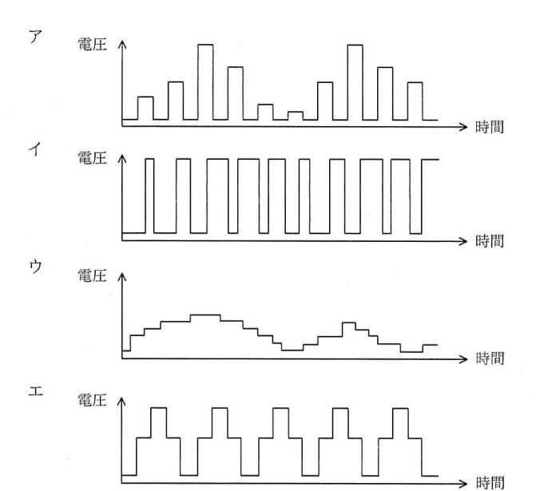
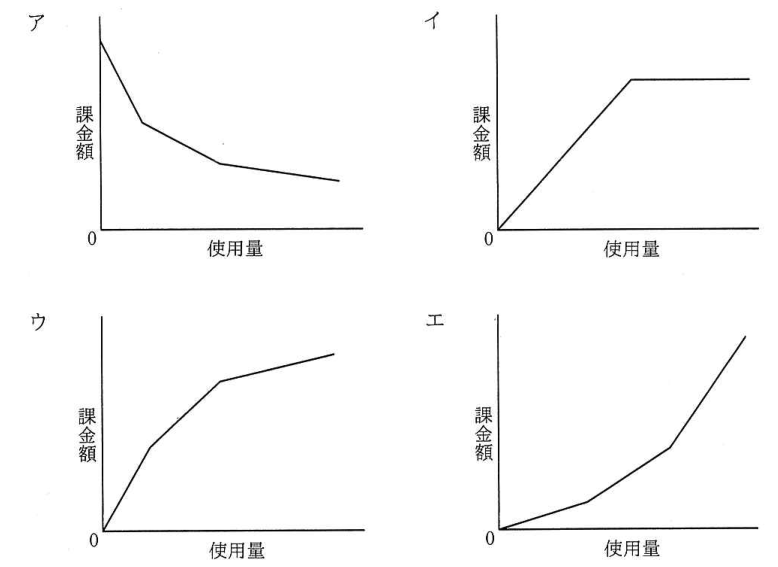
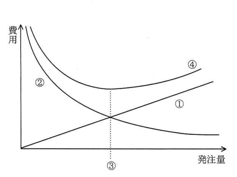

# 令和2年度10月 科目A（旧午前）過去問解説

> 令和2年度 10月 応用情報技術者試験 午前（全80問）を書き起こし、オリジナルの解説を付けたものです。問題の著作権は IPA（独立行政法人 情報処理推進機構）にあります。
> 図を表に書き換えるなど一部改変した問題には、その旨を記載しています。
> インタラクティブ教材の [科目A 四択クイズ](../../06_インタラクティブ教材/quiz.html) では、この回を本番形式（150分）で解けます。

## 目次

| 問 | 分野 | 中分類 | キーワード |
|---|---|---|---|
| [問1](#q01) | テクノロジ系 | 基礎理論 | 桁数、対数、基数変換 |
| [問2](#q02) | テクノロジ系 | 基礎理論 | 確率、排反事象、独立事象 |
| [問3](#q03) | テクノロジ系 | 基礎理論 | 逆ポーランド表記法、後置記法、スタック |
| [問4](#q04) | テクノロジ系 | 基礎理論 | ハフマン符号、可変長符号、平均符号長、一意復号 |
| [問5](#q05) | テクノロジ系 | アルゴリズムとプログラミング | 線形リスト、ポインタ、計算量 |
| [問6](#q06) | テクノロジ系 | アルゴリズムとプログラミング | モンテカルロ法、乱数、シミュレーション |
| [問7](#q07) | テクノロジ系 | アルゴリズムとプログラミング | Python、インデント、プログラム言語 |
| [問8](#q08) | テクノロジ系 | コンピュータ構成要素 | スタックポインタ、レジスタ、サブルーチン |
| [問9](#q09) | テクノロジ系 | コンピュータ構成要素 | メモリインタリーブ、バンク、主記憶 |
| [問10](#q10) | テクノロジ系 | 基礎理論 | ハミング符号、ECC、パリティ、誤り訂正 |
| [問11](#q11) | テクノロジ系 | 情報メディア | アクティブシャッタ方式、3D映像、立体視、偏光方式 |
| [問12](#q12) | テクノロジ系 | システム構成要素 | HPC、FLOPS、コア数、演算性能 |
| [問13](#q13) | テクノロジ系 | システム構成要素 | サーバコンソリデーション、サーバ仮想化、集約 |
| [問14](#q14) | テクノロジ系 | システム構成要素 | MTBF、MTTR、保守性、RAS |
| [問15](#q15) | テクノロジ系 | システム構成要素 | CPU使用率、トランザクション、性能計算 |
| [問16](#q16) | テクノロジ系 | ソフトウェア | ガーベジコレクション、メモリリーク、ヒープ |
| [問17](#q17) | テクノロジ系 | ソフトウェア | デッドロック、資源の占有順序、排他制御 |
| [問18](#q18) | テクノロジ系 | ソフトウェア | プリページング、デマンドページング、仮想記憶、ページフォールト |
| [問19](#q19) | テクノロジ系 | ソフトウェア | OSS、ディストリビュータ、ディストリビューション |
| [問20](#q20) | テクノロジ系 | コンピュータ構成要素 | DRAM、SRAM、リフレッシュ、メモリセル |
| [問21](#q21) | テクノロジ系 | ハードウェア | HDL、FPGA、論理合成 |
| [問22](#q22) | テクノロジ系 | ハードウェア | PWM、パルス幅変調、デューティ比、モータ制御 |
| [問23](#q23) | テクノロジ系 | ハードウェア | LUT、論理回路、排他的論理和、FPGA |
| [問24](#q24) | テクノロジ系 | ハードウェア | D/A変換、16進数、分解能 |
| [問25](#q25) | テクノロジ系 | 情報メディア | 動画像、帯域幅、フレームレート、データ量 |
| [問26](#q26) | テクノロジ系 | データベース | GRANT、REVOKE、アクセス権限、SQL |
| [問27](#q27) | テクノロジ系 | データベース | UML、クラス図、多重度、外部キー、候補キー |
| [問28](#q28) | テクノロジ系 | データベース | 正規化、第3正規形、関数従属性、主キー |
| [問29](#q29) | テクノロジ系 | データベース | UNION ALL、和集合、SQL |
| [問30](#q30) | テクノロジ系 | データベース | ACID特性、耐久性、トランザクション |
| [問31](#q31) | テクノロジ系 | ネットワーク | PoE、給電、LANケーブル |
| [問32](#q32) | テクノロジ系 | ネットワーク | ターンアラウンドタイム、伝送時間、回線速度 |
| [問33](#q33) | テクノロジ系 | ネットワーク | スイッチングハブ、レイヤ2スイッチ、MACアドレス |
| [問34](#q34) | テクノロジ系 | ネットワーク | NAPT、IPマスカレード、NAT、ポート番号 |
| [問35](#q35) | テクノロジ系 | ネットワーク | DHCP、DHCPDISCOVER、ブロードキャスト |
| [問36](#q36) | テクノロジ系 | セキュリティ | CRL、証明書失効リスト、ディジタル証明書、認証局 |
| [問37](#q37) | テクノロジ系 | セキュリティ | IPsec、IPv6、ネットワーク層、暗号化 |
| [問38](#q38) | テクノロジ系 | セキュリティ | OCSP、証明書の有効性確認、CRL |
| [問39](#q39) | テクノロジ系 | セキュリティ | SEOポイズニング、検索エンジン、マルウェア配布 |
| [問40](#q40) | テクノロジ系 | セキュリティ | ディジタル署名、署名検証鍵、改ざん検知、なりすまし |
| [問41](#q41) | テクノロジ系 | セキュリティ | クリプトジャッキング、マイニング、暗号資産 |
| [問42](#q42) | テクノロジ系 | セキュリティ | 共通鍵暗号方式、公開鍵暗号方式、AES、RSA |
| [問43](#q43) | テクノロジ系 | セキュリティ | C&Cサーバ、ボットネット、ボット |
| [問44](#q44) | テクノロジ系 | セキュリティ | TPM、セキュリティチップ、耐タンパ性 |
| [問45](#q45) | テクノロジ系 | セキュリティ | IMAPS、TLS、メール受信、暗号化 |
| [問46](#q46) | テクノロジ系 | システム開発技術 | UML、アクティビティ図、シーケンス図、クラス図 |
| [問47](#q47) | テクノロジ系 | システム開発技術 | 流れ図、ユークリッドの互除法、トレース |
| [問48](#q48) | テクノロジ系 | システム開発技術 | ソフトウェア保守、是正保守、予防保守、完全化保守、適応保守 |
| [問49](#q49) | テクノロジ系 | ソフトウェア開発管理技術 | スクラム、アジャイル、スプリント、プロダクトバックログ |
| [問50](#q50) | テクノロジ系 | ソフトウェア開発管理技術 | 特許権、実施許諾、先使用権、属地主義 |
| [問51](#q51) | マネジメント系 | プロジェクトマネジメント | PMBOK、プロジェクト・スコープ記述書、スコープ定義、除外事項 |
| [問52](#q52) | マネジメント系 | プロジェクトマネジメント | EVM、アーンドバリュー、コスト差異、スケジュール差異 |
| [問53](#q53) | マネジメント系 | プロジェクトマネジメント | プレシデンスダイアグラム法、PDM、リード、ラグ |
| [問54](#q54) | マネジメント系 | プロジェクトマネジメント | リスク対応戦略、受容、PMBOK、好機 |
| [問55](#q55) | マネジメント系 | サービスマネジメント | 逓減課金方式、課金、サービスの財務管理 |
| [問56](#q56) | マネジメント系 | サービスマネジメント | 可用性、計画停止、合意したサービス時間 |
| [問57](#q57) | マネジメント系 | サービスマネジメント | 容量・能力管理、キャパシティ管理、監視、しきい値 |
| [問58](#q58) | マネジメント系 | システム監査 | ウォークスルー法、監査技法、システム監査基準 |
| [問59](#q59) | マネジメント系 | システム監査 | フォローアップ、システム監査人、独立性、改善提案 |
| [問60](#q60) | マネジメント系 | システム監査 | 監査証拠、アジャイル開発、保証報告書、予備調査 |
| [問61](#q61) | ストラテジ系 | システム戦略 | ROI、投資対効果、NPV、IRR |
| [問62](#q62) | ストラテジ系 | システム企画 | 共通フレーム2013、企画プロセス、要件定義プロセス |
| [問63](#q63) | ストラテジ系 | システム戦略 | SOA、サービス指向アーキテクチャ、ERP、BPM |
| [問64](#q64) | ストラテジ系 | システム戦略 | クラウドサービス、利用計画、SLA、コントロール水準 |
| [問65](#q65) | ストラテジ系 | システム企画 | グリーン購入、ライフサイクル、環境負荷 |
| [問66](#q66) | ストラテジ系 | システム企画 | レベニューシェア、契約形態、SI事業者 |
| [問67](#q67) | ストラテジ系 | 経営戦略マネジメント | バリューチェーン分析、主活動、支援活動、ポーター |
| [問68](#q68) | ストラテジ系 | 企業活動 | デルファイ法、技術予測、アンケート |
| [問69](#q69) | ストラテジ系 | 経営戦略マネジメント | プライスライニング、価格戦略、スキミングプライシング |
| [問70](#q70) | ストラテジ系 | 技術戦略マネジメント | パテントプール、特許、ライセンス、標準化 |
| [問71](#q71) | ストラテジ系 | ビジネスインダストリ | CPS、サイバーフィジカルシステム、デジタルツイン、シミュレーション |
| [問72](#q72) | ストラテジ系 | システム企画 | SoE、SoR、DX |
| [問73](#q73) | ストラテジ系 | ビジネスインダストリ | EDI、情報表現規約、取引基本規約 |
| [問74](#q74) | ストラテジ系 | 企業活動 | ABC分析、パレート図、累積比率 |
| [問75](#q75) | ストラテジ系 | 企業活動 | 経済的発注量、EOQ、定量発注方式、在庫管理 |
| [問76](#q76) | ストラテジ系 | 企業活動 | 連関図法、新QC七つ道具、因果関係 |
| [問77](#q77) | ストラテジ系 | 企業活動 | 損益分岐点、変動費率、固定費、目標利益 |
| [問78](#q78) | ストラテジ系 | 法務 | プロバイダ責任制限法、情報流通プラットフォーム対処法、送信防止措置、発信者情報開示 |
| [問79](#q79) | ストラテジ系 | 法務 | マイナンバー法、特定個人情報、個人情報保護委員会 |
| [問80](#q80) | ストラテジ系 | 法務 | 偽装請負、請負契約、指揮命令、労働者派遣法 |

<a id="q01"></a>

### 問1　〔基礎理論〕 🧮

正の整数の 10 進表示の桁数 D と 2 進表示の桁数 B との関係を表す式のうち，最も適切なものはどれか。

- **ア**　D ≒ 2 log10 B
- **イ**　D ≒ 10 log2 B
- **ウ**　D ≒ B log2 10
- **エ**　D ≒ B log10 2

<details><summary>解答・解説</summary>

**正解：エ**

正の整数 N の2進の桁数はおよそ log2 N，10進の桁数はおよそ log10 N。底の変換で log10 N = log2 N × log10 2 なので，D ≒ B log10 2 となる。

**途中式**

- N ≒ 2^B ≒ 10^D（桁数が大きいときの近似）
- 両辺の常用対数をとると B log10 2 ≒ D
- log10 2 ≒ 0.301 なので，10進の桁数は2進の桁数のおよそ 0.3 倍（例：2^10 = 1024 は2進11桁・10進4桁）

- ア：D が B の対数に比例する式で，桁数どうしの関係（ほぼ比例）にならない
- イ：同じく対数の関係になっており誤り。値も大きくなりすぎる
- ウ：log2 10 ≒ 3.32 なので D が B の約3.3倍になり，大小関係が逆（10進の方が桁数は少ない）

💡 **ポイント**：基数 r で表した桁数は log_r N に比例する。2進の桁数 ≒ 10進の桁数 × 3.32（10進の桁数 ≒ 2進の桁数 × 0.301）。

📖 関連：[基礎理論](../../01_テクノロジ系/01_基礎理論.md)

</details>

<sub>出典：令和2年度 10月 応用情報技術者試験 午前 問1（対数の底の下付き文字を通常の文字で表記）</sub>

---

<a id="q02"></a>

### 問2　〔基礎理論〕 🧮

3 台の機械 A，B，C が良品を製造する確率は，それぞれ 60%，70%，80% である。機械 A，B，C が製品を一つずつ製造したとき，いずれか二つの製品が良品で残り一つが不良品になる確率は何%か。

- **ア**　22.4
- **イ**　36.8
- **ウ**　45.2
- **エ**　78.8

<details><summary>解答・解説</summary>

**正解：ウ**

不良品になる機械が A，B，C のどれか1台という三つの排反な場合に分け，それぞれの確率（独立なので積）を足すと 45.2% になる。

**途中式**

- A だけ不良：0.4 × 0.7 × 0.8 = 0.224
- B だけ不良：0.6 × 0.3 × 0.8 = 0.144
- C だけ不良：0.6 × 0.7 × 0.2 = 0.084
- 合計：0.224 + 0.144 + 0.084 = 0.452 → **45.2%**

- ア：A だけが不良品になる場合（22.4%）しか数えていない
- イ：A だけ不良（22.4%）と B だけ不良（14.4%）の2通りしか足しておらず，C だけ不良の場合が漏れている
- エ：3台とも良品の確率（0.6×0.7×0.8 = 33.6%）まで足した「二つ以上が良品」の確率で，「残り一つが不良品」という条件に合わない

💡 **ポイント**：「ちょうど k 個」の確率は，どれが該当するかで場合分け（排反）→ 各場合は積（独立）→ 合計。

📖 関連：[基礎理論](../../01_テクノロジ系/01_基礎理論.md)／[計算問題公式集](../../05_まとめ・横断資料/01_計算問題公式集.md)

</details>

<sub>出典：令和2年度 10月 応用情報技術者試験 午前 問2</sub>

---

<a id="q03"></a>

### 問3　〔基礎理論〕

式 A＋B×C の逆ポーランド表記法による表現として，適切なものはどれか。

- **ア**　＋×CBA
- **イ**　×＋ABC
- **ウ**　ABC×＋
- **エ**　CBA＋×

<details><summary>解答・解説</summary>

**正解：ウ**

逆ポーランド表記法（後置記法）は演算子をオペランドの後ろに書く。乗算が先なので B×C → BC×，それに A を加えて A (BC×) ＋ → ABC×＋。

**途中式**

- 優先順位を括弧で明示：A＋(B×C)
- 内側から後置に：B×C → B C ×
- 外側：A＋(…) → A (B C ×) ＋ → **ABC×＋**

- ア：演算子が前に来ており，さらにオペランドの順序も逆。後置記法ではない
- イ：前置記法（ポーランド記法）の形だが，×＋ABC は (A＋B)×C を表し式も異なる
- エ：C と B を足してから A を掛ける形になり，演算の対応が誤り

💡 **ポイント**：後置記法はスタックで左から評価できる。オペランドの並び順は元の式と同じまま，演算子だけを後ろへ移す。

📖 関連：[基礎理論](../../01_テクノロジ系/01_基礎理論.md)／[アルゴリズムとプログラミング](../../01_テクノロジ系/02_アルゴリズムとプログラミング.md)

</details>

<sub>出典：令和2年度 10月 応用情報技術者試験 午前 問3</sub>

---

<a id="q04"></a>

### 問4　〔基礎理論〕 🧮

a，b，c，d の 4 文字から成るメッセージを符号化してビット列にする方法として表のア〜エの 4 通りを考えた。この表は a，b，c，d の各 1 文字を符号化するときのビット列を表している。メッセージ中での a，b，c，d の出現頻度は，それぞれ 50%，30%，10%，10% であることが分かっている。符号化されたビット列から元のメッセージが一意に復号可能であって，ビット列の長さが最も短くなるものはどれか。

|   | a | b | c | d |
|---|---|---|---|---|
| ア | 0 | 1 | 00 | 11 |
| イ | 0 | 01 | 10 | 11 |
| ウ | 0 | 10 | 110 | 111 |
| エ | 00 | 01 | 10 | 11 |

- **ア**　表のア
- **イ**　表のイ
- **ウ**　表のウ
- **エ**　表のエ

<details><summary>解答・解説</summary>

**正解：ウ**

ウはどの符号も他の符号の先頭部分（接頭語）になっていない接頭符号なので一意に復号でき，平均符号長は 1.7 ビットでエの 2 ビットより短い。

**途中式**

- ウの平均符号長：0.5×1 + 0.3×2 + 0.1×3 + 0.1×3 = 0.5 + 0.6 + 0.3 + 0.3 = **1.7 ビット**
- エの平均符号長：全て2ビット → 2 ビット

- ア：「00」が c なのか aa なのか区別できず，一意に復号できない
- イ：「010」が a＋c（0｜10）なのか b＋a（01｜0）なのか区別できず，一意に復号できない
- エ：固定長なので復号はできるが，平均 2 ビットでウより長い

💡 **ポイント**：出現頻度の高い文字に短い符号を割り当て，接頭語の条件を満たすのがハフマン符号。一意復号性は「ある符号が別の符号の先頭と一致しないか」で確認する。

📖 関連：[基礎理論](../../01_テクノロジ系/01_基礎理論.md)

</details>

<sub>出典：令和2年度 10月 応用情報技術者試験 午前 問4（選択肢の符号表を GFM の表に書き換え）</sub>

---

<a id="q05"></a>

### 問5　〔アルゴリズムとプログラミング〕

ポインタを用いた線形リストの特徴のうち，適切なものはどれか。

- **ア**　先頭の要素を根とした n 分木で，先頭以外の要素は全て先頭の要素の子である。
- **イ**　配列を用いた場合と比較して，2 分探索を効率的に行うことが可能である。
- **ウ**　ポインタから次の要素を求めるためにハッシュ関数を用いる。
- **エ**　ポインタによって指定されている要素の後ろに，新たな要素を追加する計算量は，要素の個数や位置によらず一定である。

<details><summary>解答・解説</summary>

**正解：エ**

線形リストでは，挿入位置の要素が分かっていれば，新しい要素のポインタと前の要素のポインタを付け替えるだけで追加できる。要素を移動する必要がないので，計算量は O(1) で一定。

- ア：根の直下に全要素がぶら下がる木構造の説明で，要素が1列につながる線形リストではない
- イ：線形リストは中央の要素に直接アクセスできないため，2分探索には向かない。2分探索は添字で直接アクセスできる配列の方が効率的
- ウ：次の要素はポインタが直接指しており，ハッシュ関数は使わない

💡 **ポイント**：配列は「ランダムアクセスが速い・挿入削除が遅い」，線形リストは「挿入削除が速い・探索は先頭から順にたどるので遅い」。

📖 関連：[アルゴリズムとプログラミング](../../01_テクノロジ系/02_アルゴリズムとプログラミング.md)

</details>

<sub>出典：令和2年度 10月 応用情報技術者試験 午前 問5</sub>

---

<a id="q06"></a>

### 問6　〔アルゴリズムとプログラミング〕

円周率 π の値を近似的に求める方法のうち，モンテカルロ法を応用したものはどれか。

- **ア**　正方形の中に一様乱数を用いて多数の点をとったとき，その点の個数と正方形に内接する円の中にある点の個数の比が，点の個数を多くすると両者の面積比である 4：π に近づくことを用いて求める。
- **イ**　正方形の中に等間隔に多数の格子点をとったとき，その格子点の個数と正方形に内接する円の中にある格子点の個数の比が，格子点の間隔を細かくすると両者の面積比である 4：π に近づくことを用いて求める。
- **ウ**　直径 1 の円に内接する正 n 角形の周の長さと円の直径の比が，n を大きくすると π：1 に近づくことを用いて求める。
- **エ**　直径 1 の円に内接する正 n 角形の面積と円に内接する正方形の面積の比が，n を大きくすると π：2 に近づくことを用いて求める。

<details><summary>解答・解説</summary>

**正解：ア**

モンテカルロ法は，乱数を使って多数の試行を行い，その結果の割合から近似値を求める手法。乱数で打った点が円の中に入る割合から面積比 π/4 を推定するアが該当する。

- イ：格子点を等間隔にとるのは乱数を使わない数値積分（区分求積）の考え方で，モンテカルロ法ではない
- ウ：内接正多角形の周長で近似するアルキメデスの方法。乱数を使わない
- エ：内接正多角形の面積で近似する幾何的な方法。これも乱数を使わない

💡 **ポイント**：「乱数」「多数回の試行」「確率的に近似」がモンテカルロ法のキーワード。シミュレーションや確率的アルゴリズムとして問われる。

📖 関連：[アルゴリズムとプログラミング](../../01_テクノロジ系/02_アルゴリズムとプログラミング.md)／[基礎理論](../../01_テクノロジ系/01_基礎理論.md)

</details>

<sub>出典：令和2年度 10月 応用情報技術者試験 午前 問6</sub>

---

<a id="q07"></a>

### 問7　〔アルゴリズムとプログラミング〕

オブジェクト指向のプログラム言語であり，クラスや関数，条件文などのコードブロックの範囲はインデントの深さによって指定する仕様であるものはどれか。

- **ア**　JavaScript
- **イ**　Perl
- **ウ**　Python
- **エ**　Ruby

<details><summary>解答・解説</summary>

**正解：ウ**

Python はブロックを括弧やキーワードではなく，インデント（字下げ）の深さで表すことが言語仕様で決まっているオブジェクト指向言語。

- ア：JavaScript は Web ブラウザなどで動くスクリプト言語で，ブロックは { } で囲む
- イ：Perl はテキスト処理に強いスクリプト言語で，ブロックは { } で囲む
- エ：Ruby は日本発のオブジェクト指向スクリプト言語で，ブロックは end や { } で閉じる

💡 **ポイント**：Python はインデントでブロックを表す・AI やデータ分析のライブラリが豊富，という特徴で問われることが多い。

📖 関連：[アルゴリズムとプログラミング](../../01_テクノロジ系/02_アルゴリズムとプログラミング.md)

</details>

<sub>出典：令和2年度 10月 応用情報技術者試験 午前 問7</sub>

---

<a id="q08"></a>

### 問8　〔コンピュータ構成要素〕

CPU のスタックポインタが示すものとして，最も適切なものはどれか。

- **ア**　サブルーチン呼出し時に，戻り先アドレス，レジスタの内容などを格納するメモリのアドレス
- **イ**　次に読み出す機械語命令が格納されているアドレス
- **ウ**　メモリから読み出された機械語命令
- **エ**　割込みの許可状態，及び条件分岐の判断に必要な演算結果の状態

<details><summary>解答・解説</summary>

**正解：ア**

スタックポインタは，メモリ上のスタック領域の最上部（次に積む／取り出す位置）のアドレスを保持するレジスタ。サブルーチン呼出しや割込みのときに戻り先アドレスやレジスタ内容を退避する場所を示す。

- イ：プログラムカウンタ（命令アドレスレジスタ）の説明
- ウ：命令レジスタの説明
- エ：フラグレジスタ（PSW：プログラム状態語）の説明

💡 **ポイント**：PC＝次の命令のアドレス，IR＝読み出した命令，SP＝スタックの先頭アドレス，フラグレジスタ＝演算結果の状態（ゼロ・符号・桁あふれなど）。

📖 関連：[コンピュータ構成要素](../../01_テクノロジ系/03_コンピュータ構成要素.md)

</details>

<sub>出典：令和2年度 10月 応用情報技術者試験 午前 問8</sub>

---

<a id="q09"></a>

### 問9　〔コンピュータ構成要素〕

メモリインタリーブの説明はどれか。

- **ア**　CPU と磁気ディスク装置との間に半導体メモリによるデータバッファを設けて，磁気ディスクアクセスの高速化を図る。
- **イ**　主記憶のデータの一部をキャッシュメモリにコピーすることによって，CPU と主記憶とのアクセス速度のギャップを埋め，メモリアクセスの高速化を図る。
- **ウ**　主記憶へのアクセスを高速化するために，アクセス要求，データの読み書き及び後処理が終わってから，次のメモリアクセスの処理に移る。
- **エ**　主記憶を複数の独立したグループに分けて，各グループに交互にアクセスすることによって，主記憶へのアクセスの高速化を図る。

<details><summary>解答・解説</summary>

**正解：エ**

メモリインタリーブは，主記憶を複数のバンクに分け，連続したアドレスを異なるバンクに割り当てて並行にアクセスすることで，見かけのアクセス時間を短くする方式。

- ア：ディスクキャッシュの説明
- イ：キャッシュメモリの説明
- ウ：一つのアクセスが終わるまで次に進まない逐次的なアクセスで，高速化の工夫になっていない

💡 **ポイント**：インタリーブ＝「バンクに分けて交互（並行）にアクセス」。キャッシュ（コピーを近くに置く）とは仕組みが違う。

📖 関連：[コンピュータ構成要素](../../01_テクノロジ系/03_コンピュータ構成要素.md)

</details>

<sub>出典：令和2年度 10月 応用情報技術者試験 午前 問9</sub>

---

<a id="q10"></a>

### 問10　〔基礎理論〕

メモリの誤り検出及び訂正を行う方式のうち，2 ビットの誤り検出機能と，1 ビットの誤り訂正機能をもつものはどれか。

- **ア**　奇数パリティ
- **イ**　水平パリティ
- **ウ**　チェックサム
- **エ**　ハミング符号

<details><summary>解答・解説</summary>

**正解：エ**

ハミング符号は，複数の検査ビットを組み合わせて誤りの位置を特定できる符号で，1ビットの誤りを訂正でき，（拡張ハミング符号では）2ビットの誤りを検出できる。ECC メモリで使われる。

- ア：奇数パリティは1ビットの誤りを検出できるだけで，訂正はできない。2ビット誤りは検出もできない
- イ：水平パリティも1方向だけでは誤りの検出のみ。垂直パリティと組み合わせて初めて1ビット訂正ができる
- ウ：チェックサムはデータの合計値で誤りを検出する方式で，訂正機能はない

💡 **ポイント**：「1ビット訂正・2ビット検出」と言えばハミング符号（SECDED）。パリティ・チェックサム・CRC は検出のみ。

📖 関連：[基礎理論](../../01_テクノロジ系/01_基礎理論.md)／[コンピュータ構成要素](../../01_テクノロジ系/03_コンピュータ構成要素.md)

</details>

<sub>出典：令和2年度 10月 応用情報技術者試験 午前 問10</sub>

---

<a id="q11"></a>

### 問11　〔情報メディア〕

3D 映像の立体視を可能とする仕組みのうち，アクティブシャッタ方式の説明として，適切なものはどれか。

- **ア**　専用の特殊なディスプレイに右目用，左目用の映像を同時に描画し，網目状のフィルタを用いてそれぞれの映像が右目と左目に入るようにして，裸眼立体視を可能とする。
- **イ**　ディスプレイに赤色と青色で右目用，左目用の映像を重ねて描画し，一方のリム（フレームにおいてレンズを囲む部分）に赤，他方のリムに青のフィルタを付けた眼鏡で見ることによって，立体視を可能とする。
- **ウ**　ディスプレイに右目用，左目用の映像を交互に映し出し，眼鏡がそのタイミングに合わせて左右それぞれ交互に透過，遮断することによって，立体視を可能とする。
- **エ**　ディスプレイに右目用，左目用の映像を同時に描画し，フィルタを用いてそれぞれの映像の光の振幅方向を回転して，透過する振幅方向が左右で異なる偏光眼鏡で見ることによって，立体視を可能とする。

<details><summary>解答・解説</summary>

**正解：ウ**

アクティブシャッタ方式は，画面に左右の映像を高速で交互に表示し，それに同期して眼鏡の左右の液晶シャッタを交互に開閉することで，それぞれの目に対応する映像だけを見せる方式。

- ア：パララックスバリア方式などの裸眼立体視（専用眼鏡が不要）の説明
- イ：アナグリフ方式（赤青眼鏡）の説明
- エ：偏光方式（パッシブ方式）の説明。眼鏡に電子的な仕組みは不要

💡 **ポイント**：立体視は「左右の目に異なる映像を届ける」方法の違いで区別する。時間で分ける＝アクティブシャッタ，光の偏光で分ける＝偏光方式，色で分ける＝アナグリフ。

📖 関連：[システム開発技術](../../01_テクノロジ系/09_システム開発技術.md)

</details>

<sub>出典：令和2年度 10月 応用情報技術者試験 午前 問11</sub>

---

<a id="q12"></a>

### 問12　〔システム構成要素〕 🧮

現状の HPC（High Performance Computing）マシンの構成を，次の条件で更新することにした。更新後の，ノード数と総理論ピーク演算性能はどれか。ここで，総理論ピーク演算性能は，コア数に比例するものとする。

〔現状の構成〕

(1) 一つのコアの理論ピーク演算性能は 10 GFLOPS である。
(2) 一つのノードのコア数は 8 である。
(3) ノード数は 1,000 である。

〔更新条件〕

(1) 一つのコアの理論ピーク演算性能を現状の 2 倍にする。
(2) 一つのノードのコア数を現状の 2 倍にする。
(3) 総コア数を現状の 4 倍にする。

- **ア**　ノード数：2,000，総理論ピーク演算性能：320 TFLOPS
- **イ**　ノード数：2,000，総理論ピーク演算性能：640 TFLOPS
- **ウ**　ノード数：4,000，総理論ピーク演算性能：320 TFLOPS
- **エ**　ノード数：4,000，総理論ピーク演算性能：640 TFLOPS

<details><summary>解答・解説</summary>

**正解：イ**

更新後の総コア数は 8×1,000×4 = 32,000，1ノード16コアなのでノード数は 2,000。1コア 20 GFLOPS なので総性能は 32,000×20 GFLOPS = 640 TFLOPS。

**途中式**

- 現状の総コア数：8 × 1,000 = 8,000 コア
- 更新後の総コア数：8,000 × 4 = 32,000 コア
- 更新後のノード数：32,000 ÷ (8×2) = **2,000 ノード**
- 更新後の総性能：32,000 × (10×2) GFLOPS = 640,000 GFLOPS = **640 TFLOPS**

- ア：コア当たり性能を2倍にし忘れた値（32,000×10 GFLOPS = 320 TFLOPS）
- ウ：ノード当たりのコア数を2倍にし忘れてノード数を4倍にし，性能も2倍にし忘れている
- エ：ノード数をコア数と同じく4倍にしてしまっている（1ノードのコア数が2倍になる点を見落とし）

💡 **ポイント**：総性能 = 1コアの性能 × 総コア数，総コア数 = 1ノードのコア数 × ノード数。何が何倍になるかを分解して掛け合わせる。1 TFLOPS = 1,000 GFLOPS。

📖 関連：[システム構成要素](../../01_テクノロジ系/04_システム構成要素.md)

</details>

<sub>出典：令和2年度 10月 応用情報技術者試験 午前 問12（選択肢の表を文章に書き換え）</sub>

---

<a id="q13"></a>

### 問13　〔システム構成要素〕

複数のサーバを用いて構築されたシステムに対するサーバコンソリデーションの説明として，適切なものはどれか。

- **ア**　各サーバに存在する複数の磁気ディスクを，特定のサーバから利用できるようにして，資源の有効活用を図る。
- **イ**　仮想化ソフトウェアを利用して元のサーバ数よりも少なくすることによって，サーバ機器の管理コストを削減する。
- **ウ**　サーバのうちいずれかを監視専用に変更することによって，システム全体のセキュリティを強化する。
- **エ**　サーバの故障時に正常なサーバだけで瞬時にシステムを再構成し，サーバ数を減らしてでも運転を継続する。

<details><summary>解答・解説</summary>

**正解：イ**

サーバコンソリデーション（サーバ統合）は，多数の物理サーバで動いていたシステムを，仮想化技術などを使って少数の物理サーバに集約し，設置スペース・電力・管理の手間を減らすこと。

- ア：ディスクを共有して特定サーバから使う，ストレージ共有の説明で，サーバを統合するものではない
- ウ：監視専用サーバの設置で，セキュリティ監視の話。サーバ統合ではない
- エ：故障時に縮退して運転を続けるフェールソフト（縮退運転）の説明

💡 **ポイント**：コンソリデーション＝「統合・集約」。仮想化によるサーバ集約で，物理台数・電力・管理コストを減らすのが目的。

📖 関連：[システム構成要素](../../01_テクノロジ系/04_システム構成要素.md)

</details>

<sub>出典：令和2年度 10月 応用情報技術者試験 午前 問13</sub>

---

<a id="q14"></a>

### 問14　〔システム構成要素〕

MTBF を長くするよりも，MTTR を短くするのに役立つものはどれか。

- **ア**　エラーログ取得機能
- **イ**　記憶装置のビット誤り訂正機能
- **ウ**　命令再試行機能
- **エ**　予防保守

<details><summary>解答・解説</summary>

**正解：ア**

エラーログがあれば，障害発生時に原因箇所を素早く特定でき，修理にかかる時間（MTTR）を短くできる。故障そのものを減らす効果はない。

- イ：ビット誤りを自動訂正して障害に至らせない機能で，故障間隔（MTBF）を長くする
- ウ：一時的な誤りを命令の再実行で回復し，障害として止まらないようにする機能で，MTBF を長くする
- エ：故障しそうな部品を事前に交換・点検して故障を防ぐもので，MTBF を長くする

💡 **ポイント**：MTBF を延ばす＝故障を起こさない・故障を表面化させない工夫（信頼性）。MTTR を縮める＝早く見つけて早く直す工夫（保守性）。ログ・遠隔保守・診断機能は MTTR 側。

📖 関連：[システム構成要素](../../01_テクノロジ系/04_システム構成要素.md)

</details>

<sub>出典：令和2年度 10月 応用情報技術者試験 午前 問14</sub>

---

<a id="q15"></a>

### 問15　〔システム構成要素〕 🧮

次のシステムにおいて，ピーク時間帯の CPU 使用率は何%か。ここで，トランザクションはレコードアクセス処理と計算処理から成り，レコードアクセスは CPU 処理だけで入出力は発生せず，OS のオーバヘッドは考慮しないものとする。また，1 日のうち発生するトランザクション数が最大になる 1 時間をピーク時間帯と定義する。

〔システムの概要〕

(1) CPU 数：1 個
(2) 1 日に発生する平均トランザクション数：54,000 件
(3) 1 日のピーク時間帯におけるトランザクション数の割合：20%
(4) 1 トランザクション当たりの平均レコードアクセス数：100 レコード
(5) 1 レコードアクセスに必要な平均 CPU 時間：1 ミリ秒
(6) 1 トランザクション当たりの計算処理に必要な平均 CPU 時間：100 ミリ秒

- **ア**　20
- **イ**　30
- **ウ**　50
- **エ**　60

<details><summary>解答・解説</summary>

**正解：エ**

ピーク時間帯1時間のトランザクションは 10,800 件，1件当たりの CPU 時間は 0.2 秒なので，CPU 使用時間は 2,160 秒。3,600 秒に対して 60%。

**途中式**

- ピーク時間帯の件数：54,000 × 0.2 = 10,800 件
- 1件の CPU 時間：100 レコード × 1 ミリ秒 + 100 ミリ秒 = 200 ミリ秒 = 0.2 秒
- CPU 使用時間：10,800 × 0.2 = 2,160 秒
- CPU 使用率：2,160 ÷ 3,600 = 0.6 → **60%**

- ア：ピーク時間帯の割合 20% をそのまま答えた値
- イ：レコードアクセスか計算処理のどちらか一方（0.1 秒）だけで計算した値
- ウ：50% になるのは1件当たりの CPU 時間が約 0.167 秒の場合で，本問の条件（0.2 秒）と合わない

💡 **ポイント**：CPU 使用率 = 単位時間内の CPU 処理時間の合計 ÷ 単位時間。1件当たりの処理時間（全要素の合計）× 件数で求める。

📖 関連：[システム構成要素](../../01_テクノロジ系/04_システム構成要素.md)／[計算問題公式集](../../05_まとめ・横断資料/01_計算問題公式集.md)

</details>

<sub>出典：令和2年度 10月 応用情報技術者試験 午前 問15</sub>

---

<a id="q16"></a>

### 問16　〔ソフトウェア〕

記憶領域の動的な割当て及び解放を繰り返すことによって，どこからも利用できない記憶領域が発生することがある。このような記憶領域を再び利用可能にする機能はどれか。

- **ア**　ガーベジコレクション
- **イ**　スタック
- **ウ**　ヒープ
- **エ**　フラグメンテーション

<details><summary>解答・解説</summary>

**正解：ア**

ガーベジコレクションは，プログラムから参照されなくなった（どこからも使えない）記憶領域を自動的に検出して解放し，再利用できるようにする機能。

- イ：スタックは後入れ先出しで領域を管理するデータ構造・記憶領域で，不要領域を回収する機能ではない
- ウ：ヒープは動的に割り当てる記憶領域そのもので，回収機能ではない
- エ：フラグメンテーション（断片化）は空き領域が細切れになる現象で，回収する機能ではない（解消するのはコンパクション）

💡 **ポイント**：不要になった領域の回収＝ガーベジコレクション，細切れの空き領域をまとめる＝コンパクション。Java や Python などは GC を備える。

📖 関連：[ソフトウェア](../../01_テクノロジ系/05_ソフトウェア.md)

</details>

<sub>出典：令和2年度 10月 応用情報技術者試験 午前 問16</sub>

---

<a id="q17"></a>

### 問17　〔ソフトウェア〕

三つの資源 X〜Z を占有して処理を行う四つのプロセス A〜D がある。各プロセスは処理の進行に伴い，表中の数値の順に資源を占有し，実行終了時に三つの資源を一括して解放する。プロセス A と同時にもう一つプロセスを動かした場合に，デッドロックを起こす可能性があるプロセスはどれか。

| プロセス | 資源 X | 資源 Y | 資源 Z |
|---|---|---|---|
| A | 1 | 2 | 3 |
| B | 1 | 2 | 3 |
| C | 2 | 3 | 1 |
| D | 3 | 2 | 1 |

（表中の数値は資源の占有順序）

- **ア**　B，C，D
- **イ**　C，D
- **ウ**　C だけ
- **エ**　D だけ

<details><summary>解答・解説</summary>

**正解：イ**

デッドロックは，二つのプロセスが互いに相手の持つ資源を待つ状態。A（X→Y→Z）と占有順序が異なる C（Z→X→Y）と D（Z→Y→X）は，相手が持つ資源を互いに待つ状況が起こり得る。

**途中式（具体例）**

- A と C：A が X を，C が Z を占有 → A は Y を占有後に Z を待ち，C は X を待つ → 互いに待ってデッドロック
- A と D：A が X，Y を，D が Z を占有 → A は Z を待ち，D は Y を待つ → デッドロック
- A と B：占有順序が同じなので，先に X を取った方が最後まで進み，デッドロックは起きない

- ア：B は A と同じ順序で資源を占有するのでデッドロックは起きない
- ウ：D も Z を先に占有するので A との間でデッドロックが起こり得る
- エ：C も A との間でデッドロックが起こり得る

💡 **ポイント**：全プロセスが資源を同じ順序で占有すれば，循環待ちが起きずデッドロックを防げる。順序が違うプロセスの組合せを探す。

📖 関連：[ソフトウェア](../../01_テクノロジ系/05_ソフトウェア.md)

</details>

<sub>出典：令和2年度 10月 応用情報技術者試験 午前 問17（資源の占有順序の表の見出しを簡略化）</sub>

---

<a id="q18"></a>

### 問18　〔ソフトウェア〕

仮想記憶方式で，デマンドページングと比較したときのプリページングの特徴として，適切なものはどれか。ここで，主記憶には十分な余裕があるものとする。

- **ア**　将来必要と想定されるページを主記憶にロードしておくので，実際に必要となったときの補助記憶へのアクセスによる遅れを減少できる。
- **イ**　将来必要と想定されるページを主記憶にロードしておくので，ページフォールトが多く発生し，OS のオーバヘッドが増加する。
- **ウ**　プログラムがアクセスするページだけをその都度主記憶にロードするので，主記憶への不必要なページのロードを避けることができる。
- **エ**　プログラムがアクセスするページだけをその都度主記憶にロードするので，将来必要となるページの予想が不要である。

<details><summary>解答・解説</summary>

**正解：ア**

プリページングは，近いうちに必要になりそうなページを先読みして主記憶に入れておく方式。必要になった時点で補助記憶から読み込む待ち時間が減る。

- イ：先読みしておくことでページフォールトはむしろ減る。「多く発生」は誤り
- ウ：アクセスされたページだけをその都度ロードするのはデマンドページングの特徴
- エ：同じくデマンドページングの特徴（予測不要）

💡 **ポイント**：デマンドページング＝必要になってから読む（無駄がないが待ちが出る），プリページング＝予測して先に読む（待ちは減るが予測が外れると無駄）。

📖 関連：[ソフトウェア](../../01_テクノロジ系/05_ソフトウェア.md)

</details>

<sub>出典：令和2年度 10月 応用情報技術者試験 午前 問18</sub>

---

<a id="q19"></a>

### 問19　〔ソフトウェア〕

OSS（Open Source Software）における，ディストリビュータの役割はどれか。

- **ア**　OSS やアプリケーションソフトウェアを組み合わせて，パッケージにして提供する。
- **イ**　OSS を開発し，活動状況を Web で公開する。
- **ウ**　OSS を稼働用のコンピュータにインストールし，動作確認を行う。
- **エ**　OSS を含むソフトウェアを利用したシステムの提案を行う。

<details><summary>解答・解説</summary>

**正解：ア**

ディストリビュータは，Linux カーネルなどの OSS と各種ツール・アプリケーションを組み合わせ，インストーラなどを付けて使いやすいパッケージ（ディストリビューション）として配布する事業者・団体。

- イ：OSS の開発者・開発コミュニティの役割
- ウ：システムを構築するインテグレータや運用担当者の作業
- エ：システムインテグレータ（SIer）などの提案活動

💡 **ポイント**：Linux の場合，カーネルだけでは使いにくいため，Red Hat，Ubuntu などのディストリビューションとしてまとめて提供される。これを行うのがディストリビュータ。

📖 関連：[ソフトウェア](../../01_テクノロジ系/05_ソフトウェア.md)

</details>

<sub>出典：令和2年度 10月 応用情報技術者試験 午前 問19</sub>

---

<a id="q20"></a>

### 問20　〔コンピュータ構成要素〕

SRAM と比較した場合の DRAM の特徴はどれか。

- **ア**　主にキャッシュメモリとして使用される。
- **イ**　データを保持するためのリフレッシュ又はアクセス動作が不要である。
- **ウ**　メモリセル構成が単純なので，ビット当たりの単価が安くなる。
- **エ**　メモリセルにフリップフロップを用いてデータを保存する。

<details><summary>解答・解説</summary>

**正解：ウ**

DRAM はコンデンサと少数のトランジスタで1ビットを記憶する単純な構造なので，高集積化しやすくビット当たりの単価が安い。そのため主記憶に使われる。

- ア：高速な SRAM の特徴。キャッシュメモリには SRAM が使われる
- イ：SRAM の特徴。DRAM はコンデンサの電荷が漏れるため定期的なリフレッシュが必要
- エ：SRAM の特徴。フリップフロップで記憶するため高速だが回路が複雑

💡 **ポイント**：DRAM＝コンデンサ・リフレッシュ必要・大容量で安い・主記憶，SRAM＝フリップフロップ・リフレッシュ不要・高速で高価・キャッシュ。

📖 関連：[コンピュータ構成要素](../../01_テクノロジ系/03_コンピュータ構成要素.md)

</details>

<sub>出典：令和2年度 10月 応用情報技術者試験 午前 問20</sub>

---

<a id="q21"></a>

### 問21　〔ハードウェア〕

FPGA などに実装するディジタル回路を記述して，直接論理合成するために使用されるものはどれか。

- **ア**　DDL
- **イ**　HDL
- **ウ**　UML
- **エ**　XML

<details><summary>解答・解説</summary>

**正解：イ**

HDL（ハードウェア記述言語）は，ディジタル回路の構造や動作をテキストで記述する言語で，論理合成ツールにかけるとゲートレベルの回路が得られ，FPGA に書き込める。Verilog HDL や VHDL が代表。

- ア：DDL（データ定義言語）は，データベースの表やビューなどを定義する言語（SQL の CREATE 文など）
- ウ：UML はソフトウェアなどの設計をモデル化する図の表記法で，回路の論理合成には使わない
- エ：XML はタグでデータの構造を表すマークアップ言語

💡 **ポイント**：FPGA は出荷後に回路を書き換えられる LSI。回路は HDL で記述し，論理合成して実装する。

📖 関連：[ハードウェア](../../01_テクノロジ系/10_ハードウェア.md)

</details>

<sub>出典：令和2年度 10月 応用情報技術者試験 午前 問21</sub>

---

<a id="q22"></a>

### 問22　〔ハードウェア〕

モータの速度制御などに PWM（Pulse Width Modulation）制御が用いられる。PWM の駆動波形を示したものはどれか。ここで，波形は制御回路のポート出力であり，低域通過フィルタを通していないものとする。



- **ア**　（図のア）
- **イ**　（図のイ）
- **ウ**　（図のウ）
- **エ**　（図のエ）

<details><summary>解答・解説</summary>

**正解：イ**

PWM は，電圧の高さ（振幅）は一定のまま，一定周期の中でパルスが ON になっている時間の幅（デューティ比）を変えて平均電力を制御する方式。振幅が一定でパルス幅だけが変化しているイが該当する。

- ア：パルスの幅は一定で高さ（振幅）が変化しており，パルス振幅変調（PAM）の波形
- ウ：電圧が階段状になめらかに変化しており，D/A 変換やフィルタを通した後のようなアナログ的な波形
- エ：中間の電圧段階をもつ波形で，振幅が一定の ON/OFF だけで制御する PWM の駆動波形ではない

💡 **ポイント**：PWM は「振幅一定・パルス幅（デューティ比）可変」。デューティ比を大きくすると平均電圧が上がり，モータの回転が速くなる。

📖 関連：[ハードウェア](../../01_テクノロジ系/10_ハードウェア.md)

</details>

<sub>出典：令和2年度 10月 応用情報技術者試験 午前 問22</sub>

---

<a id="q23"></a>

### 問23　〔ハードウェア〕

次の表に示す値が格納された LUT（Lookup Table）と等価な回路はどれか。ここで，LUT のアドレス信号 A2〜A0 は A0 が LSB で，ア〜エの回路の入力信号 a が A2，b が A1，c が A0 に対応する。

| アドレス | 0 | 1 | 2 | 3 | 4 | 5 | 6 | 7 |
|---|---|---|---|---|---|---|---|---|
| 値 | 0 | 1 | 0 | 1 | 0 | 1 | 1 | 0 |

（LUT は A2（MSB），A1，A0（LSB）の3本のアドレス信号を入力とし，そのアドレスに格納された値を出力する）

- **ア**　a と b を AND 回路に入力し，その出力と c を OR 回路に入力する回路
- **イ**　a と b を AND 回路に入力し，その出力と c を XOR（排他的論理和）回路に入力する回路
- **ウ**　a と b を OR 回路に入力し，その出力と c を AND 回路に入力する回路
- **エ**　a と b を OR 回路に入力し，その出力と c を XOR（排他的論理和）回路に入力する回路

<details><summary>解答・解説</summary>

**正解：イ**

表を見ると，a=b=1（アドレス6, 7）のときだけ出力が c の反転になり，それ以外は出力＝c になっている。これは (a AND b) XOR c と同じ動作。

**途中式（真理値表で確認）**

| a b c | LUT | (a・b) XOR c |
|---|---|---|
| 0 0 0 / 0 0 1 | 0 / 1 | 0 / 1 |
| 0 1 0 / 0 1 1 | 0 / 1 | 0 / 1 |
| 1 0 0 / 1 0 1 | 0 / 1 | 0 / 1 |
| 1 1 0 / 1 1 1 | 1 / 0 | 1 / 0 |

- ア：(a・b)＋c ではアドレス7（a=b=c=1）の出力が1になり，表の0と合わない
- ウ：(a＋b)・c ではアドレス1（c だけ1）の出力が0になり，表の1と合わない
- エ：(a＋b) XOR c ではアドレス2（b だけ1）の出力が1になり，表の0と合わない

💡 **ポイント**：LUT は真理値表をそのままメモリに格納したもので，FPGA の論理ブロックの基本要素。回路選択問題は，値が特徴的なアドレス（全部1など）を代入して消去法で絞る。

📖 関連：[ハードウェア](../../01_テクノロジ系/10_ハードウェア.md)

</details>

<sub>出典：令和2年度 10月 応用情報技術者試験 午前 問23（回路図の選択肢を文章で表記し，LUT の値の表を横向きに書き換え）</sub>

---

<a id="q24"></a>

### 問24　〔ハードウェア〕 🧮

8 ビット D/A 変換器を使って負でない電圧を発生させる。使用する D/A 変換器は，最下位の 1 ビットの変化で出力が 10 ミリ V 変化する。データに 0 を与えたときの出力は 0 ミリ V である。データに 16 進数で 82 を与えたときの出力は何ミリ V か。

- **ア**　820
- **イ**　1,024
- **ウ**　1,300
- **エ**　1,312

<details><summary>解答・解説</summary>

**正解：ウ**

16 進数の 82 は 10 進数で 130。1 ステップ 10 ミリ V なので，出力は 130 × 10 = 1,300 ミリ V。

**途中式**

- 82(16) = 8 × 16 + 2 = 130(10)
- 出力 = 130 × 10 ミリ V = **1,300 ミリ V**

- ア：82 を 10 進数のまま計算した値（82 × 10）
- イ：2^10 = 1,024 で，問題の条件とは関係ない値
- エ：82 × 16 = 1,312 で，16 進数の 82 を 10 進数に正しく変換していない値

💡 **ポイント**：D/A 変換の出力 = 入力データ（10進）× 1 LSB 当たりの電圧。16 進数は必ず 10 進数に直してから掛ける。

📖 関連：[ハードウェア](../../01_テクノロジ系/10_ハードウェア.md)／[基礎理論](../../01_テクノロジ系/01_基礎理論.md)

</details>

<sub>出典：令和2年度 10月 応用情報技術者試験 午前 問24</sub>

---

<a id="q25"></a>

### 問25　〔情報メディア〕 🧮

800×600 ピクセル，24 ビットカラーで 30 フレーム／秒の動画像の配信に最小限必要な帯域幅はおよそ幾らか。ここで，通信時にデータ圧縮は行わないものとする。

- **ア**　350 k ビット／秒
- **イ**　3.5 M ビット／秒
- **ウ**　35 M ビット／秒
- **エ**　350 M ビット／秒

<details><summary>解答・解説</summary>

**正解：エ**

1 フレームのデータ量は 800×600×24 ビット，これが毎秒 30 枚なので，約 345.6 M ビット／秒，およそ 350 M ビット／秒が必要。

**途中式**

- 1 フレーム：800 × 600 × 24 = 11,520,000 ビット
- 1 秒分：11,520,000 × 30 = 345,600,000 ビット ≒ **350 M ビット／秒**

- ア：桁が 1,000 倍小さい（k と M を取り違えるなど）
- イ：桁が 100 倍小さい
- ウ：桁が 10 倍小さい

💡 **ポイント**：非圧縮動画のビットレート = 横画素 × 縦画素 × 色深度（ビット）× フレームレート。バイトとビットの単位の取り違えにも注意。

📖 関連：[ネットワーク](../../01_テクノロジ系/07_ネットワーク.md)／[計算問題公式集](../../05_まとめ・横断資料/01_計算問題公式集.md)

</details>

<sub>出典：令和2年度 10月 応用情報技術者試験 午前 問25</sub>

---

<a id="q26"></a>

### 問26　〔データベース〕

表に対する SQL の GRANT 文の説明として，適切なものはどれか。

- **ア**　パスワードを設定してデータベースへの接続を制限する。
- **イ**　ビューを作成して，ビューの基となる表のアクセスできる行や列を制限する。
- **ウ**　表のデータを暗号化して，第三者がアクセスしてもデータの内容が分からないようにする。
- **エ**　表の利用者に対し，表への問合せ，更新，追加，削除などの操作権限を付与する。

<details><summary>解答・解説</summary>

**正解：エ**

GRANT 文は，利用者（ユーザやロール）に対して表などへの SELECT，UPDATE，INSERT，DELETE といった操作権限を与える SQL 文（DCL）。権限を取り消すのは REVOKE 文。

- ア：利用者認証の設定で，GRANT 文の機能ではない
- イ：CREATE VIEW 文によるビューの作成。行や列の制限はビューで実現する
- ウ：表データの暗号化（DBMS の暗号化機能）の説明で，GRANT 文ではない

💡 **ポイント**：権限の付与＝GRANT，取消し＝REVOKE。ビューと GRANT を組み合わせると，特定の行・列だけを見せる細かなアクセス制御ができる。

📖 関連：[データベース](../../01_テクノロジ系/06_データベース.md)

</details>

<sub>出典：令和2年度 10月 応用情報技術者試験 午前 問26</sub>

---

<a id="q27"></a>

### 問27　〔データベース〕

UML を用いて表した図のデータモデルから，“部品”表，“納入”表及び“メーカ”表を関係データベース上に定義するときの解釈のうち，適切なものはどれか。

```
部品（部品番号, 部品名, …） 1 ───── * 納入（納入日, 数量, …） * ───── 1 メーカ（メーカ番号, メーカ名, …）
```

（部品 1 に対して納入が多（*），メーカ 1 に対して納入が多（*）の関連）

- **ア**　同一の部品を同一のメーカから複数回納入することは許されない。
- **イ**　“納入”表に外部キーは必要ない。
- **ウ**　部品番号とメーカ番号の組みを“納入”表の候補キーの一部にできる。
- **エ**　“メーカ”表は，外部キーとして部品番号をもつことになる。

<details><summary>解答・解説</summary>

**正解：ウ**

納入は部品とメーカの両方に「多」側で関連するので，“納入”表は部品番号とメーカ番号を外部キーとしてもつ。同じ部品・メーカの組みでも納入日ごとに複数行になるため，{部品番号，メーカ番号，納入日} のように，この組みを候補キーの一部にできる。

- ア：部品1・メーカ1に対して納入は多（*）なので，同じ部品を同じメーカから複数回納入できる
- イ：部品・メーカとの関連を表すため，“納入”表には部品番号とメーカ番号の外部キーが必要
- エ：メーカと部品は直接関連していないので，“メーカ”表が部品番号をもつ必要はない。関連は“納入”表を介して表す

💡 **ポイント**：1対多の関連は「多」側の表に「1」側の主キーを外部キーとして置く。多対多は中間の表（連関エンティティ）で二つの1対多に分解する。

📖 関連：[データベース](../../01_テクノロジ系/06_データベース.md)／[システム開発技術](../../01_テクノロジ系/09_システム開発技術.md)

</details>

<sub>出典：令和2年度 10月 応用情報技術者試験 午前 問27（UML の図をテキストで表記）</sub>

---

<a id="q28"></a>

### 問28　〔データベース〕

関係“注文記録”の属性間に ①〜⑥ の関数従属性があり，それに基づいて第 3 正規形まで正規化を行って，“商品”，“顧客”，“注文”，“注文明細”の各関係に分解した。関係“注文明細”として，適切なものはどれか。ここで，{X，Y} は，属性 X と Y の組みを表し，X→Y は，X が Y を関数的に決定することを表す。また，実線の下線は主キーを表す。

注文記録（注文番号，注文日，顧客番号，顧客名，商品番号，商品名，数量，販売単価）

〔関数従属性〕

① 注文番号 → 注文日
② 注文番号 → 顧客番号
③ 顧客番号 → 顧客名
④ {注文番号，商品番号} → 数量
⑤ {注文番号，商品番号} → 販売単価
⑥ 商品番号 → 商品名

- **ア**　注文明細（注文番号，顧客番号，商品番号，顧客名，数量，販売単価）［下線：注文番号，顧客番号，商品番号］
- **イ**　注文明細（注文番号，顧客番号，数量，販売単価）［下線：注文番号，顧客番号］
- **ウ**　注文明細（注文番号，商品番号，数量，販売単価）［下線：注文番号，商品番号］
- **エ**　注文明細（注文番号，数量，販売単価）［下線：注文番号］

<details><summary>解答・解説</summary>

**正解：ウ**

数量と販売単価は {注文番号，商品番号} によって決まる（④⑤）ので，これを主キーとして 注文明細（注文番号，商品番号，数量，販売単価）とする。

**分解の結果**

- 注文（注文番号，注文日，顧客番号）← ①②
- 顧客（顧客番号，顧客名）← ③
- 商品（商品番号，商品名）← ⑥
- 注文明細（注文番号，商品番号，数量，販売単価）← ④⑤

- ア：顧客番号は注文番号だけで決まり（②），顧客名は顧客番号で決まる（③）ので，部分関数従属・推移的関数従属が残っており第3正規形でない
- イ：数量・販売単価は顧客番号ではなく商品番号との組みで決まる。商品番号がないと明細を特定できない
- エ：1回の注文に複数の商品があり得るので，注文番号だけでは数量・販売単価が決まらない

💡 **ポイント**：第2正規形で部分関数従属（キーの一部だけで決まる属性）を，第3正規形で推移的関数従属（キー以外の属性で決まる属性）を別の表に分ける。

📖 関連：[データベース](../../01_テクノロジ系/06_データベース.md)

</details>

<sub>出典：令和2年度 10月 応用情報技術者試験 午前 問28（主キーを表す下線を［下線：…］の表記で示した）</sub>

---

<a id="q29"></a>

### 問29　〔データベース〕

“東京在庫”表と“大阪在庫”表に対して，SQL 文を実行して得られる結果はどれか。ここで，実線の下線は主キーを表す。

東京在庫（主キー：商品コード）

| 商品コード | 在庫数 |
|---|---|
| A001 | 50 |
| B002 | 25 |
| C003 | 35 |

大阪在庫（主キー：商品コード）

| 商品コード | 在庫数 |
|---|---|
| B002 | 15 |
| C003 | 35 |
| D004 | 80 |

〔SQL 文〕

```
SELECT 商品コード, 在庫数 FROM 東京在庫
    UNION ALL
SELECT 商品コード, 在庫数 FROM 大阪在庫
```

- **ア**　（A001, 50），（B002, 25），（B002, 15），（D004, 80）の4行
- **イ**　（A001, 50），（B002, 40），（C003, 70），（D004, 80）の4行
- **ウ**　（A001, 50），（B002, 25），（B002, 15），（C003, 35），（D004, 80）の5行
- **エ**　（A001, 50），（B002, 25），（B002, 15），（C003, 35），（C003, 35），（D004, 80）の6行

<details><summary>解答・解説</summary>

**正解：エ**

UNION ALL は二つの問合せ結果を重複行も含めてそのまま全て連結する。東京3行＋大阪3行で6行になり，（C003, 35）も2行残る。

- ア：両方にある行を除いた形で，C003 が消えており，和の結果にならない
- イ：商品コードごとに在庫数を合計した結果で，GROUP BY と SUM を使った集計に相当する
- ウ：重複行（C003, 35）を1行にまとめた結果で，UNION（ALL なし）の場合

💡 **ポイント**：UNION は重複行を除いた和，UNION ALL は重複を残した和。B002 の2行は在庫数が異なるので UNION でも両方残る点に注意。

📖 関連：[データベース](../../01_テクノロジ系/06_データベース.md)

</details>

<sub>出典：令和2年度 10月 応用情報技術者試験 午前 問29（下線の主キーを「主キー：」と表記し，選択肢の表を行の列挙に書き換え）</sub>

---

<a id="q30"></a>

### 問30　〔データベース〕

トランザクションの ACID 特性のうち，耐久性（durability）に関する記述として，適切なものはどれか。

- **ア**　正常に終了したトランザクションの更新結果は，障害が発生してもデータベースから消失しないこと
- **イ**　データベースの内容が矛盾のない状態であること
- **ウ**　トランザクションの処理が全て実行されるか，全く実行されないかのいずれかで終了すること
- **エ**　複数のトランザクションを同時に実行した場合と，順番に実行した場合の処理結果が一致すること

<details><summary>解答・解説</summary>

**正解：ア**

耐久性（Durability）は，コミットされたトランザクションの結果は，その後に障害が起きても失われないという性質。ログと障害回復機能によって保証する。

- イ：一貫性（Consistency）の説明
- ウ：原子性（Atomicity）の説明
- エ：独立性（隔離性，Isolation）の説明

💡 **ポイント**：A＝全部か無か，C＝矛盾がない，I＝並行しても逐次と同じ結果，D＝確定した結果は消えない。

📖 関連：[データベース](../../01_テクノロジ系/06_データベース.md)

</details>

<sub>出典：令和2年度 10月 応用情報技術者試験 午前 問30</sub>

---

<a id="q31"></a>

### 問31　〔ネットワーク〕

無線 LAN のアクセスポイントや IP 電話機などに，LAN ケーブルを利用して給電も行う仕組みはどれか。

- **ア**　PLC
- **イ**　PoE
- **ウ**　UPS
- **エ**　USB

<details><summary>解答・解説</summary>

**正解：イ**

PoE（Power over Ethernet）は，イーサネットの LAN ケーブルでデータと同時に電力を供給する仕組み。電源工事が難しい天井の無線 LAN アクセスポイントや IP 電話機，監視カメラなどで使われる。

- ア：PLC（電力線通信）は，逆に電力線を使ってデータ通信を行う技術
- ウ：UPS（無停電電源装置）は，停電時にバッテリーから一時的に電力を供給する装置
- エ：USB は周辺機器接続のシリアルインタフェース。給電もできるが LAN ケーブルを使う仕組みではない

💡 **ポイント**：PoE＝LAN ケーブルで電力，PLC＝電力線でデータ。向きが逆なので混同しないこと。

📖 関連：[ネットワーク](../../01_テクノロジ系/07_ネットワーク.md)

</details>

<sub>出典：令和2年度 10月 応用情報技術者試験 午前 問31</sub>

---

<a id="q32"></a>

### 問32　〔ネットワーク〕 🧮

図のようなネットワーク構成のシステムにおいて，同じメッセージ長のデータをホストコンピュータとの間で送受信した場合のターンアラウンドタイムは，端末 A では 100 ミリ秒，端末 B では 820 ミリ秒であった。上り，下りのメッセージ長は同じ長さで，ホストコンピュータでの処理時間は端末 A，端末 B のどちらから利用しても同じとするとき，端末 A からホストコンピュータへの片道の伝送時間は何ミリ秒か。ここで，ターンアラウンドタイムは，端末がデータを回線に送信し始めてから応答データを受信し終わるまでの時間とし，伝送時間は回線速度だけに依存するものとする。

〔ネットワーク構成〕

- ホストコンピュータ ― 端末 A：回線速度 1G ビット／秒
- ホストコンピュータ ― 端末 B：回線速度 100M ビット／秒

- **ア**　10
- **イ**　20
- **ウ**　30
- **エ**　40

<details><summary>解答・解説</summary>

**正解：エ**

回線速度が 1/10 の端末 B は片道の伝送時間が A の 10 倍になる。A の片道を t とすると，TAT の差 720 ミリ秒 = 往復分の差 (20t − 2t) から t = 40 ミリ秒。

**途中式**

- 端末 A：2t + P = 100（P：ホストの処理時間）
- 端末 B：2 × 10t + P = 820
- 差をとる：18t = 720 → t = **40 ミリ秒**（P = 20 ミリ秒）

- ア：10 ミリ秒だと B の TAT は 100 + 18×10 = 280 ミリ秒にしかならない
- イ：20 ミリ秒だと B の TAT は 100 + 18×20 = 460 ミリ秒
- ウ：30 ミリ秒だと B の TAT は 100 + 18×30 = 640 ミリ秒

💡 **ポイント**：TAT = 上りの伝送時間 + 処理時間 + 下りの伝送時間。条件の異なる2ケースの式を立てて差をとり，共通の処理時間を消去する。

📖 関連：[ネットワーク](../../01_テクノロジ系/07_ネットワーク.md)／[計算問題公式集](../../05_まとめ・横断資料/01_計算問題公式集.md)

</details>

<sub>出典：令和2年度 10月 応用情報技術者試験 午前 問32（ネットワーク構成図を箇条書きで表記）</sub>

---

<a id="q33"></a>

### 問33　〔ネットワーク〕

スイッチングハブ（レイヤ 2 スイッチ）の機能として，適切なものはどれか。

- **ア**　IP アドレスを解析することによって，データを中継するか破棄するかを判断する。
- **イ**　MAC アドレスを解析することによって，必要な LAN ポートにデータを流す。
- **ウ**　OSI 基本参照モデルの物理層において，ネットワークを延長する。
- **エ**　互いに直接，通信ができないトランスポート層以上の二つの異なるプロトコルの翻訳作業を行い，通信ができるようにする。

<details><summary>解答・解説</summary>

**正解：イ**

スイッチングハブ（L2 スイッチ）は，データリンク層で動作し，フレームの宛先 MAC アドレスを MAC アドレステーブルと照合して，該当するポートにだけフレームを転送する。

- ア：ネットワーク層で IP アドレスを見て中継するルータ（L3 スイッチ）の機能
- ウ：物理層で信号を増幅してネットワークを延長するリピータ（リピータハブ）の機能
- エ：トランスポート層以上のプロトコル変換を行うゲートウェイの機能

💡 **ポイント**：リピータ＝物理層，ブリッジ・L2 スイッチ＝データリンク層（MAC），ルータ＝ネットワーク層（IP），ゲートウェイ＝トランスポート層以上。

📖 関連：[ネットワーク](../../01_テクノロジ系/07_ネットワーク.md)

</details>

<sub>出典：令和2年度 10月 応用情報技術者試験 午前 問33</sub>

---

<a id="q34"></a>

### 問34　〔ネットワーク〕

TCP，UDP のポート番号を識別し，プライベート IP アドレスとグローバル IP アドレスとの対応関係を管理することによって，プライベート IP アドレスを使用する LAN 上の複数の端末が，一つのグローバル IP アドレスを共有してインターネットにアクセスする仕組みはどれか。

- **ア**　IP スプーフィング
- **イ**　IP マルチキャスト
- **ウ**　NAPT
- **エ**　NTP

<details><summary>解答・解説</summary>

**正解：ウ**

NAPT（Network Address Port Translation，IP マスカレード）は，IP アドレスに加えてポート番号も変換・管理することで，複数の端末が一つのグローバル IP アドレスを同時に共有できるようにする仕組み。

- ア：IP スプーフィングは送信元 IP アドレスを偽装する攻撃手法
- イ：IP マルチキャストは特定のグループの複数宛先に同じパケットを一斉に送る通信方式
- エ：NTP はネットワーク上の機器の時刻を同期させるプロトコル

💡 **ポイント**：NAT は IP アドレスだけを1対1で変換，NAPT はポート番号も使って多対1で変換する。

📖 関連：[ネットワーク](../../01_テクノロジ系/07_ネットワーク.md)

</details>

<sub>出典：令和2年度 10月 応用情報技術者試験 午前 問34</sub>

---

<a id="q35"></a>

### 問35　〔ネットワーク〕

IPv4 ネットワークにおいて，IP アドレスを付与されていない PC が DHCP サーバを利用してネットワーク設定を行う際，最初に DHCPDISCOVER メッセージをブロードキャストする。このメッセージの送信元 IP アドレスと宛先 IP アドレスの適切な組合せはどれか。ここで，この PC には DHCP サーバから IP アドレス 192.168.10.24 が付与されるものとする。

- **ア**　送信元 IP アドレス：0.0.0.0，宛先 IP アドレス：0.0.0.0
- **イ**　送信元 IP アドレス：0.0.0.0，宛先 IP アドレス：255.255.255.255
- **ウ**　送信元 IP アドレス：192.168.10.24，宛先 IP アドレス：255.255.255.255
- **エ**　送信元 IP アドレス：255.255.255.255，宛先 IP アドレス：0.0.0.0

<details><summary>解答・解説</summary>

**正解：イ**

DHCPDISCOVER の時点では PC はまだ IP アドレスをもたないので，送信元は「このホスト」を表す 0.0.0.0。DHCP サーバの場所も分からないので，宛先は同一ネットワーク内の全ホストを表すリミテッドブロードキャストアドレス 255.255.255.255 にする。

- ア：宛先が 0.0.0.0 ではブロードキャストにならず，DHCP サーバに届かない
- ウ：192.168.10.24 はこのあとサーバから割り当てられるアドレスで，DISCOVER の時点ではまだ使えない
- エ：送信元と宛先が逆

💡 **ポイント**：DHCP の流れは DISCOVER（ブロードキャスト）→ OFFER → REQUEST → ACK。アドレス未取得の段階の送信元は 0.0.0.0。

📖 関連：[ネットワーク](../../01_テクノロジ系/07_ネットワーク.md)

</details>

<sub>出典：令和2年度 10月 応用情報技術者試験 午前 問35（選択肢の表を文章に書き換え）</sub>

---

<a id="q36"></a>

### 問36　〔セキュリティ〕

認証局が発行する CRL に関する記述のうち，適切なものはどれか。

- **ア**　CRL には，失効したディジタル証明書に対応する秘密鍵が登録される。
- **イ**　CRL には，有効期限内のディジタル証明書のうち失効したディジタル証明書のシリアル番号と失効した日時の対応が提示される。
- **ウ**　CRL は，鍵の漏えい，失効申請の状況をリアルタイムに反映するプロトコルである。
- **エ**　有効期限切れで失効したディジタル証明書は，所有者が新たなディジタル証明書を取得するまでの間，CRL に登録される。

<details><summary>解答・解説</summary>

**正解：イ**

CRL（証明書失効リスト）は，有効期限内であるのに秘密鍵の漏えいなどで失効させた証明書のシリアル番号と失効日時の一覧で，認証局が署名して定期的に公開する。

- ア：CRL に載るのは証明書のシリアル番号などで，秘密鍵そのものは登録されない
- ウ：CRL はリスト（データ）であり，定期的な更新のためリアルタイムではない。リアルタイムに失効状態を問い合わせるプロトコルは OCSP
- エ：有効期限切れの証明書は期限が過ぎた時点で無効と判断できるので，CRL には登録されない

💡 **ポイント**：CRL＝期限内に失効した証明書のリスト（定期発行），OCSP＝証明書の失効状態をオンラインで問い合わせるプロトコル。

📖 関連：[情報セキュリティ](../../01_テクノロジ系/08_情報セキュリティ.md)

</details>

<sub>出典：令和2年度 10月 応用情報技術者試験 午前 問36</sub>

---

<a id="q37"></a>

### 問37　〔セキュリティ〕

PC からサーバに対し，IPv6 を利用した通信を行う場合，ネットワーク層で暗号化を行うときに利用するものはどれか。

- **ア**　IPsec
- **イ**　PPP
- **ウ**　SSH
- **エ**　TLS

<details><summary>解答・解説</summary>

**正解：ア**

IPsec は，ネットワーク層（IP 層）でパケットの暗号化や認証を行うプロトコル群で，IPv4・IPv6 のどちらでも使える。上位のアプリケーションを変更せずに通信全体を保護できる。

- イ：PPP はデータリンク層で2点間を接続するプロトコルで，ネットワーク層の暗号化ではない
- ウ：SSH はアプリケーション層で遠隔ログインやファイル転送を暗号化するプロトコル
- エ：TLS はトランスポート層の上（TCP の上）で通信を暗号化するプロトコル

💡 **ポイント**：暗号化プロトコルを層で区別：データリンク層＝L2TP・WPA2/WPA3（無線），ネットワーク層＝IPsec，トランスポート層付近＝TLS，アプリケーション層＝SSH・S/MIME。IPv6 の当初の仕様では IPsec の実装が必須とされていたが，現在は推奨扱いになっている。

📖 関連：[情報セキュリティ](../../01_テクノロジ系/08_情報セキュリティ.md)／[ネットワーク](../../01_テクノロジ系/07_ネットワーク.md)

</details>

<sub>出典：令和2年度 10月 応用情報技術者試験 午前 問37</sub>

---

<a id="q38"></a>

### 問38　〔セキュリティ〕

OCSP クライアントと OCSP レスポンダとの通信に関する記述のうち，適切なものはどれか。

- **ア**　ディジタル証明書全体を OCSP レスポンダに送信し，その応答でディジタル証明書の有効性を確認する。
- **イ**　ディジタル証明書全体を OCSP レスポンダに送信し，その応答としてタイムスタンプトークンの発行を受ける。
- **ウ**　ディジタル証明書のシリアル番号，証明書発行者の識別名（DN）のハッシュ値などを OCSP レスポンダに送信し，その応答でディジタル証明書の有効性を確認する。
- **エ**　ディジタル証明書のシリアル番号，証明書発行者の識別名（DN）のハッシュ値などを OCSP レスポンダに送信し，その応答としてタイムスタンプトークンの発行を受ける。

<details><summary>解答・解説</summary>

**正解：ウ**

OCSP では，クライアントが確認したい証明書を特定する情報（発行者の DN と公開鍵のハッシュ値，シリアル番号）だけを OCSP レスポンダに送り，その証明書が有効か失効しているかの応答を受け取る。

- ア：証明書全体を送る必要はない。証明書を特定できる情報だけを送る
- イ：証明書全体を送る点も，タイムスタンプトークンを受け取る点も誤り。タイムスタンプトークンは時刻認証局（TSA）が発行するもの
- エ：送る情報は正しいが，応答はタイムスタンプトークンではなく証明書の状態（有効／失効／不明）

💡 **ポイント**：OCSP は CRL 全体をダウンロードせずに，個々の証明書の失効状態をリアルタイムに確認できる。

📖 関連：[情報セキュリティ](../../01_テクノロジ系/08_情報セキュリティ.md)

</details>

<sub>出典：令和2年度 10月 応用情報技術者試験 午前 問38</sub>

---

<a id="q39"></a>

### 問39　〔セキュリティ〕

SEO ポイズニングの説明はどれか。

- **ア**　Web 検索サイトの順位付けアルゴリズムを悪用して，検索結果の上位に，悪意のある Web サイトを意図的に表示させる。
- **イ**　車などで移動しながら，無線 LAN のアクセスポイントを探し出して，ネットワークに侵入する。
- **ウ**　ネットワークを流れるパケットから，侵入のパターンに合致するものを検出して，管理者への通知や，検出した内容の記録を行う。
- **エ**　マルウェア対策ソフトのセキュリティ上の脆弱性を悪用して，システム権限で不正な処理を実行させる。

<details><summary>解答・解説</summary>

**正解：ア**

SEO ポイズニングは，検索エンジン最適化（SEO）の手法を悪用し，話題のキーワードで検索したときに悪意のあるサイトが上位に表示されるようにして，利用者をマルウェア配布サイトや詐欺サイトに誘導する攻撃。

- イ：ウォードライビングの説明
- ウ：IDS（侵入検知システム）の説明で，攻撃ではなく対策
- エ：セキュリティ製品の脆弱性を突いた権限昇格攻撃の説明

💡 **ポイント**：「検索結果の上位に悪意あるサイト」＝SEO ポイズニング。似た名前の DNS キャッシュポイズニング（DNS の応答を偽造）と区別する。

📖 関連：[情報セキュリティ](../../01_テクノロジ系/08_情報セキュリティ.md)

</details>

<sub>出典：令和2年度 10月 応用情報技術者試験 午前 問39</sub>

---

<a id="q40"></a>

### 問40　〔セキュリティ〕

送信者 A からの文書ファイルと，その文書ファイルのディジタル署名を受信者 B が受信したとき，受信者 B ができることはどれか。ここで，受信者 B は送信者 A の署名検証鍵 X を保有しており，受信者 B と第三者は送信者 A の署名生成鍵 Y を知らないものとする。

- **ア**　ディジタル署名，文書ファイル及び署名検証鍵 X を比較することによって，文書ファイルに改ざんがあった場合，その部分を判別できる。
- **イ**　文書ファイルが改ざんされていないこと，及びディジタル署名が署名生成鍵 Y によって生成されたことを確認できる。
- **ウ**　文書ファイルがマルウェアに感染していないことを認証局に問い合わせて確認できる。
- **エ**　文書ファイルとディジタル署名のどちらかが改ざんされた場合，どちらが改ざんされたかを判別できる。

<details><summary>解答・解説</summary>

**正解：イ**

ディジタル署名を署名検証鍵 X（A の公開鍵）で検証して正しければ，文書が改ざんされていないこと（完全性）と，署名が A しか知らない署名生成鍵 Y（A の秘密鍵）で作られたこと（真正性）を確認できる。

- ア：検証結果は「一致するか否か」だけで，改ざんされた箇所までは分からない
- ウ：ディジタル署名はマルウェア感染の有無を保証しない。認証局は公開鍵の持ち主を証明する機関
- エ：検証に失敗しても，文書と署名のどちらが改ざんされたかは区別できない

💡 **ポイント**：ディジタル署名で分かるのは「改ざんの有無」と「誰が署名したか」。署名生成鍵＝送信者の秘密鍵，署名検証鍵＝送信者の公開鍵。

📖 関連：[情報セキュリティ](../../01_テクノロジ系/08_情報セキュリティ.md)

</details>

<sub>出典：令和2年度 10月 応用情報技術者試験 午前 問40</sub>

---

<a id="q41"></a>

### 問41　〔セキュリティ〕

クリプトジャッキングに該当するものはどれか。

- **ア**　PC にマルウェアを感染させ，その PC の CPU などが有する処理能力を不正に利用して，暗号資産の取引承認に必要となる計算を行い，報酬を得る。
- **イ**　暗号資産の取引所から利用者のアカウント情報を盗み出し，利用者になりすまして，取引所から暗号資産を不正に盗みとる。
- **ウ**　カード加盟店に正規に設置されている，カードの磁気ストライプの情報を読み取る機器から，カード情報を窃取する。
- **エ**　利用者の PC を利用できなくし，再び利用できるようにするのと引換えに金銭を要求する。

<details><summary>解答・解説</summary>

**正解：ア**

クリプトジャッキングは，他人の PC やサーバの計算資源を無断で使い，暗号資産のマイニング（取引承認のための計算）を行って報酬を得る攻撃。マルウェア感染のほか，Web ページに埋め込んだスクリプトで閲覧者の CPU を使う手口もある。

- イ：取引所のアカウントを乗っ取るなりすましによる暗号資産の窃取
- ウ：スキミングの説明
- エ：ランサムウェアの説明

💡 **ポイント**：クリプトジャッキング＝勝手にマイニング。PC が急に重くなる，CPU 使用率が高止まりするといった症状が手掛かり。

📖 関連：[情報セキュリティ](../../01_テクノロジ系/08_情報セキュリティ.md)

</details>

<sub>出典：令和2年度 10月 応用情報技術者試験 午前 問41</sub>

---

<a id="q42"></a>

### 問42　〔セキュリティ〕

暗号方式に関する記述のうち，適切なものはどれか。

- **ア**　AES は公開鍵暗号方式，RSA は共通鍵暗号方式の一種である。
- **イ**　共通鍵暗号方式では，暗号化及び復号に同一の鍵を使用する。
- **ウ**　公開鍵暗号方式を通信内容の秘匿に使用する場合は，暗号化に使用する鍵を秘密にして，復号に使用する鍵を公開する。
- **エ**　ディジタル署名に公開鍵暗号方式が使用されることはなく，共通鍵暗号方式が使用される。

<details><summary>解答・解説</summary>

**正解：イ**

共通鍵暗号方式は，送信者と受信者が同じ鍵を共有し，その鍵で暗号化も復号も行う方式。処理は高速だが，鍵を安全に配送・管理する必要がある。

- ア：逆。AES が共通鍵暗号方式，RSA が公開鍵暗号方式
- ウ：秘匿に使う場合は，受信者の公開鍵で暗号化し，受信者だけがもつ秘密鍵で復号する。暗号化の鍵を公開し，復号の鍵を秘密にする
- エ：ディジタル署名は公開鍵暗号方式（署名者の秘密鍵で生成し，公開鍵で検証）を使う

💡 **ポイント**：秘匿＝受信者の公開鍵で暗号化・受信者の秘密鍵で復号，署名＝送信者の秘密鍵で生成・送信者の公開鍵で検証。

📖 関連：[情報セキュリティ](../../01_テクノロジ系/08_情報セキュリティ.md)

</details>

<sub>出典：令和2年度 10月 応用情報技術者試験 午前 問42</sub>

---

<a id="q43"></a>

### 問43　〔セキュリティ〕

ボットネットにおける C&C サーバの役割として，適切なものはどれか。

- **ア**　Web サイトのコンテンツをキャッシュし，本来のサーバに代わってコンテンツを利用者に配信することによって，ネットワークやサーバの負荷を軽減する。
- **イ**　外部からインターネットを経由して社内ネットワークにアクセスする際に，CHAP などのプロトコルを中継することによって，利用者認証時のパスワードの盗聴を防止する。
- **ウ**　外部からインターネットを経由して社内ネットワークにアクセスする際に，時刻同期方式を採用したワンタイムパスワードを発行することによって，利用者認証時のパスワードの盗聴を防止する。
- **エ**　侵入して乗っ取ったコンピュータに対して，他のコンピュータへの攻撃などの不正な操作をするよう，外部から命令を出したり応答を受け取ったりする。

<details><summary>解答・解説</summary>

**正解：エ**

C&C（Command and Control）サーバは，ボットに感染して乗っ取られた多数のコンピュータ（ボットネット）に指令を送り，DDoS 攻撃やスパム送信などを行わせたり，結果を受け取ったりする攻撃者側のサーバ。

- ア：CDN のキャッシュサーバやリバースプロキシの説明
- イ：リモートアクセスでの認証を中継する RADIUS サーバなど認証基盤の説明
- ウ：ワンタイムパスワードによる認証サーバの説明

💡 **ポイント**：ボット感染端末から C&C サーバへの通信（不審な宛先への定期的な通信）を出口対策で検知・遮断するのが有効な対策。

📖 関連：[情報セキュリティ](../../01_テクノロジ系/08_情報セキュリティ.md)

</details>

<sub>出典：令和2年度 10月 応用情報技術者試験 午前 問43</sub>

---

<a id="q44"></a>

### 問44　〔セキュリティ〕

TPM（Trusted Platform Module）に該当するものはどれか。

- **ア**　PC などの機器に搭載され，鍵生成，ハッシュ演算及び暗号処理を行うセキュリティチップ
- **イ**　受信した電子メールが正当な送信者から送信されたものであることを保証する，送信ドメイン認証技術
- **ウ**　ファイアウォール，侵入検知，マルウェア対策など，複数のセキュリティ機能を統合したネットワーク監視装置
- **エ**　ログデータを一元的に管理し，セキュリティイベントの監視者への通知及び相関分析を行うシステム

<details><summary>解答・解説</summary>

**正解：ア**

TPM は，PC のマザーボードなどに搭載されるセキュリティチップで，鍵の生成・保管，ハッシュ演算，暗号処理を内部で行う。耐タンパ性があり，鍵をチップ外に出さずに使えるため，ディスク暗号化やセキュアブートに利用される。

- イ：SPF や DKIM などの送信ドメイン認証技術の説明
- ウ：UTM（統合脅威管理）の説明
- エ：SIEM（セキュリティ情報イベント管理）の説明

💡 **ポイント**：TPM＝ハードウェアによる鍵の保護。Windows 11 では TPM 2.0 が必須要件になっている。

📖 関連：[情報セキュリティ](../../01_テクノロジ系/08_情報セキュリティ.md)

</details>

<sub>出典：令和2年度 10月 応用情報技術者試験 午前 問44</sub>

---

<a id="q45"></a>

### 問45　〔セキュリティ〕

電子メールをスマートフォンで受信する際のメールサーバとスマートフォンとの間の通信をメール本文を含めて暗号化するプロトコルはどれか。

- **ア**　APOP
- **イ**　IMAPS
- **ウ**　POP3
- **エ**　SMTP Submission

<details><summary>解答・解説</summary>

**正解：イ**

IMAPS は，メール受信プロトコルの IMAP を SSL/TLS で暗号化したもの（ポート 993）で，認証情報だけでなくメール本文を含む通信全体が暗号化される。

- ア：APOP はパスワードをチャレンジレスポンス方式でハッシュ化して送る POP の認証方式で，メール本文は暗号化されない
- ウ：POP3 はメール受信プロトコルで，そのままでは通信を暗号化しない
- エ：SMTP Submission（ポート 587）はメール送信時に SMTP-AUTH で利用者認証を行う仕組みで，受信のためのものではなく，それ自体で暗号化もしない

💡 **ポイント**：プロトコル名の末尾の「S」は SSL/TLS 化を表すことが多い（HTTPS，IMAPS，POP3S，SMTPS）。APOP は認証情報の保護だけ。

📖 関連：[情報セキュリティ](../../01_テクノロジ系/08_情報セキュリティ.md)／[ネットワーク](../../01_テクノロジ系/07_ネットワーク.md)

</details>

<sub>出典：令和2年度 10月 応用情報技術者試験 午前 問45</sub>

---

<a id="q46"></a>

### 問46　〔システム開発技術〕

UML のアクティビティ図の特徴はどれか。

- **ア**　多くの並行処理を含むシステムの，オブジェクトの振る舞いが記述できる。
- **イ**　オブジェクト群がどのようにコラボレーションを行うか記述できる。
- **ウ**　クラスの仕様と，クラスの間の静的な関係が記述できる。
- **エ**　システムのコンポーネント間の物理的な関係が記述できる。

<details><summary>解答・解説</summary>

**正解：ア**

アクティビティ図は，処理の流れ（アクティビティの順序や分岐・合流）を表す図で，フォーク・ジョインによる並行処理も記述できる。業務フローやオブジェクトの振る舞いの記述に使う。

- イ：オブジェクト間の相互作用（コラボレーション）を表すのはコミュニケーション図（旧コラボレーション図）やシーケンス図
- ウ：クラス図の説明
- エ：コンポーネント図や配置図の説明

💡 **ポイント**：UML の図は「構造図（クラス図・コンポーネント図・配置図など）」と「振る舞い図（アクティビティ図・シーケンス図・状態マシン図など）」に大別できる。

📖 関連：[システム開発技術](../../01_テクノロジ系/09_システム開発技術.md)

</details>

<sub>出典：令和2年度 10月 応用情報技術者試験 午前 問46</sub>

---

<a id="q47"></a>

### 問47　〔システム開発技術〕 🧮

次の流れ図において，

① → ② → ③ → ⑤ → ② → ③ → ④ → ② → ⑥

の順に実行させるために，①において m と n に与えるべき初期値 a と b の関係はどれか。ここで，a，b はともに正の整数とする。

〔流れ図〕

- ①：m ← a，n ← b
- ②：m と n を比較し，m = n なら ⑥ へ，m ≠ n なら ③ へ
- ③：m と n を比較し，m > n なら ④ へ，m < n なら ⑤ へ
- ④：m ← (m − n) として ② へ戻る
- ⑤：n ← (n − m) として ② へ戻る
- ⑥：m の値を印字して終了

- **ア**　a = 2b
- **イ**　2a = b
- **ウ**　2a = 3b
- **エ**　3a = 2b

<details><summary>解答・解説</summary>

**正解：エ**

実行順から，1回目の比較は m < n，⑤の後の比較は m > n，④の後に m = n になる必要がある。これを満たすのは 3a = 2b（例：a=2, b=3）。

**途中式（a = 2，b = 3 でトレース）**

| 手順 | m | n | 判定 |
|---|---|---|---|
| ① | 2 | 3 | ― |
| ②③ | 2 | 3 | m ≠ n，m < n → ⑤ |
| ⑤ | 2 | 1 | n ← 3 − 2 |
| ②③ | 2 | 1 | m ≠ n，m > n → ④ |
| ④ | 1 | 1 | m ← 2 − 1 |
| ② | 1 | 1 | m = n → ⑥ |

一般には：⑤で n = b − a，④で m = a − (b − a) = 2a − b，ここで m = n なので 2a − b = b − a → **3a = 2b**

- ア：a = 2b（例：a=2, b=1）では最初の比較が m > n になり，③の次が④になってしまう
- イ：2a = b（例：a=1, b=2）では⑤の後すぐ m = n（1, 1）になり，④を通らない
- ウ：2a = 3b（例：a=3, b=2）では最初が m > n で④に進み，順序が合わない

💡 **ポイント**：この流れ図は引き算で最大公約数を求めるユークリッドの互除法。指定した経路を通る初期値を求めるのは，ホワイトボックステストのテストケース設計と同じ考え方。具体的な値を入れてトレースすると確実。

📖 関連：[システム開発技術](../../01_テクノロジ系/09_システム開発技術.md)／[アルゴリズムとプログラミング](../../01_テクノロジ系/02_アルゴリズムとプログラミング.md)

</details>

<sub>出典：令和2年度 10月 応用情報技術者試験 午前 問47（流れ図を箇条書きで表記）</sub>

---

<a id="q48"></a>

### 問48　〔システム開発技術〕

ソフトウェア保守で修正依頼を保守のタイプに分けるとき，次の a〜d に該当する保守のタイプの，適切な組合せはどれか。

〔保守のタイプ〕

| 保守を行う時期 | 修正依頼の分類：訂正 | 修正依頼の分類：改良 |
|---|---|---|
| 潜在的な障害が顕在化する前 | a | b |
| 問題が発見されたとき | c | ― |
| 環境の変化に合わせるとき | ― | d |

- **ア**　a：完全化保守，b：予防保守，c：是正保守，d：適応保守
- **イ**　a：完全化保守，b：予防保守，c：適応保守，d：是正保守
- **ウ**　a：是正保守，b：完全化保守，c：予防保守，d：適応保守
- **エ**　a：予防保守，b：完全化保守，c：是正保守，d：適応保守

<details><summary>解答・解説</summary>

**正解：エ**

JIS X 0161（ISO/IEC 14764）の保守タイプでは，障害が顕在化する前の訂正が予防保守（a），顕在化前の改良が完全化保守（b），問題発見後の訂正が是正保守（c），環境変化に合わせる改良が適応保守（d）。

- ア：a と b が逆。潜在的な障害を「訂正」するのが予防保守，性能や保守性を「改良」するのが完全化保守
- イ：a と b が逆で，c と d も逆。環境の変化への対応は適応保守
- ウ：a は問題発見前なので是正保守ではなく予防保守，c は問題発見後なので是正保守

💡 **ポイント**：訂正（直す）系＝是正保守（発見後）・予防保守（顕在化前），改良（良くする）系＝適応保守（環境変化）・完全化保守（性能・保守性の改善）。

📖 関連：[システム開発技術](../../01_テクノロジ系/09_システム開発技術.md)

</details>

<sub>出典：令和2年度 10月 応用情報技術者試験 午前 問48（保守のタイプの表を GFM の表に書き換え，選択肢の表を文章に書き換え）</sub>

---

<a id="q49"></a>

### 問49　〔ソフトウェア開発管理技術〕

アジャイル開発手法の説明のうち，スクラムのものはどれか。

- **ア**　コミュニケーション，シンプル，フィードバック，勇気，尊重の五つの価値を基礎とし，テスト駆動型開発，ペアプログラミング，リファクタリングなどのプラクティスを推奨する。
- **イ**　推測（プロジェクト立上げ，適応的サイクル計画），協調（並行コンポーネント開発），学習（品質レビュー，最終 QA／リリース）のライフサイクルをもつ。
- **ウ**　プロダクトオーナなどの役割，スプリントレビューなどのイベント，プロダクトバックログなどの作成物，及びルールから成るソフトウェア開発のフレームワークである。
- **エ**　モデルの全体像を作成した上で，優先度を付けた詳細なフィーチャリストを作成し，フィーチャを単位として計画し，フィーチャ単位に設計と構築を繰り返す。

<details><summary>解答・解説</summary>

**正解：ウ**

スクラムは，プロダクトオーナ・スクラムマスタ・開発者（開発チーム）という役割，スプリント・スプリントレビューなどのイベント，プロダクトバックログなどの作成物（アーティファクト），それらを結び付けるルールで構成される開発フレームワーク。

- ア：XP（エクストリームプログラミング）の説明
- イ：ASD（適応型ソフトウェア開発）の説明
- エ：FDD（フィーチャ駆動開発）の説明

💡 **ポイント**：スクラム＝役割・イベント・作成物，XP＝ペアプロ・TDD・リファクタリングなどのプラクティス，FDD＝フィーチャ単位。現在のスクラムガイド（2020年版）では「開発チーム」は「開発者」と呼ばれる。

📖 関連：[ソフトウェア開発管理技術](../../01_テクノロジ系/12_ソフトウェア開発管理技術.md)／[システム開発技術](../../01_テクノロジ系/09_システム開発技術.md)

</details>

<sub>出典：令和2年度 10月 応用情報技術者試験 午前 問49</sub>

---

<a id="q50"></a>

### 問50　〔ソフトウェア開発管理技術〕

日本において特許 A を取得した特許権者から，実施許諾を受けることが必要になるのはどれか。

- **ア**　出願日から 25 年を超えた特許 A と同じ技術を新たに事業化する場合
- **イ**　特許 A の出願日よりも前から特許 A と同じ技術を独自に開発して，特許 A の出願日に日本国内でその技術を用いた製品を製造し，市場で販売していたことが証明できる場合
- **ウ**　特許 A を家庭内で個人的に利用するだけの場合
- **エ**　日本国内で製造し，米国に輸出する製品に特許 A を利用する場合

<details><summary>解答・解説</summary>

**正解：エ**

日本の特許権は日本国内での「業としての実施」に及ぶ。輸出向けであっても，日本国内で特許技術を使って製品を製造すること自体が実施に当たるため，特許権者の実施許諾（ライセンス）が必要。

- ア：特許権の存続期間は原則として出願日から 20 年（医薬品などの延長でも最長 25 年）なので，25 年を超えれば権利は消滅しており，許諾は不要
- イ：出願前から独自に実施していた者には先使用権（通常実施権）が認められ，許諾なしで実施を続けられる
- ウ：特許権の効力は「業として」の実施に限られ，家庭内での個人的な利用には及ばない

💡 **ポイント**：特許権の効力が及ばないもの：業としてでない実施，先使用権，存続期間の満了，試験・研究のための実施など。国内での製造は輸出向けでも実施に当たる。

📖 関連：[法務](../../03_ストラテジ系/04_法務.md)／[ソフトウェア開発管理技術](../../01_テクノロジ系/12_ソフトウェア開発管理技術.md)

</details>

<sub>出典：令和2年度 10月 応用情報技術者試験 午前 問50</sub>

---

<a id="q51"></a>

### 問51　〔プロジェクトマネジメント〕

PMBOK ガイド 第 6 版によれば，プロジェクト・スコープ記述書に記述する項目はどれか。

- **ア**　WBS
- **イ**　コスト見積額
- **ウ**　ステークホルダー分類
- **エ**　プロジェクトからの除外事項

<details><summary>解答・解説</summary>

**正解：エ**

プロジェクト・スコープ記述書には，プロダクト・スコープの記述，成果物，受入れ基準，プロジェクトからの除外事項などを記述する。何を「やらない」かを明確にすることで，スコープの範囲をはっきりさせる。

- ア：WBS はスコープ記述書を基に作成する別の文書で，スコープ記述書・WBS・WBS 辞書を合わせてスコープ・ベースラインになる
- イ：コスト見積額はコスト・マネジメントのプロセス（コストの見積り）の成果物
- ウ：ステークホルダー分類はステークホルダー登録簿に記載する情報

💡 **ポイント**：スコープ記述書の4要素：プロダクト・スコープ記述，成果物，受入れ基準，除外事項。なお，現在は PMBOK ガイド第7版（2021年，日本語版2022年）が発行され，プロセス中心から「原則」と「パフォーマンス領域」中心の構成に変わっている。

📖 関連：[プロジェクトマネジメント](../../02_マネジメント系/01_プロジェクトマネジメント.md)

</details>

<sub>出典：令和2年度 10月 応用情報技術者試験 午前 問51</sub>

---

<a id="q52"></a>

### 問52　〔プロジェクトマネジメント〕

プロジェクトマネジメントにおいてパフォーマンス測定に使用する EVM の管理対象の組みはどれか。

- **ア**　コスト，スケジュール
- **イ**　コスト，リスク
- **ウ**　スケジュール，品質
- **エ**　品質，リスク

<details><summary>解答・解説</summary>

**正解：ア**

EVM（アーンドバリューマネジメント）は，出来高（EV）を金額で表し，計画価値（PV）・実コスト（AC）と比べることで，コストとスケジュールの状況を同じ尺度で管理する手法。

- イ：リスクは EVM の管理対象ではなく，リスク登録簿などで管理する
- ウ：品質は EVM では測定しない。品質管理図などで管理する
- エ：品質もリスクも EVM の対象外

💡 **ポイント**：SV = EV − PV（スケジュール差異），CV = EV − AC（コスト差異），SPI = EV / PV，CPI = EV / AC。値が負または 1 未満なら遅れ・超過。

📖 関連：[プロジェクトマネジメント](../../02_マネジメント系/01_プロジェクトマネジメント.md)／[計算問題公式集](../../05_まとめ・横断資料/01_計算問題公式集.md)

</details>

<sub>出典：令和2年度 10月 応用情報技術者試験 午前 問52</sub>

---

<a id="q53"></a>

### 問53　〔プロジェクトマネジメント〕 🧮

図は，実施する三つのアクティビティについて，プレシデンスダイアグラム法を用いて，依存関係及び必要な作業日数を示したものである。全ての作業を完了するのに必要な日数は最少で何日か。

〔図の内容〕

- アクティビティ A（6 日）→ アクティビティ B（7 日）：終了−開始関係（リード 2 日）
- アクティビティ B → アクティビティ C（5 日）：開始−開始関係（ラグ 3 日）

- **ア**　11
- **イ**　12
- **ウ**　13
- **エ**　14

<details><summary>解答・解説</summary>

**正解：イ**

B は A の終了 2 日前（リード 2 日）に開始でき，C は B の開始 3 日後（ラグ 3 日）に開始できる。最も遅く終わるのは C で，12 日目に完了する。

**途中式**

- A：0 日目に開始 → 6 日目に終了
- B：A の終了 6 日目 − リード 2 日 = 4 日目に開始 → 4 + 7 = 11 日目に終了
- C：B の開始 4 日目 + ラグ 3 日 = 7 日目に開始 → 7 + 5 = **12 日目**に終了
- 全体の完了：max(11, 12) = **12 日**

- ア：B の終了（11 日目）で全体が終わるとし，C の終了を見落とした値
- ウ：リードを無視して B を 6 日目開始とし，B の終了（13 日目）だけを見た値
- エ：リードを無視して B を 6 日目開始とし，C を B の開始＋ラグ 3 日 = 9 日目開始 → 14 日目終了とした値

💡 **ポイント**：リード＝後続作業を前倒しできる日数（引く），ラグ＝後続作業を遅らせる日数（足す）。FS（終了−開始）と SS（開始−開始）など，どこを基準にするかを確認する。

📖 関連：[プロジェクトマネジメント](../../02_マネジメント系/01_プロジェクトマネジメント.md)／[計算問題公式集](../../05_まとめ・横断資料/01_計算問題公式集.md)

</details>

<sub>出典：令和2年度 10月 応用情報技術者試験 午前 問53（プレシデンスダイアグラムを箇条書きで表記）</sub>

---

<a id="q54"></a>

### 問54　〔プロジェクトマネジメント〕

PMBOK ガイド 第 6 版によれば，脅威と好機の，どちらに対しても採用されるリスク対応戦略として，適切なものはどれか。

- **ア**　回避
- **イ**　共有
- **ウ**　受容
- **エ**　転嫁

<details><summary>解答・解説</summary>

**正解：ウ**

受容は，リスクの存在を認めたうえで積極的な対応をとらない（必要なら予備を確保する）戦略で，脅威（マイナスのリスク）にも好機（プラスのリスク）にも使われる。

- ア：回避は脅威に対する戦略（好機に対応するのは活用）
- イ：共有は好機に対する戦略で，好機を活かせる第三者と組んで便益を分け合う
- エ：転嫁は脅威に対する戦略で，保険や契約で影響を第三者に移す

💡 **ポイント**：脅威＝回避・転嫁・軽減・受容（＋エスカレーション），好機＝活用・共有・強化・受容（＋エスカレーション）。両方にあるのは受容とエスカレーション。なお，PMBOK ガイドの最新版は第7版で，構成が大きく変わっている。

📖 関連：[プロジェクトマネジメント](../../02_マネジメント系/01_プロジェクトマネジメント.md)

</details>

<sub>出典：令和2年度 10月 応用情報技術者試験 午前 問54</sub>

---

<a id="q55"></a>

### 問55　〔サービスマネジメント〕

IT サービスにおけるコンピュータシステムの利用に対する課金を逓減課金方式で行うときのグラフはどれか。ここで，グラフの縦軸は累計の課金額を示す。



- **ア**　（図のア）
- **イ**　（図のイ）
- **ウ**　（図のウ）
- **エ**　（図のエ）

<details><summary>解答・解説</summary>

**正解：ウ**

逓減課金方式は，使用量が増えるほど単位当たりの料金が下がる方式。累計課金額のグラフは増加し続けるが，傾き（単価）がだんだん小さくなるので，ウの形になる。

- ア：使用量が増えると累計課金額が減っており，累計額のグラフとしてあり得ない
- イ：ある使用量までは比例し，それ以上は一定になる上限付き（キャップ制）の課金
- エ：使用量が増えるほど単価が上がる逓増課金方式

💡 **ポイント**：グラフの傾き＝単価。傾きが小さくなる＝逓減，大きくなる＝逓増，一定＝従量，水平＝定額（上限）。

📖 関連：[サービスマネジメント](../../02_マネジメント系/02_サービスマネジメント.md)

</details>

<sub>出典：令和2年度 10月 応用情報技術者試験 午前 問55</sub>

---

<a id="q56"></a>

### 問56　〔サービスマネジメント〕 🧮

サービス提供時間帯が毎日 0〜24 時の IT サービスにおいて，ある年の 4 月 1 日 0 時から 6 月 30 日 24 時までのサービス停止状況は表のとおりであった。システムバージョンアップ作業に伴う停止時間は，計画停止時間として顧客との間で合意されている。このとき，4 月 1 日から 6 月 30 日までの IT サービスの可用性は何%か。ここで，可用性（%）は小数第 3 位を四捨五入するものとする。

〔サービス停止状況〕

| 停止理由 | 停止時間 |
|---|---|
| システムバージョンアップ作業に伴う停止 | 5 月 2 日 22 時から 5 月 6 日 10 時までの 84 時間 |
| ハードウェア故障に伴う停止 | 6 月 26 日 10 時から 20 時までの 10 時間 |

- **ア**　95.52
- **イ**　95.70
- **ウ**　99.52
- **エ**　99.63

<details><summary>解答・解説</summary>

**正解：ウ**

可用性は「合意したサービス時間」に対する実際に提供できた時間の割合。合意済みの計画停止 84 時間はサービス時間から除き，故障の 10 時間だけを停止として計算すると 99.52%。

**途中式**

- 期間の総時間：(30 + 31 + 30) 日 × 24 時間 = 2,184 時間
- 合意したサービス時間：2,184 − 84（計画停止）= 2,100 時間
- 実際のサービス提供時間：2,100 − 10（故障）= 2,090 時間
- 可用性：2,090 ÷ 2,100 × 100 = 99.5238… → **99.52%**

- ア：合意したサービス時間 2,100 時間から計画停止 84 時間まで二重に差し引いた値（(2,100 − 94) ÷ 2,100 ≒ 95.52%）
- イ：計画停止をサービス停止に含め，総時間 2,184 時間を分母にした値（2,090 ÷ 2,184 ≒ 95.70%）
- エ：分母・分子の取り方を誤った値。故障の 10 時間だけを総時間 2,184 時間で考えても 99.54% で，正しくは 99.52%

💡 **ポイント**：可用性 =（合意したサービス時間 − サービス停止時間）÷ 合意したサービス時間。合意済みの計画停止は分母から除く。

📖 関連：[サービスマネジメント](../../02_マネジメント系/02_サービスマネジメント.md)／[計算問題公式集](../../05_まとめ・横断資料/01_計算問題公式集.md)

</details>

<sub>出典：令和2年度 10月 応用情報技術者試験 午前 問56</sub>

---

<a id="q57"></a>

### 問57　〔サービスマネジメント〕

サービスマネジメントの容量・能力管理における，オンラインシステムの容量・能力の利用の監視についての注意事項のうち，適切なものはどれか。

- **ア**　SLA の目標値を監視しきい値に設定し，しきい値を超過した場合には対策を講ずる。
- **イ**　応答時間や CPU 使用率などの複数の測定項目を定常的に監視する。
- **ウ**　オンライン時間帯に性能を測定することはサービスレベルの低下につながるので，測定はオフライン時間帯に行う。
- **エ**　容量・能力及びパフォーマンスに関するインシデントを記録する。

<details><summary>解答・解説</summary>

**正解：イ**

容量・能力管理では，応答時間・CPU 使用率・ディスク使用量など複数の項目を継続的に監視し，傾向を把握して，SLA を満たせなくなる前に増強などの手を打つ。

- ア：SLA の目標値そのものをしきい値にすると，超過した時点で既に SLA 違反になる。しきい値は目標値より余裕をもった値にする
- ウ：利用が集中するオンライン時間帯の状況こそ監視すべきで，オフライン時間帯だけでは実態が分からない
- エ：インシデントの記録はインシデント管理の活動で，容量・能力の利用の監視の注意事項ではない

💡 **ポイント**：容量・能力管理は「現在の利用状況の監視」と「将来の需要予測（キャパシティ計画）」が柱。監視しきい値は SLA 違反の手前に設定する。

📖 関連：[サービスマネジメント](../../02_マネジメント系/02_サービスマネジメント.md)

</details>

<sub>出典：令和2年度 10月 応用情報技術者試験 午前 問57</sub>

---

<a id="q58"></a>

### 問58　〔システム監査〕

システム監査基準（平成 30 年）におけるウォークスルー法の説明として，最も適切なものはどれか。

- **ア**　あらかじめシステム監査人が準備したテスト用データを監査対象プログラムで処理し，期待した結果が出力されるかどうかを確かめる。
- **イ**　監査対象の実態を確かめるために，システム監査人が，直接，関係者に口頭で問い合わせ，回答を入手する。
- **ウ**　監査対象の状況に関する監査証拠を入手するために，システム監査人が，関連する資料及び文書類を入手し，内容を点検する。
- **エ**　データの生成から入力，処理，出力，活用までのプロセス，及び組み込まれているコントロールを，システム監査人が，書面上で，又は実際に追跡する。

<details><summary>解答・解説</summary>

**正解：エ**

監査技法としてのウォークスルー法は，データの発生から入力・処理・出力・活用までの流れと，その途中に組み込まれたコントロールを，監査人が書面上や実際の業務でたどって確かめる技法。

- ア：テストデータ法の説明
- イ：インタビュー法（質問）の説明
- ウ：ドキュメントレビュー法の説明

💡 **ポイント**：開発のレビュー手法の「ウォークスルー」（作成者が説明して参加者が確認）と，監査技法の「ウォークスルー法」（監査人が処理の流れを追跡）は別物。なお，システム監査基準は現在，令和5年（2023年）改訂版が公表されている。

📖 関連：[システム監査](../../02_マネジメント系/03_システム監査.md)

</details>

<sub>出典：令和2年度 10月 応用情報技術者試験 午前 問58</sub>

---

<a id="q59"></a>

### 問59　〔システム監査〕

システム監査のフォローアップにおいて，監査対象部門による改善が計画よりも遅れていることが判明した際に，システム監査人が採るべき行動はどれか。

- **ア**　遅れの原因に応じた具体的な対策の実施を，監査対象部門の責任者に指示する。
- **イ**　遅れの原因を確かめるために，監査対象部門に対策の内容や実施状況を確認する。
- **ウ**　遅れを取り戻すために，監査対象部門の改善活動に参加する。
- **エ**　遅れを取り戻すための監査対象部門への要員の追加を，人事部長に要求する。

<details><summary>解答・解説</summary>

**正解：イ**

フォローアップでは，システム監査人は改善状況を確認・評価する立場にある。遅れが判明したら，まず対策の内容や実施状況を確認して原因を把握する。

- ア：改善の実施は監査対象部門の責任で行うもので，監査人が具体的な対策を「指示」する権限はない
- ウ：監査人が改善活動に参加すると，自らの作業を監査することになり独立性・客観性が損なわれる
- エ：要員の追加は経営者や監査対象部門が判断すること。監査人が人事部長に要求する立場にはない

💡 **ポイント**：監査人は「指摘・助言・確認・報告」をする立場で，改善の「実施・指示」はしない。改善の責任は監査対象部門にある。

📖 関連：[システム監査](../../02_マネジメント系/03_システム監査.md)

</details>

<sub>出典：令和2年度 10月 応用情報技術者試験 午前 問59</sub>

---

<a id="q60"></a>

### 問60　〔システム監査〕

監査証拠の入手と評価に関する記述のうち，システム監査基準（平成 30 年）に照らして，**適切でないもの**はどれか。

- **ア**　アジャイル手法を用いたシステム開発プロジェクトにおいては，管理用ドキュメントとしての体裁が整っているものだけが監査証拠として利用できる。
- **イ**　外部委託業務実施拠点に対する現地調査が必要と考えたとき，委託先から入手した第三者の保証報告書に依拠できると判断すれば，現地調査を省略できる。
- **ウ**　十分かつ適切な監査証拠を入手するための本調査の前に，監査対象の実態を把握するための予備調査を実施する。
- **エ**　一つの監査目的に対して，通常は，複数の監査手続を組み合わせて監査を実施する。

<details><summary>解答・解説</summary>

**正解：ア**

アジャイル開発では管理用ドキュメントを最小限にすることが多いため，システム監査基準では，体裁の整った文書に限らず，ホワイトボードやタスクボード，会議の議事メモなども監査証拠になり得るとしている。「体裁が整っているものだけ」は適切でない。

- イ：適切。委託先の内部統制について第三者が発行した保証報告書（SOC 報告書など）に依拠できると判断すれば，現地調査を省略できる
- ウ：適切。予備調査で実態を把握してから，本調査で十分かつ適切な監査証拠を入手する
- エ：適切。一つの監査手続だけでは十分な証拠が得られないことが多く，複数の手続（技法）を組み合わせる

💡 **ポイント**：監査証拠は形式ではなく「十分かつ適切」かどうかで判断する。なお，システム監査基準は現在，令和5年（2023年）改訂版が公表されている。

📖 関連：[システム監査](../../02_マネジメント系/03_システム監査.md)

</details>

<sub>出典：令和2年度 10月 応用情報技術者試験 午前 問60</sub>

---

<a id="q61"></a>

### 問61　〔システム戦略〕

情報戦略の投資効果を評価するとき，利益額を分子に，投資額を分母にして算出するものはどれか。

- **ア**　EVA
- **イ**　IRR
- **ウ**　NPV
- **エ**　ROI

<details><summary>解答・解説</summary>

**正解：エ**

ROI（Return On Investment，投資利益率）は，投資によって得られた利益額を投資額で割った比率で，投資の効率を評価する指標。

**式**

ROI（%）= 利益額 ÷ 投資額 × 100

- ア：EVA（経済付加価値）は，税引後営業利益から資本コスト（投下資本×資本コスト率）を差し引いた金額
- イ：IRR（内部収益率）は，NPV がちょうど 0 になる割引率
- ウ：NPV（正味現在価値）は，将来のキャッシュフローの現在価値の合計から投資額を差し引いた金額

💡 **ポイント**：割り算の比率で表すのは ROI，金額で表すのは NPV・EVA，率だが割引率として求めるのは IRR。

📖 関連：[システム戦略](../../03_ストラテジ系/01_システム戦略.md)／[企業活動と会計](../../03_ストラテジ系/03_企業活動と会計.md)

</details>

<sub>出典：令和2年度 10月 応用情報技術者試験 午前 問61</sub>

---

<a id="q62"></a>

### 問62　〔システム企画〕

共通フレーム 2013 によれば，企画プロセスで実施すべきものはどれか。

- **ア**　市場，競合など事業環境を分析し，企業の情報戦略と事業目標の関係を明確にする。
- **イ**　システムのライフサイクルの全期間を通して，システムの利害関係者を識別する。
- **ウ**　人間の能力及びスキルの限界を考慮して，利用者とシステムとの間の相互作用を識別する。
- **エ**　利害関係者の要件が正確に表現されていることを，利害関係者とともに確立する。

<details><summary>解答・解説</summary>

**正解：ア**

企画プロセスは，経営・事業の目的や目標を達成するために必要なシステムの要求を集めて，システム化の方針・計画を立てるプロセス。事業環境を分析して，情報戦略と事業目標の関係を明確にするのはこのプロセスの活動。

- イ：利害関係者の識別は，要件定義プロセスの活動
- ウ：利用者とシステムの相互作用（ヒューマンファクタ）の識別は，要件定義プロセスでの要件の識別にあたる
- エ：利害関係者の要件が正確に表現されていることの確認（要件の合意）は，要件定義プロセスの活動

💡 **ポイント**：共通フレームの流れは 企画プロセス（システム化構想・計画）→ 要件定義プロセス（利害関係者の要件の定義）→ 開発プロセス。企画は「事業・経営の視点」，要件定義は「利害関係者の視点」がキーワード。

📖 関連：[システム戦略](../../03_ストラテジ系/01_システム戦略.md)

</details>

<sub>出典：令和2年度 10月 応用情報技術者試験 午前 問62</sub>

---

<a id="q63"></a>

### 問63　〔システム戦略〕

SOA の説明はどれか。

- **ア**　会計，人事，製造，購買，在庫管理，販売などの企業の業務プロセスを一元管理することによって，業務の効率化や経営資源の全体最適を図る手法
- **イ**　企業の業務プロセス，システム化要求などのニーズと，ソフトウェアパッケージの機能性がどれだけ適合し，どれだけかい離しているかを分析する手法
- **ウ**　業務プロセスの問題点を洗い出して，目標設定，実行，チェック，修正行動のマネジメントサイクルを適用し，継続的な改善を図る手法
- **エ**　利用者の視点から業務システムの機能を幾つかの独立した部品に分けることによって，業務プロセスとの対応付けや他ソフトウェアとの連携を容易にする手法

<details><summary>解答・解説</summary>

**正解：エ**

SOA（サービス指向アーキテクチャ）は，業務システムの機能を，業務上の意味をもつ独立した「サービス」という部品に分け，それらを組み合わせてシステムを構築する考え方。業務プロセスとの対応が分かりやすく，再利用や他システムとの連携がしやすい。

- ア：ERP（企業資源計画）の説明
- イ：フィット＆ギャップ分析の説明
- ウ：BPM（ビジネスプロセスマネジメント）の説明

💡 **ポイント**：SOA＝業務単位のサービスを組み合わせる設計思想。より細かいサービスに分けて独立に開発・デプロイするのがマイクロサービスアーキテクチャ。

📖 関連：[システム戦略](../../03_ストラテジ系/01_システム戦略.md)

</details>

<sub>出典：令和2年度 10月 応用情報技術者試験 午前 問63</sub>

---

<a id="q64"></a>

### 問64　〔システム戦略〕

クラウドサービスの利用手順を，“利用計画の策定”，“クラウド事業者の選定”，“クラウド事業者との契約締結”，“クラウド事業者の管理”，“サービスの利用終了”としたときに，“利用計画の策定”において，利用者が実施すべき事項はどれか。

- **ア**　クラウドサービスの利用目的，利用範囲，利用による期待効果を検討し，クラウドサービスに求める要件やクラウド事業者に求めるコントロール水準を定める。
- **イ**　クラウド事業者が SLA などを適切に遵守しているかモニタリングし，また，自社で構築しているコントロールの有効性を確認し，改善の必要性を検討する。
- **ウ**　クラウド事業者との間で調整不可となる諸事項については，自社による代替策を用意した上で，クラウド事業者との間でコントロール水準を SLA などで合意する。
- **エ**　複数あるクラウド事業者のサービス内容を比較検討し，自社が求める要件及びコントロール水準が充足できるかどうかを判定する。

<details><summary>解答・解説</summary>

**正解：ア**

利用計画の策定では，何のためにどの範囲でクラウドを使い，どんな効果を期待するかを検討し，サービスへの要件や事業者に求めるコントロール水準を決める。これが後の選定・契約の基準になる。

- イ：契約後に事業者を監視・評価する“クラウド事業者の管理”で実施する事項
- ウ：SLA などで合意する“クラウド事業者との契約締結”で実施する事項
- エ：複数の事業者を比較する“クラウド事業者の選定”で実施する事項

💡 **ポイント**：順序は「何を求めるか決める（計画）→ 比べて選ぶ（選定）→ 合意する（契約）→ 守られているか見る（管理）→ やめる（終了）」。

📖 関連：[システム戦略](../../03_ストラテジ系/01_システム戦略.md)

</details>

<sub>出典：令和2年度 10月 応用情報技術者試験 午前 問64</sub>

---

<a id="q65"></a>

### 問65　〔システム企画〕

次に示すグリーン購入基本原則の“製品・サービスのライフサイクルの考慮”に該当する購入例はどれか。

〔グリーン購入基本原則〕

1. 必要性の考慮
　購入する前に必要性を十分に考える。
2. 製品・サービスのライフサイクルの考慮
　資源採取から廃棄までの製品ライフサイクルにおける多様な環境負荷を考慮して購入する。
3. 事業者の取組の考慮
　環境負荷の低減に努める事業者から製品・サービスを優先して購入する。
4. 環境情報の入手・活用
　製品・サービスや事業者に関する環境情報を積極的に入手・活用して購入する。

- **ア**　環境マネジメントシステムを導入し，環境方針，環境対応の責任体制などを定め，環境改善に取り組んでいる企業を，重要な購入先として指定する。
- **イ**　環境や人の健康に悪影響を与えるような物質の使用や排出が削減されており，リユースやリサイクルが可能な製品を選定する。
- **ウ**　製品の購入に当たっては，遊休資産となっている製品や使用頻度が少ない製品の活用などの代替策を検討した上で判断をする。
- **エ**　複数の製品を環境配慮や環境保全効果などの視点で比較するために，製品紹介の Web ページ，カタログなどに示されている環境表示を参考にする。

<details><summary>解答・解説</summary>

**正解：イ**

有害物質の使用・排出が少ない（製造・使用段階），リユース・リサイクルできる（廃棄段階）という，製品の一生を通じた環境負荷を考えて選ぶのは「製品・サービスのライフサイクルの考慮」に当たる。

- ア：環境に取り組む事業者を優先するもので「3. 事業者の取組の考慮」
- ウ：買う前に本当に必要かを考えるもので「1. 必要性の考慮」
- エ：カタログなどの環境表示を参考にするもので「4. 環境情報の入手・活用」

💡 **ポイント**：グリーン購入は，環境負荷ができるだけ小さい製品・サービスを優先して購入すること。国などにはグリーン購入法で推進が義務付けられている。

📖 関連：[システム戦略](../../03_ストラテジ系/01_システム戦略.md)／[経営戦略とマーケティング](../../03_ストラテジ系/02_経営戦略とマーケティング.md)

</details>

<sub>出典：令和2年度 10月 応用情報技術者試験 午前 問65</sub>

---

<a id="q66"></a>

### 問66　〔システム企画〕

システムを委託する側のユーザ企業と，受託する側の SI 事業者との間で締結される契約形態のうち，レベニューシェア型契約はどれか。

- **ア**　SI 事業者が，ユーザ企業に対して，クラウドサービスを活用したシステム開発と運用に関わる SE サービスを月額固定料金で課金する。
- **イ**　SI 事業者が，ユーザ企業に対して，ネットワーク経由でアプリケーションサービスを提供する際に，サービスの利用時間に応じて加算された料金を課金する。
- **ウ**　開発したシステムによって将来，ユーザ企業が獲得する売上や利益を SI 事業者にも分配することを条件に，開発初期の SI 事業者への委託金額を抑える。
- **エ**　システム開発に必要な工数と人員の単価を掛け合わせた費用を SI 事業者が見積もり，システム構築費用としてシステム完成時にユーザ企業に請求する。

<details><summary>解答・解説</summary>

**正解：ウ**

レベニューシェア型契約は，初期の開発費用を抑える代わりに，システムがもたらした売上や利益の一部を SI 事業者に分配する契約。ユーザ企業は初期投資のリスクを減らせ，SI 事業者は成果次第で大きな収入を得られる。

- ア：月額固定料金による定額課金の契約
- イ：利用時間に応じた従量課金（ASP・SaaS などの利用料）
- エ：工数×単価による一括請負の見積り・請求で，成果の分配はない

💡 **ポイント**：レベニュー（収益）をシェア（分け合う）する契約。開発側も事業リスクと成果を共有するのが特徴。

📖 関連：[システム戦略](../../03_ストラテジ系/01_システム戦略.md)／[法務](../../03_ストラテジ系/04_法務.md)

</details>

<sub>出典：令和2年度 10月 応用情報技術者試験 午前 問66</sub>

---

<a id="q67"></a>

### 問67　〔経営戦略マネジメント〕

企業の事業活動を機能ごとに主活動と支援活動に分け，企業が顧客に提供する製品やサービスの利益が，どの活動で生み出されているかを分析する手法はどれか。

- **ア**　3C 分析
- **イ**　SWOT 分析
- **ウ**　バリューチェーン分析
- **エ**　ファイブフォース分析

<details><summary>解答・解説</summary>

**正解：ウ**

バリューチェーン分析（ポーター）は，企業活動を主活動（購買物流・製造・出荷物流・販売とマーケティング・サービス）と支援活動（全般管理・人事・技術開発・調達）に分け，どの活動で価値（利益）が生まれているかを分析する手法。

- ア：3C 分析は，顧客（Customer）・競合（Competitor）・自社（Company）の三つの視点で事業環境を分析する手法
- イ：SWOT 分析は，内部環境の強み・弱みと外部環境の機会・脅威を整理する手法
- エ：ファイブフォース分析は，業界内の競争・新規参入・代替品・売り手・買い手の五つの力で業界の収益性を分析する手法

💡 **ポイント**：「主活動と支援活動」と出たらバリューチェーン。ポーターの手法としてファイブフォース分析と並んで頻出。

📖 関連：[経営戦略とマーケティング](../../03_ストラテジ系/02_経営戦略とマーケティング.md)

</details>

<sub>出典：令和2年度 10月 応用情報技術者試験 午前 問67</sub>

---

<a id="q68"></a>

### 問68　〔企業活動〕

現在の動向から未来を予測したり，システム分析に使用したりする手法であり，専門的知識や経験を有する複数の人にアンケート調査を行い，その結果を互いに参照した上で調査を繰り返して，集団としての意見を収束させる手法はどれか。

- **ア**　因果関係分析法
- **イ**　クロスセクション法
- **ウ**　時系列回帰分析法
- **エ**　デルファイ法

<details><summary>解答・解説</summary>

**正解：エ**

デルファイ法は，複数の専門家に匿名でアンケートを行い，集計結果を回答者にフィードバックして再度回答してもらうことを繰り返し，意見を収束させて将来を予測する手法。

- ア：因果関係分析法は，要因と結果の因果関係をモデル化して予測する手法
- イ：クロスセクション法は，ある一時点での複数の対象（地域・企業など）のデータを横断的に比較・分析する手法
- ウ：時系列回帰分析法は，過去の時系列データの傾向から回帰式を求めて将来を予測する手法

💡 **ポイント**：「専門家」「アンケートの繰り返し」「意見の収束」がデルファイ法のキーワード。技術ロードマップ作成などの技術予測で使われる。

📖 関連：[企業活動と会計](../../03_ストラテジ系/03_企業活動と会計.md)／[経営戦略とマーケティング](../../03_ストラテジ系/02_経営戦略とマーケティング.md)

</details>

<sub>出典：令和2年度 10月 応用情報技術者試験 午前 問68</sub>

---

<a id="q69"></a>

### 問69　〔経営戦略マネジメント〕

プライスライニング戦略はどれか。

- **ア**　消費者が選択しやすいように，複数の価格帯に分けて商品を用意する。
- **イ**　商品の品質の良さやステータスを訴えるために意図的に価格を高く設定する。
- **ウ**　商品本体の価格を安く設定し，関連消耗品の販売で利益を得る。
- **エ**　新商品に高い価格を設定して早い段階で利益を回収する。

<details><summary>解答・解説</summary>

**正解：ア**

プライスライニングは，「松・竹・梅」のように商品をいくつかの価格帯（価格ライン）に分けて揃え，消費者が予算や品質に応じて選びやすくする価格戦略。

- イ：威光価格（プレステージプライシング）の説明
- ウ：キャプティブプライシング（本体を安くして消耗品で稼ぐ）の説明
- エ：上澄み吸収価格（スキミングプライシング）の説明

💡 **ポイント**：新商品の価格戦略は，高く設定して早く回収する「スキミング」と，安く設定してシェアを一気に取る「ペネトレーション」の二つを対比して覚える。

📖 関連：[経営戦略とマーケティング](../../03_ストラテジ系/02_経営戦略とマーケティング.md)

</details>

<sub>出典：令和2年度 10月 応用情報技術者試験 午前 問69</sub>

---

<a id="q70"></a>

### 問70　〔技術戦略マネジメント〕

MPEG-4 などに存在するパテントプールの説明として，適切なものはどれか。

- **ア**　国際機関及び標準化団体による公的な標準ではなく，市場の実勢によって事実上の標準とみなされるようになった規格及び製品
- **イ**　著作権表示を保持することによって，ソフトウェアの使用，複製，改変及び再頒布が認められる仕組み
- **ウ**　特許料が無償でライセンスされている技術
- **エ**　複数の企業が自社の特許権をもち寄り，特許権を一括して管理する仕組み

<details><summary>解答・解説</summary>

**正解：エ**

パテントプールは，標準規格の実施に必要な特許を複数の権利者がもち寄って一括管理し，利用者がまとめてライセンスを受けられるようにする仕組み。個別交渉の手間を省き，規格の普及を促す。

- ア：デファクトスタンダード（事実上の標準）の説明
- イ：BSD ライセンスや MIT ライセンスなど，著作権表示の保持を条件に自由な利用を認める OSS ライセンスの説明
- ウ：ロイヤリティフリー（無償ライセンス）の技術の説明

💡 **ポイント**：パテントプール＝特許の「もち寄り・一括管理・一括ライセンス」。MPEG や Bluetooth などの標準規格で使われる。

📖 関連：[経営戦略とマーケティング](../../03_ストラテジ系/02_経営戦略とマーケティング.md)／[法務](../../03_ストラテジ系/04_法務.md)

</details>

<sub>出典：令和2年度 10月 応用情報技術者試験 午前 問70</sub>

---

<a id="q71"></a>

### 問71　〔ビジネスインダストリ〕

CPS（サイバーフィジカルシステム）を活用している事例はどれか。

- **ア**　仮想化された標準的なシステム資源を用意しておき，業務内容に合わせてシステムの規模や構成をソフトウェアによって設定する。
- **イ**　機器を販売するのではなく貸し出し，その機器に組み込まれたセンサで使用状況を検知し，その情報を元に利用者から利用料金を徴収する。
- **ウ**　業務処理機能やデータ蓄積機能をサーバにもたせ，クライアント側はネットワーク接続と最小限の入出力機能だけをもたせてデスクトップの仮想化を行う。
- **エ**　現実世界の都市の構造や活動状況のデータによって仮想世界を構築し，災害の発生や時間軸を自由に操作して，現実世界では実現できないシミュレーションを行う。

<details><summary>解答・解説</summary>

**正解：エ**

CPS は，現実世界（フィジカル空間）のデータをセンサなどで収集し，サイバー空間で分析・シミュレーションして，その結果を現実世界にフィードバックする仕組み。現実の都市データから仮想世界を作り，災害などをシミュレーションするエが該当する。

- ア：SDI（Software-Defined Infrastructure）などの，ソフトウェアによるシステム資源の構成管理の説明
- イ：IoT を使ったサブスクリプション型・従量課金型のビジネスモデルの説明で，サイバー空間での分析・シミュレーションによる現実世界への活用が主眼ではない
- ウ：シンクライアントによるデスクトップ仮想化（VDI）の説明

💡 **ポイント**：CPS＝現実世界とサイバー空間の融合。現実のモノや環境をサイバー空間に再現するデジタルツインは CPS の代表的な実現手段。

📖 関連：[経営戦略とマーケティング](../../03_ストラテジ系/02_経営戦略とマーケティング.md)

</details>

<sub>出典：令和2年度 10月 応用情報技術者試験 午前 問71</sub>

---

<a id="q72"></a>

### 問72　〔システム企画〕

企業システムにおける SoE（Systems of Engagement）の説明はどれか。

- **ア**　高可用性，拡張性，セキュリティを確保しながら情報システムを稼働・運用するためのハードウェア，ソフトウェアから構成されるシステム基盤
- **イ**　社内業務プロセスに組み込まれ，定型業務を処理し，結果を記録することによって省力化を実現するためのシステム
- **ウ**　データの活用を通じて，消費者や顧客企業とのつながりや関係性を深めるためのシステム
- **エ**　日々の仕訳伝票を入力した上で，データの改ざん，消失を防ぎながら取引データベースを維持・管理することによって，財務報告を行うためのシステム

<details><summary>解答・解説</summary>

**正解：ウ**

SoE（つながりのためのシステム）は，SNS やモバイルアプリ，データ分析などを通じて，顧客とのつながり（エンゲージメント）を強めることを目的とするシステム。変化に素早く対応する柔軟性が求められる。

- ア：システム基盤（IT インフラ）の説明
- イ：定型業務を処理・記録する SoR（Systems of Record）の説明
- エ：会計システムなど，正確な記録を重視する SoR の説明

💡 **ポイント**：SoR＝記録のためのシステム（正確性・安定性重視の基幹系），SoE＝つながりのためのシステム（顧客接点・変化への即応重視）。

📖 関連：[システム戦略](../../03_ストラテジ系/01_システム戦略.md)

</details>

<sub>出典：令和2年度 10月 応用情報技術者試験 午前 問72</sub>

---

<a id="q73"></a>

### 問73　〔ビジネスインダストリ〕

EDI を実施するための情報表現規約で規定されるべきものはどれか。

- **ア**　企業間の取引の契約内容
- **イ**　システムの運用時間
- **ウ**　伝送制御手順
- **エ**　メッセージの形式

<details><summary>解答・解説</summary>

**正解：エ**

EDI（電子データ交換）の取決めは4階層で整理され，情報表現規約はやり取りするメッセージ（データ）の形式やコードなどを定めるもの。

- ア：企業間の取引の契約内容は，取引基本規約（ビジネスプロトコル上位）で定める
- イ：システムの運用時間は，業務運用規約で定める
- ウ：伝送制御手順は，情報伝達規約（通信プロトコル）で定める

💡 **ポイント**：EDI の4階層：情報伝達規約（通信手順）→ 情報表現規約（データ形式）→ 業務運用規約（運用ルール）→ 取引基本規約（契約）。

📖 関連：[経営戦略とマーケティング](../../03_ストラテジ系/02_経営戦略とマーケティング.md)／[ネットワーク](../../01_テクノロジ系/07_ネットワーク.md)

</details>

<sub>出典：令和2年度 10月 応用情報技術者試験 午前 問73</sub>

---

<a id="q74"></a>

### 問74　〔企業活動〕 🧮

不良品の個数を製品別に集計すると表のようになった。ABC 分析を行って，まず A 群の製品に対策を講ずることにした。A 群の製品は何種類か。ここで，A 群は 70% 以上とする。

| 製品 | P | Q | R | S | T | U | V | W | X | 合計 |
|---|---|---|---|---|---|---|---|---|---|---|
| 個数 | 182 | 136 | 120 | 98 | 91 | 83 | 70 | 60 | 35 | 875 |

- **ア**　3
- **イ**　4
- **ウ**　5
- **エ**　6

<details><summary>解答・解説</summary>

**正解：ウ**

個数の多い順に累積比率を求めると，P〜T の5種類で初めて 70% 以上（約 71.7%）に達するので，A 群は5種類。

**途中式（累積個数 ÷ 875）**

| 製品 | P | Q | R | S | T |
|---|---|---|---|---|---|
| 累積個数 | 182 | 318 | 438 | 536 | 627 |
| 累積比率 | 20.8% | 36.3% | 50.1% | 61.3% | **71.7%** |

- ア：3種類（P〜R）では累積 50.1% で，70% に届かない
- イ：4種類（P〜S）でも累積 61.3% で，70% に届かない
- エ：6種類まで含めると，5種類で既に 70% を超えているのに余分な製品まで A 群に入れてしまう

💡 **ポイント**：ABC 分析は値の大きい順に並べて累積比率を計算し，上位の重要なもの（A 群）から重点的に対策する。グラフにしたものがパレート図。

📖 関連：[企業活動と会計](../../03_ストラテジ系/03_企業活動と会計.md)／[計算問題公式集](../../05_まとめ・横断資料/01_計算問題公式集.md)

</details>

<sub>出典：令和2年度 10月 応用情報技術者試験 午前 問74</sub>

---

<a id="q75"></a>

### 問75　〔企業活動〕

図は，定量発注方式を運用する際の費用と発注量の関係を示したものである。図中の③を表しているものはどれか。ここで，1 回当たりの発注量を Q，1 回当たりの発注費用を C，1 単位当たりの年間保管費用を H，年間需要量を R とする。また，選択肢ア〜エのそれぞれの関係式は成り立っている。



- **ア**　経済的発注量 = √(2RC / H)
- **イ**　総費用 = Q / 2 × H + R / Q × C
- **ウ**　年間発注費用 = R / Q × C
- **エ**　平均年間保管費用 = Q / 2 × H

<details><summary>解答・解説</summary>

**正解：ア**

図の①は発注量に比例して増える平均年間保管費用，②は発注量が増えると減る年間発注費用，④はその合計の総費用。③は総費用が最小になる発注量（①と②が交わる点）なので，経済的発注量を表す。

**途中式（経済的発注量の導出）**

- 年間保管費用 = Q / 2 × H，年間発注費用 = R / Q × C
- 両者が等しくなるとき総費用が最小：Q / 2 × H = R / Q × C
- Q^2 = 2RC / H → Q = √(2RC / H)

- イ：総費用で，図の④の曲線を表す
- ウ：年間発注費用で，図の②の曲線を表す
- エ：平均年間保管費用で，図の①の直線を表す

💡 **ポイント**：発注量を増やすと保管費用は増え，発注費用は減る。そのトレードオフで総費用が最小になる量が経済的発注量（EOQ）。

📖 関連：[企業活動と会計](../../03_ストラテジ系/03_企業活動と会計.md)

</details>

<sub>出典：令和2年度 10月 応用情報技術者試験 午前 問75（選択肢の分数式・平方根をテキストで表記）</sub>

---

<a id="q76"></a>

### 問76　〔企業活動〕

複雑な要因の絡む問題について，その因果関係を明らかにすることによって，問題の原因を究明する手法はどれか。

- **ア**　PDPC 法
- **イ**　クラスタ分析法
- **ウ**　系統図法
- **エ**　連関図法

<details><summary>解答・解説</summary>

**正解：エ**

連関図法は，問題とその要因，要因どうしの因果関係を矢印で結んで図に表し，複雑に絡み合った原因を解きほぐして根本原因を探る手法（新 QC 七つ道具の一つ）。

- ア：PDPC 法は，計画の実行過程で起こり得る事態を予測し，望ましい結果に至るプロセスを事前に検討する手法
- イ：クラスタ分析法は，データを類似度によってグループ（クラスタ）に分ける多変量解析の手法
- ウ：系統図法は，目的を達成するための手段を「目的→手段」の関係で段階的に展開する手法

💡 **ポイント**：新 QC 七つ道具：親和図法・連関図法・系統図法・マトリックス図法・マトリックスデータ解析法・PDPC 法・アローダイアグラム法。「因果関係」が絡み合う＝連関図法。

📖 関連：[企業活動と会計](../../03_ストラテジ系/03_企業活動と会計.md)

</details>

<sub>出典：令和2年度 10月 応用情報技術者試験 午前 問76</sub>

---

<a id="q77"></a>

### 問77　〔企業活動〕 🧮

資料は今年度の損益実績である。翌年度の計画では，営業利益を 30 百万円にしたい。翌年度の売上高は何百万円を計画すべきか。ここで，翌年度の固定費，変動費率は今年度と変わらないものとする。

〔資料〕今年度の損益実績（単位　百万円）

| 項目 | 金額 |
|---|---|
| 売上高 | 500 |
| 材料費（変動費） | 200 |
| 外注費（変動費） | 100 |
| 製造固定費 | 100 |
| 粗利益 | 100 |
| 販売固定費 | 80 |
| 営業利益 | 20 |

- **ア**　510
- **イ**　525
- **ウ**　550
- **エ**　575

<details><summary>解答・解説</summary>

**正解：イ**

変動費率は 300 / 500 = 0.6，固定費は 100 + 80 = 180 百万円。目標利益を達成する売上高 =（固定費 + 目標利益）÷（1 − 変動費率）=（180 + 30）÷ 0.4 = 525 百万円。

**途中式**

- 変動費 = 200 + 100 = 300 → 変動費率 = 300 / 500 = 0.6
- 固定費 = 製造固定費 100 + 販売固定費 80 = 180
- 必要な売上高 S：S − 0.6S − 180 = 30 → 0.4S = 210 → S = **525**
- 検算：525 − 315（変動費）− 180 = 30

- ア：営業利益の増加分 10 をそのまま売上高に足した値（変動費の増加を考慮していない）
- ウ：550 では営業利益は 550×0.4 − 180 = 40 になり，目標を上回る
- エ：575 では営業利益は 575×0.4 − 180 = 50 になり，目標を上回る

💡 **ポイント**：目標利益達成売上高 =（固定費 + 目標利益）÷（1 − 変動費率）。目標利益 0 とすれば損益分岐点売上高になる。

📖 関連：[企業活動と会計](../../03_ストラテジ系/03_企業活動と会計.md)／[計算問題公式集](../../05_まとめ・横断資料/01_計算問題公式集.md)

</details>

<sub>出典：令和2年度 10月 応用情報技術者試験 午前 問77（損益実績の資料を GFM の表に書き換え）</sub>

---

<a id="q78"></a>

### 問78　〔法務〕

プロバイダ責任制限法が定める特定電気通信役務提供者が行う送信防止措置に関する記述として，適切なものはどれか。

- **ア**　明らかに不当な権利侵害がなされている場合でも，情報の発信者から事前に承諾を得ていなければ，特定電気通信役務提供者は送信防止措置の結果として生じた損害の賠償責任を負う。
- **イ**　権利侵害を防ぐための送信防止措置の結果，情報の発信者に損害が生じた場合でも，一定の条件を満たしていれば，特定電気通信役務提供者は賠償責任を負わない。
- **ウ**　情報発信者に対して表現の自由を保障し，通信の秘密を確保するため，特定電気通信役務提供者は，裁判所の決定を受けなければ送信防止措置を実施することができない。
- **エ**　特定電気通信による情報の流通によって権利を侵害された者が，個人情報保護委員会に苦情を申し立て，被害が認定された際に特定電気通信役務提供者に命令される措置である。

<details><summary>解答・解説</summary>

**正解：イ**

プロバイダ責任制限法では，プロバイダ（特定電気通信役務提供者）が権利侵害の情報を削除するなどの送信防止措置をとった場合，権利侵害を信じるに足りる相当の理由があるなど一定の条件を満たせば，発信者に対して損害賠償責任を負わないと定めている。

- ア：明らかな権利侵害があると信じる相当の理由がある場合などは，発信者の事前承諾がなくても免責される
- ウ：裁判所の決定は不要。プロバイダは自らの判断で送信防止措置をとれる
- エ：個人情報保護委員会への苦情申立てや命令の制度ではない。送信防止措置はプロバイダが自主的に行う

💡 **ポイント**：プロバイダ責任制限法の柱は「損害賠償責任の制限（免責）」と「発信者情報の開示請求」。なお，同法は 2024 年に改正され，2025 年 4 月から「特定電気通信による情報の流通によって発生する権利侵害等への対処に関する法律」（情報流通プラットフォーム対処法）に名称が変わり，大規模プラットフォーム事業者に削除対応の迅速化などが義務付けられている。

📖 関連：[法務](../../03_ストラテジ系/04_法務.md)

</details>

<sub>出典：令和2年度 10月 応用情報技術者試験 午前 問78</sub>

---

<a id="q79"></a>

### 問79　〔法務〕

マイナンバー法の個人番号を取り扱う事業者が特定個人情報の提供をすることができる場合はどれか。

- **ア**　A 社からグループ企業である B 社に転籍した従業員の特定個人情報について，B 社での給与所得の源泉徴収票の提出目的で，A 社が B 社から提出を求められた場合
- **イ**　A 社の従業員が B 社に出向した際に，A 社の従業員の業務成績を引き継ぐために，個人番号を業務成績に付加して提出するように，A 社が B 社から求められた場合
- **ウ**　事業者が，営業活動情報を管理するシステムを導入する際に，営業担当者のマスタ情報として使用する目的で，システムを導入するベンダから提出を求められた場合
- **エ**　事業者が，個人情報保護委員会による特定個人情報の取扱いに関する立入検査を実施された際，同委員会から資料の提出を求められた場合

<details><summary>解答・解説</summary>

**正解：エ**

マイナンバー法では，特定個人情報（個人番号を含む個人情報）を提供できる場合が限定列挙されており，個人情報保護委員会からの報告・資料提出の求めや立入検査に応じる場合はその一つとして認められている。

- ア：B 社の源泉徴収票作成に必要な個人番号は，B 社が本人から改めて提供を受けるべきもので，グループ企業間であっても A 社から B 社への提供は認められない
- イ：業務成績の管理は個人番号を利用できる事務（社会保障・税・災害対策）に当たらないので，提供できない
- ウ：営業活動の管理も利用目的外で，ベンダへの提供は認められない

💡 **ポイント**：マイナンバーの利用は社会保障・税・災害対策の法定事務に限られ，提供も法律で定められた場合だけ。グループ会社間や本人の同意だけでの提供はできない。

📖 関連：[法務](../../03_ストラテジ系/04_法務.md)

</details>

<sub>出典：令和2年度 10月 応用情報技術者試験 午前 問79</sub>

---

<a id="q80"></a>

### 問80　〔法務〕

A 社は B 社に対して業務システムの開発を委託し，A 社と B 社は請負契約を結んでいる。作業の実態から，偽装請負とされる事象はどれか。

- **ア**　A 社の従業員が，B 社を作業場所として，A 社の責任者の指揮命令に従ってシステムの検証を行っている。
- **イ**　A 社の従業員が，B 社を作業場所として，B 社の責任者の指揮命令に従ってシステムの検証を行っている。
- **ウ**　B 社の従業員が，A 社を作業場所として，A 社の責任者の指揮命令に従って設計書を作成している。
- **エ**　B 社の従業員が，A 社を作業場所として，B 社の責任者の指揮命令に従って設計書を作成している。

<details><summary>解答・解説</summary>

**正解：ウ**

請負契約では，受託者（B 社）の従業員への指揮命令は B 社が行う。B 社の従業員が委託者である A 社の責任者から直接指揮命令を受けて作業していると，実態は労働者派遣であり，偽装請負となる。

- ア：A 社の従業員が自社（A 社）の指揮命令で作業しているので，請負の問題は生じない
- イ：A 社（委託者）の従業員の作業であり，受託者 B 社の労働者を委託者 A 社が指揮命令する偽装請負の構図には当たらない
- エ：作業場所が A 社でも，B 社の従業員が B 社の責任者の指揮命令で作業していれば適正な請負

💡 **ポイント**：偽装請負の判断基準は作業場所ではなく「誰が指揮命令しているか」。請負は受託者が指揮命令，派遣は派遣先が指揮命令。

📖 関連：[法務](../../03_ストラテジ系/04_法務.md)

</details>

<sub>出典：令和2年度 10月 応用情報技術者試験 午前 問80</sub>

---
