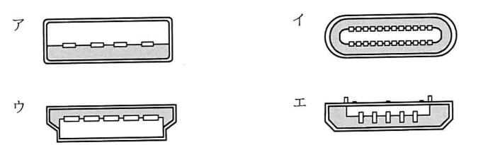
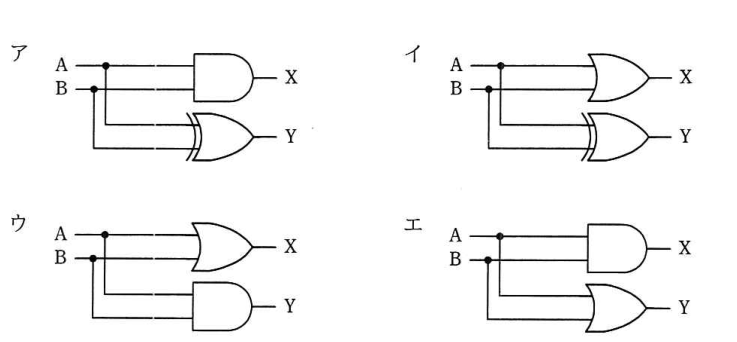
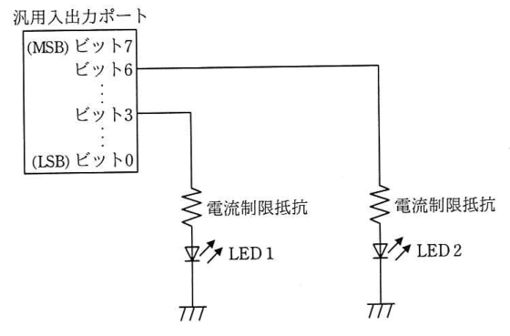
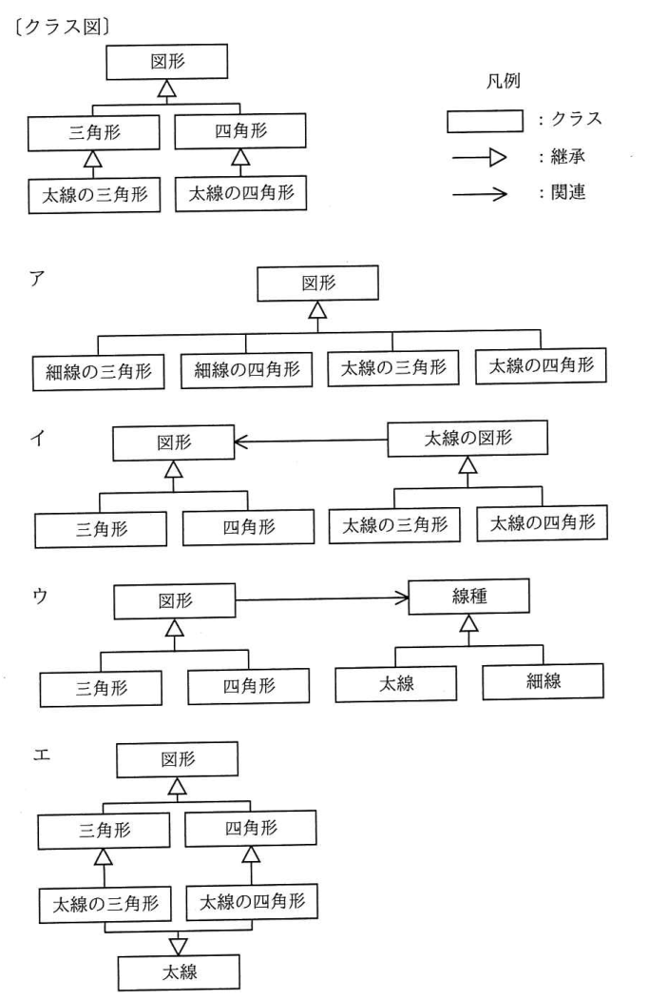
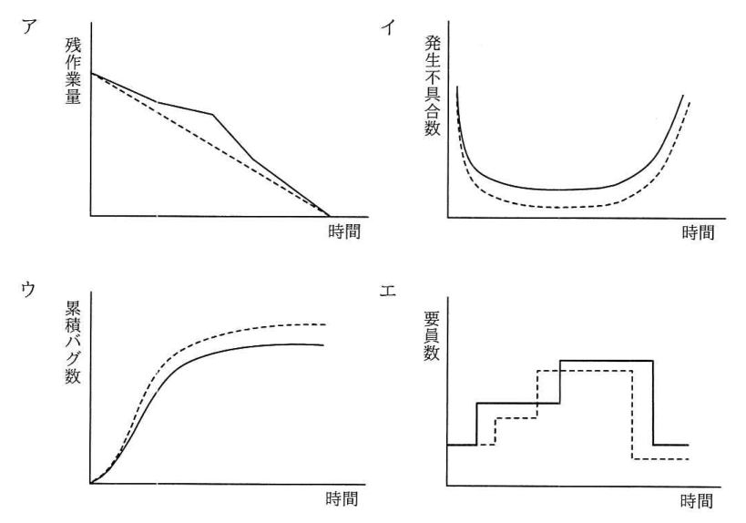
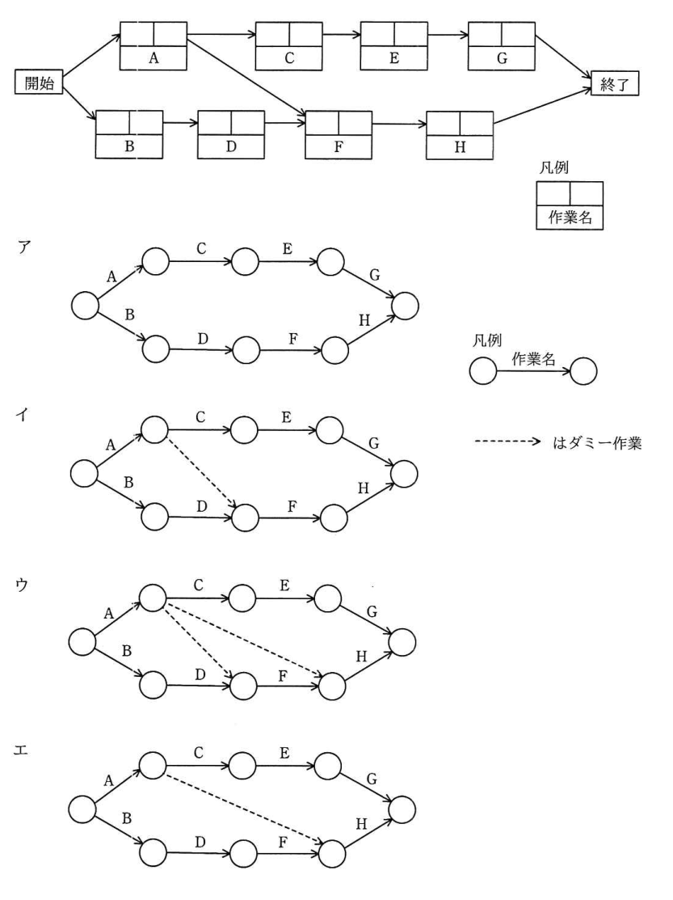

# 令和3年度秋期 科目A（旧午前）過去問解説

> 令和3年度 秋期 応用情報技術者試験 午前（全80問）を書き起こし、オリジナルの解説を付けたものです。問題の著作権は IPA（独立行政法人 情報処理推進機構）にあります。
> 図を表に書き換えるなど一部改変した問題には、その旨を記載しています。
> インタラクティブ教材の [科目A 四択クイズ](../../06_インタラクティブ教材/quiz.html) では、この回を本番形式（150分）で解けます。

## 目次

| 問 | 分野 | 中分類 | キーワード |
|---|---|---|---|
| [問1](#q01) | テクノロジ系 | 基礎理論 | ニュートン法、近似解法、数値計算、接線 |
| [問2](#q02) | テクノロジ系 | 基礎理論 | M/M/1、待ち行列、利用率、平均待ち時間 |
| [問3](#q03) | テクノロジ系 | 基礎理論 | ディープラーニング、ニューラルネットワーク、機械学習、AI |
| [問4](#q04) | テクノロジ系 | 基礎理論 | 水平垂直パリティ、誤り訂正、パリティビット |
| [問5](#q05) | テクノロジ系 | アルゴリズムとプログラミング | バブルソート、整列アルゴリズム、クイックソート、ヒープソート |
| [問6](#q06) | テクノロジ系 | ソフトウェア | 再使用可能、再入可能、再帰的、再配置可能 |
| [問7](#q07) | テクノロジ系 | アルゴリズムとプログラミング | TypeScript、静的型付け、JavaScript、スクリプト言語 |
| [問8](#q08) | テクノロジ系 | コンピュータ構成要素 | 2の補数、オーバフロー、符号付き整数、表現範囲 |
| [問9](#q09) | テクノロジ系 | コンピュータ構成要素 | メモリインタリーブ、バンク、主記憶、高速化 |
| [問10](#q10) | テクノロジ系 | コンピュータ構成要素 | USB Type-C、コネクタ、入出力インタフェース |
| [問11](#q11) | テクノロジ系 | コンピュータ構成要素 | 磁気ディスク、平均回転待ち時間、アクセス時間、シーク時間 |
| [問12](#q12) | テクノロジ系 | システム構成要素 | スケールイン、スケールアウト、スケールアップ、スケールダウン |
| [問13](#q13) | テクノロジ系 | システム構成要素 | インタロック、フールプルーフ、フェールソフト、信頼性設計 |
| [問14](#q14) | テクノロジ系 | システム構成要素 | コンテナ型仮想化、ハイパーバイザー型、ホスト型、仮想化 |
| [問15](#q15) | テクノロジ系 | システム構成要素 | パイプライン、並行処理、スループット、ボトルネック |
| [問16](#q16) | テクノロジ系 | ソフトウェア | スラッシング、仮想記憶、ページング、ページ置換え |
| [問17](#q17) | テクノロジ系 | ソフトウェア | ページフォールト、仮想記憶、発生率、オーバヘッド |
| [問18](#q18) | テクノロジ系 | ソフトウェア | Git、分散型バージョン管理、リポジトリ、Subversion |
| [問19](#q19) | テクノロジ系 | ソフトウェア | 仮想記憶、ページアウト、補助記憶、ページング |
| [問20](#q20) | テクノロジ系 | ハードウェア | RFID、パッシブタグ、ICタグ、電波 |
| [問21](#q21) | テクノロジ系 | ハードウェア | ウォッチドッグタイマ、組込みシステム、暴走検出 |
| [問22](#q22) | テクノロジ系 | ハードウェア | 半加算器、論理回路、AND、XOR |
| [問23](#q23) | テクノロジ系 | ハードウェア | 汎用入出力ポート、ビット演算、論理和、マスク |
| [問24](#q24) | テクノロジ系 | ユーザーインタフェース | アウトラインフォント、ビットマップフォント、フォント |
| [問25](#q25) | テクノロジ系 | 情報メディア | ラジオシティ法、レイトレーシング、テクスチャマッピング、CG |
| [問26](#q26) | テクノロジ系 | データベース | 関係演算、和、集合演算、関係代数 |
| [問27](#q27) | テクノロジ系 | データベース | 障害回復、チェックポイント、ロールフォワード、ロールバック |
| [問28](#q28) | テクノロジ系 | データベース | 正規化、第2正規形、部分関数従属、候補キー |
| [問29](#q29) | テクノロジ系 | データベース | UNION、SQL、集合演算、INTERSECT |
| [問30](#q30) | テクノロジ系 | データベース | 分散データベース、透過性、複製透過性 |
| [問31](#q31) | テクノロジ系 | ネットワーク | ブロードキャスト、マルチキャスト、ユニキャスト、イーサネット |
| [問32](#q32) | テクノロジ系 | ネットワーク | ARP、MACアドレス、IPアドレス |
| [問33](#q33) | テクノロジ系 | ネットワーク | NAPT、IPマスカレード、ポート番号、NAT |
| [問34](#q34) | テクノロジ系 | ネットワーク | TCP、UDP、シーケンス番号、ヘッダ |
| [問35](#q35) | テクノロジ系 | ネットワーク | ブロードキャストアドレス、サブネットマスク、IPv4、ビット演算 |
| [問36](#q36) | テクノロジ系 | セキュリティ | IPv6、拡張ヘッダ、IPsec、ESP |
| [問37](#q37) | テクノロジ系 | セキュリティ | IoTセキュリティガイドライン、アップデート、運用・保守 |
| [問38](#q38) | テクノロジ系 | セキュリティ | 情報セキュリティ早期警戒パートナーシップ、JPCERT/CC、JVN、脆弱性 |
| [問39](#q39) | テクノロジ系 | セキュリティ | 否認防止、JIS Q 27000、情報セキュリティの特性、真正性 |
| [問40](#q40) | テクノロジ系 | セキュリティ | 耐タンパ性、IoT、秘密情報の消去 |
| [問41](#q41) | テクノロジ系 | セキュリティ | CVSS、脆弱性、深刻度、基本評価基準 |
| [問42](#q42) | テクノロジ系 | セキュリティ | 3Dセキュア、クレジットカード、本人認証、セキュリティコード |
| [問43](#q43) | テクノロジ系 | セキュリティ | IPsec、AH、ESP、ネットワーク層 |
| [問44](#q44) | テクノロジ系 | セキュリティ | オープンリダイレクト、リダイレクト、フィッシング |
| [問45](#q45) | テクノロジ系 | セキュリティ | DMZ、制御システム、パッチ管理サーバ、ネットワーク分離 |
| [問46](#q46) | テクノロジ系 | システム開発技術 | CRUDマトリクス、エンティティ、決定表、DFD |
| [問47](#q47) | テクノロジ系 | システム開発技術 | UML、アクティビティ図、振る舞い図 |
| [問48](#q48) | テクノロジ系 | システム開発技術 | クラス図、リファクタリング、継承の分割、UML |
| [問49](#q49) | テクノロジ系 | ソフトウェア開発管理技術 | バーンダウンチャート、アジャイル、残作業量 |
| [問50](#q50) | テクノロジ系 | ソフトウェア開発管理技術 | スクラム、スクラムマスタ、プロダクトオーナ、アジャイル |
| [問51](#q51) | マネジメント系 | プロジェクトマネジメント | フェーズ・ゲート、PMBOK、フェーズ、プロジェクトの継続判断 |
| [問52](#q52) | マネジメント系 | プロジェクトマネジメント | プレシデンスダイアグラム、アローダイアグラム、ダミー作業、FS関係 |
| [問53](#q53) | マネジメント系 | プロジェクトマネジメント | リスクの定量的分析、PMBOK、リスクマネジメント、モンテカルロシミュレーション |
| [問54](#q54) | マネジメント系 | サービスマネジメント | 問題管理、インシデント、既知の誤り、根本原因 |
| [問55](#q55) | マネジメント系 | サービスマネジメント | バックアップ、フルバックアップ、差分バックアップ、磁気テープ |
| [問56](#q56) | マネジメント系 | サービスマネジメント | シフト勤務、要員計画、サービス運用 |
| [問57](#q57) | マネジメント系 | システム監査 | 情報セキュリティ監査、保証型監査、助言型監査 |
| [問58](#q58) | マネジメント系 | システム監査 | アジャイル開発、システム管理基準、システム監査、フィードバック |
| [問59](#q59) | マネジメント系 | システム監査 | ウォークスルー法、システム監査技法、監査証拠 |
| [問60](#q60) | マネジメント系 | システム監査 | システム監査基準、改善計画、フォローアップ、独立性 |
| [問61](#q61) | ストラテジ系 | システム戦略 | VDI、デスクトップ仮想化、テレワーク |
| [問62](#q62) | ストラテジ系 | システム戦略 | KPI、KGI、CSF、業務改善 |
| [問63](#q63) | ストラテジ系 | システム戦略 | プログラムマネジメント、PMO、プロジェクト |
| [問64](#q64) | ストラテジ系 | システム企画 | テレワーク、投資効果、費用対効果 |
| [問65](#q65) | ストラテジ系 | システム企画 | RFI、RFP、SLA、調達 |
| [問66](#q66) | ストラテジ系 | システム企画 | ファウンドリ、ファブレス、半導体、製造委託 |
| [問67](#q67) | ストラテジ系 | 経営戦略マネジメント | バリューチェーン、ポーター、主活動、支援活動 |
| [問68](#q68) | ストラテジ系 | 経営戦略マネジメント | スケールメリット、シナジー効果、規模の経済、範囲の経済 |
| [問69](#q69) | ストラテジ系 | 技術戦略マネジメント | リーンスタートアップ、MVP、ピボット |
| [問70](#q70) | ストラテジ系 | 経営戦略マネジメント | SFA、営業支援、CRM、ERP |
| [問71](#q71) | ストラテジ系 | ビジネスインダストリ | ディジタルツイン、IoT、シミュレーション |
| [問72](#q72) | ストラテジ系 | 企業活動 | ギグエコノミー、働き方、クラウドソーシング |
| [問73](#q73) | ストラテジ系 | ビジネスインダストリ | エッジコンピューティング、IoT、低遅延 |
| [問74](#q74) | ストラテジ系 | 企業活動 | SL理論、リーダシップ、部下の成熟度 |
| [問75](#q75) | ストラテジ系 | 企業活動 | マクシミン原理、意思決定、利得表 |
| [問76](#q76) | ストラテジ系 | 企業活動 | 線形計画法、LP、利益最大化 |
| [問77](#q77) | ストラテジ系 | 企業活動 | 限界利益率、損益分岐点、固定費、変動費 |
| [問78](#q78) | ストラテジ系 | 法務 | 刑法、電子計算機損壊等業務妨害罪、不正指令電磁的記録、ウイルス作成罪 |
| [問79](#q79) | ストラテジ系 | 法務 | 特定電子メール法、オプトイン、オプトアウト、迷惑メール |
| [問80](#q80) | ストラテジ系 | 法務 | 36協定、特別条項、労働基準法、時間外労働 |

### 問1　〔基礎理論〕

非線形方程式 f(x)＝0 の近似解法であり，次の手順によって解を求めるものはどれか。ここで，y＝f(x) には接線が存在するものとし，(3) で x0 と新たな x0 の差の絶対値がある値以下になった時点で繰返しを終了する。

〔手順〕

1. 解の近くの適当な x 軸の値を定め，x0 とする。
2. 曲線 y＝f(x) の，点 (x0, f(x0)) における接線を求める。
3. 求めた接線と，x 軸の交点を新たな x0 とし，手順 (2) に戻る。

- **ア**　オイラー法
- **イ**　ガウスの消去法
- **ウ**　シンプソン法
- **エ**　ニュートン法

解答・解説

**正解：エ**

接線と x 軸の交点を次の近似値にする操作を繰り返して f(x)＝0 の解に近づけるのはニュートン法。

- ア：オイラー法は微分方程式を，小さな刻み幅ごとに傾きを使って順に近似していく解法
- イ：ガウスの消去法は連立一次方程式を，前進消去と後退代入で解く方法
- ウ：シンプソン法は区間を放物線で近似して定積分の値を求める数値積分の方法

💡 **ポイント**：ニュートン法の更新式は x_new = x0 − f(x0) / f'(x0)。収束が速い反面，初期値によっては収束しないことがある。

📖 関連：[基礎理論](../../01_テクノロジ系/01_基礎理論.md)

出典：令和3年度 秋期 応用情報技術者試験 午前 問1（手順の番号を箇条書きで表記）

---

### 問2　〔基礎理論〕 🧮

ATM（現金自動預払機）が1台ずつ設置してある二つの支店を統合し，統合後の支店には ATM を1台設置する。統合後の ATM の平均待ち時間を求める式はどれか。ここで，待ち時間は M/M/1 の待ち行列モデルに従い，平均待ち時間にはサービス時間を含まず，ATM を1台に統合しても十分に処理できるものとする。

〔条件〕

1. 統合後の平均サービス時間：Ts
2. 統合前の ATM の利用率：両支店とも ρ
3. 統合後の利用者数：統合前の両支店の利用者数の合計

- **ア**　ρ / (1 − ρ) × Ts
- **イ**　ρ / (1 − 2ρ) × Ts
- **ウ**　2ρ / (1 − ρ) × Ts
- **エ**　2ρ / (1 − 2ρ) × Ts

解答・解説

**正解：エ**

統合すると到着率が2倍になり，サービス時間は Ts のままなので，統合後の利用率は 2ρ。M/M/1 の平均待ち時間の式に 2ρ を代入すると 2ρ / (1 − 2ρ) × Ts となる。

**途中式**

- M/M/1 の平均待ち時間 W = 利用率 / (1 − 利用率) × 平均サービス時間
- 統合後の利用率 = 到着率 × 平均サービス時間 = (2 × 統合前の到着率) × Ts = 2ρ
- W = **2ρ / (1 − 2ρ) × Ts**

- ア：利用率を統合前の ρ のまま使っている。利用者が2倍になる点が反映されていない
- イ：分母だけ 2ρ にしていて，分子の利用率が ρ のまま
- ウ：分子だけ 2ρ にしていて，分母の利用率が ρ のまま

💡 **ポイント**：M/M/1 の待ち時間は ρ/(1−ρ)×Ts。窓口を統合すると利用率が上がり，待ち時間は ρ が 1 に近づくほど急激に伸びる。

📖 関連：[基礎理論](../../01_テクノロジ系/01_基礎理論.md)／[計算問題公式集](../../05_まとめ・横断資料/01_計算問題公式集.md)

出典：令和3年度 秋期 応用情報技術者試験 午前 問2（条件の番号を箇条書きで表記，分数の式を a / b 形式で表記）

---

### 問3　〔基礎理論〕

AI におけるディープラーニングに最も関連が深いものはどれか。

- **ア**　ある特定の分野に特化した知識を基にルールベースの推論を行うことによって，専門家と同じレベルの問題解決を行う。
- **イ**　試行錯誤しながら条件を満たす解に到達する方法であり，場合分けを行い深さ優先で探索し，解が見つからなければ一つ前の場合分けの状態に後戻りする。
- **ウ**　神経回路網を模倣した方法であり，多層に配置された素子とそれらを結ぶ信号線で構成されたモデルにおいて，信号線に付随するパラメタを調整することによって入力に対して適切な解が出力される。
- **エ**　生物の進化を模倣した方法であり，与えられた問題の解の候補を記号列で表現して，それらを遺伝子に見立てて突然変異，交配，とう汰を繰り返して逐次的により良い解に近づける。

解答・解説

**正解：ウ**

ディープラーニングは，脳の神経回路を模したニューラルネットワークを多層にしたもの。ノード間の結合の重み（パラメタ）を学習によって調整し，入力に対して適切な出力が得られるようにする。

- ア：エキスパートシステムの説明。人が与えた知識とルールで推論する
- イ：バックトラック法の説明。深さ優先で探索し，行き詰まったら後戻りする
- エ：遺伝的アルゴリズムの説明。選択（とう汰）・交叉・突然変異で解を改良する

💡 **ポイント**：ディープラーニング＝多層ニューラルネットワーク。誤差逆伝播法で重みを調整する。特徴量を人が設計しなくても自動で学習できる点が特徴。

📖 関連：[基礎理論](../../01_テクノロジ系/01_基礎理論.md)

出典：令和3年度 秋期 応用情報技術者試験 午前 問3

---

### 問4　〔基礎理論〕

図のように16ビットのデータを 4×4 の正方形状に並べ，行と列にパリティビットを付加することによって何ビットまでの誤りを訂正できるか。ここで，図の網掛け部分はパリティビットを表す。

| | | | | パリティ |
|---|---|---|---|---|
| 1 | 0 | 0 | 0 | **1** |
| 0 | 1 | 1 | 0 | **0** |
| 0 | 0 | 1 | 0 | **1** |
| 1 | 1 | 0 | 1 | **1** |
| **0** | **0** | **0** | **1** | |

（太字がパリティビット）

- **ア**　1
- **イ**　2
- **ウ**　3
- **エ**　4

解答・解説

**正解：ア**

行と列の両方にパリティをもつ水平垂直パリティでは，1ビットの誤りなら「パリティが合わない行」と「合わない列」の交点として位置を特定でき，反転すれば訂正できる。訂正できるのは1ビットまで。

- イ：2ビット誤ると，誤りのある行・列が二つずつ現れて交点の候補が4か所になる（同じ行や列にあると行・列の一方しか検出されない）。位置を一つに決められず訂正できない
- ウ・エ：3ビット以上はなおさら位置が特定できない。偶数個の誤りが同じ行・列に並ぶと検出すらできない場合もある

💡 **ポイント**：水平垂直パリティは「1ビット訂正，2ビット検出」が基本。1ビット訂正・2ビット検出はハミング符号（拡張）でもよく問われる。

📖 関連：[基礎理論](../../01_テクノロジ系/01_基礎理論.md)

出典：令和3年度 秋期 応用情報技術者試験 午前 問4（図を表に書き換え（網掛けのパリティビットを太字で表記））

---

### 問5　〔アルゴリズムとプログラミング〕

バブルソートの説明として，適切なものはどれか。

- **ア**　ある間隔おきに取り出した要素から成る部分列をそれぞれ整列し，更に間隔を詰めて同様の操作を行い，間隔が1になるまでこれを繰り返す。
- **イ**　中間的な基準値を決めて，それよりも大きな値を集めた区分と，小さな値を集めた区分に要素を振り分ける。次に，それぞれの区分の中で同様の操作を繰り返す。
- **ウ**　隣り合う要素を比較して，大小の順が逆であれば，それらの要素を入れ替えるという操作を繰り返す。
- **エ**　未整列の部分を順序木にし，そこから最小値を取り出して整列済の部分に移す。この操作を繰り返して，未整列の部分を縮めていく。

解答・解説

**正解：ウ**

バブルソートは隣り合う2要素を比べ，順序が逆なら交換する操作を繰り返す整列法。1回の走査ごとに最大（または最小）の値が端に確定していく。

- ア：シェルソートの説明。間隔を空けた部分列を挿入ソートで整列し，間隔を狭めていく
- イ：クイックソートの説明。基準値（ピボット）で分割し，各区分で再帰的に同じ処理をする
- エ：ヒープソートの説明。ヒープ（順序木）から最小値（最大値）を取り出していく

💡 **ポイント**：計算量はバブル・選択・挿入が O(n^2)，クイック（平均）・ヒープ・マージが O(n log n)。シェルソートは挿入ソートの改良版。

📖 関連：[アルゴリズムとプログラミング](../../01_テクノロジ系/02_アルゴリズムとプログラミング.md)

出典：令和3年度 秋期 応用情報技術者試験 午前 問5

---

### 問6　〔ソフトウェア〕

プログラム特性に関する記述のうち，適切なものはどれか。

- **ア**　再帰的プログラムは再入可能な特性をもち，呼び出されたプログラムの全てがデータを共用する。
- **イ**　再使用可能プログラムは実行の始めに変数を初期化する，又は変数を初期状態に戻した後にプログラムを終了する。
- **ウ**　再入可能プログラムは，データとコードの領域を明確に分離して，両方を各タスクで共用する。
- **エ**　再配置可能なプログラムは，実行の都度，主記憶装置上の定まった領域で実行される。

解答・解説

**正解：イ**

逐次再使用可能（シリアリリユーザブル）プログラムは，一度ロードしたものを繰り返し使えるように，実行の最初に変数を初期化するか，終了前に初期状態へ戻しておく。

- ア：再帰的プログラムは呼び出しごとに別のデータ領域（スタック上の局所変数など）を使う。全てがデータを共用するわけではない
- ウ：再入可能（リエントラント）プログラムは，コードは共用するがデータはタスクごとに別にもつ。データまで共用すると同時実行で値が壊れる
- エ：再配置可能プログラムは，主記憶上の **どこに** ロードしても実行できる性質。定まった領域で実行されるわけではない

💡 **ポイント**：再入可能＝コード共用・データはタスクごと，再使用可能＝初期化して繰り返し使える，再配置可能＝どのアドレスでも動く，再帰的＝自分自身を呼び出せる（再入可能であることが前提）。

📖 関連：[ソフトウェア](../../01_テクノロジ系/05_ソフトウェア.md)

出典：令和3年度 秋期 応用情報技術者試験 午前 問6

---

### 問7　〔アルゴリズムとプログラミング〕

静的型付けを行うプログラム言語では，コンパイル時に変数名の誤り，誤った値の代入などが発見できる。Web プログラミングで用いられるスクリプト言語のうち，変数の静的型付けができるものはどれか。

- **ア**　ECMAScript
- **イ**　JavaScript
- **ウ**　TypeScript
- **エ**　VBScript

解答・解説

**正解：ウ**

TypeScript は JavaScript に型注釈などを加えた言語で，変数に型を宣言でき，コンパイル（JavaScript への変換）時に型の誤りを検出できる。

- ア：ECMAScript は JavaScript の標準仕様。変数の型は実行時に決まる動的型付け
- イ：JavaScript は動的型付けの言語で，変数に型を宣言しない
- エ：VBScript は Microsoft のスクリプト言語で，変数は Variant 型のみの動的型付け

💡 **ポイント**：TypeScript は「型付きの JavaScript」。最終的には JavaScript に変換されてブラウザなどで動く。

📖 関連：[アルゴリズムとプログラミング](../../01_テクノロジ系/02_アルゴリズムとプログラミング.md)

出典：令和3年度 秋期 応用情報技術者試験 午前 問7

---

### 問8　〔コンピュータ構成要素〕 🧮

演算レジスタが16ビットの CPU で符号付き16ビット整数 x1，x2 を16ビット符号付き加算（x1＋x2）するときに，全ての x1，x2 の組合せにおいて加算結果がオーバフロー **しないもの** はどれか。ここで，|x| は x の絶対値を表し，負数は2の補数で表すものとする。

- **ア**　|x1|＋|x2| ≦ 32,768 の場合
- **イ**　|x1| 及び |x2| がともに 32,767 未満の場合
- **ウ**　x1×x2 ＞ 0 の場合
- **エ**　x1 と x2 の符号が異なる場合

解答・解説

**正解：エ**

16ビットの2の補数で表せる範囲は −32,768〜32,767。符号が異なる二つの数を足すと，結果の絶対値は大きい方の絶対値を超えないので，必ず範囲内に収まりオーバフローしない。

**検討**

- 表現範囲：−2^15 〜 2^15 − 1 ＝ −32,768 〜 32,767
- 符号が異なる場合：例えば x1 ≧ 0，x2 ＜ 0 なら x2 ≦ x1＋x2 ＜ x1 となり，結果は x1 と x2 の間にある → 範囲内

- ア：x1＝x2＝16,384 なら |x1|＋|x2|＝32,768 で条件を満たすが，和 32,768 は正の最大値 32,767 を超える
- イ：x1＝x2＝32,766 なら和は 65,532 でオーバフローする
- ウ：x1×x2＞0 は同符号の場合で，絶対値が大きければ正・負どちらでもオーバフローする

💡 **ポイント**：符号付き加算のオーバフローは同符号どうしの加算でだけ起こる。異符号の加算では起こらない。

📖 関連：[基礎理論](../../01_テクノロジ系/01_基礎理論.md)／[コンピュータ構成要素](../../01_テクノロジ系/03_コンピュータ構成要素.md)

出典：令和3年度 秋期 応用情報技術者試験 午前 問8

---

### 問9　〔コンピュータ構成要素〕

メモリインタリーブの説明として，適切なものはどれか。

- **ア**　主記憶と外部記憶を一元的にアドレス付けし，主記憶の物理容量を超えるメモリ空間を提供する。
- **イ**　主記憶と磁気ディスク装置との間にバッファメモリを置いて，双方のアクセス速度の差を補う。
- **ウ**　主記憶と入出力装置との間で CPU とは独立にデータ転送を行う。
- **エ**　主記憶を複数のバンクに分けて，CPU からのアクセス要求を並列的に処理できるようにする。

解答・解説

**正解：エ**

メモリインタリーブは主記憶を複数のバンクに分け，連続するアドレスを異なるバンクに割り当てることで，複数のバンクに同時並行でアクセスできるようにして見かけのアクセス時間を短くする技術。

- ア：仮想記憶の説明
- イ：ディスクキャッシュの説明
- ウ：DMA（Direct Memory Access）の説明

💡 **ポイント**：主記憶の高速化技術として，キャッシュメモリ（速い記憶を間に置く）とメモリインタリーブ（並列にアクセスする）を区別して覚える。

📖 関連：[コンピュータ構成要素](../../01_テクノロジ系/03_コンピュータ構成要素.md)

出典：令和3年度 秋期 応用情報技術者試験 午前 問9

---

### 問10　〔コンピュータ構成要素〕

USB Type-C のプラグ側コネクタの断面図はどれか。ここで，図の縮尺は同一ではない。

- **ア**　（図のア）
- **イ**　（図のイ）
- **ウ**　（図のウ）
- **エ**　（図のエ）

解答・解説

**正解：イ**

USB Type-C のプラグは，角の丸い細長い楕円形で上下の区別がない（上下どちら向きにも挿せる）形状をしており，内部に上下対称に接点が並ぶ。図のイがこれに当たる。

- ア：長方形で片側に接点が並ぶ USB Type-A の形状
- ウ：下側の両角を斜めに落とした HDMI の形状
- エ：台形で上部に固定用の突起がある USB Micro-B の形状

💡 **ポイント**：USB Type-C はリバーシブル（表裏の区別なし）で，データ転送だけでなく USB PD による給電や映像出力（DisplayPort Alternate Mode など）にも使われる。

📖 関連：[コンピュータ構成要素](../../01_テクノロジ系/03_コンピュータ構成要素.md)

出典：令和3年度 秋期 応用情報技術者試験 午前 問10

---

### 問11　〔コンピュータ構成要素〕 🧮

表に示す仕様の磁気ディスク装置において，1,000バイトのデータの読取りに要する平均時間は何ミリ秒か。ここで，コントローラの処理時間は平均シーク時間に含まれるものとする。

| 項目 | 仕様 |
|---|---|
| 回転数 | 6,000回転／分 |
| 平均シーク時間 | 10ミリ秒 |
| 転送速度 | 10Mバイト／秒 |

- **ア**　15.1
- **イ**　16.0
- **ウ**　20.1
- **エ**　21.0

解答・解説

**正解：ア**

平均アクセス時間＝平均シーク時間＋平均回転待ち時間＋データ転送時間＝10＋5＋0.1＝15.1ミリ秒。

**途中式**

- 1回転の時間 = 60秒 / 6,000回転 = 0.01秒 = 10ミリ秒
- 平均回転待ち時間 = 1回転の半分 = 5ミリ秒
- データ転送時間 = 1,000バイト / (10 × 10^6 バイト/秒) = 0.0001秒 = 0.1ミリ秒
- 合計 = 10 ＋ 5 ＋ 0.1 = **15.1ミリ秒**

- イ：転送時間を 1ミリ秒（1桁誤り）として 10＋5＋1 とした値
- ウ：回転待ちを1回転分（10ミリ秒）として 10＋10＋0.1 とした値
- エ：回転待ちを1回転分とし，さらに転送時間を 1ミリ秒とした値

💡 **ポイント**：平均回転待ち時間は「1回転の時間の半分」。回転数は分単位で与えられることが多いので秒に直してから計算する。

📖 関連：[コンピュータ構成要素](../../01_テクノロジ系/03_コンピュータ構成要素.md)／[計算問題公式集](../../05_まとめ・横断資料/01_計算問題公式集.md)

出典：令和3年度 秋期 応用情報技術者試験 午前 問11（仕様の表を GFM の表に書き換え）

---

### 問12　〔システム構成要素〕

システムが使用する物理サーバの処理能力を，負荷状況に応じて調整する方法としてのスケールインの説明はどれか。

- **ア**　システムを構成する物理サーバの台数を増やすことによって，システムとしての処理能力を向上する。
- **イ**　システムを構成する物理サーバの台数を減らすことによって，システムとしてのリソースを最適化し，無駄なコストを削減する。
- **ウ**　高い処理能力の CPU への交換やメモリの追加などによって，システムとしての処理能力を向上する。
- **エ**　低い処理能力の CPU への交換やメモリの削減などによって，システムとしてのリソースを最適化し，無駄なコストを削減する。

解答・解説

**正解：イ**

スケールインは，負荷が下がったときにサーバの台数を減らして，余分なリソースとコストを削減すること。

- ア：スケールアウトの説明（台数を増やす）
- ウ：スケールアップの説明（1台の性能を上げる）
- エ：スケールダウンの説明（1台の性能を下げる）

💡 **ポイント**：台数を増減するのがアウト／イン（水平），1台の性能を増減するのがアップ／ダウン（垂直）。クラウドのオートスケールは主にスケールアウト／インで行う。

📖 関連：[システム構成要素](../../01_テクノロジ系/04_システム構成要素.md)

出典：令和3年度 秋期 応用情報技術者試験 午前 問12

---

### 問13　〔システム構成要素〕

信頼性設計においてフールプルーフを実現する仕組みの一つであるインタロックの例として，適切なものはどれか。

- **ア**　ある機械が故障したとき，それを停止させて代替の機械に自動的に切り替える仕組み
- **イ**　ある条件下では，特定の人間だけが，システムを利用することを可能にする仕組み
- **ウ**　システムの一部に不具合が生じたとき，その部分を停止させて機能を縮小してシステムを稼働し続ける仕組み
- **エ**　動作中の機械から一定の範囲内に人間が立ち入ったことをセンサが感知したとき，機械の動作を停止させる仕組み

解答・解説

**正解：エ**

インタロックは，危険な状態になる条件がそろったときに操作や動作ができないようにする仕組み。人が危険範囲に入ったら機械を止めるのは，人の誤った行動から事故を防ぐフールプルーフの典型例。

- ア：フォールトトレランスの一種（待機系への自動切替え）の説明
- イ：アクセス制御（利用者認証・権限管理）の説明
- ウ：フェールソフトの説明。機能を縮小してでも稼働を続ける

💡 **ポイント**：フールプルーフ＝人が誤っても危険にならない，フェールセーフ＝故障時に安全側に倒す，フェールソフト＝故障時に機能を縮小して継続，フォールトアボイダンス＝そもそも故障しにくくする。

📖 関連：[システム構成要素](../../01_テクノロジ系/04_システム構成要素.md)

出典：令和3年度 秋期 応用情報技術者試験 午前 問13

---

### 問14　〔システム構成要素〕

コンテナ型仮想化の説明として，適切なものはどれか。

- **ア**　アプリケーションの起動に必要なプログラムやライブラリなどをまとめ，ホスト OS で動作させるので，独立性を保ちながら複数のアプリケーションを稼働できる。
- **イ**　サーバで仮想化ソフトウェアを動かし，その上で複数のゲスト OS を稼働させるので，サーバの OS とは異なる OS も稼働できる。
- **ウ**　サーバで実行されたアプリケーションの画面情報をクライアントに送信し，クライアントからは端末の操作情報がサーバに送信されるので，クライアントにアプリケーションをインストールしなくても利用できる。
- **エ**　ホスト OS で仮想化ソフトウェアを動かし，その上で複数のゲスト OS を稼働させるので，物理サーバへアクセスするにはホスト OS を経由する必要がある。

解答・解説

**正解：ア**

コンテナ型仮想化は，アプリケーションと必要なライブラリなどを「コンテナ」にまとめ，ホスト OS のカーネルを共有しながら互いに隔離して動かす方式。ゲスト OS を起動しないので軽量で起動も速い。

- イ：ハイパーバイザー型仮想化の説明。ハードウェア上で直接仮想化ソフトウェアが動き，異なる OS も動かせる
- ウ：画面転送型のシンクライアント（サーバベースコンピューティング）の説明
- エ：ホスト型仮想化の説明。ホスト OS 上の仮想化ソフトウェアでゲスト OS を動かすため，ハードウェアへのアクセスにはホスト OS を経由する

💡 **ポイント**：コンテナ型はカーネルをホスト OS と共有するので，ホスト OS と異なる種類の OS は基本的に動かせない。代表的なソフトウェアは Docker。

📖 関連：[システム構成要素](../../01_テクノロジ系/04_システム構成要素.md)

出典：令和3年度 秋期 応用情報技術者試験 午前 問14

---

### 問15　〔システム構成要素〕 🧮

1件のデータを処理する際に，読取りには40ミリ秒，CPU 処理には30ミリ秒，書込みには50ミリ秒掛かるプログラムがある。このプログラムで，n 件目の書込みと並行して n＋1 件目の CPU 処理と n＋2 件目の読取りを実行すると，1分当たりの最大データ処理件数は幾つか。ここで，OS のオーバヘッドは考慮しないものとする。

- **ア**　500
- **イ**　666
- **ウ**　750
- **エ**　1,200

解答・解説

**正解：エ**

読取り・CPU 処理・書込みを3段のパイプラインのように並行して行うので，定常状態では最も遅い段（書込み 50ミリ秒）ごとに1件ずつ処理が完了する。60,000 / 50 ＝ 1,200 件。

**途中式**

- 1件が完了する間隔 = max(40, 30, 50) = 50ミリ秒
- 1分当たりの件数 = 60,000ミリ秒 / 50ミリ秒 = **1,200件**

- ア：並行処理をせず，1件ごとに 40＋30＋50＝120ミリ秒掛かるとした値（60,000/120）
- イ：60,000 / 90 ≒ 666。読取りと書込み（40＋50）が重ならないとした場合の値
- ウ：60,000 / 80 = 750。CPU 処理と書込み（30＋50）が重ならないとした場合の値

💡 **ポイント**：処理を重ね合わせて実行するとき，スループットはいちばん時間の掛かる段（ボトルネック）で決まる。

📖 関連：[システム構成要素](../../01_テクノロジ系/04_システム構成要素.md)

出典：令和3年度 秋期 応用情報技術者試験 午前 問15

---

### 問16　〔ソフトウェア〕

ページング方式の仮想記憶において，ページ置換えの発生頻度が高くなり，システムの処理能力が急激に低下することがある。このような現象を何と呼ぶか。

- **ア**　スラッシング
- **イ**　スワップアウト
- **ウ**　フラグメンテーション
- **エ**　ページフォールト

解答・解説

**正解：ア**

実記憶が不足してページの追い出しと読込みが頻繁に繰り返され，ディスク入出力ばかりで処理が進まなくなる現象をスラッシングという。

- イ：スワップアウトは，主記憶上のプログラム（プロセス）を丸ごと補助記憶に退避すること
- ウ：フラグメンテーションは，記憶領域の割当てと解放を繰り返すうちに空き領域が細切れになること
- エ：ページフォールトは，参照したページが主記憶にないときに起こる割込み。これが多発した結果がスラッシング

💡 **ポイント**：スラッシングは多重度を上げ過ぎたときに起こりやすい。対策は多重度を下げる，主記憶を増設するなど。

📖 関連：[ソフトウェア](../../01_テクノロジ系/05_ソフトウェア.md)

出典：令和3年度 秋期 応用情報技術者試験 午前 問16

---

### 問17　〔ソフトウェア〕 🧮

主記憶へのアクセスを1命令当たり平均2回行い，ページフォールトが発生すると1回当たり40ミリ秒のオーバヘッドを伴うシステムがある。ページフォールトによる命令実行の遅れを1命令当たり平均0.4マイクロ秒以下にするために許容できるページフォールト発生率は最大幾らか。ここで，他のオーバヘッドは考慮しないものとする。

- **ア**　5×10^-6
- **イ**　1×10^-5
- **ウ**　5×10^-5
- **エ**　1×10^-4

解答・解説

**正解：ア**

ページフォールト発生率を p とすると，1命令当たりの遅れは 2回 × p × 40ミリ秒。これを 0.4マイクロ秒以下にすると p ≦ 5×10^-6。

**途中式**

- 1命令当たりの遅れ = 2 × p × 40 × 10^-3 秒 = 80 × 10^-3 × p 秒
- 80 × 10^-3 × p ≦ 0.4 × 10^-6
- p ≦ 0.4 × 10^-6 / (80 × 10^-3) = **5 × 10^-6**

- イ：1命令当たりのアクセス回数2回を掛け忘れた値（0.4×10^-6 / 40×10^-3）
- ウ・エ：単位（ミリとマイクロ）の換算を誤ると出てくる値。この発生率では遅れが 0.4マイクロ秒を超える

💡 **ポイント**：「回数 × 発生率 × 1回の時間 ≦ 許容時間」の不等式を立てる。ミリ（10^-3）とマイクロ（10^-6）の換算に注意。

📖 関連：[ソフトウェア](../../01_テクノロジ系/05_ソフトウェア.md)／[計算問題公式集](../../05_まとめ・横断資料/01_計算問題公式集.md)

出典：令和3年度 秋期 応用情報技術者試験 午前 問17（指数を ^ で表記）

---

### 問18　〔ソフトウェア〕

分散開発環境において，各開発者のローカル環境に全履歴を含んだ中央リポジトリの完全な複製をもつことによって，中央リポジトリにアクセスできないときでも履歴の調査や変更の記録を可能にする，バージョン管理ツールはどれか。

- **ア**　Apache Subversion
- **イ**　CVS
- **ウ**　Git
- **エ**　RCS

解答・解説

**正解：ウ**

Git は分散型のバージョン管理システムで，各開発者が履歴を含むリポジトリ全体を手元に複製（クローン）する。中央のサーバに接続できなくても，ローカルで履歴の参照やコミットができる。

- ア：Apache Subversion（SVN）は集中型。履歴は中央リポジトリだけがもつ
- イ：CVS も集中型のバージョン管理システム
- エ：RCS は単一ファイルの版をローカルで管理する初期のツールで，分散開発向けのリポジトリ複製の仕組みはない

💡 **ポイント**：集中型（CVS，Subversion）と分散型（Git，Mercurial）の違いは「各開発者が全履歴をもつかどうか」。

📖 関連：[ソフトウェア](../../01_テクノロジ系/05_ソフトウェア.md)／[ソフトウェア開発管理技術](../../01_テクノロジ系/12_ソフトウェア開発管理技術.md)

出典：令和3年度 秋期 応用情報技術者試験 午前 問18

---

### 問19　〔ソフトウェア〕

仮想記憶方式における補助記憶の機能はどれか。

- **ア**　主記憶からページアウトされたページを格納する。
- **イ**　主記憶が更新された際に，更新前の内容を保存する。
- **ウ**　主記憶と連続した仮想アドレスを割り当てて，主記憶を拡張する。
- **エ**　主記憶のバックアップとして，主記憶の内容を格納する。

解答・解説

**正解：ア**

仮想記憶では，主記憶に置き切れないページを補助記憶（ページング領域）に置いておき，主記憶から追い出された（ページアウトされた）ページもここに格納する。必要になればページインで主記憶に戻す。

- イ：更新前の内容を保存するのは，データベースのログ（更新前ログ）などの役割
- ウ：補助記憶に主記憶と「連続した」アドレスを割り当てるのではない。仮想アドレスはアドレス変換によって主記憶か補助記憶上のページに対応付けられる
- エ：主記憶の全内容のバックアップを取る機能ではない

💡 **ポイント**：ページアウト＝主記憶 → 補助記憶，ページイン＝補助記憶 → 主記憶。補助記憶は仮想記憶の「置き場所」。

📖 関連：[ソフトウェア](../../01_テクノロジ系/05_ソフトウェア.md)

出典：令和3年度 秋期 応用情報技術者試験 午前 問19

---

### 問20　〔ハードウェア〕

RFID のパッシブ方式の RF タグの説明として，適切なものはどれか。

- **ア**　アンテナで受け取った電力を用いて通信する。
- **イ**　可視光でデータ通信する。
- **ウ**　静電容量の変化を捉えて位置を検出する。
- **エ**　赤外線でデータ通信する。

解答・解説

**正解：ア**

パッシブ方式の RF タグは電池をもたず，リーダから送られる電波（電磁波）をアンテナで受けて，その電力で IC を動かして応答する。

- イ：可視光通信（LED 照明などを使う通信）の説明
- ウ：静電容量方式のタッチパネルなどの説明
- エ：IrDA などの赤外線通信の説明

💡 **ポイント**：パッシブタグ＝電池なし・リーダの電波で動作，アクティブタグ＝電池内蔵で通信距離が長い。RFID は非接触・複数同時読取りができるのが特徴。

📖 関連：[ハードウェア](../../01_テクノロジ系/10_ハードウェア.md)

出典：令和3年度 秋期 応用情報技術者試験 午前 問20

---

### 問21　〔ハードウェア〕

組込みシステムにおける，ウォッチドッグタイマの機能はどれか。

- **ア**　あらかじめ設定された一定時間内にタイマがクリアされなかった場合，システム異常とみなしてシステムをリセット又は終了する。
- **イ**　システム異常を検出した場合，タイマで設定された時間だけ待ってシステムに通知する。
- **ウ**　システム異常を検出した場合，マスカブル割込みでシステムに通知する。
- **エ**　システムが一定時間異常であった場合，上位の管理プログラムを呼び出す。

解答・解説

**正解：ア**

ウォッチドッグタイマは，正常に動いているプログラムが定期的にタイマをクリアする仕組み。プログラムが暴走・停止してクリアされないまま時間切れになると，異常とみなしてリセットなどを行う。

- イ：異常を検出してから待って通知するのではなく，タイマのクリアが途絶えたことで異常を検出する
- ウ：ウォッチドッグタイマの時間切れは，マスクされると困るので通常はリセットやマスク不能割込み（NMI）で知らせる。異常検出後に割込みで通知する仕組みの説明ではない
- エ：「一定時間異常であった」ことを判定する機能ではなく，一定時間タイマがクリアされないことを監視する

💡 **ポイント**：ウォッチドッグタイマ＝「生存確認が途絶えたらリセット」。CPU の暴走や無限ループからの自動復旧に使う。

📖 関連：[ハードウェア](../../01_テクノロジ系/10_ハードウェア.md)

出典：令和3年度 秋期 応用情報技術者試験 午前 問21

---

### 問22　〔ハードウェア〕

1桁の2進数 A，B を加算し，X に桁上がり，Y に桁上げなしの和（和の1桁目）が得られる論理回路はどれか。

- **ア**　（図のア：X＝AND，Y＝XOR）
- **イ**　（図のイ：X＝OR，Y＝XOR）
- **ウ**　（図のウ：X＝OR，Y＝AND）
- **エ**　（図のエ：X＝AND，Y＝OR）

解答・解説

**正解：ア**

1桁どうしの加算（半加算器）では，桁上がり X は A と B がともに 1 のときだけ 1 なので AND，和の1桁目 Y は A と B が異なるとき 1 なので XOR になる。

**真理値表**

| A | B | 桁上がり X | 和 Y |
|---|---|---|---|
| 0 | 0 | 0 | 0 |
| 0 | 1 | 0 | 1 |
| 1 | 0 | 0 | 1 |
| 1 | 1 | 1 | 0 |

- イ：X を OR にすると，A＝1，B＝0 などでも桁上がりが 1 になってしまう
- ウ：X を OR，Y を AND にすると桁上がりと和が両方とも誤り
- エ：Y を OR にすると，A＝B＝1 のとき和の1桁目が 1 になってしまう（正しくは 0）

💡 **ポイント**：半加算器＝AND（桁上がり）＋XOR（和）。全加算器は半加算器2個と OR 1個で構成できる。

📖 関連：[ハードウェア](../../01_テクノロジ系/10_ハードウェア.md)／[コンピュータ構成要素](../../01_テクノロジ系/03_コンピュータ構成要素.md)

出典：令和3年度 秋期 応用情報技術者試験 午前 問22（選択肢の図に素子名を補記）

---

### 問23　〔ハードウェア〕 🧮

マイコンの汎用入出力ポートに接続された LED1 を，LED2 の状態を変化させずに点灯したい。汎用入出力ポートに書き込む値として，適切なものはどれか。ここで，使用されている汎用入出力ポートのビットは全て出力モードに設定されていて，出力値の読出しが可能で，この操作の間に汎用入出力ポートに対する他の操作は行われないものとする。

- **ア**　汎用入出力ポートから読み出した値と16進数の 08 との論理積
- **イ**　汎用入出力ポートから読み出した値と16進数の 08 との論理和
- **ウ**　汎用入出力ポートから読み出した値と16進数の 48 との論理積
- **エ**　汎用入出力ポートから読み出した値と16進数の 48 との論理和

解答・解説

**正解：イ**

LED1 はビット3につながり，ポートの出力が 1 のとき電流が流れて点灯する。ビット3だけを 1 にし，他のビット（LED2 のビット6を含む）を変えないには，現在値と 0000 1000（16進数 08）の論理和を取る。

**途中式**

- ビット3 だけが 1 のパターン：0000 1000（2進）＝ 08（16進）
- 現在値 OR 08 → ビット3 は必ず 1，他のビットは x OR 0 ＝ x で元の値のまま

- ア：08 との論理積は，ビット3 以外を全て 0 にしてしまう。LED2 が点灯していれば消えてしまい，ビット3 も元が 0 なら 0 のまま
- ウ：48 との論理積はビット3・6 以外を 0 にするだけで，ビット3 を 1 にはできない
- エ：48（0100 1000）との論理和は，ビット6 も 1 にして LED2 まで点灯させてしまう

💡 **ポイント**：特定ビットを 1 にする → OR，0 にする → AND（そのビットだけ 0 のマスク），反転する → XOR。他のビットに影響を与えないのがポイント。

📖 関連：[ハードウェア](../../01_テクノロジ系/10_ハードウェア.md)／[基礎理論](../../01_テクノロジ系/01_基礎理論.md)

出典：令和3年度 秋期 応用情報技術者試験 午前 問23

---

### 問24　〔ユーザーインタフェース〕

ビットマップフォントよりも，アウトラインフォントの利用が適している場合はどれか。

- **ア**　英数字だけでなく，漢字も表示する。
- **イ**　各文字の幅を一定にして表示する。
- **ウ**　画面上にできるだけ高速に表示する。
- **エ**　文字を任意の倍率に拡大して表示する。

解答・解説

**正解：エ**

アウトラインフォントは文字の輪郭を座標と曲線の式で表すので，どんな倍率に拡大・縮小しても輪郭が滑らかなまま表示できる。ビットマップフォントは点の集まりなので，拡大するとギザギザ（ジャギー）が目立つ。

- ア：漢字の表示はビットマップフォントでもできる。どちらが適しているかの決め手にならない
- イ：文字幅を一定にする（等幅）かどうかはフォントのデザインの問題で，両方式とも可能
- ウ：ビットマップフォントは点をそのまま描くだけなので，輪郭から点を生成（ラスタライズ）するアウトラインフォントより高速に表示できる

💡 **ポイント**：アウトラインフォント＝拡大縮小に強い（TrueType，OpenType など），ビットマップフォント＝特定サイズで高速・軽量。

📖 関連：[ユーザーインタフェースと情報メディア](../../01_テクノロジ系/11_ユーザーインタフェースと情報メディア.md)

出典：令和3年度 秋期 応用情報技術者試験 午前 問24

---

### 問25　〔情報メディア〕

コンピュータグラフィックスに関する記述のうち，適切なものはどれか。

- **ア**　テクスチャマッピングは，全てのピクセルについて，視線と全ての物体との交点を計算し，その中から視点に最も近い交点を選択することによって，隠面消去を行う。
- **イ**　メタボールは，反射・透過方向への視線追跡を行わず，与えられた空間中のデータから輝度を計算する。
- **ウ**　ラジオシティ法は，拡散反射面間の相互反射による効果を考慮して拡散反射面の輝度を決める。
- **エ**　レイトレーシングは，形状が定義された物体の表面に，別に定義された模様を張り付けて画像を作成する。

解答・解説

**正解：ウ**

ラジオシティ法は，光が物体の拡散反射面どうしで何度も反射し合う効果（間接光）を計算して，各面の明るさを決める手法。柔らかい陰影の表現に向く。

- ア：視線と物体の交点を求めて最も近いものを選ぶのはレイトレーシング（レイキャスティング）による隠面消去の説明
- イ：視線追跡をせず空間中のデータから輝度を計算するのはボリュームレンダリングの説明。メタボールは，複数の球を密度の場として融合させ，滑らかな曲面を表すモデリング手法
- エ：物体表面に模様を張り付けるのはテクスチャマッピングの説明。レイトレーシングは視点から光線を逆にたどって反射・屈折を計算する手法

💡 **ポイント**：ラジオシティ＝拡散反射の相互反射，レイトレーシング＝光線追跡（鏡面反射・屈折に強い），テクスチャマッピング＝模様の貼付け。選択肢の説明が入れ替えられている形の出題が多い。

📖 関連：[ユーザーインタフェースと情報メディア](../../01_テクノロジ系/11_ユーザーインタフェースと情報メディア.md)

出典：令和3年度 秋期 応用情報技術者試験 午前 問25

---

### 問26　〔データベース〕

関係 R と関係 S に対して，関係 X を求める関係演算はどれか。

R

| ID | A | B |
|---|---|---|
| 0001 | a | 100 |
| 0002 | b | 200 |
| 0003 | d | 300 |

S

| ID | A | B |
|---|---|---|
| 0001 | a | 100 |
| 0002 | a | 200 |

X

| ID | A | B |
|---|---|---|
| 0001 | a | 100 |
| 0002 | a | 200 |
| 0002 | b | 200 |
| 0003 | d | 300 |

- **ア**　ID で結合
- **イ**　差
- **ウ**　直積
- **エ**　和

解答・解説

**正解：エ**

X には R の3行と S の2行が全て含まれ，両方にある (0001, a, 100) は1行にまとめられている。これは R と S の和（R ∪ S）。

- ア：ID で結合すると，R の列と S の列を横に並べた表になり，列数が増える
- イ：差 R − S は R にあって S にない行なので (0002, b, 200) と (0003, d, 300) の2行だけになる
- ウ：直積は R の各行と S の各行の全組合せで 3 × 2 ＝ 6 行，列も6列になる

💡 **ポイント**：和・差・共通は列構成が同じ（和両立）関係どうしで行う集合演算。結果の行を数えてどの演算か判定するとよい。

📖 関連：[データベース](../../01_テクノロジ系/06_データベース.md)

出典：令和3年度 秋期 応用情報技術者試験 午前 問26（関係の図を表に書き換え）

---

### 問27　〔データベース〕

データベースの障害回復処理に関する記述として，適切なものはどれか。

- **ア**　異なるトランザクション処理プログラムが，同一データベースを同時更新することによって生じる論理的な矛盾を防ぐために，データのブロック化が必要となる。
- **イ**　システムが媒体障害以外のハードウェア障害によって停止した場合，チェックポイントの取得以前に終了したトランザクションについての回復作業は不要である。
- **ウ**　データベースの媒体障害に対して，バックアップファイルをリストアした後，ログファイルの更新前情報を使用してデータの回復処理を行う。
- **エ**　トランザクション処理プログラムがデータベースの更新中に異常終了した場合には，ログファイルの更新後情報を使用してデータの回復処理を行う。

解答・解説

**正解：イ**

チェックポイントでは更新内容がデータベースに書き出されているので，システム障害（媒体障害以外）のとき，チェックポイントより前にコミット済みのトランザクションは回復の対象外になる。回復が必要なのはチェックポイント以降に関係するトランザクションだけ。

- ア：同時更新による矛盾を防ぐのは排他制御（ロック）。データのブロック化は入出力の効率化のための技術
- ウ：媒体障害では，バックアップをリストアした後，更新 **後** 情報でロールフォワードする
- エ：トランザクションの異常終了では，更新 **前** 情報でロールバックして更新を取り消す

💡 **ポイント**：ロールバック＝更新前ログで戻す（異常終了・未コミット），ロールフォワード＝更新後ログで進める（媒体障害・コミット済み）。

📖 関連：[データベース](../../01_テクノロジ系/06_データベース.md)

出典：令和3年度 秋期 応用情報技術者試験 午前 問27

---

### 問28　〔データベース〕

受注入力システムによって作成される次の表に関する記述のうち，適切なものはどれか。受注番号は受注ごとに新たに発行される番号であり，項番は1回の受注で商品コード別に連番で発行される番号である。

なお，単価は商品コードによって一意に定まる。

| 受注日 | 受注番号 | 得意先コード | 項番 | 商品コード | 数量 | 単価 |
|---|---|---|---|---|---|---|
| 2021-03-05 | 995867 | 0256 | 1 | 20121 | 20 | 20,000 |
| 2021-03-05 | 995867 | 0256 | 2 | 24005 | 10 | 15,000 |
| 2021-03-05 | 995867 | 0256 | 3 | 28007 | 5 | 5,000 |

- **ア**　第1正規形でない。
- **イ**　第1正規形であるが第2正規形でない。
- **ウ**　第2正規形であるが第3正規形でない。
- **エ**　第3正規形である。

解答・解説

**正解：イ**

主キーは {受注番号, 項番}。受注日と得意先コードは受注番号だけで決まる（主キーの一部への部分関数従属）ので，第2正規形の条件を満たさない。各セルは単一値なので第1正規形ではある。

**検討**

- 主キー：{受注番号, 項番} → 商品コード，数量
- 受注番号 → 受注日，得意先コード（部分関数従属があるので第2正規形でない）
- 商品コード → 単価（推移的関数従属もある）

- ア：繰返し項目がなく，各属性は単一の値なので第1正規形にはなっている
- ウ：部分関数従属が残っているので第2正規形ではない
- エ：部分関数従属・推移的関数従属がともに残っているので第3正規形ではない

💡 **ポイント**：第1正規形＝繰返しなし，第2正規形＝部分関数従属なし，第3正規形＝推移的関数従属なし。まず主キーを決め，キーの一部で決まる列を探す。

📖 関連：[データベース](../../01_テクノロジ系/06_データベース.md)

出典：令和3年度 秋期 応用情報技術者試験 午前 問28（表を GFM の表に書き換え）

---

### 問29　〔データベース〕

“部門別売上”表から，部門コードごと，期ごとの売上を得る SQL 文はどれか。

部門別売上

| 部門コード | 第1期売上 | 第2期売上 |
|---|---|---|
| D01 | 1,000 | 4,000 |
| D02 | 2,000 | 5,000 |
| D03 | 3,000 | 8,000 |

〔問合せ結果〕

| 部門コード | 期 | 売上 |
|---|---|---|
| D01 | 第1期 | 1,000 |
| D01 | 第2期 | 4,000 |
| D02 | 第1期 | 2,000 |
| D02 | 第2期 | 5,000 |
| D03 | 第1期 | 3,000 |
| D03 | 第2期 | 8,000 |

- **ア**　SELECT 部門コード, '第1期' AS 期, 第1期売上 AS 売上 FROM 部門別売上 INTERSECT (SELECT 部門コード, '第2期' AS 期, 第2期売上 AS 売上 FROM 部門別売上) ORDER BY 部門コード, 期
- **イ**　SELECT 部門コード, '第1期' AS 期, 第1期売上 AS 売上 FROM 部門別売上 UNION (SELECT 部門コード, '第2期' AS 期, 第2期売上 AS 売上 FROM 部門別売上) ORDER BY 部門コード, 期
- **ウ**　SELECT A.部門コード, '第1期' AS 期, A.第1期売上 AS 売上 FROM 部門別売上 A CROSS JOIN (SELECT B.部門コード, '第2期' AS 期, B.第2期売上 AS 売上 FROM 部門別売上 B) T ORDER BY 部門コード, 期
- **エ**　SELECT A.部門コード, '第1期' AS 期, A.第1期売上 AS 売上 FROM 部門別売上 A INNER JOIN (SELECT B.部門コード, '第2期' AS 期, B.第2期売上 AS 売上 FROM 部門別売上 B) T ON A.部門コード = T.部門コード ORDER BY 部門コード, 期

解答・解説

**正解：イ**

第1期の行（3行）と第2期の行（3行）を縦に積み重ねれば問合せ結果の6行になる。二つの SELECT の結果を縦に合わせるのは UNION。

- ア：INTERSECT は両方に共通する行だけを返す。期の値が '第1期' と '第2期' で必ず異なるので結果は0行
- ウ：CROSS JOIN は全組合せ（3 × 3 ＝ 9行）を作り，列も横に並ぶ。期ごとに縦に並べる形にはならない
- エ：INNER JOIN は部門コードが一致する行を横につなぐので，3行で第1期と第2期の列が横に並ぶ形になる

💡 **ポイント**：横持ちの表を縦持ちに変換するには，列ごとの SELECT を UNION（ALL）で積み重ねる。JOIN は「横につなぐ」，UNION は「縦に積む」。

📖 関連：[データベース](../../01_テクノロジ系/06_データベース.md)

出典：令和3年度 秋期 応用情報技術者試験 午前 問29（表を GFM の表に，選択肢の SQL 文を1行に詰めて表記）

---

### 問30　〔データベース〕

分散データベースにおける“複製に対する透過性”の説明として，適切なものはどれか。

- **ア**　それぞれのサーバの DBMS が異種であっても，プログラムは DBMS の相違を意識する必要がない。
- **イ**　一つの表が複数のサーバに分割されて配置されていても，プログラムは分割された配置を意識する必要がない。
- **ウ**　表が別のサーバに移動されても，プログラムは表が配置されたサーバを意識する必要がない。
- **エ**　複数のサーバに一つの表が重複して存在しても，プログラムは表の重複を意識する必要がない。

解答・解説

**正解：エ**

複製に対する透過性（重複透過性）は，同じ表のコピー（レプリカ）が複数のサーバにあっても，利用者やプログラムは一つの表として扱え，複製の存在や同期を意識しなくてよい性質。

- ア：異種性（データモデル・DBMS の違い）に対する透過性の説明
- イ：分割に対する透過性の説明
- ウ：移動に対する透過性の説明

💡 **ポイント**：分散データベースの透過性には，位置・移動・分割・複製（重複）・障害・異種性などがある。名前と説明を対応させて覚える。

📖 関連：[データベース](../../01_テクノロジ系/06_データベース.md)

出典：令和3年度 秋期 応用情報技術者試験 午前 問30

---

### 問31　〔ネットワーク〕

イーサネットで用いられるブロードキャストフレームによるデータ伝送の説明として，適切なものはどれか。

- **ア**　同一セグメント内の全てのノードに対して，送信元が一度の送信でデータを伝送する。
- **イ**　同一セグメント内の全てのノードに対して，送信元が順番にデータを伝送する。
- **ウ**　同一セグメント内の選択された複数のノードに対して，送信元が一度の送信でデータを伝送する。
- **エ**　同一セグメント内の選択された複数のノードに対して，送信元が順番にデータを伝送する。

解答・解説

**正解：ア**

ブロードキャストは，宛先 MAC アドレスを全ビット 1（FF-FF-FF-FF-FF-FF）にした1回の送信で，同一セグメント内の全ノードにフレームを届ける方式。

- イ：全ノードに1台ずつ順番に送るのは，ユニキャストを繰り返しているだけ
- ウ：選択された複数のノード（グループ）に一度の送信で届けるのはマルチキャスト
- エ：選択された複数ノードに順番に送るのも，ユニキャストの繰返し

💡 **ポイント**：ユニキャスト＝1対1，マルチキャスト＝1対グループ，ブロードキャスト＝1対全員（同一セグメント内）。ブロードキャストはルータを越えない。

📖 関連：[ネットワーク](../../01_テクノロジ系/07_ネットワーク.md)

出典：令和3年度 秋期 応用情報技術者試験 午前 問31

---

### 問32　〔ネットワーク〕

TCP/IP ネットワークにおける ARP の説明として，適切なものはどれか。

- **ア**　IP アドレスから MAC アドレスを得るプロトコルである。
- **イ**　IP ネットワークにおける誤り制御のためのプロトコルである。
- **ウ**　ゲートウェイ間のホップ数によって経路を制御するプロトコルである。
- **エ**　端末に対して動的に IP アドレスを割り当てるためのプロトコルである。

解答・解説

**正解：ア**

ARP（Address Resolution Protocol）は，通信相手の IP アドレスをブロードキャストで問い合わせ，対応する MAC アドレスを得るプロトコル。

- イ：ICMP の説明。エラー通知や到達確認（ping）などに使う
- ウ：RIP の説明。ホップ数（経由するルータの数）を基準に経路を選ぶ
- エ：DHCP の説明

💡 **ポイント**：ARP＝IP → MAC。逆に MAC から IP を得るのが RARP。

📖 関連：[ネットワーク](../../01_テクノロジ系/07_ネットワーク.md)

出典：令和3年度 秋期 応用情報技術者試験 午前 問32

---

### 問33　〔ネットワーク〕

PC が，NAPT（IP マスカレード）機能を有効にしているルータを経由してインターネットに接続されているとき，PC からインターネットに送出されるパケットの TCP と IP のヘッダのうち，ルータを経由する際に書き換えられるものはどれか。

- **ア**　宛先の IP アドレスと宛先のポート番号
- **イ**　宛先の IP アドレスと送信元の IP アドレス
- **ウ**　送信元のポート番号と宛先のポート番号
- **エ**　送信元のポート番号と送信元の IP アドレス

解答・解説

**正解：エ**

NAPT は，内部 PC のプライベート IP アドレスとポート番号の組を，ルータのグローバル IP アドレスとルータが割り当てたポート番号の組に変換する。外向きのパケットでは **送信元** の IP アドレスとポート番号が書き換えられる。

- ア：宛先（インターネット上のサーバ）の IP アドレス・ポート番号は変えない。変えると相手に届かない
- イ：宛先の IP アドレスは変えない。送信元 IP アドレスだけを書き換える
- ウ：宛先のポート番号（例：Web なら 443）は変えない

💡 **ポイント**：NAT は IP アドレスだけを1対1で変換，NAPT はポート番号も使って1つのグローバル IP アドレスを複数の端末で共用できる。戻りのパケットでは宛先側を逆変換する。

📖 関連：[ネットワーク](../../01_テクノロジ系/07_ネットワーク.md)

出典：令和3年度 秋期 応用情報技術者試験 午前 問33

---

### 問34　〔ネットワーク〕

UDP のヘッダフィールドにはないが，TCP のヘッダフィールドには含まれる情報はどれか。

- **ア**　宛先ポート番号
- **イ**　シーケンス番号
- **ウ**　送信元ポート番号
- **エ**　チェックサム

解答・解説

**正解：イ**

シーケンス番号は，データの順序制御や再送制御のために TCP がもつフィールド。コネクションレスで信頼性制御をしない UDP にはない。

- ア：宛先ポート番号は TCP・UDP の両方にある
- ウ：送信元ポート番号も TCP・UDP の両方にある
- エ：チェックサムも TCP・UDP の両方にある

💡 **ポイント**：UDP ヘッダは送信元ポート・宛先ポート・長さ・チェックサムの4項目（8バイト）だけ。TCP はさらにシーケンス番号，確認応答番号，ウィンドウサイズ，制御フラグなどをもつ。

📖 関連：[ネットワーク](../../01_テクノロジ系/07_ネットワーク.md)

出典：令和3年度 秋期 応用情報技術者試験 午前 問34

---

### 問35　〔ネットワーク〕 🧮

IPv4 ネットワークにおいて，あるホストが属するサブネットのブロードキャストアドレスを，そのホストの IP アドレスとサブネットマスクから計算する方法として，適切なものはどれか。ここで，論理和，論理積はビットごとの演算とする。

- **ア**　IP アドレスの各ビットを反転したものとサブネットマスクとの論理積を取る。
- **イ**　IP アドレスの各ビットを反転したものとサブネットマスクとの論理和を取る。
- **ウ**　サブネットマスクの各ビットを反転したものと IP アドレスとの論理積を取る。
- **エ**　サブネットマスクの各ビットを反転したものと IP アドレスとの論理和を取る。

解答・解説

**正解：エ**

ブロードキャストアドレスは，ネットワーク部はそのままで，ホスト部のビットを全て 1 にしたアドレス。サブネットマスクを反転するとホスト部だけが 1 になるので，これと IP アドレスの論理和を取ればよい。

**例**

- IP アドレス 192.168.1.70，マスク 255.255.255.192（/26）
- マスクの反転 0.0.0.63 と論理和 → 192.168.1.127（ブロードキャストアドレス）

- ア：IP アドレスを反転したものとマスクの論理積は，ネットワーク部のビットが反転した値になり意味をもたない
- イ：IP アドレスを反転したものとマスクの論理和は，ホスト部が反転した値になり意味をもたない
- ウ：反転したマスクと IP アドレスの論理積は，ホスト部（ホスト番号）だけを取り出す計算

💡 **ポイント**：ネットワークアドレス＝IP AND マスク，ブロードキャストアドレス＝IP OR (NOT マスク)。

📖 関連：[ネットワーク](../../01_テクノロジ系/07_ネットワーク.md)

出典：令和3年度 秋期 応用情報技術者試験 午前 問35

---

### 問36　〔セキュリティ〕

IPv6 において，拡張ヘッダを利用することによって実現できるセキュリティ機能はどれか。

- **ア**　URL フィルタリング機能
- **イ**　暗号化通信機能
- **ウ**　情報漏えい検知機能
- **エ**　マルウェア検知機能

解答・解説

**正解：イ**

IPv6 では IPsec の AH（認証ヘッダ）や ESP（暗号ペイロード）を拡張ヘッダとして付加でき，ネットワーク層での暗号化通信や改ざん検知ができる。

- ア：URL フィルタリングは，プロキシサーバなどがアプリケーション層の URL を見て行う機能
- ウ：情報漏えい検知は，DLP 製品などが通信内容やファイルを検査して行う機能
- エ：マルウェア検知は，ウイルス対策ソフトや UTM などが行う機能

💡 **ポイント**：IPsec は IPv4 ではオプション扱いだったが，IPv6 では拡張ヘッダとして仕組みが組み込まれている。AH＝認証・改ざん検知，ESP＝暗号化＋認証。

📖 関連：[情報セキュリティ](../../01_テクノロジ系/08_情報セキュリティ.md)／[ネットワーク](../../01_テクノロジ系/07_ネットワーク.md)

出典：令和3年度 秋期 応用情報技術者試験 午前 問36

---

### 問37　〔セキュリティ〕

IoT 推進コンソーシアム，総務省，経済産業省が策定した“IoT セキュリティガイドライン（Ver 1.0）”における“要点17. 出荷・リリース後も安全安心な状態を維持する”に対策例として挙げられているものはどれか。

- **ア**　IoT 機器及び IoT システムが収集するセンサデータ，個人情報などの情報の洗い出し，並びに保護すべきデータの特定
- **イ**　IoT 機器のアップデート方法の検討，アップデートなどの機能の搭載，アップデートの実施
- **ウ**　IoT 機器メーカ，IoT システムやサービスの提供者，利用者の役割の整理
- **エ**　PDCA サイクルの実施，組織として IoT システムやサービスのリスクの認識，対策を行う体制の構築

解答・解説

**正解：イ**

出荷・リリース後も安全な状態を保つには，後から見つかった脆弱性に対応できるよう，アップデートの方法を検討して機能を搭載し，実際にアップデートを実施することが対策になる。

- ア：守るべき情報を特定するのは，リスクを分析する段階（設計前）の対策
- ウ：関係者の役割の整理は，運用・保守での責任分担を明確にするための別の要点の対策
- エ：PDCA や体制の構築は，経営者のコミットメントなど「方針」段階の対策

💡 **ポイント**：IoT 機器は長期間使われるので，リリース後のソフトウェア更新の仕組み（アップデート機能）が重要。ガイドラインは方針→分析→設計→構築・接続→運用・保守の流れで要点が並んでいる。

📖 関連：[情報セキュリティ](../../01_テクノロジ系/08_情報セキュリティ.md)

出典：令和3年度 秋期 応用情報技術者試験 午前 問37

---

### 問38　〔セキュリティ〕

ソフトウェア製品の脆弱性を第三者が発見し，その脆弱性を JPCERT コーディネーションセンターが製品開発者に通知した。その場合における製品開発者の対応のうち，“情報セキュリティ早期警戒パートナーシップガイドライン（2019年5月）”に照らして適切なものはどれか。

- **ア**　ISMS 認証を取得している場合，ISMS 認証の停止の手続を JPCERT コーディネーションセンターに依頼する。
- **イ**　脆弱性関連の情報を集計し，統計情報として IPA の Web サイトで公表する。
- **ウ**　脆弱性情報の公表に関するスケジュールを JPCERT コーディネーションセンターと調整し，決定する。
- **エ**　脆弱性の対応状況を JVN に書き込み，公表する。

解答・解説

**正解：ウ**

早期警戒パートナーシップでは，IPA が脆弱性の届出を受け付け，JPCERT/CC が製品開発者との調整機関となる。通知を受けた製品開発者は，対策の準備状況などを踏まえて JPCERT/CC と公表日程を調整して決める。

- ア：脆弱性の通知を受けたことで ISMS 認証を停止する仕組みはなく，JPCERT/CC は ISMS の認証機関でもない
- イ：届出の統計情報の公表は，受付機関である IPA が行うもの。製品開発者の役割ではない
- エ：JVN（脆弱性対策情報ポータル）への掲載は JPCERT/CC と IPA が行う。製品開発者は対応状況を JPCERT/CC に提供する立場で，自ら書き込むのではない

💡 **ポイント**：早期警戒パートナーシップ：届出受付＝IPA，調整機関＝JPCERT/CC，公表の場＝JVN。製品開発者は対策を作り，公表日を調整する。

📖 関連：[情報セキュリティ](../../01_テクノロジ系/08_情報セキュリティ.md)

出典：令和3年度 秋期 応用情報技術者試験 午前 問38

---

### 問39　〔セキュリティ〕

JIS Q 27000:2019（情報セキュリティマネジメントシステム－用語）において定義されている情報セキュリティの特性に関する説明のうち，否認防止の特性に関するものはどれか。

- **ア**　ある利用者があるシステムを利用したという事実が証明可能である。
- **イ**　認可された利用者が要求したときにアクセスが可能である。
- **ウ**　認可された利用者に対してだけ，情報を使用させる又は開示する。
- **エ**　利用者の行動と意図した結果とが一貫性をもつ。

解答・解説

**正解：ア**

否認防止は，ある行為や事象が起きたことを後から証明でき，当事者が「やっていない」と否定できないようにする特性。デジタル署名やログの記録で実現する。

- イ：可用性の説明
- ウ：機密性の説明
- エ：信頼性の説明（意図した動作と結果が一貫していること）

💡 **ポイント**：情報セキュリティの3要素（機密性・完全性・可用性）に加えて，真正性・責任追跡性・否認防止・信頼性の定義も問われる。

📖 関連：[情報セキュリティ](../../01_テクノロジ系/08_情報セキュリティ.md)

出典：令和3年度 秋期 応用情報技術者試験 午前 問39

---

### 問40　〔セキュリティ〕

IoT デバイスの耐タンパ性の実装技術とその効果に関する記述として，適切なものはどれか。

- **ア**　CPU 処理の負荷が小さい暗号化方式を実装することによって，IoT デバイスとサーバとの間の通信経路での情報の漏えいを防止できる。
- **イ**　IoT デバイスに GPS を組み込むことによって，紛失時に IoT デバイスの位置を検知して捜索できる。
- **ウ**　IoT デバイスに光を検知する回路を組み込むことによって，ケースが開けられたときに内蔵メモリに記録されている秘密情報を消去できる。
- **エ**　IoT デバイスにメモリカードリーダを実装して，IoT デバイスの故障時にはメモリカードを IoT デバイスの予備機に差し替えることによって，IoT デバイスを復旧できる。

解答・解説

**正解：ウ**

耐タンパ性は，機器を分解したり内部を解析したりする攻撃に対して，秘密情報を読み取られにくくする性質。ケースを開けると光を検知して内部の秘密情報を消去する仕組みはその実装例。

- ア：通信経路の盗聴対策（暗号化通信）であり，機器そのものの解析への耐性ではない
- イ：紛失・盗難時の所在確認の対策で，内部解析を防ぐものではない
- エ：故障時の復旧（可用性）の対策で，耐タンパ性とは関係ない

💡 **ポイント**：耐タンパ性＝物理的な解析・改ざんへの強さ。開封検知で情報消去，IC チップ内部の配線を複雑にする，電力や電磁波の漏れを抑えるなどの手法がある。

📖 関連：[情報セキュリティ](../../01_テクノロジ系/08_情報セキュリティ.md)

出典：令和3年度 秋期 応用情報技術者試験 午前 問40

---

### 問41　〔セキュリティ〕

基本評価基準，現状評価基準，環境評価基準の三つの基準で情報システムの脆弱性の深刻度を評価するものはどれか。

- **ア**　CVSS
- **イ**　ISMS
- **ウ**　PCI DSS
- **エ**　PMS

解答・解説

**正解：ア**

CVSS（共通脆弱性評価システム）は，脆弱性そのものの特性（基本評価基準），攻撃コードの有無など時間とともに変わる状況（現状評価基準），利用者の環境（環境評価基準）の三つで深刻度を数値化する仕組み。

- イ：ISMS は情報セキュリティマネジメントシステム。組織として情報セキュリティを管理する仕組み
- ウ：PCI DSS はクレジットカード業界の情報セキュリティ基準
- エ：PMS は個人情報保護マネジメントシステム（JIS Q 15001）

💡 **ポイント**：CVSS は製品や組織に依存しない共通の尺度で，0.0〜10.0 のスコアで深刻度を表す。

📖 関連：[情報セキュリティ](../../01_テクノロジ系/08_情報セキュリティ.md)

出典：令和3年度 秋期 応用情報技術者試験 午前 問41

---

### 問42　〔セキュリティ〕

盗まれたクレジットカードの不正利用を防ぐ仕組みのうち，オンラインショッピングサイトでの不正利用の防止に有効なものはどれか。

- **ア**　3D セキュアによって本人確認する。
- **イ**　クレジットカード内に保持された PIN との照合によって本人確認する。
- **ウ**　クレジットカードの有効期限を確認する。
- **エ**　セキュリティコードの入力によって券面認証する。

解答・解説

**正解：ア**

3D セキュアは，ネット決済の際にカード発行会社が登録済みのパスワードやワンタイムパスワードなどで本人確認を行う仕組み。カード自体を盗まれても，本人しか知らない情報がなければ決済できない。

- イ：IC カード内の PIN との照合は店頭の端末で行うもので，カードを読み取れないオンラインショッピングでは使えない
- ウ：有効期限はカードの券面に書かれているので，カードを盗んだ者にも分かる
- エ：セキュリティコードも券面に印字されているので，カードそのものを盗まれると防げない（券面を見ていない者による番号だけの悪用には有効）

💡 **ポイント**：「カードを持っていること」を確認する手段（券面情報）は，カードの盗難には無力。カードと別の本人確認（3D セキュア）が必要。

📖 関連：[情報セキュリティ](../../01_テクノロジ系/08_情報セキュリティ.md)

出典：令和3年度 秋期 応用情報技術者試験 午前 問42

---

### 問43　〔セキュリティ〕

OSI 基本参照モデルのネットワーク層で動作し，“認証ヘッダ（AH）”と“暗号ペイロード（ESP）”の二つのプロトコルを含むものはどれか。

- **ア**　IPsec
- **イ**　S/MIME
- **ウ**　SSH
- **エ**　XML 暗号

解答・解説

**正解：ア**

IPsec はネットワーク層（IP）で暗号化・認証を行うプロトコル群で，認証と改ざん検知を行う AH と，暗号化も行う ESP を含む。鍵交換には IKE を使う。

- イ：S/MIME は電子メールの暗号化と署名を行う，アプリケーション層の仕組み
- ウ：SSH はリモートログインなどの通信を暗号化する，アプリケーション層（トランスポート層の上）のプロトコル
- エ：XML 暗号は XML 文書の全体や一部を暗号化する仕様で，アプリケーションのデータ形式レベルの技術

💡 **ポイント**：暗号化の層：IPsec＝ネットワーク層，TLS＝トランスポート層とアプリケーション層の間，S/MIME・SSH＝アプリケーション層。

📖 関連：[情報セキュリティ](../../01_テクノロジ系/08_情報セキュリティ.md)／[ネットワーク](../../01_テクノロジ系/07_ネットワーク.md)

出典：令和3年度 秋期 応用情報技術者試験 午前 問43

---

### 問44　〔セキュリティ〕

オープンリダイレクトを悪用した攻撃に該当するものはどれか。

- **ア**　HTML メールのリンクを悪用し，HTML メールに，正規の Web サイトとは異なる偽の Web サイトの URL をリンク先に指定し，利用者がリンクをクリックすることによって，偽の Web サイトに誘導する。
- **イ**　Web サイトにアクセスすると自動的に他の Web サイトに遷移する機能を悪用し，攻撃者が指定した偽の Web サイトに誘導する。
- **ウ**　インターネット上の不特定多数のホストから DNS リクエストを受け付けて応答する DNS キャッシュサーバを悪用し，攻撃対象の Web サーバに大量の DNS のレスポンスを送り付け，リソースを枯渇させる。
- **エ**　設定の不備によって，正規の利用者以外からの電子メールや Web サイトへのアクセス要求を受け付けるプロキシを悪用し，送信元を偽った迷惑メールの送信を行う。

解答・解説

**正解：イ**

オープンリダイレクトは，正規サイトのリダイレクト機能が転送先 URL をパラメータで自由に指定できてしまう脆弱性。攻撃者は正規サイトのドメインで始まる URL を作り，利用者を偽サイトへ転送させる。

- ア：リンク先を偽サイトにした HTML メールによるフィッシングの説明。正規サイトのリダイレクト機能は使っていない
- ウ：オープンリゾルバを悪用した DNS リフレクション（DNS amp）攻撃の説明
- エ：オープンプロキシ（第三者中継）を悪用した迷惑メール送信の説明

💡 **ポイント**：URL が正規ドメインで始まるので利用者が信用しやすいのがオープンリダイレクトの怖さ。対策は転送先を許可リストで制限すること。

📖 関連：[情報セキュリティ](../../01_テクノロジ系/08_情報セキュリティ.md)

出典：令和3年度 秋期 応用情報技術者試験 午前 問44

---

### 問45　〔セキュリティ〕

化学製品を製造する化学プラントに，情報ネットワークと制御ネットワークがある。この二つのネットワークを接続し，その境界に，制御ネットワークのセキュリティを高めるために DMZ を構築し，制御ネットワーク内の機器のうち，情報ネットワークとの通信が必要なものをこの DMZ に移した。DMZ に移した機器はどれか。

- **ア**　温度，流量，圧力などを計測するセンサ
- **イ**　コントローラからの測定値を監視し，設定値（目標値）を入力する操作端末
- **ウ**　センサからの測定値が設定値に一致するように調整するコントローラ
- **エ**　定期的にソフトウェアをアップデートする機器に対して，情報ネットワークから入手したアップデートソフトウェアを提供するパッチ管理サーバ

解答・解説

**正解：エ**

パッチ管理サーバは，情報ネットワーク（外部）からアップデートを入手し，制御ネットワーク内の機器へ配る役割なので，両方のネットワークとの通信が必要。境界の DMZ に置けば，情報ネットワークから制御ネットワークへの直接の通信をなくせる。

- ア：センサは制御ネットワーク内でコントローラとやり取りするだけで，情報ネットワークとの通信は不要
- イ：操作端末はコントローラを監視・操作するもので，制御ネットワーク内に置くべき機器
- ウ：コントローラはプラントの制御そのものを担い，最も保護すべき制御ネットワークの中核

💡 **ポイント**：DMZ には「外とも内とも通信が必要な中継役」を置く。制御そのものを担う機器は外部と直接つながないのが原則。

📖 関連：[情報セキュリティ](../../01_テクノロジ系/08_情報セキュリティ.md)／[ネットワーク](../../01_テクノロジ系/07_ネットワーク.md)

出典：令和3年度 秋期 応用情報技術者試験 午前 問45

---

### 問46　〔システム開発技術〕

CRUD マトリクスの説明はどれか。

- **ア**　ある問題に対して起こり得る全ての条件と，各条件に対する動作の関係を表形式で表現したものである。
- **イ**　各機能が，どのエンティティに対して，どのような操作をするかを一覧化したものであり，操作の種類には生成，参照，更新及び削除がある。
- **ウ**　システムやソフトウェアを構成する機能（又はプロセス）と入出力データとの関係を記述したものであり，データの流れを明確にすることができる。
- **エ**　データをエンティティ，関連及び属性の三つの構成要素でモデル化したものであり，業務で扱うエンティティの相互関係を示すことができる。

解答・解説

**正解：イ**

CRUD マトリクスは，行に機能（処理），列にエンティティ（データ）をとり，各機能が各データに対して Create（生成），Read（参照），Update（更新），Delete（削除）のどの操作をするかを記入した表。

- ア：決定表（デシジョンテーブル）の説明
- ウ：DFD（データフロー図）の説明
- エ：E-R 図の説明

💡 **ポイント**：CRUD マトリクスを使うと，誰も生成しないデータや，どこからも参照されないデータなど，機能とデータの抜け漏れを見つけられる。

📖 関連：[システム開発技術](../../01_テクノロジ系/09_システム開発技術.md)

出典：令和3年度 秋期 応用情報技術者試験 午前 問46

---

### 問47　〔システム開発技術〕

UML における振る舞い図の説明のうち，アクティビティ図のものはどれか。

- **ア**　ある振る舞いから次の振る舞いへの制御の流れを表現する。
- **イ**　オブジェクト間の相互作用を時系列で表現する。
- **ウ**　システムが外部に提供する機能と，それを利用する者や外部システムとの関係を表現する。
- **エ**　一つのオブジェクトの状態がイベントの発生や時間の経過とともにどのように変化するかを表現する。

解答・解説

**正解：ア**

アクティビティ図は，処理（アクション）の順序や分岐・並行処理など，ある振る舞いから次の振る舞いへの制御の流れを表す図。フローチャートに近い。

- イ：シーケンス図の説明
- ウ：ユースケース図の説明
- エ：ステートマシン図（状態遷移図）の説明

💡 **ポイント**：UML の振る舞い図：アクティビティ図＝処理の流れ，シーケンス図＝メッセージの時系列，ステートマシン図＝状態の変化，ユースケース図＝機能と利用者。

📖 関連：[システム開発技術](../../01_テクノロジ系/09_システム開発技術.md)

出典：令和3年度 秋期 応用情報技術者試験 午前 問47

---

### 問48　〔システム開発技術〕

図は，ある図形描画ツールのクラス図の一部である。新たな形状や線種で図形を描画する機能の追加を容易にするために，リファクタリング“継承の分割”を行った。変更後のクラス図はどれか。

- **ア**　（図のア）
- **イ**　（図のイ）
- **ウ**　（図のウ）
- **エ**　（図のエ）

解答・解説

**正解：ウ**

元のクラス図は「形状」と「線種」という二つの観点を一つの継承階層に混ぜているため，形状や線種を増やすと組合せの数だけクラスが増える。継承の分割では，二つの観点を別々の継承階層（図形 ← 三角形・四角形，線種 ← 太線・細線）に分け，関連でつなぐ。図のウがこれに当たる。

- ア：形状と線種の組合せを全てサブクラスにしたもので，形状や線種が増えるたびにクラス数が掛け算で増える
- イ：「太線の図形」という階層を別に作っただけで，太線の三角形・太線の四角形の組合せが残っており，観点が分かれていない
- エ：太線の三角形・太線の四角形のそれぞれが「太線」も継承する形で，組合せごとのクラスが残ったまま

💡 **ポイント**：継承の分割は，一つの継承階層が二つの役割を担っているときに，階層を二つに分けて委譲（関連）でつなぐリファクタリング。デザインパターンの Bridge と同じ考え方。

📖 関連：[システム開発技術](../../01_テクノロジ系/09_システム開発技術.md)

出典：令和3年度 秋期 応用情報技術者試験 午前 問48

---

### 問49　〔ソフトウェア開発管理技術〕

アジャイル開発におけるプラクティスの一つであるバーンダウンチャートはどれか。ここで，図中の破線は予定又は予想を，実線は実績を表す。

- **ア**　（図のア：縦軸が残作業量）
- **イ**　（図のイ：縦軸が発生不具合数）
- **ウ**　（図のウ：縦軸が累積バグ数）
- **エ**　（図のエ：縦軸が要員数）

解答・解説

**正解：ア**

バーンダウンチャートは，縦軸に残作業量，横軸に時間をとり，作業が完了するにつれて残りが 0 に向かって減っていく様子を，予定線と実績線で比べるグラフ。図のアがこれに当たる。

- イ：時間とともに不具合の発生が減って一定になり，再び増えるバスタブ曲線（故障率曲線）
- ウ：累積バグ数が S 字状に増えて飽和する信頼度成長曲線（ゴンペルツ曲線など）
- エ：時期ごとの要員数を表す要員計画（資源ヒストグラム）

💡 **ポイント**：バーンダウンチャートは「残り」が右下がりに減るグラフ。実績線が予定線より上にあれば遅れている。

📖 関連：[ソフトウェア開発管理技術](../../01_テクノロジ系/12_ソフトウェア開発管理技術.md)

出典：令和3年度 秋期 応用情報技術者試験 午前 問49（選択肢の図に縦軸の名称を補記）

---

### 問50　〔ソフトウェア開発管理技術〕

アジャイル開発手法の一つであるスクラムでは，プロダクトオーナ，スクラムマスタ，開発者でスクラムチームを構成する。スクラムマスタが行うこととして，最も適切なものはどれか。

- **ア**　各スプリントの終わりにプロダクトインクリメントのリリースの可否を判断する。
- **イ**　スクラムの理論とプラクティスを全員が理解するように支援する。
- **ウ**　プロダクトバックログアイテムを明確に表現する。
- **エ**　プロダクトバックログの優先順位を決定する。

解答・解説

**正解：イ**

スクラムマスタは，スクラムの理論やプラクティスをチームや組織が理解して実践できるよう支援し，チームの障害を取り除く役割（サーバントリーダー）を担う。

- ア：インクリメントをリリースするかどうかの判断は，プロダクトの価値に責任をもつプロダクトオーナの役割
- ウ：プロダクトバックログアイテムを明確に表現するのはプロダクトオーナの役割
- エ：プロダクトバックログの並び順（優先順位）を決めるのもプロダクトオーナの役割

💡 **ポイント**：プロダクトオーナ＝何を作るか（バックログの管理・価値の最大化），開発者＝作る，スクラムマスタ＝スクラムがうまく回るよう支援する。

📖 関連：[ソフトウェア開発管理技術](../../01_テクノロジ系/12_ソフトウェア開発管理技術.md)

出典：令和3年度 秋期 応用情報技術者試験 午前 問50

---

### 問51　〔プロジェクトマネジメント〕

PMBOK ガイド第6版によれば，プロジェクトの各フェーズが終了した時点で実施する“フェーズ・ゲート”の目的として，適切なものはどれか。

- **ア**　現在のプロジェクトのパフォーマンスを測定し，ベースラインと比較してプロジェクトの状況を把握する。
- **イ**　第三者がプロジェクトの成果物をレビューすることによって，設計の不具合の有無を確認する。
- **ウ**　プロジェクトの全体リスク及び特定された個別リスクについて，リスク対応策の有効性を評価する。
- **エ**　プロジェクトのパフォーマンスや進捗状況を評価して，プロジェクトの継続や中止を判断する。

解答・解説

**正解：エ**

フェーズ・ゲートは，フェーズの終わりに，それまでの成果やパフォーマンスを評価し，次のフェーズに進むか，修正して続けるか，中止するかを決める判断の場。

- ア：プロジェクト作業の監視・コントロールにおけるパフォーマンス測定（EVM など）の説明
- イ：設計レビュー（第三者レビュー）の説明。成果物の品質確認で，プロジェクト継続の判断とは目的が違う
- ウ：リスク監査（リスクの監視）の説明

💡 **ポイント**：フェーズ・ゲートは「ステージ・ゲート」「キル・ポイント」などとも呼ばれ，継続・中止の意思決定ポイント。

📖 関連：[プロジェクトマネジメント](../../02_マネジメント系/01_プロジェクトマネジメント.md)

出典：令和3年度 秋期 応用情報技術者試験 午前 問51

---

### 問52　〔プロジェクトマネジメント〕

次のプレシデンスダイアグラムで表現されたプロジェクトスケジュールネットワーク図を，アローダイアグラムに書き直したものはどれか。ここで，プレシデンスダイアグラムの依存関係は全て FS 関係とする。

- **ア**　（図のア）
- **イ**　（図のイ）
- **ウ**　（図のウ）
- **エ**　（図のエ）

解答・解説

**正解：イ**

プレシデンスダイアグラムの依存関係は A→C，A→F，B→D，D→F，C→E，E→G，F→H。F は A と D の両方の終了を待つので，アローダイアグラムでは A の終了ノードから F の開始ノード（D の終了ノード）へダミー作業を引く。図のイがこれに当たる。

**依存関係の整理**

| 作業 | 先行作業 |
|---|---|
| A，B | なし |
| C | A |
| D | B |
| E | C |
| F | A，D |
| G | E |
| H | F |

- ア：ダミー作業がなく，F が A の終了を待つ関係（A→F）が表現されていない
- ウ：A→F のダミーに加え，A の終了から H の開始へのダミーがあり，元の図にない A→H の依存関係を書き加えている（A→F→H で既に満たされるので余計な線）
- エ：ダミーが H の開始につながっていて，F が A を待たずに始められてしまう

💡 **ポイント**：アローダイアグラムでは，一つの作業が複数の先行作業を待つのに矢線だけで表せないとき，所要時間 0 のダミー作業（破線）で依存関係を表す。

📖 関連：[プロジェクトマネジメント](../../02_マネジメント系/01_プロジェクトマネジメント.md)

出典：令和3年度 秋期 応用情報技術者試験 午前 問52

---

### 問53　〔プロジェクトマネジメント〕

PMBOK ガイド第6版によれば，リスクの定量的分析で実施することはどれか。

- **ア**　発生の可能性や影響のみならず他の特性を評価することによって，さらなる分析や行動のためにプロジェクトの個別リスクに優先順位を付ける。
- **イ**　プロジェクトの個別の特定した個別リスクと，プロジェクト目標全体における他の不確実性要因が複合した影響を数量的に分析する。
- **ウ**　プロジェクトの全体リスクとプロジェクトの個別リスクに対処するために，選択肢の策定，戦略の選択，及び対応処置を合意する。
- **エ**　プロジェクトの全体リスクの要因だけでなくプロジェクトの個別リスクの要因も特定し，それぞれの特性を文書化する。

解答・解説

**正解：イ**

リスクの定量的分析は，特定した個別リスクやその他の不確実性がプロジェクト目標全体（コスト・スケジュールなど）にどう影響するかを，モンテカルロシミュレーションや感度分析などで数値として分析するプロセス。

- ア：リスクの定性的分析の説明。発生確率・影響度などから個別リスクに優先順位を付ける
- ウ：リスク対応の計画の説明
- エ：リスクの特定の説明

💡 **ポイント**：PMBOK 第6版のリスク・マネジメントは，計画 → 特定 → 定性的分析 → 定量的分析 → 対応の計画 → 対応策の実行 → 監視 の順。定性的＝優先順位付け，定量的＝数値で全体への影響を分析。

📖 関連：[プロジェクトマネジメント](../../02_マネジメント系/01_プロジェクトマネジメント.md)

出典：令和3年度 秋期 応用情報技術者試験 午前 問53

---

### 問54　〔サービスマネジメント〕

サービスマネジメントシステムにおける問題管理の活動のうち，適切なものはどれか。

- **ア**　同じインシデントが発生しないように，問題は根本原因を特定して必ず恒久的に解決する。
- **イ**　同じ問題が重複して管理されないように，既知の誤りは記録しない。
- **ウ**　問題管理の負荷を低減するために，解決した問題は直ちに問題管理の対象から除外する。
- **エ**　問題を特定するために，インシデントのデータ及び傾向を分析する。

解答・解説

**正解：エ**

問題管理では，インシデントの記録や発生傾向を分析して，インシデントの根本原因である「問題」を特定し，再発防止につなげる。

- ア：問題は必ず恒久的に解決できるとは限らない。費用対効果などから回避策（ワークアラウンド）で対応し，既知の誤りとして管理することもある
- イ：既知の誤り（根本原因や回避策が分かっている問題）は記録して，インシデント対応に活用する
- ウ：解決した問題も，解決策の有効性の確認や将来の分析のために記録を残し，適切にクローズする。直ちに除外するのではない

💡 **ポイント**：インシデント管理＝サービスを早く元に戻す，問題管理＝根本原因を見つけて再発を防ぐ。既知の誤りは記録して共有する。

📖 関連：[サービスマネジメント](../../02_マネジメント系/02_サービスマネジメント.md)

出典：令和3年度 秋期 応用情報技術者試験 午前 問54

---

### 問55　〔サービスマネジメント〕 🧮

次の処理条件で磁気ディスクに保存されているファイルを磁気テープにバックアップするとき，バックアップの運用に必要な磁気テープは最少で何本か。

〔処理条件〕

1. 毎月初日（1日）にフルバックアップを取る。フルバックアップは1本の磁気テープに1回分を記録する。
2. フルバックアップを取った翌日から次のフルバックアップを取るまでは，毎日，差分バックアップを取る。差分バックアップは，差分バックアップ用としてフルバックアップとは別の磁気テープに追記録し，1本に1か月分を記録する。
3. 常に6か月前の同一日までのデータについて，指定日の状態にファイルを復元できるようにする。ただし，6か月前の月に同一日が存在しない場合は，当該月の末日までのデータについて，指定日の状態にファイルを復元できるようにする（例：本日が10月31日の場合は，4月30日までのデータについて，指定日の状態にファイルを復元できるようにする）。

- **ア**　12
- **イ**　13
- **ウ**　14
- **エ**　15

解答・解説

**正解：ウ**

6か月前の同一日まで復元するには，6か月前の月から当月までの7か月分について，その月のフルバックアップ用テープと差分バックアップ用テープを保管しておく必要がある。7 × 2 ＝ 14本。

**途中式**

- 例：本日が10月31日 → 4月30日以降のどの日にも戻せる必要がある
- 4月30日の状態に戻すには，4月1日のフルバックアップ＋4月分の差分バックアップが必要
- 必要な月：4月〜10月の7か月分
- テープ本数 = 7か月 × (フル1本 ＋ 差分1本) = **14本**
- 11月1日になると要件は5月1日以降に変わるので，4月分のテープを再利用できる

- ア：6か月分 × 2本で，6か月前の月の分が数えられていない
- イ：どちらかのテープを1本少なく数えた値。7か月分のフルと差分がそろわず，6か月前の月に戻せない日が出る
- エ：1本余分に数えた値。最少本数ではない

💡 **ポイント**：差分バックアップからの復元には「フルバックアップ＋最新の差分」が必要。何か月前まで遡るかを具体的な日付で確認してから数える。

📖 関連：[サービスマネジメント](../../02_マネジメント系/02_サービスマネジメント.md)

出典：令和3年度 秋期 応用情報技術者試験 午前 問55（処理条件の番号を箇条書きで表記）

---

### 問56　〔サービスマネジメント〕 🧮

“24時間365日”の有人オペレーションサービスを提供する。シフト勤務の条件が次のとき，オペレータは最少で何人必要か。

〔条件〕

1. 1日に3シフトの交代勤務とする。
2. 各シフトで勤務するオペレータは2人以上とする。
3. 各オペレータの勤務回数は7日間当たり5回以内とする。

- **ア**　8
- **イ**　9
- **ウ**　10
- **エ**　16

解答・解説

**正解：イ**

7日間に必要な勤務回数の合計は 3シフト × 2人 × 7日 ＝ 42回。1人が7日間に勤務できるのは最大5回なので，42 ÷ 5 ＝ 8.4 → 切り上げて9人。

**途中式**

- 7日間の必要勤務回数 = 3 × 2 × 7 = 42回
- 1人当たりの上限 = 5回 / 7日
- 必要人数 = 42 / 5 = 8.4 → **9人**（8人では最大 40回で足りない）

- ア：8人では 8 × 5 ＝ 40回しか勤務できず，42回に届かない
- ウ：10人でも運用できるが，最少ではない
- エ：16人は必要数を大きく超えている。勤務回数の上限（7日間で5回）を生かせば9人で足りる

💡 **ポイント**：要員数の計算は「必要な延べ勤務回数 ÷ 1人当たりの上限」を切り上げる。

📖 関連：[サービスマネジメント](../../02_マネジメント系/02_サービスマネジメント.md)

出典：令和3年度 秋期 応用情報技術者試験 午前 問56（条件の番号を箇条書きで表記）

---

### 問57　〔システム監査〕

経済産業省“情報セキュリティ監査基準 実施基準ガイドライン（Ver1.0）”における，情報セキュリティ対策の適切性に対して一定の保証を付与することを目的とする監査（保証型の監査）と情報セキュリティ対策の改善に役立つ助言を行うことを目的とする監査（助言型の監査）の実施に関する記述のうち，適切なものはどれか。

- **ア**　同じ監査対象に対して情報セキュリティ監査を実施する場合，保証型の監査から手がけ，保証が得られた後に助言型の監査に切り替えなければならない。
- **イ**　情報セキュリティ監査において，保証型の監査と助言型の監査は排他的であり，監査人はどちらで監査を実施するかを決定しなければならない。
- **ウ**　情報セキュリティ監査を保証型で実施するか助言型で実施するかは，監査要請者のニーズによって決定するのではなく，監査人の責任において決定する。
- **エ**　不特定多数の利害関係者の情報を取り扱う情報システムに対しては，保証型の監査を定期的に実施し，その結果を開示することが有用である。

解答・解説

**正解：エ**

不特定多数の利害関係者の情報を扱うシステムでは，対策が適切であることを第三者に示す必要がある。保証型の監査を定期的に行って結果を開示すれば，利害関係者に安心を与えられる。

- ア：保証型から始めなければならないという決まりはない。成熟度が低いうちは助言型で改善を進め，その後保証型に移ることも多い
- イ：保証型と助言型は排他的ではなく，一つの監査で両方を組み合わせて実施することもできる
- ウ：どちらの型で実施するかは，監査の依頼者（監査要請者）のニーズに応じて決める

💡 **ポイント**：保証型＝「適切である」とお墨付きを与える（外部への説明責任向け），助言型＝問題点を指摘して改善を促す（内部の改善向け）。

📖 関連：[システム監査](../../02_マネジメント系/03_システム監査.md)／[情報セキュリティ](../../01_テクノロジ系/08_情報セキュリティ.md)

出典：令和3年度 秋期 応用情報技術者試験 午前 問57

---

### 問58　〔システム監査〕

アジャイル開発を対象とした監査の着眼点として，システム管理基準（平成30年）に照らして，適切なものはどれか。

- **ア**　ウォータフォール型開発のように，要件定義，設計，プログラミングなどの工程ごとの完了基準に沿って，開発作業を逐次的に進めていること
- **イ**　業務システムの開発チームが，情報システム部門の要員だけで構成されていること
- **ウ**　業務システムの開発チームは，実装された機能について利害関係者へのデモンストレーションを実施し，参加者からフィードバックを得ていること
- **エ**　全ての開発作業が完了した後に，本番環境へのリリース計画を策定していること

解答・解説

**正解：ウ**

アジャイル開発では，短い期間で動く機能を作り，利害関係者に見せてフィードバックを受け，次の開発に生かすことを繰り返す。デモンストレーションでフィードバックを得ているかは適切な着眼点。

- ア：工程ごとに逐次的に進めるのはウォータフォール型の進め方で，アジャイル開発の着眼点として不適切
- イ：アジャイル開発では業務部門（利用部門）の担当者もチームに参加して協働することが重要。情報システム部門だけの構成は不適切
- エ：アジャイル開発では反復ごとに動くソフトウェアをリリースしていくので，リリース計画は開発と並行して継続的に立てる

💡 **ポイント**：システム管理基準（平成30年）はアジャイル開発の項目を設け，利用部門の参加，反復的なフィードバック，継続的なリリースなどを求めている。

📖 関連：[システム監査](../../02_マネジメント系/03_システム監査.md)／[ソフトウェア開発管理技術](../../01_テクノロジ系/12_ソフトウェア開発管理技術.md)

出典：令和3年度 秋期 応用情報技術者試験 午前 問58

---

### 問59　〔システム監査〕

データの生成から入力，処理，出力，活用までのプロセス，及び組み込まれているコントロールを，システム監査人が書面上で又は実際に追跡する技法はどれか。

- **ア**　インタビュー法
- **イ**　ウォークスルー法
- **ウ**　監査モジュール法
- **エ**　ペネトレーションテスト法

解答・解説

**正解：イ**

ウォークスルー法は，データの発生から活用までの流れと，その途中に組み込まれたコントロールを，システム監査人が書類上または実際にたどって確認する監査技法。

- ア：インタビュー法は，監査対象の関係者に直接質問して回答を得る技法
- ウ：監査モジュール法は，監査用のプログラム（モジュール）を対象システムに組み込み，処理中のデータを収集・検証する技法
- エ：ペネトレーションテスト法は，実際に侵入を試みてセキュリティの弱点を確かめる技法

💡 **ポイント**：システム監査技法は名前から内容を推測できるものが多い。ウォークスルー＝流れをたどる，テストデータ法＝テスト用データを流す，ITF 法＝架空口座を設けて本番で検証。

📖 関連：[システム監査](../../02_マネジメント系/03_システム監査.md)

出典：令和3年度 秋期 応用情報技術者試験 午前 問59

---

### 問60　〔システム監査〕

システム監査基準（平成30年）に基づいて，監査報告書に記載された指摘事項に対応する際に，**不適切なもの** はどれか。

- **ア**　監査対象部門が，経営者の指摘事項に対するリスク受容を理由に改善を行わないこととする。
- **イ**　監査対象部門が，自発的な取組によって指摘事項に対する改善に着手する。
- **ウ**　システム監査人が，監査対象部門の改善計画を作成する。
- **エ**　システム監査人が，監査対象部門の改善実施状況を確認する。

解答・解説

**正解：ウ**

改善計画を作成して実施するのは監査対象部門の責任。システム監査人が改善計画を作ると，自分が作ったものを自分で監査することになり，独立性・客観性が損なわれる。

- ア：経営者がリスクを受容すると判断した場合，改善を行わないことは認められる（適切）
- イ：監査対象部門が自ら改善に取り組むのは望ましい対応（適切）
- エ：改善の実施状況を確認するフォローアップは，システム監査人の役割（適切）

💡 **ポイント**：システム監査人は改善を「提案」し，実施状況を「フォローアップ」するが，改善の実施やその計画作成の主体にはならない。

📖 関連：[システム監査](../../02_マネジメント系/03_システム監査.md)

出典：令和3年度 秋期 応用情報技術者試験 午前 問60

---

### 問61　〔システム戦略〕

テレワークで活用している VDI に関する記述として，適切なものはどれか。

- **ア**　PC 環境を仮想化してサーバ上に置くことで，社外から端末の種類を選ばず自分のデスクトップ PC 環境として利用できるシステム
- **イ**　インターネット上に仮想の専用線を設定し，特定の人だけが利用できる専用ネットワーク
- **ウ**　紙で保管されている資料を，ネットワークを介して遠隔地からでも参照可能な電子書類に変換・保存することができるツール
- **エ**　対面での会議開催が困難な場合に，ネットワークを介して対面と同じようなコミュニケーションができるツール

解答・解説

**正解：ア**

VDI（Virtual Desktop Infrastructure）は，利用者ごとのデスクトップ環境をサーバ上の仮想マシンとして用意し，手元の端末には画面だけを転送して操作する仕組み。端末にデータが残らず，どの端末からでも同じ環境を使える。

- イ：VPN（Virtual Private Network）の説明
- ウ：文書の電子化（スキャナによる電子保存など）のツールの説明
- エ：Web 会議システムの説明

💡 **ポイント**：VDI はシンクライアントの実現方式の一つ。端末にデータを残さないので，紛失・盗難による情報漏えい対策にもなる。

📖 関連：[システム戦略](../../03_ストラテジ系/01_システム戦略.md)／[システム構成要素](../../01_テクノロジ系/04_システム構成要素.md)

出典：令和3年度 秋期 応用情報技術者試験 午前 問61

---

### 問62　〔システム戦略〕

物流業務において，10%の物流コストの削減の目標を立てて，図のような業務プロセスの改善活動を実施している。図中の c に相当する活動はどれか。

| 〔改善活動〕 | 〔目標の設定例〕 |
|---|---|
| 物流コストの削減活動の開始 | |
| a | ・10%の物流コストの削減 |
| b | ・在庫の削減 ・誤出荷の削減 |
| c | ・在庫日数7日以内 ・誤出荷率3%以内 |
| 改善活動の実施 | |
| 成果の計測と目標値とのギャップ分析 | |

（改善活動は上から順に進み，「成果の計測と目標値とのギャップ分析」の後は a に戻る）

- **ア**　CSF（Critical Success Factor）の抽出
- **イ**　KGI（Key Goal Indicator）の設定
- **ウ**　KPI（Key Performance Indicator）の設定
- **エ**　MBO（Management by Objectives）の導入

解答・解説

**正解：ウ**

a は最終目標（10%のコスト削減）なので KGI の設定，b はそれを達成するための重要成功要因（在庫・誤出荷の削減）なので CSF の抽出，c は CSF の達成度を測る具体的な数値目標（在庫日数7日以内など）なので KPI の設定に当たる。

- ア：CSF の抽出は b に当たる。「何をすれば成功するか」という要因の洗い出し
- イ：KGI の設定は a に当たる。最終的に達成すべき目標の数値化
- エ：MBO（目標による管理）は，社員が上司と目標を設定して自己管理する人事評価・管理の手法で，この流れには当てはまらない

💡 **ポイント**：KGI（最終目標）→ CSF（成功の鍵）→ KPI（CSF の進み具合を測る指標）の順に落とし込む。

📖 関連：[システム戦略](../../03_ストラテジ系/01_システム戦略.md)／[経営戦略とマーケティング](../../03_ストラテジ系/02_経営戦略とマーケティング.md)

出典：令和3年度 秋期 応用情報技術者試験 午前 問62（図（改善活動の流れ）を表に書き換え）

---

### 問63　〔システム戦略〕

事業目標達成のためのプログラムマネジメントの考え方として，適切なものはどれか。

- **ア**　活動全体を複数のプロジェクトの結合体と捉え，複数のプロジェクトの連携，統合，相互作用を通じて価値を高め，組織全体の戦略の実現を図る。
- **イ**　個々のプロジェクト管理を更に細分化することによって，プロジェクトに必要な技術や確保すべき経営資源の明確化を図る。
- **ウ**　システムの開発に使用するプログラム言語や開発手法を早期に検討することによって，開発リスクを低減し，投資効果の最大化を図る。
- **エ**　リスクを最小化するように支援する専門組織を設けることによって，組織全体のプロジェクトマネジメントの能力と質の向上を図る。

解答・解説

**正解：ア**

プログラムマネジメントは，互いに関連する複数のプロジェクトをまとめて管理し，個別に管理するだけでは得られない相乗効果を引き出して，組織の戦略目標の実現を目指す考え方。

- イ：個々のプロジェクトを細分化して管理するのは，WBS などによる個別プロジェクトの管理の話
- ウ：プログラム言語や開発手法の選定は，システム開発プロジェクト内の技術的な検討事項で，プログラムマネジメントとは無関係
- エ：PMO（プロジェクトマネジメントオフィス）の説明

💡 **ポイント**：ポートフォリオ（投資の組合せを選ぶ）＞プログラム（関連プロジェクトの束を管理）＞プロジェクト（個々の目標を達成）の階層で整理する。

📖 関連：[システム戦略](../../03_ストラテジ系/01_システム戦略.md)／[プロジェクトマネジメント](../../02_マネジメント系/01_プロジェクトマネジメント.md)

出典：令和3年度 秋期 応用情報技術者試験 午前 問63

---

### 問64　〔システム企画〕 🧮

A 社は，社員10名を対象に，ICT 活用によるテレワークを導入しようとしている。テレワーク導入後5年間の効果（“テレワークで削減可能な費用”から“テレワークに必要な費用”を差し引いた額）の合計は何万円か。

〔テレワークの概要〕

- テレワーク対象者は，リモートアクセスツールを利用して，テレワーク用 PC から社内システムにインターネット経由でアクセスして，フルタイムで在宅勤務を行う。
- テレワーク用 PC の購入費用，リモートアクセスツールの費用，自宅・会社間のインターネット回線費用は会社が負担する。
- テレワークを導入しない場合は，育児・介護理由によって，毎年1名の離職が発生する。フルタイムの在宅勤務制度を導入した場合は，離職を防止できる。離職が発生した場合は，その補充のために中途採用が必要となる。
- テレワーク対象者分の通勤費とオフィススペース・光熱費が削減できる。
- 在宅勤務によって，従来，通勤に要していた時間が削減できるが，その効果は考慮しない。

テレワークで削減可能な費用，テレワークに必要な費用

| 項目 | 金額 |
|---|---|
| 通勤費の削減額 | 平均10万円／年・人 |
| オフィススペース・光熱費の削減額 | 12万円／年・人 |
| 中途採用費用の削減額 | 50万円／人 |
| テレワーク用 PC の購入費用 | 初期費用8万円／台 |
| リモートアクセスツールの費用 | 初期費用1万円／人，運用費用2万円／年・人 |
| インターネット回線費用 | 運用費用6万円／年・人 |

- **ア**　610
- **イ**　860
- **ウ**　950
- **エ**　1,260

解答・解説

**正解：イ**

5年間の削減額 1,350万円から，5年間の必要費用 490万円を引いて 860万円。

**途中式**

削減可能な費用（5年間）

- 通勤費：10万円 × 10人 × 5年 = 500万円
- オフィススペース・光熱費：12万円 × 10人 × 5年 = 600万円
- 中途採用費用：50万円 × 1人/年 × 5年 = 250万円
- 合計 1,350万円

必要な費用（5年間）

- PC：8万円 × 10台 = 80万円
- リモートアクセスツール：初期 1万円 × 10人 = 10万円，運用 2万円 × 10人 × 5年 = 100万円
- インターネット回線：6万円 × 10人 × 5年 = 300万円
- 合計 490万円

効果 = 1,350 − 490 = **860万円**

- ア：中途採用費用の削減（250万円）を入れ忘れた値（1,100 − 490）
- ウ：初期費用（PC 80万円＋ツール 10万円＝90万円）を差し引き忘れ，運用費用 400万円だけを引いた値（1,350 − 400）
- エ：運用費用（400万円）を差し引かず，初期費用 90万円だけを引いた値（1,350 − 90）

💡 **ポイント**：初期費用（1回だけ）と年額費用（年数を掛ける）を区別して集計する。人数・台数・年数の掛け忘れに注意。

📖 関連：[システム戦略](../../03_ストラテジ系/01_システム戦略.md)

出典：令和3年度 秋期 応用情報技術者試験 午前 問64（費用の表を GFM の表に書き換え）

---

### 問65　〔システム企画〕

RFI を説明したものはどれか。

- **ア**　サービス提供者と顧客との間で，提供するサービスの内容，品質などに関する保証範囲やペナルティについてあらかじめ契約としてまとめた文書
- **イ**　システム化に当たって，現在の状況において利用可能な技術・製品，ベンダにおける導入実績など実現手段に関する情報提供をベンダに依頼する文書
- **ウ**　システムの調達のために，調達側からベンダに技術的要件，サービスレベル要件，契約条件などを提示し，指定した期限内で実現策の提案を依頼する文書
- **エ**　要件定義との整合性を図り，利用者と開発要員及び運用要員の共有物とするために，業務処理の概要，入出力情報の一覧，データフローなどをまとめた文書

解答・解説

**正解：イ**

RFI（Request For Information：情報提供依頼書）は，調達の準備段階で，ベンダに対し利用可能な技術や製品，導入実績などの情報提供を求める文書。

- ア：SLA（サービスレベル合意書）の説明
- ウ：RFP（Request For Proposal：提案依頼書）の説明
- エ：外部設計書（システムの機能や入出力をまとめ，関係者で共有する設計文書）の説明

💡 **ポイント**：調達の流れは RFI（情報収集）→ RFP（提案依頼）→ 提案書の評価・ベンダ選定 → 契約。

📖 関連：[システム戦略](../../03_ストラテジ系/01_システム戦略.md)

出典：令和3年度 秋期 応用情報技術者試験 午前 問65

---

### 問66　〔システム企画〕

半導体メーカが行っているファウンドリサービスの説明として，適切なものはどれか。

- **ア**　商号や商標の使用権とともに，一定地域内での商品の独占販売権を与える。
- **イ**　自社で半導体製品の企画，設計から製造までを一貫して行い，それを自社ブランドで販売する。
- **ウ**　製造設備をもたず，半導体製品の企画，設計及び開発を専門に行う。
- **エ**　他社からの製造委託を受けて，半導体製品の製造を行う。

解答・解説

**正解：エ**

ファウンドリは，自社では製品を設計・販売せず，他社（ファブレス企業など）から委託を受けて半導体の製造だけを請け負う事業形態。

- ア：フランチャイズの説明
- イ：設計から製造・販売まで自社で一貫して行う垂直統合型（IDM）の説明
- ウ：ファブレスの説明。製造はファウンドリなどに委託する

💡 **ポイント**：ファブレス（設計専業）とファウンドリ（製造専業）は対になる用語。水平分業の代表例。

📖 関連：[システム戦略](../../03_ストラテジ系/01_システム戦略.md)／[経営戦略とマーケティング](../../03_ストラテジ系/02_経営戦略とマーケティング.md)

出典：令和3年度 秋期 応用情報技術者試験 午前 問66

---

### 問67　〔経営戦略マネジメント〕

バリューチェーンの説明はどれか。

- **ア**　企業活動を，五つの主活動と四つの支援活動に区分し，企業の競争優位の源泉を分析するフレームワーク
- **イ**　企業の内部環境と外部環境を分析し，自社の強みと弱み，自社を取り巻く機会と脅威を整理し明確にする手法
- **ウ**　財務，顧客，内部ビジネスプロセス，学習と成長の四つの視点から企業を分析し，戦略マップを策定するフレームワーク
- **エ**　商品やサービスを，誰に，何を，どのように提供するかを分析し，事業領域を明確にする手法

解答・解説

**正解：ア**

バリューチェーン（価値連鎖）はポーターが提唱した枠組みで，企業活動を主活動（購買物流，製造，出荷物流，販売・マーケティング，サービス）と支援活動（全般管理，人事・労務管理，技術開発，調達）に分け，どこで価値やコストが生まれているかを分析する。

- イ：SWOT 分析の説明
- ウ：バランススコアカードの説明
- エ：事業ドメインの定義（顧客・機能・技術の3軸で考えるエーベルの方法など）の説明

💡 **ポイント**：バリューチェーン＝5つの主活動＋4つの支援活動。各活動の付加価値を見て競争優位の源泉を探る。

📖 関連：[経営戦略とマーケティング](../../03_ストラテジ系/02_経営戦略とマーケティング.md)

出典：令和3年度 秋期 応用情報技術者試験 午前 問67

---

### 問68　〔経営戦略マネジメント〕 🧮

あるメーカがビールと清涼飲料水を生産する場合，表に示すように6種類の組合せ（A〜F）によって異なるコストが掛かる。このメーカの両製品の生産活動におけるスケールメリットとシナジー効果に関する記述のうち，適切なものはどれか。

| 組合せ | ビール（万本） | 清涼飲料水（万本） | コスト（万円） |
|---|---|---|---|
| A | 20 | 0 | 1,500 |
| B | 40 | 0 | 3,300 |
| C | 0 | 10 | 500 |
| D | 0 | 20 | 1,100 |
| E | 20 | 10 | 1,900 |
| F | 40 | 20 | 4,200 |

- **ア**　スケールメリットはあるが，シナジー効果はない。
- **イ**　スケールメリットはないが，シナジー効果はある。
- **ウ**　スケールメリットとシナジー効果がともにある。
- **エ**　スケールメリットとシナジー効果がともにない。

解答・解説

**正解：イ**

生産量を2倍にするとコストが2倍を超えるのでスケールメリットはない。一方，両製品を一緒に生産するとコストが別々に生産した合計より小さいのでシナジー効果はある。

**途中式**

スケールメリット（生産量を2倍にしたとき）

- ビール：A 20万本 1,500万円 → B 40万本 3,300万円（2倍なら 3,000万円。それより高い）
- 清涼飲料水：C 10万本 500万円 → D 20万本 1,100万円（2倍なら 1,000万円。それより高い）
- → どちらも1本当たりのコストが上がっており，スケールメリットはない

シナジー効果（一緒に生産したとき）

- E：A ＋ C ＝ 1,500 ＋ 500 ＝ 2,000万円 ＞ 1,900万円
- F：B ＋ D ＝ 3,300 ＋ 1,100 ＝ 4,400万円 ＞ 4,200万円
- → 一緒に生産する方が安く，シナジー効果がある

- ア：スケールメリットとシナジー効果の有無が逆
- ウ：スケールメリットはない
- エ：シナジー効果はある

💡 **ポイント**：スケールメリット（規模の経済）＝量を増やすと単位コストが下がる，シナジー効果（範囲の経済）＝複数事業を組み合わせると合計コストが下がる。

📖 関連：[経営戦略とマーケティング](../../03_ストラテジ系/02_経営戦略とマーケティング.md)

出典：令和3年度 秋期 応用情報技術者試験 午前 問68（表を GFM の表に書き換え）

---

### 問69　〔技術戦略マネジメント〕

新しい事業に取り組む際の手法として，E.リースが提唱したリーンスタートアップの説明はどれか。

- **ア**　国・地方公共団体など，公共機関の補助金・助成金の交付を前提とし，事前に詳細な事業計画を検討・立案した上で，公共性のある事業を立ち上げる手法
- **イ**　市場環境の変化によって競争力を喪失した事業分野に対して，経営資源を大規模に追加投入し，リニューアルすることによって，基幹事業として再出発を期す手法
- **ウ**　持続可能な事業を迅速に構築し，展開するために，あらかじめ詳細に立案された事業計画を厳格に遂行して，成果の検証や計画の変更を最小限にとどめる手法
- **エ**　実用最小限の製品・サービスを短期間で作り，構築・計測・学習というフィードバックループで改良や方向転換をして，継続的にイノベーションを行う手法

解答・解説

**正解：エ**

リーンスタートアップは，MVP（実用最小限の製品）を素早く作って顧客の反応を測り，その学びから改良するか方向転換（ピボット）するかを決めるサイクルを繰り返して，無駄を抑えながら新事業を育てる手法。

- ア：補助金を前提に詳細な計画を立てる，公共事業型の立ち上げ方で，リーンスタートアップとは逆の考え方
- イ：衰退事業に大規模な資源を追加投入して立て直す手法で，最小限の投資で検証する考え方と反する
- ウ：詳細な計画を厳格に遂行して検証や変更を最小限にするのは，検証と変更を繰り返すリーンスタートアップと正反対

💡 **ポイント**：リーンスタートアップ＝MVP，構築（Build）→ 計測（Measure）→ 学習（Learn），ピボット。

📖 関連：[経営戦略とマーケティング](../../03_ストラテジ系/02_経営戦略とマーケティング.md)

出典：令和3年度 秋期 応用情報技術者試験 午前 問69

---

### 問70　〔経営戦略マネジメント〕

SFA を説明したものはどれか。

- **ア**　営業活動に IT を活用して営業の効率と品質を高め，売上・利益の大幅な増加や，顧客満足度の向上を目指す手法・概念である。
- **イ**　卸売業・メーカが小売店の経営活動を支援することによって，自社との取引量の拡大につなげる手法・概念である。
- **ウ**　企業全体の経営資源を有効かつ総合的に計画して管理し，経営の効率向上を図るための手法・概念である。
- **エ**　消費者向けや企業間の商取引を，インターネットなどの電子的なネットワークを活用して行う手法・概念である。

解答・解説

**正解：ア**

SFA（Sales Force Automation：営業支援システム）は，商談の進捗，顧客訪問の履歴，営業ノウハウなどを IT で管理・共有して，営業活動の効率と質を高める考え方・仕組み。

- イ：リテールサポートの説明
- ウ：ERP（企業資源計画）の説明
- エ：EC（電子商取引）の説明

💡 **ポイント**：SFA＝営業部門の支援，CRM＝顧客との関係全体の管理，ERP＝企業全体の経営資源の統合管理。

📖 関連：[経営戦略とマーケティング](../../03_ストラテジ系/02_経営戦略とマーケティング.md)

出典：令和3年度 秋期 応用情報技術者試験 午前 問70

---

### 問71　〔ビジネスインダストリ〕

IoT 活用におけるディジタルツインの説明はどれか。

- **ア**　インターネットを介して遠隔地に設置した 3D プリンタへ設計データを送り，短時間に複製物を製作すること
- **イ**　システムを正副の二重に用意し，災害や故障時にシステムの稼働の継続を保証すること
- **ウ**　自宅の家電機器とインターネットでつながり，稼働監視や操作を遠隔で行うことができるウェアラブルデバイスのこと
- **エ**　ディジタル空間に現実世界と同等な世界を，様々なセンサで収集したデータを用いて構築し，現実世界では実施できないようなシミュレーションを行うこと

解答・解説

**正解：エ**

ディジタルツインは，IoT のセンサで集めた現実の機器や環境のデータを基に，サイバー空間上に現実の「双子」を再現し，故障予測や設計の検証などのシミュレーションを行う考え方。

- ア：3D プリンタによる遠隔地での製作（デジタルファブリケーション）の説明
- イ：システムの二重化（デュプレックスシステムなど）の説明で，「ツイン」は二重化の意味ではない
- ウ：家電の遠隔操作（スマート家電）とウェアラブルデバイスを混ぜた説明で，ディジタルツインではない

💡 **ポイント**：ディジタルツイン＝現実のデータで作った仮想空間の複製。現実では試せないことを仮想空間で試し，結果を現実にフィードバックする。

📖 関連：[経営戦略とマーケティング](../../03_ストラテジ系/02_経営戦略とマーケティング.md)

出典：令和3年度 秋期 応用情報技術者試験 午前 問71

---

### 問72　〔企業活動〕

個人が，インターネットを介して提示された単発の仕事を受託する働き方や，それによって形成される経済形態を表すものはどれか。

- **ア**　API エコノミー
- **イ**　ギグエコノミー
- **ウ**　シャドーエコノミー
- **エ**　トークンエコノミー

解答・解説

**正解：イ**

ギグエコノミーは，インターネットのプラットフォームを通じて，個人が単発・短期の仕事（ギグ）を請け負う働き方と，それによって成り立つ経済のこと。料理の宅配代行などが代表例。

- ア：API エコノミーは，企業が API を公開し，他社のサービスと連携して新しい価値や収益を生む経済圏
- ウ：シャドーエコノミーは，脱税や違法取引など，公式の統計に表れない地下経済
- エ：トークンエコノミーは，暗号資産やポイントなどのトークン（代用貨幣）を使って価値をやり取りする経済圏

💡 **ポイント**：ギグ（gig）は音楽業界で「一度限りの演奏」を表す言葉。単発の仕事を請け負う働き方をギグワークという。

📖 関連：[企業活動と会計](../../03_ストラテジ系/03_企業活動と会計.md)／[経営戦略とマーケティング](../../03_ストラテジ系/02_経営戦略とマーケティング.md)

出典：令和3年度 秋期 応用情報技術者試験 午前 問72

---

### 問73　〔ビジネスインダストリ〕

IoT の技術として注目されている，エッジコンピューティングの説明として，適切なものはどれか。

- **ア**　演算処理のリソースをセンサ端末の近傍に置くことによって，アプリケーション処理の低遅延化や通信トラフィックの最適化を行う。
- **イ**　人体に装着して脈拍センサなどで人体の状態を計測して解析を行う。
- **ウ**　ネットワークを介して複数のコンピュータを結ぶことによって，全体として処理能力が高いコンピュータシステムを作る。
- **エ**　周りの環境から微小なエネルギーを収穫して，電力に変換する。

解答・解説

**正解：ア**

エッジコンピューティングは，センサなどの端末の近く（ネットワークの端＝エッジ）でデータを処理し，必要な結果だけをクラウドに送る方式。応答が速くなり，クラウドへの通信量も減らせる。

- イ：ウェアラブルデバイス（ヘルスケア用途）の説明
- ウ：グリッドコンピューティングの説明
- エ：エネルギーハーベスティングの説明

💡 **ポイント**：エッジ＝端末の近くで処理（低遅延・通信量削減），クラウド＝集中処理（大量データの蓄積・分析）。両者を組み合わせて使う。

📖 関連：[経営戦略とマーケティング](../../03_ストラテジ系/02_経営戦略とマーケティング.md)／[システム構成要素](../../01_テクノロジ系/04_システム構成要素.md)

出典：令和3年度 秋期 応用情報技術者試験 午前 問73

---

### 問74　〔企業活動〕

リーダシップ論のうち，ハーシィ＆ブランチャードが提唱する SL 理論の特徴はどれか。

- **ア**　優れたリーダシップを発揮する，リーダ個人がもつ性格，知性，外観などの個人的資質の分析に焦点を当てている。
- **イ**　リーダシップのスタイルについて，目標達成能力と集団維持能力の二つの次元に焦点を当てている。
- **ウ**　リーダシップの有効性は，部下の成熟（自律性）の度合いという状況要因に依存するとしている。
- **エ**　リーダシップの有効性は，リーダがもつパーソナリティと，リーダがどれだけ統制力や影響力を行使できるかという状況要因に依存するとしている。

解答・解説

**正解：ウ**

SL 理論（Situational Leadership：状況対応型リーダシップ）は，部下の成熟度に応じて有効なリーダシップのスタイルが変わるとする理論。成熟度が低ければ指示型，高まるにつれて説得型・参加型，十分に成熟したら委任型が有効とする。

- ア：リーダの資質に注目する特性理論（資質論）の説明
- イ：目標達成（Performance）と集団維持（Maintenance）の二次元で捉える PM 理論（三隅二不二）の説明
- エ：リーダの特性と状況の統制しやすさで有効性が決まるとするフィードラーのコンティンジェンシー理論の説明

💡 **ポイント**：SL 理論＝部下の成熟度に合わせて，指示型 → 説得（コーチ）型 → 参加（援助）型 → 委任型 と変える。

📖 関連：[企業活動と会計](../../03_ストラテジ系/03_企業活動と会計.md)

出典：令和3年度 秋期 応用情報技術者試験 午前 問74

---

### 問75　〔企業活動〕 🧮

いずれも時価100円の株式 A〜D のうち，一つの株式に投資したい。経済の成長を高，中，低の三つに区分したときのそれぞれの株式の予想値上がり幅は，表のとおりである。マクシミン原理に従うとき，どの株式に投資することになるか。

単位　円

| 株式＼経済の成長 | 高 | 中 | 低 |
|---|---|---|---|
| A | 20 | 10 | 15 |
| B | 25 | 5 | 20 |
| C | 30 | 20 | 5 |
| D | 40 | 10 | −10 |

- **ア**　A
- **イ**　B
- **ウ**　C
- **エ**　D

解答・解説

**正解：ア**

マクシミン原理は，各案の最悪の結果（最小値）を比べ，その中で最も良い（最大の）案を選ぶ考え方。最小値は A＝10，B＝5，C＝5，D＝−10 なので A を選ぶ。

**途中式**

| 株式 | 最小の値上がり幅 |
|---|---|
| A | min(20, 10, 15) = 10 |
| B | min(25, 5, 20) = 5 |
| C | min(30, 20, 5) = 5 |
| D | min(40, 10, −10) = −10 |

最小値の最大 → **A**

- イ：B の最悪値は 5円で A の 10円より小さい
- ウ：C の最悪値も 5円。期待値やマクシマックスなら候補になり得るが，マクシミンでは選ばれない
- エ：D は最大値 40円が最も大きく，マクシマックス原理（楽観的）なら選ばれる案

💡 **ポイント**：マクシミン＝最悪の場合の最善（悲観的・保守的），マクシマックス＝最善の場合の最善（楽観的），ミニマックスリグレット＝機会損失の最大値を最小にする。

📖 関連：[企業活動と会計](../../03_ストラテジ系/03_企業活動と会計.md)

出典：令和3年度 秋期 応用情報技術者試験 午前 問75（利得表を GFM の表に書き換え）

---

### 問76　〔企業活動〕 🧮

製品 X，Y を1台製造するのに必要な部品数は，表のとおりである。製品1台当たりの利益が X，Y ともに1万円のとき，利益は最大何万円になるか。ここで，部品 A は120個，部品 B は60個まで使えるものとする。

単位　個

| 部品＼製品 | X | Y |
|---|---|---|
| A | 3 | 2 |
| B | 1 | 2 |

- **ア**　30
- **イ**　40
- **ウ**　45
- **エ**　60

解答・解説

**正解：ウ**

X を x 台，Y を y 台作るとすると，制約は 3x＋2y ≦ 120，x＋2y ≦ 60。利益 x＋y が最大になるのは二つの制約式の交点 (x, y)＝(30, 15) で，45万円。

**途中式**

- 制約：3x ＋ 2y ≦ 120（部品 A），x ＋ 2y ≦ 60（部品 B），x, y ≧ 0
- 交点：二式の差を取ると 2x ＝ 60 → x ＝ 30，y ＝ (60 − 30) / 2 ＝ 15
- 各頂点の利益：(40, 0) → 40，(0, 30) → 30，(30, 15) → **45**

- ア：Y だけを作った場合（y＝30）の利益
- イ：X だけを作った場合（x＝40）の利益
- エ：部品 B の制約を無視して部品 A だけで考える（Y を60台）など，制約を満たさない値

💡 **ポイント**：線形計画法の最適解は，制約条件で囲まれた領域の頂点のどれかになる。頂点を全部求めて目的関数の値を比べればよい。

📖 関連：[企業活動と会計](../../03_ストラテジ系/03_企業活動と会計.md)／[計算問題公式集](../../05_まとめ・横断資料/01_計算問題公式集.md)

出典：令和3年度 秋期 応用情報技術者試験 午前 問76（表を GFM の表に書き換え）

---

### 問77　〔企業活動〕 🧮

A 社と B 社の比較表から分かる，A 社の特徴はどれか。

単位　億円

| | A 社 | B 社 |
|---|---|---|
| 売上高 | 1,000 | 1,000 |
| 変動費 | 500 | 800 |
| 固定費 | 400 | 100 |
| 営業利益 | 100 | 100 |

- **ア**　売上高の増加が大きな利益に結び付きやすい。
- **イ**　限界利益率が低い。
- **ウ**　損益分岐点が低い。
- **エ**　不況時にも，売上高の減少が大きな損失に結び付かず不況抵抗力は強い。

解答・解説

**正解：ア**

A 社は変動費率が低く限界利益率が 50% と高いので，売上高が増えると増えた分の半分が利益になる。B 社の限界利益率は 20% なので，売上増が利益に結び付きやすいのは A 社。

**途中式**

| | A 社 | B 社 |
|---|---|---|
| 限界利益 = 売上高 − 変動費 | 500 | 200 |
| 限界利益率 | 500 / 1,000 = 50% | 200 / 1,000 = 20% |
| 損益分岐点 = 固定費 / 限界利益率 | 400 / 0.5 = 800 | 100 / 0.2 = 500 |

- 売上高が 100億円増えたとき：A 社は利益が 50億円増，B 社は 20億円増

- イ：A 社の限界利益率は 50% で，B 社の 20% より高い
- ウ：A 社の損益分岐点は 800億円で，B 社の 500億円より高い
- エ：A 社は固定費が大きいので，売上高が減ると利益も大きく減る。不況抵抗力が強いのは B 社

💡 **ポイント**：固定費の割合が高い企業は，売上の増減が利益に大きく響く（営業レバレッジが大きい）。好況に強く不況に弱い。

📖 関連：[企業活動と会計](../../03_ストラテジ系/03_企業活動と会計.md)／[計算問題公式集](../../05_まとめ・横断資料/01_計算問題公式集.md)

出典：令和3年度 秋期 応用情報技術者試験 午前 問77（比較表を GFM の表に書き換え）

---

### 問78　〔法務〕

企業が業務で使用しているコンピュータに，記憶媒体を介してマルウェアを侵入させ，そのコンピュータのデータを消去した者を処罰の対象とする法律はどれか。

- **ア**　刑法
- **イ**　製造物責任法
- **ウ**　不正アクセス禁止法
- **エ**　プロバイダ責任制限法

解答・解説

**正解：ア**

刑法には，マルウェア（ウイルス）を正当な理由なく作成・提供・供用する行為を罰する不正指令電磁的記録に関する罪や，コンピュータのデータを消去して業務を妨害する電子計算機損壊等業務妨害罪がある。

- イ：製造物責任法（PL 法）は，製品の欠陥で被害が生じたときの製造業者の損害賠償責任を定める法律で，刑事罰の規定ではない
- ウ：不正アクセス禁止法は，他人の ID・パスワードを使うなどしてネットワーク経由でアクセス制御を突破する行為などを罰する。記憶媒体経由のマルウェア侵入やデータ消去そのものは対象外
- エ：プロバイダ責任制限法は，権利侵害情報が流通したときのプロバイダの責任の範囲や，発信者情報の開示請求を定める法律

💡 **ポイント**：ウイルスの作成・供用やデータ破壊による業務妨害は刑法，ネットワーク経由の不正ログインは不正アクセス禁止法，と対象行為で区別する。

📖 関連：[法務](../../03_ストラテジ系/04_法務.md)

出典：令和3年度 秋期 応用情報技術者試験 午前 問78

---

### 問79　〔法務〕

企業が，“特定電子メールの送信の適正化等に関する法律”に定められた特定電子メールに該当する広告宣伝メールを送信する場合に関する記述のうち，適切なものはどれか。

- **ア**　SMS で送信する場合はオプトアウト方式を利用する。
- **イ**　オプトイン方式，オプトアウト方式のいずれかを企業が自ら選択する。
- **ウ**　原則としてオプトアウト方式を利用する。
- **エ**　原則としてオプトイン方式を利用する。

解答・解説

**正解：エ**

特定電子メール法では，広告宣伝メールはあらかじめ送信に同意した相手にだけ送ることができる（オプトイン方式）のが原則。

- ア：SMS（携帯電話番号宛てのメッセージ）も特定電子メールの対象で，オプトインが原則
- イ：企業が方式を選べるわけではない。法律でオプトインが義務付けられている
- ウ：オプトアウト方式（拒否されるまで送れる）は，法改正前の旧ルール。現在は原則オプトイン

💡 **ポイント**：特定電子メール法＝オプトイン規制。同意の記録の保存，送信者情報や配信停止方法の表示も義務付けられている。

📖 関連：[法務](../../03_ストラテジ系/04_法務.md)

出典：令和3年度 秋期 応用情報技術者試験 午前 問79

---

### 問80　〔法務〕

労働基準法で定める36協定において，あらかじめ労働の内容や事情などを明記することによって，臨時的に限度時間の上限を超えて勤務させることが許される特別条項を適用する36協定届の事例として，適切なものはどれか。

- **ア**　商品の売上が予想を超えたことによって，製造，出荷及び顧客サービスの作業量が増大したので，期間を3か月間とし，限度時間を超えて勤務する人数や所要時間を定めて特別条項を適用した。
- **イ**　新技術を駆使した新商品の研究開発業務がピークとなり，3か月間の業務量が増大したので，労働させる必要があるために特別条項を適用した。
- **ウ**　退職者の増加に伴い従業員一人当たりの業務量が増大したので，新規に要員を雇用できるまで，特に期限を定めずに特別条項を適用した。
- **エ**　慢性的な人手不足なので，増員を実施し，その効果を想定して1年間を期限とし，特別条項を適用した。

解答・解説

**正解：ア**

特別条項は，通常予見できない業務量の大幅な増加などに伴い，臨時的に限度時間を超えて働かせる必要がある場合に限って認められる。予想外の売上増による一時的な業務増で，期間・人数・時間を具体的に定めたアはこれに当たる。

- イ：「労働させる必要があるため」のような抽象的な理由では特別条項の事由として認められない。また，新技術・新商品の研究開発業務は時間外労働の上限規制の適用除外とされている
- ウ：期限を定めない適用は「臨時的」とはいえない
- エ：慢性的な人手不足は恒常的な事情であり，臨時的な特別の事情に当たらない

💡 **ポイント**：特別条項の事由は「臨時的・具体的」であることが必要。「業務の都合上必要なとき」「慢性的な人手不足」などは認められない。

📖 関連：[法務](../../03_ストラテジ系/04_法務.md)／[企業活動と会計](../../03_ストラテジ系/03_企業活動と会計.md)

出典：令和3年度 秋期 応用情報技術者試験 午前 問80

---
