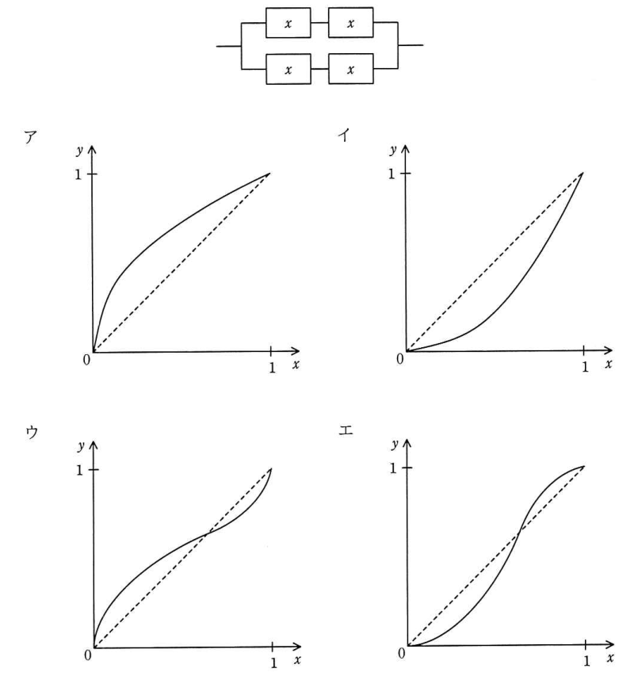
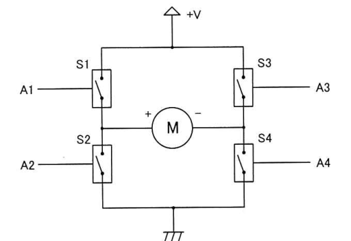
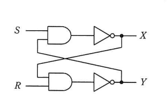
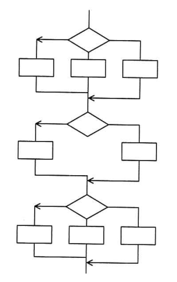
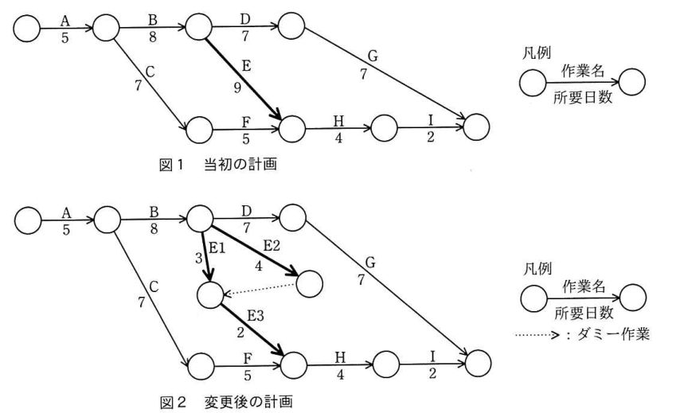

# 令和3年度春期 科目A（旧午前）過去問解説

> 令和3年度 春期 応用情報技術者試験 午前（全80問）を書き起こし、オリジナルの解説を付けたものです。問題の著作権は IPA（独立行政法人 情報処理推進機構）にあります。
> 図を表に書き換えるなど一部改変した問題には、その旨を記載しています。
> インタラクティブ教材の [科目A 四択クイズ](../../06_インタラクティブ教材/quiz.html) では、この回を本番形式（150分）で解けます。

## 目次

| 問 | 分野 | 中分類 | キーワード |
|---|---|---|---|
| [問1](#q01) | テクノロジ系 | 基礎理論 | 相補演算、排他的論理和、等価演算、XNOR |
| [問2](#q02) | テクノロジ系 | 基礎理論 | 桁落ち、情報落ち、丸め誤差、打切り誤差 |
| [問3](#q03) | テクノロジ系 | 情報メディア | PCM、サンプリング周波数、量子化ビット数、A/D変換 |
| [問4](#q04) | テクノロジ系 | 基礎理論 | サーミスタ、センサ、フォトトランジスタ、ポテンショメータ |
| [問5](#q05) | テクノロジ系 | アルゴリズムとプログラミング | スタック、LIFO、カタラン数 |
| [問6](#q06) | テクノロジ系 | アルゴリズムとプログラミング | 2分木、幅優先探索、ヒープ、配列表現 |
| [問7](#q07) | テクノロジ系 | アルゴリズムとプログラミング | 分割統治法、貪欲法、分枝限定法、マージソート |
| [問8](#q08) | テクノロジ系 | アルゴリズムとプログラミング | R、統計解析、動的型付け、オープンソース |
| [問9](#q09) | テクノロジ系 | コンピュータ構成要素 | MIPS、命令ミックス、平均命令実行時間 |
| [問10](#q10) | テクノロジ系 | コンピュータ構成要素 | GPU、ディープラーニング、行列演算、SIMD |
| [問11](#q11) | テクノロジ系 | システム構成要素 | グリッドコンピューティング、SMP、AMP、マルチスレッド |
| [問12](#q12) | テクノロジ系 | コンピュータ構成要素 | キャッシュメモリ、ライトスルー、ライトバック |
| [問13](#q13) | テクノロジ系 | システム構成要素 | フォールトアボイダンス、フォールトトレランス、フェールセーフ、フェールソフト、フールプルーフ |
| [問14](#q14) | テクノロジ系 | システム構成要素 | 稼働率、直列、並列、信頼性 |
| [問15](#q15) | テクノロジ系 | コンピュータ構成要素 | 密結合マルチプロセッサ、主記憶共有、アクセス競合 |
| [問16](#q16) | テクノロジ系 | ソフトウェア | ターンアラウンドタイム、多重度、FCFS |
| [問17](#q17) | テクノロジ系 | ソフトウェア | プリエンプション、タスク状態遷移、リアルタイムOS |
| [問18](#q18) | テクノロジ系 | ソフトウェア | ガーベジコレクション、コンパクション、動的リンキング、動的再配置 |
| [問19](#q19) | テクノロジ系 | ソフトウェア | ページング、ページフォールト、ページイン、ページアウト |
| [問20](#q20) | テクノロジ系 | データベース | Hadoop、分散処理、MapReduce、ビッグデータ |
| [問21](#q21) | テクノロジ系 | コンピュータ構成要素 | RFID、ICタグ、非接触、IrDA |
| [問22](#q22) | テクノロジ系 | コンピュータ構成要素 | SoC、SiP、システムLSI |
| [問23](#q23) | テクノロジ系 | ハードウェア | Hブリッジ、DCモータ、正転逆転制御 |
| [問24](#q24) | テクノロジ系 | ハードウェア | コンデンサ、交流、直流、コイル |
| [問25](#q25) | テクノロジ系 | ハードウェア | フリップフロップ、NAND、順序回路 |
| [問26](#q26) | テクノロジ系 | ユーザーインタフェース | パンくずリスト、Webデザイン、ナビゲーション |
| [問27](#q27) | テクノロジ系 | 情報メディア | SVG、ベクタ形式、XML、W3C |
| [問28](#q28) | テクノロジ系 | データベース | NoSQL、グラフ指向DB、キーバリュー、ドキュメント指向 |
| [問29](#q29) | テクノロジ系 | データベース | UML、クラス図、多重度、概念データモデル |
| [問30](#q30) | テクノロジ系 | データベース | オプティマイザ、実行計画、統計情報 |
| [問31](#q31) | テクノロジ系 | データベース | データレイク、データウェアハウス、データマート、OLAP |
| [問32](#q32) | テクノロジ系 | ネットワーク | BLE、無線PAN、IoT、LPWA |
| [問33](#q33) | テクノロジ系 | ネットワーク | IEEE 802.11ac、無線LAN、5GHz帯、CSMA/CA |
| [問34](#q34) | テクノロジ系 | ネットワーク | サブネットマスク、ホストアドレス、ビット演算 |
| [問35](#q35) | テクノロジ系 | ネットワーク | SDN、OpenFlow、NFV、コントロールプレーン |
| [問36](#q36) | テクノロジ系 | ネットワーク | 無線LAN、チャネル、電波干渉、2.4GHz帯 |
| [問37](#q37) | テクノロジ系 | セキュリティ | クリックジャッキング、X-Frame-Options、XSS |
| [問38](#q38) | テクノロジ系 | セキュリティ | フットプリンティング、ポートスキャン、サイバーキルチェーン |
| [問39](#q39) | テクノロジ系 | セキュリティ | リスクベース認証、多要素認証、不正アクセス |
| [問40](#q40) | テクノロジ系 | セキュリティ | ハッシュ関数、一方向性、原像計算困難性、衝突困難性 |
| [問41](#q41) | テクノロジ系 | セキュリティ | サイバーセキュリティ経営ガイドライン、3原則、重要10項目、COBIT |
| [問42](#q42) | テクノロジ系 | セキュリティ | JPCERT/CC、CSIRT、CRYPTREC、NISC |
| [問43](#q43) | テクノロジ系 | セキュリティ | クレジットカード、オフラインPIN、ICチップ、カード番号の非保持化 |
| [問44](#q44) | テクノロジ系 | セキュリティ | セッションハイジャック、セッションID、ログアウト |
| [問45](#q45) | テクノロジ系 | セキュリティ | TLS、クライアント認証、サーバ証明書、ハンドシェイク |
| [問46](#q46) | テクノロジ系 | セキュリティ | 耐タンパ性、ICカード、サイドチャネル攻撃 |
| [問47](#q47) | テクノロジ系 | システム開発技術 | 状態遷移表、イベント、組込みシステム |
| [問48](#q48) | テクノロジ系 | システム開発技術 | 命令網羅、C0カバレッジ、ホワイトボックステスト |
| [問49](#q49) | テクノロジ系 | ソフトウェア開発管理技術 | スクラム、プロダクトオーナ、プロダクトバックログ、スクラムマスタ |
| [問50](#q50) | テクノロジ系 | ソフトウェア開発管理技術 | ペアプログラミング、XP、アジャイル |
| [問51](#q51) | マネジメント系 | プロジェクトマネジメント | JIS Q 21500、プロセス群、スコープの定義 |
| [問52](#q52) | マネジメント系 | プロジェクトマネジメント | RACIチャート、責任分担マトリックス、説明責任 |
| [問53](#q53) | マネジメント系 | プロジェクトマネジメント | アローダイアグラム、クリティカルパス、ダミー作業 |
| [問54](#q54) | マネジメント系 | プロジェクトマネジメント | PMBOK、リスク対応戦略、好機、強化 |
| [問55](#q55) | マネジメント系 | プロジェクトマネジメント | コミュニケーション経路、組合せ、n(n-1)/2 |
| [問56](#q56) | マネジメント系 | サービスマネジメント | ITIL、サービス・ポートフォリオ、サービス・カタログ、サービス・パイプライン |
| [問57](#q57) | マネジメント系 | サービスマネジメント | フルバックアップ、差分バックアップ、増分バックアップ |
| [問58](#q58) | マネジメント系 | システム監査 | 情報セキュリティ管理基準、マルウェア対策、指摘事項 |
| [問59](#q59) | マネジメント系 | システム監査 | 可用性、完全性、機密性、システム監査 |
| [問60](#q60) | マネジメント系 | システム監査 | フォローアップ、改善提案、システム監査人 |
| [問61](#q61) | ストラテジ系 | システム戦略 | エンタープライズアーキテクチャ、EA、データアーキテクチャ |
| [問62](#q62) | ストラテジ系 | ビジネスインダストリ | オープンAPI、APIエコノミー、データ連携 |
| [問63](#q63) | ストラテジ系 | 経営戦略マネジメント | 協調フィルタリング、レコメンデーション、コンテンツベースフィルタリング |
| [問64](#q64) | ストラテジ系 | システム企画 | RFI、RFP、調達 |
| [問65](#q65) | ストラテジ系 | システム企画 | グリーン購入、CSR、環境アセスメント |
| [問66](#q66) | ストラテジ系 | システム企画 | レベニューシェア、システム開発委託契約、委託報酬 |
| [問67](#q67) | ストラテジ系 | 経営戦略マネジメント | PPM、市場成長率、市場占有率、金のなる木 |
| [問68](#q68) | ストラテジ系 | 経営戦略マネジメント | フォロワ、競争地位別戦略、コトラー |
| [問69](#q69) | ストラテジ系 | 技術戦略マネジメント | キャズム、イノベータ理論、アーリーアダプタ、アーリーマジョリティ |
| [問70](#q70) | ストラテジ系 | 経営戦略マネジメント | バランススコアカード、BSC、KPI |
| [問71](#q71) | ストラテジ系 | 技術戦略マネジメント | 技術のSカーブ、ハイプサイクル、経験曲線、バスタブ曲線 |
| [問72](#q72) | ストラテジ系 | 企業活動 | Society 5.0、超スマート社会、サイバーフィジカルシステム |
| [問73](#q73) | ストラテジ系 | 法務 | フィルタバブル、エコーチェンバー、パーソナライズ |
| [問74](#q74) | ストラテジ系 | ビジネスインダストリ | アグリゲーションサービス、オムニチャネル、エスクロー、フランチャイズ |
| [問75](#q75) | ストラテジ系 | 企業活動 | SL理論、リーダシップ、ジョハリの窓、SECIモデル |
| [問76](#q76) | ストラテジ系 | 企業活動 | 系統図法、新QC七つ道具、連関図法、親和図法 |
| [問77](#q77) | ストラテジ系 | 企業活動 | キャッシュフロー計算書、営業活動、財務活動、投資活動 |
| [問78](#q78) | ストラテジ系 | 法務 | 不正競争防止法、周知表示混同惹起行為、独占禁止法 |
| [問79](#q79) | ストラテジ系 | 法務 | 特定電子メール法、オプトイン、迷惑メール |
| [問80](#q80) | ストラテジ系 | 法務 | 電子署名法、認証業務、真正な成立の推定 |

<a id="q01"></a>

### 問1　〔基礎理論〕

任意のオペランドに対するブール演算 A の結果とブール演算 B の結果が互いに否定の関係にあるとき，A は B の（又は，B は A の）相補演算であるという。排他的論理和の相補演算はどれか。

- **ア**　等価演算
- **イ**　否定論理和
- **ウ**　論理積
- **エ**　論理和

<details><summary>解答・解説</summary>

**正解：ア**

排他的論理和（XOR）は2入力が異なるとき 1。その結果をすべて反転したもの，つまり2入力が等しいとき 1 になる演算が等価演算（XNOR）なので，これが相補演算。

**整理**

| A | B | XOR | 等価演算 |
|---|---|---|---|
| 0 | 0 | 0 | 1 |
| 0 | 1 | 1 | 0 |
| 1 | 0 | 1 | 0 |
| 1 | 1 | 0 | 1 |

- イ：否定論理和（NOR）は論理和の相補演算。A=B=1 のとき XOR も NOR も 0 で，否定の関係にならない
- ウ：論理積は否定論理積（NAND）の相補演算。A=B=0 のとき XOR も論理積も 0
- エ：論理和は NOR の相補演算。A=0, B=1 のとき XOR も論理和も 1

💡 **ポイント**：AND⇔NAND，OR⇔NOR，XOR⇔XNOR（等価演算）がそれぞれ相補演算のペア。ベン図なら塗られている部分と塗られていない部分が逆になる組合せ。

📖 関連：[基礎理論](../../01_テクノロジ系/01_基礎理論.md)

</details>

<sub>出典：令和3年度 春期 応用情報技術者試験 午前 問1（選択肢のベン図を省略）</sub>

---

<a id="q02"></a>

### 問2　〔基礎理論〕

桁落ちによる誤差の説明として，適切なものはどれか。

- **ア**　値がほぼ等しい二つの数値の差を求めたとき，有効桁数が減ることによって発生する誤差
- **イ**　指定された有効桁数で演算結果を表すために，切捨て，切上げ，四捨五入などで下位の桁を削除することによって発生する誤差
- **ウ**　絶対値が非常に大きな数値と小さな数値の加算や減算を行ったとき，小さい数値が計算結果に反映されないことによって発生する誤差
- **エ**　無限級数で表される数値の計算処理を有限項で打ち切ったことによって発生する誤差

<details><summary>解答・解説</summary>

**正解：ア**

桁落ちは，ほぼ等しい値どうしを引き算したとき，上位の桁が打ち消し合って有効数字の桁数が少なくなる現象。例えば 1.2345 − 1.2344 = 0.0001 では有効数字が5桁から1桁に減る。

- イ：丸め誤差の説明
- ウ：情報落ちの説明
- エ：打切り誤差の説明

💡 **ポイント**：桁落ち（近い値の減算）・情報落ち（大きさの違う値の加減算）・丸め誤差（桁の切捨て等）・打切り誤差（計算の途中打切り）の4つを区別する。

📖 関連：[基礎理論](../../01_テクノロジ系/01_基礎理論.md)

</details>

<sub>出典：令和3年度 春期 応用情報技術者試験 午前 問2</sub>

---

<a id="q03"></a>

### 問3　〔情報メディア〕 🧮

サンプリング周波数 40 kHz，量子化ビット数 16 ビットで A/D 変換したモノラル音声の1秒間のデータ量は，何 k バイトとなるか。ここで，1 k バイトは 1,000 バイトとする。

- **ア**　20
- **イ**　40
- **ウ**　80
- **エ**　640

<details><summary>解答・解説</summary>

**正解：ウ**

1秒間に 40,000 回標本化し，1回当たり 16 ビット（2バイト）なので，40,000 × 2 = 80,000 バイト = 80 k バイト。

**途中式**

データ量 = サンプリング周波数 × 量子化ビット数 × チャネル数 × 秒数

= 40,000 回/秒 × 16 ビット × 1（モノラル）× 1 秒 = 640,000 ビット

640,000 ビット ÷ 8 = 80,000 バイト = **80 k バイト**

- ア：20 は 16 ビットを 2 バイトでなく 0.5 バイトとして扱うなど，単位換算を誤った値
- イ：40 は 1 回当たり 1 バイト（8 ビット）として計算した値
- エ：640 はビットのまま（640 k ビット）で，バイトに換算していない値

💡 **ポイント**：PCM のデータ量は「周波数 × ビット数 × チャネル数 × 時間」。最後に 8 で割ってバイトにするのを忘れない。ステレオなら2倍。

📖 関連：[ユーザーインタフェースと情報メディア](../../01_テクノロジ系/11_ユーザーインタフェースと情報メディア.md)／[計算問題公式集](../../05_まとめ・横断資料/01_計算問題公式集.md)

</details>

<sub>出典：令和3年度 春期 応用情報技術者試験 午前 問3</sub>

---

<a id="q04"></a>

### 問4　〔基礎理論〕

体温を測定するのに適切なセンサはどれか。

- **ア**　サーミスタ
- **イ**　超音波センサ
- **ウ**　フォトトランジスタ
- **エ**　ポテンショメータ

<details><summary>解答・解説</summary>

**正解：ア**

サーミスタは温度によって電気抵抗が大きく変わる半導体素子で，体温計などの温度測定に使われる。

- イ：超音波センサは超音波の反射時間から距離や物体の有無を測るセンサ
- ウ：フォトトランジスタは光を受けると電流が流れる素子で，光の検出に使う
- エ：ポテンショメータは可変抵抗を利用して回転角や位置（変位）を測るセンサ

💡 **ポイント**：温度＝サーミスタ（熱電対），光＝フォトダイオード/フォトトランジスタ，角度・位置＝ポテンショメータ，傾き・回転＝ジャイロ，距離＝超音波。

📖 関連：[基礎理論](../../01_テクノロジ系/01_基礎理論.md)／[コンピュータ構成要素](../../01_テクノロジ系/03_コンピュータ構成要素.md)

</details>

<sub>出典：令和3年度 春期 応用情報技術者試験 午前 問4</sub>

---

<a id="q05"></a>

### 問5　〔アルゴリズムとプログラミング〕 🧮

A，B，C の順序で入力されるデータがある。各データについてスタックへの挿入と取出しを1回ずつ行うことができる場合，データの出力順序は何通りあるか。

- **ア**　3
- **イ**　4
- **ウ**　5
- **エ**　6

<details><summary>解答・解説</summary>

**正解：ウ**

3つの並び 3! = 6 通りのうち，スタックでは C，A，B の順だけが作れないので 5 通り。

**途中式**

- A, B, C：A入→A出→B入→B出→C入→C出
- A, C, B：A入→A出→B入→C入→C出→B出
- B, A, C：A入→B入→B出→A出→C入→C出
- B, C, A：A入→B入→B出→C入→C出→A出
- C, B, A：A入→B入→C入→C出→B出→A出
- C, A, B：C を最初に出すには A, B を積んだ状態で，次に出せるのは上にある B なので **不可能**

よって **5 通り**

- ア：3 は一部の並びを数え漏らしている
- イ：4 も数え漏らし（例えば B, C, A を見落とすなど）
- エ：6 は全順列で，C, A, B の不可能な並びまで数えている

💡 **ポイント**：n 個のデータをスタックに通して得られる出力順序の数はカタラン数（1, 2, 5, 14, …）。3個なら 5 通り。

📖 関連：[アルゴリズムとプログラミング](../../01_テクノロジ系/02_アルゴリズムとプログラミング.md)

</details>

<sub>出典：令和3年度 春期 応用情報技術者試験 午前 問5（スタックの図を省略）</sub>

---

<a id="q06"></a>

### 問6　〔アルゴリズムとプログラミング〕

配列 A[1]，A[2]，…，A[n] で，A[1] を根とし，A[i] の左側の子を A[2i]，右側の子を A[2i+1] とみなすことによって，2 分木を表現する。このとき，配列を先頭から順に調べていくことは，2 分木の探索のどれに当たるか。

- **ア**　行きがけ順（先行順）深さ優先探索
- **イ**　帰りがけ順（後行順）深さ優先探索
- **ウ**　通りがけ順（中間順）深さ優先探索
- **エ**　幅優先探索

<details><summary>解答・解説</summary>

**正解：エ**

この表現では A[1] が根，A[2], A[3] が深さ1，A[4]〜A[7] が深さ2…と，添字の順に上の階層から左→右へ並ぶ。先頭から順に調べるのは，浅い階層から1段ずつ横に調べる幅優先探索に当たる。

- ア：先行順なら根 A[1] → 左の子 A[2] → その左の子 A[4] … と進み，A[3] より A[4] が先になる
- イ：後行順なら子をすべて調べてから親を調べるので，根 A[1] は最後になる
- ウ：中間順なら左部分木 → 親 → 右部分木の順で，最初に調べるのは最も左下の節点

💡 **ポイント**：ヒープなど，配列で表した完全2分木は「添字順＝レベル順（幅優先）」。親は A[i/2]（切捨て）で求まる。

📖 関連：[アルゴリズムとプログラミング](../../01_テクノロジ系/02_アルゴリズムとプログラミング.md)

</details>

<sub>出典：令和3年度 春期 応用情報技術者試験 午前 問6</sub>

---

<a id="q07"></a>

### 問7　〔アルゴリズムとプログラミング〕

アルゴリズム設計としての分割統治法に関する記述として，適切なものはどれか。

- **ア**　与えられた問題を直接解くことが難しいときに，幾つかに分割した一部分に注目し，とりあえず粗い解を出し，それを逐次改良して精度の良い解を得る方法である。
- **イ**　起こり得る全てのデータを組み合わせ，それぞれの解を調べることによって，データの組合せのうち無駄なものを除き，実際に調べる組合せ数を減らす方法である。
- **ウ**　全体を幾つかの小さな問題に分割して，それぞれの小さな問題を独立に処理した結果をつなぎ合わせて，最終的に元の問題を解決する方法である。
- **エ**　まずは問題全体のことは考えずに，問題をある尺度に沿って分解し，各時点で最良の解を選択し，これを繰り返すことによって，全体の最適解を得る方法である。

<details><summary>解答・解説</summary>

**正解：ウ**

分割統治法は，大きな問題を同じ形の小さな問題に分け，それぞれを解いた結果を統合して元の問題の答えを得る手法。クイックソートやマージソートが代表例。

- ア：粗い解を逐次改良していくのは，近似解法（逐次改善法・反復改良）の考え方
- イ：組合せを調べながら無駄な枝を除いて探索数を減らすのは，分枝限定法（バックトラック法）の考え方
- エ：その時点で最良のものを選び続けるのは，貪欲法（グリーディ法）の考え方

💡 **ポイント**：分割統治＝分けて解いて統合（マージソート・クイックソート・二分探索），貪欲法＝その場の最善を選ぶ，動的計画法＝部分問題の解を表に記録して再利用。

📖 関連：[アルゴリズムとプログラミング](../../01_テクノロジ系/02_アルゴリズムとプログラミング.md)

</details>

<sub>出典：令和3年度 春期 応用情報技術者試験 午前 問7</sub>

---

<a id="q08"></a>

### 問8　〔アルゴリズムとプログラミング〕

次の特徴をもつプログラム言語及び実行環境であって，オープンソースソフトウェアとして提供されているものはどれか。

〔特徴〕

- 統計解析や機械学習の分野に適している。
- データ分析，グラフ描画などの，多数のソフトウェアパッケージが提供されている。
- 変数自体には型がなく，変数に代入されるオブジェクトの型は実行時に決まる。

- **ア**　Go
- **イ**　Kotlin
- **ウ**　R
- **エ**　Scala

<details><summary>解答・解説</summary>

**正解：ウ**

R は統計解析向けに作られたオープンソースの言語・実行環境で，CRAN などで多数のパッケージが公開されている。動的型付けで，変数の型は代入されるオブジェクトで実行時に決まる。

- ア：Go は Google が開発した静的型付けのコンパイル言語で，並行処理やサーバ用途に強い
- イ：Kotlin は JVM 上で動く静的型付け言語で，Android アプリ開発で広く使われる
- エ：Scala は JVM 上で動くオブジェクト指向と関数型を融合した静的型付け言語

💡 **ポイント**：統計・データ分析なら R や Python（どちらも動的型付け）。Go・Kotlin・Scala・Java は静的型付け。

📖 関連：[アルゴリズムとプログラミング](../../01_テクノロジ系/02_アルゴリズムとプログラミング.md)

</details>

<sub>出典：令和3年度 春期 応用情報技術者試験 午前 問8</sub>

---

<a id="q09"></a>

### 問9　〔コンピュータ構成要素〕 🧮

表に示す命令ミックスによるコンピュータの処理性能は何 MIPS か。

| 命令種別 | 実行速度（ナノ秒） | 出現頻度（%） |
|---|---|---|
| 整数演算命令 | 10 | 50 |
| 移動命令 | 40 | 30 |
| 分岐命令 | 40 | 20 |

- **ア**　11
- **イ**　25
- **ウ**　40
- **エ**　90

<details><summary>解答・解説</summary>

**正解：ウ**

出現頻度で重み付けした平均命令実行時間は 25 ナノ秒。1秒間に実行できる命令数は 1 ÷ 25×10⁻⁹ = 4,000万 = 40 MIPS。

**途中式**

平均命令実行時間 = 10×0.5 + 40×0.3 + 40×0.2 = 5 + 12 + 8 = 25 ナノ秒

MIPS = 1 ÷ (25 × 10⁻⁹) ÷ 10⁶ = 40,000,000 ÷ 1,000,000 = **40**

- ア：11 は実行速度と出現頻度の扱いを誤った値
- イ：25 は平均命令実行時間（ナノ秒）をそのまま答えた値
- エ：90 は実行速度の単純合計（10+40+40）で，頻度を考慮していない

💡 **ポイント**：MIPS = 1 / 平均命令実行時間（μ秒）。平均命令実行時間が 1 ナノ秒なら 1,000 MIPS，25 ナノ秒なら 40 MIPS。

📖 関連：[コンピュータ構成要素](../../01_テクノロジ系/03_コンピュータ構成要素.md)／[計算問題公式集](../../05_まとめ・横断資料/01_計算問題公式集.md)

</details>

<sub>出典：令和3年度 春期 応用情報技術者試験 午前 問9（表を GFM の表に書き換え）</sub>

---

<a id="q10"></a>

### 問10　〔コンピュータ構成要素〕

ディープラーニングの学習に GPU を用いる利点として，適切なものはどれか。

- **ア**　各プロセッサコアが独立して異なるプログラムを実行し，異なるデータを処理できる。
- **イ**　汎用の行列演算ユニットを用いて，行列演算を高速に実行できる。
- **ウ**　浮動小数点演算ユニットをコプロセッサとして用い，浮動小数点演算ができる。
- **エ**　分岐予測を行い，パイプラインの利用効率を高めた処理を実行できる。

<details><summary>解答・解説</summary>

**正解：イ**

ディープラーニングの学習は大量の行列（テンソル）演算の繰返し。GPU は多数の演算ユニットで同じ演算を並列に実行でき，行列演算を高速にこなせることが利点。

- ア：コアごとに異なるプログラムで異なるデータを処理するのは MIMD 型（マルチコア CPU など）の特徴。GPU は同じ命令を多数のデータに適用する SIMD/SIMT 型
- ウ：浮動小数点演算コプロセッサは昔の FPU の説明で，ディープラーニングで GPU を使う利点ではない
- エ：分岐予測によるパイプラインの効率化は CPU の高速化技術

💡 **ポイント**：GPU＝単純な演算を大量に並列実行（行列演算・画像処理・機械学習）。最近は Tensor コアなど行列演算専用ユニットも持つ。

📖 関連：[コンピュータ構成要素](../../01_テクノロジ系/03_コンピュータ構成要素.md)

</details>

<sub>出典：令和3年度 春期 応用情報技術者試験 午前 問10</sub>

---

<a id="q11"></a>

### 問11　〔システム構成要素〕

グリッドコンピューティングの説明はどれか。

- **ア**　OS を実行するプロセッサ，アプリケーションソフトウェアを実行するプロセッサというように，それぞれの役割が決定されている複数のプロセッサによって処理を分散する方式である。
- **イ**　PC から大型コンピュータまで，ネットワーク上にある複数のプロセッサに処理を分散して，大規模な一つの処理を行う方式である。
- **ウ**　カーネルプロセスとユーザプロセスを区別せずに，同等な複数のプロセッサに処理を分散する方式である。
- **エ**　プロセッサ上でスレッド（プログラムの実行単位）レベルの並列化を実現し，プロセッサの利用効率を高める方式である。

<details><summary>解答・解説</summary>

**正解：イ**

グリッドコンピューティングは，ネットワークでつながった性能や種類の異なる多数のコンピュータを束ね，仮想的に一つの高性能コンピュータとして大規模な処理を分担させる方式。

- ア：役割を固定して処理を分担させるのは非対称型マルチプロセッシング（AMP）
- ウ：同等なプロセッサで区別なく処理を分担するのは対称型マルチプロセッシング（SMP）
- エ：スレッドレベルの並列化で利用効率を上げるのはマルチスレッディング（ハイパースレッディングなど）

💡 **ポイント**：グリッド＝ネットワーク上の多様な計算機を束ねる，クラスタ＝同種の計算機を密に結合する，SMP/AMP＝1台の中の複数プロセッサの使い方。

📖 関連：[システム構成要素](../../01_テクノロジ系/04_システム構成要素.md)

</details>

<sub>出典：令和3年度 春期 応用情報技術者試験 午前 問11</sub>

---

<a id="q12"></a>

### 問12　〔コンピュータ構成要素〕

キャッシュメモリへの書込み動作には，ライトスルー方式とライトバック方式がある。それぞれの特徴のうち，適切なものはどれか。

- **ア**　ライトスルー方式では，データをキャッシュメモリにだけ書き込むので，高速に書込みができる。
- **イ**　ライトスルー方式では，データをキャッシュメモリと主記憶の両方に同時に書き込むので，主記憶の内容は常に最新である。
- **ウ**　ライトバック方式では，データをキャッシュメモリと主記憶の両方に同時に書き込むので，速度が遅い。
- **エ**　ライトバック方式では，読出し時にキャッシュミスが発生してキャッシュメモリの内容が追い出されるときに，主記憶に書き戻す必要が生じることはない。

<details><summary>解答・解説</summary>

**正解：イ**

ライトスルー方式は書込みのたびにキャッシュと主記憶の両方を更新するので，主記憶は常に最新の内容を保つ（その代わり書込みは遅い）。

- ア：キャッシュにだけ書き込むのはライトバック方式の特徴
- ウ：両方に同時に書き込むのはライトスルー方式。ライトバック方式はキャッシュだけに書くので速い
- エ：ライトバック方式では，更新済みのブロックが追い出されるときに主記憶へ書き戻す必要がある

💡 **ポイント**：ライトスルー＝常に両方へ（一貫性◎，速度△），ライトバック＝追い出し時にまとめて書き戻し（速度◎，一貫性の制御が必要）。

📖 関連：[コンピュータ構成要素](../../01_テクノロジ系/03_コンピュータ構成要素.md)

</details>

<sub>出典：令和3年度 春期 応用情報技術者試験 午前 問12</sub>

---

<a id="q13"></a>

### 問13　〔システム構成要素〕

システムの信頼性設計に関する記述のうち，適切なものはどれか。

- **ア**　フェールセーフとは，利用者の誤操作によってシステムが異常終了してしまうことのないように，単純なミスを発生させないようにする設計方法である。
- **イ**　フェールソフトとは，故障が発生した場合でも機能を縮退させることなく稼働を継続する概念である。
- **ウ**　フォールトアボイダンスとは，システム構成要素の個々の品質を高めて故障が発生しないようにする概念である。
- **エ**　フォールトトレランスとは，故障が生じてもシステムに重大な影響が出ないように，あらかじめ定められた安全状態にシステムを固定し，全体として安全が維持されるような設計方法である。

<details><summary>解答・解説</summary>

**正解：ウ**

フォールトアボイダンス（故障回避）は，高品質な部品の採用や十分な試験などで構成要素そのものの信頼性を上げ，故障の発生自体を防ぐ考え方。

- ア：誤操作によるミスを起こさせない設計はフールプルーフ
- イ：フェールソフトは故障時に機能を縮退させてでも稼働を続ける考え方。「縮退させることなく」が誤り
- エ：安全な状態に固定して安全を保つのはフェールセーフ。フォールトトレランスは冗長化などで故障があっても機能を維持する考え方

💡 **ポイント**：アボイダンス＝故障させない，トレランス＝故障しても動き続ける，フェールセーフ＝安全側に止める，フェールソフト＝縮退して続ける，フールプルーフ＝誤操作させない。

📖 関連：[システム構成要素](../../01_テクノロジ系/04_システム構成要素.md)

</details>

<sub>出典：令和3年度 春期 応用情報技術者試験 午前 問13</sub>

---

<a id="q14"></a>

### 問14　〔システム構成要素〕 🧮

稼働率が x である装置を四つ組み合わせて，図のようなシステムを作ったときの稼働率を f(x) とする。区間 0 ≦ x ≦ 1 における y = f(x) の傾向を表すグラフはどれか。ここで，破線は y = x のグラフである。



- **ア**　（図のア）
- **イ**　（図のイ）
- **ウ**　（図のウ）
- **エ**　（図のエ）

<details><summary>解答・解説</summary>

**正解：エ**

直列2台の稼働率は x²，それを2系統並列にすると f(x) = 1 − (1 − x²)² = 2x² − x⁴。x が小さいときは y = x より下，x が約 0.62 を超えると y = x より上になる S 字の曲線なのでエ。

**途中式**

- 直列部分：x × x = x²
- 並列部分：f(x) = 1 − (1 − x²)² = 2x² − x⁴
- y = x との交点：2x² − x⁴ = x → x(x³ − 2x + 1) = 0 → x(x − 1)(x² + x − 1) = 0 → x = 0, 約 0.618, 1
- 例：x = 0.5 なら f = 0.5 − 0.0625 = 0.4375（< 0.5），x = 0.8 なら f = 1.28 − 0.4096 = 0.8704（> 0.8）

- ア：常に y = x より上にあるグラフ。x が小さい範囲では f(x) < x なので合わない
- イ：常に y = x より下にあるグラフ。x が 1 に近い範囲では f(x) > x なので合わない
- ウ：最初は上で後半は下。f(x) の傾向と上下が逆

💡 **ポイント**：直列は稼働率を下げ，並列は上げる。グラフ選択問題は x = 0.5 など具体的な値を代入して y = x と比べると速い。

📖 関連：[システム構成要素](../../01_テクノロジ系/04_システム構成要素.md)／[計算問題公式集](../../05_まとめ・横断資料/01_計算問題公式集.md)

</details>

<sub>出典：令和3年度 春期 応用情報技術者試験 午前 問14</sub>

---

<a id="q15"></a>

### 問15　〔コンピュータ構成要素〕

密結合マルチプロセッサの性能が，1台当たりのプロセッサの性能とプロセッサ数の積に**等しくならない**要因として，最も適切なものはどれか。

- **ア**　主記憶へのアクセスの競合
- **イ**　通信回線を介したプロセッサ間通信
- **ウ**　プロセッサのディスパッチ処理
- **エ**　割込み処理

<details><summary>解答・解説</summary>

**正解：ア**

密結合マルチプロセッサは複数のプロセッサが一つの主記憶を共有する。同時に主記憶へアクセスしようとすると競合して待ちが発生するため，台数に比例した性能が出ない。

- イ：通信回線を介したプロセッサ間通信は，主記憶を共有しない疎結合マルチプロセッサの性能低下要因
- ウ：ディスパッチ処理はシングルプロセッサでも発生する処理で，台数を増やしたときに性能が比例しない主な要因ではない
- エ：割込み処理もシングルプロセッサで発生するもので，マルチプロセッサ特有の要因ではない

💡 **ポイント**：密結合＝主記憶を共有（メモリ競合がボトルネック），疎結合＝各プロセッサが主記憶をもち通信で連携（通信オーバヘッドがボトルネック）。

📖 関連：[システム構成要素](../../01_テクノロジ系/04_システム構成要素.md)／[コンピュータ構成要素](../../01_テクノロジ系/03_コンピュータ構成要素.md)

</details>

<sub>出典：令和3年度 春期 応用情報技術者試験 午前 問15</sub>

---

<a id="q16"></a>

### 問16　〔ソフトウェア〕 🧮

ジョブの多重度が1で，到着順にジョブが実行されるシステムにおいて，表に示す状態のジョブ A〜C を処理するとき，ジョブ C が到着してから実行が終了するまでのターンアラウンドタイムは何秒か。ここで，OS のオーバヘッドは考慮しない。

単位　秒

| ジョブ | 到着時刻 | 処理時間（単独実行時） |
|---|---|---|
| A | 0 | 5 |
| B | 2 | 6 |
| C | 3 | 3 |

- **ア**　11
- **イ**　12
- **ウ**　13
- **エ**　14

<details><summary>解答・解説</summary>

**正解：ア**

多重度1で到着順に実行するので A → B → C の順。C は時刻 14 に終わり，到着は時刻 3 なので 14 − 3 = 11 秒。

**途中式**

- A：0〜5 秒
- B：5〜11 秒（到着 2 秒，A の終了を待つ）
- C：11〜14 秒（到着 3 秒，B の終了を待つ）

ターンアラウンドタイム = 14 − 3 = **11 秒**

- イ：12 は C の待ち時間（3〜11 秒の 8 秒）などを誤って加えた値
- ウ：13 は計算過程を誤った値
- エ：14 は時刻 0 からの終了時刻で，C の到着時刻 3 を差し引いていない

💡 **ポイント**：ターンアラウンドタイム＝終了時刻 − 到着時刻（待ち時間＋処理時間）。時刻表（ガントチャート）を書けば確実。

📖 関連：[ソフトウェア](../../01_テクノロジ系/05_ソフトウェア.md)

</details>

<sub>出典：令和3年度 春期 応用情報技術者試験 午前 問16（表を GFM の表に書き換え）</sub>

---

<a id="q17"></a>

### 問17　〔ソフトウェア〕

リアルタイム OS において，実行中のタスクがプリエンプションによって遷移する状態はどれか。

- **ア**　休止状態
- **イ**　実行可能状態
- **ウ**　終了状態
- **エ**　待ち状態

<details><summary>解答・解説</summary>

**正解：イ**

プリエンプションは，優先度の高いタスクが実行可能になったときなどに，OS が実行中のタスクから CPU を奪うこと。奪われたタスクはいつでも再開できるので実行可能状態に戻る。

- ア：休止状態は，タスクがまだ起動されていない／終了して停止している状態
- ウ：終了状態は，タスクの処理が完了した状態で，プリエンプションでは遷移しない
- エ：待ち状態は，入出力完了やイベントを待つためにタスク自ら CPU を手放した状態

💡 **ポイント**：実行→実行可能（プリエンプション・タイムスライス切れ），実行→待ち（入出力要求などのイベント待ち），待ち→実行可能（イベント発生）。待ちから直接実行には移らない。

📖 関連：[ソフトウェア](../../01_テクノロジ系/05_ソフトウェア.md)

</details>

<sub>出典：令和3年度 春期 応用情報技術者試験 午前 問17</sub>

---

<a id="q18"></a>

### 問18　〔ソフトウェア〕

プログラム実行時の主記憶管理に関する記述として，適切なものはどれか。

- **ア**　主記憶の空き領域を結合して一つの連続した領域にすることを，可変区画方式という。
- **イ**　プログラムが使用しなくなったヒープ領域を回収して再度使用可能にすることを，ガーベジコレクションという。
- **ウ**　プログラムの実行中に主記憶内でモジュールの格納位置を移動させることを，動的リンキングという。
- **エ**　プログラムの実行中に必要になった時点でモジュールをロードすることを，動的再配置という。

<details><summary>解答・解説</summary>

**正解：イ**

ガーベジコレクションは，プログラムが使わなくなったヒープ領域のメモリを自動的に探して解放し，再利用できるようにする仕組み。

- ア：空き領域を一つにまとめるのはメモリコンパクション。可変区画方式はプログラムの大きさに合わせて区画を割り当てる方式
- ウ：実行中にモジュールの格納位置を移動させるのは動的再配置
- エ：実行中に必要になった時点でモジュールをロード・結合するのは動的リンキング

💡 **ポイント**：ウとエは用語が入れ替わったひっかけ。再配置＝場所を動かす，リンキング＝必要なモジュールを結合する。断片化の解消はコンパクション。

📖 関連：[ソフトウェア](../../01_テクノロジ系/05_ソフトウェア.md)

</details>

<sub>出典：令和3年度 春期 応用情報技術者試験 午前 問18</sub>

---

<a id="q19"></a>

### 問19　〔ソフトウェア〕

ページング方式の仮想記憶において，ページアクセス時に発生する事象をその回数の多い順に並べたものはどれか。ここで，A ≧ B は，A の回数が B の回数以上，A = B は，A と B の回数が常に同じであることを表す。

- **ア**　ページアウト ≧ ページイン ≧ ページフォールト
- **イ**　ページアウト ≧ ページフォールト ≧ ページイン
- **ウ**　ページフォールト = ページアウト ≧ ページイン
- **エ**　ページフォールト = ページイン ≧ ページアウト

<details><summary>解答・解説</summary>

**正解：エ**

アクセスしたページが主記憶にないとページフォールトが起き，必ずそのページのページインが行われるので両者は同じ回数。ページアウトは空きページがないときだけ発生するので，それ以下の回数になる。

- ア：ページアウトはページフォールトのたびに必ず起きるわけではなく，ページインより多くはならない
- イ：同じくページアウトが最多という前提が誤り。また，ページフォールトとページインは常に同数
- ウ：ページフォールトと常に同数になるのはページインで，ページアウトではない

💡 **ポイント**：ページフォールト → （空きがなければページアウト）→ ページイン の流れ。主記憶に空きがあればページアウトは不要。

📖 関連：[ソフトウェア](../../01_テクノロジ系/05_ソフトウェア.md)

</details>

<sub>出典：令和3年度 春期 応用情報技術者試験 午前 問19</sub>

---

<a id="q20"></a>

### 問20　〔データベース〕

Hadoop の説明はどれか。

- **ア**　Java EE 仕様に準拠したアプリケーションサーバ
- **イ**　Linux や Windows などの様々なプラットフォーム上で動作する Web サーバ
- **ウ**　機能の豊富さが特徴の RDBMS
- **エ**　大規模なデータセットを分散処理するためのソフトウェアライブラリ

<details><summary>解答・解説</summary>

**正解：エ**

Hadoop は，多数のコンピュータで大規模データを分散して保存（HDFS）・処理（MapReduce）するためのオープンソースのソフトウェアライブラリ（フレームワーク）。

- ア：Java EE 準拠のアプリケーションサーバは，GlassFish，WildFly（JBoss）など
- イ：様々なプラットフォームで動く Web サーバは，Apache HTTP Server や nginx など
- ウ：機能の豊富さが特徴の RDBMS は PostgreSQL など

💡 **ポイント**：ビッグデータの分散処理基盤＝Hadoop（HDFS＋MapReduce），インメモリで高速化したものが Spark。

📖 関連：[データベース](../../01_テクノロジ系/06_データベース.md)／[ソフトウェア](../../01_テクノロジ系/05_ソフトウェア.md)

</details>

<sub>出典：令和3年度 春期 応用情報技術者試験 午前 問20</sub>

---

<a id="q21"></a>

### 問21　〔コンピュータ構成要素〕

RFID の活用事例として，適切なものはどれか。

- **ア**　紙に印刷されたディジタルコードをリーダで読み取ることによる情報の入力
- **イ**　携帯電話とヘッドフォンとの間の音声データ通信
- **ウ**　赤外線を利用した近距離データ通信
- **エ**　微小な無線チップによる人又は物の識別及び管理

<details><summary>解答・解説</summary>

**正解：エ**

RFID は，IC チップとアンテナを組み込んだ小さなタグ（無線タグ）の情報を電波で非接触に読み書きする技術。商品の在庫管理や入退室管理など，人や物の識別・管理に使われる。

- ア：印刷されたコードを読み取るのはバーコードや QR コード
- イ：携帯電話とヘッドフォン間の音声通信は Bluetooth
- ウ：赤外線による近距離通信は IrDA

💡 **ポイント**：RFID は電波で非接触・複数同時読取りができ，汚れや遮へい物に強い。交通系 IC カードなどの NFC も RFID 技術の一種。

📖 関連：[コンピュータ構成要素](../../01_テクノロジ系/03_コンピュータ構成要素.md)

</details>

<sub>出典：令和3年度 春期 応用情報技術者試験 午前 問21</sub>

---

<a id="q22"></a>

### 問22　〔コンピュータ構成要素〕

SoC の説明として，適切なものはどれか。

- **ア**　システム LSI に内蔵されたソフトウェア
- **イ**　複数の MCU を搭載したボード
- **ウ**　複数のチップで構成していたコンピュータシステムを，一つのチップで実現した LSI
- **エ**　複数のチップを単一のパッケージに封入してシステム化したデバイス

<details><summary>解答・解説</summary>

**正解：ウ**

SoC（System on a Chip）は，CPU，メモリ，入出力制御などそれまで複数のチップで実現していた機能を，1枚のシリコンチップ上にまとめた LSI。スマートフォンなどで使われる。

- ア：LSI に内蔵されたソフトウェアはファームウェア
- イ：複数のマイコン（MCU）を載せたボードは，マルチプロセッサのボードで SoC ではない
- エ：複数のチップを一つのパッケージに封入するのは SiP（System in a Package）

💡 **ポイント**：SoC＝1チップに集積，SiP＝複数チップを1パッケージに封入。SoC は小型・低消費電力だが開発費が高く，SiP は開発期間が短い。

📖 関連：[コンピュータ構成要素](../../01_テクノロジ系/03_コンピュータ構成要素.md)／[ハードウェア](../../01_テクノロジ系/10_ハードウェア.md)

</details>

<sub>出典：令和3年度 春期 応用情報技術者試験 午前 問22</sub>

---

<a id="q23"></a>

### 問23　〔ハードウェア〕

図は DC モータの正転逆転制御の動作原理を示す回路である。A1 から A4 の四つの制御信号の組合せの中で，モータが逆転するものはどれか。ここで，モータの＋端子から－端子に電流が流れるときモータは正転し，S1 から S4 のそれぞれのスイッチ素子は，対応する A1 から A4 の制御信号がそれぞれ High のとき導通するものとする。



- **ア**　A1：Low，A2：Low，A3：Low，A4：Low
- **イ**　A1：Low，A2：High，A3：Low，A4：High
- **ウ**　A1：Low，A2：High，A3：High，A4：Low
- **エ**　A1：High，A2：Low，A3：Low，A4：High

<details><summary>解答・解説</summary>

**正解：ウ**

逆転させるには，電流をモータの－端子から＋端子へ流せばよい。S3（+V と－端子の間）と S2（＋端子と接地の間）を導通させると，+V → S3 → －端子 → モータ → ＋端子 → S2 → 接地 と流れるので，A2 と A3 を High にするウ。

- ア：すべて Low ではどのスイッチも導通せず，電流が流れないのでモータは止まったまま
- イ：S2 と S4 が導通すると，モータの両端子がどちらも接地につながるだけで，電流は流れない（停止・ブレーキ状態）
- エ：S1 と S4 が導通すると，+V → S1 → ＋端子 → モータ → －端子 → S4 → 接地 と流れ，正転になる

💡 **ポイント**：この回路は H ブリッジ。対角のスイッチ（S1 と S4，S2 と S3）を組で ON にすると回転方向を切り替えられる。同じ側の上下（S1 と S2 など）を同時に ON にすると電源短絡になるので禁止。

📖 関連：[ハードウェア](../../01_テクノロジ系/10_ハードウェア.md)

</details>

<sub>出典：令和3年度 春期 応用情報技術者試験 午前 問23（選択肢の表を文に書き換え）</sub>

---

<a id="q24"></a>

### 問24　〔ハードウェア〕

コンデンサの機能として，適切なものはどれか。

- **ア**　交流電流は通すが直流電流は通さない。
- **イ**　交流電流を直流電流に変換する。
- **ウ**　直流電流は通すが交流電流は通さない。
- **エ**　直流電流を交流電流に変換する。

<details><summary>解答・解説</summary>

**正解：ア**

コンデンサは電荷をためる素子で，直流は充電が終わると流れなくなるが，向きが変わり続ける交流は充放電を繰り返すので通す。この性質で直流成分のカットやノイズ除去に使われる。

- イ：交流を直流に変換するのは整流回路（ダイオードなど）。コンデンサは平滑化に使われるが，単独で変換はしない
- ウ：直流を通して交流を通しにくいのはコイル（インダクタ）の性質
- エ：直流を交流に変換するのはインバータ

💡 **ポイント**：コンデンサ＝直流を通さず交流を通す（高周波ほど通しやすい），コイル＝直流を通し交流を通しにくい（高周波ほど通しにくい）。

📖 関連：[ハードウェア](../../01_テクノロジ系/10_ハードウェア.md)

</details>

<sub>出典：令和3年度 春期 応用情報技術者試験 午前 問24</sub>

---

<a id="q25"></a>

### 問25　〔ハードウェア〕

図の論理回路において，S＝1，R＝1，X＝0，Y＝1 のとき，S を一旦 0 にした後，再び 1 に戻した。この操作を行った後の X，Y の値はどれか。



- **ア**　X＝0，Y＝0
- **イ**　X＝0，Y＝1
- **ウ**　X＝1，Y＝0
- **エ**　X＝1，Y＝1

<details><summary>解答・解説</summary>

**正解：ウ**

AND の出力を NOT しているので，各段は NAND。X = NAND(S, Y)，Y = NAND(R, X) で，S を 0 にすると X が 1 にセットされ，S を 1 に戻してもその状態が保持されるので X=1，Y=0。

**途中式**

1. 初期状態：S=1, R=1, X=0, Y=1（X = NAND(1,1) = 0，Y = NAND(1,0) = 1 で安定）
2. S=0 にする：X = NAND(0, Y) = 1 → Y = NAND(R=1, X=1) = 0
3. S=1 に戻す：X = NAND(1, Y=0) = 1，Y = NAND(1, 1) = 0 のまま

よって **X=1，Y=0**

- ア：X=0，Y=0 は，NAND の性質上 X と Y の両方が 0 になることはない（どちらかが 0 なら相手は 1）
- イ：X=0，Y=1 は操作前の状態。S を 0 にした時点で X は 1 に変わる
- エ：X=1，Y=1 は S=0 かつ R=0 のときに現れる状態で，R=1 のままでは安定しない

💡 **ポイント**：NAND 2個をたすき掛けにした回路は RS フリップフロップ（入力は負論理）。S を一瞬 0 にするとセット，R を一瞬 0 にするとリセットされ，入力を 1 に戻しても状態を記憶する。

📖 関連：[ハードウェア](../../01_テクノロジ系/10_ハードウェア.md)／[コンピュータ構成要素](../../01_テクノロジ系/03_コンピュータ構成要素.md)

</details>

<sub>出典：令和3年度 春期 応用情報技術者試験 午前 問25</sub>

---

<a id="q26"></a>

### 問26　〔ユーザーインタフェース〕

利用者が現在閲覧している Web ページに表示する，Web サイトのトップページからそのページまでの経路情報を何と呼ぶか。

- **ア**　サイトマップ
- **イ**　スクロールバー
- **ウ**　ナビゲーションバー
- **エ**　パンくずリスト

<details><summary>解答・解説</summary>

**正解：エ**

パンくずリストは「ホーム ＞ 製品 ＞ ノート PC」のように，トップページから現在のページまでの階層の経路を表示するナビゲーション。利用者が自分の位置を把握し，上の階層へ戻りやすくなる。

- ア：サイトマップは，Web サイト全体のページ構成を一覧にしたページ
- イ：スクロールバーは，画面に収まらない内容を上下左右に動かして表示する部品
- ウ：ナビゲーションバーは，主要なページへのリンクを並べたメニュー領域

💡 **ポイント**：名前の由来は童話『ヘンゼルとグレーテル』で帰り道にパンくずを置いた話。階層の深いサイトの使いやすさ向上の定番。

📖 関連：[ユーザーインタフェースと情報メディア](../../01_テクノロジ系/11_ユーザーインタフェースと情報メディア.md)

</details>

<sub>出典：令和3年度 春期 応用情報技術者試験 午前 問26</sub>

---

<a id="q27"></a>

### 問27　〔情報メディア〕

W3C で仕様が定義され，矩形や円，直線，文字列などの図形オブジェクトを XML 形式で記述し，Web ページでの図形描画にも使うことができる画像フォーマットはどれか。

- **ア**　OpenGL
- **イ**　PNG
- **ウ**　SVG
- **エ**　TIFF

<details><summary>解答・解説</summary>

**正解：ウ**

SVG（Scalable Vector Graphics）は，図形を XML で記述するベクタ形式の画像フォーマットで，W3C が仕様を定めている。拡大してもぼやけず，HTML に埋め込んで描画できる。

- ア：OpenGL は 2D/3D グラフィックス描画用の API で，画像フォーマットではない
- イ：PNG はラスタ（ビットマップ）形式の可逆圧縮画像フォーマットで，XML で図形を記述するものではない
- エ：TIFF はタグで様々な形式の画像データを格納できるラスタ形式の画像フォーマット

💡 **ポイント**：ベクタ形式＝SVG（座標と図形で表現，拡大に強い），ラスタ形式＝PNG・JPEG・GIF・TIFF（画素の集まり）。

📖 関連：[ユーザーインタフェースと情報メディア](../../01_テクノロジ系/11_ユーザーインタフェースと情報メディア.md)／[アルゴリズムとプログラミング](../../01_テクノロジ系/02_アルゴリズムとプログラミング.md)

</details>

<sub>出典：令和3年度 春期 応用情報技術者試験 午前 問27</sub>

---

<a id="q28"></a>

### 問28　〔データベース〕

NoSQL の一種である，グラフ指向 DB の特徴として，適切なものはどれか。

- **ア**　データ項目の値として階層構造のデータをドキュメントとしてもつことができる。また，ドキュメントに対しインデックスを作成することもできる。
- **イ**　ノード，リレーション，プロパティで構成され，ノード間をリレーションでつないで構造化する。ノード及びリレーションはプロパティをもつことができる。
- **ウ**　一つのキーに対して一つの値をとる形をしている。値の型は定義されていないので，様々な型の値を格納することができる。
- **エ**　一つのキーに対して複数の列をとる形をしている。関係データベースとは異なり，列の型は固定されていない。

<details><summary>解答・解説</summary>

**正解：イ**

グラフ指向 DB は，データをノード（点）とリレーション（辺）で表し，両者に属性（プロパティ）をもたせる。SNS の人間関係や経路探索など，つながりをたどる処理が得意。

- ア：階層構造のデータをドキュメントとして格納するのはドキュメント指向 DB（MongoDB など）
- ウ：一つのキーに一つの値を対応させるのはキーバリュー型 DB（Redis など）
- エ：一つのキーに複数の列をもたせるのはカラム指向（ワイドカラム）型 DB（Cassandra など）

💡 **ポイント**：NoSQL の4分類はキーバリュー型・カラム指向型・ドキュメント指向型・グラフ指向型。それぞれのデータの持ち方で見分ける。

📖 関連：[データベース](../../01_テクノロジ系/06_データベース.md)

</details>

<sub>出典：令和3年度 春期 応用情報技術者試験 午前 問28</sub>

---

<a id="q29"></a>

### 問29　〔データベース〕

商品の注文を記録するクラス（顧客，商品，注文，注文明細）の構造を概念データモデルで表現する。a〜d に入れるべきクラス名の組合せはどれか。ここで，顧客は何度も注文を行い，一度に一つ以上の商品を注文でき，注文明細はそれぞれ1種類の商品に対応している。また，モデルの表記には UML を用いる。

```
[a] 1 ───── * [b] 1 ───── * [c] * ───── 1 [d]
```

- **ア**　a：顧客，b：注文，c：注文明細，d：商品
- **イ**　a：商品，b：注文，c：注文明細，d：顧客
- **ウ**　a：注文，b：注文明細，c：顧客，d：商品
- **エ**　a：注文明細，b：商品，c：注文，d：顧客

<details><summary>解答・解説</summary>

**正解：ア**

1人の顧客は何度も注文する（顧客 1 対 注文 多），1回の注文には複数の明細がある（注文 1 対 注文明細 多），各明細は1種類の商品に対応し，1つの商品は多くの明細に現れる（注文明細 多 対 商品 1）。図の多重度と合わせると a=顧客，b=注文，c=注文明細，d=商品。

- イ：a を商品にすると「1つの商品に多数の注文」となり，注文が複数商品を含むことと合わない。d=顧客も「明細 多 対 顧客 1」で注文を経由しない関連になる
- ウ：c=顧客だと「注文明細 1 対 顧客 多」となり，顧客が何度も注文する関係を表せない
- エ：a=注文明細，b=商品だと「注文明細 1 対 商品 多」となり，明細が1種類の商品に対応する条件に反する

💡 **ポイント**：多対多（注文と商品）は，間に連関クラス（注文明細）を入れて 1 対 多 ＋ 多 対 1 に分解する。多重度は相手側の端に書かれる点に注意。

📖 関連：[データベース](../../01_テクノロジ系/06_データベース.md)／[システム開発技術](../../01_テクノロジ系/09_システム開発技術.md)

</details>

<sub>出典：令和3年度 春期 応用情報技術者試験 午前 問29（クラス図をテキスト図に，選択肢の表を文に書き換え）</sub>

---

<a id="q30"></a>

### 問30　〔データベース〕

コストベースのオプティマイザが SQL の実行計画を作成する際に必要なものはどれか。

- **ア**　ディメンジョンテーブル
- **イ**　統計情報
- **ウ**　待ちグラフ
- **エ**　ログファイル

<details><summary>解答・解説</summary>

**正解：イ**

コストベースのオプティマイザは，表の行数，列の値の分布，索引の状態などの統計情報をもとに各実行方法の処理コストを見積もり，最も安いものを実行計画に選ぶ。

- ア：ディメンジョンテーブルは，データウェアハウスのスタースキーマで分析の切り口（時間・地域など）を保持する表
- ウ：待ちグラフは，トランザクション間のロック待ちを表し，デッドロックの検出に使う
- エ：ログファイルは，障害回復（ロールバック・ロールフォワード）のために更新履歴を記録するファイル

💡 **ポイント**：オプティマイザにはルールベース（決められた優先順位で選ぶ）とコストベース（統計情報からコストを見積もる）がある。統計情報が古いと非効率な実行計画になる。

📖 関連：[データベース](../../01_テクノロジ系/06_データベース.md)

</details>

<sub>出典：令和3年度 春期 応用情報技術者試験 午前 問30</sub>

---

<a id="q31"></a>

### 問31　〔データベース〕

データレイクの特徴はどれか。

- **ア**　大量のデータを分析し，単なる検索だけでは分からない隠れた規則や相関関係を見つけ出す。
- **イ**　データウェアハウスに格納されたデータから特定の用途に必要なデータだけを取り出し，構築する。
- **ウ**　データウェアハウスやデータマートからデータを取り出し，多次元分析を行う。
- **エ**　必要に応じて加工するために，データを発生したままの形で格納する。

<details><summary>解答・解説</summary>

**正解：エ**

データレイクは，構造化データ・非構造化データを問わず，発生したままの生データを形式を決めずに大量に蓄えておく場所。使うときに必要な形へ加工する。

- ア：隠れた規則や相関関係を見つけ出すのはデータマイニング
- イ：データウェアハウスから特定用途のデータを取り出して作るのはデータマート
- ウ：データウェアハウスやデータマートを使って多次元分析を行うのは OLAP

💡 **ポイント**：データレイク（生データをそのまま）→ データウェアハウス（整理・統合済み）→ データマート（用途別に抽出）の順に加工度が上がる。

📖 関連：[データベース](../../01_テクノロジ系/06_データベース.md)

</details>

<sub>出典：令和3年度 春期 応用情報技術者試験 午前 問31</sub>

---

<a id="q32"></a>

### 問32　〔ネットワーク〕

IoT で用いられる無線通信技術であり，近距離の IT 機器同士が通信する無線 PAN（Personal Area Network）と呼ばれるネットワークに利用されるものはどれか。

- **ア**　BLE（Bluetooth Low Energy）
- **イ**　LTE（Long Term Evolution）
- **ウ**　PLC（Power Line Communication）
- **エ**　PPP（Point-to-Point Protocol）

<details><summary>解答・解説</summary>

**正解：ア**

BLE は Bluetooth 4.0 で追加された省電力の近距離無線通信方式で，ウェアラブル機器やセンサなど IoT 機器同士の無線 PAN に使われる。

- イ：LTE は携帯電話の広域無線通信規格で，PAN ではない（WAN に当たる）
- ウ：PLC は電力線を通信路として使う有線の通信技術
- エ：PPP は2点間をつなぐデータリンク層のプロトコルで，無線通信技術ではない

💡 **ポイント**：IoT の無線は，近距離・省電力＝BLE・ZigBee，広域・省電力＝LPWA（LoRaWAN，Sigfox など），広域・高速＝LTE・5G と整理する。

📖 関連：[ネットワーク](../../01_テクノロジ系/07_ネットワーク.md)

</details>

<sub>出典：令和3年度 春期 応用情報技術者試験 午前 問32</sub>

---

<a id="q33"></a>

### 問33　〔ネットワーク〕

日本国内において，無線 LAN の規格 IEEE 802.11ac に関する説明のうち，適切なものはどれか。

- **ア**　IEEE 802.11g に対応している端末は IEEE 802.11ac に対応しているアクセスポイントと通信が可能である。
- **イ**　最大通信速度は 600 M ビット／秒である。
- **ウ**　使用するアクセス制御方式は CSMA/CD 方式である。
- **エ**　使用する周波数帯は 5 GHz 帯である。

<details><summary>解答・解説</summary>

**正解：エ**

IEEE 802.11ac は 5 GHz 帯だけを使う無線 LAN 規格（Wi-Fi 5）で，最大 6.9 G ビット／秒程度の高速通信ができる。

- ア：802.11g は 2.4 GHz 帯の規格なので，5 GHz 帯だけの 802.11ac とは周波数が異なり通信できない
- イ：最大 600 M ビット／秒は IEEE 802.11n の値
- ウ：無線 LAN のアクセス制御は CSMA/CA 方式。CSMA/CD は有線のイーサネットで使われた方式

💡 **ポイント**：11b/g＝2.4 GHz，11a/ac＝5 GHz，11n/ax＝両方（11ax は 6 GHz 帯も）。無線 LAN は衝突を検出できないので CSMA/CA（衝突回避）。

📖 関連：[ネットワーク](../../01_テクノロジ系/07_ネットワーク.md)

</details>

<sub>出典：令和3年度 春期 応用情報技術者試験 午前 問33</sub>

---

<a id="q34"></a>

### 問34　〔ネットワーク〕 🧮

IPv4 ネットワークで使用される IP アドレス a とサブネットマスク m からホストアドレスを求める式はどれか。ここで，“～”はビット反転の演算子，“|”はビットごとの論理和の演算子，“&”はビットごとの論理積の演算子を表し，ビット反転の演算子の優先順位は論理和，論理積の演算子よりも高いものとする。

- **ア**　～a & m
- **イ**　～a | m
- **ウ**　a & ～m
- **エ**　a | ～m

<details><summary>解答・解説</summary>

**正解：ウ**

サブネットマスクはネットワーク部が 1，ホスト部が 0。これを反転した ～m はホスト部だけが 1 になるので，a との論理積をとればホスト部だけが取り出せる。

**例**

a = 192.168.1.10，m = 255.255.255.0 のとき

～m = 0.0.0.255 → a & ～m = 0.0.0.10（ホストアドレス）

- ア：～a & m は，IP アドレスを反転したもののネットワーク部になり，意味のない値
- イ：～a | m は，ネットワーク部がすべて 1 で，ホスト部は a を反転した値になる
- エ：a | ～m は，ホスト部をすべて 1 にした値で，ブロードキャストアドレスを求める式

💡 **ポイント**：ネットワークアドレス＝a & m，ホストアドレス＝a & ～m，ブロードキャストアドレス＝a | ～m。マスクとの AND で「取り出し」，OR で「1 にする」。

📖 関連：[ネットワーク](../../01_テクノロジ系/07_ネットワーク.md)

</details>

<sub>出典：令和3年度 春期 応用情報技術者試験 午前 問34</sub>

---

<a id="q35"></a>

### 問35　〔ネットワーク〕

ONF（Open Networking Foundation）が標準化を進めている OpenFlow プロトコルを用いた SDN（Software-Defined Networking）の説明として，適切なものはどれか。

- **ア**　管理ステーションから定期的にネットワーク機器の MIB（Management Information Base）情報を取得して，稼働監視や性能管理を行うためのネットワーク管理手法
- **イ**　データ転送機能をもつネットワーク機器同士が経路情報を交換して，ネットワーク全体のデータ転送経路を決定する方式
- **ウ**　ネットワーク制御機能とデータ転送機能を実装したソフトウェアを，仮想環境で利用するための技術
- **エ**　ネットワーク制御機能とデータ転送機能を論理的に分離し，コントローラと呼ばれるソフトウェアで，データ転送機能をもつネットワーク機器の集中制御を可能とするアーキテクチャ

<details><summary>解答・解説</summary>

**正解：エ**

SDN は，経路などを決める制御機能（コントロールプレーン）と，パケットを転送する機能（データプレーン）を分け，コントローラのソフトウェアから多数の機器を集中制御する考え方。OpenFlow はコントローラとスイッチ間のプロトコル。

- ア：MIB 情報を定期的に取得して監視するのは SNMP によるネットワーク管理
- イ：機器同士が経路情報を交換して経路を決めるのは，OSPF や RIP などのルーティングプロトコルによる従来の自律分散型の方式
- ウ：ネットワーク機能をソフトウェアとして仮想環境で動かすのは NFV（Network Functions Virtualization）

💡 **ポイント**：SDN＝制御と転送の分離＋集中制御，NFV＝専用機器の機能を汎用サーバ上の仮想マシンで実現。両者は組み合わせて使われることが多い。

📖 関連：[ネットワーク](../../01_テクノロジ系/07_ネットワーク.md)

</details>

<sub>出典：令和3年度 春期 応用情報技術者試験 午前 問35</sub>

---

<a id="q36"></a>

### 問36　〔ネットワーク〕

2.4 GHz 帯の無線 LAN のアクセスポイントを，広いオフィスや店舗などをカバーできるように分散して複数設置したい。2.4 GHz 帯の無線 LAN の特性を考慮した運用をするために，各アクセスポイントが使用する周波数チャネル番号の割当て方として，適切なものはどれか。

- **ア**　PC を移動しても，PC の設定を変えずに近くのアクセスポイントに接続できるように，全てのアクセスポイントが使用する周波数チャネル番号は同じ番号に揃えておくのがよい。
- **イ**　アクセスポイント相互の電波の干渉を避けるために，隣り合うアクセスポイントには，例えば周波数チャネル番号 1 と 6，6 と 11 のように離れた番号を割り当てるのがよい。
- **ウ**　異なる SSID の通信が相互に影響することはないので，アクセスポイントごとに SSID を変えて，かつ，周波数チャネル番号の割当ては機器の出荷時設定のままがよい。
- **エ**　障害時に周波数チャネル番号から対象のアクセスポイントを特定するために，設置エリアの端から 1，2，3 と順番に使用する周波数チャネル番号を割り当てるのがよい。

<details><summary>解答・解説</summary>

**正解：イ**

2.4 GHz 帯は隣り合うチャネルの周波数が重なっており，近いチャネル同士は電波干渉を起こす。重ならないのは 1・6・11 のように5チャネル以上離れた組なので，隣接するアクセスポイントには離れた番号を割り当てる。

- ア：全アクセスポイントを同じチャネルにすると，隣り合うアクセスポイント同士が干渉して通信速度が落ちる。端末はチャネルを自動で探すので揃える必要はない
- ウ：SSID はネットワークの識別名にすぎず，同じ・近いチャネルなら SSID が違っても電波は干渉する
- エ：1，2，3 のように隣接するチャネルは周波数帯が重なり，干渉が起きる

💡 **ポイント**：2.4 GHz 帯で互いに干渉しないのは最大3チャネル（1・6・11 など）。5 GHz 帯はチャネルが重ならないので干渉に強い。

📖 関連：[ネットワーク](../../01_テクノロジ系/07_ネットワーク.md)

</details>

<sub>出典：令和3年度 春期 応用情報技術者試験 午前 問36</sub>

---

<a id="q37"></a>

### 問37　〔セキュリティ〕

Web サイトにおいて，クリックジャッキング攻撃の対策に該当するものはどれか。

- **ア**　HTTP レスポンスヘッダに X-Content-Type-Options を設定する。
- **イ**　HTTP レスポンスヘッダに X-Frame-Options を設定する。
- **ウ**　入力に HTML タグが含まれていたら，HTML タグとして解釈されないほかの文字列に置き換える。
- **エ**　入力文字数が制限を超えているときは受け付けない。

<details><summary>解答・解説</summary>

**正解：イ**

クリックジャッキングは，正規サイトを透明な iframe で罠ページに重ね，利用者に意図しないボタンをクリックさせる攻撃。X-Frame-Options（DENY や SAMEORIGIN）を設定すると，他サイトのフレーム内での表示を禁止できる。

- ア：X-Content-Type-Options（nosniff）は，ブラウザが Content-Type を無視して内容から形式を推測するのを防ぐ設定で，MIME スニッフィング対策
- ウ：HTML タグを無害な文字列に置き換えるのはエスケープ処理で，クロスサイトスクリプティング対策
- エ：入力文字数の制限はバッファオーバフローなどへの対策

💡 **ポイント**：クリックジャッキング対策＝X-Frame-Options または CSP の frame-ancestors で，フレームへの埋め込みを制限する。

📖 関連：[情報セキュリティ](../../01_テクノロジ系/08_情報セキュリティ.md)

</details>

<sub>出典：令和3年度 春期 応用情報技術者試験 午前 問37</sub>

---

<a id="q38"></a>

### 問38　〔セキュリティ〕

攻撃者が行うフットプリンティングに該当するものはどれか。

- **ア**　Web サイトのページを改ざんすることによって，その Web サイトから社会的・政治的な主張を発信する。
- **イ**　攻撃前に，攻撃対象となる PC，サーバ及びネットワークについての情報を得る。
- **ウ**　攻撃前に，攻撃に使用する PC のメモリを増設することによって，効率的に攻撃できるようにする。
- **エ**　システムログに偽の痕跡を加えることによって，攻撃後に追跡を逃れる。

<details><summary>解答・解説</summary>

**正解：イ**

フットプリンティングは，攻撃の準備段階で，ポートスキャンや公開情報の調査などにより，標的のシステム構成やネットワークの情報を集める行為。

- ア：Web ページの改ざんで社会的・政治的主張を発信するのはハクティビズム（Web 改ざん）
- ウ：攻撃用の PC の性能強化は自分の機器の準備で，標的の情報収集ではない
- エ：ログを改ざんして追跡を逃れるのは攻撃後の痕跡消去（アンチフォレンジック）

💡 **ポイント**：攻撃の流れは「フットプリンティング（偵察）→ 侵入 → 権限昇格 → 目的の実行 → 痕跡消去」。サイバーキルチェーンの「偵察」段階に当たる。

📖 関連：[情報セキュリティ](../../01_テクノロジ系/08_情報セキュリティ.md)

</details>

<sub>出典：令和3年度 春期 応用情報技術者試験 午前 問38</sub>

---

<a id="q39"></a>

### 問39　〔セキュリティ〕

リスクベース認証の特徴はどれか。

- **ア**　いかなる利用条件でのアクセスの要求においても，ハードウェアトークンとパスワードを併用するなど，常に二つの認証方式を併用することによって，不正アクセスに対する安全性を高める。
- **イ**　いかなる利用条件でのアクセスの要求においても認証方法を変更せずに，同一の手順によって普段どおりにシステムにアクセスできるようにし，可用性を高める。
- **ウ**　普段と異なる利用条件でのアクセスと判断した場合には，追加の本人認証をすることによって，不正アクセスに対する安全性を高める。
- **エ**　利用者が認証情報を忘れ，かつ，Web ブラウザに保存しているパスワード情報を使用できないリスクを想定して，緊急と判断した場合には，認証情報を入力せずに，利用者は普段どおりにシステムを利用できるようにし，可用性を高める。

<details><summary>解答・解説</summary>

**正解：ウ**

リスクベース認証は，接続元の IP アドレスや端末，時間帯などがいつもと違うときにリスクが高いと判断し，秘密の質問やワンタイムパスワードなどの追加認証を求める方式。

- ア：常に二つの認証方式を併用するのは二要素認証（多要素認証）で，利用条件によって変えるものではない
- イ：認証方法を一切変えないのは通常の認証で，リスクに応じて変える仕組みがない
- エ：認証情報なしで利用させるのは安全性を損なう運用で，リスクベース認証ではない

💡 **ポイント**：リスクベース認証は「普段は簡単に，怪しいときだけ厳しく」。利便性と安全性を両立する仕組みとして，ネットバンキングなどで使われる。

📖 関連：[情報セキュリティ](../../01_テクノロジ系/08_情報セキュリティ.md)

</details>

<sub>出典：令和3年度 春期 応用情報技術者試験 午前 問39</sub>

---

<a id="q40"></a>

### 問40　〔セキュリティ〕

暗号学的ハッシュ関数における原像計算困難性，つまり一方向性の性質はどれか。

- **ア**　あるハッシュ値が与えられたとき，そのハッシュ値を出力するメッセージを見つけることが計算量的に困難であるという性質
- **イ**　入力された可変長のメッセージに対して，固定長のハッシュ値を生成できるという性質
- **ウ**　ハッシュ値が一致する二つの相異なるメッセージを見つけることが計算量的に困難であるという性質
- **エ**　ハッシュの処理メカニズムに対して，外部からの不正な観測や改変を防御できるという性質

<details><summary>解答・解説</summary>

**正解：ア**

原像計算困難性（一方向性）は，ハッシュ値 h が与えられても，h = H(M) となる元のメッセージ M（原像）を求めるのが計算量的に困難であるという性質。

- イ：可変長の入力から固定長の出力を得るのはハッシュ関数の一般的な性質で，一方向性ではない
- ウ：同じハッシュ値になる異なる二つのメッセージを見つけにくい性質は衝突困難性（強衝突耐性）
- エ：処理の観測や改変を防ぐのは耐タンパ性で，ハッシュ関数の性質ではない

💡 **ポイント**：ハッシュ関数の安全性は，原像計算困難性（一方向性）・第2原像計算困難性（弱衝突耐性）・衝突困難性（強衝突耐性）の3つ。

📖 関連：[情報セキュリティ](../../01_テクノロジ系/08_情報セキュリティ.md)

</details>

<sub>出典：令和3年度 春期 応用情報技術者試験 午前 問40</sub>

---

<a id="q41"></a>

### 問41　〔セキュリティ〕

経済産業省と IPA が策定した“サイバーセキュリティ経営ガイドライン（Ver2.0）”の説明はどれか。

- **ア**　企業が IT 活用を推進していく中で，サイバー攻撃から企業を守る観点で経営者が認識すべき 3 原則と，サイバーセキュリティ対策を実施する上での責任者となる担当幹部に，経営者が指示すべき重要 10 項目をまとめたもの
- **イ**　経営者がサイバーセキュリティについて方針を示し，マネジメントシステムの要求事項を満たすルールを定め，組織が保有する情報資産を CIA の観点から維持管理し，それらを継続的に見直すためのプロセス及び管理策を体系的に規定したもの
- **ウ**　事業体の IT に関する経営者の活動を，大きく IT ガバナンス（統制）と IT マネジメント（管理）に分割し，具体的な目標と工程として 40 のプロセスを定義したもの
- **エ**　世界的規模で生じているサイバーセキュリティ上の脅威の深刻化に関して，企業の経営者を支援する施策を総合的かつ効果的に推進するための国の責務を定めたもの

<details><summary>解答・解説</summary>

**正解：ア**

サイバーセキュリティ経営ガイドラインは，サイバーセキュリティを経営課題ととらえ，経営者が認識すべき「3原則」と，経営者が CISO などの担当幹部に指示すべき「重要10項目」をまとめたもの。

- イ：情報資産を CIA の観点で管理するマネジメントシステムの要求事項は，ISMS の規格（JIS Q 27001）の説明
- ウ：IT ガバナンスと IT マネジメントに分けて 40 のプロセスを定義しているのは COBIT 2019
- エ：サイバーセキュリティに関する国の責務などを定めたのはサイバーセキュリティ基本法

💡 **ポイント**：3原則は「経営者がリーダーシップをとる」「自社だけでなくサプライチェーン全体に配慮する」「平時から関係者と情報共有する」。

📖 関連：[情報セキュリティ](../../01_テクノロジ系/08_情報セキュリティ.md)

</details>

<sub>出典：令和3年度 春期 応用情報技術者試験 午前 問41</sub>

---

<a id="q42"></a>

### 問42　〔セキュリティ〕

JPCERT コーディネーションセンターの説明はどれか。

- **ア**　産業標準化法に基づいて経済産業省に設置されている審議会であり，産業標準化全般に関する調査・審議を行っている。
- **イ**　電子政府推奨暗号の安全性を評価・監視し，暗号技術の適切な実装法・運用法を調査・検討するプロジェクトであり，総務省及び経済産業省が共同で運営する暗号技術検討会などで構成される。
- **ウ**　特定の政府機関や企業から独立した組織であり，国内のコンピュータセキュリティインシデントに関する報告の受付，対応の支援，発生状況の把握，手口の分析，再発防止策の検討や助言を行っている。
- **エ**　内閣官房に設置され，我が国をサイバー攻撃から防衛するための司令塔機能を担う組織である。

<details><summary>解答・解説</summary>

**正解：ウ**

JPCERT/CC は，特定の政府機関や企業から独立した中立の組織として，国内のインシデント報告の受付，対応支援，手口の分析，再発防止策の助言などを行う CSIRT。海外の CSIRT との調整窓口も担う。

- ア：産業標準化全般を調査・審議する審議会は JISC（日本産業標準調査会）
- イ：電子政府推奨暗号の安全性を評価・監視するプロジェクトは CRYPTREC
- エ：内閣官房に置かれたサイバーセキュリティの司令塔は NISC（内閣サイバーセキュリティセンター）

💡 **ポイント**：JPCERT/CC（インシデント対応の調整），NISC（政府の司令塔），CRYPTREC（暗号の評価），IPA（J-CRAT・脆弱性届出）の役割を区別する。

📖 関連：[情報セキュリティ](../../01_テクノロジ系/08_情報セキュリティ.md)

</details>

<sub>出典：令和3年度 春期 応用情報技術者試験 午前 問42</sub>

---

<a id="q43"></a>

### 問43　〔セキュリティ〕

クレジットカードの対面決済時の不正利用に対して，カード加盟店が実施する対策のうち，最も有効なものはどれか。

- **ア**　IC チップを搭載したクレジットカードによる決済時の本人確認のために，サインではなくオフライン PIN を照合する。
- **イ**　クレジットカードのカード番号を加盟店で保持する。
- **ウ**　クレジットカードの決済では IC チップではなく磁気ストライプの利用を利用者に促す。
- **エ**　利用者の取引履歴からクレジットカードの不正利用を検知するオーソリモニタリングを実施する。

<details><summary>解答・解説</summary>

**正解：ア**

IC カード対応の決済端末で暗証番号（PIN）を入力させ，カードの IC チップ内で照合すれば，カードを盗まれたり偽造されたりしても本人以外は使いにくい。対面決済で加盟店ができる対策として最も有効。

- イ：加盟店がカード番号を保持すると漏えいのリスクが増える。むしろ非保持化が求められる
- ウ：磁気ストライプはスキミングで簡単に複製されるため，IC チップより安全性が低い
- エ：取引履歴から不正を検知するオーソリモニタリングは，加盟店ではなくカード会社が行う対策

💡 **ポイント**：割賦販売法の改正で加盟店には「カード番号の非保持化」と「IC 化（対面）」が求められている。非対面（EC）では 3D セキュアなどの本人認証を使う。

📖 関連：[情報セキュリティ](../../01_テクノロジ系/08_情報セキュリティ.md)

</details>

<sub>出典：令和3年度 春期 応用情報技術者試験 午前 問43</sub>

---

<a id="q44"></a>

### 問44　〔セキュリティ〕

Web システムにおいて，セッションの乗っ取りの機会を減らすために，利用者のログアウト時に Web サーバ又は Web ブラウザにおいて行うべき処理はどれか。ここで，利用者は自分専用の PC において，Web ブラウザを利用しているものとする。

- **ア**　Web サーバにおいてセッション ID を内蔵ストレージに格納する。
- **イ**　Web サーバにおいてセッション ID を無効にする。
- **ウ**　Web ブラウザにおいてキャッシュしている Web ページをクリアする。
- **エ**　Web ブラウザにおいてセッション ID を内蔵ストレージに格納する。

<details><summary>解答・解説</summary>

**正解：イ**

ログアウト時にサーバ側でセッション ID を無効にすれば，その ID が盗まれていても以後は使えなくなり，セッションを乗っ取られる機会が減る。

- ア：サーバがセッション ID を保存しても，有効なままなら盗まれた ID で乗っ取られる
- ウ：キャッシュのクリアは共用 PC での閲覧内容の漏えい対策で，自分専用 PC でのセッション乗っ取り対策にはならない
- エ：ブラウザにセッション ID を残しておくと，むしろ盗まれる機会が増える

💡 **ポイント**：セッション管理の基本は「推測困難な ID」「ログイン時に ID を再発行（セッション固定化対策）」「ログアウト時・一定時間後にサーバ側で無効化」。

📖 関連：[情報セキュリティ](../../01_テクノロジ系/08_情報セキュリティ.md)

</details>

<sub>出典：令和3年度 春期 応用情報技術者試験 午前 問44</sub>

---

<a id="q45"></a>

### 問45　〔セキュリティ〕

TLS のクライアント認証における次の処理 a〜c について，適切な順序はどれか。

| 処理 | 処理の内容 |
|---|---|
| a | クライアントが，サーバにクライアント証明書を送付する。 |
| b | サーバが，クライアントにサーバ証明書を送付する。 |
| c | サーバが，クライアントを認証する。 |

- **ア**　a → b → c
- **イ**　a → c → b
- **ウ**　b → a → c
- **エ**　c → a → b

<details><summary>解答・解説</summary>

**正解：ウ**

TLS のハンドシェイクでは，まずサーバがサーバ証明書を送り（b），サーバからの要求に応じてクライアントがクライアント証明書を送り（a），サーバがその証明書と署名を検証してクライアントを認証する（c）。

**手順**

1. ClientHello / ServerHello で暗号方式などを決める
2. サーバ → クライアント：Certificate（サーバ証明書），CertificateRequest（クライアント証明書の要求）… b
3. クライアント → サーバ：Certificate（クライアント証明書），CertificateVerify（署名）… a
4. サーバが証明書と署名を検証してクライアントを認証 … c

- ア：クライアントがいきなり証明書を送るのではなく，先にサーバ証明書が送られる
- イ：クライアントの認証の後にサーバ証明書を送ることはない
- エ：証明書を受け取る前にクライアントを認証することはできない

💡 **ポイント**：TLS では常にサーバ認証が先で，クライアント認証はサーバが要求した場合のオプション。証明書を受け取ってから認証する，という順序は当然の流れとして押さえる。

📖 関連：[情報セキュリティ](../../01_テクノロジ系/08_情報セキュリティ.md)／[ネットワーク](../../01_テクノロジ系/07_ネットワーク.md)

</details>

<sub>出典：令和3年度 春期 応用情報技術者試験 午前 問45（表を GFM の表に書き換え）</sub>

---

<a id="q46"></a>

### 問46　〔セキュリティ〕

IC カードの耐タンパ性を高める対策はどれか。

- **ア**　IC カードと IC カードリーダとが非接触の状態で利用者を認証して，利用者の利便性を高めるようにする。
- **イ**　故障に備えてあらかじめ作成した予備の IC カードを保管し，故障時に直ちに予備カードに交換して利用者が IC カードを使い続けられるようにする。
- **ウ**　信号の読出し用プローブの取付けを検出すると IC チップ内の保存情報を消去する回路を設けて，IC チップ内の情報を容易には解析できないようにする。
- **エ**　利用者認証に IC カードを利用している業務システムにおいて，退職者の IC カードは業務システム側で利用を停止して，他の利用者が利用できないようにする。

<details><summary>解答・解説</summary>

**正解：ウ**

耐タンパ性は，機器の内部を不正に覗かれたり改変されたりすることへの耐性。プローブ（探針）の取付けを検知したら内部情報を消去する仕組みは，内部解析を困難にする代表的な対策。

- ア：非接触での認証は利便性の向上策で，内部の解析を防ぐものではない
- イ：予備カードの準備は可用性を高める対策
- エ：退職者のカードを停止するのはアクセス管理（ID 管理）の対策

💡 **ポイント**：耐タンパ性の対策には，プローブ検知時の情報消去，チップ表面の保護層，消費電力や処理時間から秘密を推測されないようにするサイドチャネル攻撃対策などがある。

📖 関連：[情報セキュリティ](../../01_テクノロジ系/08_情報セキュリティ.md)

</details>

<sub>出典：令和3年度 春期 応用情報技術者試験 午前 問46</sub>

---

<a id="q47"></a>

### 問47　〔システム開発技術〕

状態遷移表のとおりに動作し，運転状況に応じて装置の温度が上下するシステムがある。システムの状態が“レディ”のとき，①〜⑥の順にイベントが発生すると，最後の状態はどれになるか。ここで，状態遷移表の空欄は状態が変化しないことを表す。

〔状態遷移表〕（各欄は「動作 → 遷移先の状態番号」）

| 条件＼状態 | 1：初期・終了（レディ） | 2：高速運転 | 3：低速運転 | 4：一時停止 |
|---|---|---|---|---|
| メッセージ1を受信する | 運転開始 → 2 | | 加速 → 2 | 運転再開 → 2 |
| メッセージ2を受信する | | 減速 → 3 | 一時停止 → 4 | 初期化 → 1 |
| 装置の温度が50℃未満から50℃以上になる | | 減速 → 3 | 一時停止 → 4 | |
| 装置の温度が40℃以上から40℃未満になる | | | 加速 → 2 | 運転再開 → 3 |

〔発生するイベント〕

1. メッセージ1を受信する。
2. メッセージ1を受信する。
3. 装置の温度が50℃以上になる。
4. メッセージ2を受信する。
5. 装置の温度が40℃未満になる。
6. メッセージ2を受信する。

- **ア**　レディ
- **イ**　高速運転
- **ウ**　低速運転
- **エ**　一時停止

<details><summary>解答・解説</summary>

**正解：エ**

状態遷移表を順にたどると，レディ → 高速運転 → 高速運転 → 低速運転 → 一時停止 → 低速運転 → 一時停止 となり，最後は一時停止。

**途中式**

| イベント | 現在の状態 | 動作 | 次の状態 |
|---|---|---|---|
| ① メッセージ1 | 1 レディ | 運転開始 | 2 高速運転 |
| ② メッセージ1 | 2 高速運転 | （空欄） | 2 高速運転 |
| ③ 50℃以上 | 2 高速運転 | 減速 | 3 低速運転 |
| ④ メッセージ2 | 3 低速運転 | 一時停止 | 4 一時停止 |
| ⑤ 40℃未満 | 4 一時停止 | 運転再開 | 3 低速運転 |
| ⑥ メッセージ2 | 3 低速運転 | 一時停止 | **4 一時停止** |

- ア：レディに戻るのは一時停止中にメッセージ2を受信したとき（初期化）だけで，⑥の時点の状態は低速運転
- イ：高速運転になるのは①の後だけで，③で低速運転に移る
- ウ：低速運転は⑤の後の状態。⑥のメッセージ2で一時停止に移る

💡 **ポイント**：状態遷移表の問題は，「現在の状態（列）」と「イベント（行）」の交点を見て次の状態を書き出していく。空欄＝状態が変わらない，を見落とさない。

📖 関連：[システム開発技術](../../01_テクノロジ系/09_システム開発技術.md)

</details>

<sub>出典：令和3年度 春期 応用情報技術者試験 午前 問47（状態遷移表を GFM の表に書き換え（遷移先の状態番号を → で表記），イベントの丸数字を番号付きリストに書き換え）</sub>

---

<a id="q48"></a>

### 問48　〔システム開発技術〕 🧮

あるプログラムについて，流れ図で示される部分に関するテストを，命令網羅で実施する場合，最小のテストケース数は幾つか。ここで，各判定条件は流れ図に示された部分の先行する命令の結果から影響を受けないものとする。



- **ア**　3
- **イ**　6
- **ウ**　8
- **エ**　18

<details><summary>解答・解説</summary>

**正解：ア**

命令網羅はすべての命令（処理の箱）を少なくとも1回実行すればよい。三つの判定はそれぞれ 3分岐・2分岐・3分岐で，判定どうしは独立なので，1回のテストで各判定の箱を一つずつ通れる。最も分岐の多い判定に合わせて 3 ケースで全命令を網羅できる。

**途中式**

- 1つ目の判定：箱が 3 個
- 2つ目の判定：箱が 2 個
- 3つ目の判定：箱が 3 個

1回のテストで各判定の箱を1つずつ通るので，必要な回数 = max(3, 2, 3) = **3**

- イ：6 は 3 + 3 など，判定ごとの箱を別々のテストで通す前提で数えた値
- ウ：8 は 3 + 2 + 3 で，箱の総数。1回で複数の判定を通ることを考慮していない
- エ：18 は 3 × 2 × 3 で，すべての経路の組合せ（経路網羅）の数

💡 **ポイント**：命令網羅（C0）＜判定条件網羅（C1）＜経路の網羅 の順にテストケースが増える。独立した判定が直列に並ぶとき，命令網羅の最小数は最も分岐の多い判定の分岐数。

📖 関連：[システム開発技術](../../01_テクノロジ系/09_システム開発技術.md)

</details>

<sub>出典：令和3年度 春期 応用情報技術者試験 午前 問48</sub>

---

<a id="q49"></a>

### 問49　〔ソフトウェア開発管理技術〕

スクラムチームにおけるプロダクトオーナの役割はどれか。

- **ア**　ゴールとミッションが達成できるように，プロダクトバックログのアイテムの優先順位を決定する。
- **イ**　チームのコーチやファシリテータとして，スクラムが円滑に進むように支援する。
- **ウ**　プロダクトを完成させるための具体的な作り方を決定する。
- **エ**　リリース判断可能な，プロダクトのインクリメントを完成する。

<details><summary>解答・解説</summary>

**正解：ア**

プロダクトオーナは，プロダクトの価値を最大化する責任をもち，プロダクトバックログの内容と並び順（優先順位）を決める。

- イ：コーチやファシリテータとしてスクラムの進行を支援するのはスクラムマスタ
- ウ：具体的な作り方を決めるのは開発者（開発チーム）で，自己組織的に決める
- エ：リリース可能なインクリメントを作り上げるのも開発者（開発チーム）の役割

💡 **ポイント**：スクラムの3つの役割＝プロダクトオーナ（何を作るか・優先順位），スクラムマスタ（進め方の支援），開発者（どう作るか・作る）。

📖 関連：[ソフトウェア開発管理技術](../../01_テクノロジ系/12_ソフトウェア開発管理技術.md)／[システム開発技術](../../01_テクノロジ系/09_システム開発技術.md)

</details>

<sub>出典：令和3年度 春期 応用情報技術者試験 午前 問49</sub>

---

<a id="q50"></a>

### 問50　〔ソフトウェア開発管理技術〕

アジャイル開発などで導入されている“ペアプログラミング”の説明はどれか。

- **ア**　開発工程の初期段階に要求仕様を確認するために，プログラマと利用者がペアとなり，試作した画面や帳票を見て，相談しながらプログラムの開発を行う。
- **イ**　効率よく開発するために，2 人のプログラマがペアとなり，メインプログラムとサブプログラムを分担して開発を行う。
- **ウ**　短期間で開発するために，2 人のプログラマがペアとなり，交互に作業と休憩を繰り返しながら長時間にわたって連続でプログラムの開発を行う。
- **エ**　品質の向上や知識の共有を図るために，2 人のプログラマがペアとなり，その場で相談したりレビューしたりしながら，一つのプログラムの開発を行う。

<details><summary>解答・解説</summary>

**正解：エ**

ペアプログラミングは XP（エクストリームプログラミング）の実践の一つで，2人が1台のコンピュータで一つのプログラムを作る。一人がコードを書き，もう一人がその場でレビューするので，品質向上と知識共有につながる。

- ア：利用者と試作品を見ながら仕様を詰めるのはプロトタイピング
- イ：プログラムを分担してそれぞれが開発するのは通常の分業で，ペアプログラミングではない
- ウ：交互に休憩しながら長時間連続で開発するものではない。XP はむしろ持続可能なペース（週40時間）を重視する

💡 **ポイント**：XP の主なプラクティス＝ペアプログラミング，テスト駆動開発，リファクタリング，継続的インテグレーション，コードの共同所有。

📖 関連：[ソフトウェア開発管理技術](../../01_テクノロジ系/12_ソフトウェア開発管理技術.md)／[システム開発技術](../../01_テクノロジ系/09_システム開発技術.md)

</details>

<sub>出典：令和3年度 春期 応用情報技術者試験 午前 問50</sub>

---

<a id="q51"></a>

### 問51　〔プロジェクトマネジメント〕

JIS Q 21500:2018（プロジェクトマネジメントの手引）によれば，プロジェクトマネジメントのプロセスのうち，計画のプロセス群に属するプロセスはどれか。

- **ア**　スコープの定義
- **イ**　品質保証の遂行
- **ウ**　プロジェクト憲章の作成
- **エ**　プロジェクトチームの編成

<details><summary>解答・解説</summary>

**正解：ア**

スコープの定義は，プロジェクトの成果物や作業の範囲を明確にするプロセスで，計画のプロセス群に属する。

- イ：品質保証の遂行は実行のプロセス群
- ウ：プロジェクト憲章の作成は立ち上げのプロセス群
- エ：プロジェクトチームの編成は実行のプロセス群（チームの定義は計画，編成は実行）

💡 **ポイント**：JIS Q 21500 のプロセス群は「立ち上げ・計画・実行・管理・終結」の5つ。「〜の作成・定義・計画」は計画，「〜の遂行・編成・開発」は実行，「〜の管理」は管理に属することが多い。

📖 関連：[プロジェクトマネジメント](../../02_マネジメント系/01_プロジェクトマネジメント.md)

</details>

<sub>出典：令和3年度 春期 応用情報技術者試験 午前 問51</sub>

---

<a id="q52"></a>

### 問52　〔プロジェクトマネジメント〕

表は，RACI チャートを用いた，ある組織の責任分担マトリックスである。条件を満たすように責任分担を見直すとき，適切なものはどれか。

〔条件〕

- 各アクティビティにおいて，実行責任者は1人以上とする。
- 各アクティビティにおいて，説明責任者は1人とする。

| アクティビティ | 菊池 | 佐藤 | 鈴木 | 田中 | 山下 |
|---|---|---|---|---|---|
| ① | R | C | A | C | C |
| ② | R | R | I | A | C |
| ③ | R | I | A | I | I |
| ④ | R | A | C | A | I |

- **ア**　アクティビティ ① の菊池の責任を I に変更
- **イ**　アクティビティ ② の佐藤の責任を A に変更
- **ウ**　アクティビティ ③ の鈴木の責任を C に変更
- **エ**　アクティビティ ④ の田中の責任を R に変更

<details><summary>解答・解説</summary>

**正解：エ**

R（実行責任者）は1人以上，A（説明責任者）はちょうど1人でなければならない。現状で条件を満たさないのは A が佐藤と田中の2人いる④だけなので，田中を R に変えれば A が1人になり条件を満たす。

**整理**

| アクティビティ | R の人数 | A の人数 | 判定 |
|---|---|---|---|
| ① | 1 | 1 | OK |
| ② | 2 | 1 | OK |
| ③ | 1 | 1 | OK |
| ④ | 1 | **2** | NG |

- ア：①の菊池を I にすると①の R が 0 人になり，条件に反する
- イ：②の佐藤を A にすると②の A が 2 人になり，条件に反する
- ウ：③の鈴木を C にすると③の A が 0 人になり，条件に反する

💡 **ポイント**：RACI＝R（Responsible：実行責任）・A（Accountable：説明責任，1人だけ）・C（Consulted：相談先）・I（Informed：報告先）。

📖 関連：[プロジェクトマネジメント](../../02_マネジメント系/01_プロジェクトマネジメント.md)

</details>

<sub>出典：令和3年度 春期 応用情報技術者試験 午前 問52（表を GFM の表に書き換え）</sub>

---

<a id="q53"></a>

### 問53　〔プロジェクトマネジメント〕 🧮

プロジェクトのスケジュールを短縮したい。当初の計画は図1のとおりである。作業 E を作業 E1，E2，E3 に分けて，図2のとおりに計画を変更すると，スケジュールは全体で何日短縮できるか。



- **ア**　1
- **イ**　2
- **ウ**　3
- **エ**　4

<details><summary>解答・解説</summary>

**正解：ア**

当初のクリティカルパスは A→B→E→H→I の 28 日。変更後は E 部分が最長 4＋2＝6 日になり A→B→E2→E3→H→I が 25 日に縮むが，今度は A→B→D→G の 27 日がクリティカルパスになるので，短縮は 28 − 27 = 1 日。

**途中式**

図1（当初）

- A→B→D→G：5 + 8 + 7 + 7 = 27
- A→B→E→H→I：5 + 8 + 9 + 4 + 2 = **28**（クリティカルパス）
- A→C→F→H→I：5 + 7 + 5 + 4 + 2 = 23

図2（変更後）

- E3 は E1（3日）と E2（4日，ダミー経由）の両方の完了を待つので，E 部分 = max(3, 4) + 2 = 6 日
- A→B→E2→E3→H→I：5 + 8 + 4 + 2 + 4 + 2 = 25
- A→B→D→G：27（**新しいクリティカルパス**）
- A→C→F→H→I：23

短縮日数 = 28 − 27 = **1 日**

- イ：2 日短縮するには全体を 26 日にする必要があるが，変更していない A→B→D→G が 27 日のまま残る
- ウ：3 は E 部分の短縮日数（9 − 6）だけを見た値で，別の経路（A→B→D→G）がクリティカルパスになることを見落としている
- エ：4 日短縮（24 日）にはならない。E 部分だけ見ても 9 → 6 日の 3 日短縮が上限で，さらに A→B→D→G の 27 日が残る

💡 **ポイント**：クリティカルパス上の作業を短縮しても，別の経路が新たなクリティカルパスになれば，そこで短縮効果は頭打ちになる。ダミー作業は「待ち合わせ」を表し，所要日数は 0。

📖 関連：[プロジェクトマネジメント](../../02_マネジメント系/01_プロジェクトマネジメント.md)／[計算問題公式集](../../05_まとめ・横断資料/01_計算問題公式集.md)

</details>

<sub>出典：令和3年度 春期 応用情報技術者試験 午前 問53</sub>

---

<a id="q54"></a>

### 問54　〔プロジェクトマネジメント〕

PMBOK ガイド 第6版によれば，リスクにはマイナスの影響を及ぼすリスク（脅威）とプラスの影響を及ぼすリスク（好機）がある。プラスの影響を及ぼすリスクに対する“強化”の戦略はどれか。

- **ア**　いかなる積極的行動も取らないが，好機が実現したときにそのベネフィットを享受する。
- **イ**　好機が確実に起こり，発生確率が 100% にまで高まると保証することによって，特別の好機に関連するベネフィットを捉えようとする。
- **ウ**　好機のオーナーシップを第三者に移転して，好機が発生した場合にそれがベネフィットの一部を共有できるようにする。
- **エ**　好機の発生確率や影響度，又はその両者を増大させる。

<details><summary>解答・解説</summary>

**正解：エ**

好機への「強化」は，好機が起こる確率やそのプラスの影響を大きくする行動をとる戦略。

- ア：何もせず，好機が実現したら恩恵を受けるのは「受容」
- イ：発生確率を 100% にして確実に好機をつかむのは「活用」
- ウ：第三者と好機を分かち合うのは「共有」

💡 **ポイント**：好機への戦略＝活用・強化・共有・受容（＋エスカレーション），脅威への戦略＝回避・軽減・転嫁・受容（＋エスカレーション）。強化と軽減，活用と回避，共有と転嫁が対になる。

📖 関連：[プロジェクトマネジメント](../../02_マネジメント系/01_プロジェクトマネジメント.md)

</details>

<sub>出典：令和3年度 春期 応用情報技術者試験 午前 問54</sub>

---

<a id="q55"></a>

### 問55　〔プロジェクトマネジメント〕 🧮

プロジェクトメンバが16人のとき，1対1の総当たりでプロジェクトメンバ相互の顔合わせ会を行うためには，延べ何時間の顔合わせ会が必要か。ここで，顔合わせ会1回の所要時間は 0.5 時間とする。

- **ア**　8
- **イ**　16
- **ウ**　30
- **エ**　60

<details><summary>解答・解説</summary>

**正解：エ**

16人から2人を選ぶ組合せは 16×15÷2 = 120 通り。1回 0.5 時間なので 120 × 0.5 = 60 時間。

**途中式**

組合せの数 = 16C2 = 16 × 15 ÷ 2 = 120 回

延べ時間 = 120 × 0.5 = **60 時間**

- ア：8 は 16 × 0.5 で，メンバ1人当たり1回として計算した値
- イ：16 はメンバ数そのもの
- ウ：30 は回数を 60 回（120 をさらに 2 で割った値）として計算した値

💡 **ポイント**：n 人の間のコミュニケーション経路数は n(n−1)/2。メンバが増えると経路数は2乗に比例して増える（ブルックスの法則の背景）。

📖 関連：[プロジェクトマネジメント](../../02_マネジメント系/01_プロジェクトマネジメント.md)／[計算問題公式集](../../05_まとめ・横断資料/01_計算問題公式集.md)

</details>

<sub>出典：令和3年度 春期 応用情報技術者試験 午前 問55</sub>

---

<a id="q56"></a>

### 問56　〔サービスマネジメント〕

ITIL 2011 edition によれば，サービス・ポートフォリオの説明のうち，適切なものはどれか。

- **ア**　サービス・プロバイダの約束事項と投資を表すものであって，サービス・プロバイダによって管理されている“検討中か開発中”，“稼働中か展開可能”及び“廃止済み”の全てのサービスが含まれる。
- **イ**　サービスの販売と提供の支援に使用され，顧客に公開されるものであって，“検討中か開発中”と“廃止済み”のサービスは含まれず，“稼働中か展開可能”のサービスだけが含まれる。
- **ウ**　投資の機会と実現される価値を含むものであって，“廃止済み”のサービスは含まれず，“検討中か開発中”のサービスと“稼働中か展開可能”のサービスが含まれる。
- **エ**　どのようなサービスが提供できたのか，実力を示すものであって，“検討中か開発中”のサービスは含まれず，“稼働中か展開可能”のサービスと“廃止済み”のサービスが含まれる。

<details><summary>解答・解説</summary>

**正解：ア**

サービス・ポートフォリオは，サービス・プロバイダが管理するすべてのサービスの一覧で，検討・開発中（サービス・パイプライン），稼働中・展開可能（サービス・カタログ），廃止済みのサービスをすべて含む。

- イ：顧客に公開され，稼働中か展開可能なサービスだけを含むのはサービス・カタログ
- ウ：廃止済みを含まないという点が誤り。サービス・ポートフォリオには廃止済みのサービスも含まれる
- エ：検討中か開発中を含まないという点が誤り。それらはサービス・パイプラインとしてポートフォリオに含まれる

💡 **ポイント**：サービス・ポートフォリオ ＝ サービス・パイプライン（将来）＋ サービス・カタログ（現在）＋ 廃止済みサービス（過去）。

📖 関連：[サービスマネジメント](../../02_マネジメント系/02_サービスマネジメント.md)

</details>

<sub>出典：令和3年度 春期 応用情報技術者試験 午前 問56</sub>

---

<a id="q57"></a>

### 問57　〔サービスマネジメント〕

フルバックアップ方式と差分バックアップ方式を用いた運用に関する記述のうち，適切なものはどれか。

- **ア**　障害からの復旧時に差分バックアップのデータだけ処理すればよいので，フルバックアップ方式に比べ，差分バックアップ方式は復旧時間が短い。
- **イ**　フルバックアップのデータで復元した後に，差分バックアップのデータを反映させて復旧する。
- **ウ**　フルバックアップ方式と差分バックアップ方式を併用して運用することはできない。
- **エ**　フルバックアップ方式に比べ，差分バックアップ方式はバックアップに要する時間が長い。

<details><summary>解答・解説</summary>

**正解：イ**

差分バックアップは，最後のフルバックアップ以降に変更されたデータだけを保存する。復旧時は，まずフルバックアップで復元し，そこに最新の差分バックアップを反映させる。

- ア：差分だけでは全データを戻せない。フルバックアップの復元も必要なので，復旧時間はフルバックアップ方式より長くなる
- ウ：差分バックアップはフルバックアップを基点にする方式で，併用するのが前提
- エ：差分バックアップは変更分だけを保存するので，フルバックアップよりバックアップ時間は短い

💡 **ポイント**：差分＝前回フル以降の全変更（復旧はフル＋最新差分1つ），増分＝前回バックアップ以降の変更（復旧はフル＋全増分を順に）。バックアップは増分が最速，復旧はフルのみが最速。

📖 関連：[サービスマネジメント](../../02_マネジメント系/02_サービスマネジメント.md)

</details>

<sub>出典：令和3年度 春期 応用情報技術者試験 午前 問57</sub>

---

<a id="q58"></a>

### 問58　〔システム監査〕

情報セキュリティ管理基準（平成28年）を基に，情報システム環境におけるマルウェア対策の実施状況について監査を実施した。判明したシステム運用担当者の対応状況のうち，監査人が，指摘事項として監査報告書に記載すべきものはどれか。

- **ア**　Web ページに対して，マルウェア検出のためのスキャンを行っている。
- **イ**　マルウェア感染によって被害を受けた事態を想定して，事業継続計画を策定している。
- **ウ**　マルウェア検出のためのスキャンを実施した上で，組織として認可していないソフトウェアを使用している。
- **エ**　マルウェアに付け込まれる可能性のある脆弱性について情報収集を行い，必要に応じて修正コードを適用し，脆弱性の低減を図っている。

<details><summary>解答・解説</summary>

**正解：ウ**

情報セキュリティ管理基準では，認可されていないソフトウェアの使用を禁止することがマルウェア対策の管理策として求められている。スキャンをしていても無認可ソフトウェアを使っているのは基準に反するので，指摘事項になる。

- ア：Web ページのスキャンは基準に沿った適切な対策で，指摘する必要はない
- イ：マルウェア被害を想定した事業継続計画の策定も適切な対応
- エ：脆弱性情報の収集と修正プログラムの適用は，技術的脆弱性管理として適切な対応

💡 **ポイント**：「指摘事項として記載すべきもの」は，基準から外れている（不備がある）ものを選ぶ。適切に実施されている対応は指摘しない。

📖 関連：[システム監査](../../02_マネジメント系/03_システム監査.md)／[情報セキュリティ](../../01_テクノロジ系/08_情報セキュリティ.md)

</details>

<sub>出典：令和3年度 春期 応用情報技術者試験 午前 問58</sub>

---

<a id="q59"></a>

### 問59　〔システム監査〕

マスタファイル管理に関するシステム監査項目のうち，可用性に該当するものはどれか。

- **ア**　マスタファイルが置かれているサーバを二重化し，耐障害性の向上を図っていること
- **イ**　マスタファイルのデータを複数件まとめて検索・加工するための機能が，システムに盛り込まれていること
- **ウ**　マスタファイルのメンテナンスは，特権アカウントを付与された者だけに許されていること
- **エ**　マスタファイルへのデータ入力チェック機能が，システムに盛り込まれていること

<details><summary>解答・解説</summary>

**正解：ア**

可用性は，必要なときにシステムやデータを使える状態に保つこと。サーバの二重化で障害時も使い続けられるようにするのは可用性の監査項目。

- イ：まとめて検索・加工する機能は利用者の業務効率を高めるもので，効率性（有効性）に関する項目
- ウ：特権アカウントの者だけにメンテナンスを許すのは不正な変更を防ぐアクセス制御で，機密性・完全性に関する項目
- エ：入力チェック機能はデータの正確性を保つもので，完全性（インテグリティ）に関する項目

💡 **ポイント**：機密性＝見せない（アクセス制御・暗号化），完全性＝正しく保つ（入力チェック・改ざん防止），可用性＝止めない（二重化・バックアップ）。

📖 関連：[システム監査](../../02_マネジメント系/03_システム監査.md)

</details>

<sub>出典：令和3年度 春期 応用情報技術者試験 午前 問59</sub>

---

<a id="q60"></a>

### 問60　〔システム監査〕

システム監査人が行う改善提案のフォローアップとして，適切なものはどれか。

- **ア**　改善提案に対する改善の実施を監査対象部門の長に指示する。
- **イ**　改善提案に対する監査対象部門の改善実施プロジェクトの管理を行う。
- **ウ**　改善提案に対する監査対象部門の改善状況をモニタリングする。
- **エ**　改善提案の内容を監査対象部門に示した上で改善実施計画を策定する。

<details><summary>解答・解説</summary>

**正解：ウ**

システム監査人は，改善提案のあとで監査対象部門が適切に改善を進めているかを確認・モニタリングする。改善そのものは監査対象部門が責任をもって行う。

- ア：改善の実施を指示するのは経営者（監査の依頼者）。監査人には指示する権限がない
- イ：改善実施プロジェクトの管理は監査対象部門の役割。監査人が管理すると独立性を損なう
- エ：改善実施計画を策定するのは監査対象部門で，監査人ではない

💡 **ポイント**：監査人は「評価・提案・確認」まで。「指示・実施・計画策定」は経営者や監査対象部門の役割（独立性・客観性の確保）。

📖 関連：[システム監査](../../02_マネジメント系/03_システム監査.md)

</details>

<sub>出典：令和3年度 春期 応用情報技術者試験 午前 問60</sub>

---

<a id="q61"></a>

### 問61　〔システム戦略〕

エンタープライズアーキテクチャの“四つの分類体系”に含まれるアーキテクチャは，ビジネスアーキテクチャ，テクノロジアーキテクチャ，アプリケーションアーキテクチャともう一つはどれか。

- **ア**　システムアーキテクチャ
- **イ**　ソフトウェアアーキテクチャ
- **ウ**　データアーキテクチャ
- **エ**　バスアーキテクチャ

<details><summary>解答・解説</summary>

**正解：ウ**

EA（エンタープライズアーキテクチャ）は，組織全体の業務とシステムを「ビジネス」「データ」「アプリケーション」「テクノロジ」の4つの階層で整理し，全体最適化を図る手法。残りの一つはデータアーキテクチャ。

- ア：システムアーキテクチャは一般にシステムの構成方式を指す用語で，EA の4分類には含まれない
- イ：ソフトウェアアーキテクチャはソフトウェア内部の構造を表す用語で，EA の4分類ではない
- エ：バスアーキテクチャはコンピュータ内部の装置間の接続方式で，EA とは無関係

💡 **ポイント**：EA の4分類は上から BA（業務）→ DA（データ）→ AA（アプリケーション）→ TA（技術）。DA では情報体系や E-R 図などで扱うデータを整理する。

📖 関連：[システム戦略](../../03_ストラテジ系/01_システム戦略.md)

</details>

<sub>出典：令和3年度 春期 応用情報技術者試験 午前 問61</sub>

---

<a id="q62"></a>

### 問62　〔ビジネスインダストリ〕

業務システムの構築に際し，オープン API を活用する構築手法の説明はどれか。

- **ア**　構築するシステムの概要や予算をインターネットなどにオープンに告知し，アウトソース先の業者を公募する。
- **イ**　構築テーマをインターネットなどでオープンに告知し，不特定多数から資金調達を行い開発費の不足を補う。
- **ウ**　接続仕様や仕組みが外部企業などに公開されている他社のアプリケーションソフトウェアを呼び出して，適宜利用し，データ連携を行う。
- **エ**　標準的な構成のハードウェアに仮想化を適用し，必要とする CPU 処理能力，ストレージ容量，ネットワーク機能などをソフトウェアで構成し，運用管理を行う。

<details><summary>解答・解説</summary>

**正解：ウ**

オープン API は，企業が自社サービスの機能やデータを外部から呼び出せるよう，接続仕様（API）を公開したもの。他社の公開 API を呼び出して自社システムに組み込めば，機能をゼロから作らずにデータ連携できる。

- ア：業者をインターネットで公募するのは，クラウドソーシングや公開調達の考え方
- イ：不特定多数から資金を集めるのはクラウドファンディング
- エ：汎用ハードウェア上に仮想化で必要な資源をソフトウェア的に構成するのは SDI（Software-Defined Infrastructure）

💡 **ポイント**：銀行の口座情報を家計簿アプリから参照する「銀行 API」など，オープン API を通じて企業どうしがつながり価値を生む仕組みを API エコノミーという。

📖 関連：[システム戦略](../../03_ストラテジ系/01_システム戦略.md)／[経営戦略とマーケティング](../../03_ストラテジ系/02_経営戦略とマーケティング.md)

</details>

<sub>出典：令和3年度 春期 応用情報技術者試験 午前 問62</sub>

---

<a id="q63"></a>

### 問63　〔経営戦略マネジメント〕

レコメンデーション（お勧め商品の提案）の例のうち，協調フィルタリングを用いたものはどれか。

- **ア**　多くの顧客の購買行動の類似性を相関分析などによって求め，顧客 A に類似した顧客 B が購入している商品を顧客 A に勧める。
- **イ**　カテゴリ別に売れ筋商品のランキングを自動抽出し，リアルタイムで売れ筋情報を発信する。
- **ウ**　顧客情報から，年齢，性別などの人口動態変数を用い，“20 代男性”，“30 代女性”などにセグメント化した上で，各セグメント向けの商品を提示する。
- **エ**　野球のバットを購入した人に野球のボールを勧めるなど商品間の関連に着目して，関連商品を提示する。

<details><summary>解答・解説</summary>

**正解：ア**

協調フィルタリングは，多数の利用者の購買・評価履歴から，好みが似ている利用者を見つけ，その人たちが買ったり高く評価したりした商品を勧める手法。

- イ：売れ筋ランキングは全体の集計結果を示すもので，個々の顧客の類似性を使っていない
- ウ：人口動態変数で顧客を分けるのはデモグラフィック（属性）によるセグメンテーション
- エ：商品そのものの関連（属性や内容）に着目して勧めるのは，コンテンツベースフィルタリングやルールベースの手法

💡 **ポイント**：協調フィルタリング＝「あなたと似た人はこれを買っています」，コンテンツベース＝「この商品と似た商品はこれです」。

📖 関連：[経営戦略とマーケティング](../../03_ストラテジ系/02_経営戦略とマーケティング.md)

</details>

<sub>出典：令和3年度 春期 応用情報技術者試験 午前 問63</sub>

---

<a id="q64"></a>

### 問64　〔システム企画〕

情報システムの調達の際に作成される RFI の説明はどれか。

- **ア**　調達者から供給者候補に対して，システム化の目的や業務内容などを示し，必要な情報の提供を依頼すること
- **イ**　調達者から供給者候補に対して，対象システムや調達条件などを示し，提案書の提出を依頼すること
- **ウ**　調達者から供給者に対して，契約内容で取り決めた内容に関して，変更を要請すること
- **エ**　調達者から供給者に対して，双方の役割分担などを確認し，契約の締結を要請すること

<details><summary>解答・解説</summary>

**正解：ア**

RFI（Request For Information：情報提供依頼）は，調達の初期段階で，供給者候補に対しシステム化の目的や業務内容を示し，技術動向や製品・サービスの情報の提供を求めること。RFP を作る前の情報収集に使う。

- イ：提案書の提出を依頼するのは RFP（Request For Proposal：提案依頼書）
- ウ：契約内容の変更を要請するのは変更要求で，RFI ではない
- エ：契約締結の要請は契約段階の手続で，RFI ではない

💡 **ポイント**：調達の流れは RFI（情報提供依頼）→ RFP（提案依頼）→ 提案書の評価・選定 → 契約。見積りを依頼する RFQ も併せて覚える。

📖 関連：[システム戦略](../../03_ストラテジ系/01_システム戦略.md)

</details>

<sub>出典：令和3年度 春期 応用情報技術者試験 午前 問64</sub>

---

<a id="q65"></a>

### 問65　〔システム企画〕

国や地方公共団体が，環境への配慮を積極的に行っていると評価されている製品・サービスを選んでいる。この取組を何というか。

- **ア**　CSR
- **イ**　エコマーク認定
- **ウ**　環境アセスメント
- **エ**　グリーン購入

<details><summary>解答・解説</summary>

**正解：エ**

グリーン購入は，製品やサービスを購入する際に，価格や品質だけでなく環境への負荷が小さいものを優先して選ぶ取組。グリーン購入法により，国や地方公共団体などに推進が求められている。

- ア：CSR（企業の社会的責任）は，企業が社会や環境に対して責任ある行動をとるという考え方全般
- イ：エコマーク認定は，環境にやさしい商品に第三者機関がマークを付ける制度で，選ぶ側の取組ではない
- ウ：環境アセスメントは，大規模な開発事業が環境に与える影響を事前に調査・予測・評価すること

💡 **ポイント**：グリーン購入（グリーン調達）＝買う側が環境配慮製品を選ぶ。エコマークなどの環境ラベルは選ぶときの判断材料になる。

📖 関連：[システム戦略](../../03_ストラテジ系/01_システム戦略.md)

</details>

<sub>出典：令和3年度 春期 応用情報技術者試験 午前 問65</sub>

---

<a id="q66"></a>

### 問66　〔システム企画〕

システム開発委託契約の委託報酬におけるレベニューシェア契約の特徴はどれか。

- **ア**　委託側が開発するシステムから得られる収益とは無関係に開発に必要な費用を全て負担する。
- **イ**　委託側は開発するシステムから得られる収益に関係無く定額で費用を負担する。
- **ウ**　開発するシステムから得られる収益を委託側が受託側にあらかじめ決められた配分率で分配する。
- **エ**　受託側は継続的に固定額の収益が得られる。

<details><summary>解答・解説</summary>

**正解：ウ**

レベニューシェア契約は，受託側が開発費の一部を負担する代わりに，完成したシステムが生む収益をあらかじめ決めた割合で委託側と受託側が分け合う契約。委託側は初期費用を抑えられ，受託側はシステムが成功すれば大きな収益を得られる。

- ア：収益と無関係に委託側が開発費用を全額負担するのは，一般的な請負・準委任などの契約
- イ：収益に関係なく定額で負担するのは定額（固定価格）契約
- エ：受託側の収益は，システムの収益に応じて変動する。固定額ではない

💡 **ポイント**：レベニューシェア＝リスクとリターンを委託側・受託側で共有する。プロフィットシェア（利益を分配）と混同しないように。

📖 関連：[システム戦略](../../03_ストラテジ系/01_システム戦略.md)

</details>

<sub>出典：令和3年度 春期 応用情報技術者試験 午前 問66</sub>

---

<a id="q67"></a>

### 問67　〔経営戦略マネジメント〕

プロダクトポートフォリオマネジメント（PPM）マトリックスの a，b に入れる語句の適切な組合せはどれか。

| a ＼ b | 高 | 低 |
|---|---|---|
| 高 | 花形 | 問題児 |
| 低 | 金のなる木 | 負け犬 |

- **ア**　a：売上高利益率，b：市場占有率
- **イ**　a：市場成長率，b：売上高利益率
- **ウ**　a：市場成長率，b：市場占有率
- **エ**　a：市場占有率，b：市場成長率

<details><summary>解答・解説</summary>

**正解：ウ**

PPM は縦軸に市場成長率，横軸に市場占有率（相対的シェア）をとる。成長率が高くシェアも高いのが花形，成長率が低くシェアが高いのが金のなる木なので，a＝市場成長率，b＝市場占有率。

- ア：売上高利益率は PPM の軸ではない
- イ：横軸の売上高利益率が誤り
- エ：縦軸と横軸が逆。市場占有率が高く市場成長率が低い領域は金のなる木だが，この配置では問題児の位置になる

💡 **ポイント**：金のなる木（低成長・高シェア）で得た資金を，問題児（高成長・低シェア）に投資して花形に育てるのが PPM の基本戦略。負け犬は撤退を検討する。

📖 関連：[経営戦略とマーケティング](../../03_ストラテジ系/02_経営戦略とマーケティング.md)

</details>

<sub>出典：令和3年度 春期 応用情報技術者試験 午前 問67（PPM マトリックスの図を表に書き換え（縦軸 a，横軸 b），選択肢の表を文に書き換え）</sub>

---

<a id="q68"></a>

### 問68　〔経営戦略マネジメント〕

企業の競争戦略におけるフォロワ戦略はどれか。

- **ア**　上位企業の市場シェアを奪うことを目標に，製品，サービス，販売促進，流通チャネルなどのあらゆる面での差別化戦略をとる。
- **イ**　潜在的な需要がありながら，大手企業が参入してこないような専門特化した市場に，限られた経営資源を集中する。
- **ウ**　目標とする企業の戦略を観察し，迅速に模倣することによって，開発や広告のコストを抑制し，市場での存続を図る。
- **エ**　利潤，名声の維持・向上と最適市場シェアの確保を目標として，市場内の全ての顧客をターゲットにした全方位戦略をとる。

<details><summary>解答・解説</summary>

**正解：ウ**

フォロワは，上位企業の戦略や製品を素早く模倣し，開発・広告のコストを抑えて，市場で生き残ることを目指す。

- ア：上位企業のシェアを奪うために差別化するのはチャレンジャ
- イ：大手が参入しない専門特化した市場に資源を集中するのはニッチャ
- エ：市場全体を対象に全方位戦略をとるのはリーダ

💡 **ポイント**：コトラーの競争地位別戦略＝リーダ（全方位・同質化），チャレンジャ（差別化），ニッチャ（集中化），フォロワ（模倣）。

📖 関連：[経営戦略とマーケティング](../../03_ストラテジ系/02_経営戦略とマーケティング.md)

</details>

<sub>出典：令和3年度 春期 応用情報技術者試験 午前 問68</sub>

---

<a id="q69"></a>

### 問69　〔技術戦略マネジメント〕

ジェフリー・A・ムーアはキャズム理論において，利用者の行動様式に大きな変化をもたらすハイテク製品では，イノベータ理論の五つの区分の間に断絶があると主張し，その中でも特に乗り越えるのが困難な深く大きな溝を“キャズム”と呼んでいる。“キャズム”が存在する場所はどれか。

- **ア**　イノベータとアーリーアダプタの間
- **イ**　アーリーアダプタとアーリーマジョリティの間
- **ウ**　アーリーマジョリティとレイトマジョリティの間
- **エ**　レイトマジョリティとラガードの間

<details><summary>解答・解説</summary>

**正解：イ**

新しさを好む初期市場（イノベータ・アーリーアダプタ）と，実用性や実績を重視するメインストリーム市場（アーリーマジョリティ以降）とでは求めるものが大きく違う。そのためアーリーアダプタとアーリーマジョリティの間に最大の溝（キャズム）がある。

- ア：イノベータとアーリーアダプタの間にも小さな溝はあるが，最大の溝ではない
- ウ：アーリーマジョリティとレイトマジョリティの間の溝はキャズムほど大きくない
- エ：レイトマジョリティとラガードの間も同様で，キャズムではない

💡 **ポイント**：イノベータ理論の5区分＝イノベータ（2.5%）→ アーリーアダプタ（13.5%）→ アーリーマジョリティ（34%）→ レイトマジョリティ（34%）→ ラガード（16%）。普及率 16% の壁がキャズム。

📖 関連：[経営戦略とマーケティング](../../03_ストラテジ系/02_経営戦略とマーケティング.md)

</details>

<sub>出典：令和3年度 春期 応用情報技術者試験 午前 問69</sub>

---

<a id="q70"></a>

### 問70　〔経営戦略マネジメント〕

バランススコアカードの四つの視点とは，財務，学習と成長，内部ビジネスプロセスと，もう一つはどれか。

- **ア**　ガバナンス
- **イ**　顧客
- **ウ**　自社の強み
- **エ**　遵法

<details><summary>解答・解説</summary>

**正解：イ**

バランススコアカード（BSC）は，「財務」「顧客」「内部ビジネスプロセス」「学習と成長」の4つの視点から戦略目標と評価指標（KPI）を設定し，業績をバランスよく評価する手法。

- ア：ガバナンスは企業統治のことで，BSC の視点ではない
- ウ：自社の強みは SWOT 分析の S（Strength）の観点
- エ：遵法（コンプライアンス）は企業として守るべき事項で，BSC の視点ではない

💡 **ポイント**：BSC の4視点は因果関係でつながる。学習と成長 → 内部ビジネスプロセス → 顧客 → 財務 の順に下から積み上がる。

📖 関連：[経営戦略とマーケティング](../../03_ストラテジ系/02_経営戦略とマーケティング.md)

</details>

<sub>出典：令和3年度 春期 応用情報技術者試験 午前 問70</sub>

---

<a id="q71"></a>

### 問71　〔技術戦略マネジメント〕

“技術の S カーブ”の説明として，適切なものはどれか。

- **ア**　技術の期待感の推移を表すものであり，黎明期，流行期，反動期，回復期，安定期に分類される。
- **イ**　技術の進歩の過程を表すものであり，当初は緩やかに進歩するが，やがて急激に進歩し，成熟期を迎えると進歩は停滞気味になる。
- **ウ**　工業製品において生産量と生産性の関係を表すものであり，生産量の累積数が増加するほど生産性は向上する傾向にある。
- **エ**　工業製品の故障発生の傾向を表すものであり，初期故障期間では故障率は高くなるが，その後の偶発故障期間での故障率は低くなり，製品寿命に近づく摩耗故障期間では故障率は高くなる。

<details><summary>解答・解説</summary>

**正解：イ**

技術の S カーブは，技術の性能が時間（投入した努力）とともにどう伸びるかを表す曲線。初めはゆっくり伸び，ある時点から急速に進歩し，成熟すると伸びが止まるので S 字型になる。

- ア：期待感の推移を黎明期・流行期などに分けるのはハイプサイクル
- ウ：累積生産量が増えるほど生産性が上がる（コストが下がる）のは経験曲線（学習曲線）
- エ：初期故障・偶発故障・摩耗故障の推移はバスタブ曲線

💡 **ポイント**：S カーブが成熟期に入ったら，次の新技術の S カーブに乗り換える必要がある（イノベーションのジレンマとも関係）。

📖 関連：[経営戦略とマーケティング](../../03_ストラテジ系/02_経営戦略とマーケティング.md)

</details>

<sub>出典：令和3年度 春期 応用情報技術者試験 午前 問71</sub>

---

<a id="q72"></a>

### 問72　〔企業活動〕

政府は，IoT を始めとする様々な ICT が最大限に活用され，サイバー空間とフィジカル空間とが融合された“超スマート社会”の実現を推進してきた。必要なものやサービスが人々に過不足なく提供され，年齢や性別などの違いにかかわらず，誰もが快適に生活することができるとされる“超スマート社会”実現への取組は何と呼ばれているか。

- **ア**　e-Gov
- **イ**　Society 5.0
- **ウ**　Web 2.0
- **エ**　ダイバーシティ社会

<details><summary>解答・解説</summary>

**正解：イ**

Society 5.0 は，狩猟社会・農耕社会・工業社会・情報社会に続く5番目の社会として，サイバー空間とフィジカル空間を高度に融合させ，経済発展と社会的課題の解決を両立する人間中心の社会を目指す政府の構想。

- ア：e-Gov は，行政手続の電子申請や法令検索などを提供する政府の総合窓口サイト
- ウ：Web 2.0 は，利用者が情報の発信者にもなる双方向型の Web の在り方を表した言葉
- エ：ダイバーシティ社会は，多様な人材や価値観を受け入れる社会を指し，ICT による超スマート社会の名称ではない

💡 **ポイント**：Society 1.0 狩猟 → 2.0 農耕 → 3.0 工業 → 4.0 情報 → 5.0 超スマート社会（CPS：サイバーフィジカルシステムが基盤）。

📖 関連：[システム戦略](../../03_ストラテジ系/01_システム戦略.md)

</details>

<sub>出典：令和3年度 春期 応用情報技術者試験 午前 問72</sub>

---

<a id="q73"></a>

### 問73　〔法務〕

SNS や Web 検索などに関して，イーライ・パリサーが提唱したフィルタバブルの記述として，適切なものはどれか。

- **ア**　PC やスマートフォンなど，使用する機器の性能やソフトウェアの機能に応じて，利用者は情報へのアクセスにフィルタがかかっており，様々な格差が生じている。
- **イ**　SNS で一般のインターネット利用者が発信する情報が増えたことで，Web 検索の結果は非常に膨大なものとなり，個人による適切な情報収集が難しくなった。
- **ウ**　広告収入を目的に，事実とは異なるフィルタのかかったニュースが SNS などを通じて発信されるようになったので，正確な情報を検索することが困難になった。
- **エ**　利用者の属性・行動などに応じ，好ましいと考えられる情報がより多く表示され，利用者は実社会とは隔てられたパーソナライズされた情報空間へと包まれる。

<details><summary>解答・解説</summary>

**正解：エ**

フィルタバブルは，検索サイトや SNS のアルゴリズムが利用者の履歴や属性から好みそうな情報ばかりを表示する結果，利用者が自分の見たい情報の泡（バブル）に閉じこもり，異なる意見に触れにくくなる現象。

- ア：機器や環境の違いによる情報格差はデジタルデバイドの説明
- イ：情報量が膨大になり適切な情報収集が難しくなるのは情報過多（情報爆発）の説明
- ウ：広告収入目的で事実と異なるニュースが発信されるのはフェイクニュースの説明

💡 **ポイント**：フィルタバブル（アルゴリズムが情報を選別して起こる）とエコーチェンバー（似た意見の人どうしで同じ意見が増幅される）はセットで問われやすい。

📖 関連：[法務](../../03_ストラテジ系/04_法務.md)

</details>

<sub>出典：令和3年度 春期 応用情報技術者試験 午前 問73</sub>

---

<a id="q74"></a>

### 問74　〔ビジネスインダストリ〕

アグリゲーションサービスに関する記述として，適切なものはどれか。

- **ア**　小売販売の会社が，店舗や EC サイトなどあらゆる顧客接点をシームレスに統合し，どの顧客接点でも顧客に最適な購買体験を提供して，顧客の利便性を高めるサービス
- **イ**　物品などの売買に際し，信頼のおける中立的な第三者が契約当事者の間に入り，代金決済等取引の安全性を確保するサービス
- **ウ**　分散的に存在する事業者，個人や機能への一括的なアクセスを顧客に提供し，比較，まとめ，統一的な制御，最適な組合せなどワンストップでのサービス提供を可能にするサービス
- **エ**　本部と契約した加盟店が，本部に対価を支払い，販売促進，確立したサービスや商品などを使う権利をもらうサービス

<details><summary>解答・解説</summary>

**正解：ウ**

アグリゲーション（集約）サービスは，複数の事業者のサービスや情報を一か所に集め，比較やまとめての管理などをワンストップで提供するサービス。複数の銀行口座を一括表示するアカウントアグリゲーションや価格比較サイトなどが例。

- ア：あらゆる顧客接点をシームレスに統合するのはオムニチャネル
- イ：中立的な第三者が取引の間に入って決済の安全性を確保するのはエスクローサービス
- エ：本部と加盟店の契約で商標やノウハウを使う権利を得るのはフランチャイズ

💡 **ポイント**：「分散しているものをまとめて一括で提供」がアグリゲーション。電力分野では，分散した電源を束ねて制御するアグリゲータも登場している。

📖 関連：[経営戦略とマーケティング](../../03_ストラテジ系/02_経営戦略とマーケティング.md)／[システム戦略](../../03_ストラテジ系/01_システム戦略.md)

</details>

<sub>出典：令和3年度 春期 応用情報技術者試験 午前 問74</sub>

---

<a id="q75"></a>

### 問75　〔企業活動〕

ハーシィ及びブランチャードが提唱した SL 理論の説明はどれか。

- **ア**　開放の窓，秘密の窓，未知の窓，盲点の窓の四つの窓を用いて，自己理解と対人関係の良否を説明した理論
- **イ**　教示的，説得的，参加的，委任的の四つに，部下の成熟度レベルによって，リーダシップスタイルを分類した理論
- **ウ**　共同化，表出化，連結化，内面化の四つのプロセスによって，個人と組織に新たな知識が創造されるとした理論
- **エ**　生理的，安全，所属と愛情，承認と自尊，自己実現といった五つの段階で欲求が発達するとされる理論

<details><summary>解答・解説</summary>

**正解：イ**

SL 理論（状況対応型リーダシップ）は，部下の成熟度（能力と意欲）に応じて，最適なリーダシップスタイルが教示的 → 説得的 → 参加的 → 委任的と変わるとする理論。

- ア：四つの窓で自己理解を説明するのはジョハリの窓
- ウ：共同化・表出化・連結化・内面化で知識創造を説明するのは SECI モデル（野中郁次郎）
- エ：五段階で欲求が発達するのはマズローの欲求段階説

💡 **ポイント**：SL 理論は「部下が未熟なら細かく指示（教示的），成熟したら任せる（委任的）」。唯一最善のスタイルはなく状況次第，という考え方。

📖 関連：[企業活動と会計](../../03_ストラテジ系/03_企業活動と会計.md)

</details>

<sub>出典：令和3年度 春期 応用情報技術者試験 午前 問75</sub>

---

<a id="q76"></a>

### 問76　〔企業活動〕

系統図法の活用例はどれか。

- **ア**　解決すべき問題を端か中央に置き，関係する要因を因果関係に従って矢印でつないで周辺に並べ，問題発生に大きく影響している重要な原因を探る。
- **イ**　結果とそれに影響を及ぼすと思われる要因との関連を整理し，体系化して，魚の骨のような形にまとめる。
- **ウ**　事実，意見，発想を小さなカードに書き込み，カード相互の親和性によってグループ化して，解決すべき問題を明確にする。
- **エ**　目的を達成するための手段を導き出し，更にその手段を実施するための幾つかの手段を考えることを繰り返し，細分化していく。

<details><summary>解答・解説</summary>

**正解：エ**

系統図法は，目的を達成するための手段を考え，その手段を新たな目的としてさらに下位の手段を考える，ということを繰り返して，具体的な実施策まで樹形図状に展開する手法。

- ア：問題と要因を因果関係の矢印でつないで重要な原因を探るのは連関図法
- イ：結果と要因の関係を魚の骨の形にまとめるのは特性要因図
- ウ：カードを親和性でグループ化して問題を明確にするのは親和図法（KJ 法）

💡 **ポイント**：新 QC 七つ道具は言語データを扱う（親和図法・連関図法・系統図法・マトリックス図法など），QC 七つ道具は数値データを扱う（特性要因図・パレート図・ヒストグラムなど）。

📖 関連：[企業活動と会計](../../03_ストラテジ系/03_企業活動と会計.md)

</details>

<sub>出典：令和3年度 春期 応用情報技術者試験 午前 問76</sub>

---

<a id="q77"></a>

### 問77　〔企業活動〕

キャッシュフロー計算書において，営業活動によるキャッシュフローに該当するものはどれか。

- **ア**　株式の発行による収入
- **イ**　商品の仕入による支出
- **ウ**　短期借入金の返済による支出
- **エ**　有形固定資産の売却による収入

<details><summary>解答・解説</summary>

**正解：イ**

営業活動によるキャッシュフローは，商品の販売による収入や仕入・人件費の支払など，本業の営業活動から生じる現金の出入り。商品の仕入による支出はこれに当たる。

- ア：株式の発行による収入は，資金調達なので財務活動によるキャッシュフロー
- ウ：借入金の返済による支出も，財務活動によるキャッシュフロー
- エ：有形固定資産の売却による収入は，投資活動によるキャッシュフロー

💡 **ポイント**：営業 CF＝本業の稼ぎ，投資 CF＝設備や有価証券の売買，財務 CF＝借入・返済・株式発行・配当。短期でも借入金は財務活動。

📖 関連：[企業活動と会計](../../03_ストラテジ系/03_企業活動と会計.md)

</details>

<sub>出典：令和3年度 春期 応用情報技術者試験 午前 問77</sub>

---

<a id="q78"></a>

### 問78　〔法務〕

不正競争防止法で禁止されている行為はどれか。

- **ア**　競争相手に対抗するために，特定商品の小売価格を安価に設定する。
- **イ**　自社製品を扱っている小売業者に，指定した小売価格で販売するよう指示する。
- **ウ**　他社のヒット商品と商品名や形状は異なるが同等の機能をもつ商品を販売する。
- **エ**　広く知られた他人の商品の表示に，自社の商品の表示を類似させ，他人の商品と誤認させて商品を販売する。

<details><summary>解答・解説</summary>

**正解：エ**

広く認識されている他人の商品表示（商品名・ロゴ・包装など）に似た表示を使い，消費者に混同させる行為は，不正競争防止法の「周知表示混同惹起行為」として禁止されている。

- ア：小売価格を安く設定すること自体は通常の価格競争。不当廉売に当たる場合は独占禁止法の問題
- イ：小売業者に販売価格を指示する再販売価格の拘束は，独占禁止法で禁止される行為（不正競争防止法ではない）
- ウ：商品名も形状も異なり，機能が同等なだけなら，形態模倣にも表示の混同にも当たらない

💡 **ポイント**：不正競争防止法は「周知表示の混同」「著名表示の冒用」「商品形態の模倣」「営業秘密の侵害」「ドメイン名の不正取得」など。価格に関する規制は独占禁止法。

📖 関連：[法務](../../03_ストラテジ系/04_法務.md)

</details>

<sub>出典：令和3年度 春期 応用情報技術者試験 午前 問78</sub>

---

<a id="q79"></a>

### 問79　〔法務〕

特定電子メール法における規制の対象に関する説明のうち，適切なものはどれか。

- **ア**　海外の電気通信設備から国内の電気通信設備に送信される電子メールは，広告又は宣伝が含まれていても，規制の対象外である。
- **イ**　携帯電話のショートメッセージサービス（SMS）は，広告又は宣伝が含まれていれば，規制の対象である。
- **ウ**　政治団体が，自らの政策の普及や啓発を行うために送信する電子メールは，規制の対象である。
- **エ**　取引上の条件を案内する事務連絡や料金請求のお知らせなど取引関係に係る通知を含む電子メールは，広告又は宣伝が含まれていなくても規制の対象である。

<details><summary>解答・解説</summary>

**正解：イ**

特定電子メール法（迷惑メール防止法）は，営業目的で送信される広告・宣伝のメールを規制する。SMS も対象の電子メールに含まれるので，広告・宣伝を含めば規制の対象になる。

- ア：海外から国内に送信されるメールも規制の対象
- ウ：政治団体や NPO などの非営利団体が送るメールは，営利目的ではないので対象外
- エ：広告・宣伝を含まない取引上の事務連絡や請求の通知は，特定電子メールに当たらず対象外

💡 **ポイント**：特定電子メール法の基本は「オプトイン（事前の同意）」と「送信者情報・受信拒否の連絡先の表示義務」。対象は営利目的の広告・宣伝メール。

📖 関連：[法務](../../03_ストラテジ系/04_法務.md)

</details>

<sub>出典：令和3年度 春期 応用情報技術者試験 午前 問79</sub>

---

<a id="q80"></a>

### 問80　〔法務〕

電子署名法に関する記述のうち，適切なものはどれか。

- **ア**　電子署名には，電磁的記録ではなく，かつ，コンピュータで処理できないものも含まれる。
- **イ**　電子署名には，民事訴訟法における押印と同様の効力が認められる。
- **ウ**　電子署名の認証業務を行うことができるのは，政府が運営する認証局に限られる。
- **エ**　電子署名は共通鍵暗号技術によるものに限られる。

<details><summary>解答・解説</summary>

**正解：イ**

電子署名法では，本人による一定の要件を満たす電子署名が行われた電子文書は，真正に成立したもの（本人の意思で作成されたもの）と推定される。これは民事訴訟法で押印された文書に認められる効力と同様である。

- ア：電子署名は電磁的記録に対して行われる措置で，コンピュータで処理できないものは含まれない
- ウ：認証業務は民間の事業者も行うことができ，一定の基準を満たせば主務大臣の認定（特定認証業務）を受けられる
- エ：電子署名法は特定の技術に限定していない（技術的中立性）。実際には公開鍵暗号方式によるデジタル署名が一般的

💡 **ポイント**：電子署名法のポイントは「本人の電子署名があれば真正な成立が推定される（押印と同等）」と「民間の認証業務の認定制度」の2つ。

📖 関連：[法務](../../03_ストラテジ系/04_法務.md)／[情報セキュリティ](../../01_テクノロジ系/08_情報セキュリティ.md)

</details>

<sub>出典：令和3年度 春期 応用情報技術者試験 午前 問80</sub>

---
