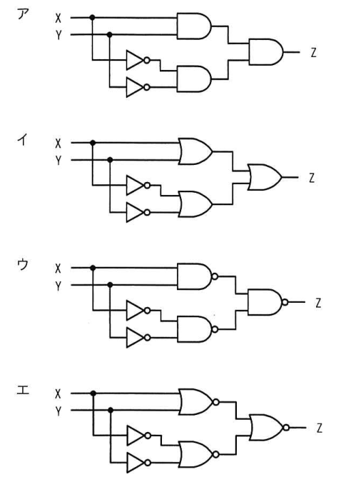
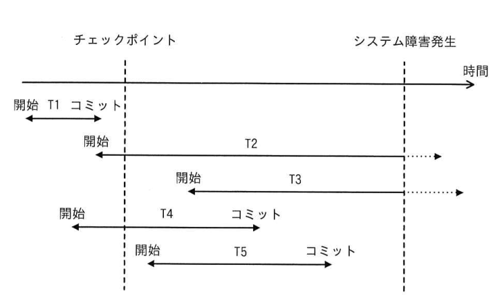
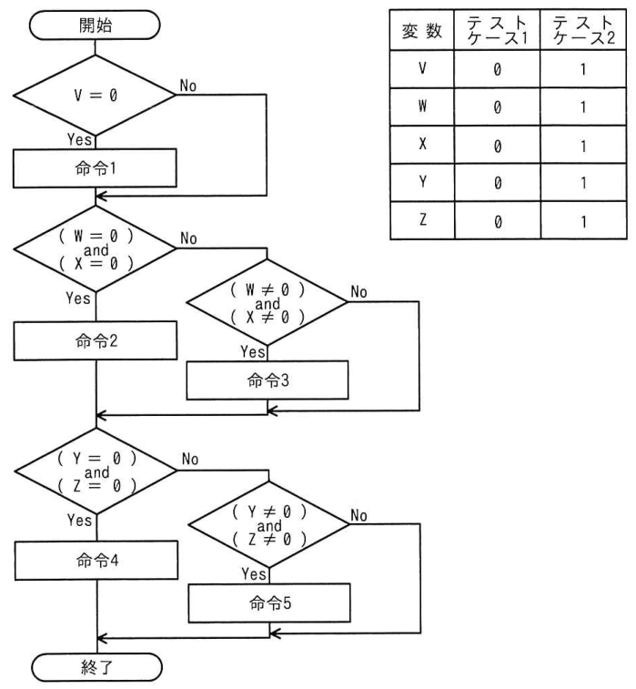

# 令和4年度秋期 科目A（旧午前）過去問解説

> 令和4年度 秋期 応用情報技術者試験 午前（全80問）を書き起こし、オリジナルの解説を付けたものです。問題の著作権は IPA（独立行政法人 情報処理推進機構）にあります。
> 図を表に書き換えるなど一部改変した問題には、その旨を記載しています。
> インタラクティブ教材の [科目A 四択クイズ](../../06_インタラクティブ教材/quiz.html) では、この回を本番形式（150分）で解けます。

## 目次

| 問 | 分野 | 中分類 | キーワード |
|---|---|---|---|
| [問1](#q01) | テクノロジ系 | 基礎理論 | 2進数、ビット数、桁数 |
| [問2](#q02) | テクノロジ系 | 基礎理論 | カルノー図、論理式、簡単化 |
| [問3](#q03) | テクノロジ系 | 基礎理論 | 確率、抜取検査、非復元抽出、組合せ |
| [問4](#q04) | テクノロジ系 | 基礎理論 | 過学習、汎化性能、機械学習、転移学習 |
| [問5](#q05) | テクノロジ系 | アルゴリズムとプログラミング | ハッシュ表、ハッシュ関数、衝突、剰余 |
| [問6](#q06) | テクノロジ系 | アルゴリズムとプログラミング | バブルソート、整列、流れ図 |
| [問7](#q07) | テクノロジ系 | アルゴリズムとプログラミング | XML、符号化宣言、UTF-16、文字コード |
| [問8](#q08) | テクノロジ系 | コンピュータ構成要素 | GPU、ディープラーニング、行列演算、並列処理 |
| [問9](#q09) | テクノロジ系 | コンピュータ構成要素 | キャッシュメモリ、ライトスルー、ライトバック |
| [問10](#q10) | テクノロジ系 | コンピュータ構成要素 | キャッシュメモリ、ヒット率、L2キャッシュ |
| [問11](#q11) | テクノロジ系 | コンピュータ構成要素 | 電子ペーパー、電気泳動、ディスプレイ |
| [問12](#q12) | テクノロジ系 | システム構成要素 | コンテナ型仮想化、ハイパーバイザー、ホスト型、仮想化 |
| [問13](#q13) | テクノロジ系 | システム構成要素 | 信頼性設計、フォールトアボイダンス、フェールセーフ、フェールソフト |
| [問14](#q14) | テクノロジ系 | システム構成要素 | 稼働率、MTBF、MTTR、アベイラビリティ |
| [問15](#q15) | テクノロジ系 | システム構成要素 | MIPS、スループット、ボトルネック、転送速度 |
| [問16](#q16) | テクノロジ系 | ソフトウェア | デッドロック、排他制御、資源獲得順序 |
| [問17](#q17) | テクノロジ系 | ソフトウェア | ページング、ページサイズ、内部断片化、仮想記憶 |
| [問18](#q18) | テクノロジ系 | ソフトウェア | リアルタイムOS、割込み処理、プリエンプティブ |
| [問19](#q19) | テクノロジ系 | ソフトウェア | スプーリング、プリンター割当て、シミュレーション |
| [問20](#q20) | テクノロジ系 | ハードウェア | アクチュエーター、センサー、組込みシステム |
| [問21](#q21) | テクノロジ系 | ハードウェア | ダイオード、整流作用、電子部品 |
| [問22](#q22) | テクノロジ系 | ハードウェア | フラッシュメモリ、不揮発性メモリ、ブロック消去 |
| [問23](#q23) | テクノロジ系 | ハードウェア | 論理回路、NAND、XNOR、ド・モルガンの法則 |
| [問24](#q24) | テクノロジ系 | ユーザーインタフェース | コード設計、桁数、組合せ |
| [問25](#q25) | テクノロジ系 | 情報メディア | H.264、MPEG-4 AVC、動画圧縮、コーデック |
| [問26](#q26) | テクノロジ系 | データベース | 命名規約、データ辞書、異音同義語、定義域 |
| [問27](#q27) | テクノロジ系 | データベース | 差集合、関係演算、集合演算 |
| [問28](#q28) | テクノロジ系 | データベース | SQL、副問合せ、AVG、DISTINCT |
| [問29](#q29) | テクノロジ系 | データベース | チェックポイント、ロールフォワード、ロールバック、障害回復 |
| [問30](#q30) | テクノロジ系 | データベース | ACID特性、トランザクション、原子性、耐久性 |
| [問31](#q31) | テクノロジ系 | ネットワーク | DHCP、IPアドレス、ブロードキャスト、リース期間 |
| [問32](#q32) | テクノロジ系 | ネットワーク | FTP、ウェルノウンポート、ポート番号 |
| [問33](#q33) | テクノロジ系 | ネットワーク | サブネットマスク、CIDR、ホストアドレス |
| [問34](#q34) | テクノロジ系 | ネットワーク | UDP、TCP、コネクションレス、トランスポート層 |
| [問35](#q35) | テクノロジ系 | ネットワーク | URL、ポート番号、クエリ文字列 |
| [問36](#q36) | テクノロジ系 | セキュリティ | オープンリゾルバ、DNSリフレクション攻撃、DDoS |
| [問37](#q37) | テクノロジ系 | セキュリティ | サイドチャネル攻撃、タイミング攻撃、耐タンパ性 |
| [問38](#q38) | テクノロジ系 | セキュリティ | OCSP、デジタル証明書、CRL、PKI |
| [問39](#q39) | テクノロジ系 | セキュリティ | CSIRT、JPCERT/CC、インシデント対応 |
| [問40](#q40) | テクノロジ系 | セキュリティ | JVN、脆弱性情報、CVSS、CWE |
| [問41](#q41) | テクノロジ系 | セキュリティ | リスクアセスメント、JIS Q 31000、リスク分析、リスク評価 |
| [問42](#q42) | テクノロジ系 | セキュリティ | WAF、REST API、Webアプリケーション |
| [問43](#q43) | テクノロジ系 | セキュリティ | IPマスカレード、NAPT、WPA、無線LAN |
| [問44](#q44) | テクノロジ系 | セキュリティ | SPF、送信ドメイン認証、DKIM、なりすましメール |
| [問45](#q45) | テクノロジ系 | セキュリティ | ファジング、脆弱性検査、ファズ |
| [問46](#q46) | テクノロジ系 | システム開発技術 | ウォークスルー、レビュー、インスペクション |
| [問47](#q47) | テクノロジ系 | システム開発技術 | FTA、故障の木解析、FMEA、信頼性 |
| [問48](#q48) | テクノロジ系 | システム開発技術 | テストカバレージ、命令網羅、分岐網羅、ホワイトボックステスト |
| [問49](#q49) | テクノロジ系 | ソフトウェア開発管理技術 | テスト駆動開発、XP、アジャイル |
| [問50](#q50) | テクノロジ系 | ソフトウェア開発管理技術 | スクラム、KPT、スプリントレトロスペクティブ |
| [問51](#q51) | マネジメント系 | プロジェクトマネジメント | スコープ管理、プロジェクトマネジメント、WBS |
| [問52](#q52) | マネジメント系 | プロジェクトマネジメント | プレシデンスダイアグラム法、PDM、リード、ラグ |
| [問53](#q53) | マネジメント系 | プロジェクトマネジメント | 工数見積り、人月、生産性、要員計画 |
| [問54](#q54) | マネジメント系 | プロジェクトマネジメント | 加重総和法、多基準意思決定分析、調達 |
| [問55](#q55) | マネジメント系 | サービスマネジメント | 問題管理、インシデント管理、根本原因 |
| [問56](#q56) | マネジメント系 | サービスマネジメント | サービスデスク、シフト、要員計画 |
| [問57](#q57) | マネジメント系 | サービスマネジメント | 入出力データ管理、帳票管理、授受管理 |
| [問58](#q58) | マネジメント系 | システム監査 | ISMS、内部監査、リスク受容基準、JIS Q 27001 |
| [問59](#q59) | マネジメント系 | システム監査 | 監査手続、監査証拠、システム監査 |
| [問60](#q60) | マネジメント系 | システム監査 | システム監査基準、システム管理基準、行為規範 |
| [問61](#q61) | ストラテジ系 | システム戦略 | BCP、事業継続計画、BSC、BPO |
| [問62](#q62) | ストラテジ系 | システム戦略 | DX推進指標、DX、デジタルトランスフォーメーション |
| [問63](#q63) | ストラテジ系 | システム戦略 | エンタープライズアーキテクチャ、EA、全体最適化 |
| [問64](#q64) | ストラテジ系 | システム企画 | 正味現在価値、NPV、割引率、投資評価 |
| [問65](#q65) | ストラテジ系 | システム企画 | コンティンジェンシープラン、リスク対応、外部委託 |
| [問66](#q66) | ストラテジ系 | システム企画 | 請負契約、準委任契約、モデル取引・契約書 |
| [問67](#q67) | ストラテジ系 | 経営戦略マネジメント | デューデリジェンス、M&A、企業価値 |
| [問68](#q68) | ストラテジ系 | 経営戦略マネジメント | ターゲットリターン価格設定、価格戦略、投資収益率 |
| [問69](#q69) | ストラテジ系 | 経営戦略マネジメント | コンジョイント分析、マーケティングリサーチ、属性 |
| [問70](#q70) | ストラテジ系 | 技術戦略マネジメント | APIエコノミー、オープンAPI、エコシステム |
| [問71](#q71) | ストラテジ系 | ビジネスインダストリ | ファブレス、ファウンドリ、EMS、セル生産方式 |
| [問72](#q72) | ストラテジ系 | ビジネスインダストリ | MRP、正味所要量、部品構成表 |
| [問73](#q73) | ストラテジ系 | ビジネスインダストリ | サイバーフィジカルシステム、CPS、IoT、デジタルツイン |
| [問74](#q74) | ストラテジ系 | 企業活動 | SL理論、リーダーシップ、ジョハリの窓、SECIモデル |
| [問75](#q75) | ストラテジ系 | 企業活動 | デルファイ法、予測手法、定性的予測 |
| [問76](#q76) | ストラテジ系 | 企業活動 | 親和図法、KJ法、収束技法、ブレーンストーミング |
| [問77](#q77) | ストラテジ系 | 企業活動 | 限界利益、営業利益、最適生産計画 |
| [問78](#q78) | ストラテジ系 | 法務 | 著作権、職務著作、請負契約 |
| [問79](#q79) | ストラテジ系 | 法務 | 請負契約、指揮命令権、偽装請負、労働者派遣 |
| [問80](#q80) | ストラテジ系 | 法務 | 製造物責任法、PL法、組込み機器 |

<a id="q01"></a>

### 問1　〔基礎理論〕 🧮

a を正の整数とし，b = a^2 とする。a を2進数で表現すると n ビットであるとき，b を2進数で表現すると最大で何ビットになるか。

- **ア**　n+1
- **イ**　2n
- **ウ**　n^2
- **エ**　2^n

<details><summary>解答・解説</summary>

**正解：イ**

n ビットで表せる a は a < 2^n なので，b = a^2 < 2^(2n) となり，b は最大でも 2n ビットに収まる。

**途中式**

- n ビットの正の整数：2^(n−1) ≦ a ≦ 2^n − 1
- 2乗すると：b = a^2 ≦ (2^n − 1)^2 < 2^(2n)
- 2^(2n) 未満の数は 2n ビットで表せる → 最大 **2n ビット**
- 例：n = 3 のとき a の最大は 7（111），b = 49（110001）で 6 ビット = 2 × 3

- ア：n+1 ビットは 2倍（1ビット左シフト）したときの最大桁数。2乗ではもっと増える
- ウ：n^2 は桁数どうしを掛けた値で，n = 3 なら 9 ビットとなり 49 の 6 ビットを大きく超える
- エ：2^n は n ビットで表せる値の個数であり，桁数ではない

💡 **ポイント**：桁数の問題は「n ビットの最大値 < 2^n」を使って不等式で考える。積の桁数は各桁数の和以下（m ビット × n ビット → 最大 m+n ビット）。

📖 関連：[基礎理論](../../01_テクノロジ系/01_基礎理論.md)

</details>

<sub>出典：令和4年度 秋期 応用情報技術者試験 午前 問1</sub>

---

<a id="q02"></a>

### 問2　〔基礎理論〕 🧮

A, B, C, D を論理変数とするとき，次のカルノー図と等価な論理式はどれか。ここで，・は論理積，＋は論理和，X̅ は X の否定を表す。

| AB ＼ CD | 00 | 01 | 11 | 10 |
|---|---|---|---|---|
| 00 | 1 | 0 | 0 | 1 |
| 01 | 0 | 1 | 1 | 0 |
| 11 | 0 | 1 | 1 | 0 |
| 10 | 0 | 0 | 0 | 0 |

- **ア**　A・B・C̅・D＋B̅・D̅
- **イ**　A̅・B̅・C̅・D̅＋B・D
- **ウ**　A・B・D＋B̅・D̅
- **エ**　A̅・B̅・D̅＋B・D

<details><summary>解答・解説</summary>

**正解：エ**

1 のマスは「AB=00 行の両端（CD=00 と 10）」と「AB=01・11 行の CD=01・11 の4マス」の2グループにまとめられる。それぞれ A̅・B̅・D̅ と B・D になる。

**途中式**

- AB=00 行の CD=00 と CD=10：左右の端は隣接しているので一つにまとめられ，C が消えて A̅・B̅・D̅
- AB=01, 11 行 × CD=01, 11 列の4マス：A（0 と 1）と C（0 と 1）が消え，B=1，D=1 が残って B・D
- 合わせて A̅・B̅・D̅＋B・D

- ア：B̅・D̅ は AB=10 行の CD=00・10（値は 0）まで 1 にしてしまう。A・B・C̅・D も 1マスしか表さない
- イ：A̅・B̅・C̅・D̅ は AB=00, CD=00 の1マスだけで，CD=10 の 1 が抜ける
- ウ：A・B・D は AB=11 行しか含まず AB=01 行の 1 が抜ける。B̅・D̅ は AB=10 行の 0 のマスを含む

💡 **ポイント**：カルノー図は上下・左右の端がつながっている。1 を 2・4・8 個の長方形でできるだけ大きく囲み，囲みの中で値が変化しない変数だけを残す。

📖 関連：[基礎理論](../../01_テクノロジ系/01_基礎理論.md)／[ハードウェア](../../01_テクノロジ系/10_ハードウェア.md)

</details>

<sub>出典：令和4年度 秋期 応用情報技術者試験 午前 問2（カルノー図を表に書き換え）</sub>

---

<a id="q03"></a>

### 問3　〔基礎理論〕 🧮

製品100個を1ロットとして生産する。一つのロットからサンプルを3個抽出して検査し，3個とも良品であればロット全体を合格とする。100個中に10個の不良品を含むロットが合格と判定される確率は幾らか。

- **ア**　178 / 245
- **イ**　405 / 539
- **ウ**　89 / 110
- **エ**　87 / 97

<details><summary>解答・解説</summary>

**正解：ア**

良品は 90 個。取り出したものは戻さない（非復元抽出）ので，1個目・2個目・3個目が続けて良品である確率を掛け合わせる。

**途中式**

- 1個目が良品：90 / 100
- 2個目も良品：89 / 99
- 3個目も良品：88 / 98
- 合格確率 = (90 × 89 × 88) / (100 × 99 × 98) = 704,880 / 970,200 = **178 / 245**（約 0.727）
- 組合せで考えても同じ：C(90,3) / C(100,3) = 117,480 / 161,700 = 178 / 245

- イ：405 / 539（約 0.751）は上の式と一致しない。抽出のたびに母数が減ることを正しく反映していない値
- ウ：89 / 110 は (90/100) × (89/99) で，2個だけ抽出した場合の確率
- エ：87 / 97（約 0.897）は1個分の良品率程度の値で，3個とも良品の確率としては大きすぎる

💡 **ポイント**：非復元抽出では「残りの個数」で分母・分子を1つずつ減らして掛ける。C(良品,k) / C(全体,k) でも同じ結果になる。

📖 関連：[基礎理論](../../01_テクノロジ系/01_基礎理論.md)／[計算問題公式集](../../05_まとめ・横断資料/01_計算問題公式集.md)

</details>

<sub>出典：令和4年度 秋期 応用情報技術者試験 午前 問3</sub>

---

<a id="q04"></a>

### 問4　〔基礎理論〕

AI における過学習の説明として，最も適切なものはどれか。

- **ア**　ある領域で学習した学習済みモデルを，別の領域に再利用することによって，効率的に学習させる。
- **イ**　学習に使った訓練データに対しては精度が高い結果となる一方で，未知のデータに対しては精度が下がる。
- **ウ**　期待している結果とは掛け離れている場合に，結果側から逆方向に学習させて，その差を少なくする。
- **エ**　膨大な訓練データを学習させても効果が得られない場合に，学習目標として成功と判断するための報酬を与えることによって，何が成功か分かるようにする。

<details><summary>解答・解説</summary>

**正解：イ**

過学習（オーバーフィッティング）は，モデルが訓練データの細かな特徴やノイズまで覚え込んでしまい，訓練データでは高精度なのに未知のデータでは精度が落ちる（汎化性能が低い）状態をいう。

- ア：転移学習の説明
- ウ：誤差逆伝播法（バックプロパゲーション）の説明
- エ：強化学習（報酬によって望ましい行動を学ぶ）の説明

💡 **ポイント**：過学習の対策は，訓練データを増やす，正則化，ドロップアウト，交差検証で汎化性能を確かめるなど。「訓練誤差は小さいが汎化誤差が大きい」と言い換えられる。

📖 関連：[基礎理論](../../01_テクノロジ系/01_基礎理論.md)

</details>

<sub>出典：令和4年度 秋期 応用情報技術者試験 午前 問4</sub>

---

<a id="q05"></a>

### 問5　〔アルゴリズムとプログラミング〕 🧮

自然数をキーとするデータを，ハッシュ表を用いて管理する。キー x のハッシュ関数 h(x) を

h(x) = x mod n

とすると，任意のキー a と b が衝突する条件はどれか。ここで，n はハッシュ表の大きさであり，x mod n は x を n で割った余りを表す。

- **ア**　a+b が n の倍数
- **イ**　a−b が n の倍数
- **ウ**　n が a+b の倍数
- **エ**　n が a−b の倍数

<details><summary>解答・解説</summary>

**正解：イ**

衝突とは h(a) = h(b)，つまり a と b を n で割った余りが等しいこと。余りが等しい2数の差は n でちょうど割り切れるので，「a−b が n の倍数」が条件になる。

**途中式**

- a = n・p + r，b = n・q + r（余り r が共通）とおく
- a − b = n(p − q) → n の倍数
- 例：n = 7，a = 15，b = 8 → 15 mod 7 = 1，8 mod 7 = 1 で衝突，差 7 は 7 の倍数

- ア：和が n の倍数なのは「余りの和が n（または 0）」の場合で，余りが等しいとは限らない（例：n=7，a=3，b=4）
- ウ：n が a+b の倍数という関係は，余りが等しいことと無関係
- エ：「n が a−b の倍数」は倍数・約数の向きが逆。a−b が n の約数になる場合を指している

💡 **ポイント**：x mod n が等しい ⇔ 差が n の倍数（合同式 a ≡ b (mod n)）。除算法のハッシュ関数では n に素数を選ぶと衝突が偏りにくい。

📖 関連：[アルゴリズムとプログラミング](../../01_テクノロジ系/02_アルゴリズムとプログラミング.md)

</details>

<sub>出典：令和4年度 秋期 応用情報技術者試験 午前 問5</sub>

---

<a id="q06"></a>

### 問6　〔アルゴリズムとプログラミング〕

未整列の配列 A[i]（i=1, 2, …, n）を，次の流れ図によって整列する。ここで用いられる整列アルゴリズムはどれか。

```
開始
ループ1　i：1, 1, n−1（注）
  ループ2　j：n, −1, i+1（注）
    A[j]：A[j−1]
      ＜ のとき：w ← A[j]
                A[j] ← A[j−1]
                A[j−1] ← w
      ≧ のとき：何もしない
  ループ2 端
ループ1 端
終了
```

（注）ループ端の繰返し指定は，変数名：初期値，増分，終値を示す。

- **ア**　クイックソート
- **イ**　選択ソート
- **ウ**　挿入ソート
- **エ**　バブルソート

<details><summary>解答・解説</summary>

**正解：エ**

内側のループで j を末尾 n から i+1 まで1つずつ減らしながら，隣り合う A[j] と A[j−1] を比べ，逆順なら交換している。隣接要素の比較・交換を繰り返して最小値を先頭側へ浮かび上がらせるのはバブルソート。

- 外側の1回目（i=1）で最小値が A[1] に，2回目で2番目に小さい値が A[2] に確定する
- 比較は常に「隣どうし」で，その場で交換している点がバブルソートの特徴

- ア：クイックソートは基準値（ピボット）より小さいグループと大きいグループに分割し，再帰的に整列する方法
- イ：選択ソートは未整列部分から最小値を探し，見つけてから1回だけ先頭と交換する。隣接交換を繰り返さない
- ウ：挿入ソートは整列済み部分の適切な位置に，次の要素を挿入していく方法

💡 **ポイント**：バブルソート＝隣接比較・交換，選択ソート＝最小値を選んで交換，挿入ソート＝整列済み列に差し込む。いずれも計算量は O(n^2)。

📖 関連：[アルゴリズムとプログラミング](../../01_テクノロジ系/02_アルゴリズムとプログラミング.md)

</details>

<sub>出典：令和4年度 秋期 応用情報技術者試験 午前 問6（流れ図をテキストに書き換え）</sub>

---

<a id="q07"></a>

### 問7　〔アルゴリズムとプログラミング〕

XML において，XML 宣言中で符号化宣言を省略できる文字コードはどれか。

- **ア**　EUC-JP
- **イ**　ISO-2022-JP
- **ウ**　Shift-JIS
- **エ**　UTF-16

<details><summary>解答・解説</summary>

**正解：エ**

XML の仕様では，文字コードが UTF-8 または UTF-16 の文書は符号化宣言（encoding="…"）を省略できる。UTF-16 は先頭のバイト順マーク（BOM）で判別できる。選択肢の中では UTF-16 だけが該当する。

- ア：EUC-JP は UTF-8／UTF-16 以外なので，encoding="EUC-JP" の宣言が必要
- イ：ISO-2022-JP も同様に符号化宣言が必要
- ウ：Shift-JIS も同様に符号化宣言が必要

💡 **ポイント**：XML の既定の文字コードは UTF-8 と UTF-16。それ以外の文字コードを使うときは `<?xml version="1.0" encoding="Shift_JIS"?>` のように明示する。

📖 関連：[アルゴリズムとプログラミング](../../01_テクノロジ系/02_アルゴリズムとプログラミング.md)

</details>

<sub>出典：令和4年度 秋期 応用情報技術者試験 午前 問7</sub>

---

<a id="q08"></a>

### 問8　〔コンピュータ構成要素〕

ディープラーニングの学習に GPU を用いる利点として，適切なものはどれか。

- **ア**　各プロセッサコアが独立して異なるプログラムを実行し，異なるデータを処理できる。
- **イ**　行列演算ユニットを用いて，行列演算を高速に実行できる。
- **ウ**　浮動小数点演算ユニットをコプロセッサとして用い，浮動小数点演算ができる。
- **エ**　分岐予測を行い，パイプラインの利用効率を高めた処理を実行できる。

<details><summary>解答・解説</summary>

**正解：イ**

ディープラーニングの学習は大量の行列の積和演算の繰返しである。GPU は多数の演算器（行列演算ユニットなど）で同じ演算を大量のデータに並列に適用できるため，学習を高速化できる。

- ア：コアごとに異なるプログラム・データを処理する MIMD 型のマルチプロセッサ（マルチコア CPU）の特徴。GPU は同じ命令を多数のデータに適用する SIMD 的な並列処理が得意
- ウ：浮動小数点演算用のコプロセッサ（FPU）の説明で，GPU を使う利点ではない
- エ：分岐予測は CPU のパイプライン制御の技術。GPU は分岐の多い処理は苦手

💡 **ポイント**：GPU は「単純な演算を大量に並列実行」するのが得意で，画像処理や機械学習に使われる（GPGPU）。CPU は複雑な制御・分岐が得意。

📖 関連：[コンピュータ構成要素](../../01_テクノロジ系/03_コンピュータ構成要素.md)

</details>

<sub>出典：令和4年度 秋期 応用情報技術者試験 午前 問8</sub>

---

<a id="q09"></a>

### 問9　〔コンピュータ構成要素〕

キャッシュメモリのライトスルーの説明として，適切なものはどれか。

- **ア**　CPU がメモリに書込み動作をするとき，キャッシュメモリだけにデータを書き込む。
- **イ**　CPU がメモリに書込み動作をするとき，キャッシュメモリと主記憶の両方に同時にデータを書き込む。
- **ウ**　主記憶のデータの変更は，キャッシュメモリから当該データが追い出される時に行う。
- **エ**　主記憶へのアクセス頻度が少ないので，バスの占有率が低い。

<details><summary>解答・解説</summary>

**正解：イ**

ライトスルー方式は，書込みのたびにキャッシュと主記憶の両方を更新する方式。常に主記憶とキャッシュの内容が一致するので一貫性を保ちやすいが，主記憶への書込みが多くなる。

- ア：キャッシュだけに書き込むのはライトバック方式の動作
- ウ：追い出される（リプレースされる）ときに主記憶へ書き戻すのはライトバック方式
- エ：主記憶へのアクセスが少なくバス占有率が低いのはライトバック方式の利点。ライトスルーは書込みごとに主記憶へアクセスする

💡 **ポイント**：ライトスルー＝毎回両方に書く（一貫性◎・速度△），ライトバック＝キャッシュだけに書き，追い出し時に主記憶へ（速度◎・制御が複雑）。

📖 関連：[コンピュータ構成要素](../../01_テクノロジ系/03_コンピュータ構成要素.md)

</details>

<sub>出典：令和4年度 秋期 応用情報技術者試験 午前 問9</sub>

---

<a id="q10"></a>

### 問10　〔コンピュータ構成要素〕 🧮

L1，L2 と2段のキャッシュをもつプロセッサにおいて，あるプログラムを実行したとき，L1 キャッシュのヒット率が 0.95，L2 キャッシュのヒット率が 0.6 であった。このキャッシュシステムのヒット率は幾らか。ここで L1 キャッシュにあるデータは全て L2 キャッシュにもあるものとする。

- **ア**　0.57
- **イ**　0.6
- **ウ**　0.95
- **エ**　0.98

<details><summary>解答・解説</summary>

**正解：エ**

L1 でヒットしなかった 5% のアクセスのうち 60% が L2 でヒットする。L1 か L2 のどちらかでヒットする割合がキャッシュシステム全体のヒット率になる。

**途中式**

- L1 でヒット：0.95
- L1 でミスして L2 でヒット：(1 − 0.95) × 0.6 = 0.05 × 0.6 = 0.03
- 全体のヒット率 = 0.95 + 0.03 = **0.98**
- （別解）両方ミスする確率 = 0.05 × 0.4 = 0.02 → 1 − 0.02 = 0.98

- ア：0.95 × 0.6 = 0.57 で，L1 と L2 の両方でヒットする確率を求めてしまった値
- イ：L2 のヒット率をそのまま答えた値
- ウ：L1 のヒット率だけで，L2 によるヒットの上積みを考えていない

💡 **ポイント**：多段キャッシュのヒット率は「1 − 全段でミスする確率」で求めると速い。L2 のヒット率は「L1 でミスしたアクセスに対する割合」として使う。

📖 関連：[コンピュータ構成要素](../../01_テクノロジ系/03_コンピュータ構成要素.md)／[計算問題公式集](../../05_まとめ・横断資料/01_計算問題公式集.md)

</details>

<sub>出典：令和4年度 秋期 応用情報技術者試験 午前 問10</sub>

---

<a id="q11"></a>

### 問11　〔コンピュータ構成要素〕

電気泳動型電子ペーパーの説明として，適切なものはどれか。

- **ア**　デバイスに印加した電圧によって，光の透過状態を変化させて表示する。
- **イ**　電圧を印加した電極に，着色した帯電粒子を集めて表示する。
- **ウ**　電圧を印加すると発光する薄膜デバイスを用いて表示する。
- **エ**　半導体デバイス上に作成した微小な鏡の向きを変えて，反射することによって表示する。

<details><summary>解答・解説</summary>

**正解：イ**

電気泳動型電子ペーパーは，白と黒など色の付いた帯電粒子を液体中に入れ，電圧をかけた電極側へ粒子を引き寄せることで表示する。外光の反射で見せるため紙に近い見え方で，表示を保持するのに電力がほとんど要らない。

- ア：液晶ディスプレイの説明。電圧で液晶分子の向きを変え，バックライトの光の透過を制御する
- ウ：有機 EL ディスプレイ（OLED）の説明。自発光する薄膜素子を使う
- エ：DMD（デジタルミラーデバイス）の説明で，DLP プロジェクターに使われる

💡 **ポイント**：電子ペーパーの特徴は「反射型で目に優しい」「書換え時だけ電力を使い，表示の保持に電力がほぼ不要」。電子書籍端末や電子棚札に使われる。

📖 関連：[コンピュータ構成要素](../../01_テクノロジ系/03_コンピュータ構成要素.md)

</details>

<sub>出典：令和4年度 秋期 応用情報技術者試験 午前 問11</sub>

---

<a id="q12"></a>

### 問12　〔システム構成要素〕

コンテナ型仮想化の説明として，適切なものはどれか。

- **ア**　物理サーバと物理サーバの仮想環境とが OS を共有するので，物理サーバか物理サーバの仮想環境のどちらかに OS をもてばよい。
- **イ**　物理サーバにホスト OS をもたず，物理サーバにインストールした仮想化ソフトウェアによって，個別のゲスト OS をもった仮想サーバを動作させる。
- **ウ**　物理サーバのホスト OS と仮想化ソフトウェアによって，プログラムの実行環境を仮想化するので，仮想サーバに個別のゲスト OS をもたない。
- **エ**　物理サーバのホスト OS にインストールした仮想化ソフトウェアによって，個別のゲスト OS をもった仮想サーバを動作させる。

<details><summary>解答・解説</summary>

**正解：ウ**

コンテナ型は，ホスト OS のカーネルを共有し，その上でアプリケーションの実行環境（コンテナ）を隔離して動かす方式。コンテナごとにゲスト OS をもたないので軽量で起動が速い。

- ア：コンテナ型でもホスト OS は物理サーバ側に必要で，「どちらかに OS をもてばよい」という説明は誤り
- イ：ハイパーバイザー型の説明。ホスト OS なしでハイパーバイザーが直接ハードウェア上で動き，各仮想サーバがゲスト OS をもつ
- エ：ホスト型の説明。ホスト OS 上の仮想化ソフトウェアがゲスト OS 付きの仮想サーバを動かす

💡 **ポイント**：仮想化の3方式：ホスト型（ホスト OS＋ゲスト OS），ハイパーバイザー型（ホスト OS なし＋ゲスト OS），コンテナ型（ホスト OS 共有・ゲスト OS なし）。

📖 関連：[システム構成要素](../../01_テクノロジ系/04_システム構成要素.md)

</details>

<sub>出典：令和4年度 秋期 応用情報技術者試験 午前 問12</sub>

---

<a id="q13"></a>

### 問13　〔システム構成要素〕

システムの信頼性設計に関する記述のうち，適切なものはどれか。

- **ア**　フェールセーフとは，利用者の誤操作によってシステムが異常終了してしまうことのないように，単純なミスを発生させないようにする設計方法である。
- **イ**　フェールソフトとは，故障が発生した場合でも機能を縮退させることなく稼働を継続する概念である。
- **ウ**　フォールトアボイダンスとは，システム構成要素の個々の品質を高めて故障が発生しないようにする概念である。
- **エ**　フォールトトレランスとは，故障が生じてもシステムに重大な影響が出ないように，あらかじめ定められた安全状態にシステムを固定し，全体として安全が維持されるような設計方法である。

<details><summary>解答・解説</summary>

**正解：ウ**

フォールトアボイダンス（障害回避）は，高品質な部品の採用や十分なテストなどで，個々の構成要素の故障そのものを起こりにくくする考え方である。

- ア：利用者の誤操作を防ぐ設計はフールプルーフ。フェールセーフは故障時に安全側へ倒す設計
- イ：フェールソフトは故障箇所を切り離し，機能を縮退させてでも稼働を続ける考え方。「縮退させることなく」が誤り
- エ：安全状態に固定するのはフェールセーフの説明。フォールトトレランスは冗長化などで故障があっても機能を維持する考え方

💡 **ポイント**：フォールトアボイダンス（故障を起こさない）とフォールトトレランス（故障しても動き続ける）が対。フェールセーフ＝安全側へ，フェールソフト＝縮退運転，フールプルーフ＝誤操作防止。

📖 関連：[システム構成要素](../../01_テクノロジ系/04_システム構成要素.md)

</details>

<sub>出典：令和4年度 秋期 応用情報技術者試験 午前 問13</sub>

---

<a id="q14"></a>

### 問14　〔システム構成要素〕 🧮

あるシステムにおいて，MTBF と MTTR がともに 1.5 倍になったとき，アベイラビリティ（稼働率）は何倍になるか。

- **ア**　2 / 3
- **イ**　1.5
- **ウ**　2.25
- **エ**　変わらない

<details><summary>解答・解説</summary>

**正解：エ**

稼働率 = MTBF / (MTBF + MTTR)。分子と分母が同じ 1.5 倍になるので，比の値は変わらない。

**途中式**

- 変更前：A = MTBF / (MTBF + MTTR)
- 変更後：A' = 1.5MTBF / (1.5MTBF + 1.5MTTR) = 1.5MTBF / {1.5 (MTBF + MTTR)} = MTBF / (MTBF + MTTR)
- よって A' = A で**変わらない**（例：MTBF 90 時間・MTTR 10 時間 → 0.9，135 時間・15 時間 → 0.9）

- ア：MTTR だけが 1.5 倍になったと考えるなど，分子・分母の一方だけを変えた誤り
- イ：MTBF の倍率をそのまま稼働率の倍率とした誤り
- ウ：1.5 × 1.5 と掛けてしまった誤り。稼働率は 1 を超えられないので，元の値によっては 2.25 倍はあり得ない

💡 **ポイント**：稼働率は MTBF と MTTR の「比」で決まる。両方を同じ倍率にしても稼働率は不変。稼働率を上げるには MTBF を延ばすか MTTR を縮める。

📖 関連：[システム構成要素](../../01_テクノロジ系/04_システム構成要素.md)／[計算問題公式集](../../05_まとめ・横断資料/01_計算問題公式集.md)

</details>

<sub>出典：令和4年度 秋期 応用情報技術者試験 午前 問14</sub>

---

<a id="q15"></a>

### 問15　〔システム構成要素〕 🧮

あるクライアントサーバシステムにおいて，クライアントから要求された1件の検索を処理するために，サーバで平均100万命令が実行される。1件の検索につき，ネットワーク内で転送されるデータは平均 2×10^5 バイトである。このサーバの性能は 100 MIPS であり，ネットワークの転送速度は 8×10^7 ビット／秒である。このシステムにおいて，1秒間に処理できる検索要求は何件か。ここで，処理できる件数は，サーバとネットワークの処理能力だけで決まるものとする。また，1バイトは8ビットとする。

- **ア**　50
- **イ**　100
- **ウ**　200
- **エ**　400

<details><summary>解答・解説</summary>

**正解：ア**

サーバとネットワークそれぞれが1秒間にさばける件数を求め，小さいほう（ボトルネック）がシステム全体の処理件数になる。

**途中式**

- サーバ：100 MIPS = 100 × 10^6 命令／秒 → (100 × 10^6) / (100 × 10^4) = **100 件／秒**
- ネットワーク：1件 = 2 × 10^5 バイト × 8 = 1.6 × 10^6 ビット → (8 × 10^7) / (1.6 × 10^6) = **50 件／秒**
- システム全体 = min(100, 50) = **50 件／秒**

- イ：サーバの処理能力だけで計算した値。ネットワークがボトルネックになることを見落としている
- ウ：サーバ（100 件）・ネットワーク（50 件）のどちらの上限とも一致しない。単位換算や桁を取り違えたときに出る値
- エ：バイトをビットに換算せずにネットワークの件数を求めた値（8×10^7 / 2×10^5 = 400）

💡 **ポイント**：処理能力の問題は「各資源ごとの上限件数」を出して最小値を取る。バイトとビットの換算（×8）を忘れないこと。

📖 関連：[システム構成要素](../../01_テクノロジ系/04_システム構成要素.md)／[計算問題公式集](../../05_まとめ・横断資料/01_計算問題公式集.md)

</details>

<sub>出典：令和4年度 秋期 応用情報技術者試験 午前 問15</sub>

---

<a id="q16"></a>

### 問16　〔ソフトウェア〕

二つのタスクが共用する二つの資源を排他的に使用するとき，デッドロックが発生するおそれがある。このデッドロックの発生を防ぐ方法はどれか。

- **ア**　一方のタスクの優先度を高くする。
- **イ**　資源獲得の順序を両方のタスクで同じにする。
- **ウ**　資源獲得の順序を両方のタスクで逆にする。
- **エ**　両方のタスクの優先度を同じにする。

<details><summary>解答・解説</summary>

**正解：イ**

デッドロックは，タスク1 が資源A を確保して資源B を待ち，タスク2 が資源B を確保して資源A を待つ，という循環待ちで起きる。両方のタスクが「A → B」の同じ順序で資源を獲得すれば循環待ちが生じない。

- ア：優先度は実行の順番を決めるだけで，資源の循環待ちは解消しない
- ウ：獲得順序を逆にすることこそがデッドロックの原因（A→B と B→A）
- エ：優先度を同じにしても，資源の獲得順序の問題は変わらない

💡 **ポイント**：デッドロック防止の定番は「資源に番号を付け，全タスクが同じ順序で獲得する」こと。発生条件（相互排除・保持待ち・横取り不可・循環待ち）のどれかを崩せば防げる。

📖 関連：[ソフトウェア](../../01_テクノロジ系/05_ソフトウェア.md)

</details>

<sub>出典：令和4年度 秋期 応用情報技術者試験 午前 問16</sub>

---

<a id="q17"></a>

### 問17　〔ソフトウェア〕

ほとんどのプログラムの大きさがページサイズの半分以下のシステムにおいて，ページサイズを半分にしたときに予想されるものはどれか。ここで，このシステムは主記憶が不足しがちで，多重度やスループットなどはシステム性能の限界で運用しているものとする。

- **ア**　ページサイズが小さくなるので，領域管理などのオーバーヘッドが減少する。
- **イ**　ページ内に余裕がなくなるので，ページ置換えによってシステム性能が低下する。
- **ウ**　ページ内の無駄な空き領域が減少するので，主記憶不足が緩和される。
- **エ**　ページフォールトの回数が増加するので，システム性能が低下する。

<details><summary>解答・解説</summary>

**正解：ウ**

プログラムの多くがページの半分以下の大きさなので，現状では各ページの半分以上が使われずに無駄になっている（内部断片化）。ページサイズを半分にしてもプログラムは1ページに収まり，無駄な空きが減るので，同じ主記憶により多くのプログラムを載せられ，主記憶不足が緩和される。

- ア：ページが小さくなるとページ数が増え，ページテーブルなどの管理オーバーヘッドはむしろ増える
- イ：プログラムは半分にしたページにも収まるので「余裕がなくなる」ことによる性能低下は起きにくい
- エ：主記憶の利用効率が上がるので，ページフォールトはむしろ減ることが期待できる

💡 **ポイント**：ページングの内部断片化は「ページサイズとプログラムサイズの差」で生じる。ページを小さくすると断片化は減るが，ページテーブルが大きくなるトレードオフがある。

📖 関連：[ソフトウェア](../../01_テクノロジ系/05_ソフトウェア.md)

</details>

<sub>出典：令和4年度 秋期 応用情報技術者試験 午前 問17</sub>

---

<a id="q18"></a>

### 問18　〔ソフトウェア〕

優先度に基づくプリエンプティブなスケジューリングを行うリアルタイム OS における割込み処理の説明のうち，適切なものはどれか。ここで，割込み禁止状態は考慮しないものとし，割込み処理を行うプログラムを割込み処理ルーチン，割込み処理以外のプログラムをタスクと呼ぶ。

- **ア**　タスクの切替えを禁止すると，割込みが発生しても割込み処理ルーチンは呼び出されない。
- **イ**　割込み処理ルーチンの処理時間の長さは，システムの応答性に影響を与えない。
- **ウ**　割込み処理ルーチンは，最も優先度の高いタスクよりも優先して実行される。
- **エ**　割込み処理ルーチンは，割り込まれたタスクと同一のコンテキストで実行される。

<details><summary>解答・解説</summary>

**正解：ウ**

割込みは OS のタスクスケジューリングの外側でハードウェアが起動するもので，割込み処理ルーチンはどのタスクよりも優先して実行される。最高優先度のタスクの実行中でも割込みが入れば割込み処理ルーチンが先に動く。

- ア：タスク切替えの禁止（ディスパッチ禁止）と割込み禁止は別物。タスク切替えを禁止していても割込み処理ルーチンは呼び出される
- イ：割込み処理ルーチンの実行中はタスクが動けないので，処理が長いほど応答性が悪くなる。だから割込み処理は短くする
- エ：割込み処理ルーチンはタスクとは別の割込みコンテキストで実行される。割り込まれたタスクのコンテキストは退避・復元される

💡 **ポイント**：RTOS の割込み処理ルーチンは「最優先・短く」が原則。長い処理はタスクに任せ，割込み処理ルーチンからはイベント通知などでタスクを起床させる。

📖 関連：[ソフトウェア](../../01_テクノロジ系/05_ソフトウェア.md)

</details>

<sub>出典：令和4年度 秋期 応用情報技術者試験 午前 問18</sub>

---

<a id="q19"></a>

### 問19　〔ソフトウェア〕 🧮

LAN に接続された3台のプリンターA〜C がある。印刷時間が分単位で 4，6，3，2，5，3，4，3，1 の9個の印刷データがこの順で存在する場合，プリンターC が印刷に要する時間は何分か。ここで，プリンターは，複数台空いていれば，A，B，C の順で割り当て，1台も空いていなければ，どれかが空くまで待ちになる。また，初期状態では3台とも空いている。

- **ア**　7
- **イ**　9
- **ウ**　11
- **エ**　12

<details><summary>解答・解説</summary>

**正解：ウ**

空いた順にプリンターへ割り当てていくと，C には 3，2，3，3 分のデータが割り当てられ，合計 11 分になる。

**途中式**（時刻は分，カッコ内は印刷終了時刻）

| データ | 時間 | 割当て時刻 | 割当て先 |
|---|---|---|---|
| 1 | 4 | 0 | A（4） |
| 2 | 6 | 0 | B（6） |
| 3 | 3 | 0 | C（3） |
| 4 | 2 | 3 | C（5） |
| 5 | 5 | 4 | A（9） |
| 6 | 3 | 5 | C（8） |
| 7 | 4 | 6 | B（10） |
| 8 | 3 | 8 | C（11） |
| 9 | 1 | 9 | A（10） |

- C の印刷時間 = 3 + 2 + 3 + 3 = **11 分**（A は 4+5+1=10 分，B は 6+4=10 分）

- ア・イ・エ：いずれも割当ての順序を取り違えた値。空いた時刻の早いプリンターに次のデータを割り当てる，という規則で順にたどれば 11 分になる

💡 **ポイント**：待ち行列のシミュレーション問題は，各プリンターの「空く時刻」を表にして1件ずつ割り当てると確実。同時に空いた場合の優先順位（A→B→C）にも注意。

📖 関連：[ソフトウェア](../../01_テクノロジ系/05_ソフトウェア.md)

</details>

<sub>出典：令和4年度 秋期 応用情報技術者試験 午前 問19</sub>

---

<a id="q20"></a>

### 問20　〔ハードウェア〕

アクチュエーターの機能として，適切なものはどれか。

- **ア**　アナログ電気信号を，コンピュータが処理可能なデジタル信号に変える。
- **イ**　キーボード，タッチパネルなどに使用され，コンピュータに情報を入力する。
- **ウ**　コンピュータが出力した電気信号を力学的な運動に変える。
- **エ**　物理量を検出して，電気信号に変える。

<details><summary>解答・解説</summary>

**正解：ウ**

アクチュエーターは，コンピュータからの電気信号を受けて，モーターやソレノイド，油圧シリンダーなどで機械的な動き（力学的な運動）に変換する装置である。

- ア：A/D 変換器（A/D コンバータ）の機能
- イ：入力装置（キーボード，タッチパネルなど）の説明
- エ：センサーの機能。温度・圧力・光などの物理量を電気信号に変える

💡 **ポイント**：組込みシステムは「センサー（入力：物理量→電気信号）→ コンピュータ（判断）→ アクチュエーター（出力：電気信号→運動）」の流れで制御する。

📖 関連：[ハードウェア](../../01_テクノロジ系/10_ハードウェア.md)

</details>

<sub>出典：令和4年度 秋期 応用情報技術者試験 午前 問20</sub>

---

<a id="q21"></a>

### 問21　〔ハードウェア〕

次の電子部品のうち，整流作用をもつ素子はどれか。

- **ア**　コイル
- **イ**　コンデンサ
- **ウ**　ダイオード
- **エ**　抵抗器

<details><summary>解答・解説</summary>

**正解：ウ**

ダイオードは電流を一方向（アノード → カソード）にしか流さない性質（整流作用）をもつ半導体素子で，交流を直流に変換する整流回路に使われる。

- ア：コイルは電流の変化を妨げる性質（インダクタンス）をもち，磁気エネルギーを蓄える。フィルタやトランスに使う
- イ：コンデンサは電荷を蓄える素子で，直流を通さず交流を通す。平滑回路やノイズ除去に使う
- エ：抵抗器は電流の流れを制限し，電圧を分ける素子。方向による違いはない

💡 **ポイント**：整流＝ダイオード，増幅・スイッチング＝トランジスタ，蓄電＝コンデンサ，電流変化の抑制＝コイル。電源回路は「整流（ダイオード）→ 平滑（コンデンサ）」の順。

📖 関連：[ハードウェア](../../01_テクノロジ系/10_ハードウェア.md)

</details>

<sub>出典：令和4年度 秋期 応用情報技術者試験 午前 問21</sub>

---

<a id="q22"></a>

### 問22　〔ハードウェア〕

フラッシュメモリの特徴として，適切なものはどれか。

- **ア**　書込み回数は無制限である。
- **イ**　書込み時は回路基板から外して，専用の ROM ライターで書き込まなければならない。
- **ウ**　定期的にリフレッシュしないと，データが失われる。
- **エ**　データ書換え時には，あらかじめ前のデータを消去してから書込みを行う。

<details><summary>解答・解説</summary>

**正解：エ**

フラッシュメモリは電気的に書換え可能な不揮発性メモリで，データを上書きできず，ブロック単位でいったん消去してから書き込む必要がある。

- ア：フラッシュメモリには書換え回数の上限がある（セルが劣化する）。そのため SSD ではウェアレベリングで書込みを分散させる
- イ：基板から外して専用の ROM ライターで書き込むのは，紫外線で消去する UV-EPROM などの特徴。フラッシュメモリは基板上で電気的に書き換えられる
- ウ：定期的なリフレッシュが必要なのは DRAM。フラッシュメモリは電源を切ってもデータが残る

💡 **ポイント**：フラッシュメモリ＝不揮発・ブロック単位の消去・書換え回数に上限。DRAM＝揮発・リフレッシュ必要。対比で覚える。

📖 関連：[ハードウェア](../../01_テクノロジ系/10_ハードウェア.md)／[コンピュータ構成要素](../../01_テクノロジ系/03_コンピュータ構成要素.md)

</details>

<sub>出典：令和4年度 秋期 応用情報技術者試験 午前 問22</sub>

---

<a id="q23"></a>

### 問23　〔ハードウェア〕

入力 X と Y の値が同じときにだけ，出力 Z に1を出力する回路はどれか。



- **ア**　（図のア：AND 2個の出力を AND）
- **イ**　（図のイ：OR 2個の出力を OR）
- **ウ**　（図のウ：NAND 2個の出力を NAND）
- **エ**　（図のエ：NOR 2個の出力を NOR）

<details><summary>解答・解説</summary>

**正解：ウ**

求める回路は X・Y＋X̅・Y̅（一致回路，XNOR）である。ウは上段 NAND が (X・Y)̅，下段 NAND が (X̅・Y̅)̅ を出し，それを NAND で受けるので，ド・モルガンの法則により X・Y＋X̅・Y̅ になる。

**途中式**（各回路とも上段は X, Y，下段は X̅, Y̅ を入力）

- ウ：Z = ((X・Y)̅ ・ (X̅・Y̅)̅)̅ = X・Y＋X̅・Y̅ → X=Y のとき 1 ✔

| X | Y | ア | イ | ウ | エ |
|---|---|---|---|---|---|
| 0 | 0 | 0 | 1 | 1 | 0 |
| 0 | 1 | 0 | 1 | 0 | 0 |
| 1 | 0 | 0 | 1 | 0 | 0 |
| 1 | 1 | 0 | 1 | 1 | 0 |

- ア：Z = X・Y・X̅・Y̅ で，X と X̅ が同時に 1 にならないので常に 0
- イ：Z = X＋Y＋X̅＋Y̅ で，X か X̅ のどちらかが必ず 1 なので常に 1
- エ：Z = ((X＋Y)̅＋(X̅＋Y̅)̅)̅ = (X＋Y)・(X̅＋Y̅) = X⊕Y（排他的論理和）で，値が異なるときに 1。求める回路の逆

💡 **ポイント**：NAND–NAND 構成は AND–OR（積和形）と等価。「一致で 1」は XNOR＝X・Y＋X̅・Y̅，「不一致で 1」は XOR。

📖 関連：[ハードウェア](../../01_テクノロジ系/10_ハードウェア.md)／[基礎理論](../../01_テクノロジ系/01_基礎理論.md)

</details>

<sub>出典：令和4年度 秋期 応用情報技術者試験 午前 問23（選択肢の回路図を画像で掲載し，選択肢に構成を補記）</sub>

---

<a id="q24"></a>

### 問24　〔ユーザーインタフェース〕 🧮

顧客に，A〜Z の英大文字26種類を用いた顧客コードを割り当てたい。現在の顧客総数は 8,000 人であって，毎年，前年対比で2割ずつ顧客が増えていくものとする。3年後まで全顧客にコードを割り当てられるようにするためには，顧客コードは少なくとも何桁必要か。

- **ア**　3
- **イ**　4
- **ウ**　5
- **エ**　6

<details><summary>解答・解説</summary>

**正解：ア**

3年後の顧客数は 8,000 × 1.2^3 = 13,824 人。26^3 = 17,576 ≧ 13,824 なので3桁で足りる。

**途中式**

- 3年後の顧客数 = 8,000 × 1.2 × 1.2 × 1.2 = 8,000 × 1.728 = 13,824 人
- 2桁：26^2 = 676 → 不足
- 3桁：26^3 = 17,576 → 13,824 以上なので **3桁** で足りる

- イ・ウ・エ：4桁（456,976 通り）以上でも割り当ては可能だが，「少なくとも何桁」なので最小の3桁が正解。10進数の感覚で桁数を見積もると多めに選んでしまう

💡 **ポイント**：n 種類の文字で k 桁のコードは n^k 通り。将来の件数を求めてから，それ以上になる最小の k を探す。

📖 関連：[ユーザーインタフェースと情報メディア](../../01_テクノロジ系/11_ユーザーインタフェースと情報メディア.md)／[計算問題公式集](../../05_まとめ・横断資料/01_計算問題公式集.md)

</details>

<sub>出典：令和4年度 秋期 応用情報技術者試験 午前 問24</sub>

---

<a id="q25"></a>

### 問25　〔情報メディア〕

H.264/MPEG-4 AVC の説明として，適切なものはどれか。

- **ア**　インターネットで動画や音声データのストリーミング配信を制御するための通信方式
- **イ**　テレビ会議やテレビ電話で双方向のビデオ配信を制御するための通信方式
- **ウ**　テレビの電子番組案内で使用される番組内容のメタデータを記述する方式
- **エ**　ワンセグやインターネットで用いられる動画データの圧縮符号化方式

<details><summary>解答・解説</summary>

**正解：エ**

H.264/MPEG-4 AVC は ITU-T と ISO/IEC が共同で策定した動画の圧縮符号化方式（コーデック）で，MPEG-2 より高い圧縮率をもち，ワンセグ放送，Blu-ray，動画配信などで広く使われている。

- ア：RTSP（Real Time Streaming Protocol）などストリーミング制御用プロトコルの説明
- イ：H.323 や SIP など，テレビ会議・テレビ電話の呼制御プロトコルの説明
- ウ：EPG（電子番組ガイド）のメタデータ記述方式の説明で，動画の符号化方式ではない

💡 **ポイント**：H.264 の後継が H.265/HEVC（同画質で約2倍の圧縮率）。MPEG-1（VCD），MPEG-2（DVD・地デジ），H.264（ワンセグ・Blu-ray）の用途の対応を押さえる。

📖 関連：[ユーザーインタフェースと情報メディア](../../01_テクノロジ系/11_ユーザーインタフェースと情報メディア.md)

</details>

<sub>出典：令和4年度 秋期 応用情報技術者試験 午前 問25</sub>

---

<a id="q26"></a>

### 問26　〔データベース〕

データ項目の命名規約を設ける場合，次の命名規約だけでは**回避できない事象**はどれか。

〔命名規約〕
(1) データ項目名の末尾には必ず“名”，“コード”，“数”，“金額”，“年月日”などの区分語を付与し，区分語ごとに定めたデータ型にする。
(2) データ項目名と意味を登録した辞書を作成し，異音同義語や同音異義語が発生しないようにする。

- **ア**　データ項目“受信年月日”のデータ型として，日付型と文字列型が混在する。
- **イ**　データ項目“受注金額”の取り得る値の範囲がテーブルによって異なる。
- **ウ**　データ項目“賞与金額”と同じ意味で“ボーナス金額”というデータ項目がある。
- **エ**　データ項目“取引先”が，“取引先コード”か“取引先名”か，判別できない。

<details><summary>解答・解説</summary>

**正解：イ**

命名規約は「名前」と「データ型」を統一するもので，取り得る値の範囲（定義域・ドメイン）の統一までは定めていない。したがって同じ“受注金額”でもテーブルごとに値の範囲が違う事象は防げない。

- ア：規約(1)で区分語“年月日”ごとにデータ型を決めるので，日付型と文字列型の混在は防げる
- ウ：“賞与金額”と“ボーナス金額”は異音同義語。規約(2)の辞書で防げる
- エ：規約(1)で末尾に区分語を必ず付けるので，“取引先コード”か“取引先名”かが名前から判別できる

💡 **ポイント**：データ項目の標準化には「名前（命名規約・辞書）」「データ型」「定義域（値の範囲）」がある。異音同義語＝同じ意味で違う名前，同音異義語＝同じ名前で違う意味。

📖 関連：[データベース](../../01_テクノロジ系/06_データベース.md)

</details>

<sub>出典：令和4年度 秋期 応用情報技術者試験 午前 問26</sub>

---

<a id="q27"></a>

### 問27　〔データベース〕

“従業員”表に対して“異動”表による差集合演算を行った結果はどれか。

従業員

| 従業員 ID | 従業員名 | 所属 |
|---|---|---|
| A001 | 情報太郎 | 人事部 |
| A005 | 情報花子 | 経理部 |
| B010 | 情報次郎 | 総務部 |
| C003 | 試験桃子 | 人事部 |
| C011 | 試験一郎 | 経理部 |

異動

| 従業員 ID | 従業員名 | 所属 |
|---|---|---|
| A005 | 情報花子 | 経理部 |
| B010 | 情報次郎 | 総務部 |
| D080 | 技術桜子 | 経理部 |

- **ア**　A001 情報太郎 人事部／A005 情報花子 経理部／B010 情報次郎 総務部／C003 試験桃子 人事部／C011 試験一郎 経理部／D080 技術桜子 経理部 の6行
- **イ**　A001 情報太郎 人事部／C003 試験桃子 人事部／C011 試験一郎 経理部 の3行
- **ウ**　A005 情報花子 経理部／B010 情報次郎 総務部 の2行
- **エ**　D080 技術桜子 経理部 の1行

<details><summary>解答・解説</summary>

**正解：イ**

差集合（従業員 − 異動）は，“従業員”表の行のうち“異動”表に含まれない行を残す演算。共通する A005 と B010 を取り除いた A001，C003，C011 の3行になる。

- ア：両表の行をすべて集めた和集合（従業員 ∪ 異動）
- ウ：両表に共通する行だけを取り出した共通集合（従業員 ∩ 異動）
- エ：逆向きの差集合（異動 − 従業員）

💡 **ポイント**：差集合 R − S は「R にあって S にない行」。演算の向きで結果が変わる（R − S ≠ S − R）。和・差・共通は同じ列構成（和両立）の表どうしで行う。

📖 関連：[データベース](../../01_テクノロジ系/06_データベース.md)

</details>

<sub>出典：令和4年度 秋期 応用情報技術者試験 午前 問27（表を GFM の表に，選択肢の表を行の列挙に書き換え）</sub>

---

<a id="q28"></a>

### 問28　〔データベース〕 🧮

“商品”表に対して，次の SQL 文を実行して得られる仕入先コード数は幾つか。

〔SQL 文〕

```sql
SELECT DISTINCT 仕入先コード FROM 商品
  WHERE (販売単価 - 仕入単価) >
        (SELECT AVG(販売単価 - 仕入単価) FROM 商品)
```

商品

| 商品コード | 商品名 | 販売単価 | 仕入先コード | 仕入単価 |
|---|---|---|---|---|
| A001 | A | 1,000 | S1 | 800 |
| B002 | B | 2,500 | S2 | 2,300 |
| C003 | C | 1,500 | S2 | 1,400 |
| D004 | D | 2,500 | S1 | 1,600 |
| E005 | E | 2,000 | S1 | 1,600 |
| F006 | F | 3,000 | S3 | 2,800 |
| G007 | G | 2,500 | S3 | 2,200 |
| H008 | H | 2,500 | S4 | 2,000 |
| I009 | I | 2,500 | S5 | 2,000 |
| J010 | J | 1,300 | S6 | 1,000 |

- **ア**　1
- **イ**　2
- **ウ**　3
- **エ**　4

<details><summary>解答・解説</summary>

**正解：ウ**

副問合せで全商品の（販売単価 − 仕入単価）の平均 360 を求め，それより差額が大きい商品の仕入先コードを重複なく取り出すと S1，S4，S5 の3種類になる。

**途中式**

- 差額：A 200，B 200，C 100，D 900，E 400，F 200，G 300，H 500，I 500，J 300
- 平均 = (200+200+100+900+400+200+300+500+500+300) / 10 = 3,600 / 10 = 360
- 360 より大きい：D（S1），E（S1），H（S4），I（S5）
- DISTINCT で重複を除く → S1，S4，S5 の **3**

- ア：S1 だけを数えるなど，抽出漏れがある
- イ：H と I を同じ仕入先と見誤るなどの数え違い
- エ：DISTINCT を無視して D と E（ともに S1）を別々に数えた値

💡 **ポイント**：副問合せは先に内側（平均値）を求めてから外側の条件に当てはめる。DISTINCT は重複行を除くので，同じ仕入先コードは1つと数える。

📖 関連：[データベース](../../01_テクノロジ系/06_データベース.md)

</details>

<sub>出典：令和4年度 秋期 応用情報技術者試験 午前 問28（表を GFM の表に，SQL 文をコードブロックに書き換え）</sub>

---

<a id="q29"></a>

### 問29　〔データベース〕

チェックポイントを取得する DBMS において，図のような時間経過でシステム障害が発生した。前進復帰（ロールフォワード）によって障害回復できるトランザクションだけを全て挙げたものはどれか。



- **ア**　T1
- **イ**　T2 と T3
- **ウ**　T4 と T5
- **エ**　T5

<details><summary>解答・解説</summary>

**正解：ウ**

前進復帰（ロールフォワード）の対象は，障害発生前にコミットしたが，チェックポイント以降の更新がディスクに反映されていない可能性があるトランザクション。チェックポイント後にコミットした T4 と T5 が該当する。

**各トランザクションの扱い**

| T | 状態 | 障害回復の処理 |
|---|---|---|
| T1 | チェックポイント前にコミット | 不要（反映済み） |
| T2 | チェックポイント前に開始，障害時に未コミット | 後退復帰（ロールバック） |
| T3 | チェックポイント後に開始，障害時に未コミット | 後退復帰（ロールバック） |
| T4 | チェックポイント前に開始，チェックポイント後にコミット | 前進復帰 |
| T5 | チェックポイント後に開始・コミット | 前進復帰 |

- ア：T1 はチェックポイント時点で更新がディスクに書き出されているので回復処理は不要
- イ：T2 と T3 は未コミットなので，更新を取り消す後退復帰（ロールバック）の対象
- エ：T4 もチェックポイント後にコミットしており，前進復帰の対象に含まれる

💡 **ポイント**：システム障害の回復：チェックポイント後にコミット済み → ロールフォワード（更新後ログで再実行），障害時に未完了 → ロールバック（更新前ログで取消し），チェックポイント前にコミット済み → 何もしない。

📖 関連：[データベース](../../01_テクノロジ系/06_データベース.md)

</details>

<sub>出典：令和4年度 秋期 応用情報技術者試験 午前 問29</sub>

---

<a id="q30"></a>

### 問30　〔データベース〕

ACID 特性の四つの性質に**含まれないもの**はどれか。

- **ア**　一貫性
- **イ**　可用性
- **ウ**　原子性
- **エ**　耐久性

<details><summary>解答・解説</summary>

**正解：イ**

ACID 特性は，Atomicity（原子性），Consistency（一貫性），Isolation（独立性），Durability（耐久性）の4つ。可用性（Availability）は含まれない。

- ア：一貫性（Consistency）はトランザクションの前後でデータの整合性が保たれる性質で，ACID の C
- ウ：原子性（Atomicity）はトランザクションが「すべて実行」か「まったく実行しない」かのどちらかになる性質で，ACID の A
- エ：耐久性（Durability）はコミットした結果が障害でも失われない性質で，ACID の D

💡 **ポイント**：ACID＝原子性・一貫性・独立性（隔離性）・耐久性。可用性は情報セキュリティの CIA（機密性・完全性・可用性）や RASIS に出てくる用語なので混同しない。

📖 関連：[データベース](../../01_テクノロジ系/06_データベース.md)

</details>

<sub>出典：令和4年度 秋期 応用情報技術者試験 午前 問30</sub>

---

<a id="q31"></a>

### 問31　〔ネットワーク〕

IP アドレスの自動設定をするために DHCP サーバが設置された LAN 環境の説明のうち，適切なものはどれか。

- **ア**　DHCP による自動設定を行う PC では，IP アドレスは自動設定できるが，サブネットマスクやデフォルトゲートウェイアドレスは自動設定できない。
- **イ**　DHCP による自動設定を行う PC と，IP アドレスが固定の PC を混在させることはできない。
- **ウ**　DHCP による自動設定を行う PC に，DHCP サーバのアドレスを設定しておく必要はない。
- **エ**　一度 IP アドレスを割り当てられた PC は，その後電源が切られた期間があっても必ず同じ IP アドレスを割り当てられる。

<details><summary>解答・解説</summary>

**正解：ウ**

DHCP クライアントは，起動時に DHCPDISCOVER メッセージをブロードキャストで送り，応答した DHCP サーバから設定を受け取る。そのため PC 側に DHCP サーバのアドレスを設定しておく必要はない。

- ア：DHCP ではサブネットマスク，デフォルトゲートウェイ，DNS サーバのアドレスなども配布できる
- イ：固定 IP アドレスの PC と混在できる。固定アドレスを DHCP の配布範囲から除外しておけばよい
- エ：IP アドレスには貸出期間（リース期間）があり，期限切れ後は別のアドレスが割り当てられることがある

💡 **ポイント**：DHCP の流れは DISCOVER（ブロードキャスト）→ OFFER → REQUEST → ACK。サーバのアドレスを知らなくても探せるのがポイント。異なるセグメントのサーバを使うには DHCP リレーエージェントが必要。

📖 関連：[ネットワーク](../../01_テクノロジ系/07_ネットワーク.md)

</details>

<sub>出典：令和4年度 秋期 応用情報技術者試験 午前 問31</sub>

---

<a id="q32"></a>

### 問32　〔ネットワーク〕

TCP/IP ネットワークで，データ転送用と制御用とに異なるウェルノウンポート番号が割り当てられているプロトコルはどれか。

- **ア**　FTP
- **イ**　POP3
- **ウ**　SMTP
- **エ**　SNMP

<details><summary>解答・解説</summary>

**正解：ア**

FTP は制御用コネクション（ポート21）でコマンドをやり取りし，ファイル本体はデータ転送用コネクション（ポート20，アクティブモード）で送る。用途ごとに別のポート番号が割り当てられている。

- イ：POP3 はメール受信用でポート 110 の1つだけ
- ウ：SMTP はメール送信用でポート 25 の1つだけ（投稿用に 587 を使うこともあるが，制御とデータで分けてはいない）
- エ：SNMP はネットワーク機器の管理用で，要求・応答に 161，トラップ通知に 162 を使う。データ転送用と制御用の区別ではない

💡 **ポイント**：主なポート番号：FTP 20/21，SSH 22，SMTP 25，DNS 53，HTTP 80，POP3 110，NTP 123，IMAP 143，SNMP 161/162，HTTPS 443。

📖 関連：[ネットワーク](../../01_テクノロジ系/07_ネットワーク.md)

</details>

<sub>出典：令和4年度 秋期 応用情報技術者試験 午前 問32</sub>

---

<a id="q33"></a>

### 問33　〔ネットワーク〕 🧮

IPv4 のネットワークアドレスが 192.168.16.40/29 のとき，適切なものはどれか。

- **ア**　192.168.16.48 は同一サブネットワーク内の IP アドレスである。
- **イ**　サブネットマスクは，255.255.255.240 である。
- **ウ**　使用可能なホストアドレスは最大6個である。
- **エ**　ホスト部は29ビットである。

<details><summary>解答・解説</summary>

**正解：ウ**

/29 はネットワーク部が29ビットなので，ホスト部は 32 − 29 = 3 ビット。アドレスは 2^3 = 8 個あり，ネットワークアドレスとブロードキャストアドレスを除いた 6 個がホストに使える。

**途中式**

- ホスト部 = 32 − 29 = 3 ビット → 2^3 = 8 アドレス
- 範囲：192.168.16.40（ネットワーク）〜 192.168.16.47（ブロードキャスト）
- 使用可能なホスト = 8 − 2 = **6 個**（.41〜.46）
- サブネットマスク：上位29ビットが 1 → 11111111.11111111.11111111.11111000 = 255.255.255.248

- ア：192.168.16.48 は範囲 .40〜.47 の外で，次のサブネット（192.168.16.48/29）のネットワークアドレス
- イ：255.255.255.240 は /28 のマスク。/29 は 255.255.255.248
- エ：29ビットはネットワーク部（プレフィックス長）で，ホスト部は3ビット

💡 **ポイント**：/n のホスト数は 2^(32−n) − 2。/29 → 6，/28 → 14，/27 → 30。サブネットの境界は 2^(32−n) の倍数になる。

📖 関連：[ネットワーク](../../01_テクノロジ系/07_ネットワーク.md)／[計算問題公式集](../../05_まとめ・横断資料/01_計算問題公式集.md)

</details>

<sub>出典：令和4年度 秋期 応用情報技術者試験 午前 問33</sub>

---

<a id="q34"></a>

### 問34　〔ネットワーク〕

IP の上位階層のプロトコルとして，コネクションレスのデータグラム通信を実現し，信頼性のための確認応答や順序制御などの機能をもたないプロトコルはどれか。

- **ア**　ICMP
- **イ**　PPP
- **ウ**　TCP
- **エ**　UDP

<details><summary>解答・解説</summary>

**正解：エ**

UDP はトランスポート層のコネクションレス型プロトコルで，確認応答・再送・順序制御を行わない。その分オーバーヘッドが小さく，DNS の問合せや音声・動画のリアルタイム配信などに使われる。

- ア：ICMP はネットワーク層で IP の通信エラー通知や疎通確認（ping）に使われる制御用プロトコル
- イ：PPP はデータリンク層で2点間を接続するプロトコル。IP より下位の階層
- ウ：TCP はコネクション型で，確認応答・再送制御・順序制御・フロー制御によって信頼性を確保する

💡 **ポイント**：TCP＝コネクション型・高信頼，UDP＝コネクションレス・軽量・リアルタイム向き。どちらもトランスポート層（IP の上位）。

📖 関連：[ネットワーク](../../01_テクノロジ系/07_ネットワーク.md)

</details>

<sub>出典：令和4年度 秋期 応用情報技術者試験 午前 問34</sub>

---

<a id="q35"></a>

### 問35　〔ネットワーク〕

次の URL に対し，受理する Web サーバのポート番号（8080）を指定できる箇所はどれか。

https://www.example.com/member/login?id=user

- **ア**　クエリ文字列（id=user）の直後　https://www.example.com/member/login?id=user:8080
- **イ**　スキーム（https）の直後　https:8080://www.example.com/member/login?id=user
- **ウ**　パス（/member/login）の直後　https://www.example.com/member/login:8080?id=user
- **エ**　ホスト名（www.example.com）の直後　https://www.example.com:8080/member/login?id=user

<details><summary>解答・解説</summary>

**正解：エ**

URL の構文は「スキーム://ホスト名:ポート番号/パス?クエリ文字列」で，ポート番号はホスト名の直後に「:」で区切って書く。

- ア：クエリ文字列の後ろに書いた「:8080」は，id の値（user:8080）の一部と解釈される
- イ：スキームの直後は「://」が続く決まりで，ポート番号は書けない
- ウ：パスの後ろに書いた「:8080」はパス名の一部（login:8080）と解釈される

💡 **ポイント**：URL の構成要素は順に スキーム → ホスト名（:ポート番号）→ パス → ?クエリ → #フラグメント。ポートを省略すると https は 443，http は 80 が使われる。

📖 関連：[ネットワーク](../../01_テクノロジ系/07_ネットワーク.md)

</details>

<sub>出典：令和4年度 秋期 応用情報技術者試験 午前 問35</sub>

---

<a id="q36"></a>

### 問36　〔セキュリティ〕

オープンリゾルバを悪用した攻撃はどれか。

- **ア**　ICMP パケットの送信元を偽装し，多数の宛先に送ることによって，攻撃対象のコンピュータに大量の偽の ICMP パケットの応答を送る。
- **イ**　PC 内の hosts ファイルにある，ドメインと IP アドレスとの対応付けを大量に書き換え，偽の Web サイトに誘導し，大量のコンテンツをダウンロードさせる。
- **ウ**　送信元 IP アドレスを偽装した DNS 問合せを多数の DNS サーバに送ることによって，攻撃対象のコンピュータに大量の応答を送る。
- **エ**　誰でも電子メールの送信ができるメールサーバを踏み台にして，電子メールの送信元アドレスを詐称したなりすましメールを大量に送信する。

<details><summary>解答・解説</summary>

**正解：ウ**

オープンリゾルバは，外部の誰からの問合せにも名前解決の結果を返してしまう DNS サーバ。送信元を攻撃対象の IP アドレスに偽装して問い合わせると，大量の応答が攻撃対象に送られる（DNS リフレクション攻撃・DNS amplification 攻撃）。

- ア：Smurf 攻撃の説明。悪用するのは ICMP（ブロードキャストへの ping）で DNS サーバではない
- イ：hosts ファイルの改ざんによるファーミングの説明
- エ：オープンリレー（第三者中継）を許すメールサーバを悪用したスパムメール送信の説明

💡 **ポイント**：DNS の応答は問合せより大きくできるため，少ない送信で大量の通信を攻撃対象に送り付けられる（増幅）。対策は DNS キャッシュサーバへの問合せ元を内部に制限すること。

📖 関連：[情報セキュリティ](../../01_テクノロジ系/08_情報セキュリティ.md)／[ネットワーク](../../01_テクノロジ系/07_ネットワーク.md)

</details>

<sub>出典：令和4年度 秋期 応用情報技術者試験 午前 問36</sub>

---

<a id="q37"></a>

### 問37　〔セキュリティ〕

サイドチャネル攻撃に該当するものはどれか。

- **ア**　暗号アルゴリズムを実装した攻撃対象の物理デバイスから得られる物理量（処理時間，消費電力など）やエラーメッセージから，攻撃対象の秘密情報を得る。
- **イ**　企業などの秘密情報を不正に取得するソーシャルエンジニアリングの手法の一つであり，不用意に捨てられた秘密情報の印刷物をオフィスの紙ごみの中から探し出す。
- **ウ**　通信を行う2者間に割り込み，両者が交換する情報を自分のものとすり替えることによって，その後の通信を気付かれることなく盗聴する。
- **エ**　データベースを利用する Web サイトに入力パラメータとして SQL 文の断片を送信することによって，データベースを改ざんする。

<details><summary>解答・解説</summary>

**正解：ア**

サイドチャネル攻撃は，暗号処理を行う装置の処理時間・消費電力・電磁波・エラーメッセージなど，本来の入出力以外の「副次的な情報（サイドチャネル）」を観測して，暗号鍵などの秘密情報を推定する攻撃である。

- イ：トラッシング（スキャビンジング）の説明
- ウ：中間者攻撃（MITM 攻撃）の説明
- エ：SQL インジェクションの説明

💡 **ポイント**：サイドチャネル攻撃の代表はタイミング攻撃，電力解析攻撃，電磁波解析攻撃。対策は処理時間や消費電力が秘密情報によって変わらないように実装すること（耐タンパ性）。

📖 関連：[情報セキュリティ](../../01_テクノロジ系/08_情報セキュリティ.md)

</details>

<sub>出典：令和4年度 秋期 応用情報技術者試験 午前 問37</sub>

---

<a id="q38"></a>

### 問38　〔セキュリティ〕

デジタル証明書が失効しているかどうかをオンラインで確認するためのプロトコルはどれか。

- **ア**　CHAP
- **イ**　LDAP
- **ウ**　OCSP
- **エ**　SNMP

<details><summary>解答・解説</summary>

**正解：ウ**

OCSP（Online Certificate Status Protocol）は，証明書の失効状態を OCSP レスポンダに問い合わせて，その場で（オンラインで）確認するためのプロトコルである。

- ア：CHAP はチャレンジレスポンス方式で PPP 接続などの利用者を認証するプロトコル
- イ：LDAP はディレクトリサービス（利用者情報などの管理）にアクセスするためのプロトコル
- エ：SNMP はネットワーク機器の監視・管理を行うためのプロトコル

💡 **ポイント**：証明書の失効確認は CRL（失効リストをダウンロードして照合）と OCSP（個別にオンラインで問合せ）の2通り。OCSP のほうが最新の状態を素早く確認できる。

📖 関連：[情報セキュリティ](../../01_テクノロジ系/08_情報セキュリティ.md)

</details>

<sub>出典：令和4年度 秋期 応用情報技術者試験 午前 問38</sub>

---

<a id="q39"></a>

### 問39　〔セキュリティ〕

組織的なインシデント対応体制の構築を支援する目的で JPCERT コーディネーションセンターが作成したものはどれか。

- **ア**　CSIRT マテリアル
- **イ**　ISMS ユーザーズガイド
- **ウ**　証拠保全ガイドライン
- **エ**　組織における内部不正防止ガイドライン

<details><summary>解答・解説</summary>

**正解：ア**

CSIRT マテリアルは，組織内に CSIRT（インシデント対応チーム）を構築・運用するための考え方や手順をまとめた資料で，JPCERT/CC が公開している。

- イ：ISMS ユーザーズガイドは，ISMS 適合性評価制度の要求事項の解説で，JIPDEC（日本情報経済社会推進協会）が発行している
- ウ：証拠保全ガイドラインは，デジタル・フォレンジックにおける証拠保全の手順をまとめたもので，デジタル・フォレンジック研究会が作成している
- エ：組織における内部不正防止ガイドラインは IPA が作成した資料

💡 **ポイント**：CSIRT はインシデントの受付・分析・対応・情報共有を担う組織。JPCERT/CC は国内の CSIRT 間の調整役（コーディネーションセンター）で，CSIRT 構築の支援資料を提供している。

📖 関連：[情報セキュリティ](../../01_テクノロジ系/08_情報セキュリティ.md)

</details>

<sub>出典：令和4年度 秋期 応用情報技術者試験 午前 問39</sub>

---

<a id="q40"></a>

### 問40　〔セキュリティ〕

JPCERT コーディネーションセンターと IPA とが共同で運営する JVN の目的として，最も適切なものはどれか。

- **ア**　ソフトウェアに内在する脆弱性を検出し，情報セキュリティ対策に資する。
- **イ**　ソフトウェアの脆弱性関連情報とその対策情報とを提供し，情報セキュリティ対策に資する。
- **ウ**　ソフトウェアの脆弱性に対する汎用的な評価手法を確立し，情報セキュリティ対策に資する。
- **エ**　ソフトウェアの脆弱性のタイプを識別するための基準を提供し，情報セキュリティ対策に資する。

<details><summary>解答・解説</summary>

**正解：イ**

JVN（Japan Vulnerability Notes）は，国内で使われているソフトウェアの脆弱性関連情報と，その対策情報（修正版の公開状況など）を提供するポータルサイトである。

- ア：JVN は脆弱性を検出するツールやサービスではなく，報告・調整された脆弱性の情報を公開するもの
- ウ：脆弱性の深刻度を評価する汎用的な手法は CVSS（共通脆弱性評価システム）
- エ：脆弱性のタイプを識別する基準は CWE（共通脆弱性タイプ一覧）

💡 **ポイント**：脆弱性関連の略語：JVN（日本の脆弱性情報ポータル），CVE（個々の脆弱性の識別番号），CVSS（深刻度の評価），CWE（脆弱性の種類の分類）。

📖 関連：[情報セキュリティ](../../01_テクノロジ系/08_情報セキュリティ.md)

</details>

<sub>出典：令和4年度 秋期 応用情報技術者試験 午前 問40</sub>

---

<a id="q41"></a>

### 問41　〔セキュリティ〕

JIS Q 31000:2019（リスクマネジメント−指針）におけるリスクアセスメントを構成するプロセスの組合せはどれか。

- **ア**　リスク特定，リスク評価，リスク受容
- **イ**　リスク特定，リスク分析，リスク評価
- **ウ**　リスク分析，リスク対応，リスク受容
- **エ**　リスク分析，リスク評価，リスク対応

<details><summary>解答・解説</summary>

**正解：イ**

JIS Q 31000 では，リスクアセスメントを「リスク特定 → リスク分析 → リスク評価」の3つのプロセスで構成している。その結果を受けて，リスク対応を行う。

- ア：リスク受容はリスク対応の選択肢の一つ（保有）で，リスクアセスメントには含まれず，リスク分析が抜けている
- ウ：リスク対応とリスク受容はアセスメントの後工程で，リスク特定・評価が抜けている
- エ：リスク対応はリスクアセスメントの外のプロセス。リスク特定が抜けている

💡 **ポイント**：リスクマネジメントの流れ：リスクアセスメント（特定 → 分析 → 評価）→ リスク対応（回避・低減・移転・保有）。「特定・分析・評価」の3点セットで覚える。

📖 関連：[情報セキュリティ](../../01_テクノロジ系/08_情報セキュリティ.md)

</details>

<sub>出典：令和4年度 秋期 応用情報技術者試験 午前 問41</sub>

---

<a id="q42"></a>

### 問42　〔セキュリティ〕

WAF による防御が有効な攻撃として，最も適切なものはどれか。

- **ア**　DNS サーバに対する DNS キャッシュポイズニング
- **イ**　REST API サービスに対する API の脆弱性を狙った攻撃
- **ウ**　SMTP サーバの第三者不正中継の脆弱性を悪用したフィッシングメールの配信
- **エ**　電子メールサービスに対する電子メール爆弾

<details><summary>解答・解説</summary>

**正解：イ**

WAF（Web Application Firewall）は HTTP／HTTPS の通信内容を検査し，Web アプリケーションの脆弱性を狙う攻撃（SQL インジェクション，XSS など）を遮断する。REST API は HTTP で呼び出されるため，API の脆弱性を狙う攻撃も WAF で防御できる。

- ア：DNS キャッシュポイズニングは DNS プロトコルへの攻撃。DNSSEC やソースポートランダム化などで対策する
- ウ：第三者不正中継は SMTP サーバの設定の問題で，メールサーバ側で中継を制限して対策する
- エ：電子メール爆弾は大量のメールを送り付ける攻撃で，HTTP の通信ではないので WAF の対象外

💡 **ポイント**：WAF は「Web（HTTP）アプリケーション層」専用のファイアウォール。DNS・SMTP など HTTP 以外のプロトコルへの攻撃は守備範囲外。

📖 関連：[情報セキュリティ](../../01_テクノロジ系/08_情報セキュリティ.md)

</details>

<sub>出典：令和4年度 秋期 応用情報技術者試験 午前 問42</sub>

---

<a id="q43"></a>

### 問43　〔セキュリティ〕

家庭内で，PC を無線 LAN ルータを介してインターネットに接続するとき，期待できるセキュリティ上の効果の記述のうち，適切なものはどれか。

- **ア**　IP マスカレード機能による，インターネットからの侵入に対する防止効果
- **イ**　PPPoE 機能による，経路上の盗聴に対する防止効果
- **ウ**　WPA 機能による，不正な Web サイトへの接続に対する防止効果
- **エ**　WPS 機能による，インターネットからのマルウェア感染に対する防止効果

<details><summary>解答・解説</summary>

**正解：ア**

IP マスカレード（NAPT）は，家庭内の PC のプライベート IP アドレスとポート番号をルータのグローバル IP アドレスに変換する。インターネット側から内部の PC のアドレスが直接見えず，内部から始めた通信の応答以外は通さないので，外部からの侵入を防ぐ効果がある。

- イ：PPPoE は Ethernet 上で PPP の認証・接続を行う仕組みで，通信を暗号化しないので盗聴は防げない
- ウ：WPA は無線 LAN 区間の暗号化・認証の規格で，接続先の Web サイトの良し悪しは判断しない
- エ：WPS は無線 LAN の接続設定をボタン操作などで簡単にする機能で，マルウェア対策ではない

💡 **ポイント**：NAPT（IP マスカレード）はアドレスの節約が主目的だが，副次的に外部から内部への直接アクセスを防ぐ効果がある。WPA2／WPA3 は無線区間の暗号化，WPS は設定の簡略化。

📖 関連：[情報セキュリティ](../../01_テクノロジ系/08_情報セキュリティ.md)／[ネットワーク](../../01_テクノロジ系/07_ネットワーク.md)

</details>

<sub>出典：令和4年度 秋期 応用情報技術者試験 午前 問43</sub>

---

<a id="q44"></a>

### 問44　〔セキュリティ〕

SPF（Sender Policy Framework）の仕組みはどれか。

- **ア**　電子メールを受信するサーバが，電子メールに付与されているデジタル署名を使って，送信元ドメインの詐称がないことを確認する。
- **イ**　電子メールを受信するサーバが，電子メールの送信元のドメイン情報と，電子メールを送信したサーバの IP アドレスから，送信元ドメインの詐称がないことを確認する。
- **ウ**　電子メールを送信するサーバが，電子メールの宛先のドメインや送信者のメールアドレスを問わず，全ての電子メールをアーカイブする。
- **エ**　電子メールを送信するサーバが，電子メールの送信者の上司からの承認が得られるまで，一時的に電子メールの送信を保留する。

<details><summary>解答・解説</summary>

**正解：イ**

SPF では，送信側ドメインが自ドメインのメールを送信してよいサーバの IP アドレスを DNS に SPF レコードとして公開する。受信サーバは送信元ドメインの SPF レコードを調べ，接続してきたサーバの IP アドレスが含まれるかで送信元ドメインの詐称を検知する。

- ア：デジタル署名を使って検証するのは DKIM（DomainKeys Identified Mail）
- ウ：送信メールをすべて保存するのはメールアーカイブの機能
- エ：上司の承認まで送信を保留するのは誤送信防止（送信保留・承認）機能

💡 **ポイント**：送信ドメイン認証：SPF＝送信サーバの IP アドレスで確認，DKIM＝電子署名で確認，DMARC＝SPF・DKIM の結果に基づく処理方針を公開。

📖 関連：[情報セキュリティ](../../01_テクノロジ系/08_情報セキュリティ.md)

</details>

<sub>出典：令和4年度 秋期 応用情報技術者試験 午前 問44</sub>

---

<a id="q45"></a>

### 問45　〔セキュリティ〕

ファジングに該当するものはどれか。

- **ア**　Web サーバに対し，ログイン，閲覧などのリクエストを大量に送り付け，一定時間内の処理量を計測して，DDoS 攻撃に対する耐性を検査する。
- **イ**　ソフトウェアに対し，問題を起こしそうな様々な種類のデータを入力し，そのソフトウェアの動作状態を監視して脆弱性を発見する。
- **ウ**　パスワードとしてよく使われる文字列を数多く列挙したリストを使って，不正にログインを試行する。
- **エ**　マークアップ言語で書かれた文字列を処理する前に，その言語にとって特別な意味をもつ文字や記号を別の文字列に置換して，脆弱性が悪用されるのを防止する。

<details><summary>解答・解説</summary>

**正解：イ**

ファジングは，検査対象のソフトウェアに予測不能な値や異常なデータ（ファズ）を大量に自動で入力し，異常終了や想定外の動作が起きないかを監視して，未知の脆弱性を見つける検査手法である。

- ア：負荷テスト（DDoS 耐性の検査）の説明
- ウ：辞書攻撃の説明
- エ：エスケープ処理（サニタイジング）の説明で，XSS などの対策

💡 **ポイント**：ファジングは「異常なデータを入れて壊れ方を見る」ブラックボックス型の脆弱性検査。開発者が想定していない入力による不具合を見つけやすい。

📖 関連：[情報セキュリティ](../../01_テクノロジ系/08_情報セキュリティ.md)／[システム開発技術](../../01_テクノロジ系/09_システム開発技術.md)

</details>

<sub>出典：令和4年度 秋期 応用情報技術者試験 午前 問45</sub>

---

<a id="q46"></a>

### 問46　〔システム開発技術〕

仕様書やソースコードといった成果物について，作成者を含めた複数人で，記述されたシステムやソフトウェアの振る舞いを机上でシミュレートして，問題点を発見する手法はどれか。

- **ア**　ウォークスルー
- **イ**　サンドイッチテスト
- **ウ**　トップダウンテスト
- **エ**　並行シミュレーション

<details><summary>解答・解説</summary>

**正解：ア**

ウォークスルーは，作成者が中心となり，複数のレビュー参加者と成果物の処理を順に追いかけて（机上で動かして）誤りや問題点を見つけるレビュー手法である。

- イ：サンドイッチテストは結合テストの手法で，上位からのトップダウンと下位からのボトムアップを同時に進める
- ウ：トップダウンテストは上位モジュールから順に結合していく結合テストで，未完成の下位モジュールはスタブで代用する
- エ：並行シミュレーションはシステム監査技法の一つで，監査人が用意したプログラムと本番プログラムに同じデータを処理させ，結果を比べる

💡 **ポイント**：レビュー手法：ウォークスルー（作成者主導で机上実行），インスペクション（モデレーターが進行し公式に記録），ラウンドロビン（参加者が持ち回りで進行）。

📖 関連：[システム開発技術](../../01_テクノロジ系/09_システム開発技術.md)

</details>

<sub>出典：令和4年度 秋期 応用情報技術者試験 午前 問46</sub>

---

<a id="q47"></a>

### 問47　〔システム開発技術〕

信頼性工学の視点で行うシステム設計において，発生し得る障害の原因を分析する手法である FTA の説明はどれか。

- **ア**　システムの構成品目の故障モードに着目して，故障の推定原因を列挙し，システムへの影響を評価することによって，システムの信頼性を定性的に分析する。
- **イ**　障害と，その中間的な原因から基本的な原因までの全ての原因とを列挙し，それらをゲート（論理を表す図記号）で関連付けた樹形図で表す。
- **ウ**　障害に関するデータを収集し，原因について“なぜなぜ分析”を行い，根本原因を明らかにする。
- **エ**　多角的で，互いに重ならないように定義した ODC 属性に従って障害を分類し，どの分類に障害が集中しているかを調べる。

<details><summary>解答・解説</summary>

**正解：イ**

FTA（Fault Tree Analysis：故障の木解析）は，望ましくない事象（障害）を頂点に置き，その原因を中間事象から基本事象まで AND ゲート・OR ゲートでつないだ樹形図（フォールトツリー）に展開して分析する，トップダウン型の手法である。

- ア：FMEA（故障モード影響解析）の説明。部品の故障モードからシステムへの影響を調べるボトムアップ型の手法
- ウ：なぜなぜ分析（根本原因分析）の説明
- エ：ODC 分析（直交欠陥分類）の説明

💡 **ポイント**：FTA＝結果（障害）から原因へさかのぼるトップダウン・論理ゲートの樹形図，FMEA＝部品の故障から影響へ進むボトムアップ・表形式。対で覚える。

📖 関連：[システム開発技術](../../01_テクノロジ系/09_システム開発技術.md)／[システム構成要素](../../01_テクノロジ系/04_システム構成要素.md)

</details>

<sub>出典：令和4年度 秋期 応用情報技術者試験 午前 問47</sub>

---

<a id="q48"></a>

### 問48　〔システム開発技術〕 🧮

流れ図で示したモジュールを表の二つのテストケースを用いてテストしたとき，テストカバレージ指標である C0（命令網羅）と C1（分岐網羅）とによる網羅率の適切な組みはどれか。ここで，変数 V〜変数 Z の値は，途中の命令で変更されない。



- **ア**　C0：100%，C1：100%
- **イ**　C0：100%，C1：80%
- **ウ**　C0：80%，C1：100%
- **エ**　C0：80%，C1：80%

<details><summary>解答・解説</summary>

**正解：イ**

テストケース1（全変数 0）で命令1・2・4，テストケース2（全変数 1）で命令3・5 が実行され，命令はすべて網羅される（C0＝100%）。一方，判定の分岐は10通りのうち8通りしか通らない（C1＝80%）。

**途中式**

| 判定 | ケース1（全て 0） | ケース2（全て 1） | 通った分岐 |
|---|---|---|---|
| V＝0 | Yes（命令1） | No | 2 / 2 |
| W＝0 and X＝0 | Yes（命令2） | No | 2 / 2 |
| W≠0 and X≠0 | （通らない） | Yes（命令3） | 1 / 2 |
| Y＝0 and Z＝0 | Yes（命令4） | No | 2 / 2 |
| Y≠0 and Z≠0 | （通らない） | Yes（命令5） | 1 / 2 |

- C0 = 実行した命令 5 / 全命令 5 = **100%**
- C1 = 通った分岐 8 / 全分岐 10 = **80%**（「W≠0 and X≠0」と「Y≠0 and Z≠0」の No 側が未実行）

- ア：2番目・4番目の判定の No（例えば W＝0，X＝1）を通るケースがないので C1 は 100% にならない
- ウ：命令は1〜5 すべて実行されているので C0 は 80% ではない。また C1 が C0 より高いことはない
- エ：C0 は 100% であり，80% ではない

💡 **ポイント**：C1（分岐網羅）を 100% にすれば C0 も必ず 100% になるが，逆は成り立たない。判定ごとに Yes／No の両方を通ったかを表にすると数え漏れがない。

📖 関連：[システム開発技術](../../01_テクノロジ系/09_システム開発技術.md)

</details>

<sub>出典：令和4年度 秋期 応用情報技術者試験 午前 問48（選択肢の表を文章に書き換え）</sub>

---

<a id="q49"></a>

### 問49　〔ソフトウェア開発管理技術〕

エクストリームプログラミング（XP：Extreme Programming）における“テスト駆動開発”の特徴はどれか。

- **ア**　最初のテストで，なるべく多くのバグを摘出する。
- **イ**　テストケースの改善を繰り返す。
- **ウ**　テストでのカバレージを高めることを目的とする。
- **エ**　プログラムを書く前にテストコードを記述する。

<details><summary>解答・解説</summary>

**正解：エ**

テスト駆動開発（TDD）は，先に失敗するテストコードを書き，そのテストに合格する最小限のプログラムを書き，その後リファクタリングする，というサイクルを短く繰り返す開発手法である。

- ア：テスト駆動開発の目的はバグの一括摘出ではなく，小さな単位でテストを先に書いて確実に動くコードを積み上げること
- イ：改善を繰り返すのはテストケースではなくプログラム（リファクタリング）
- ウ：結果としてカバレージは高くなりやすいが，カバレージ向上そのものが目的ではない

💡 **ポイント**：TDD のサイクル「レッド（失敗するテストを書く）→ グリーン（通るコードを書く）→ リファクタリング」。XP のプラクティスにはペアプログラミング，継続的インテグレーションなどもある。

📖 関連：[ソフトウェア開発管理技術](../../01_テクノロジ系/12_ソフトウェア開発管理技術.md)

</details>

<sub>出典：令和4年度 秋期 応用情報技術者試験 午前 問49</sub>

---

<a id="q50"></a>

### 問50　〔ソフトウェア開発管理技術〕

スクラムのスプリントにおいて，(1)〜(3) のプラクティスを採用して開発を行い，スプリントレビューの後に KPT 手法でスプリントレトロスペクティブを行った。“KPT”の“T”に該当する例はどれか。

〔プラクティス〕
(1) ペアプログラミングでコードを作成する。
(2) スタンドアップミーティングを行う。
(3) テスト駆動開発で開発を進める。

- **ア**　開発したプログラムは欠陥が少なかったので，今後もペアプログラミングを継続する。
- **イ**　スタンドアップミーティングにメンバー全員が集まらないことが多かった。
- **ウ**　次のスプリントからは，スタンドアップミーティングにタイムキーパーを置き，終了5分前を知らせるようにする。
- **エ**　テストコードの作成に見積り以上の時間が掛かった。

<details><summary>解答・解説</summary>

**正解：ウ**

KPT は Keep（良かったので続けること），Problem（問題点），Try（次に挑戦する改善策）で振り返る手法。「次のスプリントからタイムキーパーを置く」は，問題を解決するために新しく試す行動なので Try に当たる。

- ア：うまくいったので今後も継続することなので Keep
- イ：うまくいかなかった事実なので Problem
- エ：見積りを超えたという問題点なので Problem

💡 **ポイント**：KPT は「K：続けること，P：問題点，T：次に試すこと」。T は具体的な行動として書く。スクラムのイベントはスプリントプランニング，デイリースクラム，スプリントレビュー，スプリントレトロスペクティブ。

📖 関連：[ソフトウェア開発管理技術](../../01_テクノロジ系/12_ソフトウェア開発管理技術.md)

</details>

<sub>出典：令和4年度 秋期 応用情報技術者試験 午前 問50</sub>

---

<a id="q51"></a>

### 問51　〔プロジェクトマネジメント〕

プロジェクトマネジメントにおけるスコープの管理の活動はどれか。

- **ア**　開発ツールの新機能の教育が不十分と分かったので，開発ツールの教育期間を2日間延長した。
- **イ**　要件定義が完了した時点で再見積りをしたところ，当初見積もった開発コストを超過することが判明したので，追加予算を確保した。
- **ウ**　連携する計画であった外部システムのリリースが延期になったので，この外部システムとの連携に関わる作業は別プロジェクトで実施することにした。
- **エ**　割り当てたテスト担当者が期待した成果を出せなかったので，経験豊富なテスト担当者と交代した。

<details><summary>解答・解説</summary>

**正解：ウ**

スコープはプロジェクトで実施する作業と成果物の範囲。外部システム連携の作業を別プロジェクトに切り出すのは，このプロジェクトの作業範囲を変更しているので，スコープの管理の活動に当たる。

- ア：教育期間（スケジュール）を変更しているので，スケジュールの管理（または資源の管理）の活動
- イ：追加予算の確保はコストの管理の活動
- エ：担当者の交代はチーム（資源）の管理の活動

💡 **ポイント**：スコープ＝「何をやるか（作業・成果物の範囲）」。スコープの変更は WBS の変更につながり，スケジュール・コストにも影響するので変更管理の手続で扱う。

📖 関連：[プロジェクトマネジメント](../../02_マネジメント系/01_プロジェクトマネジメント.md)

</details>

<sub>出典：令和4年度 秋期 応用情報技術者試験 午前 問51</sub>

---

<a id="q52"></a>

### 問52　〔プロジェクトマネジメント〕 🧮

図は，実施する三つのアクティビティについて，プレシデンスダイアグラム法を用いて，依存関係及び必要な作業日数を示したものである。全ての作業を完了するための所要日数は最少で何日か。

- アクティビティA（6日）→ アクティビティB（7日）：終了−開始関係（リード2日）
- アクティビティB（7日）→ アクティビティC（5日）：開始−開始関係（ラグ3日）

- **ア**　11
- **イ**　12
- **ウ**　13
- **エ**　14

<details><summary>解答・解説</summary>

**正解：イ**

B は A の終了の2日前（リード2日）に開始でき，C は B の開始の3日後（ラグ3日）に開始できる。最後に終わるのは C で，12日目に完了する。

**途中式**（作業開始を0日目とする）

- A：0日目に開始 → 6日目に終了
- B：A の終了 6 − リード 2 = 4日目に開始 → 4 + 7 = 11日目に終了
- C：B の開始 4 + ラグ 3 = 7日目に開始 → 7 + 5 = 12日目に終了
- 全体の所要日数 = max(6, 11, 12) = **12日**

- ア：11日は B の終了日で，C の終了が遅いことを見落としている
- ウ：13日は A と B をそのままつないだ 6 + 7 などで，リード2日の前倒しや C の開始条件を正しく反映していない
- エ：14日はリードを考慮せず A の終了後に B を開始した場合の C の終了日（B：6日目開始，C：9日目開始 → 14日目）

💡 **ポイント**：リード＝後続を前倒しできる日数（マイナスの待ち），ラグ＝後続を遅らせる日数。関係の種類（終了−開始，開始−開始など）とリード／ラグを1本ずつ順に当てはめる。

📖 関連：[プロジェクトマネジメント](../../02_マネジメント系/01_プロジェクトマネジメント.md)／[計算問題公式集](../../05_まとめ・横断資料/01_計算問題公式集.md)

</details>

<sub>出典：令和4年度 秋期 応用情報技術者試験 午前 問52（アクティビティの図を文章に書き換え）</sub>

---

<a id="q53"></a>

### 問53　〔プロジェクトマネジメント〕 🧮

あるシステムの設計から結合テストまでの作業について，開発工程ごとの見積工数を表1に，開発工程ごとの上級技術者と初級技術者との要員割当てを表2に示す。上級技術者は，初級技術者に比べて，プログラム作成・単体テストにおいて2倍の生産性を有する。表1の見積工数は，上級技術者の生産性を基に算出している。

全ての開発工程に対して，上級技術者を1人追加して割り当てると，この作業に要する期間は何か月短縮できるか。ここで，開発工程の期間は重複させないものとし，要員全員が1か月当たり1人月の工数を投入するものとする。

表1

| 開発工程 | 見積工数（人月） |
|---|---|
| 設計 | 6 |
| プログラム作成・単体テスト | 12 |
| 結合テスト | 12 |
| 合計 | 30 |

表2

| 開発工程 | 上級技術者（人） | 初級技術者（人） |
|---|---|---|
| 設計 | 2 | 0 |
| プログラム作成・単体テスト | 2 | 2 |
| 結合テスト | 2 | 0 |

- **ア**　1
- **イ**　2
- **ウ**　3
- **エ**　4

<details><summary>解答・解説</summary>

**正解：エ**

プログラム作成・単体テストでは初級技術者を上級技術者の 0.5 人分として換算する。追加前は 13 か月，追加後は 9 か月なので 4 か月短縮できる。

**途中式**（期間 = 見積工数 ÷ 上級技術者換算の人数）

| 開発工程 | 追加前 | 追加後 |
|---|---|---|
| 設計 | 6 ÷ 2 = 3 | 6 ÷ 3 = 2 |
| プログラム作成・単体テスト | 12 ÷ (2 + 2 × 0.5) = 4 | 12 ÷ (3 + 2 × 0.5) = 3 |
| 結合テスト | 12 ÷ 2 = 6 | 12 ÷ 3 = 4 |
| 合計 | 13 か月 | 9 か月 |

- 短縮できる期間 = 13 − 9 = **4 か月**

- ア：プログラム作成・単体テストの短縮分（1 か月）だけを見た値
- イ：設計とプログラム作成・単体テストの短縮分（1 + 1）だけを数えた値
- ウ：初級技術者を上級技術者と同じ生産性（1人分）とみなすと，追加前 3 + 3 + 6 = 12，追加後 2 + 2.4 + 4 = 8.4 となり約 3.6 か月の短縮。換算を誤ると選びやすい

💡 **ポイント**：生産性の異なる要員が混在するときは，基準となる要員（ここでは上級技術者）の人数に換算してから「工数 ÷ 人数 ＝ 期間」を計算する。工程が重複しないので期間は単純に足し合わせる。

📖 関連：[プロジェクトマネジメント](../../02_マネジメント系/01_プロジェクトマネジメント.md)／[計算問題公式集](../../05_まとめ・横断資料/01_計算問題公式集.md)

</details>

<sub>出典：令和4年度 秋期 応用情報技術者試験 午前 問53（表を GFM の表に書き換え）</sub>

---

<a id="q54"></a>

### 問54　〔プロジェクトマネジメント〕 🧮

あるシステム導入プロジェクトで，調達候補のパッケージ製品を多基準意思決定分析の加重総和法を用いて評価する。製品 A〜製品 D のうち，総合評価が最も高い製品はどれか。ここで，評価点数の値が大きいほど，製品の評価は高い。

〔各製品の評価〕

| 評価項目 | 評価項目の重み | 製品 A | 製品 B | 製品 C | 製品 D |
|---|---|---|---|---|---|
| 機能要件の充足度合い | 5 | 7 | 8 | 9 | 9 |
| 非機能要件の充足度合い | 1 | 9 | 10 | 4 | 7 |
| 導入費用の安さ | 4 | 8 | 5 | 7 | 6 |

- **ア**　製品 A
- **イ**　製品 B
- **ウ**　製品 C
- **エ**　製品 D

<details><summary>解答・解説</summary>

**正解：ウ**

加重総和法では，各評価項目の点数に重みを掛けて合計する。合計が最も大きいのは製品 C（77点）。

**途中式**

- 製品 A：7×5 + 9×1 + 8×4 = 35 + 9 + 32 = 76
- 製品 B：8×5 + 10×1 + 5×4 = 40 + 10 + 20 = 70
- 製品 C：9×5 + 4×1 + 7×4 = 45 + 4 + 28 = **77**
- 製品 D：9×5 + 7×1 + 6×4 = 45 + 7 + 24 = 76

- ア：製品 A は 76 点で C より 1 点低い。導入費用の点数が高くても機能要件の重みが大きいため逆転される
- イ：製品 B は非機能要件が最高点だが，重みが 1 と小さく 70 点にとどまる
- エ：製品 D は 76 点。重みを掛けずに単純合計すると D（22点）が最高になり，誤って選びやすい

💡 **ポイント**：加重総和法は「点数 × 重み」の合計で比べる。重みを掛け忘れた単純合計とは順位が変わることが多い。

📖 関連：[プロジェクトマネジメント](../../02_マネジメント系/01_プロジェクトマネジメント.md)／[計算問題公式集](../../05_まとめ・横断資料/01_計算問題公式集.md)

</details>

<sub>出典：令和4年度 秋期 応用情報技術者試験 午前 問54（表を GFM の表に書き換え）</sub>

---

<a id="q55"></a>

### 問55　〔サービスマネジメント〕

サービスマネジメントにおける問題管理の目的はどれか。

- **ア**　インシデントの解決を，合意したサービスレベル目標の時間枠内に達成することを確実にする。
- **イ**　インシデントの未知の根本原因を特定し，インシデントの発生又は再発を防ぐ。
- **ウ**　合意した目標の中で，合意したサービス継続のコミットメントを果たすことを確実にする。
- **エ**　変更の影響を評価し，リスクを最小とするようにして実施し，レビューすることを確実にする。

<details><summary>解答・解説</summary>

**正解：イ**

問題管理は，インシデントの根本原因を突き止めて恒久的な対策を講じ，同じインシデントの発生や再発を防ぐことを目的とするプロセスである。

- ア：インシデント管理の目的。根本原因の究明よりも，サービスを早く回復させることを優先する
- ウ：サービス継続管理の目的
- エ：変更管理の目的

💡 **ポイント**：インシデント管理＝早く元に戻す（暫定対応），問題管理＝根本原因を取り除き再発を防ぐ（恒久対策）。原因が分かって回避策がある状態を「既知の誤り」という。

📖 関連：[サービスマネジメント](../../02_マネジメント系/02_サービスマネジメント.md)

</details>

<sub>出典：令和4年度 秋期 応用情報技術者試験 午前 問55</sub>

---

<a id="q56"></a>

### 問56　〔サービスマネジメント〕 🧮

あるサービスデスクでは，年中無休でサービスを提供している。要員は勤務表及び勤務条件に従って1日3交替のシフト制で勤務している。1週間のサービス提供で必要な要員は，少なくとも何人か。

〔勤務表〕

| シフト名 | 勤務時間帯 | 勤務時間（時間） | 勤務する要員数（人） |
|---|---|---|---|
| 早番 | 0:00〜8:30 | 8.5 | 2 |
| 日中 | 8:00〜16:30 | 8.5 | 4 |
| 遅番 | 16:00〜翌日0:30 | 8.5 | 2 |

〔勤務条件〕
- 勤務を交替するときに30分間で引継ぎを行う。
- 1回のシフト中に1時間の休憩を取り，労働時間は7.5時間とする。
- 1週間の労働時間は，40時間以内とする。

- **ア**　8
- **イ**　11
- **ウ**　12
- **エ**　14

<details><summary>解答・解説</summary>

**正解：ウ**

1人が1週間に勤務できるシフト数は，40 ÷ 7.5 = 5.33… なので 5 回。1週間に必要なシフト数は 8 人分 × 7 日 = 56 回なので，56 ÷ 5 = 11.2 → 切り上げて 12 人必要。

**途中式**

- 1日に必要な延べシフト数 = 2 + 4 + 2 = 8
- 1週間の延べシフト数 = 8 × 7 = 56
- 1人の1週間の上限シフト数 = 40 ÷ 7.5 = 5.33… → 5 回（6 回だと 45 時間で超過）
- 必要人数 = 56 ÷ 5 = 11.2 → **12 人**

- ア：1日に同時に勤務する要員数の合計（8 人）で，休日や労働時間の上限を考えていない
- イ：総労働時間で割った値。56 × 7.5 = 420 時間 ÷ 40 = 10.5 → 11 人としてしまうと，シフトは途中で分割できないため 11 人では足りない（11 × 5 = 55 < 56）
- エ：1人週4回勤務などで計算した値で，最少の人数ではない

💡 **ポイント**：シフト制の要員計算は「時間」ではなく「シフトの回数」で考える。1人当たりの上限回数は切り捨て，必要人数は切り上げ。

📖 関連：[サービスマネジメント](../../02_マネジメント系/02_サービスマネジメント.md)／[計算問題公式集](../../05_まとめ・横断資料/01_計算問題公式集.md)

</details>

<sub>出典：令和4年度 秋期 応用情報技術者試験 午前 問56（勤務表を GFM の表に書き換え）</sub>

---

<a id="q57"></a>

### 問57　〔サービスマネジメント〕

入出力データの管理方針のうち，適切なものはどれか。

- **ア**　出力帳票の利用状況を定期的に点検し，利用されていないと判断したものは，情報システム部門の判断で出力を停止する。
- **イ**　出力帳票は授受管理表などを用いて確実に受渡しを行い，情報の重要度によっては業務部門の管理者に手渡しする。
- **ウ**　チェックによって発見された入力データの誤りは，情報システム部門の判断で迅速に修正する。
- **エ**　入力原票や EDI 受信ファイルなどの取引情報は，機密性を確保するために，データをシステムに取り込んだ後に速やかに廃棄する。

<details><summary>解答・解説</summary>

**正解：イ**

出力帳票は紛失や誤配付による情報漏えいを防ぐため，授受管理表などで受渡しの記録を残し，重要な情報は責任者に直接手渡しするのが適切な管理である。

- ア：帳票の要否はデータの所有者である業務部門が判断すべきで，情報システム部門だけの判断で停止してはいけない
- ウ：入力データの誤りは，原票を作成した業務部門に確認・修正してもらう。情報システム部門が勝手に修正すると不正や誤りの原因になる
- エ：入力原票や受信ファイルは，誤りの調査や監査証跡のため一定期間保管する必要がある。取り込み直後の廃棄は不適切

💡 **ポイント**：データの責任者は業務部門（データオーナー）。情報システム部門が独断で修正・停止・廃棄する選択肢は誤りと判断しやすい。

📖 関連：[サービスマネジメント](../../02_マネジメント系/02_サービスマネジメント.md)／[システム監査](../../02_マネジメント系/03_システム監査.md)

</details>

<sub>出典：令和4年度 秋期 応用情報技術者試験 午前 問57</sub>

---

<a id="q58"></a>

### 問58　〔システム監査〕

JIS Q 27001:2014（情報セキュリティマネジメントシステム−要求事項）に基づいて ISMS 内部監査を行った結果として判明した状況のうち，監査人が，指摘事項として監査報告書に記載すべきものはどれか。

- **ア**　USB メモリの使用を，定められた手順に従って許可していた。
- **イ**　個人情報の誤廃棄事故を主務官庁などに，規定されたとおりに報告していた。
- **ウ**　マルウェアスキャンでスパイウェアが検知され，駆除されていた。
- **エ**　リスクアセスメントを実施した後に，リスク受容基準を決めていた。

<details><summary>解答・解説</summary>

**正解：エ**

JIS Q 27001 では，リスク受容基準を含むリスク基準を確立したうえでリスクアセスメントを実施することを求めている。アセスメントの後に受容基準を決めると，結果に合わせて基準を都合よく決められてしまうので，要求事項に対する不適合として指摘すべきである。

- ア：定められた手順に従って許可しており，適切に運用されている
- イ：事故を規定どおりに報告しており，適切に対応している
- ウ：マルウェアが検知・駆除されており，管理策が有効に機能している

💡 **ポイント**：ISMS のリスクアセスメントは「リスク受容基準を先に決める → リスク特定・分析・評価 → 基準と比べて対応を決める」の順。監査の指摘事項は「基準（規程・規格）どおりに行われていない状況」を選ぶ。

📖 関連：[システム監査](../../02_マネジメント系/03_システム監査.md)／[情報セキュリティ](../../01_テクノロジ系/08_情報セキュリティ.md)

</details>

<sub>出典：令和4年度 秋期 応用情報技術者試験 午前 問58</sub>

---

<a id="q59"></a>

### 問59　〔システム監査〕

システム監査における“監査手続”として，最も適切なものはどれか。

- **ア**　監査計画の立案や監査業務の進捗管理を行うための手順
- **イ**　監査結果を受けて，監査報告書に監査人の結論や指摘事項を記述する手順
- **ウ**　監査項目について，十分かつ適切な証拠を入手するための手順
- **エ**　監査テーマに合わせて，監査チームを編成する手順

<details><summary>解答・解説</summary>

**正解：ウ**

監査手続とは，監査項目（コントロールが適切か）について結論を出すために，十分かつ適切な監査証拠を入手する具体的な手順である。閲覧，観察，インタビュー，突合・照合，再実施などの技法を組み合わせて行う。

- ア：監査計画の策定や監査業務の管理（品質管理）に関する手順
- イ：監査報告書の作成の手順
- エ：監査体制の整備（監査チームの編成）に関する手順

💡 **ポイント**：システム監査の流れ：監査計画 → 予備調査 → 本調査（監査手続の実施＝証拠の入手）→ 評価・結論 → 監査報告 → フォローアップ。監査手続＝証拠集めの手順。

📖 関連：[システム監査](../../02_マネジメント系/03_システム監査.md)

</details>

<sub>出典：令和4年度 秋期 応用情報技術者試験 午前 問59</sub>

---

<a id="q60"></a>

### 問60　〔システム監査〕

システム監査基準の意義はどれか。

- **ア**　システム監査業務の品質を確保し，有効かつ効率的な監査を実現するためのシステム監査人の行為規範となるもの
- **イ**　システム監査の信頼性を保つために，システム監査人が保持すべき情報システム及びシステム監査に関する専門的知識・技能の水準を定めたもの
- **ウ**　情報システムのガバナンス，マネジメント，コントロールを点検・評価・検証する際の判断の尺度となるもの
- **エ**　どのような組織体においても情報システムの管理において共通して留意すべき基本事項を体系化・一般化したもの

<details><summary>解答・解説</summary>

**正解：ア**

システム監査基準は，システム監査人がどのように監査を行うべきかを示した行為規範で，監査業務の品質を確保し，有効かつ効率的な監査を実現するためのものである。

- イ：監査人に求められる専門的知識・技能の水準の説明。システム監査基準の一部の要素であり，基準全体の意義ではない
- ウ：システム管理基準の説明。監査で点検・評価する際の判断の尺度（物差し）として使われる
- エ：これもシステム管理基準の説明。組織体が情報システムを管理する際の基本事項をまとめたもの

💡 **ポイント**：システム監査基準＝監査人の行為規範（監査のやり方），システム管理基準＝監査の判断尺度（管理のあるべき姿）。どちらも経済産業省が策定。

📖 関連：[システム監査](../../02_マネジメント系/03_システム監査.md)

</details>

<sub>出典：令和4年度 秋期 応用情報技術者試験 午前 問60</sub>

---

<a id="q61"></a>

### 問61　〔システム戦略〕

BCP の説明はどれか。

- **ア**　企業の戦略を実現するために，財務，顧客，内部ビジネスプロセス，学習と成長という四つの視点から戦略を検討したもの
- **イ**　企業の目標を達成するために，業務内容や業務の流れを可視化し，一定のサイクルをもって継続的に業務プロセスを改善するもの
- **ウ**　業務効率の向上，業務コストの削減を目的に，業務プロセスを対象としてアウトソースを実施するもの
- **エ**　事業の中断・阻害に対応し，事業を復旧し，再開し，あらかじめ定められたレベルに回復するように組織を導く手順を文書化したもの

<details><summary>解答・解説</summary>

**正解：エ**

BCP（Business Continuity Plan：事業継続計画）は，災害や事故などで事業が中断したときに，重要な事業を継続または早期に復旧・再開し，目標とするレベルまで回復させるための手順を事前に文書化した計画である。

- ア：BSC（バランススコアカード）の説明
- イ：BPM（ビジネスプロセスマネジメント）の説明
- ウ：BPO（ビジネスプロセスアウトソーシング）の説明

💡 **ポイント**：BCP では RTO（目標復旧時間）と RPO（目標復旧時点）を定める。BCP を策定・運用・改善する管理活動全体が BCM（事業継続管理）。

📖 関連：[システム戦略](../../03_ストラテジ系/01_システム戦略.md)

</details>

<sub>出典：令和4年度 秋期 応用情報技術者試験 午前 問61</sub>

---

<a id="q62"></a>

### 問62　〔システム戦略〕

経済産業省が取りまとめた“デジタル経営改革のための評価指標（DX 推進指標）”によれば，DX を実現する上で基盤となる IT システムの構築に関する指標において，“IT システムに求められる要素”について経営者が確認すべき事項はどれか。

- **ア**　IT システムの全体設計や協働できるベンダーの選定などを行える人材を育成・確保できているか。
- **イ**　環境変化に迅速に対応し，求められるデリバリースピードに対応できる IT システムとなっているか。
- **ウ**　データ処理において，リアルタイム性よりも，ビッグデータの蓄積と事後の分析が重視されているか。
- **エ**　データを迅速に活用するために，全体最適よりも，個別最適を志向した IT システムとなっているか。

<details><summary>解答・解説</summary>

**正解：イ**

DX 推進指標では，IT システムに求められる要素として，データを活用できること，環境変化に迅速に対応できるスピード・アジリティ，全社最適になっていることなどを挙げている。環境変化に迅速に対応できるデリバリースピードはその一つである。

- ア：IT システムを構築できる人材の育成・確保に関する事項で，「IT システムに求められる要素」ではなく体制・人材に関する指標に当たる
- ウ：DX ではリアルタイムにデータを活用できることが求められる。事後分析を重視するという方向は逆
- エ：DX 推進指標は部門ごとの個別最適ではなく，全社最適を志向した IT システムを求めている

💡 **ポイント**：DX 推進指標は「DX 推進の枠組み（経営のあり方・仕組み）」と「IT システム構築の枠組み」の2本立て。IT システムにはデータ活用・スピード・全社最適が求められる。

📖 関連：[システム戦略](../../03_ストラテジ系/01_システム戦略.md)

</details>

<sub>出典：令和4年度 秋期 応用情報技術者試験 午前 問62</sub>

---

<a id="q63"></a>

### 問63　〔システム戦略〕

エンタープライズアーキテクチャ（EA）を説明したものはどれか。

- **ア**　オブジェクト指向設計を支援する様々な手法を統一して標準化したものであり，クラス図などの構造図と，ユースケース図などの振る舞い図によって，システムの分析や設計を行うものである。
- **イ**　概念データモデルを，エンティティとリレーションシップとで表現することによって，データ構造やデータ項目間の関係を明らかにするものである。
- **ウ**　各業務や情報システムなどを，ビジネスアーキテクチャ，データアーキテクチャ，アプリケーションアーキテクチャ，テクノロジアーキテクチャの四つの体系で分析し，全体最適化の観点から見直すものである。
- **エ**　企業のビジネスプロセスを，データフロー，プロセス，ファイル，データ源泉／データ吸収の四つの基本要素で抽象化して表現するものである。

<details><summary>解答・解説</summary>

**正解：ウ**

EA は，組織全体の業務と情報システムを「ビジネス（政策・業務）」「データ」「アプリケーション」「テクノロジ」の4つのアーキテクチャで整理し，現状（As-Is）とあるべき姿（To-Be）を描いて全体最適化を図るための手法である。

- ア：UML（統一モデリング言語）の説明
- イ：E-R 図（E-R モデル）の説明
- エ：DFD（データフロー図）の説明

💡 **ポイント**：EA の4体系は BA（ビジネス）→ DA（データ）→ AA（アプリケーション）→ TA（テクノロジ）の順に上位から下位へ。現状とあるべき姿の差から移行計画を立てる。

📖 関連：[システム戦略](../../03_ストラテジ系/01_システム戦略.md)

</details>

<sub>出典：令和4年度 秋期 応用情報技術者試験 午前 問63</sub>

---

<a id="q64"></a>

### 問64　〔システム企画〕 🧮

投資効果を正味現在価値法で評価するとき，最も投資効果が大きい（又は最も損失が小さい）シナリオはどれか。ここで，期間は3年間，割引率は5%とし，各シナリオのキャッシュフローは表のとおりとする。

単位　万円

| シナリオ | 投資額 | 回収額 1年目 | 回収額 2年目 | 回収額 3年目 |
|---|---|---|---|---|
| A | 220 | 40 | 80 | 120 |
| B | 220 | 120 | 80 | 40 |
| C | 220 | 80 | 80 | 80 |
| 投資をしない | 0 | 0 | 0 | 0 |

- **ア**　A
- **イ**　B
- **ウ**　C
- **エ**　投資をしない

<details><summary>解答・解説</summary>

**正解：イ**

回収額の合計はどのシナリオも 240 万円で同じだが，将来のお金ほど割り引かれるので，早く多く回収できる B の現在価値が最も大きい。NPV（正味現在価値）がプラスになるのは B だけである。

**途中式**（現在価値 = 回収額 ÷ 1.05^年数）

- A：40/1.05 + 80/1.05^2 + 120/1.05^3 ≒ 38.10 + 72.56 + 103.66 = 214.32 → NPV ≒ 214.32 − 220 = **−5.68**
- B：120/1.05 + 80/1.05^2 + 40/1.05^3 ≒ 114.29 + 72.56 + 34.55 = 221.40 → NPV ≒ **+1.40**
- C：80/1.05 + 80/1.05^2 + 80/1.05^3 ≒ 76.19 + 72.56 + 69.11 = 217.86 → NPV ≒ **−2.14**
- 投資をしない：NPV = 0
- 最大は B（+1.40 万円）

- ア：回収が後年に偏るため割引の影響を最も大きく受け，NPV は約 −5.68 万円で最も小さい
- ウ：NPV は約 −2.14 万円で損失になる
- エ：NPV は 0 で，B（約 +1.40 万円）より小さい。割り引かずに回収額の合計（240）と投資額（220）を比べるだけでは差が付かない

💡 **ポイント**：NPV = 将来キャッシュフローの現在価値の合計 − 投資額。回収総額が同じなら，早く回収するほど NPV は大きい。NPV が 0 より大きければ投資する価値がある。

📖 関連：[システム戦略](../../03_ストラテジ系/01_システム戦略.md)／[計算問題公式集](../../05_まとめ・横断資料/01_計算問題公式集.md)

</details>

<sub>出典：令和4年度 秋期 応用情報技術者試験 午前 問64（表を GFM の表に書き換え）</sub>

---

<a id="q65"></a>

### 問65　〔システム企画〕

組込み機器のハードウェアの製造を外部に委託する場合のコンティンジェンシープランの記述として，適切なものはどれか。

- **ア**　実績のある外注先の利用によって，リスクの発生確率を低減する。
- **イ**　製造品質が担保されていることを確認できるように委託先と契約する。
- **ウ**　複数の会社の見積りを比較検討して，委託先を選定する。
- **エ**　部品調達のリスクが顕在化したときに備えて，対処するための計画を策定する。

<details><summary>解答・解説</summary>

**正解：エ**

コンティンジェンシープラン（緊急時対応計画）は，リスクが実際に発生（顕在化）したときにどう対処するかを，あらかじめ決めておく計画である。部品調達のリスクが顕在化した場合の対処計画がこれに当たる。

- ア：リスクの発生確率を下げる予防的な対策（リスク低減）で，発生後の対応計画ではない
- イ：品質確保のための契約上の取決めで，予防的な管理策
- ウ：委託先の選定方法（調達の手順）であり，緊急時の対応計画ではない

💡 **ポイント**：リスク対応は「起こる前の予防策（回避・低減・移転）」と「起きたときの対応策（コンティンジェンシープラン）」に分けて考える。

📖 関連：[システム戦略](../../03_ストラテジ系/01_システム戦略.md)／[プロジェクトマネジメント](../../02_マネジメント系/01_プロジェクトマネジメント.md)

</details>

<sub>出典：令和4年度 秋期 応用情報技術者試験 午前 問65</sub>

---

<a id="q66"></a>

### 問66　〔システム企画〕

“情報システム・モデル取引・契約書＜第二版＞”によれば，ウォーターフォールモデルによるシステム開発において，ユーザ（取得者）とベンダ（供給者）間で請負型の契約が適切であるとされるフェーズはどれか。

（フェーズは順に，システム化計画 → 要件定義 → システム外部設計 → システム内部設計 → ソフトウェア設計，プログラミング，ソフトウェアテスト → システム結合 → システムテスト → 受入・導入支援）

- **ア**　システム化計画フェーズから受入・導入支援フェーズまで
- **イ**　要件定義フェーズから受入・導入支援フェーズまで
- **ウ**　要件定義フェーズからシステム結合フェーズまで
- **エ**　システム内部設計フェーズからシステム結合フェーズまで

<details><summary>解答・解説</summary>

**正解：エ**

請負契約は「完成すべき成果物」が明確に定まっている作業に向く。モデル契約では，要件と外部設計が確定した後のシステム内部設計からシステム結合までを，ベンダが責任をもって完成させる請負型が適切としている。

- ア：システム化計画・要件定義はユーザが主体となって決める工程で，成果物を事前に確定できないため準委任型が適切とされる
- イ：要件定義に加え，システムテスト・受入・導入支援もユーザの関与が大きく，準委任型（またはユーザ主体）が適切とされる
- ウ：要件定義は準委任型が適切とされ，請負型には含めない。外部設計は準委任・請負のどちらもあり得るとされる

💡 **ポイント**：モデル契約の考え方：上流（企画・要件定義）と下流（システムテスト・受入支援）は準委任，内部設計〜システム結合は請負，外部設計はどちらも可。成果物を事前に特定できるかが分かれ目。

📖 関連：[システム戦略](../../03_ストラテジ系/01_システム戦略.md)／[法務](../../03_ストラテジ系/04_法務.md)

</details>

<sub>出典：令和4年度 秋期 応用情報技術者試験 午前 問66（フェーズと選択肢の範囲を示す図を文章に書き換え）</sub>

---

<a id="q67"></a>

### 問67　〔経営戦略マネジメント〕

M&A の際に，買収対象企業の経営実態，資産や負債，期待収益性といった企業価値などを買手が詳細に調査する行為はどれか。

- **ア**　株主総会招集請求
- **イ**　公開買付開始公告
- **ウ**　セグメンテーション
- **エ**　デューデリジェンス

<details><summary>解答・解説</summary>

**正解：エ**

デューデリジェンス（Due Diligence：適正評価手続）は，M&A や投資の前に，対象企業の財務・法務・事業などの実態やリスクを詳細に調査して，企業価値を評価することである。

- ア：株主総会招集請求は，一定以上の株式をもつ株主が取締役に株主総会の開催を求めること
- イ：公開買付開始公告は，TOB（株式公開買付け）を始める際に買付条件などを公に知らせる手続
- ウ：セグメンテーションは，市場を年齢・地域・嗜好などの基準で細分化するマーケティングの手法

💡 **ポイント**：M&A の流れは「戦略立案 → 候補選定 → 基本合意 → デューデリジェンス → 最終契約 → 統合（PMI）」。デューデリジェンスで簿外債務などのリスクを洗い出す。

📖 関連：[経営戦略とマーケティング](../../03_ストラテジ系/02_経営戦略とマーケティング.md)

</details>

<sub>出典：令和4年度 秋期 応用情報技術者試験 午前 問67</sub>

---

<a id="q68"></a>

### 問68　〔経営戦略マネジメント〕

ターゲットリターン価格設定の説明はどれか。

- **ア**　競合の価格を十分に考慮した上で価格を決定する。
- **イ**　顧客層，時間帯，場所など市場セグメントごとに異なった価格を決定する。
- **ウ**　目標とする投資収益率を実現するように価格を決定する。
- **エ**　リサーチなどによる消費者の値頃感に基づいて価格を決定する。

<details><summary>解答・解説</summary>

**正解：ウ**

ターゲットリターン価格設定は，コストに加えて，目標とする投資収益率（ROI）を達成できる利益を上乗せして価格を決めるコスト志向の価格設定方法である。

- ア：競争志向型の価格設定（実勢価格設定など）の説明
- イ：差別価格設定（ダイナミックプライシングなども含む）の説明
- エ：需要志向型の知覚価値価格設定（値頃感に基づく）の説明

💡 **ポイント**：価格設定は「コスト志向（コストプラス，ターゲットリターン）」「需要志向（知覚価値）」「競争志向（実勢価格，入札）」の3つに分類して覚える。

📖 関連：[経営戦略とマーケティング](../../03_ストラテジ系/02_経営戦略とマーケティング.md)

</details>

<sub>出典：令和4年度 秋期 応用情報技術者試験 午前 問68</sub>

---

<a id="q69"></a>

### 問69　〔経営戦略マネジメント〕

コンジョイント分析の説明はどれか。

- **ア**　顧客ごとの売上高，利益額などを高い順に並べ，自社のビジネスの中心をなしている顧客を分析する手法
- **イ**　商品がもつ価格，デザイン，使いやすさなど，購入者が重視している複数の属性の組合せを分析する手法
- **ウ**　同一世代は年齢を重ねても，時代が変化しても，共通の行動や意識を示すことに注目した，消費者の行動を分析する手法
- **エ**　ブランドがもつ複数のイメージ項目を散布図にプロットし，それぞれのブランドのポジショニングを分析する手法

<details><summary>解答・解説</summary>

**正解：イ**

コンジョイント分析は，価格・デザイン・機能などの属性の水準を組み合わせた複数の商品案を消費者に評価してもらい，どの属性をどの程度重視しているか，どの組合せが最も好まれるかを統計的に分析する手法である。

- ア：顧客を売上高などの順に並べて重点顧客を見つけるのは ABC 分析（パレート分析）
- ウ：同じ世代に共通する特徴に注目する分析はコーホート分析
- エ：ブランドイメージを散布図に配置するのはポジショニング分析（知覚マップ）

💡 **ポイント**：コンジョイント分析は新商品の設計で「どの属性の組合せが最も選ばれるか」を探るのに使う。属性ごとの効用（部分効用値）を推定する。

📖 関連：[経営戦略とマーケティング](../../03_ストラテジ系/02_経営戦略とマーケティング.md)

</details>

<sub>出典：令和4年度 秋期 応用情報技術者試験 午前 問69</sub>

---

<a id="q70"></a>

### 問70　〔技術戦略マネジメント〕

API エコノミーの事例として，適切なものはどれか。

- **ア**　既存の学内データベースの API を活用できる EAI（Enterprise Application Integration）ツールを使い，大学業務システムを短期間で再構築することによって経費を削減できた。
- **イ**　自社で開発した音声合成システムの利用を促進するために，自部門で開発した API を自社内の他の部署に提供した。
- **ウ**　不動産会社が自社で保持する顧客データを BI（Business Intelligence）ツールの API を使い可視化することによって，商圏における売上規模を分析できるようになった。
- **エ**　ホテル事業者が，他社が公開しているタクシー配車アプリの API を自社のアプリに組み込み，サービスを提供した。

<details><summary>解答・解説</summary>

**正解：エ**

API エコノミーは，企業が自社のサービスやデータを API として外部に公開し，他社がそれを組み込んで新しいサービスを生み出すことで，企業の枠を越えた経済圏（エコシステム）が広がることをいう。他社が公開した配車アプリの API を自社アプリに組み込むのはその典型例である。

- ア：組織内のシステム統合（EAI）によるコスト削減であり，外部との API 連携による価値創出ではない
- イ：API の提供先が自社内の他部署に限られており，企業の枠を越えた経済圏につながっていない
- ウ：自社データの分析のために BI ツールを使っただけで，API を介した他社サービスとの連携ではない

💡 **ポイント**：API エコノミーのキーワードは「API の外部公開」「他社サービスとの連携」「新たなビジネスの創出」。社内利用だけの事例は該当しない。

📖 関連：[技術戦略とビジネスインダストリ](../../03_ストラテジ系/05_技術戦略とビジネスインダストリ.md)

</details>

<sub>出典：令和4年度 秋期 応用情報技術者試験 午前 問70</sub>

---

<a id="q71"></a>

### 問71　〔ビジネスインダストリ〕

ファブレスの特徴を説明したものはどれか。

- **ア**　1人又は数人が全工程を担当する生産方式であり，作業内容を変えるだけで生産品目を変更することができ，多品種少量生産への対応が容易である。
- **イ**　後工程から，部品納入の時期，数量を示した作業指示書を前工程に渡して部品供給を受ける仕組みであり，在庫を圧縮することができる。
- **ウ**　生産設備である工場をもたないので，固定費を圧縮することができ，需給変動などにも迅速に対応可能であり，企画・開発に注力することができる。
- **エ**　生産設備をもたない企業から製造を請け負う事業者・生産形態のことであり，効率の良い設備運営や高度な研究開発を行うことができる。

<details><summary>解答・解説</summary>

**正解：ウ**

ファブレス（fabless）は「工場（fab）をもたない」経営形態で，製品の企画・設計・開発・販売に経営資源を集中し，製造は外部に委託する。工場の固定費がかからず，需要の変動にも柔軟に対応できる。

- ア：セル生産方式の説明
- イ：かんばん方式（ジャストインタイム）の説明
- エ：ファブレス企業などから製造を請け負うファウンドリ（EMS）の説明

💡 **ポイント**：ファブレス＝工場をもたず企画・開発に専念，ファウンドリ／EMS＝製造を請け負う側。半導体業界でよく使われる対の用語。

📖 関連：[技術戦略とビジネスインダストリ](../../03_ストラテジ系/05_技術戦略とビジネスインダストリ.md)

</details>

<sub>出典：令和4年度 秋期 応用情報技術者試験 午前 問71</sub>

---

<a id="q72"></a>

### 問72　〔ビジネスインダストリ〕 🧮

構成表の製品 A を 300 個出荷しようとするとき，部品 b の正味所要量は何個か。ここで，A，a，b，c の在庫量は在庫表のとおりとする。また，他の仕掛残，注文残，引当残などはないものとする。

構成表　単位　個

| 品名 | a | b | c |
|---|---|---|---|
| A | 3 | 2 | 0 |
| a | ― | 1 | 2 |

在庫表　単位　個

| 品名 | 在庫量 |
|---|---|
| A | 100 |
| a | 100 |
| b | 300 |
| c | 400 |

- **ア**　200
- **イ**　600
- **ウ**　900
- **エ**　1,500

<details><summary>解答・解説</summary>

**正解：イ**

上位の品目から順に「総所要量 − 在庫量 ＝ 正味所要量」を求め，正味所要量に構成数を掛けて下位の総所要量を出す。部品 b は製品 A からの直接分と部品 a からの分の合計 900 個から在庫 300 個を引いて 600 個。

**途中式**

- 製品 A：正味所要量 = 300 − 100 = 200 個
- 部品 a：総所要量 = 200 × 3 = 600 → 正味所要量 = 600 − 100 = 500 個
- 部品 b：総所要量 = A 分 200 × 2 + a 分 500 × 1 = 400 + 500 = 900 → 正味所要量 = 900 − 300 = **600 個**

- ア：200 は製品 A の正味所要量で，部品 b の値ではない
- ウ：900 は部品 b の総所要量で，在庫 300 個を差し引いていない
- エ：1,500 は在庫を一切考慮せずに計算した値（A 300 × 2 + a 900 × 1 = 1,500）

💡 **ポイント**：MRP（資材所要量計画）の計算は「上位品目の正味所要量 × 構成数 → 下位品目の総所要量 → 在庫を引いて正味所要量」を階層ごとに繰り返す。在庫は各階層で差し引く。

📖 関連：[技術戦略とビジネスインダストリ](../../03_ストラテジ系/05_技術戦略とビジネスインダストリ.md)／[計算問題公式集](../../05_まとめ・横断資料/01_計算問題公式集.md)

</details>

<sub>出典：令和4年度 秋期 応用情報技術者試験 午前 問72（構成表・在庫表を GFM の表に書き換え）</sub>

---

<a id="q73"></a>

### 問73　〔ビジネスインダストリ〕

サイバーフィジカルシステム（CPS）の説明として，適切なものはどれか。

- **ア**　1台のサーバ上で複数の OS を動かし，複数のサーバとして運用する仕組み
- **イ**　仮想世界を現実かのように体感させる技術であり，人間の複数の感覚を同時に刺激することによって，仮想世界への没入感を与える技術のこと
- **ウ**　現実世界のデータを収集し，仮想世界で分析・加工して，現実世界側にリアルタイムにフィードバックすることによって，付加価値を創造する仕組み
- **エ**　電子データだけでやり取りされる通貨であり，法定通貨のように国家による強制通用力をもたず，主にインターネット上での取引などに用いられるもの

<details><summary>解答・解説</summary>

**正解：ウ**

CPS は，IoT のセンサーなどで現実世界（フィジカル空間）のデータを集め，サイバー空間で分析・シミュレーションし，その結果を現実世界にフィードバックして新たな価値を生み出す仕組みである。

- ア：サーバ仮想化の説明
- イ：VR（仮想現実）の説明
- エ：暗号資産（仮想通貨）の説明

💡 **ポイント**：CPS は「現実 → データ収集 → サイバー空間で分析 → 現実へフィードバック」のループ。デジタルツインや Society 5.0 とセットで問われる。

📖 関連：[技術戦略とビジネスインダストリ](../../03_ストラテジ系/05_技術戦略とビジネスインダストリ.md)

</details>

<sub>出典：令和4年度 秋期 応用情報技術者試験 午前 問73</sub>

---

<a id="q74"></a>

### 問74　〔企業活動〕

ハーシィとブランチャードが提唱した SL 理論の説明はどれか。

- **ア**　開放の窓，秘密の窓，未知の窓，盲点の窓の四つの窓を用いて，自己理解と対人関係の良否を説明した理論
- **イ**　教示的，説得的，参加的，委任的の四つに，部下の成熟度レベルによって，リーダーシップスタイルを分類した理論
- **ウ**　共同化，表出化，連結化，内面化の四つのプロセスによって，個人と組織に新たな知識が創造されるとした理論
- **エ**　生理的，安全，所属と愛情，承認と自尊，自己実現といった五つの段階で欲求が発達するとされる理論

<details><summary>解答・解説</summary>

**正解：イ**

SL 理論（Situational Leadership：状況対応型リーダーシップ）は，部下の成熟度に応じて有効なリーダーシップスタイルが変わるとする理論で，成熟度が低い順に教示的 → 説得的 → 参加的 → 委任的と変えていく。

- ア：ジョハリの窓の説明
- ウ：野中郁次郎らの SECI モデル（知識創造プロセス）の説明
- エ：マズローの欲求段階説の説明

💡 **ポイント**：SL 理論は「部下の成熟度が上がるほど指示を減らし任せていく」。リーダーシップに唯一最善の型はなく状況次第，というコンティンジェンシー理論の一つ。

📖 関連：[企業活動と会計](../../03_ストラテジ系/03_企業活動と会計.md)

</details>

<sub>出典：令和4年度 秋期 応用情報技術者試験 午前 問74</sub>

---

<a id="q75"></a>

### 問75　〔企業活動〕

予測手法の一つであるデルファイ法の説明はどれか。

- **ア**　現状の指標の中に将来の動向を示す指標があることに着目して予測する。
- **イ**　将来予測のためのモデル化した連立方程式を解いて予測する。
- **ウ**　同時点における複数の観測データの統計比較分析によって将来を予測する。
- **エ**　複数の専門家へのアンケートの繰返しによる回答の収束によって将来を予測する。

<details><summary>解答・解説</summary>

**正解：エ**

デルファイ法は，複数の専門家に匿名でアンケートを行い，集計結果を回答者に示して再度回答してもらうことを繰り返し，意見を収束させて将来を予測する定性的な予測手法である。

- ア：先行指標法（景気先行指数などを使う予測）の説明
- イ：計量経済モデルによる予測（連立方程式モデル）の説明
- ウ：クロスセクション分析（同時点の複数データを比較する分析）の説明

💡 **ポイント**：デルファイ法のポイントは「専門家」「匿名」「繰返し」「収束」。技術予測など過去データが乏しい分野で使われる。

📖 関連：[企業活動と会計](../../03_ストラテジ系/03_企業活動と会計.md)

</details>

<sub>出典：令和4年度 秋期 応用情報技術者試験 午前 問75</sub>

---

<a id="q76"></a>

### 問76　〔企業活動〕

引き出された多くの事実やアイディアを，類似するものでグルーピングしていく収束技法はどれか。

- **ア**　NM 法
- **イ**　ゴードン法
- **ウ**　親和図法
- **エ**　ブレーンストーミング

<details><summary>解答・解説</summary>

**正解：ウ**

親和図法（KJ 法）は，集めた事実や意見を1枚ずつカードに書き，内容が近いもの同士をグループにまとめて見出しを付け，全体の構造を明らかにする収束技法である。

- ア：NM 法は，テーマと関係のありそうなものからアナロジー（類比）を使って発想する発散技法
- イ：ゴードン法は，テーマを参加者に伏せたまま抽象的な機能から自由に発想させる発散技法
- エ：ブレーンストーミングは，批判禁止・自由奔放・質より量・結合改善のルールで多くのアイディアを出す発散技法

💡 **ポイント**：発想法は「発散技法（ブレーンストーミング，NM 法，ゴードン法）」と「収束技法（親和図法／KJ 法）」に分けて覚える。

📖 関連：[企業活動と会計](../../03_ストラテジ系/03_企業活動と会計.md)

</details>

<sub>出典：令和4年度 秋期 応用情報技術者試験 午前 問76</sub>

---

<a id="q77"></a>

### 問77　〔企業活動〕 🧮

表の製品甲と乙とを製造販売するとき，年間の最大営業利益は何千円か。ここで，甲と乙の製造には同一の機械が必要であり，機械の年間使用可能時間は延べ 10,000 時間，年間の固定費総額は 10,000 千円とする。また，甲と乙の製造に関して，機械の使用時間以外の制約条件はないものとする。

| 製品 | 製品単価 | 製品1個当たりの変動費 | 製品1個当たりの機械使用時間 |
|---|---|---|---|
| 甲 | 30 千円 | 18 千円 | 10 時間 |
| 乙 | 25 千円 | 14 千円 | 8 時間 |

- **ア**　2,000
- **イ**　3,750
- **ウ**　4,750
- **エ**　6,150

<details><summary>解答・解説</summary>

**正解：イ**

制約は機械時間だけなので，機械1時間当たりの限界利益が大きい乙だけを作るのが最も有利。乙を 1,250 個作ると限界利益 13,750 千円，固定費を引いて営業利益は 3,750 千円。

**途中式**

- 1個当たりの限界利益：甲 30 − 18 = 12 千円，乙 25 − 14 = 11 千円
- 機械1時間当たりの限界利益：甲 12 / 10 = 1.2 千円，乙 11 / 8 = 1.375 千円 → 乙が有利
- 乙の生産量 = 10,000 / 8 = 1,250 個
- 営業利益 = 11 × 1,250 − 10,000 = 13,750 − 10,000 = **3,750 千円**

- ア：甲だけを作った場合（1,000 個 × 12 − 10,000 = 2,000 千円）。1個当たりの限界利益だけで比べると甲を選んでしまう
- ウ：4,750 は甲と乙の組合せや固定費の扱いを誤った値で，機械時間の制約下では達成できない
- エ：6,150 も同様に，機械時間 10,000 時間の制約を超える生産を前提とした値

💡 **ポイント**：制約条件が一つのときは「制約資源1単位当たりの限界利益」が大きい製品を優先する。1個当たりの利益だけで比べないこと。

📖 関連：[企業活動と会計](../../03_ストラテジ系/03_企業活動と会計.md)／[計算問題公式集](../../05_まとめ・横断資料/01_計算問題公式集.md)

</details>

<sub>出典：令和4年度 秋期 応用情報技術者試験 午前 問77（表を GFM の表に書き換え）</sub>

---

<a id="q78"></a>

### 問78　〔法務〕

A 社は顧客管理システムの開発を，情報システム子会社である B 社に委託し，B 社は要件定義を行った上で，ソフトウェア設計・プログラミング・ソフトウェアテストまでを，協力会社である C 社に委託した。C 社では自社の社員 D にその作業を担当させた。このとき，開発したプログラムの著作権はどこに帰属するか。ここで，関係者の間には，著作権の帰属に関する特段の取決めはないものとする。

- **ア**　A 社
- **イ**　B 社
- **ウ**　C 社
- **エ**　社員 D

<details><summary>解答・解説</summary>

**正解：ウ**

請負などの委託契約で開発されたプログラムの著作権は，特段の取決めがなければ実際に作成した側に帰属する。さらに，社員 D は C 社の業務として作成しているので，職務著作（法人著作）の規定により著作者は C 社となる。

- ア：A 社は発注者であり，契約で著作権の譲渡を取り決めていなければ著作権は得られない
- イ：B 社も C 社に委託した発注者の立場で，プログラムを作成していないので著作権はない
- エ：社員 D は C 社の業務として作成しており，職務著作として C 社が著作者になる

💡 **ポイント**：委託開発の著作権は「作った会社（受託者）」に帰属，社員が業務で作ったものは「会社」に帰属（職務著作）。発注者が著作権を得るには契約で譲渡を定める必要がある。

📖 関連：[法務](../../03_ストラテジ系/04_法務.md)

</details>

<sub>出典：令和4年度 秋期 応用情報技術者試験 午前 問78</sub>

---

<a id="q79"></a>

### 問79　〔法務〕

発注者と受注者との間でソフトウェア開発における請負契約を締結した。ただし，発注者の事業所で作業を実施することになっている。この場合，指揮命令権と雇用契約に関して，適切なものはどれか。

- **ア**　指揮命令権は発注者にあり，さらに，発注者の事業所での作業を実施可能にするために，受注者に所属する作業者は，新たな雇用契約を発注者と結ぶ。
- **イ**　指揮命令権は発注者にあり，受注者に所属する作業者は，新たな雇用契約を発注者と結ぶことなく，発注者の事業所で作業を実施する。
- **ウ**　指揮命令権は発注者にないが，発注者の事業所での作業を実施可能にするために，受注者に所属する作業者は，新たな雇用契約を発注者と結ぶ。
- **エ**　指揮命令権は発注者になく，受注者に所属する作業者は，新たな雇用契約を発注者と結ぶことなく，発注者の事業所で作業を実施する。

<details><summary>解答・解説</summary>

**正解：エ**

請負契約では，作業者への指揮命令は受注者が行い，発注者には指揮命令権がない。作業場所が発注者の事業所であっても，作業者は受注者に雇用されたままで，発注者と雇用契約を結ぶ必要はない。

- ア：発注者が指揮命令すると偽装請負になる。発注者と雇用契約を結ぶ必要もない
- イ：発注者に指揮命令権があるのは労働者派遣の場合で，請負契約では偽装請負になる
- ウ：作業場所が発注者の事業所であることを理由に，発注者と雇用契約を結ぶ必要はない

💡 **ポイント**：指揮命令権：請負・準委任 → 受注者，労働者派遣 → 派遣先。雇用関係はどの契約でも受注者（派遣元）と作業者の間にある。

📖 関連：[法務](../../03_ストラテジ系/04_法務.md)

</details>

<sub>出典：令和4年度 秋期 応用情報技術者試験 午前 問79</sub>

---

<a id="q80"></a>

### 問80　〔法務〕

ソフトウェアやデータに欠陥がある場合に，製造物責任法の対象となるものはどれか。

- **ア**　ROM 化したソフトウェアを内蔵した組込み機器
- **イ**　アプリケーションソフトウェアパッケージ
- **ウ**　利用者が PC にインストールした OS
- **エ**　利用者によってネットワークからダウンロードされたデータ

<details><summary>解答・解説</summary>

**正解：ア**

製造物責任法（PL 法）の対象は「製造又は加工された動産」で，ソフトウェアやデータそのものは無体物なので対象外である。ただし，ソフトウェアを組み込んだ機器は動産であり，ソフトウェアの欠陥が原因で機器に欠陥が生じれば対象となる。

- イ：ソフトウェアパッケージのソフトウェア自体は無体物であり，製造物に当たらない
- ウ：PC にインストールした OS もソフトウェアそのもので，製造物に当たらない
- エ：ダウンロードしたデータは無体物で，製造物に当たらない

💡 **ポイント**：PL 法の対象は「動産（有体物）」。ソフトウェア単体は対象外だが，組込み機器のように動産と一体になれば対象。被害者は製造者の過失ではなく製品の欠陥を証明すればよい。

📖 関連：[法務](../../03_ストラテジ系/04_法務.md)

</details>

<sub>出典：令和4年度 秋期 応用情報技術者試験 午前 問80</sub>

---
