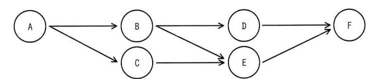
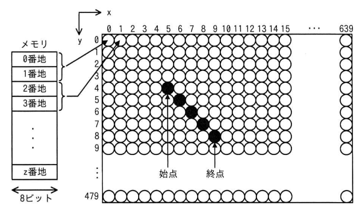
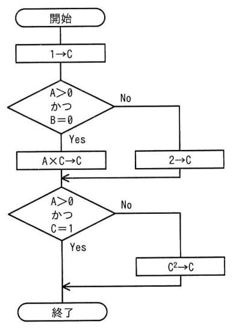

# 令和4年度春期 科目A（旧午前）過去問解説

> 令和4年度 春期 応用情報技術者試験 午前（全80問）を書き起こし、オリジナルの解説を付けたものです。問題の著作権は IPA（独立行政法人 情報処理推進機構）にあります。
> 図を表に書き換えるなど一部改変した問題には、その旨を記載しています。
> インタラクティブ教材の [科目A 四択クイズ](../../06_インタラクティブ教材/quiz.html) では、この回を本番形式（150分）で解けます。

## 目次

| 問 | 分野 | 中分類 | キーワード |
|---|---|---|---|
| [問1](#q01) | テクノロジ系 | 基礎理論 | 浮動小数点数、情報落ち、仮数部 |
| [問2](#q02) | テクノロジ系 | 基礎理論 | 集合、ド・モルガンの法則、差集合、補集合 |
| [問3](#q03) | テクノロジ系 | 基礎理論 | M/M/1、待ち行列、利用率、平均待ち時間 |
| [問4](#q04) | テクノロジ系 | 基礎理論 | ハミング符号、誤り訂正、排他的論理和 |
| [問5](#q05) | テクノロジ系 | アルゴリズムとプログラミング | リスト、配列、ポインタ、データ構造 |
| [問6](#q06) | テクノロジ系 | ソフトウェア | 再入可能、リエントラント、プログラムの性質 |
| [問7](#q07) | テクノロジ系 | アルゴリズムとプログラミング | Python、インデント、プログラム言語 |
| [問8](#q08) | テクノロジ系 | コンピュータ構成要素 | VLIW、命令レベル並列、コンパイラ |
| [問9](#q09) | テクノロジ系 | コンピュータ構成要素 | キャッシュメモリ、実効アクセス時間、ヒット率 |
| [問10](#q10) | テクノロジ系 | コンピュータ構成要素 | フルアソシエイティブ方式、キャッシュメモリ、マッピング方式 |
| [問11](#q11) | テクノロジ系 | システム構成要素 | RAID5、ホットスペア、実効容量 |
| [問12](#q12) | テクノロジ系 | コンピュータ構成要素 | アムダールの法則、並列処理、速度向上比 |
| [問13](#q13) | テクノロジ系 | システム構成要素 | ホットスタンバイ、ハートビート、フェールオーバ |
| [問14](#q14) | テクノロジ系 | システム構成要素 | MTTR、MTBF、エラーログ、保守性 |
| [問15](#q15) | テクノロジ系 | システム構成要素 | 稼働率、確率、独立事象 |
| [問16](#q16) | テクノロジ系 | ソフトウェア | ジョブ管理、多重度、一時ファイル |
| [問17](#q17) | テクノロジ系 | ソフトウェア | セマフォ、排他制御、リアルタイムOS、I2C |
| [問18](#q18) | テクノロジ系 | ソフトウェア | フラグメンテーション、メモリプール、メモリ管理 |
| [問19](#q19) | テクノロジ系 | システム構成要素 | 多重度、処理時間、スループット |
| [問20](#q20) | テクノロジ系 | ハードウェア | FPGA、PLD、集積回路 |
| [問21](#q21) | テクノロジ系 | ハードウェア | LCD、画素、メモリアドレス、VRAM |
| [問22](#q22) | テクノロジ系 | ハードウェア | アクチュエータ、センサ、制御 |
| [問23](#q23) | テクノロジ系 | ハードウェア | 耐タンパ性、マイクロプロセッサ、物理的解析 |
| [問24](#q24) | テクノロジ系 | ユーザーインタフェース | ユーザビリティ評価、思考発話法、ヒューリスティック評価法 |
| [問25](#q25) | テクノロジ系 | 情報メディア | レイトレーシング、隠面消去、3次元CG |
| [問26](#q26) | テクノロジ系 | データベース | CAP定理、可用性、分断耐性、結果整合性 |
| [問27](#q27) | テクノロジ系 | データベース | 3層スキーマ、内部スキーマ、インデックス |
| [問28](#q28) | テクノロジ系 | データベース | 正規化、部分関数従属、推移的関数従属 |
| [問29](#q29) | テクノロジ系 | データベース | undo/redo、障害回復、ロールバック、ロールフォワード |
| [問30](#q30) | テクノロジ系 | データベース | データマイニング、ビッグデータ、データマート |
| [問31](#q31) | テクノロジ系 | ネットワーク | IPv6、アドレス表記、省略表記 |
| [問32](#q32) | テクノロジ系 | ネットワーク | PPPoE、PPP、データリンク層 |
| [問33](#q33) | テクノロジ系 | ネットワーク | UDP、NTP、トランスポート層 |
| [問34](#q34) | テクノロジ系 | ネットワーク | サブネット、CIDR、ホスト数 |
| [問35](#q35) | テクノロジ系 | ネットワーク | SDN、OpenFlow、コントロールプレーン |
| [問36](#q36) | テクノロジ系 | セキュリティ | SAML、シングルサインオン、認証連携 |
| [問37](#q37) | テクノロジ系 | セキュリティ | サイバーキルチェーン、偵察、標的型攻撃 |
| [問38](#q38) | テクノロジ系 | セキュリティ | チャレンジレスポンス認証、ワンタイムパスワード、リプレイ攻撃 |
| [問39](#q39) | テクノロジ系 | セキュリティ | デジタル署名、署名鍵、検証鍵 |
| [問40](#q40) | テクノロジ系 | セキュリティ | cookie、サードパーティcookie、トラッキング |
| [問41](#q41) | テクノロジ系 | セキュリティ | シングルサインオン、リバースプロキシ、クライアント証明書 |
| [問42](#q42) | テクノロジ系 | セキュリティ | レインボー攻撃、レインボーテーブル、ハッシュ値、パスワードクラック |
| [問43](#q43) | テクノロジ系 | セキュリティ | リスクレベル、JIS Q 27000、リスク基準 |
| [問44](#q44) | テクノロジ系 | セキュリティ | VDI、画面転送、Web分離、マルウェア対策 |
| [問45](#q45) | テクノロジ系 | セキュリティ | ファジング、脆弱性検査、ファズ |
| [問46](#q46) | テクノロジ系 | システム開発技術 | モジュール結合度、データ結合、モジュール独立性 |
| [問47](#q47) | テクノロジ系 | システム開発技術 | 判定条件網羅、分岐網羅、ホワイトボックステスト |
| [問48](#q48) | テクノロジ系 | システム開発技術 | ソフトウェア保守、完全化保守、リバースエンジニアリング |
| [問49](#q49) | テクノロジ系 | ソフトウェア開発管理技術 | スクラム、ベロシティ、アジャイル |
| [問50](#q50) | テクノロジ系 | ソフトウェア | IDE、統合開発環境、開発ツール |
| [問51](#q51) | マネジメント系 | プロジェクトマネジメント | EVM、EAC、CPI、アーンドバリュー |
| [問52](#q52) | マネジメント系 | プロジェクトマネジメント | クラッシング、スケジュール短縮、ファストトラッキング |
| [問53](#q53) | マネジメント系 | プロジェクトマネジメント | クリティカルパス、所要期間、作業の依存関係 |
| [問54](#q54) | マネジメント系 | プロジェクトマネジメント | コンティンジェンシ計画、リスク対応、コンティンジェンシ予備 |
| [問55](#q55) | マネジメント系 | サービスマネジメント | RPO、RTO、バックアップ |
| [問56](#q56) | マネジメント系 | サービスマネジメント | ITIL、可用性管理、保守性、MTRS |
| [問57](#q57) | マネジメント系 | サービスマネジメント | データ管理者、データベース管理者、データ標準化 |
| [問58](#q58) | マネジメント系 | システム監査 | BCP、事業継続計画、システム監査 |
| [問59](#q59) | マネジメント系 | システム監査 | 監査調書、監査証拠、システム監査基準 |
| [問60](#q60) | マネジメント系 | システム監査 | 監査証拠、システム監査基準、アジャイル |
| [問61](#q61) | ストラテジ系 | システム戦略 | システム管理基準、ログ管理、改ざん防止 |
| [問62](#q62) | ストラテジ系 | システム戦略 | SOA、サービス指向アーキテクチャ、Webサービス |
| [問63](#q63) | ストラテジ系 | システム戦略 | BPO、アウトソーシング、ノンコア業務 |
| [問64](#q64) | ストラテジ系 | システム企画 | PBP、回収期間法、投資評価 |
| [問65](#q65) | ストラテジ系 | システム企画 | 非機能要件、使用性、ユーザビリティ |
| [問66](#q66) | ストラテジ系 | システム企画 | UML、アクティビティ図、業務フロー |
| [問67](#q67) | ストラテジ系 | 経営戦略マネジメント | PPM、金のなる木、プロダクトポートフォリオマネジメント |
| [問68](#q68) | ストラテジ系 | 経営戦略マネジメント | アンゾフの成長マトリクス、多角化、市場浸透 |
| [問69](#q69) | ストラテジ系 | 経営戦略マネジメント | バイラルマーケティング、口コミ、SNS |
| [問70](#q70) | ストラテジ系 | ビジネスインダストリ | ファウンドリ、ファブレス、半導体産業 |
| [問71](#q71) | ストラテジ系 | ビジネスインダストリ | XBRL、財務情報、XML |
| [問72](#q72) | ストラテジ系 | ビジネスインダストリ | かんばん方式、JIT、ジャストインタイム |
| [問73](#q73) | ストラテジ系 | 企業活動 | 段取り時間、作業順序、最適化 |
| [問74](#q74) | ストラテジ系 | 企業活動 | ファシリテータ、ファシリテーション、会議 |
| [問75](#q75) | ストラテジ系 | 企業活動 | PM理論、リーダシップ、SL理論 |
| [問76](#q76) | ストラテジ系 | 経営戦略マネジメント | 利益計算、変動費、固定費、価格設定 |
| [問77](#q77) | ストラテジ系 | 法務 | 著作権、請負契約、原始的帰属 |
| [問78](#q78) | ストラテジ系 | 法務 | 不正アクセス禁止法、助長行為、識別符号 |
| [問79](#q79) | ストラテジ系 | 法務 | 偽装請負、請負契約、指揮命令 |
| [問80](#q80) | ストラテジ系 | 法務 | RoHS指令、有害物質、EU規制 |

### 問1　〔基礎理論〕 🧮

浮動小数点数を，仮数部が7ビットである表示形式のコンピュータで計算した場合，情報落ちが**発生しないもの**はどれか。ここで，仮数部が7ビットの表示形式とは次のフォーマットであり，( )₂ 内は2進数，Y は指数である。また，{ } 内を先に計算するものとする。

(1.X₁X₂X₃X₄X₅X₆X₇)₂ × 2^Y

- **ア**　{(1.1)₂ × 2^-3 + (1.0)₂ × 2^-4} + (1.0)₂ × 2^5
- **イ**　{(1.1)₂ × 2^-3 − (1.0)₂ × 2^-4} + (1.0)₂ × 2^5
- **ウ**　{(1.0)₂ × 2^5 + (1.1)₂ × 2^-3} + (1.0)₂ × 2^-4
- **エ**　{(1.0)₂ × 2^5 − (1.0)₂ × 2^-4} + (1.1)₂ × 2^-3

解答・解説

**正解：ア**

小さい値どうしを先に足して桁を上げてから大きい値に加えると，最下位の桁が仮数部7ビットに収まる。アでは {} 内が (1.0)₂×2^-2 になり，2^5 との和は小数点以下7桁目までで表せるので情報落ちが起きない。

**途中式**（2進数で 2^5 にそろえたとき，仮数部で表せるのは 2^-2 の位まで）

- ア：(1.1)₂×2^-3 = 0.0011₂，(1.0)₂×2^-4 = 0.0001₂ → 和 0.01₂ = 2^-2。100000.01₂ = (1.0000001)₂×2^5 → 7ビットに収まる
- イ：0.0011₂ − 0.0001₂ = 0.001₂ = 2^-3。100000.001₂ は小数点以下8ビット必要 → 2^-3 が落ちる
- ウ：先に 2^5 + 0.0011₂ = 100000.0011₂ を計算 → 2^-3, 2^-4 の位が落ちる
- エ：先に 2^5 − 2^-4 を計算 → 2^-4 の位が表せず情報落ち

💡 **ポイント**：情報落ちは「絶対値の大きい数と小さい数の加減算で，小さい数の下位桁が仮数部からはみ出す」現象。対策は絶対値の小さい数から順に計算すること。

📖 関連：[基礎理論](../../01_テクノロジ系/01_基礎理論.md)

出典：令和4年度 春期 応用情報技術者試験 午前 問1（数式をテキスト表記に書き換え）

---

### 問2　〔基礎理論〕

全体集合 S 内に異なる部分集合 A と B があるとき，A̅ ∩ B̅ に等しいものはどれか。ここで，A ∪ B は A と B の和集合，A ∩ B は A と B の積集合，A̅ は S における A の補集合，A − B は A から B を除いた差集合を表す。

- **ア**　A̅ − B
- **イ**　(A̅ ∪ B̅) − (A ∩ B)
- **ウ**　(S − A) ∪ (S − B)
- **エ**　S − (A ∩ B)

解答・解説

**正解：ア**

A̅ ∩ B̅ は「A でも B でもない部分」。A̅（A 以外）から B の部分を取り除いた A̅ − B と一致する。

**途中式**

A̅ − B = A̅ ∩ B̅（差集合 X − Y = X ∩ Y̅）

- イ：A̅ ∪ B̅ は A ∩ B 以外の全体なので，(A̅ ∪ B̅) − (A ∩ B) = A̅ ∪ B̅。A だけ・B だけの部分も含む
- ウ：(S − A) ∪ (S − B) = A̅ ∪ B̅ で，A ∩ B の補集合。イと同じ
- エ：S − (A ∩ B) も A̅ ∪ B̅（ド・モルガンの法則で A ∩ B の補集合）

💡 **ポイント**：ド・モルガンの法則 A̅ ∩ B̅ = (A ∪ B)の補集合，A̅ ∪ B̅ = (A ∩ B)の補集合。迷ったらベン図に塗って確かめる。

📖 関連：[基礎理論](../../01_テクノロジ系/01_基礎理論.md)

出典：令和4年度 春期 応用情報技術者試験 午前 問2

---

### 問3　〔基礎理論〕 🧮

M/M/1 の待ち行列モデルにおいて，窓口の利用率が 25% から 40% に増えると，平均待ち時間は何倍になるか。

- **ア**　1.25
- **イ**　1.60
- **ウ**　2.00
- **エ**　3.00

解答・解説

**正解：ウ**

M/M/1 の平均待ち時間は ρ/(1−ρ)×平均サービス時間。サービス時間は変わらないので ρ/(1−ρ) の比を取れば 2.00 倍。

**途中式**

- ρ = 0.25：0.25 / 0.75 = 1/3
- ρ = 0.40：0.40 / 0.60 = 2/3
- 比：(2/3) ÷ (1/3) = **2.00 倍**

- ア：(1 − 0.25)/(1 − 0.40) = 1.25 と，分母（1 − ρ）だけの比を取った値
- イ：利用率そのものの比 0.40/0.25 = 1.60。待ち時間は利用率に比例しない
- エ：計算の誤り。ρ/(1−ρ) は利用率が上がると急増するが，この範囲では 2 倍

💡 **ポイント**：平均待ち時間 Wq = ρ/(1−ρ)×Ts。窓口の数・サービス時間が同じなら ρ/(1−ρ) の比だけで倍率が出る。

📖 関連：[基礎理論](../../01_テクノロジ系/01_基礎理論.md)／[計算問題公式集](../../05_まとめ・横断資料/01_計算問題公式集.md)

出典：令和4年度 春期 応用情報技術者試験 午前 問3

---

### 問4　〔基礎理論〕 🧮

ハミング符号とは，データに冗長ビットを付加して，1ビットの誤りを訂正できるようにしたものである。ここでは，X₁, X₂, X₃, X₄ の4ビットから成るデータに，3ビットの冗長ビット P₃, P₂, P₁ を付加したハミング符号 X₁X₂X₃P₃X₄P₂P₁ を考える。付加したビット P₁, P₂, P₃ は，それぞれ

X₁ ⊕ X₃ ⊕ X₄ ⊕ P₁ = 0
X₁ ⊕ X₂ ⊕ X₄ ⊕ P₂ = 0
X₁ ⊕ X₂ ⊕ X₃ ⊕ P₃ = 0

となるように決める。ここで，⊕ は排他的論理和を表す。

ハミング符号 1110011 には1ビットの誤りが存在する。誤りビットを訂正したハミング符号はどれか。

- **ア**　0110011
- **イ**　1010011
- **ウ**　1100011
- **エ**　1110111

解答・解説

**正解：ア**

1110011 を3つの検査式に当てはめると，3式すべてが 1（不成立）になる。3式すべてに含まれるビットは X₁ だけなので，X₁ を反転した 0110011 が正しい符号。

**途中式**

1110011 → X₁=1, X₂=1, X₃=1, P₃=0, X₄=0, P₂=1, P₁=1

- 式1：X₁⊕X₃⊕X₄⊕P₁ = 1⊕1⊕0⊕1 = 1 ✕
- 式2：X₁⊕X₂⊕X₄⊕P₂ = 1⊕1⊕0⊕1 = 1 ✕
- 式3：X₁⊕X₂⊕X₃⊕P₃ = 1⊕1⊕1⊕0 = 1 ✕

3式に共通するのは X₁ → X₁ を 0 に訂正 → **0110011**

- イ：X₂ を訂正したもの。X₂ が誤りなら式1は成立するはず
- ウ：X₃ を訂正したもの。X₃ が誤りなら式2は成立するはず
- エ：X₄ を訂正したもの。X₄ が誤りなら式3は成立するはず

💡 **ポイント**：不成立になった検査式の組合せから誤りビットの位置が一つに決まる。「全式に出てくるビット」「その式だけに出てくるビット」を探す。

📖 関連：[基礎理論](../../01_テクノロジ系/01_基礎理論.md)

出典：令和4年度 春期 応用情報技術者試験 午前 問4

---

### 問5　〔アルゴリズムとプログラミング〕

リストには，配列で実現する場合とポインタで実現する場合とがある。リストを配列で実現した場合の特徴として，適切なものはどれか。ここで，配列を用いたリストは配列に要素を連続して格納することによってリストを構成し，ポインタを用いたリストは要素と次の要素へのポインタを用いることによってリストを構成するものとする。

- **ア**　リストにある実際の要素数にかかわらず，リストに入れられる要素の最大個数に対応した領域を確保し，実際には使用されない領域が発生する可能性がある。
- **イ**　リストの中間要素を参照するには，リストの先頭から順番に要素をたどっていくことから，要素数に比例した時間が必要となる。
- **ウ**　リストの要素を格納する領域の他に，次の要素を指し示すための領域が別途必要となる。
- **エ**　リストへの挿入位置が分かる場合には，リストにある実際の要素数にかかわらず，要素の挿入を一定時間で行うことができる。

解答・解説

**正解：ア**

配列は宣言時に最大要素数分の連続領域を確保するので，要素が少ないと使われない領域が残る。

- イ：先頭からたどる必要があるのはポインタを用いたリスト。配列は添字で中間要素に直接アクセスできる
- ウ：次の要素へのポインタ領域が必要なのはポインタを用いたリスト
- エ：挿入位置が分かれば一定時間で挿入できるのはポインタを用いたリスト。配列は後ろの要素をずらすため要素数に比例した時間がかかる

💡 **ポイント**：配列＝ランダムアクセスが速いが挿入・削除が遅く領域が固定，連結リスト＝挿入・削除が速いが参照が遅くポインタ領域が要る。

📖 関連：[アルゴリズムとプログラミング](../../01_テクノロジ系/02_アルゴリズムとプログラミング.md)

出典：令和4年度 春期 応用情報技術者試験 午前 問5

---

### 問6　〔ソフトウェア〕

再入可能プログラムの特徴はどれか。

- **ア**　主記憶上のどのアドレスから配置しても，実行することができる。
- **イ**　手続の内部から自分自身を呼び出すことができる。
- **ウ**　必要な部分を補助記憶装置から読み込みながら動作する。主記憶領域の大きさに制限があるときに，有効な手法である。
- **エ**　複数のタスクからの呼出しに対して，並行して実行されても，それぞれのタスクに正しい結果を返す。

解答・解説

**正解：エ**

再入可能（リエントラント）プログラムは，データ領域をタスクごとに分けて持つため，複数のタスクから同時に呼び出されても互いに干渉せず正しい結果を返す。

- ア：再配置可能（リロケータブル）プログラムの説明
- イ：再帰（リカーシブ）プログラムの説明
- ウ：オーバレイ方式（またはそれを使うプログラム）の説明

💡 **ポイント**：再入可能＝並行実行OK，逐次再使用可能＝前の実行が終われば再使用OK，再帰＝自分を呼べる，再配置可能＝どこに置いても動く。4つの区別がよく問われる。

📖 関連：[ソフトウェア](../../01_テクノロジ系/05_ソフトウェア.md)

出典：令和4年度 春期 応用情報技術者試験 午前 問6

---

### 問7　〔アルゴリズムとプログラミング〕

プログラム言語のうち，ブロックの範囲を指定する方法として特定の記号や予約語を用いず，等しい文字数の字下げを用いるという特徴をもつものはどれか。

- **ア**　C
- **イ**　Java
- **ウ**　PHP
- **エ**　Python

解答・解説

**正解：エ**

Python はインデント（字下げ）の深さでブロックを表す言語で，同じ字下げの行が一つのブロックになる。

- ア：C はブロックを波括弧 { } で囲む
- イ：Java も波括弧 { } でブロックを表す
- ウ：PHP も波括弧 { }（または endif などの予約語）でブロックを表す

💡 **ポイント**：Python は字下げが文法の一部（オフサイドルール）。スクリプト言語の特徴（Python＝AI・データ分析，PHP＝サーバサイド Web など）も押さえておく。

📖 関連：[アルゴリズムとプログラミング](../../01_テクノロジ系/02_アルゴリズムとプログラミング.md)

出典：令和4年度 春期 応用情報技術者試験 午前 問7

---

### 問8　〔コンピュータ構成要素〕

プロセッサの高速化技法の一つとして，同時に実行可能な複数の動作を，コンパイルの段階でまとめて一つの複合命令とし，高速化を図る方式はどれか。

- **ア**　CISC
- **イ**　MIMD
- **ウ**　RISC
- **エ**　VLIW

解答・解説

**正解：エ**

VLIW（Very Long Instruction Word）は，並列に実行できる複数の操作をコンパイラがあらかじめ一つの長い命令語に詰め込み，ハードウェアはそれをそのまま並列実行する方式。

- ア：CISC は複雑で高機能な命令を多数持つ命令セットの設計思想
- イ：MIMD は複数のプロセッサがそれぞれ別の命令で別のデータを処理する並列処理の分類（フリンの分類）
- ウ：RISC は単純な固定長命令に絞り，パイプラインで高速化する設計思想

💡 **ポイント**：並列性の検出を「コンパイル時に行う」のが VLIW，「実行時にハードウェアが行う」のがスーパースカラ。

📖 関連：[コンピュータ構成要素](../../01_テクノロジ系/03_コンピュータ構成要素.md)

出典：令和4年度 春期 応用情報技術者試験 午前 問8

---

### 問9　〔コンピュータ構成要素〕 🧮

キャッシュメモリのアクセス時間が主記憶のアクセス時間の 1/30 で，ヒット率が 95% のとき，実効メモリアクセス時間は，主記憶のアクセス時間の約何倍になるか。

- **ア**　0.03
- **イ**　0.08
- **ウ**　0.37
- **エ**　0.95

解答・解説

**正解：イ**

主記憶のアクセス時間を 1 とすると，実効アクセス時間は 0.95×(1/30)＋0.05×1 ≒ 0.08 倍。

**途中式**

実効アクセス時間 = ヒット率 × キャッシュのアクセス時間 ＋ (1 − ヒット率) × 主記憶のアクセス時間

= 0.95 × 1/30 ＋ 0.05 × 1 ≒ 0.0317 ＋ 0.05 ≒ **0.08**

- ア：0.03 はキャッシュにヒットした分（0.95/30）だけで，ミス時の主記憶アクセスを足していない
- ウ：計算の誤り
- エ：ヒット率そのもの

💡 **ポイント**：実効アクセス時間 = h×Tc + (1−h)×Tm。ミス時の主記憶アクセス分が結果を大きく左右する。

📖 関連：[コンピュータ構成要素](../../01_テクノロジ系/03_コンピュータ構成要素.md)／[計算問題公式集](../../05_まとめ・横断資料/01_計算問題公式集.md)

出典：令和4年度 春期 応用情報技術者試験 午前 問9

---

### 問10　〔コンピュータ構成要素〕

キャッシュメモリのフルアソシエイティブ方式に関する記述として，適切なものはどれか。

- **ア**　キャッシュメモリの各ブロックに主記憶のセットが固定されている。
- **イ**　キャッシュメモリの各ブロックに主記憶のブロックが固定されている。
- **ウ**　主記憶の特定の1ブロックに専用のキャッシュメモリが割り当てられる。
- **エ**　任意のキャッシュメモリのブロックを主記憶のどの部分にも割り当てられる。

解答・解説

**正解：エ**

フルアソシエイティブ方式は，主記憶のブロックをキャッシュのどのブロックにでも格納できる方式。配置の自由度が最も高いが，全ブロックのタグを同時に比較する回路が必要になる。

- ア：主記憶のセットとキャッシュの対応を決めるのはセットアソシエイティブ方式の考え方
- イ：主記憶のブロックごとに格納先のキャッシュブロックが一つに決まるのはダイレクトマッピング方式
- ウ：特定の1ブロック専用のキャッシュを割り当てる方式はない

💡 **ポイント**：ダイレクトマッピング（格納先1か所）→セットアソシエイティブ（セット内のどこか）→フルアソシエイティブ（どこでも）の順に自由度が上がる。

📖 関連：[コンピュータ構成要素](../../01_テクノロジ系/03_コンピュータ構成要素.md)

出典：令和4年度 春期 応用情報技術者試験 午前 問10

---

### 問11　〔システム構成要素〕 🧮

8T バイトの磁気ディスク装置6台を，予備ディスク（ホットスペアディスク）1台込みの RAID5 構成にした場合，実効データ容量は何 T バイトになるか。

- **ア**　24
- **イ**　32
- **ウ**　40
- **エ**　48

解答・解説

**正解：イ**

6台のうち1台はホットスペアなので RAID5 を組むのは5台。RAID5 はパリティに1台分を使うため，データ容量は (5−1)×8 = 32T バイト。

**途中式**

- RAID5 を構成する台数：6 − 1（ホットスペア）= 5台
- 実効容量：(5 − 1) × 8T = **32T バイト**

- ア：パリティ2台分を引いた値（RAID6 なら (5−2)×8 = 24）
- ウ：ホットスペアだけ引いてパリティ分を引いていない（5×8）
- エ：ホットスペアを考えず6台で RAID5 にした値（(6−1)×8）

💡 **ポイント**：RAID5 の実効容量＝(台数−1)×1台の容量。ホットスペアは障害時の代替用で，平常時はデータを持たない。

📖 関連：[システム構成要素](../../01_テクノロジ系/04_システム構成要素.md)

出典：令和4年度 春期 応用情報技術者試験 午前 問11

---

### 問12　〔コンピュータ構成要素〕

プロセッサ数と，計算処理におけるプロセスの並列化が可能な部分の割合とが，性能向上へ及ぼす影響に関する記述のうち，アムダールの法則に基づいたものはどれか。

- **ア**　全ての計算処理が並列化できる場合，速度向上比は，プロセッサ数を増やしてもある水準に漸近的に近づく。
- **イ**　並列化できない計算処理がある場合，速度向上比は，プロセッサ数に比例して増加する。
- **ウ**　並列化できない計算処理がある場合，速度向上比は，プロセッサ数を増やしてもある水準に漸近的に近づく。
- **エ**　並列化できる計算処理の割合が増えると，速度向上比は，プロセッサ数に反比例して減少する。

解答・解説

**正解：ウ**

アムダールの法則では，速度向上比 = 1 / {(1 − r) + r/n}（r：並列化できる割合，n：プロセッサ数）。並列化できない部分 (1 − r) があると，n を増やしても 1/(1 − r) に近づくだけで頭打ちになる。

- ア：全て並列化できる（r = 1）なら速度向上比は n で，プロセッサ数に比例して増え続ける
- イ：並列化できない部分があると比例しない。比例するのは r = 1 の場合
- エ：並列化できる割合が増えると速度向上比は大きくなる。反比例して減ることはない

💡 **ポイント**：例えば r = 0.9 なら，プロセッサをいくら増やしても速度向上比は最大 1/0.1 = 10 倍。逐次処理部分がボトルネックになる。

📖 関連：[コンピュータ構成要素](../../01_テクノロジ系/03_コンピュータ構成要素.md)

出典：令和4年度 春期 応用情報技術者試験 午前 問12

---

### 問13　〔システム構成要素〕

ホットスタンバイシステムにおいて，現用系に障害が発生して待機系に切り替わる契機として，最も適切な例はどれか。

- **ア**　現用系から待機系へ定期的に送信され，現用系が動作中であることを示すメッセージが途切れたとき
- **イ**　現用系の障害をオペレータが認識し，コンソール操作を行ったとき
- **ウ**　待機系が現用系にたまった処理の残量を定期的に監視していて，残量が一定量を上回ったとき
- **エ**　待機系から現用系に定期的にロードされ実行される診断プログラムが，現用系の障害を検出したとき

解答・解説

**正解：ア**

ホットスタンバイでは，現用系が定期的に送る死活監視メッセージ（ハートビート）が途絶えたことを待機系が検知し，自動で切り替える。

- イ：オペレータの操作による切替えは人手を介するため，即時に自動で切り替わるホットスタンバイの契機として最適ではない（コールドスタンバイ的な運用）
- ウ：処理の残量は負荷の大きさを示すもので，障害の発生を示すものではない
- エ：待機系から現用系へ診断プログラムをロードして実行する仕組みは一般的でなく，障害が起きた現用系で正しく動く保証もない

💡 **ポイント**：ホットスタンバイは待機系も起動済みでハートビートを監視し，途絶えたら自動で引き継ぐ。コールドスタンバイは待機系を停止させておき切替えに時間がかかる。

📖 関連：[システム構成要素](../../01_テクノロジ系/04_システム構成要素.md)

出典：令和4年度 春期 応用情報技術者試験 午前 問13

---

### 問14　〔システム構成要素〕

MTBF を長くするよりも，MTTR を短くするのに役立つものはどれか。

- **ア**　エラーログ取得機能
- **イ**　記憶装置のビット誤り訂正機能
- **ウ**　命令再試行機能
- **エ**　予防保全

解答・解説

**正解：ア**

エラーログがあれば障害の原因箇所を素早く特定できるので，修理にかかる時間（MTTR）が短くなる。

- イ：ビット誤りを自動訂正して障害に至らせない機能で，故障間隔（MTBF）を延ばす
- ウ：一時的な誤りを命令の再実行で回復させ，障害として止まらないようにする機能で，MTBF を延ばす
- エ：故障する前に部品交換などを行う予防保全は，故障の発生を減らし MTBF を延ばす

💡 **ポイント**：MTBF を延ばす＝故障させない工夫（信頼性），MTTR を縮める＝早く直す工夫（保守性）。エラーログ・遠隔保守・保守部品の常備は MTTR 側。

📖 関連：[システム構成要素](../../01_テクノロジ系/04_システム構成要素.md)

出典：令和4年度 春期 応用情報技術者試験 午前 問14

---

### 問15　〔システム構成要素〕 🧮

2台のプリンタがあり，それぞれの稼働率が 0.7 と 0.6 である。この2台のいずれか一方が稼働していて，他方が故障している確率は幾らか。ここで，2台のプリンタの稼働状態は独立であり，プリンタ以外の要因は考慮しないものとする。

- **ア**　0.18
- **イ**　0.28
- **ウ**　0.42
- **エ**　0.46

解答・解説

**正解：エ**

「片方だけ稼働」は「A 稼働・B 故障」と「A 故障・B 稼働」の2通りで，それぞれの確率を足して 0.46。

**途中式**

- A 稼働・B 故障：0.7 × (1 − 0.6) = 0.28
- A 故障・B 稼働：(1 − 0.7) × 0.6 = 0.18
- 合計：0.28 ＋ 0.18 = **0.46**

- ア：A 故障・B 稼働の場合だけ
- イ：A 稼働・B 故障の場合だけ
- ウ：両方とも稼働している確率 0.7×0.6

💡 **ポイント**：「両方稼働」0.42，「片方だけ」0.46，「両方故障」0.12 で合計 1。並列システムの稼働率は 1 − 0.12 = 0.88 になる。

📖 関連：[システム構成要素](../../01_テクノロジ系/04_システム構成要素.md)／[計算問題公式集](../../05_まとめ・横断資料/01_計算問題公式集.md)

出典：令和4年度 春期 応用情報技術者試験 午前 問15

---

### 問16　〔ソフトウェア〕 🧮

ジョブ群と実行の条件が次のとおりであるとき，一時ファイルを作成する磁気ディスクに必要な容量は最低何 M バイトか。

〔ジョブ群〕

（図参照：A→B，A→C，B→D，B→E，C→E，D→F，E→F。B は C の上，D は E の上に記述されている）

〔実行の条件〕

(1) ジョブの実行多重度を2とする。
(2) 各ジョブの処理時間は同一であり，他のジョブの影響は受けない。
(3) 各ジョブは開始時に 50M バイトの一時ファイルを新たに作成する。
(4) X→Y の関係があれば，ジョブ X の開始時に作成した一時ファイルは，直後のジョブ Y で参照し，ジョブ Y の終了時にその一時ファイルを削除する。直後のジョブが複数個ある場合には，最初に生起されるジョブだけが先行ジョブの一時ファイルを参照する。
(5) X→Y，X→Z（Y が上，Z が下に記述）はジョブ X の終了時に，ジョブ Y，Z のようにジョブ X と矢印で結ばれる全てのジョブが，上から記述された順に優先して生起されることを示す。
(6) X→Z，Y→Z は先行するジョブ X，Y 両方が終了したときにジョブ Z が生起されることを示す。
(7) ジョブの生起とは実行待ち行列への追加を意味し，各ジョブは待ち行列の順に実行される。
(8) OS のオーバヘッドは考慮しない。

- **ア**　100
- **イ**　150
- **ウ**　200
- **エ**　250

解答・解説

**正解：ウ**

時間を区切って実行中のジョブと存在する一時ファイルを数えると，D と E の実行中に4ファイル（B, C, D, E 作成分）が同時に存在し，50×4 = 200M バイトが最大になる。

**途中式**（各ジョブの処理時間を1単位とする）

| 時間 | 実行中 | 存在する一時ファイル | 容量 |
|---|---|---|---|
| 1 | A | A | 50 |
| 2 | B, C | A（B が参照）, B, C | 150 |
| 3 | D, E | B（D が参照）, C（E が参照）, D, E | 200 |
| 4 | F | D, E（F が参照）, F | 150 |

- 時間2の終わりに B が終了して A のファイルを削除。B の直後の D・E と，C の直後の E が生起される
- 時間3の終わりに D が B のファイルを，E が C のファイルを削除する

- ア：A の後の B・C 実行中に A のファイルを数え忘れるなど，同時に存在するファイルを少なく数えた値
- イ：時間2または4の容量で，最大ではない
- エ：時間3で A のファイルも残っていると誤った値（A のファイルは B の終了時に削除済み）

💡 **ポイント**：ジョブネットワークの問題は，時間ごとの表に「実行中ジョブ」と「生きているファイル」を書き出すと確実に解ける。

📖 関連：[ソフトウェア](../../01_テクノロジ系/05_ソフトウェア.md)

出典：令和4年度 春期 応用情報技術者試験 午前 問16（実行の条件中の小さな図を文章表記に書き換え）

---

### 問17　〔ソフトウェア〕

一つの I²C バスに接続された二つのセンサがある。それぞれのセンサ値を読み込む二つのタスクで排他的に制御したい。利用するリアルタイム OS の機能として，適切なものはどれか。

- **ア**　キュー
- **イ**　セマフォ
- **ウ**　マルチスレッド
- **エ**　ラウンドロビン

解答・解説

**正解：イ**

共有資源（I²C バス）を複数のタスクが同時に使わないように排他制御するには，資源の使用権を管理するセマフォを使う。

- ア：キュー（メッセージキュー）はタスク間でデータを受け渡す仕組みで，排他制御のためのものではない
- ウ：マルチスレッドは一つのプロセス内で複数の処理を並行に動かす仕組みで，排他制御はむしろ必要になる側
- エ：ラウンドロビンはタスクに一定時間ずつ CPU を順番に割り当てるスケジューリング方式

💡 **ポイント**：セマフォは P 操作（獲得）・V 操作（解放）で資源を守る。値が 0/1 のものはバイナリセマフォ（ミューテックスに近い）。

📖 関連：[ソフトウェア](../../01_テクノロジ系/05_ソフトウェア.md)

出典：令和4年度 春期 応用情報技術者試験 午前 問17

---

### 問18　〔ソフトウェア〕

フラグメンテーションに関する記述のうち，適切なものはどれか。

- **ア**　可変長ブロックのメモリプール管理方式では，様々な大きさのメモリ領域の獲得や返却を行ってもフラグメンテーションは発生しない。
- **イ**　固定長ブロックのメモリプール管理方式では，可変長ブロックのメモリプール管理方式よりもメモリ領域の獲得と返却を速く行えるが，フラグメンテーションが発生しやすい。
- **ウ**　フラグメンテーションの発生によって，合計としては十分な空きメモリ領域があるにもかかわらず，必要とするメモリ領域を獲得できなくなることがある。
- **エ**　メモリ領域の獲得と返却の頻度が高いシステムでは，フラグメンテーションの発生を防止するため，メモリ領域が返却されるたびにガーベジコレクションを行う必要がある。

解答・解説

**正解：ウ**

フラグメンテーション（断片化）が起きると空き領域が細切れになり，合計では足りていても連続した大きな領域を確保できなくなる。

- ア：可変長ブロックは様々な大きさの獲得・返却を繰り返すと，すき間が残ってフラグメンテーションが発生しやすい
- イ：固定長ブロックは同じ大きさのブロック単位で管理するので，（外部）フラグメンテーションは起きにくい
- エ：返却のたびにガーベジコレクションを行うとオーバヘッドが大きい。通常は空き領域が足りなくなったときなどにまとめて行う

💡 **ポイント**：固定長＝高速・断片化しにくいが無駄（内部断片化）が出る，可変長＝無駄は少ないが断片化しやすい。断片化の解消はコンパクション（メモリの詰め直し）。

📖 関連：[ソフトウェア](../../01_テクノロジ系/05_ソフトウェア.md)

出典：令和4年度 春期 応用情報技術者試験 午前 問18

---

### 問19　〔システム構成要素〕 🧮

複数のクライアントから接続されるサーバがある。このサーバのタスクの多重度が2以下の場合，タスク処理時間は常に4秒である。このサーバに1秒間隔で4件の処理要求が到着した場合，全ての処理が終わるまでの時間はタスクの多重度が1のときと2のときとで，何秒の差があるか。

- **ア**　6
- **イ**　7
- **ウ**　8
- **エ**　9

解答・解説

**正解：イ**

最初の要求の到着時刻を 0 秒とすると，多重度1では 16 秒，多重度2では 9 秒で全処理が終わり，差は 7 秒。

**途中式**（到着：0, 1, 2, 3 秒）

- 多重度1：一つずつ順に処理 → 0〜4, 4〜8, 8〜12, 12〜16 → **16 秒**
- 多重度2：要求1 0〜4，要求2 1〜5，要求3 4〜8（要求1終了後），要求4 5〜9（要求2終了後）→ **9 秒**
- 差：16 − 9 = **7 秒**

- ア：多重度2の終了を 10 秒などと誤った値
- ウ：多重度2で 2 件ずつまとめて処理（0〜4, 4〜8）し，16 − 8 とした値
- エ：多重度1の終了時刻を到着時刻からずらして数えるなどの誤り

💡 **ポイント**：到着時刻と多重度を意識してタイムチャートを描く。多重度2なら「空いた方に次の要求が入る」。

📖 関連：[システム構成要素](../../01_テクノロジ系/04_システム構成要素.md)

出典：令和4年度 春期 応用情報技術者試験 午前 問19

---

### 問20　〔ハードウェア〕

FPGA の説明として，適切なものはどれか。

- **ア**　電気的に記憶内容の書換えを行うことができる不揮発性メモリ
- **イ**　特定の分野及びアプリケーション用に限定した特定用途向け汎用集積回路
- **ウ**　浮動小数点数の演算を高速に実行する演算ユニット
- **エ**　論理回路を基板上に実装した後で再プログラムできる集積回路

解答・解説

**正解：エ**

FPGA（Field Programmable Gate Array）は，製造後に利用者が内部の論理回路を書き換えられる集積回路で，基板に実装した後でも回路構成を変更できる。

- ア：EEPROM（フラッシュメモリなど）の説明
- イ：特定用途向けの汎用集積回路は ASSP の説明（特定用途専用に設計する ASIC と並ぶ用語）
- ウ：FPU（浮動小数点演算ユニット）の説明

💡 **ポイント**：FPGA は「現場（Field）で書き換えられる」のが特徴で，試作や少量生産，仕様変更が多い機器に向く。ASIC は専用設計で量産時に高性能・低コスト。

📖 関連：[ハードウェア](../../01_テクノロジ系/10_ハードウェア.md)

出典：令和4年度 春期 応用情報技術者試験 午前 問20

---

### 問21　〔ハードウェア〕 🧮

次の方式で画素にメモリを割り当てる 640×480 のグラフィック LCD モジュールがある。始点 (5, 4) から終点 (9, 8) まで直線を描画するとき，直線上の x=7 の画素に割り当てられたメモリのアドレスの先頭は何番地か。ここで，画素の座標は (x, y) で表すものとする。

〔方式〕

- メモリは0番地から昇順に使用する。
- 1画素は16ビットとする。
- 座標 (0, 0) から座標 (639, 479) までメモリを連続して割り当てる。
- 各画素は，x=0 から x 軸の方向にメモリを割り当てていく。
- x=639 の次は x=0 とし，y を1増やす。

- **ア**　3847
- **イ**　7680
- **ウ**　7694
- **エ**　8978

解答・解説

**正解：ウ**

直線 (5, 4)→(9, 8) は x と y が同じだけ増えるので，x=7 の画素は (7, 6)。1画素 = 16ビット = 2番地分（1番地 8ビット）なので，先頭アドレスは (6×640＋7)×2 = 7694 番地。

**途中式**

- x=7 のとき y = 4 ＋ (7 − 5) = 6 → 画素 (7, 6)
- 画素の通し番号：y × 640 ＋ x = 6 × 640 ＋ 7 = 3847
- 1画素 2番地なので：3847 × 2 = **7694**

- ア：画素の通し番号 3847 のまま。1画素が2番地分であることを考慮していない
- イ：(6×640)×2 = 7680 で，x=0 の画素の先頭アドレス。x=7 の分を足していない
- エ：計算の誤り（y と x の扱いを取り違えるなど）

💡 **ポイント**：ラスタ順のメモリ割当てでは「(y × 横の画素数 ＋ x) × 1画素のバイト数」が先頭アドレス。図のメモリ幅（8ビット）と画素のビット数の関係を見落とさない。

📖 関連：[ハードウェア](../../01_テクノロジ系/10_ハードウェア.md)／[コンピュータ構成要素](../../01_テクノロジ系/03_コンピュータ構成要素.md)

出典：令和4年度 春期 応用情報技術者試験 午前 問21

---

### 問22　〔ハードウェア〕

アクチュエータの説明として，適切なものはどれか。

- **ア**　与えられた目標量と，センサから得られた制御量を比較し，制御量を目標量に一致させるように操作量を出力する。
- **イ**　位置，角度，速度，加速度，力，温度などを検出し，電気的な情報に変換する。
- **ウ**　エネルギー源からのパワーを，回転，直進などの動きに変換する。
- **エ**　マイクロフォン，センサなどが出力する微小な電気信号を増幅する。

解答・解説

**正解：ウ**

アクチュエータは，電気・油圧・空気圧などのエネルギーを回転や直進などの機械的な動きに変える装置（モータ，ソレノイド，シリンダなど）。

- ア：フィードバック制御を行う制御装置（コントローラ）の説明
- イ：物理量を検出して電気信号に変えるセンサの説明
- エ：微小な信号を大きくする増幅器（アンプ）の説明

💡 **ポイント**：組込みシステムは「センサ（入力）→ コントローラ（判断）→ アクチュエータ（出力・動作）」の流れで考えると整理しやすい。

📖 関連：[ハードウェア](../../01_テクノロジ系/10_ハードウェア.md)

出典：令和4年度 春期 応用情報技術者試験 午前 問22

---

### 問23　〔ハードウェア〕

マイクロプロセッサの耐タンパ性を向上させる手法として，適切なものはどれか。

- **ア**　ESD（Electrostatic Discharge）に対する耐性を強化する。
- **イ**　チップ検査終了後に検査用パッドを残しておく。
- **ウ**　チップ内部を物理的に解析しようとすると，内部回路が破壊されるようにする。
- **エ**　内部メモリの物理アドレスを整然と配置する。

解答・解説

**正解：ウ**

耐タンパ性とは，内部の情報を不正に読み出したり改ざんしたりする行為への耐性。チップを開封・解析しようとすると回路が壊れて情報が取り出せない仕組みは，耐タンパ性を高める。

- ア：静電気放電への耐性は電気的な信頼性の向上で，不正な解析への対策ではない
- イ：検査用パッドを残すと，そこから内部信号にアクセスされる手掛かりになり，耐タンパ性は下がる
- エ：物理アドレスを整然と並べると解析が容易になる。耐タンパ性を高めるには配置をランダム化・難読化する

💡 **ポイント**：耐タンパ性は IC カードや HSM，TPM などで重要。物理的解析・サイドチャネル攻撃（消費電力・電磁波の観測）への対策が問われる。

📖 関連：[ハードウェア](../../01_テクノロジ系/10_ハードウェア.md)／[情報セキュリティ](../../01_テクノロジ系/08_情報セキュリティ.md)

出典：令和4年度 春期 応用情報技術者試験 午前 問23

---

### 問24　〔ユーザーインタフェース〕

ユーザインタフェースのユーザビリティを評価するときの，利用者が参加する手法と専門家だけで実施する手法との適切な組みはどれか。

- **ア**　利用者が参加する手法：アンケート，専門家だけで実施する手法：回顧法
- **イ**　利用者が参加する手法：回顧法，専門家だけで実施する手法：思考発話法
- **ウ**　利用者が参加する手法：思考発話法，専門家だけで実施する手法：ヒューリスティック評価法
- **エ**　利用者が参加する手法：認知的ウォークスルー法，専門家だけで実施する手法：ヒューリスティック評価法

解答・解説

**正解：ウ**

思考発話法は利用者に考えていることを声に出しながら操作してもらう手法で利用者が参加する。ヒューリスティック評価法は専門家が経験則（ガイドライン）に照らして問題点を洗い出す手法で，利用者は参加しない。

- ア：回顧法は操作後に利用者にインタビューして振り返ってもらう手法で，利用者が参加する
- イ：回顧法も思考発話法も利用者が参加する手法
- エ：認知的ウォークスルー法は専門家が利用者の立場で操作手順をたどって評価する手法で，利用者は参加しない

💡 **ポイント**：利用者参加型＝思考発話法・回顧法・アンケート・ユーザテスト，専門家のみ＝ヒューリスティック評価法・認知的ウォークスルー法。

📖 関連：[頻出略語・用語集](../../05_まとめ・横断資料/02_頻出略語・用語集.md)

出典：令和4年度 春期 応用情報技術者試験 午前 問24（選択肢の表を文章に書き換え）

---

### 問25　〔情報メディア〕

レイトレーシング法の説明として，適切なものはどれか。

- **ア**　スクリーンの全ての画素について，視線と描画の対象となる物体との交点を反射属性や透明属性なども含めて計算し，その中から視点に最も近い交点を選択する。
- **イ**　スクリーンの走査線ごとに視点とその走査線を結ぶ走査面を作成し，各走査面と描画の対象となる物体との交差を調べて交差線分を求め，奥行き判定を行うことによって描画する。
- **ウ**　描画の対象となる二つの物体のうち，一方が近くに，もう一方が遠くにあるときに，まず遠くの物体を描いてから近くの物体を重ね書きする。
- **エ**　描画の対象となる物体の各面をピクセルに分割し，ピクセルごとに視点までの距離を計算し，その最小値を作業領域に保持することによって，視点までの距離が最小となる面を求める。

解答・解説

**正解：ア**

レイトレーシング法は，視点から画素ごとに光線（視線）を飛ばし，物体との交点や反射・屈折・透過を追跡して色を決める手法。光の映り込みや透明感をリアルに表現できる。

- イ：走査線ごとに奥行きを判定するスキャンライン法の説明
- ウ：遠くの物体から順に描いて重ね書きする Z ソート法（画家のアルゴリズム）の説明
- エ：ピクセルごとに奥行き（Z 値）の最小値を保持する Z バッファ法の説明

💡 **ポイント**：隠面消去の手法（Z バッファ法・スキャンライン法・レイトレーシング法）の区別が頻出。「反射・透明も計算」はレイトレーシング，「深度を作業領域に保持」は Z バッファ。

📖 関連：[頻出略語・用語集](../../05_まとめ・横断資料/02_頻出略語・用語集.md)

出典：令和4年度 春期 応用情報技術者試験 午前 問25

---

### 問26　〔データベース〕

CAP 定理における A と P の特性をもつ分散システムの説明として，適切なものはどれか。

- **ア**　可用性と整合性と分断耐性の全てを満たすことができる。
- **イ**　可用性と整合性を満たすが分断耐性を満たさない。
- **ウ**　可用性と分断耐性を満たすが整合性を満たさない。
- **エ**　整合性と分断耐性を満たすが可用性を満たさない。

解答・解説

**正解：ウ**

CAP 定理は，分散システムは整合性（Consistency）・可用性（Availability）・分断耐性（Partition tolerance）の3つを同時には満たせず，最大2つまでというもの。A と P をもつシステムは整合性（C）を犠牲にする。

- ア：CAP 定理では3つすべてを同時に満たすことはできない
- イ：C と A をもつ（CA）システムの説明
- エ：C と P をもつ（CP）システムの説明

💡 **ポイント**：AP 型の代表は NoSQL（キーバリューストアなど）で，一時的な不整合を許して最終的に一致させる「結果整合性（BASE 特性）」を採る。

📖 関連：[データベース](../../01_テクノロジ系/06_データベース.md)

出典：令和4年度 春期 応用情報技術者試験 午前 問26

---

### 問27　〔データベース〕

ANSI/SPARC 3層スキーマモデルにおける内部スキーマの設計に含まれるものはどれか。

- **ア**　SQL 問合せ応答時間の向上を目的としたインデックスの定義
- **イ**　エンティティ間の“1対多”，“多対多”などの関連を明示する E-R モデルの作成
- **ウ**　エンティティ内やエンティティ間の整合性を保つための一意性制約や参照制約の設定
- **エ**　データの冗長性を排除し，更新の一貫性と効率性を保持するための正規化

解答・解説

**正解：ア**

内部スキーマはデータを記憶装置上にどう格納するか（物理的な構造）を定義するもので，インデックスの定義や格納領域の設計が含まれる。

- イ：E-R モデルの作成は，実世界のデータ構造を表す概念設計（概念スキーマの前段階）
- ウ：一意性制約や参照制約は，論理的なデータ構造を定める概念スキーマで設定する
- エ：正規化は表の論理構造を決める作業で，概念スキーマの設計に含まれる

💡 **ポイント**：外部スキーマ＝利用者から見たビュー，概念スキーマ＝表・列・制約など論理構造，内部スキーマ＝インデックス・ファイル編成など物理構造。

📖 関連：[データベース](../../01_テクノロジ系/06_データベース.md)

出典：令和4年度 春期 応用情報技術者試験 午前 問27

---

### 問28　〔データベース〕

第1，第2，第3正規形とリレーションの特徴 a，b，c の組合せのうち，適切なものはどれか。

a：どの非キー属性も，主キーの真部分集合に対して関数従属しない。
b：どの非キー属性も，主キーに推移的に関数従属しない。
c：繰返し属性が存在しない。

- **ア**　第1正規形：a，第2正規形：b，第3正規形：c
- **イ**　第1正規形：a，第2正規形：c，第3正規形：b
- **ウ**　第1正規形：c，第2正規形：a，第3正規形：b
- **エ**　第1正規形：c，第2正規形：b，第3正規形：a

解答・解説

**正解：ウ**

第1正規形は繰返し属性がない（c），第2正規形は部分関数従属がない（a），第3正規形は推移的関数従属がない（b）。

- ア：a（部分関数従属の排除）は第2正規形，c（繰返し属性の排除）は第1正規形の条件で，順序が逆
- イ：第1正規形の条件は繰返し属性の排除（c）であり，a ではない
- エ：第2正規形と第3正規形の条件が逆

💡 **ポイント**：正規化の順序は「繰返しを除く（1NF）→ 主キーの一部への従属を除く（2NF）→ 非キー属性経由の従属を除く（3NF）」。

📖 関連：[データベース](../../01_テクノロジ系/06_データベース.md)

出典：令和4年度 春期 応用情報技術者試験 午前 問28（選択肢の表を文章に書き換え）

---

### 問29　〔データベース〕

undo/redo 方式を用いた障害回復におけるログ情報の要否として，適切な組合せはどれか。

- **ア**　更新前情報：必要，更新後情報：必要
- **イ**　更新前情報：必要，更新後情報：不要
- **ウ**　更新前情報：不要，更新後情報：必要
- **エ**　更新前情報：不要，更新後情報：不要

解答・解説

**正解：ア**

undo（取消し）には更新前の値に戻すための更新前情報が，redo（再実行）には更新をやり直すための更新後情報が必要なので，両方とも必要。

- イ：更新後情報がないと，コミット済みでディスクに反映されていない更新を redo できない
- ウ：更新前情報がないと，未コミットの更新を undo できない
- エ：ログがなければ障害回復そのものができない

💡 **ポイント**：ロールバック（undo）＝更新前ログ，ロールフォワード（redo）＝更新後ログ。チェックポイント以降のログを使って回復する。

📖 関連：[データベース](../../01_テクノロジ系/06_データベース.md)

出典：令和4年度 春期 応用情報技術者試験 午前 問29（選択肢の表を文章に書き換え）

---

### 問30　〔データベース〕

ビッグデータの利用におけるデータマイニングを説明したものはどれか。

- **ア**　蓄積されたデータを分析し，単なる検索だけでは分からない隠れた規則や相関関係を見つけ出すこと
- **イ**　データウェアハウスに格納されたデータの一部を，特定の用途や部門用に切り出して，データベースに格納すること
- **ウ**　データ処理の対象となる情報を基に規定した，データの構造，意味及び操作の枠組みのこと
- **エ**　データを複数のサーバに複製し，性能と可用性を向上させること

解答・解説

**正解：ア**

データマイニングは，大量のデータを統計・機械学習などで分析し，人が気付かない規則性や相関関係を発見すること（「データの山から知識を掘り出す」）。

- イ：データウェアハウスから用途別に切り出したものはデータマート
- ウ：データの構造・意味・操作の枠組みはデータモデルの説明
- エ：データを複数サーバに複製するのはレプリケーション

💡 **ポイント**：「おむつとビールが一緒に売れる」のような相関を見つけるバスケット分析はデータマイニングの代表例。

📖 関連：[データベース](../../01_テクノロジ系/06_データベース.md)

出典：令和4年度 春期 応用情報技術者試験 午前 問30

---

### 問31　〔ネットワーク〕

IPv6 アドレスの表記として，適切なものはどれか。

- **ア**　2001:db8::3ab::ff01
- **イ**　2001:db8::3ab:ff01
- **ウ**　2001:db8.3ab:ff01
- **エ**　2001.db8.3ab.ff01

解答・解説

**正解：イ**

IPv6 アドレスは 16 ビットずつ16進数で表してコロン「:」で区切り，0 が連続するフィールドは「::」で1回だけ省略できる。イはこの規則を満たす。

- ア：「::」が2回使われている。どこが何個の 0 か一意に決まらないので不可
- ウ：区切りにピリオド「.」が混じっている（IPv4 埋め込み表記以外では使わない）
- エ：ピリオド区切りは IPv4 の書き方で，IPv6 の表記ではない

💡 **ポイント**：IPv6 は 128 ビット＝16 ビット×8 フィールド。各フィールドの先頭の 0 は省略可，連続する 0 のフィールドは「::」で1か所だけ省略可。

📖 関連：[ネットワーク](../../01_テクノロジ系/07_ネットワーク.md)

出典：令和4年度 春期 応用情報技術者試験 午前 問31

---

### 問32　〔ネットワーク〕

シリアル回線で使用するものと同じデータリンクのコネクション確立やデータ転送を，LAN 上で実現するプロトコルはどれか。

- **ア**　MPLS
- **イ**　PPP
- **ウ**　PPPoE
- **エ**　PPTP

解答・解説

**正解：ウ**

PPPoE（PPP over Ethernet）は，シリアル回線用の PPP の機能（接続確立・認証など）を Ethernet（LAN）上で使えるようにしたプロトコル。フレッツ回線などのインターネット接続で使われる。

- ア：MPLS はラベルを付けてパケットを高速転送する技術で，広域網や VPN サービスに使われる
- イ：PPP はシリアル回線（電話回線など）上の2点間接続プロトコルそのもので，LAN 上で実現するものではない
- エ：PPTP は PPP のフレームを IP ネットワーク上でトンネリングして VPN を作るプロトコル

💡 **ポイント**：「PPP を○○の上で」と覚える。PPPoE＝Ethernet 上，PPTP・L2TP＝IP 網上でトンネル（VPN）。

📖 関連：[ネットワーク](../../01_テクノロジ系/07_ネットワーク.md)

出典：令和4年度 春期 応用情報技術者試験 午前 問32

---

### 問33　〔ネットワーク〕

UDP を使用しているものはどれか。

- **ア**　FTP
- **イ**　NTP
- **ウ**　POP3
- **エ**　TELNET

解答・解説

**正解：イ**

NTP（時刻同期プロトコル）は UDP の 123 番ポートを使う。少量のデータを素早くやり取りする用途なので，コネクションを張らない UDP が向いている。

- ア：FTP はファイル転送に TCP（20, 21 番）を使う
- ウ：POP3 はメール受信に TCP（110 番）を使う
- エ：TELNET は遠隔ログインに TCP（23 番）を使う

💡 **ポイント**：UDP を使う代表例は DNS（問合せ）・DHCP・NTP・SNMP・RTP（音声・動画）。確実な転送が必要なものは TCP。

📖 関連：[ネットワーク](../../01_テクノロジ系/07_ネットワーク.md)

出典：令和4年度 春期 応用情報技術者試験 午前 問33

---

### 問34　〔ネットワーク〕 🧮

IPv4 で 192.168.30.32/28 のネットワークに接続可能なホストの最大数はどれか。

- **ア**　14
- **イ**　16
- **ウ**　28
- **エ**　30

解答・解説

**正解：ア**

/28 はネットワーク部 28 ビットなのでホスト部は 32 − 28 = 4 ビット。2^4 = 16 個のアドレスから，ネットワークアドレスとブロードキャストアドレスの2個を除いて 14 台。

**途中式**

- ホスト部：32 − 28 = 4 ビット
- アドレス数：2^4 = 16
- 接続可能なホスト数：16 − 2 = **14**

- イ：ネットワークアドレスとブロードキャストアドレスを除いていない
- ウ・エ：プレフィックス長 28 をホスト数と取り違えるなどした値

💡 **ポイント**：ホスト数 = 2^(32 − プレフィックス長) − 2。/24 なら 254，/27 なら 30，/28 なら 14。

📖 関連：[ネットワーク](../../01_テクノロジ系/07_ネットワーク.md)

出典：令和4年度 春期 応用情報技術者試験 午前 問34

---

### 問35　〔ネットワーク〕

OpenFlow を使った SDN（Software-Defined Networking）に関する記述として，適切なものはどれか。

- **ア**　インターネットのドメイン名を管理する世界規模の分散データベースを用いて，IP アドレスの代わりに名前を指定して通信できるようにする仕組み
- **イ**　携帯電話網において，回線交換方式ではなく，パケット交換方式で音声通話を実現する方式
- **ウ**　ストレージ装置とサーバを接続し，WWN（World Wide Name）によってノードやポートを識別するストレージ用ネットワーク
- **エ**　データ転送機能とネットワーク制御機能を論理的に分離し，ネットワーク制御を集中的に行うことを可能にしたアーキテクチャ

解答・解説

**正解：エ**

SDN は，スイッチなどのデータ転送機能（データプレーン）と経路制御機能（コントロールプレーン）を分け，コントローラがソフトウェアでネットワーク全体を集中制御する考え方。OpenFlow はコントローラとスイッチ間の代表的なプロトコル。

- ア：DNS の説明
- イ：VoLTE（LTE 網でのパケット交換による音声通話）の説明
- ウ：FC-SAN（ファイバチャネルによるストレージエリアネットワーク）の説明

💡 **ポイント**：SDN＝制御と転送の分離＋集中制御。ネットワーク機能そのものを汎用サーバ上のソフトウェアで実現する NFV と組み合わせて使われる。

📖 関連：[ネットワーク](../../01_テクノロジ系/07_ネットワーク.md)

出典：令和4年度 春期 応用情報技術者試験 午前 問35

---

### 問36　〔セキュリティ〕

複数のシステムやサービスの間で利用される SAML（Security Assertion Markup Language）はどれか。

- **ア**　システムの負荷や動作状況に関する情報を送信するための仕様
- **イ**　脆弱性に関する情報や脅威情報を交換するための仕様
- **ウ**　通信を暗号化し，VPN を実装するための仕様
- **エ**　認証や認可に関する情報を交換するための仕様

解答・解説

**正解：エ**

SAML は，認証結果や属性・認可情報を XML 形式で記述して，異なるドメインのシステム間でやり取りするための仕様。Web サービス間のシングルサインオン（SSO）に使われる。

- ア：機器の状態や負荷情報を送る仕組みとしては SNMP などがある
- イ：脆弱性・脅威情報の交換には STIX（記述形式）や TAXII（交換手順）などが使われる
- ウ：通信を暗号化して VPN を作る仕様は IPsec など

💡 **ポイント**：SAML は IdP（認証を行う側）が発行したアサーションを SP（サービス提供側）が信頼する仕組み。似た用途に OpenID Connect がある。

📖 関連：[情報セキュリティ](../../01_テクノロジ系/08_情報セキュリティ.md)

出典：令和4年度 春期 応用情報技術者試験 午前 問36

---

### 問37　〔セキュリティ〕

サイバーキルチェーンの偵察段階に関する記述として，適切なものはどれか。

- **ア**　攻撃対象企業の公開 Web サイトの脆弱性を悪用してネットワークに侵入を試みる。
- **イ**　攻撃対象企業の社員に標的型攻撃メールを送って PC をマルウェアに感染させ，PC 内の個人情報を入手する。
- **ウ**　攻撃対象企業の社員の SNS 上の経歴，肩書などを足がかりに，関連する組織や人物の情報を洗い出す。
- **エ**　サイバーキルチェーンの2番目の段階をいい，攻撃対象に特化した PDF やドキュメントファイルにマルウェアを仕込む。

解答・解説

**正解：ウ**

偵察（Reconnaissance）はキルチェーンの最初の段階で，攻撃の準備として SNS や公開情報から標的組織や人物の情報を集める行為。

- ア：脆弱性を悪用して侵入を試みるのは攻撃（エクスプロイト）段階
- イ：メールで感染させる（配送・インストール）→ 情報を盗む（目的の実行）段階
- エ：攻撃用ファイルにマルウェアを仕込むのは2番目の武器化段階で，偵察ではない

💡 **ポイント**：サイバーキルチェーンは「偵察 → 武器化 → 配送 → 攻撃 → インストール → 遠隔操作 → 目的の実行」の7段階。早い段階で鎖を断つのが防御の考え方。

📖 関連：[情報セキュリティ](../../01_テクノロジ系/08_情報セキュリティ.md)

出典：令和4年度 春期 応用情報技術者試験 午前 問37

---

### 問38　〔セキュリティ〕

チャレンジレスポンス認証方式に該当するものはどれか。

- **ア**　固定パスワードを，TLS による暗号通信を使い，クライアントからサーバに送信して，サーバで検証する。
- **イ**　端末のシリアル番号を，クライアントで秘密鍵を使って暗号化し，サーバに送信して，サーバで検証する。
- **ウ**　トークンという機器が自動的に表示する，認証のたびに異なる数字列をパスワードとしてサーバに送信して，サーバで検証する。
- **エ**　利用者が入力したパスワードと，サーバから受け取ったランダムなデータとをクライアントで演算し，その結果をサーバに送信して，サーバで検証する。

解答・解説

**正解：エ**

チャレンジレスポンス認証では，サーバが毎回異なる乱数（チャレンジ）を送り，クライアントはパスワードとチャレンジから計算した値（レスポンス）を返す。パスワードそのものはネットワークを流れず，盗聴した値を再利用されても通らない。

- ア：固定パスワードを暗号化して送るだけで，チャレンジ（サーバからの乱数）を使っていない
- イ：端末のシリアル番号を秘密鍵で暗号化する方式で，チャレンジを使わない端末認証。毎回同じ値になり再送攻撃に弱い
- ウ：時刻同期方式などのトークンによるワンタイムパスワードの説明

💡 **ポイント**：チャレンジレスポンス方式は「サーバの乱数＋パスワードのハッシュ演算」でリプレイ攻撃に強い。ワンタイムパスワードの一方式としても出題される。

📖 関連：[情報セキュリティ](../../01_テクノロジ系/08_情報セキュリティ.md)

出典：令和4年度 春期 応用情報技術者試験 午前 問38

---

### 問39　〔セキュリティ〕

メッセージの送受信における署名鍵の使用に関する記述のうち，適切なものはどれか。

- **ア**　送信者が送信者の署名鍵を使ってメッセージに対する署名を作成し，メッセージに付加することによって，受信者が送信者による署名であることを確認できるようになる。
- **イ**　送信者が送信者の署名鍵を使ってメッセージを暗号化することによって，受信者が受信者の署名鍵を使って，暗号文を元のメッセージに戻すことができるようになる。
- **ウ**　送信者が送信者の署名鍵を使ってメッセージを暗号化することによって，メッセージの内容が関係者以外に分からないようになる。
- **エ**　送信者がメッセージに固定文字列を付加し，更に送信者の署名鍵を使って暗号化することによって，受信者がメッセージの改ざん部位を特定できるようになる。

解答・解説

**正解：ア**

署名鍵は送信者だけが持つ秘密鍵で，これでメッセージ（のハッシュ値）から署名を作って付ける。受信者は送信者の検証鍵（公開鍵）で署名を検証し，送信者本人の署名であること・改ざんがないことを確認できる。

- イ：受信者が使うのは送信者の検証鍵（公開鍵）で，受信者の署名鍵ではない
- ウ：署名鍵での処理は機密性（内容の秘匿）のためではない。秘匿には受信者の公開鍵で暗号化する
- エ：デジタル署名で分かるのは改ざんの有無で，改ざんされた部位までは特定できない

💡 **ポイント**：署名は「送信者の秘密鍵（署名鍵）で作り，送信者の公開鍵（検証鍵）で確かめる」。暗号化は「受信者の公開鍵で暗号化し，受信者の秘密鍵で復号」。

📖 関連：[情報セキュリティ](../../01_テクノロジ系/08_情報セキュリティ.md)

出典：令和4年度 春期 応用情報技術者試験 午前 問39

---

### 問40　〔セキュリティ〕

Web ブラウザの cookie に関する設定と，それによって期待される効果の記述のうち，最も適切なものはどれか。

- **ア**　サードパーティ cookie をブロックする設定によって，当該 Web ブラウザが閲覧した Web サイトのコンテンツのキャッシュが保持されなくなり，閲覧したコンテンツが当該 Web ブラウザのほかの利用者に知られないようになる。
- **イ**　サードパーティ cookie をブロックする設定によって，当該 Web ブラウザが複数の Web サイトを閲覧したときにトラッキングされないようになる。
- **ウ**　ファーストパーティ cookie を承諾する設定によって，当該 Web ブラウザが Web サイトの改ざんを cookie のハッシュ値を用いて検知できるようになる。
- **エ**　ファーストパーティ cookie を承諾する設定によって，当該 Web ブラウザがデジタル証明書の失効情報を入手でき，閲覧中の Web サイトのデジタル証明書の有効性を確認できるようになる。

解答・解説

**正解：イ**

サードパーティ cookie は，閲覧中のサイトとは別のドメイン（広告配信事業者など）が発行する cookie で，複数のサイトをまたいだ閲覧履歴の追跡（トラッキング）に使われる。これをブロックすればサイト横断のトラッキングを防げる。

- ア：コンテンツのキャッシュは cookie とは別の仕組みで，cookie をブロックしても保持される
- ウ：cookie は Web サイトが状態管理のために保存する小さなデータで，サイトの改ざん検知機能はない
- エ：証明書の失効情報は CRL や OCSP で確認するもので，cookie とは関係ない

💡 **ポイント**：ファーストパーティ cookie＝閲覧中のサイト自身が発行（ログイン状態の保持など），サードパーティ cookie＝別ドメインが発行（広告・追跡）。

📖 関連：[情報セキュリティ](../../01_テクノロジ系/08_情報セキュリティ.md)

出典：令和4年度 春期 応用情報技術者試験 午前 問40

---

### 問41　〔セキュリティ〕

クライアント証明書で利用者を認証するリバースプロキシサーバを用いて，複数の Web サーバにシングルサインオンを行うシステムがある。このシステムに関する記述のうち，適切なものはどれか。

- **ア**　クライアント証明書を利用者の PC に送信するのは，Web サーバではなく，リバースプロキシサーバである。
- **イ**　クライアント証明書を利用者の PC に送信するのは，リバースプロキシサーバではなく，Web サーバである。
- **ウ**　利用者 ID などの情報を Web サーバに送信するのは，リバースプロキシサーバではなく，利用者の PC である。
- **エ**　利用者 ID などの情報を Web サーバに送信するのは，利用者の PC ではなく，リバースプロキシサーバである。

解答・解説

**正解：エ**

リバースプロキシ方式の SSO では，リバースプロキシサーバが利用者を一度だけ認証し，その後は利用者 ID などの認証済み情報を自分から背後の Web サーバへ送って中継する。Web サーバはその情報を信頼して利用者を識別する。

- ア：クライアント証明書は利用者の PC からサーバへ提示するもので，サーバが PC に送信するものではない
- イ：アと同様。Web サーバが PC にクライアント証明書を送ることはない
- ウ：利用者の PC は Web サーバと直接通信せず，リバースプロキシサーバを経由する。ID 情報を Web サーバに渡すのはリバースプロキシサーバ

💡 **ポイント**：SSO の実現方式には，リバースプロキシ方式・エージェント方式・SAML などのフェデレーション方式がある。リバースプロキシ方式は全通信が中継サーバを通る。

📖 関連：[情報セキュリティ](../../01_テクノロジ系/08_情報セキュリティ.md)／[ネットワーク](../../01_テクノロジ系/07_ネットワーク.md)

出典：令和4年度 春期 応用情報技術者試験 午前 問41

---

### 問42　〔セキュリティ〕

パスワードクラック手法の一種である，レインボー攻撃に該当するものはどれか。

- **ア**　何らかの方法で事前に利用者 ID と平文のパスワードのリストを入手しておき，複数のシステム間で使い回されている利用者 ID とパスワードの組みを狙って，ログインを試行する。
- **イ**　パスワードに成り得る文字列の全てを用いて，総当たりでログインを試行する。
- **ウ**　平文のパスワードとハッシュ値をチェーンによって管理するテーブルを準備しておき，それを用いて，不正に入手したハッシュ値からパスワードを解読する。
- **エ**　利用者の誕生日や電話番号などの個人情報を言葉巧みに聞き出して，パスワードを類推する。

解答・解説

**正解：ウ**

レインボー攻撃は，平文パスワードとハッシュ値の対応をチェーン状に圧縮して持つレインボーテーブルを使い，盗んだハッシュ値から元のパスワードを高速に割り出す攻撃。

- ア：パスワードリスト攻撃の説明
- イ：ブルートフォース攻撃（総当たり攻撃）の説明
- エ：ソーシャルエンジニアリングによるパスワードの類推

💡 **ポイント**：レインボー攻撃への対策は，パスワードにランダムな値（ソルト）を加えてからハッシュ化すること。同じパスワードでもハッシュ値が変わり，事前計算テーブルが使えなくなる。

📖 関連：[情報セキュリティ](../../01_テクノロジ系/08_情報セキュリティ.md)

出典：令和4年度 春期 応用情報技術者試験 午前 問42

---

### 問43　〔セキュリティ〕

JIS Q 27000:2019（情報セキュリティマネジメントシステム−用語）における“リスクレベル”の定義はどれか。

- **ア**　脅威によって付け込まれる可能性のある，資産又は管理策の弱点
- **イ**　結果とその起こりやすさの組合せとして表現される，リスクの大きさ
- **ウ**　対応すべきリスクに付与する優先順位
- **エ**　リスクの重大性を評価するために目安とする条件

解答・解説

**正解：イ**

JIS Q 27000 ではリスクレベルを「結果とその起こりやすさの組合せとして表現される，リスクの大きさ」と定義している。影響の大きさ×発生可能性で表すイメージ。

- ア：脆弱性の定義
- ウ：リスクの優先順位は，リスクレベルを基にリスク評価で決めるもので，リスクレベルの定義ではない
- エ：リスク基準（リスクの重大性を評価するための目安とする条件）の定義

💡 **ポイント**：JIS Q 27000 の用語（脆弱性・脅威・リスクレベル・リスク基準・リスク所有者など）は定義文そのものが選択肢になる。

📖 関連：[情報セキュリティ](../../01_テクノロジ系/08_情報セキュリティ.md)

出典：令和4年度 春期 応用情報技術者試験 午前 問43

---

### 問44　〔セキュリティ〕

内部ネットワークの PC からインターネット上の Web サイトを参照するときに，DMZ に設置した VDI（Virtual Desktop Infrastructure）サーバ上の Web ブラウザを利用すると，未知のマルウェアが PC にダウンロードされるのを防ぐというセキュリティ上の効果が期待できる。この効果を生み出す VDI サーバの動作の特徴はどれか。

- **ア**　Web サイトからの受信データを受信処理した後，IPsec でカプセル化し，PC に送信する。
- **イ**　Web サイトからの受信データを受信処理した後，実行ファイルを削除し，その他のデータを PC に送信する。
- **ウ**　Web サイトからの受信データを受信処理した後，生成したデスクトップ画面の画像データだけを PC に送信する。
- **エ**　Web サイトからの受信データを受信処理した後，不正なコード列が検知されない場合だけ PC に送信する。

解答・解説

**正解：ウ**

VDI では Web ブラウザは VDI サーバ上で動き，PC には画面の画像データだけが送られる。Web サイトのデータそのものは PC に届かないので，未知のマルウェアでも PC にダウンロードされない。

- ア：IPsec でカプセル化しても中身のデータはそのまま PC に届くので，マルウェアも届いてしまう
- イ：実行ファイル以外（文書ファイルのマクロやスクリプトなど）に潜むマルウェアは防げない
- エ：不正なコード列を検知する方式（パターンマッチング）では未知のマルウェアは検知できない

💡 **ポイント**：インターネット閲覧を仮想環境に分離する「Web 分離（インターネット分離）」は，画面転送だけで端末にデータを渡さないことが効果の源。

📖 関連：[情報セキュリティ](../../01_テクノロジ系/08_情報セキュリティ.md)

出典：令和4年度 春期 応用情報技術者試験 午前 問44

---

### 問45　〔セキュリティ〕

ファジングに該当するものはどれか。

- **ア**　サーバに FIN パケットを送信し，サーバからの応答を観測して，稼働しているサービスを見つけ出す。
- **イ**　サーバの OS やアプリケーションソフトウェアが生成したログやコマンド履歴などを解析して，ファイルサーバに保存されているファイルの改ざんを検知する。
- **ウ**　ソフトウェアに，問題を引き起こしそうな多様なデータを入力し，挙動を監視して，脆弱性を見つけ出す。
- **エ**　ネットワーク上を流れるパケットを収集し，そのプロトコルヘッダやペイロードを解析して，あらかじめ登録された攻撃パターンと一致するものを検出する。

解答・解説

**正解：ウ**

ファジングは，検査対象のソフトウェアに異常値や想定外のデータ（ファズ）を大量に入力し，異常終了や異常な応答が起きないかを観察して未知の脆弱性を見つける検査手法。

- ア：FIN スキャン（ポートスキャンの一種）の説明
- イ：ログを解析して改ざんを検知するホスト型 IDS（HIDS）などの説明
- エ：シグネチャ型のネットワーク型 IDS（NIDS）の説明

💡 **ポイント**：ファジングは開発者が出荷前に行う脆弱性検出手法としても推奨されている（IPA がファジング活用の手引きを公開）。

📖 関連：[情報セキュリティ](../../01_テクノロジ系/08_情報セキュリティ.md)

出典：令和4年度 春期 応用情報技術者試験 午前 問45

---

### 問46　〔システム開発技術〕

モジュールの独立性の尺度であるモジュール結合度は，低いほど独立性が高くなる。次のうち，モジュールの独立性が最も高い結合はどれか。

- **ア**　外部結合
- **イ**　共通結合
- **ウ**　スタンプ結合
- **エ**　データ結合

解答・解説

**正解：エ**

データ結合は，モジュール間で単純なデータ項目（引数）だけを受け渡す結合で，結合度が最も低く独立性が最も高い。

- ア：外部結合は，外部で宣言した単一のデータ（グローバル変数）を共有する結合で，独立性は低め
- イ：共通結合は，共通域の複数のデータ（データ構造全体）を共有する結合で，選択肢中で最も独立性が低い
- ウ：スタンプ結合は，データ構造（構造体など）を引数で受け渡す結合。不要な項目まで渡るのでデータ結合より独立性が低い

💡 **ポイント**：結合度は弱い順に「データ → スタンプ → 制御 → 外部 → 共通 → 内容」。強度（凝集度）は「機能的」が最も良い。

📖 関連：[システム開発技術](../../01_テクノロジ系/09_システム開発技術.md)

出典：令和4年度 春期 応用情報技術者試験 午前 問46

---

### 問47　〔システム開発技術〕

次の流れ図において，判定条件網羅（分岐網羅）を満たす最少のテストケースの組みはどれか。

- **ア**　(1) A=0, B=0　(2) A=1, B=1
- **イ**　(1) A=1, B=0　(2) A=1, B=1
- **ウ**　(1) A=0, B=0　(2) A=1, B=1　(3) A=1, B=0
- **エ**　(1) A=0, B=0　(2) A=0, B=1　(3) A=1, B=0

解答・解説

**正解：イ**

2つの判定それぞれで Yes と No の両方を通れば分岐網羅になる。イの2ケースで，判定1・判定2とも Yes と No を1回ずつ通る。

**途中式**（最初に C=1）

- (1) A=1, B=0：判定1 Yes → C = A×C = 1 → 判定2（A>0 かつ C=1）Yes → 終了
- (2) A=1, B=1：判定1 No → C = 2 → 判定2 No → C = 4 → 終了

- ア：A=0 だと判定1も判定2も No，A=1, B=1 も両方 No になり，Yes の分岐を一度も通らない
- ウ：3ケースで網羅できるが，(1) A=0, B=0 は不要で最少ではない
- エ：A=0 の2ケースはどちらも判定1・2が No で，Yes は (3) だけ。網羅はできるが最少ではない

💡 **ポイント**：判定条件網羅は「各判定の真と偽を少なくとも1回ずつ」。前の処理で変数の値が変わる（ここでは C）ので，流れ図を実際にたどって確認する。

📖 関連：[システム開発技術](../../01_テクノロジ系/09_システム開発技術.md)

出典：令和4年度 春期 応用情報技術者試験 午前 問47

---

### 問48　〔システム開発技術〕

問題は発生していないが，プログラムの仕様書と現状のソースコードとの不整合を解消するために，リバースエンジニアリングの手法を使って仕様書を作成し直す。これはソフトウェア保守のどの分類に該当するか。

- **ア**　完全化保守
- **イ**　是正保守
- **ウ**　適応保守
- **エ**　予防保守

解答・解説

**正解：ア**

完全化保守は，故障ではなく性能や保守性を改善するための保守。問題は起きていないが，仕様書を現状に合わせて保守しやすくする作業はこれに当たる。

- イ：是正保守は，発見された障害（問題）を修正する保守
- ウ：適応保守は，OS の更新や法改正など環境の変化に合わせてソフトウェアを変更する保守
- エ：予防保守は，潜在的な障害が故障として現れる前に見つけて修正する保守

💡 **ポイント**：JIS X 0161 の保守の分類は「是正（直す）・予防（壊れる前に直す）・適応（環境に合わせる）・完全化（より良くする）」。

📖 関連：[システム開発技術](../../01_テクノロジ系/09_システム開発技術.md)

出典：令和4年度 春期 応用情報技術者試験 午前 問48

---

### 問49　〔ソフトウェア開発管理技術〕

アジャイル開発の手法の一つであるスクラムにおいて，決められた期間におけるスクラムチームの生産量を相対的に表現するとき，尺度として用いるものはどれか。

- **ア**　スプリント
- **イ**　スプリントレトロスペクティブ
- **ウ**　バックログ
- **エ**　ベロシティ

解答・解説

**正解：エ**

ベロシティは，1スプリントでチームが完了させた作業量（ストーリーポイントの合計など）で，チームの生産量を相対的に表す尺度。次のスプリントの計画に使う。

- ア：スプリントは，1〜4週間程度の固定された開発の反復期間（タイムボックス）
- イ：スプリントレトロスペクティブは，スプリントの最後にプロセスを振り返り改善策を話し合うイベント
- ウ：バックログは，実現すべき要求や作業を優先順位付きで並べた一覧（プロダクトバックログ・スプリントバックログ）

💡 **ポイント**：ベロシティは見積り単位（ストーリーポイント）が相対値なので，チーム間の比較ではなく同じチームの計画に使う。

📖 関連：[ソフトウェア開発管理技術](../../01_テクノロジ系/12_ソフトウェア開発管理技術.md)

出典：令和4年度 春期 応用情報技術者試験 午前 問49

---

### 問50　〔ソフトウェア〕

ソフトウェア開発に使われる IDE の説明として，適切なものはどれか。

- **ア**　エディタ，コンパイラ，リンカ，デバッガなどが一体となったツール
- **イ**　専用のハードウェアインタフェースで CPU の情報を取得する装置
- **ウ**　ターゲット CPU を搭載した評価ボードなどの実行環境
- **エ**　タスクスケジューリングの仕組みなどを提供するソフトウェア

解答・解説

**正解：ア**

IDE（Integrated Development Environment：統合開発環境）は，エディタ・コンパイラ・リンカ・デバッガなどの開発ツールを一つの画面から使えるようにまとめたソフトウェア。

- イ：JTAG などの専用インタフェースで CPU の情報を取得するオンチップデバッガ（JTAG ICE など）の説明
- ウ：評価ボード（ターゲットボード）の説明
- エ：リアルタイム OS などの OS の説明

💡 **ポイント**：組込み開発の用語（IDE，ICE，評価ボード，クロス開発）はセットで覚える。

📖 関連：[ソフトウェア](../../01_テクノロジ系/05_ソフトウェア.md)

出典：令和4年度 春期 応用情報技術者試験 午前 問50

---

### 問51　〔プロジェクトマネジメント〕 🧮

ある組織では，プロジェクトのスケジュールとコストの管理にアーンドバリューマネジメントを用いている。期間 10 日間のプロジェクトの，5日目の終了時点の状況は表のとおりである。この時点でのコスト効率が今後も続くとしたとき，完成時総コスト見積り（EAC）は何万円か。

| 管理項目 | 金額（万円） |
|---|---|
| 完成時総予算（BAC） | 100 |
| プランドバリュー（PV） | 50 |
| アーンドバリュー（EV） | 40 |
| 実コスト（AC） | 60 |

- **ア**　110
- **イ**　120
- **ウ**　135
- **エ**　150

解答・解説

**正解：エ**

今のコスト効率 CPI = EV / AC = 40 / 60 が続くので，残作業 (BAC − EV) にもこの効率でコストがかかる。EAC = AC ＋ (BAC − EV) / CPI = 150 万円。

**途中式**

- CPI = EV / AC = 40 / 60 = 2/3
- 残作業の見積り：(BAC − EV) / CPI = (100 − 40) ÷ 2/3 = 90
- EAC = AC ＋ 90 = 60 ＋ 90 = **150 万円**（= BAC / CPI = 100 ÷ 2/3 でも同じ）

- ア：AC ＋ (BAC − PV) = 60 ＋ 50 = 110 など，効率を考慮していない値
- イ：AC ＋ (BAC − EV) = 60 ＋ 60 = 120。残作業が予算どおりに進む前提の値
- ウ：スケジュール効率 SPI = 40/50 を使うなど，指標を取り違えた値

💡 **ポイント**：CPI = EV/AC（コスト効率），SPI = EV/PV（スケジュール効率）。「現在の効率が続く」なら EAC = BAC/CPI。

📖 関連：[プロジェクトマネジメント](../../02_マネジメント系/01_プロジェクトマネジメント.md)／[計算問題公式集](../../05_まとめ・横断資料/01_計算問題公式集.md)

出典：令和4年度 春期 応用情報技術者試験 午前 問51（表を GFM の表に書き換え）

---

### 問52　〔プロジェクトマネジメント〕

プロジェクトのスケジュールを短縮するために，アクティビティに割り当てる資源を増やして，アクティビティの所要期間を短縮する技法はどれか。

- **ア**　クラッシング
- **イ**　クリティカルチェーン法
- **ウ**　ファストトラッキング
- **エ**　モンテカルロ法

解答・解説

**正解：ア**

クラッシングは，要員の追加など資源（コスト）を投入してアクティビティの所要期間を縮める技法。

- イ：クリティカルチェーン法は，資源の制約も考慮して，各作業の余裕をまとめたバッファで全体を管理するスケジュール手法
- ウ：ファストトラッキングは，順番に行う予定の作業を並行して進めて期間を短縮する技法
- エ：モンテカルロ法は，乱数を使ったシミュレーションで所要期間などのばらつきを分析する手法

💡 **ポイント**：期間短縮は「資源を足す＝クラッシング（コスト増）」「並行させる＝ファストトラッキング（手戻りリスク増）」。

📖 関連：[プロジェクトマネジメント](../../02_マネジメント系/01_プロジェクトマネジメント.md)

出典：令和4年度 春期 応用情報技術者試験 午前 問52

---

### 問53　〔プロジェクトマネジメント〕 🧮

ソフトウェア開発プロジェクトにおいて，表の全ての作業を完了させるために必要な期間は最短で何日間か。

| 作業 | 作業の開始条件 | 所要日数（日） |
|---|---|---|
| 要件定義 | なし | 30 |
| 設計 | 要件定義の完了 | 20 |
| 製造 | 設計の完了 | 25 |
| テスト | 製造の完了 | 15 |
| 利用者マニュアル作成 | 設計の完了 | 20 |
| 利用者教育 | テストの完了及び利用者マニュアル作成の完了 | 10 |

- **ア**　80
- **イ**　95
- **ウ**　100
- **エ**　120

解答・解説

**正解：ウ**

設計の完了後，「製造→テスト（40日）」と「利用者マニュアル作成（20日）」が並行できる。長い方の 40 日が効くので，30 ＋ 20 ＋ 40 ＋ 10 = 100 日。

**途中式**

- 要件定義 → 設計：30 ＋ 20 = 50 日目に設計完了
- 並行部分：製造＋テスト 25 ＋ 15 = 40 日，マニュアル作成 20 日 → 長い方 40 日 → 90 日目
- 利用者教育：90 ＋ 10 = **100 日**

- ア：並行部分を短い方（マニュアル作成 20 日）で計算した値
- イ：計算の誤り（テストを並行部分から外すなど）
- エ：全作業を直列に足した値（30＋20＋25＋15＋20＋10）

💡 **ポイント**：最短期間はクリティカルパス（最も長い経路）の長さ。並行できる作業は長い方だけを足す。

📖 関連：[プロジェクトマネジメント](../../02_マネジメント系/01_プロジェクトマネジメント.md)

出典：令和4年度 春期 応用情報技術者試験 午前 問53（表を GFM の表に書き換え）

---

### 問54　〔プロジェクトマネジメント〕

プロジェクトのコンティンジェンシ計画において決定することとして，適切なものはどれか。

- **ア**　あらかじめ定義された，ある条件のときにだけ実行する対応策
- **イ**　活動リストの活動ごとに必要な資源
- **ウ**　プロジェクトに適用する品質の要求事項及び規格
- **エ**　プロジェクトのステークホルダの情報及びコミュニケーションのニーズ

解答・解説

**正解：ア**

コンティンジェンシ計画は，特定のリスクが顕在化した（あらかじめ決めた条件・兆候が現れた）ときにだけ実行する対応策を事前に決めておく計画。

- イ：活動ごとに必要な資源は，資源マネジメント（アクティビティ資源の見積り）で決める
- ウ：品質の要求事項や規格は，品質マネジメント計画で決める
- エ：ステークホルダの情報やコミュニケーションのニーズは，ステークホルダ登録簿やコミュニケーションマネジメント計画で扱う

💡 **ポイント**：コンティンジェンシ計画＝「もし〜になったら実行する」予備の計画。そのための予算・期間の余裕がコンティンジェンシ予備。

📖 関連：[プロジェクトマネジメント](../../02_マネジメント系/01_プロジェクトマネジメント.md)

出典：令和4年度 春期 応用情報技術者試験 午前 問54

---

### 問55　〔サービスマネジメント〕 🧮

あるシステムにおけるデータ復旧の要件が次のとおりであるとき，データのバックアップは最長で何時間ごとに取得する必要があるか。

〔データ復旧の要件〕

- RTO（目標復旧時間）：3時間
- RPO（目標復旧時点）：12 時間前

- **ア**　3
- **イ**　9
- **ウ**　12
- **エ**　15

解答・解説

**正解：ウ**

RPO は「どの時点のデータまで戻せればよいか」の目標。12 時間前のデータまで復旧できればよいので，バックアップは最長 12 時間ごとに取ればよい。

- ア：RTO（障害発生から何時間で復旧させるか）の値。バックアップの取得間隔とは関係しない
- イ：RPO から RTO を引いた値で，意味のない計算
- エ：RPO と RTO を足した値で，意味のない計算

💡 **ポイント**：RPO＝データをどこまで巻き戻してよいか（バックアップ間隔に関係），RTO＝どれだけ早く業務を再開するか（復旧手順・体制に関係）。

📖 関連：[サービスマネジメント](../../02_マネジメント系/02_サービスマネジメント.md)

出典：令和4年度 春期 応用情報技術者試験 午前 問55

---

### 問56　〔サービスマネジメント〕

ITIL 2011 edition では，可用性管理における重要業績評価指標（KPI）の例として，“保守性を表す指標値”の短縮を挙げている。保守性を表す指標に該当するものはどれか。

- **ア**　一定期間内での中断の数
- **イ**　平均故障間隔
- **ウ**　平均サービス・インシデント間隔
- **エ**　平均サービス回復時間

解答・解説

**正解：エ**

保守性は，障害が起きたときにどれだけ早く元に戻せるかを表す特性で，平均サービス回復時間（MTRS）が指標になる。これを短縮するのが KPI。

- ア：一定期間内の中断の数は，サービスの信頼性（中断の少なさ）を表す
- イ：平均故障間隔（MTBF）は信頼性の指標
- ウ：平均サービス・インシデント間隔（MTBSI）も，インシデントの発生間隔で信頼性を表す

💡 **ポイント**：「間隔」が付く指標（MTBF，MTBSI）は信頼性，「回復時間・修理時間」（MTRS，MTTR）は保守性。

📖 関連：[サービスマネジメント](../../02_マネジメント系/02_サービスマネジメント.md)

出典：令和4年度 春期 応用情報技術者試験 午前 問56

---

### 問57　〔サービスマネジメント〕

基幹業務システムの構築及び運用において，データ管理者（DA）とデータベース管理者（DBA）を別々に任命した場合の DA の役割として，適切なものはどれか。

- **ア**　業務データ量の増加傾向を把握し，ディスク装置の増設などを計画して実施する。
- **イ**　システム開発の設計工程では，主に論理データベース設計を行い，データ項目を管理して標準化する。
- **ウ**　システム開発のテスト工程では，主にパフォーマンスチューニングを担当する。
- **エ**　システム障害が発生した場合には，データの復旧や整合性のチェックなどを行う。

解答・解説

**正解：イ**

DA（データ管理者）は，企業のデータ資源全体を管理する立場で，論理データベース設計やデータ項目の標準化（名称・定義の統一）を担う。物理的な DB の運用は DBA の役割。

- ア：ディスク容量の計画・増設は，物理的な資源を管理する DBA の役割
- ウ：パフォーマンスチューニングは DBMS や物理設計に詳しい DBA の役割
- エ：障害時のデータ復旧や整合性チェックも DBA の役割

💡 **ポイント**：DA＝論理・全社的なデータ管理（何をどう定義するか），DBA＝物理・個別 DB の管理（どう格納し動かすか）。

📖 関連：[サービスマネジメント](../../02_マネジメント系/02_サービスマネジメント.md)／[データベース](../../01_テクノロジ系/06_データベース.md)

出典：令和4年度 春期 応用情報技術者試験 午前 問57

---

### 問58　〔システム監査〕

事業継続計画（BCP）について監査を実施した結果，適切な状況と判断されるものはどれか。

- **ア**　従業員の緊急連絡先リストを作成し，最新版に更新している。
- **イ**　重要書類は複製せずに，1か所で集中保管している。
- **ウ**　全ての業務について，優先順位なしに同一水準の BCP を策定している。
- **エ**　平時には BCP を従業員に非公開としている。

解答・解説

**正解：ア**

災害時にまず必要なのは従業員の安否確認と招集で，緊急連絡先リストを作成して常に最新化していることは BCP として適切。

- イ：1か所で保管すると，その場所が被災したときに重要書類をすべて失う。複製して分散保管すべき
- ウ：BCP は重要業務を優先して早期再開する計画で，業務の優先順位付けが不可欠
- エ：BCP は従業員に周知し，訓練しておかなければ災害時に機能しない

💡 **ポイント**：BCP の監査では「最新化されているか」「優先順位があるか」「分散・冗長化されているか」「周知・訓練されているか」が確認点。

📖 関連：[システム監査](../../02_マネジメント系/03_システム監査.md)

出典：令和4年度 春期 応用情報技術者試験 午前 問58

---

### 問59　〔システム監査〕

監査調書に関する記述のうち，適切なものはどれか。

- **ア**　監査調書には，監査対象部門以外においても役立つ情報があるので，全て企業内で公開すべきである。
- **イ**　監査調書の役割として，監査実施内容の客観性を確保し，監査の結論を支える合理的な根拠とすることなどが挙げられる。
- **ウ**　監査調書は，通常，電子媒体で保管されるが，機密保持を徹底するためバックアップは作成すべきではない。
- **エ**　監査調書は監査の過程で入手した客観的な事実の記録なので，監査担当者の所見は記述しない。

解答・解説

**正解：イ**

監査調書は，実施した監査手続や入手した監査証拠を記録したもので，監査の結論（監査意見）を裏付ける根拠となり，監査の客観性を確保する役割がある。

- ア：監査調書には機密情報が含まれるので，適切に管理し，むやみに公開してはならない
- ウ：監査調書は一定期間確実に保管する必要があり，紛失に備えたバックアップは必要
- エ：監査調書には，事実だけでなく監査人がどう判断したか（所見・評価）も記録する

💡 **ポイント**：監査調書は「監査の結論を支える証拠の記録」。適切な保管・機密管理が求められる。

📖 関連：[システム監査](../../02_マネジメント系/03_システム監査.md)

出典：令和4年度 春期 応用情報技術者試験 午前 問59

---

### 問60　〔システム監査〕

監査証拠の入手と評価に関する記述のうち，システム監査基準（平成 30 年）に照らして，**適切でないもの**はどれか。

- **ア**　アジャイル手法を用いたシステム開発プロジェクトにおいては，管理用ドキュメントとしての体裁が整っているものだけが監査証拠として利用できる。
- **イ**　外部委託業務実施拠点に対する監査において，システム監査人が委託先から入手した第三者の保証報告書に依拠できると判断すれば，現地調査を省略できる。
- **ウ**　十分かつ適切な監査証拠を入手するための本調査の前に，監査対象の実態を把握するための予備調査を実施する。
- **エ**　一つの監査目的に対して，通常は，複数の監査手続を組み合わせて監査を実施する。

解答・解説

**正解：ア**

アジャイル開発では正式な管理用ドキュメントが少ないことが多く，ホワイトボードの写真や会議の記録など，体裁が整っていないものでも監査証拠として利用できる。体裁が整ったものだけに限定するのは適切でない。

- イ：委託先の第三者保証報告書（SOC 報告書など）に依拠できると判断すれば，現地調査を省略することは認められている
- ウ：本調査の前に予備調査で実態を把握するのは，監査手続の基本的な流れ
- エ：一つの監査目的に対して，閲覧・観察・質問・突合などの手続を組み合わせるのが通常

💡 **ポイント**：監査証拠は「十分かつ適切」であることが重要で，形式（体裁）は問わない。「〜だけ」「必ず」のような限定的な表現は誤りの選択肢になりやすい。

📖 関連：[システム監査](../../02_マネジメント系/03_システム監査.md)

出典：令和4年度 春期 応用情報技術者試験 午前 問60

---

### 問61　〔システム戦略〕

システム管理基準（平成 30 年）によれば，IT システムの運用・利用におけるログ管理に関する記述のうち，適切なものはどれか。

- **ア**　取得したログは，不正なアクセスから保護し，内容が改ざんされないように保管する。
- **イ**　通常の運用範囲を超えたアクセスや違反行為に関するログを除外し，運用の作業ログ，利用部門の活動ログを記録し，保管する。
- **ウ**　特権的アクセスのログは，あまり重要ではないので，分析対象から除外する。
- **エ**　保管したログは，情報セキュリティインシデントが発生した場合にだけ分析し，分析結果に応じて必要な対策を講じる。

解答・解説

**正解：ア**

ログは不正行為の追跡や原因究明の証拠になるため，不正アクセスから保護し，改ざんされないように保管する必要がある。

- イ：通常の範囲を超えたアクセスや違反行為のログこそ記録すべきもので，除外してはならない
- ウ：特権的アクセス（管理者権限での操作）は影響が大きく，ログの分析対象として特に重要
- エ：ログはインシデント発生時だけでなく，定期的に分析して不正の兆候を早期に発見する

💡 **ポイント**：ログ管理の基本は「取得する・保護する（改ざん防止，時刻同期）・定期的に分析する」。特権 ID の操作ログは重点監視の対象。

📖 関連：[システム戦略](../../03_ストラテジ系/01_システム戦略.md)／[システム監査](../../02_マネジメント系/03_システム監査.md)

出典：令和4年度 春期 応用情報技術者試験 午前 問61

---

### 問62　〔システム戦略〕

SOA の説明はどれか。

- **ア**　会計，人事，製造，購買，在庫管理，販売などの企業の業務プロセスを一元管理することによって，業務の効率化や経営資源の全体最適を図る手法
- **イ**　企業の業務プロセス，システム化要求などのニーズと，ソフトウェアパッケージの機能性がどれだけ適合し，どれだけかい離しているかを分析する手法
- **ウ**　業務プロセスの問題点を洗い出して，目標設定，実行，チェック，修正行動のマネジメントサイクルを適用し，継続的な改善を図る手法
- **エ**　利用者の視点から業務システムの機能を幾つかの独立した部品に分けることによって，業務プロセスとの対応付けや他ソフトウェアとの連携を容易にする手法

解答・解説

**正解：エ**

SOA（Service Oriented Architecture：サービス指向アーキテクチャ）は，業務の単位で機能を独立した「サービス」として部品化し，それらを組み合わせてシステムを構築する考え方。業務プロセスとの対応付けや他システムとの連携がしやすくなる。

- ア：ERP（企業資源計画）の説明
- イ：フィット＆ギャップ分析の説明
- ウ：BPM（ビジネスプロセスマネジメント）の説明

💡 **ポイント**：SOA の「サービス」は業務上意味のある機能単位で，標準的なインタフェース（Web サービスなど）で呼び出す。マイクロサービスはこれをさらに細かくした考え方。

📖 関連：[システム戦略](../../03_ストラテジ系/01_システム戦略.md)

出典：令和4年度 春期 応用情報技術者試験 午前 問62

---

### 問63　〔システム戦略〕

BPO の説明はどれか。

- **ア**　災害や事故で被害を受けても，重要事業を中断させない，又は可能な限り中断期間を短くする仕組みを構築すること
- **イ**　社内業務のうちコアビジネスでない事業に関わる業務の一部又は全部を，外部の専門的な企業に委託すること
- **ウ**　製品の基準生産計画，部品表及び在庫情報を基に，資材の所要量と必要な時期を求め，これを基準に資材の手配，納入の管理を支援する生産管理手法のこと
- **エ**　プロジェクトを，戦略との適合性や費用対効果，リスクといった観点から評価を行い，情報化投資のバランスを管理し，最適化を図ること

解答・解説

**正解：イ**

BPO（Business Process Outsourcing）は，経理・人事・コールセンターなどのノンコア業務のプロセスを丸ごと外部の専門企業に委託すること。自社は中核業務に経営資源を集中できる。

- ア：BCP（事業継続計画）の説明
- ウ：MRP（資材所要量計画）の説明
- エ：IT ポートフォリオ（情報化投資のポートフォリオマネジメント）の説明

💡 **ポイント**：BPO は「業務プロセスごと」の外部委託。システムの運用だけを任せる IT アウトソーシングより範囲が広い。

📖 関連：[システム戦略](../../03_ストラテジ系/01_システム戦略.md)

出典：令和4年度 春期 応用情報技術者試験 午前 問63

---

### 問64　〔システム企画〕

IT 投資効果の評価方法において，キャッシュフローベースで初年度の投資によるキャッシュアウトを何年後に回収できるかという指標はどれか。

- **ア**　IRR（Internal Rate of Return）
- **イ**　NPV（Net Present Value）
- **ウ**　PBP（Pay Back Period）
- **エ**　ROI（Return On Investment）

解答・解説

**正解：ウ**

PBP（Pay Back Period：回収期間）は，投資額をその後のキャッシュインの累計で何年で回収できるかを表す指標。短いほど投資のリスクが小さい。

- ア：IRR（内部収益率）は，NPV がゼロになる割引率で，投資の収益率を表す
- イ：NPV（正味現在価値）は，将来のキャッシュフローを現在価値に割り引いた合計から投資額を引いた値
- エ：ROI（投資利益率）は，投資額に対してどれだけ利益を生んだかの比率（利益÷投資額）

💡 **ポイント**：投資評価の指標は「何年で回収（PBP）」「今の価値でいくら得（NPV）」「利回りは何%（IRR）」「投資に対する利益の割合（ROI）」と問いの形で区別する。

📖 関連：[システム戦略](../../03_ストラテジ系/01_システム戦略.md)／[企業活動と会計](../../03_ストラテジ系/03_企業活動と会計.md)

出典：令和4年度 春期 応用情報技術者試験 午前 問64

---

### 問65　〔システム企画〕

非機能要件の使用性に該当するものはどれか。

- **ア**　4時間以内のトレーニングを受けることで，新しい画面を操作できるようになること
- **イ**　業務量がピークの日であっても，8時間以内で夜間バッチ処理を完了できること
- **ウ**　現行のシステムから新システムに 72 時間以内で移行できること
- **エ**　地震などの大規模災害時であっても，144 時間以内にシステムを復旧できること

解答・解説

**正解：ア**

使用性（ユーザビリティ）は，利用者が操作を習得しやすく，使いやすいかという品質特性。短時間のトレーニングで操作できるようになるという要件は使用性（習得性）に当たる。

- イ：処理を時間内に終える要件で，性能効率性（性能・拡張性）に関する要件
- ウ：システム移行の時間に関する要件で，移行性に関する要件
- エ：災害時の復旧時間に関する要件で，可用性（事業継続性）に関する要件

💡 **ポイント**：IPA の非機能要求グレードの大項目は「可用性・性能拡張性・運用保守性・移行性・セキュリティ・システム環境・エコロジー」。使用性は ISO/IEC 25010 の品質特性。

📖 関連：[システム開発技術](../../01_テクノロジ系/09_システム開発技術.md)

出典：令和4年度 春期 応用情報技術者試験 午前 問65

---

### 問66　〔システム企画〕

UML の図のうち，業務要件定義において，業務フローを記述する際に使用する，処理の分岐や並行処理，処理の同期などを表現できる図はどれか。

- **ア**　アクティビティ図
- **イ**　クラス図
- **ウ**　状態マシン図
- **エ**　ユースケース図

解答・解説

**正解：ア**

アクティビティ図は，処理（アクティビティ）の流れを表す図で，分岐・合流，並行処理の開始（フォーク）と同期（ジョイン）を表現できる。業務フローの記述に向いている。

- イ：クラス図は，クラスの属性・操作とクラス間の関連など，システムの静的な構造を表す
- ウ：状態マシン図は，一つのオブジェクトがイベントによってどう状態遷移するかを表す
- エ：ユースケース図は，アクタ（利用者）とシステムが提供する機能（ユースケース）の関係を表す

💡 **ポイント**：UML の図は「構造を表す図（クラス図など）」と「振る舞いを表す図（アクティビティ図，シーケンス図，状態マシン図など）」に分けて覚える。

📖 関連：[システム開発技術](../../01_テクノロジ系/09_システム開発技術.md)

出典：令和4年度 春期 応用情報技術者試験 午前 問66

---

### 問67　〔経営戦略マネジメント〕

PPM において，投資用の資金源として位置付けられる事業はどれか。

- **ア**　市場成長率が高く，相対的市場占有率が高い事業
- **イ**　市場成長率が高く，相対的市場占有率が低い事業
- **ウ**　市場成長率が低く，相対的市場占有率が高い事業
- **エ**　市場成長率が低く，相対的市場占有率が低い事業

解答・解説

**正解：ウ**

市場成長率が低く相対的市場占有率が高い事業は「金のなる木」。追加投資があまり要らず安定して資金を生むので，他事業への投資の資金源になる。

- ア：花形（スター）。占有率は高いが成長市場で競争が激しく，投資も多く必要
- イ：問題児。成長市場で占有率を上げるために多くの投資が必要
- エ：負け犬。撤退や縮小を検討する事業

💡 **ポイント**：PPM は縦軸＝市場成長率，横軸＝相対的市場占有率。金のなる木で稼いだ資金を問題児に投資して花形に育てるのが基本戦略。

📖 関連：[経営戦略とマーケティング](../../03_ストラテジ系/02_経営戦略とマーケティング.md)

出典：令和4年度 春期 応用情報技術者試験 午前 問67

---

### 問68　〔経営戦略マネジメント〕

アンゾフの成長マトリクスを説明したものはどれか。

- **ア**　外部環境と内部環境の観点から，強み，弱み，機会，脅威という四つの要因について情報を整理し，企業を取り巻く環境を分析する手法である。
- **イ**　企業のビジョンと戦略を実現するために，財務，顧客，内部ビジネスプロセス，学習と成長という四つの視点から事業活動を検討し，アクションプランまで具体化していくマネジメント手法である。
- **ウ**　事業戦略を，市場浸透，市場拡大，製品開発，多角化という四つのタイプに分類し，事業の方向性を検討する際に用いる手法である。
- **エ**　製品ライフサイクルを，導入期，成長期，成熟期，衰退期という四つの段階に分類し，企業にとって最適な戦略を立案する手法である。

解答・解説

**正解：ウ**

アンゾフの成長マトリクスは，「製品（既存・新規）」×「市場（既存・新規）」の4象限で，市場浸透・市場拡大（新市場開拓）・製品開発・多角化の4つの成長戦略に分類する手法。

- ア：SWOT 分析の説明
- イ：バランススコアカード（BSC）の説明
- エ：プロダクトライフサイクル（PLC）の説明

💡 **ポイント**：既存製品×既存市場＝市場浸透，既存製品×新市場＝市場拡大，新製品×既存市場＝製品開発，新製品×新市場＝多角化。

📖 関連：[経営戦略とマーケティング](../../03_ストラテジ系/02_経営戦略とマーケティング.md)

出典：令和4年度 春期 応用情報技術者試験 午前 問68

---

### 問69　〔経営戦略マネジメント〕

バイラルマーケティングの説明はどれか。

- **ア**　顧客の好みや欲求の多様化に対応するために，画一的なマーケティングを行うのではなく，顧客一人ひとりの興味関心に合わせてマーケティングを行う手法
- **イ**　市場全体をセグメント化せずに一つとして捉え，一つの製品を全ての購買者に対し，画一的なマーケティングを行う手法
- **ウ**　実店舗での商品販売，EC サイトなどのバーチャル店舗販売など複数のチャネルを連携させ，顧客がチャネルを意識せず購入できる利便性を実現する手法
- **エ**　人から人へ，プラスの評価が口コミで爆発的に広まりやすいインターネットの特長を生かす手法

解答・解説

**正解：エ**

バイラル（viral：ウイルス性の）マーケティングは，SNS などで利用者どうしの口コミがウイルスのように広がることを利用して，商品やサービスの認知を広げる手法。

- ア：ワントゥワンマーケティングの説明
- イ：マスマーケティング（無差別型マーケティング）の説明
- ウ：オムニチャネルの説明

💡 **ポイント**：マーケティング手法の名前と内容の対応がよく問われる（ワントゥワン，マス，オムニチャネル，バイラル，インバウンド，アフィリエイトなど）。

📖 関連：[経営戦略とマーケティング](../../03_ストラテジ系/02_経営戦略とマーケティング.md)

出典：令和4年度 春期 応用情報技術者試験 午前 問69

---

### 問70　〔ビジネスインダストリ〕

半導体産業において，ファブレス企業と比較したファウンドリ企業のビジネスモデルの特徴として，適切なものはどれか。

- **ア**　工場での生産をアウトソーシングして，生産設備への投資を抑える。
- **イ**　自社製品の設計，マーケティングに注力し，新市場を開拓する。
- **ウ**　自社製品の販売に注力し，売上げを拡大する。
- **エ**　複数の企業から生産だけを専門に請け負い，多くの製品を低コストで生産する。

解答・解説

**正解：エ**

ファウンドリは，自社では設計を行わず，複数の半導体メーカ（主にファブレス企業）から製造だけを専門に受託する企業。大規模な生産設備を多くの顧客で共有することで低コストで生産できる。

- ア：生産を外部に委託して設備投資を抑えるのはファブレス企業の特徴
- イ：設計やマーケティングに注力するのもファブレス企業の特徴
- ウ：ファウンドリは受託生産が本業で，自社製品を販売するビジネスモデルではない

💡 **ポイント**：ファブレス＝工場（fab）を持たず設計・販売に特化，ファウンドリ＝製造だけを受託。両者は分業関係にある。

📖 関連：[経営戦略とマーケティング](../../03_ストラテジ系/02_経営戦略とマーケティング.md)

出典：令和4年度 春期 応用情報技術者試験 午前 問70

---

### 問71　〔ビジネスインダストリ〕

XBRL で主要な取扱いの対象とされている情報はどれか。

- **ア**　医療機関のカルテ情報
- **イ**　企業の顧客情報
- **ウ**　企業の財務情報
- **エ**　自治体の住民情報

解答・解説

**正解：ウ**

XBRL（eXtensible Business Reporting Language）は，財務諸表などの財務情報を記述するための XML ベースの言語。金融庁の EDINET などで決算情報の提出・公開に使われている。

- ア：医療情報の交換には HL7 などの標準が使われる
- イ：顧客情報は CRM システムなどで管理する情報で，XBRL の対象ではない
- エ：自治体の住民情報は住民基本台帳システムなどで扱う情報で，XBRL の対象ではない

💡 **ポイント**：XBRL は財務報告用の XML。「財務諸表」「EDINET」「電子開示」とセットで覚える。

📖 関連：[企業活動と会計](../../03_ストラテジ系/03_企業活動と会計.md)

出典：令和4年度 春期 応用情報技術者試験 午前 問71

---

### 問72　〔ビジネスインダストリ〕

“かんばん方式”を説明したものはどれか。

- **ア**　各作業の効率を向上させるために，仕様が統一された部品，半製品を調達する。
- **イ**　効率よく部品調達を行うために，関連会社から部品を調達する。
- **ウ**　中間在庫を極力減らすために，生産ラインにおいて，後工程が必要とする部品を自工程で生産できるように，必要な部品だけを前工程から調達する。
- **エ**　より品質が高い部品を調達するために，部品の納入指定業者を複数定め，競争入札で部品を調達する。

解答・解説

**正解：ウ**

かんばん方式は，後工程が使った分だけを「かんばん」で前工程に指示して引き取る（プル型）生産方式。必要なものを必要なときに必要な量だけ作ることで中間在庫を最小にする（JIT）。

- ア：部品の標準化（共通化）の説明で，かんばん方式の説明ではない
- イ：調達先の選び方の説明で，生産指示の仕組みであるかんばん方式とは関係ない
- エ：競争入札による調達の説明

💡 **ポイント**：かんばん方式はトヨタ生産方式の中心で，後工程引取り（プル方式）が特徴。前工程から押し出すプッシュ方式と対比される。

📖 関連：[企業活動と会計](../../03_ストラテジ系/03_企業活動と会計.md)

出典：令和4年度 春期 応用情報技術者試験 午前 問72

---

### 問73　〔企業活動〕 🧮

製造業の A 社では，NC 工作機械を用いて，四つの仕事 a〜d を行っている。各仕事間の段取り時間は表のとおりである。合計の段取り時間が最小になるように仕事を行った場合の合計段取り時間は何時間か。ここで，仕事はどの順序で行ってもよく，a〜d を一度ずつ行うものとし，FROM から TO への段取り時間で検討する。

単位　時間

| FROM ＼ TO | 仕事 a | 仕事 b | 仕事 c | 仕事 d |
|---|---|---|---|---|
| 仕事 a | − | 2 | 1 | 2 |
| 仕事 b | 1 | − | 1 | 2 |
| 仕事 c | 3 | 2 | − | 2 |
| 仕事 d | 4 | 3 | 2 | − |

- **ア**　4
- **イ**　5
- **ウ**　6
- **エ**　7

解答・解説

**正解：ア**

b → a → c → d の順に行うと，1 ＋ 1 ＋ 2 = 4 時間で最小になる。

**途中式**

- 段取り時間 1 の組合せは a→c，b→a，b→c の3つ。これらをつなげると b→a→c
- 残る d は最後に置き，c→d = 2
- 合計：b→a（1）＋ a→c（1）＋ c→d（2）= **4 時間**
- d からの段取りは最小でも 2 で，d を途中や先頭に置くと 4 より小さくはならない（全24通りを調べても最小は4）

- イ：a→b→c→d（2＋1＋2）など，最小ではない順序の値
- ウ・エ：さらに段取り時間の大きい順序の値

💡 **ポイント**：段取り時間の最小化は，小さい値の組合せをつないで並び順を作り，残りを端に置く。4件程度なら全順序を数えて確認できる。

📖 関連：[企業活動と会計](../../03_ストラテジ系/03_企業活動と会計.md)

出典：令和4年度 春期 応用情報技術者試験 午前 問73（表を GFM の表に書き換え）

---

### 問74　〔企業活動〕

会議におけるファシリテータの役割として，適切なものはどれか。

- **ア**　技術面や法律面など，自らが専門とする特定の領域の議論に対してだけ，助言を行う。
- **イ**　議長となり，経営層の意向に合致した結論を導き出すように議論をコントロールする。
- **ウ**　中立公平な立場から，会議の参加者に発言を促したり，議論の流れを整理したりする。
- **エ**　日程調整，資料準備，議事録作成など，会議運営の事務的作業に特化した支援を行う。

解答・解説

**正解：ウ**

ファシリテータは，中立的な立場で参加者の発言を引き出し，議論を整理して合意形成を促す進行役。自分の意見で結論を誘導することはしない。

- ア：特定の専門領域について助言する専門家（アドバイザ）の役割
- イ：特定の意向に沿って結論を誘導するのは中立公平でなく，ファシリテータの役割に反する
- エ：事務的な作業だけを行うのは事務局（書記）の役割

💡 **ポイント**：ファシリテーション＝「中立」「参加者の主体的な議論を促す」「合意形成の支援」。

📖 関連：[企業活動と会計](../../03_ストラテジ系/03_企業活動と会計.md)

出典：令和4年度 春期 応用情報技術者試験 午前 問74

---

### 問75　〔企業活動〕

リーダシップ論のうち，PM 理論の特徴はどれか。

- **ア**　優れたリーダシップを発揮する，リーダ個人がもつ性格，知性，外観などの個人的資質の分析に焦点を当てている。
- **イ**　リーダシップのスタイルについて，目標達成能力と集団維持能力の二つの次元に焦点を当てている。
- **ウ**　リーダシップの有効性は，部下の成熟（自律性）の度合いという状況要因に依存するとしている。
- **エ**　リーダシップの有効性は，リーダがもつパーソナリティと，リーダがどれだけ統制力や影響力を行使できるかという状況要因に依存するとしている。

解答・解説

**正解：イ**

PM 理論（三隅二不二）は，リーダシップを P（Performance：目標達成機能）と M（Maintenance：集団維持機能）の2つの軸で捉え，両方が高い PM 型を最も効果的とする。

- ア：リーダの個人的資質に注目するリーダシップ特性論（資質論）の説明
- ウ：部下の成熟度に応じてスタイルを変える SL 理論（状況対応型リーダシップ）の説明
- エ：リーダの特性と状況の有利さの組合せで有効性が決まるとするフィードラーのコンティンジェンシー理論の説明

💡 **ポイント**：リーダシップ論は「特性論（資質）→ 行動論（PM 理論など）→ 状況適合論（SL 理論，フィードラー）」の流れで整理する。

📖 関連：[企業活動と会計](../../03_ストラテジ系/03_企業活動と会計.md)

出典：令和4年度 春期 応用情報技術者試験 午前 問75

---

### 問76　〔経営戦略マネジメント〕 🧮

新製品の設定価格とその価格での予測需要との関係を表にした。最大利益が見込める新製品の設定価格はどれか。ここで，いずれの場合にも，次の費用が発生するものとする。

固定費：1,000,000 円
変動費：600 円／個

| 新製品の設定価格（円） | 新製品の予測需要（個） |
|---|---|
| 1,000 | 80,000 |
| 1,200 | 70,000 |
| 1,400 | 60,000 |
| 1,600 | 50,000 |

- **ア**　1,000
- **イ**　1,200
- **ウ**　1,400
- **エ**　1,600

解答・解説

**正解：エ**

利益 =（価格 − 変動費）× 需要 − 固定費。1個当たりの利益（価格 − 600 円）に需要を掛けると，1,600 円のときが最大になる。

**途中式**

| 価格 | 1個の利益 | × 需要 | − 固定費 = 利益 |
|---|---|---|---|
| 1,000 | 400 | 32,000,000 | 31,000,000 |
| 1,200 | 600 | 42,000,000 | 41,000,000 |
| 1,400 | 800 | 48,000,000 | 47,000,000 |
| 1,600 | 1,000 | 50,000,000 | **49,000,000** |

- ア：需要（販売数量）は最大だが，1個当たりの利益が小さい
- イ：売上高（1,200 × 70,000 = 84,000,000）は最大になるが，利益は最大ではない
- ウ：47,000,000 円で 1,600 円の場合より小さい

💡 **ポイント**：利益の比較では売上高ではなく「限界利益（売上 − 変動費）」で比べる。固定費はどの案でも同じなので比較には影響しない。

📖 関連：[企業活動と会計](../../03_ストラテジ系/03_企業活動と会計.md)／[計算問題公式集](../../05_まとめ・横断資料/01_計算問題公式集.md)

出典：令和4年度 春期 応用情報技術者試験 午前 問76（表を GFM の表に書き換え）

---

### 問77　〔法務〕

A 社は，B 社と著作物の権利に関する特段の取決めをせず，A 社の要求仕様に基づいて，販売管理システムのプログラム作成を B 社に委託した。この場合のプログラム著作権の原始的帰属に関する記述のうち，適切なものはどれか。

- **ア**　A 社と B 社が話し合って帰属先を決定する。
- **イ**　A 社と B 社の共有帰属となる。
- **ウ**　A 社に帰属する。
- **エ**　B 社に帰属する。

解答・解説

**正解：エ**

著作権は実際に著作物を創作した者に発生する。特段の取決めがなければ，委託を受けてプログラムを作成した B 社に著作権が原始的に帰属する。

- ア：話合いで帰属先を決めるのは契約で取り決める場合。取決めがなければ法律上は創作者の B 社に帰属する
- イ：仕様を示しただけでは共同著作にはならないので，共有にはならない
- ウ：発注者の A 社に帰属させたいなら，契約で著作権の譲渡を定める必要がある

💡 **ポイント**：請負（委託）では作った側に著作権が帰属，派遣では派遣先の指揮命令で作るので職務著作として派遣先に帰属するのが原則。

📖 関連：[法務](../../03_ストラテジ系/04_法務.md)

出典：令和4年度 春期 応用情報技術者試験 午前 問77

---

### 問78　〔法務〕

不正アクセス禁止法で規定されている，“不正アクセス行為を助長する行為の禁止”規定によって規制される行為はどれか。

- **ア**　業務その他正当な理由なく，他人の利用者 ID とパスワードを正規の利用者及びシステム管理者以外の者に提供する。
- **イ**　他人の利用者 ID とパスワードを不正に入手する目的で，フィッシングサイトを開設する。
- **ウ**　不正アクセスの目的で，他人の利用者 ID とパスワードを不正に入手する。
- **エ**　不正アクセスの目的で，不正に入手した他人の利用者 ID とパスワードを PC に保管する。

解答・解説

**正解：ア**

不正アクセス行為を助長する行為とは，正当な理由なく他人の識別符号（利用者 ID・パスワード）を，その利用者や管理者以外の第三者に提供する行為。

- イ：フィッシングサイトの開設は，識別符号の不正な入力を要求する行為として別の規定で禁止されている
- ウ：不正アクセス目的で他人の識別符号を取得する行為は，不正取得の禁止規定の対象
- エ：不正に取得した識別符号を保管する行為は，不正保管の禁止規定の対象

💡 **ポイント**：不正アクセス禁止法が禁止する行為は「不正アクセス」「不正取得」「助長（第三者への提供）」「不正保管」「不正な入力要求（フィッシング）」。

📖 関連：[法務](../../03_ストラテジ系/04_法務.md)

出典：令和4年度 春期 応用情報技術者試験 午前 問78

---

### 問79　〔法務〕

A 社は B 社に対して業務システムの設計，開発を委託し，A 社と B 社は請負契約を結んでいる。作業の実態から，偽装請負とされる事象はどれか。

- **ア**　A 社の従業員が，B 社を作業場所として，A 社の責任者の指揮命令に従ってシステムの検証を行っている。
- **イ**　A 社の従業員が，B 社を作業場所として，B 社の責任者の指揮命令に従ってシステムの検証を行っている。
- **ウ**　B 社の従業員が，A 社を作業場所として，A 社の責任者の指揮命令に従って設計書を作成している。
- **エ**　B 社の従業員が，B 社を作業場所として，B 社の責任者の指揮命令に従って設計書を作成している。

解答・解説

**正解：ウ**

請負契約では，受託者（B 社）の従業員への指揮命令は B 社が行う。発注者の A 社の責任者が B 社の従業員に直接指揮命令しているのは，実態が労働者派遣であり偽装請負に当たる。

- ア：A 社が自社の従業員に指揮命令しているだけで，問題はない
- イ：発注者側（A 社）の従業員の働き方の問題で，受託者 B 社の労働者を発注者が指揮命令する偽装請負の形ではない
- エ：受託者 B 社が自社の従業員に指揮命令しており，請負契約として正常な形

💡 **ポイント**：偽装請負の判断は「誰が受託者の労働者に指揮命令しているか」。作業場所が発注者でも，指揮命令が受託者側にあれば請負として適法。

📖 関連：[法務](../../03_ストラテジ系/04_法務.md)

出典：令和4年度 春期 応用情報技術者試験 午前 問79

---

### 問80　〔法務〕

欧州へ電子部品を輸出するには，RoHS 指令への対応が必要である。この RoHS 指令の目的として，適切なものはどれか。

- **ア**　家電製品から有用な部分や材料をリサイクルし，廃棄物を減量するとともに，資源の有効利用を推進する。
- **イ**　機器が発生する電磁妨害が，無線通信機器及びその他の機器が意図する動作を妨げるレベルを超えないようにする。
- **ウ**　大量破壊兵器の開発及び拡散，通常兵器の過剰備蓄に関わるおそれがある場合など，国際社会の平和と安全を脅かす輸出行為を防止する。
- **エ**　電気電子製品の生産から処分までの全ての段階で，有害物質が環境及び人の健康に及ぼす危険を最小化する。

解答・解説

**正解：エ**

RoHS 指令は，EU で電気・電子機器に鉛・水銀・カドミウムなどの特定有害物質の使用を制限し，製品のライフサイクル全体で環境や人の健康への危険を最小化することを目的とする。

- ア：家電リサイクル法（EU では WEEE 指令）の目的
- イ：EMC 指令（電磁両立性）の目的
- ウ：外為法などの安全保障輸出管理の目的

💡 **ポイント**：EU の製品規制は「RoHS＝有害物質の制限」「WEEE＝電気電子機器の廃棄・リサイクル」「EMC＝電磁妨害」。適合製品には CE マークを付ける。

📖 関連：[法務](../../03_ストラテジ系/04_法務.md)

出典：令和4年度 春期 応用情報技術者試験 午前 問80

---
