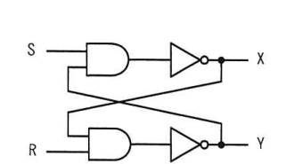
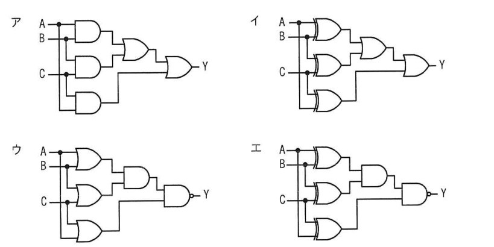
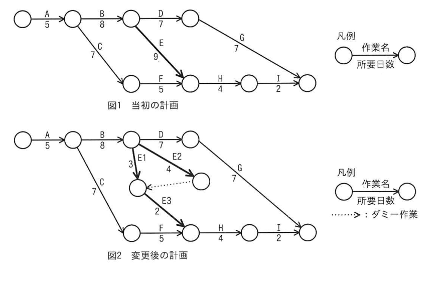

# 令和5年度秋期 科目A（旧午前）過去問解説

> 令和5年度 秋期 応用情報技術者試験 午前（全80問）を書き起こし、オリジナルの解説を付けたものです。問題の著作権は IPA（独立行政法人 情報処理推進機構）にあります。
> 図を表に書き換えるなど一部改変した問題には、その旨を記載しています。
> インタラクティブ教材の [科目A 四択クイズ](../../06_インタラクティブ教材/quiz.html) では、この回を本番形式（150分）で解けます。

## 目次

| 問 | 分野 | 中分類 | キーワード |
|---|---|---|---|
| [問1](#q01) | テクノロジ系 | 基礎理論 | 2進数、桁の入替え、int関数 |
| [問2](#q02) | テクノロジ系 | 基礎理論 | 主成分分析、次元削減、多変量解析 |
| [問3](#q03) | テクノロジ系 | 基礎理論 | 逆ポーランド表記法、後置記法、スタック |
| [問4](#q04) | テクノロジ系 | 基礎理論 | 水平垂直パリティ、誤り訂正、パリティビット |
| [問5](#q05) | テクノロジ系 | アルゴリズムとプログラミング | 双方向リスト、配列、ポインタ |
| [問6](#q06) | テクノロジ系 | アルゴリズムとプログラミング | バブルソート、整列アルゴリズム |
| [問7](#q07) | テクノロジ系 | アルゴリズムとプログラミング | JSON、データ記述言語 |
| [問8](#q08) | テクノロジ系 | コンピュータ構成要素 | ヘテロジニアスマルチコア、マルチコアプロセッサ、低消費電力 |
| [問9](#q09) | テクノロジ系 | コンピュータ構成要素 | 投機実行、分岐予測、パイプライン |
| [問10](#q10) | テクノロジ系 | コンピュータ構成要素 | ウェアレベリング、フラッシュメモリ、SSD |
| [問11](#q11) | テクノロジ系 | コンピュータ構成要素 | ユニファイドメモリ、フレームバッファ、VRAM |
| [問12](#q12) | テクノロジ系 | システム構成要素 | SAN、ファイバチャネル、NAS、ストレージ |
| [問13](#q13) | テクノロジ系 | システム構成要素 | スケールアウト、スケールアップ、分散処理 |
| [問14](#q14) | テクノロジ系 | システム構成要素 | IaC、Infrastructure as Code、構成管理 |
| [問15](#q15) | テクノロジ系 | システム構成要素 | 稼働率、MTBF、フェールオーバー、アクティブ−スタンバイ |
| [問16](#q16) | テクノロジ系 | ソフトウェア | ページング、ページフォールト、仮想記憶、加重平均 |
| [問17](#q17) | テクノロジ系 | ソフトウェア | リアルタイムスケジューリング、プリエンプティブ、周期タスク、優先度 |
| [問18](#q18) | テクノロジ系 | ソフトウェア | クロスコンパイラ、言語処理プログラム、組込み開発 |
| [問19](#q19) | テクノロジ系 | ソフトウェア | Linuxカーネル、OS、カーネル |
| [問20](#q20) | テクノロジ系 | ハードウェア | FPGA、ASIC、集積回路 |
| [問21](#q21) | テクノロジ系 | ハードウェア | MOSトランジスタ、半導体素子、MOSFET |
| [問22](#q22) | テクノロジ系 | ハードウェア | フリップフロップ、RSラッチ、NAND、順序回路 |
| [問23](#q23) | テクノロジ系 | ハードウェア | 多数決回路、論理回路、真理値表 |
| [問24](#q24) | テクノロジ系 | ユーザーインタフェース | アイコン、習得性、JIS X 9303-1、ユーザビリティ |
| [問25](#q25) | テクノロジ系 | 情報メディア | レンダリング、バーチャルリアリティ、CG |
| [問26](#q26) | テクノロジ系 | データベース | ハッシュインデックス、B+木インデックス、完全一致検索 |
| [問27](#q27) | テクノロジ系 | データベース | 外部キー、候補キー、スーパーキー、参照制約 |
| [問28](#q28) | テクノロジ系 | データベース | ビュー、更新可能なビュー、SQL |
| [問29](#q29) | テクノロジ系 | データベース | NOT EXISTS、相関副問合せ、SQL |
| [問30](#q30) | テクノロジ系 | データベース | ロールフォワード、ロールバック、チェックポイント、障害回復 |
| [問31](#q31) | テクノロジ系 | ネットワーク | 伝送時間、伝送効率、ビットとバイト |
| [問32](#q32) | テクノロジ系 | ネットワーク | NAPT、IPマスカレード、ポート番号、NAT |
| [問33](#q33) | テクノロジ系 | ネットワーク | ICMP、ping、エコー要求 |
| [問34](#q34) | テクノロジ系 | ネットワーク | サブネットマスク、ネットワークアドレス、論理積 |
| [問35](#q35) | テクノロジ系 | ネットワーク | マルチキャスト、RIP-2、ブロードキャスト |
| [問36](#q36) | テクノロジ系 | セキュリティ | レインボーテーブル、パスワードクラック、ハッシュ値、ソルト |
| [問37](#q37) | テクノロジ系 | セキュリティ | 楕円曲線暗号、公開鍵暗号、RSA、鍵長 |
| [問38](#q38) | テクノロジ系 | セキュリティ | 第三者中継、オープンリレー、メールサーバ、スパム |
| [問39](#q39) | テクノロジ系 | セキュリティ | CSIRT、コーディネーションセンター、JPCERT/CC |
| [問40](#q40) | テクノロジ系 | セキュリティ | 機密性、JIS Q 27000、情報セキュリティの要素 |
| [問41](#q41) | テクノロジ系 | セキュリティ | サイドチャネル攻撃、電磁波解析、耐タンパ性 |
| [問42](#q42) | テクノロジ系 | セキュリティ | セキュアブート、デジタル署名、UEFI、ブートキット |
| [問43](#q43) | テクノロジ系 | セキュリティ | ランサムウェア、WORM、バックアップ |
| [問44](#q44) | テクノロジ系 | セキュリティ | DKIM、送信ドメイン認証、デジタル署名、SPF |
| [問45](#q45) | テクノロジ系 | セキュリティ | DNSSEC、DNSキャッシュポイズニング、デジタル署名 |
| [問46](#q46) | テクノロジ系 | セキュリティ | ファジング、脆弱性検査、ファズ |
| [問47](#q47) | テクノロジ系 | ソフトウェア開発管理技術 | ローコード開発、ノーコード開発、開発手法 |
| [問48](#q48) | テクノロジ系 | システム開発技術 | ソフトウェア保守、完全化保守、リバースエンジニアリング |
| [問49](#q49) | テクノロジ系 | ソフトウェア開発管理技術 | アジャイルソフトウェア開発宣言、アジャイル |
| [問50](#q50) | テクノロジ系 | ソフトウェア | IDE、統合開発環境、組込み開発 |
| [問51](#q51) | マネジメント系 | プロジェクトマネジメント | プロジェクト・スコープ記述書、PMBOK、スコープ |
| [問52](#q52) | マネジメント系 | プロジェクトマネジメント | EVM、スケジュール差異、SV、出来高 |
| [問53](#q53) | マネジメント系 | プロジェクトマネジメント | アローダイアグラム、クリティカルパス、ダミー作業 |
| [問54](#q54) | マネジメント系 | プロジェクトマネジメント | コンティンジェンシー計画、リスク対応、JIS Q 21500 |
| [問55](#q55) | マネジメント系 | サービスマネジメント | 是正処置、不適合、SMS、JIS Q 20000 |
| [問56](#q56) | マネジメント系 | サービスマネジメント | 可用性、計画停止、サービスレベル |
| [問57](#q57) | マネジメント系 | サービスマネジメント | 差分バックアップ、フルバックアップ、リストア |
| [問58](#q58) | マネジメント系 | システム監査 | 監査調書、監査証拠、システム監査基準 |
| [問59](#q59) | マネジメント系 | システム監査 | プルーフリスト、網羅性、監査手続、入力コントロール |
| [問60](#q60) | マネジメント系 | システム監査 | ITへの対応、IT全般統制、IT業務処理統制、内部統制 |
| [問61](#q61) | ストラテジ系 | 技術戦略マネジメント | バックキャスティング、フォアキャスティング、未来志向 |
| [問62](#q62) | ストラテジ系 | システム戦略 | CRM、ワントゥワンマーケティング、ソリューションビジネス |
| [問63](#q63) | ストラテジ系 | システム戦略 | SOA、サービス指向アーキテクチャ、Webサービス |
| [問64](#q64) | ストラテジ系 | システム企画 | PBP、回収期間法、IT投資評価 |
| [問65](#q65) | ストラテジ系 | システム企画 | インスペクション、要求エンジニアリング、検証、JIS X 0166 |
| [問66](#q66) | ストラテジ系 | システム企画 | ファウンドリー、ファブレス、垂直統合 |
| [問67](#q67) | ストラテジ系 | 経営戦略マネジメント | アンゾフの成長マトリクス、多角化、市場浸透 |
| [問68](#q68) | ストラテジ系 | 経営戦略マネジメント | パーミッションマーケティング、オプトイン、マーケティング手法 |
| [問69](#q69) | ストラテジ系 | 経営戦略マネジメント | 市場セグメンテーション、人口統計的変数、デモグラフィック |
| [問70](#q70) | ストラテジ系 | 技術戦略マネジメント | オープンイノベーション、クローズドイノベーション、技術戦略 |
| [問71](#q71) | ストラテジ系 | ビジネスインダストリ | CPS、サイバーフィジカルシステム、デジタルツイン |
| [問72](#q72) | ストラテジ系 | 企業活動 | ギグエコノミー、クラウドソーシング、働き方 |
| [問73](#q73) | ストラテジ系 | ビジネスインダストリ | マシンビジョン、スマートファクトリー、画像認識、外観検査 |
| [問74](#q74) | ストラテジ系 | 企業活動 | レジリエンス、BCM、BCP、事業継続 |
| [問75](#q75) | ストラテジ系 | 企業活動 | コンティンジェンシー理論、リーダーシップ論、フィードラー |
| [問76](#q76) | ストラテジ系 | 企業活動 | パレート図、QC七つ道具、ABC分析 |
| [問77](#q77) | ストラテジ系 | 企業活動 | 除却損、減価償却、定額法、帳簿価額 |
| [問78](#q78) | ストラテジ系 | 法務 | 著作権法、プログラムの著作物、職務著作 |
| [問79](#q79) | ストラテジ系 | 法務 | 匿名加工情報、個人情報保護法、第三者提供 |
| [問80](#q80) | ストラテジ系 | 法務 | 出向、労働者派遣、請負、指揮命令関係 |

<a id="q01"></a>

### 問1　〔基礎理論〕 🧮

2桁の2進数 x1 x2 が表す整数を x とする。2進数 x2 x1 が表す整数を，x の式で表したものはどれか。ここで，int(r) は非負の実数 r の小数点以下を切り捨てた整数を表す。

- **ア**　2x＋4 int(x / 2)
- **イ**　2x＋5 int(x / 2)
- **ウ**　2x−3 int(x / 2)
- **エ**　2x−4 int(x / 2)

<details><summary>解答・解説</summary>

**正解：ウ**

x = 2x1＋x2 なので，上位桁 x1 = int(x/2)，下位桁 x2 = x − 2x1。桁を入れ替えた値は 2x2＋x1 = 2x − 3 int(x/2) となる。

**途中式**

- x = 2・x1 ＋ x2（x1，x2 は 0 か 1）
- x1 = int(x / 2)，x2 = x − 2・int(x / 2)
- 2進数 x2 x1 の値 = 2・x2 ＋ x1 = 2(x − 2・int(x/2)) ＋ int(x/2) = **2x − 3 int(x/2)**
- 検算：x = 2（10₂）→ 入替え 01₂ = 1。2×2 − 3×1 = 1 で一致

- ア：x = 2 を代入すると 4＋4 = 8 となり，2桁の2進数の範囲（0〜3）を超える
- イ：x = 2 で 4＋5 = 9。同様に範囲外
- エ：x = 2 で 4 − 4 = 0 となり，正しい値 1 と一致しない

💡 **ポイント**：式を選ぶ問題は，x = 0〜3 の具体値を代入して選択肢を絞るのが確実。int(x/2) は「1ビット右シフト＝上位桁の取出し」と読める。

📖 関連：[基礎理論](../../01_テクノロジ系/01_基礎理論.md)

</details>

<sub>出典：令和5年度 秋期 応用情報技術者試験 午前 問1（下付き添字を x1，x2 と表記）</sub>

---

<a id="q02"></a>

### 問2　〔基礎理論〕

複数の変数をもつデータに対する分析手法の記述のうち，主成分分析はどれか。

- **ア**　変数に共通して影響を与える新たな変数を計算して，データの背後にある構造を取得する方法
- **イ**　変数の値からほかの変数の値を予測して，データがもつ変数間の関連性を確認する方法
- **ウ**　変数の値が互いに類似するものを集めることによって，データを分類する方法
- **エ**　変数を統合した新たな変数を使用して，データがもつ変数の数を減らす方法

<details><summary>解答・解説</summary>

**正解：エ**

主成分分析は，相関のある多数の変数を少数の合成変数（主成分）にまとめ，情報をできるだけ保ったまま変数の数を減らす（次元削減する）手法である。

- ア：観測された変数の背後にある共通の要因（潜在因子）を探る因子分析の説明
- イ：説明変数から目的変数を予測する回帰分析の説明
- ウ：似たもの同士をグループにまとめるクラスタ分析（k-means 法など）の説明

💡 **ポイント**：主成分分析＝「まとめて減らす（次元削減）」，因子分析＝「背後の原因を探る」，回帰分析＝「予測する」，クラスタ分析＝「似たものを集める」と目的で区別する。

📖 関連：[基礎理論](../../01_テクノロジ系/01_基礎理論.md)

</details>

<sub>出典：令和5年度 秋期 応用情報技術者試験 午前 問2</sub>

---

<a id="q03"></a>

### 問3　〔基礎理論〕 🧮

逆ポーランド表記法（後置記法）で表現されている式 ABCD−×＋ において，A=16，B=8，C=4，D=2 のときの演算結果はどれか。逆ポーランド表記法による式 AB＋ は，中置記法による式 A＋B と同一である。

- **ア**　32
- **イ**　46
- **ウ**　48
- **エ**　94

<details><summary>解答・解説</summary>

**正解：ア**

ABCD−×＋ は中置記法に直すと A＋B×(C−D)。値を代入すると 16＋8×(4−2) = 32。

**途中式**（スタックで左から処理）

- A，B，C，D を積む → [16, 8, 4, 2]
- − ：4 − 2 = 2 → [16, 8, 2]
- × ：8 × 2 = 16 → [16, 16]
- ＋ ：16 ＋ 16 = **32**

- イ：46 は A＋B×C−D = 16＋32−2 のように，C−D をまとめずに計算した誤り
- ウ：48 は (A＋B)×(C−D) = 24×2 で，＋を先に計算してしまった誤り
- エ：94 は (A＋B)×C − D = 94 と，演算子を左から中置に戻した誤り

💡 **ポイント**：後置記法は「数値は積む，演算子が来たら上の2つを取り出して計算し結果を積む」。演算子の左右（下が左オペランド）を逆にしない。

📖 関連：[基礎理論](../../01_テクノロジ系/01_基礎理論.md)

</details>

<sub>出典：令和5年度 秋期 応用情報技術者試験 午前 問3</sub>

---

<a id="q04"></a>

### 問4　〔基礎理論〕

図のように16ビットのデータを4×4の正方形状に並べ，行と列にパリティビットを付加することによって何ビットまでの誤りを訂正できるか。ここで，図の網掛け部分はパリティビットを表す。

| | | | | パリティ |
|---|---|---|---|---|
| 1 | 0 | 0 | 0 | **1** |
| 0 | 1 | 1 | 0 | **0** |
| 0 | 0 | 1 | 0 | **1** |
| 1 | 1 | 0 | 1 | **1** |
| **0** | **0** | **0** | **1** | |

（太字が網掛け部分＝パリティビット。最下行は各列のパリティ）

- **ア**　1
- **イ**　2
- **ウ**　3
- **エ**　4

<details><summary>解答・解説</summary>

**正解：ア**

行（水平）と列（垂直）の両方にパリティを付けると，1ビットの誤りはパリティ不一致の行と列の交点として位置を特定できるので訂正できる。2ビット以上の誤りは位置を一意に決められない。

- イ：2ビット誤りでは，同じ行（または列）の2ビットが反転するとその行のパリティは一致してしまい，不一致の列が2本出るだけで行が特定できない。検出はできても訂正はできない
- ウ・エ：誤りが増えるほど行・列パリティが打ち消し合い，訂正も検出も保証できない

💡 **ポイント**：水平垂直パリティは「1ビット訂正・2ビット検出（の場合が多い）」。ハミング符号（SEC-DED）も1ビット訂正・2ビット検出で，類題でよく比較される。

📖 関連：[基礎理論](../../01_テクノロジ系/01_基礎理論.md)

</details>

<sub>出典：令和5年度 秋期 応用情報技術者試験 午前 問4（図を表に書き換え（網掛けを太字で表現））</sub>

---

<a id="q05"></a>

### 問5　〔アルゴリズムとプログラミング〕

双方向リストを三つの一次元配列 elem[i]，next[i]，prev[i] の組で実現する。双方向リストが図の状態のとき，要素 D の次に要素 C を挿入した後の next[6]，prev[6] の値の組合せはどれか。ここで，双方向リストは次のように表現する。

- 双方向リストの要素は，elem[i] に値，next[i] に次の要素の要素番号，prev[i] に前の要素の要素番号を設定
- 双方向リストの先頭，末尾の要素番号は，それぞれ変数 Head，Tail に設定
- next[i]，prev[i] の値が 0 である要素は，それぞれ双方向リストの末尾，先頭を表す。
- 双方向リストへの要素の追加は，一次元配列の末尾に追加

| 要素番号 | 1 | 2 | 3 | 4 | 5 | 6（一次元配列の末尾） |
|---|---|---|---|---|---|---|
| elem | A | F | D | B | E | |
| next | 4 | 0 | 5 | 3 | 2 | |
| prev | 0 | 5 | 4 | 1 | 3 | |

Head = 1，Tail = 2

- **ア**　next[6]：2，prev[6]：3
- **イ**　next[6]：3，prev[6]：4
- **ウ**　next[6]：5，prev[6]：3
- **エ**　next[6]：5，prev[6]：4

<details><summary>解答・解説</summary>

**正解：ウ**

現在のリストは A(1)→B(4)→D(3)→E(5)→F(2)。C を要素番号6に置いて D と E の間に入れるので，C の次は E（5），C の前は D（3）になる。

**途中式**

- Head=1：A，next[1]=4：B，next[4]=3：D，next[3]=5：E，next[5]=2：F（next=0 で末尾）
- 挿入後：D(3) → C(6) → E(5)
- よって next[6] = **5**，prev[6] = **3**（あわせて next[3]=6，prev[5]=6 に更新する）

- ア：next[6]=2 は F を指してしまい，E が飛ばされる
- イ：next[6]=3 は D 自身，prev[6]=4 は B を指しており，D の前に挿入したような値
- エ：prev[6]=4 は B を指すため，前方向にたどると D が抜け落ちる

💡 **ポイント**：配列で表したリストは，まず Head から next をたどって論理順を書き出すと迷わない。挿入時は新要素の next/prev と，前後要素の next/prev の計4か所を更新する。

📖 関連：[アルゴリズムとプログラミング](../../01_テクノロジ系/02_アルゴリズムとプログラミング.md)

</details>

<sub>出典：令和5年度 秋期 応用情報技術者試験 午前 問5（図を表に書き換え，選択肢の表を文章に書き換え）</sub>

---

<a id="q06"></a>

### 問6　〔アルゴリズムとプログラミング〕

あるデータ列を整列したら状態0から順に状態1，2，・・・，N へと推移した。整列に使ったアルゴリズムはどれか。

```
状態0  3, 5, 9, 6, 1, 2
状態1  3, 5, 6, 1, 2, 9
状態2  3, 5, 1, 2, 6, 9
  ・
  ・
状態N  1, 2, 3, 5, 6, 9
```

- **ア**　クイックソート
- **イ**　挿入ソート
- **ウ**　バブルソート
- **エ**　ヒープソート

<details><summary>解答・解説</summary>

**正解：ウ**

1回の走査ごとに隣り合う要素を比較・交換し，最大値（9，次に6）が末尾へ順に移動している。これはバブルソートの動きである。

- 状態0→1：9 が 6，1，2 と順に交換されて末尾へ移動
- 状態1→2：6 が 1，2 と交換されて末尾から2番目へ移動

- ア：クイックソートは基準値（ピボット）より小さい値と大きい値に分割するので，1回目の後に「基準より小さい群・大きい群」に分かれた並びになる
- イ：挿入ソートは先頭から整列済みの部分を広げていくので，先頭側が順に整列されていく
- エ：ヒープソートはヒープを構成して最大値を取り出すため，途中の並びがヒープ構造（親≧子）になる

💡 **ポイント**：「末尾から大きい値が確定していく」→バブルソート（選択ソートも末尾/先頭確定だが交換は1回）。「先頭側が整列済みで広がる」→挿入ソート。途中経過の並びから特徴を見抜く。

📖 関連：[アルゴリズムとプログラミング](../../01_テクノロジ系/02_アルゴリズムとプログラミング.md)

</details>

<sub>出典：令和5年度 秋期 応用情報技術者試験 午前 問6（データ列をコードブロックで表記）</sub>

---

<a id="q07"></a>

### 問7　〔アルゴリズムとプログラミング〕

JavaScript のオブジェクトの表記法などを基にして規定したものであって，“名前と値との組みの集まり”と“値の順序付きリスト”の二つの構造に基づいてオブジェクトを表現する，データ記述の仕様はどれか。

- **ア**　DOM
- **イ**　JSON
- **ウ**　SOAP
- **エ**　XML

<details><summary>解答・解説</summary>

**正解：イ**

JSON（JavaScript Object Notation）は，{ "名前": 値 } のオブジェクトと [ 値, 値 ] の配列という二つの構造でデータを表すテキスト形式で，Web API などで広く使われる。

- ア：DOM は HTML や XML の文書をツリー構造のオブジェクトとして扱うための API
- ウ：SOAP は XML でメッセージを記述して Web サービスを呼び出すためのプロトコル
- エ：XML はタグで要素を入れ子にして構造を表すマークアップ言語で，“名前と値の組”を基本構造とはしない

💡 **ポイント**：JSON＝オブジェクト（名前と値の組）＋配列（順序付きリスト）。XML より簡潔で，YAML と並んで設定ファイルや API で頻出。

📖 関連：[アルゴリズムとプログラミング](../../01_テクノロジ系/02_アルゴリズムとプログラミング.md)

</details>

<sub>出典：令和5年度 秋期 応用情報技術者試験 午前 問7</sub>

---

<a id="q08"></a>

### 問8　〔コンピュータ構成要素〕

スマートフォンなどで高い処理性能と低消費電力の両立のために，異なる目的に適した複数の種類のコアを搭載したプロセッサはどれか。

- **ア**　スーパースカラプロセッサ
- **イ**　ソフトコアプロセッサ
- **ウ**　ヘテロジニアスマルチコアプロセッサ
- **エ**　ホモジニアスマルチコアプロセッサ

<details><summary>解答・解説</summary>

**正解：ウ**

性能重視のコアと省電力重視のコアなど，種類の異なるコアを組み合わせたプロセッサをヘテロジニアス（異種混在）マルチコアプロセッサという。負荷に応じて使うコアを切り替えて性能と消費電力を両立する。

- ア：スーパースカラは1つのコア内に複数の実行ユニットを持ち，複数命令を同時に実行する方式
- イ：ソフトコアプロセッサは FPGA 上に論理回路として記述・実装したプロセッサ
- エ：ホモジニアスマルチコアは同じ種類のコアを複数並べたプロセッサ

💡 **ポイント**：ヘテロ＝異種，ホモ＝同種。スマートフォンの big.LITTLE 構成や CPU＋GPU の組合せがヘテロジニアスの代表例。

📖 関連：[コンピュータ構成要素](../../01_テクノロジ系/03_コンピュータ構成要素.md)

</details>

<sub>出典：令和5年度 秋期 応用情報技術者試験 午前 問8</sub>

---

<a id="q09"></a>

### 問9　〔コンピュータ構成要素〕

パイプラインの性能を向上させるための技法の一つで，分岐条件の結果が決定する前に，分岐先を予測して命令を実行するものはどれか。

- **ア**　アウトオブオーダー実行
- **イ**　遅延分岐
- **ウ**　投機実行
- **エ**　レジスタリネーミング

<details><summary>解答・解説</summary>

**正解：ウ**

分岐の結果が出る前に分岐先を予測して先に命令を実行しておき，予測が外れたら結果を破棄する方式を投機実行という。分岐ハザードによるパイプラインの停止を減らせる。

- ア：アウトオブオーダー実行は，依存関係のない命令をプログラムの順序と異なる順に実行する方式
- イ：遅延分岐は，分岐命令の直後に（分岐に関係なく）実行してよい命令を置いて，パイプラインの空きを埋める方式
- エ：レジスタリネーミングは，論理レジスタを別の物理レジスタに割り当て直して，見かけ上のデータ依存（WAR/WAW）を解消する方式

💡 **ポイント**：パイプラインのハザード対策は「分岐ハザード→分岐予測・投機実行・遅延分岐」「データハザード→フォワーディング・レジスタリネーミング・アウトオブオーダー」と整理する。

📖 関連：[コンピュータ構成要素](../../01_テクノロジ系/03_コンピュータ構成要素.md)

</details>

<sub>出典：令和5年度 秋期 応用情報技術者試験 午前 問9</sub>

---

<a id="q10"></a>

### 問10　〔コンピュータ構成要素〕

ファイルシステムをフラッシュメモリで構成するとき，ブロックごとの書換え回数を管理することによって，フラッシュメモリの寿命を延ばす技術はどれか。

- **ア**　ウェアレベリング
- **イ**　ジャーナリング
- **ウ**　デフラグ
- **エ**　ライトアンプリフィケーション

<details><summary>解答・解説</summary>

**正解：ア**

フラッシュメモリはブロックごとに書換え回数の上限がある。書換えが特定のブロックに集中しないよう回数を管理して平均化する技術がウェアレベリングである。

- イ：ジャーナリングは，ファイルシステムの更新内容をログ（ジャーナル）に記録し，障害時に整合性を回復する技術
- ウ：デフラグは，断片化したファイルを連続領域に並べ直してアクセスを速くする操作
- エ：ライトアンプリフィケーションは，ブロック単位の消去のため実際の書込み量が要求量より増えてしまう現象で，寿命を縮める側の要因

💡 **ポイント**：ウェアレベリング（wear＝摩耗，leveling＝平準化）は SSD の寿命対策の定番。TRIM コマンドやオーバープロビジョニングも関連用語。

📖 関連：[コンピュータ構成要素](../../01_テクノロジ系/03_コンピュータ構成要素.md)

</details>

<sub>出典：令和5年度 秋期 応用情報技術者試験 午前 問10</sub>

---

<a id="q11"></a>

### 問11　〔コンピュータ構成要素〕

画面表示用フレームバッファがユニファイドメモリ方式であるシステムの特徴はどれか。

- **ア**　主記憶とは別に専用のフレームバッファをもつ。
- **イ**　主記憶の一部を表示領域として使用する。
- **ウ**　シリアル接続した表示デバイスに，描画コマンドを用いて表示する。
- **エ**　表示リフレッシュが不要である。

<details><summary>解答・解説</summary>

**正解：イ**

ユニファイドメモリ方式は，CPU と GPU（表示回路）が主記憶を共有し，その一部をフレームバッファとして使う方式である。専用 VRAM が不要で安価・省スペースだが，メモリ帯域を CPU と取り合う。

- ア：主記憶とは別に専用のフレームバッファ（VRAM）をもつのは専用メモリ方式（ディスクリート GPU など）
- ウ：表示デバイス側に描画処理を任せる方式の説明で，フレームバッファの配置方式とは関係ない
- エ：液晶などでも一定周期で画面を描き直すリフレッシュは必要で，メモリ方式で不要になるものではない

💡 **ポイント**：ユニファイド（unified＝統合）＝主記憶と表示用メモリを1つにまとめる。内蔵 GPU やスマートフォンの SoC で一般的。

📖 関連：[コンピュータ構成要素](../../01_テクノロジ系/03_コンピュータ構成要素.md)

</details>

<sub>出典：令和5年度 秋期 応用情報技術者試験 午前 問11</sub>

---

<a id="q12"></a>

### 問12　〔システム構成要素〕

SAN（Storage Area Network）におけるサーバとストレージの接続形態の説明として，適切なものはどれか。

- **ア**　シリアル ATA などの接続方式によって内蔵ストレージとして1対1に接続する。
- **イ**　ファイバチャネルなどによる専用ネットワークで接続する。
- **ウ**　プロトコルは CIFS（Common Internet File System）を使用し，LAN で接続する。
- **エ**　プロトコルは NFS（Network File System）を使用し，LAN で接続する。

<details><summary>解答・解説</summary>

**正解：イ**

SAN は，サーバとストレージをファイバチャネル（FC）や iSCSI などの専用ネットワークで結び，サーバからはブロック単位でディスクとして見えるようにする構成である。

- ア：サーバに直接ディスクをつなぐ DAS（Direct Attached Storage）の説明
- ウ：CIFS（SMB）で LAN 経由でファイル単位に共有するのは NAS の説明
- エ：NFS で LAN 経由でファイル共有するのも NAS の説明

💡 **ポイント**：SAN＝専用ネットワーク・ブロック単位，NAS＝LAN・ファイル単位（NFS/CIFS）。IP ネットワークで SAN を作る方式が IP-SAN（iSCSI）。

📖 関連：[システム構成要素](../../01_テクノロジ系/04_システム構成要素.md)

</details>

<sub>出典：令和5年度 秋期 応用情報技術者試験 午前 問12</sub>

---

<a id="q13"></a>

### 問13　〔システム構成要素〕

システムの性能を向上させるための方法として，スケールアウトが適しているシステムはどれか。

- **ア**　一連の大きな処理を一括して実行しなければならないので，並列処理が困難な処理が中心のシステム
- **イ**　参照系のトランザクションが多いので，複数のサーバで分散処理を行っているシステム
- **ウ**　データを追加するトランザクションが多いので，データの整合性を取るためのオーバーヘッドを小さくしなければならないシステム
- **エ**　同一のマスターデータベースがシステム内に複数配置されているので，マスターを更新する際にはデータベース間で整合性を保持しなければならないシステム

<details><summary>解答・解説</summary>

**正解：イ**

スケールアウトはサーバの台数を増やして処理を分散させる方法である。互いに独立して処理できる参照系トランザクション中心で，すでに分散処理しているシステムに向いている。

- ア：並列化できない一括処理は台数を増やしても速くならず，1台の性能を上げるスケールアップが向く
- ウ：更新が多く整合性確保のオーバーヘッドを抑えたい場合，台数を増やすと同期のオーバーヘッドが増えるので不向き
- エ：複数のマスターDB間で整合性を保つ必要があるシステムは，台数を増やすほど更新時の同期負荷が大きくなる

💡 **ポイント**：スケールアウト＝台数を増やす（参照系・並列化しやすい処理向き），スケールアップ＝1台を強化する（更新系・並列化しにくい処理向き）。

📖 関連：[システム構成要素](../../01_テクノロジ系/04_システム構成要素.md)

</details>

<sub>出典：令和5年度 秋期 応用情報技術者試験 午前 問13</sub>

---

<a id="q14"></a>

### 問14　〔システム構成要素〕

IaC（Infrastructure as Code）に関する記述として，最も適切なものはどれか。

- **ア**　インフラストラクチャの自律的なシステム運用を実現するために，インシデントへの対応手順をコードに定義すること
- **イ**　各種開発支援ツールを利用するために，ツールの連携手順をコードに定義すること
- **ウ**　継続的インテグレーションを実現するために，アプリケーションの生成手順や試験の手順をコードに定義すること
- **エ**　ソフトウェアによる自動実行を可能にするために，システムの構成や状態をコードに定義すること

<details><summary>解答・解説</summary>

**正解：エ**

IaC は，サーバやネットワークなどインフラの構成・あるべき状態をコード（定義ファイル）として記述し，ツールで自動的に構築・変更できるようにする考え方である。手作業による設定ミスを防ぎ，同じ環境を何度でも再現できる。

- ア：インシデント対応手順の自動化で，運用自動化（ランブック自動化など）の説明。IaC の中心は「構成や状態」の定義
- イ：開発ツールの連携手順の定義で，IaC の説明ではない
- ウ：ビルドやテストの手順をコード化するのは CI（継続的インテグレーション）のパイプライン定義の説明

💡 **ポイント**：IaC は「インフラの構成をコードで管理」し，バージョン管理やレビューの対象にできる。DevOps・クラウドとセットで問われる。

📖 関連：[システム構成要素](../../01_テクノロジ系/04_システム構成要素.md)

</details>

<sub>出典：令和5年度 秋期 応用情報技術者試験 午前 問14</sub>

---

<a id="q15"></a>

### 問15　〔システム構成要素〕 🧮

アクティブ−スタンバイ構成の2台のサーバから成るシステムがある。各サーバの MTBF は99時間，MTTR は10時間，フェールオーバーに要する時間は2時間であるとき，このシステムの稼働率はおよそ幾らか。ここで，二重に障害は発生しないものとする。

- **ア**　0.82
- **イ**　0.89
- **ウ**　0.91
- **エ**　0.98

<details><summary>解答・解説</summary>

**正解：エ**

障害が起きてもスタンバイ機へ切り替わるので，システムが止まるのはフェールオーバーの2時間だけである。99時間動いて2時間止まるので，稼働率は 99 /(99＋2) ≒ 0.98。

**途中式**

- システムとしての停止時間（1回の障害当たり）= フェールオーバー時間 = 2時間（修理の10時間はスタンバイ機が稼働中）
- 稼働率 = 99 / (99 ＋ 2) = 99 / 101 ≒ **0.98**

- ア：単体の稼働率 0.91 を2台直列とみなして 0.91×0.91 ≒ 0.82 とした誤り。スタンバイ機は待機用で直列ではない
- イ：99/(99＋10＋2) ≒ 0.89 で，修理時間までシステム停止と数えた誤り
- ウ：99/(99＋10) ≒ 0.91 で，単体サーバの稼働率。スタンバイ機による切替えを考慮していない

💡 **ポイント**：稼働率 = MTBF /(MTBF＋MTTR)。冗長構成では「システムが実際に止まっている時間」を MTTR として使う。

📖 関連：[システム構成要素](../../01_テクノロジ系/04_システム構成要素.md)／[計算問題公式集](../../05_まとめ・横断資料/01_計算問題公式集.md)

</details>

<sub>出典：令和5年度 秋期 応用情報技術者試験 午前 問15</sub>

---

<a id="q16"></a>

### 問16　〔ソフトウェア〕 🧮

ページング方式の仮想記憶において，あるプログラムを実行したとき，1回のページフォールトの平均処理時間は30ミリ秒であった。ページフォールト発生時の処理時間が次の条件であったとすると，ページアウトを伴わないページインだけの処理の割合は幾らか。

〔ページフォールト発生時の処理時間〕

(1) ページアウトを伴わない場合，ページインの処理時間は20ミリ秒である。
(2) ページアウトを伴う場合，置換えページの選択，ページアウト，ページインの合計処理時間は60ミリ秒である。

- **ア**　0.25
- **イ**　0.33
- **ウ**　0.67
- **エ**　0.75

<details><summary>解答・解説</summary>

**正解：エ**

ページインだけの割合を p とすると，平均処理時間は 20p ＋ 60(1−p) = 30。これを解いて p = 0.75。

**途中式**

- 20p ＋ 60(1 − p) = 30
- 60 − 40p = 30 → 40p = 30 → p = **0.75**
- 検算：20×0.75 ＋ 60×0.25 = 15 ＋ 15 = 30 ミリ秒

- ア：0.25 はページアウトを伴う処理の割合（1 − p）
- イ：0.33 は 20/60 の時間比で，割合の式になっていない
- ウ：0.67 は 20/30 の時間比で，加重平均の式を立てていない

💡 **ポイント**：「平均時間＝各時間×割合の和」で方程式を立てる。キャッシュの実効アクセス時間と同じ形の計算。

📖 関連：[ソフトウェア](../../01_テクノロジ系/05_ソフトウェア.md)／[計算問題公式集](../../05_まとめ・横断資料/01_計算問題公式集.md)

</details>

<sub>出典：令和5年度 秋期 応用情報技術者試験 午前 問16</sub>

---

<a id="q17"></a>

### 問17　〔ソフトウェア〕 🧮

プリエンプティブな優先度ベースのスケジューリングで実行する二つの周期タスク A 及び B がある。タスク B が周期内に処理を完了できるタスク A 及び B の最大実行時間及び周期の組合せはどれか。ここで，タスク A の方がタスク B より優先度が高く，かつ，タスク A と B の共有資源はなく，タスク切替え時間は考慮しないものとする。また，時間及び周期の単位はミリ秒とする。

- **ア**　タスクA：最大実行時間 2，周期 4／タスクB：最大実行時間 3，周期 8
- **イ**　タスクA：最大実行時間 3，周期 6／タスクB：最大実行時間 4，周期 9
- **ウ**　タスクA：最大実行時間 3，周期 5／タスクB：最大実行時間 5，周期 13
- **エ**　タスクA：最大実行時間 4，周期 6／タスクB：最大実行時間 5，周期 15

<details><summary>解答・解説</summary>

**正解：ア**

優先度の高い A は周期の先頭で必ず先に実行され，B は A の空き時間にしか動けない。時刻 0 から B の周期内で B が使える時間を数えると，アだけが B の実行時間を確保できる。

**途中式**（時刻0に A・B が同時に起動）

- ア：A 0〜2，B 2〜4（2），A 4〜6，B 6〜7（計3）→ 7 ≤ 8 で **完了**
- イ：A 0〜3，B 3〜6（3），A 6〜9 → 周期9までに B は3しか実行できず未完了（あと1足りない）
- ウ：A 0〜3，B 3〜5（2），A 5〜8，B 8〜10（計4），A 10〜13 → 周期13までに B は4で未完了
- エ：A 0〜4，B 4〜6（2），A 6〜10，B 10〜12（計4），A 12〜16 → 周期15までに B は4で未完了

💡 **ポイント**：プリエンプティブな優先度スケジューリングは，高優先度タスクの実行区間を先に時間軸に書き込み，残りの隙間に低優先度タスクを詰めると確実に判定できる。

📖 関連：[ソフトウェア](../../01_テクノロジ系/05_ソフトウェア.md)

</details>

<sub>出典：令和5年度 秋期 応用情報技術者試験 午前 問17（選択肢の表を文章に書き換え）</sub>

---

<a id="q18"></a>

### 問18　〔ソフトウェア〕

あるコンピュータ上で，当該コンピュータとは異なる命令形式のコンピュータで実行できる目的プログラムを生成する言語処理プログラムはどれか。

- **ア**　エミュレーター
- **イ**　クロスコンパイラ
- **ウ**　最適化コンパイラ
- **エ**　プログラムジェネレーター

<details><summary>解答・解説</summary>

**正解：イ**

開発用のコンピュータ上で，命令形式（CPU アーキテクチャ）が異なる別のコンピュータ向けの目的プログラムを生成するのがクロスコンパイラである。組込みシステムの開発でよく使う。

- ア：エミュレーターは，別のコンピュータの命令を解釈して，その動作を模倣して実行するソフトウェア（またはハードウェア）
- ウ：最適化コンパイラは，実行速度やサイズが良くなるようにコードを改善して目的プログラムを生成するコンパイラ
- エ：プログラムジェネレーターは，パラメータや仕様を与えるとソースプログラムを自動生成するツール

💡 **ポイント**：「別の機種向けに作る」＝クロスコンパイラ，「別の機種を真似て動かす」＝エミュレーター。

📖 関連：[ソフトウェア](../../01_テクノロジ系/05_ソフトウェア.md)

</details>

<sub>出典：令和5年度 秋期 応用情報技術者試験 午前 問18</sub>

---

<a id="q19"></a>

### 問19　〔ソフトウェア〕

Linux カーネルの説明として，適切なものはどれか。

- **ア**　CUI によるコマンド入力のためのシェルと呼ばれるソフトウェアが組み込まれていて，文字での操作が可能である。
- **イ**　GUI を利用できるデスクトップ環境が組み込まれていて，マウスを使った直感的な操作が可能である。
- **ウ**　Web ブラウザ，ワープロソフト，表計算ソフトなどが含まれており，Linux カーネルだけで多くの業務が行える。
- **エ**　プロセス管理やメモリ管理などの，アプリケーションソフトウェアが動作するための基本機能を提供する。

<details><summary>解答・解説</summary>

**正解：エ**

カーネルは OS の中核で，プロセス管理・メモリ管理・ファイル管理・デバイス制御など，アプリケーションが動くための基本機能を提供する。Linux カーネルもこの部分だけを指す。

- ア：シェル（bash など）はカーネルとは別のプログラムで，カーネルに組み込まれてはいない
- イ：GNOME や KDE などのデスクトップ環境もカーネルとは別のソフトウェア
- ウ：ブラウザやオフィスソフトはアプリケーションで，ディストリビューションとして一緒に配布されることはあってもカーネルには含まれない

💡 **ポイント**：Linux ディストリビューション＝カーネル＋シェル＋各種ツール＋アプリケーション。カーネルは「OS の中核部分」だけを指す。

📖 関連：[ソフトウェア](../../01_テクノロジ系/05_ソフトウェア.md)

</details>

<sub>出典：令和5年度 秋期 応用情報技術者試験 午前 問19</sub>

---

<a id="q20"></a>

### 問20　〔ハードウェア〕

FPGA の説明として，適切なものはどれか。

- **ア**　電気的に記憶内容の書換えを行うことができる不揮発性メモリ
- **イ**　特定の分野及びアプリケーション用に限定した特定用途向け汎用集積回路
- **ウ**　浮動小数点数の演算を高速に実行する演算ユニット
- **エ**　論理回路を基板上に実装した後で再プログラムできる集積回路

<details><summary>解答・解説</summary>

**正解：エ**

FPGA（Field Programmable Gate Array）は，製造・実装した後でも利用者が内部の論理回路を書き換えて（再プログラムして）使える集積回路である。

- ア：電気的に書換え可能な不揮発性メモリは EEPROM（フラッシュメモリ）の説明
- イ：特定用途向け汎用集積回路は ASSP の説明（特定用途向けに専用設計するのが ASIC）
- ウ：浮動小数点演算ユニットは FPU の説明

💡 **ポイント**：FPGA＝現場（Field）で書き換えられるゲートの配列。少量生産・試作に向き，大量生産では ASIC の方が安く高速。

📖 関連：[ハードウェア](../../01_テクノロジ系/10_ハードウェア.md)

</details>

<sub>出典：令和5年度 秋期 応用情報技術者試験 午前 問20</sub>

---

<a id="q21"></a>

### 問21　〔ハードウェア〕

MOS トランジスタの説明として，適切なものはどれか。

- **ア**　pn 接合における電子と正孔の再結合によって光を放出するという性質を利用した半導体素子
- **イ**　pn 接合部に光が当たると電流が発生するという性質を利用した半導体素子
- **ウ**　金属と半導体との間に酸化物絶縁体を挟んだ構造をもつことが特徴の半導体素子
- **エ**　逆方向電圧をある電圧以上印加すると，電流だけが増加し電圧がほぼ一定に保たれるという特性をもつ半導体素子

<details><summary>解答・解説</summary>

**正解：ウ**

MOS は Metal-Oxide-Semiconductor の略で，金属（ゲート電極）と半導体の間に酸化物の絶縁膜を挟んだ構造をもつトランジスタである。ゲート電圧で電流を制御し，CMOS として LSI の基本素子になっている。

- ア：電子と正孔の再結合で発光するのは発光ダイオード（LED）
- イ：光が当たると電流が生じるのはフォトダイオード（太陽電池も同じ原理）
- エ：逆方向電圧で電圧を一定に保つのはツェナーダイオード（定電圧ダイオード）

💡 **ポイント**：MOS＝金属・酸化膜・半導体の3層構造。名前の頭文字がそのまま構造を表している。

📖 関連：[ハードウェア](../../01_テクノロジ系/10_ハードウェア.md)

</details>

<sub>出典：令和5年度 秋期 応用情報技術者試験 午前 問21</sub>

---

<a id="q22"></a>

### 問22　〔ハードウェア〕 🧮

図の論理回路において，S=1，R=1，X=0，Y=1 のとき，S を一旦0にした後，再び1に戻した。この操作を行った後の X，Y の値はどれか。



- **ア**　X=0，Y=0
- **イ**　X=0，Y=1
- **ウ**　X=1，Y=0
- **エ**　X=1，Y=1

<details><summary>解答・解説</summary>

**正解：ウ**

この回路は AND＋NOT（＝NAND）2個をたすき掛けにした RS ラッチで，X = NOT(S・Y)，Y = NOT(R・X)。S を0にすると X がセットされて1になり，S を1に戻してもその状態が保持されるので X=1，Y=0。

**途中式**

- 初期：S=1，R=1，X=0，Y=1（安定）
- S=0 にする：X = NOT(0・1) = 1 → Y = NOT(1・1) = 0 → X = NOT(0・0) = 1 で安定
- S=1 に戻す：X = NOT(1・Y) = NOT(1・0) = 1，Y = NOT(1・1) = 0 → **X=1，Y=0** のまま保持

- ア：X=0，Y=0 は NAND ラッチの出力として S=R=1 の状態では成り立たない（X=0 なら Y=1 になる）
- イ：操作前の状態のまま。S を0にした時点で X は1に変わる
- エ：X=Y=1 は S=R=0 にしたときの禁止状態の出力で，この操作では生じない

💡 **ポイント**：NAND 型 RS ラッチは入力が負論理（0 でセット／リセット）。入力を1に戻すと直前の状態を保持する，という記憶動作がフリップフロップの本質。

📖 関連：[ハードウェア](../../01_テクノロジ系/10_ハードウェア.md)

</details>

<sub>出典：令和5年度 秋期 応用情報技術者試験 午前 問22</sub>

---

<a id="q23"></a>

### 問23　〔ハードウェア〕

真理値表に示す3入力多数決回路はどれか。

| A | B | C | Y |
|---|---|---|---|
| 0 | 0 | 0 | 0 |
| 0 | 0 | 1 | 0 |
| 0 | 1 | 0 | 0 |
| 0 | 1 | 1 | 1 |
| 1 | 0 | 0 | 0 |
| 1 | 0 | 1 | 1 |
| 1 | 1 | 0 | 1 |
| 1 | 1 | 1 | 1 |

（A，B，C が入力，Y が出力）



- **ア**　（図のア）
- **イ**　（図のイ）
- **ウ**　（図のウ）
- **エ**　（図のエ）

<details><summary>解答・解説</summary>

**正解：ア**

2つ以上の入力が1のとき Y=1 になるので，Y = A・B ＋ B・C ＋ C・A。アは AND ゲート3個で A・B，B・C，A・C を作り，OR ゲートでまとめているので一致する。

**確認**

- ア：(A・B ＋ B・C) ＋ A・C → 多数決の式そのもの
- イ：XOR を使っており，A=B=C=1 のとき各 XOR が0になって Y=0。真理値表（Y=1）と合わない
- ウ：OR の組を AND してから NAND で反転しており，A=B=C=0 のとき Y=1 となって合わない
- エ：XOR の組を AND して NAND で反転しており，A=B=C=0 のとき Y=1 となって合わない

💡 **ポイント**：多数決回路＝AB＋BC＋CA。回路選択問題は，全入力0・全入力1など極端な入力を入れて消去法で絞ると速い。

📖 関連：[ハードウェア](../../01_テクノロジ系/10_ハードウェア.md)

</details>

<sub>出典：令和5年度 秋期 応用情報技術者試験 午前 問23（真理値表を表に書き換え）</sub>

---

<a id="q24"></a>

### 問24　〔ユーザーインタフェース〕

JIS X 9303-1:2006（ユーザシステムインタフェース及びシンボル−アイコン及び機能−アイコン一般）で規定されているアイコンの習得性の説明はどれか。

- **ア**　アイコンによって表現されたシステム機能が，それが理解された後に，どれだけ容易に思い出すことができるかを示す。
- **イ**　アイコンの図柄の詳細を，どれだけ容易に区別できるかを示す。
- **ウ**　同じ又は類似したアイコンによる以前の経験に基づいて，どれだけ容易にアイコンを識別できるかを示す。
- **エ**　空間的，時間的又は文脈的に近くに表示された別のアイコンから，与えられたアイコンをどれだけ容易に区別できるかを示す。

<details><summary>解答・解説</summary>

**正解：ア**

習得性は，一度アイコンの意味（表している機能）を理解した後に，それをどれだけ容易に覚えて思い出せるかという性質である。

- イ：図柄の細部がどれだけ見分けやすいかで，「判読性（読みやすさ）」に当たる性質
- ウ：以前に使った同じ・似たアイコンの経験から識別できるかで，「慣れ（既知性）」に当たる性質
- エ：近くに並ぶ他のアイコンとどれだけ区別しやすいかで，「識別性（弁別性）」に当たる性質

💡 **ポイント**：アイコン評価の観点は「理解した後に思い出せる＝習得性」「似た経験から分かる」「図柄が見分けられる」「隣と区別できる」など。キーワード「理解された後に思い出す」で習得性を選ぶ。

📖 関連：[ユーザーインタフェースと情報メディア](../../01_テクノロジ系/11_ユーザーインタフェースと情報メディア.md)

</details>

<sub>出典：令和5年度 秋期 応用情報技術者試験 午前 問24</sub>

---

<a id="q25"></a>

### 問25　〔情報メディア〕

バーチャルリアリティに関する記述のうち，レンダリングの説明はどれか。

- **ア**　ウェアラブルカメラ，慣性センサーなどを用いて非言語情報を認識する処理
- **イ**　仮想世界の情報をディスプレイに描画可能な形式の画像に変換する処理
- **ウ**　視覚的に現実世界と仮想世界を融合させるために，それぞれの世界の中に定義された3次元座標を一致させる処理
- **エ**　時間経過とともに生じる物の移動などの変化について，モデル化したものを物理法則などに当てはめて変化させる処理

<details><summary>解答・解説</summary>

**正解：イ**

レンダリングは，3次元の物体や光源・視点などのデータ（仮想世界の情報）から，ディスプレイに表示できる2次元の画像を計算して生成する処理である。

- ア：ジェスチャーや表情などの非言語情報を認識する処理で，センシング・認識の説明
- ウ：現実と仮想の座標系を一致させる処理で，AR における位置合わせ（レジストレーション）の説明
- エ：物理法則に従って物体の動きを計算する処理で，物理シミュレーション（物理演算）の説明

💡 **ポイント**：CG の流れは「モデリング（形を作る）→ シミュレーション（動かす）→ レンダリング（画像にする）」。レンダリング手法としてレイトレーシングやラジオシティも頻出。

📖 関連：[ユーザーインタフェースと情報メディア](../../01_テクノロジ系/11_ユーザーインタフェースと情報メディア.md)

</details>

<sub>出典：令和5年度 秋期 応用情報技術者試験 午前 問25</sub>

---

<a id="q26"></a>

### 問26　〔データベース〕

“売上”表への次の検索処理のうち，B⁺木インデックスよりもハッシュインデックスを設定した方が適切なものはどれか。ここで，インデックスを設定する列を＜＞内に示す。

売上（伝票番号，売上年月日，商品名，利用者 ID，店舗番号，売上金額）

- **ア**　売上金額が1万円以上の売上を検索する。＜売上金額＞
- **イ**　売上年月日が今月の売上を検索する。＜売上年月日＞
- **ウ**　商品名が 'DB' で始まる売上を検索する。＜商品名＞
- **エ**　利用者 ID が '1001' の売上を検索する。＜利用者 ID＞

<details><summary>解答・解説</summary>

**正解：エ**

ハッシュインデックスはキー値からハッシュ関数で格納位置を直接求めるため，「＝」による完全一致検索が非常に速い。一方，値の大小順を保持しないので範囲検索や前方一致には使えない。利用者 ID = '1001' の完全一致検索だけがハッシュに向く。

- ア：「1万円以上」は範囲検索。値が順序付けられた B⁺木が向く
- イ：「今月」は日付の範囲検索で，B⁺木が向く
- ウ：「'DB' で始まる」は前方一致（LIKE 'DB%'）で，実質的には範囲検索。B⁺木が向く

💡 **ポイント**：ハッシュ＝等価検索専用，B⁺木＝等価検索も範囲検索・前方一致・ソートもできる万能型。

📖 関連：[データベース](../../01_テクノロジ系/06_データベース.md)

</details>

<sub>出典：令和5年度 秋期 応用情報技術者試験 午前 問26</sub>

---

<a id="q27"></a>

### 問27　〔データベース〕

関係モデルにおける外部キーの説明として，適切なものはどれか。

- **ア**　ある関係の候補キーを参照する属性，又は属性の組
- **イ**　主キー以外で，タプルを一意に識別できる属性，又は属性の組
- **ウ**　タプルを一意に識別できる属性，又は属性の組の集合のうち極小のもの
- **エ**　タプルを一意に識別できる属性，又は属性の組を含む集合

<details><summary>解答・解説</summary>

**正解：ア**

外部キーは，他の（または同じ）関係の候補キー（通常は主キー）の値を参照する属性（の組）で，参照整合性制約によって参照先に存在しない値を持てないようにする。

- イ：主キーに選ばれなかった候補キーで，代理キー（代替キー）の説明
- ウ：一意に識別できる極小の属性集合で，候補キーの説明
- エ：一意に識別できる属性を含む集合（余分な属性を含んでもよい）で，スーパーキーの説明

💡 **ポイント**：スーパーキー ⊇ 候補キー（極小）→ そのうち1つが主キー，残りが代替キー。外部キーは「他の表のキーを指すもの」。

📖 関連：[データベース](../../01_テクノロジ系/06_データベース.md)

</details>

<sub>出典：令和5年度 秋期 応用情報技術者試験 午前 問27</sub>

---

<a id="q28"></a>

### 問28　〔データベース〕

更新可能なビューを作成する SQL 文はどれか。ここで，SQL 文中に現れる基底表は全て更新可能とする。

- **ア**　```sql
CREATE VIEW 高額商品(商品番号, 商品名, 商品単価)
  AS SELECT 商品番号, 商品名, 商品単価 FROM 商品 WHERE 商品単価 > 1000
```
- **イ**　```sql
CREATE VIEW 受注商品(商品番号)
  AS SELECT DISTINCT 商品番号 FROM 受注
```
- **ウ**　```sql
CREATE VIEW 商品受注(商品番号, 受注数量)
  AS SELECT 商品番号, SUM(受注数量) FROM 受注 GROUP BY 商品番号
```
- **エ**　```sql
CREATE VIEW 商品平均受注数量(平均受注数量)
  AS SELECT AVG(受注数量) FROM 受注
```

<details><summary>解答・解説</summary>

**正解：ア**

ビューの各行が基底表のどの行に対応するかを一意に特定できれば，ビュー経由で更新できる。アは1つの表から WHERE で行を選び列を取り出しているだけなので，ビューの行と“商品”表の行が1対1に対応し，更新可能である。

- イ：DISTINCT で重複を除いているため，ビューの1行が基底表の複数行に対応し，どの行を更新すべきか決まらない
- ウ：GROUP BY と集合関数 SUM で集約しており，ビューの行が基底表の行と対応しない
- エ：AVG で表全体を1行に集約しており，更新先の行が特定できない

💡 **ポイント**：DISTINCT，GROUP BY，HAVING，集合関数（SUM・AVG など），複数表の結合を含むビューは原則として更新できない。

📖 関連：[データベース](../../01_テクノロジ系/06_データベース.md)

</details>

<sub>出典：令和5年度 秋期 応用情報技術者試験 午前 問28（選択肢の SQL をコードブロックで表記）</sub>

---

<a id="q29"></a>

### 問29　〔データベース〕 🧮

“製品”表と“在庫”表に対し，次の SQL 文を実行した結果として得られる表の行数は幾つか。

```sql
SELECT DISTINCT 製品番号 FROM 製品
  WHERE NOT EXISTS (SELECT 製品番号 FROM 在庫
    WHERE 在庫数 > 30 AND 製品.製品番号 = 在庫.製品番号)
```

製品

| 製品番号 | 製品名 | 単価 |
|---|---|---|
| AB1805 | CD-ROM ドライブ | 15,000 |
| CC5001 | デジタルカメラ | 65,000 |
| MZ1000 | プリンタ A | 54,000 |
| XZ3000 | プリンタ B | 78,000 |
| ZZ9900 | イメージスキャナ | 98,000 |

在庫

| 倉庫コード | 製品番号 | 在庫数 |
|---|---|---|
| WH100 | AB1805 | 20 |
| WH100 | CC5001 | 200 |
| WH100 | ZZ9900 | 130 |
| WH101 | AB1805 | 150 |
| WH101 | XZ3000 | 30 |
| WH102 | XZ3000 | 20 |
| WH102 | ZZ9900 | 10 |
| WH103 | CC5001 | 40 |

- **ア**　1
- **イ**　2
- **ウ**　3
- **エ**　4

<details><summary>解答・解説</summary>

**正解：イ**

NOT EXISTS は「在庫数が30を超える倉庫が1つもない製品」を取り出す。該当するのは MZ1000（在庫なし）と XZ3000（30 と 20 で，30 を超えない）の2行。

**途中式**（製品ごとに副問合せを評価）

- AB1805：WH101 に 150（>30）がある → 除外
- CC5001：WH100 に 200，WH103 に 40 → 除外
- MZ1000：在庫表に行がない → 副問合せが空 → **残る**
- XZ3000：30，20（どちらも 30 を超えない）→ **残る**
- ZZ9900：WH100 に 130 → 除外

- ア：1 は XZ3000 の在庫数 30 を「30 を超える」と誤って除外した場合の行数
- ウ：3 は「在庫数が30以下の行がある製品」（AB1805，XZ3000，ZZ9900）を数えた誤り
- エ：4 は在庫表に行がある製品（AB1805，CC5001，XZ3000，ZZ9900）を数えた値で，在庫数の条件と NOT を無視している

💡 **ポイント**：相関副問合せは外側の1行ずつに対して内側を評価する。NOT EXISTS は「条件を満たす行が1件もない」こと。在庫表に存在しない行も NOT EXISTS では真になる点に注意。

📖 関連：[データベース](../../01_テクノロジ系/06_データベース.md)

</details>

<sub>出典：令和5年度 秋期 応用情報技術者試験 午前 問29（表を GFM の表に書き換え，SQL をコードブロックで表記）</sub>

---

<a id="q30"></a>

### 問30　〔データベース〕

DBMS をシステム障害発生後に再立上げするとき，ロールフォワードすべきトランザクションとロールバックすべきトランザクションの組合せとして，適切なものはどれか。ここで，トランザクションの中で実行される処理内容は次のとおりとする。

| トランザクション | データベースに対する Read 回数 と Write 回数 |
|---|---|
| T1，T2 | Read 10，Write 20 |
| T3，T4 | Read 100 |
| T5，T6 | Read 20，Write 10 |

各トランザクションの実行状況（時間は チェックポイント → 障害発生 の順に進む）

| トランザクション | 開始 | 終了 |
|---|---|---|
| T1 | チェックポイント前 | チェックポイント前にコミット |
| T2 | チェックポイント前 | チェックポイント後，障害発生前にコミット |
| T3 | チェックポイント後 | 障害発生時に未コミット |
| T4 | チェックポイント前 | 障害発生時に未コミット |
| T5 | チェックポイント後 | 障害発生前にコミット |
| T6 | チェックポイント後 | 障害発生時に未コミット |

- **ア**　ロールフォワード：T2，T5／ロールバック：T6
- **イ**　ロールフォワード：T2，T5／ロールバック：T3，T6
- **ウ**　ロールフォワード：T1，T2，T5／ロールバック：T6
- **エ**　ロールフォワード：T1，T2，T5／ロールバック：T3，T6

<details><summary>解答・解説</summary>

**正解：ア**

チェックポイント後にコミットした更新トランザクション（T2，T5）は更新後ログでロールフォワードし，障害時に未コミットの更新トランザクション（T6）は更新前ログでロールバックする。T3・T4 は Read だけなので回復処理は不要。

**判定**

- T1：チェックポイント前にコミット済み → チェックポイントで DB に反映済みなので処理不要
- T2，T5：チェックポイント後にコミット → **ロールフォワード**
- T3，T4：未コミットだが Read のみで DB を書き換えていない → 処理不要
- T6：未コミットで Write あり → **ロールバック**

- イ：T3 は参照だけで更新していないのでロールバックは不要
- ウ：T1 はチェックポイント時点で反映済みなのでロールフォワードは不要
- エ：T1 と T3 を含めている点が誤り

💡 **ポイント**：再立上げ時の回復は「チェックポイント後にコミット＝ロールフォワード」「未コミット＝ロールバック」。参照だけのトランザクションは回復の対象外。

📖 関連：[データベース](../../01_テクノロジ系/06_データベース.md)

</details>

<sub>出典：令和5年度 秋期 応用情報技術者試験 午前 問30（実行状況の図を表に書き換え，選択肢の表を文章に書き換え）</sub>

---

<a id="q31"></a>

### 問31　〔ネットワーク〕 🧮

100M ビット／秒の LAN を使用し，1件のレコード長が1,000バイトの電文を1,000件連続して伝送するとき，伝送時間は何秒か。ここで，LAN の伝送効率は50%とする。

- **ア**　0.02
- **イ**　0.08
- **ウ**　0.16
- **エ**　1.6

<details><summary>解答・解説</summary>

**正解：ウ**

データ量は 1,000 バイト×1,000 件 = 8M ビット。実効速度は 100M ビット/秒×50% = 50M ビット/秒なので，8 / 50 = 0.16 秒。

**途中式**

- データ量 = 1,000 × 1,000 × 8 = 8,000,000 ビット（8M ビット）
- 実効伝送速度 = 100M × 0.5 = 50M ビット/秒
- 伝送時間 = 8M / 50M = **0.16 秒**

- ア：0.02 は 1M バイトを 50M ビット/秒で割り，ビット換算（×8）を忘れた値
- イ：0.08 は伝送効率を考慮せず 8M / 100M とした値
- エ：1.6 は桁を1つ誤った値

💡 **ポイント**：伝送時間 = データ量（ビット）÷（回線速度×伝送効率）。バイト→ビットの ×8 と，効率の掛け忘れが典型的なミス。

📖 関連：[ネットワーク](../../01_テクノロジ系/07_ネットワーク.md)／[計算問題公式集](../../05_まとめ・横断資料/01_計算問題公式集.md)

</details>

<sub>出典：令和5年度 秋期 応用情報技術者試験 午前 問31</sub>

---

<a id="q32"></a>

### 問32　〔ネットワーク〕

プライベート IP アドレスを割り当てられた PC が NAPT（IP マスカレード）機能をもつルータを経由して，インターネット上の Web サーバにアクセスしている。Web サーバから PC への応答パケットに含まれるヘッダー情報のうち，このルータで書き換えられるフィールドの組合せとして，適切なものはどれか。

- **ア**　宛先 IP アドレス，送信元 IP アドレス
- **イ**　宛先 IP アドレス，宛先ポート番号
- **ウ**　送信元 IP アドレス，送信元ポート番号
- **エ**　宛先ポート番号，送信元ポート番号

<details><summary>解答・解説</summary>

**正解：イ**

応答パケットの宛先は，ルータのグローバル IP アドレスと NAPT が割り当てたポート番号になっている。ルータは変換表を使ってこれを PC のプライベート IP アドレスと元のポート番号に戻すので，書き換えるのは宛先 IP アドレスと宛先ポート番号である。

- ア：送信元 IP アドレス（Web サーバのアドレス）は書き換えない。PC は応答元が Web サーバであることを知る必要がある
- ウ：送信元 IP アドレス・ポート番号の書換えは，PC から Web サーバへの「要求パケット」で行われる変換
- エ：送信元ポート番号（Web サーバの 80/443 番）は書き換えない

💡 **ポイント**：NAPT は「行き（要求）は送信元を，帰り（応答）は宛先を」IP アドレスとポート番号の組で書き換える。

📖 関連：[ネットワーク](../../01_テクノロジ系/07_ネットワーク.md)

</details>

<sub>出典：令和5年度 秋期 応用情報技術者試験 午前 問32（選択肢の表を文章に書き換え）</sub>

---

<a id="q33"></a>

### 問33　〔ネットワーク〕

TCP/IP 環境において，ping によってホストの接続確認をするときに使用されるプロトコルはどれか。

- **ア**　CHAP
- **イ**　ICMP
- **ウ**　SMTP
- **エ**　SNMP

<details><summary>解答・解説</summary>

**正解：イ**

ping は ICMP のエコー要求（Echo Request）を送り，相手からエコー応答（Echo Reply）が返るかどうかで到達性を確認する。

- ア：CHAP は PPP などで使われる，チャレンジレスポンス方式の認証プロトコル
- ウ：SMTP は電子メールを送信・転送するためのプロトコル
- エ：SNMP はネットワーク機器の監視・管理のためのプロトコル

💡 **ポイント**：ICMP はエラー通知や診断用のプロトコル。ping（エコー要求/応答）と traceroute（TTL 超過通知を利用）がどちらも ICMP を使う。

📖 関連：[ネットワーク](../../01_テクノロジ系/07_ネットワーク.md)

</details>

<sub>出典：令和5年度 秋期 応用情報技術者試験 午前 問33</sub>

---

<a id="q34"></a>

### 問34　〔ネットワーク〕 🧮

サブネットマスクが 255.255.252.0 のとき，IP アドレス 172.30.123.45 のホストが属するサブネットワークのアドレスはどれか。

- **ア**　172.30.3.0
- **イ**　172.30.120.0
- **ウ**　172.30.123.0
- **エ**　172.30.252.0

<details><summary>解答・解説</summary>

**正解：イ**

IP アドレスとサブネットマスクのビットごとの論理積をとると，第3オクテットは 123 AND 252 = 120 となり，ネットワークアドレスは 172.30.120.0。

**途中式**

- 第3オクテット：123 = 0111 1011，252 = 1111 1100
- 論理積 = 0111 1000 = **120**
- 第4オクテットはマスクが 0 なので 0 → 172.30.**120**.0

- ア：3 は 123 の下位2ビット（ホスト部側）を取り出した値
- ウ：第3オクテットをそのまま残し，/24 として扱った誤り
- エ：252 はサブネットマスクの値そのもの

💡 **ポイント**：255.255.252.0 は /22。第3オクテットは 4 の倍数単位で区切られるので「123 以下で最大の 4 の倍数 = 120」と暗算できる。

📖 関連：[ネットワーク](../../01_テクノロジ系/07_ネットワーク.md)

</details>

<sub>出典：令和5年度 秋期 応用情報技術者試験 午前 問34</sub>

---

<a id="q35"></a>

### 問35　〔ネットワーク〕

IPv4 ネットワークにおけるマルチキャストの使用例に関する記述として，適切なものはどれか。

- **ア**　LAN に初めて接続する PC が，DHCP プロトコルを使用して，自分自身に割り当てられる IP アドレスを取得する際に使用する。
- **イ**　ネットワーク機器が，ARP プロトコルを使用して，宛先 IP アドレスから MAC アドレスを得るためのリクエストを送信する際に使用する。
- **ウ**　メーリングリストの利用者が，SMTP プロトコルを使用して，メンバー全員に対し，同一内容の電子メールを一斉送信する際に使用する。
- **エ**　ルータが RIP-2 プロトコルを使用して，隣接するルータのグループに，経路の更新情報を送信する際に使用する。

<details><summary>解答・解説</summary>

**正解：エ**

RIP-2 は経路情報をマルチキャストアドレス 224.0.0.9 宛てに送信し，RIP-2 を動かしているルータのグループだけが受信する。特定のグループ宛ての通信なのでマルチキャストの例である。

- ア：DHCP の DHCPDISCOVER は，IP アドレスを持たない PC が 255.255.255.255 宛てに送るブロードキャスト
- イ：ARP 要求は同一 LAN 内の全機器に送るブロードキャスト（応答はユニキャスト）
- ウ：メーリングリストの一斉送信は，メールサーバが各メンバー宛てに配送するユニキャストの繰返しで，IP マルチキャストではない

💡 **ポイント**：ユニキャスト＝1対1，ブロードキャスト＝全員，マルチキャスト＝特定グループ（224.0.0.0〜239.255.255.255）。RIP-1 はブロードキャスト，RIP-2 はマルチキャスト。

📖 関連：[ネットワーク](../../01_テクノロジ系/07_ネットワーク.md)

</details>

<sub>出典：令和5年度 秋期 応用情報技術者試験 午前 問35</sub>

---

<a id="q36"></a>

### 問36　〔セキュリティ〕

パスワードクラック手法の一種である，レインボーテーブル攻撃に該当するものはどれか。

- **ア**　何らかの方法で事前に利用者 ID と平文のパスワードのリストを入手しておき，複数のシステム間で使い回されている利用者 ID とパスワードの組みを狙って，ログインを試行する。
- **イ**　パスワードに成り得る文字列の全てを用いて，総当たりでログインを試行する。
- **ウ**　平文のパスワードとハッシュ値をチェーンによって管理するテーブルを準備しておき，それを用いて，不正に入手したハッシュ値からパスワードを解読する。
- **エ**　利用者の誕生日，電話番号などの個人情報を言葉巧みに聞き出して，パスワードを類推する。

<details><summary>解答・解説</summary>

**正解：ウ**

レインボーテーブル攻撃は，平文とハッシュ値の対応をチェーン状に圧縮して保存した表を事前に作っておき，盗んだハッシュ値から元のパスワードを効率よく割り出す攻撃である。

- ア：漏えいした ID・パスワードを他サイトで試すパスワードリスト攻撃（リスト型攻撃）の説明
- イ：全ての文字列を試すブルートフォース攻撃（総当たり攻撃）の説明
- エ：人の心理や隙を突いて情報を聞き出すソーシャルエンジニアリングの説明

💡 **ポイント**：レインボーテーブル対策はソルト（利用者ごとのランダム値を付けてハッシュ化）とストレッチング（ハッシュ計算の反復）。

📖 関連：[情報セキュリティ](../../01_テクノロジ系/08_情報セキュリティ.md)

</details>

<sub>出典：令和5年度 秋期 応用情報技術者試験 午前 問36</sub>

---

<a id="q37"></a>

### 問37　〔セキュリティ〕

楕円曲線暗号の特徴はどれか。

- **ア**　RSA 暗号と比べて，短い鍵長で同レベルの安全性が実現できる。
- **イ**　共通鍵暗号方式であり，暗号化や復号の処理を高速に行うことができる。
- **ウ**　総当たりによる解読が不可能なことが，数学的に証明されている。
- **エ**　データを秘匿する目的で用いる場合，復号鍵を秘密にしておく必要がない。

<details><summary>解答・解説</summary>

**正解：ア**

楕円曲線暗号（ECC）は楕円曲線上の離散対数問題の難しさを利用する公開鍵暗号で，RSA よりかなり短い鍵長（例：256 ビットで RSA 3072 ビット相当）で同等の安全性が得られる。

- イ：楕円曲線暗号は共通鍵暗号ではなく公開鍵暗号方式
- ウ：計算量的に解読が困難というだけで，総当たりで解読できないことが数学的に証明されているわけではない
- エ：公開鍵暗号で秘匿に用いる場合，暗号化鍵（公開鍵）は公開してよいが，復号鍵（秘密鍵）は秘密にしなければならない

💡 **ポイント**：RSA＝素因数分解の困難性，楕円曲線暗号＝楕円曲線上の離散対数問題の困難性。短い鍵で済むので IoT 機器や TLS の鍵交換（ECDHE）で使われる。

📖 関連：[情報セキュリティ](../../01_テクノロジ系/08_情報セキュリティ.md)

</details>

<sub>出典：令和5年度 秋期 応用情報技術者試験 午前 問37</sub>

---

<a id="q38"></a>

### 問38　〔セキュリティ〕

自社の中継用メールサーバで，接続元 IP アドレス，電子メールの送信者のメールアドレスのドメイン名，及び電子メールの受信者のメールアドレスのドメイン名から成るログを取得するとき，外部ネットワークからの第三者中継と判断できるログはどれか。ここで，AAA.168.1.5 と AAA.168.1.10 は自社のグローバル IP アドレスとし，BBB.45.67.89 と BBB.45.67.90 は社外のグローバル IP アドレスとする。a.b.c は自社のドメイン名とし，a.b.d と a.b.e は他社のドメイン名とする。また，IP アドレスとドメイン名は詐称されていないものとする。

- **ア**　接続元 IP アドレス：AAA.168.1.5／送信者ドメイン：a.b.c／受信者ドメイン：a.b.d
- **イ**　接続元 IP アドレス：AAA.168.1.10／送信者ドメイン：a.b.c／受信者ドメイン：a.b.c
- **ウ**　接続元 IP アドレス：BBB.45.67.89／送信者ドメイン：a.b.d／受信者ドメイン：a.b.e
- **エ**　接続元 IP アドレス：BBB.45.67.90／送信者ドメイン：a.b.d／受信者ドメイン：a.b.c

<details><summary>解答・解説</summary>

**正解：ウ**

第三者中継は，社外から接続してきた社外の送信者のメールを，社外の受信者へ転送してしまうことである。接続元が社外 IP，送信者・受信者ともに他社ドメインのウが該当する。

- ア：自社から自社ドメインの送信者が他社へ送る通常の送信
- イ：自社内から自社ドメインの受信者へ送る社内メール
- エ：社外から自社ドメインの受信者へ届く通常の受信

💡 **ポイント**：中継用メールサーバは「社内→社外（送信）」と「社外→社内（受信）」だけを許可し，「社外→社外」を拒否する。これを許すと迷惑メールの踏み台（オープンリレー）になる。

📖 関連：[情報セキュリティ](../../01_テクノロジ系/08_情報セキュリティ.md)

</details>

<sub>出典：令和5年度 秋期 応用情報技術者試験 午前 問38（選択肢の表を文章に書き換え）</sub>

---

<a id="q39"></a>

### 問39　〔セキュリティ〕

JPCERT コーディネーションセンター“CSIRT ガイド（2021年11月30日）”では，CSIRT を機能とサービス対象によって六つに分類しており，その一つにコーディネーションセンターがある。コーディネーションセンターの機能とサービス対象の組合せとして，適切なものはどれか。

- **ア**　機能：インシデント対応の中で，CSIRT 間の情報連携，調整を行う。／サービス対象：他の CSIRT
- **イ**　機能：インシデントの傾向分析やマルウェアの解析，攻撃の痕跡の分析を行い，必要に応じて注意を喚起する。／サービス対象：関係組織，国又は地域
- **ウ**　機能：自社製品の脆弱性に対応し，パッチ作成や注意喚起を行う。／サービス対象：自社製品の利用者
- **エ**　機能：組織内 CSIRT の機能の一部又は全部をサービスプロバイダとして，有償で請け負う。／サービス対象：顧客

<details><summary>解答・解説</summary>

**正解：ア**

コーディネーションセンターは，インシデント対応において複数の CSIRT の間に立ち，情報の連携や対応の調整を行う CSIRT である。サービス対象は他の CSIRT（JPCERT/CC がその代表例）。

- イ：傾向分析・マルウェア解析・注意喚起を行うのは分析センターの説明
- ウ：自社製品の脆弱性に対応するのはベンダーチーム（PSIRT など）の説明
- エ：組織内 CSIRT の機能を有償で請け負うのはインシデントレスポンスプロバイダの説明

💡 **ポイント**：CSIRT の6分類は，組織内 CSIRT，国際連携 CSIRT，コーディネーションセンター，分析センター，ベンダーチーム，インシデントレスポンスプロバイダ。名前と「誰のために何をするか」を対応させる。

📖 関連：[情報セキュリティ](../../01_テクノロジ系/08_情報セキュリティ.md)

</details>

<sub>出典：令和5年度 秋期 応用情報技術者試験 午前 問39（選択肢の表を文章に書き換え）</sub>

---

<a id="q40"></a>

### 問40　〔セキュリティ〕

JIS Q 27000:2019（情報セキュリティマネジメントシステム−用語）において，認可されていない個人，エンティティ又はプロセスに対して，情報を使用させず，また，開示しない特性として定義されているものはどれか。

- **ア**　機密性
- **イ**　真正性
- **ウ**　認証
- **エ**　否認防止

<details><summary>解答・解説</summary>

**正解：ア**

「認可されていない者に情報を使用させず，開示しない」は機密性（Confidentiality）の定義である。

- イ：真正性は，エンティティが主張するとおりのものであるという特性（なりすましでないこと）
- ウ：認証は，エンティティの主張する特性が正しいことを確かめること（確認の行為）
- エ：否認防止は，主張された事象や処置の発生と，それを引き起こしたエンティティを証明する能力（後から「やっていない」と言えないこと）

💡 **ポイント**：CIA は機密性（見せない）・完全性（正確・完全である）・可用性（使いたいときに使える）。定義文のキーワード「開示しない」→機密性。

📖 関連：[情報セキュリティ](../../01_テクノロジ系/08_情報セキュリティ.md)

</details>

<sub>出典：令和5年度 秋期 応用情報技術者試験 午前 問40</sub>

---

<a id="q41"></a>

### 問41　〔セキュリティ〕

暗号機能を実装した IoT 機器における脅威のうち，サイドチャネル攻撃に該当するものはどれか。

- **ア**　暗号化関数を線形近似する式を導き，その線形近似式から秘密情報の取得を試みる。
- **イ**　機器が発する電磁波を測定することによって秘密情報の取得を試みる。
- **ウ**　二つの平文の差とそれぞれの暗号文の差の関係から，秘密情報の取得を試みる。
- **エ**　理論的にあり得る復号鍵の全てを機器に入力して秘密情報の取得を試みる。

<details><summary>解答・解説</summary>

**正解：イ**

サイドチャネル攻撃は，暗号処理中の消費電力・処理時間・電磁波などの物理的な副次情報を測定して，秘密鍵などを推定する攻撃である。電磁波の測定はその典型例。

- ア：暗号アルゴリズムを線形近似して解析する線形解読法（暗号理論上の攻撃）
- ウ：平文の差分と暗号文の差分の関係を調べる差分解読法
- エ：あり得る鍵を全部試すブルートフォース攻撃（総当たり攻撃）

💡 **ポイント**：サイドチャネル攻撃には電力解析・タイミング攻撃・電磁波解析・故障利用攻撃などがある。対策は耐タンパ性の向上（処理時間や電力の均一化，シールドなど）。

📖 関連：[情報セキュリティ](../../01_テクノロジ系/08_情報セキュリティ.md)

</details>

<sub>出典：令和5年度 秋期 応用情報技術者試験 午前 問41</sub>

---

<a id="q42"></a>

### 問42　〔セキュリティ〕

セキュアブートの説明はどれか。

- **ア**　BIOS にパスワードを設定し，PC 起動時に BIOS のパスワード入力を要求することによって，OS の不正な起動を防ぐ技術
- **イ**　HDD 又は SSD にパスワードを設定し，PC 起動時に HDD 又は SSD のパスワード入力を要求することによって，OS の不正な起動を防ぐ技術
- **ウ**　PC の起動時に OS のプログラムやドライバのデジタル署名を検証し，デジタル署名が有効なものだけを実行することによって，OS 起動完了前のマルウェアの実行を防ぐ技術
- **エ**　マルウェア対策ソフトを OS のスタートアッププログラムに登録し，OS 起動時に自動的にマルウェアスキャンを行うことによって，マルウェアの被害を防ぐ技術

<details><summary>解答・解説</summary>

**正解：ウ**

セキュアブートは，UEFI などのファームウェアが起動時にブートローダや OS カーネル，ドライバのデジタル署名を検証し，正当なものだけを順に実行する仕組みである。OS より先に動くマルウェア（ブートキット）を防げる。

- ア：BIOS パスワードの説明。署名の検証は行わない
- イ：HDD/SSD パスワード（ドライブロック）の説明。ディスクの不正利用は防げるが，起動するプログラムの正当性は確認しない
- エ：OS 起動後にマルウェア対策ソフトを動かす方法で，OS 起動完了前のマルウェアは防げない

💡 **ポイント**：セキュアブート＝「起動の各段階でデジタル署名を検証し，信頼の連鎖をつなぐ」。TPM による起動時の計測（メジャードブート）とセットで問われることもある。

📖 関連：[情報セキュリティ](../../01_テクノロジ系/08_情報セキュリティ.md)

</details>

<sub>出典：令和5年度 秋期 応用情報技術者試験 午前 問42</sub>

---

<a id="q43"></a>

### 問43　〔セキュリティ〕

PC のストレージ上の重要なデータを保護する方法のうち，ランサムウェア感染による被害の低減に効果があるものはどれか。

- **ア**　WORM（Write Once Read Many）機能を有するストレージを導入して，そこに重要なデータをバックアップする。
- **イ**　ストレージを RAID5 構成にして，1台のディスク故障時にも重要なデータを利用可能にする。
- **ウ**　内蔵ストレージを増設して，重要なデータを常時レプリケーションする。
- **エ**　ネットワーク上のストレージの共有フォルダをネットワークドライブに割り当てて，そこに重要なデータをバックアップする。

<details><summary>解答・解説</summary>

**正解：ア**

WORM ストレージは一度書き込んだデータを変更・削除できないため，ランサムウェアに感染してもバックアップが暗号化（改変）されず，そこから復旧できる。

- イ：RAID5 はディスク故障への対策。ランサムウェアによる暗号化はそのまま全ディスクに反映される
- ウ：常時レプリケーションでは，暗号化された状態もすぐに複製先に反映されてしまう
- エ：ネットワークドライブとして割り当てた共有フォルダは PC からアクセスできるため，ランサムウェアに一緒に暗号化されるおそれがある

💡 **ポイント**：ランサムウェア対策のバックアップは「感染した PC から書き換えられない場所」に置くことが重要（オフライン保管，WORM，イミュータブルバックアップ）。

📖 関連：[情報セキュリティ](../../01_テクノロジ系/08_情報セキュリティ.md)

</details>

<sub>出典：令和5年度 秋期 応用情報技術者試験 午前 問43</sub>

---

<a id="q44"></a>

### 問44　〔セキュリティ〕

DKIM（DomainKeys Identified Mail）に関する記述のうち，適切なものはどれか。

- **ア**　送信側のメールサーバで電子メールにデジタル署名を付与し，受信側のメールサーバでそのデジタル署名を検証して送信元ドメインの認証を行う。
- **イ**　送信者が電子メールを送信するとき，送信側のメールサーバは，送信者が正規の利用者かどうかの認証を利用者 ID とパスワードによって行う。
- **ウ**　送信元ドメイン認証に失敗した際の電子メールの処理方法を記載したポリシーを DNS サーバに登録し，電子メールの認証結果を監視する。
- **エ**　電子メールの送信元ドメインでメール送信に使うメールサーバの IP アドレスを DNS サーバに登録しておき，受信側で送信元ドメインの DNS サーバに登録されている IP アドレスと電子メールの送信元メールサーバの IP アドレスとを照合する。

<details><summary>解答・解説</summary>

**正解：ア**

DKIM は，送信側メールサーバがメールにデジタル署名を付け，受信側が DNS に公開された公開鍵で署名を検証して，送信元ドメインの正当性とメールの改ざんの有無を確かめる送信ドメイン認証技術である。

- イ：送信時に利用者 ID とパスワードで認証するのは SMTP-AUTH の説明
- ウ：認証失敗時の処理ポリシーを DNS に登録し，レポートで監視するのは DMARC の説明
- エ：送信元メールサーバの IP アドレスを DNS に登録して照合するのは SPF の説明

💡 **ポイント**：送信ドメイン認証は「SPF＝IP アドレスで確認」「DKIM＝デジタル署名で確認」「DMARC＝失敗時の扱いを決めてレポート」の3点セット。

📖 関連：[情報セキュリティ](../../01_テクノロジ系/08_情報セキュリティ.md)

</details>

<sub>出典：令和5年度 秋期 応用情報技術者試験 午前 問44</sub>

---

<a id="q45"></a>

### 問45　〔セキュリティ〕

DNSSEC についての記述のうち，適切なものはどれか。

- **ア**　DNS サーバへの問合せ時の送信元ポート番号をランダムに選択することによって，DNS 問合せへの不正な応答を防止する。
- **イ**　DNS の再帰的な問合せの送信元として許可するクライアントを制限することによって，DNS を悪用した DoS 攻撃を防止する。
- **ウ**　共通鍵暗号方式によるメッセージ認証を用いることによって，正当な DNS サーバからの応答であることをクライアントが検証できる。
- **エ**　公開鍵暗号方式によるデジタル署名を用いることによって，正当な DNS サーバからの応答であることをクライアントが検証できる。

<details><summary>解答・解説</summary>

**正解：エ**

DNSSEC は，DNS の応答（資源レコード）に公開鍵暗号方式のデジタル署名を付け，受け取った側が署名を検証して，正当な DNS サーバからの改ざんされていない応答であることを確認する仕組みである。

- ア：送信元ポート番号のランダム化（ソースポートランダマイゼーション）は，キャッシュポイズニングを成功しにくくする別の対策
- イ：再帰問合せを許可するクライアントを制限するのは，オープンリゾルバ対策（DNS リフレクション攻撃の防止）
- ウ：DNSSEC が使うのは共通鍵によるメッセージ認証ではなく，公開鍵暗号方式によるデジタル署名

💡 **ポイント**：DNSSEC＝DNS 応答へのデジタル署名で「改ざん・なりすまし」を検知。DNS キャッシュポイズニング対策として問われる。

📖 関連：[情報セキュリティ](../../01_テクノロジ系/08_情報セキュリティ.md)

</details>

<sub>出典：令和5年度 秋期 応用情報技術者試験 午前 問45</sub>

---

<a id="q46"></a>

### 問46　〔セキュリティ〕

問題を引き起こす可能性があるデータを大量に入力し，そのときの応答や挙動を監視することによって，ソフトウェアの脆弱性を検出するテスト手法はどれか。

- **ア**　限界値分析
- **イ**　実験計画法
- **ウ**　ファジング
- **エ**　ロードテスト

<details><summary>解答・解説</summary>

**正解：ウ**

ファジングは，異常値や想定外の形式のデータ（ファズ）を大量に自動生成して入力し，異常終了や想定外の動作が起きないかを監視して，未知の脆弱性を見つけるテスト手法である。

- ア：限界値分析は，同値クラスの境界の値とその前後をテストデータとするブラックボックステスト技法
- イ：実験計画法は，直交表などを使って，少ない試行回数で因子の組合せの効果を調べる手法
- エ：ロードテスト（負荷テスト）は，大量のアクセスやデータで高負荷をかけ，性能や耐久性を確認するテスト

💡 **ポイント**：ファジング＝「壊れたデータを大量に入れて，落ちるかどうかを見る」。ソースコードがなくても実行でき，未知の脆弱性発見に有効。

📖 関連：[情報セキュリティ](../../01_テクノロジ系/08_情報セキュリティ.md)／[システム開発技術](../../01_テクノロジ系/09_システム開発技術.md)

</details>

<sub>出典：令和5年度 秋期 応用情報技術者試験 午前 問46</sub>

---

<a id="q47"></a>

### 問47　〔ソフトウェア開発管理技術〕

アプリケーションソフトウェアの開発環境上で，用意された部品やテンプレートを GUI による操作で組み合わせたり，必要に応じて一部の処理のソースコードを記述したりして，ソフトウェアを開発する手法はどれか。

- **ア**　継続的インテグレーション
- **イ**　ノーコード開発
- **ウ**　プロトタイピング
- **エ**　ローコード開発

<details><summary>解答・解説</summary>

**正解：エ**

GUI で部品を組み合わせることを中心に，必要な部分だけソースコードを書いて開発する手法はローコード開発である。ソースコードをほとんど書かずに短期間で開発できる。

- ア：継続的インテグレーション（CI）は，コードの変更を頻繁に統合し，ビルドとテストを自動で実行する手法
- イ：ノーコード開発は，ソースコードを一切書かずに GUI 操作だけで開発する手法。「一部のソースコードを記述」する点が合わない
- ウ：プロトタイピングは，試作品を早期に作って利用者に確認してもらい，要求を明確にする開発手法

💡 **ポイント**：ノーコード＝コードを全く書かない，ローコード＝少しは書く。違いは「ソースコードを記述するか」。

📖 関連：[ソフトウェア開発管理技術](../../01_テクノロジ系/12_ソフトウェア開発管理技術.md)

</details>

<sub>出典：令和5年度 秋期 応用情報技術者試験 午前 問47</sub>

---

<a id="q48"></a>

### 問48　〔システム開発技術〕

問題は発生していないが，プログラムの仕様書と現状のソースコードとの不整合を解消するために，リバースエンジニアリングの手法を使って仕様書を作成し直す。これはソフトウェア保守のどの分類に該当するか。

- **ア**　完全化保守
- **イ**　是正保守
- **ウ**　適応保守
- **エ**　予防保守

<details><summary>解答・解説</summary>

**正解：ア**

JIS X 0161 では，故障として現れる前の潜在的な問題を除いたり，保守性などの品質を高めたりする保守を完全化保守としている。仕様書をソースコードに合わせて作り直し，文書の不整合を解消して保守性を高める活動はこれに当たる。

- イ：是正保守は，発見された障害（問題）を修正する事後の保守。問題は発生していないので当たらない
- ウ：適応保守は，法改正や OS の更新など，環境の変化にソフトウェアを適応させる保守
- エ：予防保守は，ソフトウェア中の潜在的な障害（フォールト）が故障として現れる前に検出・修正する保守。仕様書の不整合はプログラムの障害ではない

💡 **ポイント**：保守の4分類は「是正（直す）」「予防（壊れる前に直す）」「適応（環境に合わせる）」「完全化（性能・保守性を良くする）」。文書の整備は完全化保守に分類される。

📖 関連：[システム開発技術](../../01_テクノロジ系/09_システム開発技術.md)

</details>

<sub>出典：令和5年度 秋期 応用情報技術者試験 午前 問48</sub>

---

<a id="q49"></a>

### 問49　〔ソフトウェア開発管理技術〕

アジャイルソフトウェア開発宣言では，“あることがらに価値があることを認めながらも別のことがらにより価値をおく”としている。“別のことがら”に該当するものの組みはどれか。

- **ア**　個人と対話，動くソフトウェア，顧客との協調，変化への対応
- **イ**　個人と対話，包括的なドキュメント，顧客との協調，計画に従うこと
- **ウ**　プロセスやツール，動くソフトウェア，契約交渉，変化への対応
- **エ**　プロセスやツール，包括的なドキュメント，契約交渉，計画に従うこと

<details><summary>解答・解説</summary>

**正解：ア**

アジャイルソフトウェア開発宣言は「プロセスやツールよりも個人と対話を，包括的なドキュメントよりも動くソフトウェアを，契約交渉よりも顧客との協調を，計画に従うことよりも変化への対応を」価値とする。より価値をおく“別のことがら”は後者の4つである。

- イ：包括的なドキュメント，計画に従うことは「価値は認めるが，より重視はしない」側
- ウ：プロセスやツール，契約交渉は「価値は認めるが，より重視はしない」側
- エ：4つとも「価値は認めるが，より重視はしない」側の組

💡 **ポイント**：4つの価値は「人・動くもの・顧客・変化」を重視すると覚える。左側（プロセス・ドキュメント・契約・計画）も否定はしていない点が問われやすい。

📖 関連：[ソフトウェア開発管理技術](../../01_テクノロジ系/12_ソフトウェア開発管理技術.md)

</details>

<sub>出典：令和5年度 秋期 応用情報技術者試験 午前 問49</sub>

---

<a id="q50"></a>

### 問50　〔ソフトウェア〕

組込みシステムのソフトウェア開発に使われる IDE の説明として，適切なものはどれか。

- **ア**　エディター，コンパイラ，リンカ，デバッガなどが一体となったツール
- **イ**　専用のハードウェアインタフェースで CPU の情報を取得する装置
- **ウ**　ターゲット CPU を搭載した評価ボードなどの実行環境
- **エ**　タスクスケジューリングの仕組みなどを提供するソフトウェア

<details><summary>解答・解説</summary>

**正解：ア**

IDE（Integrated Development Environment：統合開発環境）は，エディター・コンパイラ・リンカ・デバッガなどの開発ツールを1つの画面から使えるようにまとめたソフトウェアである。

- イ：JTAG などの専用インタフェースで CPU の内部情報を取得してデバッグする装置で，ICE（インサーキットエミュレーター）などの説明
- ウ：ターゲット CPU を載せた評価ボード（ターゲットボード）の説明
- エ：タスクスケジューリングなどを提供するのはリアルタイム OS（RTOS）の説明

💡 **ポイント**：組込み開発の道具は「IDE（統合ツール）」「ICE（ハードウェアデバッガ）」「評価ボード（実行環境）」「RTOS（実行基盤）」と役割で区別する。

📖 関連：[ソフトウェア](../../01_テクノロジ系/05_ソフトウェア.md)

</details>

<sub>出典：令和5年度 秋期 応用情報技術者試験 午前 問50</sub>

---

<a id="q51"></a>

### 問51　〔プロジェクトマネジメント〕

PMBOK ガイド 第7版によれば，プロジェクト・スコープ記述書に記述する項目はどれか。

- **ア**　WBS
- **イ**　コスト見積額
- **ウ**　ステークホルダー分類
- **エ**　プロジェクトの除外事項

<details><summary>解答・解説</summary>

**正解：エ**

プロジェクト・スコープ記述書には，スコープの説明，主要な成果物，受入れ基準，プロジェクトの除外事項など，何を作り何を作らないかを記述する。除外事項を明記することで，スコープの範囲をはっきりさせる。

- ア：WBS はスコープ記述書を基に成果物と作業を階層的に分解したもので，スコープ記述書と合わせて「スコープ・ベースライン」を構成する別の文書
- イ：コスト見積額はコスト見積りの成果で，コスト・ベースラインなどに記載される
- ウ：ステークホルダー分類はステークホルダー登録簿に記載する

💡 **ポイント**：スコープ・ベースライン＝スコープ記述書＋WBS＋WBS 辞書。スコープ記述書のキーワードは「成果物」「受入れ基準」「除外事項」。

📖 関連：[プロジェクトマネジメント](../../02_マネジメント系/01_プロジェクトマネジメント.md)

</details>

<sub>出典：令和5年度 秋期 応用情報技術者試験 午前 問51</sub>

---

<a id="q52"></a>

### 問52　〔プロジェクトマネジメント〕

システム開発のプロジェクトにおいて，EVM を活用したパフォーマンス管理をしている。開発途中のある時点で EV−PV の値が負であるとき，どのような状況を示しているか。

- **ア**　スケジュール効率が，計画よりも良い。
- **イ**　プロジェクトの完了が，計画よりも遅くなる。
- **ウ**　プロジェクトの進捗が，計画よりも遅れている。
- **エ**　プロジェクトの進捗が，計画よりも進んでいる。

<details><summary>解答・解説</summary>

**正解：ウ**

EV−PV はスケジュール差異（SV）。実際に終わった作業の出来高（EV）が計画上の予定（PV）より小さいので，その時点で進捗が計画より遅れていることを示す。

- ア：スケジュール効率（SPI = EV/PV）は1未満となり，計画より悪い
- イ：現時点で遅れているだけで，今後の挽回もあり得るので，完了が遅くなるとまでは言えない
- エ：EV−PV が正の場合の状況

💡 **ポイント**：SV = EV − PV（スケジュール），CV = EV − AC（コスト）。どちらも「負なら悪い（遅れ・超過）」。

📖 関連：[プロジェクトマネジメント](../../02_マネジメント系/01_プロジェクトマネジメント.md)

</details>

<sub>出典：令和5年度 秋期 応用情報技術者試験 午前 問52</sub>

---

<a id="q53"></a>

### 問53　〔プロジェクトマネジメント〕 🧮

プロジェクトのスケジュールを短縮したい。当初の計画は図1のとおりである。作業 E を作業 E1，E2，E3 に分けて，図2のとおりに計画を変更すると，スケジュールは全体で何日短縮できるか。



- **ア**　1
- **イ**　2
- **ウ**　3
- **エ**　4

<details><summary>解答・解説</summary>

**正解：ア**

当初のクリティカルパスは A→B→E→H→I で 28 日。E を分割すると E1→E3 の経路は E2（ダミー経由）の完了を待って 19 日目に終わり，H→I を経て 25 日。ところが A→B→D→G が 27 日あるので，全体は 27 日となり，短縮は 1 日だけである。

**途中式**（各結合点の最早開始日）

- 当初：A 5 → B 13 → E 13＋9 = 22（C→F は 5＋7＋5 = 17）→ H 26 → I **28**。D→G は 13＋7＋7 = 27
- 変更後：E1 13＋3 = 16，E2 13＋4 = 17，ダミーで E3 の開始は max(16, 17) = 17 → E3 19 → H 23 → I 25
- D→G の経路 = 27 日 → 全体は max(25, 27) = **27 日**
- 短縮日数 = 28 − 27 = **1 日**

- イ：2 日短縮すると全体 26 日になるが，D→G の経路だけで 27 日かかるので実現できない
- ウ：3 は E 経路だけを見て 28 − 25 = 3 とした誤り。D→G の経路（27日）がクリティカルパスになる
- エ：4 はダミー作業を無視して E1→E3 だけ（13＋3＋2 = 18）で計算し 28 − 24 = 4 とした誤り

💡 **ポイント**：作業を短縮・並行化したら，必ず全経路を計算し直してクリティカルパスが入れ替わっていないか確認する。ダミー作業は「待ち合わせ（先行関係）」だけを表す。

📖 関連：[プロジェクトマネジメント](../../02_マネジメント系/01_プロジェクトマネジメント.md)／[計算問題公式集](../../05_まとめ・横断資料/01_計算問題公式集.md)

</details>

<sub>出典：令和5年度 秋期 応用情報技術者試験 午前 問53</sub>

---

<a id="q54"></a>

### 問54　〔プロジェクトマネジメント〕

プロジェクトマネジメントにおいて，コンティンジェンシー計画を作成するプロセスはどれか。

- **ア**　リスクの管理
- **イ**　リスクの特定
- **ウ**　リスクの評価
- **エ**　リスクへの対応

<details><summary>解答・解説</summary>

**正解：エ**

コンティンジェンシー計画（リスクが顕在化したときに実行する対応策を事前に決めておく計画）は，リスクへの対応策を立てるプロセスで作成する。

- ア：リスクの管理は，リスク対応策の実施状況や新しいリスクを監視・管理するプロセス
- イ：リスクの特定は，プロジェクトに影響し得るリスクを洗い出して記録するプロセス
- ウ：リスクの評価は，特定したリスクの発生確率と影響度を見積もり，優先順位を付けるプロセス

💡 **ポイント**：リスクのプロセスは「特定 → 評価 → 対応 → 管理」の順。対応策（回避・転嫁・軽減・受容）やコンティンジェンシー計画は「対応」で作る。

📖 関連：[プロジェクトマネジメント](../../02_マネジメント系/01_プロジェクトマネジメント.md)

</details>

<sub>出典：令和5年度 秋期 応用情報技術者試験 午前 問54</sub>

---

<a id="q55"></a>

### 問55　〔サービスマネジメント〕

サービスマネジメントシステム（SMS）における是正処置の説明はどれか。

- **ア**　検出された不適合又はほかの望ましくない状況の原因を除去する，又は再発の起こりやすさを低減するための処置
- **イ**　構成品目の変更の展開に伴って，構成情報を更新する処置
- **ウ**　パフォーマンスを向上するために繰り返し行われる活動であって，SMS 及びサービスの適切性，妥当性及び有効性を継続的に改善するための処置
- **エ**　問題を“記録・分類”し，“優先度付け”し，“必要ならばエスカレーション”し，“可能ならば解決する”一連の処置

<details><summary>解答・解説</summary>

**正解：ア**

是正処置は，見つかった不適合の原因を取り除き，同じことが再発しないようにする（再発の起こりやすさを下げる）ための処置である。

- イ：変更に伴って構成情報を更新するのは構成管理の活動
- ウ：パフォーマンス向上のために繰り返し行う活動は継続的改善の説明
- エ：問題を記録・分類・優先度付けし，解決する一連の流れは問題管理の説明

💡 **ポイント**：不適合への対応は「修正（その場の手当て）」と「是正処置（原因除去・再発防止）」を区別する。是正処置は「原因」と「再発」がキーワード。

📖 関連：[サービスマネジメント](../../02_マネジメント系/02_サービスマネジメント.md)

</details>

<sub>出典：令和5年度 秋期 応用情報技術者試験 午前 問55</sub>

---

<a id="q56"></a>

### 問56　〔サービスマネジメント〕 🧮

Y 社は，受注管理システムを運用し，顧客に受注管理サービスを提供している。日数が30日，月曜日の回数が4回である月において，サービス提供条件を達成するために許容されるサービスの停止時間は最大何時間か。ここで，サービスの停止時間は，小数第1位を切り捨てるものとする。

〔サービス提供条件〕

- サービスは，計画停止時間を除いて，毎日0時から24時まで提供する。
- 計画停止は，毎週月曜日の0時から6時まで実施する。
- サービスの可用性は99%以上とする。

- **ア**　0
- **イ**　6
- **ウ**　7
- **エ**　13

<details><summary>解答・解説</summary>

**正解：イ**

サービス提供時間は 30日×24時間 − 計画停止 4回×6時間 = 696 時間。可用性 99% 以上を守るには，停止時間を 696×1% = 6.96 時間以内に抑える必要があり，小数第1位を切り捨てて 6 時間。

**途中式**

- 総時間 = 30 × 24 = 720 時間
- 計画停止 = 4 × 6 = 24 時間
- サービス提供予定時間 = 720 − 24 = 696 時間
- 許容停止時間 = 696 × (1 − 0.99) = 6.96 → **6 時間**

- ア：0 は計画停止の 24 時間を停止時間とみなして，すでに上限を超えたと考えた誤り
- ウ：7 は 6.96 を四捨五入（切り上げ）した値。7 時間止めると可用性は 99% を下回る
- エ：13 は計画停止を除かず 720×1% = 7.2 に月曜日の 6 時間を加えたなど，計算の前提を誤った値

💡 **ポイント**：可用性 = 実稼働時間 ÷ サービス提供予定時間。計画停止は分母から除くのが一般的。上限値を求めるときは切り上げると条件を満たさなくなる。

📖 関連：[サービスマネジメント](../../02_マネジメント系/02_サービスマネジメント.md)／[計算問題公式集](../../05_まとめ・横断資料/01_計算問題公式集.md)

</details>

<sub>出典：令和5年度 秋期 応用情報技術者試験 午前 問56</sub>

---

<a id="q57"></a>

### 問57　〔サービスマネジメント〕

フルバックアップ方式と差分バックアップ方式とを用いた運用に関する記述のうち，適切なものはどれか。

- **ア**　障害からの復旧時に差分バックアップのデータだけ処理すればよいので，フルバックアップ方式に比べ，差分バックアップ方式は復旧時間が短い。
- **イ**　フルバックアップのデータで復元した後に，差分バックアップのデータを反映させて復旧する。
- **ウ**　フルバックアップ方式と差分バックアップ方式とを併用して運用することはできない。
- **エ**　フルバックアップ方式に比べ，差分バックアップ方式はバックアップに要する時間が長い。

<details><summary>解答・解説</summary>

**正解：イ**

差分バックアップは，直近のフルバックアップ以降に変更されたデータを保存する方式である。復旧時は，まずフルバックアップで復元し，次に最新の差分バックアップを反映させる。

- ア：差分だけでは全データを復元できず，フルバックアップの復元も必要なので，フルバックアップ方式より復旧時間は長くなる
- ウ：差分バックアップはフルバックアップを基準にするので，両者は併用するのが前提
- エ：差分バックアップは変更分だけを保存するので，バックアップ時間はフルバックアップより短い

💡 **ポイント**：差分＝前回フル以降の変更すべて（復旧はフル＋最新差分1つ），増分＝前回バックアップ以降の変更（復旧はフル＋全増分を順に）。

📖 関連：[サービスマネジメント](../../02_マネジメント系/02_サービスマネジメント.md)

</details>

<sub>出典：令和5年度 秋期 応用情報技術者試験 午前 問57</sub>

---

<a id="q58"></a>

### 問58　〔システム監査〕

システム監査人が作成する監査調書に関する記述として，適切なものはどれか。

- **ア**　監査調書の作成は任意であり，作成しなくても問題はない。
- **イ**　監査調書は，監査人自身の行動記録であり，監査チーム内でも他の監査人と共有すべきではない。
- **ウ**　監査調書は，監査の結論を支える合理的な根拠とするために，発見した事実及び発見事実に関する所見を記載する。
- **エ**　監査調書は，保管の必要がない監査人の備忘録である。

<details><summary>解答・解説</summary>

**正解：ウ**

監査調書は，実施した監査手続，入手した監査証拠，発見事実と所見などを記録したもので，監査の結論（監査意見）を支える根拠となる。

- ア：システム監査基準では監査調書の作成が求められており，任意ではない
- イ：監査調書は監査チーム内で共有され，監査の品質管理やレビューにも用いられる
- エ：監査調書は監査結果の根拠として，一定期間適切に保管しなければならない

💡 **ポイント**：監査調書＝監査の結論を支える証拠の記録。「作成必須」「保管必要」「チームで共有・レビュー」の3点を押さえる。

📖 関連：[システム監査](../../02_マネジメント系/03_システム監査.md)

</details>

<sub>出典：令和5年度 秋期 応用情報技術者試験 午前 問58</sub>

---

<a id="q59"></a>

### 問59　〔システム監査〕

販売管理システムにおいて，起票された受注伝票の入力が，漏れなく，かつ，重複することなく実施されていることを確かめる監査手続として，適切なものはどれか。

- **ア**　受注データから値引取引データなどの例外取引データを抽出し，承認の記録を確かめる。
- **イ**　受注伝票の入力時に論理チェック及びフォーマットチェックが行われているか，テストデータ法で確かめる。
- **ウ**　販売管理システムから出力したプルーフリストと受注伝票との照合が行われているか，プルーフリストと受注伝票上の照合印を確かめる。
- **エ**　並行シミュレーション法を用いて，受注伝票を処理するプログラムの論理の正確性を確かめる。

<details><summary>解答・解説</summary>

**正解：ウ**

プルーフリストは入力したデータを一覧出力したもので，元の受注伝票と1件ずつ突き合わせることで，入力漏れや二重入力を発見できる。照合が行われた証跡（照合印）を確かめる手続が，漏れ・重複の確認に適している。

- ア：例外取引の承認記録の確認は，取引の正当性（不正な値引の防止）を確かめる手続
- イ：論理チェック・フォーマットチェックは入力値の正確性を確かめるコントロールで，伝票の入力漏れや重複は検出できない
- エ：並行シミュレーション法はプログラムの処理の正確性を確かめる手法で，入力の網羅性の確認にはならない

💡 **ポイント**：「漏れなく・重複なく」＝網羅性（完全性）。入力データと原票の照合（プルーフリスト，件数・合計のコントロールトータル）が定番の確認方法。

📖 関連：[システム監査](../../02_マネジメント系/03_システム監査.md)

</details>

<sub>出典：令和5年度 秋期 応用情報技術者試験 午前 問59</sub>

---

<a id="q60"></a>

### 問60　〔システム監査〕

金融庁“財務報告に係る内部統制の評価及び監査に関する実施基準（令和元年）”における“IT への対応”に関する記述のうち，適切なものはどれか。

- **ア**　IT 環境とは，企業内部に限られた範囲での IT の利用状況である。
- **イ**　IT の統制は，IT に係る全般統制及び IT に係る業務処理統制から成る。
- **ウ**　IT の利用によって統制活動を自動化している場合，当該統制活動は有効であると評価される。
- **エ**　IT を利用せず手作業だけで内部統制を運用している場合，直ちに内部統制の不備となる。

<details><summary>解答・解説</summary>

**正解：イ**

実施基準では，IT の統制を，システム全体の開発・運用・アクセス管理などを対象とする「IT に係る全般統制」と，個々の業務処理を正しく行わせる「IT に係る業務処理統制」に分けている。

- ア：IT 環境には，企業内部だけでなく，外部委託先や取引先など企業外部とのかかわりも含めて考える
- ウ：自動化しても，その IT 統制自体が適切に整備・運用されているかを評価する必要があり，自動化しただけで有効とはされない
- エ：IT の利用は組織の状況に応じて判断するもので，手作業による統制が直ちに不備になるわけではない

💡 **ポイント**：IT への対応は「IT 環境への対応」と「IT の利用及び統制」から成る。IT の統制＝全般統制（基盤）＋業務処理統制（個々のアプリケーション）。

📖 関連：[システム監査](../../02_マネジメント系/03_システム監査.md)

</details>

<sub>出典：令和5年度 秋期 応用情報技術者試験 午前 問60</sub>

---

<a id="q61"></a>

### 問61　〔技術戦略マネジメント〕

バックキャスティングの説明として，適切なものはどれか。

- **ア**　システム開発において，先にプロジェクト要員を確定し，リソースの範囲内で優先すべき機能から順次提供する開発手法
- **イ**　前提として認識すべき制約を受け入れた上で未来のありたい姿を描き，予想される課題や可能性を洗い出し解決策を検討することによって，ありたい姿に近づける思考方法
- **ウ**　組織において，下位から上位への発議を受け付けて経営の意思決定に反映するマネジメント手法
- **エ**　投資戦略の有効性を検証する際に，過去のデータを用いてどの程度の利益が期待できるかをシミュレーションする手法

<details><summary>解答・解説</summary>

**正解：イ**

バックキャスティングは，まず目指す未来の姿（ありたい姿）を描き，そこから現在へさかのぼって，到達するために必要な課題や解決策を考える思考方法である。

- ア：要員（リソース）を先に固定し，その範囲で優先度の高い機能から順に提供する考え方で，タイムボックスを用いるアジャイル開発などの説明
- ウ：下位からの提案を上位の意思決定に反映するのはボトムアップ型のマネジメント（稟議制度など）の説明
- エ：過去のデータで投資戦略を検証するのはバックテストの説明

💡 **ポイント**：バックキャスティング＝「未来のゴールから逆算」，フォアキャスティング＝「現在の延長線上で予測」。SDGs や長期ビジョンの策定で使われる。

📖 関連：[経営戦略とマーケティング](../../03_ストラテジ系/02_経営戦略とマーケティング.md)

</details>

<sub>出典：令和5年度 秋期 応用情報技術者試験 午前 問61</sub>

---

<a id="q62"></a>

### 問62　〔システム戦略〕

A 社は，ソリューションプロバイダから，顧客に対するワントゥワンマーケティングを実現する統合的なソリューションの提案を受けた。この提案に該当するソリューションとして，最も適切なものはどれか。

- **ア**　CRM ソリューション
- **イ**　HRM ソリューション
- **ウ**　SCM ソリューション
- **エ**　財務管理ソリューション

<details><summary>解答・解説</summary>

**正解：ア**

ワントゥワンマーケティングは，顧客一人一人の属性や購買履歴に合わせて個別にアプローチする手法で，顧客情報を一元管理して関係を深める CRM（顧客関係管理）ソリューションが実現手段になる。

- イ：HRM（Human Resource Management）は人材の採用・評価・育成などを管理するソリューション
- ウ：SCM（Supply Chain Management）は調達から生産・物流・販売までの供給連鎖全体を最適化するソリューション
- エ：財務管理ソリューションは会計・資金・予算などを管理するもので，顧客対応とは関係が薄い

💡 **ポイント**：「顧客一人一人」「顧客との関係」→ CRM，「供給の流れ」→ SCM，「人材」→ HRM，「基幹業務の統合」→ ERP。

📖 関連：[システム戦略](../../03_ストラテジ系/01_システム戦略.md)／[経営戦略とマーケティング](../../03_ストラテジ系/02_経営戦略とマーケティング.md)

</details>

<sub>出典：令和5年度 秋期 応用情報技術者試験 午前 問62</sub>

---

<a id="q63"></a>

### 問63　〔システム戦略〕

SOA を説明したものはどれか。

- **ア**　企業改革において既存の組織やビジネスルールを抜本的に見直し，業務フロー，管理機構及び情報システムを再構築する手法のこと
- **イ**　企業の経営資源を有効に活用して経営の効率を向上させるために，基幹業務を部門ごとではなく統合的に管理するための業務システムのこと
- **ウ**　発注者と IT アウトソーシングサービス提供者との間で，サービスの品質について合意した文書のこと
- **エ**　ビジネスプロセスの構成要素とそれを支援する IT 基盤を，ソフトウェア部品であるサービスとして提供するシステムアーキテクチャのこと

<details><summary>解答・解説</summary>

**正解：エ**

SOA（Service Oriented Architecture：サービス指向アーキテクチャ）は，業務処理の単位を独立した「サービス」として部品化し，それらを標準的なインタフェースで組み合わせてシステムを構築する考え方である。業務の変化に合わせてサービスを組み替えやすい。

- ア：組織や業務を抜本的に見直して再構築するのは BPR（Business Process Reengineering）の説明
- イ：基幹業務を統合的に管理する業務システムは ERP（Enterprise Resource Planning）の説明
- ウ：サービスの品質について合意した文書は SLA（Service Level Agreement）の説明

💡 **ポイント**：SOA＝業務機能を「サービス」という部品にして組み合わせる設計思想。マイクロサービスアーキテクチャはその発展形として問われることがある。

📖 関連：[システム戦略](../../03_ストラテジ系/01_システム戦略.md)

</details>

<sub>出典：令和5年度 秋期 応用情報技術者試験 午前 問63</sub>

---

<a id="q64"></a>

### 問64　〔システム企画〕

IT 投資効果の評価方法において，キャッシュフローベースで初年度の投資によるキャッシュアウトを何年後に回収できるかという指標はどれか。

- **ア**　IRR（Internal Rate of Return）
- **イ**　NPV（Net Present Value）
- **ウ**　PBP（Pay Back Period）
- **エ**　ROI（Return On Investment）

<details><summary>解答・解説</summary>

**正解：ウ**

PBP（Pay Back Period：回収期間）は，投資額を毎年のキャッシュインの累計で回収し終えるまでに何年かかるかを示す指標で，短いほど有利と判断する。

- ア：IRR（内部収益率）は，NPV が 0 になる割引率で，投資の利回りを表す指標
- イ：NPV（正味現在価値）は，将来のキャッシュフローを現在価値に割り引いた合計から投資額を差し引いた金額
- エ：ROI（投資利益率）は，投資額に対して得られた利益の割合

💡 **ポイント**：期間で表す＝PBP，金額で表す＝NPV，率で表す＝IRR・ROI。NPV と IRR は貨幣の時間価値（割引）を考慮する点が PBP（単純回収期間）との違い。

📖 関連：[システム戦略](../../03_ストラテジ系/01_システム戦略.md)／[計算問題公式集](../../05_まとめ・横断資料/01_計算問題公式集.md)

</details>

<sub>出典：令和5年度 秋期 応用情報技術者試験 午前 問64</sub>

---

<a id="q65"></a>

### 問65　〔システム企画〕

システム開発の成果物が利害関係者の要件（要求事項）を満たしているという客観的な証拠を得るための検証手法として，JIS X 0166:2021（システム及びソフトウェア技術−ライフサイクルプロセス−要求エンジニアリング）では，インスペクション，分析又はシミュレーション，デモンストレーション，テストを挙げている。これらのうち，成果物となる文書について要件（要求事項）への遵守度合いを検査するものはどれか。

- **ア**　インスペクション
- **イ**　テスト
- **ウ**　デモンストレーション
- **エ**　分析又はシミュレーション

<details><summary>解答・解説</summary>

**正解：ア**

インスペクションは，システムや文書などの成果物を目視などで調べ，要件への適合度合いを検査する手法である。設計書などの文書を要件と照らし合わせて確認するのはこれに当たる。

- イ：テストは，成果物を実際に動作させ，定められた条件で期待どおりの結果が出るかを確認する手法
- ウ：デモンストレーションは，成果物を実際に操作・実演して見せ，機能が要件どおりであることを示す手法
- エ：分析又はシミュレーションは，モデルや計算，模擬実行によって，実物を使わずに要件への適合を評価する手法

💡 **ポイント**：検証4手法は「見て調べる＝インスペクション」「計算・模擬で調べる＝分析/シミュレーション」「動かして見せる＝デモンストレーション」「条件を与えて結果を確かめる＝テスト」。

📖 関連：[システム開発技術](../../01_テクノロジ系/09_システム開発技術.md)

</details>

<sub>出典：令和5年度 秋期 応用情報技術者試験 午前 問65</sub>

---

<a id="q66"></a>

### 問66　〔システム企画〕

半導体メーカーが行っているファウンドリーサービスの説明として，適切なものはどれか。

- **ア**　商号や商標の使用権とともに，一定地域内での商品の独占販売権を与える。
- **イ**　自社で半導体製品の企画，設計から製造までを一貫して行い，それを自社ブランドで販売する。
- **ウ**　製造設備をもたず，半導体製品の企画，設計及び開発を専門に行う。
- **エ**　他社からの製造委託を受けて，半導体製品の製造を行う。

<details><summary>解答・解説</summary>

**正解：エ**

ファウンドリーは，自社では設計を行わず（または自社製品に限らず），他社から委託を受けて半導体の製造だけを請け負う事業形態である。

- ア：商号・商標の使用権と販売権を与えるのはフランチャイズ（フランチャイズチェーン）の説明
- イ：企画・設計から製造・販売まで一貫して行うのは垂直統合型（IDM：Integrated Device Manufacturer）の説明
- ウ：製造設備をもたず企画・設計に特化するのはファブレスの説明

💡 **ポイント**：ファブレス（設計専業）とファウンドリー（製造専業）は対になる水平分業のモデル。OEM（相手先ブランドで製造）・ODM（設計も含めて受託）とも区別する。

📖 関連：[システム戦略](../../03_ストラテジ系/01_システム戦略.md)

</details>

<sub>出典：令和5年度 秋期 応用情報技術者試験 午前 問66</sub>

---

<a id="q67"></a>

### 問67　〔経営戦略マネジメント〕

H. I. アンゾフが提唱した成長マトリクスを説明したものはどれか。

- **ア**　既存製品か新製品かという製品軸と既存市場か新市場かという市場軸の両軸で捉え，事業成長戦略を考える。
- **イ**　コストで優位に立つかコスト以外で差別化するか，ターゲットを広くするか集中するかによって戦略を考える。
- **ウ**　市場成長率が高いか低いか，相対的市場シェアが大きいか小さいかによって事業を捉え，資源配分の戦略を考える。
- **エ**　自社の内部環境の強みと弱み，取り巻く外部環境の機会と脅威を抽出し，取組方針を整理して戦略を考える。

<details><summary>解答・解説</summary>

**正解：ア**

アンゾフの成長マトリクスは，製品（既存／新規）と市場（既存／新規）の2軸で，市場浸透・新市場開拓・新製品開発・多角化の4つの成長戦略を整理するフレームワークである。

- イ：コストリーダーシップ・差別化・集中の戦略を考えるのは，ポーターの3つの基本戦略（競争戦略）の説明
- ウ：市場成長率と相対的市場シェアで事業を分類するのは PPM（プロダクトポートフォリオマネジメント）の説明
- エ：強み・弱み・機会・脅威を抽出するのは SWOT 分析の説明

💡 **ポイント**：アンゾフ＝「製品×市場」，PPM＝「成長率×シェア」，ポーター＝「競争優位×ターゲットの幅」。軸の組合せで見分ける。

📖 関連：[経営戦略とマーケティング](../../03_ストラテジ系/02_経営戦略とマーケティング.md)

</details>

<sub>出典：令和5年度 秋期 応用情報技術者試験 午前 問67</sub>

---

<a id="q68"></a>

### 問68　〔経営戦略マネジメント〕

顧客から得る同意の範囲を段階的に広げながら，プロモーションを行うことが特徴的なマーケティング手法はどれか。

- **ア**　アフィリエイトマーケティング
- **イ**　差別型マーケティング
- **ウ**　パーミッションマーケティング
- **エ**　バイラルマーケティング

<details><summary>解答・解説</summary>

**正解：ウ**

パーミッションマーケティングは，顧客から事前に許可（パーミッション）を得た上で情報を届け，信頼関係を築きながら許可の範囲を段階的に広げていく手法である。

- ア：アフィリエイトマーケティングは，Web サイトやブログに広告を掲載し，経由した成果（購入など）に応じて報酬を支払う成果報酬型の広告手法
- イ：差別型マーケティングは，市場を複数のセグメントに分け，セグメントごとに異なる製品やマーケティングミックスを展開する手法
- エ：バイラルマーケティングは，口コミで情報がウイルスのように広がることを利用する手法

💡 **ポイント**：「許可・同意」＝パーミッション（オプトインメールが代表例），「口コミの拡散」＝バイラル，「成果報酬型広告」＝アフィリエイト。

📖 関連：[経営戦略とマーケティング](../../03_ストラテジ系/02_経営戦略とマーケティング.md)

</details>

<sub>出典：令和5年度 秋期 応用情報技術者試験 午前 問68</sub>

---

<a id="q69"></a>

### 問69　〔経営戦略マネジメント〕

市場を消費者特性でセグメント化する際に，基準となる変数を，地理的変数，人口統計的変数，心理的変数，行動的変数に分類するとき，人口統計的変数に分類されるものはどれか。

- **ア**　社交性などの性格
- **イ**　職業
- **ウ**　人口密度
- **エ**　製品の使用割合

<details><summary>解答・解説</summary>

**正解：イ**

人口統計的変数（デモグラフィック変数）は，年齢・性別・所得・職業・学歴・家族構成など，人口統計で把握できる属性である。職業はこれに当たる。

- ア：性格やライフスタイル，価値観は心理的変数（サイコグラフィック変数）
- ウ：人口密度や地域・気候・都市規模は地理的変数（ジオグラフィック変数）
- エ：製品の使用割合や購買頻度，求めるベネフィットは行動的変数

💡 **ポイント**：人口密度は「人口」と付くが地理的変数に分類される点がひっかけ。人口統計的変数は「その人自身の客観的な属性」と覚える。

📖 関連：[経営戦略とマーケティング](../../03_ストラテジ系/02_経営戦略とマーケティング.md)

</details>

<sub>出典：令和5年度 秋期 応用情報技術者試験 午前 問69</sub>

---

<a id="q70"></a>

### 問70　〔技術戦略マネジメント〕

オープンイノベーションの説明として，適切なものはどれか。

- **ア**　外部の企業に製品開発の一部を任せることで，短期間で市場へ製品を投入する。
- **イ**　顧客に提供する製品やサービスを自社で開発することで，新たな価値を創出する。
- **ウ**　自社と外部組織の技術やアイディアなどを組み合わせることで創出した価値を，さらに外部組織へ提供する。
- **エ**　自社の業務の工程を見直すことで，生産性向上とコスト削減を実現する。

<details><summary>解答・解説</summary>

**正解：ウ**

オープンイノベーションは，自社の内部だけでなく，大学や他企業など外部の技術・アイディアを積極的に取り入れて組み合わせ，生み出した価値を外部にも展開していくイノベーションの方法である。

- ア：開発の一部を外部に任せる（外注・アウトソーシング）だけで，知識を組み合わせて価値を共創する考え方ではない
- イ：自社だけで開発するのはクローズドイノベーション（自前主義）の説明
- エ：業務工程の見直しによる生産性向上はプロセスイノベーション（業務改善）の説明

💡 **ポイント**：オープンイノベーションは「内→外」「外→内」の両方向で知識や技術を流通させる（H. チェスブロウが提唱）。

📖 関連：[経営戦略とマーケティング](../../03_ストラテジ系/02_経営戦略とマーケティング.md)

</details>

<sub>出典：令和5年度 秋期 応用情報技術者試験 午前 問70</sub>

---

<a id="q71"></a>

### 問71　〔ビジネスインダストリ〕

CPS（サイバーフィジカルシステム）を活用している事例はどれか。

- **ア**　仮想化された標準的なシステム資源を用意しておき，業務内容に合わせてシステムの規模や構成をソフトウェアによって設定する。
- **イ**　機器を販売するのではなく貸し出し，その機器に組み込まれたセンサーで使用状況を検知し，その情報を基に利用者から利用料金を徴収する。
- **ウ**　業務処理機能やデータ蓄積機能をサーバにもたせ，クライアント側はネットワーク接続と最小限の入出力機能だけをもたせてデスクトップの仮想化を行う。
- **エ**　現実世界の都市の構造や活動状況のデータによって仮想世界を構築し，災害の発生や時間軸を自由に操作して，現実世界では実現できないシミュレーションを行う。

<details><summary>解答・解説</summary>

**正解：エ**

CPS は，現実世界（フィジカル空間）のデータをセンサーなどで収集し，サイバー空間で分析・シミュレーションして，その結果を現実世界に役立てる仕組みである。都市のデータから仮想世界を作ってシミュレーションする事例はこれに当たる（デジタルツイン）。

- ア：仮想化した資源をソフトウェアで構成するのは SDx（Software-Defined）やクラウドの説明
- イ：センサーで使用状況を把握して課金するのは IoT を活用した従量課金型のビジネスモデル（サブスクリプション・サービス化）で，仮想空間でのシミュレーションがない
- ウ：サーバ側で処理し，端末は入出力だけを担うのはシンクライアント（VDI）の説明

💡 **ポイント**：CPS＝「現実→データ→サイバー空間で分析・予測→現実へフィードバック」。現実の双子を仮想空間に作るデジタルツインはその代表的な実装。

📖 関連：[システム戦略](../../03_ストラテジ系/01_システム戦略.md)

</details>

<sub>出典：令和5年度 秋期 応用情報技術者試験 午前 問71</sub>

---

<a id="q72"></a>

### 問72　〔企業活動〕

個人が，インターネットを介して提示された単発の仕事を受託する働き方や，それによって形成される経済形態を表すものはどれか。

- **ア**　API エコノミー
- **イ**　ギグエコノミー
- **ウ**　シャドーエコノミー
- **エ**　トークンエコノミー

<details><summary>解答・解説</summary>

**正解：イ**

ギグエコノミーは，インターネットのプラットフォームを通じて単発・短期の仕事（ギグ）を個人が請け負う働き方と，それによって成り立つ経済の形態である。

- ア：API エコノミーは，企業が API を公開し，他社のサービスと連携することで新たな価値やビジネスを生み出す経済圏
- ウ：シャドーエコノミーは，課税や統計から外れた非公式な経済活動（地下経済）
- エ：トークンエコノミーは，ブロックチェーン上のトークン（仮想通貨など）を価値の交換手段として形成される経済圏

💡 **ポイント**：ギグ（gig）は本来「単発の演奏の仕事」の意味。ライドシェアの運転手やフードデリバリーの配達員などが代表例。

📖 関連：[企業活動と会計](../../03_ストラテジ系/03_企業活動と会計.md)

</details>

<sub>出典：令和5年度 秋期 応用情報技術者試験 午前 問72</sub>

---

<a id="q73"></a>

### 問73　〔ビジネスインダストリ〕

スマートファクトリーで使用される AI を用いたマシンビジョンの目的として，適切なものはどれか。

- **ア**　作業者が装着した VR ゴーグルに作業プロセスを表示することによって，作業効率を向上させる。
- **イ**　従来の人間の目視検査を自動化し，検査効率を向上させる。
- **ウ**　需要予測を目的として，クラウドに蓄積した入出荷データを用いて機械学習を行い，生産数の最適化を行う。
- **エ**　設計変更内容を，AI を用いて吟味して，製造現場に正確に伝達する。

<details><summary>解答・解説</summary>

**正解：イ**

マシンビジョンは，カメラで撮影した画像をコンピュータで処理・認識して，製品の外観検査や位置決めなどを行う技術である。AI と組み合わせて，人の目視に頼っていた検査を自動化・効率化する。

- ア：作業手順をゴーグルに表示して作業を支援するのは AR/VR による作業支援で，画像認識による検査ではない
- ウ：入出荷データを使った需要予測は機械学習によるデータ分析で，「ビジョン（画像）」を使わない
- エ：設計変更内容を吟味して伝達するのは設計・製造情報の管理（PLM など）の話で，マシンビジョンとは関係がない

💡 **ポイント**：マシンビジョン＝「機械の目」。カメラ＋画像処理（＋AI）で外観検査・計測・識別を行う。

📖 関連：[システム戦略](../../03_ストラテジ系/01_システム戦略.md)

</details>

<sub>出典：令和5年度 秋期 応用情報技術者試験 午前 問73</sub>

---

<a id="q74"></a>

### 問74　〔企業活動〕

BCM（Business Continuity Management）において考慮すべきレジリエンスの説明はどれか。

- **ア**　競争力の源泉となる，他社に真似のできない自社固有の強み
- **イ**　想定される全てのリスクを回避して事業継続を行う方針
- **ウ**　大規模災害などの発生時に事業の継続を可能とするために事前に策定する計画
- **エ**　不測の事態が生じた場合の組織的対応力や，支障が生じた事業を復元させる力

<details><summary>解答・解説</summary>

**正解：エ**

レジリエンス（回復力・弾力性）は，災害や障害などの不測の事態が起きたときに組織として柔軟に対応し，止まった事業を元の状態に戻す力のことである。

- ア：他社に真似できない自社固有の強みはコアコンピタンスの説明
- イ：全てのリスクを回避することは現実的ではなく，BCM は被害を受けることを前提に早期復旧を目指す考え方
- ウ：災害時の事業継続のために事前に策定する計画は BCP（事業継続計画）の説明

💡 **ポイント**：BCP＝計画（文書），BCM＝BCP の策定・訓練・見直しを含む継続的なマネジメント活動，レジリエンス＝その目指す「しなやかな回復力」。

📖 関連：[企業活動と会計](../../03_ストラテジ系/03_企業活動と会計.md)

</details>

<sub>出典：令和5年度 秋期 応用情報技術者試験 午前 問74</sub>

---

<a id="q75"></a>

### 問75　〔企業活動〕

リーダーシップ論のうち，F. E. フィードラーが提唱するコンティンジェンシー理論の特徴はどれか。

- **ア**　優れたリーダーシップを発揮する，リーダー個人がもつ性格，知性，外観などの個人的資質の分析に焦点を当てている。
- **イ**　リーダーシップのスタイルについて，目標達成能力と集団維持能力の二つの次元に焦点を当てている。
- **ウ**　リーダーシップの有効性は，部下の成熟（自律性）の度合いという状況要因に依存するとしている。
- **エ**　リーダーシップの有効性は，リーダーがもつパーソナリティと，リーダーがどれだけ統制力や影響力を行使できるかという状況要因に依存するとしている。

<details><summary>解答・解説</summary>

**正解：エ**

フィードラーのコンティンジェンシー理論は，リーダーシップの有効性は，リーダーの特性（タスク志向か人間関係志向か）と，リーダーが状況をどれだけ統制・影響できるか（状況好意性）の組合せで決まるとした。唯一最善のスタイルはないという考え方である。

- ア：リーダー個人の資質に注目するのはリーダーシップ特性論（資質論）の説明
- イ：目標達成（Performance）と集団維持（Maintenance）の2次元で捉えるのは三隅二不二の PM 理論の説明
- ウ：部下の成熟度によって有効なスタイルが変わるとするのは，ハーシーとブランチャードの SL 理論（状況対応型リーダーシップ）の説明

💡 **ポイント**：特性論（資質）→ 行動論（PM 理論など）→ 状況適合理論（フィードラー，SL 理論）という流れで整理する。SL 理論は「部下の成熟度」，フィードラーは「リーダーの統制力」がキーワード。

📖 関連：[企業活動と会計](../../03_ストラテジ系/03_企業活動と会計.md)

</details>

<sub>出典：令和5年度 秋期 応用情報技術者試験 午前 問75</sub>

---

<a id="q76"></a>

### 問76　〔企業活動〕

発生した故障について，発生要因ごとの件数の記録を基に，故障発生件数で上位を占める主な要因を明確に表現するのに適している図法はどれか。

- **ア**　特性要因図
- **イ**　パレート図
- **ウ**　マトリックス図
- **エ**　連関図

<details><summary>解答・解説</summary>

**正解：イ**

パレート図は，項目（要因）ごとの件数を多い順に棒グラフで並べ，累積比率を折れ線で重ねた図である。件数の上位を占める重要な要因がひと目で分かる。

- ア：特性要因図（フィッシュボーン図）は，結果（特性）とその原因（要因）の関係を魚の骨の形に体系的に整理する図
- ウ：マトリックス図は，行と列に要素を並べ，交点で要素間の関連の有無や強さを表す図
- エ：連関図は，原因と結果が複雑に絡み合った問題について，因果関係を矢印で結んで整理する図

💡 **ポイント**：パレート図＝「多い順に並べて重点を絞る」（ABC 分析にも使う）。QC七つ道具（パレート図，特性要因図，管理図，ヒストグラムなど）と新QC七つ道具（連関図，マトリックス図など）の区別も問われる。

📖 関連：[企業活動と会計](../../03_ストラテジ系/03_企業活動と会計.md)

</details>

<sub>出典：令和5年度 秋期 応用情報技術者試験 午前 問76</sub>

---

<a id="q77"></a>

### 問77　〔企業活動〕 🧮

取得原価30万円の PC を2年間使用した後，廃棄処分し，廃棄費用2万円を現金で支払った。このときの固定資産の除却損は廃棄費用も含めて何万円か。ここで，耐用年数は4年，減価償却方法は定額法，定額法の償却率は0.250，残存価額は0円とする。

- **ア**　9.5
- **イ**　13.0
- **ウ**　15.0
- **エ**　17.0

<details><summary>解答・解説</summary>

**正解：エ**

2年間の減価償却で 15 万円償却済みなので，廃棄時の帳簿価額は 15 万円。これを除却し，廃棄費用 2 万円も加えて除却損は 17 万円。

**途中式**

- 1年当たりの減価償却費 = 30 × 0.250 = 7.5 万円
- 2年間の減価償却累計額 = 7.5 × 2 = 15 万円
- 廃棄時の帳簿価額 = 30 − 15 = 15 万円
- 除却損 = 15 ＋ 2 = **17.0 万円**

- ア：9.5 は 1年分の償却費 7.5 万円に廃棄費用 2 万円を加えた値で，帳簿価額を求めていない
- イ：13.0 は帳簿価額 15 万円から廃棄費用 2 万円を差し引いた誤り
- ウ：15.0 は帳簿価額だけで，廃棄費用を含めていない

💡 **ポイント**：除却損 = 除却時の帳簿価額（取得原価 − 減価償却累計額）＋ 除却費用。定額法の償却費 = 取得原価 × 償却率（残存価額 0 円の場合）。

📖 関連：[企業活動と会計](../../03_ストラテジ系/03_企業活動と会計.md)／[計算問題公式集](../../05_まとめ・横断資料/01_計算問題公式集.md)

</details>

<sub>出典：令和5年度 秋期 応用情報技術者試験 午前 問77</sub>

---

<a id="q78"></a>

### 問78　〔法務〕

プログラムの著作物について，著作権法上，適法である行為はどれか。

- **ア**　海賊版を複製したプログラムと事前に知りながら入手し，業務で使用した。
- **イ**　業務処理用に購入したプログラムを複製し，社内教育用として各部門に配布した。
- **ウ**　職務著作のプログラムを，作成した担当者が独断で複製し，他社に貸与した。
- **エ**　処理速度を向上させるために，購入したプログラムを改変した。

<details><summary>解答・解説</summary>

**正解：エ**

著作権法は，プログラムの複製物の所有者が，自ら電子計算機で利用するために必要な限度で複製・翻案（改変）することを認めている。処理速度を上げるために購入したプログラムを自分で使う目的で改変するのは，この範囲に含まれる。

- ア：海賊版であると知りながら入手したプログラムを業務で使用することは，著作権の侵害とみなされる
- イ：購入したプログラムを複製して各部門に配布するのは，利用に必要な限度を超えた複製で違法
- ウ：職務著作の著作権は会社（法人）に帰属するので，担当者が独断で複製・貸与することはできない

💡 **ポイント**：プログラムの所有者に認められるのは「自分が使うための必要最小限の複製（バックアップ）と改変」だけ。配布や貸与は著作権者の許諾が必要。

📖 関連：[法務](../../03_ストラテジ系/04_法務.md)

</details>

<sub>出典：令和5年度 秋期 応用情報技術者試験 午前 問78</sub>

---

<a id="q79"></a>

### 問79　〔法務〕

匿名加工情報取扱事業者が，適正な匿名加工を行った匿名加工情報を第三者提供する際の義務として，個人情報保護法に規定されているものはどれか。

- **ア**　第三者に提供される匿名加工情報に含まれる個人に関する情報の項目及び提供方法を公表しなければならない。
- **イ**　第三者へ提供した場合は，速やかに個人情報保護委員会へ提供した内容を報告しなければならない。
- **ウ**　第三者への提供の手段は，ハードコピーなどの物理的な媒体を用いることに限られる。
- **エ**　匿名加工情報であっても，第三者提供を行う際には事前に本人の承諾が必要である。

<details><summary>解答・解説</summary>

**正解：ア**

匿名加工情報を第三者に提供するときは，含まれる個人に関する情報の項目と提供の方法をあらかじめ公表し，提供先に対して匿名加工情報であることを明示する義務がある。

- イ：提供のたびに個人情報保護委員会へ報告する義務は定められていない
- ウ：提供手段を物理的な媒体に限る規定はなく，電子的な提供も可能
- エ：匿名加工情報は特定の個人を識別できないように加工したものなので，第三者提供に本人の同意は不要

💡 **ポイント**：匿名加工情報＝本人同意なしで第三者提供できる代わりに「項目・方法の公表」「匿名加工情報である旨の明示」「再識別の禁止」が義務。仮名加工情報（原則第三者提供不可）との違いも押さえる。

📖 関連：[法務](../../03_ストラテジ系/04_法務.md)

</details>

<sub>出典：令和5年度 秋期 応用情報技術者試験 午前 問79</sub>

---

<a id="q80"></a>

### 問80　〔法務〕

図は，企業と労働者の関係を表している。企業 B と労働者 C の関係に関する記述のうち，適切なものはどれか。

（図の内容）

- 企業 A ⇔ 企業 B：“契約”
- 企業 A ⇔ 労働者 C：雇用関係
- 企業 B ⇔ 労働者 C：矢印のみ（関係の名称は記載なし）

- **ア**　“契約”が請負契約で，企業 A が受託者，企業 B が委託者であるとき，企業 B と労働者 C との間には，指揮命令関係が生じる。
- **イ**　“契約”が出向にかかわる契約で，企業 A が企業 B に労働者 C を出向させたとき，企業 B と労働者 C との間には指揮命令関係が生じる。
- **ウ**　“契約”が労働者派遣契約で，企業 A が派遣元，企業 B が派遣先であるとき，企業 B と労働者 C の間にも，雇用関係が生じる。
- **エ**　“契約”が労働者派遣契約で，企業 A が派遣元，企業 B が派遣先であるとき，企業 B に労働者 C が出向しているといえる。

<details><summary>解答・解説</summary>

**正解：イ**

在籍型出向では，労働者 C は出向元 A との雇用関係を保ったまま，出向先 B とも雇用関係を結び，B の指揮命令の下で働く。したがって B と C の間には指揮命令関係が生じる。

- ア：請負契約では，労働者 C への指揮命令は雇用主である受託者 A が行う。委託者 B が直接指示すると偽装請負になる
- ウ：労働者派遣では，雇用関係は派遣元 A と C の間だけにあり，派遣先 B と C の間にあるのは指揮命令関係のみ
- エ：派遣と出向は別の形態。派遣先 B と C には雇用関係がないので出向とはいえない

💡 **ポイント**：請負＝雇用も指揮命令も受託者，派遣＝雇用は派遣元・指揮命令は派遣先，在籍型出向＝出向元・出向先の両方と雇用関係があり指揮命令は出向先。

📖 関連：[法務](../../03_ストラテジ系/04_法務.md)

</details>

<sub>出典：令和5年度 秋期 応用情報技術者試験 午前 問80（企業と労働者の関係図を箇条書きに書き換え）</sub>

---
