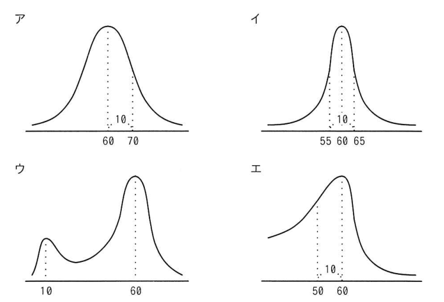
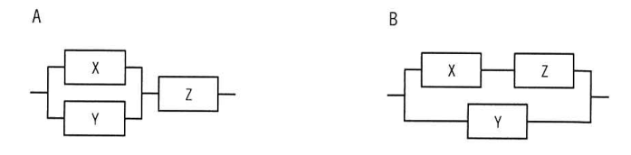
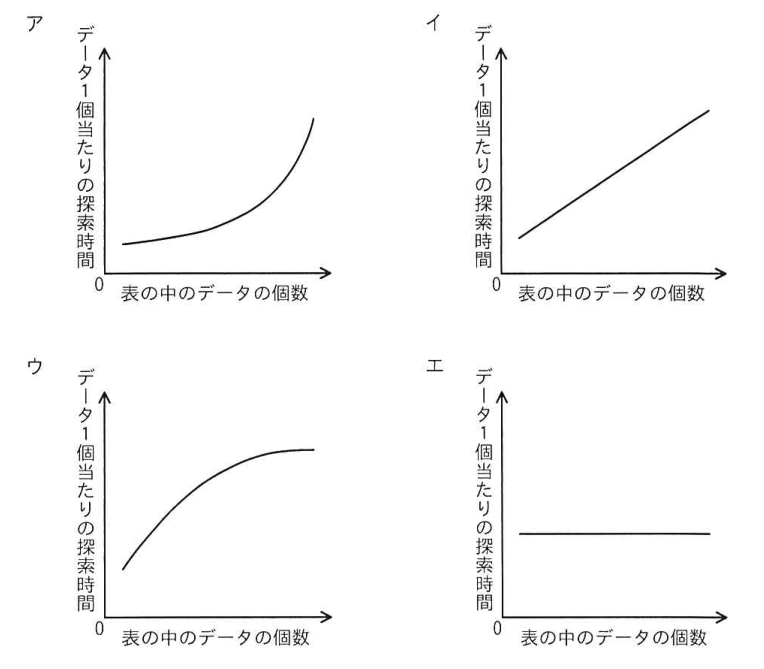
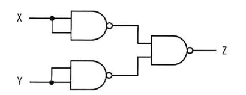
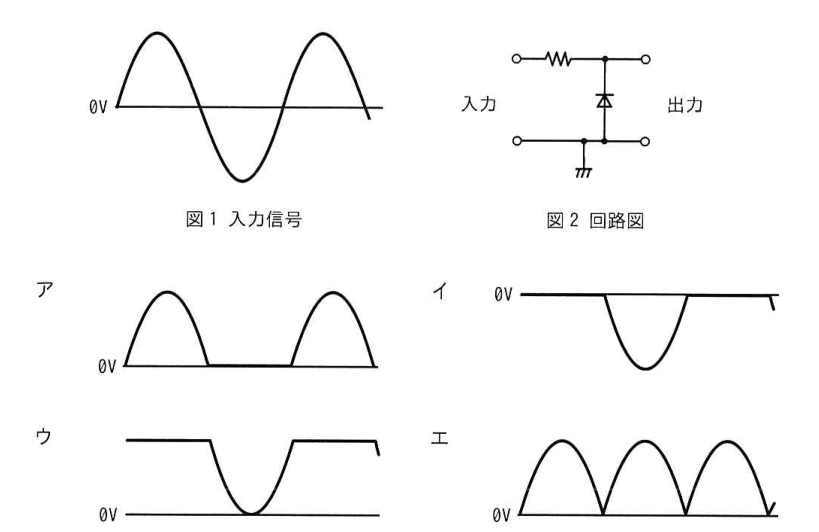
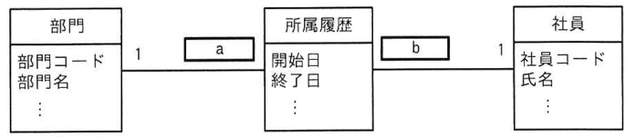
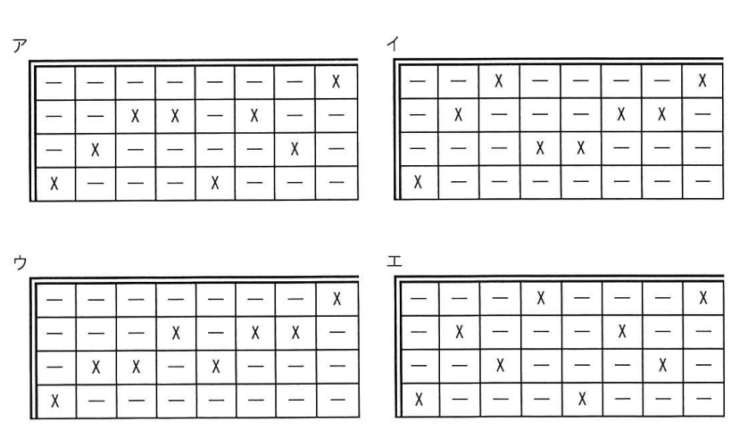
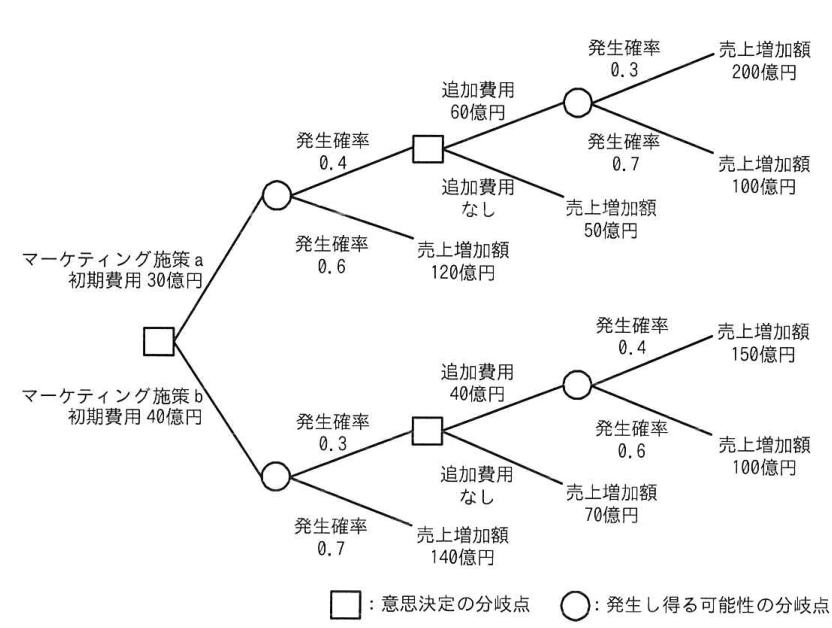

# 令和5年度春期 科目A（旧午前）過去問解説

> 令和5年度 春期 応用情報技術者試験 午前（全80問）を書き起こし、オリジナルの解説を付けたものです。問題の著作権は IPA（独立行政法人 情報処理推進機構）にあります。
> 図を表に書き換えるなど一部改変した問題には、その旨を記載しています。
> インタラクティブ教材の [科目A 四択クイズ](../../06_インタラクティブ教材/quiz.html) では、この回を本番形式（150分）で解けます。

## 目次

| 問 | 分野 | 中分類 | キーワード |
|---|---|---|---|
| [問1](#q01) | テクノロジ系 | 基礎理論 | ビット演算、論理積、マスク、2進数 |
| [問2](#q02) | テクノロジ系 | 基礎理論 | 正規分布、平均、標準偏差 |
| [問3](#q03) | テクノロジ系 | 基礎理論 | ROC曲線、真陽性率、偽陽性率、AUC |
| [問4](#q04) | テクノロジ系 | 基礎理論 | ドップラー効果、センサー、血流量 |
| [問5](#q05) | テクノロジ系 | アルゴリズムとプログラミング | best-fit、2分探索木、連結リスト、メモリ管理 |
| [問6](#q06) | テクノロジ系 | アルゴリズムとプログラミング | 線形探索、平均比較回数、期待値 |
| [問7](#q07) | テクノロジ系 | アルゴリズムとプログラミング | クイックソート、基準値、分割 |
| [問8](#q08) | テクノロジ系 | コンピュータ構成要素 | CPI、クロック周波数、MIPS |
| [問9](#q09) | テクノロジ系 | コンピュータ構成要素 | パイプライン、ステージ、サイクル数 |
| [問10](#q10) | テクノロジ系 | コンピュータ構成要素 | ライトスルー、ライトバック、キャッシュメモリ |
| [問11](#q11) | テクノロジ系 | コンピュータ構成要素 | ウェアレベリング、フラッシュメモリ、SSD、書換え回数 |
| [問12](#q12) | テクノロジ系 | コンピュータ構成要素 | 有機EL、ディスプレイ、液晶、プラズマ |
| [問13](#q13) | テクノロジ系 | システム構成要素 | スケールイン、スケールアウト、スケールアップ |
| [問14](#q14) | テクノロジ系 | システム構成要素 | 使用率、ジョブ、タイムチャート |
| [問15](#q15) | テクノロジ系 | システム構成要素 | フォールトトレランス、フェールセーフ、フェールソフト、フォールトアボイダンス |
| [問16](#q16) | テクノロジ系 | システム構成要素 | 稼働率、直列、並列、信頼性 |
| [問17](#q17) | テクノロジ系 | ソフトウェア | FIFO、ページ置換え、仮想記憶 |
| [問18](#q18) | テクノロジ系 | ソフトウェア | LRU、ページテーブル、ページフォールト、仮想記憶 |
| [問19](#q19) | テクノロジ系 | アルゴリズムとプログラミング | ハッシュ表、探索時間、計算量、O(1) |
| [問20](#q20) | テクノロジ系 | ソフトウェア | Docker、コンテナ型仮想化、OSS |
| [問21](#q21) | テクノロジ系 | ハードウェア | NAND、ド・モルガンの法則、論理回路 |
| [問22](#q22) | テクノロジ系 | ハードウェア | ダイオード、整流、クリッパ回路 |
| [問23](#q23) | テクノロジ系 | 基礎理論 | LiDAR、センサー、自動運転、ToF |
| [問24](#q24) | テクノロジ系 | コンピュータ構成要素 | NFC、近距離無線通信、非接触ICカード |
| [問25](#q25) | テクノロジ系 | 情報メディア | ラジオシティ法、レイトレーシング、テクスチャマッピング、CG |
| [問26](#q26) | テクノロジ系 | データベース | NoSQL、ドキュメントデータベース、JSON、スキーマレス |
| [問27](#q27) | テクノロジ系 | データベース | ストアドプロシージャ、トリガー、CALL文 |
| [問28](#q28) | テクノロジ系 | データベース | べき等、冪等性、原子性、直列化可能性 |
| [問29](#q29) | テクノロジ系 | データベース | UML、多重度、クラス図、E-R図 |
| [問30](#q30) | テクノロジ系 | データベース | 参照制約、ON DELETE CASCADE、外部キー |
| [問31](#q31) | テクノロジ系 | ネットワーク | PLC、電力線通信 |
| [問32](#q32) | テクノロジ系 | ネットワーク | 伝送時間、伝送速度、パケット |
| [問33](#q33) | テクノロジ系 | ネットワーク | イーサネットフレーム、カプセル化、MACアドレス、ポート番号 |
| [問34](#q34) | テクノロジ系 | ネットワーク | トランスポート層、UDP、TCP、OSI基本参照モデル |
| [問35](#q35) | テクノロジ系 | ネットワーク | ハンドオーバー、ローミング、モバイル通信 |
| [問36](#q36) | テクノロジ系 | セキュリティ | C&Cサーバ、ボットネット、ボット |
| [問37](#q37) | テクノロジ系 | セキュリティ | セキュアOS、強制アクセス制御、最小特権 |
| [問38](#q38) | テクノロジ系 | セキュリティ | デジタル署名、RSA、公開鍵、メッセージダイジェスト |
| [問39](#q39) | テクノロジ系 | セキュリティ | ISMAP、クラウドサービス、政府調達 |
| [問40](#q40) | テクノロジ系 | セキュリティ | CVE、CVSS、CWE、脆弱性 |
| [問41](#q41) | テクノロジ系 | セキュリティ | TPM、セキュリティチップ、耐タンパ性 |
| [問42](#q42) | テクノロジ系 | セキュリティ | デジタルフォレンジックス、証拠保全、インシデント対応 |
| [問43](#q43) | テクノロジ系 | セキュリティ | 公衆無線LAN、プライバシーセパレーター、SSID、MACアドレスフィルタリング |
| [問44](#q44) | テクノロジ系 | セキュリティ | サブミッションポート、SMTP-AUTH、OP25B |
| [問45](#q45) | テクノロジ系 | セキュリティ | 認証VLAN、VLAN、IEEE 802.1X、フリーアドレス |
| [問46](#q46) | テクノロジ系 | システム開発技術 | モジュール結合度、データ結合、モジュール強度 |
| [問47](#q47) | テクノロジ系 | システム開発技術 | 決定表、デシジョンテーブル |
| [問48](#q48) | テクノロジ系 | ソフトウェア開発管理技術 | スクラム、スプリント、レトロスペクティブ |
| [問49](#q49) | テクノロジ系 | ソフトウェア開発管理技術 | 特許権、実施許諾、先使用権、存続期間 |
| [問50](#q50) | テクノロジ系 | ソフトウェア開発管理技術 | プロビジョニング、IaC、構成管理ツール |
| [問51](#q51) | マネジメント系 | プロジェクトマネジメント | プロジェクト憲章、立ち上げ、PMBOK |
| [問52](#q52) | マネジメント系 | プロジェクトマネジメント | クリティカルチェーン法、合流バッファ、プロジェクトバッファ |
| [問53](#q53) | マネジメント系 | プロジェクトマネジメント | 作業配分モデル、期間比、進捗予測 |
| [問54](#q54) | マネジメント系 | プロジェクトマネジメント | デルファイ法、リスクの特定、ブレーンストーミング |
| [問55](#q55) | マネジメント系 | サービスマネジメント | 継続的改善、JIS Q 20000-1、SMS |
| [問56](#q56) | マネジメント系 | サービスマネジメント | サービスレベル管理、SLA、JIS Q 20000-1 |
| [問57](#q57) | マネジメント系 | サービスマネジメント | IaaS、PaaS、クラウドサービス、責任分界 |
| [問58](#q58) | マネジメント系 | システム監査 | 予備調査、システム監査基準、本調査 |
| [問59](#q59) | マネジメント系 | システム監査 | 監査技法、インタビュー法、CAAT |
| [問60](#q60) | マネジメント系 | システム監査 | 内部統制、内部監査人、モニタリング |
| [問61](#q61) | ストラテジ系 | システム戦略 | ROI、投資利益率、NPV |
| [問62](#q62) | ストラテジ系 | 経営戦略マネジメント | カスタマーエクスペリエンス、CEM、顧客体験 |
| [問63](#q63) | ストラテジ系 | システム戦略 | 情報銀行、パーソナルデータ、PDS、データ取引市場 |
| [問64](#q64) | ストラテジ系 | システム企画 | トレーサビリティ、要件定義、仕様変更 |
| [問65](#q65) | ストラテジ系 | システム企画 | RFI、RFP、調達 |
| [問66](#q66) | ストラテジ系 | システム企画 | 要件定義書、見積依頼、共通フレーム2013 |
| [問67](#q67) | ストラテジ系 | 経営戦略マネジメント | ROAS、広告費、Webマーケティング |
| [問68](#q68) | ストラテジ系 | 経営戦略マネジメント | 戦略マップ、バランススコアカード、BSC |
| [問69](#q69) | ストラテジ系 | 経営戦略マネジメント | フィージビリティスタディ、実行可能性、採算性 |
| [問70](#q70) | ストラテジ系 | 技術戦略マネジメント | 共同研究、産学連携、TLO |
| [問71](#q71) | ストラテジ系 | ビジネスインダストリ | エネルギーハーベスティング、環境発電、IoT、PoE |
| [問72](#q72) | ストラテジ系 | ビジネスインダストリ | アグリゲーションサービス、オムニチャネル、エスクロー、フランチャイズ |
| [問73](#q73) | ストラテジ系 | ビジネスインダストリ | デジタルツイン、IoT、シミュレーション、予知保全 |
| [問74](#q74) | ストラテジ系 | 企業活動 | 事業部制組織、職能別組織、プロジェクト組織 |
| [問75](#q75) | ストラテジ系 | 企業活動 | デシジョンツリー、期待値、意思決定 |
| [問76](#q76) | ストラテジ系 | 企業活動 | 原価計算基準、製造原価、経費、非原価項目 |
| [問77](#q77) | ストラテジ系 | 企業活動 | 変動費率、固定費、目標利益、損益分岐点 |
| [問78](#q78) | ストラテジ系 | 法務 | 下請法、3条書面、親事業者の義務 |
| [問79](#q79) | ストラテジ系 | 法務 | 労働者派遣法、派遣元事業主、派遣先 |
| [問80](#q80) | ストラテジ系 | 法務 | 集団思考、技術者倫理、グループシンク |

<a id="q01"></a>

### 問1　〔基礎理論〕 🧮

0 以上 255 以下の整数 n に対して，

```
          ┌ n+1  (0 ≦ n < 255)
next(n) = ┤
          └ 0    (n = 255)
```

と定義する。next(n) と等しい式はどれか。ここで，x AND y 及び x OR y は，それぞれ x と y を2進数表現にして，桁ごとの論理積及び論理和をとったものとする。

- **ア**　(n+1) AND 255
- **イ**　(n+1) AND 256
- **ウ**　(n+1) OR 255
- **エ**　(n+1) OR 256

<details><summary>解答・解説</summary>

**正解：ア**

255 は2進数で 1111 1111（下位8ビットがすべて 1）なので，(n+1) AND 255 は n+1 の下位8ビットだけを取り出す操作になる。n<255 なら n+1 はそのまま残り，n=255 のときは n+1=256（1 0000 0000）の下位8ビットが 0 になるので，next(n) と一致する。

**途中式**

- n=254 のとき：n+1 = 255 = 0 1111 1111 → AND 255 = 255 ✔
- n=255 のとき：n+1 = 256 = 1 0000 0000 → AND 0 1111 1111 = 0 ✔

- イ：256 = 1 0000 0000 との AND は第8ビットしか残らず，n<255 では 0 になってしまう
- ウ：255 との OR は下位8ビットがすべて 1 になり，常に 255 以上になる
- エ：256 との OR は n+1 に 256 を足したような値になり，n=255 でも 256 のままで 0 にならない

💡 **ポイント**：「AND 2^k−1」は 2^k で割った余り（下位 k ビットの取出し）と同じ。カウンタの周回（255 の次は 0）を作る定番のテクニック。

📖 関連：[基礎理論](../../01_テクノロジ系/01_基礎理論.md)

</details>

<sub>出典：令和5年度 春期 応用情報技術者試験 午前 問1（場合分けの数式をテキストで表記）</sub>

---

<a id="q02"></a>

### 問2　〔基礎理論〕

平均が 60，標準偏差が 10 の正規分布を表すグラフはどれか。



- **ア**　（図のア）
- **イ**　（図のイ）
- **ウ**　（図のウ）
- **エ**　（図のエ）

<details><summary>解答・解説</summary>

**正解：ア**

正規分布は平均を中心に左右対称な1つの山（釣鐘形）で，平均から ±1σ の位置が曲線の変曲点になる。山の頂点が 60 で，60 から 10 離れた 70 に標準偏差の目印があるアが該当する。

- イ：左右対称だが，標準偏差の目印が 60 ±5（55 と 65）で，標準偏差 5 の分布を表している
- ウ：山が二つある（双峰性の）分布で，正規分布ではない
- エ：左右非対称（左に裾が長い）分布で，正規分布ではない

💡 **ポイント**：正規分布では平均 ±1σ に約 68%，±2σ に約 95%，±3σ に約 99.7% のデータが入る。形の特徴は「単峰・左右対称・平均＝中央値＝最頻値」。

📖 関連：[基礎理論](../../01_テクノロジ系/01_基礎理論.md)

</details>

<sub>出典：令和5年度 春期 応用情報技術者試験 午前 問2</sub>

---

<a id="q03"></a>

### 問3　〔基礎理論〕

AI における機械学習で，2クラス分類モデルの評価方法として用いられる ROC 曲線の説明として，適切なものはどれか。

- **ア**　真陽性率と偽陽性率の関係を示す曲線である。
- **イ**　真陽性率と適合率の関係を示す曲線である。
- **ウ**　正解率と適合率の関係を示す曲線である。
- **エ**　適合率と偽陽性率の関係を示す曲線である。

<details><summary>解答・解説</summary>

**正解：ア**

ROC 曲線は，判定のしきい値を変えながら，横軸に偽陽性率（FPR），縦軸に真陽性率（TPR）をとってプロットした曲線である。左上に張り出すほど（AUC が 1 に近いほど）性能が良い。

- イ：真陽性率（再現率）と適合率の関係を示すのは PR 曲線
- ウ：正解率と適合率の組合せで描く代表的な評価曲線はない
- エ：適合率と偽陽性率の組合せも ROC 曲線ではない

💡 **ポイント**：真陽性率 TPR＝TP/(TP+FN)（再現率と同じ），偽陽性率 FPR＝FP/(FP+TN)，適合率＝TP/(TP+FP)。ROC＝TPR 対 FPR，PR 曲線＝適合率 対 再現率。

📖 関連：[基礎理論](../../01_テクノロジ系/01_基礎理論.md)

</details>

<sub>出典：令和5年度 春期 応用情報技術者試験 午前 問3</sub>

---

<a id="q04"></a>

### 問4　〔基礎理論〕

ドップラー効果を応用したセンサーで測定できるものはどれか。

- **ア**　血中酸素飽和度
- **イ**　血糖値
- **ウ**　血流量
- **エ**　体内水分量

<details><summary>解答・解説</summary>

**正解：ウ**

ドップラー効果は，動いている物体で反射した波の周波数が物体の速度に応じてずれる現象。超音波やレーザー光を血液に当て，反射波の周波数変化から血液の流れる速さ，つまり血流量を測定できる。

- ア：血中酸素飽和度は，赤色光と赤外光の吸収率の違いを利用するパルスオキシメーターで測る
- イ：血糖値は，酵素反応による電流を測る電極式センサーなどで測る
- エ：体内水分量は，体に微弱な電流を流して電気抵抗を測る生体インピーダンス法で推定する

💡 **ポイント**：ドップラー効果＝「動くものの速度」を測る原理。血流計のほか，スピードガンや気象レーダーにも使われる。

📖 関連：[基礎理論](../../01_テクノロジ系/01_基礎理論.md)

</details>

<sub>出典：令和5年度 春期 応用情報技術者試験 午前 問4</sub>

---

<a id="q05"></a>

### 問5　〔アルゴリズムとプログラミング〕

要求に応じて可変量のメモリを割り当てるメモリ管理方式がある。要求量以上の大きさをもつ空き領域のうちで最小のものを割り当てる最適適合（best-fit）アルゴリズムを用いる場合，空き領域を管理するためのデータ構造として，メモリ割当て時の平均処理時間が最も短いものはどれか。

- **ア**　空き領域のアドレスをキーとする2分探索木
- **イ**　空き領域の大きさが小さい順の片方向連結リスト
- **ウ**　空き領域の大きさをキーとする2分探索木
- **エ**　アドレスに対応したビットマップ

<details><summary>解答・解説</summary>

**正解：ウ**

best-fit では「要求量以上で最小の空き領域」を探す必要がある。空き領域の大きさをキーとする2分探索木なら，木をたどるだけで条件に合う最小の領域が平均 O(log n) で見つかる。

- ア：アドレス順の木では大きさの条件で絞り込めず，全ノードを調べる必要がある
- イ：大きさ順の連結リストは先頭から順にたどるので，平均 O(n) の時間がかかる
- エ：ビットマップは空き状況を順に走査して連続領域の大きさを数える必要があり遅い

💡 **ポイント**：探したい条件（ここでは大きさ）をキーにしたデータ構造を選ぶのが基本。2分探索木は平均 O(log n)，線形リストは O(n)。

📖 関連：[アルゴリズムとプログラミング](../../01_テクノロジ系/02_アルゴリズムとプログラミング.md)

</details>

<sub>出典：令和5年度 春期 応用情報技術者試験 午前 問5</sub>

---

<a id="q06"></a>

### 問6　〔アルゴリズムとプログラミング〕 🧮

従業員番号と氏名の対が n 件格納されている表に線形探索法を用いて，与えられた従業員番号から氏名を検索する。この処理における平均比較回数を求める式はどれか。ここで，検索する従業員番号はランダムに出現し，探索は常に表の先頭から行う。また，与えられた従業員番号がこの表に存在しない確率を a とする。

- **ア**　(n+1)na / 2
- **イ**　(n+1)(1−a) / 2
- **ウ**　(n+1)(1−a) / 2 ＋ n / 2
- **エ**　(n+1)(1−a) / 2 ＋ na

<details><summary>解答・解説</summary>

**正解：エ**

表に存在する場合（確率 1−a）は平均 (n+1)/2 回，存在しない場合（確率 a）は全件 n 回比較する。期待値は両者を確率で重み付けして足し合わせたものになる。

**途中式**

- 存在する場合：(1+2+…+n)/n = (n+1)/2 回
- 存在しない場合：n 回
- 平均比較回数 = (1−a) × (n+1)/2 ＋ a × n = **(n+1)(1−a)/2 ＋ na**

- ア：(n+1)/2 に na を掛けた形で，存在する場合（確率 1−a）を考慮しておらず，存在しない場合の n 回の比較とも合わない
- イ：存在する場合だけを考え，存在しない場合の n 回の比較を加えていない
- ウ：存在しない場合の比較回数に確率 a を掛けず，しかも n/2 としている

💡 **ポイント**：平均比較回数は「場合ごとの回数×その確率」の合計（期待値）。線形探索で見つかる場合は平均 (n+1)/2 回，見つからない場合は n 回。

📖 関連：[アルゴリズムとプログラミング](../../01_テクノロジ系/02_アルゴリズムとプログラミング.md)

</details>

<sub>出典：令和5年度 春期 応用情報技術者試験 午前 問6（分数をテキストで表記）</sub>

---

<a id="q07"></a>

### 問7　〔アルゴリズムとプログラミング〕 🧮

配列に格納されたデータ 2，3，5，4，1 に対して，クイックソートを用いて昇順に並べ替える。2回目の分割が終わった状態はどれか。ここで，分割は基準値より小さい値と大きい値のグループに分けるものとする。また，分割のたびに基準値はグループ内の配列の左端の値とし，グループ内の配列の値の順番は元の配列と同じとする。

- **ア**　1，2，3，5，4
- **イ**　1，2，5，4，3
- **ウ**　2，3，1，4，5
- **エ**　2，3，4，5，1

<details><summary>解答・解説</summary>

**正解：ア**

1回目は左端の 2 を基準に {1} と {3, 5, 4} に分かれ，2回目は要素が複数あるグループ {3, 5, 4} を左端の 3 で分割する。3 より小さい値はなく，大きい値は {5, 4} なので，配列は 1，2，3，5，4 となる。

**途中式**

- 1回目（基準値 2）：小 {1}，基準 2，大 {3, 5, 4}（元の順番を保持）→ 1，2，3，5，4
- 2回目（基準値 3）：小 {}，基準 3，大 {5, 4} → 1，2，3，5，4

- イ：{3, 5, 4} の基準値を 3 にせず，順番も元の配列と異なる
- ウ：分割の考え方と合わない（基準値 2 より小さい 1 が右側にある）
- エ：元の配列の 1 を末尾に移しただけで，分割になっていない

💡 **ポイント**：クイックソートは「基準値（ピボット）より小さいグループ・大きいグループに分け，各グループに同じ処理を再帰的に適用する」。平均 O(n log n)，最悪 O(n^2)。

📖 関連：[アルゴリズムとプログラミング](../../01_テクノロジ系/02_アルゴリズムとプログラミング.md)

</details>

<sub>出典：令和5年度 春期 応用情報技術者試験 午前 問7</sub>

---

<a id="q08"></a>

### 問8　〔コンピュータ構成要素〕 🧮

動作周波数 1.25GHz のシングルコア CPU が1秒間に 10 億回の命令を実行するとき，この CPU の平均 CPI（Cycles Per Instruction）として，適切なものはどれか。

- **ア**　0.8
- **イ**　1.25
- **ウ**　2.5
- **エ**　10

<details><summary>解答・解説</summary>

**正解：イ**

CPI は1命令当たりに必要なクロック数。1秒間のクロック数 1.25×10^9 を1秒間の命令数 10×10^8＝1×10^9 で割ると 1.25 になる。

**途中式**

- CPI = 1秒間のクロック数 / 1秒間の命令数
- = 1.25×10^9 / 1.0×10^9 = **1.25**

- ア：命令数÷クロック数（1命令当たりではなく1クロック当たりの命令数，IPC）を計算した値
- ウ：クロック数を2倍するなど単位の取り違え
- エ：10 億回の「10」をそのまま用いた誤り

💡 **ポイント**：CPI＝クロック周波数÷命令実行数（1秒当たり）。逆数の IPC，1命令の実行時間＝CPI×クロック周期 もセットで覚える。

📖 関連：[コンピュータ構成要素](../../01_テクノロジ系/03_コンピュータ構成要素.md)

</details>

<sub>出典：令和5年度 春期 応用情報技術者試験 午前 問8</sub>

---

<a id="q09"></a>

### 問9　〔コンピュータ構成要素〕 🧮

全ての命令が5ステージで完了するように設計された，パイプライン制御の CPU がある。20 命令を実行するには何サイクル必要となるか。ここで，全ての命令は途中で停止することなく実行でき，パイプラインの各ステージは1サイクルで動作を完了するものとする。

- **ア**　20
- **イ**　21
- **ウ**　24
- **エ**　25

<details><summary>解答・解説</summary>

**正解：ウ**

最初の命令が5サイクルで完了し，その後は1サイクルごとに1命令ずつ完了する。よって 5＋(20−1)＝24 サイクル。

**途中式**

- サイクル数 = ステージ数 ＋ (命令数 − 1)
- = 5 ＋ (20 − 1) = **24**

- ア：1サイクルに1命令完了するとして，最初の命令がパイプラインを満たすまでの時間を無視している
- イ：ステージ数を2として計算したような値
- エ：命令数＋ステージ数で，1を引き忘れている

💡 **ポイント**：k 段パイプラインで n 命令を実行するサイクル数は k＋(n−1)。分岐やハザードで止まる場合はその分が加算される。

📖 関連：[コンピュータ構成要素](../../01_テクノロジ系/03_コンピュータ構成要素.md)

</details>

<sub>出典：令和5年度 春期 応用情報技術者試験 午前 問9</sub>

---

<a id="q10"></a>

### 問10　〔コンピュータ構成要素〕

キャッシュメモリへの書込み動作には，ライトスルー方式とライトバック方式がある。それぞれの特徴のうち，適切なものはどれか。

- **ア**　ライトスルー方式では，データをキャッシュメモリだけに書き込むので，高速に書込みができる。
- **イ**　ライトスルー方式では，データをキャッシュメモリと主記憶の両方に同時に書き込むので，主記憶の内容は常にキャッシュメモリの内容と一致する。
- **ウ**　ライトバック方式では，データをキャッシュメモリと主記憶の両方に同時に書き込むので，速度が遅い。
- **エ**　ライトバック方式では，読出し時にキャッシュミスが発生してキャッシュメモリの内容が追い出されるときに，主記憶に書き戻す必要が生じることはない。

<details><summary>解答・解説</summary>

**正解：イ**

ライトスルー方式は書込みのたびにキャッシュと主記憶の両方を更新するため，主記憶の内容は常にキャッシュと一致する（その代わり書込みは遅い）。

- ア：キャッシュだけに書き込むのはライトバック方式の特徴
- ウ：両方に同時に書き込むのはライトスルー方式。ライトバック方式はキャッシュだけに書くので高速
- エ：ライトバック方式では，更新済みのブロックが追い出されるときに主記憶へ書き戻す必要がある

💡 **ポイント**：ライトスルー＝常に一致・書込み遅い，ライトバック＝追い出し時に書き戻し・高速だが一時的に不一致。

📖 関連：[コンピュータ構成要素](../../01_テクノロジ系/03_コンピュータ構成要素.md)

</details>

<sub>出典：令和5年度 春期 応用情報技術者試験 午前 問10</sub>

---

<a id="q11"></a>

### 問11　〔コンピュータ構成要素〕

フラッシュメモリにおけるウェアレベリングの説明として，適切なものはどれか。

- **ア**　各ブロックの書込み回数がなるべく均等になるように，物理的な書込み位置を選択する。
- **イ**　記憶するセルの電子の量に応じて，複数のビット情報を記録する。
- **ウ**　不良のブロックを検出し，交換領域にある正常な別のブロックで置き換える。
- **エ**　ブロック単位でデータを消去し，新しいデータを書き込む。

<details><summary>解答・解説</summary>

**正解：ア**

フラッシュメモリはブロックごとに書換え可能回数に上限がある。ウェアレベリングは，書込み先を分散させて各ブロックの書換え回数を平準化し，特定ブロックだけが先に劣化するのを防ぐ技術である。

- イ：1セルに複数ビットを記録する MLC／TLC などの多値記録の説明
- ウ：不良ブロック管理（代替処理）の説明
- エ：フラッシュメモリの書換えの基本動作（ブロック単位の一括消去）の説明

💡 **ポイント**：wear（摩耗）を level（平らに）する，と覚える。SSD の寿命を延ばすためのコントローラの機能。

📖 関連：[コンピュータ構成要素](../../01_テクノロジ系/03_コンピュータ構成要素.md)

</details>

<sub>出典：令和5年度 春期 応用情報技術者試験 午前 問11</sub>

---

<a id="q12"></a>

### 問12　〔コンピュータ構成要素〕

有機 EL ディスプレイの説明として，適切なものはどれか。

- **ア**　電圧をかけて発光素子を発光させて表示する。
- **イ**　電子ビームが発光体に衝突して生じる発光で表示する。
- **ウ**　透過する光の量を制御することで表示する。
- **エ**　放電によって発生した紫外線で，蛍光体を発光させて表示する。

<details><summary>解答・解説</summary>

**正解：ア**

有機 EL ディスプレイは，有機化合物に電圧をかけると自ら発光する性質を利用する。自発光なのでバックライトが不要で，薄型化・高コントラストが可能。

- イ：CRT（ブラウン管）ディスプレイの説明
- ウ：液晶ディスプレイの説明。バックライトの光の透過量を液晶で制御する
- エ：プラズマディスプレイの説明

💡 **ポイント**：自ら光るのは有機 EL・プラズマ・CRT，光らないのは液晶（バックライトが必要）。

📖 関連：[コンピュータ構成要素](../../01_テクノロジ系/03_コンピュータ構成要素.md)

</details>

<sub>出典：令和5年度 春期 応用情報技術者試験 午前 問12</sub>

---

<a id="q13"></a>

### 問13　〔システム構成要素〕

スケールインの説明として，適切なものはどれか。

- **ア**　想定される CPU 使用率に対して，サーバの能力が過剰なとき，CPU の能力を減らすこと
- **イ**　想定されるシステムの処理量に対して，サーバの台数が過剰なとき，サーバの台数を減らすこと
- **ウ**　想定されるシステムの処理量に対して，サーバの台数が不足するとき，サーバの台数を増やすこと
- **エ**　想定されるメモリ使用率に対して，サーバの能力が不足するとき，メモリの容量を増やすこと

<details><summary>解答・解説</summary>

**正解：イ**

スケールインは，処理量に対してサーバ台数が多すぎるときに台数を減らすこと。クラウドでは負荷に応じて台数を自動で増減させる（オートスケール）。

- ア：個々のサーバの性能を下げるスケールダウンの説明
- ウ：サーバ台数を増やすスケールアウトの説明
- エ：個々のサーバの性能を上げるスケールアップの説明

💡 **ポイント**：台数を増減＝スケールアウト／イン（水平），性能を増減＝スケールアップ／ダウン（垂直）。

📖 関連：[システム構成要素](../../01_テクノロジ系/04_システム構成要素.md)

</details>

<sub>出典：令和5年度 春期 応用情報技術者試験 午前 問13</sub>

---

<a id="q14"></a>

### 問14　〔システム構成要素〕 🧮

CPU と磁気ディスク装置で構成されるシステムで，表に示すジョブ A，B を実行する。この二つのジョブが実行を終了するまでの CPU の使用率と磁気ディスク装置の使用率との組合せのうち，適切なものはどれか。ここで，ジョブ A，B はシステムの動作開始時点ではいずれも実行可能状態にあり，A，B の順で実行される。CPU 及び磁気ディスク装置は，ともに一つの要求だけを発生順に処理する。ジョブ A，B とも，CPU の処理を終了した後，磁気ディスク装置の処理を実行する。

単位 秒

| ジョブ | CPU の処理時間 | 磁気ディスク装置の処理時間 |
|---|---|---|
| A | 3 | 7 |
| B | 12 | 10 |

- **ア**　CPU の使用率：0.47，磁気ディスク装置の使用率：0.53
- **イ**　CPU の使用率：0.60，磁気ディスク装置の使用率：0.68
- **ウ**　CPU の使用率：0.79，磁気ディスク装置の使用率：0.89
- **エ**　CPU の使用率：0.88，磁気ディスク装置の使用率：1.00

<details><summary>解答・解説</summary>

**正解：イ**

タイムチャートを描くと，全体の終了は 25 秒。CPU は 15 秒，磁気ディスク装置は 17 秒使われているので，使用率は 15/25＝0.60，17/25＝0.68。

**途中式**

- CPU：A が 0〜3 秒，B が 3〜15 秒
- ディスク：A が 3〜10 秒，B は CPU 処理終了後の 15〜25 秒
- 全体の経過時間 = 25 秒
- CPU 使用率 = (3＋12)/25 = **0.60**
- ディスク使用率 = (7＋10)/25 = **0.68**

- ア：分母を処理時間の合計 32 秒（3＋12＋7＋10）とした値（15/32≒0.47，17/32≒0.53）
- ウ：分母を 19 秒とした値（15/19≒0.79，17/19≒0.89）。全体の経過時間を誤っている
- エ：分母を 17 秒（ディスクの稼働時間）とした値（15/17≒0.88，17/17＝1.00）

💡 **ポイント**：使用率＝装置が動いていた時間÷全体の経過時間。CPU と I/O が並行して動く問題は，必ずタイムチャートを描いて全体の終了時刻を求める。

📖 関連：[システム構成要素](../../01_テクノロジ系/04_システム構成要素.md)

</details>

<sub>出典：令和5年度 春期 応用情報技術者試験 午前 問14（選択肢の表を文章に書き換え）</sub>

---

<a id="q15"></a>

### 問15　〔システム構成要素〕

コンピュータシステムの信頼性を高める技術に関する記述として，適切なものはどれか。

- **ア**　フェールセーフは，構成部品の信頼性を高めて，故障が起きないようにする技術である。
- **イ**　フェールソフトは，ソフトウェアに起因するシステムフォールトに対処するための技術である。
- **ウ**　フォールトアボイダンスは，構成部品に故障が発生しても運用を継続できるようにする技術である。
- **エ**　フォールトトレランスは，システムを構成する重要部品を多重化して，故障に備える技術である。

<details><summary>解答・解説</summary>

**正解：エ**

フォールトトレランスは，重要部品を多重化（冗長化）しておき，一部が故障してもシステム全体としては正常に動作を続けられるようにする考え方である。

- ア：構成部品の信頼性を高めて故障を起こさないのはフォールトアボイダンス。フェールセーフは故障時に安全側に倒す設計
- イ：フェールソフトは，故障時に機能を縮退させてでも運転を続ける設計で，ソフトウェア起因に限らない
- ウ：故障が発生しても運用を継続するのはフォールトトレランス（やフェールソフト）の説明

💡 **ポイント**：アボイダンス＝故障を避ける，トレランス＝故障に耐える（多重化），フェールセーフ＝安全側に止める，フェールソフト＝縮退して続ける，フールプルーフ＝誤操作を防ぐ。

📖 関連：[システム構成要素](../../01_テクノロジ系/04_システム構成要素.md)

</details>

<sub>出典：令和5年度 春期 応用情報技術者試験 午前 問15</sub>

---

<a id="q16"></a>

### 問16　〔システム構成要素〕 🧮

3台の装置 X〜Z を接続したシステム A，B の稼働率に関する記述のうち，適切なものはどれか。ここで，3台の装置の稼働率は，いずれも 0 より大きく 1 より小さいものとし，並列に接続されている部分は，どちらか一方が稼働していればよいものとする。

（図：A は X と Y を並列に接続したものに Z を直列に接続。B は X と Z を直列に接続したものに Y を並列に接続）



- **ア**　各装置の稼働率の値によって，A と B の稼働率のどちらが高いかは変化する。
- **イ**　常に A と B の稼働率は等しい。
- **ウ**　常に A の稼働率は B より高い。
- **エ**　常に B の稼働率は A より高い。

<details><summary>解答・解説</summary>

**正解：エ**

X，Y，Z の稼働率をそれぞれ x，y，z として式を立てると，B−A＝y(1−z) となり，0<y<1，0<z<1 なので常に正。よって B の稼働率のほうが常に高い。

**途中式**

- A＝{1−(1−x)(1−y)}×z ＝ xz＋yz−xyz
- B＝1−(1−xz)(1−y) ＝ xz＋y−xyz
- B−A ＝ y−yz ＝ y(1−z) ＞ 0

- ア：差 y(1−z) は稼働率の値にかかわらず常に正なので，大小は変化しない
- イ：y(1−z) が 0 になるのは y＝0 か z＝1 のときだけで，条件から等しくはならない
- ウ：A は Z が停止すると必ず全体が止まるので，B より低い

💡 **ポイント**：直列＝a×b，並列＝1−(1−a)(1−b)。大小比較は文字のまま差をとると一般的に判断できる。直感的には，単独の装置が全体を止める「単一障害点」が少ない構成ほど稼働率が高い。

📖 関連：[システム構成要素](../../01_テクノロジ系/04_システム構成要素.md)

</details>

<sub>出典：令和5年度 春期 応用情報技術者試験 午前 問16（図の接続構成を文章で補記）</sub>

---

<a id="q17"></a>

### 問17　〔ソフトウェア〕 🧮

仮想記憶システムにおいて，ページ置換えアルゴリズムとして FIFO を採用して，仮想ページ参照列 1，4，2，4，1，3 を3ページ枠の実記憶に割り当てて処理を行った。表の割当てステップ“3”までは，仮想ページ参照列中の最初の 1，4，2 をそれぞれ実記憶に割り当てた直後の実記憶ページの状態を示している。残りを全て参照した直後の実記憶ページの状態を示す太枠部分に該当するものはどれか。

| 割当てステップ | 参照する仮想ページ番号 | 実記憶ページの状態 | | |
|---|---|---|---|---|
| 1 | 1 | 1 | − | − |
| 2 | 4 | 1 | 4 | − |
| 3 | 2 | 1 | 4 | 2 |
| 4 | 4 | | | |
| 5 | 1 | | | |
| 6 | 3 | **（太枠）** | | |

- **ア**　1，3，4
- **イ**　1，4，3
- **ウ**　3，4，2
- **エ**　4，1，3

<details><summary>解答・解説</summary>

**正解：ウ**

ステップ4（ページ4）と5（ページ1）はすでに実記憶にあるので置換えは起きない。ステップ6でページ3を参照するとページフォールトが発生し，FIFO なので最も早く読み込まれたページ1が追い出される。1 があった枠に 3 が入り，3，4，2 になる。

**途中式**

| ステップ | 参照 | 状態 | 備考 |
|---|---|---|---|
| 4 | 4 | 1，4，2 | ヒット |
| 5 | 1 | 1，4，2 | ヒット |
| 6 | 3 | **3，4，2** | 最古の 1 を追い出す |

- ア：ページ2を追い出しているうえ，枠の位置も変わっている
- イ：ページ2を追い出しており，FIFO では誤り（2 は最後に読み込まれた）
- エ：枠の位置を詰め直して並べた形で，置換えは元の枠の位置で行われる

💡 **ポイント**：FIFO は「読み込まれた順」，LRU は「最後に参照された順」で追い出す。ヒットしても FIFO の順番は変わらないが，LRU では変わる点に注意。

📖 関連：[ソフトウェア](../../01_テクノロジ系/05_ソフトウェア.md)

</details>

<sub>出典：令和5年度 春期 応用情報技術者試験 午前 問17（表を GFM の表に，選択肢の枠を文字列に書き換え）</sub>

---

<a id="q18"></a>

### 問18　〔ソフトウェア〕

仮想記憶方式に関する記述のうち，適切なものはどれか。

- **ア**　LRU アルゴリズムは，使用後の経過時間が最長のページを置換対象とするページ置換アルゴリズムである。
- **イ**　アドレス変換をインデックス方式で行う場合は，主記憶に存在する全ページ分のページテーブルが必要になる。
- **ウ**　ページフォールトが発生した場合は，ガーベジコレクションが必要である。
- **エ**　ページングが繰り返されるうちに多数の小さな空きメモリ領域が発生することを，フラグメンテーションという。

<details><summary>解答・解説</summary>

**正解：ア**

LRU（Least Recently Used）は，最後に使われてから最も長い時間が経過したページを追い出すアルゴリズムで，記述のとおり。

- イ：ページテーブルは主記憶上のページではなく，仮想アドレス空間の全ページ分が必要
- ウ：ページフォールト時に必要なのはページイン（補助記憶から主記憶への読込み）。ガーベジコレクションは不要領域の回収
- エ：ページングは固定長のページ単位で管理するので，可変長割当てのような小さな空き領域の断片化（外部フラグメンテーション）は起きにくい

💡 **ポイント**：LRU＝最も長く使われていない，LFU＝使用回数が最も少ない，FIFO＝最も古く読み込まれた。

📖 関連：[ソフトウェア](../../01_テクノロジ系/05_ソフトウェア.md)

</details>

<sub>出典：令和5年度 春期 応用情報技術者試験 午前 問18</sub>

---

<a id="q19"></a>

### 問19　〔アルゴリズムとプログラミング〕

ハッシュ表の理論的な探索時間を示すグラフはどれか。ここで，複数のデータが同じハッシュ値になることはないものとする。

（各グラフとも，横軸は表の中のデータの個数，縦軸はデータ1個当たりの探索時間）



- **ア**　（図のア：データ数の増加とともに急激に増える曲線）
- **イ**　（図のイ：データ数に比例して増える直線）
- **ウ**　（図のウ：増加が次第に緩やかになる曲線）
- **エ**　（図のエ：データ数によらず一定の水平線）

<details><summary>解答・解説</summary>

**正解：エ**

ハッシュ表探索は，キーからハッシュ関数で格納位置を直接計算するので，衝突（シノニム）がなければデータ数に関係なく一定時間 O(1) で探索できる。よって水平線のエ。

- ア：データ数とともに急増する曲線は，指数関数的・多項式的に増える場合の形
- イ：データ数に比例する直線は，線形探索 O(n) の形
- ウ：増加が緩やかになる曲線は，2分探索 O(log n) の形

💡 **ポイント**：探索の計算量は 線形探索 O(n)，2分探索 O(log n)，ハッシュ O(1)（衝突なしの場合）。

📖 関連：[アルゴリズムとプログラミング](../../01_テクノロジ系/02_アルゴリズムとプログラミング.md)

</details>

<sub>出典：令和5年度 春期 応用情報技術者試験 午前 問19（選択肢のグラフに形状の説明を補記）</sub>

---

<a id="q20"></a>

### 問20　〔ソフトウェア〕

コンテナ型仮想化の環境であって，アプリケーションソフトウェアの構築，実行，管理を行うためのプラットフォームを提供する OSS はどれか。

- **ア**　Docker
- **イ**　KVM
- **ウ**　QEMU
- **エ**　Xen

<details><summary>解答・解説</summary>

**正解：ア**

Docker は，ホスト OS のカーネルを共有しながらアプリケーションを隔離された「コンテナ」として構築・実行・管理する OSS のプラットフォームである。

- イ：KVM は Linux カーネルに組み込まれたハイパーバイザ型の仮想化機能
- ウ：QEMU はハードウェアをエミュレートするプロセッサエミュレーター（KVM と組み合わせて使われることが多い）
- エ：Xen はハイパーバイザ型（ベアメタル型）の仮想化ソフトウェア

💡 **ポイント**：コンテナ型は OS を共有するので軽量・高速に起動できる。複数のコンテナを管理するオーケストレーションツールが Kubernetes。

📖 関連：[ソフトウェア](../../01_テクノロジ系/05_ソフトウェア.md)

</details>

<sub>出典：令和5年度 春期 応用情報技術者試験 午前 問20</sub>

---

<a id="q21"></a>

### 問21　〔ハードウェア〕

NAND 素子を用いた次の組合せ回路の出力 Z を表す式はどれか。ここで，論理式中の“・”は論理積，“＋”は論理和，“X̅”は X の否定を表す。

（図：X を2入力とも同じ入力に接続した NAND 素子の出力と，Y を同様に接続した NAND 素子の出力を，3個目の NAND 素子に入力し，その出力を Z とする）



- **ア**　X・Y
- **イ**　X＋Y
- **ウ**　X・Y の否定（X・Y 全体に上線）
- **エ**　X＋Y の否定（X＋Y 全体に上線）

<details><summary>解答・解説</summary>

**正解：イ**

入力を2本ともつないだ NAND は NOT と同じ働きをするので，最終段の NAND には X̅ と Y̅ が入る。ド・モルガンの法則により，Z＝NOT(X̅・Y̅)＝X＋Y となる。

**途中式**

- 前段：‾(X・X)＝X̅，‾(Y・Y)＝Y̅
- 最終段：Z＝NOT(X̅・Y̅)＝NOT(X̅)＋NOT(Y̅)＝**X＋Y**（ド・モルガンの法則）

- ア：X・Y（AND）は，NAND の出力をもう一度 NAND で反転した構成（NAND→NOT）で得られる
- ウ：X・Y の否定は NAND 素子1個そのもの
- エ：X＋Y の否定（NOR）は，この回路の出力をさらに反転したもの

💡 **ポイント**：NAND だけで NOT・AND・OR を作れる（万能ゲート）。「入力を反転してから NAND」＝OR になる。

📖 関連：[ハードウェア](../../01_テクノロジ系/10_ハードウェア.md)

</details>

<sub>出典：令和5年度 春期 応用情報技術者試験 午前 問21（回路図の接続を文章で補記，全体にかかる否定の上線を文章で表記）</sub>

---

<a id="q22"></a>

### 問22　〔ハードウェア〕

図1の電圧波形の信号を，図2の回路に入力したときの出力電圧の波形はどれか。ここで，ダイオードの順電圧は 0V であるとする。



- **ア**　（図のア）
- **イ**　（図のイ）
- **ウ**　（図のウ）
- **エ**　（図のエ）

<details><summary>解答・解説</summary>

**正解：ア**

図2のダイオードは，アノード側がグラウンド，カソード側が出力端子につながっている。入力が正のときは逆方向なので電流が流れず，入力電圧がそのまま出力される。入力が負のときは順方向に導通して出力が 0V に固定される。結果として正の半波だけが残るアの波形になる。

- イ：負の半波だけを残す波形。ダイオードの向きが逆の場合の出力
- ウ：0V を下限として負の部分だけが下に出る波形で，この回路の動作とは合わない
- エ：負の半波を反転させた全波整流の波形。ダイオード1個のこの回路では得られない

💡 **ポイント**：ダイオードはアノード→カソードの向きにだけ電流を流す。出力とグラウンドの間に入ったダイオードが導通すると，その間の電圧は順電圧（ここでは 0V）に固定される。

📖 関連：[ハードウェア](../../01_テクノロジ系/10_ハードウェア.md)

</details>

<sub>出典：令和5年度 春期 応用情報技術者試験 午前 問22</sub>

---

<a id="q23"></a>

### 問23　〔基礎理論〕

車の自動運転に使われるセンサーの一つである LiDAR の説明として，適切なものはどれか。

- **ア**　超音波を送出し，その反射波を測定することによって，対象物の有無の検知及び対象物までの距離の計測を行う。
- **イ**　道路の幅及び車線は無限遠の地平線で一点（消失点）に収束する，という遠近法の原理を利用して，対象物までの距離を計測する。
- **ウ**　ミリ波帯の電磁波を送出し，その反射波を測定することによって，対象物の有無の検知及び対象物までの距離の計測を行う。
- **エ**　レーザー光をパルス状に照射し，その反射光を測定することによって，対象物の方向，距離及び形状を計測する。

<details><summary>解答・解説</summary>

**正解：エ**

LiDAR（Light Detection and Ranging）は，レーザー光をパルス状に照射し，反射光が戻るまでの時間などから対象物までの距離を測る。走査することで方向や立体形状まで計測できる。

- ア：超音波センサー（ソナー）の説明。駐車時の近距離検知などに使う
- イ：単眼カメラによる画像処理での距離推定の説明
- ウ：ミリ波レーダーの説明。悪天候に強いが，形状の識別は LiDAR より苦手

💡 **ポイント**：自動運転のセンサーは 超音波＝近距離，ミリ波レーダー＝天候に強い，LiDAR＝レーザーで高精度に形状まで，カメラ＝色や標識の認識，と特徴で区別する。

📖 関連：[基礎理論](../../01_テクノロジ系/01_基礎理論.md)

</details>

<sub>出典：令和5年度 春期 応用情報技術者試験 午前 問23</sub>

---

<a id="q24"></a>

### 問24　〔コンピュータ構成要素〕

NFC（Near Field Communication）の説明として，適切なものはどれか。

- **ア**　静電容量式のタッチセンサーで，位置情報を検出するために用いられる。
- **イ**　接触式 IC カードの通信方法として利用される。
- **ウ**　通信距離は最大 10m 程度である。
- **エ**　ピアツーピアで通信する機能を備えている。

<details><summary>解答・解説</summary>

**正解：エ**

NFC は 13.56MHz 帯を使う通信距離 10cm 程度の近距離無線通信規格である。カードの読み書き（リーダー／ライター）だけでなく，スマートフォン同士など機器間で直接データをやり取りするピアツーピア（P2P）モードも備えている。

- ア：静電容量式タッチパネルなどの説明で，NFC は通信規格
- イ：NFC は非接触 IC カード（FeliCa など）の通信方式で，接触式ではない
- ウ：通信距離は数 cm〜10cm 程度。10m 程度は Bluetooth などの範囲

💡 **ポイント**：NFC の動作モードは「カードエミュレーション」「リーダー／ライター」「P2P」の三つ。かざすだけの近距離通信がキーワード。

📖 関連：[コンピュータ構成要素](../../01_テクノロジ系/03_コンピュータ構成要素.md)

</details>

<sub>出典：令和5年度 春期 応用情報技術者試験 午前 問24</sub>

---

<a id="q25"></a>

### 問25　〔情報メディア〕

コンピュータグラフィックスに関する記述のうち，適切なものはどれか。

- **ア**　テクスチャマッピングは，全てのピクセルについて，視線と全ての物体との交点を計算し，その中から視点に最も近い交点を選択することによって，隠面消去を行う。
- **イ**　メタボールは，反射・透過方向への視線追跡を行わず，与えられた空間中のデータから輝度を計算する。
- **ウ**　ラジオシティ法は，拡散反射面間の相互反射による効果を考慮して拡散反射面の輝度を決める。
- **エ**　レイトレーシングは，形状が定義された物体の表面に，別に定義された模様を張り付けて画像を作成する。

<details><summary>解答・解説</summary>

**正解：ウ**

ラジオシティ法は，光が拡散反射面どうしで何度も反射し合う効果（相互反射）を計算して，間接光を含めた面の明るさを求める手法で，記述のとおり。

- ア：視線と物体の交点から最も近いものを選んで隠面消去するのは，レイトレーシング（レイキャスティング）や Z バッファ法の考え方
- イ：メタボールは，球などの影響範囲が融合し合う滑らかな曲面で物体の形状を表現する手法。記述はボリュームレンダリングに近い
- エ：物体の表面に模様を張り付けるのはテクスチャマッピングの説明

💡 **ポイント**：レイトレーシング＝視線を追跡して反射・屈折を表現，ラジオシティ＝拡散反射の相互反射（間接光），テクスチャマッピング＝模様の張り付け，メタボール＝柔らかい曲面のモデリング。

</details>

<sub>出典：令和5年度 春期 応用情報技術者試験 午前 問25</sub>

---

<a id="q26"></a>

### 問26　〔データベース〕

JSON 形式で表現される図1，図2のような商品データを複数の Web サービスから取得し，商品データベースとして蓄積する際のデータの格納方法に関する記述のうち，適切なものはどれか。ここで，商品データの取得元となる Web サービスは随時変更され，項目数や内容は予測できない。したがって，商品データベースの検索時に使用するキーにはあらかじめ制限を設けない。

図1 A 社 Web サービスの商品データ

```
{
  "_id":"AA09",
  "品名":"47 型テレビ",
  "価格":"オープンプライス",
  "関連商品 id": [
    "AA101",
    "BC06"
  ]
}
```

図2 B 社 Web サービスの商品データ

```
{
  "_id":"AA10",
  "商品名":"りんご",
  "生産地":"青森",
  "価格":100,
  "画像 URL":"http://www.example.com/apple.jpg"
}
```

- **ア**　階層型データベースを使用し，項目名を上位階層とし，値を下位階層とした2階層でデータを格納する。
- **イ**　グラフデータベースを使用し，商品データの項目名の集合から成るノードと値の集合から成るノードを作り，二つのノードを関係付けたグラフとしてデータを格納する。
- **ウ**　ドキュメントデータベースを使用し，項目構成の違いを区別せず，商品データ単位にデータを格納する。
- **エ**　関係データベースを使用し，商品データの各項目名を個別の列名とした表を定義してデータを格納する。

<details><summary>解答・解説</summary>

**正解：ウ**

項目構成がデータごとに異なり予測できない JSON データは，スキーマを事前に定義しなくてよいドキュメントデータベース（NoSQL の一種）に，1件の商品データを1ドキュメントとしてそのまま格納するのが適している。

- ア：階層型データベースは親子関係を事前に定義する必要があり，項目名と値の2階層にしても「どの値がどの商品のものか」が表せない
- イ：グラフデータベースはノード間の関係（つながり）を扱うのに向く。項目名と値を別ノードにしても商品単位の検索に向かない
- エ：関係データベースは列（スキーマ）を事前に定義する必要があり，項目が予測できない場合には向かない

💡 **ポイント**：NoSQL の種類：キーバリュー型（単純な値），ドキュメント型（JSON などの可変構造），列指向型（大量データの集計），グラフ型（関係のネットワーク）。

📖 関連：[データベース](../../01_テクノロジ系/06_データベース.md)

</details>

<sub>出典：令和5年度 春期 応用情報技術者試験 午前 問26（図の JSON をコードブロックで表記）</sub>

---

<a id="q27"></a>

### 問27　〔データベース〕

クライアントサーバシステムにおけるストアドプロシージャの記述として，誤っているものはどれか。

- **ア**　アプリケーションから一つずつ SQL 文を送信する必要がなくなる。
- **イ**　クライアント側の CALL 文によって実行される。
- **ウ**　サーバとクライアントの間での通信トラフィックを軽減することができる。
- **エ**　データの変更を行うときに，あらかじめ DBMS に定義しておいた処理を自動的に起動・実行するものである。

<details><summary>解答・解説</summary>

**正解：エ**

データ変更をきっかけに，DBMS に定義しておいた処理が自動的に実行されるのはトリガーの説明であり，ストアドプロシージャの記述として誤り。ストアドプロシージャはクライアントから明示的に呼び出して実行する。

- ア：一連の SQL 文をサーバ側にまとめて登録しておくので，一つずつ送信する必要がなくなる（正しい）
- イ：CALL 文でプロシージャ名を指定して呼び出す（正しい）
- ウ：呼出し1回で複数の処理がサーバ内で完結するので，通信量が減る（正しい）

💡 **ポイント**：ストアドプロシージャ＝CALL で明示的に呼ぶ，トリガー＝INSERT・UPDATE・DELETE などのイベントで自動的に動く。

📖 関連：[データベース](../../01_テクノロジ系/06_データベース.md)

</details>

<sub>出典：令和5年度 春期 応用情報技術者試験 午前 問27</sub>

---

<a id="q28"></a>

### 問28　〔データベース〕

データベースシステムの操作の説明のうち，べき等（idempotent）な操作の説明はどれか。

- **ア**　同一の操作を複数回実行した結果と，一回しか実行しなかった結果が同一になる操作
- **イ**　トランザクション内の全ての処理が成功したか，何も実行されなかったかのいずれかの結果にしかならない操作
- **ウ**　一つのノードへのレコードの挿入処理を，他のノードでも実行する操作
- **エ**　複数のトランザクションを同時に実行した結果と，順番に実行した結果が同一になる操作

<details><summary>解答・解説</summary>

**正解：ア**

べき等（冪等性）とは，同じ操作を何回繰り返しても，1回だけ実行した場合と結果が変わらない性質。例えば「残高を 1,000 円にする」はべき等だが，「残高に 1,000 円加える」はべき等ではない。

- イ：ACID 特性の原子性（Atomicity）の説明
- ウ：分散データベースのレプリケーション（複製）の説明
- エ：直列化可能性（セリアライザビリティ）の説明

💡 **ポイント**：通信の再送などで同じ要求が複数回届いても困らないように，べき等な操作として設計することが重要（HTTP の PUT や DELETE はべき等とされる）。

📖 関連：[データベース](../../01_テクノロジ系/06_データベース.md)

</details>

<sub>出典：令和5年度 春期 応用情報技術者試験 午前 問28</sub>

---

<a id="q29"></a>

### 問29　〔データベース〕

UML を用いて表した図のデータモデルの a，b に入れる多重度はどれか。

〔条件〕

(1) 部門には1人以上の社員が所属する。

(2) 社員はいずれか一つの部門に所属する。

(3) 社員が部門に所属した履歴を所属履歴として記録する。

（図：クラス“部門”（部門コード，部門名，…）とクラス“所属履歴”（開始日，終了日，…）を関連で結び，部門側の多重度は 1，所属履歴側の多重度は a。クラス“所属履歴”とクラス“社員”（社員コード，氏名，…）を関連で結び，所属履歴側の多重度は b，社員側の多重度は 1）



- **ア**　a：0..*，b：0..*
- **イ**　a：0..*，b：1..*
- **ウ**　a：1..*，b：0..*
- **エ**　a：1..*，b：1..*

<details><summary>解答・解説</summary>

**正解：エ**

条件(1)より，部門には必ず1人以上の社員が所属するので，1つの部門に対応する所属履歴は1件以上（a＝1..*）。条件(2)より，社員は必ずどこかの部門に所属しているので，1人の社員に対応する所属履歴も1件以上（b＝1..*）。

- ア：a，b とも 0..* だと，社員のいない部門や，どこにも所属しない社員を許してしまう
- イ：a が 0..* だと，所属する社員が1人もいない部門を許し，条件(1)に反する
- ウ：b が 0..* だと，どの部門にも所属していない社員を許し，条件(2)に反する

💡 **ポイント**：多重度は「相手側の1つのインスタンスから見て，こちら側がいくつ対応するか」を関連の端に書く。0 を含むか（任意）1 以上か（必須）を条件文から読み取る。

📖 関連：[データベース](../../01_テクノロジ系/06_データベース.md)

</details>

<sub>出典：令和5年度 春期 応用情報技術者試験 午前 問29（図の関連を文章で補記，選択肢の表を文章に書き換え）</sub>

---

<a id="q30"></a>

### 問30　〔データベース〕

図のような関係データベースの“注文”表と“注文明細”表がある。“注文”表の行を削除すると，対応する“注文明細”表の行が，自動的に削除されるようにしたい。参照制約定義の削除規則（ON DELETE）に指定する語句はどれか。ここで，図中の実線の下線は主キーを，破線の下線は外部キーを表す。

注文（注文番号［実線下線］，注文日，顧客番号［破線下線］）

注文明細（注文番号［実線下線・破線下線］，明細番号［実線下線］，商品番号［破線下線］，数量）

- **ア**　CASCADE
- **イ**　INTERSECT
- **ウ**　RESTRICT
- **エ**　UNIQUE

<details><summary>解答・解説</summary>

**正解：ア**

ON DELETE CASCADE を指定すると，参照される側（注文）の行を削除したときに，それを参照している側（注文明細）の行も連鎖的に自動削除される。

- イ：INTERSECT は二つの問合せ結果の共通部分（積集合）を求める集合演算子
- ウ：RESTRICT は，参照している行があれば被参照行の削除を拒否する規則
- エ：UNIQUE は列の値の重複を禁止する一意性制約

💡 **ポイント**：ON DELETE の主な指定：CASCADE（連鎖削除），RESTRICT／NO ACTION（削除を拒否），SET NULL（外部キーを NULL に），SET DEFAULT（既定値に）。

📖 関連：[データベース](../../01_テクノロジ系/06_データベース.md)

</details>

<sub>出典：令和5年度 春期 応用情報技術者試験 午前 問30（表の図を文章で表記し，下線の種類を［ ］で補記）</sub>

---

<a id="q31"></a>

### 問31　〔ネットワーク〕

通信技術の一つである PLC の説明として，適切なものはどれか。

- **ア**　音声データを IP ネットワークで伝送する技術
- **イ**　電力線を通信回線として利用する技術
- **ウ**　無線 LAN の標準規格である IEEE 802.11 シリーズの総称
- **エ**　無線通信における暗号化技術

<details><summary>解答・解説</summary>

**正解：イ**

PLC（Power Line Communication：電力線通信）は，家庭や建物の電気配線（電力線）に高周波の信号を重ねて，データ通信に利用する技術である。コンセントにアダプタを挿すだけで LAN を構築できる。

- ア：VoIP の説明
- ウ：Wi-Fi（IEEE 802.11 シリーズ）の説明
- エ：WPA2／WPA3 などの無線 LAN 暗号化方式の説明

💡 **ポイント**：PLC は文脈で意味が変わる略語。通信技術なら電力線通信，制御なら Programmable Logic Controller，マーケティングなら製品ライフサイクル（Product Life Cycle）。

📖 関連：[ネットワーク](../../01_テクノロジ系/07_ネットワーク.md)

</details>

<sub>出典：令和5年度 春期 応用情報技術者試験 午前 問31</sub>

---

<a id="q32"></a>

### 問32　〔ネットワーク〕 🧮

100M ビット／秒の LAN と 1G ビット／秒の LAN がある。ヘッダーを含めて 1,250 バイトのパケットを N 個送付するときに，100M ビット／秒の LAN の送信時間が 1G ビット／秒の LAN より9ミリ秒多く掛かった。N は幾らか。ここで，いずれの LAN においても，パケットの送信間隔（パケットの送信が完了してから次のパケットを送信開始するまでの時間）は1ミリ秒であり，パケット送信間隔も送信時間に含める。

- **ア**　10
- **イ**　80
- **ウ**　100
- **エ**　800

<details><summary>解答・解説</summary>

**正解：ウ**

パケット送信間隔は両方の LAN で同じなので，差に効くのは1パケットの送信時間の差だけ。1パケット当たり 0.09 ミリ秒の差が N 個分で 9 ミリ秒になるので，N＝100。

**途中式**

- 1パケット = 1,250 バイト × 8 = 10,000 ビット
- 100M ビット／秒：10,000 / (100×10^6) = 0.1 ミリ秒
- 1G ビット／秒：10,000 / (1×10^9) = 0.01 ミリ秒
- 1パケット当たりの差 = 0.1 − 0.01 = 0.09 ミリ秒
- N = 9 / 0.09 = **100**

- ア：1パケット当たりの差を 0.9 ミリ秒と1桁大きく見積もった値
- イ：送信時間の計算を取り違えた値で，9 ミリ秒の差にならない（80 個では差は 7.2 ミリ秒）
- エ：バイトをビットに換算せず 1,250 ビットとして計算した値（差 0.01125 ミリ秒 × 800 = 9 ミリ秒）

💡 **ポイント**：両方に共通する時間（送信間隔）は差をとると消える。バイト→ビットは ×8 を忘れない。

📖 関連：[ネットワーク](../../01_テクノロジ系/07_ネットワーク.md)

</details>

<sub>出典：令和5年度 春期 応用情報技術者試験 午前 問32</sub>

---

<a id="q33"></a>

### 問33　〔ネットワーク〕

1個の TCP パケットをイーサネットに送出したとき，イーサネットフレームに含まれる宛先情報の，送出順序はどれか。

- **ア**　宛先 IP アドレス，宛先 MAC アドレス，宛先ポート番号
- **イ**　宛先 IP アドレス，宛先ポート番号，宛先 MAC アドレス
- **ウ**　宛先 MAC アドレス，宛先 IP アドレス，宛先ポート番号
- **エ**　宛先 MAC アドレス，宛先ポート番号，宛先 IP アドレス

<details><summary>解答・解説</summary>

**正解：ウ**

イーサネットフレームは，外側から順に イーサネットヘッダー（宛先 MAC アドレス）→ IP ヘッダー（宛先 IP アドレス）→ TCP ヘッダー（宛先ポート番号）→ データ の構造になっており，先頭から順に送出される。

- ア：IP ヘッダーが MAC ヘッダーより前に来ることはない
- イ：下位層のヘッダーほど外側（先頭）なので，MAC アドレスが最後になることはない
- エ：TCP ヘッダー（ポート番号）は IP ヘッダーの内側にあり，IP アドレスより先にはならない

💡 **ポイント**：送信時は上位層から順にヘッダーを付けていく（カプセル化）ので，フレームの先頭は最も下位の層（データリンク層）のヘッダーになる。

📖 関連：[ネットワーク](../../01_テクノロジ系/07_ネットワーク.md)

</details>

<sub>出典：令和5年度 春期 応用情報技術者試験 午前 問33</sub>

---

<a id="q34"></a>

### 問34　〔ネットワーク〕

IP ネットワークのプロトコルのうち，OSI 基本参照モデルのトランスポート層に位置するものはどれか。

- **ア**　HTTP
- **イ**　ICMP
- **ウ**　SMTP
- **エ**　UDP

<details><summary>解答・解説</summary>

**正解：エ**

UDP は TCP と並ぶトランスポート層のプロトコルで，コネクションを確立せずにデータグラムを送る。

- ア：HTTP は Web の通信に使うアプリケーション層のプロトコル
- イ：ICMP は IP の通信の制御やエラー通知を行うネットワーク層のプロトコル
- ウ：SMTP は電子メールの送信・転送に使うアプリケーション層のプロトコル

💡 **ポイント**：トランスポート層＝TCP・UDP（ポート番号でアプリケーションを識別），ネットワーク層＝IP・ICMP・ARP（ARP は層の境界とされることもある）。

📖 関連：[ネットワーク](../../01_テクノロジ系/07_ネットワーク.md)

</details>

<sub>出典：令和5年度 春期 応用情報技術者試験 午前 問34</sub>

---

<a id="q35"></a>

### 問35　〔ネットワーク〕

モバイル通信サービスにおいて，移動中のモバイル端末が通信相手との接続を維持したまま，ある基地局経由から別の基地局経由の通信へ切り替えることを何と呼ぶか。

- **ア**　テザリング
- **イ**　ハンドオーバー
- **ウ**　フォールバック
- **エ**　ローミング

<details><summary>解答・解説</summary>

**正解：イ**

ハンドオーバーは，移動中の端末が通信を切らずに，接続先の基地局を電波状況の良い別の基地局へ切り替えることである。

- ア：テザリングは，スマートフォンなどをアクセスポイントにして，他の機器をインターネットに接続すること
- ウ：フォールバックは，障害時などに機能や性能を落として動作を継続すること。5G から 4G への切替えなどにも使われる
- エ：ローミングは，契約している事業者のサービスエリア外で，提携する他の事業者の設備を使って通信すること

💡 **ポイント**：基地局の切替え＝ハンドオーバー，事業者をまたぐ利用＝ローミング。

📖 関連：[ネットワーク](../../01_テクノロジ系/07_ネットワーク.md)

</details>

<sub>出典：令和5年度 春期 応用情報技術者試験 午前 問35</sub>

---

<a id="q36"></a>

### 問36　〔セキュリティ〕

ボットネットにおいて C&C サーバが担う役割はどれか。

- **ア**　遠隔操作が可能なマルウェアに，情報収集及び攻撃活動を指示する。
- **イ**　攻撃の踏み台となった複数のサーバからの通信を制御して遮断する。
- **ウ**　電子商取引事業者などへの偽のデジタル証明書の発行を命令する。
- **エ**　不正な Web コンテンツのテキスト，画像及びレイアウト情報を一元的に管理する。

<details><summary>解答・解説</summary>

**正解：ア**

C&C（Command and Control）サーバは，ボットに感染した多数の PC（ボットネット）に対して命令を送り，情報の窃取や DDoS 攻撃などの活動を指示する攻撃者側のサーバである。

- イ：通信の遮断は防御側（ファイアウォールなど）の役割で，C&C サーバの役割ではない
- ウ：偽の証明書の発行命令は C&C サーバの役割ではない
- エ：Web コンテンツを一元管理するのは CMS（コンテンツ管理システム）の役割

💡 **ポイント**：ボットは C&C サーバと定期的に通信して命令を受け取る。この通信を出口対策（外向き通信の監視・遮断）で検知・阻止するのが有効。

📖 関連：[情報セキュリティ](../../01_テクノロジ系/08_情報セキュリティ.md)

</details>

<sub>出典：令和5年度 春期 応用情報技術者試験 午前 問36</sub>

---

<a id="q37"></a>

### 問37　〔セキュリティ〕

セキュア OS を利用することによって期待できるセキュリティ上の効果はどれか。

- **ア**　1回の利用者認証で複数のシステムを利用できるので，強固なパスワードを一つだけ管理すればよくなり，脆弱なパスワードを設定しにくくなる。
- **イ**　Web サイトへの通信路上に配置して通信を解析し，攻撃をブロックすることができるので，Web アプリケーションソフトウェアの脆弱性を悪用する攻撃から Web サイトを保護できる。
- **ウ**　強制アクセス制御を設定することによって，ファイルの更新が禁止できるので，システムに侵入されてもファイルの改ざんを防止できる。
- **エ**　システムへのログイン時に，パスワードのほかに専用トークンを用いて認証が行えるので，パスワードが漏えいしても，システムへの侵入を防止できる。

<details><summary>解答・解説</summary>

**正解：ウ**

セキュア OS は，強制アクセス制御（MAC）と最小特権の仕組みを備えた OS である。管理者権限であってもポリシーで許可されていない操作はできないので，侵入されてもファイルの改ざんなどの被害を抑えられる。

- ア：シングルサインオン（SSO）の説明
- イ：WAF（Web Application Firewall）の説明
- エ：二要素認証（ワンタイムパスワードのトークンなど）の説明

💡 **ポイント**：強制アクセス制御（MAC）は管理者がポリシーを強制し，所有者でも変更できない。所有者が権限を決める任意アクセス制御（DAC）と区別する。SELinux が代表例。

📖 関連：[情報セキュリティ](../../01_テクノロジ系/08_情報セキュリティ.md)

</details>

<sub>出典：令和5年度 春期 応用情報技術者試験 午前 問37</sub>

---

<a id="q38"></a>

### 問38　〔セキュリティ〕

メッセージに RSA 方式のデジタル署名を付与して2者間で送受信する。そのときのデジタル署名の検証鍵と使用方法はどれか。

- **ア**　受信者の公開鍵であり，送信者がメッセージダイジェストからデジタル署名を作成する際に使用する。
- **イ**　受信者の秘密鍵であり，受信者がデジタル署名からメッセージダイジェストを取り出す際に使用する。
- **ウ**　送信者の公開鍵であり，受信者がデジタル署名からメッセージダイジェストを取り出す際に使用する。
- **エ**　送信者の秘密鍵であり，送信者がメッセージダイジェストからデジタル署名を作成する際に使用する。

<details><summary>解答・解説</summary>

**正解：ウ**

デジタル署名は，送信者が自分の秘密鍵でメッセージダイジェストから署名を作成し，受信者が送信者の公開鍵で署名からダイジェストを取り出して検証する。よって検証鍵は送信者の公開鍵で，受信者が使う。

- ア：受信者の公開鍵は，送信者が受信者宛ての暗号化（機密性の確保）に使う鍵で，署名には使わない
- イ：受信者の秘密鍵は，受信者宛てに暗号化されたデータの復号に使う鍵
- エ：送信者の秘密鍵は署名の「生成鍵」であり，検証鍵ではない

💡 **ポイント**：署名は「送信者の秘密鍵で作り，送信者の公開鍵で検証」，暗号化は「受信者の公開鍵で暗号化し，受信者の秘密鍵で復号」。

📖 関連：[情報セキュリティ](../../01_テクノロジ系/08_情報セキュリティ.md)

</details>

<sub>出典：令和5年度 春期 応用情報技術者試験 午前 問38</sub>

---

<a id="q39"></a>

### 問39　〔セキュリティ〕

“政府情報システムのためのセキュリティ評価制度（ISMAP）”の説明はどれか。

- **ア**　個人情報の取扱いについて政府が求める保護措置を講じる体制を整備している事業者などを評価して，適合を示すマークを付与し，個人情報を取り扱う政府情報システムの運用について，当該マークを付与された者への委託を認める制度
- **イ**　個人データを海外に移転する際に，移転先の国の政府が定めた情報システムのセキュリティ基準を評価して，日本が求めるセキュリティ水準が確保されている場合には，本人の同意なく移転できるとする制度
- **ウ**　政府が求めるセキュリティ要求を満たしているクラウドサービスをあらかじめ評価，登録することによって，政府のクラウドサービス調達におけるセキュリティ水準の確保を図る制度
- **エ**　プライベートクラウドの情報セキュリティ全般に関するマネジメントシステムの規格にパブリッククラウドサービスに特化した管理策を追加した国際規格を基準にして，政府情報システムにおける情報セキュリティ管理体制を評価する制度

<details><summary>解答・解説</summary>

**正解：ウ**

ISMAP は，政府が求めるセキュリティ要求を満たすクラウドサービスを事前に評価・登録しておき，政府機関がクラウドサービスを調達する際にその登録リストから選ぶことで，セキュリティ水準を確保する制度である。

- ア：プライバシーマーク制度に似た内容だが，ISMAP は個人情報保護の体制を評価してマークを付与する制度ではない
- イ：個人情報保護法の十分性認定（外国への個人データ移転）に関する説明に近い
- エ：ISO/IEC 27017（クラウドサービスのセキュリティ管理策）を基準にした評価の説明で，ISMAP の説明ではない

💡 **ポイント**：ISMAP（イスマップ）＝政府のクラウド調達のための「登録リスト」制度。ISMAP-LIU はリスクの小さい SaaS 向けの仕組み。

📖 関連：[情報セキュリティ](../../01_テクノロジ系/08_情報セキュリティ.md)

</details>

<sub>出典：令和5年度 春期 応用情報技術者試験 午前 問39</sub>

---

<a id="q40"></a>

### 問40　〔セキュリティ〕

ソフトウェアの既知の脆弱性を一意に識別するために用いる情報はどれか。

- **ア**　CCE（Common Configuration Enumeration）
- **イ**　CVE（Common Vulnerabilities and Exposures）
- **ウ**　CVSS（Common Vulnerability Scoring System）
- **エ**　CWE（Common Weakness Enumeration）

<details><summary>解答・解説</summary>

**正解：イ**

CVE は，個々の製品の既知の脆弱性に「CVE-2023-12345」のような一意の識別番号を付けたもので，脆弱性情報を参照・共有する際の共通の名前として使われる。

- ア：CCE は，セキュリティに関するシステム設定項目を識別するための識別子
- ウ：CVSS は，脆弱性の深刻度を 0.0〜10.0 で数値化する評価方法
- エ：CWE は，脆弱性の種類（SQL インジェクション，バッファオーバーフローなど）を分類・識別するもの

💡 **ポイント**：CVE＝個々の脆弱性の ID，CWE＝脆弱性の種類の ID，CVSS＝深刻度のスコア，CCE＝設定項目の ID。

📖 関連：[情報セキュリティ](../../01_テクノロジ系/08_情報セキュリティ.md)

</details>

<sub>出典：令和5年度 春期 応用情報技術者試験 午前 問40</sub>

---

<a id="q41"></a>

### 問41　〔セキュリティ〕

TPM（Trusted Platform Module）に該当するものはどれか。

- **ア**　PC などの機器に搭載され，鍵生成，ハッシュ演算及び暗号処理を行うセキュリティチップ
- **イ**　受信した電子メールが正当な送信者から送信されたものであることを保証する送信ドメイン認証技術
- **ウ**　ファイアウォール，侵入検知，マルウェア対策など，複数のセキュリティ機能を統合したネットワーク監視装置
- **エ**　ログデータを一元的に管理し，セキュリティイベントの監視者への通知及び相関分析を行うシステム

<details><summary>解答・解説</summary>

**正解：ア**

TPM は PC のマザーボードなどに搭載されるセキュリティチップで，鍵の生成・保管，ハッシュ演算，暗号処理を内部で行う。秘密鍵をチップの外に出さないので，耐タンパ性が高い。

- イ：SPF や DKIM などの送信ドメイン認証技術の説明
- ウ：UTM（統合脅威管理）の説明
- エ：SIEM（Security Information and Event Management）の説明

💡 **ポイント**：TPM はディスク暗号化（BitLocker など）の鍵保管やセキュアブートの検証に使われる。Windows 11 の要件にもなっている。

📖 関連：[情報セキュリティ](../../01_テクノロジ系/08_情報セキュリティ.md)

</details>

<sub>出典：令和5年度 春期 応用情報技術者試験 午前 問41</sub>

---

<a id="q42"></a>

### 問42　〔セキュリティ〕

デジタルフォレンジックスの手順は収集，検査，分析及び報告から成る。このとき，デジタルフォレンジックスの手順に含まれるものはどれか。

- **ア**　サーバとネットワーク機器のログをログ管理サーバに集約し，リアルタイムに相関分析することによって，不正アクセスを検出する。
- **イ**　サーバのハードディスクを解析し，削除されたログファイルを復元することによって，不正アクセスの痕跡を発見する。
- **ウ**　電子メールを外部に送る際に，本文及び添付ファイルを暗号化することによって，情報漏えいを防ぐ。
- **エ**　プログラムを実行する際に，プログラムファイルのハッシュ値と脅威情報を突き合わせることによって，プログラムがマルウェアかどうかを検査する。

<details><summary>解答・解説</summary>

**正解：イ**

デジタルフォレンジックスは，インシデント発生後に電子的な証拠を収集・保全し，解析して事実関係を明らかにする手法。ハードディスクを解析して削除されたログを復元し，不正アクセスの痕跡を探すのはその「検査・分析」に当たる。

- ア：SIEM によるリアルタイムの監視・検知で，事後の証拠解析ではない
- ウ：電子メールの暗号化による情報漏えい対策（予防策）
- エ：マルウェア対策ソフトなどによる実行前の検査（予防策）

💡 **ポイント**：フォレンジックスは「事後」に「証拠として使える形で」調べる活動。原本を直接触らず，複製（イメージ）を取って解析するのが原則。

📖 関連：[情報セキュリティ](../../01_テクノロジ系/08_情報セキュリティ.md)

</details>

<sub>出典：令和5年度 春期 応用情報技術者試験 午前 問42</sub>

---

<a id="q43"></a>

### 問43　〔セキュリティ〕

公衆無線 LAN のアクセスポイントを設置するときのセキュリティ対策とその効果の組みとして，適切なものはどれか。

- **ア**　セキュリティ対策：MAC アドレスフィルタリングを設定する。／効果：正規の端末の MAC アドレスに偽装した攻撃者の端末からの接続を遮断し，利用者のなりすましを防止する。
- **イ**　セキュリティ対策：SSID を暗号化する。／効果：SSID を秘匿して，SSID の盗聴を防止する。
- **ウ**　セキュリティ対策：自社がレジストラに登録したドメインを，アクセスポイントの SSID に設定する。／効果：正規のアクセスポイントと同一の SSID を設定した，悪意のあるアクセスポイントの設置を防止する。
- **エ**　セキュリティ対策：同一のアクセスポイントに無線で接続している端末同士のアクセスポイント経由の通信を遮断する。／効果：同一のアクセスポイントに無線で接続している他の端末に，公衆無線 LAN の利用者がアクセスポイントを経由してアクセスすることを防止する。

<details><summary>解答・解説</summary>

**正解：エ**

アクセスポイントで端末同士の通信を遮断する機能（プライバシーセパレーター，ネットワーク分離機能）を使えば，同じ公衆無線 LAN に接続した他の利用者の端末へのアクセスを防止できる。対策と効果が正しく対応している。

- ア：MAC アドレスは偽装が容易なので，正規の MAC アドレスに偽装した端末は MAC アドレスフィルタリングでは遮断できない
- イ：SSID を暗号化する仕組みはない（SSID ステルスで隠しても，接続時の通信から容易に知られる）
- ウ：SSID は誰でも自由に設定できるので，ドメイン名を SSID にしても同じ SSID の偽アクセスポイント（悪魔の双子）の設置は防げない

💡 **ポイント**：MAC アドレスフィルタリングや SSID ステルスは「偽装・傍受に弱い」ので単独では不十分。公衆無線 LAN では端末間通信の遮断や WPA3 などの暗号化を組み合わせる。

📖 関連：[情報セキュリティ](../../01_テクノロジ系/08_情報セキュリティ.md)

</details>

<sub>出典：令和5年度 春期 応用情報技術者試験 午前 問43（選択肢の表を「対策／効果」の文章に書き換え）</sub>

---

<a id="q44"></a>

### 問44　〔セキュリティ〕

スパムメール対策として，サブミッションポート（ポート番号 587）を導入する目的はどれか。

- **ア**　DNS サーバに SPF レコードを問い合わせる。
- **イ**　DNS サーバに登録されている公開鍵を使用して，デジタル署名を検証する。
- **ウ**　POP before SMTP を使用して，メール送信者を認証する。
- **エ**　SMTP-AUTH を使用して，メール送信者を認証する。

<details><summary>解答・解説</summary>

**正解：エ**

サブミッションポート（587 番）は，メールクライアントからメールサーバへの送信専用のポートで，SMTP-AUTH による送信者認証と組み合わせて使う。ISP が 25 番ポートの外向き通信を遮断する OP25B を行っても，正規の利用者は認証を経て送信できる。

- ア：SPF は，受信側が送信元ドメインの DNS に登録された送信サーバの IP アドレスを確認する送信ドメイン認証
- イ：DKIM の説明。送信ドメインの DNS に登録した公開鍵で署名を検証する
- ウ：POP before SMTP は，POP3 で受信の認証を通った IP アドレスに一定時間送信を許可する古い方式で，サブミッションポートとは別の仕組み

💡 **ポイント**：OP25B（Outbound Port 25 Blocking）とサブミッションポート＋SMTP-AUTH はセットで出題される。SPF・DKIM・DMARC は「受信側で送信元を検証する」技術。

📖 関連：[情報セキュリティ](../../01_テクノロジ系/08_情報セキュリティ.md)

</details>

<sub>出典：令和5年度 春期 応用情報技術者試験 午前 問44</sub>

---

<a id="q45"></a>

### 問45　〔セキュリティ〕

次に示すような組織の業務環境において，特定の IP セグメントの IP アドレスを幹部の PC に動的に割り当て，一部のサーバへのアクセスをその IP セグメントからだけ許可することによって，幹部の PC だけが当該サーバにアクセスできるようにしたい。利用するセキュリティ技術として，適切なものはどれか。

〔組織の業務環境〕

- 業務ではサーバにアクセスする。サーバは，組織の内部ネットワークからだけアクセスできる。
- 幹部及び一般従業員は同一フロアで業務を行っており，日によって席が異なるフリーアドレス制を取っている。
- 各席には有線 LAN ポートが設置されており，PC を接続して組織の内部ネットワークに接続する。
- ネットワークスイッチ1台に全ての PC とサーバが接続される。

- **ア**　IDS
- **イ**　IP マスカレード
- **ウ**　スタティック VLAN
- **エ**　認証 VLAN

<details><summary>解答・解説</summary>

**正解：エ**

認証 VLAN は，接続した端末や利用者を認証し，その結果に応じて所属する VLAN を動的に決める仕組み。フリーアドレス制でどの席の LAN ポートにつないでも，幹部の PC は認証によって幹部用 VLAN（特定の IP セグメント）に割り当てられる。

- ア：IDS は不正な通信を検知する侵入検知システムで，VLAN や IP セグメントの割当ては行わない
- イ：IP マスカレード（NAPT）は，複数のプライベート IP アドレスを一つのグローバル IP アドレスに変換する技術
- ウ：スタティック VLAN はスイッチのポートごとに VLAN を固定で割り当てるので，日によって席（ポート）が変わる環境では幹部の PC を特定できない

💡 **ポイント**：ポートで決める＝スタティック（ポート）VLAN，端末・利用者の認証結果で決める＝認証（ダイナミック）VLAN。IEEE 802.1X 認証と組み合わせて使う。

📖 関連：[情報セキュリティ](../../01_テクノロジ系/08_情報セキュリティ.md)

</details>

<sub>出典：令和5年度 春期 応用情報技術者試験 午前 問45</sub>

---

<a id="q46"></a>

### 問46　〔システム開発技術〕

モジュールの独立性を高めるには，モジュール結合度を低くする必要がある。モジュール間の情報の受渡し方法のうち，モジュール結合度が最も低いものはどれか。

- **ア**　共通域に定義したデータを関係するモジュールが参照する。
- **イ**　制御パラメータを引数として渡し，モジュールの実行順序を制御する。
- **ウ**　入出力に必要なデータ項目だけをモジュール間の引数として渡す。
- **エ**　必要なデータを外部宣言して共有する。

<details><summary>解答・解説</summary>

**正解：ウ**

必要なデータ項目だけを引数として受け渡すのはデータ結合で，モジュール結合度の中で最も低い（独立性が高い）。

- ア：共通域（グローバル領域）のデータ構造を共有する共通結合。結合度は高い
- イ：制御情報を渡して相手の動作を左右する制御結合
- エ：必要なデータだけを外部宣言して共有する外部結合

💡 **ポイント**：結合度は低い順に データ結合 ＜ スタンプ結合 ＜ 制御結合 ＜ 外部結合 ＜ 共通結合 ＜ 内容結合。強度（凝集度）は高いほど良い。

📖 関連：[システム開発技術](../../01_テクノロジ系/09_システム開発技術.md)

</details>

<sub>出典：令和5年度 春期 応用情報技術者試験 午前 問46</sub>

---

<a id="q47"></a>

### 問47　〔システム開発技術〕

値引き条件に従って，商品を販売する。決定表の動作指定部のうち，適切なものはどれか。

〔値引き条件〕

① 上得意客（前年度の販売金額の合計が 800 万円以上の顧客）であれば，元値の 3% を値引きする。

② 高額取引（販売金額が 100 万円以上の取引）であれば，元値の 3% を値引きする。

③ 現金取引であれば，元値の 3% を値引きする。

④ ①〜③の値引き条件は同時に適用する。

〔決定表〕

| 条件 | | | | | | | | |
|---|---|---|---|---|---|---|---|---|
| 上得意客である | Y | Y | Y | Y | N | N | N | N |
| 高額取引である | Y | Y | N | N | Y | Y | N | N |
| 現金取引である | Y | N | Y | N | Y | N | Y | N |

動作指定部の行は上から順に“値引きしない”，“元値の 3% を値引きする”，“元値の 6% を値引きする”，“元値の 9% を値引きする”である。



- **ア**　（図のア）
- **イ**　（図のイ）
- **ウ**　（図のウ）
- **エ**　（図のエ）

<details><summary>解答・解説</summary>

**正解：ウ**

三つの値引き条件は同時に適用されるので，値引率は「Y の数 × 3%」になる。各列の Y の数を数えて動作を決めると，ウの動作指定部と一致する。

**整理**

| 列 | 1 | 2 | 3 | 4 | 5 | 6 | 7 | 8 |
|---|---|---|---|---|---|---|---|---|
| Y の数 | 3 | 2 | 2 | 1 | 2 | 1 | 1 | 0 |
| 動作 | 9% | 6% | 6% | 3% | 6% | 3% | 3% | 値引きなし |

- ア：列3（Y が2個）を 3%，列7（Y が1個）を 6%，列5（Y が2個）を 9% としており，Y の数と合わない
- イ：列3 を値引きなしの行に印を付けるなど，Y の数と動作が対応していない
- エ：列4（Y が1個）を値引きなし，列5（Y が2個）を 9% としており誤り

💡 **ポイント**：決定表は上半分が条件（Y/N），下半分が動作（X/−）。複数条件が同時に適用される場合は，列ごとに Y の数を数えれば機械的に動作が決まる。

📖 関連：[システム開発技術](../../01_テクノロジ系/09_システム開発技術.md)

</details>

<sub>出典：令和5年度 春期 応用情報技術者試験 午前 問47（決定表の条件部を GFM の表に，動作の行名を文章に書き換え（選択肢は図））</sub>

---

<a id="q48"></a>

### 問48　〔ソフトウェア開発管理技術〕

スクラムでは，一定の期間で区切ったスプリントを繰り返して開発を進める。各スプリントで実施するスクラムイベントの順序のうち，適切なものはどれか。

〔スクラムイベント〕

1：スプリントプランニング　2：スプリントレトロスペクティブ　3：スプリントレビュー　4：デイリースクラム

- **ア**　1 → 4 → 2 → 3
- **イ**　1 → 4 → 3 → 2
- **ウ**　4 → 1 → 2 → 3
- **エ**　4 → 1 → 3 → 2

<details><summary>解答・解説</summary>

**正解：イ**

スプリントは，計画（スプリントプランニング）で始まり，期間中は毎日デイリースクラムを行い，最後に成果物を確認するスプリントレビュー，チームの進め方を振り返るスプリントレトロスペクティブの順で締めくくる。

- ア：レトロスペクティブ（振り返り）はレビューの後に行う
- ウ：デイリースクラムはプランニングで計画を立てた後，スプリント期間中に行う
- エ：デイリースクラムがプランニングより先になっている

💡 **ポイント**：スクラムのイベントの順序は「プランニング → デイリースクラム（毎日）→ レビュー（成果物の確認）→ レトロスペクティブ（プロセスの振り返り）」。

📖 関連：[ソフトウェア開発管理技術](../../01_テクノロジ系/12_ソフトウェア開発管理技術.md)

</details>

<sub>出典：令和5年度 春期 応用情報技術者試験 午前 問48</sub>

---

<a id="q49"></a>

### 問49　〔ソフトウェア開発管理技術〕

日本国特許庁において特許 A を取得した特許権者から，実施許諾を受けることが必要になる場合はどれか。

- **ア**　特許 A と同じ技術を家庭内で個人的に利用するだけの場合
- **イ**　特許 A と同じ技術を利用して日本国内で製品を製造し，その全てを日本国外に輸出する場合
- **ウ**　特許 A の出願日から 25 年を越えた後に，特許 A と同じ技術を新たに事業化する場合
- **エ**　特許 A の出願日より前に特許 A と同じ技術を独自に開発し，特許 A の出願日に日本国内でその技術を用いた製品を製造販売していたことが証明できる場合

<details><summary>解答・解説</summary>

**正解：イ**

特許権の効力は「業として」の実施に及び，日本国内での製造は実施に当たる。製品を全て国外に輸出する場合でも，国内で製造（及び輸出）する時点で特許権の侵害になるので，実施許諾が必要になる。

- ア：特許権の効力は業として行う実施に限られ，家庭内での個人的な利用には及ばない
- ウ：特許権の存続期間は原則として出願日から 20 年（延長は最長5年）であり，25 年を越えれば権利は消滅している
- エ：出願前から同じ技術で事業を行っていた者には先使用権（通常実施権）が認められ，許諾は不要

💡 **ポイント**：特許権の効力は「業として」「日本国内で」の実施に及ぶ（属地主義）。例外は個人的・家庭的な利用，試験・研究，先使用権など。

📖 関連：[ソフトウェア開発管理技術](../../01_テクノロジ系/12_ソフトウェア開発管理技術.md)／[法務](../../03_ストラテジ系/04_法務.md)

</details>

<sub>出典：令和5年度 春期 応用情報技術者試験 午前 問49</sub>

---

<a id="q50"></a>

### 問50　〔ソフトウェア開発管理技術〕

サーバプロビジョニングツールを使用する目的として，適切なものはどれか。

- **ア**　サーバ上のサービスが動作しているかどうかを，他のシステムからリモートで監視する。
- **イ**　サーバにインストールされているソフトウェアを一元的に管理する。
- **ウ**　サーバを監視して，システムやアプリケーションのパフォーマンスを管理する。
- **エ**　システム構成をあらかじめ記述しておくことによって，サーバを自動的に構成する。

<details><summary>解答・解説</summary>

**正解：エ**

サーバプロビジョニングツール（Ansible，Chef，Puppet など）は，OS やミドルウェアの設定などシステム構成をコード（設定ファイル）として記述しておき，その内容に従ってサーバを自動的に構築・設定する。IaC（Infrastructure as Code）を実現するためのツールである。

- ア：死活監視（サービス監視）ツールの目的
- イ：ソフトウェア資産管理（IT 資産管理）ツールの目的
- ウ：パフォーマンス監視（APM など）ツールの目的

💡 **ポイント**：プロビジョニング＝必要な資源を準備して使える状態にすること。構成をコード化すると，同じ環境を何度でも同じ手順で再現できる。

📖 関連：[ソフトウェア開発管理技術](../../01_テクノロジ系/12_ソフトウェア開発管理技術.md)

</details>

<sub>出典：令和5年度 春期 応用情報技術者試験 午前 問50</sub>

---

<a id="q51"></a>

### 問51　〔プロジェクトマネジメント〕

プロジェクトマネジメントにおける“プロジェクト憲章”の説明はどれか。

- **ア**　プロジェクトの実行，監視，管理の方法を規定するために，スケジュール，リスクなどに関するマネジメントの役割や責任などを記した文書
- **イ**　プロジェクトのスコープを定義するために，プロジェクトの目標，成果物，要求事項及び境界を記した文書
- **ウ**　プロジェクトの目標を達成し，必要な成果物を作成するために，プロジェクトで実行する作業を階層構造で記した文書
- **エ**　プロジェクトを正式に認可するために，ビジネスニーズ，目標，成果物，プロジェクトマネージャ，及びプロジェクトマネージャの責任・権限を記した文書

<details><summary>解答・解説</summary>

**正解：エ**

プロジェクト憲章は，プロジェクトを正式に認可（立ち上げ）するための文書で，ビジネスニーズ，目標，主要な成果物，任命するプロジェクトマネージャとその責任・権限などを記す。

- ア：プロジェクト全体の進め方を定めるプロジェクト計画（プロジェクトマネジメント計画書）の説明
- イ：スコープ記述書の説明
- ウ：WBS（ワークブレークダウンストラクチャ）の説明

💡 **ポイント**：プロジェクト憲章は立ち上げプロセスの成果物で，プロジェクトマネージャに権限を与える根拠になる。スコープ記述書 → WBS は計画プロセスで作る。

📖 関連：[プロジェクトマネジメント](../../02_マネジメント系/01_プロジェクトマネジメント.md)

</details>

<sub>出典：令和5年度 春期 応用情報技術者試験 午前 問51</sub>

---

<a id="q52"></a>

### 問52　〔プロジェクトマネジメント〕

クリティカルチェーン法に基づいてスケジュールネットワーク上にバッファを設ける。クリティカルチェーン上にないアクティビティが遅延してもクリティカルチェーン上のアクティビティに影響しないように，クリティカルチェーンにつながっていくアクティビティの直後に設けるバッファはどれか。

- **ア**　合流バッファ
- **イ**　資源バッファ
- **ウ**　フレームバッファ
- **エ**　プロジェクトバッファ

<details><summary>解答・解説</summary>

**正解：ア**

合流バッファ（フィーディングバッファ）は，クリティカルチェーン以外の経路（合流経路）がクリティカルチェーンに合流する直前に置くバッファで，合流経路の遅れがクリティカルチェーンに波及するのを防ぐ。

- イ：資源バッファは，クリティカルチェーン上で必要な資源が確実に使えるように，資源の手配の目安として置く警告的なバッファ
- ウ：フレームバッファは，画面に表示する画像データを一時的に保持するメモリで，スケジュール管理の用語ではない
- エ：プロジェクトバッファは，クリティカルチェーンの最後（プロジェクト完了の直前）に置き，全体の遅れを吸収するバッファ

💡 **ポイント**：クリティカルチェーン法は各作業の余裕を削ってまとめてバッファとして管理する。最後に置くのがプロジェクトバッファ，合流点に置くのが合流バッファ。

📖 関連：[プロジェクトマネジメント](../../02_マネジメント系/01_プロジェクトマネジメント.md)

</details>

<sub>出典：令和5年度 春期 応用情報技術者試験 午前 問52</sub>

---

<a id="q53"></a>

### 問53　〔プロジェクトマネジメント〕 🧮

過去のプロジェクトの開発実績に基づいて構築した作業配分モデルがある。システム要件定義からシステム内部設計までをモデルどおりに進めて 228 日で完了し，プログラム開発を開始した。現在，200 本のプログラムのうち 100 本のプログラムの開発を完了し，残りの 100 本は未着手の状況である。プログラム開発以降もモデルどおりに進捗すると仮定するとき，プロジェクトの完了まで，あと何日掛かるか。ここで，プログラムの開発に掛かる工数及び期間は，全てのプログラムで同一であるものとする。

〔作業配分モデル〕

| | システム要件定義 | システム外部設計 | システム内部設計 | プログラム開発 | システム結合 | システムテスト |
|---|---|---|---|---|---|---|
| 工数比 | 0.17 | 0.21 | 0.16 | 0.16 | 0.11 | 0.19 |
| 期間比 | 0.25 | 0.21 | 0.11 | 0.11 | 0.11 | 0.21 |

- **ア**　140
- **イ**　150
- **ウ**　161
- **エ**　172

<details><summary>解答・解説</summary>

**正解：イ**

日数を求めるので期間比を使う。システム要件定義〜内部設計の期間比の合計 0.57 が 228 日なので，全体は 400 日。残りはプログラム開発の半分と，システム結合，システムテストの期間で，0.055＋0.11＋0.21＝0.375 → 150 日。

**途中式**

- 完了済みの期間比：0.25＋0.21＋0.11 = 0.57 → 228 日
- 全体の期間 = 228 / 0.57 = 400 日
- 残りの期間比 = 0.11 × (100/200) ＋ 0.11 ＋ 0.21 = 0.375
- 残り日数 = 400 × 0.375 = **150 日**

- ア：残り期間比の見積りを誤った値（400×0.35＝140）。残りはプログラム開発の半分＋システム結合＋システムテスト
- ウ：工数比と期間比を混用するなど，比率の取り違えから生じる値
- エ：プログラム開発の期間を全て残っているとした値（400×(0.11＋0.11＋0.21)＝172）

💡 **ポイント**：「何日」を問われたら期間比，「何人月」なら工数比を使う。完了済みの工程の比率から全体を逆算するのが定石。

📖 関連：[プロジェクトマネジメント](../../02_マネジメント系/01_プロジェクトマネジメント.md)

</details>

<sub>出典：令和5年度 春期 応用情報技術者試験 午前 問53</sub>

---

<a id="q54"></a>

### 問54　〔プロジェクトマネジメント〕

プロジェクトのリスクマネジメントにおける，リスクの特定に使用する技法の一つであるデルファイ法の説明はどれか。

- **ア**　確率分布を使用したシミュレーションを行う。
- **イ**　過去の情報や知識を基にして，あらかじめ想定されるリスクをチェックリストにまとめておき，チェックリストと照らし合わせることによってリスクを識別する。
- **ウ**　何人かが集まって，他人のアイディアを批判することなく，自由に多くのアイディアを出し合う。
- **エ**　複数の専門家から得られた見解を要約して再配布し，再度見解を求めることを何度か繰り返して収束させる。

<details><summary>解答・解説</summary>

**正解：エ**

デルファイ法は，複数の専門家に匿名でアンケートを行い，集計結果を要約してフィードバックしながら意見を求めることを繰り返し，見解を収束させる技法である。

- ア：モンテカルロシミュレーションの説明
- イ：チェックリスト分析の説明
- ウ：ブレーンストーミングの説明

💡 **ポイント**：デルファイ法のキーワードは「専門家」「匿名」「繰り返し」「収束」。声の大きい人に引きずられにくいのが利点。

📖 関連：[プロジェクトマネジメント](../../02_マネジメント系/01_プロジェクトマネジメント.md)

</details>

<sub>出典：令和5年度 春期 応用情報技術者試験 午前 問54</sub>

---

<a id="q55"></a>

### 問55　〔サービスマネジメント〕

JIS Q 20000-1:2020（サービスマネジメントシステム要求事項）によれば，サービスマネジメントシステム（SMS）における継続的改善の説明はどれか。

- **ア**　意図した結果を得るためにインプットを使用する，相互に関連する又は相互に作用する一連の活動
- **イ**　価値を提供するため，サービスの計画立案，設計，移行，提供及び改善のための組織の活動及び資源を，指揮し，管理する，一連の能力及びプロセス
- **ウ**　サービスを中断なしに，又は合意した可用性を一貫して提供する能力
- **エ**　パフォーマンスを向上するために繰り返し行われる活動

<details><summary>解答・解説</summary>

**正解：エ**

JIS Q 20000-1 では，継続的改善を「パフォーマンスを向上するために繰り返し行われる活動」と定義している。

- ア：“プロセス”の定義
- イ：“サービスマネジメント”の定義
- ウ：“サービス継続”の定義

💡 **ポイント**：ISO マネジメントシステム規格の用語は共通化されており，“継続的改善”“プロセス”などは JIS Q 27001 や JIS Q 9001 でも同じ定義が使われる。

📖 関連：[サービスマネジメント](../../02_マネジメント系/02_サービスマネジメント.md)

</details>

<sub>出典：令和5年度 春期 応用情報技術者試験 午前 問55</sub>

---

<a id="q56"></a>

### 問56　〔サービスマネジメント〕

JIS Q 20000-1:2020（サービスマネジメントシステム要求事項）によれば，組織は，サービスレベル目標に照らしたパフォーマンスを監視し，レビューし，顧客に報告しなければならない。レビューをいつ行うかについて，この規格はどのように規定しているか。

- **ア**　SLA に大きな変更があったときに実施する。
- **イ**　あらかじめ定めた間隔で実施する。
- **ウ**　間隔を定めず，必要に応じて実施する。
- **エ**　サービス目標の未達成が続いたときに実施する。

<details><summary>解答・解説</summary>

**正解：イ**

JIS Q 20000-1 のサービスレベル管理では，組織は「あらかじめ定めた間隔で」サービスレベル目標に照らしたパフォーマンスを監視・レビュー・報告することを求めている。定期的に実施することで傾向を把握し，改善につなげる。

- ア：SLA の変更時に限定するものではなく，定期的なレビューが求められる
- ウ：「必要に応じて」では実施が担保されないため，間隔を定めることが求められる
- エ：未達成が続いてからでは遅く，問題の有無にかかわらず定期的に実施する

💡 **ポイント**：マネジメントシステム規格では「あらかじめ定めた間隔で」（計画的・定期的に）という表現が頻出。内部監査やマネジメントレビューも同様。

📖 関連：[サービスマネジメント](../../02_マネジメント系/02_サービスマネジメント.md)

</details>

<sub>出典：令和5年度 春期 応用情報技術者試験 午前 問56</sub>

---

<a id="q57"></a>

### 問57　〔サービスマネジメント〕

A 社は，自社がオンプレミスで運用している業務システムを，クラウドサービスへ段階的に移行する。段階的移行では，初めにネットワークとサーバを IaaS に移行し，次に全てのミドルウェアを PaaS に移行する。A 社が行っているシステム運用作業のうち，この移行によって不要となる作業の組合せはどれか。

〔A 社が行っているシステム運用作業〕

① 業務システムのバッチ処理のジョブ監視

② 物理サーバの起動，停止のオペレーション

③ ハードウェアの異常を警告する保守ランプの目視監視

④ ミドルウェアへのパッチ適用

- **ア**　IaaS への移行によって不要となるシステム運用作業：①／PaaS への移行によって不要となるシステム運用作業：②，④
- **イ**　IaaS への移行によって不要となるシステム運用作業：①，③／PaaS への移行によって不要となるシステム運用作業：②
- **ウ**　IaaS への移行によって不要となるシステム運用作業：②，③／PaaS への移行によって不要となるシステム運用作業：④
- **エ**　IaaS への移行によって不要となるシステム運用作業：③／PaaS への移行によって不要となるシステム運用作業：②，④

<details><summary>解答・解説</summary>

**正解：ウ**

IaaS ではハードウェア（物理サーバ・ネットワーク）の運用をクラウド事業者が担うので，物理サーバの起動・停止（②）と保守ランプの目視監視（③）が不要になる。PaaS ではさらにミドルウェアまで事業者が管理するので，ミドルウェアへのパッチ適用（④）が不要になる。

- ア：業務システムのジョブ監視（①）は利用者側の作業として残る。②は IaaS 移行の段階で不要になる
- イ：①は IaaS・PaaS のどちらに移行しても不要にならない
- エ：②は物理サーバの作業なので，PaaS ではなく IaaS への移行で不要になる

💡 **ポイント**：IaaS＝ハードウェアまで事業者，PaaS＝OS・ミドルウェアまで事業者，SaaS＝アプリケーションまで事業者。業務アプリケーションの運用（ジョブ監視など）は IaaS・PaaS では利用者に残る。

📖 関連：[サービスマネジメント](../../02_マネジメント系/02_サービスマネジメント.md)

</details>

<sub>出典：令和5年度 春期 応用情報技術者試験 午前 問57（選択肢の表を文章に書き換え）</sub>

---

<a id="q58"></a>

### 問58　〔システム監査〕

システム監査基準（平成 30 年）における予備調査についての記述として，適切なものはどれか。

- **ア**　監査対象の実態を把握するために，必ず現地に赴いて実施する。
- **イ**　監査対象部門の事務手続やマニュアルなどを通じて，業務内容，業務分掌の体制などを把握する。
- **ウ**　監査の結論を裏付けるために，十分な監査証拠を入手する。
- **エ**　調査の範囲は，監査対象部門だけに限定する。

<details><summary>解答・解説</summary>

**正解：イ**

予備調査は，本調査に先立って監査対象の実態を把握する手続で，事務手続やマニュアルなどの文書の閲覧，関係者へのヒアリングなどを通じて，業務内容や業務分掌の体制などを把握する。

- ア：予備調査は文書の入手やアンケートなどでも行え，必ず現地に赴く必要はない
- ウ：監査の結論を裏付ける十分かつ適切な監査証拠の入手は本調査で行う
- エ：必要に応じて，監査対象部門以外（関連部門など）も調査の範囲に含める

💡 **ポイント**：監査の流れは 監査計画 → 予備調査（実態把握・計画の見直し）→ 本調査（監査証拠の入手）→ 評価・結論 → 報告 → フォローアップ。

📖 関連：[システム監査](../../02_マネジメント系/03_システム監査.md)

</details>

<sub>出典：令和5年度 春期 応用情報技術者試験 午前 問58</sub>

---

<a id="q59"></a>

### 問59　〔システム監査〕

システム監査基準（平成 30 年）における監査手続の実施に際して利用する技法に関する記述のうち，適切なものはどれか。

- **ア**　インタビュー法とは，システム監査人が，直接，関係者に口頭で問い合わせ，回答を入手する技法をいう。
- **イ**　現地調査法は，システム監査人が監査対象部門に直接赴いて，自ら観察・調査する技法なので，当該部門の業務時間外に実施しなければならない。
- **ウ**　コンピュータ支援監査技法は，システム監査上使用頻度の高い機能に特化した，しかも非常に簡単な操作で利用できる専用ソフトウェアによらなければならない。
- **エ**　チェックリスト法とは，監査対象部門がチェックリストを作成及び利用して，監査対象部門の見解を取りまとめた結果をシステム監査人が点検する技法をいう。

<details><summary>解答・解説</summary>

**正解：ア**

インタビュー法は，システム監査人が監査対象の関係者に直接口頭で質問し，回答を得る技法で，記述のとおり。

- イ：現地調査法は，業務が実際に行われている状況を観察するものなので，業務時間内に実施するのが基本
- ウ：コンピュータ支援監査技法（CAAT）は，専用ソフトウェアに限らず，汎用のソフトウェア（表計算ソフトなど）を利用してもよい
- エ：チェックリスト法は，システム監査人がチェックリストを作成し，監査対象部門に回答を求める技法

💡 **ポイント**：監査技法の主語は常にシステム監査人。チェックリストを作るのも監査人，インタビューするのも監査人。

📖 関連：[システム監査](../../02_マネジメント系/03_システム監査.md)

</details>

<sub>出典：令和5年度 春期 応用情報技術者試験 午前 問59</sub>

---

<a id="q60"></a>

### 問60　〔システム監査〕

金融庁“財務報告に係る内部統制の評価及び監査の基準（令和元年）”における，内部統制に関係を有する者の役割と責任の記述のうち，適切なものはどれか。

- **ア**　株主は，内部統制の整備及び運用について最終的な責任を有する。
- **イ**　監査役は，内部統制の整備及び運用に係る基本方針を決定する。
- **ウ**　経営者は，取締役及び執行役の職務の執行に対する監査の一環として，独立した立場から，内部統制の整備及び運用状況を監視，検証する役割と責任を有している。
- **エ**　内部監査人は，モニタリングの一環として，内部統制の整備及び運用状況を検討，評価し，必要に応じて，その改善を促す職務を担っている。

<details><summary>解答・解説</summary>

**正解：エ**

内部監査人は，内部統制の基本的要素の一つであるモニタリングの一環として，内部統制の整備・運用状況を検討・評価し，必要に応じて改善を促す役割を担う。

- ア：内部統制の整備・運用について最終的な責任を有するのは経営者
- イ：内部統制の整備・運用に係る基本方針を決定するのは取締役会
- ウ：取締役及び執行役の職務の執行を独立した立場から監視・検証するのは監査役（監査役等）

💡 **ポイント**：経営者＝最終責任，取締役会＝基本方針の決定，監査役＝経営者の職務執行の監視，内部監査人＝モニタリング（評価と改善の促進）。

📖 関連：[システム監査](../../02_マネジメント系/03_システム監査.md)／[企業活動と会計](../../03_ストラテジ系/03_企業活動と会計.md)

</details>

<sub>出典：令和5年度 春期 応用情報技術者試験 午前 問60</sub>

---

<a id="q61"></a>

### 問61　〔システム戦略〕

情報化投資計画において，投資効果の評価指標である ROI を説明したものはどれか。

- **ア**　売上増やコスト削減などによって創出された利益額を投資額で割ったもの
- **イ**　売上高投資金額比，従業員当たりの投資金額などを他社と比較したもの
- **ウ**　現金流入の現在価値から，現金流出の現在価値を差し引いたもの
- **エ**　プロジェクトを実施しない場合の，市場での競争力を表したもの

<details><summary>解答・解説</summary>

**正解：ア**

ROI（Return On Investment：投資利益率）は，投資によって得られた利益額を投資額で割った比率で，投資の効率を表す。

- イ：同業他社との比較（ベンチマーキング）による評価の説明
- ウ：NPV（正味現在価値）の説明
- エ：投資しない場合の機会損失などを考える考え方で，ROI ではない

💡 **ポイント**：ROI＝利益÷投資額×100（%）。NPV＝将来キャッシュフローの現在価値の合計−投資額。回収期間法やIRR（内部収益率）とあわせて覚える。

📖 関連：[システム戦略](../../03_ストラテジ系/01_システム戦略.md)

</details>

<sub>出典：令和5年度 春期 応用情報技術者試験 午前 問61</sub>

---

<a id="q62"></a>

### 問62　〔経営戦略マネジメント〕

B.H.シュミットが提唱した CEM（Customer Experience Management）における，カスタマーエクスペリエンスの説明として，適切なものはどれか。

- **ア**　顧客が商品，サービスを購入・使用・利用する際の，満足や感動
- **イ**　顧客ロイヤルティが失われる原因となる，商品購入時のトラブル
- **ウ**　商品の購入数・購入金額などの数値で表される，顧客の購買履歴
- **エ**　販売員や接客員のスキル向上につながる，重要顧客への対応経験

<details><summary>解答・解説</summary>

**正解：ア**

カスタマーエクスペリエンス（顧客体験）は，顧客が商品やサービスを知り，購入し，使用・利用する一連の過程で得る満足や感動などの体験価値である。CEM はこの体験を総合的に管理して顧客との関係を強化する考え方。

- イ：トラブルは体験の一部になり得るが，カスタマーエクスペリエンスそのものの説明ではない
- ウ：購買履歴は数値で表される取引データで，体験価値ではない
- エ：販売員側の経験であり，顧客の体験ではない

💡 **ポイント**：CX（顧客体験）は機能的価値だけでなく，感覚・感情などの経験価値を重視する。UX（ユーザー体験）と並んで出題される。

📖 関連：[経営戦略とマーケティング](../../03_ストラテジ系/02_経営戦略とマーケティング.md)

</details>

<sub>出典：令和5年度 春期 応用情報技術者試験 午前 問62</sub>

---

<a id="q63"></a>

### 問63　〔システム戦略〕

ビッグデータの利活用を促す取組の一つである情報銀行の説明はどれか。

- **ア**　金融機関が，自らが有する顧客の決済データを分析して，金融商品の提案や販売など，自らの営業活動に活用できるようにする取組
- **イ**　国や自治体が，公共データに匿名加工を施した上で，二次利用を促進するために共通プラットフォームを介してデータを民間に提供できるようにする取組
- **ウ**　事業者が，個人との契約などに基づき個人情報を預託され，当該個人の指示又は指定した条件に基づき，データを他の事業者に提供できるようにする取組
- **エ**　事業者が，自社工場における IoT 機器から収集された産業用データを，インターネット上の取引市場を介して，他の事業者に提供できるようにする取組

<details><summary>解答・解説</summary>

**正解：ウ**

情報銀行（情報利用信用銀行）は，個人との契約に基づいてパーソナルデータを預かり，本人の指示や本人があらかじめ指定した条件に従って，他の事業者へ提供する仕組みである。本人の関与の下でデータを流通・活用させる。

- ア：金融機関による自社データの分析・活用で，情報銀行とは無関係
- イ：オープンデータ（公共データの二次利用促進）の取組の説明
- エ：データ取引市場の説明。情報銀行が扱うのは個人のデータ

💡 **ポイント**：パーソナルデータ流通の仕組みは PDS（本人が自らデータを管理），情報銀行（本人の委任を受けた事業者が提供），データ取引市場（売り手と買い手を仲介）の三つ。

📖 関連：[システム戦略](../../03_ストラテジ系/01_システム戦略.md)

</details>

<sub>出典：令和5年度 春期 応用情報技術者試験 午前 問63</sub>

---

<a id="q64"></a>

### 問64　〔システム企画〕

システム要件定義プロセスにおいて，トレーサビリティが確保されていることを説明した記述として，適切なものはどれか。

- **ア**　移行マニュアルや運用マニュアルなどの文書化が完了しており，システム上でどのように業務を実施するのかを利用者が確認できる。
- **イ**　所定の内外作基準に基づいて外製する部分が決定され，調達先が選定され，契約が締結されており，調達先を容易に変更することはできない。
- **ウ**　モジュールの相互依存関係が確定されており，以降の開発プロセスにおいて個別モジュールの仕様を変更することはできない。
- **エ**　利害関係者の要求の根拠と成果物の相互関係が文書化されており，開発の途中で生じる仕様変更をシステムに求められる品質に立ち返って検証できる。

<details><summary>解答・解説</summary>

**正解：エ**

トレーサビリティ（追跡可能性）とは，利害関係者の要求と，それを実現する要件・設計・成果物との対応関係をたどれる状態のこと。対応関係が文書化されていれば，仕様変更が生じたときにどの要求に影響するかを元の要求や品質に立ち返って検証できる。

- ア：運用・移行のための文書が整っていることで，要求と成果物の対応関係の追跡とは別
- イ：調達先が確定していることで，トレーサビリティとは無関係
- ウ：仕様が変更できない状態を述べており，変更の影響をたどれることとは異なる

💡 **ポイント**：トレーサビリティは「要求 ⇔ 要件 ⇔ 設計 ⇔ テスト」を双方向にたどれること。変更の影響範囲の特定や，要求の実装漏れの確認に役立つ。

📖 関連：[システム戦略](../../03_ストラテジ系/01_システム戦略.md)

</details>

<sub>出典：令和5年度 春期 応用情報技術者試験 午前 問64</sub>

---

<a id="q65"></a>

### 問65　〔システム企画〕

情報システムの調達の際に作成される RFI の説明はどれか。

- **ア**　調達者から供給者候補に対して，システム化の目的や業務内容などを示し，必要な情報の提供を依頼すること
- **イ**　調達者から供給者候補に対して，対象システムや調達条件などを示し，提案書の提出を依頼すること
- **ウ**　調達者から供給者に対して，契約内容で取り決めた内容に関して，変更を要請すること
- **エ**　調達者から供給者に対して，双方の役割分担などを確認し，契約の締結を要請すること

<details><summary>解答・解説</summary>

**正解：ア**

RFI（Request For Information：情報提供依頼）は，調達の初期段階で，供給者候補に対してシステム化の目的や業務内容を示し，技術動向や製品情報など必要な情報の提供を依頼することである。

- イ：RFP（Request For Proposal：提案依頼書）の説明
- ウ：契約変更の要請の説明
- エ：契約締結の要請の説明

💡 **ポイント**：調達の流れは RFI（情報収集）→ RFP（提案依頼）→ 提案書の評価・選定 → 契約。RFQ は見積依頼。

📖 関連：[システム戦略](../../03_ストラテジ系/01_システム戦略.md)

</details>

<sub>出典：令和5年度 春期 応用情報技術者試験 午前 問65</sub>

---

<a id="q66"></a>

### 問66　〔システム企画〕

組込み機器の開発を行うために，ベンダーに見積りを依頼する際に必要なものとして，適切なものはどれか。ここで，システム開発の手順は共通フレーム 2013 に沿うものとする。

- **ア**　納品書
- **イ**　評価仕様書
- **ウ**　見積書
- **エ**　要件定義書

<details><summary>解答・解説</summary>

**正解：エ**

ベンダーが開発の規模や費用を見積もるには，何を作るのかが明確になっている必要がある。そのため，発注者が要件を取りまとめた要件定義書を提示して見積りを依頼する。

- ア：納品書は，開発完了後に成果物を納品する際にベンダーが発行する
- イ：評価仕様書は，完成したシステムを評価（テスト）する方法を記したもので，見積依頼の段階では作らない
- ウ：見積書は，見積依頼を受けたベンダーが作成して提出するもの

💡 **ポイント**：発注者側が出すもの（要件定義書，RFP）と，ベンダー側が出すもの（提案書，見積書，納品書）を区別する。

📖 関連：[システム戦略](../../03_ストラテジ系/01_システム戦略.md)

</details>

<sub>出典：令和5年度 春期 応用情報技術者試験 午前 問66</sub>

---

<a id="q67"></a>

### 問67　〔経営戦略マネジメント〕 🧮

Web で広告費を 600,000 円掛けて，単価 1,500 円の商品を 1,000 個販売した。ROAS（Return On Advertising Spend）は何%か。

- **ア**　40
- **イ**　60
- **ウ**　250
- **エ**　600

<details><summary>解答・解説</summary>

**正解：ウ**

ROAS は広告費1円当たりの売上を示す指標で，広告経由の売上高÷広告費×100（%）で求める。売上高 150 万円÷広告費 60 万円＝250%。

**途中式**

- 売上高 = 1,500 円 × 1,000 個 = 1,500,000 円
- ROAS = 1,500,000 / 600,000 × 100 = **250%**

- ア：広告費÷売上高（600,000/1,500,000＝40%）と逆に計算した値
- イ：(売上高−広告費)÷売上高（900,000/1,500,000＝60%）
- エ：広告費÷販売個数（600,000/1,000＝600）など，ROAS の定義と無関係な計算による値

💡 **ポイント**：ROAS＝売上÷広告費，ROI＝利益÷投資額。ROAS は売上ベースなので，利益が出ているかは別途確認が必要。

📖 関連：[経営戦略とマーケティング](../../03_ストラテジ系/02_経営戦略とマーケティング.md)

</details>

<sub>出典：令和5年度 春期 応用情報技術者試験 午前 問67</sub>

---

<a id="q68"></a>

### 問68　〔経営戦略マネジメント〕

バランススコアカードで使われる戦略マップの説明はどれか。

- **ア**　切り口となる二つの要素を X 軸，Y 軸として，市場における自社又は自社製品のポジションを表現したもの
- **イ**　財務，顧客，内部ビジネスプロセス，学習と成長という四つの視点を基に，課題，施策，目標の因果関係を表現したもの
- **ウ**　市場の魅力度，自社の優位性という二つの軸から成る四つのセルに自社の製品や事業を分類して表現したもの
- **エ**　どのような顧客層に対して，どのような経営資源を使用し，どのような製品・サービスを提供するのかを表現したもの

<details><summary>解答・解説</summary>

**正解：イ**

戦略マップは，バランススコアカードの四つの視点（財務，顧客，内部ビジネスプロセス，学習と成長）にまたがって，戦略目標どうしの因果関係を図で表したものである。

- ア：ポジショニングマップの説明
- ウ：ビジネススクリーン（GE のマトリクス）や PPM に類する分析手法の説明
- エ：ビジネスモデル（ドメイン）の定義の説明

💡 **ポイント**：BSC は「学習と成長 → 内部プロセス → 顧客 → 財務」と下から上へ因果関係がつながる。戦略マップはその連鎖を可視化する。

📖 関連：[経営戦略とマーケティング](../../03_ストラテジ系/02_経営戦略とマーケティング.md)

</details>

<sub>出典：令和5年度 春期 応用情報技術者試験 午前 問68</sub>

---

<a id="q69"></a>

### 問69　〔経営戦略マネジメント〕

新規ビジネスを立ち上げる際に実施するフィージビリティスタディはどれか。

- **ア**　新規ビジネスに必要なシステム構築に対する IT 投資を行うこと
- **イ**　新規ビジネスの採算性や実行可能性を，調査・分析し，評価すること
- **ウ**　新規ビジネスの発掘のために，アイディアを社内公募すること
- **エ**　新規ビジネスを実施するために必要な要員の教育訓練を行うこと

<details><summary>解答・解説</summary>

**正解：イ**

フィージビリティスタディ（実行可能性調査）は，事業や計画に着手する前に，技術面・経済面・運用面などから採算性や実現可能性を調査・分析し，実施すべきかを評価することである。

- ア：IT 投資の実行そのもので，評価の段階ではない
- ウ：アイディアの発掘（社内公募）で，その後に行う評価とは異なる
- エ：事業実施に向けた人材育成で，実行可能性の評価ではない

💡 **ポイント**：feasibility＝実現可能性。「着手前に，やる価値があるか・やれるかを調べる」と覚える。

📖 関連：[経営戦略とマーケティング](../../03_ストラテジ系/02_経営戦略とマーケティング.md)

</details>

<sub>出典：令和5年度 春期 応用情報技術者試験 午前 問69</sub>

---

<a id="q70"></a>

### 問70　〔技術戦略マネジメント〕

企業と大学との共同研究に関する記述として，適切なものはどれか。

- **ア**　企業のニーズを受け入れて共同研究を実施するための機関として，各大学に TLO（Technology Licensing Organization）が設置されている。
- **イ**　共同研究で得られた成果を特許出願する場合，研究に参加した企業，大学などの法人を発明者とする。
- **ウ**　共同研究に必要な経費を企業が全て負担した場合でも，実際の研究は大学の教職員と企業の研究者が対等の立場で行う。
- **エ**　国立大学法人が共同研究を行う場合，その研究に必要な費用は全て国が負担しなければならない。

<details><summary>解答・解説</summary>

**正解：ウ**

共同研究は，企業と大学がそれぞれ研究者を出し合い，共通の課題について対等の立場で研究を行うものである。経費を企業が全額負担する場合でも，研究の実施における立場は対等とされる。

- ア：TLO（技術移転機関）は，大学の研究成果を特許化して企業へ技術移転（ライセンス）する機関で，共同研究を実施する機関ではない。また全ての大学に設置されているわけではない
- イ：発明者になれるのは実際に発明を行った自然人（研究者）で，法人は発明者にならない（法人は特許を受ける権利の承継などで出願人にはなれる）
- エ：国立大学法人の共同研究でも，企業が経費を負担するのが一般的で，全て国が負担する決まりはない

💡 **ポイント**：TLO は「大学 → 企業」への技術移転の窓口。発明者は常に人（自然人），出願人・特許権者には法人もなれる。

📖 関連：[経営戦略とマーケティング](../../03_ストラテジ系/02_経営戦略とマーケティング.md)

</details>

<sub>出典：令和5年度 春期 応用情報技術者試験 午前 問70</sub>

---

<a id="q71"></a>

### 問71　〔ビジネスインダストリ〕

IoT を支える技術の一つであるエネルギーハーベスティングを説明したものはどれか。

- **ア**　IoT デバイスに対して，一定期間のエネルギー使用量や稼働状況を把握して，電力使用の最適化を図る技術
- **イ**　周囲の環境から振動，熱，光，電磁波などの微小なエネルギーを集めて電力に変換して，IoT デバイスに供給する技術
- **ウ**　データ通信に利用するカテゴリ5以上の LAN ケーブルによって，IoT デバイスに電力を供給する技術
- **エ**　必要な時だけ，デバイスの電源を ON にして通信を行うことによって，IoT デバイスの省電力化を図る技術

<details><summary>解答・解説</summary>

**正解：イ**

エネルギーハーベスティング（環境発電）は，周囲の振動・熱・光・電磁波などの微小なエネルギーを収穫（ハーベスト）して電力に変換し，IoT デバイスなどに供給する技術。電池交換や配線が難しい場所のセンサーに有効。

- ア：HEMS／BEMS などのエネルギーマネジメントの説明
- ウ：PoE（Power over Ethernet）の説明
- エ：間欠動作（スリープ制御）による省電力化の説明

💡 **ポイント**：harvest＝収穫。「環境から電気を集める」のがエネルギーハーベスティング，「LAN ケーブルで給電」が PoE。

📖 関連：[経営戦略とマーケティング](../../03_ストラテジ系/02_経営戦略とマーケティング.md)

</details>

<sub>出典：令和5年度 春期 応用情報技術者試験 午前 問71</sub>

---

<a id="q72"></a>

### 問72　〔ビジネスインダストリ〕

アグリゲーションサービスに関する記述として，適切なものはどれか。

- **ア**　小売販売の会社が，店舗や EC サイトなどあらゆる顧客接点をシームレスに統合し，どの顧客接点でも顧客に最適な購買体験を提供して，顧客の利便性を高めるサービス
- **イ**　物品などの売買に際し，信頼のおける中立的な第三者が契約当事者の間に入り，代金決済等取引の安全性を確保するサービス
- **ウ**　分散的に存在する事業者，個人や機能への一括的なアクセスを顧客に提供し，比較，まとめ，統一的な制御，最適な組合せなどワンストップでのサービス提供を可能にするサービス
- **エ**　本部と契約した加盟店が，本部に対価を支払い，販売促進，確立したサービスや商品などを使う権利を受け取るサービス

<details><summary>解答・解説</summary>

**正解：ウ**

アグリゲーション（aggregation）は「集約」の意味。分散している複数の事業者やサービスを一つの窓口にまとめ，比較・一括管理・最適な組合せなどをワンストップで提供するサービスである（例：複数の金融機関の口座をまとめて表示するアカウントアグリゲーション）。

- ア：オムニチャネルの説明
- イ：エスクローサービスの説明
- エ：フランチャイズチェーンの説明

💡 **ポイント**：アグリゲーション＝集約・一元化。価格比較サイトや家計簿アプリ，電力のアグリゲーター（分散電源の束ね役）も同じ発想。

📖 関連：[経営戦略とマーケティング](../../03_ストラテジ系/02_経営戦略とマーケティング.md)

</details>

<sub>出典：令和5年度 春期 応用情報技術者試験 午前 問72</sub>

---

<a id="q73"></a>

### 問73　〔ビジネスインダストリ〕

各種センサーを取り付けた航空機のエンジンから飛行中に収集したデータを分析し，仮想空間に構築したエンジンのモデルに反映してシミュレーションを行うことによって，各パーツの消耗状況や交換時期を正確に予測できるようになる。このように産業機器などに IoT 技術を活用し，現実世界や物理的現象をリアルタイムに仮想空間で忠実に再現することを表したものはどれか。

- **ア**　サーバ仮想化
- **イ**　スマートグリッド
- **ウ**　スマートメーター
- **エ**　デジタルツイン

<details><summary>解答・解説</summary>

**正解：エ**

デジタルツインは，現実世界の物体や環境から IoT で収集したデータを基に，仮想空間に「双子」となるモデルをリアルタイムに再現し，シミュレーションや予測に活用する技術である。

- ア：サーバ仮想化は，1台の物理サーバ上で複数の仮想サーバを動かす技術
- イ：スマートグリッドは，IT を使って電力の需要と供給を最適に制御する次世代送電網
- ウ：スマートメーターは，通信機能をもち電力使用量を遠隔で計測・送信できる電力量計

💡 **ポイント**：デジタルツインのキーワードは「現実のデータ」「仮想空間の再現」「リアルタイム」「予測・最適化」。CPS（サイバーフィジカルシステム）と関連付けて覚える。

📖 関連：[経営戦略とマーケティング](../../03_ストラテジ系/02_経営戦略とマーケティング.md)

</details>

<sub>出典：令和5年度 春期 応用情報技術者試験 午前 問73</sub>

---

<a id="q74"></a>

### 問74　〔企業活動〕

事業部制組織の特徴を説明したものはどれか。

- **ア**　ある問題を解決するために一定の期間に限って結成され，問題解決とともに解散する。
- **イ**　業務を機能別に分け，各機能について部下に命令，指導を行う。
- **ウ**　製品，地域などで構成された組織単位に，利益責任をもたせる。
- **エ**　戦略的提携や共同開発など外部の経営資源を積極的に活用することによって，経営環境に対応していく。

<details><summary>解答・解説</summary>

**正解：ウ**

事業部制組織は，製品や地域，顧客などの単位で事業部を設け，各事業部が開発・製造・販売などの機能をもって利益責任を負う組織形態である。

- ア：プロジェクト組織の説明
- イ：職能別組織（機能別組織）の説明
- エ：ネットワーク組織（外部資源を活用する組織）の説明

💡 **ポイント**：事業部制＝事業単位で利益責任，職能別＝機能単位で専門化，マトリックス＝事業と機能の二重の指揮系統，カンパニー制＝事業部の独立性をさらに高めたもの。

📖 関連：[企業活動と会計](../../03_ストラテジ系/03_企業活動と会計.md)

</details>

<sub>出典：令和5年度 春期 応用情報技術者試験 午前 問74</sub>

---

<a id="q75"></a>

### 問75　〔企業活動〕 🧮

ビッグデータ分析の手法の一つであるデシジョンツリーを活用してマーケティング施策の判断に必要な事象を整理し，発生確率の精度を向上させた上で二つのマーケティング施策 a，b の選択を行う。マーケティング施策を実行した場合の利益増加額（売上増加額−費用）の期待値が最大となる施策と，そのときの利益増加額の期待値の組合せはどれか。

（図：デシジョンツリー。□は意思決定の分岐点，○は発生し得る可能性の分岐点）

- 施策 a（初期費用 30 億円）：確率 0.4 で意思決定の分岐点へ進み，“追加費用 60 億円”を掛けると確率 0.3 で売上増加額 200 億円，確率 0.7 で 100 億円，“追加費用なし”なら売上増加額 50 億円。確率 0.6 で売上増加額 120 億円
- 施策 b（初期費用 40 億円）：確率 0.3 で意思決定の分岐点へ進み，“追加費用 40 億円”を掛けると確率 0.4 で売上増加額 150 億円，確率 0.6 で 100 億円，“追加費用なし”なら売上増加額 70 億円。確率 0.7 で売上増加額 140 億円



- **ア**　施策：a，利益増加額の期待値（億円）：70
- **イ**　施策：a，利益増加額の期待値（億円）：160
- **ウ**　施策：b，利益増加額の期待値（億円）：82
- **エ**　施策：b，利益増加額の期待値（億円）：162

<details><summary>解答・解説</summary>

**正解：ウ**

ツリーの右端から期待値を計算し，意思決定の分岐点（□）では大きいほうを選ぶ。施策 a の期待値は 70 億円，施策 b は 82 億円なので，b を選び期待値は 82 億円。

**途中式**

- 施策 a の□：追加費用ありは 0.3×200＋0.7×100−60＝70，なしは 50 → 70 を選択
- 施策 a：0.4×70＋0.6×120−30 ＝ 28＋72−30 ＝ **70**
- 施策 b の□：追加費用ありは 0.4×150＋0.6×100−40＝80，なしは 70 → 80 を選択
- 施策 b：0.3×80＋0.7×140−40 ＝ 24＋98−40 ＝ **82**

- ア：施策 a の期待値は 70 で正しいが，b の 82 より小さいので最大ではない
- イ：費用の扱いや確率の掛け方を誤った値。施策 a の期待値は 70
- エ：施策 b の初期費用 40 億円を差し引かずに加えた値（122＋40＝162）など，費用の扱いの誤り

💡 **ポイント**：デシジョンツリーは右から左へ計算する（ロールバック）。○では確率で重み付けした期待値，□では最大の枝を選ぶ。費用は該当する枝で差し引く。

📖 関連：[企業活動と会計](../../03_ストラテジ系/03_企業活動と会計.md)

</details>

<sub>出典：令和5年度 春期 応用情報技術者試験 午前 問75（図の内容を箇条書きで補記，選択肢の表を文章に書き換え）</sub>

---

<a id="q76"></a>

### 問76　〔企業活動〕

原価計算基準に従い製造原価の経費に算入する費用はどれか。

- **ア**　製品を生産している機械装置の修繕費用
- **イ**　台風で被害を受けた製品倉庫の修繕費用
- **ウ**　賃貸目的で購入した倉庫の管理費用
- **エ**　本社社屋建設のために借り入れた資金の支払利息

<details><summary>解答・解説</summary>

**正解：ア**

製造原価は製品の製造のために消費した費用で，材料費・労務費・経費に分けられる。生産に使っている機械装置の修繕費は，製造活動に直接関係するので製造経費に含まれる。

- イ：台風などの異常な災害による損失は，原価計算基準で原価に算入しない非原価項目（特別損失）
- ウ：賃貸目的の倉庫は製品の製造とは関係がなく，営業外の費用となる
- エ：支払利息は財務活動の費用（営業外費用）で，原価に算入しない

💡 **ポイント**：原価に含めない非原価項目は「経営目的に関連しないもの（投資・賃貸資産の費用，支払利息など）」「異常な状態による損失（災害損失など）」など。

📖 関連：[企業活動と会計](../../03_ストラテジ系/03_企業活動と会計.md)

</details>

<sub>出典：令和5年度 春期 応用情報技術者試験 午前 問76</sub>

---

<a id="q77"></a>

### 問77　〔企業活動〕 🧮

会社の固定費が 150 百万円，変動費率が 60% のとき，利益 50 百万円が得られる売上高は何百万円か。

- **ア**　333
- **イ**　425
- **ウ**　458
- **エ**　500

<details><summary>解答・解説</summary>

**正解：エ**

目標利益を達成する売上高は (固定費＋目標利益)÷(1−変動費率) で求める。(150＋50)÷0.4＝500 百万円。

**途中式**

- 売上高 − 変動費 − 固定費 = 利益
- S − 0.6S − 150 = 50
- 0.4S = 200 → S = **500**（百万円）

- ア：(150＋50)÷0.6 として，変動費率をそのまま割った値（≒333）
- イ：固定費だけを 1−変動費率 で割り，利益を足すなどの誤り（150÷0.4＋50＝425）
- ウ：固定費÷0.4＋利益÷0.6 のように計算を取り違えた値（375＋83≒458）

💡 **ポイント**：損益分岐点売上高＝固定費÷(1−変動費率)。目標利益があるときは分子に利益を加える。1−変動費率 は限界利益率。

📖 関連：[企業活動と会計](../../03_ストラテジ系/03_企業活動と会計.md)

</details>

<sub>出典：令和5年度 春期 応用情報技術者試験 午前 問77</sub>

---

<a id="q78"></a>

### 問78　〔法務〕

ソフトウェア開発を，下請法の対象となる下請事業者に委託する場合，下請法に照らして，禁止されている行為はどれか。

- **ア**　継続的な取引が行われているので，支払条件，支払期日などを記載した書面をあらかじめ交付し，個々の発注書面にはその事項の記載を省略する。
- **イ**　顧客が求める仕様が確定していなかったので，発注の際に，下請事業者に仕様が未記載の書面を交付し，仕様が確定した時点では，内容を書面ではなく口頭で伝える。
- **ウ**　顧客の都合で仕様変更の必要が生じたので，下請事業者と協議の上，発生する費用の増加分を下請代金に加算することによって仕様変更に応じてもらう。
- **エ**　振込手数料を下請事業者が負担する旨を発注前に書面で合意したので，親事業者が負担した実費の範囲内で振込手数料を差し引いて下請代金を支払う。

<details><summary>解答・解説</summary>

**正解：イ**

下請法では，親事業者は発注時に必要事項を記載した書面（3条書面）を交付しなければならない。正当な理由で仕様が定まらない場合は未定事項を後で補えるが，確定した時点で直ちにその内容を書面で交付する必要があり，口頭で伝えるだけでは書面交付義務に違反する。

- ア：継続的な取引で共通する事項は，あらかじめ書面で通知しておけば，個々の発注書面での記載を省略できる
- ウ：下請事業者と協議して費用増加分を代金に加算しており，不当な給付内容の変更には当たらない
- エ：振込手数料の負担を発注前に書面で合意し，実費の範囲で差し引くのは認められている

💡 **ポイント**：下請法の親事業者の4つの義務は 書面の交付・支払期日の設定（60 日以内）・書類の作成と保存・遅延利息の支払。禁止行為は受領拒否・支払遅延・代金の減額・返品・買いたたきなど。

📖 関連：[法務](../../03_ストラテジ系/04_法務.md)

</details>

<sub>出典：令和5年度 春期 応用情報技術者試験 午前 問78</sub>

---

<a id="q79"></a>

### 問79　〔法務〕

労働者派遣法において，派遣元事業主の講ずべき措置等として定められているものはどれか。

- **ア**　派遣先管理台帳の作成
- **イ**　派遣先責任者の選任
- **ウ**　派遣労働者を指揮命令する者やその他関係者への派遣契約内容の周知
- **エ**　労働者の教育訓練の機会の確保など，福祉の増進

<details><summary>解答・解説</summary>

**正解：エ**

労働者派遣法は，派遣元事業主に対して，派遣労働者の教育訓練の機会の確保など福祉の増進を図ることを求めている。雇用主である派遣元が，キャリア形成支援などの責任を負う。

- ア：派遣先管理台帳の作成は派遣先が講ずべき措置（派遣元は派遣元管理台帳を作成する）
- イ：派遣先責任者の選任は派遣先の義務（派遣元は派遣元責任者を選任する）
- ウ：指揮命令者などへの派遣契約内容の周知は派遣先の義務

💡 **ポイント**：派遣は「雇用関係＝派遣元」「指揮命令＝派遣先」。台帳・責任者は派遣元と派遣先の双方にあり，名前に“派遣先”と付くものは派遣先の義務。

📖 関連：[法務](../../03_ストラテジ系/04_法務.md)

</details>

<sub>出典：令和5年度 春期 応用情報技術者試験 午前 問79</sub>

---

<a id="q80"></a>

### 問80　〔法務〕

技術者倫理の遵守を妨げる要因の一つとして，集団思考というものがある。集団思考の説明として，適切なものはどれか。

- **ア**　自分とは違った視点から事態を見ることができず，客観性に欠けること
- **イ**　組織内の権威に無批判的に服従すること
- **ウ**　正しいことが何かは知っているが，それを実行する勇気や決断力に欠けること
- **エ**　強い連帯性をもつチームが自らへの批判的思考を欠いて，不合理な合意へと達すること

<details><summary>解答・解説</summary>

**正解：エ**

集団思考（グループシンク）は，結束の強い集団が全員一致を重視するあまり，異論や批判的な検討を排除して，不合理な意思決定に至ってしまう現象である。

- ア：自己中心的な見方（視野の狭さ）の説明
- イ：権威への盲従の説明
- ウ：意志の弱さの説明

💡 **ポイント**：技術者倫理の阻害要因には，集団思考のほか，自己利益の優先，権威への服従，視野の狭さ，意志の弱さなどがある。異論を言える場づくりや第三者のレビューが対策になる。

📖 関連：[法務](../../03_ストラテジ系/04_法務.md)

</details>

<sub>出典：令和5年度 春期 応用情報技術者試験 午前 問80</sub>

---
