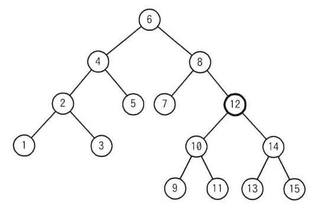
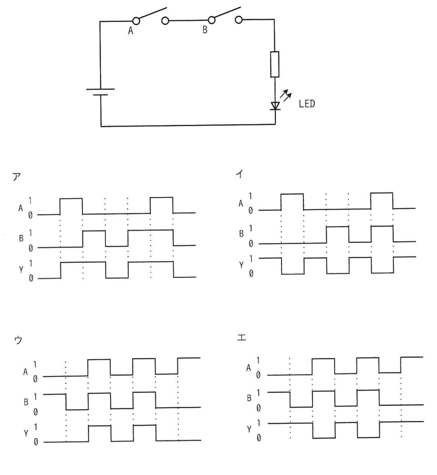
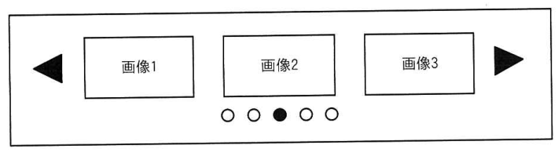
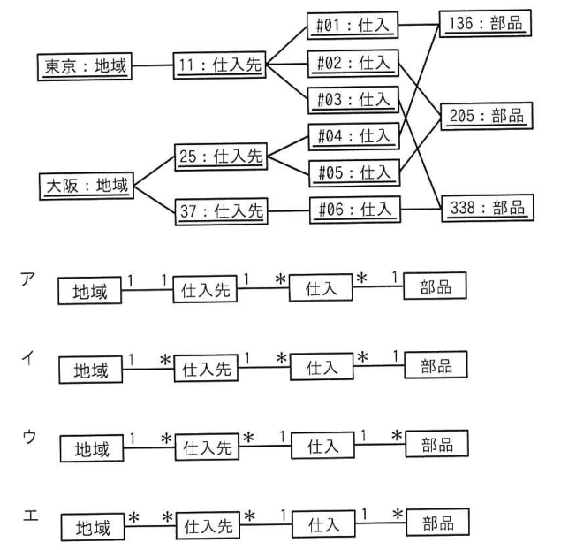

# 令和6年度秋期 科目A（旧午前）過去問解説

> 令和6年度 秋期 応用情報技術者試験 午前（全80問）を書き起こし、オリジナルの解説を付けたものです。問題の著作権は IPA（独立行政法人 情報処理推進機構）にあります。
> 図を表に書き換えるなど一部改変した問題には、その旨を記載しています。
> インタラクティブ教材の [科目A 四択クイズ](../../06_インタラクティブ教材/quiz.html) では、この回を本番形式（150分）で解けます。

## 目次

| 問 | 分野 | 中分類 | キーワード |
|---|---|---|---|
| [問1](#q01) | テクノロジ系 | 基礎理論 | M/M/1、待ち行列、利用率、平均待ち時間 |
| [問2](#q02) | テクノロジ系 | 基礎理論 | 交差検証、汎化性能、k分割交差検証、教師あり学習 |
| [問3](#q03) | テクノロジ系 | 基礎理論 | 逆ポーランド表記法、後置記法、スタック |
| [問4](#q04) | テクノロジ系 | 基礎理論 | ADAS、センサー、ミリ波レーダー、LiDAR |
| [問5](#q05) | テクノロジ系 | アルゴリズムとプログラミング | 2分探索木、削除、木構造 |
| [問6](#q06) | テクノロジ系 | アルゴリズムとプログラミング | ハッシュ表、衝突、剰余、シノニム |
| [問7](#q07) | テクノロジ系 | アルゴリズムとプログラミング | R言語、統計解析、動的型付け、OSS |
| [問8](#q08) | テクノロジ系 | コンピュータ構成要素 | パイプライン、RISC、命令フェッチ、命令実行サイクル |
| [問9](#q09) | テクノロジ系 | コンピュータ構成要素 | 量子超越性、量子コンピュータ |
| [問10](#q10) | テクノロジ系 | コンピュータ構成要素 | キャッシュメモリ、実効アクセス時間、ヒット率 |
| [問11](#q11) | テクノロジ系 | コンピュータ構成要素 | ファイバチャネル、SAN、ストレージインタフェース |
| [問12](#q12) | テクノロジ系 | システム構成要素 | クラスタ構成、セッション共有、コールドスタンバイ、フェールオーバ |
| [問13](#q13) | テクノロジ系 | システム構成要素 | オブジェクトストレージ、ブロックストレージ、ファイルストレージ、メタデータ |
| [問14](#q14) | テクノロジ系 | システム構成要素 | 稼働率、直列、並列、信頼性 |
| [問15](#q15) | テクノロジ系 | システム構成要素 | MIPS、転送速度、スループット、ボトルネック |
| [問16](#q16) | テクノロジ系 | ソフトウェア | スケジューリング、SJF、スタベーション、ラウンドロビン |
| [問17](#q17) | テクノロジ系 | ソフトウェア | スラッシング、仮想記憶、ページング |
| [問18](#q18) | テクノロジ系 | ソフトウェア | ページング、セグメンテーション、外部断片化、仮想記憶 |
| [問19](#q19) | テクノロジ系 | ソフトウェア | Git、分散型バージョン管理、リポジトリ |
| [問20](#q20) | テクノロジ系 | ソフトウェア | コンパイラ、字句解析、構文解析、最適化 |
| [問21](#q21) | テクノロジ系 | ハードウェア | 論理回路、AND、タイミングチャート、直列接続 |
| [問22](#q22) | テクノロジ系 | ハードウェア | SoC、SiP、システムLSI |
| [問23](#q23) | テクノロジ系 | ハードウェア | アクチュエーター、センサー、フィードバック制御 |
| [問24](#q24) | テクノロジ系 | ハードウェア | 耐タンパ性、物理解析、ICチップ |
| [問25](#q25) | テクノロジ系 | ユーザーインタフェース | カルーセル、UI部品、Webデザイン |
| [問26](#q26) | テクノロジ系 | 情報メディア | 動画像、帯域幅、データ量、フレームレート |
| [問27](#q27) | テクノロジ系 | データベース | 2相コミット、分散トランザクション、原子性、セキュア状態 |
| [問28](#q28) | テクノロジ系 | データベース | データベース設計、表、結合 |
| [問29](#q29) | テクノロジ系 | データベース | UML、オブジェクト図、多重度、概念データモデル |
| [問30](#q30) | テクノロジ系 | データベース | ウィンドウ関数、ROW_NUMBER、PARTITION BY、SQL |
| [問31](#q31) | テクノロジ系 | データベース | チェックポイント、障害回復、ロールフォワード、データベースバッファ |
| [問32](#q32) | テクノロジ系 | ネットワーク | 伝送時間、伝送効率、回線速度 |
| [問33](#q33) | テクノロジ系 | ネットワーク | DNS、逆引き、リソースレコード、リゾルバ |
| [問34](#q34) | テクノロジ系 | ネットワーク | ICMP、ping、エラー通知 |
| [問35](#q35) | テクノロジ系 | ネットワーク | IPv4アドレスクラス、クラスD、マルチキャスト |
| [問36](#q36) | テクノロジ系 | ネットワーク | arp、ARPキャッシュ、MACアドレス、ネットワークコマンド |
| [問37](#q37) | テクノロジ系 | セキュリティ | SAML、シングルサインオン、IdP、SP |
| [問38](#q38) | テクノロジ系 | セキュリティ | ダークネット、ポートスキャン、マルウェア、観測 |
| [問39](#q39) | テクノロジ系 | セキュリティ | ディープフェイク、生成AI、ビジネスメール詐欺 |
| [問40](#q40) | テクノロジ系 | セキュリティ | パスワードリスト攻撃、辞書攻撃、レインボーテーブル |
| [問41](#q41) | テクノロジ系 | セキュリティ | CVE、JVN、CVSS、脆弱性 |
| [問42](#q42) | テクノロジ系 | セキュリティ | DNSキャッシュポイズニング、トランザクションID、ソースポートランダマイゼーション |
| [問43](#q43) | テクノロジ系 | セキュリティ | SBOM、ソフトウェア部品表、OSS、サプライチェーン |
| [問44](#q44) | テクノロジ系 | セキュリティ | DNSSEC、デジタル署名、SPF、DKIM |
| [問45](#q45) | テクノロジ系 | セキュリティ | VLAN、ブロードキャストドメイン、セグメント、レイヤー3スイッチ |
| [問46](#q46) | テクノロジ系 | セキュリティ | エクスプロイトコード、脆弱性、PoC |
| [問47](#q47) | テクノロジ系 | システム開発技術 | マイクロサービスアーキテクチャ、疎結合、API |
| [問48](#q48) | テクノロジ系 | システム開発技術 | 使用性、ソフトウェア品質特性、習得性、JIS X 25010 |
| [問49](#q49) | テクノロジ系 | ソフトウェア開発管理技術 | インセプションデッキ、アジャイル、プランニングポーカー |
| [問50](#q50) | テクノロジ系 | ユーザーインタフェース | レスポンシブWebデザイン、メディアクエリ、CSS |
| [問51](#q51) | マネジメント系 | プロジェクトマネジメント | スコープマネジメント、スコープ変更、PMBOK |
| [問52](#q52) | マネジメント系 | プロジェクトマネジメント | WBS、ワークパッケージ、PMBOK |
| [問53](#q53) | マネジメント系 | プロジェクトマネジメント | コロケーション、チーム育成、資源マネジメント |
| [問54](#q54) | マネジメント系 | プロジェクトマネジメント | ファストトラッキング、クラッシング、スケジュール短縮 |
| [問55](#q55) | マネジメント系 | サービスマネジメント | RTO、RPO、RLO、事業継続 |
| [問56](#q56) | マネジメント系 | サービスマネジメント | 継続的改善、JIS Q 20000-1、SMS |
| [問57](#q57) | マネジメント系 | サービスマネジメント | 入出力データ管理、出力帳票、授受管理 |
| [問58](#q58) | マネジメント系 | システム監査 | システム監査技法、ウォークスルー法、監査手続 |
| [問59](#q59) | マネジメント系 | システム監査 | 予備調査、本調査、システム監査基準 |
| [問60](#q60) | マネジメント系 | システム監査 | フォローアップ、改善提案、システム監査基準 |
| [問61](#q61) | ストラテジ系 | システム戦略 | DX推進指標、DX、経済産業省 |
| [問62](#q62) | ストラテジ系 | システム戦略 | オープンデータバイデザイン、官民データ活用推進基本法、オープンデータ |
| [問63](#q63) | ストラテジ系 | システム戦略 | ECRS、業務改善、BPR |
| [問64](#q64) | ストラテジ系 | システム戦略 | BPR、外部委託、費用対効果 |
| [問65](#q65) | ストラテジ系 | システム企画 | UXデザイン、ユーザーエクスペリエンス、要件定義 |
| [問66](#q66) | ストラテジ系 | システム企画 | UML、アクティビティ図、業務フロー、要件定義 |
| [問67](#q67) | ストラテジ系 | 経営戦略マネジメント | SCM、CRM、SFA、ERP |
| [問68](#q68) | ストラテジ系 | 経営戦略マネジメント | アンゾフの成長マトリクス、多角化、SWOT分析、BSC |
| [問69](#q69) | ストラテジ系 | 経営戦略マネジメント | コ・クリエーション、価値共創、オープンイノベーション |
| [問70](#q70) | ストラテジ系 | 技術戦略マネジメント | ダーウィンの海、死の谷、魔の川、技術経営 |
| [問71](#q71) | ストラテジ系 | ビジネスインダストリ | ファインチューニング、生成AI、基盤モデル |
| [問72](#q72) | ストラテジ系 | ビジネスインダストリ | 段取り時間、生産計画、順序づけ |
| [問73](#q73) | ストラテジ系 | ビジネスインダストリ | MRP、正味所要量、部品構成表、総所要量 |
| [問74](#q74) | ストラテジ系 | 企業活動 | 経営理念、経営戦略、事業戦略 |
| [問75](#q75) | ストラテジ系 | 企業活動 | ナッシュ均衡、ゲーム理論、最適反応 |
| [問76](#q76) | ストラテジ系 | 企業活動 | ベイズ統計、ベイズの定理、事前確率、事後確率 |
| [問77](#q77) | ストラテジ系 | 企業活動 | 損益分岐点、限界利益率、固定費、変動費 |
| [問78](#q78) | ストラテジ系 | 法務 | 著作権法、プログラムの著作物、保護対象 |
| [問79](#q79) | ストラテジ系 | 法務 | 労働者派遣法、派遣期間、事前面接の禁止、派遣先 |
| [問80](#q80) | ストラテジ系 | 法務 | デジタル社会形成基本法、基本理念、IT基本法 |

<a id="q01"></a>

### 問1　〔基礎理論〕 🧮

M/M/1 の待ち行列モデルにおいて，窓口の利用率が 25%から 40%に増えると，平均待ち時間は何倍になるか。

- **ア**　1.25
- **イ**　1.60
- **ウ**　2.00
- **エ**　3.00

<details><summary>解答・解説</summary>

**正解：ウ**

M/M/1 の平均待ち時間は ρ/(1−ρ)×平均サービス時間。平均サービス時間は変わらないので，ρ/(1−ρ) の比を求めればよく，1/3 → 2/3 で 2 倍になる。

**途中式**

- 平均待ち時間 W = ρ / (1 − ρ) × Ts（Ts：平均サービス時間）
- ρ = 0.25 のとき：0.25 / 0.75 = 1/3
- ρ = 0.40 のとき：0.40 / 0.60 = 2/3
- 比：(2/3) ÷ (1/3) = **2.00 倍**

- ア：1.25 は利用率どうしの比でも待ち時間の比でもない（利用率の比は 0.40/0.25 = 1.6）
- イ：1.60 は利用率の比 0.40/0.25。待ち時間は利用率に比例しない
- エ：3.00 は計算の取り違え。ρ/(1−ρ) を正しく代入すると 2 倍

💡 **ポイント**：待ち時間の係数 ρ/(1−ρ) は利用率に対して非線形に増える。利用率が少し上がるだけで待ち時間が大きく伸びる点がよく問われる。

📖 関連：[基礎理論](../../01_テクノロジ系/01_基礎理論.md)／[計算問題公式集](../../05_まとめ・横断資料/01_計算問題公式集.md)

</details>

<sub>出典：令和6年度 秋期 応用情報技術者試験 午前 問1</sub>

---

<a id="q02"></a>

### 問2　〔基礎理論〕

AI における教師あり学習での交差検証に関する記述はどれか。

- **ア**　過学習を防ぐために，回帰モデルに複雑さを表すペナルティ項を加え，訓練データへ過剰に適合しないようにモデルを調整する。
- **イ**　学習の精度を高めるために，複数の異なるアルゴリズムのモデルで学習し，学習の結果は組み合わせて評価する。
- **ウ**　学習モデルの汎化性能を高めるために，単一のモデルで関連する複数の課題を学習することによって，課題間に共通する要因を獲得する。
- **エ**　学習モデルの汎化性能を評価するために，データを複数のグループに分割し，一部を学習に残りを評価に使い，順にグループを入れ替えて学習と評価を繰り返す。

<details><summary>解答・解説</summary>

**正解：エ**

交差検証（クロスバリデーション）は，データを k 個に分け，1 個を評価用・残りを学習用として，評価用を順に入れ替えながら k 回学習と評価を行い，その平均で汎化性能を見積もる手法。

- ア：正則化（L1/L2 正則化など）の説明。過学習対策であって評価手法ではない
- イ：アンサンブル学習（スタッキングなど）の説明
- ウ：マルチタスク学習の説明

💡 **ポイント**：交差検証は「性能を評価する」手法，正則化は「過学習を抑える」手法と区別する。k 分割交差検証では全データが一度ずつ評価に使われる。

📖 関連：[基礎理論](../../01_テクノロジ系/01_基礎理論.md)

</details>

<sub>出典：令和6年度 秋期 応用情報技術者試験 午前 問2</sub>

---

<a id="q03"></a>

### 問3　〔基礎理論〕 🧮

式 A＋B×C の逆ポーランド表記法による表現として，適切なものはどれか。

- **ア**　＋×CBA
- **イ**　×＋ABC
- **ウ**　ABC×＋
- **エ**　CBA＋×

<details><summary>解答・解説</summary>

**正解：ウ**

乗算が先なので式は A＋(B×C)。後置記法では「オペランド，オペランド，演算子」の順に書くので，B×C → BC×，全体は A (BC×) ＋ → ABC×＋。

**途中式**

1. 優先順位を括弧で明示：A ＋ (B × C)
2. 内側を後置記法に：B × C → B C ×
3. 外側を後置記法に：A ＋ (BC×) → A B C × ＋

- ア：演算子が先頭にあり逆ポーランド記法になっていない。前置記法（ポーランド記法）として読むと (C×B)＋A
- イ：これも演算子が先頭。前置記法として読むと (A＋B)×C となり，元の式とも異なる
- エ：スタックで評価すると，C，B，A を積んだ後 ＋ で B＋A，× で C×(B＋A) となり，別の式になる

💡 **ポイント**：逆ポーランド記法はスタックで左から評価できる。「数値は積む，演算子が来たら2個取り出して計算して積む」で検算できる。

📖 関連：[アルゴリズムとプログラミング](../../01_テクノロジ系/02_アルゴリズムとプログラミング.md)

</details>

<sub>出典：令和6年度 秋期 応用情報技術者試験 午前 問3</sub>

---

<a id="q04"></a>

### 問4　〔基礎理論〕

自動車の先進運転支援システムで使用されるセンサーの説明のうち，適切なものはどれか。

- **ア**　可視光カメラは，天候などの影響を受けやすいが，交通標識の認識に使用できる。
- **イ**　超音波センサーは，天候などの影響を受けやすいが，測定可能距離が 500 メートル以上と長い。
- **ウ**　ミリ波レーダーは，天候などの影響を受けにくく，交通信号機の灯色の判別に使用できる。
- **エ**　レーザーレーダーは，天候などの影響を受けにくく，建物の後ろにある物体を検知できる。

<details><summary>解答・解説</summary>

**正解：ア**

可視光カメラは人の目と同じく色や形を捉えられるので標識や信号の認識に使えるが，雨・霧・逆光などの影響を受けやすい。

- イ：超音波センサーの測定距離は数メートル程度で，駐車支援など近距離用。500 m 以上は誤り
- ウ：ミリ波レーダーは天候に強く距離・速度の測定に向くが，電波の反射を見るので色（信号の灯色）は判別できない
- エ：レーザーレーダー（LiDAR）は光を使うため悪天候の影響を受けやすく，遮蔽物の陰にある物体も検知できない

💡 **ポイント**：カメラ＝色・形の認識，ミリ波レーダー＝悪天候に強く遠距離，LiDAR＝高精度な形状測定，超音波＝近距離。複数を組み合わせて（センサーフュージョン）弱点を補う。

📖 関連：[ハードウェア](../../01_テクノロジ系/10_ハードウェア.md)

</details>

<sub>出典：令和6年度 秋期 応用情報技術者試験 午前 問4</sub>

---

<a id="q05"></a>

### 問5　〔アルゴリズムとプログラミング〕

次の 2 分探索木から要素 12 を削除したとき，その位置に別の要素を移動するだけで 2 分探索木を再構成するには，削除された要素の位置にどの要素を移動すればよいか。



- **ア**　9
- **イ**　10
- **ウ**　13
- **エ**　14

<details><summary>解答・解説</summary>

**正解：ウ**

2 分探索木で子を二つもつ節を削除するときは，左部分木の最大値か右部分木の最小値を移動させる。12 の左部分木の最大値は 11，右部分木の最小値は 13 で，選択肢にあるのは 13。

**確認**

13 を 12 の位置に移すと，左側（10, 9, 11）はすべて 13 より小さく，右側（14, 15）はすべて 13 より大きい。13 が抜けた 14 の左の子は空になるだけなので，2 分探索木の条件が保たれる。

- ア：9 を移すと，左部分木に 10, 11 という 9 より大きい要素が残ってしまう
- イ：10 を移すと，左部分木の 11 が 10 より大きくなり条件を満たさない（さらに 10 の子 9, 11 の付け替えも必要）
- エ：14 を移すと，右部分木の 13 が 14 より小さくなり条件を満たさない

💡 **ポイント**：削除位置の代わりになるのは「左部分木の最大（いちばん右の節）」か「右部分木の最小（いちばん左の節）」。どちらも中間順で削除要素の直前・直後の値になる。

📖 関連：[アルゴリズムとプログラミング](../../01_テクノロジ系/02_アルゴリズムとプログラミング.md)

</details>

<sub>出典：令和6年度 秋期 応用情報技術者試験 午前 問5</sub>

---

<a id="q06"></a>

### 問6　〔アルゴリズムとプログラミング〕

自然数をキーとするデータを，ハッシュ表を用いて管理する。キー x のハッシュ関数 h(x) を

h(x) = x mod n

とすると，任意のキー a と b が衝突する条件はどれか。ここで，n はハッシュ表の大きさであり，x mod n は x を n で割った余りを表す。

- **ア**　a＋b が n の倍数
- **イ**　a−b が n の倍数
- **ウ**　n が a＋b の倍数
- **エ**　n が a−b の倍数

<details><summary>解答・解説</summary>

**正解：イ**

衝突するのは a mod n = b mod n のとき。n で割った余りが等しいことは，差 a−b が n で割り切れる（n の倍数である）ことと同じ。

**途中式**

a = n·p + r，b = n·q + r（余りがともに r）とおくと，a − b = n(p − q) → a−b は n の倍数。逆に a−b が n の倍数なら余りは一致する。

- ア：a＋b が n の倍数でも余りは一致しない（例：n=5，a=1，b=4 は和が 5 だが余りは 1 と 4）
- ウ：n が a＋b の倍数という条件は余りの一致と関係しない
- エ：n が a−b の倍数とは「a−b が n の約数」という意味で，倍数・約数の関係が逆

💡 **ポイント**：ハッシュ値が同じになるキーをシノニムといい，h(x) = x mod n では「差が n の倍数」のキーどうしがシノニムになる。

📖 関連：[アルゴリズムとプログラミング](../../01_テクノロジ系/02_アルゴリズムとプログラミング.md)

</details>

<sub>出典：令和6年度 秋期 応用情報技術者試験 午前 問6</sub>

---

<a id="q07"></a>

### 問7　〔アルゴリズムとプログラミング〕

次の特徴をもつプログラム言語及び実行環境であって，オープンソースソフトウェアとして提供されているものはどれか。

〔特徴〕

- 統計解析や機械学習に適している。
- データ分析，グラフ描画などの，多数のソフトウェアパッケージが提供されている。
- 変数自体には型がなく，変数に代入されるオブジェクトの型は実行時に決まる。

- **ア**　Go
- **イ**　Kotlin
- **ウ**　R
- **エ**　Scala

<details><summary>解答・解説</summary>

**正解：ウ**

R は統計解析向けに作られたオープンソースの言語・実行環境で，CRAN を通じて多数のパッケージが提供され，動的型付けである。

- ア：Go は Google が開発した静的型付けのコンパイル言語で，並行処理やサーバ開発向け
- イ：Kotlin は JVM 上で動く静的型付け言語で，Android アプリ開発で広く使われる
- エ：Scala は JVM 上で動くオブジェクト指向と関数型を融合した静的型付け言語

💡 **ポイント**：データ分析向け言語は R と Python が代表。静的型付け（Go，Kotlin，Scala，Java）と動的型付け（R，Python，JavaScript）の区別も問われる。

📖 関連：[アルゴリズムとプログラミング](../../01_テクノロジ系/02_アルゴリズムとプログラミング.md)

</details>

<sub>出典：令和6年度 秋期 応用情報技術者試験 午前 問7</sub>

---

<a id="q08"></a>

### 問8　〔コンピュータ構成要素〕

RISC プロセッサの 5 段パイプラインの命令実行制御の順序はどれか。ここで，このパイプラインのステージは次の五つとする。

① 書込み

② 実行とアドレス生成

③ 命令デコードとレジスタファイル読出し

④ 命令フェッチ

⑤ メモリアクセス

- **ア**　③，④，②，⑤，①
- **イ**　③，⑤，②，④，①
- **ウ**　④，③，②，⑤，①
- **エ**　④，⑤，③，②，①

<details><summary>解答・解説</summary>

**正解：ウ**

命令は「取り出す → 解読してレジスタを読む → 演算・アドレス計算 → メモリを読み書き → 結果をレジスタに書き戻す」の順に進む。よって ④→③→②→⑤→①。

| 順 | ステージ | 略称 |
|---|---|---|
| 1 | ④ 命令フェッチ | IF |
| 2 | ③ 命令デコードとレジスタファイル読出し | ID |
| 3 | ② 実行とアドレス生成 | EX |
| 4 | ⑤ メモリアクセス | MEM |
| 5 | ① 書込み | WB |

- ア：命令を取り出す前にデコードはできない
- イ：デコードの次がメモリアクセスになっており，アドレスが計算される前にメモリにアクセスしてしまう
- エ：メモリアクセスをデコードや実行より先に行っている

💡 **ポイント**：古典的 RISC の 5 段は IF → ID → EX → MEM → WB。最初はフェッチ，最後はライトバック（書込み）と覚える。

📖 関連：[コンピュータ構成要素](../../01_テクノロジ系/03_コンピュータ構成要素.md)

</details>

<sub>出典：令和6年度 秋期 応用情報技術者試験 午前 問8</sub>

---

<a id="q09"></a>

### 問9　〔コンピュータ構成要素〕

量子超越性（Quantum Supremacy）の説明として，適切なものはどれか。

- **ア**　重ね合わせという現象を用いた量子暗号が，現在の暗号化方式よりもはるかに安全であること
- **イ**　従来のコンピュータが古典物理学に依拠する段階にとどまっているのに比べて，量子コンピュータが量子力学に依拠して作られていること
- **ウ**　従来のコンピュータでは実用的な時間で処理することができない計算を，量子コンピュータでは高速に実行できること
- **エ**　同一の性能を実現した従来のコンピュータに比べて，量子コンピュータの物理的な大きさを圧倒的に小さくできること

<details><summary>解答・解説</summary>

**正解：ウ**

量子超越性とは，従来型（古典）コンピュータでは現実的な時間で解けない計算を，量子コンピュータが実行できることを示す，という性能面での優位性を指す。

- ア：量子暗号（量子鍵配送）の安全性の話で，量子超越性とは別の概念
- イ：動作原理の違いを述べているだけで，「超越」（性能面で上回ること）の説明になっていない
- エ：装置の小型化の話。量子コンピュータは冷却装置などを含めむしろ大型になることが多い

💡 **ポイント**：量子コンピュータは重ね合わせと量子もつれを利用する。「古典コンピュータでは実用的な時間で解けない問題を解ける」＝量子超越性。

📖 関連：[コンピュータ構成要素](../../01_テクノロジ系/03_コンピュータ構成要素.md)

</details>

<sub>出典：令和6年度 秋期 応用情報技術者試験 午前 問9</sub>

---

<a id="q10"></a>

### 問10　〔コンピュータ構成要素〕 🧮

キャッシュメモリのアクセス時間が主記憶のアクセス時間の 1/30 で，ヒット率が 95%のとき，実効メモリアクセス時間は，主記憶のアクセス時間の約何倍になるか。

- **ア**　0.03
- **イ**　0.08
- **ウ**　0.37
- **エ**　0.95

<details><summary>解答・解説</summary>

**正解：イ**

主記憶のアクセス時間を 1 とすると，実効アクセス時間 = 0.95 × 1/30 ＋ 0.05 × 1 ≒ 0.032 ＋ 0.05 ≒ 0.08 倍。

**途中式**

- 実効アクセス時間 = ヒット率 × キャッシュのアクセス時間 ＋ (1 − ヒット率) × 主記憶のアクセス時間
- = 0.95 × (1/30) ＋ 0.05 × 1
- = 0.0317 ＋ 0.05 = 0.0817 → **約 0.08 倍**

- ア：0.03 はキャッシュヒット時の分（0.95/30）だけで，ミス時の主記憶アクセスを足していない
- ウ：0.37 は計算の取り違え
- エ：0.95 はヒット率そのもの

💡 **ポイント**：実効アクセス時間はヒット率で加重平均する。ミス時の時間（1−ヒット率）×主記憶 の項を忘れないこと。

📖 関連：[コンピュータ構成要素](../../01_テクノロジ系/03_コンピュータ構成要素.md)／[計算問題公式集](../../05_まとめ・横断資料/01_計算問題公式集.md)

</details>

<sub>出典：令和6年度 秋期 応用情報技術者試験 午前 問10</sub>

---

<a id="q11"></a>

### 問11　〔コンピュータ構成要素〕

ストレージのインタフェースとして用いられる FC（ファイバチャネル）の特徴として，適切なものはどれか。

- **ア**　TCP/IP の上位層として作られた規格である。
- **イ**　接続形態は，スイッチを用いた n 対 n 接続に限られる。
- **ウ**　伝送媒体には電気ケーブル又は光ケーブルを用いることができる。
- **エ**　物理層としてパラレル SCSI を用いることができる。

<details><summary>解答・解説</summary>

**正解：ウ**

FC は SAN でサーバとストレージを結ぶ高速シリアルインタフェースで，名前に「ファイバ」とあるが光ファイバだけでなく銅線（電気ケーブル）も使える。

- ア：FC は独自のプロトコル階層をもつ規格で，TCP/IP の上位層ではない（TCP/IP 上で SCSI を運ぶのは iSCSI）
- イ：FC の接続形態にはポイントツーポイント，アービトレーテッドループ，スイッチを使うファブリックがあり，スイッチ接続に限られない
- エ：FC はシリアル伝送で，パラレル SCSI を物理層に使うことはない。上位で SCSI コマンドを運ぶ

💡 **ポイント**：SAN の代表的なインタフェースは FC と iSCSI。FC＝専用ネットワークで高速，iSCSI＝IP ネットワークを利用。

📖 関連：[コンピュータ構成要素](../../01_テクノロジ系/03_コンピュータ構成要素.md)／[システム構成要素](../../01_テクノロジ系/04_システム構成要素.md)

</details>

<sub>出典：令和6年度 秋期 応用情報技術者試験 午前 問11</sub>

---

<a id="q12"></a>

### 問12　〔システム構成要素〕

Web アプリケーションサーバの信頼性に関する記述のうち，適切なものはどれか。

- **ア**　コールドスタンバイ構成で稼働しているサーバに障害が発生した場合，サービスは中断しないが，トランザクションは継続できない。
- **イ**　コールドスタンバイ構成で稼働しているサーバに障害が発生した場合，サービスは中断するが，トランザクションは継続できる。
- **ウ**　セッションを共有しないクラスタ構成で 1 台のサーバに障害が発生した場合，サービスは継続できないが，トランザクションは継続できる。
- **エ**　セッションを共有するクラスタ構成で 1 台のサーバに障害が発生した場合，サービス及びトランザクションは継続できる。

<details><summary>解答・解説</summary>

**正解：エ**

セッション情報を複数サーバで共有するクラスタ構成なら，1 台が止まっても別のサーバがセッションを引き継げるので，サービスも処理中のトランザクションも継続できる。

- ア：コールドスタンバイは障害後に予備機を起動・切替えするので，サービスは中断する
- イ：コールドスタンバイでは処理中の状態が引き継がれないので，トランザクションは継続できない
- ウ：セッションを共有しないクラスタでは，残りのサーバでサービスは継続できるが，障害サーバ上のセッション（トランザクション）は失われる。記述が逆

💡 **ポイント**：「サービス継続」は冗長化で，「トランザクション継続」はセッション（状態）の共有・引継ぎで実現する。両者を分けて考える。

📖 関連：[システム構成要素](../../01_テクノロジ系/04_システム構成要素.md)

</details>

<sub>出典：令和6年度 秋期 応用情報技術者試験 午前 問12</sub>

---

<a id="q13"></a>

### 問13　〔システム構成要素〕

データアクセス方式の一つであるオブジェクトストレージに関する記述のうち，最も適切なものはどれか。

- **ア**　ストレージにファイルシステムを構成し，ファイル単位でデータにアクセスする。
- **イ**　ストレージの論理ボリュームを決まったサイズに分割し，その単位でデータにアクセスする。
- **ウ**　データとメタデータをセットにして保存し，階層構造にすることによってデータにアクセスする。
- **エ**　データとメタデータをセットにして保存し，固有の識別子でデータにアクセスする。

<details><summary>解答・解説</summary>

**正解：エ**

オブジェクトストレージは，データ本体とメタデータを「オブジェクト」としてフラットな空間に保存し，一意の ID（キーや URL）で HTTP の API などからアクセスする方式。

- ア：ファイルストレージ（NAS など）の説明
- イ：ブロックストレージ（SAN など）の説明
- ウ：オブジェクトストレージはディレクトリのような階層構造をもたず，フラットな名前空間で管理する

💡 **ポイント**：ブロック＝固定長ブロック単位，ファイル＝階層的なファイルパス，オブジェクト＝ID＋メタデータでフラットに管理。クラウドの大容量データ保存によく使われる。

📖 関連：[システム構成要素](../../01_テクノロジ系/04_システム構成要素.md)

</details>

<sub>出典：令和6年度 秋期 応用情報技術者試験 午前 問13</sub>

---

<a id="q14"></a>

### 問14　〔システム構成要素〕 🧮

稼働率が等しい装置 X を直列や並列に組み合わせたとき，システム全体の稼働率を高い順に並べたものはどれか。ここで，装置 X の稼働率は 0 よりも大きく 1 未満である。

- A：装置 X 2 台を並列に接続したもの
- B：装置 X 1 台と，装置 X 2 台を並列に接続したものとを，直列に接続したもの
- C：装置 X 2 台を直列に接続したものを 2 組，並列に接続したもの

- **ア**　A，B，C
- **イ**　A，C，B
- **ウ**　C，A，B
- **エ**　C，B，A

<details><summary>解答・解説</summary>

**正解：イ**

装置 X の稼働率を x（0 < x < 1）として三つの式を比べると，A ＞ C ＞ B となる。

**途中式**

- A = 1 − (1 − x)^2 = 2x − x^2
- B = x × {1 − (1 − x)^2} = x(2x − x^2) = 2x^2 − x^3
- C = 1 − (1 − x^2)^2 = 2x^2 − x^4
- A − C = 2x − 3x^2 + x^4 = x(1 − x)^2(x + 2) ＞ 0 → A ＞ C
- C − B = x^3 − x^4 = x^3(1 − x) ＞ 0 → C ＞ B
- 例：x = 0.9 なら A = 0.99，C = 0.9639，B = 0.891

- ア：B と C の順序が逆。B は 1 台の X と直列なので，その 1 台の稼働率 x を超えられない
- ウ：C は直列の組を並列にしたもので，各組の稼働率が x^2 に下がるため，単純な 2 台並列の A には及ばない
- エ：C を最上位にしている点と，B と A の順序がともに誤り

💡 **ポイント**：直列は稼働率の積，並列は「1 − 故障率の積」。具体的な値（0.9 など）を代入すると比較が速い。

📖 関連：[システム構成要素](../../01_テクノロジ系/04_システム構成要素.md)／[計算問題公式集](../../05_まとめ・横断資料/01_計算問題公式集.md)

</details>

<sub>出典：令和6年度 秋期 応用情報技術者試験 午前 問14（図（装置の接続構成）を文章に書き換え）</sub>

---

<a id="q15"></a>

### 問15　〔システム構成要素〕 🧮

あるクライアントサーバシステムにおいて，クライアントから要求された 1 件の検索を処理するために，サーバで平均 100 万命令が実行される。1 件の検索につき，ネットワーク内で転送されるデータは平均 2×10^5 バイトである。このサーバの性能は 100 MIPS であり，ネットワークの転送速度は 8×10^7 ビット／秒である。このシステムにおいて，1 秒間に処理できる検索要求は何件か。ここで，処理できる件数は，サーバとネットワークの処理能力だけで決まるものとする。また，1 バイトは 8 ビットとする。

- **ア**　50
- **イ**　100
- **ウ**　200
- **エ**　400

<details><summary>解答・解説</summary>

**正解：ア**

サーバは 1 秒に 100 件，ネットワークは 1 秒に 50 件を処理できる。システム全体の処理件数は遅い方（ボトルネック）で決まるので 50 件。

**途中式**

- サーバ：100 MIPS = 100 × 10^6 命令/秒 ÷ 100 万命令/件 = **100 件/秒**
- ネットワーク：1 件のデータ = 2 × 10^5 バイト × 8 = 1.6 × 10^6 ビット
- 8 × 10^7 ビット/秒 ÷ 1.6 × 10^6 ビット/件 = **50 件/秒**
- 全体：min(100, 50) = **50 件/秒**

- イ：100 はサーバの処理能力だけを見た値。ネットワークがボトルネックになる
- ウ：200 はサーバ（100 件）ともネットワーク（50 件）とも一致しない値
- エ：400 はネットワークの計算でバイトとビットの換算（×8）を忘れた値

💡 **ポイント**：複数の資源を通る処理の能力は最も遅い資源で決まる。単位（バイト／ビット，M＝10^6）の換算を確実に。

📖 関連：[システム構成要素](../../01_テクノロジ系/04_システム構成要素.md)／[計算問題公式集](../../05_まとめ・横断資料/01_計算問題公式集.md)

</details>

<sub>出典：令和6年度 秋期 応用情報技術者試験 午前 問15（べき乗をテキスト表記（2×10^5 など）に書き換え）</sub>

---

<a id="q16"></a>

### 問16　〔ソフトウェア〕

タスクスケジューリング方式の説明のうち，特定のタスクが CPU 資源の割当てを待ち続ける可能性が最も高いものはどれか。

- **ア**　各タスクの優先度を決めて，優先度が高い順に実行し，CPU 割当てまでの待ち時間の長さに応じて優先度を徐々に上げていく。
- **イ**　各タスクを実行可能待ち行列に置かれた順に実行し，一定時間が経過したら実行を中断して実行可能待ち行列の最後尾に加える。
- **ウ**　処理予定時間が最も短いタスクから順に処理を実行する。現在実行中の処理が終了するか，又は何らかの要因によって中断されたとき，次のタスクを開始する。
- **エ**　タスクがシステムに到着した順に実行可能待ち行列の最後尾に加え，常に実行可能待ち行列の先頭のタスクに CPU を割り当てる。

<details><summary>解答・解説</summary>

**正解：ウ**

処理時間順（SJF：Shortest Job First）では，短いタスクが次々に到着すると処理時間の長いタスクはいつまでも後回しになり，CPU を割り当てられない状態（スタベーション，飢餓状態）が起こり得る。

- ア：優先度順に加えてエージング（待ち時間に応じて優先度を上げる）を行うので，待ち続けることを防げる
- イ：ラウンドロビン方式。一定時間ごとに順番が回ってくるので，待ち続けることはない
- エ：到着順（FCFS）方式。いずれ順番が来るので，待ち続けることはない

💡 **ポイント**：スタベーションが起きやすいのは「処理時間順」や「優先度順（エージングなし）」。対策はエージング。

📖 関連：[ソフトウェア](../../01_テクノロジ系/05_ソフトウェア.md)

</details>

<sub>出典：令和6年度 秋期 応用情報技術者試験 午前 問16</sub>

---

<a id="q17"></a>

### 問17　〔ソフトウェア〕

ページング方式の仮想記憶において，ページ置換えの発生頻度が高くなり，システムの処理能力が急激に低下することがある。このような現象を何と呼ぶか。

- **ア**　スラッシング
- **イ**　スワップアウト
- **ウ**　フラグメンテーション
- **エ**　ページフォールト

<details><summary>解答・解説</summary>

**正解：ア**

主記憶に対して実行中のプログラムが多すぎると，ページの追い出しと読み込みが頻発し，CPU が補助記憶との入出力待ちばかりになって処理能力が急低下する。この現象がスラッシング。

- イ：スワップアウトは，主記憶上のプロセスやページを補助記憶に退避させる操作そのもの
- ウ：フラグメンテーションは，記憶領域が細切れになり，合計は空いていても連続した領域を確保できない状態
- エ：ページフォールトは，参照したページが主記憶にないときに発生する割込みで，スラッシングの原因になる個々の事象

💡 **ポイント**：ページフォールトが多発 → ページ置換えが頻発 → スラッシング。対策は主記憶の増設や多重度（同時実行数）の削減。

📖 関連：[ソフトウェア](../../01_テクノロジ系/05_ソフトウェア.md)

</details>

<sub>出典：令和6年度 秋期 応用情報技術者試験 午前 問17</sub>

---

<a id="q18"></a>

### 問18　〔ソフトウェア〕

仮想記憶方式において，セグメンテーション方式と比較した場合のページング方式の長所はどれか。

- **ア**　記憶領域へのアクセス保護を論理的な単位で行うことができる。
- **イ**　記憶領域をプログラム間で容易に共用することができる。
- **ウ**　実行時に記憶領域の大きさを動的に変えることができる。
- **エ**　主記憶の外部断片化が発生しない。

<details><summary>解答・解説</summary>

**正解：エ**

ページング方式は記憶領域を固定長のページに分けて割り当てるので，空き領域もページ単位で必ず再利用でき，ページ間に使えない隙間（外部断片化）が生じない。

- ア：プログラムやデータといった論理的な単位で保護できるのは，論理単位で分割するセグメンテーション方式の長所
- イ：論理単位で分かれているセグメンテーション方式の方が，サブルーチンなどを共用しやすい
- ウ：セグメントは可変長なので，大きさを動的に変えやすいのはセグメンテーション方式

💡 **ポイント**：ページング＝固定長で外部断片化なし（ただしページ内の内部断片化はある），セグメンテーション＝可変長で論理単位の保護・共用に向くが外部断片化が起きる。

📖 関連：[ソフトウェア](../../01_テクノロジ系/05_ソフトウェア.md)

</details>

<sub>出典：令和6年度 秋期 応用情報技術者試験 午前 問18</sub>

---

<a id="q19"></a>

### 問19　〔ソフトウェア〕

分散開発環境において，各開発者のローカル環境に全履歴を含んだ中央リポジトリの完全な複製をもつことによって，中央リポジトリにアクセスできないときでも履歴の調査や変更の記録を可能にする，バージョン管理ツールはどれか。

- **ア**　Apache Subversion
- **イ**　CVS
- **ウ**　Git
- **エ**　RCS

<details><summary>解答・解説</summary>

**正解：ウ**

Git は分散型バージョン管理システムで，クローンした各開発者のローカルリポジトリに全履歴が含まれるため，オフラインでも履歴の参照やコミットができる。

- ア：Apache Subversion（SVN）は中央集中型。履歴は中央リポジトリにあり，コミットにはサーバへの接続が必要
- イ：CVS も中央集中型のバージョン管理システム
- エ：RCS はファイル単位で版を管理する古いローカル向けツールで，分散開発向けではない

💡 **ポイント**：集中型（CVS，Subversion）と分散型（Git，Mercurial）の違い。分散型は「ローカルにリポジトリの完全な複製をもつ」。

📖 関連：[ソフトウェア](../../01_テクノロジ系/05_ソフトウェア.md)／[ソフトウェア開発管理技術](../../01_テクノロジ系/12_ソフトウェア開発管理技術.md)

</details>

<sub>出典：令和6年度 秋期 応用情報技術者試験 午前 問19</sub>

---

<a id="q20"></a>

### 問20　〔ソフトウェア〕

手続型言語のコンパイラがコード生成までに行う処理のうち，最後に行うものはどれか。

- **ア**　意味解析
- **イ**　構文解析
- **ウ**　最適化
- **エ**　字句解析

<details><summary>解答・解説</summary>

**正解：ウ**

コンパイラは「字句解析 → 構文解析 → 意味解析 → 最適化 → コード生成」の順に処理する。コード生成の直前に行うのは最適化。

- ア：意味解析は構文解析の後に，型の整合性や宣言の有無などを調べる段階で，最適化より前
- イ：構文解析は字句（トークン）の並びが文法に合うかを調べ，構文木を作る段階
- エ：字句解析はソースコードを字句（トークン）に分解する最初の段階

💡 **ポイント**：コンパイラの処理順「字句 → 構文 → 意味 → 最適化 → コード生成」は頻出。最適化は中間コードや目的コードに対して行う。

📖 関連：[ソフトウェア](../../01_テクノロジ系/05_ソフトウェア.md)

</details>

<sub>出典：令和6年度 秋期 応用情報技術者試験 午前 問20</sub>

---

<a id="q21"></a>

### 問21　〔ハードウェア〕

図はスイッチ A 及び B の状態によって，LED が点灯又は消灯する回路である。スイッチ A がオンの状態を A＝1，オフの状態を A＝0 とし，スイッチ B も同様にオンの状態を B＝1，オフの状態を B＝0 とする。また，LED が点灯する状態を Y＝1，消灯する状態を Y＝0 とする。このとき，図の回路を動作させたときのタイミングチャートとして，適切なものはどれか。



- **ア**　（図のア）
- **イ**　（図のイ）
- **ウ**　（図のウ）
- **エ**　（図のエ）

<details><summary>解答・解説</summary>

**正解：ウ**

スイッチ A と B は電池と LED に対して直列に入っているので，両方がオンのときだけ電流が流れて LED が点灯する。つまり Y = A AND B で，A＝1 かつ B＝1 の区間だけ Y＝1 になっているチャートはウ。

| A | B | Y |
|---|---|---|
| 0 | 0 | 0 |
| 0 | 1 | 0 |
| 1 | 0 | 0 |
| 1 | 1 | 1 |

- ア：A と B のどちらかが 1 なら Y＝1 になっている。並列接続の OR の動作
- イ：A，B がともに 0 のときだけ Y＝1 になっている。NOR の動作
- エ：A，B がともに 1 のときだけ Y＝0 になっている。NAND の動作

💡 **ポイント**：スイッチの直列接続は AND，並列接続は OR。タイミングチャートは区間ごとに真理値表と照合する。

📖 関連：[ハードウェア](../../01_テクノロジ系/10_ハードウェア.md)／[基礎理論](../../01_テクノロジ系/01_基礎理論.md)

</details>

<sub>出典：令和6年度 秋期 応用情報技術者試験 午前 問21</sub>

---

<a id="q22"></a>

### 問22　〔ハードウェア〕

SoC の説明として，適切なものはどれか。

- **ア**　システム LSI に内蔵されたソフトウェア
- **イ**　複数の MCU を搭載したボード
- **ウ**　複数のチップで構成していたコンピュータシステムを，一つのチップで実現した LSI
- **エ**　複数のチップを単一のパッケージに封入してシステム化したデバイス

<details><summary>解答・解説</summary>

**正解：ウ**

SoC（System on a Chip）は，CPU，メモリ，周辺回路など従来は複数のチップに分かれていた機能を，1 枚のチップ（シリコンダイ）上に集積した LSI。

- ア：LSI に組み込まれたソフトウェアはファームウェアなどで，SoC はハードウェア（LSI）そのもの
- イ：複数の MCU（マイクロコントローラ）を載せたボードはマルチプロセッサのボードで，1 チップ化ではない
- エ：SiP（System in a Package）の説明。複数のチップを一つのパッケージに入れたもので，チップ自体は別々

💡 **ポイント**：SoC＝1 チップに集積，SiP＝複数チップを 1 パッケージに封入。組込み機器やスマートフォンの小型化・省電力化に使われる。

📖 関連：[ハードウェア](../../01_テクノロジ系/10_ハードウェア.md)

</details>

<sub>出典：令和6年度 秋期 応用情報技術者試験 午前 問22</sub>

---

<a id="q23"></a>

### 問23　〔ハードウェア〕

アクチュエーターの説明として，適切なものはどれか。

- **ア**　与えられた目標値と，センサーから得られた制御量を比較し，制御量を目標値に一致させるように操作量を出力する。
- **イ**　位置，角度，速度，加速度，力，温度などを検出し，電気的な情報に変換する。
- **ウ**　エネルギー源からのパワーを，回転，直進などの動きに変換する。
- **エ**　マイクロフォン，センサーなどが出力する微小な電気信号を増幅する。

<details><summary>解答・解説</summary>

**正解：ウ**

アクチュエーターは，電気・油圧・空気圧などのエネルギーを，モーターの回転やシリンダの直進のような機械的な動きに変える駆動装置。

- ア：フィードバック制御を行うコントローラ（制御装置）の説明
- イ：センサーの説明。物理量を検出して電気信号に変換する
- エ：増幅器（アンプ）の説明

💡 **ポイント**：制御システムは「センサー（検出）→ コントローラ（判断）→ アクチュエーター（動作）」の流れ。役割の違いを押さえる。

📖 関連：[ハードウェア](../../01_テクノロジ系/10_ハードウェア.md)

</details>

<sub>出典：令和6年度 秋期 応用情報技術者試験 午前 問23</sub>

---

<a id="q24"></a>

### 問24　〔ハードウェア〕

マイクロプロセッサの耐タンパ性を向上させる手法として，適切なものはどれか。

- **ア**　ESD（Electrostatic Discharge）に対する耐性を強化する。
- **イ**　チップ検査終了後に検査用パッドを残しておく。
- **ウ**　チップ内部を物理的に解析しようとすると，内部回路が破壊されるようにする。
- **エ**　内部メモリを物理アドレスに合わせて整然と配置する。

<details><summary>解答・解説</summary>

**正解：ウ**

耐タンパ性は，内部の情報を不正に読み出したり改ざんしたりされにくい性質。チップを開封・解析しようとすると回路が壊れて情報が取り出せなくなる仕組みは，耐タンパ性を高める代表的な手法。

- ア：ESD（静電気放電）への耐性は，故障を防ぐ信頼性の対策であり，不正な解析への対策ではない
- イ：検査用パッドが残っていると，そこから内部信号にアクセスされる手がかりになり，耐タンパ性はむしろ下がる
- エ：メモリを整然と配置すると構造が推測しやすくなり，解析が容易になる。配置をランダムにする方が耐タンパ性は高い

💡 **ポイント**：耐タンパ性の手法は「解析されたら壊れる」「信号を観測されにくくする」「構造を推測されにくくする」。IC カードや HSM などで重要。

📖 関連：[ハードウェア](../../01_テクノロジ系/10_ハードウェア.md)／[情報セキュリティ](../../01_テクノロジ系/08_情報セキュリティ.md)

</details>

<sub>出典：令和6年度 秋期 応用情報技術者試験 午前 問24</sub>

---

<a id="q25"></a>

### 問25　〔ユーザーインタフェース〕

Web ページの構成要素のうち，図のような固定の表示領域内でマウス操作やタッチ操作を行うことによってスクロールし，複数の画像などが横方向に順次表示されるものを何というか。



- **ア**　アコーディオン
- **イ**　カルーセル
- **ウ**　タブ
- **エ**　モーダルウィンドウ

<details><summary>解答・解説</summary>

**正解：イ**

限られた表示領域の中で，画像やコンテンツを左右の矢印やスワイプで回転木馬（carousel）のように順番に切り替えて見せる UI 部品をカルーセルという。下の ○●○ は今何枚目かを示すインジケーター。

- ア：アコーディオンは，見出しをクリックすると下に内容が展開したり折りたたまれたりする UI
- ウ：タブは，見出し（タブ）を選ぶことで表示する内容を切り替える UI で，横スクロールはしない
- エ：モーダルウィンドウは，ページの上に重ねて表示され，閉じるまで背後の操作ができないウィンドウ

💡 **ポイント**：Web の UI 部品の名称（カルーセル，アコーディオン，ハンバーガーメニュー，パンくずリスト，モーダル）は図とセットで覚える。

📖 関連：[ユーザーインタフェースと情報メディア](../../01_テクノロジ系/11_ユーザーインタフェースと情報メディア.md)

</details>

<sub>出典：令和6年度 秋期 応用情報技術者試験 午前 問25</sub>

---

<a id="q26"></a>

### 問26　〔情報メディア〕 🧮

800×600 ピクセル，24 ビットカラーで 30 フレーム／秒の動画像の配信に最小限必要な帯域幅はおよそ幾らか。ここで，通信時にデータ圧縮は行わないものとする。

- **ア**　350 k ビット／秒
- **イ**　3.5 M ビット／秒
- **ウ**　35 M ビット／秒
- **エ**　350 M ビット／秒

<details><summary>解答・解説</summary>

**正解：エ**

1 フレームのデータ量 × 1 秒間のフレーム数 で求める。800 × 600 × 24 × 30 ≒ 3.46 × 10^8 ビット/秒，約 350 M ビット／秒。

**途中式**

- 1 フレーム：800 × 600 画素 × 24 ビット = 11,520,000 ビット
- 1 秒間：11,520,000 × 30 = 345,600,000 ビット ≒ **350 M ビット／秒**

- ア：350 k ビット／秒は 1,000 分の 1 で，桁を誤った値
- イ：3.5 M ビット／秒は 100 分の 1 で，桁を誤った値
- ウ：35 M ビット／秒は 10 分の 1 で，桁を誤った値

💡 **ポイント**：非圧縮の動画データ量＝横画素 × 縦画素 × 色深度（ビット）× フレームレート。ビットとバイトの単位にも注意する。

📖 関連：[ユーザーインタフェースと情報メディア](../../01_テクノロジ系/11_ユーザーインタフェースと情報メディア.md)／[計算問題公式集](../../05_まとめ・横断資料/01_計算問題公式集.md)

</details>

<sub>出典：令和6年度 秋期 応用情報技術者試験 午前 問26</sub>

---

<a id="q27"></a>

### 問27　〔データベース〕

2 相コミットで分散トランザクションの原子性を保証する場合，ネットワーク障害の発生によって参加者のトランザクションが，コミットすべきか又はロールバックすべきかを判断できなくなることがある。このような状況を発生させるネットワーク障害に関する説明として，適切なものはどれか。

- **ア**　調停者のトランザクションが，コミット又はロールバック可否の問合せを参加者に送る直前に障害になった。
- **イ**　調停者のトランザクションが，コミット又はロールバックの決定を参加者に送る直前に障害になった。
- **ウ**　調停者のトランザクションに，コミット又はロールバック可否の応答を参加者が返す直前に障害になった。
- **エ**　調停者のトランザクションに，コミット又はロールバックの完了を参加者が返す直前に障害になった。

<details><summary>解答・解説</summary>

**正解：イ**

2 相コミットでは，参加者は可否を「コミット可」と応答した後，調停者からの最終決定を待つ状態（セキュア状態）になり，自分ではコミットもロールバックも決められない。この状態で決定が届かなくなると，参加者は判断できず待ち続けることになる。

| フェーズ | 調停者 → 参加者 | 参加者 → 調停者 |
|---|---|---|
| 第1相 | コミット可否の問合せ | 可否の応答 |
| 第2相 | コミット／ロールバックの決定 | 完了の通知 |

- ア：問合せが届かなければ参加者はまだ可否を応答しておらず，タイムアウトなどで自らロールバックできる
- ウ：応答が調停者に届かなければ，調停者はタイムアウトにより全体をロールバックと決定し，参加者に通知できる
- エ：参加者はすでに決定を受け取って処理を終えているので，判断に迷うことはない（調停者側で完了確認ができないだけ）

💡 **ポイント**：2 相コミットの弱点は「コミット可と応答した後，決定を受け取れない」参加者がブロックされること。これを改善したのが 3 相コミット。

📖 関連：[データベース](../../01_テクノロジ系/06_データベース.md)

</details>

<sub>出典：令和6年度 秋期 応用情報技術者試験 午前 問27</sub>

---

<a id="q28"></a>

### 問28　〔データベース〕

化粧品の製造を行っている A 社では，販売代理店を通じて商品販売を行っている。今後の販売戦略に活用するために，次の三つの表を設計した。これらの表を用いるだけでは__得ることのできない情報__はどれか。

顧客

| 顧客 ID | 氏名 | 性別 | 生年月日 |
|---|---|---|---|

販売代理店別日別販売

| 販売代理店 ID | 日付 | 商品 ID | 販売数量 |
|---|---|---|---|

商品購入

| 顧客 ID | 販売代理店 ID | 商品 ID | 購入数量 |
|---|---|---|---|

- **ア**　商品ごとの販売数量の日別差異
- **イ**　性別ごとの売れ筋商品
- **ウ**　販売代理店ごとの購入者数の日別差異
- **エ**　販売代理店ごとの売れ筋商品

<details><summary>解答・解説</summary>

**正解：ウ**

購入者（顧客）の情報をもつのは“商品購入”表だけだが，この表には日付の列がない。そのため，販売代理店ごとの購入者数は数えられても，それを日別に分けることはできない。

- ア：“販売代理店別日別販売”表を商品 ID と日付で集計すれば得られる
- イ：“商品購入”表と“顧客”表を顧客 ID で結合し，性別と商品 ID で購入数量を集計すれば得られる
- エ：“販売代理店別日別販売”表（または“商品購入”表）を販売代理店 ID と商品 ID で集計すれば得られる

💡 **ポイント**：「得られない情報」を問う問題は，選択肢に必要な項目（ここでは“購入者”と“日付”）が同じ表に，または結合できる形でそろっているかを確認する。

📖 関連：[データベース](../../01_テクノロジ系/06_データベース.md)

</details>

<sub>出典：令和6年度 秋期 応用情報技術者試験 午前 問28（表の構成図を GFM の表に書き換え）</sub>

---

<a id="q29"></a>

### 問29　〔データベース〕

次のオブジェクト図（インスタンスを表す図）に対応する概念データモデルはどれか。ここで，オブジェクト図及び概念データモデルの表記には UML を用いる。



- **ア**　（図のア）
- **イ**　（図のイ）
- **ウ**　（図のウ）
- **エ**　（図のエ）

<details><summary>解答・解説</summary>

**正解：イ**

オブジェクト図のリンクを数えて多重度を決める。地域 1 つに仕入先が複数，仕入先 1 つに仕入が複数，部品 1 つに仕入が複数（仕入 1 つには部品が 1 つ）なので，地域 1―* 仕入先 1―* 仕入 *―1 部品 のイ。

**多重度の読取り**

| 関連 | 一方から見た数 | 他方から見た数 | 多重度 |
|---|---|---|---|
| 地域―仕入先 | 大阪には 25, 37 の 2 社 | 各仕入先の地域は 1 つ | 1 対 * |
| 仕入先―仕入 | 11 には #01〜#03 の 3 件 | 各仕入の仕入先は 1 つ | 1 対 * |
| 仕入―部品 | 各仕入の部品は 1 つ | 205 には #02, #04, #05 の 3 件 | * 対 1 |

- ア：地域と仕入先を 1 対 1 としているが，大阪には仕入先が 2 社ある
- ウ：仕入先と仕入を * 対 1 としているが，仕入先 11 には仕入が 3 件ある。仕入と部品も 1 対 * と逆
- エ：地域と仕入先を * 対 * としているが，各仕入先の地域は 1 つだけ。仕入先と仕入・仕入と部品の多重度もウと同じく逆

💡 **ポイント**：UML の多重度は「相手側の端」に書く。オブジェクト図から読むときは，1 つのインスタンスから相手側へ何本の線が出ているかを数える。

📖 関連：[データベース](../../01_テクノロジ系/06_データベース.md)／[システム開発技術](../../01_テクノロジ系/09_システム開発技術.md)

</details>

<sub>出典：令和6年度 秋期 応用情報技術者試験 午前 問29</sub>

---

<a id="q30"></a>

### 問30　〔データベース〕

“成績”表に対して，SQL 文 1 と同一の結果を得るために，SQL 文 2 の a に入れる字句はどれか。

成績

| 学生番号 | 実施回 | 得点 |
|---|---:|---:|
| S01 | 1 | 70 |
| S01 | 7 | 80 |
| S02 | 2 | 85 |
| S02 | 5 | 82 |
| S03 | 3 | 83 |
| S03 | 9 | 78 |
| S03 | 12 | 90 |
| S04 | 6 | 100 |

〔SQL 文 1〕

```
SELECT R1.学生番号, R1.実施回, R1.得点 FROM 成績 R1
    INNER JOIN
    (SELECT 学生番号, MIN(実施回) AS 初回 FROM 成績
        GROUP BY 学生番号) R2
    ON R1.学生番号 = R2.学生番号
    AND R1.実施回 = R2.初回
```

〔SQL 文 2〕

```
SELECT 学生番号, 実施回, 得点
    FROM (SELECT 学生番号, 実施回, 得点, ROW_NUMBER() OVER ( a ) AS 番号
        FROM 成績) R1
    WHERE R1.番号 = 1
```

- **ア**　ORDER BY 学生番号, 実施回
- **イ**　PARTITION BY 学生番号 ORDER BY 実施回
- **ウ**　PARTITION BY 学生番号 ORDER BY 得点 ASC
- **エ**　PARTITION BY 学生番号 ORDER BY 得点 DESC

<details><summary>解答・解説</summary>

**正解：イ**

SQL 文 1 は，学生ごとに最小の実施回（初回）の行を取り出す。SQL 文 2 で同じことをするには，学生番号ごとに区切り（PARTITION BY 学生番号），実施回の昇順に番号を振って（ORDER BY 実施回），番号 1 の行を選べばよい。

**結果（どちらの SQL も同じ）**

| 学生番号 | 実施回 | 得点 |
|---|---:|---:|
| S01 | 1 | 70 |
| S02 | 2 | 85 |
| S03 | 3 | 83 |
| S04 | 6 | 100 |

- ア：PARTITION BY がないので表全体で通し番号が振られ，番号 1 は S01 の 1 行だけになる
- ウ：学生ごとの得点が最も低い行になり，S02 は 82 点（5 回），S03 は 78 点（9 回）が選ばれてしまう
- エ：学生ごとの得点が最も高い行になり，S01 は 80 点（7 回），S03 は 90 点（12 回）が選ばれてしまう

💡 **ポイント**：ROW_NUMBER() OVER (PARTITION BY グループ ORDER BY 並び順) で「グループごとの先頭行」を取り出すのは定番の書き方。PARTITION BY がグループ分け，ORDER BY が番号の振り順。

📖 関連：[データベース](../../01_テクノロジ系/06_データベース.md)

</details>

<sub>出典：令和6年度 秋期 応用情報技術者試験 午前 問30（表を GFM の表に，SQL 文をコードブロックに書き換え）</sub>

---

<a id="q31"></a>

### 問31　〔データベース〕

DBMS のチェックポイントに関する記述として，適切なものはどれか。

- **ア**　制約のチェックを行う時点を指し，データ操作ごとに即時にチェックを行うか，トランザクションのコミット時までチェックを遅延させるかの指定ができる。
- **イ**　データベースバッファの内容を二次記憶に書き出した時点を指し，障害回復処理の際に，その時点までにコミットされたトランザクションの回復作業を不要にできる。
- **ウ**　一つのトランザクションの途中に任意に設定できる時点を指し，プログラムによってその時点まで明示的にロールバックできる。
- **エ**　分散トランザクションの調停者が，全参加者からコミット可否を受け取り，コミットかロールバックかの判定を行う時点を指し，その後に全参加者にコミット又はロールバックの実行要求を発行することによって，分散トランザクションの原子性，一貫性が保証できる。

<details><summary>解答・解説</summary>

**正解：イ**

チェックポイントでは，主記憶のバッファ上で更新された内容をまとめてディスクに書き出す。チェックポイント以前にコミット済みの更新はディスクに反映済みなので，システム障害からの回復ではチェックポイント以降のログだけを処理すればよい。

- ア：制約の検査時期の指定（即時制約／遅延制約，DEFERRABLE）の説明
- ウ：セーブポイントの説明。ROLLBACK TO SAVEPOINT でその時点まで戻せる
- エ：2 相コミットにおける調停者の判定（コミット判定）の説明

💡 **ポイント**：システム障害時は，チェックポイント後にコミットされたトランザクションをロールフォワード，未コミットのものをロールバックする。

📖 関連：[データベース](../../01_テクノロジ系/06_データベース.md)

</details>

<sub>出典：令和6年度 秋期 応用情報技術者試験 午前 問31</sub>

---

<a id="q32"></a>

### 問32　〔ネットワーク〕 🧮

1 M バイトのデータの送信を 5 秒以内に行うための，最低速度の回線サービスはどれか。ここで，伝送制御のための情報は考慮しないこととし，回線の伝送効率は 60%とする。

- **ア**　1 M ビット／秒の回線サービス
- **イ**　2 M ビット／秒の回線サービス
- **ウ**　4 M ビット／秒の回線サービス
- **エ**　10 M ビット／秒の回線サービス

<details><summary>解答・解説</summary>

**正解：ウ**

必要な実効速度は 8 M ビット ÷ 5 秒 = 1.6 M ビット／秒。伝送効率 60%なので回線速度は 1.6 ÷ 0.6 ≒ 2.67 M ビット／秒以上必要で，これを満たす最低の回線は 4 M ビット／秒。

**途中式**

- データ量：1 M バイト × 8 = 8 M ビット
- 必要な実効速度：8 M ビット ÷ 5 秒 = 1.6 M ビット／秒
- 必要な回線速度：1.6 ÷ 0.6 ≒ 2.67 M ビット／秒
- 確認：4 M ビット／秒なら 8 ÷ (4 × 0.6) ≒ 3.3 秒，2 M ビット／秒なら 8 ÷ (2 × 0.6) ≒ 6.7 秒

- ア：1 M ビット／秒では 8 ÷ 0.6 ≒ 13.3 秒かかる
- イ：2 M ビット／秒では約 6.7 秒かかり，5 秒を超える（効率 60%を考慮しないと 4 秒で足りるように見える）
- エ：10 M ビット／秒でも間に合うが，最低速度ではない

💡 **ポイント**：伝送時間 = データ量（ビット）÷（回線速度 × 伝送効率）。バイト → ビットの ×8 と，効率で割ることを忘れない。

📖 関連：[ネットワーク](../../01_テクノロジ系/07_ネットワーク.md)／[計算問題公式集](../../05_まとめ・横断資料/01_計算問題公式集.md)

</details>

<sub>出典：令和6年度 秋期 応用情報技術者試験 午前 問32</sub>

---

<a id="q33"></a>

### 問33　〔ネットワーク〕

DNS に関する記述のうち，適切なものはどれか。

- **ア**　DNS サーバのホスト名を登録するレコードを MX レコードという。
- **イ**　DNS サーバに問い合わせを行うソフトウェアをレゾリューションという。
- **ウ**　IP アドレスに対応するホスト名を調べることを逆引きという。
- **エ**　ホスト名に対し別名を登録するレコードを NS レコードという。

<details><summary>解答・解説</summary>

**正解：ウ**

ホスト名（ドメイン名）から IP アドレスを調べるのが正引き，IP アドレスからホスト名を調べるのが逆引き（PTR レコードを使う）。

- ア：DNS サーバ（ネームサーバ）のホスト名を登録するのは NS レコード。MX レコードはメールサーバを登録する
- イ：DNS サーバに問い合わせるソフトウェアはリゾルバ（レゾルバ）。レゾリューション（名前解決）は処理のこと
- エ：別名（エイリアス）を登録するのは CNAME レコード

💡 **ポイント**：主なリソースレコード：A（IPv4 アドレス），AAAA（IPv6），MX（メールサーバ），NS（ネームサーバ），CNAME（別名），PTR（逆引き）。

📖 関連：[ネットワーク](../../01_テクノロジ系/07_ネットワーク.md)

</details>

<sub>出典：令和6年度 秋期 応用情報技術者試験 午前 問33</sub>

---

<a id="q34"></a>

### 問34　〔ネットワーク〕

IPv4 ネットワークにおける ICMP の機能として，適切なものはどれか。

- **ア**　MAC アドレスだけが分かっているときに IP アドレスの解決を可能にする。
- **イ**　グローバル IP アドレスとプライベート IP アドレスとを相互に変換する。
- **ウ**　送信元ホストへ，IP パケットの送信エラー報告などの制御メッセージを通知する。
- **エ**　ネットワーク内の IP アドレスを一元管理し，クライアントに動的に割り当てる。

<details><summary>解答・解説</summary>

**正解：ウ**

ICMP（Internet Control Message Protocol）は，IP パケットを届けられなかったときのエラー報告（到達不能など）や，到達確認（エコー要求・応答）といった制御メッセージをやり取りするプロトコル。ping や traceroute が利用する。

- ア：RARP の説明（MAC アドレスから IP アドレスを求める）
- イ：NAT（NAPT）の説明
- エ：DHCP の説明

💡 **ポイント**：IP 関連の補助プロトコル：ARP（IP→MAC），RARP（MAC→IP），ICMP（エラー・制御），DHCP（アドレス自動割当て），NAT（アドレス変換）。

📖 関連：[ネットワーク](../../01_テクノロジ系/07_ネットワーク.md)

</details>

<sub>出典：令和6年度 秋期 応用情報技術者試験 午前 問34</sub>

---

<a id="q35"></a>

### 問35　〔ネットワーク〕

クラス D の IPv4 アドレスを使用するのはどの場合か。

- **ア**　端末数が 250 台程度までの比較的小規模なネットワークのホストアドレスを割り振る。
- **イ**　端末数が 65,000 台程度の中規模なネットワークのホストアドレスを割り振る。
- **ウ**　プライベートアドレスを割り振り，ユニキャスト通信を行う。
- **エ**　マルチキャストアドレスを割り振り，マルチキャスト通信を行う。

<details><summary>解答・解説</summary>

**正解：エ**

クラス D（224.0.0.0〜239.255.255.255）はマルチキャスト用のアドレスで，特定のグループに属する複数のホストへ同時に送るマルチキャスト通信に使う。

- ア：ホスト部 8 ビット（最大 254 台）のクラス C の説明
- イ：ホスト部 16 ビット（最大 65,534 台）のクラス B の説明
- ウ：プライベートアドレスはクラス A〜C の中に範囲が定められている（10.0.0.0/8，172.16.0.0/12，192.168.0.0/16）。クラス D ではない

💡 **ポイント**：先頭ビットでクラスが決まる。A：0，B：10，C：110，D：1110（マルチキャスト），E：1111（実験用）。

📖 関連：[ネットワーク](../../01_テクノロジ系/07_ネットワーク.md)

</details>

<sub>出典：令和6年度 秋期 応用情報技術者試験 午前 問35</sub>

---

<a id="q36"></a>

### 問36　〔ネットワーク〕

IPv4 の LAN に接続されているプリンターの MAC アドレスを，同一 LAN 上の PC から調べるときに使用するコマンドはどれか。ここで，PC はこのプリンターを直前に使用しており，プリンターの IP アドレスは分かっているものとする。

- **ア**　arp
- **イ**　ipconfig 又は ifconfig
- **ウ**　netstat
- **エ**　ping

<details><summary>解答・解説</summary>

**正解：ア**

PC は直前にプリンターと通信しているので，ARP で解決したプリンターの IP アドレスと MAC アドレスの対応が ARP キャッシュに残っている。arp コマンド（arp -a など）でその内容を表示できる。

- イ：ipconfig（Windows）／ifconfig（Linux など）は，自分の PC のインタフェースの IP アドレスや MAC アドレスを表示する
- ウ：netstat は，自分の PC の通信の接続状態やポート，ルーティング表などを表示する
- エ：ping は ICMP で相手との疎通を確認するコマンドで，MAC アドレスは表示しない

💡 **ポイント**：ARP は IP アドレスから MAC アドレスを求めるプロトコル。結果は ARP キャッシュに一定時間保存され，arp コマンドで確認できる。

📖 関連：[ネットワーク](../../01_テクノロジ系/07_ネットワーク.md)

</details>

<sub>出典：令和6年度 秋期 応用情報技術者試験 午前 問36</sub>

---

<a id="q37"></a>

### 問37　〔セキュリティ〕

企業内のクライアントからクラウドサービスへのアクセスに SAML 認証を利用したときのシステムの動作に関する記述のうち，適切なものはどれか。ここで，利用者 ID とパスワードは企業内のディレクトリサービスで管理し，利用者認証は企業内の認証サーバで行う。

- **ア**　クラウドサービスがディレクトリサービスに利用者 ID とパスワードの送信を要求する。
- **イ**　認証サーバからクラウドサービスに，利用者 ID とパスワードを送信する。
- **ウ**　認証サーバから認証結果をクライアント経由でクラウドサービスに送信する。
- **エ**　利用者が入力したパスワードとクラウドサービスから送信された乱数を組み合わせ，さらにハッシュ値に変換した結果をクライアントからクラウドサービスに送信する。

<details><summary>解答・解説</summary>

**正解：ウ**

SAML では，企業内の認証サーバ（IdP）が利用者を認証し，その結果を署名付きの「アサーション」としてクライアント（ブラウザ）経由でクラウドサービス（SP）に渡す。クラウド側はアサーションを検証するだけで，パスワードは受け取らない。

- ア：クラウドサービスが ID とパスワードを取り寄せることはない。パスワードを社外に出さないのが SAML の利点
- イ：認証サーバが送るのは認証結果（アサーション）で，ID とパスワードそのものではない
- エ：チャレンジレスポンス認証の説明。認証はクラウドサービスではなく企業内の認証サーバで行う前提に合わない

💡 **ポイント**：SAML＝IdP が認証し，SP は「認証済み」というアサーションを信頼する方式のシングルサインオン。リダイレクトでブラウザを経由してアサーションが渡る。

📖 関連：[情報セキュリティ](../../01_テクノロジ系/08_情報セキュリティ.md)

</details>

<sub>出典：令和6年度 秋期 応用情報技術者試験 午前 問37</sub>

---

<a id="q38"></a>

### 問38　〔セキュリティ〕

インターネット上の使われていない IP アドレス空間に大量に届くパケットはどれか。

- **ア**　インターネット上で公開されている Web サイトに対して PC から送信するパケット
- **イ**　インターネットにつながっており，実在する IoT 機器から実在するサーバに送信されるパケット
- **ウ**　攻撃者やマルウェアが IoT 機器やサーバなどの攻撃対象を探すために送信するパケット
- **エ**　有効な電子メールアドレスに対して攻撃者が標的型攻撃メールを送信する SMTP のパケット

<details><summary>解答・解説</summary>

**正解：ウ**

使われていない IP アドレス空間（ダークネット）には本来正規の通信は届かない。それでも大量に届くのは，攻撃者やマルウェアがアドレスを片端から調べて攻撃対象を探す「スキャン」のパケットである。

- ア：公開 Web サイトへの通信は，そのサイトの実在するアドレス宛てであり，未使用のアドレスには届かない
- イ：実在する機器から実在するサーバへの正規の通信も，未使用のアドレスには届かない
- エ：標的型攻撃メールは有効なメールアドレスのメールサーバ宛てに送られ，未使用のアドレス空間には届かない

💡 **ポイント**：ダークネットを観測すると，マルウェアの感染活動やスキャンの傾向がわかる（NICTER などの観測網）。

📖 関連：[情報セキュリティ](../../01_テクノロジ系/08_情報セキュリティ.md)

</details>

<sub>出典：令和6年度 秋期 応用情報技術者試験 午前 問38</sub>

---

<a id="q39"></a>

### 問39　〔セキュリティ〕

ディープフェイクを悪用した攻撃に該当するものはどれか。

- **ア**　AI 技術によって加工した CEO の音声を使用して従業員に電話をかけ，指定した銀行口座に送金するよう指示した。
- **イ**　企業の PC をランサムウェアに感染させ，暗号化したデータを復号するための鍵と引き換えに，指定した方法で暗号資産を送付するよう指示した。
- **ウ**　企業の秘密情報を含むデータを不正に取得したと誤認させる電子メールを従業員に送付し，不正に取得したデータを公開しないことと引き換えに，指定した方法で暗号資産を送付するよう指示した。
- **エ**　ディープウェブにて入手した認証情報で CEO の電子メールアカウントに不正にログインして偽りの電子メールを従業員に送付し，指定した銀行口座に送金するよう指示した。

<details><summary>解答・解説</summary>

**正解：ア**

ディープフェイクは，深層学習（ディープラーニング）を使って本物そっくりの偽の映像や音声を作る技術。CEO の声を AI で合成して送金を指示するのは，ディープフェイクを悪用した詐欺の典型例。

- イ：ランサムウェアによる身代金要求で，AI による偽の映像・音声は使っていない
- ウ：データを盗んだと偽る脅迫（いわゆるはったりの恐喝メール）で，ディープフェイクではない
- エ：盗んだ認証情報でメールアカウントを乗っ取るビジネスメール詐欺（BEC）で，偽の映像・音声は使っていない

💡 **ポイント**：ディープフェイク＝AI で生成した偽の顔・音声。なりすまし電話・動画による詐欺や偽情報の拡散が問題になっている。

📖 関連：[情報セキュリティ](../../01_テクノロジ系/08_情報セキュリティ.md)

</details>

<sub>出典：令和6年度 秋期 応用情報技術者試験 午前 問39</sub>

---

<a id="q40"></a>

### 問40　〔セキュリティ〕

パスワードリスト攻撃に該当するものはどれか。

- **ア**　一般的な単語や人名からパスワードのリストを作成し，インターネットバンキングへのログインを試行する。
- **イ**　想定し得るパスワードとそのハッシュ値との対のリストを用いて，入手したハッシュ値からパスワードを効率的に解析する。
- **ウ**　どこかの Web サイトから流出した利用者 ID とパスワードのリストを用いて，他の Web サイトに対してログインを試行する。
- **エ**　ピクチャパスワードの入力を録画してリスト化しておき，それを利用することによってタブレット端末へのログインを試行する。

<details><summary>解答・解説</summary>

**正解：ウ**

パスワードリスト攻撃（リスト型攻撃）は，あるサイトから流出した ID とパスワードの組を使って，別のサイトへのログインを試みる攻撃。利用者が複数のサイトで同じパスワードを使い回していると成功してしまう。

- ア：辞書攻撃の説明。単語などから作ったパスワード候補を試す
- イ：レインボーテーブル攻撃の説明。ハッシュ値からパスワードを逆引きする
- エ：入力の様子を盗み見るショルダーハッキング（のぞき見）の一種で，パスワードリスト攻撃ではない

💡 **ポイント**：パスワードリスト攻撃への利用者側の対策はパスワードの使い回しをしないこと，サービス側の対策は多要素認証の導入。

📖 関連：[情報セキュリティ](../../01_テクノロジ系/08_情報セキュリティ.md)

</details>

<sub>出典：令和6年度 秋期 応用情報技術者試験 午前 問40</sub>

---

<a id="q41"></a>

### 問41　〔セキュリティ〕

JVN などの脆弱性情報サイトで採用されている CVE（Common Vulnerabilities and Exposures）識別子の説明はどれか。

- **ア**　コンピュータで必要なセキュリティ設定項目を識別するための識別子
- **イ**　脆弱性が悪用されて改ざんされた Web サイトのスクリーンショットを識別するための識別子
- **ウ**　製品に含まれる脆弱性を識別するための識別子
- **エ**　セキュリティ製品の種別を識別するための識別子

<details><summary>解答・解説</summary>

**正解：ウ**

CVE は，製品の個々の脆弱性に「CVE-年-連番」の形式で一意の番号を付けたもの。同じ脆弱性をベンダーや情報サイトが共通の番号で参照できる。

- ア：セキュリティ設定項目を識別するのは CCE（Common Configuration Enumeration）
- イ：改ざんされたサイトのスクリーンショットを識別する識別子というものはない
- エ：製品の種別を識別するものではない。製品名やバージョンの識別には CPE（Common Platform Enumeration）がある

💡 **ポイント**：CVE＝脆弱性の識別子，CVSS＝脆弱性の深刻度の評価，CWE＝脆弱性の種類（タイプ）の分類。セットで問われる。

📖 関連：[情報セキュリティ](../../01_テクノロジ系/08_情報セキュリティ.md)

</details>

<sub>出典：令和6年度 秋期 応用情報技術者試験 午前 問41</sub>

---

<a id="q42"></a>

### 問42　〔セキュリティ〕

DNS キャッシュポイズニング攻撃に対して有効な対策はどれか。

- **ア**　DNS サーバにおいて，侵入したマルウェアをリアルタイムに隔離する。
- **イ**　DNS 問合せに使用する DNS ヘッダー内の ID を固定せずにランダムに変更する。
- **ウ**　DNS 問合せに使用する送信元ポート番号を 53 番に固定する。
- **エ**　外部からの DNS 問合せに対しては，宛先ポート番号 53 のものだけに応答する。

<details><summary>解答・解説</summary>

**正解：イ**

キャッシュポイズニングは，キャッシュサーバの問合せに対して攻撃者が正規の応答より先に偽の応答を送り込む攻撃。偽の応答が受理されるには ID とポート番号が一致する必要があるので，ID をランダムにすると推測が難しくなり成功しにくくなる。

- ア：マルウェア対策であり，外部から偽の応答を送り込む攻撃は防げない
- ウ：送信元ポートを固定すると推測が容易になり逆効果。ポート番号もランダムにする（ソースポートランダマイゼーション）のが対策
- エ：DNS の問合せは通常 53 番宛てなので，攻撃の抑止にならない。外部からの再帰問合せ自体を受け付けない設定が有効

💡 **ポイント**：キャッシュポイズニング対策：ID とソースポートのランダム化，外部からの再帰問合せの制限，DNSSEC による応答の検証。

📖 関連：[情報セキュリティ](../../01_テクノロジ系/08_情報セキュリティ.md)／[ネットワーク](../../01_テクノロジ系/07_ネットワーク.md)

</details>

<sub>出典：令和6年度 秋期 応用情報技術者試験 午前 問42</sub>

---

<a id="q43"></a>

### 問43　〔セキュリティ〕

ソフトウェアのセキュリティ管理に使用される SBOM はどれか。

- **ア**　セキュリティアラートやログを集約，分析し，潜在的な脅威を見つけるシステム
- **イ**　組織内にあるソフトウェアを含む IT 資産をリスト化したデータベース
- **ウ**　組織のソフトウェアのセキュリティ脆弱性と設定ミスを特定，評価，処理，報告するためのプロセス，ツール，戦略
- **エ**　ソフトウェアを構成するコンポーネント，相互の依存関係などをリスト化した一覧

<details><summary>解答・解説</summary>

**正解：エ**

SBOM（Software Bill of Materials，ソフトウェア部品表）は，ソフトウェアに含まれる OSS などのコンポーネント，バージョン，依存関係を一覧にしたもの。脆弱性が公表されたとき，影響を受ける製品をすぐに特定できる。

- ア：SIEM（Security Information and Event Management）の説明
- イ：IT 資産管理の台帳（構成管理データベース：CMDB など）の説明
- ウ：脆弱性管理（脆弱性マネジメント）の説明

💡 **ポイント**：SBOM は「部品表」。ソフトウェアサプライチェーンのセキュリティ対策として，含まれる部品を把握するために作成する。

📖 関連：[情報セキュリティ](../../01_テクノロジ系/08_情報セキュリティ.md)

</details>

<sub>出典：令和6年度 秋期 応用情報技術者試験 午前 問43</sub>

---

<a id="q44"></a>

### 問44　〔セキュリティ〕

DNSSEC の仕様はどれか。

- **ア**　DNS キャッシュサーバで，権威 DNS サーバに名前を問い合わせるときの送信元ポート番号を問合せのたびにランダムに変える。
- **イ**　権威 DNS サーバで公開鍵を公開し，秘密鍵を使ってリソースレコードにデジタル署名を付与する。DNS キャッシュサーバで，権威 DNS サーバから受信したリソースレコードのデジタル署名を検証する。
- **ウ**　電子メールを送信するメールサーバの IP アドレスを権威 DNS サーバに登録する。電子メールを受信するメールサーバで，権威 DNS サーバに登録されている情報を用いて，送信元メールサーバの IP アドレスを検証する。
- **エ**　電子メールを送信するメールサーバの公開鍵を権威 DNS サーバで公開し，秘密鍵を使って電子メールにデジタル署名を付与する。電子メールを受信するメールサーバで，電子メールのデジタル署名を検証する。

<details><summary>解答・解説</summary>

**正解：イ**

DNSSEC は，権威 DNS サーバがリソースレコードにデジタル署名を付け，キャッシュサーバが公開鍵で署名を検証することで，DNS 応答の改ざんや偽装（キャッシュポイズニング）を検知できるようにする仕組み。

- ア：ソースポートランダマイゼーションの説明。キャッシュポイズニング対策だが DNSSEC ではない
- ウ：SPF（Sender Policy Framework）の説明。送信元メールサーバの IP アドレスで送信ドメインを認証する
- エ：DKIM（DomainKeys Identified Mail）の説明。メールにデジタル署名を付けて送信ドメインを認証する

💡 **ポイント**：DNSSEC＝DNS の応答に署名，SPF＝IP アドレスでメール送信元を確認，DKIM＝メールに署名，DMARC＝SPF・DKIM の結果に基づく扱いの方針。

📖 関連：[情報セキュリティ](../../01_テクノロジ系/08_情報セキュリティ.md)

</details>

<sub>出典：令和6年度 秋期 応用情報技術者試験 午前 問44</sub>

---

<a id="q45"></a>

### 問45　〔セキュリティ〕

VLAN 機能をもった 1 台のレイヤー3 スイッチに 40 台の PC を接続している。スイッチのポートをグループ化して複数のセグメントに分けたとき，スイッチのポートをセグメントに分けない場合に比べて得られるセキュリティ上の効果の一つはどれか。

- **ア**　スイッチが，PC から送出される ICMP パケットを同一セグメント内も含め，全て遮断するので，PC 間のマルウェア感染のリスクを低減できる。
- **イ**　スイッチが，PC からのブロードキャストパケットの到達範囲を制限するので，アドレス情報の不要な流出のリスクを低減できる。
- **ウ**　スイッチが，PC の MAC アドレスから接続可否を判別するので，PC の不正接続のリスクを低減できる。
- **エ**　スイッチが，物理ポートごとに，決まった IP アドレスをもつ PC の接続だけを許可するので，PC の不正接続のリスクを低減できる。

<details><summary>解答・解説</summary>

**正解：イ**

VLAN でセグメントを分けると，ブロードキャストドメインが分割され，ARP 要求などのブロードキャストは同じ VLAN 内にしか届かなくなる。そのため，他のセグメントに IP アドレスや MAC アドレスなどの情報が不要に流れることを防げる。

- ア：VLAN は ICMP を遮断する機能ではない。同一セグメント内の通信はそのまま行われる
- ウ：MAC アドレスによる接続可否の判別は，MAC アドレスフィルタリングや認証 VLAN の機能で，ポートのグループ化による効果ではない
- エ：ポートごとに IP アドレスで接続を制限する機能は，ポートのグループ化（VLAN）の効果ではない

💡 **ポイント**：VLAN の基本効果は「ブロードキャストドメインの分割」。セグメント間の通信はレイヤー3 スイッチのルーティングを経由するので，そこでアクセス制御もかけられる。

📖 関連：[情報セキュリティ](../../01_テクノロジ系/08_情報セキュリティ.md)／[ネットワーク](../../01_テクノロジ系/07_ネットワーク.md)

</details>

<sub>出典：令和6年度 秋期 応用情報技術者試験 午前 問45</sub>

---

<a id="q46"></a>

### 問46　〔セキュリティ〕

エクスプロイトコードの説明はどれか。

- **ア**　攻撃コードとも呼ばれ，ソフトウェアの脆弱性を悪用するコードのことであり，使い方によっては脆弱性の検証に役立つこともある。
- **イ**　マルウェア定義ファイルとも呼ばれ，マルウェアを特定するための特徴的なコードのことであり，マルウェア対策ソフトによるマルウェアの検知に用いられる。
- **ウ**　メッセージとシークレットデータから計算されるハッシュコードのことであり，メッセージの改ざん検知に用いられる。
- **エ**　ログインのたびに変化する認証コードのことであり，不正に取得しても再利用できないので不正アクセスを防ぐ。

<details><summary>解答・解説</summary>

**正解：ア**

エクスプロイトコードは，脆弱性を実際に突いて攻撃を成立させるプログラム（攻撃コード）。悪用されれば攻撃に使われるが，脆弱性が本当に存在するかの検証（PoC）や診断にも使われる。

- イ：シグネチャ（パターンファイル）の説明
- ウ：MAC（メッセージ認証コード），HMAC の説明
- エ：ワンタイムパスワードの説明

💡 **ポイント**：ゼロデイ攻撃は，修正プログラムが出る前の脆弱性を突くエクスプロイトによる攻撃。シグネチャ・MAC・ワンタイムパスワードとの用語の区別が問われる。

📖 関連：[情報セキュリティ](../../01_テクノロジ系/08_情報セキュリティ.md)

</details>

<sub>出典：令和6年度 秋期 応用情報技術者試験 午前 問46</sub>

---

<a id="q47"></a>

### 問47　〔システム開発技術〕

マイクロサービスアーキテクチャを利用するとき，システム構築上の利点はどれか。

- **ア**　各サービスが使用する，プログラム言語，ライブラリ及びミドルウェアを統一しやすい。
- **イ**　各サービスが保有するデータの整合性を確保しやすい。
- **ウ**　各サービスの変更がしやすい。
- **エ**　各サービスを呼び出す回数が減るので，オーバーヘッドが削減できる。

<details><summary>解答・解説</summary>

**正解：ウ**

マイクロサービスアーキテクチャは，システムを小さな独立したサービスに分け，API で連携させる設計。サービスが疎結合なので，あるサービスの変更・デプロイを他に影響させずに行いやすい。

- ア：各サービスは独立しているので，サービスごとに言語やミドルウェアを選べることが特徴。統一しやすいわけではない
- イ：データはサービスごとに分散して保有するので，サービスをまたいだ整合性の確保はむしろ難しくなる
- エ：機能がサービスに分かれるので，サービス間の呼出し（ネットワーク通信）は増え，オーバーヘッドは大きくなりがち

💡 **ポイント**：マイクロサービスの利点は「独立して開発・変更・スケールできる」こと，欠点は「通信のオーバーヘッドと分散データの整合性確保」。

📖 関連：[システム開発技術](../../01_テクノロジ系/09_システム開発技術.md)／[システム構成要素](../../01_テクノロジ系/04_システム構成要素.md)

</details>

<sub>出典：令和6年度 秋期 応用情報技術者試験 午前 問47</sub>

---

<a id="q48"></a>

### 問48　〔システム開発技術〕

ソフトウェアの使用性を評価する指標の目標設定の例として，適切なものはどれか。

- **ア**　ソフトウェアに障害が発生してから 1 時間以内に，利用者が使用できること
- **イ**　ソフトウェアの使用方法を，利用者が 1 時間以内に習得できること
- **ウ**　利用者から要望のある機能の改善を，1 週間以内に完了できること
- **エ**　利用者の使用したい機能が，100 %提供できていること

<details><summary>解答・解説</summary>

**正解：イ**

使用性（ユーザビリティ）は，利用者がソフトウェアを有効・効率的・満足に使えるかを表す品質特性で，習得性（使い方を覚えやすいか）を含む。「1 時間以内に使用方法を習得できる」は習得性の目標。

- ア：障害から回復するまでの時間に関する目標で，信頼性（回復性）の指標
- ウ：改善（修正）を完了するまでの時間に関する目標で，保守性の指標
- エ：必要な機能がそろっているかに関する目標で，機能適合性（機能完全性）の指標

💡 **ポイント**：JIS X 25010 の品質特性：機能適合性・性能効率性・互換性・使用性・信頼性・セキュリティ・保守性・移植性。副特性（習得性，回復性など）との対応がよく問われる。

📖 関連：[システム開発技術](../../01_テクノロジ系/09_システム開発技術.md)

</details>

<sub>出典：令和6年度 秋期 応用情報技術者試験 午前 問48</sub>

---

<a id="q49"></a>

### 問49　〔ソフトウェア開発管理技術〕

アジャイル開発の初期段階において，プロジェクトの目的，スコープなどに対する共通認識を得るために，あらかじめ設定されている設問と課題について関係者が集まって確認し合い，その成果を共有する手法はどれか。

- **ア**　アジャイルモデリング
- **イ**　インセプションデッキ
- **ウ**　プランニングポーカー
- **エ**　ユーザーストーリーマッピング

<details><summary>解答・解説</summary>

**正解：イ**

インセプションデッキは，「我々はなぜここにいるのか」「やらないことリスト」など決まった問い（10 個程度）に関係者全員で答え，プロジェクトの目的やスコープの共通認識を作るアジャイルの手法。

- ア：アジャイルモデリングは，必要十分なモデルを軽量に作りながら開発を進めるモデリングの考え方
- ウ：プランニングポーカーは，カードを使ってチームでユーザーストーリーの見積り（ストーリーポイント）を合意する手法
- エ：ユーザーストーリーマッピングは，ユーザーストーリーを利用者の行動の流れに沿って並べ，リリース計画や優先順位を整理する手法

💡 **ポイント**：インセプションデッキ＝プロジェクト開始時の「決まった質問への回答集」。見積りのプランニングポーカー，計画のストーリーマッピングと区別する。

📖 関連：[ソフトウェア開発管理技術](../../01_テクノロジ系/12_ソフトウェア開発管理技術.md)

</details>

<sub>出典：令和6年度 秋期 応用情報技術者試験 午前 問49</sub>

---

<a id="q50"></a>

### 問50　〔ユーザーインタフェース〕

レスポンシブ Web デザインを実現するに当たって，単一の HTML 文書を用いて，Web コンテンツを各種端末のディスプレイの大きさに合わせた形式で表示するために使用する機能はどれか。

- **ア**　User-Agent
- **イ**　WebSocket
- **ウ**　マッシュアップ
- **エ**　メディアクエリ

<details><summary>解答・解説</summary>

**正解：エ**

メディアクエリは，CSS で画面の幅や解像度などの条件を指定し，条件ごとに異なるスタイルを適用する機能。同じ HTML 文書のまま，画面サイズに応じてレイアウトを切り替えられる。

- ア：User-Agent は，ブラウザの種類などをサーバに伝える HTTP ヘッダー。端末ごとに別の HTML を返す方式に使われるが，単一の HTML 文書で表示を変える機能ではない
- イ：WebSocket は，ブラウザとサーバ間で双方向通信を行うためのプロトコル
- ウ：マッシュアップは，複数の Web サービスの API を組み合わせて新しいサービスを作る手法

💡 **ポイント**：レスポンシブ Web デザイン＝1 つの HTML ＋ CSS メディアクエリで画面幅に応じてレイアウトを変える方式。

📖 関連：[ユーザーインタフェースと情報メディア](../../01_テクノロジ系/11_ユーザーインタフェースと情報メディア.md)

</details>

<sub>出典：令和6年度 秋期 応用情報技術者試験 午前 問50</sub>

---

<a id="q51"></a>

### 問51　〔プロジェクトマネジメント〕

プロジェクトマネジメントにおけるスコープの管理の活動はどれか。

- **ア**　開発ツールの新機能の教育が不十分と分かったので，開発ツールの教育期間を 2 日間延長した。
- **イ**　要件定義が完了した時点で再見積りをしたところ，当初見積もった開発コストを超過することが判明したので，追加予算を確保した。
- **ウ**　連携する計画であった外部システムのリリースが延期になったので，この外部システムとの連携に関わる作業は別プロジェクトで実施することにした。
- **エ**　割り当てたテスト担当者が期待した成果を出せなかったので，経験豊富なテスト担当者と交代した。

<details><summary>解答・解説</summary>

**正解：ウ**

スコープはプロジェクトで「何を作り，どの作業を行うか」の範囲。外部システム連携の作業を本プロジェクトから外して別プロジェクトにするのは，作業範囲そのものの変更で，スコープの管理に当たる。

- ア：教育期間の延長は，スケジュールや資源（要員の育成）の管理
- イ：コスト超過への追加予算の確保は，コストの管理
- エ：担当者の交代は，資源（チーム）の管理

💡 **ポイント**：どの知識エリアの活動かは「何を変えたか」で判断する。範囲＝スコープ，期間＝スケジュール，金額＝コスト，人＝資源。

📖 関連：[プロジェクトマネジメント](../../02_マネジメント系/01_プロジェクトマネジメント.md)

</details>

<sub>出典：令和6年度 秋期 応用情報技術者試験 午前 問51</sub>

---

<a id="q52"></a>

### 問52　〔プロジェクトマネジメント〕

PMBOK ガイド 第 7 版によれば，WBS の最下位のレベルの作業を何と呼ぶか。

- **ア**　WBS 辞書
- **イ**　アクティビティ・リスト
- **ウ**　プロジェクト・スコープ
- **エ**　ワーク・パッケージ

<details><summary>解答・解説</summary>

**正解：エ**

WBS はプロジェクトの成果物と作業を階層的に分解したもので，その最下位の要素をワーク・パッケージという。コストや所要期間の見積り・管理はワーク・パッケージ単位で行う。

- ア：WBS 辞書は，WBS の各要素の作業内容・成果物・担当などを詳しく記述した文書
- イ：アクティビティ・リストは，ワーク・パッケージをさらにスケジュール作成用のアクティビティに分解して一覧にしたもの
- ウ：プロジェクト・スコープは，成果物を作るために実行すべき作業全体の範囲

💡 **ポイント**：WBS → 最下位がワーク・パッケージ → スケジュール作成ではさらにアクティビティに分解する，という階層関係を押さえる。

📖 関連：[プロジェクトマネジメント](../../02_マネジメント系/01_プロジェクトマネジメント.md)

</details>

<sub>出典：令和6年度 秋期 応用情報技術者試験 午前 問52</sub>

---

<a id="q53"></a>

### 問53　〔プロジェクトマネジメント〕

プロジェクトマネジメントにおいて，プロジェクトチームのパフォーマンスを高めるために，チームメンバーを同じ作業場所に集めることを何というか。

- **ア**　コロケーション
- **イ**　ネットワーキング
- **ウ**　バーチャルチーム
- **エ**　ファシリテーション

<details><summary>解答・解説</summary>

**正解：ア**

コロケーションは，メンバーを物理的に同じ場所（作戦室など）に集めて，コミュニケーションを密にしチームワークを高める手法。

- イ：ネットワーキングは，組織内外の人と公式・非公式な人脈を作り，情報交換すること
- ウ：バーチャルチームは，コロケーションとは逆に，離れた場所のメンバーが通信手段を使って協働するチーム
- エ：ファシリテーションは，会議や議論が円滑に進み合意形成できるよう支援すること

💡 **ポイント**：コロケーション（co-location）＝「同じ場所に配置する」。チーム育成の手法として PMBOK で取り上げられる。

📖 関連：[プロジェクトマネジメント](../../02_マネジメント系/01_プロジェクトマネジメント.md)

</details>

<sub>出典：令和6年度 秋期 応用情報技術者試験 午前 問53</sub>

---

<a id="q54"></a>

### 問54　〔プロジェクトマネジメント〕

プロジェクトマネジメントにおけるファストトラッキングの例として，適切なものはどれか。

- **ア**　クリティカルパス上のアクティビティの開始が遅れたので，そのアクティビティに人的資源を追加した。
- **イ**　コストを削減するために，これまで承認されていた残業を禁止した。
- **ウ**　仕様の確定が大幅に遅れたので，プロジェクトの完了予定日を延期した。
- **エ**　設計が終わったモジュールから順にプログラム開発を実施するようにして，スケジュールを短縮した。

<details><summary>解答・解説</summary>

**正解：エ**

ファストトラッキングは，本来は順番に行う作業の一部を並行して進めることで期間を短縮する手法。設計全体の完了を待たずに，設計済みのモジュールから開発を始めるのはその典型。

- ア：資源を追加して期間を縮めるのはクラッシング
- イ：残業の禁止はコスト削減策で，スケジュール短縮ではない
- ウ：完了予定日の延期はスケジュールの変更（ベースラインの見直し）で，短縮ではない

💡 **ポイント**：スケジュール短縮の二大技法：クラッシング（資源追加，コスト増），ファストトラッキング（作業を並行，手戻りリスク増）。

📖 関連：[プロジェクトマネジメント](../../02_マネジメント系/01_プロジェクトマネジメント.md)

</details>

<sub>出典：令和6年度 秋期 応用情報技術者試験 午前 問54</sub>

---

<a id="q55"></a>

### 問55　〔サービスマネジメント〕

サービスマネジメントにおいて，中断したサービスを復旧させるときの目標を定めた指標に，RTO（目標復旧時間），RPO（目標復旧時点）及び RLO（目標復旧レベル）がある。RTO と RLO とを定めた例として，適切なものはどれか。

- **ア**　サービスが中断する 3 時間前の時点の状態にデータを復旧し，利用者の 50%以上にサービスを提供できるようにする。
- **イ**　サービスが中断する直前の状態にデータを復旧し，当日のサービス終了時刻を，サービスが中断していた時間だけ延長する。
- **ウ**　サービスの中断から 1 時間以内に，中断する 1 時間前の時点の状態にデータを復旧する。
- **エ**　サービスの中断から 1 日以内に，中断したサービスのうちの重要なサービスに限定してサービスを復旧する。

<details><summary>解答・解説</summary>

**正解：エ**

RTO は「中断からどれだけの時間で復旧するか」，RLO は「どの水準まで復旧するか」。「1 日以内に」が RTO，「重要なサービスに限定して」が RLO に当たる。

| 指標 | 意味 | エでの記述 |
|---|---|---|
| RTO（目標復旧時間） | 復旧までの時間 | 中断から 1 日以内 |
| RPO（目標復旧時点） | どの時点のデータに戻すか | （なし） |
| RLO（目標復旧レベル） | どの程度のサービス水準に戻すか | 重要なサービスに限定 |

- ア：「3 時間前の時点の状態」は RPO，「利用者の 50%以上」は RLO。RTO が定められていない
- イ：「直前の状態」は RPO で，サービス時間の延長は RTO でも RLO でもない
- ウ：「1 時間以内」は RTO，「1 時間前の時点」は RPO。RLO が定められていない

💡 **ポイント**：RTO＝時間（いつまでに），RPO＝時点（どこまで戻るか，データ損失の許容範囲），RLO＝レベル（どの水準まで）。

📖 関連：[サービスマネジメント](../../02_マネジメント系/02_サービスマネジメント.md)

</details>

<sub>出典：令和6年度 秋期 応用情報技術者試験 午前 問55</sub>

---

<a id="q56"></a>

### 問56　〔サービスマネジメント〕

JIS Q 20000-1:2020（サービスマネジメントシステム要求事項）によれば，継続的改善に関する記述として，適切なものはどれか。

- **ア**　改善活動では，品質と費用の両方について改善の目標を設定しなければならない。
- **イ**　改善活動は，提供するサービスを改善の対象にして，サービスマネジメントシステムを改善の対象にしない。
- **ウ**　改善の機会に対して適用する評価基準には，改善とサービスマネジメントの目的との整合性が含まれなければならない。
- **エ**　実施された改善は，設定した目標に照らして測定するのではなく，改善前と比較した改善の効果を測定する。

<details><summary>解答・解説</summary>

**正解：ウ**

JIS Q 20000-1 は，改善の機会に適用する評価基準を決めることを求めており，その基準には「改善がサービスマネジメントの目的と整合しているか」を含めることとしている。

- ア：品質と費用の両方の目標を必ず設定せよという要求はない。改善の目標は品質，価値，能力，コストなどから必要に応じて設定する
- イ：継続的改善の対象には，サービスだけでなくサービスマネジメントシステム（SMS）そのものも含まれる
- エ：実施された改善は，設定した改善の目標に照らして測定し，評価する

💡 **ポイント**：JIS Q 20000-1 の継続的改善は「SMS とサービスの適切性・妥当性・有効性」が対象。評価基準を決め，目標に照らして改善を測定する。

📖 関連：[サービスマネジメント](../../02_マネジメント系/02_サービスマネジメント.md)

</details>

<sub>出典：令和6年度 秋期 応用情報技術者試験 午前 問56</sub>

---

<a id="q57"></a>

### 問57　〔サービスマネジメント〕

入出力データの管理方針の例として，適切なものはどれか。

- **ア**　出力帳票の利用状況を定期的に点検し，利用されていないと判断したものは，情報システム部門の判断で出力を停止する。
- **イ**　出力帳票は授受管理表などを用いて確実に受渡しを行い，情報の重要度によっては業務部門の管理者に手渡しする。
- **ウ**　チェックによって発見された入力データの誤りは，情報システム部門の判断で迅速に修正する。
- **エ**　入力原票や EDI 受信ファイルなどの取引情報は，機密性を確保するために，データをシステムに取り込んだ後に速やかに廃棄する。

<details><summary>解答・解説</summary>

**正解：イ**

出力帳票は情報漏えいや紛失を防ぐため，授受管理表で受渡しを記録し，重要なものは責任者に直接手渡しする，というのが適切な管理方針。

- ア：帳票を使うのは業務部門なので，出力の停止は業務部門（利用部門）の了承を得て決める。情報システム部門だけで判断しない
- ウ：入力データの誤りは，データの責任をもつ業務部門（入力部門）に確認・修正を依頼する。情報システム部門の判断で修正すると，誤った修正や不正の原因になる
- エ：入力原票や EDI 受信ファイルは，後で検証や監査証跡として使うため，定められた期間保管する。取り込み後すぐの廃棄は不適切

💡 **ポイント**：データの所有者は業務部門。データの修正や帳票の停止は業務部門が判断・承認し，情報システム部門は運用を担う，という役割分担が問われる。

📖 関連：[サービスマネジメント](../../02_マネジメント系/02_サービスマネジメント.md)／[システム監査](../../02_マネジメント系/03_システム監査.md)

</details>

<sub>出典：令和6年度 秋期 応用情報技術者試験 午前 問57</sub>

---

<a id="q58"></a>

### 問58　〔システム監査〕

システム監査において，監査手続の適用に際して用いられる技法のうち，データの生成から入力，処理，出力，活用までのプロセス，及び組み込まれているコントロールを，書面上で，又は実際に追跡するものはどれか。

- **ア**　ウォークスルー法
- **イ**　チェックリスト法
- **ウ**　突合・照合法
- **エ**　ドキュメントレビュー法

<details><summary>解答・解説</summary>

**正解：ア**

ウォークスルー法は，データの発生から活用までの流れと，その途中に組み込まれたコントロールを，書面上で，または実際に追いかけて確かめる監査技法。

- イ：チェックリスト法は，あらかじめ作成したチェックリストに監査対象部門が回答する形で調査する技法
- ウ：突合・照合法は，関連する記録どうしを突き合わせて一致しているか確かめる技法
- エ：ドキュメントレビュー法は，関連する資料や文書を調べて内容を確認する技法

💡 **ポイント**：システム監査技法は「追跡＝ウォークスルー」「突き合わせ＝突合・照合」「質問への回答＝チェックリスト」「文書を読む＝ドキュメントレビュー」とキーワードで対応させる。

📖 関連：[システム監査](../../02_マネジメント系/03_システム監査.md)

</details>

<sub>出典：令和6年度 秋期 応用情報技術者試験 午前 問58</sub>

---

<a id="q59"></a>

### 問59　〔システム監査〕

システム監査基準（令和 5 年）における予備調査についての記述として，適切なものはどれか。

- **ア**　監査対象先の事務手続やマニュアルなどを通じて，業務内容，業務分掌，体制などを把握する。
- **イ**　監査対象の実態を把握するために，必ず現地に赴いて実施する。
- **ウ**　監査の結論を裏付けるために，十分な監査証拠を入手する。
- **エ**　調査の範囲は，監査対象先だけに限定する。

<details><summary>解答・解説</summary>

**正解：ア**

予備調査は，本調査の前に監査対象の実態を把握する手続で，事務手続やマニュアルなどの資料の閲覧，関係者へのヒアリングなどにより，業務内容や業務分掌，体制などをつかむ。

- イ：予備調査は資料の入手やヒアリングなどで行え，必ず現地に赴く必要はない
- ウ：監査の結論を裏付ける十分かつ適切な監査証拠を入手するのは本調査
- エ：予備調査では，監査対象部門だけでなく関連する部門などからも情報を集めることがある

💡 **ポイント**：システム監査の流れ：監査計画 → 予備調査（実態把握，監査手続の決定） → 本調査（監査証拠の入手） → 評価・結論 → 報告 → フォローアップ。

📖 関連：[システム監査](../../02_マネジメント系/03_システム監査.md)

</details>

<sub>出典：令和6年度 秋期 応用情報技術者試験 午前 問59</sub>

---

<a id="q60"></a>

### 問60　〔システム監査〕

システム監査基準（令和 5 年）におけるフォローアップの説明として，適切なものはどれか。

- **ア**　監査対象先が，監査報告書の指摘事項及び改善提案を基に改善計画の策定を行うこと
- **イ**　監査部門の責任者が，監査報告書を基に監査の実施状況と指摘事項の妥当性を確認すること
- **ウ**　システム監査人が，監査報告書に記載した改善提案の実施状況に関する情報を収集し，改善状況をモニタリングすること
- **エ**　システム監査人が，時間の関係で調査が終了しなかった監査項目を追跡調査して報告すること

<details><summary>解答・解説</summary>

**正解：ウ**

フォローアップは，システム監査人が監査報告書で示した改善提案について，監査対象側がどこまで実施したかの情報を集め，改善状況をモニタリングする活動。

- ア：改善計画の策定・実施は監査対象部門の役割で，フォローアップは監査人が改善状況を確認する活動
- イ：監査の実施状況や指摘の妥当性の確認は，監査の品質管理（監査業務の管理）に当たる
- エ：調査が終わっていない項目を後から調べるのは監査手続の続きであり，フォローアップではない

💡 **ポイント**：監査人は改善を「実施する」のではなく，改善の実施状況を「確認・モニタリングする」。監査人の独立性を保つため，改善そのものには関わらない。

📖 関連：[システム監査](../../02_マネジメント系/03_システム監査.md)

</details>

<sub>出典：令和6年度 秋期 応用情報技術者試験 午前 問60</sub>

---

<a id="q61"></a>

### 問61　〔システム戦略〕

経済産業省が取りまとめた“デジタル経営改革のための評価指標（DX 推進指標）”によれば，DX を実現する上で基盤となる IT システムの構築に関する指標において，“IT システムに求められる要素”について経営者が確認すべき事項はどれか。

- **ア**　IT システムの全体設計や協働できるベンダーの選定などを行える人材を育成・確保できているか。
- **イ**　環境変化に迅速に対応し，求められるデリバリースピードに対応できる IT システムとなっているか。
- **ウ**　データ処理において，リアルタイム性よりも，ビッグデータの蓄積と事後の分析が重視されているか。
- **エ**　データを迅速に活用するために，全体最適よりも，個別最適を志向した IT システムとなっているか。

<details><summary>解答・解説</summary>

**正解：イ**

DX 推進指標の「IT システムに求められる要素」では，データ活用，スピード・アジリティ，全社最適などが問われる。環境変化に素早く対応し，求められるデリバリースピードに応えられるかはスピード・アジリティの確認事項。

- ア：人材の育成・確保は「IT システム構築の体制（ガバナンス・体制）」側の確認事項で，IT システムそのものに求められる要素ではない
- ウ：DX では変化に即応するためリアルタイムでのデータ活用が重視される。事後分析を優先するのは逆
- エ：DX 推進指標は部門ごとの個別最適ではなく，全社最適を志向した IT システムを求めている

💡 **ポイント**：DX 推進指標は「DX 推進のための経営のあり方・仕組み」と「DX を実現する上で基盤となる IT システムの構築」の 2 つの枠組みで自己診断する。キーワードはデータ活用・スピード・全社最適。

📖 関連：[システム戦略](../../03_ストラテジ系/01_システム戦略.md)

</details>

<sub>出典：令和6年度 秋期 応用情報技術者試験 午前 問61</sub>

---

<a id="q62"></a>

### 問62　〔システム戦略〕

官民データ活用推進基本法などに基づいて進められているオープンデータバイデザインに関して，行政機関における取組についての記述として，適切なものはどれか。

- **ア**　行政機関が保有する個人情報を産業振興などの目的でオープン化する場合は，データ公開に先立ち，個人情報保護委員会への届出が義務化されている。
- **イ**　行政機関において収集・蓄積された既存のデータが公開される場合，営利目的の利用は許されておらず，非営利の用途に限って利用が認められている。
- **ウ**　行政機関における情報システムの設計において，情報セキュリティを確保する観点から，公開するデータの用途を行政機関同士の相互利用に限定している。
- **エ**　対象となる行政データを，二次利用や機械判読に適した形態で無償公開することを前提に，情報システムや業務プロセスの企画，整備及び運用を行っている。

<details><summary>解答・解説</summary>

**正解：エ**

オープンデータバイデザインは，情報システムや業務プロセスを企画・設計する段階から，データを公開することを前提にしておく考え方。行政データを二次利用可能・機械判読に適した形で無償公開することが基本となる。

- ア：オープンデータは個人情報を含まないデータが対象であり，個人情報を公開するための届出制度という話ではない
- イ：オープンデータは営利・非営利を問わず二次利用できることが原則
- ウ：オープンデータは国民や企業が広く利用できるようにするもので，行政機関同士の利用に限定するものではない

💡 **ポイント**：オープンデータの原則は「二次利用可能なルール」「機械判読に適した形式」「無償」。バイデザイン＝最初から公開を前提に設計する。

📖 関連：[システム戦略](../../03_ストラテジ系/01_システム戦略.md)

</details>

<sub>出典：令和6年度 秋期 応用情報技術者試験 午前 問62</sub>

---

<a id="q63"></a>

### 問63　〔システム戦略〕

業務改善の 4 原則としての Eliminate，Combine，Rearrange，Simplify は，業務改善を実現する上での視点を示すものである。次の業務改善例のうち，Rearrange を適用したものはどれか。

- **ア**　経費精算申請業務において，決裁に不要な人を申請フローから外し，決裁までに要する時間を短縮した。
- **イ**　商品配送ルートを可視化した結果，移動距離の無駄が発見された。そこで，配送順を入れ替えることで，一日に配送できる件数を向上させた。
- **ウ**　表計算ソフト上で各項目を手入力していたが，一つの項目を入力すれば他の関連項目が自動計算できるように関数を設定し，作業効率を向上させた。
- **エ**　複数部門が集まる会議の議事録を，各部門のスタッフが，それぞれ独自に作成していた。各部門での作成をやめ，代表者 1 名が作成し，部門間で共有した。

<details><summary>解答・解説</summary>

**正解：イ**

ECRS の Rearrange（入替え・順序変更）は，作業の順序や場所，担当を入れ替えて効率化する視点。配送順を入れ替えて移動距離を減らすのがこれに当たる。

- ア：不要な人を申請フローから外すのは Eliminate（排除）
- ウ：関数で自動計算にして手作業を減らすのは Simplify（簡素化）
- エ：各部門で別々に作っていた議事録を 1 名の作成にまとめるのは Combine（結合）

💡 **ポイント**：ECRS は E（なくせないか）→ C（まとめられないか）→ R（入れ替えられないか）→ S（簡単にできないか）の順に検討すると効果が大きい。

📖 関連：[システム戦略](../../03_ストラテジ系/01_システム戦略.md)

</details>

<sub>出典：令和6年度 秋期 応用情報技術者試験 午前 問63</sub>

---

<a id="q64"></a>

### 問64　〔システム戦略〕 🧮

BPR によって業務を見直した場合，これまで従業員 5 人で年間計 9,000 時間掛かっていた業務が 7,000 時間で実現可能なことと，その 7,000 時間のうちの 2,000 時間分の業務は外部委託が可能なことが分かった。この結果を基に BPR を実施した次のシナリオ a から d のうち，当該部門において，年間当たりの金額面の効果が最も高いものはどれか。なお，いずれのシナリオも年初から実施することとし，条件に記載した時間や費用以外は考慮しないものとする。

〔条件〕

(1) 年間計 9,000 時間の内訳は従業員 1 人当たり 1,800 時間とする。

(2) 従業員 1 人当たりの年間の人件費は 600 万円とする。

(3) 外部委託が可能な 2,000 時間分の業務を，外部委託した場合の年間費用は 700 万円とする。外部委託の契約は 1 年単位で年間費用の 700 万円は固定である。

(4) 従業員の空いた時間は別の付加価値業務が行えるようになり，従業員 1 人につき 100 時間当たり 20 万円の利益を得ることができる。

(5) 従業員 4 人で当該業務を行う場合は，残り 1 人は他部門に異動する。当該部門では，1 人分の人件費の削減効果だけを考慮する。

(6) BPR 実施後，当該業務に関わらない従業員の人件費は金額面の効果とみなす。

| シナリオ | 当該業務を行う従業員数 | 外部委託 |
|---|---|---|
| a | 4 人 | する |
| b | 4 人 | しない |
| c | 5 人 | する |
| d | 5 人 | しない |

- **ア**　シナリオ a
- **イ**　シナリオ b
- **ウ**　シナリオ c
- **エ**　シナリオ d

<details><summary>解答・解説</summary>

**正解：イ**

各シナリオの金額効果 =（空いた時間 ÷ 100 × 20 万円）＋（異動者の人件費 600 万円）−（外部委託費 700 万円）で計算すると，b が 640 万円で最も高い。

**途中式**

| シナリオ | 社内で行う時間 | 空いた時間 | 付加価値業務の利益 | 人件費削減 | 委託費 | 効果 |
|---|---|---|---|---|---|---|
| a | 5,000 | 4×1,800−5,000＝2,200 | 440 | ＋600 | −700 | **340** |
| b | 7,000 | 4×1,800−7,000＝200 | 40 | ＋600 | 0 | **640** |
| c | 5,000 | 5×1,800−5,000＝4,000 | 800 | 0 | −700 | **100** |
| d | 7,000 | 5×1,800−7,000＝2,000 | 400 | 0 | 0 | **400** |

（単位：時間，万円）

- ア：a は外部委託費 700 万円が空いた時間の利益の増加分（400 万円）を上回り，340 万円にとどまる
- ウ：c は人件費削減がなく委託費だけ掛かるため，100 万円と最も低い
- エ：d は 400 万円で，1 人分の人件費削減（600 万円）がある b に及ばない

💡 **ポイント**：効果の比較問題は「増える利益」と「減る費用・増える費用」を表にして全シナリオを同じ式で計算する。固定費（委託費）を忘れずに引く。

📖 関連：[システム戦略](../../03_ストラテジ系/01_システム戦略.md)／[計算問題公式集](../../05_まとめ・横断資料/01_計算問題公式集.md)

</details>

<sub>出典：令和6年度 秋期 応用情報技術者試験 午前 問64（条件の箇条を整形，表を GFM の表に書き換え）</sub>

---

<a id="q65"></a>

### 問65　〔システム企画〕

システムの要件を検討する際に用いる UX デザインの説明として，適切なものはどれか。

- **ア**　システム設計時に，システム稼働後の個人情報保護などのセキュリティ対策を組み込む設計思想のこと
- **イ**　システムの個々のアプリケーションを利用者が享受するサービスとして捉え，その組合せでシステムを構築する設計思想のこと
- **ウ**　システムを利用する際にシステムの機能が利用者にもたらす有効性，操作性などに加え，快適さ，安心感，楽しさなどの体験価値を重視する設計思想のこと
- **エ**　接続仕様や仕組みが公開されている他社のアプリケーションを活用してシステムを構築することによって，システム開発の生産性を高める設計思想のこと

<details><summary>解答・解説</summary>

**正解：ウ**

UX（User Experience）デザインは，使いやすさ（有効性・操作性）だけでなく，利用を通じて得られる快適さや安心感，楽しさといった「体験」全体の価値を重視して設計する考え方。

- ア：プライバシーバイデザイン（セキュリティバイデザイン）の説明
- イ：SOA（サービス指向アーキテクチャ）の説明
- エ：公開された API を組み合わせて構築するマッシュアップ（API エコノミー）の説明

💡 **ポイント**：UI は「操作する接点」，UX は「利用を通じた体験全体」。UX デザインではペルソナやカスタマージャーニーマップなどの手法を使う。

📖 関連：[ユーザーインタフェースと情報メディア](../../01_テクノロジ系/11_ユーザーインタフェースと情報メディア.md)／[システム戦略](../../03_ストラテジ系/01_システム戦略.md)

</details>

<sub>出典：令和6年度 秋期 応用情報技術者試験 午前 問65</sub>

---

<a id="q66"></a>

### 問66　〔システム企画〕

UML の図のうち，業務要件定義において，業務フローを記述する際に使用する，処理の分岐や並行処理，処理の同期などを表現できる図はどれか。

- **ア**　アクティビティ図
- **イ**　クラス図
- **ウ**　状態マシン図
- **エ**　ユースケース図

<details><summary>解答・解説</summary>

**正解：ア**

アクティビティ図は，処理（アクティビティ）の流れを表す図で，判断による分岐，フォーク／ジョインによる並行処理と同期を表現できる。スイムレーンで担当部署を分ければ業務フローの記述に向く。

- イ：クラス図は，クラスの属性・操作とクラス間の関連などの静的な構造を表す
- ウ：状態マシン図は，一つのオブジェクトがイベントによってどのように状態遷移するかを表す
- エ：ユースケース図は，アクターとシステムが提供する機能（ユースケース）の関係を表し，処理の順序や分岐は表さない

💡 **ポイント**：UML の図の使い分け：流れ＝アクティビティ図，時系列のやり取り＝シーケンス図，状態変化＝状態マシン図，構造＝クラス図，機能と利用者＝ユースケース図。

📖 関連：[システム開発技術](../../01_テクノロジ系/09_システム開発技術.md)

</details>

<sub>出典：令和6年度 秋期 応用情報技術者試験 午前 問66</sub>

---

<a id="q67"></a>

### 問67　〔経営戦略マネジメント〕

SCM の目的はどれか。

- **ア**　顧客情報や購買履歴，クレームなどを一元管理し，きめ細かな顧客対応を行うことによって，良好な顧客関係の構築を目的とする。
- **イ**　顧客情報や商談スケジュール，進捗状況などの商談状況を一元管理することによって，営業活動の効率向上を目的とする。
- **ウ**　生産，販売，在庫管理，財務会計，人事管理など基幹業務のあらゆる情報を統合管理することによって，経営効率の向上を目的とする。
- **エ**　複数の企業や組織にまたがる調達から販売までの業務プロセス全ての情報を統合的に管理することによって，コスト低減や納期短縮などを目的とする。

<details><summary>解答・解説</summary>

**正解：エ**

SCM（Supply Chain Management）は，原材料の調達から生産，物流，販売までの供給の連鎖を，企業の枠を越えて情報共有し全体最適化することで，在庫・コストの削減や納期短縮を図る経営手法。

- ア：CRM（Customer Relationship Management：顧客関係管理）の説明
- イ：SFA（Sales Force Automation：営業支援システム）の説明
- ウ：ERP（Enterprise Resource Planning：企業資源計画）の説明

💡 **ポイント**：SCM は「複数企業にまたがる供給の流れ」，ERP は「1 社内の基幹業務の統合」。どちらも全体最適がキーワード。

📖 関連：[経営戦略とマーケティング](../../03_ストラテジ系/02_経営戦略とマーケティング.md)

</details>

<sub>出典：令和6年度 秋期 応用情報技術者試験 午前 問67</sub>

---

<a id="q68"></a>

### 問68　〔経営戦略マネジメント〕

アンゾフの成長マトリクスを説明したものはどれか。

- **ア**　外部環境と内部環境の観点から，強み，弱み，機会，脅威という四つの要因について情報を整理し，企業を取り巻く環境を分析する手法である。
- **イ**　企業のビジョンと戦略を実現するために，財務，顧客，内部ビジネスプロセス，学習と成長という四つの視点から事業活動を検討し，アクションプランまで具体化していくマネジメント手法である。
- **ウ**　事業戦略を，市場浸透，市場拡大，製品開発，多角化という四つのタイプに分類し，事業の方向性を検討する際に用いる手法である。
- **エ**　製品ライフサイクルを，導入期，成長期，成熟期，衰退期という四つの段階に分類し，企業にとって最適な戦略を立案する手法である。

<details><summary>解答・解説</summary>

**正解：ウ**

アンゾフの成長マトリクスは，「製品（既存／新規）」×「市場（既存／新規）」の 2×2 で成長戦略を市場浸透・市場拡大（新市場開拓）・製品開発・多角化の四つに分類する。

| | 既存製品 | 新規製品 |
|---|---|---|
| 既存市場 | 市場浸透 | 製品開発 |
| 新規市場 | 市場拡大 | 多角化 |

- ア：SWOT 分析の説明
- イ：バランススコアカード（BSC）の説明
- エ：製品ライフサイクル（PLC）理論に基づく戦略立案の説明

💡 **ポイント**：「四つに分類」する手法は多いので軸で区別する。アンゾフ＝製品×市場，PPM＝市場成長率×相対的市場シェア，SWOT＝内部×外部。

📖 関連：[経営戦略とマーケティング](../../03_ストラテジ系/02_経営戦略とマーケティング.md)

</details>

<sub>出典：令和6年度 秋期 応用情報技術者試験 午前 問68</sub>

---

<a id="q69"></a>

### 問69　〔経営戦略マネジメント〕

コ・クリエーション戦略の特徴はどれか。

- **ア**　企業の営業部門と製造部門が協働し，特定の商品・サービスに限定して，徹底的に自前主義にこだわることによって強みを発揮する。
- **イ**　顧客が自らのアイデアを商品の仕様に具体的に落とし込み，企業に製品を製造してもらう。
- **ウ**　顧客や企業ネットワークの力を活用し，商品・サービスだけでなく，顧客の経験までを含めて差別化可能な価値を創造する。
- **エ**　自社に不足する経営資源を M&A によって強化し，従来にない価値をより素早く創造する。

<details><summary>解答・解説</summary>

**正解：ウ**

コ・クリエーション（価値共創）は，企業が単独で価値を作るのではなく，顧客やパートナー企業などと共に，商品・サービスや顧客体験を含めた価値を創り出す戦略。

- ア：自前主義にこだわる戦略は，外部と共に創るコ・クリエーションとは逆の考え方
- イ：顧客が仕様を決めて企業に製造を任せるのは受託製造（OEM 的な発注）に近く，企業と顧客が共に価値を創る形ではない
- エ：M&A による経営資源の獲得は，外部資源の買収による成長戦略で，コ・クリエーションではない

💡 **ポイント**：コ・クリエーション＝顧客や企業ネットワークとの「共創」。顧客の経験価値まで含めて差別化する点が特徴。

📖 関連：[経営戦略とマーケティング](../../03_ストラテジ系/02_経営戦略とマーケティング.md)

</details>

<sub>出典：令和6年度 秋期 応用情報技術者試験 午前 問69</sub>

---

<a id="q70"></a>

### 問70　〔技術戦略マネジメント〕

企業における研究，開発，事業化，そして産業化へとステージが移行する過程の中で，事業化から産業化に移行するときの，競合製品との競争過程にある障壁を何と呼ぶか。

- **ア**　キャズム
- **イ**　死の谷
- **ウ**　ダーウィンの海
- **エ**　魔の川

<details><summary>解答・解説</summary>

**正解：ウ**

技術経営（MOT）では，研究から産業化までに三つの障壁があるとされる。事業化した製品が競合製品との生存競争を勝ち抜き，産業として定着するまでの障壁がダーウィンの海。

| 移行 | 障壁 |
|---|---|
| 研究 → 開発 | 魔の川 |
| 開発 → 事業化 | 死の谷 |
| 事業化 → 産業化 | ダーウィンの海 |

- ア：キャズムは，新製品が初期採用者（アーリーアダプター）から前期多数派（アーリーマジョリティ）へ普及する際の深い溝
- イ：死の谷は，開発から事業化に移行する際の障壁（資金や製品化の壁）
- エ：魔の川は，研究から開発（製品化を目指す段階）に移行する際の障壁

💡 **ポイント**：「川 → 谷 → 海」の順に障壁が大きくなると覚える。ダーウィン＝生存競争（自然淘汰）から連想する。

📖 関連：[経営戦略とマーケティング](../../03_ストラテジ系/02_経営戦略とマーケティング.md)

</details>

<sub>出典：令和6年度 秋期 応用情報技術者試験 午前 問70</sub>

---

<a id="q71"></a>

### 問71　〔ビジネスインダストリ〕

生成 AI のビジネス活用において，独自のデータを学習させることにより基盤モデルを自社の業務やサービスに特化したモデルへとカスタマイズすることを何と呼ぶか。

- **ア**　アノテーション
- **イ**　クラスタリング
- **ウ**　ファインチューニング
- **エ**　プロンプトエンジニアリング

<details><summary>解答・解説</summary>

**正解：ウ**

ファインチューニングは，大量のデータで事前学習済みの基盤モデルに，特定の目的の追加データを学習させてパラメータを調整し，用途に特化させる手法。

- ア：アノテーションは，学習用データに正解ラベルやタグなどの情報を付与する作業
- イ：クラスタリングは，正解ラベルなしでデータを似たものどうしのグループに分ける教師なし学習の手法
- エ：プロンプトエンジニアリングは，モデル自体は変えずに，入力する指示文（プロンプト）を工夫して望む出力を得る技術

💡 **ポイント**：生成 AI のカスタマイズ方法：ファインチューニング（追加学習でモデルを変える），RAG（外部の文書を検索して回答に使う），プロンプトエンジニアリング（指示を工夫する）。

📖 関連：[基礎理論](../../01_テクノロジ系/01_基礎理論.md)／[システム戦略](../../03_ストラテジ系/01_システム戦略.md)

</details>

<sub>出典：令和6年度 秋期 応用情報技術者試験 午前 問71</sub>

---

<a id="q72"></a>

### 問72　〔ビジネスインダストリ〕 🧮

製造業の A 社では，NC 工作機械を用いて，四つの仕事 a〜d を行っている。各仕事間の段取り時間は表のとおりである。合計の段取り時間が最小になるように仕事を行った場合の合計段取り時間は何時間か。ここで，仕事はどの順序で行ってもよく，a〜d を一度ずつ行うものとし，FROM から TO への段取り時間で算出する。

単位　時間

| FROM ＼ TO | 仕事 a | 仕事 b | 仕事 c | 仕事 d |
|---|---:|---:|---:|---:|
| 仕事 a | − | 2 | 1 | 2 |
| 仕事 b | 1 | − | 1 | 2 |
| 仕事 c | 3 | 2 | − | 2 |
| 仕事 d | 4 | 3 | 2 | − |

- **ア**　4
- **イ**　5
- **ウ**　6
- **エ**　7

<details><summary>解答・解説</summary>

**正解：ア**

順序 b → a → c → d とすると，段取り時間は 1 ＋ 1 ＋ 2 = 4 時間で最小になる。

**途中式**

- 段取りは 3 回（4 つの仕事の間）。仕事 d へ入る・d から出る段取りはいずれも 2 時間以上なので，d を含む段取りが最低 1 回 2 時間掛かる
- 残り 2 回を最小の 1 時間にできれば合計 4 時間。1 時間の段取りは b→a，a→c，b→c で，b→a→c とつなげられる
- b→a→c→d：1 ＋ 1 ＋ 2 = **4 時間**（全 24 通りを計算しても最小は 4）

- イ：5 時間は a→b→c→d（2＋1＋2）などの順序の値で，最小ではない
- ウ：6 時間，エ：7 時間はさらに段取り時間の大きい順序の値

💡 **ポイント**：順序づけ問題は，小さい値の移行をつなげられるかを先に探す。仕事数が少なければ全順列を書き出して確認できる。

📖 関連：[企業活動と会計](../../03_ストラテジ系/03_企業活動と会計.md)／[計算問題公式集](../../05_まとめ・横断資料/01_計算問題公式集.md)

</details>

<sub>出典：令和6年度 秋期 応用情報技術者試験 午前 問72（表を GFM の表に書き換え（斜線のセルは「−」で表記））</sub>

---

<a id="q73"></a>

### 問73　〔ビジネスインダストリ〕 🧮

構成表の製品 A を 300 個出荷しようとするとき，部品 b の正味所要量は何個か。ここで，A，a，b，c の在庫量は在庫表のとおりとする。また，他の仕掛残，注文残，引当残などはないものとする。

構成表（単位　個）

| 品名 | 構成部品 a | 構成部品 b | 構成部品 c |
|---|---:|---:|---:|
| A | 3 | 2 | 0 |
| a | − | 1 | 2 |

在庫表（単位　個）

| 品名 | 在庫量 |
|---|---:|
| A | 100 |
| a | 100 |
| b | 300 |
| c | 400 |

- **ア**　200
- **イ**　600
- **ウ**　900
- **エ**　1,500

<details><summary>解答・解説</summary>

**正解：イ**

上位の品目から順に「総所要量 − 在庫量 ＝ 正味所要量」を計算し，その正味所要量を下位部品の総所要量に展開する。部品 b の正味所要量は 600 個。

**途中式**

1. 製品 A：300 − 在庫 100 = **200 個**（正味所要量）
2. 部品 a：200 × 3 = 600 → 600 − 在庫 100 = **500 個**
3. 部品 b の総所要量：A から 200 × 2 = 400，a から 500 × 1 = 500 → 合計 900
4. 部品 b の正味所要量：900 − 在庫 300 = **600 個**

- ア：200 は製品 A の正味所要量。部品 b への展開をしていない
- ウ：900 は部品 b の総所要量で，b の在庫 300 個を差し引いていない
- エ：1,500 は在庫を一切考慮せず，300 × 2 ＋ 300 × 3 × 1 で計算した値

💡 **ポイント**：MRP では「上位の正味所要量」を下位に展開する。上位の在庫を先に引くこと，同じ部品が複数の親から必要になる場合は合算することが要点。

📖 関連：[企業活動と会計](../../03_ストラテジ系/03_企業活動と会計.md)／[計算問題公式集](../../05_まとめ・横断資料/01_計算問題公式集.md)

</details>

<sub>出典：令和6年度 秋期 応用情報技術者試験 午前 問73（構成表・在庫表を GFM の表に書き換え（斜線のセルは「−」で表記））</sub>

---

<a id="q74"></a>

### 問74　〔企業活動〕

企業経営において，経営理念，経営戦略，事業戦略は，経営理念を最上位とするピラミッドを形成している。経営理念，経営戦略，事業戦略の関係性で適切なものはどれか。

- **ア**　経営理念，経営戦略，事業戦略のピラミッドは上位ほど具体的な内容であるのに対して，下位にいくほど抽象的な内容となっている。
- **イ**　経営理念，経営戦略，事業戦略のピラミッドは上位ほど短期的な視点であるのに対して，下位にいくほど中長期的な視点となっている。
- **ウ**　経営理念を達成するために経営戦略を策定し，経営戦略という目標を達成するために事業戦略に分解する。
- **エ**　経営理念を達成するために事業戦略を策定し，事業戦略という目標を達成するために経営戦略に分解する。

<details><summary>解答・解説</summary>

**正解：ウ**

最上位の経営理念（企業の存在意義・価値観）を実現するために全社の経営戦略を立て，経営戦略を各事業の具体的な事業戦略に分解する，というのが正しい関係。

- ア：上位ほど抽象的（理念）で，下位ほど具体的（事業戦略）。記述が逆
- イ：上位ほど長期的な視点で，下位ほど短期的・具体的な視点。記述が逆
- エ：経営戦略（全社）と事業戦略（事業単位）の上下関係が逆

💡 **ポイント**：経営理念 → 経営戦略（全社戦略） → 事業戦略 → 機能別戦略 の順に具体化される。上位ほど抽象的・長期的。

📖 関連：[経営戦略とマーケティング](../../03_ストラテジ系/02_経営戦略とマーケティング.md)／[企業活動と会計](../../03_ストラテジ系/03_企業活動と会計.md)

</details>

<sub>出典：令和6年度 秋期 応用情報技術者試験 午前 問74</sub>

---

<a id="q75"></a>

### 問75　〔企業活動〕 🧮

A 社と B 社がそれぞれ 2 種類の戦略を採る場合の市場シェアが表のように予想されるとき，ナッシュ均衡，すなわち互いの戦略が相手の戦略に対して最適になっている組合せはどれか。ここで，表の各欄において，左側の数値が A 社のシェア，右側の数値が B 社のシェアとする。

単位　%

| A 社 ＼ B 社 | 戦略 b1 | 戦略 b2 |
|---|---|---|
| 戦略 a1 | 40，20 | 50，30 |
| 戦略 a2 | 30，10 | 25，25 |

- **ア**　A 社が戦略 a1，B 社が戦略 b1 を採る組合せ
- **イ**　A 社が戦略 a1，B 社が戦略 b2 を採る組合せ
- **ウ**　A 社が戦略 a2，B 社が戦略 b1 を採る組合せ
- **エ**　A 社が戦略 a2，B 社が戦略 b2 を採る組合せ

<details><summary>解答・解説</summary>

**正解：イ**

相手の戦略を固定したときの自社の最適な戦略（最適反応）を調べ，両社とも最適反応になっている組合せを探す。(a1，b2) では，どちらも戦略を変えるとシェアが下がるのでナッシュ均衡。

**途中式**

- B 社が b1 のとき，A 社は a1（40）＞ a2（30） → a1
- B 社が b2 のとき，A 社は a1（50）＞ a2（25） → a1
- A 社が a1 のとき，B 社は b2（30）＞ b1（20） → b2
- A 社が a2 のとき，B 社は b2（25）＞ b1（10） → b2
- 両社の最適反応が一致するのは (a1，b2)

- ア：(a1，b1) では，B 社が b2 に変えると 20 → 30 に増えるので均衡ではない
- ウ：(a2，b1) では，A 社は a1 に，B 社は b2 に変えるとそれぞれシェアが増える
- エ：(a2，b2) では，A 社が a1 に変えると 25 → 50 に増えるので均衡ではない

💡 **ポイント**：ナッシュ均衡は「どちらも自分だけ戦略を変えても得をしない」組合せ。表の各列・各行で相手を固定して最適な方に印を付け，両方に印が付いたマスを探す。

📖 関連：[企業活動と会計](../../03_ストラテジ系/03_企業活動と会計.md)

</details>

<sub>出典：令和6年度 秋期 応用情報技術者試験 午前 問75（表を GFM の表に書き換え）</sub>

---

<a id="q76"></a>

### 問76　〔企業活動〕

ベイズ統計の説明として，適切なものはどれか。

- **ア**　経済統計に関する国際条約に基づいて，貿易実態を正確に把握し，国の経済政策や企業の経済活動の資料とすることを目的とした指標を作成する統計手法
- **イ**　事前分布・事後分布といった確率に関する考え方に基づいて体系化されたものであり，機械学習，迷惑メールフィルターなどに利用されている統計理論
- **ウ**　収集されたデータの代表値である平均値・中央値・最頻値を求めたり，度数分布表やヒストグラムを作成したりすることによって，データの特徴を捉える統計理論
- **エ**　ビッグデータの収集・分析に当たり，分析結果の検証可能性を確保し，複数の分析結果を比較可能とするために，対象をオープンデータに限定する統計手法

<details><summary>解答・解説</summary>

**正解：イ**

ベイズ統計は，ベイズの定理を用いて，観測データを得る前の確率（事前分布）をデータによって更新し，事後分布を求める考え方の統計理論。迷惑メールフィルター（ベイジアンフィルター）や機械学習に使われる。

- ア：貿易統計（国際条約に基づく貿易に関する経済統計）の説明
- ウ：記述統計の説明。データの代表値や分布を要約して特徴を捉える
- エ：分析対象をオープンデータに限定するという統計手法はなく，ベイズ統計の説明でもない

💡 **ポイント**：ベイズの定理 P(A|B) = P(B|A) × P(A) / P(B)。「事前確率 → データで更新 → 事後確率」がキーワード。

📖 関連：[基礎理論](../../01_テクノロジ系/01_基礎理論.md)／[企業活動と会計](../../03_ストラテジ系/03_企業活動と会計.md)

</details>

<sub>出典：令和6年度 秋期 応用情報技術者試験 午前 問76</sub>

---

<a id="q77"></a>

### 問77　〔企業活動〕 🧮

A 社と B 社の比較表から分かる，A 社の特徴はどれか。

単位　億円

| | A 社 | B 社 |
|---|---:|---:|
| 売上高 | 1,000 | 1,000 |
| 変動費 | 500 | 800 |
| 固定費 | 400 | 100 |
| 営業利益 | 100 | 100 |

- **ア**　売上高の増加が大きな利益に結び付きやすい。
- **イ**　限界利益率が低い。
- **ウ**　損益分岐点が低い。
- **エ**　不況時にも，売上高の減少が大きな損失に結び付かず不況抵抗力は強い。

<details><summary>解答・解説</summary>

**正解：ア**

A 社は変動費率が低く（限界利益率が高く）固定費が大きい。売上高が増えるとその 50%が利益に上乗せされるので，売上の増加が大きな利益に結び付きやすい。

**途中式**

| | A 社 | B 社 |
|---|---:|---:|
| 限界利益（売上高 − 変動費） | 500 | 200 |
| 限界利益率 | 50% | 20% |
| 損益分岐点売上高（固定費 ÷ 限界利益率） | 400 ÷ 0.5 = 800 | 100 ÷ 0.2 = 500 |

- 例：売上高が 10%（100 億円）増えると，A 社の利益は 50 億円増，B 社は 20 億円増

- イ：A 社の限界利益率は 50%で，B 社（20%）より高い
- ウ：A 社の損益分岐点は 800 億円で，B 社（500 億円）より高い
- エ：A 社は損益分岐点が高く，売上が 20%減るだけで利益が 0 になる。売上の減少が損失に結び付きやすく，不況抵抗力は弱い

💡 **ポイント**：固定費型（A 社）は売上増で大きく儲かるが不況に弱い，変動費型（B 社）は利益の伸びは小さいが不況に強い。損益分岐点 = 固定費 ÷ (1 − 変動費率)。

📖 関連：[企業活動と会計](../../03_ストラテジ系/03_企業活動と会計.md)／[計算問題公式集](../../05_まとめ・横断資料/01_計算問題公式集.md)

</details>

<sub>出典：令和6年度 秋期 応用情報技術者試験 午前 問77（表を GFM の表に書き換え）</sub>

---

<a id="q78"></a>

### 問78　〔法務〕

著作権法で保護されるものはどれか。

- **ア**　アルゴリズム
- **イ**　コンパイラのプログラム
- **ウ**　プログラム言語
- **エ**　プロトコル

<details><summary>解答・解説</summary>

**正解：イ**

著作権法はプログラムを著作物として保護するので，コンパイラのプログラム（ソースコードや目的コード）は保護の対象になる。

- ア：アルゴリズム（解法）は著作権法の保護対象外。著作権法はプログラムの表現を保護し，アイデアや解法は保護しない
- ウ：プログラム言語は，プログラムを作るための手段であり保護対象外
- エ：プロトコル（規約）も保護対象外

💡 **ポイント**：著作権法第 10 条第 3 項：プログラムの著作物の保護は，プログラム言語，規約（プロトコル），解法（アルゴリズム）には及ばない。アルゴリズムは特許で保護される場合がある。

📖 関連：[法務](../../03_ストラテジ系/04_法務.md)

</details>

<sub>出典：令和6年度 秋期 応用情報技術者試験 午前 問78</sub>

---

<a id="q79"></a>

### 問79　〔法務〕

大規模なシステム開発を受注した A 社では，不足する開発要員を派遣事業者である B 社からの労働者派遣によって補うことにした。A 社の行為のうち，労働者派遣法に照らして適切なものはどれか。

- **ア**　システム開発が長期間となることが予想されるので，開発要員の派遣期間を 3 年とする契約を結ぶ。
- **イ**　派遣候補者の履歴書及び業務経歴書の提出を B 社に求め，書類選考を行い，面接対象者を絞り込む。
- **ウ**　派遣された要員が大きな作業負担を負うことが見込まれるので，B 社に 20 代男性の派遣を求める。
- **エ**　派遣労働者が A 社の指揮命令に対して申し立てた苦情に自社で対応せず，その処理を B 社に任せる。

<details><summary>解答・解説</summary>

**正解：ア**

労働者派遣法では，同じ事業所での派遣受入れ期間は原則 3 年が上限であり，3 年の派遣契約を結ぶこと自体は法に照らして問題ない。

- イ：派遣先が派遣労働者を特定する行為（事前面接，履歴書の提出要求など）は禁止されている
- ウ：性別や年齢を指定して派遣を求めることは，派遣労働者を特定する行為であり，男女雇用機会均等法などにも反する
- エ：派遣先は，派遣労働者からの苦情を派遣元に通知するとともに，派遣元と連携して適切かつ迅速に処理しなければならない。派遣元に任せきりにはできない

💡 **ポイント**：派遣では「指揮命令は派遣先，雇用関係は派遣元」。派遣先は労働者を選べない（特定行為の禁止），受入れ期間は原則 3 年。

📖 関連：[法務](../../03_ストラテジ系/04_法務.md)

</details>

<sub>出典：令和6年度 秋期 応用情報技術者試験 午前 問79</sub>

---

<a id="q80"></a>

### 問80　〔法務〕

デジタル社会形成基本法において掲げられている 10 項目の基本理念に含まれているものはどれか。

- **ア**　インターネット上での権利侵害があった場合のサービスプロバイダなどが負う責任範囲を制限し，同時に被害者が発信者情報の開示を請求できる権利を定めること
- **イ**　広告宣伝を目的とする電子メールの適正化のための措置を定め，電子メールの利用環境の整備を図ることにより，高度情報通信社会の健全な発展に寄与すること
- **ウ**　全ての国民が情報通信技術の恵みを享受できる社会の実現を目指し，情報通信技術を用いた情報の活用により信頼性のある情報の自由かつ安全な流通の確保を図ること
- **エ**　通信販売などの取引を公正にし，購入者等が受ける損害の防止を図り，購入者等の利益を保護することにより，国民経済の健全な発展に寄与すること

<details><summary>解答・解説</summary>

**正解：ウ**

デジタル社会形成基本法（IT 基本法の後継）は，全ての国民が情報通信技術の恵沢を享受できる社会の実現や，信頼性のある情報の自由かつ安全な流通の確保などを基本理念として掲げている。

- ア：プロバイダ責任制限法（現：情報流通プラットフォーム対処法）の目的
- イ：特定電子メール法（迷惑メール防止法）の目的
- エ：特定商取引法の目的

💡 **ポイント**：デジタル社会形成基本法は 2021 年のデジタル庁設置とセットで制定。「誰一人取り残さない」デジタル化や，信頼性のある自由なデータ流通（DFFT）の考え方が背景にある。

📖 関連：[法務](../../03_ストラテジ系/04_法務.md)／[システム戦略](../../03_ストラテジ系/01_システム戦略.md)

</details>

<sub>出典：令和6年度 秋期 応用情報技術者試験 午前 問80</sub>

---
