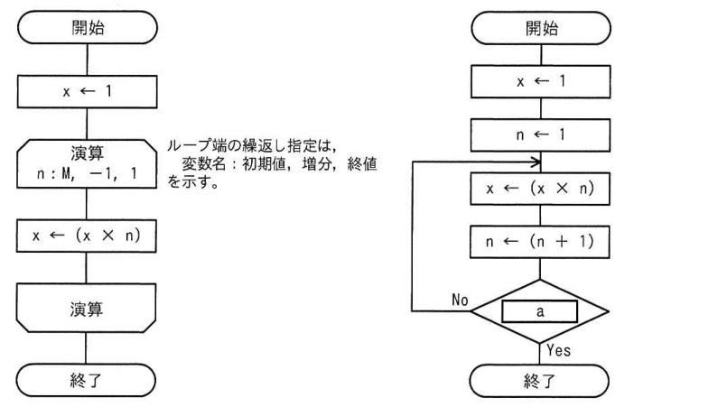
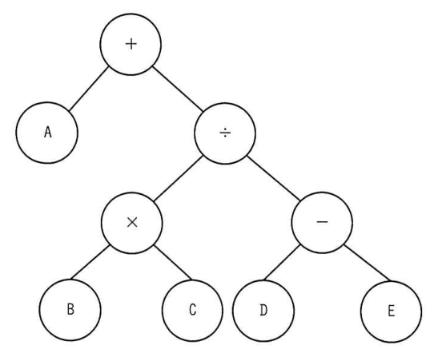
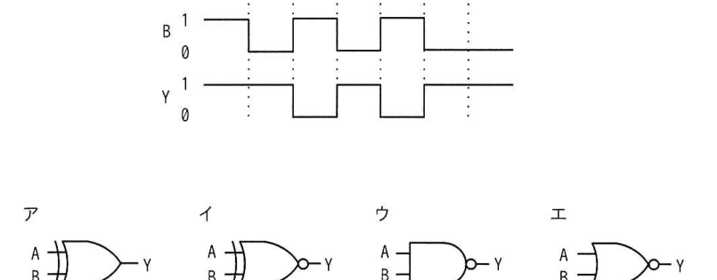
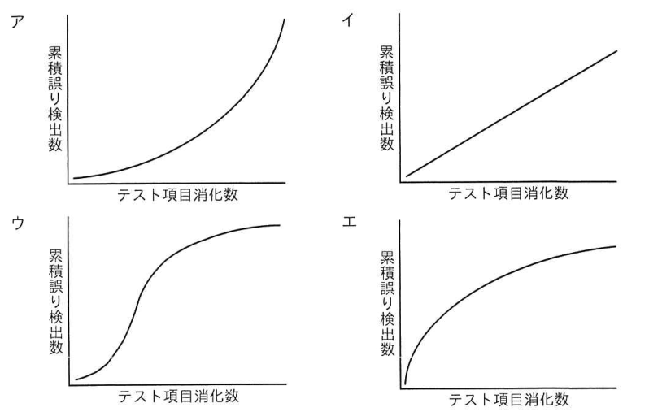
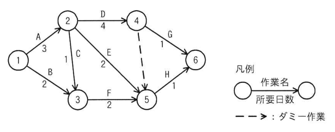

# 令和6年度春期 科目A（旧午前）過去問解説

> 令和6年度 春期 応用情報技術者試験 午前（全80問）を書き起こし、オリジナルの解説を付けたものです。問題の著作権は IPA（独立行政法人 情報処理推進機構）にあります。
> 図を表に書き換えるなど一部改変した問題には、その旨を記載しています。
> インタラクティブ教材の [科目A 四択クイズ](../../06_インタラクティブ教材/quiz.html) では、この回を本番形式（150分）で解けます。

## 目次

| 問 | 分野 | 中分類 | キーワード |
|---|---|---|---|
| [問1](#q01) | テクノロジ系 | 基礎理論 | ベイズの定理、事後確率、条件付き確率 |
| [問2](#q02) | テクノロジ系 | 基礎理論 | M/M/1、待ち行列、利用率、平均待ち時間 |
| [問3](#q03) | テクノロジ系 | 基礎理論 | ディープラーニング、ニューラルネットワーク、機械学習 |
| [問4](#q04) | テクノロジ系 | 基礎理論 | ハミング符号、誤り訂正、パリティ |
| [問5](#q05) | テクノロジ系 | アルゴリズムとプログラミング | 流れ図、ループ、階乗、終了条件 |
| [問6](#q06) | テクノロジ系 | アルゴリズムとプログラミング | 2分木、再帰、後行順走査、逆ポーランド記法 |
| [問7](#q07) | テクノロジ系 | アルゴリズムとプログラミング | バブルソート、整列、交換法 |
| [問8](#q08) | テクノロジ系 | コンピュータ構成要素 | ブロック転送、メモリ、領域の重なり |
| [問9](#q09) | テクノロジ系 | コンピュータ構成要素 | 量子コンピュータ、量子ゲート方式、量子ビット、重ね合わせ |
| [問10](#q10) | テクノロジ系 | コンピュータ構成要素 | キャッシュメモリ、ヒット率、実効アクセス時間 |
| [問11](#q11) | テクノロジ系 | コンピュータ構成要素 | 圧縮、転送時間、フラッシュメモリ、展開 |
| [問12](#q12) | テクノロジ系 | システム構成要素 | フォールトアボイダンス、フェールセーフ、フェールソフト、フォールトトレランス |
| [問13](#q13) | テクノロジ系 | システム構成要素 | オブジェクトストレージ、非構造化データ、SAN、ストレージ仮想化 |
| [問14](#q14) | テクノロジ系 | コンピュータ構成要素 | マルチプロセッサ、オーバーヘッド、性能の上限、極限 |
| [問15](#q15) | テクノロジ系 | システム構成要素 | シミュレーション、性能評価、解析的手法 |
| [問16](#q16) | テクノロジ系 | ソフトウェア | ノンプリエンプティブ、タスクスケジューリング、プリエンプション |
| [問17](#q17) | テクノロジ系 | ソフトウェア | デッドロック、資源の占有順序、排他制御 |
| [問18](#q18) | テクノロジ系 | ソフトウェア | 多重度、タスク、処理時間、スループット |
| [問19](#q19) | テクノロジ系 | ソフトウェア | プロファイラ、開発ツール、性能改善 |
| [問20](#q20) | テクノロジ系 | ハードウェア | インバータ、パワー半導体、コンバータ |
| [問21](#q21) | テクノロジ系 | ハードウェア | タイムチャート、論理回路、NAND |
| [問22](#q22) | テクノロジ系 | ハードウェア | VRAM、アドレス計算、画素、グラフィック LCD |
| [問23](#q23) | テクノロジ系 | ハードウェア | 直流給電、データセンター、電力変換損失、UPS |
| [問24](#q24) | テクノロジ系 | 情報メディア | アウトラインフォント、ビットマップフォント、ベクター |
| [問25](#q25) | テクノロジ系 | データベース | ストアドプロシージャ、通信量、DBMS |
| [問26](#q26) | テクノロジ系 | データベース | SQL、COALESCE、外結合、GROUP BY、CASE |
| [問27](#q27) | テクノロジ系 | データベース | ロールフォワード、障害回復、WAL、チェックポイント |
| [問28](#q28) | テクノロジ系 | データベース | スタースキーマ、ファクトテーブル、ディメンジョンテーブル、データウェアハウス |
| [問29](#q29) | テクノロジ系 | データベース | NoSQL、キーバリュー型、ビッグデータ |
| [問30](#q30) | テクノロジ系 | ネットワーク | CSMA/CD、イーサネット、衝突検出、アクセス制御方式 |
| [問31](#q31) | テクノロジ系 | ネットワーク | IPアドレス、グローバルアドレス、プライベートアドレス、アドレスクラス |
| [問32](#q32) | テクノロジ系 | ネットワーク | VRRP、冗長化、デフォルトゲートウェイ |
| [問33](#q33) | テクノロジ系 | ネットワーク | ビット誤り率、期待値、パケット |
| [問34](#q34) | テクノロジ系 | ネットワーク | SDN、OpenFlow、コントロールプレーン、データプレーン |
| [問35](#q35) | テクノロジ系 | セキュリティ | 3Dセキュア、リスクベース認証、クレジットカード、本人認証 |
| [問36](#q36) | テクノロジ系 | セキュリティ | DNSキャッシュポイズニング、キャッシュサーバ、名前解決 |
| [問37](#q37) | テクノロジ系 | セキュリティ | DNSSEC、デジタル署名、改ざん検知 |
| [問38](#q38) | テクノロジ系 | セキュリティ | 公開鍵暗号方式、鍵の数、共通鍵暗号方式 |
| [問39](#q39) | テクノロジ系 | セキュリティ | PSIRT、CSIRT、SOC、製品セキュリティ |
| [問40](#q40) | テクノロジ系 | セキュリティ | JIS Q 31000、リスク特定、リスクアセスメント |
| [問41](#q41) | テクノロジ系 | セキュリティ | WAF、Webアプリケーション、REST API |
| [問42](#q42) | テクノロジ系 | セキュリティ | IPsec、ネットワーク層、IPv6、暗号化 |
| [問43](#q43) | テクノロジ系 | セキュリティ | SPF、送信ドメイン認証、DKIM、なりすましメール |
| [問44](#q44) | テクノロジ系 | セキュリティ | 耐タンパ性、ICカード、物理的解析 |
| [問45](#q45) | テクノロジ系 | システム開発技術 | オブジェクト指向、オーバーライド、継承、集約 |
| [問46](#q46) | テクノロジ系 | システム開発技術 | モジュール結合度、共通結合、制御結合、内容結合 |
| [問47](#q47) | テクノロジ系 | システム開発技術 | ゴンペルツ曲線、信頼度成長モデル、バグ曲線 |
| [問48](#q48) | テクノロジ系 | ソフトウェア開発管理技術 | リーンソフトウェア開発、バリューストリームマップ、アジャイル |
| [問49](#q49) | テクノロジ系 | ソフトウェア開発管理技術 | JIS X 33002、プロセスアセスメント、SPICE |
| [問50](#q50) | テクノロジ系 | ソフトウェア開発管理技術 | ドキュメンテーションジェネレーター、Javadoc、開発ツール |
| [問51](#q51) | マネジメント系 | プロジェクトマネジメント | EVM、CPI、SPI、出来高 |
| [問52](#q52) | マネジメント系 | プロジェクトマネジメント | アローダイアグラム、最早結合点時刻、ダミー作業 |
| [問53](#q53) | マネジメント系 | プロジェクトマネジメント | JIS Q 21500、リスクの管理、リスクマネジメント |
| [問54](#q54) | マネジメント系 | プロジェクトマネジメント | 期待金額価値、EMV、デシジョンツリー、期待値 |
| [問55](#q55) | マネジメント系 | サービスマネジメント | 課金方式、従量課金、SaaS、利益計算 |
| [問56](#q56) | マネジメント系 | サービスマネジメント | サービスレベル管理、SLA、サービスレベル目標 |
| [問57](#q57) | マネジメント系 | サービスマネジメント | GHGプロトコル、スコープ1、温室効果ガス、データセンター |
| [問58](#q58) | マネジメント系 | システム監査 | 監査調書、システム監査基準、監査証拠 |
| [問59](#q59) | マネジメント系 | システム監査 | システム監査基準、ITガバナンス、システム監査の対象 |
| [問60](#q60) | マネジメント系 | システム監査 | 業務処理統制、全般統制、IT統制、内部統制 |
| [問61](#q61) | ストラテジ系 | システム戦略 | エンタープライズアーキテクチャ、BRM、参照モデル |
| [問62](#q62) | ストラテジ系 | システム戦略 | デジタルガバナンス・コード、DX、経済産業省 |
| [問63](#q63) | ストラテジ系 | システム戦略 | SOA、サービス指向アーキテクチャ、ERP、BPM |
| [問64](#q64) | ストラテジ系 | システム企画 | PBP、回収期間法、IT投資評価 |
| [問65](#q65) | ストラテジ系 | ビジネスインダストリ | EMS、受託製造、ファブレス、OEM |
| [問66](#q66) | ストラテジ系 | システム企画 | コンティンジェンシープラン、外部委託、リスク対応 |
| [問67](#q67) | ストラテジ系 | 経営戦略マネジメント | PPM、金のなる木、プロダクトポートフォリオマネジメント |
| [問68](#q68) | ストラテジ系 | 経営戦略マネジメント | ファイブフォース分析、競争要因、ポーター |
| [問69](#q69) | ストラテジ系 | 経営戦略マネジメント | フィージビリティスタディ、実現可能性調査、デルファイ法 |
| [問70](#q70) | ストラテジ系 | ビジネスインダストリ | デジタルツイン、IoT、シミュレーション |
| [問71](#q71) | ストラテジ系 | ビジネスインダストリ | マスカスタマイゼーション、IoT、ビジネスモデル |
| [問72](#q72) | ストラテジ系 | ビジネスインダストリ | エッジコンピューティング、IoT、低遅延 |
| [問73](#q73) | ストラテジ系 | 企業活動 | ナッシュ均衡、ゲーム理論、マクシミン原理 |
| [問74](#q74) | ストラテジ系 | 企業活動 | 連関図、新QC七つ道具、因果関係 |
| [問75](#q75) | ストラテジ系 | 企業活動 | 線形計画法、LP、最適化、制約条件 |
| [問76](#q76) | ストラテジ系 | 企業活動 | 営業利益、損益分岐点、固定費、変動費 |
| [問77](#q77) | ストラテジ系 | 企業活動 | 損益分岐点、変動費率、固定費 |
| [問78](#q78) | ストラテジ系 | 法務 | 特許法、発明、知的財産権 |
| [問79](#q79) | ストラテジ系 | 法務 | 不正競争防止法、ドメイン名の不正取得、形態模倣 |
| [問80](#q80) | ストラテジ系 | 法務 | 要配慮個人情報、個人情報保護法、個人識別符号 |

<a id="q01"></a>

### 問1　〔基礎理論〕

複数の袋からそれぞれ白と赤の玉を幾つかずつ取り出すとき，ベイズの定理を利用して事後確率を求める場合はどれか。

- **ア**　ある袋から取り出した二つの玉の色が同じと推定することができる確率を求める場合
- **イ**　異なる袋から取り出した玉が同じ色であると推定することができる確率を求める場合
- **ウ**　玉を一つ取り出すために，ある袋が選ばれると推定することができる確率を求める場合
- **エ**　取り出した玉の色から，どの袋から取り出されたのかを推定するための確率を求める場合

<details><summary>解答・解説</summary>

**正解：エ**

ベイズの定理は「結果（観測）から原因の確率を逆算する」ための式。取り出した玉の色という結果を見て，それがどの袋（原因）から出たかの確率を求める エ が事後確率の計算に当たる。

P(袋i｜赤) = P(赤｜袋i) × P(袋i) / Σ P(赤｜袋j) × P(袋j)

- ア：一つの袋の中での組合せの確率で，通常の確率計算。原因を逆算していない
- イ：複数の袋からの取り出しが同色になる確率で，各袋の確率の積・和で求める普通の確率
- ウ：袋が選ばれる確率は観測前の事前確率そのもの

💡 **ポイント**：「事前確率 P(原因)」に「尤度 P(結果｜原因)」を掛けて正規化すると「事後確率 P(原因｜結果)」になる。「結果から原因を推定」という言い回しが出たらベイズ。

📖 関連：[基礎理論](../../01_テクノロジ系/01_基礎理論.md)

</details>

<sub>出典：令和6年度 春期 応用情報技術者試験 午前 問1</sub>

---

<a id="q02"></a>

### 問2　〔基礎理論〕 🧮

ATM（現金自動預払機）が1台ずつ設置してある二つの支店を統合し，統合後の支店には ATM を1台設置する。統合後の ATM の平均待ち時間を求める式はどれか。ここで，待ち時間は M/M/1 の待ち行列モデルに従い，平均待ち時間にはサービス時間を含まず，ATM を1台に統合しても十分に処理できるものとする。

〔条件〕

(1)　統合後の平均サービス時間：T<sub>s</sub>
(2)　統合前の ATM の利用率：両支店とも ρ
(3)　統合後の利用者数：統合前の両支店の利用者数の合計

- **ア**　ρ / (1 − ρ) × Ts
- **イ**　ρ / (1 − 2ρ) × Ts
- **ウ**　2ρ / (1 − ρ) × Ts
- **エ**　2ρ / (1 − 2ρ) × Ts

<details><summary>解答・解説</summary>

**正解：エ**

利用者数が2支店分の合計になるので到着率が2倍，サービス時間は同じなので統合後の利用率は 2ρ。M/M/1 の平均待ち時間の式 ρ/(1−ρ)×Ts の ρ を 2ρ に置き換えた エ になる。

**途中式**

- 利用率 = 到着率 × 平均サービス時間。到着率が2倍 → 利用率 = 2ρ
- 平均待ち時間 W = 利用率 / (1 − 利用率) × Ts = **2ρ / (1 − 2ρ) × Ts**

- ア：統合前の1支店の式のまま。利用者が倍になったことを反映していない
- イ：分母だけ 2ρ にしており，分子の利用率を置き換え忘れている
- ウ：分子だけ 2ρ にしており，分母の利用率を置き換え忘れている

💡 **ポイント**：M/M/1 の待ち時間は「ρ/(1−ρ)×平均サービス時間」。条件変更の問題は，まず新しい利用率を求めて式の ρ を丸ごと置き換える。

📖 関連：[基礎理論](../../01_テクノロジ系/01_基礎理論.md)／[計算問題公式集](../../05_まとめ・横断資料/01_計算問題公式集.md)

</details>

<sub>出典：令和6年度 春期 応用情報技術者試験 午前 問2（数式をテキストで表記）</sub>

---

<a id="q03"></a>

### 問3　〔基礎理論〕

AI におけるディープラーニングに関する記述として，最も適切なものはどれか。

- **ア**　あるデータから結果を求める処理を，人間の脳神経回路のように多層の処理を重ねることによって，複雑な判断をできるようにする。
- **イ**　大量のデータからまだ知られていない新たな規則や仮説を発見するために，想定値から大きく外れている例外事項を取り除きながら分析を繰り返す手法である。
- **ウ**　多様なデータや大量のデータに対して，三段論法，統計的手法やパターン認識手法を組み合わせることによって，高度なデータ分析を行う手法である。
- **エ**　知識がルールに従って表現されており，演繹手法を利用した推論によって有意な結論を導く手法である。

<details><summary>解答・解説</summary>

**正解：ア**

ディープラーニングは，脳の神経細胞を模したニューラルネットワークの中間層（隠れ層）を何層にも重ね，特徴量を自動的に学習して複雑な判断を可能にする手法。アが該当する。

- イ：データマイニングの説明。外れ値を除きながら規則性を探す
- ウ：データマイニングやビッグデータ分析の一般的な説明で，多層ニューラルネットワークの特徴に触れていない
- エ：エキスパートシステム（ルールベースの推論）の説明

💡 **ポイント**：ディープラーニング＝多層ニューラルネットワーク。人が特徴量を設計しなくても学習できるのが従来の機械学習との違い。

📖 関連：[基礎理論](../../01_テクノロジ系/01_基礎理論.md)

</details>

<sub>出典：令和6年度 春期 応用情報技術者試験 午前 問3</sub>

---

<a id="q04"></a>

### 問4　〔基礎理論〕 🧮

符号長7ビット，情報ビット数4ビットのハミング符号による誤り訂正の方法を，次のとおりとする。

受信した7ビットの符号語 x1 x2 x3 x4 x5 x6 x7（xk ＝ 0 又は 1）に対して

```
c0 = x1      + x3      + x5      + x7
c1 =      x2 + x3           + x6 + x7
c2 =                x4 + x5 + x6 + x7
```

（いずれも mod 2 での計算）

を計算し，c0，c1，c2 の中に少なくとも一つは 0 でないものがある場合には，

i ＝ c0 ＋ c1 × 2 ＋ c2 × 4

を求めて，左から i ビット目を反転することによって誤りを訂正する。

受信した符号語が 1000101 であった場合，誤り訂正後の符号語はどれか。

- **ア**　1000001
- **イ**　1000101
- **ウ**　1001101
- **エ**　1010101

<details><summary>解答・解説</summary>

**正解：エ**

受信語 1000101 で検査式を計算すると c0=1，c1=1，c2=0 となり，i=3。左から3ビット目を反転して 1010101 になる。

**途中式**

x1〜x7 = 1, 0, 0, 0, 1, 0, 1

- c0 = x1+x3+x5+x7 = 1+0+1+1 = 3 → mod 2 で **1**
- c1 = x2+x3+x6+x7 = 0+0+0+1 = **1**
- c2 = x4+x5+x6+x7 = 0+1+0+1 = 2 → mod 2 で **0**
- i = 1 + 1×2 + 0×4 = **3** → 3ビット目 0 を 1 に反転 → **1010101**

- ア：5ビット目を反転した値（i を 5 と誤って計算した場合）
- イ：受信語そのまま。c0，c1 が 0 でないので誤りがあると判定される
- ウ：4ビット目を反転した値（i=4 と誤って計算した場合）

💡 **ポイント**：ハミング符号は検査ビットの組（シンドローム）を2進数として読むと誤り位置が分かる。7ビット中1ビットの誤り訂正ができる。

📖 関連：[基礎理論](../../01_テクノロジ系/01_基礎理論.md)

</details>

<sub>出典：令和6年度 春期 応用情報技術者試験 午前 問4（検査式をコードブロックで表記）</sub>

---

<a id="q05"></a>

### 問5　〔アルゴリズムとプログラミング〕

正の整数 M に対して，次の二つの流れ図に示すアルゴリズムを実行したとき，結果 x の値が等しくなるようにしたい。a に入れる条件として，適切なものはどれか。



- **ア**　n ＜ M
- **イ**　n ＞ M − 1
- **ウ**　n ＞ M
- **エ**　n ＞ M ＋ 1

<details><summary>解答・解説</summary>

**正解：ウ**

左の流れ図は n を M から 1 まで1ずつ減らしながら x に掛けるので，x = M!（M×(M−1)×…×1）。右の流れ図は n=1 から掛けて n を1増やし，判定 a が Yes で終了するので，n=M まで掛け終えた直後（n=M+1 になった時点）に終了させればよい。その条件は n ＞ M。

**途中式**（M=3 の例）

- 左：x = 1×3×2×1 = 6
- 右：x=1×1（n→2），x=1×2（n→3），x=2×3=6（n→4）→ ここで n＞3 が真となり終了 → x=6 で一致

- ア：n＜M は最初の判定（n=2）で真になり，M≥3 のとき途中で終了する。また Yes/No の意味が逆
- イ：n＞M−1 は n=M の時点で真となり，M を掛ける前に終了する（(M−1)! になる）
- エ：n＞M+1 では n=M+1 の値まで余分に掛けてしまう（(M+1)! になる）

💡 **ポイント**：後判定ループは「本体を実行してからカウンタを更新し判定」する。終了直前のカウンタの値を具体的な小さい数で追うと境界の誤りを防げる。

📖 関連：[アルゴリズムとプログラミング](../../01_テクノロジ系/02_アルゴリズムとプログラミング.md)

</details>

<sub>出典：令和6年度 春期 応用情報技術者試験 午前 問5</sub>

---

<a id="q06"></a>

### 問6　〔アルゴリズムとプログラミング〕

各ノードがもつデータを出力する再帰処理 f(ノード n) を定義した。この処理を，図の2分木の根（最上位のノード）から始めたときの出力はどれか。

〔f(ノード n) の定義〕

1. ノード n の右に子ノード r があれば，f(ノード r) を実行
2. ノード n の左に子ノード l があれば，f(ノード l) を実行
3. 再帰処理 f(ノード r)，f(ノード l) を未実行の子ノード，又は子ノードがなければ，ノード自身がもつデータを出力
4. 終了



- **ア**　＋÷−ED×CBA
- **イ**　ABC×DE−÷＋
- **ウ**　E−D÷C×B＋A
- **エ**　ED−CB×÷A＋

<details><summary>解答・解説</summary>

**正解：エ**

右の子 → 左の子 → 自分 の順に出力する「右優先の後行順（帰りがけ順）走査」なので，ED−CB×÷A＋ となる。

**途中式**

- f(＋)：右の ÷ へ → f(÷)：右の − へ → f(−)：右 E を出力，左 D を出力，− を出力 → "ED−"
- f(÷) の左 × へ → C，B，× を出力 → "CB×"，続いて ÷ を出力
- f(＋) の左 A を出力，最後に ＋ を出力
- 合計：**ED−CB×÷A＋**

- ア：根から先に出力する先行順（行きがけ順）を右優先で行った結果
- イ：左優先の後行順走査の結果（通常の逆ポーランド記法）
- ウ：右優先の中間順（通りがけ順）走査の結果

💡 **ポイント**：自分を出力するのが子の前か・間か・後かで先行順・中間順・後行順が決まる。この問題は「右から先に」たどる点に注意。

📖 関連：[アルゴリズムとプログラミング](../../01_テクノロジ系/02_アルゴリズムとプログラミング.md)

</details>

<sub>出典：令和6年度 春期 応用情報技術者試験 午前 問6</sub>

---

<a id="q07"></a>

### 問7　〔アルゴリズムとプログラミング〕

整列方法に関するアルゴリズムの記述のうち，バブルソートの記述はどれか。ここで，整列対象は重複のない1から9の数字がランダムに並んでいる数字列とする。

- **ア**　数字列の最後の数字から最初の数字に向かって，隣り合う二つの数字を比較して小さい数字が前に来るよう数字を入れ替える操作を繰り返し行う。
- **イ**　数字列の中からランダムに基準となる数を選び，基準より小さい数と大きい数の二つのグループに分け，それぞれのグループ内も同じ操作を繰り返し行う。
- **ウ**　数字列をほぼ同じ長さの二つの数字列のグループに分割していき，分割できなくなった時点から，グループ内で数字が小さい順に並べる操作を繰り返し行う。
- **エ**　未処理の数字列の中から最小値を探索し，未処理の数字列の最初の数字と入れ替える操作を繰り返し行う。

<details><summary>解答・解説</summary>

**正解：ア**

バブルソート（交換法）は，隣り合う要素を比較して順序が逆なら交換する操作を繰り返す。末尾から先頭へ向かって比較すれば，小さい値が泡のように先頭へ浮かび上がる。アが該当する。

- イ：基準値（ピボット）で2グループに分けるクイックソート
- ウ：分割してから並べながら併合するマージソート
- エ：最小値を選んで先頭と交換する選択ソート

💡 **ポイント**：キーワードで識別する。「隣り合う」→バブル，「基準値」→クイック，「分割して併合」→マージ，「最小値を選択」→選択，「整列済みの列に挿入」→挿入ソート。

📖 関連：[アルゴリズムとプログラミング](../../01_テクノロジ系/02_アルゴリズムとプログラミング.md)

</details>

<sub>出典：令和6年度 春期 応用情報技術者試験 午前 問7</sub>

---

<a id="q08"></a>

### 問8　〔コンピュータ構成要素〕

同一メモリ空間で，転送元の開始アドレス，転送先の開始アドレス，方向フラグ及び転送語数をパラメータとして指定することによって，データをブロック転送できる機能をもつ CPU がある。図のようにアドレス 1001 から 1004 のデータをアドレス 1003 から 1006 に転送するとき，指定するパラメータとして適切なものはどれか。ここで，転送は開始アドレスから1語ずつ行われ，方向フラグに 0 を指定するとアドレスの昇順に，1 を指定するとアドレスの降順に転送を行うものとする。

（図の内容：実行前のアドレス 1001〜1004 のデータを，実行後にアドレス 1003〜1006 へ移す。1001→1003，1002→1004，1003→1005，1004→1006）

- **ア**　転送元の開始アドレス：1001，転送先の開始アドレス：1003，方向フラグ：0，転送語数：4
- **イ**　転送元の開始アドレス：1001，転送先の開始アドレス：1003，方向フラグ：1，転送語数：4
- **ウ**　転送元の開始アドレス：1004，転送先の開始アドレス：1006，方向フラグ：0，転送語数：4
- **エ**　転送元の開始アドレス：1004，転送先の開始アドレス：1006，方向フラグ：1，転送語数：4

<details><summary>解答・解説</summary>

**正解：エ**

転送元（1001〜1004）と転送先（1003〜1006）が重なっており，転送先が後ろ側にずれている。昇順に転送すると 1003，1004 の元データを読む前に上書きしてしまうので，末尾の 1004→1006 から降順（フラグ1）で転送する エ が正しい。

**途中式**（エの動作）

1004→1006，1003→1005，1002→1004，1001→1003 の順。1003・1004 は読み出した後で上書きされるので壊れない。

- ア：昇順だと 1001→1003 で元の 1003 のデータが先に消え，3語目の転送で誤ったデータ（元の 1001 の値）を運んでしまう
- イ：開始アドレス 1001 から降順に進むと 1000，999…を転送してしまい，範囲が違う
- ウ：開始アドレス 1004 から昇順に進むと 1005〜1007 を転送してしまい，範囲が違う

💡 **ポイント**：領域が重なるブロック転送は「転送先が後ろなら末尾から」「転送先が前なら先頭から」コピーする（C の memmove と同じ考え方）。

📖 関連：[コンピュータ構成要素](../../01_テクノロジ系/03_コンピュータ構成要素.md)

</details>

<sub>出典：令和6年度 春期 応用情報技術者試験 午前 問8（図を文章で説明し，選択肢の表を文章に書き換え）</sub>

---

<a id="q09"></a>

### 問9　〔コンピュータ構成要素〕

量子ゲート方式の量子コンピュータの説明として，適切なものはどれか。

- **ア**　演算は2進数で行われ，結果も2進数で出力される。
- **イ**　特定のアルゴリズムによる演算だけができ，加算演算はできない。
- **ウ**　複数の状態を同時に表現する量子ビットと，その重ね合わせを利用する。
- **エ**　量子状態を変化させながら観測するので，100℃以上の高温で動作する。

<details><summary>解答・解説</summary>

**正解：ウ**

量子ゲート方式は，0 と 1 を同時にとり得る量子ビットの重ね合わせ状態に量子ゲートで操作を加え，多数の状態を並列に計算する方式。ウが正しい。

- ア：0 か 1 のどちらかの状態しかとらない古典ビットで演算する従来型コンピュータの説明
- イ：特定の最適化問題に特化しているのは量子アニーリング方式。量子ゲート方式は汎用的で加算回路も構成できる
- エ：量子状態は熱による乱れに弱く，多くの方式は極低温（絶対零度近く）で動作させる

💡 **ポイント**：量子コンピュータは「量子ゲート方式（汎用）」と「量子アニーリング方式（組合せ最適化向け）」の2系統。量子ビット・重ね合わせ・量子もつれがキーワード。

📖 関連：[コンピュータ構成要素](../../01_テクノロジ系/03_コンピュータ構成要素.md)

</details>

<sub>出典：令和6年度 春期 応用情報技術者試験 午前 問9</sub>

---

<a id="q10"></a>

### 問10　〔コンピュータ構成要素〕 🧮

主記憶のアクセス時間が60ナノ秒，キャッシュメモリのアクセス時間が10ナノ秒であるシステムがある。キャッシュメモリを介して主記憶にアクセスする場合の実効アクセス時間が15ナノ秒であるとき，キャッシュメモリのヒット率は幾らか。

- **ア**　0.1
- **イ**　0.17
- **ウ**　0.83
- **エ**　0.9

<details><summary>解答・解説</summary>

**正解：エ**

実効アクセス時間 ＝ キャッシュのアクセス時間 × ヒット率 ＋ 主記憶のアクセス時間 ×（1 − ヒット率）。これに数値を当てはめて解くとヒット率は 0.9。

**途中式**

ヒット率を h とすると

10h ＋ 60(1 − h) ＝ 15
60 − 50h ＝ 15
50h ＝ 45 → h ＝ **0.9**

- ア：1 − 0.9 のミス率を答えてしまった値
- イ：10/60 ≒ 0.17 で，アクセス時間の比にすぎない
- ウ：1 − 10/60 ≒ 0.83 で，式を立てずに比から求めた誤り

💡 **ポイント**：実効アクセス時間の式は頻出。ヒット率が逆算で問われても，式に代入して一次方程式を解けばよい。

📖 関連：[コンピュータ構成要素](../../01_テクノロジ系/03_コンピュータ構成要素.md)／[計算問題公式集](../../05_まとめ・横断資料/01_計算問題公式集.md)

</details>

<sub>出典：令和6年度 春期 応用情報技術者試験 午前 問10</sub>

---

<a id="q11"></a>

### 問11　〔コンピュータ構成要素〕 🧮

15M バイトのプログラムを圧縮して，フラッシュメモリに格納している。プログラムのサイズは圧縮によって元のサイズの40％になっている。フラッシュメモリから主記憶への転送速度が20M バイト／秒であり，1M バイトに圧縮されたデータの展開に主記憶上で0.03秒が掛かるとき，このプログラムが主記憶に展開されるまでの時間は何秒か。ここで，フラッシュメモリから主記憶への転送と圧縮データの展開は同時には行われないものとする。

- **ア**　0.48
- **イ**　0.75
- **ウ**　0.93
- **エ**　1.20

<details><summary>解答・解説</summary>

**正解：ア**

圧縮後のサイズは 6M バイト。転送に 0.3 秒，展開に 0.18 秒かかり，同時には行わないので合計 0.48 秒。

**途中式**

- 圧縮後のサイズ ＝ 15 × 0.4 ＝ 6M バイト
- 転送時間 ＝ 6 ÷ 20 ＝ 0.30 秒
- 展開時間 ＝ 6 × 0.03 ＝ 0.18 秒（1M バイトの圧縮データ当たり 0.03 秒）
- 合計 ＝ 0.30 ＋ 0.18 ＝ **0.48 秒**

- イ：圧縮前の 15M バイトを転送したとした値（15÷20）
- ウ：転送 15÷20＝0.75 に展開 0.18 を加えた値。転送するのは圧縮後のデータ
- エ：転送 0.75 に，展開を 15×0.03＝0.45 として加えた値

💡 **ポイント**：「圧縮されたデータ1M バイト当たり」の展開時間は，圧縮後のサイズに掛ける。どの量に掛ける単価なのかを確認する。

📖 関連：[コンピュータ構成要素](../../01_テクノロジ系/03_コンピュータ構成要素.md)／[計算問題公式集](../../05_まとめ・横断資料/01_計算問題公式集.md)

</details>

<sub>出典：令和6年度 春期 応用情報技術者試験 午前 問11</sub>

---

<a id="q12"></a>

### 問12　〔システム構成要素〕

システムの信頼性設計に関する記述のうち，適切なものはどれか。

- **ア**　フェールセーフとは，利用者の誤操作によってシステムが異常終了してしまうことのないように，単純なミスを発生させないようにする設計方法である。
- **イ**　フェールソフトとは，故障が発生した場合でも機能を縮退させることなく稼働を継続する概念である。
- **ウ**　フォールトアボイダンスとは，システム構成要素の個々の品質を高めて故障が発生しないようにする概念である。
- **エ**　フォールトトレランスとは，故障が生じてもシステムに重大な影響が出ないように，あらかじめ定められた安全状態にシステムを固定し，全体として安全が維持されるような設計方法である。

<details><summary>解答・解説</summary>

**正解：ウ**

フォールトアボイダンス（故障回避）は，部品の品質向上や十分な試験によって，そもそも故障が起きないようにする考え方。ウが正しい。

- ア：利用者のミスを防ぐ設計はフールプルーフ。フェールセーフは故障時に安全側へ倒す設計
- イ：フェールソフトは機能を縮退させて（一部機能を落として）稼働を続ける考え方。「縮退させることなく」が誤り
- エ：安全状態に固定するのはフェールセーフの説明。フォールトトレランスは冗長化などで故障があっても機能を維持する考え方

💡 **ポイント**：アボイダンス＝故障を起こさない，トレランス＝故障しても動き続ける，フェールセーフ＝安全側に止める，フェールソフト＝縮退して動く，フールプルーフ＝誤操作を防ぐ。

📖 関連：[システム構成要素](../../01_テクノロジ系/04_システム構成要素.md)

</details>

<sub>出典：令和6年度 春期 応用情報技術者試験 午前 問12</sub>

---

<a id="q13"></a>

### 問13　〔システム構成要素〕

オブジェクトストレージの記述として，最も適切なものはどれか。

- **ア**　更新頻度の少ない非構造型データの格納に適しており，大容量で拡張性のあるストレージ空間を仮想的に実現することができる。
- **イ**　高速のストレージ専用ネットワークを介して，複数のサーバからストレージを共有することによって，高速にデータを格納することができる。
- **ウ**　サーバごとに割り当てられた専用ストレージであり，容量が不足したときにはストレージを追加することができる。
- **エ**　複数のストレージを組み合わせることによって，仮想的な1台のストレージとして運用することができる。

<details><summary>解答・解説</summary>

**正解：ア**

オブジェクトストレージは，データを ID とメタデータを付けた「オブジェクト」単位で，階層をもたないフラットな空間に格納する方式。画像・動画・ログなど更新の少ない非構造化データを大量に保存するのに向き，容量を容易に拡張できる。アが正しい。

- イ：ストレージ専用の高速ネットワークで共有するのは SAN（Storage Area Network）
- ウ：サーバに直結した専用ストレージは DAS（Direct Attached Storage）
- エ：複数のストレージを1台に見せるのはストレージ仮想化の一般的な説明で，オブジェクトストレージに固有の特徴ではない

💡 **ポイント**：ブロックストレージ（SAN）・ファイルストレージ（NAS）・オブジェクトストレージの違いを押さえる。クラウドのオブジェクトストレージは HTTP の API でアクセスするのが一般的。

📖 関連：[システム構成要素](../../01_テクノロジ系/04_システム構成要素.md)

</details>

<sub>出典：令和6年度 春期 応用情報技術者試験 午前 問13</sub>

---

<a id="q14"></a>

### 問14　〔コンピュータ構成要素〕 🧮

1台の CPU の性能を1とするとき，その CPU を n 台用いたマルチプロセッサの性能 P が，

P ＝ n / (1 ＋ (n − 1)a)

で表されるとする。ここで，a はオーバーヘッドを表す定数である。例えば，a ＝ 0.1，n ＝ 4 とすると，P ≒ 3 なので，4台の CPU から成るマルチプロセッサの性能は約3になる。この式で表されるマルチプロセッサの性能には上限があり，n を幾ら大きくしても P はある値以上には大きくならない。a ＝ 0.1 の場合，P の上限は幾らか。

- **ア**　5
- **イ**　10
- **ウ**　15
- **エ**　20

<details><summary>解答・解説</summary>

**正解：イ**

分母・分子を n で割ると P ＝ 1 / (1/n ＋ a(1 − 1/n))。n を限りなく大きくすると 1/n → 0 なので P → 1/a。a ＝ 0.1 なら上限は 10。

**途中式**

- P ＝ n / (1 ＋ (n−1)a) ＝ 1 / (1/n ＋ a − a/n)
- n → ∞ で 1/n → 0，a/n → 0 → P → 1/a ＝ 1/0.1 ＝ **10**
- 確認：n＝100 で 100/(1＋9.9)＝9.17，n＝1000 で 1000/100.9≒9.91 と 10 に近づく

- ア：1/(2a) とした値で，根拠がない
- ウ・エ：上限を超えた値。どれだけ CPU を増やしても 10 に届かない

💡 **ポイント**：アムダールの法則と同様，並列化には上限がある。式の極限は「n で割って n→∞」で求める。

📖 関連：[コンピュータ構成要素](../../01_テクノロジ系/03_コンピュータ構成要素.md)／[計算問題公式集](../../05_まとめ・横断資料/01_計算問題公式集.md)

</details>

<sub>出典：令和6年度 春期 応用情報技術者試験 午前 問14（数式をテキストで表記）</sub>

---

<a id="q15"></a>

### 問15　〔システム構成要素〕

コンピュータの性能評価には，シミュレーションを用いた方法，解析的な方法などがある。シミュレーションを用いた方法の特徴はどれか。

- **ア**　解析的な方法よりも計算量が少なく，効率的に解が求まる。
- **イ**　解析的な方法よりも，乱数を用いることで高精度の解が得られる。
- **ウ**　解析的に解が求められないモデルに対しても，数値的に解が求まる。
- **エ**　解析的に解が求められるモデルの検証には使用できない。

<details><summary>解答・解説</summary>

**正解：ウ**

シミュレーションはモデルを実際に動かして（乱数で到着などを発生させて）結果を数値的に得る方法なので，数式で解けない複雑なモデルにも適用できる。ウが正しい。

- ア：シミュレーションは多数回の試行が必要で，一般に解析的な方法より計算量が多い
- イ：乱数を使う結果には統計的なばらつきがあり，厳密解が得られる解析的な方法より高精度とは言えない
- エ：解析解が得られるモデルでも，解析結果とシミュレーション結果を突き合わせて検証に使うことができる

💡 **ポイント**：解析的手法（待ち行列理論の公式など）は速く厳密だが前提条件が厳しい。シミュレーションは手間がかかるが前提条件に縛られにくい。

📖 関連：[システム構成要素](../../01_テクノロジ系/04_システム構成要素.md)

</details>

<sub>出典：令和6年度 春期 応用情報技術者試験 午前 問15</sub>

---

<a id="q16"></a>

### 問16　〔ソフトウェア〕

ノンプリエンプティブ方式のタスクの状態遷移に関する記述として，適切なものはどれか。

- **ア**　OS は実行中のタスクの優先度を他のタスクよりも上げることによって，実行中のタスクが終了するまでタスクが切り替えられるのを防ぐ。
- **イ**　実行中のタスクが自らの中断を OS に要求することによってだけ，OS は実行中のタスクを中断し，動作可能な他のタスクを実行中に切り替えることができる。
- **ウ**　実行中のタスクが無限ループに陥っていることを OS が検知した場合，OS は実行中のタスクを終了させ，動作可能な他のタスクを実行中に切り替える。
- **エ**　実行中のタスクより優先度が高い動作可能なタスクが実行待ち行列に追加された場合，OS は実行中のタスクを中断し，優先度が高い動作可能なタスクを実行中に切り替える。

<details><summary>解答・解説</summary>

**正解：イ**

ノンプリエンプティブ方式では，OS が実行中のタスクから強制的に CPU を取り上げることはなく，タスク自身が CPU を明け渡したとき（終了・待ち・自発的な中断要求）にだけ切替えが起きる。イが正しい。

- ア：優先度を操作して切替えを防ぐ仕組みはノンプリエンプティブの定義ではない。そもそも OS が横取りしない方式である
- ウ：OS が実行中タスクを強制終了して切り替えるのはプリエンプティブな動作
- エ：優先度の高いタスクの到着で実行中タスクを中断するのはプリエンプティブ方式（優先度順方式）の説明

💡 **ポイント**：プリエンプティブ＝OS が横取りできる，ノンプリエンプティブ＝タスクが自分で手放すまで実行を続ける。1つのタスクが CPU を独占する危険がある。

📖 関連：[ソフトウェア](../../01_テクノロジ系/05_ソフトウェア.md)

</details>

<sub>出典：令和6年度 春期 応用情報技術者試験 午前 問16</sub>

---

<a id="q17"></a>

### 問17　〔ソフトウェア〕

三つの資源 X〜Z を占有して処理を行う四つのプロセス A〜D がある。各プロセスは処理の進行に伴い，表中の数値の順に資源を占有し，実行終了時に三つの資源を一括して解放する。プロセス A と同時にもう一つプロセスを動かした場合に，デッドロックを起こす可能性があるプロセスはどれか。

| プロセス | 資源 X | 資源 Y | 資源 Z |
|---|---|---|---|
| A | 1 | 2 | 3 |
| B | 1 | 2 | 3 |
| C | 2 | 3 | 1 |
| D | 3 | 2 | 1 |

（表中の数値は資源の占有順序）

- **ア**　B，C，D
- **イ**　C，D
- **ウ**　C だけ
- **エ**　D だけ

<details><summary>解答・解説</summary>

**正解：イ**

A は X→Y→Z の順に占有する。C（Z→X→Y）や D（Z→Y→X）は A と逆の順序の組を含むので，互いに相手の資源を待つ状態になり得る。B は A と同じ順序なので起きない。答えは C，D。

**途中式**

- A と C：A が X を，C が Z を確保 → A は Y を取得後 Z 待ち，C は X 待ち → **デッドロック**
- A と D：A が X を，D が Z を確保 → D が Y を確保 → A は Y 待ち，D は X 待ち → **デッドロック**
- A と B：両者とも最初に X を取り合い，先に取った方が Y，Z も取れて完了する → 起きない

- ア：B は A と同じ順序で資源を確保するため，デッドロックにはならない
- ウ：D も Z を先に確保するので A と循環待ちになる
- エ：C も Z を先に確保し，X を待つので A と循環待ちになる

💡 **ポイント**：全プロセスが同じ順序で資源を確保すればデッドロックは起きない。順序が逆転する資源の組があるかを探す。

📖 関連：[ソフトウェア](../../01_テクノロジ系/05_ソフトウェア.md)

</details>

<sub>出典：令和6年度 春期 応用情報技術者試験 午前 問17（表の見出しを簡略化）</sub>

---

<a id="q18"></a>

### 問18　〔ソフトウェア〕 🧮

複数のクライアントから接続されるサーバがある。このサーバのタスクの多重度が2以下の場合，タスク処理時間は常に4秒である。このサーバに1秒間隔で4件の処理要求が到着した場合，全ての処理が終わるまでの時間はタスクの多重度が1のときと2のときとで，何秒の差があるか。

- **ア**　6
- **イ**　7
- **ウ**　8
- **エ**　9

<details><summary>解答・解説</summary>

**正解：イ**

到着時刻を 0，1，2，3 秒とすると，多重度1では 16 秒，多重度2では 9 秒で全処理が終わるので，差は 7 秒。

**途中式**

多重度1（1件ずつ順に処理）

| 要求 | 到着 | 開始 | 終了 |
|---|---|---|---|
| 1 | 0 | 0 | 4 |
| 2 | 1 | 4 | 8 |
| 3 | 2 | 8 | 12 |
| 4 | 3 | 12 | 16 |

多重度2（同時に2件まで）

| 要求 | 到着 | 開始 | 終了 |
|---|---|---|---|
| 1 | 0 | 0 | 4 |
| 2 | 1 | 1 | 5 |
| 3 | 2 | 4 | 8 |
| 4 | 3 | 5 | 9 |

差 ＝ 16 − 9 ＝ **7 秒**

- ア：多重度2の終了を 10 秒とした値。要求4は時刻5に空いたタスクで開始できる
- ウ：多重度2の終了を 8 秒とした値で，4件目の開始時刻を見誤っている
- エ：到着間隔を考慮せずに 16−7 などとした値で，根拠がない

💡 **ポイント**：多重度の問題は，到着時刻・開始時刻・終了時刻を表にして1件ずつ追うのが確実。

📖 関連：[ソフトウェア](../../01_テクノロジ系/05_ソフトウェア.md)

</details>

<sub>出典：令和6年度 春期 応用情報技術者試験 午前 問18</sub>

---

<a id="q19"></a>

### 問19　〔ソフトウェア〕

プログラムを構成するモジュールや関数の実行回数，実行時間など，性能改善のための分析に役立つ情報を収集するツールはどれか。

- **ア**　エミュレーター
- **イ**　シミュレーター
- **ウ**　デバッガ
- **エ**　プロファイラ

<details><summary>解答・解説</summary>

**正解：エ**

プロファイラは，プログラム実行中に関数ごとの呼出し回数や実行時間などを計測し，処理のボトルネックを見つけるためのツール。エが正しい。

- ア：エミュレーターは，別のハードウェアの命令や動作をそのまま再現し，そのハードウェア向けのプログラムを実行させるもの
- イ：シミュレーターは，実機や実環境の動作を模擬して試験や評価を行うもの
- ウ：デバッガは，ブレークポイントやステップ実行，変数の参照などでバグの原因を探すツール

💡 **ポイント**：開発支援ツールは「何を調べるか」で区別する。性能（時間・回数）ならプロファイラ，誤り（バグ）ならデバッガ。

📖 関連：[ソフトウェア](../../01_テクノロジ系/05_ソフトウェア.md)

</details>

<sub>出典：令和6年度 春期 応用情報技術者試験 午前 問19</sub>

---

<a id="q20"></a>

### 問20　〔ハードウェア〕

エアコンや電気自動車でエネルギー効率のよい制御や電力変換をするためにパワー半導体が用いられる。このパワー半導体の活用例の一つであるインバータの説明として，適切なものはどれか。

- **ア**　直流電圧をより高い直流電圧に変換する。
- **イ**　直流電圧をより低い直流電圧に変換する。
- **ウ**　交流電力を直流電力に変換する。
- **エ**　直流電力を交流電力に変換する。

<details><summary>解答・解説</summary>

**正解：エ**

インバータは直流電力を任意の周波数・電圧の交流電力に変換する装置で，モーターの回転数制御などに使われる。エが正しい。

- ア：直流を高い直流電圧に変換するのは昇圧型の DC-DC コンバータ（昇圧チョッパ）
- イ：直流を低い直流電圧に変換するのは降圧型の DC-DC コンバータ（降圧チョッパ）
- ウ：交流を直流に変換するのはコンバータ（整流器）

💡 **ポイント**：コンバータ＝交流→直流（または直流どうし），インバータ＝直流→交流。エアコンの「インバータ制御」は周波数を変えてモーターの速度を細かく調整する。

📖 関連：[ハードウェア](../../01_テクノロジ系/10_ハードウェア.md)

</details>

<sub>出典：令和6年度 春期 応用情報技術者試験 午前 問20</sub>

---

<a id="q21"></a>

### 問21　〔ハードウェア〕

入力が A と B，出力が Y の論理回路を動作させたとき，図のタイムチャートが得られた。この論理回路として，適切なものはどれか。



- **ア**　（図のア：排他的論理和素子（XOR））
- **イ**　（図のイ：論理一致素子）
- **ウ**　（図のウ：否定論理積素子（NAND））
- **エ**　（図のエ：否定論理和素子（NOR））

<details><summary>解答・解説</summary>

**正解：ウ**

タイムチャートを区間ごとに読むと，Y が 0 になるのは A＝1 かつ B＝1 のときだけで，それ以外は 1。これは否定論理積（NAND）の真理値表と一致する。ウが正しい。

**途中式**（左の区間から順に）

| A | B | Y |
|---|---|---|
| 0 | 1 | 1 |
| 0 | 0 | 1 |
| 1 | 1 | 0 |
| 0 | 0 | 1 |
| 1 | 1 | 0 |
| 0 | 0 | 1 |
| 1 | 0 | 1 |

- ア：XOR は A＝B＝0 で 0 になるが，チャートでは Y＝1
- イ：論理一致（XNOR）は A＝0，B＝1 で 0 になるが，チャートでは Y＝1
- エ：NOR は A＝0，B＝1 で 0 になるが，チャートでは Y＝1

💡 **ポイント**：タイムチャートは変化点ごとに区間を切って真理値表に直す。出現した入力の組だけで候補を絞り込める。

📖 関連：[ハードウェア](../../01_テクノロジ系/10_ハードウェア.md)／[基礎理論](../../01_テクノロジ系/01_基礎理論.md)

</details>

<sub>出典：令和6年度 春期 応用情報技術者試験 午前 問21（選択肢の図に素子名を補記）</sub>

---

<a id="q22"></a>

### 問22　〔ハードウェア〕 🧮

次の方式で画素にメモリを割り当てる 640×480 のグラフィック LCD モジュールがある。始点 (5, 4) から終点 (9, 8) まで直線を描画するとき，直線上の x＝7 の画素に割り当てられたメモリのアドレスの先頭は何番地か。ここで，画素の座標は (x, y) で表すものとする。

〔方式〕

- メモリは0番地から昇順に使用する。
- 1画素は16ビットとする。
- 座標 (0, 0) から座標 (639, 479) までメモリを連続して割り当てる。
- 各画素は，x＝0 から x 軸の方向にメモリを割り当てていく。
- x＝639 の次は x＝0 とし，y を1増やす。

（図の内容：メモリの1番地は8ビット。画素 (0, 0) に0番地と1番地，画素 (1, 0) に2番地と3番地が割り当てられている。直線は (5, 4)，(6, 5)，(7, 6)，(8, 7)，(9, 8) の画素を通る）

- **ア**　3847
- **イ**　7680
- **ウ**　7694
- **エ**　8978

<details><summary>解答・解説</summary>

**正解：ウ**

直線は傾き1なので x＝7 の画素は (7, 6)。この画素の前には 6 行分（640×6 画素）と 7 画素があり，1画素は 2 バイト（2番地分）なので，先頭アドレスは (640×6 ＋ 7)×2 ＝ 7694 番地。

**途中式**

- 直線上の点：(5,4)→(6,5)→(7,6) → x＝7 のとき y＝6
- 前にある画素数 ＝ 640 × 6 ＋ 7 ＝ 3,847
- 1画素 ＝ 16ビット ＝ 2番地分 → 3,847 × 2 ＝ **7,694**

- ア：画素数 3,847 のままで，1画素が2番地を使うことを忘れた値
- イ：640×6×2 で，行の先頭（x＝0）のアドレス。x＝7 の分を足していない
- エ：(640×7＋9)×2 で，x と y を取り違えるなどした値。x＝7 の画素 (7, 6) の番地ではない

💡 **ポイント**：2次元配列の番地計算は「(y × 横幅 ＋ x) × 1要素のバイト数」。番地の単位（8ビット）と画素のサイズ（16ビット）の違いに注意。

📖 関連：[ハードウェア](../../01_テクノロジ系/10_ハードウェア.md)

</details>

<sub>出典：令和6年度 春期 応用情報技術者試験 午前 問22（図を文章で説明）</sub>

---

<a id="q23"></a>

### 問23　〔ハードウェア〕

データセンターなどで採用されているサーバ，ネットワーク機器に対する直流給電の利点として，適切なものはどれか。

- **ア**　交流から直流への変換，直流から交流への変換で生じる電力損失を低減できる。
- **イ**　受電設備から CPU などの LSI まで，同じ電圧のまま給電できる。
- **ウ**　停電の危険がないので，電源バックアップ用のバッテリを不要にできる。
- **エ**　トランスを用いて容易に昇圧，降圧ができる。

<details><summary>解答・解説</summary>

**正解：ア**

交流給電では，UPS 内で交流→直流→交流と変換し，さらに機器の電源で交流→直流に変換するため，変換のたびに損失が出る。直流のまま給電すれば変換回数が減り，損失を低減できる。アが正しい。

- イ：給電電圧（例えば数百 V）と LSI の動作電圧（1V 前後）は大きく異なり，機器内で DC-DC 変換が必要
- ウ：直流給電でも停電は起こり得るので，バックアップ用のバッテリは必要
- エ：トランスで容易に昇降圧できるのは交流の利点であり，直流では使えない

💡 **ポイント**：直流給電（HVDC）の利点は変換段数の削減による省電力と信頼性向上。トランスによる電圧変換は交流の特徴。

📖 関連：[ハードウェア](../../01_テクノロジ系/10_ハードウェア.md)

</details>

<sub>出典：令和6年度 春期 応用情報技術者試験 午前 問23</sub>

---

<a id="q24"></a>

### 問24　〔情報メディア〕

ビットマップフォントよりも，アウトラインフォントの利用が適している場合はどれか。

- **ア**　英数字だけでなく，漢字も表示する。
- **イ**　各文字の幅を一定にして表示する。
- **ウ**　画面上にできるだけ高速に表示する。
- **エ**　文字を任意の倍率に拡大して表示する。

<details><summary>解答・解説</summary>

**正解：エ**

アウトラインフォントは文字の輪郭を座標と曲線の式で表すので，拡大・縮小しても輪郭が滑らかなまま表示できる。エが正しい。

- ア：漢字の表示はビットマップフォントでも可能で，アウトラインフォントに固有の利点ではない
- イ：文字幅を一定にするのは等幅フォントの性質で，ビットマップかアウトラインかとは無関係
- ウ：ドットパターンをそのまま描くビットマップフォントの方が，輪郭計算が不要な分だけ高速

💡 **ポイント**：ビットマップ＝点の集まり（拡大でギザギザ，表示は速い），アウトライン＝輪郭の数式（拡大に強い）。画像のラスタ形式とベクター形式の違いと同じ。

📖 関連：[基礎理論](../../01_テクノロジ系/01_基礎理論.md)

</details>

<sub>出典：令和6年度 春期 応用情報技術者試験 午前 問24</sub>

---

<a id="q25"></a>

### 問25　〔データベース〕

ストアドプロシージャの利点はどれか。

- **ア**　アプリケーションプログラムからネットワークを介して DBMS にアクセスする場合，両者間の通信量を減少させる。
- **イ**　アプリケーションプログラムからの一連の要求を一括して処理することによって，DBMS 内の実行計画の数を減少させる。
- **ウ**　アプリケーションプログラムからの一連の要求を一括して処理することによって，DBMS 内の必要バッファ数を減少させる。
- **エ**　データが格納されているディスク装置への I/O 回数を減少させる。

<details><summary>解答・解説</summary>

**正解：ア**

ストアドプロシージャは，一連の SQL 処理を DBMS 側に登録しておき，アプリケーションからは呼出し1回で実行させる仕組み。SQL を1文ずつ送受信する必要がなくなるので，ネットワークの通信量を減らせる。アが正しい。

- イ：処理に含まれる SQL 文の数は変わらないので，実行計画の数が減るわけではない（事前コンパイルで解析の手間は減る）
- ウ：DBMS 内で扱うデータ量は同じで，必要なバッファ数は減らない
- エ：アクセスするデータは同じなので，ディスクへの I/O 回数は減らない

💡 **ポイント**：ストアドプロシージャの利点は「通信量（往復回数）の削減」「処理の共通化」「事前コンパイルによる効率化」。

📖 関連：[データベース](../../01_テクノロジ系/06_データベース.md)

</details>

<sub>出典：令和6年度 春期 応用情報技術者試験 午前 問25</sub>

---

<a id="q26"></a>

### 問26　〔データベース〕

“部品”表及び“在庫”表に対し，SQL 文を実行して結果を得た。SQL 文の a に入れる字句はどれか。

部品

| 部品 ID | 発注点 |
|---|---|
| P01 | 100 |
| P02 | 150 |
| P03 | 100 |

在庫

| 部品 ID | 倉庫 ID | 在庫数 |
|---|---|---|
| P01 | W01 | 90 |
| P01 | W02 | 90 |
| P02 | W01 | 150 |

〔結果〕

| 部品 ID | 発注要否 |
|---|---|
| P01 | 不要 |
| P02 | 不要 |
| P03 | 必要 |

〔SQL 文〕

```
SELECT 部品.部品ID AS 部品ID,
    CASE WHEN 部品.発注点 >     a
        THEN N'必要' ELSE N'不要' END AS 発注要否
  FROM 部品 LEFT OUTER JOIN 在庫
    ON 部品.部品ID = 在庫.部品ID
  GROUP BY 部品.部品ID, 部品.発注点
```

- **ア**　COALESCE(MIN(在庫.在庫数), 0)
- **イ**　COALESCE(MIN(在庫.在庫数), NULL)
- **ウ**　COALESCE(SUM(在庫.在庫数), 0)
- **エ**　COALESCE(SUM(在庫.在庫数), NULL)

<details><summary>解答・解説</summary>

**正解：ウ**

部品ごとの在庫数の合計が発注点を下回れば“必要”にする。P03 は在庫表に行がなく，外結合で在庫数が NULL になるので，COALESCE で 0 に置き換えて比較する必要がある。SUM と 0 の組合せの ウ が正しい。

**途中式**（ウの場合）

- P01：SUM ＝ 90＋90 ＝ 180，100 ＞ 180 は偽 → 不要
- P02：SUM ＝ 150，150 ＞ 150 は偽 → 不要
- P03：SUM ＝ NULL → COALESCE で 0，100 ＞ 0 は真 → 必要

- ア：MIN だと P01 は 90 となり，100 ＞ 90 で“必要”になってしまう
- イ：MIN の問題に加え，P03 は NULL のままで比較結果が不明（真にならない）となり，ELSE の“不要”になる
- エ：P03 の SUM が NULL のまま比較され，“不要”になってしまう

💡 **ポイント**：COALESCE(式, 値) は式が NULL のとき値を返す。外結合で相手がない行は NULL になり，NULL との比較は真にならない点を押さえる。

📖 関連：[データベース](../../01_テクノロジ系/06_データベース.md)

</details>

<sub>出典：令和6年度 春期 応用情報技術者試験 午前 問26（表を GFM の表に，SQL をコードブロックに書き換え）</sub>

---

<a id="q27"></a>

### 問27　〔データベース〕

トランザクション T はチェックポイント後にコミットしたが，その後にシステム障害が発生した。トランザクション T の更新内容をその終了直後の状態にするために用いられる復旧技法はどれか。ここで，トランザクションは WAL プロトコルに従い，チェックポイントの他に，トランザクションログを利用する。

- **ア**　2相ロック
- **イ**　シャドウページ
- **ウ**　ロールバック
- **エ**　ロールフォワード

<details><summary>解答・解説</summary>

**正解：エ**

コミット済みのトランザクションの更新は，障害でデータベースに反映されていない可能性がある。チェックポイント時点の状態から，ログの更新後情報を使って処理をやり直す（再実行する）ロールフォワードで終了直後の状態にする。エが正しい。

- ア：2相ロックは同時実行制御で直列化可能性を保証する方式で，障害回復の技法ではない
- イ：シャドウページは更新を別ページに書いて切り替える方式で，WAL とログを使う復旧の説明に合わない
- ウ：ロールバックはログの更新前情報で未コミットのトランザクションを取り消す技法。コミット済みの T には使わない

💡 **ポイント**：システム障害時は「チェックポイント後にコミット済み → ロールフォワード（REDO）」「障害時点で未コミット → ロールバック（UNDO）」。

📖 関連：[データベース](../../01_テクノロジ系/06_データベース.md)

</details>

<sub>出典：令和6年度 春期 応用情報技術者試験 午前 問27</sub>

---

<a id="q28"></a>

### 問28　〔データベース〕

データウェアハウスのテーブル構成をスタースキーマとする場合，分析対象のトランザクションデータを格納するテーブルはどれか。

- **ア**　サマリテーブル
- **イ**　ディメンジョンテーブル
- **ウ**　ファクトテーブル
- **エ**　ルックアップテーブル

<details><summary>解答・解説</summary>

**正解：ウ**

スタースキーマは，売上明細などの分析対象となる事実（トランザクションデータ）を格納するファクトテーブルを中心に置き，その周りに分析の切り口となるディメンジョンテーブルを星形に配置する構成。ウが正しい。

- ア：サマリテーブルは集計済みのデータを保持して検索を速くするための表
- イ：ディメンジョンテーブルは時間・商品・地域などの分析軸（属性）を格納する表
- エ：ルックアップテーブルはコードと名称の対応などを引くための参照用の表

💡 **ポイント**：スタースキーマ＝中心のファクト（数値・明細）＋周囲のディメンジョン（軸）。ディメンジョンをさらに正規化したものはスノーフレークスキーマ。

📖 関連：[データベース](../../01_テクノロジ系/06_データベース.md)

</details>

<sub>出典：令和6年度 春期 応用情報技術者試験 午前 問28</sub>

---

<a id="q29"></a>

### 問29　〔データベース〕

ビッグデータの基盤技術として利用される NoSQL に分類されるデータベースはどれか。

- **ア**　関係データモデルをオブジェクト指向データモデルに拡張し，操作の定義や型の継承関係の定義を可能としたデータベース
- **イ**　経営者の意思決定を支援するために，ある主題に基づくデータを現在の情報とともに過去の情報も蓄積したデータベース
- **ウ**　様々な形式のデータを一つのキーに対応付けて管理するキーバリュー型データベース
- **エ**　データ項目の名称，形式など，データそのものの特性を表すメタ情報を管理するデータベース

<details><summary>解答・解説</summary>

**正解：ウ**

NoSQL は関係データベース以外のデータベースの総称で，キーバリュー型・ドキュメント型・カラム指向型・グラフ型などがある。キーと値の組で管理するキーバリュー型の ウ が該当する。

- ア：オブジェクト関係データベース（ORDB）の説明
- イ：データウェアハウスの説明
- エ：データディクショナリ（リポジトリ）の説明

💡 **ポイント**：NoSQL は厳密なスキーマや結合をもたない代わりに，水平分散による大量データの高速処理を得意とする。代表4種（KVS・ドキュメント・カラム指向・グラフ）を覚える。

📖 関連：[データベース](../../01_テクノロジ系/06_データベース.md)

</details>

<sub>出典：令和6年度 春期 応用情報技術者試験 午前 問29</sub>

---

<a id="q30"></a>

### 問30　〔ネットワーク〕

CSMA/CD 方式の LAN に接続されたノードの送信動作として，適切なものはどれか。

- **ア**　各ノードに論理的な順位付けを行い，送信権を順次受け渡し，これを受け取ったノードだけが送信を行う。
- **イ**　各ノードは伝送媒体が使用中かどうかを調べ，使用中でなければ送信を行う。衝突を検出したらランダムな時間の経過後に再度送信を行う。
- **ウ**　各ノードを環状に接続して，送信権を制御するための特殊なフレームを巡回させ，これを受け取ったノードだけが送信を行う。
- **エ**　タイムスロットを割り当てられたノードだけが送信を行う。

<details><summary>解答・解説</summary>

**正解：イ**

CSMA/CD は，送信前に伝送路が空いているかを確認し（キャリア検知），空いていれば送信，衝突を検出したらランダムな時間待って再送する方式。イが正しい。

- ア：論理的な順位で送信権を受け渡すのはトークンバス方式
- ウ：環状に接続してトークンを巡回させるのはトークンリング方式
- エ：時間を区切って各ノードに割り当てるのは TDMA（時分割多元接続）方式

💡 **ポイント**：CS＝キャリア検知，MA＝多重アクセス，CD＝衝突検出。無線 LAN は衝突を検出できないので CSMA/CA（衝突回避）を使う。

📖 関連：[ネットワーク](../../01_テクノロジ系/07_ネットワーク.md)

</details>

<sub>出典：令和6年度 春期 応用情報技術者試験 午前 問30</sub>

---

<a id="q31"></a>

### 問31　〔ネットワーク〕

IP アドレス 208.77.188.166 は，どのアドレスに該当するか。

- **ア**　グローバルアドレス
- **イ**　プライベートアドレス
- **ウ**　ブロードキャストアドレス
- **エ**　マルチキャストアドレス

<details><summary>解答・解説</summary>

**正解：ア**

208.77.188.166 はクラス C の範囲（192〜223）で，プライベートアドレス（192.168.0.0/16）にも特殊な用途のアドレスにも当たらないので，グローバルアドレス。アが正しい。

**途中式**

- プライベートアドレス：10.0.0.0/8，172.16.0.0/12，192.168.0.0/16 → 208.77… は該当しない
- マルチキャスト：224.0.0.0〜239.255.255.255（クラス D）→ 第1オクテットが 208 なので該当しない
- 208 はクラス C（192〜223）のユニキャストアドレス

- イ：プライベートアドレスの3範囲のどれにも入らない
- ウ：ブロードキャストアドレスはホスト部が全て1。クラス C ならホスト部の 166 は全て1（255）ではない
- エ：マルチキャストは第1オクテットが 224〜239

💡 **ポイント**：プライベートアドレスの3範囲とクラス D（224〜239）のマルチキャストは暗記しておく。

📖 関連：[ネットワーク](../../01_テクノロジ系/07_ネットワーク.md)

</details>

<sub>出典：令和6年度 春期 応用情報技術者試験 午前 問31</sub>

---

<a id="q32"></a>

### 問32　〔ネットワーク〕

ルータを冗長化するために用いられるプロトコルはどれか。

- **ア**　PPP
- **イ**　RARP
- **ウ**　SNMP
- **エ**　VRRP

<details><summary>解答・解説</summary>

**正解：エ**

VRRP（Virtual Router Redundancy Protocol）は，複数のルータを1台の仮想ルータに見せ，マスタが故障したらバックアップが仮想 IP アドレスを引き継いでデフォルトゲートウェイを継続させるプロトコル。エが正しい。

- ア：PPP は2点間をつないでデータリンクを確立するプロトコル（認証なども可能）
- イ：RARP は MAC アドレスから IP アドレスを得るプロトコル
- ウ：SNMP はネットワーク機器の監視・管理のためのプロトコル

💡 **ポイント**：ルータ（デフォルトゲートウェイ）の冗長化＝VRRP。機器の死活監視＝SNMP，アドレス解決＝ARP/RARP と用途で覚える。

📖 関連：[ネットワーク](../../01_テクノロジ系/07_ネットワーク.md)

</details>

<sub>出典：令和6年度 春期 応用情報技術者試験 午前 問32</sub>

---

<a id="q33"></a>

### 問33　〔ネットワーク〕 🧮

ビット誤り率が0.0001％の回線を使って，1,500バイトのパケットを10,000個送信するとき，誤りが含まれるパケットの個数の期待値はおよそ幾らか。

- **ア**　10
- **イ**　15
- **ウ**　80
- **エ**　120

<details><summary>解答・解説</summary>

**正解：エ**

1パケットは 12,000 ビット。ビット誤り率 0.0001％＝10<sup>−6</sup> なので，1パケットに誤りが含まれる確率は約 12,000×10<sup>−6</sup>＝0.012。10,000 個では約 120 個。

**途中式**

- 1パケットのビット数 ＝ 1,500 × 8 ＝ 12,000 ビット
- ビット誤り率 ＝ 0.0001％ ＝ 0.000001 ＝ 10<sup>−6</sup>
- 1パケットに誤りがある確率 ＝ 1 − (1 − 10<sup>−6</sup>)<sup>12,000</sup> ≒ 12,000 × 10<sup>−6</sup> ＝ 0.012
- 期待値 ＝ 10,000 × 0.012 ＝ **約120個**

- ア：1パケットの誤り確率を 0.001 程度と1桁小さく見積もった値で，ビット数との掛け算が合わない
- イ：1,500 バイトをビットに換算せずに計算した値（1,500×10<sup>−6</sup>×10,000＝15）
- ウ：根拠のない値。ビット数と誤り率を正しく掛ければ 120 になる

💡 **ポイント**：誤り率が十分小さいとき「パケット誤り率 ≒ ビット数 × ビット誤り率」で近似できる。％の換算（0.0001％＝10<sup>−6</sup>）とバイト→ビットの換算を忘れない。

📖 関連：[ネットワーク](../../01_テクノロジ系/07_ネットワーク.md)／[計算問題公式集](../../05_まとめ・横断資料/01_計算問題公式集.md)

</details>

<sub>出典：令和6年度 春期 応用情報技術者試験 午前 問33</sub>

---

<a id="q34"></a>

### 問34　〔ネットワーク〕

OpenFlow を使った SDN（Software-Defined Networking）の説明として，適切なものはどれか。

- **ア**　単一の物理サーバ内の仮想サーバ同士が，外部のネットワーク機器を経由せずに，物理サーバ内部のソフトウェアで実現された仮想スイッチを経由して，通信する方式
- **イ**　データを転送するネットワーク機器とは分離したソフトウェアによって，ネットワーク機器を集中的に制御，管理するアーキテクチャ
- **ウ**　プロトコルの文法を形式言語を使って厳密に定義する，ISO で標準化された通信プロトコルの規格
- **エ**　ルータやスイッチの機器内部で動作するソフトウェアを，オープンソースソフトウェア（OSS）で実現する方式

<details><summary>解答・解説</summary>

**正解：イ**

SDN は，経路制御などを行う制御機能（コントロールプレーン）をネットワーク機器から切り離し，コントローラのソフトウェアで集中管理するアーキテクチャ。OpenFlow はコントローラとスイッチ間の制御プロトコル。イが正しい。

- ア：仮想スイッチ（ハイパーバイザ内のソフトウェアスイッチ）による仮想マシン間通信の説明
- ウ：形式言語でプロトコルを定義する ISO 規格は，SDN ではなく形式記述技法（LOTOS や Estelle など）の説明
- エ：ネットワーク機器の OS を OSS で作ることで，制御を集中させる SDN の考え方とは別物

💡 **ポイント**：SDN＝制御（コントロールプレーン）と転送（データプレーン）の分離＋ソフトウェアによる集中制御。

📖 関連：[ネットワーク](../../01_テクノロジ系/07_ネットワーク.md)

</details>

<sub>出典：令和6年度 春期 応用情報技術者試験 午前 問34</sub>

---

<a id="q35"></a>

### 問35　〔セキュリティ〕

3D セキュア 2.0（EMV 3-D セキュア）は，オンラインショッピングにおけるクレジットカード決済時に，不正取引を防止するための本人認証サービスである。3D セキュア 2.0 で利用される本人認証の特徴はどれか。

- **ア**　利用者がカード会社による本人認証に用いるパスワードを忘れた場合でも，安全にパスワードを再発行することができる。
- **イ**　利用者の過去の取引履歴や決済に用いているデバイスの情報から不正利用や高リスクと判断される場合に，カード会社が追加の本人認証を行う。
- **ウ**　利用者の過去の取引履歴や決済に用いているデバイスの情報にかかわらず，カード会社がパスワードと生体認証を併用した本人認証を行う。
- **エ**　利用者の過去の取引履歴や決済に用いているデバイスの情報に加えて，操作しているのが人間であることを確認した上で，カード会社が追加の本人認証を行う。

<details><summary>解答・解説</summary>

**正解：イ**

3D セキュア 2.0 はリスクベース認証を採用しており，取引履歴やデバイス情報などからリスクを評価し，高リスクと判断したときだけパスワードやワンタイムパスワードなどの追加認証を求める。低リスクなら追加認証なしで決済でき，利便性と安全性を両立する。イが正しい。

- ア：パスワード再発行の仕組みは 3D セキュア 2.0 の特徴ではない
- ウ：リスクにかかわらず常に追加認証するのでは，リスクベース認証にならない
- エ：人間かどうかの確認は CAPTCHA の機能で，3D セキュア 2.0 の本人認証の特徴ではない

💡 **ポイント**：リスクベース認証＝「いつもと違う」アクセスのときだけ追加認証を求める方式。3D セキュア 1.0 は毎回パスワード入力が必要だった。

📖 関連：[情報セキュリティ](../../01_テクノロジ系/08_情報セキュリティ.md)

</details>

<sub>出典：令和6年度 春期 応用情報技術者試験 午前 問35</sub>

---

<a id="q36"></a>

### 問36　〔セキュリティ〕

企業の DMZ 上で1台の DNS サーバを，インターネット公開用と，社内の PC 及びサーバからの名前解決の問合せに対応する社内用とで共用している。この DNS サーバが，DNS キャッシュポイズニング攻撃による被害を受けた結果，直接引き起こされ得る現象はどれか。

- **ア**　DNS サーバのハードディスク上に定義されている DNS サーバ名が書き換わり，インターネットから DNS サーバに接続できなくなる。
- **イ**　DNS サーバのメモリ上にワームが常駐し，DNS 参照元に対して不正プログラムを送り込む。
- **ウ**　社内の利用者が，インターネット上の特定の Web サーバにアクセスしようとすると，本来とは異なる Web サーバに誘導される。
- **エ**　社内の利用者間の電子メールについて，宛先メールアドレスが書き換えられ，送信ができなくなる。

<details><summary>解答・解説</summary>

**正解：ウ**

DNS キャッシュポイズニングは，キャッシュ DNS サーバに偽の名前解決情報（ドメイン名と IP アドレスの対応）を覚え込ませる攻撃。そのキャッシュを使って名前解決する社内の利用者は，正しいドメイン名を入力しても偽の Web サーバへ誘導される。ウが正しい。

- ア：汚染されるのはキャッシュ（メモリ上の一時情報）であり，ディスク上のゾーン定義が書き換わるわけではない
- イ：ワームの常駐はマルウェア感染の被害で，キャッシュポイズニングの直接の結果ではない
- エ：メールの宛先アドレス自体を書き換える攻撃ではない（誘導されるのは名前解決の結果）

💡 **ポイント**：公開用（権威）と社内用（キャッシュ）を1台で兼ねると，外部からの問合せを受け付けるためキャッシュポイズニングのリスクが高まる。両者は分離するのが基本。

📖 関連：[情報セキュリティ](../../01_テクノロジ系/08_情報セキュリティ.md)／[ネットワーク](../../01_テクノロジ系/07_ネットワーク.md)

</details>

<sub>出典：令和6年度 春期 応用情報技術者試験 午前 問36</sub>

---

<a id="q37"></a>

### 問37　〔セキュリティ〕

DNSSEC で実現できることはどれか。

- **ア**　DNS キャッシュサーバが得た応答の中のリソースレコードが，権威 DNS サーバで管理されているものであり，改ざんされていないことの検証
- **イ**　権威 DNS サーバと DNS キャッシュサーバとの通信を暗号化することによる，ゾーン情報の漏えいの防止
- **ウ**　長音“ー”と漢数字“一”などの似た文字をドメイン名に用いて，正規サイトのように見せかける攻撃の防止
- **エ**　利用者の URL の入力誤りを悪用して，偽サイトに誘導する攻撃の検知

<details><summary>解答・解説</summary>

**正解：ア**

DNSSEC は，権威 DNS サーバがリソースレコードにデジタル署名を付け，キャッシュサーバがその署名を検証することで，応答が正当な権威サーバのもので改ざんされていないことを確認する仕組み。アが正しい。

- イ：DNSSEC は署名による完全性・送信元の確認であり，通信の暗号化（機密性）は提供しない
- ウ：似た文字を使った偽ドメイン（IDN ホモグラフ攻撃）は，署名を付けた正規のドメインとしても成立し得るので防げない
- エ：URL の入力ミスを狙うタイポスクワッティングは，DNSSEC では検知できない

💡 **ポイント**：DNSSEC＝署名による「真正性・完全性」の確認。キャッシュポイズニング対策になるが，暗号化はしない。

📖 関連：[情報セキュリティ](../../01_テクノロジ系/08_情報セキュリティ.md)／[ネットワーク](../../01_テクノロジ系/07_ネットワーク.md)

</details>

<sub>出典：令和6年度 春期 応用情報技術者試験 午前 問37</sub>

---

<a id="q38"></a>

### 問38　〔セキュリティ〕 🧮

公開鍵暗号方式を使った暗号通信を n 人が相互に行う場合，全部で何個の異なる鍵が必要になるか。ここで，一組の公開鍵と秘密鍵は2個と数える。

- **ア**　n ＋ 1
- **イ**　2n
- **ウ**　n(n − 1) / 2
- **エ**　n<sup>2</sup>

<details><summary>解答・解説</summary>

**正解：イ**

公開鍵暗号方式では，各人が公開鍵と秘密鍵の1組（2個）をもてば，誰とでも暗号通信ができる。n 人なら 2n 個。イが正しい。

**途中式**

- 1人当たり：公開鍵1個 ＋ 秘密鍵1個 ＝ 2個
- n 人分：2 × n ＝ **2n 個**

- ア：根拠のない値
- ウ：共通鍵暗号方式で全ての2人の組合せごとに鍵を用意する場合の数 nC2
- エ：根拠のない値。n(n−1)/2 の約2倍に近いが，どちらの方式の鍵数でもない

💡 **ポイント**：n 人の相互通信の鍵数は「共通鍵：n(n−1)/2 個」「公開鍵：2n 個」。人数が増えるほど公開鍵方式が有利。

📖 関連：[情報セキュリティ](../../01_テクノロジ系/08_情報セキュリティ.md)／[計算問題公式集](../../05_まとめ・横断資料/01_計算問題公式集.md)

</details>

<sub>出典：令和6年度 春期 応用情報技術者試験 午前 問38（数式をテキストで表記）</sub>

---

<a id="q39"></a>

### 問39　〔セキュリティ〕

自社製品の脆弱性に起因するリスクに対応するための社内機能として，最も適切なものはどれか。

- **ア**　CSIRT
- **イ**　PSIRT
- **ウ**　SOC
- **エ**　WHOIS データベースの技術連絡担当

<details><summary>解答・解説</summary>

**正解：イ**

PSIRT（Product Security Incident Response Team）は，自社が開発・提供する製品やサービスの脆弱性について，報告の受付・調査・修正・公表などを担う組織。イが正しい。

- ア：CSIRT は自組織の情報システムで起きたセキュリティインシデントに対応するチーム
- ウ：SOC（Security Operation Center）はネットワークや機器のログを常時監視して攻撃を検知・分析する組織
- エ：WHOIS の技術連絡担当はドメイン名や IP アドレスの登録情報に記載される連絡窓口で，製品の脆弱性対応の機能ではない

💡 **ポイント**：P は Product（製品），C は Computer（自社システム）。対象が自社製品かどうかで区別する。

📖 関連：[情報セキュリティ](../../01_テクノロジ系/08_情報セキュリティ.md)

</details>

<sub>出典：令和6年度 春期 応用情報技術者試験 午前 問39</sub>

---

<a id="q40"></a>

### 問40　〔セキュリティ〕

JIS Q 31000:2019（リスクマネジメント−指針）において，リスク特定で考慮することが望ましいとされている事項はどれか。

- **ア**　結果の性質及び大きさ
- **イ**　残留リスクが許容可能かどうかの判断
- **ウ**　資産及び組織の資源の性質及び価値
- **エ**　事象の起こりやすさ及び結果

<details><summary>解答・解説</summary>

**正解：ウ**

JIS Q 31000 では，リスク特定の段階で，リスク源・原因と事象・脅威と機会・ぜい弱性・資産及び組織の資源の性質及び価値などを考慮するとしている。ウが正しい。

- ア：結果の性質や大きさを考えるのは，リスクの大きさを見積もるリスク分析の段階
- イ：残留リスクを許容できるかの判断は，リスク評価やリスク対応の段階
- エ：起こりやすさと結果を検討するのはリスク分析の段階

💡 **ポイント**：リスクアセスメントは「リスク特定（何があるか洗い出す）→リスク分析（起こりやすさ・結果で大きさを見積もる）→リスク評価（基準と比べて対応の要否を決める）」の順。

📖 関連：[情報セキュリティ](../../01_テクノロジ系/08_情報セキュリティ.md)

</details>

<sub>出典：令和6年度 春期 応用情報技術者試験 午前 問40</sub>

---

<a id="q41"></a>

### 問41　〔セキュリティ〕

WAF による防御が有効な攻撃として，最も適切なものはどれか。

- **ア**　DNS サーバに対する DNS キャッシュポイズニング
- **イ**　REST API サービスに対する API の脆弱性を狙った攻撃
- **ウ**　SMTP サーバの第三者不正中継の脆弱性を悪用したフィッシングメールの配信
- **エ**　電子メールサービスに対する大量，かつ，サイズの大きな電子メールの配信

<details><summary>解答・解説</summary>

**正解：イ**

WAF（Web Application Firewall）は，HTTP/HTTPS の通信内容を検査して Web アプリケーションへの攻撃を遮断する。REST API は HTTP で呼び出すので，API の脆弱性を狙った SQL インジェクションなどの攻撃に WAF が有効。イが正しい。

- ア：DNS キャッシュポイズニングは DNS プロトコルへの攻撃で，HTTP を検査する WAF の対象外。DNSSEC などで対策する
- ウ：第三者中継はメールサーバ（SMTP）の設定の問題で，WAF の対象外
- エ：大量のメール送付はメールサービスへの DoS 攻撃（メール爆弾）で，WAF の対象外

💡 **ポイント**：WAF が守るのは「HTTP で動く Web アプリケーション（API を含む）」。DNS やメールのプロトコルは守備範囲外。

📖 関連：[情報セキュリティ](../../01_テクノロジ系/08_情報セキュリティ.md)

</details>

<sub>出典：令和6年度 春期 応用情報技術者試験 午前 問41</sub>

---

<a id="q42"></a>

### 問42　〔セキュリティ〕

PC からサーバに対し，IPv6 を利用した通信を行う場合，ネットワーク層で暗号化を行うときに利用するものはどれか。

- **ア**　IPsec
- **イ**　PPP
- **ウ**　SSH
- **エ**　TLS

<details><summary>解答・解説</summary>

**正解：ア**

IPsec は IP パケット単位で認証や暗号化を行う，ネットワーク層のセキュリティプロトコル。IPv4・IPv6 のどちらでも利用できる。アが正しい。

- イ：PPP はデータリンク層の2点間接続プロトコル
- ウ：SSH はアプリケーション層で遠隔ログインなどの通信を暗号化するプロトコル
- エ：TLS はトランスポート層の上で通信を暗号化するプロトコル（HTTPS などで利用）

💡 **ポイント**：暗号化プロトコルを層で整理する。データリンク層：WPA など，ネットワーク層：IPsec，トランスポート層：TLS，アプリケーション層：SSH・S/MIME。

📖 関連：[情報セキュリティ](../../01_テクノロジ系/08_情報セキュリティ.md)／[ネットワーク](../../01_テクノロジ系/07_ネットワーク.md)

</details>

<sub>出典：令和6年度 春期 応用情報技術者試験 午前 問42</sub>

---

<a id="q43"></a>

### 問43　〔セキュリティ〕

SPF（Sender Policy Framework）の仕組みはどれか。

- **ア**　電子メールを受信するサーバが，電子メールに付与されているデジタル署名を使って，送信元ドメインの詐称がないことを確認する。
- **イ**　電子メールを受信するサーバが，電子メールの送信元のドメイン情報と，電子メールを送信したサーバの IP アドレスから，送信元ドメインの詐称がないことを確認する。
- **ウ**　電子メールを送信するサーバが，電子メールの宛先のドメインや送信者のメールアドレスを問わず，全ての電子メールをアーカイブする。
- **エ**　電子メールを送信するサーバが，電子メールの送信者の上司からの承認が得られるまで，一時的に電子メールの送信を保留する。

<details><summary>解答・解説</summary>

**正解：イ**

SPF は，送信元ドメインの DNS に「このドメインのメールを送ってよいサーバの IP アドレス」を登録しておき，受信サーバが接続元の IP アドレスと照合してなりすましを判定する送信ドメイン認証技術。イが正しい。

- ア：デジタル署名で検証するのは DKIM（DomainKeys Identified Mail）
- ウ：送信メールの全件保存はメールアーカイブの機能
- エ：上司の承認まで送信を保留するのはメールの誤送信防止（上長承認）機能

💡 **ポイント**：送信ドメイン認証は「SPF＝IP アドレスで確認」「DKIM＝署名で確認」「DMARC＝両者の結果に基づく処理方針を送信側が宣言」。

📖 関連：[情報セキュリティ](../../01_テクノロジ系/08_情報セキュリティ.md)／[ネットワーク](../../01_テクノロジ系/07_ネットワーク.md)

</details>

<sub>出典：令和6年度 春期 応用情報技術者試験 午前 問43</sub>

---

<a id="q44"></a>

### 問44　〔セキュリティ〕

IC カードの耐タンパ性を高める対策はどれか。

- **ア**　IC カードと IC カードリーダーとが非接触の状態で利用者を認証して，利用者の利便性を高めるようにする。
- **イ**　故障に備えてあらかじめ作成した予備の IC カードを保管し，故障時に直ちに予備カードに交換して利用者が IC カードを使い続けられるようにする。
- **ウ**　信号の読出し用プローブの取付けを検出すると IC チップ内の保存情報を消去する回路を設けて，IC チップ内の情報を容易には解析できないようにする。
- **エ**　利用者認証に IC カードを利用している業務システムにおいて，退職者の IC カードは業務システム側で利用を停止して，他の利用者が利用できないようにする。

<details><summary>解答・解説</summary>

**正解：ウ**

耐タンパ性とは，外部から内部の情報を不正に読み出したり改変したりする行為への耐性。プローブの取付けを検知したら情報を消去する回路は，物理的な解析を困難にする対策なので ウ が正しい。

- ア：非接触通信は利便性の向上策で，内部解析への耐性とは関係ない
- イ：予備カードの用意は可用性の確保策
- エ：退職者のカードを停止するのはアクセス管理（ID 管理）の対策

💡 **ポイント**：耐タンパ性の対策例：プローブ検知時の情報消去，チップの樹脂封止・配線の多層化，消費電力やタイミングの揺らぎ付加（サイドチャネル攻撃対策）。

📖 関連：[情報セキュリティ](../../01_テクノロジ系/08_情報セキュリティ.md)

</details>

<sub>出典：令和6年度 春期 応用情報技術者試験 午前 問44</sub>

---

<a id="q45"></a>

### 問45　〔システム開発技術〕

オブジェクト指向におけるクラス間の関係のうち，適切なものはどれか。

- **ア**　クラス間の関連は，二つのクラス間でだけ定義できる。
- **イ**　サブクラスではスーパークラスの操作を再定義することができる。
- **ウ**　サブクラスのインスタンスが，スーパークラスで定義されている操作を実行するときは，スーパークラスのインスタンスに操作を依頼する。
- **エ**　二つのクラスに集約の関係があるときには，集約オブジェクトは部分となるオブジェクトと，属性及び操作を共有する。

<details><summary>解答・解説</summary>

**正解：イ**

サブクラスはスーパークラスの属性や操作を継承し，必要に応じて操作の中身を書き換える（オーバーライド）ことができる。イが正しい。

- ア：関連は三つ以上のクラス間でも定義できる（多項関連）
- ウ：継承した操作はサブクラスのインスタンス自身が実行する。スーパークラスのインスタンスに依頼するのは委譲の考え方
- エ：集約は全体と部分の関係を表すだけで，属性や操作を共有するわけではない

💡 **ポイント**：継承（is-a）＝属性・操作を引き継ぎ，オーバーライドで再定義できる。集約（part-of）＝全体と部分の関係。委譲＝他のオブジェクトに処理を任せる。

📖 関連：[システム開発技術](../../01_テクノロジ系/09_システム開発技術.md)

</details>

<sub>出典：令和6年度 春期 応用情報技術者試験 午前 問45</sub>

---

<a id="q46"></a>

### 問46　〔システム開発技術〕

モジュール結合度に関する記述のうち，適切なものはどれか。

- **ア**　あるモジュールが CALL 命令を使用せずに JUMP 命令でほかのモジュールを呼び出すとき，このモジュール間の関係は，外部結合である。
- **イ**　実行する機能や論理を決定するために引数を受け渡すとき，このモジュール間の関係は，内容結合である。
- **ウ**　大域的な単一のデータ項目を参照するモジュール間の関係は，制御結合である。
- **エ**　大域的なデータを参照するモジュール間の関係は，共通結合である。

<details><summary>解答・解説</summary>

**正解：エ**

大域的なデータ（共通域に置いたデータ構造）を複数のモジュールが参照する関係は共通結合。エが正しい。

- ア：JUMP 命令などで他モジュールの内部に直接入り込む関係は内容結合
- イ：機能や論理を決定する引数（制御フラグなど）を渡す関係は制御結合
- ウ：大域的な単一のデータ項目を参照する関係は外部結合

💡 **ポイント**：結合度は弱い（望ましい）順に「データ結合 → スタンプ結合 → 制御結合 → 外部結合 → 共通結合 → 内容結合」。外部結合は単一データ項目，共通結合はデータ構造を共有。

📖 関連：[システム開発技術](../../01_テクノロジ系/09_システム開発技術.md)

</details>

<sub>出典：令和6年度 春期 応用情報技術者試験 午前 問46</sub>

---

<a id="q47"></a>

### 問47　〔システム開発技術〕

ソフトウェア信頼度成長モデルの一つであって，テスト工程においてバグが収束したと判定する根拠の一つとして使用するゴンペルツ曲線はどれか。



- **ア**　（図のア）
- **イ**　（図のイ）
- **ウ**　（図のウ）
- **エ**　（図のエ）

<details><summary>解答・解説</summary>

**正解：ウ**

ゴンペルツ曲線は，テスト初期は誤り検出数が少なく，中盤で急増し，終盤には新たな誤りがほとんど見つからなくなって飽和する S 字型の曲線。累積誤り検出数が頭打ちになればバグが収束したと判断できる。ウが正しい。

- ア：検出数が増え続ける指数関数的な曲線で，収束していない
- イ：一定の割合で検出され続ける直線で，収束の兆しがない
- エ：初期から急増して緩やかに飽和する曲線（指数型の信頼度成長モデルに近い形）で，S 字型ではない

💡 **ポイント**：ゴンペルツ曲線・ロジスティック曲線はいずれも S 字型。上限に近づく（飽和する）ことでテストの終了判定に使う。

📖 関連：[システム開発技術](../../01_テクノロジ系/09_システム開発技術.md)

</details>

<sub>出典：令和6年度 春期 応用情報技術者試験 午前 問47</sub>

---

<a id="q48"></a>

### 問48　〔ソフトウェア開発管理技術〕

リーンソフトウェア開発において，ソフトウェア開発のプロセスとプロセスの所要時間とを可視化し，ボトルネックや無駄がないかどうかを確認するのに用いるものはどれか。

- **ア**　ストーリーカード
- **イ**　スプリントバックログ
- **ウ**　バーンダウンチャート
- **エ**　バリューストリームマップ

<details><summary>解答・解説</summary>

**正解：エ**

バリューストリームマップは，顧客に価値を届けるまでの一連のプロセスと各プロセスの処理時間・待ち時間を図示し，ボトルネックや無駄を見つけるための図。エが正しい。

- ア：ストーリーカードは，ユーザーストーリー（利用者視点の要求）を1枚ずつ書いたカード
- イ：スプリントバックログは，スクラムで1スプリントに実施する作業項目の一覧
- ウ：バーンダウンチャートは，残作業量の推移を時間軸で示すグラフ

💡 **ポイント**：リーン開発はトヨタ生産方式の考え方（ムダの排除）をソフトウェア開発に適用したもの。価値の流れを可視化するのがバリューストリームマップ。

📖 関連：[ソフトウェア開発管理技術](../../01_テクノロジ系/12_ソフトウェア開発管理技術.md)

</details>

<sub>出典：令和6年度 春期 応用情報技術者試験 午前 問48</sub>

---

<a id="q49"></a>

### 問49　〔ソフトウェア開発管理技術〕

JIS X 33002:2017（プロセスアセスメント実施に対する要求事項）の説明として，適切なものはどれか。

- **ア**　組織のプロセスを継続的に改善して品質を高めるための要求事項を規定している。
- **イ**　組織プロセスの品質を客観的に診断するための要求事項を規定している。
- **ウ**　プロジェクトの実施に重要で，かつ，影響を及ぼすプロジェクトマネジメントの概念及びプロセスに関する包括的な手引きを規定している。
- **エ**　明確に定義された用語を使用し，ソフトウェアライフサイクルプロセスの共通枠組みを規定している。

<details><summary>解答・解説</summary>

**正解：イ**

JIS X 33002 は，プロセスアセスメント（組織のプロセスの能力を評価・診断すること）を実施するときの要求事項を定めた規格（ISO/IEC 33002 の JIS 化）。プロセスの品質を客観的に診断するための要求事項なので イ が正しい。

- ア：プロセスの継続的改善の要求事項は，プロセス改善の規格や JIS Q 9001 などの内容
- ウ：プロジェクトマネジメントの概念とプロセスの手引きは JIS Q 21500（ISO 21500）
- エ：ソフトウェアライフサイクルプロセスの共通枠組みは JIS X 0160（共通フレームの基になる規格）

💡 **ポイント**：JIS X 33000 シリーズ（旧 SPICE）はプロセスアセスメント，JIS X 0160 はライフサイクルプロセス，JIS Q 21500 はプロジェクトマネジメントの規格と，番号と内容を対応付ける。

📖 関連：[ソフトウェア開発管理技術](../../01_テクノロジ系/12_ソフトウェア開発管理技術.md)

</details>

<sub>出典：令和6年度 春期 応用情報技術者試験 午前 問49</sub>

---

<a id="q50"></a>

### 問50　〔ソフトウェア開発管理技術〕

ドキュメンテーションジェネレーターの説明として，適切なものはどれか。

- **ア**　HTML，CSS などのリソースを読み込んで，画面などに描画又は表示するソフトウェア
- **イ**　ソースコード中にある，フォーマットに従って記述されたコメント文などから，プログラムのドキュメントを生成するソフトウェア
- **ウ**　動的に Web ページを生成するために，文書のテンプレートと埋込み入力データを合成して出力するソフトウェア
- **エ**　文書構造がマーク付けされたテキストファイルを読み込んで，印刷可能なドキュメントを組版するソフトウェア

<details><summary>解答・解説</summary>

**正解：イ**

ドキュメンテーションジェネレーターは，決められた書式でソースコードに書かれたコメントなどを読み取り，API 仕様書などのドキュメントを自動生成するツール（Javadoc，Doxygen など）。イが正しい。

- ア：HTML や CSS を解釈して描画するのはレンダリングエンジン（ブラウザエンジン）
- ウ：テンプレートとデータを合成して Web ページを作るのはテンプレートエンジン
- エ：マーク付けされたテキストから印刷用の文書を作るのは組版ソフトウェア（TeX など）

💡 **ポイント**：コードとドキュメントを同じ場所で管理するので，仕様書の更新漏れを防げる。

📖 関連：[ソフトウェア開発管理技術](../../01_テクノロジ系/12_ソフトウェア開発管理技術.md)／[システム開発技術](../../01_テクノロジ系/09_システム開発技術.md)

</details>

<sub>出典：令和6年度 春期 応用情報技術者試験 午前 問50</sub>

---

<a id="q51"></a>

### 問51　〔プロジェクトマネジメント〕

EVM で管理しているプロジェクトがある。図は，プロジェクトの開始から完了予定までの期間の半分が経過した時点での状況である。コスト効率，スケジュール効率がこのままで推移すると仮定した場合の見通しのうち，適切なものはどれか。

（図の内容：横軸は開始日・現時点・完了予定日，縦軸は累積値。開始日から完了予定日まで PV が直線で増加している。現時点では，累積値が大きい順に PV，AC，EV となっている）

- **ア**　計画に比べてコストは多くなり，プロジェクトの完了は遅くなる。
- **イ**　計画に比べてコストは多くなり，プロジェクトの完了は早くなる。
- **ウ**　計画に比べてコストは少なくなり，プロジェクトの完了は遅くなる。
- **エ**　計画に比べてコストは少なくなり，プロジェクトの完了は早くなる。

<details><summary>解答・解説</summary>

**正解：ア**

現時点で EV ＜ AC なのでコスト超過（CPI ＜ 1），EV ＜ PV なので進捗遅れ（SPI ＜ 1）。このまま推移すれば，コストは計画より多く，完了は遅くなる。アが正しい。

**途中式**

- CV ＝ EV − AC ＜ 0，CPI ＝ EV / AC ＜ 1 → 出来高に対して実コストが多い（コスト超過）
- SV ＝ EV − PV ＜ 0，SPI ＝ EV / PV ＜ 1 → 計画より出来高が少ない（遅延）

- イ：SPI ＜ 1 なので完了は早くならない
- ウ：CPI ＜ 1 なのでコストは少なくならない
- エ：コスト・スケジュールとも計画より悪化しているので誤り

💡 **ポイント**：EVM は必ず EV を基準に比べる。EV と AC でコスト，EV と PV でスケジュール。PV と AC を直接比べても判断できない。

📖 関連：[プロジェクトマネジメント](../../02_マネジメント系/01_プロジェクトマネジメント.md)

</details>

<sub>出典：令和6年度 春期 応用情報技術者試験 午前 問51（グラフを文章で説明）</sub>

---

<a id="q52"></a>

### 問52　〔プロジェクトマネジメント〕 🧮

図のアローダイアグラムで表されるプロジェクトがある。結合点5の最早結合点時刻はプロジェクトの開始から第何日か。ここで，プロジェクトの開始日は0日目とする。



- **ア**　4
- **イ**　5
- **ウ**　6
- **エ**　7

<details><summary>解答・解説</summary>

**正解：エ**

結合点5に入る経路は E（結合点2から），F（結合点3から），ダミー（結合点4から）の三つ。それぞれの到着時刻の最大値 7 が最早結合点時刻になる。エが正しい。

**途中式**

- 結合点2：A ＝ 3
- 結合点3：max(B ＝ 2，結合点2 ＋ C ＝ 3＋1 ＝ 4) ＝ 4
- 結合点4：結合点2 ＋ D ＝ 3＋4 ＝ 7
- 結合点5：max(結合点2 ＋ E ＝ 5，結合点3 ＋ F ＝ 6，結合点4 ＋ ダミー0 ＝ 7) ＝ **7**

- ア：B＋F ＝ 4 で，C を経由する経路を見落とした値
- イ：A＋E ＝ 5 で，他の経路を考慮していない
- ウ：A＋C＋F ＝ 6 で，ダミー作業（所要0日）経由の D の経路を見落とした値

💡 **ポイント**：最早結合点時刻は「入ってくる全経路の最大値」。ダミー作業は所要時間0だが，前の作業が終わるまで待つという依存関係を表すので必ず考慮する。

📖 関連：[プロジェクトマネジメント](../../02_マネジメント系/01_プロジェクトマネジメント.md)

</details>

<sub>出典：令和6年度 春期 応用情報技術者試験 午前 問52</sub>

---

<a id="q53"></a>

### 問53　〔プロジェクトマネジメント〕

JIS Q 21500:2018（プロジェクトマネジメントの手引）によれば，プロセス“リスクの管理”の目的はどれか。

- **ア**　特定したリスクに適切な処置を行うためにリスクを測定して，その優先順位を定める。
- **イ**　発生した場合に，プロジェクトの目標にプラス又はマイナスの影響を与えることがある潜在的リスク事象及びその特性を決定する。
- **ウ**　プロジェクトの目標への機会を高めて脅威を軽減するために，選択肢を作成して対策を決定する。
- **エ**　リスクへの対応を実行するかどうか及びそれが期待する効果を上げられるかどうかを明らかにし，プロジェクトの混乱を最小限にする。

<details><summary>解答・解説</summary>

**正解：エ**

JIS Q 21500 のリスク対象群は「リスクの特定 → リスクの評価 → リスクへの対応 → リスクの管理」の4プロセス。管理（コントロール）プロセスは，リスク対応が実行されているか・効果を上げているかを確かめ，プロジェクトの混乱を最小限にすることが目的なので エ が正しい。

- ア：リスクを測定して優先順位を定めるのは“リスクの評価”の目的
- イ：潜在的なリスク事象とその特性を決定するのは“リスクの特定”の目的
- ウ：機会を高め脅威を減らす対策を決定するのは“リスクへの対応”の目的

💡 **ポイント**：JIS Q 21500 では，各対象群の最後のプロセス（〜の管理）は「計画どおり実行され効果が出ているかを監視・是正する」役割と覚える。

📖 関連：[プロジェクトマネジメント](../../02_マネジメント系/01_プロジェクトマネジメント.md)

</details>

<sub>出典：令和6年度 春期 応用情報技術者試験 午前 問53</sub>

---

<a id="q54"></a>

### 問54　〔プロジェクトマネジメント〕 🧮

工場の生産能力を増強する方法として，新規システムを開発する案と既存システムを改修する案とを検討している。次の条件で，期待金額価値の高い案を採用するとき，採用すべき案と期待金額価値との組合せのうち，適切なものはどれか。ここで，期待金額価値は，収入と投資額との差で求める。

〔条件〕

- 新規システムを開発する場合の投資額は100億円であって，既存システムを改修する場合の投資額は50億円である。
- 需要が拡大する確率は70％であって，需要が縮小する確率は30％である。
- 新規システムを開発した場合，需要が拡大したときは180億円の収入が見込まれ，需要が縮小したときは50億円の収入が見込まれる。
- 既存システムを改修した場合，需要が拡大したときは120億円の収入が見込まれ，需要が縮小したときは40億円の収入が見込まれる。
- 他の条件は考慮しない。

- **ア**　採用すべき案：既存システムの改修，期待金額価値：46億円
- **イ**　採用すべき案：既存システムの改修，期待金額価値：96億円
- **ウ**　採用すべき案：新規システムの開発，期待金額価値：41億円
- **エ**　採用すべき案：新規システムの開発，期待金額価値：130億円

<details><summary>解答・解説</summary>

**正解：ア**

各案の期待収入から投資額を引くと，新規開発は 41 億円，既存改修は 46 億円。期待金額価値の高い既存システムの改修（46 億円）を採用する。アが正しい。

**途中式**

- 新規開発：0.7 × 180 ＋ 0.3 × 50 ＝ 126 ＋ 15 ＝ 141 → 141 − 100 ＝ **41 億円**
- 既存改修：0.7 × 120 ＋ 0.3 × 40 ＝ 84 ＋ 12 ＝ 96 → 96 − 50 ＝ **46 億円**
- 46 ＞ 41 → 既存システムの改修

- イ：既存改修の期待収入 96 億円で，投資額 50 億円を差し引いていない
- ウ：新規開発の期待金額価値 41 億円は既存改修の 46 億円より低いので採用しない
- エ：新規開発の需要拡大時の 180 − 50 ＝ 130 など，確率で重み付けしていない値

💡 **ポイント**：期待金額価値（EMV）＝Σ（確率 × 金額）− 投資額。デシジョンツリーの問題も同じ計算で，各案の EMV を比べる。

📖 関連：[プロジェクトマネジメント](../../02_マネジメント系/01_プロジェクトマネジメント.md)／[計算問題公式集](../../05_まとめ・横断資料/01_計算問題公式集.md)

</details>

<sub>出典：令和6年度 春期 応用情報技術者試験 午前 問54（選択肢の表を文章に書き換え）</sub>

---

<a id="q55"></a>

### 問55　〔サービスマネジメント〕 🧮

SaaS（Software as a Service）による新規サービスを提供するに当たって，顧客への課金方式を検討している。課金方式①〜④のうち，想定利用状況に基づいて最も高い利益が得られる課金方式を採用したときの，年間利益は何万円か。ここで，新規サービスの課金は月ごとに行い，各月の想定利用状況は同じとする。また，新規サービスの運用に掛かる費用は1,050万円／年とする。

〔課金方式〕

| 課金方式 | 単価 |
|---|---|
| ①月間のサービス利用時間による従量課金 | 4,000円／時間 |
| ②月間のトランザクション件数による従量課金 | 700円／件 |
| ③月末時点のディスク割当て量による従量課金 | 300円／GB |
| ④月末時点の利用者 ID 数による従量課金 | 1,600円／ID |

〔想定利用状況〕

| 項目 | 想定値 |
|---|---|
| サービス利用時間 | 250時間／月 |
| トランザクション件数 | 1,500件／月 |
| 月末時点のディスク割当て量 | 3,300GB |
| 月末時点の利用者 ID 数 | 650ID |

- **ア**　150
- **イ**　198
- **ウ**　210
- **エ**　260

<details><summary>解答・解説</summary>

**正解：ウ**

各課金方式の年間売上を求めると，②トランザクション件数による課金が 1,260 万円で最大。運用費用 1,050 万円を引いた年間利益は 210 万円。ウが正しい。

**途中式**（月額 × 12 か月）

| 方式 | 月額 | 年額 | 利益（年額 − 1,050万円） |
|---|---|---|---|
| ① | 4,000 × 250 ＝ 100万円 | 1,200万円 | 150万円 |
| ② | 700 × 1,500 ＝ 105万円 | 1,260万円 | **210万円** |
| ③ | 300 × 3,300 ＝ 99万円 | 1,188万円 | 138万円 |
| ④ | 1,600 × 650 ＝ 104万円 | 1,248万円 | 198万円 |

- ア：①利用時間による課金の利益で，最大ではない
- イ：④利用者 ID 数による課金の利益で，最大ではない
- エ：どの方式でも得られない値。②の年額から運用費用を引くと 210 万円

💡 **ポイント**：選択肢に各方式の結果が並ぶことが多いので，全方式を同じ単位（年額・万円）に揃えて一覧にすると取り違えない。

📖 関連：[サービスマネジメント](../../02_マネジメント系/02_サービスマネジメント.md)／[計算問題公式集](../../05_まとめ・横断資料/01_計算問題公式集.md)

</details>

<sub>出典：令和6年度 春期 応用情報技術者試験 午前 問55（課金方式と想定利用状況を表に書き換え）</sub>

---

<a id="q56"></a>

### 問56　〔サービスマネジメント〕

サービスマネジメントにおけるサービスレベル管理の活動はどれか。

- **ア**　現在の資源の調整と最適化とを行い，将来の資源要件に関する予測を記載した計画を作成する。
- **イ**　サービスの提供に必要な予算に応じて，適切な資金を確保する。
- **ウ**　災害や障害などで事業が中断しても，要求されたサービス機能を合意された期間内に確実に復旧できるように，事業影響度の評価や復旧優先順位を明確にする。
- **エ**　提供するサービス及びサービスレベル目標を決定し，サービス提供者が顧客との間で合意文書を交わす。

<details><summary>解答・解説</summary>

**正解：エ**

サービスレベル管理は，提供するサービスの内容とサービスレベル目標を顧客と合意して SLA（サービスレベル合意書）として文書化し，その達成状況を監視・報告する活動。エが正しい。

- ア：資源の現状と将来の需要を予測して計画するのは容量・能力管理（キャパシティ管理）
- イ：予算と資金を確保するのはサービスの予算業務及び会計業務（財務管理）
- ウ：事業影響度評価や復旧優先順位を決めるのはサービス継続管理

💡 **ポイント**：JIS Q 20000 のプロセス名と活動内容の対応を押さえる。「顧客と合意」「SLA」ときたらサービスレベル管理。

📖 関連：[サービスマネジメント](../../02_マネジメント系/02_サービスマネジメント.md)

</details>

<sub>出典：令和6年度 春期 応用情報技術者試験 午前 問56</sub>

---

<a id="q57"></a>

### 問57　〔サービスマネジメント〕

温室効果ガスの排出量の算定基準である GHG プロトコルでは，事業者の事業活動によって直接的，又は間接的に排出される温室効果ガスについて，スコープを三つに分けている。事業者 X 社がデータセンター事業者であるときの，スコープ1の例として，適切なものはどれか。

〔GHG プロトコルにおけるスコープの説明〕

| スコープ | 説明 |
|---|---|
| スコープ1 | 温室効果ガスの直接排出。事業者が所有している，又は管理している排出源から発生する。 |
| スコープ2 | 電気の使用に伴う温室効果ガスの間接排出。事業者が消費する購入電力の発電に伴う温室効果ガスの排出量を算定する。 |
| スコープ3 | その他の温室効果ガスの間接排出。事業者の活動に関連して生じるが，事業者が所有も管理もしていない排出源から発生する。 |

- **ア**　X 社が自社で管理する IT 機器を使用するために購入した電力の，発電に伴う温室効果ガス
- **イ**　X 社が自社で管理する IT 機器を廃棄処分するときに，産業廃棄物処理事業者が排出する温室効果ガス
- **ウ**　X 社が自社で管理する発電装置を稼働させることによって発生する温室効果ガス
- **エ**　X 社が提供するハウジングサービスを利用する企業が自社で管理する IT 機器を使用するために購入した電力の，発電に伴う温室効果ガス

<details><summary>解答・解説</summary>

**正解：ウ**

スコープ1は事業者自身が所有・管理する排出源からの直接排出。X 社が管理する自家発電装置の稼働で出る温室効果ガスがこれに当たる。ウが正しい。

- ア：購入電力の発電に伴う排出は，電気の使用による間接排出なのでスコープ2
- イ：廃棄物処理事業者の排出は，X 社が所有も管理もしていない排出源なのでスコープ3
- エ：ハウジング利用企業が購入した電力による排出は，X 社から見て所有も管理もしていない排出源なのでスコープ3（利用企業にとってはスコープ2）

💡 **ポイント**：スコープ1＝自社で燃やす（直接），スコープ2＝買った電気・熱，スコープ3＝サプライチェーン全体のそれ以外。

📖 関連：[サービスマネジメント](../../02_マネジメント系/02_サービスマネジメント.md)

</details>

<sub>出典：令和6年度 春期 応用情報技術者試験 午前 問57</sub>

---

<a id="q58"></a>

### 問58　〔システム監査〕

システム監査基準（令和5年）が規定している監査調書の説明として，最も適切なものはどれか。

- **ア**　監査の結論に至った過程を明らかにし，監査の結論を支える合理的な根拠とするための記録
- **イ**　監査の目的に応じた適切な形式によって作成し，監査依頼者に提出する，監査の概要と監査の結論を記載した要約版の報告書
- **ウ**　システム監査対象ごとに，具体的な監査スケジュールを定めた詳細計画
- **エ**　システム監査の中長期における方針等を明らかにすることを目的として作成する文書

<details><summary>解答・解説</summary>

**正解：ア**

監査調書は，監査人が実施した監査手続や入手した監査証拠などを記録したもので，監査の結論に至った過程を明らかにし，結論を支える合理的な根拠となる。アが正しい。

- イ：監査依頼者に提出する，監査の概要と結論を記載した文書は監査報告書
- ウ：監査対象ごとの具体的なスケジュールを定めたものは個別監査計画
- エ：中長期の方針を明らかにするものは中長期計画（監査計画のうち中長期のもの）

💡 **ポイント**：監査調書＝監査人の作業記録・根拠（社外に出さない），監査報告書＝依頼者への報告（結論を伝える）。

📖 関連：[システム監査](../../02_マネジメント系/03_システム監査.md)

</details>

<sub>出典：令和6年度 春期 応用情報技術者試験 午前 問58</sub>

---

<a id="q59"></a>

### 問59　〔システム監査〕

システム監査基準（令和5年）によれば，システム監査において，監査人が一定の基準に基づいて総合的に点検・評価を行う対象とするものは，情報システムのマネジメント，コントロールと，あと一つはどれか。

- **ア**　ガバナンス
- **イ**　コンプライアンス
- **ウ**　サイバーレジリエンス
- **エ**　モニタリング

<details><summary>解答・解説</summary>

**正解：ア**

システム監査基準（令和5年）では，システム監査を「情報システムにまつわるリスクに適切に対処しているかどうかを，独立かつ専門的な立場のシステム監査人が，情報システムのガバナンス，マネジメント又はコントロールを点検・評価・検証する」ものとしている。アが正しい。

- イ：コンプライアンス（法令遵守）は監査で確認する観点の一つだが，点検・評価の対象として並ぶ3つには含まれない
- ウ：サイバーレジリエンス（攻撃からの回復力）は対象の3つには含まれない
- エ：モニタリングは内部統制の構成要素の一つで，システム監査の対象の3つではない

💡 **ポイント**：システム監査の対象は「ガバナンス・マネジメント・コントロール」の3階層。令和5年改訂でガバナンスが明示された。

📖 関連：[システム監査](../../02_マネジメント系/03_システム監査.md)

</details>

<sub>出典：令和6年度 春期 応用情報技術者試験 午前 問59</sub>

---

<a id="q60"></a>

### 問60　〔システム監査〕

情報システムに対する統制を IT に係る全般統制と IT に係る業務処理統制に分けたとき，IT に係る業務処理統制に該当するものはどれか。

- **ア**　サーバ室への入退室を制限・記録するための入退室管理システム
- **イ**　システム開発業務を適切に委託するために定めた選定手続
- **ウ**　販売管理システムにおける入力データの正当性チェック機能
- **エ**　不正アクセスを防止するためのファイアウォールの運用管理

<details><summary>解答・解説</summary>

**正解：ウ**

業務処理統制は，個々の業務システムに組み込まれ，取引データが正しく処理・記録されることを確保する統制（入力チェック，マスタの維持管理，エラー処理など）。販売管理システムの入力データチェックは業務処理統制に当たる。ウが正しい。

- ア：サーバ室の入退室管理は，複数の業務システムを支える基盤の安全対策なので全般統制
- イ：開発業務の委託先選定手続は，システムの開発・保守に関する全般統制
- エ：ファイアウォールの運用管理は，システムへのアクセス管理に関する全般統制

💡 **ポイント**：特定の業務アプリケーションの中で働く統制＝業務処理統制，業務処理統制が有効に働く環境を支える統制（開発・運用・アクセス管理・外部委託）＝全般統制。

📖 関連：[システム監査](../../02_マネジメント系/03_システム監査.md)

</details>

<sub>出典：令和6年度 春期 応用情報技術者試験 午前 問60</sub>

---

<a id="q61"></a>

### 問61　〔システム戦略〕

エンタープライズアーキテクチャの参照モデルのうち，BRM（Business Reference Model）として提供されるものはどれか。

- **ア**　アプリケーションサービスを機能的な観点から分類・体系化したサービスコンポーネント
- **イ**　サービスコンポーネントを実際に活用するためのプラットフォームやテクノロジの標準仕様
- **ウ**　参照モデルの中で最も業務に近い階層として提供される，業務分類に従った業務体系及びシステム体系と各種業務モデル
- **エ**　組織間で共有される可能性の高い情報について，名称，定義及び各種属性を総体的に記述したモデル

<details><summary>解答・解説</summary>

**正解：ウ**

BRM（業務参照モデル）は，参照モデルの中で最も業務寄りの階層で，業務分類に沿った業務体系・システム体系や業務モデルを提供する。ウが正しい。

- ア：サービスコンポーネントを分類・体系化したものは SRM（Service Component Reference Model）
- イ：プラットフォームや技術の標準仕様は TRM（Technical Reference Model）
- エ：共有される情報の名称・定義・属性を記述したものは DRM（Data Reference Model）

💡 **ポイント**：EA の参照モデルは BRM（業務）→ SRM（サービス）→ DRM（データ）→ TRM（技術）。EA の4つのアーキテクチャ（ビジネス・データ・アプリケーション・テクノロジ）と対応付けて覚える。

📖 関連：[システム戦略](../../03_ストラテジ系/01_システム戦略.md)

</details>

<sub>出典：令和6年度 春期 応用情報技術者試験 午前 問61</sub>

---

<a id="q62"></a>

### 問62　〔システム戦略〕

“デジタルガバナンス・コード2.0”の説明として，適切なものはどれか。

- **ア**　企業の自主的な DX 推進を促すために，デジタル技術による社会変革を踏まえた経営ビジョン策定など経営者に求められる対応を，経済産業省がまとめたもの
- **イ**　教育委員会に対して，教育情報セキュリティポリシーの基本理念や情報セキュリティ対策基準の記述例を，文部科学省がまとめたもの
- **ウ**　全国どこでも誰もが便利で快適に暮らせる社会を目指し，自治体が重点的に取組むべき事項を，総務省がまとめたもの
- **エ**　デジタル社会形成のために政府が迅速かつ重点的に実施すべき施策などを，デジタル庁がまとめたもの

<details><summary>解答・解説</summary>

**正解：ア**

デジタルガバナンス・コードは，企業が DX を自主的に進められるよう，経営ビジョンやビジネスモデルの策定，戦略，成果指標，ガバナンスなどについて経営者に求められる対応を経済産業省がまとめた指針。アが正しい。

- イ：文部科学省の「教育情報セキュリティポリシーに関するガイドライン」の説明
- ウ：総務省の「自治体 DX 推進計画」の説明
- エ：デジタル庁が中心となってまとめる「デジタル社会の実現に向けた重点計画」の説明

💡 **ポイント**：デジタルガバナンス・コード（経産省）は DX 認定制度の基準になっている。DX 推進指標（自己診断ツール）とセットで覚える。

📖 関連：[システム戦略](../../03_ストラテジ系/01_システム戦略.md)

</details>

<sub>出典：令和6年度 春期 応用情報技術者試験 午前 問62</sub>

---

<a id="q63"></a>

### 問63　〔システム戦略〕

SOA の説明はどれか。

- **ア**　会計，人事，製造，購買，在庫管理，販売などの企業の業務プロセスを一元管理することによって，業務の効率化や経営資源の全体最適を図る手法
- **イ**　企業の業務プロセス，システム化要求などのニーズと，ソフトウェアパッケージの機能性がどれだけ適合し，どれだけかい離しているかを分析する手法
- **ウ**　業務プロセスの問題点を洗い出して，目標設定，実行，チェック，修正行動のマネジメントサイクルを適用し，継続的な改善を図る手法
- **エ**　利用者の視点から業務システムの機能を幾つかの独立した部品に分けることによって，業務プロセスとの対応付けや他ソフトウェアとの連携を容易にする手法

<details><summary>解答・解説</summary>

**正解：エ**

SOA（Service Oriented Architecture）は，業務システムの機能を利用者から見た「サービス」という独立した部品に分け，それらを組み合わせてシステムを構築する考え方。業務プロセスとの対応付けや他システムとの連携がしやすくなる。エが正しい。

- ア：企業の基幹業務を統合管理するのは ERP
- イ：要求とパッケージ機能の適合・かい離を分析するのは Fit & Gap 分析
- ウ：PDCA を回して業務プロセスを継続的に改善するのは BPM（ビジネスプロセスマネジメント）

💡 **ポイント**：SOA＝業務単位のサービスを部品化して組み合わせる。Web サービス（SOAP/REST）で連携するのが典型で，マイクロサービスはその発展形。

📖 関連：[システム戦略](../../03_ストラテジ系/01_システム戦略.md)

</details>

<sub>出典：令和6年度 春期 応用情報技術者試験 午前 問63</sub>

---

<a id="q64"></a>

### 問64　〔システム企画〕 🧮

IT 投資案件において，投資効果を PBP（Pay Back Period）で評価する。投資額が500のとき，期待できるキャッシュインの四つのシナリオ a〜d のうち，効果が最も高いものはどれか。

| シナリオ | 1年目 | 2年目 | 3年目 | 4年目 | 5年目 |
|---|---|---|---|---|---|
| a | 100 | 150 | 200 | 250 | 300 |
| b | 100 | 200 | 300 | 200 | 100 |
| c | 200 | 150 | 100 | 150 | 200 |
| d | 300 | 200 | 100 | 50 | 50 |

（表中の数値は各年のキャッシュイン）

- **ア**　a
- **イ**　b
- **ウ**　c
- **エ**　d

<details><summary>解答・解説</summary>

**正解：エ**

PBP（回収期間）は，累積キャッシュインが投資額に達するまでの期間で，短いほど効果が高いと評価する。d は2年目で累積 500 に達し，最も短い。エが正しい。

**途中式**（累積キャッシュイン）

| シナリオ | 1年目 | 2年目 | 3年目 | 4年目 | 回収期間 |
|---|---|---|---|---|---|
| a | 100 | 250 | 450 | 700 | 3年＋50/250 ＝ 3.2年 |
| b | 100 | 300 | 600 | − | 2年＋200/300 ≒ 2.7年 |
| c | 200 | 350 | 450 | 600 | 3年＋50/150 ≒ 3.3年 |
| d | 300 | **500** | − | − | **2年** |

- ア：a は 3.2 年かかる。5年間の合計は最大だが，PBP では回収の速さだけを見る
- イ：b は約 2.7 年で，d より遅い
- ウ：c は約 3.3 年で最も遅い

💡 **ポイント**：PBP は回収後のキャッシュインや貨幣の時間価値を考慮しない。総額で比べるなら NPV や ROI を使う。

📖 関連：[システム戦略](../../03_ストラテジ系/01_システム戦略.md)／[計算問題公式集](../../05_まとめ・横断資料/01_計算問題公式集.md)

</details>

<sub>出典：令和6年度 春期 応用情報技術者試験 午前 問64（シナリオごとの表を一つの表にまとめた）</sub>

---

<a id="q65"></a>

### 問65　〔ビジネスインダストリ〕

EMS（Electronics Manufacturing Services）の説明として，適切なものはどれか。

- **ア**　相手先ブランドで販売する電子機器の設計だけを受託し，製造は相手先で行う。
- **イ**　外部から調達した電子機器に付加価値を加えて，自社ブランドで販売する。
- **ウ**　自社ブランドで販売する電子機器のソフトウェア開発だけを外部に委託し，ハードウェアは自社で設計製造する。
- **エ**　生産設備をもつ企業が，他社からの委託を受けて電子機器を製造する。

<details><summary>解答・解説</summary>

**正解：エ**

EMS は，生産設備をもつ企業が他社から電子機器の製造を受託するサービス（企業）。委託側は製造設備をもたずに製品を展開できる。エが正しい。

- ア：設計だけを受託するのはデザインハウスなどの設計受託で，EMS の中心である製造の受託ではない
- イ：他社製品に付加価値を付けて自社ブランドで売るのは VAR（付加価値再販）などのビジネス
- ウ：ソフトウェア開発だけの外部委託で，製造受託の EMS とは関係がない

💡 **ポイント**：EMS＝製造を請け負う側，ファブレス＝工場をもたず製造を委託する側。OEM は相手先ブランドで製造すること，ODM は設計から請け負うこと。

📖 関連：[経営戦略とマーケティング](../../03_ストラテジ系/02_経営戦略とマーケティング.md)

</details>

<sub>出典：令和6年度 春期 応用情報技術者試験 午前 問65</sub>

---

<a id="q66"></a>

### 問66　〔システム企画〕

組込み機器のハードウェアの製造を外部に委託する場合のコンティンジェンシープランの記述として，適切なものはどれか。

- **ア**　実績のある外注先の利用によって，リスクの発生確率を低減する。
- **イ**　製造品質が担保されていることを確認できるように委託先と契約する。
- **ウ**　複数の会社の見積りを比較検討して，委託先を選定する。
- **エ**　部品調達のリスクが顕在化したときに備えて，対処するための計画を策定する。

<details><summary>解答・解説</summary>

**正解：エ**

コンティンジェンシープラン（緊急時対応計画）は，リスクが実際に起きてしまったときにどう対処するかをあらかじめ決めておく計画。エが正しい。

- ア：発生確率を下げるのはリスクの予防（軽減）策で，発生後の対応計画ではない
- イ：品質を確認できる契約は品質確保のための予防的な管理策
- ウ：相見積りによる委託先選定は調達の通常の手続

💡 **ポイント**：リスク対応は「発生前に確率・影響を下げる予防策」と「発生後に備えるコンティンジェンシープラン」の二段構え。

📖 関連：[システム戦略](../../03_ストラテジ系/01_システム戦略.md)／[プロジェクトマネジメント](../../02_マネジメント系/01_プロジェクトマネジメント.md)

</details>

<sub>出典：令和6年度 春期 応用情報技術者試験 午前 問66</sub>

---

<a id="q67"></a>

### 問67　〔経営戦略マネジメント〕

PPM において，投資用の資金源として位置付けられる事業はどれか。

- **ア**　市場成長率が高く，相対的市場占有率が高い事業
- **イ**　市場成長率が高く，相対的市場占有率が低い事業
- **ウ**　市場成長率が低く，相対的市場占有率が高い事業
- **エ**　市場成長率が低く，相対的市場占有率が低い事業

<details><summary>解答・解説</summary>

**正解：ウ**

PPM で市場成長率が低く相対的市場占有率が高い事業は「金のなる木」。追加投資があまり要らずに大きな資金を生むので，他事業への投資の資金源になる。ウが正しい。

- ア：高成長・高占有率は「花形」。収入は多いが，成長を維持するための投資も多い
- イ：高成長・低占有率は「問題児」。占有率を高めるために投資が必要
- エ：低成長・低占有率は「負け犬」。撤退や縮小を検討する対象

💡 **ポイント**：資金の流れは「金のなる木」で稼いだ資金を「問題児」に投じて「花形」に育てるのが基本戦略。

📖 関連：[経営戦略とマーケティング](../../03_ストラテジ系/02_経営戦略とマーケティング.md)

</details>

<sub>出典：令和6年度 春期 応用情報技術者試験 午前 問67</sub>

---

<a id="q68"></a>

### 問68　〔経営戦略マネジメント〕

企業が属する業界の競争状態と収益構造を，“新規参入の脅威”，“供給者の支配力”，“買い手の交渉力”，“代替製品・サービスの脅威”，“既存競合者同士の敵対関係”の要素に分類して，分析するフレームワークはどれか。

- **ア**　PEST 分析
- **イ**　VRIO 分析
- **ウ**　バリューチェーン分析
- **エ**　ファイブフォース分析

<details><summary>解答・解説</summary>

**正解：エ**

業界の競争環境を五つの競争要因で分析するのは，ポーターが提唱したファイブフォース分析。エが正しい。

- ア：PEST 分析は政治・経済・社会・技術の4つの観点からマクロ環境を分析する手法
- イ：VRIO 分析は経済価値・希少性・模倣困難性・組織の4観点で自社の経営資源の競争優位性を分析する手法
- ウ：バリューチェーン分析は企業活動を主活動と支援活動に分け，どこで価値を生んでいるかを分析する手法

💡 **ポイント**：外部のマクロ環境＝PEST，業界の競争構造＝ファイブフォース，自社の内部資源＝VRIO・バリューチェーン，内外の整理＝SWOT。

📖 関連：[経営戦略とマーケティング](../../03_ストラテジ系/02_経営戦略とマーケティング.md)

</details>

<sub>出典：令和6年度 春期 応用情報技術者試験 午前 問68</sub>

---

<a id="q69"></a>

### 問69　〔経営戦略マネジメント〕

フィージビリティスタディの説明はどれか。

- **ア**　企業が新規事業立ち上げや海外進出する際の検証，公共事業の採算性検証，情報システムの導入手段の検証など，実現性を調査・検証する投資前評価のこと
- **イ**　技術革新，社会変動などに関する未来予測によく用いられ，専門家グループなどがもつ直観的意見や経験的判断を，反復型アンケートを使って組織的に集約・洗練して収束すること
- **ウ**　集団（小グループ）によるアイディア発想法の一つで，会議の参加メンバー各自が自由奔放にアイディアを出し合い，互いの発想の異質さを利用して，連想を行うことによって，さらに多数のアイディアを生み出そうという集団思考法・発想法のこと
- **エ**　商品が市場に投入されてから，次第に売れなくなり姿を消すまでのプロセスを，導入期，成長期，成熟（市場飽和）期，衰退期の4段階で表現して，その市場における製品の寿命を検討すること

<details><summary>解答・解説</summary>

**正解：ア**

フィージビリティスタディ（実現可能性調査）は，事業やプロジェクトに投資する前に，技術・採算・運用などの面から実現できるかを調査・検証すること。アが正しい。

- イ：専門家への反復アンケートで意見を収束させるのはデルファイ法
- ウ：自由奔放にアイディアを出し合う集団発想法はブレーンストーミング
- エ：導入期から衰退期の4段階で製品の寿命を考えるのはプロダクトライフサイクル

💡 **ポイント**：Feasibility＝実現可能性。投資判断の前段階で「やれるか・割に合うか」を確かめる調査。

📖 関連：[経営戦略とマーケティング](../../03_ストラテジ系/02_経営戦略とマーケティング.md)

</details>

<sub>出典：令和6年度 春期 応用情報技術者試験 午前 問69</sub>

---

<a id="q70"></a>

### 問70　〔ビジネスインダストリ〕

IoT 活用におけるデジタルツインの説明はどれか。

- **ア**　インターネットを介して遠隔地に設置した 3D プリンターへ設計データを送り，短時間に製品を製作すること
- **イ**　システムを正副の二重に用意し，災害や故障時にシステムの稼働の継続を保証すること
- **ウ**　自宅の家電機器とインターネットでつながり，稼働監視や操作を遠隔で行うことができるウェアラブルデバイスのこと
- **エ**　デジタル空間に現実世界と同等な世界を，様々なセンサーで収集したデータを用いて構築し，現実世界では実施できないようなシミュレーションを行うこと

<details><summary>解答・解説</summary>

**正解：エ**

デジタルツインは，センサーで収集した現実の設備や環境のデータを基に，デジタル空間上に現実の「双子」を再現し，そこでシミュレーションや予測を行う技術。エが正しい。

- ア：設計データを遠隔の 3D プリンターに送って製作するのは，デジタルファブリケーション（分散製造）の説明
- イ：正副二重のシステムはデュプレックスシステムなどの冗長化構成の説明
- ウ：家電を遠隔で監視・操作するウェアラブル端末の説明で，デジタルツインではない

💡 **ポイント**：デジタルツイン＝現実（フィジカル）のデータでデジタル上に双子を作り，試行や予測の結果を現実に反映させる。CPS（サイバーフィジカルシステム）の代表例。

📖 関連：[経営戦略とマーケティング](../../03_ストラテジ系/02_経営戦略とマーケティング.md)

</details>

<sub>出典：令和6年度 春期 応用情報技術者試験 午前 問70</sub>

---

<a id="q71"></a>

### 問71　〔ビジネスインダストリ〕

IoT を活用したビジネスモデルの事例のうち，マスカスタマイゼーションの事例はどれか。

- **ア**　建機メーカーが，建設機械にエンジンの稼働状況が分かるセンサーと GPS を搭載して，機械の稼働場所と稼働状況を可視化する。これによって，盗難された機械にキーを入れても，遠隔操作によってエンジンが掛からないようにする。
- **イ**　航空機メーカーが，エンジンに組み込まれたセンサーから稼働状況に関するデータを収集し，これを分析して，航空会社にエンジンの予防保守情報を提供する。
- **ウ**　自動車メーカーが，稼働状況を把握するセンサーと，遠隔地からドアロックを解錠できる装置を自動車に搭載して，カーシェアサービスを提供する。
- **エ**　眼鏡メーカーが，店内で顧客の顔の形状を 3D スキャナーによってデジタル化し，パターンの組み合わせで顧客に合ったフレーム形状を設計する。その後，工場に設計情報を送信し，パーツを組み合わせてフレームを効率的に製造する。

<details><summary>解答・解説</summary>

**正解：エ**

マスカスタマイゼーションは，大量生産の効率を保ちながら，顧客一人一人の要望に合わせた個別仕様の製品を提供すること。顧客の顔に合わせたフレームを，パーツの組合せで効率的に製造する エ が該当する。

- ア：稼働状況の遠隔監視と遠隔制御による盗難対策の事例
- イ：センサーデータを分析した予防保守（予知保全）サービスの事例
- ウ：IoT を使ったシェアリングサービスの事例

💡 **ポイント**：「個別対応（カスタマイズ）」と「大量生産並みの効率（マス）」の両立がキーワード。部品の組合せ（モジュール化）で実現することが多い。

📖 関連：[経営戦略とマーケティング](../../03_ストラテジ系/02_経営戦略とマーケティング.md)

</details>

<sub>出典：令和6年度 春期 応用情報技術者試験 午前 問71</sub>

---

<a id="q72"></a>

### 問72　〔ビジネスインダストリ〕

IoT の技術として注目されている，エッジコンピューティングの説明として，最も適切なものはどれか。

- **ア**　演算処理のリソースをセンサー端末の近傍に置くことによって，アプリケーション処理の低遅延化や通信トラフィックの最適化を行う。
- **イ**　人体に装着して脈拍センサーなどで人体の状態を計測して解析を行う。
- **ウ**　ネットワークを介して複数のコンピュータを結ぶことによって，全体として処理能力が高いコンピュータシステムを作る。
- **エ**　周りの環境から微小なエネルギーを収穫して，電力に変換する。

<details><summary>解答・解説</summary>

**正解：ア**

エッジコンピューティングは，データの発生源（センサーや端末）に近い場所で処理を行い，クラウドまでの通信遅延を減らすとともに，送るデータ量を絞って通信トラフィックを抑える技術。アが正しい。

- イ：人体に装着して生体情報を計測するのはウェアラブルデバイス
- ウ：ネットワークで多数のコンピュータを結んで高い処理能力を得るのはグリッドコンピューティング
- エ：環境中の光・振動・熱などから電力を得るのはエネルギーハーベスティング

💡 **ポイント**：クラウドに全部送る集中処理に対し，エッジは端末の近くで分散処理する。自動運転や工場の制御など即応性が必要な用途で使われる。

📖 関連：[経営戦略とマーケティング](../../03_ストラテジ系/02_経営戦略とマーケティング.md)／[システム構成要素](../../01_テクノロジ系/04_システム構成要素.md)

</details>

<sub>出典：令和6年度 春期 応用情報技術者試験 午前 問72</sub>

---

<a id="q73"></a>

### 問73　〔企業活動〕

ゲーム理論における“ナッシュ均衡”の説明はどれか。

- **ア**　一部プレイヤーの受取が，そのまま残りのプレイヤーの支払となるような，各プレイヤーの利得（正負の支払）の総和がゼロとなる状態
- **イ**　戦略を決定するに当たって，相手側の各戦略（行動）について，相手の結果が最大利得となる場合同士を比較して，その中で相手の利得を最小化する行動を選択している状態
- **ウ**　戦略を決定するに当たって，自身の各戦略（行動）について，自身の結果が最小利得となる場合同士を比較して，その中で自身の利得を最大化する行動を選択している状態
- **エ**　非協力ゲームのモデルであり，相手の行動に対して最適な行動をとる行動原理の中で，どのプレイヤーも自分だけが戦略を変更しても利得を増やせない戦略の組合せ状態

<details><summary>解答・解説</summary>

**正解：エ**

ナッシュ均衡は，各プレイヤーが相手の戦略を前提に最適な戦略をとっており，誰も自分だけ戦略を変えても得をしない状態。エが正しい。

- ア：利得の総和が常にゼロになるのはゼロサムゲームの説明
- イ：相手の最大利得を最小にする行動を選ぶのはミニマックス原理の説明
- ウ：各戦略の最小利得を比べて，それが最大になる行動を選ぶのはマクシミン原理の説明

💡 **ポイント**：ナッシュ均衡は「全員にとって最善」とは限らない（囚人のジレンマでは双方が裏切る状態が均衡）。マクシミン・ミニマックスとの区別がよく問われる。

📖 関連：[企業活動と会計](../../03_ストラテジ系/03_企業活動と会計.md)／[経営戦略とマーケティング](../../03_ストラテジ系/02_経営戦略とマーケティング.md)

</details>

<sub>出典：令和6年度 春期 応用情報技術者試験 午前 問73</sub>

---

<a id="q74"></a>

### 問74　〔企業活動〕

分析対象としている問題に数多くの要因が関係し，それらが相互に絡み合っているとき，原因と結果，目的と手段といった関係を追求していくことによって，因果関係を明らかにし，解決の糸口をつかむための図はどれか。

- **ア**　アローダイアグラム
- **イ**　パレート図
- **ウ**　マトリックス図
- **エ**　連関図

<details><summary>解答・解説</summary>

**正解：エ**

連関図法は，複雑に絡み合った原因と結果，目的と手段の関係を矢印でつないで整理し，問題の主要因を見つけ出す新 QC 七つ道具の一つ。エが正しい。

- ア：アローダイアグラムは作業の順序関係と日程を表し，日程計画や進捗管理に使う
- イ：パレート図は項目を大きい順に並べた棒グラフと累積比率の折れ線で，重点項目を見つける
- ウ：マトリックス図は行と列に要素を並べ，交点で要素間の関連の有無や強さを表す

💡 **ポイント**：新 QC 七つ道具は言語データの整理に使う：親和図・連関図・系統図・マトリックス図・マトリックスデータ解析・PDPC・アローダイアグラム。「因果が絡み合う」→連関図。

📖 関連：[企業活動と会計](../../03_ストラテジ系/03_企業活動と会計.md)

</details>

<sub>出典：令和6年度 春期 応用情報技術者試験 午前 問74</sub>

---

<a id="q75"></a>

### 問75　〔企業活動〕 🧮

製品 X，Y を1台製造するのに必要な部品数は，表のとおりである。製品1台当たりの利益が X，Y ともに1万円のとき，利益は最大何万円になるか。ここで，部品 A は120個，部品 B は60個まで使えるものとする。

単位　個

| 部品＼製品 | X | Y |
|---|---|---|
| A | 3 | 2 |
| B | 1 | 2 |

- **ア**　30
- **イ**　40
- **ウ**　45
- **エ**　60

<details><summary>解答・解説</summary>

**正解：ウ**

制約条件 3x＋2y ≦ 120（部品 A），x＋2y ≦ 60（部品 B）の下で x＋y を最大化する線形計画問題。二つの制約式の交点 x＝30，y＝15 で最大となり，利益は 45 万円。ウが正しい。

**途中式**

- 目的関数：x ＋ y（万円）を最大化
- 制約の交点：3x＋2y＝120 と x＋2y＝60 の差をとると 2x＝60 → x＝30，y＝15
- 実行可能領域の頂点で比較：(0, 30) → 30，(40, 0) → 40，(30, 15) → **45**

- ア：Y だけを 30 台作った場合（部品 B の制約）
- イ：X だけを 40 台作った場合（部品 A の制約）
- エ：部品 B の制約だけを見て X を 60 台とした値。部品 A が 180 個必要になり制約を超える

💡 **ポイント**：線形計画法の最適解は実行可能領域の頂点のどこかにある。制約式どうしの交点と軸との交点を全て求めて比べればよい。

📖 関連：[企業活動と会計](../../03_ストラテジ系/03_企業活動と会計.md)／[計算問題公式集](../../05_まとめ・横断資料/01_計算問題公式集.md)

</details>

<sub>出典：令和6年度 春期 応用情報技術者試験 午前 問75</sub>

---

<a id="q76"></a>

### 問76　〔企業活動〕 🧮

今年度の A 社の販売実績と費用（固定費，変動費）を表に示す。来年度，固定費が5％増加し，販売単価が5％低下すると予測されるとき，今年度と同じ営業利益を確保するためには，最低何台を販売する必要があるか。

| 項目 | 値 |
|---|---|
| 販売台数 | 2,500台 |
| 販売単価 | 200千円 |
| 固定費 | 150,000千円 |
| 変動費 | 100千円／台 |

- **ア**　2,575
- **イ**　2,750
- **ウ**　2,778
- **エ**　2,862

<details><summary>解答・解説</summary>

**正解：エ**

今年度の営業利益は 100,000 千円。来年度は固定費 157,500 千円，1台当たりの限界利益 90 千円になるので，(100,000 ＋ 157,500) ÷ 90 ≒ 2,861.1 → 最低 2,862 台。エが正しい。

**途中式**

- 今年度の営業利益 ＝ (200 − 100) × 2,500 − 150,000 ＝ 250,000 − 150,000 ＝ 100,000 千円
- 来年度の固定費 ＝ 150,000 × 1.05 ＝ 157,500 千円
- 来年度の販売単価 ＝ 200 × 0.95 ＝ 190 千円 → 1台当たり限界利益 ＝ 190 − 100 ＝ 90 千円
- 必要台数 ＝ (100,000 ＋ 157,500) ÷ 90 ＝ 2,861.1… → 切り上げて **2,862 台**

- ア：固定費の増加分 7,500 千円を今年度の限界利益 100 千円で割った 75 台だけを足した値。単価の低下を考慮していない
- イ：固定費増と単価低下をそれぞれ5％として，販売台数を単純に10％増やしただけの値（2,500 × 1.1）
- ウ：固定費が変わらないとした値（(100,000＋150,000) ÷ 90 ≒ 2,777.8 → 2,778）

💡 **ポイント**：目標利益達成の販売数量 ＝ (固定費 ＋ 目標利益) ÷ 1個当たりの限界利益（単価 − 変動費）。端数は切り上げる。

📖 関連：[企業活動と会計](../../03_ストラテジ系/03_企業活動と会計.md)／[計算問題公式集](../../05_まとめ・横断資料/01_計算問題公式集.md)

</details>

<sub>出典：令和6年度 春期 応用情報技術者試験 午前 問76（表を GFM の表に書き換え）</sub>

---

<a id="q77"></a>

### 問77　〔企業活動〕 🧮

損益計算資料から求められる損益分岐点売上高は，何百万円か。

単位　百万円

| 項目 | 金額 |
|---|---|
| 売上高 | 500 |
| 材料費（変動費） | 200 |
| 外注費（変動費） | 100 |
| 製造固定費 | 100 |
| 総利益 | 100 |
| 販売固定費 | 80 |
| 利益 | 20 |

- **ア**　225
- **イ**　300
- **ウ**　450
- **エ**　480

<details><summary>解答・解説</summary>

**正解：ウ**

変動費は材料費と外注費の 300 百万円で変動費率 0.6，固定費は製造固定費と販売固定費の 180 百万円。損益分岐点売上高 ＝ 180 ÷ (1 − 0.6) ＝ 450 百万円。ウが正しい。

**途中式**

- 変動費 ＝ 200 ＋ 100 ＝ 300 → 変動費率 ＝ 300 ÷ 500 ＝ 0.6
- 固定費 ＝ 100 ＋ 80 ＝ 180
- 損益分岐点売上高 ＝ 固定費 ÷ (1 − 変動費率) ＝ 180 ÷ 0.4 ＝ **450 百万円**
- 確認：450 − 450×0.6 − 180 ＝ 0

- ア：外注費だけを変動費とした値（変動費率 0.2 → 180 ÷ 0.8 ＝ 225）
- イ：材料費だけを変動費とした値（変動費率 0.4 → 180 ÷ 0.6 ＝ 300）
- エ：売上高 500 から利益 20 を引いただけの値で，変動費率を考慮していない

💡 **ポイント**：損益分岐点売上高 ＝ 固定費 ÷ (1 − 変動費率)。表の「総利益」などの途中の行に惑わされず，費用を変動費と固定費に分け直す。

📖 関連：[企業活動と会計](../../03_ストラテジ系/03_企業活動と会計.md)／[計算問題公式集](../../05_まとめ・横断資料/01_計算問題公式集.md)

</details>

<sub>出典：令和6年度 春期 応用情報技術者試験 午前 問77（損益計算資料を表に書き換え）</sub>

---

<a id="q78"></a>

### 問78　〔法務〕

特許法による保護の対象となるものはどれか。

- **ア**　自然法則を利用した技術的思想の創作のうち高度なもの
- **イ**　思想又は感情を創作的に表現したもの
- **ウ**　物品の形状，模様，色彩など，視覚を通じて美感を起こさせるもの
- **エ**　文字，図形，記号などの標章で，商品や役務について使用するもの

<details><summary>解答・解説</summary>

**正解：ア**

特許法は「発明」を保護し，発明は「自然法則を利用した技術的思想の創作のうち高度のもの」と定義されている。アが正しい。

- イ：思想又は感情を創作的に表現したものは著作物で，著作権法の保護対象
- ウ：物品の形状・模様・色彩などで美感を起こさせるものは意匠で，意匠法の保護対象
- エ：商品や役務に使用する文字・図形・記号などの標章は商標で，商標法の保護対象

💡 **ポイント**：発明（高度）＝特許法，考案（高度でなくてよい）＝実用新案法，意匠＝意匠法，商標＝商標法，著作物＝著作権法。

📖 関連：[法務](../../03_ストラテジ系/04_法務.md)

</details>

<sub>出典：令和6年度 春期 応用情報技術者試験 午前 問78</sub>

---

<a id="q79"></a>

### 問79　〔法務〕

不正競争防止法の不正競争行為に該当するものはどれか。

- **ア**　A 社と競争関係になっていない B 社が，偶然に，A 社の社名に類似のドメイン名を取得した。
- **イ**　ある地方だけで有名な和菓子に類似した商品名の飲料を，その和菓子が有名ではない地方で販売し，利益を取得した。
- **ウ**　商標権のない商品名を用いたドメイン名を取得し，当該商品のコピー商品を販売し，利益を取得した。
- **エ**　他社サービスと類似しているが，自社サービスに適しており，正当な利益を得る目的があると認められるドメインを取得し，それを利用した。

<details><summary>解答・解説</summary>

**正解：ウ**

不正競争防止法は，不正の利益を得る目的などで他人の商品名などと同一・類似のドメイン名を取得・使用する行為を不正競争としている。商標登録の有無は問わない。他社の商品名のドメインでコピー商品を販売して利益を得る ウ は不正競争に当たる。

- ア：偶然の取得で，不正の利益を得る目的や他社に損害を与える目的がないので該当しない
- イ：周知表示混同惹起行為は，表示が周知な地域での混同が要件。有名ではない地方での販売は該当しにくい
- エ：正当な利益を得る目的があると認められる取得・使用は，不正の目的がないので該当しない

💡 **ポイント**：ドメイン名の不正取得は「図利加害目的（不正の利益を得る目的又は損害を加える目的）」が要件。商標登録がなくても保護される点が商標法との違い。

📖 関連：[法務](../../03_ストラテジ系/04_法務.md)

</details>

<sub>出典：令和6年度 春期 応用情報技術者試験 午前 問79</sub>

---

<a id="q80"></a>

### 問80　〔法務〕

個人情報のうち，個人情報保護法における要配慮個人情報に該当するものはどれか。

- **ア**　個人情報の取得時に，本人が取扱いの配慮を申告することによって設定される情報
- **イ**　個人に割り当てられた，運転免許証，クレジットカードなどの番号
- **ウ**　生存する個人に関する，個人を特定するために用いられる勤務先や住所などの情報
- **エ**　本人の病歴，犯罪の経歴など不当な差別や不利益を生じさせるおそれのある情報

<details><summary>解答・解説</summary>

**正解：エ**

要配慮個人情報は，人種・信条・社会的身分・病歴・犯罪の経歴・犯罪被害の事実など，本人に対する不当な差別や偏見などの不利益が生じないよう特に配慮が必要な情報として法令で定められたもの。エが正しい。

- ア：本人の申告で決まるものではなく，法令で定められた項目が該当する
- イ：運転免許証番号などは個人識別符号の例（クレジットカード番号は個人識別符号にも当たらない）で，要配慮個人情報ではない
- ウ：勤務先や住所などは一般の個人情報で，要配慮個人情報ではない

💡 **ポイント**：要配慮個人情報は取得に原則として本人の同意が必要で，オプトアウトによる第三者提供もできない。

📖 関連：[法務](../../03_ストラテジ系/04_法務.md)

</details>

<sub>出典：令和6年度 春期 応用情報技術者試験 午前 問80</sub>

---
