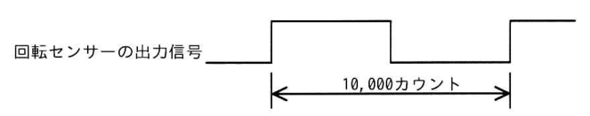
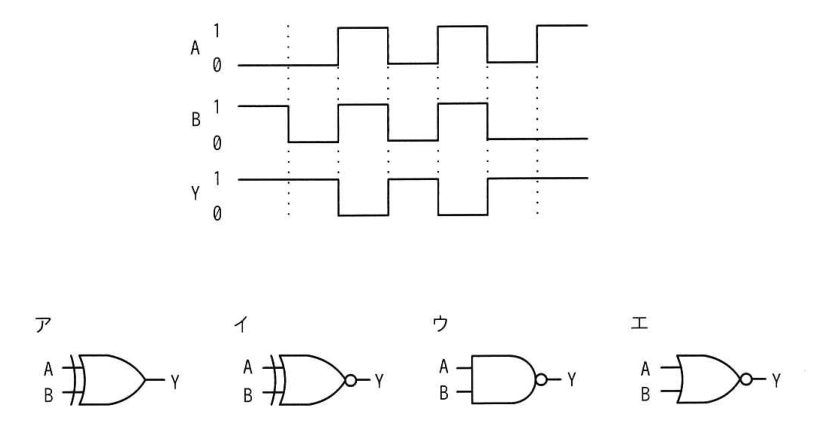
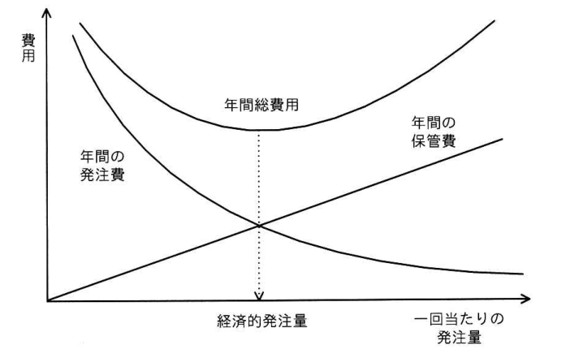

# 令和7年度秋期 科目A（旧午前）過去問解説

> 令和7年度 秋期 応用情報技術者試験 午前（全80問）を書き起こし、オリジナルの解説を付けたものです。問題の著作権は IPA（独立行政法人 情報処理推進機構）にあります。
> 図を表に書き換えるなど一部改変した問題には、その旨を記載しています。
> インタラクティブ教材の [科目A 四択クイズ](../../06_インタラクティブ教材/quiz.html) では、この回を本番形式（150分）で解けます。

## 目次

| 問 | 分野 | 中分類 | キーワード |
|---|---|---|---|
| [問1](#q01) | テクノロジ系 | 基礎理論 | カルノー図、論理式、簡単化 |
| [問2](#q02) | テクノロジ系 | 基礎理論 | M/M/1、待ち行列、利用率、平均待ち時間 |
| [問3](#q03) | テクノロジ系 | 基礎理論 | ROC曲線、偽陽性率、機械学習、混同行列 |
| [問4](#q04) | テクノロジ系 | 基礎理論 | CRC、生成多項式、誤り検出 |
| [問5](#q05) | テクノロジ系 | ソフトウェア | ベストフィット、ファーストフィット、記憶領域管理、フラグメンテーション |
| [問6](#q06) | テクノロジ系 | アルゴリズムとプログラミング | 線形探索、平均比較回数、ブロック探索 |
| [問7](#q07) | テクノロジ系 | ソフトウェア | Scala、関数型プログラミング、オブジェクト指向、OSS |
| [問8](#q08) | テクノロジ系 | コンピュータ構成要素 | VLIW、スーパースカラ、命令レベル並列 |
| [問9](#q09) | テクノロジ系 | コンピュータ構成要素 | ユニファイドメモリ、フレームバッファ、VRAM |
| [問10](#q10) | テクノロジ系 | ハードウェア | パルス、クロック周波数、回転数、組込み |
| [問11](#q11) | テクノロジ系 | システム構成要素 | HPC、FLOPS、ノード、コア数 |
| [問12](#q12) | テクノロジ系 | システム構成要素 | IaC、Infrastructure as Code、DevOps、自動化 |
| [問13](#q13) | テクノロジ系 | システム構成要素 | MTBF、MTTR、稼働率、信頼性 |
| [問14](#q14) | テクノロジ系 | システム構成要素 | キャパシティプランニング、性能評価、応答時間 |
| [問15](#q15) | テクノロジ系 | ソフトウェア | 処理時間順、SPT、ターンアラウンドタイム、スケジューリング |
| [問16](#q16) | テクノロジ系 | ソフトウェア | セマフォ、排他制御、リアルタイムOS、I2C |
| [問17](#q17) | テクノロジ系 | ソフトウェア | スレッドセーフ、マルチスレッド、排他制御 |
| [問18](#q18) | テクノロジ系 | ソフトウェア | デッドロック、排他制御、資源獲得順序 |
| [問19](#q19) | テクノロジ系 | コンピュータ構成要素 | LRU、LFU、FIFO、キャッシュ置換 |
| [問20](#q20) | テクノロジ系 | ハードウェア | LED、消費電力、直列回路、順方向電圧 |
| [問21](#q21) | テクノロジ系 | ハードウェア | 立上り検出、論理式、チャタリング、組込み |
| [問22](#q22) | テクノロジ系 | コンピュータ構成要素 | タイミングチャート、NAND、論理回路、真理値表 |
| [問23](#q23) | テクノロジ系 | ハードウェア | タイマー、分周、ダウンカウンター、割込み |
| [問24](#q24) | テクノロジ系 | ユーザーインタフェース | ハンバーガーメニュー、UI、レスポンシブデザイン |
| [問25](#q25) | テクノロジ系 | 情報メディア | 標本化定理、サンプリング周期、PCM |
| [問26](#q26) | テクノロジ系 | データベース | BASE特性、結果整合性、NoSQL、CAP定理 |
| [問27](#q27) | テクノロジ系 | データベース | ハッシュインデックス、B+木、一致検索、範囲検索 |
| [問28](#q28) | テクノロジ系 | データベース | ビュー、CREATE VIEW、更新可能ビュー |
| [問29](#q29) | テクノロジ系 | データベース | MVCC、同時実行制御、トランザクション |
| [問30](#q30) | テクノロジ系 | ネットワーク | 伝送時間、回線速度、パケット |
| [問31](#q31) | テクノロジ系 | ネットワーク | リバースプロキシ、プロキシ、Webサーバ |
| [問32](#q32) | テクノロジ系 | ネットワーク | CIDR、IPアドレス、プレフィックス長 |
| [問33](#q33) | テクノロジ系 | ネットワーク | TCP、UDP、シーケンス番号、ヘッダー |
| [問34](#q34) | テクノロジ系 | ネットワーク | スパニングツリープロトコル、STP、ループ、レイヤー2スイッチ |
| [問35](#q35) | テクノロジ系 | ネットワーク | ビット誤り率、期待値、パケット |
| [問36](#q36) | テクノロジ系 | セキュリティ | サイバーキルチェーン、エクスプロイト、標的型攻撃 |
| [問37](#q37) | テクノロジ系 | セキュリティ | コードサイニング証明書、デジタル署名、PKI |
| [問38](#q38) | テクノロジ系 | セキュリティ | サイドチャネル攻撃、電力解析、耐タンパ性 |
| [問39](#q39) | テクノロジ系 | セキュリティ | CRL、証明書失効リスト、OCSP、PKI |
| [問40](#q40) | テクノロジ系 | セキュリティ | PSIRT、CSIRT、インシデント対応 |
| [問41](#q41) | テクノロジ系 | セキュリティ | 真正性、信頼性、JIS Q 27000、情報セキュリティの要素 |
| [問42](#q42) | テクノロジ系 | セキュリティ | CSPM、CASB、クラウドセキュリティ、設定ミス |
| [問43](#q43) | テクノロジ系 | セキュリティ | ポートスキャン、SYNスキャン、UDPスキャン、脆弱性検査 |
| [問44](#q44) | テクノロジ系 | セキュリティ | デジタルフォレンジックス、証拠保全、インシデント対応 |
| [問45](#q45) | テクノロジ系 | セキュリティ | DKIM、SPF、DMARC、送信ドメイン認証 |
| [問46](#q46) | テクノロジ系 | システム開発技術 | ペルソナ、要件定義、UX |
| [問47](#q47) | テクノロジ系 | システム開発技術 | UML、オブジェクト図、クラス図 |
| [問48](#q48) | テクノロジ系 | システム開発技術 | エラー埋込み法、残存エラー数、テスト |
| [問49](#q49) | テクノロジ系 | ソフトウェア開発管理技術 | PWA、プログレッシブWebアプリ、サービスワーカー |
| [問50](#q50) | テクノロジ系 | ソフトウェア開発管理技術 | 著作者人格権、同一性保持権、不行使特約、ソフトウェア開発委託契約 |
| [問51](#q51) | マネジメント系 | プロジェクトマネジメント | WBS、スコープ、JIS Q 21500 |
| [問52](#q52) | マネジメント系 | プロジェクトマネジメント | タックマンモデル、チーム育成、動乱期 |
| [問53](#q53) | マネジメント系 | プロジェクトマネジメント | 人月、要員計画、引継ぎ、人件費 |
| [問54](#q54) | マネジメント系 | プロジェクトマネジメント | デシジョンツリー、期待金額価値、EMV、リスク定量分析 |
| [問55](#q55) | マネジメント系 | サービスマネジメント | FTA、FMEA、可用性管理、CFIA |
| [問56](#q56) | マネジメント系 | サービスマネジメント | 問題管理、根本原因、インシデント管理 |
| [問57](#q57) | マネジメント系 | サービスマネジメント | 液浸冷却、ファシリティマネジメント、データセンター、GPU |
| [問58](#q58) | マネジメント系 | システム監査 | システム監査基準、独立性、正当な注意、懐疑心 |
| [問59](#q59) | マネジメント系 | システム監査 | フォローアップ、改善提案、システム監査 |
| [問60](#q60) | マネジメント系 | システム監査 | システム監査基準、コントロール、ガバナンス、マネジメント |
| [問61](#q61) | ストラテジ系 | システム戦略 | プログラムマネジメント、PMO、ポートフォリオマネジメント |
| [問62](#q62) | ストラテジ系 | システム戦略 | SOA、サービス指向アーキテクチャ、ERP、BPM |
| [問63](#q63) | ストラテジ系 | 企業活動 | アソシエーション分析、リフト値、バスケット分析、回帰分析 |
| [問64](#q64) | ストラテジ系 | システム企画 | PBP、回収期間法、NPV、IRR |
| [問65](#q65) | ストラテジ系 | システム企画 | 重み付け評価、定性的効果、目標達成度 |
| [問66](#q66) | ストラテジ系 | システム企画 | 定額契約、実費償還契約、調達、コストリスク |
| [問67](#q67) | ストラテジ系 | 経営戦略マネジメント | 4P、4C、マーケティングミックス |
| [問68](#q68) | ストラテジ系 | 経営戦略マネジメント | バランススコアカード、戦略マップ、BSC |
| [問69](#q69) | ストラテジ系 | 経営戦略マネジメント | フィージビリティスタディ、デルファイ法、ブレーンストーミング |
| [問70](#q70) | ストラテジ系 | 経営戦略マネジメント | アンゾフの成長マトリクス、市場浸透戦略、多角化戦略 |
| [問71](#q71) | ストラテジ系 | ビジネスインダストリ | MES、製造実行システム、ERP、PLC |
| [問72](#q72) | ストラテジ系 | 経営戦略マネジメント | PLM、SCM、MRP、FMS |
| [問73](#q73) | ストラテジ系 | ビジネスインダストリ | LPWA、IoT、LoRaWAN、NB-IoT |
| [問74](#q74) | ストラテジ系 | 企業活動 | 経済的発注量、EOQ、定量発注方式、在庫管理 |
| [問75](#q75) | ストラテジ系 | 企業活動 | 線形計画法、LP、最適化 |
| [問76](#q76) | ストラテジ系 | 企業活動 | 自己資本比率、貸借対照表、純資産 |
| [問77](#q77) | ストラテジ系 | 企業活動 | 限界利益、制約条件、利益計算、固定費 |
| [問78](#q78) | ストラテジ系 | 法務 | 著作権法、プログラムの著作物、規約、アルゴリズム |
| [問79](#q79) | ストラテジ系 | 法務 | 意匠法、GUI、画像意匠、産業財産権 |
| [問80](#q80) | ストラテジ系 | 法務 | 労働施策総合推進法、パワーハラスメント、パワハラ防止法 |

### 問1　〔基礎理論〕 🧮

A, B, C, D を論理変数とするとき，次のカルノー図と等価な論理式はどれか。ここで，・は論理積，＋は論理和，X̅ は X の否定を表す。

| AB ＼ CD | 00 | 01 | 11 | 10 |
|---|---|---|---|---|
| 00 | 1 | 0 | 0 | 1 |
| 01 | 0 | 1 | 1 | 0 |
| 11 | 0 | 1 | 1 | 0 |
| 10 | 0 | 0 | 0 | 0 |

- **ア**　A・B・C̅・D＋B̅・D̅
- **イ**　A̅・B̅・C̅・D̅＋B・D
- **ウ**　A・B・D＋B̅・D̅
- **エ**　A̅・B̅・D̅＋B・D

解答・解説

**正解：エ**

1 のマスを二つのグループにまとめると，「AB=00 かつ D=0」の2マスと「B=1 かつ D=1」の4マスになり，A̅・B̅・D̅＋B・D となる。

**途中式**

- 1行目（AB=00）の CD=00 と CD=10 はカルノー図の左右の端どうしで隣接 → C が消えて A̅・B̅・D̅
- 2・3行目（AB=01, 11）の CD=01, 11 の4マス → A と C が消えて B・D
- よって A̅・B̅・D̅＋B・D

- ア：A・B・C̅・D は AB=11, CD=01 の1マスだけで，AB=01 行や CD=11 列の 1 を表せない。B̅・D̅ は AB=10 行の CD=00, 10 も 1 にしてしまう
- イ：A̅・B̅・C̅・D̅ は CD=10 のマスを含まないので，AB=00, CD=10 の 1 が表せない
- ウ：A・B・D は AB=01 行の 1 を含まず，B̅・D̅ は AB=10 行の 0 のマスまで 1 にしてしまう

💡 **ポイント**：カルノー図は上下・左右の端もつながっている。隣接する 1 を 2・4・8 個の長方形でできるだけ大きく囲み，囲みの中で値が変わらない変数だけを残す。

📖 関連：[基礎理論](../../01_テクノロジ系/01_基礎理論.md)／[コンピュータ構成要素](../../01_テクノロジ系/03_コンピュータ構成要素.md)

出典：令和7年度 秋期 応用情報技術者試験 午前 問1（カルノー図を表に書き換え）

---

### 問2　〔基礎理論〕 🧮

コンピュータによる伝票処理システムがある。このシステムは，伝票データをためる待ち行列をもち，M/M/1 の待ち行列モデルが適用できるものとする。平均待ち時間が T 秒以上となるのは，システムの利用率が少なくとも何%以上となったときか。ここで，伝票データをためる待ち行列の特徴は次のとおりである。

- 伝票データは，ポアソン分布に従って到着する。
- 伝票データをためる数に制限はない。
- 1件の伝票データの処理時間は，平均 T 秒の指数分布に従う。

- **ア**　33
- **イ**　50
- **ウ**　67
- **エ**　80

解答・解説

**正解：イ**

M/M/1 の平均待ち時間は ρ/(1−ρ)×T。これが T 以上になる条件は ρ/(1−ρ) ≥ 1，つまり ρ ≥ 0.5 なので 50%。

**途中式**

平均待ち時間 W = ρ / (1 − ρ) × T（T：平均サービス時間）

W ≥ T ⇔ ρ / (1 − ρ) ≥ 1 ⇔ ρ ≥ 1 − ρ ⇔ ρ ≥ 0.5 → **50%**

- ア：ρ=0.33 なら W = 0.33/0.67×T ≒ 0.5T で，T に届かない
- ウ：ρ=0.67 なら W ≒ 2T。T 以上にはなるが「少なくとも」の最小値ではない
- エ：ρ=0.8 なら W = 4T。これも最小値ではない

💡 **ポイント**：M/M/1 では「待ち時間 = ρ/(1−ρ)×平均サービス時間」。利用率 50% で待ち時間＝サービス時間，80% で4倍と覚えておくと速い。

📖 関連：[基礎理論](../../01_テクノロジ系/01_基礎理論.md)／[計算問題公式集](../../05_まとめ・横断資料/01_計算問題公式集.md)

出典：令和7年度 秋期 応用情報技術者試験 午前 問2

---

### 問3　〔基礎理論〕

AI における機械学習において，2クラス分類モデルの評価方法の一つである ROC 曲線で用いられる偽陽性率の説明として，最も適切なものはどれか。ここで，分類されるデータには正しいものと間違っているものが含まれるものとする。

- **ア**　“間違い”と予測したデータのうち，実際は“正しい”データの割合
- **イ**　実際に“間違い”であるデータに対し，誤って“正しい”と予測したデータの割合
- **ウ**　実際に“間違い”であるデータに対し，正しく“間違い”と予測したデータの割合
- **エ**　全データのうち，実際に正しく予測できなかったデータの割合

解答・解説

**正解：イ**

偽陽性率（FPR）は，実際は陰性（“間違い”）のデータのうち，誤って陽性（“正しい”）と判定してしまった割合 FP/(FP+TN)。ROC 曲線はこれを横軸，真陽性率を縦軸にとる。

- ア：分母が「“間違い”と予測したもの」で，偽陰性の割合を予測側から見た値（1−陰性的中率）。偽陽性率ではない
- ウ：実際の陰性のうち正しく陰性と予測した割合で，特異度（真陰性率）。偽陽性率＝1−特異度
- エ：全データに対する誤分類の割合で，誤分類率（1−正解率）

💡 **ポイント**：真陽性率 TPR = TP/(TP+FN)，偽陽性率 FPR = FP/(FP+TN)。分母は「実際のクラス」で揃える。ROC 曲線の下の面積（AUC）が 1 に近いほど良いモデル。

📖 関連：[基礎理論](../../01_テクノロジ系/01_基礎理論.md)

出典：令和7年度 秋期 応用情報技術者試験 午前 問3

---

### 問4　〔基礎理論〕

誤り検出方式である CRC に関する記述として，適切なものはどれか。

- **ア**　検査用のデータは，検査対象のデータを生成多項式で処理して得られる1ビットの値である。
- **イ**　受信側では，付加されてきた検査用のデータで検査対象のデータを割り，余りがなければ送信が正しかったと判断する。
- **ウ**　送信側では，生成多項式を用いて検査対象のデータから検査用のデータを作り，これを検査対象のデータに付けて送信する。
- **エ**　送信側と受信側では，異なる生成多項式が用いられる。

解答・解説

**正解：ウ**

CRC は，送信側がデータを生成多項式で割った余りを検査用データ（CRC 符号）として付けて送り，受信側が同じ生成多項式で割って余りを確かめる方式。

- ア：1ビットの検査ビットを付けるのはパリティチェック。CRC の検査データは生成多項式の次数に応じた複数ビット
- イ：受信側が割るのは「検査用データ」ではなく，送受信で共通の生成多項式
- エ：生成多項式は送信側と受信側で同じものを使わないと検査できない

💡 **ポイント**：CRC はバースト誤りの検出に強いが，誤り訂正はできない。訂正までできるのはハミング符号。

📖 関連：[基礎理論](../../01_テクノロジ系/01_基礎理論.md)／[ネットワーク](../../01_テクノロジ系/07_ネットワーク.md)

出典：令和7年度 秋期 応用情報技術者試験 午前 問4

---

### 問5　〔ソフトウェア〕

記憶領域を管理するアルゴリズムのうち，ベストフィット方式の特徴として，適切なものはどれか。

- **ア**　空きブロック群のうち，アドレスが下位のブロックを高い頻度で使用するので，アドレスが上位の方に大きな空きブロックが残る傾向にある。
- **イ**　空きブロック群のうち，要求された大きさを満たす最小のものを割り当てるので，最終的には小さな空きブロックが多数残る傾向にある。
- **ウ**　空きブロックの検索にハッシュ関数を使用しているので，高速に検索することができる。
- **エ**　空きブロックをアドレスの昇順に管理しているので，隣接する空きブロックを簡単に見つけられ，より大きな空きブロックにまとめることができる。

解答・解説

**正解：イ**

ベストフィット方式は，要求サイズを満たす空きブロックの中で最も小さいものを割り当てる。ぴったりに近いブロックを使うため，残りの端切れ（小さな空き）が多く生じやすい。

- ア：先頭（下位アドレス）から探して最初に収まるブロックを使うファーストフィット方式の特徴
- ウ：ハッシュ関数による検索はベストフィット方式の性質ではない
- エ：空きブロックをアドレス順に管理して隣接する空きを併合する話で，割当て方式の特徴ではない

💡 **ポイント**：ファーストフィット＝最初に見つかったもの，ベストフィット＝最小で収まるもの，ワーストフィット＝最大のもの。ベストフィットは断片化（小さな空き）が残りやすい。

📖 関連：[ソフトウェア](../../01_テクノロジ系/05_ソフトウェア.md)

出典：令和7年度 秋期 応用情報技術者試験 午前 問5

---

### 問6　〔アルゴリズムとプログラミング〕 🧮

異なる n 個のデータが昇順に整列された表がある。この表を m 個のデータごとのブロックに分割し，各ブロックの最後尾のデータだけを線形探索することによって，目的のデータの存在するブロックを探し出す。次に，当該ブロック内を線形探索して目的のデータを探し出す。このときの平均比較回数を表す式はどれか。ここで，m は十分に大きく，n は m の倍数とし，目的のデータは必ず表の中に存在するものとする。

- **ア**　m + n / m
- **イ**　m / 2 + n / (2m)
- **ウ**　n / m
- **エ**　n / (2m)

解答・解説

**正解：イ**

ブロック数は n/m 個で，最後尾の線形探索は平均 (n/m)/2 回。見つけたブロック内の m 個の線形探索は平均 m/2 回。合計 m/2 + n/(2m)。

**途中式**

1. ブロックの特定：ブロック数 n/m 個を先頭から調べる → 平均 (n/m) / 2 = n/(2m) 回
2. ブロック内の探索：m 個を線形探索 → 平均 m/2 回（m が十分大きいので (m+1)/2 ≒ m/2）
3. 合計 = m/2 + n/(2m)

- ア：どちらの線形探索も「全件を調べる」最大回数で数えた式。平均ならそれぞれ半分になる
- ウ：ブロックを探す段階の最大回数だけで，ブロック内探索を含んでいない
- エ：ブロックを探す段階の平均回数だけで，ブロック内探索の m/2 が抜けている

💡 **ポイント**：線形探索の平均比較回数は「件数/2」。2段階探索では各段階の平均を足す。この式は m = √n のとき最小になる。

📖 関連：[アルゴリズムとプログラミング](../../01_テクノロジ系/02_アルゴリズムとプログラミング.md)

出典：令和7年度 秋期 応用情報技術者試験 午前 問6（分数式をテキストで表記）

---

### 問7　〔ソフトウェア〕

OSS として公開されているプログラム言語である Scala の特徴はどれか。

- **ア**　オブジェクト指向プログラミングと関数型プログラミングの両方が可能である。
- **イ**　クラスの多重継承が可能である。
- **ウ**　実行前にコンパイルして，ネイティブコードを生成する必要がある。
- **エ**　変数の型が，参照する実際の値によって実行時に決定される動的型付け言語である。

解答・解説

**正解：ア**

Scala は，オブジェクト指向と関数型の両方のスタイルで書ける言語で，主に JVM（Java 仮想マシン）上で動作する。

- イ：Scala のクラスは単一継承。複数の振る舞いの取込みはトレイト（trait）のミックスインで行う。クラスの多重継承ができる代表は C++
- ウ：通常は JVM のバイトコードにコンパイルして実行する。ネイティブコード生成は必須ではない
- エ：Scala は静的型付け言語（型推論はあるが，型はコンパイル時に決まる）

💡 **ポイント**：JVM 上で動く言語（Java，Scala，Kotlin など）は Java の資産を利用できる。Scala＝オブジェクト指向＋関数型，静的型付け。

📖 関連：[ソフトウェア](../../01_テクノロジ系/05_ソフトウェア.md)

出典：令和7年度 秋期 応用情報技術者試験 午前 問7

---

### 問8　〔コンピュータ構成要素〕

プロセッサの高速化技法の一つとして，同時に実行可能な複数の動作を，コンパイルの段階でまとめて一つの複合命令とし，高速化を図る方式はどれか。

- **ア**　CISC
- **イ**　MIMD
- **ウ**　RISC
- **エ**　VLIW

解答・解説

**正解：エ**

VLIW（Very Long Instruction Word）は，並列実行できる複数の操作をコンパイラがあらかじめ一つの長い命令語に詰め込み，ハードウェアはそれを同時に実行する方式。

- ア：CISC は高機能で複雑な命令を多数そろえるアーキテクチャ。並列化をコンパイラがまとめる方式ではない
- イ：MIMD は複数のプロセッサが別々の命令・データを処理する並列計算機の分類（フリンの分類）
- ウ：RISC は単純な固定長命令に絞り，パイプラインで高速化するアーキテクチャ

💡 **ポイント**：並列性を「コンパイル時」に見つけるのが VLIW，「実行時」にハードウェアが見つけるのがスーパースカラ。

📖 関連：[コンピュータ構成要素](../../01_テクノロジ系/03_コンピュータ構成要素.md)

出典：令和7年度 秋期 応用情報技術者試験 午前 問8

---

### 問9　〔コンピュータ構成要素〕

画面表示用フレームバッファがユニファイドメモリ方式であるシステムの特徴はどれか。

- **ア**　主記憶とは別に専用のフレームバッファをもつ。
- **イ**　主記憶の一部を表示領域として使用する。
- **ウ**　シリアル接続した表示デバイスに，描画コマンドを用いて表示する。
- **エ**　表示リフレッシュが不要である。

解答・解説

**正解：イ**

ユニファイドメモリ方式（UMA）は，CPU とグラフィックスが一つの主記憶を共有し，その一部をフレームバッファ（表示領域）として使う方式。

- ア：専用のビデオメモリ（VRAM）をもつ方式の説明で，ユニファイドメモリ方式とは逆
- ウ：表示デバイス側に描画コマンドを送って描かせる方式の説明で，フレームバッファの配置とは関係ない
- エ：フレームバッファの内容は一定周期で画面に送り出す（リフレッシュする）必要があり，方式によって不要になるわけではない

💡 **ポイント**：ユニファイドメモリ方式は部品点数とコストを減らせるが，主記憶の帯域を CPU と GPU で取り合う。

📖 関連：[コンピュータ構成要素](../../01_テクノロジ系/03_コンピュータ構成要素.md)

出典：令和7年度 秋期 応用情報技術者試験 午前 問9

---

### 問10　〔ハードウェア〕 🧮

モーターの軸に装着された回転センサーから出力されるパルスの周期を，1MHz のクロック周波数でカウントアップするタイマーで計測したところ，10,000 カウントであった。モーターの回転数は毎秒何回転か。ここで，回転センサーはモーターの軸が1回転するごとに図のようなパルスを2回出力するものとする。

- **ア**　50
- **イ**　100
- **ウ**　200
- **エ**　5,000

解答・解説

**正解：ア**

パルス1周期は 10,000 カウント÷1MHz＝10 ms なので，毎秒 100 パルス。1回転で2パルスだから毎秒 50 回転。

**途中式**

- 1カウントの時間 = 1 / 1MHz = 1 μs
- パルス周期 = 10,000 × 1 μs = 10 ms
- 1秒間のパルス数 = 1 s / 10 ms = 100 パルス
- 回転数 = 100 / 2 = **50 回転/秒**

- イ：1秒当たりのパルス数そのもの。1回転に2パルスなので2で割る必要がある
- ウ：1回転2パルスを掛けてしまった値（100×2）
- エ：10,000 カウントを半周期と考えるなどの取り違え。周期 10 ms からは導けない

💡 **ポイント**：カウント数÷クロック周波数＝計測時間。周期と周波数は逆数の関係。「1回転当たり何パルスか」で割るのを忘れない。

📖 関連：[コンピュータ構成要素](../../01_テクノロジ系/03_コンピュータ構成要素.md)

出典：令和7年度 秋期 応用情報技術者試験 午前 問10

---

### 問11　〔システム構成要素〕 🧮

現状の HPC（High Performance Computing）マシンの構成を，次の条件で更新することにした。更新後の，ノード数と総理論ピーク演算性能はどれか。ここで，総理論ピーク演算性能は，コア数に比例するものとする。

〔現状の構成〕

(1) 一つのコアの理論ピーク演算性能は 10 GFLOPS である。  
(2) 一つのノードのコア数は 8 である。  
(3) ノード数は 1,000 である。

〔更新条件〕

(1) 一つのコアの理論ピーク演算性能を現状の2倍にする。  
(2) 一つのノードのコア数を現状の2倍にする。  
(3) 総コア数を現状の4倍にする。

- **ア**　ノード数 2,000，総理論ピーク演算性能 320 TFLOPS
- **イ**　ノード数 2,000，総理論ピーク演算性能 640 TFLOPS
- **ウ**　ノード数 4,000，総理論ピーク演算性能 320 TFLOPS
- **エ**　ノード数 4,000，総理論ピーク演算性能 640 TFLOPS

解答・解説

**正解：イ**

更新後の総コア数は 32,000，1ノード 16 コアなのでノード数は 2,000。1コア 20 GFLOPS×32,000＝640 TFLOPS。

**途中式**

- 現状の総コア数 = 8 × 1,000 = 8,000 → 更新後 8,000 × 4 = 32,000 コア
- 1ノードのコア数 = 8 × 2 = 16 → ノード数 = 32,000 / 16 = **2,000**
- 1コアの性能 = 10 × 2 = 20 GFLOPS
- 総性能 = 32,000 × 20 GFLOPS = 640,000 GFLOPS = **640 TFLOPS**

- ア：ノード数は正しいが，1コアの性能を2倍にするのを忘れた値（32,000×10 GFLOPS）
- ウ：ノード数を現状×4 としてコア数増を考慮していない。性能も1コア性能の倍増が抜けている
- エ：ノード数を総コア数と同じく4倍にしてしまっている（1ノードのコア数が2倍になる点を見落とし）

💡 **ポイント**：「総コア数＝ノード数×1ノードのコア数」「総性能＝総コア数×1コア性能」。G→T は 1,000 倍。

📖 関連：[システム構成要素](../../01_テクノロジ系/04_システム構成要素.md)

出典：令和7年度 秋期 応用情報技術者試験 午前 問11（選択肢の表を文章に書き換え）

---

### 問12　〔システム構成要素〕

IaC（Infrastructure as Code）の説明として，適切なものはどれか。

- **ア**　OS，仮想化ソフトなどが何もインストールされていない，初期状態のサーバである。
- **イ**　サーバなどの新規利用申請があった場合に，資源の割当て，設定などを手動で行い，利用可能な状態にする。
- **ウ**　システムの構成，設定などをプログラムとして記述し，専用のソフトウェアがその内容に従って自動的にシステムに適用する。
- **エ**　利用者は，OS，アプリケーションなどの任意のソフトウェアをインフラストラクチャに手動で実装し，操作することができる。

解答・解説

**正解：ウ**

IaC は，サーバやネットワークの構成・設定をコード（定義ファイル）で記述し，ツールが自動で構築・適用する考え方。手作業を減らし，同じ環境を何度でも再現できる。

- ア：ベアメタルサーバの説明
- イ：手動によるプロビジョニングの説明で，IaC の自動化とは逆
- エ：IaaS の利用イメージに近い説明。手動で実装する点が IaC と異なる

💡 **ポイント**：IaC はコードをバージョン管理でき，レビューや自動テストの対象にできる。DevOps や CI/CD とセットで問われやすい。

📖 関連：[システム構成要素](../../01_テクノロジ系/04_システム構成要素.md)／[システム開発技術](../../01_テクノロジ系/09_システム開発技術.md)

出典：令和7年度 秋期 応用情報技術者試験 午前 問12

---

### 問13　〔システム構成要素〕

コンピュータシステムの信頼性に関する記述のうち，適切なものはどれか。

- **ア**　MTBF / (MTBF＋MTTR) は，システムが稼働している時間の割合を表す。
- **イ**　MTBF−MTTR は，システムが正常であった時間を表す。
- **ウ**　MTBF は，正常なシステムが運用を開始してから初めて故障が起きるまでの時間を表す。
- **エ**　MTTR は，システムの故障が回復した時点から次に故障が起きるまでの平均時間を表す。

解答・解説

**正解：ア**

MTBF/(MTBF+MTTR) は稼働率の式で，全体の時間のうちシステムが稼働している時間の割合を表す。

- イ：MTBF（平均故障間隔）自体が正常に動いている時間の平均で，MTTR を引く意味はない
- ウ：MTBF は「故障から回復して次に故障するまでの平均時間」。初めての故障までの時間に限らない
- エ：MTTR は平均修復時間（故障してから回復するまで）。この記述は MTBF の説明

💡 **ポイント**：MTBF＝平均故障間隔（動いている時間），MTTR＝平均修復時間（止まっている時間），稼働率＝MTBF/(MTBF+MTTR)。

📖 関連：[システム構成要素](../../01_テクノロジ系/04_システム構成要素.md)／[計算問題公式集](../../05_まとめ・横断資料/01_計算問題公式集.md)

出典：令和7年度 秋期 応用情報技術者試験 午前 問13（分数式をテキストで表記）

---

### 問14　〔システム構成要素〕

キャパシティプランニングの目的の一つに関する記述のうち，最も適切なものはどれか。

- **ア**　応答時間に最も影響があるボトルネックだけに着目して，適切な変更を行うことによって，そのボトルネックの影響を低減又は排除することである。
- **イ**　システムの現在の応答時間を調査して，長期的に監視することによって，将来を含めて応答時間を維持することである。
- **ウ**　ソフトウェアとハードウェアをチューニングして，現状の処理能力を最大限に引き出して，スループットを向上させることである。
- **エ**　パフォーマンスの問題はリソースの過剰使用によって発生するので，特定のリソースの有効利用を向上させることである。

解答・解説

**正解：イ**

キャパシティプランニングは，現状の性能や資源使用状況を把握・監視し，将来の業務量の増加を予測して，必要な処理能力を計画的に確保する活動。将来にわたって応答時間などのサービス水準を維持することが目的の一つになる。

- ア：ボトルネックの解消は性能チューニングの考え方で，将来の需要を見込んだ計画ではない
- ウ：現状の能力を最大限引き出すのはチューニング。将来の容量を計画する活動ではない
- エ：特定リソースの効率化だけを目的としており，システム全体の将来需要への備えになっていない

💡 **ポイント**：キャパシティプランニングのキーワードは「現状把握 → 将来予測 → 必要資源の計画」。チューニング（今ある資源の最適化）と区別する。

📖 関連：[システム構成要素](../../01_テクノロジ系/04_システム構成要素.md)／[サービスマネジメント](../../02_マネジメント系/02_サービスマネジメント.md)

出典：令和7年度 秋期 応用情報技術者試験 午前 問14

---

### 問15　〔ソフトウェア〕 🧮

五つのジョブ A〜E に対して，ジョブの多重度が1で，処理時間順方式のスケジューリングを適用した場合，ジョブ B のターンアラウンドタイムは何秒か。ここで，OS のオーバーヘッドは考慮しないものとする。

単位　秒

| ジョブ | 到着時刻 | 単独実行時の処理時間 |
|---|---|---|
| A | 0 | 2 |
| B | 1 | 4 |
| C | 2 | 3 |
| D | 3 | 2 |
| E | 4 | 1 |

- **ア**　8
- **イ**　9
- **ウ**　10
- **エ**　11

解答・解説

**正解：エ**

処理時間順方式では，実行中のジョブが終わるたびに待っているジョブのうち処理時間の最も短いものを選ぶ。B は最後に回され，時刻 8〜12 に実行されるので，ターンアラウンドタイムは 12−1＝11 秒。

**途中式**

| 時刻 | 待ち行列（処理時間） | 実行するジョブ |
|---|---|---|
| 0 | A(2) | A：0〜2 |
| 2 | B(4), C(3) | C：2〜5 |
| 5 | B(4), D(2), E(1) | E：5〜6 |
| 6 | B(4), D(2) | D：6〜8 |
| 8 | B(4) | B：8〜12 |

B のターンアラウンドタイム = 終了時刻 12 − 到着時刻 1 = **11 秒**

- ア：B の実行開始時刻 8 を答えた値（ターンアラウンドタイムは到着から終了まで）
- イ：9 秒なら B は時刻 10 に終わることになるが，時刻 5 の時点で B より短い D と E が待っているので，B が先に実行されることはない
- ウ：10 秒も同様に B が最後まで待たされることを反映していない。なお到着順（FCFS）なら B は 2〜6 に実行され 5 秒になる

💡 **ポイント**：ターンアラウンドタイム＝終了時刻−到着時刻。処理時間順（SPT）は短いジョブが優先され，長いジョブは待たされやすい。時刻ごとに「その時点で到着済み」のジョブだけから選ぶこと。

📖 関連：[ソフトウェア](../../01_テクノロジ系/05_ソフトウェア.md)

出典：令和7年度 秋期 応用情報技術者試験 午前 問15

---

### 問16　〔ソフトウェア〕

一つの I2C バスに接続された二つのセンサーがある。それぞれのセンサー値を読み込む二つのタスクを排他的に制御したい。利用するリアルタイム OS の機能として，適切なものはどれか。

- **ア**　キュー
- **イ**　セマフォ
- **ウ**　マルチスレッド
- **エ**　メモリプール

解答・解説

**正解：イ**

共有資源（ここでは一つの I2C バス）を複数のタスクが同時に使わないようにする排他制御には，セマフォ（やミューテックス）を使う。

- ア：キュー（メッセージキュー）はタスク間でデータを受け渡す通信の仕組み
- ウ：マルチスレッドは処理を並行に動かす仕組みで，排他制御そのものではない
- エ：メモリプールは固定長のメモリブロックを効率よく確保・解放する仕組み

💡 **ポイント**：RTOS の主な機能：排他制御＝セマフォ／ミューテックス，同期＝イベントフラグ，通信＝メッセージキュー／メールボックス，メモリ管理＝メモリプール。

📖 関連：[ソフトウェア](../../01_テクノロジ系/05_ソフトウェア.md)／[コンピュータ構成要素](../../01_テクノロジ系/03_コンピュータ構成要素.md)

出典：令和7年度 秋期 応用情報技術者試験 午前 問16（I2C の上付き文字を通常の文字で表記）

---

### 問17　〔ソフトウェア〕

スレッドセーフの説明として，適切なものはどれか。

- **ア**　アプリケーションが複数のスレッドから呼び出されないようになっている。
- **イ**　アプリケーションを複数のスレッドではなく，単一のスレッドで動作させる。
- **ウ**　アプリケーションを複数のスレッドで並列に実行しても，問題が生じない。
- **エ**　スレッドの競合が発生したときに，アプリケーションを安全に停止させる。

解答・解説

**正解：ウ**

スレッドセーフとは，複数のスレッドから同時に呼び出されても，データの競合などが起きずに正しく動作する性質のこと。

- ア：複数スレッドからの呼出しを禁止するのではなく，呼ばれても正しく動くことがスレッドセーフ
- イ：単一スレッドで動かすのはスレッドセーフにする手段ではなく，そもそも並行実行を避けているだけ
- エ：競合時に停止させるのではなく，競合しても結果が正しくなるように作る

💡 **ポイント**：スレッドセーフにする手段は，共有データの排他制御（ロック），共有データを持たない設計，不変オブジェクトなど。リエントラント（再入可能）とセットで覚える。

📖 関連：[ソフトウェア](../../01_テクノロジ系/05_ソフトウェア.md)

出典：令和7年度 秋期 応用情報技術者試験 午前 問17

---

### 問18　〔ソフトウェア〕

二つのタスクが共用する二つの資源を排他的に使用するとき，デッドロックが発生するおそれがある。このデッドロックの発生を防ぐ方法はどれか。

- **ア**　一方のタスクの優先度を高くする。
- **イ**　資源獲得の順序を両方のタスクで同じにする。
- **ウ**　資源獲得の順序を両方のタスクで逆にする。
- **エ**　両方のタスクの優先度を同じにする。

解答・解説

**正解：イ**

両タスクが資源を同じ順序（例：資源1 → 資源2）で獲得すれば，「互いに相手の持つ資源を待つ」循環待ちが起きず，デッドロックを防げる。

- ア：優先度を変えても，資源を確保した状態で相手を待つ状況は解消されない
- ウ：獲得順序を逆にすると，タスク1が資源1，タスク2が資源2を確保して互いに待つ循環待ちが起こりやすくなる
- エ：優先度を揃えてもデッドロックの発生条件（循環待ち）はなくならない

💡 **ポイント**：デッドロック防止の定番は「資源の獲得順序を全タスクで統一する」こと。循環待ちの条件を崩す。

📖 関連：[ソフトウェア](../../01_テクノロジ系/05_ソフトウェア.md)

出典：令和7年度 秋期 応用情報技術者試験 午前 問18

---

### 問19　〔コンピュータ構成要素〕

4ブロックのキャッシュメモリ C0〜C3 が表に示す状態である。ここで，新たに別のブロックの内容をキャッシュメモリにロードする必要が生じたとき，C2 のブロックを置換の対象とするアルゴリズムはどれか。

| キャッシュメモリ | ロード時刻（分：秒） | 最終参照時刻（分：秒） | 参照回数 |
|---|---|---|---|
| C0 | 0:00 | 0:08 | 10 |
| C1 | 0:03 | 0:06 | 1 |
| C2 | 0:04 | 0:05 | 3 |
| C3 | 0:05 | 0:10 | 5 |

- **ア**　FIFO
- **イ**　LFU
- **ウ**　LIFO
- **エ**　LRU

解答・解説

**正解：エ**

C2 は最終参照時刻が 0:05 で，四つの中で最も長い間参照されていない。最後に参照されてから最も時間がたったものを追い出すのは LRU。

**整理**

- FIFO（最も古くロード）：C0（0:00）
- LIFO（最も新しくロード）：C3（0:05）
- LFU（参照回数が最少）：C1（1回）
- LRU（最終参照が最も古い）：**C2（0:05）**

- ア：FIFO ならロード時刻が最も早い C0 が対象
- イ：LFU なら参照回数が最も少ない C1 が対象
- ウ：LIFO ならロード時刻が最も遅い C3 が対象

💡 **ポイント**：LRU＝Least Recently Used（最終参照が一番昔），LFU＝Least Frequently Used（参照回数が一番少ない）。見る列が違う。

📖 関連：[コンピュータ構成要素](../../01_テクノロジ系/03_コンピュータ構成要素.md)／[ソフトウェア](../../01_テクノロジ系/05_ソフトウェア.md)

出典：令和7年度 秋期 応用情報技術者試験 午前 問19

---

### 問20　〔ハードウェア〕 🧮

図の LED 点灯回路において，LED に 10 ミリ A の電流が流れるように抵抗値を決定したときに，回路全体の消費電力に占める LED の消費電力の割合は何%か。ここで，LED の順方向電圧は 2V とし，電源の消費電力は無視するものとする。

（図：10V の電源に，LED と抵抗が直列に接続された回路）

- **ア**　20
- **イ**　25
- **ウ**　80
- **エ**　100

解答・解説

**正解：ア**

直列回路なので LED と抵抗には同じ 10mA が流れる。電力は電圧に比例し，LED の電圧 2V は全体 10V の 20%。

**途中式**

- 回路全体の電力 = 10V × 10mA = 100mW
- LED の電力 = 2V × 10mA = 20mW（抵抗は 8V × 10mA = 80mW）
- 割合 = 20 / 100 = **20%**

- イ：LED の電力を抵抗の電力で割った値（20/80）
- ウ：抵抗で消費される電力の割合
- エ：抵抗での電力消費を無視した値

💡 **ポイント**：電力 P＝V×I。直列回路では電流が共通なので，電力の割合＝電圧の割合になる。

📖 関連：[コンピュータ構成要素](../../01_テクノロジ系/03_コンピュータ構成要素.md)

出典：令和7年度 秋期 応用情報技術者試験 午前 問20（回路図を文章で説明）

---

### 問21　〔ハードウェア〕

組込みシステムのプログラムで，放された状態では0になり，押された状態では1になるスイッチの値を読み込んでいる。このプログラムによって，スイッチの値は周期的に適切なタイミングで読み込まれ，チャタリング処理などの適切な処理が行われるものとし，a が今回の値で，b が前回の値とする。このスイッチが放された状態から押された状態に変化したことを検出するための論理式はどれか。ここで，“・”は論理積，“＋”は論理和，“￣”は論理否定を表す。

- **ア**　a・b̅
- **イ**　a̅・b
- **ウ**　a＋b̅
- **エ**　a̅＋b

解答・解説

**正解：ア**

「前回は放されていた（b=0）かつ今回は押されている（a=1）」ときだけ 1 になればよいので，a・b̅。

**整理**

| b（前回） | a（今回） | 状態 | 検出したい値 |
|---|---|---|---|
| 0 | 0 | 放したまま | 0 |
| 0 | 1 | 押された瞬間 | **1** |
| 1 | 0 | 放された瞬間 | 0 |
| 1 | 1 | 押したまま | 0 |

1 になるのは a=1, b=0 の行だけ → a・b̅

- イ：a̅・b は「前回押されていて今回放された」，つまり押された状態から放された状態への変化（立下り）を検出する
- ウ：a＋b̅ は押したままや放したままでも 1 になる
- エ：a̅＋b も変化がないときに 1 になり，変化の検出にならない

💡 **ポイント**：立上り（0→1）の検出は「今回・前回の否定」，立下り（1→0）の検出は「今回の否定・前回」。

📖 関連：[コンピュータ構成要素](../../01_テクノロジ系/03_コンピュータ構成要素.md)

出典：令和7年度 秋期 応用情報技術者試験 午前 問21

---

### 問22　〔コンピュータ構成要素〕

入力が A と B，出力が Y の論理回路を動作させたとき，図のタイミングチャートが得られた。この論理回路として，適切なものはどれか。

- **ア**　（図のア：XOR 素子）
- **イ**　（図のイ：XNOR 素子）
- **ウ**　（図のウ：NAND 素子）
- **エ**　（図のエ：NOR 素子）

解答・解説

**正解：ウ**

タイミングチャートを区間ごとに読むと，A=B=1 のときだけ Y=0 で，それ以外は Y=1。これは NAND の真理値表と一致する。

**整理**

| 区間 | A | B | Y |
|---|---|---|---|
| 1 | 0 | 1 | 1 |
| 2 | 0 | 0 | 1 |
| 3 | 1 | 1 | 0 |
| 4 | 0 | 0 | 1 |
| 5 | 1 | 1 | 0 |
| 6 | 0 | 0 | 1 |
| 7 | 1 | 0 | 1 |

(A,B)=(0,0),(0,1),(1,0) → 1，(1,1) → 0 なので NAND

- ア：XOR なら A=B=0 のとき Y=0 になるはずだが，区間2 では Y=1
- イ：XNOR なら A=0, B=1 のとき Y=0 になるはずだが，区間1 では Y=1
- エ：NOR なら A=0, B=1 や A=1, B=0 で Y=0 になるはずだが，区間1・7 では Y=1

💡 **ポイント**：タイミングチャートの問題は，点線で区切られた区間ごとに (A, B, Y) を書き出して真理値表にすれば機械的に解ける。

📖 関連：[コンピュータ構成要素](../../01_テクノロジ系/03_コンピュータ構成要素.md)

出典：令和7年度 秋期 応用情報技術者試験 午前 問22（選択肢の図記号に素子名を補記）

---

### 問23　〔ハードウェア〕 🧮

16ビットのダウンカウンターを用い，カウンターの値が0になると割込みを発生するハードウェアタイマーがある。カウンターに初期値として10進数の150をセットしてタイマーをスタートすると，最初の割込みが発生するまでの時間は何マイクロ秒か。ここで，タイマーの入力クロック周波数は16MHzを32分周したものとする。

- **ア**　0.3
- **イ**　2
- **ウ**　150
- **エ**　300

解答・解説

**正解：エ**

入力クロックは 16MHz÷32＝0.5MHz で，1カウントは 2 マイクロ秒。150 カウントで 0 になるので 300 マイクロ秒。

**途中式**

- 入力クロック = 16MHz / 32 = 0.5MHz
- 1カウントの時間 = 1 / 0.5MHz = 2 μs
- 割込みまでの時間 = 150 × 2 μs = **300 μs**

- ア：0.3 μs では，1カウント 2 μs のカウンターを 150 回減算する時間にまったく足りない
- イ：1カウント当たりの時間だけを答えた値
- ウ：1カウント＝1μs としてしまった値

💡 **ポイント**：分周＝周波数を割ること。N 分周すると周期は N 倍になる。タイマー時間＝カウント数×クロック周期。

📖 関連：[コンピュータ構成要素](../../01_テクノロジ系/03_コンピュータ構成要素.md)

出典：令和7年度 秋期 応用情報技術者試験 午前 問23

---

### 問24　〔ユーザーインタフェース〕

画面サイズの制約によって，レイアウト上，常にメニューを表示しておくことが難しいときに使用する仕組みであって，三本線のアイコンを選択するとメニューが表示されるものはどれか。

- **ア**　アコーディオンメニュー
- **イ**　ドロップダウンメニュー
- **ウ**　ハンバーガーメニュー
- **エ**　ポップアップメニュー

解答・解説

**正解：ウ**

三本線（≡）のアイコンを押すとメニューが開く仕組みは，見た目がハンバーガーに似ていることからハンバーガーメニューと呼ばれ，スマートフォンなど画面の狭い環境でよく使われる。

- ア：アコーディオンメニューは見出しを選ぶと下の項目が伸び縮みして開閉するメニュー
- イ：ドロップダウンメニューは項目を選ぶと下方向に選択肢の一覧が垂れ下がるメニュー
- エ：ポップアップメニューは右クリックなどの操作で，その場に浮き出るように表示されるメニュー

💡 **ポイント**：レスポンシブデザインでは，画面幅が狭いとグローバルナビゲーションをハンバーガーメニューに折りたたむのが定番。

📖 関連：[システム開発技術](../../01_テクノロジ系/09_システム開発技術.md)

出典：令和7年度 秋期 応用情報技術者試験 午前 問24

---

### 問25　〔情報メディア〕 🧮

0kHz〜20kHz の帯域幅のオーディオ信号をデジタル信号に変換するのに必要な最大のサンプリング周期を標本化定理によって求めると，何マイクロ秒か。

- **ア**　2.5
- **イ**　5
- **ウ**　25
- **エ**　50

解答・解説

**正解：ウ**

標本化定理より，最高周波数の2倍（40kHz）以上でサンプリングすればよい。周期は 1/40kHz＝25 マイクロ秒で，これが許される最大のサンプリング周期。

**途中式**

- 必要なサンプリング周波数 ≧ 2 × 20kHz = 40kHz
- サンプリング周期 ≦ 1 / 40kHz = 0.000025 秒 = **25 μs**

- ア：400kHz でサンプリングする場合の周期で，最大ではない（桁の誤り）
- イ：200kHz 相当の周期で，必要以上に細かい
- エ：20kHz でサンプリングする周期。2倍の周波数が必要という定理を使っていない

💡 **ポイント**：標本化定理（シャノンの定理）：元の信号の最高周波数の2倍を超える周波数で標本化すれば復元できる。周期にするときは逆数をとる。

📖 関連：[基礎理論](../../01_テクノロジ系/01_基礎理論.md)

出典：令和7年度 秋期 応用情報技術者試験 午前 問25

---

### 問26　〔データベース〕

BASE 特性を満たし，次の特徴をもつ NoSQL データベースシステムに関する記述のうち，適切なものはどれか。

〔NoSQL データベースシステムの特徴〕

- ネットワーク上に分散した複数のノードから構成される。
- 一つのノードでデータを更新した後，他の全てのノードにその更新を反映する。

- **ア**　クライアントからの更新要求を2相コミットによって全てのノードに反映する。
- **イ**　データの更新結果は，システムに障害がなければ，いつかは全てのノードに反映される。
- **ウ**　同一の主キーの値による同時の参照要求に対し，全てのノードは同じ結果を返す。
- **エ**　ノード間のネットワークが分断されると，クライアントからの処理要求を受け付けなくなる。

解答・解説

**正解：イ**

BASE 特性の E は Eventually consistent（結果整合性）。更新直後はノード間で値がずれることがあっても，最終的には全ノードに反映されて一致する。

- ア：2相コミットで全ノードを同時に確定させるのは ACID 特性（強い一貫性）寄りのやり方
- ウ：常に全ノードが同じ結果を返すのは強い一貫性。BASE では一時的に古い値を返すことがある
- エ：BASE は可用性（Basically Available）を重視し，分断されても要求を受け付け続けることを優先する

💡 **ポイント**：BASE＝Basically Available, Soft state, Eventually consistent。ACID（厳密な一貫性）と対比される。CAP 定理で一貫性より可用性・分断耐性を選んだ設計。

📖 関連：[データベース](../../01_テクノロジ系/06_データベース.md)

出典：令和7年度 秋期 応用情報技術者試験 午前 問26

---

### 問27　〔データベース〕

“売上”表への次の検索処理のうち，B+木インデックスよりもハッシュインデックスを設定した方が適切なものはどれか。ここで，インデックスを設定する列を＜＞内に示す。

売上（伝票番号，売上年月日，商品名，利用者 ID，店舗番号，売上金額）

- **ア**　売上金額が1万円以上の売上を検索する。＜売上金額＞
- **イ**　売上年月日が今月の売上を検索する。＜売上年月日＞
- **ウ**　商品名が‘DB’で始まる売上を検索する。＜商品名＞
- **エ**　利用者 ID が‘1001’の売上を検索する。＜利用者 ID＞

解答・解説

**正解：エ**

ハッシュインデックスはキー値からハッシュ関数で格納位置を直接求めるので，「＝」による一致検索に強い。利用者 ID＝'1001' の検索はこれに当たる。

- ア：「1万円以上」は範囲検索。ハッシュ値には大小の順序がないので，順序を保つ B+木が向く
- イ：「今月」は日付の範囲検索なので B+木が向く
- ウ：前方一致検索は，キーの順序で並んでいる B+木なら範囲として探せるが，ハッシュでは使えない

💡 **ポイント**：一致検索 → ハッシュ，範囲検索・前方一致・ソート → B+木。

📖 関連：[データベース](../../01_テクノロジ系/06_データベース.md)

出典：令和7年度 秋期 応用情報技術者試験 午前 問27（B+木の上付き文字を通常の文字で表記）

---

### 問28　〔データベース〕

関係データベースのビューに関する記述のうち，適切なものはどれか。

- **ア**　ビューの列名は，基の表の列名と異なる名称で定義することができる。
- **イ**　ビューは，基の表から指定した列を抜き出すように定義するものであり，行を抜き出すように定義することはできない。
- **ウ**　二つ以上の表の結合によって定義されたビューは，結合の仕方によらず更新操作ができる。
- **エ**　和両立な二つの表に対し，和集合演算を用いてビューを定義することはできない。

解答・解説

**正解：ア**

CREATE VIEW ビュー名(列名, …) AS SELECT … のように，ビューの列には基の表と異なる名前を付けられる。

- イ：WHERE 句で条件を指定すれば，行を抜き出すビュー（選択）も定義できる
- ウ：結合ビューは，どの基の表のどの行を更新すべきか一意に決まらない場合が多く，一般に更新できない
- エ：UNION を使った SELECT 文でもビューは定義できる

💡 **ポイント**：ビューは SELECT 文に名前を付けた仮想表。更新できるのは，原則として単一の表から行・列を選んだだけの単純なビュー。

📖 関連：[データベース](../../01_テクノロジ系/06_データベース.md)

出典：令和7年度 秋期 応用情報技術者試験 午前 問28

---

### 問29　〔データベース〕

RDBMS において，同じデータ項目の異なる版を用意することによって，トランザクションの同時実行性を高める仕組みはどれか。

- **ア**　2相ロッキングプロトコル
- **イ**　MVCC
- **ウ**　WAL プロトコル
- **エ**　共有ロック

解答・解説

**正解：イ**

MVCC（多版同時実行制御）は，更新時に新しい版を作り，読取りは古い版を参照させることで，読取りと更新が互いを待たずに同時実行できるようにする仕組み。

- ア：2相ロッキングは，ロックを獲得する段階と解放する段階を分けて直列可能性を保証するロック方式
- ウ：WAL（Write Ahead Log）は，データ更新より先にログを書き出して障害回復に備える仕組み
- エ：共有ロックは読取り同士の同時実行は許すが，更新とは排他になるロック

💡 **ポイント**：MVCC は「版（バージョン）」がキーワード。読取りがロック待ちにならないので，参照の多いシステムで同時実行性が高い。

📖 関連：[データベース](../../01_テクノロジ系/06_データベース.md)

出典：令和7年度 秋期 応用情報技術者試験 午前 問29

---

### 問30　〔ネットワーク〕 🧮

100M ビット／秒の LAN と 1G ビット／秒の LAN がある。ヘッダーを含めて 1,250 バイトのパケットを N 個送信するときに，100M ビット／秒の LAN の送信時間が 1G ビット／秒の LAN より 9 ミリ秒多く掛かった。N は幾らか。ここで，いずれの LAN においても，パケットの送信間隔（パケットの送信が完了してから次のパケットを送信開始するまでの時間）は1ミリ秒であり，パケット送信間隔も送信時間に含める。

- **ア**　10
- **イ**　80
- **ウ**　100
- **エ**　800

解答・解説

**正解：ウ**

送信間隔は両方の LAN で同じなので差には効かない。1パケット当たりの送信時間の差は 90 マイクロ秒なので，9 ミリ秒÷90 マイクロ秒＝100 個。

**途中式**

- 1パケット = 1,250 バイト × 8 = 10,000 ビット
- 100M ビット／秒：10,000 / (100 × 10^6) = 100 μs
- 1G ビット／秒：10,000 / 10^9 = 10 μs
- 1パケット当たりの差 = 90 μs（送信間隔 1ms × (N−1) は両方に同じだけ含まれるので相殺）
- N = 9ms / 90 μs = **100**

- ア：N=10 なら差は 10 × 90 μs = 0.9 ms で，9 ms に届かない
- イ：N=80 なら差は 7.2 ms。バイトとビットの換算などを誤ると選びやすい
- エ：N=800 なら差は 72 ms で，9 ms を大きく超える

💡 **ポイント**：「差」を問われたら，両者に共通する時間（ここでは送信間隔）は打ち消し合うので無視してよい。バイト→ビットは×8。

📖 関連：[ネットワーク](../../01_テクノロジ系/07_ネットワーク.md)／[計算問題公式集](../../05_まとめ・横断資料/01_計算問題公式集.md)

出典：令和7年度 秋期 応用情報技術者試験 午前 問30

---

### 問31　〔ネットワーク〕

リバースプロキシの説明として，適切なものはどれか。

- **ア**　インターネットから内部ネットワークの公開 Web サーバへの通信を，中継するために利用される。
- **イ**　インターネットと内部ネットワークとの通信を監視し，インターネットからの攻撃を検知するための技術である。
- **ウ**　仮想的な専用ネットワークを確立するための技術である。
- **エ**　内部ネットワークの PC からインターネットへの通信を，中継するために利用される。

解答・解説

**正解：ア**

リバースプロキシは Web サーバの手前に置かれ，外部（インターネット）からの要求を代わりに受け取って内部の Web サーバへ中継する。負荷分散，TLS 終端，キャッシュ，サーバの隠蔽などに使われる。

- イ：通信を監視して攻撃を検知するのは IDS（侵入検知システム）
- ウ：仮想的な専用ネットワークは VPN
- エ：内部の PC から外部への通信を中継するのは通常の（フォワード）プロキシ

💡 **ポイント**：プロキシ＝内→外の代理（クライアント側），リバースプロキシ＝外→内の代理（サーバ側）。向きで区別する。

📖 関連：[ネットワーク](../../01_テクノロジ系/07_ネットワーク.md)／[情報セキュリティ](../../01_テクノロジ系/08_情報セキュリティ.md)

出典：令和7年度 秋期 応用情報技術者試験 午前 問31

---

### 問32　〔ネットワーク〕

IPv4 のアドレス割当てを行う際に，クラス A〜C といった区分にとらわれずに，ネットワークアドレス部とホストアドレス部を任意のブロック単位に区切り，IP アドレスを無駄なく効率的に割り当てる方式はどれか。

- **ア**　CIDR
- **イ**　DHCP
- **ウ**　DNS
- **エ**　NAPT

解答・解説

**正解：ア**

CIDR（Classless Inter-Domain Routing）は，クラスに縛られずプレフィックス長（例：/22）でネットワーク部の長さを自由に決めて割り当てる方式。

- イ：DHCP は端末に IP アドレスなどのネットワーク設定を自動配布するプロトコル
- ウ：DNS はドメイン名と IP アドレスを対応付ける名前解決の仕組み
- エ：NAPT はプライベート IP アドレスとポート番号をグローバル IP アドレスとポート番号に変換する仕組み

💡 **ポイント**：CIDR 表記 192.168.0.0/22 の「/22」はネットワーク部のビット数。複数のネットワークを一つにまとめる経路集約（スーパーネット化）にも使われる。

📖 関連：[ネットワーク](../../01_テクノロジ系/07_ネットワーク.md)

出典：令和7年度 秋期 応用情報技術者試験 午前 問32

---

### 問33　〔ネットワーク〕

UDP のヘッダーフィールドにはないが，TCP のヘッダーフィールドには含まれる情報はどれか。

- **ア**　宛先ポート番号
- **イ**　シーケンス番号
- **ウ**　送信元ポート番号
- **エ**　チェックサム

解答・解説

**正解：イ**

シーケンス番号は，データの順序制御や再送制御に使う TCP 固有のフィールド。コネクションレスで信頼性制御をしない UDP にはない。

- ア：宛先ポート番号は TCP と UDP の両方のヘッダーにある
- ウ：送信元ポート番号も TCP と UDP の両方にある
- エ：チェックサムも TCP と UDP の両方にある

💡 **ポイント**：UDP ヘッダーは「送信元ポート・宛先ポート・長さ・チェックサム」の4項目だけ（8バイト）。TCP はこれに加えてシーケンス番号，確認応答番号，フラグ，ウィンドウサイズなどをもつ。

📖 関連：[ネットワーク](../../01_テクノロジ系/07_ネットワーク.md)

出典：令和7年度 秋期 応用情報技術者試験 午前 問33

---

### 問34　〔ネットワーク〕

複数台のレイヤー2スイッチで構成されるネットワークが複数の経路をもつ場合に，イーサネットフレームのループが発生することがある。そのループの発生を防ぐための TCP/IP ネットワークインタフェース層のプロトコルはどれか。

- **ア**　IGMP
- **イ**　RIP
- **ウ**　SIP
- **エ**　スパニングツリープロトコル

解答・解説

**正解：エ**

スパニングツリープロトコル（STP）は，スイッチ同士が情報を交換して一部のポートを論理的にブロックし，ループのない木構造の経路を作るレイヤー2のプロトコル。

- ア：IGMP は IP マルチキャストのグループ参加・離脱を管理するプロトコル
- イ：RIP はホップ数を使うディスタンスベクタ型のルーティングプロトコル（ネットワーク層の経路制御）
- ウ：SIP は IP 電話などのセッションの開始・終了を制御するアプリケーション層のプロトコル

💡 **ポイント**：L2 のループはブロードキャストストームを引き起こす。対策は STP（障害時は迂回経路を自動で有効化）。

📖 関連：[ネットワーク](../../01_テクノロジ系/07_ネットワーク.md)

出典：令和7年度 秋期 応用情報技術者試験 午前 問34

---

### 問35　〔ネットワーク〕 🧮

ビット誤り率が0.0001%の回線を使って，1,500バイトのパケットを10,000個送信するとき，誤りが含まれるパケットの個数の期待値はおよそ幾らか。

- **ア**　10
- **イ**　15
- **ウ**　80
- **エ**　120

解答・解説

**正解：エ**

1パケットは 12,000 ビット。ビット誤り率 10^-6 なので，1パケットに誤りが含まれる確率はおよそ 12,000×10^-6＝0.012。10,000 個では約 120 個。

**途中式**

- ビット誤り率 = 0.0001% = 10^-6
- 1パケットのビット数 = 1,500 × 8 = 12,000 ビット
- 1パケットが誤りを含む確率 = 1 − (1 − 10^-6)^12000 ≒ 12,000 × 10^-6 = 0.012
- 期待値 = 10,000 × 0.012 = **約 120 個**（厳密計算でも 119.3）

- ア：10 個なら1パケットの誤り確率は 0.001 で，1,000 ビット分にしか相当しない。1パケットは 12,000 ビット
- イ：1,500 をビットに換算しない（×8 を忘れた）値：1,500 × 10^-6 × 10,000 = 15
- ウ：1パケットを 8,000 ビット相当として計算した値で，12,000 ビットと合わない

💡 **ポイント**：誤り率が十分小さいとき，「少なくとも1ビット誤る確率」≒ビット数×ビット誤り率で近似できる。バイト→ビットの×8 を忘れない。

📖 関連：[ネットワーク](../../01_テクノロジ系/07_ネットワーク.md)／[基礎理論](../../01_テクノロジ系/01_基礎理論.md)

出典：令和7年度 秋期 応用情報技術者試験 午前 問35

---

### 問36　〔セキュリティ〕

サイバー攻撃の攻撃段階をモデル化したサイバーキルチェーンにおいて，“エクスプロイト”に該当する行為はどれか。

- **ア**　公開情報の閲覧，顧客を装った電子メールでの問合せなどを行い，標的とする組織を調査する。
- **イ**　標的とする組織の PC で OS の脆弱性を悪用し，攻撃ツールを実行させる。
- **ウ**　標的とする組織のサーバから秘密情報を窃取し，攻撃者が用意したサーバに送信する。
- **エ**　標的とする組織の従業員にマルウェアを添付した電子メールを送りつける。

解答・解説

**正解：イ**

エクスプロイト（攻撃）段階は，届けたマルウェアなどにより標的の脆弱性を突いて攻撃コードを実行させる段階。

- ア：偵察（Reconnaissance）段階の行為
- ウ：目的の実行（Actions on Objectives）段階の行為（情報の持ち出し）
- エ：配送（Delivery）段階の行為

💡 **ポイント**：キルチェーンの7段階：偵察 → 武器化 → 配送 → エクスプロイト → インストール → C&C（遠隔操作） → 目的の実行。早い段階で鎖を断ち切るほど被害を抑えられる。

📖 関連：[情報セキュリティ](../../01_テクノロジ系/08_情報セキュリティ.md)

出典：令和7年度 秋期 応用情報技術者試験 午前 問36

---

### 問37　〔セキュリティ〕

デジタル署名が付与されたソフトウェアをインストールするときに，そのソフトウェアの発行元を確認するために使用する証明書はどれか。

- **ア**　EV SSL 証明書
- **イ**　クライアント証明書
- **ウ**　コードサイニング証明書
- **エ**　サーバ証明書

解答・解説

**正解：ウ**

コードサイニング証明書は，ソフトウェア開発者がプログラムにデジタル署名するための証明書。利用者は署名を検証して，発行元と改ざんされていないことを確認できる。

- ア：EV SSL 証明書は，厳格な審査を経て発行される Web サーバ用の証明書
- イ：クライアント証明書は，サーバが利用者（端末）を認証するための証明書
- エ：サーバ証明書は，Web サーバの実在性を証明し TLS 通信に使う証明書

💡 **ポイント**：証明書は「何を証明するか」で区別する。サーバ＝サーバの身元，クライアント＝利用者の身元，コードサイニング＝プログラムの作成者と完全性。

📖 関連：[情報セキュリティ](../../01_テクノロジ系/08_情報セキュリティ.md)

出典：令和7年度 秋期 応用情報技術者試験 午前 問37

---

### 問38　〔セキュリティ〕

サイドチャネル攻撃はどれか。

- **ア**　暗号化処理時における暗号化装置の消費電力などの測定や統計処理によって，当該装置内部の秘密情報を推定する攻撃
- **イ**　攻撃者が任意に選択した平文とその平文に対応した暗号文から数学的手法を用いて暗号鍵を推測し，同じ暗号鍵を用いて作成された暗号文を解読する攻撃
- **ウ**　操作中の人の横から，入力操作の内容を観察することによって，利用者 ID とパスワードを盗み取る攻撃
- **エ**　無線 LAN のアクセスポイントを不正に設置し，チャネル間の干渉を発生させることによって，通信を妨害する攻撃

解答・解説

**正解：ア**

サイドチャネル攻撃は，暗号装置の処理時間・消費電力・電磁波などの「副次的な情報」を測定・解析して，内部の鍵などの秘密情報を推定する攻撃。

- イ：選択平文攻撃の説明
- ウ：ショルダーハッキング（ソーシャルエンジニアリングの一種）の説明
- エ：不正アクセスポイントによる電波妨害（DoS）の説明で，サイドチャネル攻撃ではない

💡 **ポイント**：サイドチャネル攻撃の代表はタイミング攻撃，電力解析攻撃（SPA/DPA），電磁波解析攻撃。対策は耐タンパ性の確保。

📖 関連：[情報セキュリティ](../../01_テクノロジ系/08_情報セキュリティ.md)

出典：令和7年度 秋期 応用情報技術者試験 午前 問38

---

### 問39　〔セキュリティ〕

CRL に関する記述のうち，適切なものはどれか。

- **ア**　RFC 5280 では，認証局は，発行したデジタル証明書のうち失効したものについては，シリアル番号を失効後1年間 CRL に記載するよう義務付けている。
- **イ**　Web サイトの利用者の Web ブラウザは，その Web サイトにサーバ証明書を発行した認証局の公開鍵が Web ブラウザに組み込まれていれば，CRL を参照しなくてもよい。
- **ウ**　認証局は，発行した全てのデジタル証明書の有効期限を CRL に記載する。
- **エ**　認証局は，有効期限内のデジタル証明書が失効されたとき，そのシリアル番号を CRL に記載する。

解答・解説

**正解：エ**

CRL（証明書失効リスト）は，有効期限内であるにもかかわらず，鍵の漏えいなどで失効させた証明書のシリアル番号を認証局が公開する一覧。

- ア：RFC 5280 は失効後1年間の記載を義務付けてはいない。有効期限を過ぎた証明書はリストから外してよいとされる
- イ：認証局の公開鍵が組み込まれていても，それで分かるのは署名の正しさだけ。失効しているかどうかは CRL（や OCSP）で確認する必要がある
- ウ：CRL に載るのは失効した証明書だけで，全証明書の有効期限を載せるものではない

💡 **ポイント**：CRL の記載事項は「失効した証明書のシリアル番号と失効日時」。オンラインで個別に失効状態を問い合わせるのが OCSP。

📖 関連：[情報セキュリティ](../../01_テクノロジ系/08_情報セキュリティ.md)

出典：令和7年度 秋期 応用情報技術者試験 午前 問39

---

### 問40　〔セキュリティ〕

ある組織では CSIRT と PSIRT が設置されている。セキュリティインシデントのうち，PSIRT が対応するものはどれか。

- **ア**　組織が顧客に販売した製品とその利用において発生したセキュリティインシデント
- **イ**　組織が製品の在庫を管理するシステムにおいて発生したセキュリティインシデント
- **ウ**　組織が製品の販売を管理するシステムにおいて発生したセキュリティインシデント
- **エ**　組織の従業員の個人情報を管理するシステムにおいて発生したセキュリティインシデント

解答・解説

**正解：ア**

PSIRT（Product SIRT）は，自社が提供する製品・サービスの脆弱性やそれに起因するインシデントに対応するチーム。顧客に販売した製品で起きたインシデントが対象。

- イ：社内の在庫管理システムのインシデントで，組織内の情報システムを守る CSIRT の担当
- ウ：社内の販売管理システムのインシデントで，CSIRT の担当
- エ：社内の人事系システムのインシデントで，CSIRT の担当

💡 **ポイント**：CSIRT＝自組織の情報システムを守る，PSIRT＝自社製品の利用者（顧客）を守る。

📖 関連：[情報セキュリティ](../../01_テクノロジ系/08_情報セキュリティ.md)

出典：令和7年度 秋期 応用情報技術者試験 午前 問40

---

### 問41　〔セキュリティ〕

JIS Q 27000:2019（情報セキュリティマネジメントシステム−用語）における真正性及び信頼性に対する定義 a〜d の組みのうち，適切なものはどれか。

〔定義〕

a　意図する行動と結果とが一貫しているという特性  
b　エンティティは，それが主張するとおりのものであるという特性  
c　認可されたエンティティが要求したときに，アクセス及び使用が可能であるという特性  
d　認可されていない個人，エンティティ又はプロセスに対して，情報を使用させず，また，開示しないという特性

- **ア**　真正性：b，信頼性：a
- **イ**　真正性：b，信頼性：c
- **ウ**　真正性：d，信頼性：a
- **エ**　真正性：d，信頼性：c

解答・解説

**正解：ア**

真正性は「主張するとおりのものである（なりすましでない）」特性で b，信頼性は「意図した行動と結果が一貫している」特性で a。

- イ：c は可用性の定義
- ウ：d は機密性の定義
- エ：d は機密性，c は可用性の定義

💡 **ポイント**：情報セキュリティの7要素：機密性・完全性・可用性（CIA）＋真正性・責任追跡性・否認防止・信頼性。定義文と名前を結び付けて覚える。

📖 関連：[情報セキュリティ](../../01_テクノロジ系/08_情報セキュリティ.md)

出典：令和7年度 秋期 応用情報技術者試験 午前 問41（選択肢の表を文章に書き換え）

---

### 問42　〔セキュリティ〕

CSPM（Cloud Security Posture Management）はどれか。

- **ア**　クラウドサービスにおける情報漏えいなどのリスクを低減するために，設定の監視を行ったり，自動的に不備を修正したりするサービス
- **イ**　従業員からの情報セキュリティマネジメントシステムに関する問合せに応じ，必要な支援を行うクラウドサービス
- **ウ**　従業員によるインターネット上の SaaS の利用状況を可視化することによって，ポリシー違反を検出し，接続制限を行うサービス
- **エ**　ファイアウォール，マルウェア検知などのセキュリティ機能を統合し，パッケージとして提供するクラウドサービス

解答・解説

**正解：ア**

CSPM は，IaaS/PaaS などクラウド環境の設定を継続的にチェックし，公開設定ミスなどの不備を検出・自動修正して，設定ミスによる情報漏えいを防ぐ仕組み。

- イ：ISMS に関する問合せ対応のサポートサービスで，CSPM とは関係ない
- ウ：SaaS の利用状況を可視化・制御するのは CASB（Cloud Access Security Broker）
- エ：複数のセキュリティ機能を統合して提供するのは UTM（統合脅威管理）をクラウドで提供する形態

💡 **ポイント**：クラウドセキュリティの略語：CSPM＝設定ミスの監視，CASB＝SaaS 利用の可視化・制御，CWPP＝ワークロード（サーバ・コンテナ）の保護，SASE＝ネットワークとセキュリティの統合。

📖 関連：[情報セキュリティ](../../01_テクノロジ系/08_情報セキュリティ.md)

出典：令和7年度 秋期 応用情報技術者試験 午前 問42

---

### 問43　〔セキュリティ〕

脆弱性検査で，ホストに対してポートスキャンを行う。スキャンしたポートの状態を判定する方法のうち，適切なものはどれか。

- **ア**　ポートに SYN パケットを送信して“RST/ACK”パケットを受信したとき，接続要求が許可されたと判定する。
- **イ**　ポートに SYN パケットを送信して“SYN/ACK”パケットを受信したとき，接続要求が中断又は拒否されたと判定する。
- **ウ**　ポートに UDP パケットを送信してメッセージ“ICMP port unreachable”を受信したとき，対象ポートが閉じていると判定する。
- **エ**　ポートに UDP パケットを送信してメッセージ“ICMP port unreachable”を受信したとき，対象ポートが開いていると判定する。

解答・解説

**正解：ウ**

UDP スキャンでは，閉じているポートに UDP パケットが届くと，ホストは ICMP port unreachable を返す。したがってこれを受信したらポートは閉じていると判定できる。

- ア：RST/ACK は接続拒否の応答なので，ポートは閉じていると判定する
- イ：SYN/ACK は接続を受け入れる応答なので，ポートは開いていると判定する
- エ：ICMP port unreachable は「そのポートで待ち受けていない」という意味で，開いているのではない

💡 **ポイント**：TCP の SYN スキャン：SYN/ACK＝開いている，RST＝閉じている。UDP スキャン：ICMP port unreachable＝閉じている，応答なし＝開いているかフィルタされている。

📖 関連：[情報セキュリティ](../../01_テクノロジ系/08_情報セキュリティ.md)／[ネットワーク](../../01_テクノロジ系/07_ネットワーク.md)

出典：令和7年度 秋期 応用情報技術者試験 午前 問43

---

### 問44　〔セキュリティ〕

デジタルフォレンジックスの手順は収集，検査，分析及び報告から成る。このとき，デジタルフォレンジックスの手順に含まれるものはどれか。

- **ア**　サーバとネットワーク機器のログをログ管理サーバに集約し，リアルタイムに相関分析することによって，不正アクセスを検出する。
- **イ**　サーバのハードディスクを解析し，削除されたログファイルを復元することによって，不正アクセスの痕跡を発見する。
- **ウ**　電子メールを外部に送る際に，本文及び添付ファイルを暗号化することによって，情報漏えいを防ぐ。
- **エ**　プログラムを実行する際に，プログラムファイルのハッシュ値と脅威情報とを突き合わせることによって，プログラムがマルウェアかどうかを検査する。

解答・解説

**正解：イ**

デジタルフォレンジックスは，インシデント発生後に電子的な証拠を保全・解析し，原因や被害を明らかにする取組み。ディスクを解析して削除されたログを復元し，不正アクセスの痕跡を見つけるのはその「検査・分析」に当たる。

- ア：ログを集約してリアルタイムに相関分析し攻撃を検知するのは SIEM による監視で，事後の証拠解析ではない
- ウ：メールの暗号化による情報漏えいの予防策
- エ：ハッシュ値と脅威情報の照合によるマルウェア検知（予防・検知の仕組み）

💡 **ポイント**：フォレンジックスは「事後」に「証拠」を扱う。証拠の改ざんを防ぐため，原本ではなく複製（ディスクイメージ）を解析し，ハッシュ値で同一性を示す。

📖 関連：[情報セキュリティ](../../01_テクノロジ系/08_情報セキュリティ.md)

出典：令和7年度 秋期 応用情報技術者試験 午前 問44

---

### 問45　〔セキュリティ〕

電子メールの送信時に，送信側メールサーバでデジタル署名を電子メールヘッダーに付与し，受信側メールサーバでそれを検証することで，送信元ドメインのなりすましや電子メールの改ざんを検知できる技術はどれか。

- **ア**　DKIM
- **イ**　OP25B
- **ウ**　S/MIME
- **エ**　SPF

解答・解説

**正解：ア**

DKIM は，送信側メールサーバがメールにデジタル署名を付け，受信側が DNS で公開された公開鍵で検証する送信ドメイン認証技術。なりすましと改ざんの両方を検知できる。

- イ：OP25B は，ISP の内部から外部の25番ポートへの直接送信を遮断して迷惑メールの送信を防ぐ対策
- ウ：S/MIME は送信者（利用者）がメール本文の暗号化や署名を行う方式で，メールサーバが署名するものではない
- エ：SPF は，送信元 IP アドレスが DNS に登録された正規の送信サーバかを確認する方式。署名は使わず，改ざんは検知できない

💡 **ポイント**：送信ドメイン認証：SPF＝IP アドレスで確認，DKIM＝デジタル署名で確認，DMARC＝SPF/DKIM の結果に応じた扱いを送信側が宣言。

📖 関連：[情報セキュリティ](../../01_テクノロジ系/08_情報セキュリティ.md)

出典：令和7年度 秋期 応用情報技術者試験 午前 問45

---

### 問46　〔システム開発技術〕

ソフトウェアの要件定義における利用者の分析で活用される，ソフトウェアの利用者を役割ごとに典型的な姿として描いた仮想の人物を何と呼ぶか。

- **ア**　エピック
- **イ**　ステークホルダ
- **ウ**　プロダクトオーナー
- **エ**　ペルソナ

解答・解説

**正解：エ**

ペルソナは，名前・年齢・目的・行動などを具体的に設定した架空の典型的利用者像。利用者の視点で要求を考えるために使う。

- ア：エピックは，アジャイル開発で複数のユーザーストーリーにまたがる大きな要求のまとまり
- イ：ステークホルダは，システムに利害関係をもつ実在の人や組織
- ウ：プロダクトオーナーは，スクラムでプロダクトの価値に責任をもち，プロダクトバックログを管理する役割

💡 **ポイント**：ペルソナは「仮想の人物」がキーワード。UX デザインやマーケティング（カスタマージャーニーマップ）でも使われる。

📖 関連：[システム開発技術](../../01_テクノロジ系/09_システム開発技術.md)

出典：令和7年度 秋期 応用情報技術者試験 午前 問46

---

### 問47　〔システム開発技術〕

UML のダイアグラムのうち，インスタンス間の関係を表現するものはどれか。

- **ア**　アクティビティ図
- **イ**　オブジェクト図
- **ウ**　コンポーネント図
- **エ**　ユースケース図

解答・解説

**正解：イ**

オブジェクト図は，ある時点でのオブジェクト（クラスのインスタンス）とその間のリンクを表す図。クラス図の具体例を示すのに使う。

- ア：アクティビティ図は，処理の流れ（業務フローや分岐・並行処理）を表す
- ウ：コンポーネント図は，ソフトウェアを構成する部品（コンポーネント）とその依存関係を表す
- エ：ユースケース図は，アクターとシステムが提供する機能（ユースケース）の関係を表す

💡 **ポイント**：クラス図＝クラス間の静的な関係，オブジェクト図＝インスタンス間の関係（ある瞬間のスナップショット）。

📖 関連：[システム開発技術](../../01_テクノロジ系/09_システム開発技術.md)

出典：令和7年度 秋期 応用情報技術者試験 午前 問47

---

### 問48　〔システム開発技術〕 🧮

エラー埋込み法を用いて残存エラー数を推定する。当初の埋込みエラーは48個である。テスト期間中に発見されたエラーの内訳は，埋込みエラーが36個，真のエラーが42個である。このとき，残存する真のエラーは何個と推定されるか。

- **ア**　6
- **イ**　14
- **ウ**　54
- **エ**　56

解答・解説

**正解：イ**

埋込みエラーの発見率 36/48＝75% が真のエラーにも当てはまると考えると，真のエラーの総数は 42÷0.75＝56 個。残存数は 56−42＝14 個。

**途中式**

- 埋込みエラーの発見率 = 36 / 48 = 0.75
- 真のエラーの総数 = 42 / 0.75 = 56 個
- 残存する真のエラー = 56 − 42 = **14 個**

- ア：真のエラー 42 と埋込みエラー 36 の差で，意味のある量ではない
- ウ：残存する埋込みエラー 12 に真のエラー 42 を足した値など，推定の式に沿わない値
- エ：真のエラーの総数（推定値）。既に発見した 42 個を引いていない

💡 **ポイント**：エラー埋込み法：真のエラー総数 ＝ 発見した真のエラー数 × 埋込みエラー総数 ／ 発見した埋込みエラー数。問われているのが「総数」か「残存数」かを確認する。

📖 関連：[システム開発技術](../../01_テクノロジ系/09_システム開発技術.md)

出典：令和7年度 秋期 応用情報技術者試験 午前 問48

---

### 問49　〔ソフトウェア開発管理技術〕

Web アプリケーションソフトウェアの処理方式の説明のうち，“プログレッシブ Web アプリ”の説明として，適切なものはどれか。

- **ア**　Web サーバ上に実行可能なプログラムを用意し，Web ブラウザからの要求に応じて，Web サーバがそのプログラムを呼び出し，処理結果を Web ブラウザに送信する。
- **イ**　Web ページの要素にその意味を表すメタデータを付加することによって，コンピュータが自動的に Web ページの情報の収集や加工を行えるようにする。
- **ウ**　新しい Web サービスを，他のサービスが公開する WebAPI の機能を組み合わせることによって提供する。
- **エ**　ブラウザが実行するサービスワーカーの機能を用いて，Web アプリケーションをオフラインで起動させたり，バックグラウンドでデータを同期させたりして，ネイティブアプリケーションであるかのように Web アプリケーションを使えるようにする。

解答・解説

**正解：エ**

PWA（Progressive Web Apps）は，サービスワーカーやマニフェストを使い，オフライン動作，プッシュ通知，ホーム画面への追加など，Web アプリをネイティブアプリのように使えるようにする方式。

- ア：CGI のような，サーバ側でプログラムを実行して結果を返す方式の説明
- イ：セマンティック Web の説明
- ウ：マッシュアップの説明

💡 **ポイント**：PWA のキーワードは「サービスワーカー」「オフライン」「ネイティブアプリのように」。アプリストアを経由せずに配布できる。

📖 関連：[システム開発技術](../../01_テクノロジ系/09_システム開発技術.md)／[ネットワーク](../../01_テクノロジ系/07_ネットワーク.md)

出典：令和7年度 秋期 応用情報技術者試験 午前 問49

---

### 問50　〔ソフトウェア開発管理技術〕

委託元への著作権の移転に関する条項を含むソフトウェア開発委託契約書に，“委託先は著作者人格権を行使しない”という記載があった。これはどのような問題の発生を防ぐためのものか。

- **ア**　委託先で当該ソフトウェアを開発した開発者が，技術者倫理に関しての責任を負わなくなることを防ぐ。
- **イ**　委託先で当該ソフトウェアを開発した開発者を，委託元が後で雇用できなくなることを防ぐ。
- **ウ**　納品されたソフトウェアに不具合が発見された場合に，委託先が金銭的補償を負わなくなることを防ぐ。
- **エ**　納品されたソフトウェアを委託先の了解なく委託元で修正できなくなること，又は他の会社に修正を依頼できなくなることを防ぐ。

解答・解説

**正解：エ**

著作権（財産権）は契約で移転できるが，著作者人格権（同一性保持権など）は譲渡できず委託先に残る。そのままだと委託元による改変が同一性保持権の侵害になるおそれがあるので，「行使しない」と約束させて自由に修正できるようにする。

- ア：技術者倫理上の責任は著作者人格権とは関係しない
- イ：開発者の雇用は著作権の問題ではない
- ウ：不具合時の金銭的補償は契約不適合責任（瑕疵担保）の条項で定める事項

💡 **ポイント**：著作者人格権＝公表権・氏名表示権・同一性保持権。一身専属で譲渡できないので，契約では「不行使特約」で対応する。

📖 関連：[法務](../../03_ストラテジ系/04_法務.md)／[システム開発技術](../../01_テクノロジ系/09_システム開発技術.md)

出典：令和7年度 秋期 応用情報技術者試験 午前 問50

---

### 問51　〔プロジェクトマネジメント〕

プロジェクトマネジメントにおいて，スコープを対象とするプロセスを集めた対象群“スコープ”に含まれるプロセスはどれか。

- **ア**　WBS の作成
- **イ**　活動期間の見積り
- **ウ**　コストの見積り
- **エ**　予算の作成

解答・解説

**正解：ア**

WBS の作成は，プロジェクトの成果物と作業を階層的に分解してスコープを明確にするプロセスで，対象群“スコープ”に含まれる。

- イ：活動期間の見積りは対象群“時間”のプロセス
- ウ：コストの見積りは対象群“コスト”のプロセス
- エ：予算の作成も対象群“コスト”のプロセス

💡 **ポイント**：JIS Q 21500 の対象群“スコープ”のプロセス：スコープの定義，WBS の作成，活動の定義，スコープの管理。

📖 関連：[プロジェクトマネジメント](../../02_マネジメント系/01_プロジェクトマネジメント.md)

出典：令和7年度 秋期 応用情報技術者試験 午前 問51

---

### 問52　〔プロジェクトマネジメント〕

チームの発展段階を五つに区分したタックマンモデルによれば，メンバーの異なる考え方や価値観が明確になり，メンバーがそれぞれの意見を主張し合う段階はどれか。

- **ア**　安定期（Norming）
- **イ**　遂行期（Performing）
- **ウ**　成立期（Forming）
- **エ**　動乱期（Storming）

解答・解説

**正解：エ**

動乱期（Storming）は，メンバーが互いの考え方や価値観の違いに気付き，意見をぶつけ合って対立が生じる段階。

- ア：安定期は，対立を経て共通の規範や役割分担が定まり，チームがまとまってくる段階
- イ：遂行期は，チームが成熟して自律的に高い成果を上げる段階
- ウ：成立期は，メンバーが集まったばかりで互いをよく知らず，様子見をしている段階

💡 **ポイント**：タックマンモデル：成立期 → 動乱期 → 安定期 → 遂行期 → 散会期（解散期）。対立は成長に必要な段階と捉える。

📖 関連：[プロジェクトマネジメント](../../02_マネジメント系/01_プロジェクトマネジメント.md)

出典：令和7年度 秋期 応用情報技術者試験 午前 問52

---

### 問53　〔プロジェクトマネジメント〕 🧮

あるプロジェクトは4月から9月までの6か月間で開発を進めており，現在のメンバー全員が9月末まで作業すれば完了する見込みである。しかし，他のプロジェクトで発生した緊急の案件に対応するために，8月初めから，4人のメンバーがプロジェクトから外れることになった。9月末に予定どおり開発を完了させるために，7月の半ばからメンバーを増員する。条件に従うとき，人件費は何万円増加するか。

〔条件〕

- 元のメンバーと増員するメンバーの，プロジェクトにおける生産性は等しい。
- 7月の半ばから7月末までの0.5か月間，元のメンバー4人から増員するメンバーに引継ぎを行う。
- 引継ぎの期間中は，元のメンバー4人と増員するメンバーはプロジェクトの開発作業を実施しないが，人件費は全額をこのプロジェクトに計上する。
- 人件費は，1人月当たり100万円とする。

- **ア**　200
- **イ**　250
- **ウ**　450
- **エ**　700

解答・解説

**正解：ウ**

元のメンバー4人が7月半ば〜9月末に行うはずだった作業 10 人月を，増員メンバーが8月・9月の2か月で行うので5人必要。増員5人×2.5か月＝12.5人月の費用が増え，外れる4人の8・9月分 8人月が減るので，差し引き 4.5人月＝450万円の増加。

**途中式**

- 外れる4人が本来行う作業（7月半ば〜9月末）= 4人 × 2.5か月 = 10 人月
- 引継ぎ中（0.5か月）は誰も開発しないので，増員メンバーは8・9月の2か月で 10 人月を行う → 10 / 2 = 5 人
- 増える費用：増員 5人 × 2.5か月（引継ぎ期間含む）= 12.5 人月
- 減る費用：外れる4人の8・9月分 = 4人 × 2か月 = 8 人月（引継ぎ期間の元メンバー分は当初計画どおり計上）
- 増加 = 12.5 − 8 = 4.5 人月 × 100万円 = **450 万円**

- ア：200万円（2人月）は引継ぎ期間 0.5 か月分程度しか見ておらず，8・9月に必要な要員増を含んでいない
- イ：増員を5人とし，その引継ぎ期間分（5人×0.5か月）だけを数えた値。開発作業が止まる分の追加要員を考慮していない
- エ：700万円は 7 人月分。増える 12.5 人月から減る 8 人月を引いた 4.5 人月と一致しない

💡 **ポイント**：要員交代の計算は「止まった作業量（人月）を誰がいつ埋めるか」で人数を決め，増える費用と減る費用の差を取る。引継ぎ期間は作業量ゼロだが費用は発生する点がポイント。

📖 関連：[プロジェクトマネジメント](../../02_マネジメント系/01_プロジェクトマネジメント.md)／[計算問題公式集](../../05_まとめ・横断資料/01_計算問題公式集.md)

出典：令和7年度 秋期 応用情報技術者試験 午前 問53

---

### 問54　〔プロジェクトマネジメント〕 🧮

自動生産システムの増強に関する次のデシジョンツリーにおいて，新規にシステムを開発する場合の期待金額価値（EMV）は何億円か。

決定ノード「自動生産システムを増強する」から，次の二つの選択肢に分岐する。各選択肢の後には機会ノードがあり，需要の大小で分岐する。

| 選択肢（投資額） | 需要（確率） | 収益 | 分岐の終点 |
|---|---|---|---|
| 新規システム開発（投資額：50億円） | 需要が大きい（60%） | 80億円 | 30億円 |
| 新規システム開発（投資額：50億円） | 需要が小さい（40%） | 40億円 | −10億円 |
| 既存システム改修（投資額：20億円） | 需要が大きい（60%） | 40億円 | 20億円 |
| 既存システム改修（投資額：20億円） | 需要が小さい（40%） | 20億円 | 0億円 |

- **ア**　14
- **イ**　20
- **ウ**　26
- **エ**　64

解答・解説

**正解：ア**

新規システム開発の EMV は，終点の値（収益−投資額）を確率で重み付けして合計し，0.6×30＋0.4×(−10)＝14 億円。

**途中式**

- 需要が大きい：80 − 50 = 30 億円（確率 0.6）
- 需要が小さい：40 − 50 = −10 億円（確率 0.4）
- EMV = 0.6 × 30 + 0.4 × (−10) = 18 − 4 = **14 億円**

（参考：既存システム改修の EMV = 0.6 × 20 + 0.4 × 0 = 12 億円）

- イ：既存システム改修で需要が大きい場合の終点の値（20 億円）で，新規開発の EMV ではない
- ウ：需要が大きい場合の 30 億円に確率 0.6 を掛け忘れた値（30＋0.4×(−10)＝26）
- エ：投資額を差し引かずに収益の期待値（0.6×80＋0.4×40＝64）を求めた値

💡 **ポイント**：EMV＝Σ（確率×金額）。金額は「収益−投資額」の正味の値を使い，損失はマイナスで計算する。

📖 関連：[プロジェクトマネジメント](../../02_マネジメント系/01_プロジェクトマネジメント.md)／[企業活動と会計](../../03_ストラテジ系/03_企業活動と会計.md)

出典：令和7年度 秋期 応用情報技術者試験 午前 問54（デシジョンツリーの図を表に書き換え）

---

### 問55　〔サービスマネジメント〕

サービスマネジメントのサービス可用性管理において，インシデント又は将来インシデントとなる可能性のある事象について，その発生経路及び発生原因を分析し，発生確率の算出に使用できる技法はどれか。

- **ア**　故障の木解析（FTA）
- **イ**　故障モード・影響解析（FMEA）
- **ウ**　コンポーネント障害インパクト分析（CFIA）
- **エ**　単一障害点分析（SPOF 分析）

解答・解説

**正解：ア**

FTA は，望ましくない事象（頂上事象）を出発点に，その原因を AND/OR で木構造に分解していく技法。各原因の発生確率から頂上事象の発生確率を算出できる。

- イ：FMEA は，構成部品ごとに起こり得る故障モードを洗い出し，その影響を下から上へ評価する技法（FTA とは逆向き）
- ウ：CFIA は，構成要素（コンポーネント）とサービスの対応表を作り，どの部品の障害がどのサービスに影響するかを分析する技法
- エ：SPOF 分析は，そこが故障するとシステム全体が停止する単一障害点を洗い出す技法

💡 **ポイント**：FTA＝結果（トップ事象）から原因へ下向きに分析（トップダウン），FMEA＝部品の故障から影響へ上向きに分析（ボトムアップ）。

📖 関連：[サービスマネジメント](../../02_マネジメント系/02_サービスマネジメント.md)

出典：令和7年度 秋期 応用情報技術者試験 午前 問55

---

### 問56　〔サービスマネジメント〕

サービスマネジメントにおける問題管理の活動はどれか。

- **ア**　根本原因の特定
- **イ**　サービス要求の優先度付け
- **ウ**　変更要求の記録
- **エ**　リリースの検証

解答・解説

**正解：ア**

問題管理は，インシデントの根本原因を特定し，再発防止や影響の最小化を図る活動。

- イ：サービス要求の優先度付けはサービス要求管理の活動
- ウ：変更要求の記録は変更管理の活動
- エ：リリースの検証はリリース及び展開管理の活動

💡 **ポイント**：インシデント管理＝早く元に戻す（暫定対応），問題管理＝根本原因を突き止めて再発を防ぐ。目的の違いで区別する。

📖 関連：[サービスマネジメント](../../02_マネジメント系/02_サービスマネジメント.md)

出典：令和7年度 秋期 応用情報技術者試験 午前 問56

---

### 問57　〔サービスマネジメント〕

生成 AI の処理などで用いられる，大量に発熱する GPU を搭載したサーバを，空気冷却よりも少ない消費電力で効率良く冷却できる液体冷却の一つに液浸冷却がある。液体冷却の方法の説明のうちで，液浸冷却の方法の説明に該当するものの組みはどれか。

〔液体冷却の方法の説明〕

a　液体を循環させて熱交換器で冷やす単相冷却と，気化熱を利用する二相冷却とがある。  
b　サーバに取り付けた金属板と熱交換してサーバを冷却する。  
c　サーバを筐体ごと液体に漬けて冷却する。  
d　冷媒となる液体として通常は水を使用する。

- **ア**　a，b
- **イ**　a，c
- **ウ**　b，d
- **エ**　c，d

解答・解説

**正解：イ**

液浸冷却は，サーバを筐体ごと絶縁性の液体に漬けて冷やす方式（c）。液体を循環させて熱交換器で冷やす単相式と，液体の沸騰・気化熱を利用する二相式がある（a）。

- ア：b は，CPU や GPU に金属板（コールドプレート）を取り付けて冷却液を流す直接液体冷却の説明で，液浸冷却ではない
- ウ：b は上記のとおりコールドプレート方式。d も誤りで，電子機器を直接漬ける液浸冷却では水ではなく絶縁性の冷媒（フッ素系液体や油など）を使う
- エ：d が誤り。水は電気を通すため，サーバを漬ける冷媒には使わない

💡 **ポイント**：データセンターの冷却：空冷 → 直接液体冷却（コールドプレート） → 液浸冷却（単相・二相）の順に冷却能力が高い。液浸冷却の冷媒は絶縁性の液体。

📖 関連：[サービスマネジメント](../../02_マネジメント系/02_サービスマネジメント.md)

出典：令和7年度 秋期 応用情報技術者試験 午前 問57

---

### 問58　〔システム監査〕

システム監査基準（令和5年）において，システム監査で使用される用語の説明として，適切なものはどれか。

- **ア**　所見とは，他の標準的な監査人が監査を実施した場合であっても同じ検証結果を得られることである。
- **イ**　正当な懐疑心とは，客観性の保持という精神的な態度を堅持できることである。
- **ウ**　正当な注意とは，監査で発見したことに基づく考えや意見のことである。
- **エ**　独立性とは，第三者から不当な影響や圧力等を受けていない状態のことである。

解答・解説

**正解：エ**

独立性は，監査人が監査対象や第三者から不当な影響・圧力を受けず，公正な判断ができる状態を指す。

- ア：所見は，監査で発見した事実に基づく監査人の考えや意見のこと（ウの記述の内容）。「他の標準的な監査人でも同じ結果が得られる」は監査の客観性・再現性に関する説明
- イ：正当な懐疑心は，予断をもたずに監査証拠を批判的に評価する姿勢。「客観性の保持という精神的な態度」は精神上の独立性（客観性）の説明に近い
- ウ：正当な注意は，専門職として求められる注意を払って監査業務を行うこと。「発見したことに基づく考えや意見」は所見の説明

💡 **ポイント**：システム監査人に求められるもの：独立性（外観上・精神上），客観性，職業倫理と誠実性，専門能力，正当な注意と懐疑心。

📖 関連：[システム監査](../../02_マネジメント系/03_システム監査.md)

出典：令和7年度 秋期 応用情報技術者試験 午前 問58

---

### 問59　〔システム監査〕

システム監査報告書の改善提案に対し，システム監査人が行うフォローアップとして，適切なものはどれか。

- **ア**　改善提案に対する改善の実施を監査対象部門の長に指示する。
- **イ**　改善提案に対する監査対象部門の改善実施プロジェクトの管理を行う。
- **ウ**　改善提案に対する監査対象部門の改善状況をモニタリングする。
- **エ**　改善提案の内容を監査対象部門に示した上で改善計画を策定する。

解答・解説

**正解：ウ**

フォローアップでは，システム監査人は改善が適切に実施されているかを確認・モニタリングする。改善を実施する責任は監査対象部門にある。

- ア：改善の指示は監査を依頼した経営者などの権限で行うもので，監査人が指示するものではない
- イ：改善プロジェクトの管理は監査対象部門が行う。監査人が管理すると独立性が損なわれる
- エ：改善計画の策定は監査対象部門の役割で，監査人が策定すると自己監査になってしまう

💡 **ポイント**：監査人は「指摘・提案・確認」まで。改善の「実施・計画・管理」は監査対象部門が行う。独立性を保つための線引き。

📖 関連：[システム監査](../../02_マネジメント系/03_システム監査.md)

出典：令和7年度 秋期 応用情報技術者試験 午前 問59

---

### 問60　〔システム監査〕

システム監査基準（令和5年）に従い，監査目的に基づいて，ガバナンス，マネジメント，コントロールの視点から検証・評価を行う。“コントロールの視点”から行う項目はどれか。

- **ア**　IT 投資の結果が適切なリターンを生んでいるか。
- **イ**　異常なアクセスを検出した際に適時に対処及び報告がなされているか。
- **ウ**　情報セキュリティ対策が PDCA サイクルに基づいて適切に管理されているか。
- **エ**　新技術や技術革新を経営戦略推進のために適時適切に利活用できているか。

解答・解説

**正解：イ**

コントロールの視点は，個々の業務や処理の中で，リスクに対する具体的な統制（手続・仕組み）が機能しているかを見る。異常アクセスを検出したときの対処・報告手順の運用はこれに当たる。

- ア：IT 投資のリターンの評価は，経営層の意思決定を対象とするガバナンスの視点
- ウ：PDCA サイクルによる管理状況はマネジメントの視点
- エ：経営戦略のための新技術の利活用はガバナンスの視点

💡 **ポイント**：ガバナンス＝経営陣による方向付け・評価・モニタリング，マネジメント＝PDCA による管理，コントロール＝個々の統制手続の整備・運用。

📖 関連：[システム監査](../../02_マネジメント系/03_システム監査.md)

出典：令和7年度 秋期 応用情報技術者試験 午前 問60

---

### 問61　〔システム戦略〕

事業目標達成のためのプログラムマネジメントの考え方として，適切なものはどれか。

- **ア**　活動全体を複数のプロジェクトの結合体と捉え，複数のプロジェクトの連携，統合，相互作用を通じて価値を高め，組織全体の戦略の実現を図る。
- **イ**　個々のプロジェクト管理を更に細分化することによって，プロジェクトに必要な技術や確保すべき経営資源の明確化を図る。
- **ウ**　システムの開発に使用するプログラム言語や開発手法を早期に検討することによって，開発リスクを低減し，投資効果の最大化を図る。
- **エ**　リスクを最小化するように支援する専門組織を設けることによって，組織全体のプロジェクトマネジメントの能力と品質の向上を図る。

解答・解説

**正解：ア**

プログラムマネジメントは，目的を共有する複数のプロジェクトを一つのまとまり（プログラム）として連携・統合して管理し，個別管理では得られない価値を生み出して戦略を実現する考え方。

- イ：個々のプロジェクトをさらに細分化して管理するのは，個別プロジェクトのマネジメントの話
- ウ：プログラム言語や開発手法の選定は個別のシステム開発の技術的な検討
- エ：プロジェクトマネジメントを支援する専門組織は PMO（Project Management Office）

💡 **ポイント**：ポートフォリオ（投資の選択）＞プログラム（関連プロジェクト群の統合管理）＞プロジェクト（個別の目標達成）の階層で整理する。

📖 関連：[システム戦略](../../03_ストラテジ系/01_システム戦略.md)／[プロジェクトマネジメント](../../02_マネジメント系/01_プロジェクトマネジメント.md)

出典：令和7年度 秋期 応用情報技術者試験 午前 問61

---

### 問62　〔システム戦略〕

SOA の説明はどれか。

- **ア**　会計，人事，製造，購買，在庫管理，販売などの企業の業務プロセスを一元管理することによって，業務の効率化や経営資源の全体最適を図る手法
- **イ**　企業の業務プロセス，システム化要求などのニーズと，ソフトウェアパッケージの機能性がどれだけ適合し，どれだけかい離しているかを分析する手法
- **ウ**　業務プロセスの問題点を洗い出して，目標設定，実行，チェック，修正行動のマネジメントサイクルを適用し，継続的な改善を図る手法
- **エ**　利用者の視点から業務システムの機能を幾つかの独立した部品に分けることによって，業務プロセスとの対応付けや他ソフトウェアとの連携を容易にする手法

解答・解説

**正解：エ**

SOA（サービス指向アーキテクチャ）は，業務上の機能を独立した「サービス」という部品として作り，それらを組み合わせてシステムを構築する考え方。業務プロセスとの対応が分かりやすく，再利用や連携がしやすい。

- ア：ERP（企業資源計画）の説明
- イ：フィット＆ギャップ分析の説明
- ウ：BPM（ビジネスプロセスマネジメント）の説明

💡 **ポイント**：SOA のキーワードは「サービス（業務単位の部品）」「疎結合」「組み合わせ」。マイクロサービスはその発展形と捉えられる。

📖 関連：[システム戦略](../../03_ストラテジ系/01_システム戦略.md)

出典：令和7年度 秋期 応用情報技術者試験 午前 問62

---

### 問63　〔企業活動〕

データ分析手法の一つである，アソシエーション分析はどれか。

- **ア**　結果となる数値（目的変数）と要因となる数値（説明変数）との関係性について，最小二乗法を用いて分析する。気温の変化が売行きにどの程度影響するかなどの事象の予測に用いられる。
- **イ**　商品を購買するときの関連性や同時性などのルールを購買データに基づいて見いだすなど，データ間の統計的なパターンや，意味のある関連性を抽出する。信頼度，支持度及びリフト値によってルールを評価し，有効性を確認する。
- **ウ**　多数の変数の情報（観測変数）に存在する共通因子を仮定し，モデル化して分析する。共通因子を設けることによってデータの数が増加しても複雑になることを防ぎ，現象を分かりやすく捉えることができる。
- **エ**　多数の変数の情報（観測変数）をできるだけ少ない指標や次元（合成変数）で要約する。データのもつ情報をできる限り損なわずに全体の傾向を可視化することができる。

解答・解説

**正解：イ**

アソシエーション分析は，「A を買う人は B も買う」のような同時に起こりやすい組合せ（アソシエーションルール）を大量のデータから見つける手法。支持度・信頼度・リフト値でルールの有効性を評価する。

- ア：回帰分析の説明
- ウ：因子分析の説明
- エ：主成分分析の説明

💡 **ポイント**：バスケット分析とも呼ばれる。リフト値が 1 より大きいほど「一緒に買われやすい」関係が強い。

📖 関連：[企業活動と会計](../../03_ストラテジ系/03_企業活動と会計.md)／[経営戦略とマーケティング](../../03_ストラテジ系/02_経営戦略とマーケティング.md)

出典：令和7年度 秋期 応用情報技術者試験 午前 問63

---

### 問64　〔システム企画〕

投資の意思決定手法の一つである PBP 法に関する記述として，適切なものはどれか。

- **ア**　キャッシュフローの時間的価値が考慮されている。
- **イ**　投資回収後のキャッシュフローも考慮されている。
- **ウ**　投資金額の回収期間の長さによって投資を評価する手法である。
- **エ**　ほかの意思決定手法である NPV 法や IRR 法と同様に割引率を用いる手法である。

解答・解説

**正解：ウ**

PBP（Payback Period：回収期間）法は，投資額を毎年のキャッシュフローで何年で回収できるかを求め，回収期間が短いほど良い投資と評価する手法。

- ア：単純な PBP 法は将来のお金を割り引かないので，時間的価値は考慮されない（考慮するのは割引回収期間法や NPV 法）
- イ：回収期間だけを見るので，回収が終わった後のキャッシュフローは評価に反映されない
- エ：割引率を使うのは NPV 法（正味現在価値）や IRR 法（内部収益率）。PBP 法は使わない

💡 **ポイント**：PBP 法は計算が簡単で分かりやすい反面，「時間的価値」と「回収後の収益」を無視するのが弱点。NPV 法・IRR 法との違いが頻出。

📖 関連：[システム戦略](../../03_ストラテジ系/01_システム戦略.md)／[企業活動と会計](../../03_ストラテジ系/03_企業活動と会計.md)

出典：令和7年度 秋期 応用情報技術者試験 午前 問64

---

### 問65　〔システム企画〕 🧮

定性的な評価項目を定量化するために評価点を与える方法がある。表に示す4段階評価を用いた場合，重み及び4段階評価の結果から評価されたシステム全体の目標達成度は，評価項目が全て目標どおりだった場合の評価点に対し，何%となるか。

| システムの評価項目 | 重み | 4段階評価の結果 |
|---|---|---|
| 省力化効果 | 5 | 目標どおり |
| 期間の短縮 | 8 | 変わらず |
| 情報の統合化 | 12 | 部分改善 |

4段階評価点　3：目標どおり　2：ほぼ目標どおり　1：部分改善　0：変わらず

- **ア**　27
- **イ**　36
- **ウ**　43
- **エ**　52

解答・解説

**正解：イ**

実際の評価点は 5×3＋8×0＋12×1＝27，全て目標どおりなら (5＋8＋12)×3＝75。27÷75＝36%。

**途中式**

- 実績の評価点 = 5 × 3 + 8 × 0 + 12 × 1 = 15 + 0 + 12 = 27
- 満点（全て目標どおり） = (5 + 8 + 12) × 3 = 75
- 目標達成度 = 27 / 75 = 0.36 → **36%**

- ア：評価点の合計 27 をそのまま%とした値。満点 75 に対する割合を求める必要がある
- ウ：43% は評価点およそ 32 に相当し，表の評価結果からは得られない
- エ：52% は評価点 39 に相当し，表の評価結果からは得られない

💡 **ポイント**：重み付け評価は「Σ（重み×評価点）」を「Σ重み×最高点」で割る。分母を忘れて合計点を答えないこと。

📖 関連：[システム戦略](../../03_ストラテジ系/01_システム戦略.md)

出典：令和7年度 秋期 応用情報技術者試験 午前 問65

---

### 問66　〔システム企画〕

IoT を活用した工場管理システムの開発を行う。システムを構築し，サービスを運営する A 社は，B 社にボード開発を定額契約で委託した。B 社はボードの納入前のネットワーク試験のため，工場の設備を管理する C 社と実費償還契約を締結し，工場の一部区画とネットワークを借用した。C 社のネットワーク設備に故障はなく，B 社の人的リソース不足が原因でネットワーク試験の作業が遅延し，追加の費用が発生したとき，その費用を負担すべき会社はどれか。ここで，各社は契約を正当に履行するものとする。また，定額契約を交わした時点では，開発のスコープは十分明確で，契約以降の変更はないものとする。

- **ア**　A 社
- **イ**　A 社及び B 社
- **ウ**　B 社
- **エ**　B 社及び C 社

解答・解説

**正解：ウ**

A 社と B 社は定額契約なので，B 社側の都合で増えた費用を A 社に請求できない。B 社と C 社は実費償還契約なので，借用期間の延長などで C 社に生じた実費は B 社が支払う。よって追加費用はすべて B 社が負担する。

- ア：定額契約では，スコープの変更がない限り，受託側（B 社）の事情によるコスト増は発注側（A 社）に転嫁できない
- イ：A 社が負担する根拠がない。遅延の原因は B 社の人的リソース不足
- エ：C 社の設備に故障はなく，実費償還契約では C 社にかかった実費は発注側の B 社が支払うので，C 社は負担しない

💡 **ポイント**：定額契約＝コスト超過のリスクは受注者が負う，実費償還契約＝コスト超過のリスクは発注者が負う。誰と誰の契約かを図にして整理する。

📖 関連：[プロジェクトマネジメント](../../02_マネジメント系/01_プロジェクトマネジメント.md)／[法務](../../03_ストラテジ系/04_法務.md)

出典：令和7年度 秋期 応用情報技術者試験 午前 問66

---

### 問67　〔経営戦略マネジメント〕

売手側でのマーケティング要素4Pは，買手側での要素4Cに対応するという考え方がある。4Pの一つであるプロモーションに対応する4Cの構成要素はどれか。

- **ア**　顧客価値（Customer Value）
- **イ**　顧客コスト（Cost）
- **ウ**　コミュニケーション（Communication）
- **エ**　利便性（Convenience）

解答・解説

**正解：ウ**

売手が商品を知らせるプロモーション（Promotion）は，買手側から見れば企業との情報のやり取り，つまりコミュニケーション（Communication）に対応する。

- ア：顧客価値は製品（Product）に対応する
- イ：顧客コストは価格（Price）に対応する
- エ：利便性は流通（Place）に対応する

💡 **ポイント**：4P→4C：Product→Customer Value，Price→Cost，Place→Convenience，Promotion→Communication。

📖 関連：[経営戦略とマーケティング](../../03_ストラテジ系/02_経営戦略とマーケティング.md)

出典：令和7年度 秋期 応用情報技術者試験 午前 問67

---

### 問68　〔経営戦略マネジメント〕

バランススコアカードで使われる戦略マップの説明はどれか。

- **ア**　切り口となる二つの要素を X 軸，Y 軸として，市場における自社又は自社製品のポジションを表現したもの
- **イ**　財務，顧客，内部ビジネスプロセス，学習と成長という四つの視点を基に，課題，施策，目標の因果関係を表現したもの
- **ウ**　市場の魅力度，自社の優位性という二つの軸から成る四象限に自社の製品や事業を分類して表現したもの
- **エ**　どのような顧客層に対して，どのような経営資源を使用し，どのような製品・サービスを提供するのかを表現したもの

解答・解説

**正解：イ**

戦略マップは，バランススコアカードの四つの視点ごとの戦略目標を並べ，「学習と成長 → 内部プロセス → 顧客 → 財務」のような因果関係を矢印でつないで図示したもの。

- ア：ポジショニングマップの説明
- ウ：ビジネススクリーンや PPM のような事業ポートフォリオの分析図の説明
- エ：ビジネスモデル（誰に，何を，どのように提供するか）やドメインの定義の説明

💡 **ポイント**：BSC の四つの視点：財務・顧客・内部ビジネスプロセス・学習と成長。戦略マップはこれらの因果関係を見える化する。

📖 関連：[経営戦略とマーケティング](../../03_ストラテジ系/02_経営戦略とマーケティング.md)

出典：令和7年度 秋期 応用情報技術者試験 午前 問68

---

### 問69　〔経営戦略マネジメント〕

フィージビリティスタディの説明はどれか。

- **ア**　企業が新規事業立ち上げや海外進出する際の検証，公共事業の採算性検証，情報システムの導入手段の検証など，実現性を調査・検証する投資前評価のこと
- **イ**　技術革新，社会変動などに関する未来予測によく用いられ，専門家グループなどがもつ直観的意見や経験的判断を，反復型アンケートを使って組織的に集約・洗練して収束すること
- **ウ**　集団（小グループ）によるアイディア発想法の一つで，会議の参加メンバー各自が自由奔放にアイディアを出し合い，互いの発想の異質さを利用して，連想を行うことによって，更に多数のアイディアを生み出そうという集団思考法・発想法のこと
- **エ**　商品が市場に投入されてから，次第に売れなくなり姿を消すまでのプロセスを，導入期，成長期，成熟（市場飽和）期，衰退期の4段階で表現して，その市場における製品の寿命を検討すること

解答・解説

**正解：ア**

フィージビリティスタディ（実現可能性調査）は，事業や計画に着手する前に，技術面・経済面・運用面などから実現できるかを調査・検証すること。

- イ：デルファイ法の説明
- ウ：ブレーンストーミングの説明
- エ：プロダクトライフサイクルの説明

💡 **ポイント**：フィージビリティ＝feasibility（実現可能性）。投資する前に「本当にできるのか・採算は合うのか」を確かめる活動。

📖 関連：[経営戦略とマーケティング](../../03_ストラテジ系/02_経営戦略とマーケティング.md)／[システム戦略](../../03_ストラテジ系/01_システム戦略.md)

出典：令和7年度 秋期 応用情報技術者試験 午前 問69

---

### 問70　〔経営戦略マネジメント〕

図のアンゾフの成長マトリクスのうち，市場浸透戦略の例として，適切なものはどれか。

| 市場＼製品 | 既存 | 新規 |
|---|---|---|
| 既存 | 市場浸透戦略 | 新製品開発戦略 |
| 新規 | 新市場開拓戦略 | 多角化戦略 |

- **ア**　ある商品が高いシェアを確保したため，最近の技術開発の成果を取り入れた上位機種を，既存のユーザー向けに販売する。
- **イ**　ある地域において特別価格で販売することで，商品の知名度を上げ，その地域の多くの住民に販売する。
- **ウ**　ある地方で長年販売してきた商品を，今年から他の地方でも販売する。
- **エ**　販売実績がないある国の商習慣に合う製品を一から開発し，その国で販売する。

解答・解説

**正解：イ**

市場浸透戦略は「既存の製品」を「既存の市場」でもっと売る戦略。今の地域で今の商品を値下げなどで広め，販売量を増やすのはこれに当たる。

- ア：既存市場（既存ユーザー）に新しい製品（上位機種）を売るので新製品開発戦略
- ウ：既存製品を新しい市場（他の地方）で売るので新市場開拓戦略
- エ：新しい市場（新しい国）で新しい製品を売るので多角化戦略

💡 **ポイント**：アンゾフの成長マトリクスは「製品が既存か新規か」×「市場が既存か新規か」の2×2。選択肢ごとに製品と市場の新旧を判定する。

📖 関連：[経営戦略とマーケティング](../../03_ストラテジ系/02_経営戦略とマーケティング.md)

出典：令和7年度 秋期 応用情報技術者試験 午前 問70（マトリクスの図を表に書き換え）

---

### 問71　〔ビジネスインダストリ〕

生産事業所のシステムを，生産計画などの計画層，各指示や工程管理・製造管理などの実行層，機械・機器の制御を行う制御層の三つの層に大きく分けたとき，MES が運用される層はどれか。

- **ア**　計画層
- **イ**　実行層
- **ウ**　制御層
- **エ**　計画層・実行層・制御層

解答・解説

**正解：イ**

MES（製造実行システム）は，工場の生産現場で作業指示，工程管理，品質・実績の収集などを行うシステムで，計画層（ERP など）と制御層（PLC など）の間の実行層に位置する。

- ア：計画層は ERP や生産計画システムが担う
- ウ：制御層は PLC（プログラマブルロジックコントローラ）や機械の制御装置が担う
- エ：MES は三つの層全てを担うものではなく，計画と制御をつなぐ中間の層を担う

💡 **ポイント**：工場の階層：計画層＝ERP，実行層＝MES，制御層＝PLC・FA 機器。MES は計画を現場の指示に落とし，実績を上に返す役割。

📖 関連：[経営戦略とマーケティング](../../03_ストラテジ系/02_経営戦略とマーケティング.md)

出典：令和7年度 秋期 応用情報技術者試験 午前 問71

---

### 問72　〔経営戦略マネジメント〕

PLM（Product Lifecycle Management）の目的はどれか。

- **ア**　NC 工作機械，自動搬送装置，倉庫などを有機的に結合し，コンピュータで集中管理することで多品種少量生産に対応できる生産の自動化を実現する。
- **イ**　製品開発，製造，販売，保守，リサイクルに至る製造業のプロセスにおいて，製品に関連する情報を一元管理し，商品力向上やコスト低減を図る。
- **ウ**　製品の生産計画に基づいてその生産に必要な資材の所要量を展開し，これを基準にして資材の需要とその発注時期を算出する。
- **エ**　部品の供給から製品の販売までの一連のプロセスの情報をリアルタイムで交換することによって，在庫の削減とリードタイムの短縮を実現する。

解答・解説

**正解：イ**

PLM は，製品の企画・設計から製造，販売，保守，廃棄・リサイクルまでのライフサイクル全体で，設計図や部品表などの製品情報を一元管理し，開発期間短縮や品質・コストの改善を図る考え方・システム。

- ア：FMS（フレキシブル生産システム）の説明
- ウ：MRP（資材所要量計画）の説明
- エ：SCM（サプライチェーンマネジメント）の説明

💡 **ポイント**：PLM＝製品のライフサイクル全体の情報管理，SCM＝供給の流れ全体の最適化，MRP＝部品の所要量計算，FMS＝生産設備の自動化。

📖 関連：[経営戦略とマーケティング](../../03_ストラテジ系/02_経営戦略とマーケティング.md)

出典：令和7年度 秋期 応用情報技術者試験 午前 問72

---

### 問73　〔ビジネスインダストリ〕

IoT で活用されている LPWA の特徴として，適切なものはどれか。

- **ア**　GHz 帯を使う近距離無線通信であり，4K，8K の映像などの大容量のデータを高速伝送することに適している。
- **イ**　電力線を通信に使う有線通信技術であり，スマートメーターの自動検針などに適している。
- **ウ**　一つの基地局で広範囲をカバーできる低消費電力の無線通信技術であり，複数の機器がつながるネットワークに適している。
- **エ**　有線のシリアル通信であり，同じ基板上の回路及び LSI 間の通信に適している。

解答・解説

**正解：ウ**

LPWA（Low Power Wide Area）は，通信速度は低いが，少ない電力で数 km〜数十 km の広い範囲をカバーできる無線通信技術。多数のセンサーをつなぐ IoT に向く。

- ア：ミリ波などを使う近距離・高速の無線通信（例：WiGig）の説明。LPWA は低速
- イ：PLC（電力線搬送通信）の説明
- エ：I2C や SPI のような基板上のシリアル通信の説明

💡 **ポイント**：LPWA の三つの特徴：低消費電力・広域・低速。代表規格は LoRaWAN，Sigfox，LTE-M，NB-IoT。

📖 関連：[ネットワーク](../../01_テクノロジ系/07_ネットワーク.md)／[経営戦略とマーケティング](../../03_ストラテジ系/02_経営戦略とマーケティング.md)

出典：令和7年度 秋期 応用情報技術者試験 午前 問73

---

### 問74　〔企業活動〕 🧮

ある工場で扱っている部品 A は，使用量（需要）が一定であり，定量発注方式を採用して発注されている。この場合の経済的発注量は，グラフの年間の発注費と，年間の保管費が等しくなったときの値を計算することで求めることができる。表の条件の場合の経済的発注量を求めよ。ここで，部品 A に関する安全在庫は考慮しないものとする。

| 項目 | 値 |
|---|---|
| 年間需要量 | 100,000 個 |
| 1個当たりの年間保管費（金利を含む） | 1,000 円 |
| 1回当たりの発注費用（発注量に関係ない） | 5,000 円 |

- **ア**　10
- **イ**　200
- **ウ**　500
- **エ**　1,000

解答・解説

**正解：エ**

1回の発注量を Q とすると，年間発注費は (100,000÷Q)×5,000，年間保管費は平均在庫 Q/2 に 1,000 円を掛けたもの。両者が等しくなる Q は 1,000 個。

**途中式**

- 年間発注費 = (100,000 / Q) × 5,000 = 500,000,000 / Q
- 年間保管費 = (Q / 2) × 1,000 = 500Q（在庫は Q から 0 まで一定に減るので平均在庫は Q/2）
- 500,000,000 / Q = 500Q → Q^2 = 1,000,000 → Q = **1,000 個**

（公式：経済的発注量 = √(2 × 年間需要量 × 1回の発注費 / 1個当たり年間保管費) = √(2 × 100,000 × 5,000 / 1,000) = 1,000）

- ア：10 個では年間 10,000 回の発注が必要になり，発注費が保管費を大きく上回る
- イ：200 個では発注費 250 万円に対し保管費 10 万円で，等しくならない
- ウ：500 個では発注費 100 万円に対し保管費 25 万円で，等しくならない（平均在庫を Q とすると Q≒707 で，これも選択肢にない）

💡 **ポイント**：経済的発注量（EOQ）＝√(2×需要量×発注費／保管費)。保管費は「平均在庫＝発注量の半分」に掛ける点が落とし穴。

📖 関連：[企業活動と会計](../../03_ストラテジ系/03_企業活動と会計.md)／[計算問題公式集](../../05_まとめ・横断資料/01_計算問題公式集.md)

出典：令和7年度 秋期 応用情報技術者試験 午前 問74（条件の表を GFM の表に書き換え）

---

### 問75　〔企業活動〕 🧮

製品 X，Y を1台製造するのに必要な部品数は，表のとおりである。製品1台当たりの利益が X，Y ともに1万円のとき，利益は最大何万円になるか。ここで，部品 A は120個，部品 B は60個まで使えるものとする。

単位　個

| 部品＼製品 | X | Y |
|---|---|---|
| A | 3 | 2 |
| B | 1 | 2 |

- **ア**　30
- **イ**　40
- **ウ**　45
- **エ**　60

解答・解説

**正解：ウ**

制約 3x＋2y≦120，x＋2y≦60 のもとで x＋y を最大にする線形計画問題。二つの制約式の交点 x＝30，y＝15 で最大となり，利益は 45 万円。

**途中式**

- 目的関数：利益 = x + y（万円）を最大化
- 制約：3x + 2y ≦ 120（部品A），x + 2y ≦ 60（部品B），x, y ≧ 0
- 端点の利益を比べる：(40, 0) → 40，(0, 30) → 30，交点 → ？
- 交点：二式を引いて 2x = 60 → x = 30，y = (60 − 30) / 2 = 15 → 利益 30 + 15 = **45 万円**

- ア：Y だけを作る場合（部品 B の制約で 30 台）の利益
- イ：X だけを作る場合（部品 A の制約で 40 台）の利益
- エ：利益 60 万円には x＋y＝60 台が必要だが，部品 B の制約 x＋2y≦60 と部品 A の制約 3x＋2y≦120 を同時に満たせない

💡 **ポイント**：線形計画法は「制約式の交点や軸との交点（端点）」のどれかで最適になる。端点の目的関数値を全部比べれば確実。

📖 関連：[企業活動と会計](../../03_ストラテジ系/03_企業活動と会計.md)

出典：令和7年度 秋期 応用情報技術者試験 午前 問75

---

### 問76　〔企業活動〕 🧮

A 社の貸借対照表の構成は図のとおりであった。A 社の自己資本比率は何%か。

単位　百万円

| 借方 | 金額 | 貸方 | 金額 |
|---|---|---|---|
| 流動資産 | 6,000 | 流動負債 | 4,500 |
| | | 固定負債 | 2,000 |
| 固定資産 | 4,000 | 資本金 | 2,000 |
| | | 資本剰余金 | 1,000 |
| | | 利益剰余金 | 500 |

- **ア**　10
- **イ**　20
- **ウ**　30
- **エ**　35

解答・解説

**正解：エ**

自己資本（純資産）は資本金・資本剰余金・利益剰余金の合計 3,500 百万円。総資本（総資産）10,000 百万円に対して 35%。

**途中式**

- 自己資本 = 2,000 + 1,000 + 500 = 3,500 百万円
- 総資本 = 6,000 + 4,000 = 10,000 百万円（= 負債 6,500 + 自己資本 3,500）
- 自己資本比率 = 3,500 / 10,000 = **35%**

- ア：資本剰余金 1,000 だけを自己資本とした値
- イ：資本金 2,000 だけを自己資本とした値
- ウ：資本金と資本剰余金の合計 3,000 だけで計算し，利益剰余金を含めなかった値

💡 **ポイント**：自己資本比率＝自己資本÷総資本（総資産）。自己資本には資本金だけでなく剰余金も含める。

📖 関連：[企業活動と会計](../../03_ストラテジ系/03_企業活動と会計.md)／[計算問題公式集](../../05_まとめ・横断資料/01_計算問題公式集.md)

出典：令和7年度 秋期 応用情報技術者試験 午前 問76（貸借対照表の図を表に書き換え）

---

### 問77　〔企業活動〕 🧮

表のような製品 A，B を製造，販売する場合，考えられる利益は最大で何円になるか。ここで，機械の年間使用可能時間は延べ 15,000 時間とし，年間の固定費は製品 A，B に関係なく 15,000,000 円とする。

| 製品 | 販売単価 | 変動費 | 製造時間 |
|---|---|---|---|
| A | 30,000 円 | 18,000 円／個 | 8 時間／個 |
| B | 25,000 円 | 10,000 円／個 | 12 時間／個 |

- **ア**　3,750,000
- **イ**　7,500,000
- **ウ**　16,250,000
- **エ**　18,750,000

解答・解説

**正解：イ**

制約は機械の使用時間なので，1時間当たりの限界利益で比べる。A は 1,500 円／時間，B は 1,250 円／時間で A が有利。全時間を A に使うと限界利益 22,500,000 円，固定費を引いて 7,500,000 円。

**途中式**

- 1個当たりの限界利益：A = 30,000 − 18,000 = 12,000 円，B = 25,000 − 10,000 = 15,000 円
- 1時間当たりの限界利益：A = 12,000 / 8 = 1,500 円，B = 15,000 / 12 = 1,250 円 → A を優先
- A の製造数 = 15,000 / 8 = 1,875 個 → 限界利益 = 1,875 × 12,000 = 22,500,000 円
- 利益 = 22,500,000 − 15,000,000 = **7,500,000 円**

- ア：全時間を B に使った場合の利益（1,250 個×15,000＝18,750,000 円−15,000,000 円）。1個当たりの限界利益が大きい B を選ぶと誤る
- ウ：利益 16,250,000 円には限界利益 31,250,000 円が必要だが，15,000 時間で得られる限界利益は最大 22,500,000 円なので実現できない
- エ：B だけを作った場合の限界利益で，固定費を引いていない

💡 **ポイント**：資源に制約があるときは「制約資源1単位当たりの限界利益」が大きい製品を優先する。1個当たりで比べると間違える典型問題。

📖 関連：[企業活動と会計](../../03_ストラテジ系/03_企業活動と会計.md)

出典：令和7年度 秋期 応用情報技術者試験 午前 問77

---

### 問78　〔法務〕

著作権法において，保護の対象となり得ないものはどれか。

- **ア**　インターネットで公開されたフリーソフトウェア
- **イ**　ソフトウェアの操作マニュアル
- **ウ**　データベース
- **エ**　プログラム言語や規約（プログラム言語の用法についての特別の約束）

解答・解説

**正解：エ**

著作権法は，プログラムの著作物について，それを作成するためのプログラム言語，規約，解法（アルゴリズム）には保護が及ばないと定めている。

- ア：フリーソフトウェアも著作物で，無償で公開されていても著作権は作者にある
- イ：操作マニュアルは言語の著作物として保護される
- ウ：情報の選択や体系的な構成に創作性があるデータベースは，データベースの著作物として保護される

💡 **ポイント**：著作権法で保護されないもの：プログラム言語・規約・解法（アルゴリズム），アイディア，事実データそのもの。アルゴリズムは特許の対象になり得る。

📖 関連：[法務](../../03_ストラテジ系/04_法務.md)

出典：令和7年度 秋期 応用情報技術者試験 午前 問78

---

### 問79　〔法務〕

意匠法において，保護の対象となり得るものはどれか。

- **ア**　独自の GUI
- **イ**　独自のアルゴリズム
- **ウ**　独自の通信プロトコル
- **エ**　独自のビジネスモデル

解答・解説

**正解：ア**

意匠法は物品や建築物，画像のデザイン（形状・模様・色彩など）を保護する。2020年施行の改正で，機器の操作に使われる画像（GUI など）も保護対象になった。

- イ：アルゴリズムは見た目のデザインではなく，技術的なアイディアなので特許法の対象になり得る
- ウ：通信プロトコルは取決め・技術的手順で，意匠の対象ではない
- エ：ビジネスモデルはアイディアであり，ICT を使った具体的な仕組みであればビジネス方法特許の対象になり得るが，意匠ではない

💡 **ポイント**：特許＝技術的アイディア（発明），実用新案＝物品の形状などの考案，意匠＝見た目のデザイン（画像を含む），商標＝マーク。

📖 関連：[法務](../../03_ストラテジ系/04_法務.md)

出典：令和7年度 秋期 応用情報技術者試験 午前 問79

---

### 問80　〔法務〕

労働施策総合推進法に関する記述として，適切なものはどれか。

- **ア**　いわゆるパワーハラスメントに関し，労働者の相談に応ずることや適切に対応する体制を整備することなどを事業主に義務付けている。
- **イ**　大学生や高校生が適職を選択して，適切な就職活動を行うために，教育機関が関与すべきインターンシップの理念・原則を定めている。
- **ウ**　都道府県ごとに時給という形式で金額が決められている最低賃金を労働施策の基礎として位置付け，それを決定する手順を定めている。
- **エ**　労働組合と使用者との団体交渉が労働条件改善の基本的な方策であると示し，労働組合活動を総合的に推進することを義務付けている。

解答・解説

**正解：ア**

労働施策総合推進法は「パワハラ防止法」とも呼ばれ，パワーハラスメント防止のための相談体制の整備などの雇用管理上の措置を事業主に義務付けている。

- イ：インターンシップの考え方は，文部科学省・厚生労働省・経済産業省の合意文書などで示されるもので，この法律の内容ではない
- ウ：最低賃金を定めるのは最低賃金法
- エ：労働組合と団体交渉について定めるのは労働組合法

💡 **ポイント**：パワハラ＝労働施策総合推進法，セクハラ・マタハラ＝男女雇用機会均等法・育児介護休業法。事業主の措置義務として整理する。

📖 関連：[法務](../../03_ストラテジ系/04_法務.md)

出典：令和7年度 秋期 応用情報技術者試験 午前 問80

---
