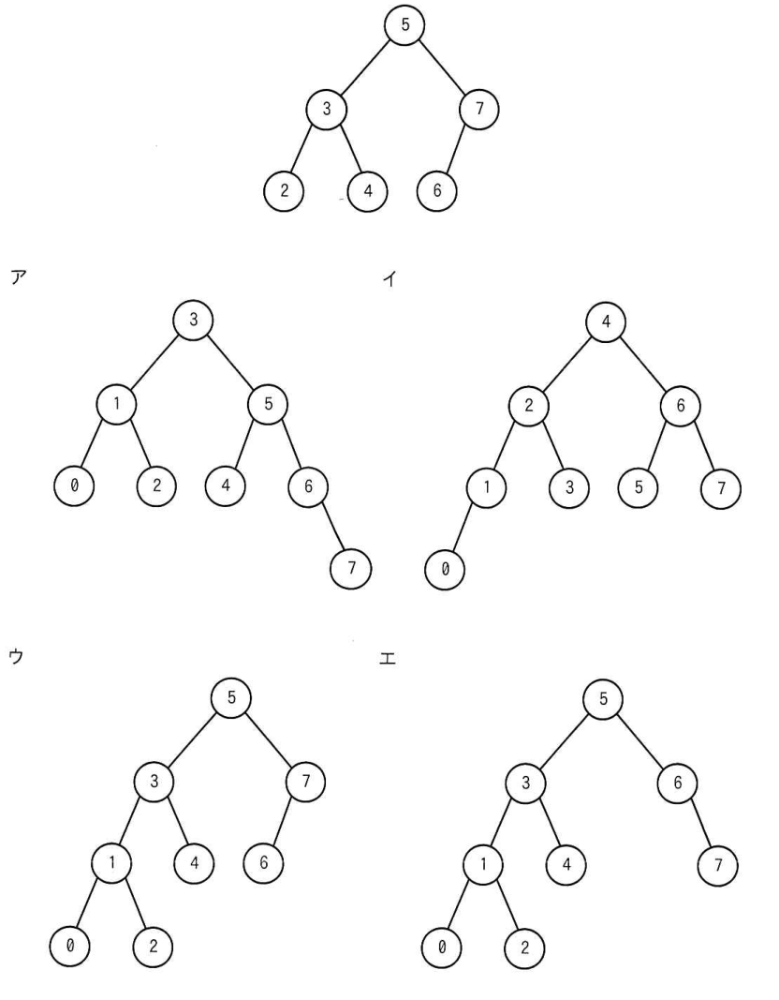
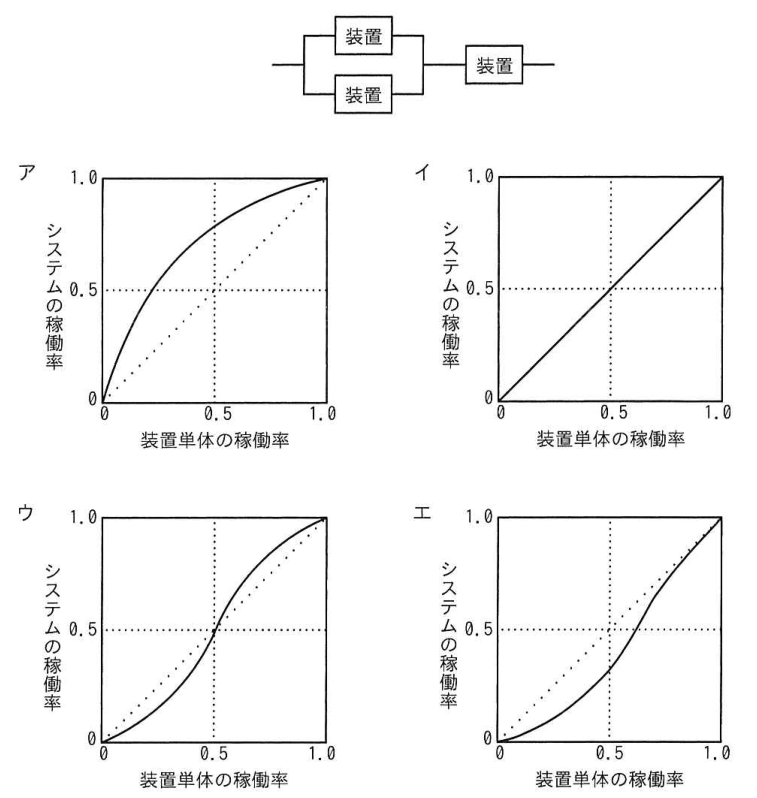
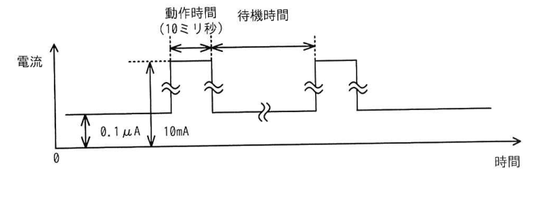
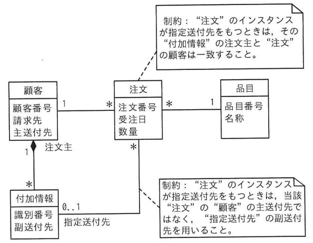
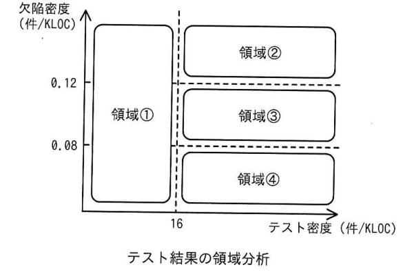
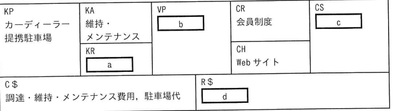

# 令和7年度春期 科目A（旧午前）過去問解説

> 令和7年度 春期 応用情報技術者試験 午前（全80問）を書き起こし、オリジナルの解説を付けたものです。問題の著作権は IPA（独立行政法人 情報処理推進機構）にあります。
> 図を表に書き換えるなど一部改変した問題には、その旨を記載しています。
> インタラクティブ教材の [科目A 四択クイズ](../../06_インタラクティブ教材/quiz.html) では、この回を本番形式（150分）で解けます。

## 目次

| 問 | 分野 | 中分類 | キーワード |
|---|---|---|---|
| [問1](#q01) | テクノロジ系 | 基礎理論 | 含意、論理式、真理値 |
| [問2](#q02) | テクノロジ系 | 基礎理論 | 2分法、反復回数、近似解 |
| [問3](#q03) | テクノロジ系 | 基礎理論 | 過学習、データ拡張、汎化性能、機械学習 |
| [問4](#q04) | テクノロジ系 | コンピュータ構成要素 | リアルタイムシステム、組込みシステム、デッドライン |
| [問5](#q05) | テクノロジ系 | アルゴリズムとプログラミング | スタック、LIFO、カタラン数 |
| [問6](#q06) | テクノロジ系 | アルゴリズムとプログラミング | AVL木、2分探索木、回転、平衡木 |
| [問7](#q07) | テクノロジ系 | アルゴリズムとプログラミング | 再帰、階乗、終了条件 |
| [問8](#q08) | テクノロジ系 | コンピュータ構成要素 | CPI、クロック周期、処理時間 |
| [問9](#q09) | テクノロジ系 | コンピュータ構成要素 | DMA、MMU、DSP |
| [問10](#q10) | テクノロジ系 | システム構成要素 | オブジェクトストレージ、ファイルストレージ、ブロックストレージ |
| [問11](#q11) | テクノロジ系 | システム構成要素 | アムダールの法則、高速化率、並列処理 |
| [問12](#q12) | テクノロジ系 | システム構成要素 | 稼働率、MTBF、MTTR |
| [問13](#q13) | テクノロジ系 | システム構成要素 | 稼働率、直列・並列、信頼性 |
| [問14](#q14) | テクノロジ系 | ソフトウェア | プリエンプション、タスク状態遷移、リアルタイムOS |
| [問15](#q15) | テクノロジ系 | ソフトウェア | LRU、ページ置換え、仮想記憶 |
| [問16](#q16) | テクノロジ系 | ソフトウェア | OSSライセンス、GPL、LGPL、コピーレフト |
| [問17](#q17) | テクノロジ系 | ソフトウェア | OpenAPI、Swagger、REST API |
| [問18](#q18) | テクノロジ系 | ハードウェア | D/A変換、16進数、分解能 |
| [問19](#q19) | テクノロジ系 | ハードウェア | PLC、ラダー図、シーケンス制御 |
| [問20](#q20) | テクノロジ系 | ハードウェア | HDL、FPGA、論理合成 |
| [問21](#q21) | テクノロジ系 | ハードウェア | 間欠動作、平均電流、IoT、低消費電力 |
| [問22](#q22) | テクノロジ系 | ユーザーインタフェース | ユーザビリティ評価、思考発話法、ヒューリスティック評価 |
| [問23](#q23) | テクノロジ系 | 情報メディア | SVG、ベクタ画像、XML |
| [問24](#q24) | テクノロジ系 | データベース | NoSQL、ワイドカラム、IoT |
| [問25](#q25) | テクノロジ系 | データベース | UML、クラス図、参照制約、多重度 |
| [問26](#q26) | テクノロジ系 | データベース | 正規化、第3正規形、推移的関数従属 |
| [問27](#q27) | テクノロジ系 | データベース | 参照制約、ON DELETE CASCADE、外部キー |
| [問28](#q28) | テクノロジ系 | データベース | 関係演算、差、共通 |
| [問29](#q29) | テクノロジ系 | ネットワーク | PoE、給電、LAN |
| [問30](#q30) | テクノロジ系 | ネットワーク | MTU、MSS、TCP、IPv4 |
| [問31](#q31) | テクノロジ系 | ネットワーク | ルーティングテーブル、最長一致、サブネットマスク |
| [問32](#q32) | テクノロジ系 | ネットワーク | サブネット、IPアドレス、ブロードキャストアドレス |
| [問33](#q33) | テクノロジ系 | ネットワーク | FTP、ウェルノウンポート、ポート番号 |
| [問34](#q34) | テクノロジ系 | ネットワーク | base64、MIME、エンコード |
| [問35](#q35) | テクノロジ系 | セキュリティ | CRYPTREC、電子政府推奨暗号リスト、運用監視暗号リスト |
| [問36](#q36) | テクノロジ系 | セキュリティ | OSコマンドインジェクション、ログ分析、Webアプリケーションの脆弱性 |
| [問37](#q37) | テクノロジ系 | セキュリティ | サイドチャネル攻撃、電磁波解析、耐タンパ性 |
| [問38](#q38) | テクノロジ系 | セキュリティ | OCSP、CRL、PKI、証明書失効 |
| [問39](#q39) | テクノロジ系 | セキュリティ | セキュリティクリアランス、人的セキュリティ、適性評価 |
| [問40](#q40) | テクノロジ系 | セキュリティ | SBOM、脆弱性管理、ソフトウェア部品表 |
| [問41](#q41) | テクノロジ系 | セキュリティ | cookie、Secure属性、HttpOnly属性 |
| [問42](#q42) | テクノロジ系 | セキュリティ | OSコマンドインジェクション、セキュアプログラミング、シェル |
| [問43](#q43) | テクノロジ系 | セキュリティ | VPN、IPsec、L2TP、TLS、OSI基本参照モデル |
| [問44](#q44) | テクノロジ系 | セキュリティ | ストレッチング、ソルト、パスワードクラック |
| [問45](#q45) | テクノロジ系 | システム開発技術 | デザインレビュー、レビュー、設計 |
| [問46](#q46) | テクノロジ系 | システム開発技術 | ブルーグリーンデプロイメント、ローリングアップデート、移行 |
| [問47](#q47) | テクノロジ系 | システム開発技術 | 保守性、品質特性、メトリクス |
| [問48](#q48) | テクノロジ系 | ソフトウェア開発管理技術 | XP、ペアプログラミング、アジャイル |
| [問49](#q49) | テクノロジ系 | ソフトウェア開発管理技術 | カオスエンジニアリング、本番環境、回復性 |
| [問50](#q50) | テクノロジ系 | ソフトウェア開発管理技術 | スクラム、スプリントレビュー、アジャイル |
| [問51](#q51) | マネジメント系 | プロジェクトマネジメント | プロジェクト憲章、スコープ記述書、WBS |
| [問52](#q52) | マネジメント系 | プロジェクトマネジメント | EVM、CPI、SPI、TCPI |
| [問53](#q53) | マネジメント系 | プロジェクトマネジメント | クラッシング、ファストトラッキング、クリティカルパス |
| [問54](#q54) | マネジメント系 | プロジェクトマネジメント | テスト密度、欠陥密度、品質管理 |
| [問55](#q55) | マネジメント系 | サービスマネジメント | サービス可用性、SLA、停止時間 |
| [問56](#q56) | マネジメント系 | サービスマネジメント | IaaS、PaaS、責任共有モデル、クラウド移行 |
| [問57](#q57) | マネジメント系 | サービスマネジメント | CSF、KPI、KGI、継続的改善 |
| [問58](#q58) | マネジメント系 | システム監査 | ウォークスルー法、監査技法、コントロール |
| [問59](#q59) | マネジメント系 | システム監査 | 監査手続、監査証拠、システム監査基準 |
| [問60](#q60) | マネジメント系 | システム監査 | システム管理基準、受入テスト、システム監査 |
| [問61](#q61) | ストラテジ系 | システム戦略 | DX認定制度、デジタルガバナンス・コード、DX戦略 |
| [問62](#q62) | ストラテジ系 | システム戦略 | CRM、ワントゥワンマーケティング、ソリューション |
| [問63](#q63) | ストラテジ系 | システム戦略 | プロビジョニング、クラウドサービス、リソース |
| [問64](#q64) | ストラテジ系 | 企業活動 | ABC、活動基準原価計算、人件費削減 |
| [問65](#q65) | ストラテジ系 | システム企画 | システム管理基準、ビジネス分析、企画プロセス |
| [問66](#q66) | ストラテジ系 | システム企画 | モデル取引・契約書、準委任契約、請負契約 |
| [問67](#q67) | ストラテジ系 | 経営戦略マネジメント | PPM、市場成長率、相対的市場シェア |
| [問68](#q68) | ストラテジ系 | 経営戦略マネジメント | プライスライニング、価格戦略、マーケティング |
| [問69](#q69) | ストラテジ系 | 経営戦略マネジメント | ビジネスモデルキャンバス、価値提案、カーシェア |
| [問70](#q70) | ストラテジ系 | 経営戦略マネジメント | フリーミアム、ビジネスモデル、課金 |
| [問71](#q71) | ストラテジ系 | ビジネスインダストリ | エッジAI、推論、機械学習 |
| [問72](#q72) | ストラテジ系 | ビジネスインダストリ | マシンビジョン、スマートファクトリー、画像認識 |
| [問73](#q73) | ストラテジ系 | 企業活動 | コンピテンシー、人事評価、人材育成 |
| [問74](#q74) | ストラテジ系 | 企業活動 | 指数平滑法、移動平均法、需要予測、時系列分析 |
| [問75](#q75) | ストラテジ系 | 企業活動 | 親和図法、KJ法、収束技法、発散技法 |
| [問76](#q76) | ストラテジ系 | 企業活動 | 総資産回転率、総資産営業利益率、売上高営業利益率、財務指標 |
| [問77](#q77) | ストラテジ系 | 企業活動 | 変動費率、限界利益率、損益分岐点 |
| [問78](#q78) | ストラテジ系 | 法務 | 著作権法、生成AI、類似性、依拠性 |
| [問79](#q79) | ストラテジ系 | 法務 | 資金決済法、暗号資産、暗号資産交換業者 |
| [問80](#q80) | ストラテジ系 | 法務 | RoHS指令、有害物質、環境規制 |

<a id="q01"></a>

### 問1　〔基礎理論〕 🧮

論理式 P, Q がいずれも真であるとき，論理式 R の真偽にかかわらず真になる式はどれか。ここで，“￣”は否定を，“∨”は論理和を，“∧”は論理積を，“→”は含意（“真 → 偽”となるときに限り偽となる演算）を表す。

- **ア**　((P → Q) ∧ (Q → P)) → (R → Q̄)
- **イ**　((P → Q) ∧ ¬(Q → P̄)) → (Q → R)
- **ウ**　((P → Q̄) ∨ (Q → P)) → (R → Q̄)
- **エ**　((P → Q̄) ∨ (Q → P̄)) → (Q → R)

<details><summary>解答・解説</summary>

**正解：エ**

P＝Q＝真を代入すると，エの前件 (P→Q̄)∨(Q→P̄) は (真→偽)∨(真→偽)＝偽∨偽＝偽になる。含意は前件が偽なら後件に関係なく真なので，R の真偽によらず真。

**途中式**（P＝Q＝真，Q̄＝P̄＝偽）

- ア：前件 (真→真)∧(真→真)＝真。後件 R→偽 は R＝真のとき偽 → 全体が偽になることがある
- イ：Q→P̄＝真→偽＝偽，その否定は真。前件＝真∧真＝真。後件 Q→R＝真→R は R＝偽で偽 → 全体が偽になることがある
- ウ：前件＝偽∨真＝真。後件 R→偽 は R＝真で偽 → 全体が偽になることがある
- エ：前件＝偽∨偽＝偽 → 全体は常に真

💡 **ポイント**：A→B は「A が偽なら無条件に真」。R に依存しないためには「前件が偽」か「後件が R によらず真」のどちらかを探すと速い。

📖 関連：[基礎理論](../../01_テクノロジ系/01_基礎理論.md)

</details>

<sub>出典：令和7年度 春期 応用情報技術者試験 午前 問1（上線による否定のうち，式全体にかかるものを ¬( ) で表記）</sub>

---

<a id="q02"></a>

### 問2　〔基礎理論〕 🧮

0 ≦ x ≦ 1 の範囲で単調に増加する連続関数 f(x) が f(0) ＜ 0 ≦ f(1) を満たすときに，区間内で f(x) ＝ 0 である x の値を近似的に求めるアルゴリズムにおいて，(2) は何回実行されるか。

〔アルゴリズム〕

(1) x0 ← 0，x1 ← 1 とする。  
(2) x ← (x0 ＋ x1) / 2 とする。  
(3) x1 − x ＜ 0.001 ならば x の値を近似値として終了する。  
(4) f(x) ≧ 0 ならば x1 ← x として，そうでなければ x0 ← x とする。  
(5) (2) に戻る。

- **ア**　10
- **イ**　20
- **ウ**　100
- **エ**　1,000

<details><summary>解答・解説</summary>

**正解：ア**

これは2分法。(2) を1回実行するたびに区間幅が半分になり，k 回目の (3) では x1 − x ＝ 1/2^k。1/2^k ＜ 0.001 を初めて満たすのは k＝10（1/1024）なので 10 回。

**途中式**

- k 回目の (2) 実行時，区間 [x0, x1] の幅は 1/2^(k−1)，x は中点なので x1 − x ＝ 1/2^k
- 2^9 ＝ 512 → 1/512 ≒ 0.00195（0.001 以上で続行）
- 2^10 ＝ 1024 → 1/1024 ≒ 0.00098 ＜ 0.001 → **10 回目で終了**

- イ：20 回なら幅は約 1/100 万で，必要以上の精度
- ウ，エ：区間を半分ずつではなく一定幅（0.01 や 0.001）ずつ狭めると考えた場合の回数。2分法では半分ずつ狭まる

💡 **ポイント**：2分法の反復回数は「2^k ≧ 初期幅/許容誤差」となる最小の k。2^10 ≒ 1000 は頻出の目安。

📖 関連：[アルゴリズムとプログラミング](../../01_テクノロジ系/02_アルゴリズムとプログラミング.md)／[基礎理論](../../01_テクノロジ系/01_基礎理論.md)

</details>

<sub>出典：令和7年度 春期 応用情報技術者試験 午前 問2（分数式をテキストで表記）</sub>

---

<a id="q03"></a>

### 問3　〔基礎理論〕

AI における機械学習の過程において，過学習と疑われたときの解消方法として，最も適切なものはどれか。

- **ア**　訓練した時と同じ精度を出すために，訓練データをテストデータとして使用する。
- **イ**　精度を高めるために，元の訓練データに加工を施し，訓練データの量を増やす。
- **ウ**　予測した結果に近づけるために，モデルをより複雑にする。
- **エ**　より多くの未知のデータに対して予測できるように，汎化性能を下げる。

<details><summary>解答・解説</summary>

**正解：イ**

過学習は，訓練データに合わせすぎて未知データへの当てはまり（汎化性能）が落ちた状態。回転・反転などの加工で訓練データを水増しする（データ拡張）と，特定のデータへの過剰適合を抑えられる。

- ア：訓練データで評価しても過学習は見抜けず，解消にもならない。テストデータは訓練に使わないデータを使う
- ウ：モデルを複雑にすると訓練データへの適合が進み，過学習はむしろ悪化する
- エ：未知データへの予測力が汎化性能そのもの。下げるのではなく高めるべき

💡 **ポイント**：過学習の対策は，データを増やす（データ拡張），モデルを単純にする（正則化・ドロップアウト），早期終了，交差検証で確認する，など。

📖 関連：[基礎理論](../../01_テクノロジ系/01_基礎理論.md)

</details>

<sub>出典：令和7年度 春期 応用情報技術者試験 午前 問3</sub>

---

<a id="q04"></a>

### 問4　〔コンピュータ構成要素〕

リアルタイム性が求められる組込みシステムにおいて，システムへの入力に対するリアルタイムな応答の方法として，最も適切なものはどれか。

- **ア**　OS を使用しないで応答する。
- **イ**　定められた制限時間内に応答する。
- **ウ**　入力された順序を守って応答する。
- **エ**　入力時刻を記録して応答する。

<details><summary>解答・解説</summary>

**正解：イ**

組込みシステムでいう「リアルタイム」は，単に速いことではなく，決められた期限（デッドライン）までに必ず応答することを指す。

- ア：OS の有無は関係ない。リアルタイム OS（RTOS）を使ってもリアルタイム性は実現できる
- ウ：到着順に処理すると，緊急度の高い入力が後回しになり期限を守れないことがある。優先度に基づくスケジューリングが基本
- エ：時刻の記録は応答の期限を守ることとは無関係

💡 **ポイント**：期限を必ず守る＝ハードリアルタイム，多少の遅れは許容＝ソフトリアルタイム。

📖 関連：[コンピュータ構成要素](../../01_テクノロジ系/03_コンピュータ構成要素.md)／[ソフトウェア](../../01_テクノロジ系/05_ソフトウェア.md)

</details>

<sub>出典：令和7年度 春期 応用情報技術者試験 午前 問4</sub>

---

<a id="q05"></a>

### 問5　〔アルゴリズムとプログラミング〕 🧮

A，B，C の順序で入力されるデータがある。各データについてスタックへの挿入と取出しを1回ずつ行うことができる場合，データの出力順序は何通りあるか。

（図：スタックの上から A，B，C の順にデータを入れ，上から取り出す）

- **ア**　3
- **イ**　4
- **ウ**　5
- **エ**　6

<details><summary>解答・解説</summary>

**正解：ウ**

3個のデータの並び 3!＝6 通りのうち，スタックでは C，A，B の順だけが作れないので 5 通り。

**途中式**（列挙）

1. A入 A出 B入 B出 C入 C出 → ABC
2. A入 A出 B入 C入 C出 B出 → ACB
3. A入 B入 B出 A出 C入 C出 → BAC
4. A入 B入 B出 C入 C出 A出 → BCA
5. A入 B入 C入 C出 B出 A出 → CBA

C を最初に出すには A，B が積まれており，次に出せるのは B だけなので CAB は不可能。

- ア，イ：数え漏れ
- エ：3! 通りすべてが可能だと考えた場合。CAB は作れない

💡 **ポイント**：n 個のデータをスタックに通して得られる出力順の数はカタラン数（1, 2, 5, 14, …）。

📖 関連：[アルゴリズムとプログラミング](../../01_テクノロジ系/02_アルゴリズムとプログラミング.md)

</details>

<sub>出典：令和7年度 春期 応用情報技術者試験 午前 問5（図を文章で表記）</sub>

---

<a id="q06"></a>

### 問6　〔アルゴリズムとプログラミング〕

図の2分探索木に1と0の二つの要素を順に追加した AVL 木として，適切なものはどれか。



- **ア**　（図のア）
- **イ**　（図のイ）
- **ウ**　（図のウ）
- **エ**　（図のエ）

<details><summary>解答・解説</summary>

**正解：ウ**

1 は 2 の左の子に，続く 0 は 1 の左の子に入る。すると節 2 の左右の高さの差が 2 になるので，2 を中心に右回転し，1 を親として左に 0，右に 2 を置く。根の 5 や 3 の高さの差は 1 以内に収まるので，ウの形になる。

**途中経過**

- 1 を追加：5→3→2 の左の子。各節の高さの差は 1 以内で調整不要
- 0 を追加：2→1 の左の子。節 2 は左の高さ 2，右 0 で差 2 → LL 型なので節 2 で右回転
- 回転後：3 の左の子が 1（子は 0 と 2），3 の右は 4。5 の右側（7，6）はそのまま

- ア：根を 3 に変える大きな組替えは不要。7 と 6 の位置関係も元の木と異なる
- イ：完全に作り直した形。AVL 木は不均衡になった部分だけを回転させる
- エ：右部分木の 7，6 は不均衡になっていないのに回転させている

💡 **ポイント**：AVL 木は全節で左右の部分木の高さの差が 1 以内。追加後，挿入位置から根に向かって最初に差が 2 になった節で回転する。

📖 関連：[アルゴリズムとプログラミング](../../01_テクノロジ系/02_アルゴリズムとプログラミング.md)

</details>

<sub>出典：令和7年度 春期 応用情報技術者試験 午前 問6</sub>

---

<a id="q07"></a>

### 問7　〔アルゴリズムとプログラミング〕

fact(n) は，非負の整数 n に対して n の階乗を返す。fact(n) の再帰的な定義はどれか。

- **ア**　if n＝0 then return 0 else return n × fact(n−1)
- **イ**　if n＝0 then return 0 else return n × fact(n＋1)
- **ウ**　if n＝0 then return 1 else return n × fact(n−1)
- **エ**　if n＝0 then return 1 else return n × fact(n＋1)

<details><summary>解答・解説</summary>

**正解：ウ**

階乗は 0! ＝ 1，n! ＝ n × (n−1)! で定義される。終了条件で 1 を返し，引数を1ずつ減らして呼び出すウが正しい。

- ア：0! を 0 にすると，掛け算の連鎖の最後に 0 が掛かり，結果が常に 0 になる
- イ：0 を返すうえ，n＋1 で呼ぶので n＞0 では終了条件に到達せず無限に再帰する
- エ：n＋1 で呼ぶため，n＞0 では n＝0 に到達せず再帰が終わらない

💡 **ポイント**：再帰関数は「終了条件（基底）」と「問題を小さくして自分を呼ぶ部分」の2つで作る。

📖 関連：[アルゴリズムとプログラミング](../../01_テクノロジ系/02_アルゴリズムとプログラミング.md)

</details>

<sub>出典：令和7年度 春期 応用情報技術者試験 午前 問7</sub>

---

<a id="q08"></a>

### 問8　〔コンピュータ構成要素〕 🧮

同じ命令セットをもつコンピュータ A と B とがある。それぞれの CPU クロック周期，及びあるプログラムを実行したときの CPI（Cycles Per Instruction）は，表のとおりである。そのプログラムを実行したとき，コンピュータ A の処理時間は，コンピュータ B の処理時間の何倍になるか。

| | CPU クロック周期 | CPI |
|---|---|---|
| コンピュータ A | 1ナノ秒 | 4.0 |
| コンピュータ B | 4ナノ秒 | 0.5 |

- **ア**　1 / 32
- **イ**　1 / 2
- **ウ**　2
- **エ**　8

<details><summary>解答・解説</summary>

**正解：ウ**

1命令の平均実行時間は「CPI × クロック周期」。A は 4.0×1＝4 ナノ秒，B は 0.5×4＝2 ナノ秒。命令数は同じなので，A は B の 2 倍。

**途中式**

- 処理時間 ＝ 命令数 × CPI × クロック周期
- A：4.0 × 1 ＝ 4 ナノ秒/命令
- B：0.5 × 4 ＝ 2 ナノ秒/命令
- A / B ＝ 4 / 2 ＝ **2 倍**

- ア：クロック周期の比 1/4 と CPI の比 0.5/4 を掛け合わせるなど，比の取り方を誤った値
- イ：B が A の何倍か（逆の比）
- エ：CPI の比（4.0/0.5）だけを見て，クロック周期の違いを無視した値

💡 **ポイント**：CPU 時間 ＝ 命令数 × CPI × クロック周期 ＝ 命令数 × CPI ÷ クロック周波数。

📖 関連：[コンピュータ構成要素](../../01_テクノロジ系/03_コンピュータ構成要素.md)／[計算問題公式集](../../05_まとめ・横断資料/01_計算問題公式集.md)

</details>

<sub>出典：令和7年度 春期 応用情報技術者試験 午前 問8</sub>

---

<a id="q09"></a>

### 問9　〔コンピュータ構成要素〕

DMA コントローラーの説明として，適切なものはどれか。

- **ア**　MPU では時間が掛かる積和演算を，高速に行う。
- **イ**　仮想メモリ機能，メモリ保護機能などのメモリ管理機能を提供する。
- **ウ**　動作クロックに合わせてカウントするカウントレジスタをもち，それによって時間の経過を保持する。
- **エ**　メモリと入出力装置，又はメモリとメモリとの間のデータ転送を，MPU を介さずに行う。

<details><summary>解答・解説</summary>

**正解：エ**

DMA（Direct Memory Access）コントローラーは，MPU（CPU）に代わってメモリと入出力装置などの間のデータ転送を行う。転送中 MPU は別の処理ができる。

- ア：積和演算を高速に行うのは DSP（Digital Signal Processor）
- イ：仮想メモリやメモリ保護を担うのは MMU（Memory Management Unit）
- ウ：時間の経過を数えるのはタイマー（カウンタ）

💡 **ポイント**：DMA＝CPU を介さないデータ転送，MMU＝アドレス変換・メモリ保護，DSP＝信号処理（積和演算）。周辺回路の役割を組で覚える。

📖 関連：[コンピュータ構成要素](../../01_テクノロジ系/03_コンピュータ構成要素.md)

</details>

<sub>出典：令和7年度 春期 応用情報技術者試験 午前 問9</sub>

---

<a id="q10"></a>

### 問10　〔システム構成要素〕

オブジェクトストレージの特徴として，適切なものはどれか。

- **ア**　オブジェクトにはユニークな識別子が割り当てられ，識別子を使ってアクセスする。
- **イ**　オブジェクトの内容を更新する際，上書き更新をする。
- **ウ**　広域分散を実現するためには，遠隔地のストレージと静止点を設けて同期を行う必要がある。
- **エ**　ストレージはディレクトリの概念を使った階層構造である。

<details><summary>解答・解説</summary>

**正解：ア**

オブジェクトストレージは，データをメタデータとともに「オブジェクト」として格納し，一意の ID（キー）で HTTP の API などからアクセスする。階層をもたないフラットな構造なので大量データの分散保存に向く。

- イ：オブジェクトは部分的な上書き更新を基本とせず，オブジェクト単位で丸ごと置き換える（または新しい版として保存する）
- ウ：オブジェクトストレージは結果整合性による非同期複製などで広域分散しやすく，静止点を設けた同期は必須ではない
- エ：ディレクトリによる階層構造はファイルストレージの特徴

💡 **ポイント**：ブロックストレージ（ブロック単位・OS がファイルシステムを構築），ファイルストレージ（階層ディレクトリ），オブジェクトストレージ（フラット・ID とメタデータ）を比較して覚える。

📖 関連：[システム構成要素](../../01_テクノロジ系/04_システム構成要素.md)

</details>

<sub>出典：令和7年度 春期 応用情報技術者試験 午前 問10</sub>

---

<a id="q11"></a>

### 問11　〔システム構成要素〕 🧮

マルチプロセッサによる並列処理で得られる高速化率（単一プロセッサのときと比べた倍率）E を，次の式によって評価する。r ＝ 0.9 のアプリケーションの高速化率が r ＝ 0.3 のものの3倍となるのは，プロセッサが何台のときか。

E ＝ 1 / (1 − r ＋ r / n)

ここで，

n：プロセッサの台数（1 ≦ n）  
r：対象とする処理のうち，並列化が可能な部分の割合（0 ≦ r ≦ 1）

とし，並列化に伴うオーバーヘッドは考慮しないものとする。

- **ア**　3
- **イ**　4
- **ウ**　5
- **エ**　6

<details><summary>解答・解説</summary>

**正解：エ**

アムダールの法則の式に r＝0.9 と r＝0.3 を代入し，「前者＝後者の3倍」の方程式を解くと n＝6。

**途中式**

- r＝0.9：E1 ＝ 1 / (0.1 ＋ 0.9/n)
- r＝0.3：E2 ＝ 1 / (0.7 ＋ 0.3/n)
- E1 ＝ 3 × E2 → 0.7 ＋ 0.3/n ＝ 3 × (0.1 ＋ 0.9/n) ＝ 0.3 ＋ 2.7/n
- 0.4 ＝ 2.4/n → **n ＝ 6**
- 検算：E1 ＝ 1/(0.1＋0.15) ＝ 4，E2 ＝ 1/(0.7＋0.05) ≒ 1.33 → 4 / 1.33 ＝ 3

- ア：n＝3 では E1 ＝ 1/0.4 ＝ 2.5，E2 ＝ 1/0.8 ＝ 1.25 で2倍
- イ：n＝4 では E1 ≒ 3.08，E2 ≒ 1.29 で約2.4倍
- ウ：n＝5 では E1 ≒ 3.57，E2 ≒ 1.32 で約2.7倍

💡 **ポイント**：アムダールの法則では，並列化できない部分（1−r）が性能向上の上限を決める。台数を増やしても E は 1/(1−r) を超えない。

📖 関連：[システム構成要素](../../01_テクノロジ系/04_システム構成要素.md)／[計算問題公式集](../../05_まとめ・横断資料/01_計算問題公式集.md)

</details>

<sub>出典：令和7年度 春期 応用情報技術者試験 午前 問11（分数式をテキストで表記）</sub>

---

<a id="q12"></a>

### 問12　〔システム構成要素〕 🧮

二つのシステム A，B の稼働率をそれぞれ αA（0 ＜ αA ＜ 1），αB（0 ＜ αB ＜ 1），MTBF をそれぞれ MTBFA，MTBFB，MTTR をそれぞれ MTTRA，MTTRB としたとき，これらの関係として，常に成り立つものはどれか。

- **ア**　αA ＝ αB ならば，MTBFA ＝ MTBFB であり，かつ MTTRA ＝ MTTRB である。
- **イ**　αA ＝ αB ならば，MTTRA / MTBFA ＝ MTTRB / MTBFB である。
- **ウ**　αA ＞ αB ならば，MTBFA ＞ MTBFB であり，かつ MTTRA ＞ MTTRB である。
- **エ**　αA ＞ αB ならば，MTTRA / MTBFA ＞ MTTRB / MTBFB である。

<details><summary>解答・解説</summary>

**正解：イ**

稼働率 α ＝ MTBF / (MTBF ＋ MTTR) ＝ 1 / (1 ＋ MTTR/MTBF)。α は MTTR/MTBF だけで決まるので，稼働率が等しければ MTTR/MTBF も等しい。

**途中式**

α ＝ MTBF / (MTBF ＋ MTTR) → 分子分母を MTBF で割る → α ＝ 1 / (1 ＋ MTTR/MTBF)

- ア：比が同じなら稼働率は同じ。例：MTBF 90・MTTR 10 と MTBF 900・MTTR 100 はどちらも 0.9
- ウ：稼働率が高くても MTBF や MTTR の大小は決まらない（MTTR は小さいほうが稼働率は上がる）
- エ：α が大きいほど MTTR/MTBF は小さい。不等号の向きが逆

💡 **ポイント**：稼働率は MTBF と MTTR の「比」で決まる。MTBF を伸ばすか MTTR を縮めると上がる。

📖 関連：[システム構成要素](../../01_テクノロジ系/04_システム構成要素.md)／[計算問題公式集](../../05_まとめ・横断資料/01_計算問題公式集.md)

</details>

<sub>出典：令和7年度 春期 応用情報技術者試験 午前 問12</sub>

---

<a id="q13"></a>

### 問13　〔システム構成要素〕 🧮

図のように3個の装置を並列と直列に組み合わせて構成したシステムがある。装置単体の稼働率と，システムの稼働率の関係を示したグラフはどれか。ここで，3個の装置の稼働率は，全て等しいものとする。



- **ア**　（図のア）
- **イ**　（図のイ）
- **ウ**　（図のウ）
- **エ**　（図のエ）

<details><summary>解答・解説</summary>

**正解：エ**

装置単体の稼働率を p とすると，システムの稼働率は {1 − (1 − p)^2} × p。p＝0.5 で 0.375 と 0.5 より小さく，p＝0 と 1 で両端が一致し，全区間で対角線（y＝p）より下にあるエのグラフになる。

**途中式**

- 並列部分：1 − (1 − p)^2 ＝ 2p − p^2
- 直列に p を掛ける：R ＝ (2p − p^2) × p ＝ 2p^2 − p^3
- p＝0.5：R ＝ 0.5 − 0.125 ＝ **0.375**（0.5 未満）
- R − p ＝ −p(1 − p)^2 ≦ 0 → 0〜1 の全域で対角線以下

- ア：常に対角線より上。並列だけの構成（2p − p^2 など）の形
- イ：R ＝ p（装置1台と同じ）
- ウ：p＝0.5 で 0.5 を通り，対角線と交差する形。今回の式では対角線と交わるのは両端だけ

💡 **ポイント**：直列は稼働率の積，並列は「1 −（全部止まる確率）」。グラフ選択問題は p＝0.5 を代入して当てはまる点を確かめると速い。

📖 関連：[システム構成要素](../../01_テクノロジ系/04_システム構成要素.md)／[計算問題公式集](../../05_まとめ・横断資料/01_計算問題公式集.md)

</details>

<sub>出典：令和7年度 春期 応用情報技術者試験 午前 問13</sub>

---

<a id="q14"></a>

### 問14　〔ソフトウェア〕

リアルタイム OS において，実行中のタスクがプリエンプションによって遷移する状態はどれか。

- **ア**　休止状態
- **イ**　実行可能状態
- **ウ**　終了状態
- **エ**　待ち状態

<details><summary>解答・解説</summary>

**正解：イ**

プリエンプション（横取り）は，より優先度の高いタスクが実行可能になったときなどに，実行中のタスクから CPU を取り上げること。取り上げられたタスクは CPU が空けばすぐ実行できるので，実行可能（レディ）状態に戻る。

- ア：休止状態は，タスクが起動される前や終了後に，実行の対象となっていない状態
- ウ：終了状態はタスクが処理を終えた状態。プリエンプションでは終了しない
- エ：待ち状態は，入出力完了やイベントなどを待つためにタスク自身が CPU を手放した状態

💡 **ポイント**：実行→実行可能（プリエンプション），実行→待ち（入出力・イベント待ち），待ち→実行可能（待ちの解除）。待ちから直接実行には移らない。

📖 関連：[ソフトウェア](../../01_テクノロジ系/05_ソフトウェア.md)

</details>

<sub>出典：令和7年度 春期 応用情報技術者試験 午前 問14</sub>

---

<a id="q15"></a>

### 問15　〔ソフトウェア〕 🧮

仮想記憶管理におけるページ置換えアルゴリズムとして LRU 方式を採用する。主記憶のページ枠が，4000，5000，6000，7000 番地（いずれも16進数）の4ページ分で，プログラムが参照するページ番号の順が，1 → 2 → 3 → 4 → 2 → 5 → 3 → 1 → 6 → 5 → 4 のとき，最後の参照ページ4は何番地にページインされているか。ここで，最初の 1 → 2 → 3 → 4 の参照で，それぞれのページは4000，5000，6000，7000番地にページインされるものとする。

- **ア**　4000
- **イ**　5000
- **ウ**　6000
- **エ**　7000

<details><summary>解答・解説</summary>

**正解：ウ**

LRU は最も長く参照されていないページを追い出す。順に追うと，最後のページ4の参照時点で最も古いのは 6000 番地のページ3なので，4 は 6000 番地に入る。

**途中経過**（番地：ページ）

| 参照 | 4000 | 5000 | 6000 | 7000 | 置換え |
|---|---|---|---|---|---|
| 1,2,3,4 | 1 | 2 | 3 | 4 | − |
| 2 | 1 | 2 | 3 | 4 | ヒット |
| 5 | **5** | 2 | 3 | 4 | 最古の1を追出し |
| 3 | 5 | 2 | 3 | 4 | ヒット |
| 1 | 5 | 2 | 3 | **1** | 最古の4を追出し |
| 6 | 5 | **6** | 3 | 1 | 最古の2を追出し |
| 5 | 5 | 6 | 3 | 1 | ヒット |
| 4 | 5 | 6 | **4** | 1 | 最古の3を追出し |

- ア：4000 番地のページ5は直前に参照されたばかりで追い出されない
- イ：5000 番地のページ6は直前の直前に読み込まれており，最古ではない
- エ：7000 番地のページ1は8番目に参照されており，ページ3（7番目）より新しい

💡 **ポイント**：LRU は「最後に参照された時刻」，FIFO は「読み込まれた時刻」が最も古いページを追い出す。ヒット時に時刻が更新されるかどうかが違い。

📖 関連：[ソフトウェア](../../01_テクノロジ系/05_ソフトウェア.md)

</details>

<sub>出典：令和7年度 春期 応用情報技術者試験 午前 問15</sub>

---

<a id="q16"></a>

### 問16　〔ソフトウェア〕

表は，OSS のライセンスごとに，そのライセンスの OSS を利用したプログラムを配布するとき，ソースコードを公開しなければならないかどうかを示す。a〜d に入れるライセンスの適切な組合せはどれか。ここで，表中の“○”は公開しなければならないことを表し，“×”は公開しなくてもよいことを表す。

| 配布プログラム | a | b | c | d |
|---|---|---|---|---|
| OSS のソースコードを修正して作ったプログラム | ○ | ○ | ○ | × |
| OSS に静的にリンクしたプログラム | ○ | ○ | × | × |
| OSS に動的にリンクしたプログラム | ○ | × | × | × |

- **ア**　a：GPL，b：LGPL，c：MPL，d：BSD
- **イ**　a：GPL，b：MPL，c：BSD，d：LGPL
- **ウ**　a：LGPL，b：GPL，c：MPL，d：BSD
- **エ**　a：LGPL，b：MPL，c：BSD，d：GPL

<details><summary>解答・解説</summary>

**正解：ア**

コピーレフトの強さは GPL ＞ LGPL ＞ MPL ＞ BSD の順。GPL はリンクしたものまで全て公開（a），LGPL は動的リンクなら公開不要（b），MPL は修正したファイルだけ公開（c），BSD は公開義務なし（d）。

- イ：MPL は静的リンクしただけのプログラムに公開義務はなく b に合わない。LGPL は修正すれば公開が必要で d に合わない
- ウ：LGPL は動的リンクなら公開不要で a に合わない。GPL は動的リンクでも公開が必要で b に合わない
- エ：GPL は全て公開が必要なので，全て×の d には当てはまらない

💡 **ポイント**：GPL（強いコピーレフト），LGPL（ライブラリ向けに緩和），MPL（ファイル単位），BSD・MIT・Apache（非コピーレフト。著作権表示などの条件だけ）。

📖 関連：[ソフトウェア](../../01_テクノロジ系/05_ソフトウェア.md)／[法務](../../03_ストラテジ系/04_法務.md)

</details>

<sub>出典：令和7年度 春期 応用情報技術者試験 午前 問16（二つの表のうち選択肢の表を文章に書き換え）</sub>

---

<a id="q17"></a>

### 問17　〔ソフトウェア〕

OpenAPI Specification に従った API の定義・開発を支援する機能を提供する OSS はどれか。

- **ア**　curl
- **イ**　OpenAM
- **ウ**　Serverspec
- **エ**　Swagger

<details><summary>解答・解説</summary>

**正解：エ**

Swagger は，REST API の仕様を OpenAPI 形式（YAML・JSON）で記述し，ドキュメント表示やコード生成，テストなどを支援するツール群。OpenAPI Specification はもともと Swagger の仕様が元になっている。

- ア：curl は，コマンドラインから HTTP などでデータを送受信するツール
- イ：OpenAM は，シングルサインオンなどのアクセス管理（認証・認可）を行う OSS
- ウ：Serverspec は，サーバの設定が意図どおりかをテストするツール（インフラのテスト自動化）

💡 **ポイント**：OpenAPI＝REST API 記述の標準仕様，Swagger＝その作成・可視化ツール。

📖 関連：[ソフトウェア](../../01_テクノロジ系/05_ソフトウェア.md)／[システム開発技術](../../01_テクノロジ系/09_システム開発技術.md)

</details>

<sub>出典：令和7年度 春期 応用情報技術者試験 午前 問17</sub>

---

<a id="q18"></a>

### 問18　〔ハードウェア〕 🧮

8ビット D/A 変換器を使って負でない電圧を発生させる。使用する D/A 変換器は，最下位の1ビットの変化で出力が 10 ミリ V 変化する。データに 0 を与えたときの出力は 0 ミリ V である。データに16進数で 82 を与えたときの出力は何ミリ V か。

- **ア**　820
- **イ**　1,024
- **ウ**　1,300
- **エ**　1,312

<details><summary>解答・解説</summary>

**正解：ウ**

16進数 82 を10進数にすると 8×16＋2＝130。1 当たり 10 ミリ V なので 130×10＝1,300 ミリ V。

**途中式**

- (82)16 ＝ 8 × 16 ＋ 2 ＝ 130
- 出力 ＝ 130 × 10 ミリV ＝ **1,300 ミリV**

- ア：82 を10進数のまま扱った値（82×10）
- イ：2^10 ＝ 1,024。問題と無関係な値
- エ：82 に 16 を掛けた値（82×16）。基数変換の誤り

💡 **ポイント**：D/A 変換の出力＝入力値（10進）×1ビット当たりの変化量。基数変換を確実に。

📖 関連：[ハードウェア](../../01_テクノロジ系/10_ハードウェア.md)

</details>

<sub>出典：令和7年度 春期 応用情報技術者試験 午前 問18</sub>

---

<a id="q19"></a>

### 問19　〔ハードウェア〕

産業機器の制御装置として使われる PLC の説明として，適切なものはどれか。

- **ア**　自動制御であり，偏差の比例，積分及び微分の3要素で制御する。
- **イ**　主としてラダー図を用いたシーケンスプログラムによって制御する。
- **ウ**　電圧及び電流のアナログ信号をデジタル信号に変換する。
- **エ**　リレーシーケンス回路のハードウェアによって制御する。

<details><summary>解答・解説</summary>

**正解：イ**

PLC（Programmable Logic Controller）は，リレー回路を置き換えるために生まれた制御装置で，リレー回路に似たラダー図でシーケンス制御のプログラムを書いて動かす。

- ア：比例・積分・微分で偏差を制御するのは PID 制御
- ウ：アナログ信号をデジタル信号に変換するのは A/D 変換器
- エ：リレーを配線して制御するのはリレーシーケンス（ハードワイヤード）制御。PLC はそれをソフトウェアに置き換えたもの

💡 **ポイント**：PLC＝ラダー図によるシーケンス制御，PID＝フィードバック制御の代表。

📖 関連：[ハードウェア](../../01_テクノロジ系/10_ハードウェア.md)

</details>

<sub>出典：令和7年度 春期 応用情報技術者試験 午前 問19</sub>

---

<a id="q20"></a>

### 問20　〔ハードウェア〕

FPGA などに実装するデジタル回路を記述し，論理合成するために使用される言語はどれか。

- **ア**　DDL
- **イ**　HDL
- **ウ**　UML
- **エ**　XML

<details><summary>解答・解説</summary>

**正解：イ**

HDL（Hardware Description Language）は，Verilog HDL や VHDL など，デジタル回路の構造や動作を記述する言語。記述から論理合成ツールで回路を生成し，FPGA などに実装する。

- ア：DDL（Data Definition Language）はデータベースの表などを定義する言語
- ウ：UML はソフトウェアの設計を図で表すモデリング言語
- エ：XML はタグでデータの構造を表すマークアップ言語

💡 **ポイント**：FPGA＝現場で回路を書き換えられる LSI，その回路を記述するのが HDL。

📖 関連：[ハードウェア](../../01_テクノロジ系/10_ハードウェア.md)

</details>

<sub>出典：令和7年度 春期 応用情報技術者試験 午前 問20</sub>

---

<a id="q21"></a>

### 問21　〔ハードウェア〕 🧮

IoT システムにおいて，センサーの値をゲートウェイに送信するセンサーノードの消費電流を抑えるため，図のような間欠動作を考える。センサーノードの動作時間は 10 ミリ秒で，その間は平均して 10mA の電流が流れる。待機中は常に 0.1μA の電流が流れる。間欠動作の平均電流を 1μA 以下にするための待機時間として，最も短いものはどれか。ここで，平均電流の値を求める時間は十分に長いものとする。



- **ア**　1.1秒
- **イ**　11.1秒
- **ウ**　111.1秒
- **エ**　1111.1秒

<details><summary>解答・解説</summary>

**正解：ウ**

1周期（動作 10 ミリ秒＋待機 T 秒）の電流の時間平均が 1μA 以下になる T を求めると，T ≧ 111.1 秒。

**途中式**（単位を μA と秒にそろえる。10mA ＝ 10,000μA，10 ミリ秒 ＝ 0.01 秒）

- 平均電流 ＝ (10,000 × 0.01 ＋ 0.1 × T) / (0.01 ＋ T) ≦ 1
- 100 ＋ 0.1T ≦ 0.01 ＋ T
- 0.9T ≧ 99.99 → **T ≧ 111.1 秒**

- ア：1.1 秒では平均 ≒ (100＋0.11)/1.11 ≒ 90μA
- イ：11.1 秒では平均 ≒ (100＋1.11)/11.11 ≒ 9.1μA
- エ：1111.1 秒でも条件は満たすが，最も短い待機時間ではない

💡 **ポイント**：平均電流＝（電流×時間の合計）÷周期。待機電流（0.1μA）を無視して 100/T ≦ 1 から T ≒ 100 秒と見当をつけると選びやすい。

📖 関連：[ハードウェア](../../01_テクノロジ系/10_ハードウェア.md)

</details>

<sub>出典：令和7年度 春期 応用情報技術者試験 午前 問21</sub>

---

<a id="q22"></a>

### 問22　〔ユーザーインタフェース〕

ユーザーインタフェースのユーザビリティを評価する手法には，利用者が参加するものと専門家だけで実施するものとがある。利用者が参加する手法と専門家だけで実施する手法との適切な組合せはどれか。

- **ア**　利用者が参加する手法：アンケート，専門家だけで実施する手法：回顧法
- **イ**　利用者が参加する手法：回顧法，専門家だけで実施する手法：思考発話法
- **ウ**　利用者が参加する手法：思考発話法，専門家だけで実施する手法：ヒューリスティック評価法
- **エ**　利用者が参加する手法：認知的ウォークスルー法，専門家だけで実施する手法：ヒューリスティック評価法

<details><summary>解答・解説</summary>

**正解：ウ**

思考発話法は利用者に考えていることを声に出しながら操作してもらう手法。ヒューリスティック評価法は専門家が経験則（ガイドライン）に照らして問題点を洗い出す手法。

- ア：回顧法は，利用者に操作後に振り返って説明してもらう手法で利用者が参加する
- イ：思考発話法も利用者が参加する手法
- エ：認知的ウォークスルー法は，専門家が利用者になったつもりで操作手順をたどる手法で，利用者は参加しない

💡 **ポイント**：利用者参加型＝思考発話法・回顧法・アンケート・ユーザーテスト，専門家型＝ヒューリスティック評価・認知的ウォークスルー。

📖 関連：[ユーザーインタフェースと情報メディア](../../01_テクノロジ系/11_ユーザーインタフェースと情報メディア.md)

</details>

<sub>出典：令和7年度 春期 応用情報技術者試験 午前 問22（選択肢の表を文章に書き換え）</sub>

---

<a id="q23"></a>

### 問23　〔情報メディア〕

W3C で仕様が定義され，矩形や円，直線，文字列などの図形オブジェクトを XML 形式で記述し，Web ページでの図形描画にも使うことができる画像フォーマットはどれか。

- **ア**　OpenGL
- **イ**　PNG
- **ウ**　SVG
- **エ**　TIFF

<details><summary>解答・解説</summary>

**正解：ウ**

SVG（Scalable Vector Graphics）は，図形を座標や属性で記述する XML ベースのベクタ画像形式で，W3C が仕様を定めている。拡大しても画質が劣化しない。

- ア：OpenGL は 2D/3D グラフィックスを描画するための API で，画像フォーマットではない
- イ：PNG は可逆圧縮のラスタ（ビットマップ）画像形式。XML で図形を記述するものではない
- エ：TIFF はタグで複数の形式を扱えるラスタ画像形式で，印刷・スキャナ分野などで使われる

💡 **ポイント**：ベクタ形式＝SVG（XML・拡大に強い），ラスタ形式＝PNG・JPEG・GIF・TIFF・BMP。

📖 関連：[ユーザーインタフェースと情報メディア](../../01_テクノロジ系/11_ユーザーインタフェースと情報メディア.md)

</details>

<sub>出典：令和7年度 春期 応用情報技術者試験 午前 問23</sub>

---

<a id="q24"></a>

### 問24　〔データベース〕

大量の IoT デバイスから送信される大量で，かつ様々な形式のデータを格納可能なデータモデルのうち，行ごとに任意の列数をもち，かつ列ごとに複数の値をもつことによって，柔軟なデータ格納を実現しているデータモデルはどれか。

- **ア**　グラフ
- **イ**　ドキュメント
- **ウ**　リレーショナル
- **エ**　ワイドカラム

<details><summary>解答・解説</summary>

**正解：エ**

ワイドカラム型（列指向型）は NoSQL の一つで，行キーごとに異なる列の集合をもてる。列ファミリや列ごとの複数バージョン（タイムスタンプ付きの値）を保持でき，大量の時系列データなどを柔軟に格納できる。Cassandra，HBase などが代表例。

- ア：グラフ型は，ノードとエッジ（関係）でデータ間のつながりを表すモデル
- イ：ドキュメント型は，JSON などの階層構造をもつ文書単位でデータを格納するモデル
- ウ：リレーショナル型は，あらかじめ定義した固定の列をもつ表でデータを管理する。行ごとに列数は変えられない

💡 **ポイント**：NoSQL の4分類：キーバリュー型，ワイドカラム型，ドキュメント型，グラフ型。それぞれの格納単位で区別する。

📖 関連：[データベース](../../01_テクノロジ系/06_データベース.md)

</details>

<sub>出典：令和7年度 春期 応用情報技術者試験 午前 問24</sub>

---

<a id="q25"></a>

### 問25　〔データベース〕

UML を用いて表した図のデータモデルを関係データベース上に実装する際の解釈のうち，適切なものはどれか。



- **ア**　“指定送付先”を指定する際，“付加情報”表のどの行でも選択できる。
- **イ**　“付加情報”表と“顧客”表の行数は一致していなければならない。
- **ウ**　“付加情報”表には“顧客”表に対する参照制約を指定する。
- **エ**　“付加情報”表には“注文”表に対する参照制約を指定する。

<details><summary>解答・解説</summary>

**正解：ウ**

図では“顧客”と“付加情報”がコンポジション（黒のひし形，多重度 1 対 *）で結ばれ，付加情報は必ずいずれか1人の顧客（注文主）に属する。したがって付加情報表には顧客を指す外部キーを置き，顧客表への参照制約を指定する。

- ア：制約により，指定送付先には“注文”の顧客と注文主が一致する付加情報しか選べない。どの行でもよいわけではない
- イ：顧客1人に付加情報は 0 個以上（*）なので，行数が一致する必要はない
- エ：注文と付加情報の関連は，注文側から付加情報を 0..1 個参照する形。外部キーは注文表に置くのが自然で，付加情報表から注文表を参照するのではない

💡 **ポイント**：1 対多の関連を表に実装するときは，「多」の側に「1」の側を指す外部キー（参照制約）を置く。

📖 関連：[データベース](../../01_テクノロジ系/06_データベース.md)／[システム開発技術](../../01_テクノロジ系/09_システム開発技術.md)

</details>

<sub>出典：令和7年度 春期 応用情報技術者試験 午前 問25</sub>

---

<a id="q26"></a>

### 問26　〔データベース〕

関係を第2正規形から第3正規形に変換する手順はどれか。

- **ア**　候補キー以外の属性から，候補キーの一部の属性に対して関数従属性がある場合，その関係を分解する。
- **イ**　候補キー以外の属性間に関数従属性がある場合，その関係を分解する。
- **ウ**　候補キーの一部の属性から，候補キー以外の属性への関数従属性がある場合，その関係を分解する。
- **エ**　一つの属性に複数の値が入っている場合，単一の値になるように分解する。

<details><summary>解答・解説</summary>

**正解：イ**

第3正規形にするには，非キー属性が別の非キー属性に従属する（候補キー → 非キー → 非キーの推移的関数従属）部分を別の関係に分ける。

- ア：非キー属性から候補キーの一部への従属を取り除くのは，第3正規形からボイス・コッド正規形（BCNF）への変換
- ウ：部分関数従属を取り除くのは，第1正規形から第2正規形への変換
- エ：繰返し項目（多値）をなくすのは，非正規形から第1正規形への変換

💡 **ポイント**：第1正規形＝繰返しの排除，第2正規形＝部分関数従属の排除，第3正規形＝推移的関数従属の排除，BCNF＝非キーから候補キーへの従属の排除。

📖 関連：[データベース](../../01_テクノロジ系/06_データベース.md)

</details>

<sub>出典：令和7年度 春期 応用情報技術者試験 午前 問26</sub>

---

<a id="q27"></a>

### 問27　〔データベース〕

SQL 文に示す参照制約が存在する“商品”表と“受注”表とがある。“商品”表の行を削除したとき，削除した行の商品コードと同じ値の商品コードをもつ“受注”表の行を自動的に削除する SQL 文として，a に入れる字句はどれか。

〔SQL 文〕

```
CREATE TABLE 商品 (
    商品コード  CHAR(4) PRIMARY KEY ,
    商品名      VARCHAR(64)
)

CREATE TABLE 受注 (
    受注番号    INTEGER PRIMARY KEY ,
    商品コード  CHAR(4) ,
    受注個数    INTEGER ,
    納品日      CHAR(8) ,
    FOREIGN KEY (商品コード) REFERENCES 商品(商品コード)
    ON DELETE [ a ]
)
```

- **ア**　CASCADE
- **イ**　RESTRICT
- **ウ**　SET DEFAULT
- **エ**　SET NULL

<details><summary>解答・解説</summary>

**正解：ア**

ON DELETE CASCADE を指定すると，参照先（商品）の行を削除したとき，それを参照している受注の行も連鎖して自動的に削除される。

- イ：RESTRICT は，参照している行が存在する間は参照先の削除を拒否する
- ウ：SET DEFAULT は，参照している行の外部キーを既定値に変更する（行は残る）
- エ：SET NULL は，参照している行の外部キーを NULL に変更する（行は残る）

💡 **ポイント**：参照動作は CASCADE（連鎖），RESTRICT / NO ACTION（拒否），SET NULL，SET DEFAULT の4種類。ON UPDATE にも同じものが指定できる。

📖 関連：[データベース](../../01_テクノロジ系/06_データベース.md)

</details>

<sub>出典：令和7年度 春期 応用情報技術者試験 午前 問27（SQL 文をコードブロックで表記）</sub>

---

<a id="q28"></a>

### 問28　〔データベース〕 🧮

和両立である関係 R と S がある。R∩S と等しいものはどれか。ここで，− は差演算，∩ は共通演算を表す。

- **ア**　(R − S) − (S − R)
- **イ**　R − (R − S)
- **ウ**　R − (S − R)
- **エ**　S − (R − S)

<details><summary>解答・解説</summary>

**正解：イ**

R − S は「R にだけある行」。R からそれを取り除くと，R と S の両方にある行（R∩S）だけが残る。

**集合で確認**（R だけ＝①，共通＝②，S だけ＝③）

- R − S ＝ ①，R − (R − S) ＝ (①＋②) − ① ＝ **②**

- ア：R − S ＝ ① と S − R ＝ ③ は重ならないので，結果は ①（R − S と同じ）
- ウ：S − R ＝ ③ は R に含まれないので，R から引いても R のまま
- エ：R − S ＝ ① は S に含まれないので，S から引いても S のまま

💡 **ポイント**：集合演算はベン図の領域に番号を付けて計算すると確実。A∩B ＝ A − (A − B) は頻出の変形。

📖 関連：[データベース](../../01_テクノロジ系/06_データベース.md)

</details>

<sub>出典：令和7年度 春期 応用情報技術者試験 午前 問28</sub>

---

<a id="q29"></a>

### 問29　〔ネットワーク〕

無線 LAN のアクセスポイントや IP 電話機などに，LAN ケーブルを利用して給電も行う仕組みはどれか。

- **ア**　PLC
- **イ**　PoE
- **ウ**　UPS
- **エ**　USB

<details><summary>解答・解説</summary>

**正解：イ**

PoE（Power over Ethernet）は，イーサネットの LAN ケーブルでデータと同時に電力も供給する技術（IEEE 802.3af/at/bt）。電源工事の難しい天井のアクセスポイントや監視カメラなどに使われる。

- ア：PLC（Power Line Communication）は，逆に電力線を使ってデータ通信を行う技術
- ウ：UPS は停電時などに一時的に電力を供給する無停電電源装置
- エ：USB は給電もできるが，LAN ケーブルを使う仕組みではない

💡 **ポイント**：PoE＝LAN ケーブルで給電，PLC＝電力線で通信（制御装置の PLC と同じ略語なので文脈で区別）。

📖 関連：[ネットワーク](../../01_テクノロジ系/07_ネットワーク.md)

</details>

<sub>出典：令和7年度 春期 応用情報技術者試験 午前 問29</sub>

---

<a id="q30"></a>

### 問30　〔ネットワーク〕 🧮

MTU（Maximum Transmission Unit）が 1,500 バイトに設定された IPv4 ネットワークで，2,000 バイトのデータを TCP を用いて送信するときに，二つ目に送信されるパケットに含まれるデータは何バイトか。ここで，TCP ヘッダー長は 20 バイト，IP ヘッダー長は 20 バイト，イーサネットのヘッダー長とトレーラー長は，それぞれ 14 バイトと 4 バイトとする。また，データを複数パケットに分割して送信するときは，先に送信するパケットに格納できる上限までデータを含めて送信するものとする。

- **ア**　500
- **イ**　540
- **ウ**　580
- **エ**　598

<details><summary>解答・解説</summary>

**正解：イ**

MTU は IP パケット（IP ヘッダー以降）の最大長で，イーサネットのヘッダー・トレーラーは含まない。1パケットに入るデータは 1,500 − 20 − 20 ＝ 1,460 バイトなので，二つ目は 2,000 − 1,460 ＝ 540 バイト。

**途中式**

- 1パケットのデータ上限（MSS）＝ MTU − IP ヘッダー − TCP ヘッダー ＝ 1,500 − 20 − 20 ＝ 1,460
- 二つ目のデータ ＝ 2,000 − 1,460 ＝ **540 バイト**

- ア：MTU 1,500 バイトを丸ごとデータに使えると考えた値（2,000 − 1,500）。ヘッダー分を差し引いていない
- ウ：二つ目の IP パケット全体の長さ（540 ＋ TCP 20 ＋ IP 20）。データだけではない
- エ：二つ目のイーサネットフレーム全体の長さ（580 ＋ 14 ＋ 4）

💡 **ポイント**：MTU は IP 層の最大長（イーサネットでは 1,500 バイト），MSS ＝ MTU − IP ヘッダー − TCP ヘッダー（通常 1,460 バイト）。

📖 関連：[ネットワーク](../../01_テクノロジ系/07_ネットワーク.md)

</details>

<sub>出典：令和7年度 春期 応用情報技術者試験 午前 問30</sub>

---

<a id="q31"></a>

### 問31　〔ネットワーク〕 🧮

次のルーティングテーブルをもつルータが宛先 IP アドレス 192.168.1.1 のパケットを受信したとき，選択されるネクストホップはどれか。ここで，宛先 IP アドレスの条件を満たす宛先ネットワークが複数あるときは，それらのうちで，サブネットマスクが最も長い宛先ネットワークのネクストホップを選択する。

| 宛先ネットワーク | ネクストホップ |
|---|---|
| 0.0.0.0/0 | 10.1.0.1 |
| 192.168.0.0/16 | 10.1.0.2 |
| 192.168.1.0/24 | 10.1.0.3 |
| 192.168.1.0/26 | 10.1.0.4 |

- **ア**　10.1.0.1
- **イ**　10.1.0.2
- **ウ**　10.1.0.3
- **エ**　10.1.0.4

<details><summary>解答・解説</summary>

**正解：エ**

192.168.1.1 は四つの経路すべてに含まれる。最長一致の規則により，マスクが最も長い /26（192.168.1.0〜192.168.1.63）が選ばれ，ネクストホップは 10.1.0.4。

**確認**

- /0：全アドレス → 含む
- 192.168.0.0/16：192.168.0.0〜192.168.255.255 → 含む
- 192.168.1.0/24：192.168.1.0〜192.168.1.255 → 含む
- 192.168.1.0/26：192.168.1.0〜192.168.1.63 → 含む（最長）

- ア：デフォルトルート。他に一致する経路がないときだけ使う
- イ，ウ：一致はするが，/26 よりマスクが短い

💡 **ポイント**：ルーティングは最長一致（ロンゲストマッチ）。より具体的な（プレフィックス長が長い）経路が優先される。

📖 関連：[ネットワーク](../../01_テクノロジ系/07_ネットワーク.md)

</details>

<sub>出典：令和7年度 春期 応用情報技術者試験 午前 問31</sub>

---

<a id="q32"></a>

### 問32　〔ネットワーク〕 🧮

あるサブネットでは，ルータやスイッチなどのネットワーク機器に IP アドレスを割り当てる際，割当て可能なアドレスの末尾から降順に使用するルールを採用している。このサブネットのネットワークアドレスを 10.16.32.64/26 とするとき，10番目に割り当てられるネットワーク機器のアドレスはどれか。ここで，ネットワーク機器1台に対して，このサブネット内のアドレス1個を割り当てるものとする。

- **ア**　10.16.32.54
- **イ**　10.16.32.55
- **ウ**　10.16.32.117
- **エ**　10.16.32.118

<details><summary>解答・解説</summary>

**正解：ウ**

/26 はホスト部 6 ビットで 64 アドレス。10.16.32.64〜10.16.32.127 のうち，127 はブロードキャストアドレスなので割当て可能な末尾は 126。そこから降順に10番目は 126 − 9 ＝ 117。

**途中式**

- アドレス範囲：64 ＋ 2^6 − 1 ＝ 127 → 10.16.32.64〜10.16.32.127
- ネットワークアドレス 64，ブロードキャストアドレス 127 は割当て不可
- 1番目 ＝ 126，10番目 ＝ 126 − 9 ＝ **117**

- ア，イ：範囲外のアドレス（64 から始まるサブネットを 0〜63 と取り違えた値）
- エ：ブロードキャストアドレス 127 を1番目に数えた値

💡 **ポイント**：サブネットの先頭はネットワークアドレス，末尾はブロードキャストアドレスで，ホストには割り当てられない。

📖 関連：[ネットワーク](../../01_テクノロジ系/07_ネットワーク.md)

</details>

<sub>出典：令和7年度 春期 応用情報技術者試験 午前 問32</sub>

---

<a id="q33"></a>

### 問33　〔ネットワーク〕

TCP/IP ネットワークで，データ転送用と制御用とに異なるウェルノウンポート番号が割り当てられているプロトコルはどれか。

- **ア**　FTP
- **イ**　POP3
- **ウ**　SMTP
- **エ**　SNMP

<details><summary>解答・解説</summary>

**正解：ア**

FTP は，制御用コネクションに 21 番，データ転送用コネクションに 20 番（アクティブモード）を使い，二つのコネクションを分けて通信する。

- イ：POP3 はメール受信用で 110 番のみ
- ウ：SMTP はメール送信用で 25 番（投稿用の 587 番もあるが，制御とデータで分けてはいない）
- エ：SNMP はネットワーク機器の監視用で，要求に 161 番，トラップ通知に 162 番を使う。データ転送用と制御用の区別ではない

💡 **ポイント**：主なポート番号：FTP 20/21，SSH 22，SMTP 25，DNS 53，HTTP 80，POP3 110，IMAP 143，SNMP 161/162，HTTPS 443。

📖 関連：[ネットワーク](../../01_テクノロジ系/07_ネットワーク.md)

</details>

<sub>出典：令和7年度 春期 応用情報技術者試験 午前 問33</sub>

---

<a id="q34"></a>

### 問34　〔ネットワーク〕 🧮

30k バイトの JPEG ファイルを電子メールに添付するとき，実際の転送データはおよそ何 k バイトになるか。ここで，添付ファイルは MIME base64 を用いてエンコーディングされるものとする。

- **ア**　20
- **イ**　30
- **ウ**　40
- **エ**　60

<details><summary>解答・解説</summary>

**正解：ウ**

base64 は 3 バイト（24 ビット）を 6 ビットずつ 4 文字に変換するので，データ量は約 4/3 倍になる。30k × 4/3 ＝ 40k バイト。

**途中式**

- 3 バイト ＝ 24 ビット → 6 ビット × 4 文字（1文字 1 バイト）
- 30k バイト × 4 / 3 ＝ **40k バイト**（実際には改行コードが加わりわずかに増える）

- ア：3/4 倍に減ると誤解した値。base64 は圧縮ではない
- イ：エンコードによる増加を考慮していない
- エ：2倍。16進数表記（1バイトを2文字）にした場合の増え方

💡 **ポイント**：base64 はバイナリを英数字など 64 種類の文字で表す方式で，サイズは約 1.33 倍になる。

📖 関連：[ネットワーク](../../01_テクノロジ系/07_ネットワーク.md)

</details>

<sub>出典：令和7年度 春期 応用情報技術者試験 午前 問34</sub>

---

<a id="q35"></a>

### 問35　〔セキュリティ〕

デジタル庁，総務省及び経済産業省が策定した“電子政府における調達のために参照すべき暗号のリスト（CRYPTREC 暗号リスト）”を構成する暗号リストの説明のうち，適切なものはどれか。

- **ア**　推奨候補暗号リストとは，CRYPTREC によって安全性及び実装性能が確認された暗号技術のうち，市場における利用実績が十分であるか今後の普及が見込まれると判断され，当該技術の利用を推奨するもののリストである。
- **イ**　推奨候補暗号リストとは，候補段階に格下げされ，互換性維持目的で利用する暗号技術のリストである。
- **ウ**　電子政府推奨暗号リストとは，CRYPTREC によって安全性及び実装性能が確認された暗号技術のうち，市場における利用実績が十分であるか今後の普及が見込まれると判断され，当該技術の利用を推奨するもののリストである。
- **エ**　電子政府推奨暗号リストとは，推奨段階に格下げされ，互換性維持目的で利用する暗号技術のリストである。

<details><summary>解答・解説</summary>

**正解：ウ**

CRYPTREC 暗号リストは，電子政府推奨暗号リスト・推奨候補暗号リスト・運用監視暗号リストの3つで構成される。安全性と実装性能が確認され，利用実績も十分（または普及が見込まれる）として利用を推奨するのが電子政府推奨暗号リスト。

- ア：推奨候補暗号リストは，安全性・実装性能は確認されているが，利用実績などの面で電子政府推奨暗号リストに入っていない，今後推奨暗号に入る可能性のある暗号技術のリスト
- イ，エ：危殆化が進むなどして格下げされ，互換性維持のためにだけ利用を認めるのは運用監視暗号リスト

💡 **ポイント**：電子政府推奨（推奨）→ 推奨候補（候補）→ 運用監視（互換性維持のみ）の3段階で覚える。

📖 関連：[情報セキュリティ](../../01_テクノロジ系/08_情報セキュリティ.md)

</details>

<sub>出典：令和7年度 春期 応用情報技術者試験 午前 問35</sub>

---

<a id="q36"></a>

### 問36　〔セキュリティ〕

Web サーバのログを分析したところ，Web サーバへの攻撃と思われる HTTP リクエストヘッダーが記録されていた。次の HTTP リクエストヘッダーから推測できる，攻撃者が悪用しようとしていた可能性が高い脆弱性はどれか。ここで，HTTP リクエストヘッダー中の“%20”は空白を意味する。

〔HTTP リクエストヘッダーの一部〕

```
GET /cgi-bin/submit.cgi?user=;cat%20/etc/passwd HTTP/1.1
Accept: */*
Accept-Language: ja
UA-CPU: x86
Accept-Encoding: gzip, deflate
User-Agent: （省略）
Host: test.example.com
Connection: Keep-Alive
```

- **ア**　HTTP ヘッダーインジェクション（HTTP Response Splitting）
- **イ**　OS コマンドインジェクション
- **ウ**　SQL インジェクション
- **エ**　クロスサイトスクリプティング

<details><summary>解答・解説</summary>

**正解：イ**

パラメータ user の値が「;cat /etc/passwd」になっている。「;」はシェルでコマンドを区切る記号で，CGI が入力値をシェルに渡していれば，続く cat コマンドでパスワードファイルを読み出せてしまう。これは OS コマンドインジェクションを狙ったもの。

- ア：HTTP ヘッダーインジェクションは，改行コード（%0d%0a）を入力に混ぜて，レスポンスヘッダーに任意のヘッダーや本文を挿入する攻撃
- ウ：SQL インジェクションは，「' OR 1=1 --」のような SQL の断片を入力して不正な SQL 文を実行させる攻撃
- エ：クロスサイトスクリプティングは，<script> タグなどのスクリプトを入力してほかの利用者のブラウザで実行させる攻撃

💡 **ポイント**：ログに「;」「|」「&」とシェルコマンド（cat，ls，wget など）があれば OS コマンドインジェクション，「'」と SQL 句なら SQL インジェクション，<script> なら XSS。

📖 関連：[情報セキュリティ](../../01_テクノロジ系/08_情報セキュリティ.md)

</details>

<sub>出典：令和7年度 春期 応用情報技術者試験 午前 問36（HTTP リクエストヘッダーをコードブロックで表記）</sub>

---

<a id="q37"></a>

### 問37　〔セキュリティ〕

暗号機能を実装した IoT 機器における脅威のうち，サイドチャネル攻撃に該当するものはどれか。

- **ア**　暗号化関数を線形近似する式を導き，その線形近似式から秘密情報の取得を試みる。
- **イ**　機器が発する電磁波を測定することによって秘密情報の取得を試みる。
- **ウ**　二つの平文の差とそれぞれの暗号文の差の関係から，秘密情報の取得を試みる。
- **エ**　理論的にあり得る復号鍵の全てを機器に入力して秘密情報の取得を試みる。

<details><summary>解答・解説</summary>

**正解：イ**

サイドチャネル攻撃は，暗号処理中の消費電力・処理時間・電磁波などの物理的な情報（副次的な経路）を観測して，鍵などの秘密情報を推測する攻撃。

- ア：線形解読法。暗号アルゴリズムそのものを数学的に解析する攻撃
- ウ：差分解読法。これも暗号アルゴリズムの数学的解析
- エ：総当たり攻撃（ブルートフォース攻撃）

💡 **ポイント**：サイドチャネル攻撃の種類：電力解析攻撃，タイミング攻撃，電磁波解析攻撃，故障利用攻撃など。対策は耐タンパ性の確保。

📖 関連：[情報セキュリティ](../../01_テクノロジ系/08_情報セキュリティ.md)

</details>

<sub>出典：令和7年度 春期 応用情報技術者試験 午前 問37</sub>

---

<a id="q38"></a>

### 問38　〔セキュリティ〕

PKI を構成する OCSP を利用する目的はどれか。

- **ア**　誤って破棄してしまった秘密鍵の再発行処理の進捗状況を問い合わせる。
- **イ**　デジタル証明書から生成した鍵情報の交換が OCSP クライアントと OCSP レスポンダーの間で失敗した際，認証状態を確認する。
- **ウ**　デジタル証明書が失効しているかどうかの状態を問い合わせる。
- **エ**　有効期限が切れたデジタル証明書の更新処理の進捗状況を確認する。

<details><summary>解答・解説</summary>

**正解：ウ**

OCSP（Online Certificate Status Protocol）は，デジタル証明書が失効していないかを OCSP レスポンダーにリアルタイムで問い合わせるプロトコル。CRL（証明書失効リスト）を丸ごとダウンロードする方法より新しい状態を得やすい。

- ア：秘密鍵の再発行の進捗を問い合わせる仕組みではない。秘密鍵は利用者側で生成・管理するのが基本
- イ：OCSP は鍵交換を行うプロトコルではない
- エ：証明書の更新手続の状況確認は OCSP の役割ではない

💡 **ポイント**：証明書の失効確認は CRL（リストを取得）と OCSP（個別にオンライン照会）の2通り。

📖 関連：[情報セキュリティ](../../01_テクノロジ系/08_情報セキュリティ.md)

</details>

<sub>出典：令和7年度 春期 応用情報技術者試験 午前 問38</sub>

---

<a id="q39"></a>

### 問39　〔セキュリティ〕

欧米などの企業，組織で行われている“セキュリティクリアランス”の事例はどれか。

- **ア**　インターネットと重要な秘密情報を取り扱う組織内ネットワークとを，物理的に分離する。
- **イ**　重要な秘密情報へのアクセス権を付与されたアカウントを定期的に調べ，不要な場合は削除する。
- **ウ**　重要な秘密情報を取り扱う部署に配属される予定の個人の適性を評価する。
- **エ**　離席時に机の上の重要な秘密情報を含む書類や媒体を片付ける。

<details><summary>解答・解説</summary>

**正解：ウ**

セキュリティクリアランスは，機密情報を扱わせてよい人物かどうかを，経歴・信用状態などの調査によって事前に評価し，資格を与える制度。日本でも重要経済安保情報の保護のために導入された。

- ア：ネットワークの物理的分離（エアギャップ）。技術的・物理的対策
- イ：アクセス権の定期的な棚卸し。アカウント管理の対策
- エ：クリアデスク。物理的・人的な日常の対策

💡 **ポイント**：セキュリティクリアランス＝「人」に対する適格性評価。情報へのアクセス権を与える前の人的セキュリティ対策。

📖 関連：[情報セキュリティ](../../01_テクノロジ系/08_情報セキュリティ.md)

</details>

<sub>出典：令和7年度 春期 応用情報技術者試験 午前 問39</sub>

---

<a id="q40"></a>

### 問40　〔セキュリティ〕

ソフトウェアの情報セキュリティ対策のうち，SBOM（Software Bill Of Materials）管理ツールを用いることができるものはどれか。

- **ア**　ソフトウェアでの利用者認証に用いるアカウントの一元管理
- **イ**　ソフトウェアについての脆弱性管理
- **ウ**　ソフトウェアのソースコードについてのバージョン管理，アクセス制御及び改ざん防止
- **エ**　ソフトウェアのソースコードのバックアップとマルウェア混入防止

<details><summary>解答・解説</summary>

**正解：イ**

SBOM はソフトウェアを構成するコンポーネント（OSS ライブラリなど）とその名称・バージョン・ライセンスなどの一覧。管理ツールで脆弱性データベースと照合すれば，どの製品が脆弱性のあるコンポーネントを含むかをすぐ特定できる。

- ア：アカウントの一元管理は ID 管理（IAM）やディレクトリサービスの役割
- ウ：ソースコードのバージョン管理・アクセス制御は Git などのバージョン管理システムの役割
- エ：バックアップやマルウェア対策は SBOM の目的ではない

💡 **ポイント**：SBOM＝ソフトウェアの部品表。脆弱性管理とライセンス管理に使う。

📖 関連：[情報セキュリティ](../../01_テクノロジ系/08_情報セキュリティ.md)／[ソフトウェア開発管理技術](../../01_テクノロジ系/12_ソフトウェア開発管理技術.md)

</details>

<sub>出典：令和7年度 春期 応用情報技術者試験 午前 問40</sub>

---

<a id="q41"></a>

### 問41　〔セキュリティ〕

cookie に Secure 属性を設定しなかったときと比較した，設定したときの Web ブラウザの動作として，適切なものはどれか。

- **ア**　cookie に設定された有効期間を過ぎると，Web ブラウザが cookie を無効であると判断する。
- **イ**　URL 内のスキームが https のときだけ，Web ブラウザから cookie が送出される。
- **ウ**　Web ブラウザがアクセスする URL 内のパスと cookie に設定されたパスのプレフィックスが一致するときだけ，Web ブラウザから cookie が送出される。
- **エ**　Web ブラウザでは JavaScript による cookie の読出しが禁止される。

<details><summary>解答・解説</summary>

**正解：イ**

Secure 属性を付けた cookie は，HTTPS（暗号化された通信）のときだけ送られる。平文の HTTP 通信で cookie（セッション ID など）が盗聴されるのを防ぐ。

- ア：有効期間を指定するのは Expires 属性や Max-Age 属性
- ウ：送信するパスを限定するのは Path 属性
- エ：JavaScript からの読出しを禁止するのは HttpOnly 属性（XSS による cookie 窃取対策）

💡 **ポイント**：Secure＝HTTPS のみ送信，HttpOnly＝スクリプトから読めない，SameSite＝クロスサイトでの送信を制限（CSRF 対策）。

📖 関連：[情報セキュリティ](../../01_テクノロジ系/08_情報セキュリティ.md)／[ネットワーク](../../01_テクノロジ系/07_ネットワーク.md)

</details>

<sub>出典：令和7年度 春期 応用情報技術者試験 午前 問41</sub>

---

<a id="q42"></a>

### 問42　〔セキュリティ〕

Web アプリケーションソフトウェアの開発における OS コマンドインジェクション対策はどれか。

- **ア**　SQL 文の組立ては全てプレースホルダで実装する。
- **イ**　シェルを起動できる言語機能を利用した実装を避ける。
- **ウ**　直接メモリにアクセスできる言語機能を利用した実装を避ける。
- **エ**　利用者が入力したファイル名にディレクトリが含まれていないかのエラーチェックを実装する。

<details><summary>解答・解説</summary>

**正解：イ**

OS コマンドインジェクションは，入力値がシェル経由で OS コマンドとして実行されることで起きる。根本的な対策は，シェルを起動する関数（system，exec など）を使わず，ライブラリの API などで処理を実装すること。

- ア：プレースホルダは SQL インジェクション対策
- ウ：直接メモリアクセスを避けるのは，バッファオーバーフロー対策
- エ：ファイル名にディレクトリ（../ など）が含まれていないかの確認は，ディレクトリトラバーサル対策

💡 **ポイント**：脆弱性と根本対策の組：SQL インジェクション＝プレースホルダ，OS コマンドインジェクション＝シェルを使わない，XSS＝出力時のエスケープ，ディレクトリトラバーサル＝ファイル名を直接使わない。

📖 関連：[情報セキュリティ](../../01_テクノロジ系/08_情報セキュリティ.md)

</details>

<sub>出典：令和7年度 春期 応用情報技術者試験 午前 問42</sub>

---

<a id="q43"></a>

### 問43　〔セキュリティ〕

VPN で使用されるプロトコルである IPsec，L2TP，TLS の，OSI 基本参照モデルにおける相対的な位置関係はどれか。

（図：上位層（アプリケーション層）から下位層（物理層）に向かって，各案のプロトコルを上から順に示す）

| | A | B | C | D |
|---|---|---|---|---|
| 上 | IPsec | IPsec | TLS | TLS |
| 中 | L2TP | TLS | IPsec | L2TP |
| 下 | TLS | L2TP | L2TP | IPsec |

- **ア**　A
- **イ**　B
- **ウ**　C
- **エ**　D

<details><summary>解答・解説</summary>

**正解：ウ**

TLS はトランスポート層の上（セッション層付近），IPsec はネットワーク層，L2TP はデータリンク層のトンネリングプロトコル。上から TLS → IPsec → L2TP の C が正しい。

- ア（A）：上下が逆。TLS が最も下になっている
- イ（B）：IPsec（ネットワーク層）が TLS より上になっている
- エ（D）：L2TP（データリンク層）が IPsec（ネットワーク層）より上になっている

💡 **ポイント**：VPN プロトコルの層：L2TP・PPTP＝第2層，IPsec＝第3層，TLS（SSL-VPN）＝第4層より上。L2TP は暗号化機能がないので IPsec と組み合わせて使う（L2TP/IPsec）。

📖 関連：[ネットワーク](../../01_テクノロジ系/07_ネットワーク.md)／[情報セキュリティ](../../01_テクノロジ系/08_情報セキュリティ.md)

</details>

<sub>出典：令和7年度 春期 応用情報技術者試験 午前 問43（図を表に書き換え）</sub>

---

<a id="q44"></a>

### 問44　〔セキュリティ〕

パスワードクラックの対策のうち，ストレッチングに該当するものはどれか。

- **ア**　あらかじめ利用者だけが知っている質問と答えをシステムに登録しておき，普段と異なるログイン方法の場合に追加で質問を行う。
- **イ**　一定時間内にパスワードを一定回数誤ったとき，それ以降のログインを試行できないようにする。
- **ウ**　パスワードの照合のためのハッシュ値を，パスワードに対してハッシュ化を繰り返して，求める。
- **エ**　パスワードの照合のためのハッシュ値を，パスワードに利用者 ID ごとに異なる文字列を付加してからハッシュ化して，求める。

<details><summary>解答・解説</summary>

**正解：ウ**

ストレッチングは，ハッシュ計算を何千回も繰り返して1回の照合にかかる時間を長くし，ハッシュ値が漏えいしたときの総当たり・辞書攻撃に時間がかかるようにする対策。

- ア：秘密の質問によるリスクベース認証（追加認証）
- イ：アカウントロックアウト
- エ：ソルト。同じパスワードでも利用者ごとに異なるハッシュ値になり，レインボーテーブル攻撃を防ぐ

💡 **ポイント**：パスワードの安全な保存＝ソルト（利用者ごとの付加文字列）＋ストレッチング（繰り返しハッシュ）。

📖 関連：[情報セキュリティ](../../01_テクノロジ系/08_情報セキュリティ.md)

</details>

<sub>出典：令和7年度 春期 応用情報技術者試験 午前 問44</sub>

---

<a id="q45"></a>

### 問45　〔システム開発技術〕

デザインレビューの目的はどれか。

- **ア**　設計工程内で，設計工程の成果物の問題点を発見する。
- **イ**　品質保証部門が，全成果物の出荷の可否を判定する。
- **ウ**　品質保証部門によるプログラムのサンプリング検査によって，設計者では気付かない品質上の問題点を発見する。
- **エ**　プロジェクトマネジメントのプロセス上の問題点を発見する。

<details><summary>解答・解説</summary>

**正解：ア**

デザインレビューは，設計工程の成果物（設計書など）を関係者で評価し，問題点を早期に発見して後工程への持ち越しを防ぐための活動。

- イ：出荷の可否判定（出荷判定・品質判定会議）は，デザインレビューの目的ではない
- ウ：プログラムのサンプリング検査は，設計成果物のレビューではない
- エ：マネジメントプロセスの問題点の発見は，プロジェクトの振り返りや監査で行う

💡 **ポイント**：レビューの種類：ウォークスルー（作成者主導），インスペクション（モデレーター主導で公式），ラウンドロビン（参加者が持ち回りで主導）。

📖 関連：[システム開発技術](../../01_テクノロジ系/09_システム開発技術.md)

</details>

<sub>出典：令和7年度 春期 応用情報技術者試験 午前 問45</sub>

---

<a id="q46"></a>

### 問46　〔システム開発技術〕

システムをバージョンアップするとき，システムの稼働環境を二つ用意しておき，一方の環境で現バージョンのシステムを稼働させた状態のままで他方の環境のシステムをバージョンアップし，ロードバランサーなどを使って稼働環境を切り替える。これによって，切替えに伴うシステムのダウンタイムを短くするとともに，バージョンアップしたシステムで不具合が発生したときには，元のバージョンに切り戻す時間を短くすることができる。この手法を何というか。

- **ア**　ブルーグリーンデプロイメント
- **イ**　ホットスタンバイ
- **ウ**　ホットスワップ
- **エ**　ローリングアップデート

<details><summary>解答・解説</summary>

**正解：ア**

本番（ブルー）と新バージョン（グリーン）の二つの環境を並べて用意し，ロードバランサーなどで一気に切り替えるのがブルーグリーンデプロイメント。問題があれば旧環境に戻すだけで切り戻せる。

- イ：ホットスタンバイは，障害に備えて待機系をすぐ切り替えられる状態で待たせておく冗長化方式
- ウ：ホットスワップは，電源を入れたまま部品（ディスクなど）を交換すること
- エ：ローリングアップデートは，複数台のサーバを1台ずつ順に更新していく方式で，環境を二つ用意しない

💡 **ポイント**：リリース手法：ブルーグリーン（二環境を切替え），カナリアリリース（一部の利用者から段階的に公開），ローリングアップデート（1台ずつ更新）。

📖 関連：[システム開発技術](../../01_テクノロジ系/09_システム開発技術.md)／[ソフトウェア開発管理技術](../../01_テクノロジ系/12_ソフトウェア開発管理技術.md)

</details>

<sub>出典：令和7年度 春期 応用情報技術者試験 午前 問46</sub>

---

<a id="q47"></a>

### 問47　〔システム開発技術〕

ソフトウェアの保守性を定量評価するときに使用する指標として，適切なものはどれか。

- **ア**　（運用期間中に発生した不具合件数）÷（プログラムの規模）
- **イ**　（適正規模の基準を満たすプログラムの数）÷（プログラムの総数）
- **ウ**　（テスト実施済みの分岐の数）÷（プログラムの総分岐数）
- **エ**　（プログラムの推定総エラー数）−（摘出エラー数）

<details><summary>解答・解説</summary>

**正解：イ**

保守性は「修正や変更のしやすさ」。プログラムが大き過ぎると理解・修正が難しくなるため，適正規模の基準を満たすプログラムの割合は保守性（解析性・修正性）を表す指標になる。

- ア：運用中の不具合密度で，信頼性（成熟性）の指標
- ウ：分岐網羅率（テストカバレッジ）で，テストの十分性の指標
- エ：残存エラー数の推定で，信頼性・品質の指標

💡 **ポイント**：JIS X 25010 の品質特性：機能適合性，性能効率性，互換性，使用性，信頼性，セキュリティ，保守性，移植性。保守性の副特性はモジュール性，再利用性，解析性，修正性，試験性。

📖 関連：[システム開発技術](../../01_テクノロジ系/09_システム開発技術.md)

</details>

<sub>出典：令和7年度 春期 応用情報技術者試験 午前 問47</sub>

---

<a id="q48"></a>

### 問48　〔ソフトウェア開発管理技術〕

XP（Extreme Programming）のプラクティスの一つであるものはどれか。

- **ア**　構造化プログラミング
- **イ**　コンポーネント指向プログラミング
- **ウ**　ビジュアルプログラミング
- **エ**　ペアプログラミング

<details><summary>解答・解説</summary>

**正解：エ**

ペアプログラミングは，2人1組で1台のコンピュータを使い，一人がコードを書き，もう一人がレビューしながら進める XP のプラクティス。

- ア：構造化プログラミングは，順次・選択・繰返しの3構造でプログラムを組み立てる設計手法で，XP 固有のプラクティスではない
- イ：コンポーネント指向プログラミングは，部品を組み合わせて開発する考え方
- ウ：ビジュアルプログラミングは，図形やブロックを操作してプログラムを作る手法

💡 **ポイント**：XP の主なプラクティス：ペアプログラミング，テスト駆動開発（TDD），リファクタリング，継続的インテグレーション，コードの共同所有，YAGNI。

📖 関連：[ソフトウェア開発管理技術](../../01_テクノロジ系/12_ソフトウェア開発管理技術.md)

</details>

<sub>出典：令和7年度 春期 応用情報技術者試験 午前 問48</sub>

---

<a id="q49"></a>

### 問49　〔ソフトウェア開発管理技術〕

分散システムの脆弱性を実験によって発見する手法であるカオスエンジニアリングには，五つの原則がある。この原則のうちの三つは，“定常状態における振る舞いの仮説を立てる”，“実世界の事象を多様化させる”，“継続的に実行できるよう実験を自動化する”である。あと二つの原則の組みはどれか。

- **ア**　“開発環境で実験を行う”，“影響範囲を局所化する”
- **イ**　“開発環境で実験を行う”，“影響範囲を広く捉える”
- **ウ**　“本番環境で実験を行う”，“影響範囲を局所化する”
- **エ**　“本番環境で実験を行う”，“影響範囲を広く捉える”

<details><summary>解答・解説</summary>

**正解：ウ**

カオスエンジニアリングは，本番環境で意図的に障害を起こしてシステムの回復力を確かめる手法。実際の利用状況でないと分からない弱点を探すため本番で実験し，利用者への影響を最小限にするため影響範囲（爆発半径）を局所化する。

- ア，イ：開発環境では実際のトラフィックや構成を再現しきれない。本番環境で行うのが原則
- エ：影響範囲を広げると利用者に大きな被害が出る。小さく始めて局所化するのが原則

💡 **ポイント**：カオスエンジニアリングの5原則：定常状態の仮説，実世界の事象の多様化，本番環境での実験，実験の自動化と継続実行，影響範囲（ブラストラディウス）の局所化。

📖 関連：[ソフトウェア開発管理技術](../../01_テクノロジ系/12_ソフトウェア開発管理技術.md)／[システム構成要素](../../01_テクノロジ系/04_システム構成要素.md)

</details>

<sub>出典：令和7年度 春期 応用情報技術者試験 午前 問49</sub>

---

<a id="q50"></a>

### 問50　〔ソフトウェア開発管理技術〕

スクラムにおいて繰り返し実行するイベントのうち，ステークホルダに作業の結果をプレゼンテーションして，プロダクトゴールに対する進捗について話し合い，必要に応じてスコープを調整するイベントはどれか。

- **ア**　スプリントプランニング
- **イ**　スプリントレビュー
- **ウ**　デイリースクラム
- **エ**　レトロスペクティブ

<details><summary>解答・解説</summary>

**正解：イ**

スプリントレビューは，スプリントの終わりにステークホルダーへ成果（インクリメント）を見せ，プロダクトゴールへの進捗を確認してプロダクトバックログを調整するイベント。

- ア：スプリントプランニングは，スプリントの最初に今回のスプリントで何をどう行うかを計画するイベント
- ウ：デイリースクラムは，開発者が毎日15分程度で進捗と計画を調整するイベント
- エ：レトロスペクティブ（スプリントレトロスペクティブ）は，チームの進め方（人・プロセス・ツール）を振り返り改善策を決めるイベント

💡 **ポイント**：レビュー＝プロダクト（成果物）の確認，レトロスペクティブ＝プロセス（進め方）の振り返り。混同しやすいので区別する。

📖 関連：[ソフトウェア開発管理技術](../../01_テクノロジ系/12_ソフトウェア開発管理技術.md)

</details>

<sub>出典：令和7年度 春期 応用情報技術者試験 午前 問50</sub>

---

<a id="q51"></a>

### 問51　〔プロジェクトマネジメント〕

プロジェクトマネジメントにおける“プロジェクト憲章”の説明はどれか。

- **ア**　プロジェクトの実行，監視，管理の方法を規定するために，スケジュール，リスクなどに関するマネジメントの役割や責任などを記した文書
- **イ**　プロジェクトのスコープを定義するために，プロジェクトの目標，成果物，要求事項及び境界を記した文書
- **ウ**　プロジェクトの目標を達成し，必要な成果物を作成するために，プロジェクトで実行する作業を階層構造で記した文書
- **エ**　プロジェクトを正式に認可するために，ビジネスニーズ，目標，成果物，プロジェクトマネージャ，及びプロジェクトマネージャの責任・権限を記した文書

<details><summary>解答・解説</summary>

**正解：エ**

プロジェクト憲章は，立上げ時にプロジェクトを正式に認可し，プロジェクトマネージャを任命してその権限を明確にする文書。ビジネスニーズや目標，主要な成果物なども記す。

- ア：プロジェクトマネジメント計画書の説明
- イ：プロジェクトスコープ記述書の説明
- ウ：WBS（Work Breakdown Structure）の説明

💡 **ポイント**：プロジェクト憲章（立上げ・認可）→ プロジェクトマネジメント計画書（計画全体）→ スコープ記述書 → WBS の順に作られる。

📖 関連：[プロジェクトマネジメント](../../02_マネジメント系/01_プロジェクトマネジメント.md)

</details>

<sub>出典：令和7年度 春期 応用情報技術者試験 午前 問51</sub>

---

<a id="q52"></a>

### 問52　〔プロジェクトマネジメント〕 🧮

EVM を使用してマネジメントをしているプロジェクトで，進捗に関する指標値は次のとおりであった。このプロジェクトに対する適切な評価と対策はどれか。

〔進捗に関する指標値〕

CPI（コスト効率指数）：0.9  
SPI（スケジュール効率指数）：1.1  
BAC（完成時総予算）に基づく TCPI（残作業効率指数）：1.2

- **ア**　コストが予算を超えているが，スケジュールには余裕があり，残作業のコスト効率を計画よりも上げる必要はないので，CPI に基づいて完成までに必要なコストを予測する。
- **イ**　コストが予算を超えているので，完成時総予算を超過するおそれがあるが，スケジュールには余裕があるので，残作業のコスト効率を上げる対策を検討するか，コンティンジェンシー予備費の使用を検討する。
- **ウ**　コストには余裕があるが，スケジュールが予定より遅れており，残作業のコスト効率を計画よりも上げる必要があるので，ファストトラッキングなどを用いたスケジュール短縮を検討するとともに，コンティンジェンシー予備費の使用を検討する。
- **エ**　コストには余裕があるので，残作業のコスト効率を計画よりも上げる必要はないが，スケジュールが予定より遅れているので，クラッシングなどを用いたスケジュール短縮を検討する。

<details><summary>解答・解説</summary>

**正解：イ**

CPI＝0.9（＜1）はコスト超過，SPI＝1.1（＞1）はスケジュールが前倒し。TCPI＝1.2（＞1）は，BAC 内に収めるには残作業を計画より 20% 効率よく行う必要があることを示す。よって効率改善策か予備費の使用を検討するイが適切。

**指標の読み方**

- CPI ＝ EV / AC：1 未満ならコスト超過
- SPI ＝ EV / PV：1 を超えればスケジュールは先行
- TCPI ＝ (BAC − EV) / (BAC − AC)：1 を超えると残作業の効率を上げないと予算内に収まらない

- ア：TCPI が 1.2 なので，残作業のコスト効率を上げる必要がある
- ウ：CPI＜1 なのでコストに余裕はなく，SPI＞1 なのでスケジュールも遅れていない
- エ：コストに余裕があるという評価もスケジュールが遅れているという評価も誤り

💡 **ポイント**：CPI・SPI は「1 以上が良好」，TCPI は「1 以下なら楽，1 超なら要努力」。

📖 関連：[プロジェクトマネジメント](../../02_マネジメント系/01_プロジェクトマネジメント.md)

</details>

<sub>出典：令和7年度 春期 応用情報技術者試験 午前 問52</sub>

---

<a id="q53"></a>

### 問53　〔プロジェクトマネジメント〕

プロジェクトの期間を短縮する方法のうち，クラッシングに該当するものはどれか。

- **ア**　作業の前後関係を組み直し，実施する順番を変える。
- **イ**　作業を分析し，同時に実施できる部分を複数の作業に分割し，並行して実施する。
- **ウ**　先行作業の一部の成果物が完成した時点で，後続作業を開始する。
- **エ**　プロジェクトの外部から要員を調達し，クリティカルパス上の作業に投入する。

<details><summary>解答・解説</summary>

**正解：エ**

クラッシングは，コストを追加して資源（要員など）をクリティカルパス上の作業に投入し，期間を短縮する方法。

- ア：作業の順番の組換え。作業の依存関係の見直しで，クラッシングではない
- イ，ウ：本来は順に行う作業を並行・重複させて進めるのはファストトラッキング

💡 **ポイント**：クラッシング＝コストをかけて資源追加（費用増），ファストトラッキング＝作業を並行化（手戻りリスク増）。どちらもクリティカルパス上の作業に適用しないと効果がない。

📖 関連：[プロジェクトマネジメント](../../02_マネジメント系/01_プロジェクトマネジメント.md)

</details>

<sub>出典：令和7年度 春期 応用情報技術者試験 午前 問53</sub>

---

<a id="q54"></a>

### 問54　〔プロジェクトマネジメント〕 🧮

あるシステム開発プロジェクトのシステムテストにおけるテスト密度及び欠陥密度の値は，図に示した領域①〜領域④のうち，領域④の範囲内であった。品質管理基準に照らして評価すると，行うべき活動として最も適切なものはどれか。ここで，このプロジェクトの品質管理基準では，定量評価の基準として，表に従ってテスト密度及び欠陥密度の基準値を設定した上で，テスト密度は基準値の80%以上であること，かつ，欠陥密度は基準値の80%以上120%未満であることと定めている。

品質指標と基準値

| 品質指標 | 算出方法 | 基準値 |
|---|---|---|
| テスト密度 | テストケース数（件）÷ システムの規模（KLOC） | 20（件／KLOC） |
| 欠陥密度 | 検出欠陥数（件）÷ システムの規模（KLOC） | 0.1（件／KLOC） |



- **ア**　欠陥密度は基準を満たしているが，システムの品質に問題がないか，欠陥の妥当性を確認する。
- **イ**　システムの欠陥が多いので，検出した欠陥の原因を分析した上で，システムの品質改善に取り組む。
- **ウ**　システムの欠陥を十分に検出できていない懸念があるので，テストの観点に漏れがないかなど，テストケースの妥当性を確認する。
- **エ**　テスト密度が不足しているので，システムの規模に見合うテストケース数以上となるように，テストケースを追加する。

<details><summary>解答・解説</summary>

**正解：ウ**

基準はテスト密度 20×0.8＝16 以上，欠陥密度 0.1×0.8＝0.08 以上 0.1×1.2＝0.12 未満。領域④はテスト密度 16 以上（基準を満たす）で欠陥密度 0.08 未満（下限を下回る）。テストは十分な量を行ったのに欠陥が少な過ぎるので，テストケースの質（観点の漏れ）を疑うべき。

**途中式**

- テスト密度の下限：20 × 0.8 ＝ 16 件/KLOC
- 欠陥密度の範囲：0.1 × 0.8 ＝ 0.08 以上，0.1 × 1.2 ＝ 0.12 未満
- 領域①：テスト密度不足，②：欠陥が多過ぎる，③：両方とも基準内，④：欠陥が少な過ぎる

- ア：欠陥密度は 0.08 未満で基準を満たしていない。基準を満たすのは領域③
- イ：欠陥が多い（0.12 以上）のは領域②
- エ：テスト密度が不足しているのは領域①

💡 **ポイント**：欠陥が「少な過ぎる」のも品質の問題の兆候（テスト不足・テストケースの質の不足）。多過ぎれば作り込みの品質を疑う。

📖 関連：[プロジェクトマネジメント](../../02_マネジメント系/01_プロジェクトマネジメント.md)／[システム開発技術](../../01_テクノロジ系/09_システム開発技術.md)

</details>

<sub>出典：令和7年度 春期 応用情報技術者試験 午前 問54</sub>

---

<a id="q55"></a>

### 問55　〔サービスマネジメント〕 🧮

あるサービスでは〔サービス可用性の SLA〕に基づき，サービス可用性の目標値の遵守状況を月ごとに測定して評価している。ある月の実績値は 99.3% だった。この月にサービス可用性の目標値を達成するためには，サービス停止時間は，最低，何時間少なければよかったか。

〔サービス可用性の SLA〕

- サービス可用性の目標値：99.5% 以上
- サービス提供時間帯：7時〜22時
- サービス提供日数：20日／月

- **ア**　0.4
- **イ**　0.6
- **ウ**　1.3
- **エ**　1.95

<details><summary>解答・解説</summary>

**正解：イ**

月間のサービス提供時間は 15 時間×20 日＝300 時間。実績 99.3% と目標 99.5% の差 0.2% 分，つまり 300×0.002＝0.6 時間だけ停止時間が短ければ目標を達成できた。

**途中式**

- 提供時間 ＝ (22 − 7) × 20 ＝ 300 時間
- 実際の停止時間 ＝ 300 × (1 − 0.993) ＝ 2.1 時間
- 許容される停止時間 ＝ 300 × (1 − 0.995) ＝ 1.5 時間
- 差 ＝ 2.1 − 1.5 ＝ **0.6 時間**

- ア：0.4 時間減らしても停止時間は 1.7 時間で，可用性は約 99.43% と目標に届かない
- ウ：1.3 時間減らせば達成できるが，「最低」限の時間ではない
- エ：1.95 時間減らせば達成できるが，「最低」限の時間ではない

💡 **ポイント**：サービス可用性 ＝（合意したサービス提供時間 − 停止時間）÷ 合意したサービス提供時間。分母は24時間×暦日ではなく，SLA で合意した提供時間帯で計算する。

📖 関連：[サービスマネジメント](../../02_マネジメント系/02_サービスマネジメント.md)／[計算問題公式集](../../05_まとめ・横断資料/01_計算問題公式集.md)

</details>

<sub>出典：令和7年度 春期 応用情報技術者試験 午前 問55</sub>

---

<a id="q56"></a>

### 問56　〔サービスマネジメント〕

A 社は，自社がオンプレミスで運用している業務システムを，クラウドサービスへ段階的に移行する。段階的移行では，初めにネットワークとサーバを IaaS に移行し，次に全てのミドルウェアを PaaS に移行する。A 社が行っているシステム運用作業のうち，この移行によって不要となるシステム運用作業の組合せはどれか。

〔A 社が行っているシステム運用作業〕

① 業務システムのバッチ処理のジョブ監視  
② 物理サーバの起動，停止のオペレーション  
③ ハードウェアの異常を警告する保守ランプの目視監視  
④ ミドルウェアへのパッチ適用

- **ア**　IaaS への移行によって不要：①，PaaS への移行によって不要：②，④
- **イ**　IaaS への移行によって不要：①，③，PaaS への移行によって不要：②
- **ウ**　IaaS への移行によって不要：②，③，PaaS への移行によって不要：④
- **エ**　IaaS への移行によって不要：③，PaaS への移行によって不要：②，④

<details><summary>解答・解説</summary>

**正解：ウ**

IaaS ではハードウェア（物理サーバ・ネットワーク機器）をクラウド事業者が管理するので，物理サーバの起動・停止（②）や保守ランプの目視監視（③）が不要になる。PaaS ではさらにミドルウェアも事業者が管理するので，パッチ適用（④）が不要になる。業務システム（アプリケーション）のジョブ監視（①）は PaaS でも利用者の作業として残る。

- ア：① はアプリケーションの運用で，IaaS でも PaaS でも残る。② は IaaS の段階で不要になる
- イ：① は不要にならない。② は IaaS の段階で不要になる
- エ：② は IaaS 移行時点で不要になるので PaaS の欄ではない

💡 **ポイント**：責任共有モデル：IaaS＝ハードウェア・仮想化基盤まで事業者，PaaS＝OS・ミドルウェアまで事業者，SaaS＝アプリケーションまで事業者。

📖 関連：[サービスマネジメント](../../02_マネジメント系/02_サービスマネジメント.md)／[システム構成要素](../../01_テクノロジ系/04_システム構成要素.md)

</details>

<sub>出典：令和7年度 春期 応用情報技術者試験 午前 問56（選択肢の表を文章に書き換え）</sub>

---

<a id="q57"></a>

### 問57　〔サービスマネジメント〕

サービスの継続的改善で，改善の達成目標を設定して活動するとき，“サービスの提供やマネジメントの成功に重要な要因”を特定したものを何というか。

- **ア**　CSF
- **イ**　KGI
- **ウ**　KPI
- **エ**　OKR

<details><summary>解答・解説</summary>

**正解：ア**

CSF（Critical Success Factor：重要成功要因）は，目標を達成するために特に重要な要因。CSF を決めたうえで，その達成度を測る KPI を設定する。

- イ：KGI（Key Goal Indicator）は，最終目標の達成度を測る重要目標達成指標
- ウ：KPI（Key Performance Indicator）は，CSF の実施状況や途中経過を測る重要業績評価指標
- エ：OKR（Objectives and Key Results）は，挑戦的な目標（O）と測定可能な主要な成果（KR）を組で設定する目標管理手法

💡 **ポイント**：KGI（ゴール）→ CSF（成功のカギ）→ KPI（カギの進み具合を測る指標）の関係。

📖 関連：[サービスマネジメント](../../02_マネジメント系/02_サービスマネジメント.md)／[経営戦略とマーケティング](../../03_ストラテジ系/02_経営戦略とマーケティング.md)

</details>

<sub>出典：令和7年度 春期 応用情報技術者試験 午前 問57</sub>

---

<a id="q58"></a>

### 問58　〔システム監査〕

システム監査におけるウォークスルー法の説明として，適切なものはどれか。

- **ア**　機密データの保管状況に関する資料及び文書類を入手し，内容を点検する。
- **イ**　システムの運用状況について，関係者に口頭で問い合わせ，回答を入手する。
- **ウ**　データの生成から入力，処理，出力，利活用までのプロセス，及び組み込まれている一連のコントロールを確認する。
- **エ**　テストデータを監査対象プログラムで処理し，期待した結果が出力されるかどうかを確かめる。

<details><summary>解答・解説</summary>

**正解：ウ**

監査技法としてのウォークスルー法は，データの発生から入力・処理・出力・活用までの業務の流れを順にたどり，各段階に組み込まれたコントロール（統制）を確認する方法。

- ア：ドキュメントレビュー法の説明
- イ：インタビュー法（質問）の説明
- エ：テストデータ法の説明

💡 **ポイント**：主な監査技法：チェックリスト法，ドキュメントレビュー法，インタビュー法，ウォークスルー法，突合・照合法，現地調査法，テストデータ法，ITF 法，スナップショット法，CAAT。

📖 関連：[システム監査](../../02_マネジメント系/03_システム監査.md)

</details>

<sub>出典：令和7年度 春期 応用情報技術者試験 午前 問58</sub>

---

<a id="q59"></a>

### 問59　〔システム監査〕

システム監査における“監査手続”として，最も適切なものはどれか。

- **ア**　監査計画の立案や監査業務の進捗管理を行うための手続
- **イ**　監査結果を受けて，監査報告書に監査人の結論や指摘事項を記述する手続
- **ウ**　監査項目について，十分かつ適切な証拠を入手するための手続
- **エ**　監査テーマに合わせて，監査チームを編成する手続

<details><summary>解答・解説</summary>

**正解：ウ**

監査手続は，監査の結論を裏付ける監査証拠を入手するために実施する手続（質問，閲覧，観察，突合など）。システム監査基準では，十分かつ適切な監査証拠を入手するために監査手続を実施するとしている。

- ア：監査計画の策定や進捗管理は監査の管理業務で，証拠を集める監査手続ではない
- イ：監査報告書の作成は，監査手続の結果を受けた報告の段階
- エ：監査チームの編成は監査の準備・体制づくり

💡 **ポイント**：監査手続＝監査証拠を入手する手段。予備調査と本調査の両方で実施し，結果は監査調書に記録する。

📖 関連：[システム監査](../../02_マネジメント系/03_システム監査.md)

</details>

<sub>出典：令和7年度 春期 応用情報技術者試験 午前 問59</sub>

---

<a id="q60"></a>

### 問60　〔システム監査〕

システム管理基準（令和5年）における，ユーザ受入テストに関する監査のチェックポイントとして，適切なものはどれか。

- **ア**　構築された情報システムに，業務要件が適切に反映されていることを確認するために，利用者の立場からテストされていること
- **イ**　情報システムの稼働後に，IT 戦略における目標を達成しているかどうかを確認するために，客観的な情報に基づいてテストされていること
- **ウ**　利用者からのシステム要件が適切に反映されていることを確認するために，情報システムの全ての構成要素について，中間成果物も含めてレビューされていること
- **エ**　利用者が情報システムを利用できるようにするために，情報システムの移行後に，移行結果について，本番環境が利用可能かどうかレビューされていること

<details><summary>解答・解説</summary>

**正解：ア**

ユーザ受入テストは，完成したシステムが業務要件を満たしているかを，利用者（業務部門）が自分たちの立場で確認するテスト。その観点で実施されているかが監査のチェックポイントになる。

- イ：稼働後に IT 戦略の目標達成度を確認するのは，投資効果の事後評価（ベネフィットの評価）の観点
- ウ：中間成果物も含めたレビューは，開発工程での品質管理（レビュー）の観点で，受入テストではない
- エ：移行後に本番環境が利用可能かを確認するのは，移行（移行結果の検証）の観点

💡 **ポイント**：受入テストの主体は利用者（発注者）。システムテスト（開発者が要件定義どおりか確認）との違いを押さえる。

📖 関連：[システム監査](../../02_マネジメント系/03_システム監査.md)／[システム開発技術](../../01_テクノロジ系/09_システム開発技術.md)

</details>

<sub>出典：令和7年度 春期 応用情報技術者試験 午前 問60</sub>

---

<a id="q61"></a>

### 問61　〔システム戦略〕

DX 認定制度における認定基準に含まれている事項はどれか。

- **ア**　経営ビジョン及び DX 戦略を策定して対外発信を行うことに加えて，ビジネスモデルの革新などデジタル技術活用の成果目標も既に達成していること
- **イ**　経営ビジョン及びビジネスモデルの方向性を公表するとともに，策定したビジネスモデルを実現するための方策として，DX 戦略を公表していること
- **ウ**　申請対象が，中小企業基本法で定められた中小企業であること
- **エ**　デジタルガバナンス・コード 3.0 の全項目に対応していること

<details><summary>解答・解説</summary>

**正解：イ**

DX 認定制度は，デジタルガバナンス・コードの基本的事項に対応し，DX を推進する準備が整った（DX-Ready）事業者を国が認定する制度。認定基準には，経営ビジョン・ビジネスモデルの方向性の公表，それを実現するための DX 戦略の公表などが含まれる。

- ア：認定は「準備が整っていること」を認めるもので，成果目標を既に達成していることまでは求めていない
- ウ：中小企業に限らず，大企業を含む全ての事業者（法人・個人事業主）が申請できる
- エ：求められるのはデジタルガバナンス・コードの基本的事項への対応で，全項目への対応ではない

💡 **ポイント**：DX 認定＝DX-Ready の認定。さらに優れた取組みの企業は DX 銘柄・DX セレクションとして選定される。

📖 関連：[システム戦略](../../03_ストラテジ系/01_システム戦略.md)

</details>

<sub>出典：令和7年度 春期 応用情報技術者試験 午前 問61</sub>

---

<a id="q62"></a>

### 問62　〔システム戦略〕

A 社は，ソリューションプロバイダから，顧客に対するワントゥワンマーケティングを実現する統合的なソリューションの提案を受けた。この提案に該当するソリューションとして，適切なものはどれか。

- **ア**　CRM ソリューション
- **イ**　HRM ソリューション
- **ウ**　SCM ソリューション
- **エ**　財務管理ソリューション

<details><summary>解答・解説</summary>

**正解：ア**

ワントゥワンマーケティングは，顧客一人一人の属性や購買履歴に合わせて個別にアプローチする手法。顧客情報を一元管理して顧客との関係を強化する CRM（Customer Relationship Management）のソリューションが該当する。

- イ：HRM（Human Resource Management）は人材の採用・評価・育成などを管理する
- ウ：SCM（Supply Chain Management）は調達から生産・物流・販売までの供給の流れを最適化する
- エ：財務管理ソリューションは会計・資金などのお金の管理を行う

💡 **ポイント**：CRM＝顧客，SCM＝供給連鎖，ERP＝基幹業務の統合，SFA＝営業活動の支援。

📖 関連：[システム戦略](../../03_ストラテジ系/01_システム戦略.md)／[経営戦略とマーケティング](../../03_ストラテジ系/02_経営戦略とマーケティング.md)

</details>

<sub>出典：令和7年度 春期 応用情報技術者試験 午前 問62</sub>

---

<a id="q63"></a>

### 問63　〔システム戦略〕

クラウドサービスなどの提供を迅速に実現するためのプロビジョニングの説明はどれか。

- **ア**　企業の情報システムの企画，設計，開発，導入，保守などのサービスを，一貫して又は工程の幾つかを部分的に提供する。
- **イ**　業種や事業内容などで共通する複数の企業や組織が共同でデータセンターを運用して，それぞれがインターネットを通して各種サービスを利用する。
- **ウ**　自社でハードウェア，ネットワークなどの環境を用意し，業務パッケージなどを導入して利用する運用形態にする。
- **エ**　利用者の需要を予想し，ネットワーク設備やシステムリソースなどを計画的に調達して強化し，利用者の要求に応じたサービスを提供できるように備える。

<details><summary>解答・解説</summary>

**正解：エ**

プロビジョニングは，利用者の需要に応じてサーバ・ネットワークなどのリソースを準備・割り当て，必要なときにすぐサービスを提供できる状態にしておくこと。

- ア：システムインテグレーション（SI）の説明
- イ：複数の組織が共同で利用するコミュニティクラウドの説明
- ウ：オンプレミスの説明

💡 **ポイント**：プロビジョニング＝需要を見越したリソースの準備・割当て。クラウドでは自動化（オートスケール）と組み合わせて使われる。

📖 関連：[システム戦略](../../03_ストラテジ系/01_システム戦略.md)／[システム構成要素](../../01_テクノロジ系/04_システム構成要素.md)

</details>

<sub>出典：令和7年度 春期 応用情報技術者試験 午前 問63</sub>

---

<a id="q64"></a>

### 問64　〔企業活動〕 🧮

製品 X と製品 Y を販売している企業が，見積作成と提案書作成に掛かる業務時間を，それぞれ 20% 削減できるシステムの構築を検討している。Activity-Based Costing を用いて，次の条件が洗い出された。本システム構築による製品 X の見積作成と製品 X の提案書作成に関する月間総人件費削減効果は幾らか。

〔条件〕

- 製品 X の見積作成に掛かる月間業務時間は，50時間
- 製品 X の提案書作成に掛かる月間業務時間は，50時間
- 製品 Y の見積作成に掛かる月間業務時間は，100時間
- 製品 Y の提案書作成に掛かる月間業務時間は，400時間
- 製品 X と製品 Y の見積作成に掛かる月間総人件費は，60万円
- 製品 X と製品 Y の提案書作成に掛かる月間総人件費は，360万円
- 見積作成と提案書作成は，それぞれ人件費単価が異なる部門が担っている。
- 製品 X と製品 Y の見積作成に掛かる人件費単価は，同じである。
- 製品 X と製品 Y の提案書作成に掛かる人件費単価は，同じである。

- **ア**　4万円
- **イ**　8万円
- **ウ**　12万円
- **エ**　14万円

<details><summary>解答・解説</summary>

**正解：ウ**

活動（見積作成・提案書作成）ごとに時間当たり人件費を求め，製品 X の削減時間に掛ける。見積作成で 4 万円，提案書作成で 8 万円，合計 12 万円。

**途中式**

- 見積作成の単価：60万円 ÷ (50 ＋ 100) 時間 ＝ 0.4万円/時間
- 提案書作成の単価：360万円 ÷ (50 ＋ 400) 時間 ＝ 0.8万円/時間
- 製品 X の見積作成：50 × 0.2 ＝ 10時間削減 → 10 × 0.4 ＝ 4万円
- 製品 X の提案書作成：50 × 0.2 ＝ 10時間削減 → 10 × 0.8 ＝ 8万円
- 合計 ＝ **12万円**

- ア：見積作成の削減効果だけ
- イ：提案書作成の削減効果だけ
- エ：活動ごとに分けず，全体の平均単価（420万円 ÷ 600時間 ＝ 0.7万円/時間）で計算した値（20時間 × 0.7）

💡 **ポイント**：ABC（活動基準原価計算）は，間接費を活動ごとの単価で配賦する。平均単価で一律に計算すると結果がずれる。

📖 関連：[企業活動と会計](../../03_ストラテジ系/03_企業活動と会計.md)

</details>

<sub>出典：令和7年度 春期 応用情報技術者試験 午前 問64</sub>

---

<a id="q65"></a>

### 問65　〔システム企画〕

システム管理基準（令和5年）によれば，企画プロセスにおけるビジネス分析の達成目標の一つとして，適切なものはどれか。

- **ア**　あるべきビジネスモデル及び業務プロセスによって生じる問題やメリットが明確にされている。
- **イ**　関連する情報システム及び情報システムの構成要素間のインタフェースが特定されている。
- **ウ**　重要な情報システムの遂行能力・性能・稼働率などの実績の測定量が明確にされている。
- **エ**　優先順位付けされた要望が業務要件として明確にされ，利用者及び関係者と合意されている。

<details><summary>解答・解説</summary>

**正解：ア**

ビジネス分析は，企画の段階で現状と「あるべき姿」のビジネスモデル・業務プロセスを分析し，そこから生じる問題点やメリットを明らかにする活動。

- イ：システム間・構成要素間のインタフェースの特定は，システムの要件定義や設計で扱う内容
- ウ：稼働中のシステムの性能・稼働率などの実績の把握は，運用段階のパフォーマンス管理の内容
- エ：要望を優先順位付けして業務要件として合意するのは，要件定義の達成目標

💡 **ポイント**：企画（ビジネス分析・システム化構想・システム化計画）→ 要件定義 → 開発 → 運用の各段階で何を明確にするかを区別する。

📖 関連：[システム戦略](../../03_ストラテジ系/01_システム戦略.md)／[システム監査](../../02_マネジメント系/03_システム監査.md)

</details>

<sub>出典：令和7年度 春期 応用情報技術者試験 午前 問65</sub>

---

<a id="q66"></a>

### 問66　〔システム企画〕

ベンダー X 社に対して，表に示すように要件定義フェーズから運用テストフェーズまでを委託したい。X 社との契約に当たって，“情報システム・モデル取引・契約書＜第二版＞”に照らし，各フェーズの契約形態を整理した。a〜d の契約形態のうち，準委任型が適切であるとされるものはどれか。

| 要件定義 | システム外部設計 | システム内部設計 | ソフトウェア設計，プログラミング，ソフトウェアテスト | システム結合 | システムテスト | 運用テスト |
|---|---|---|---|---|---|---|
| a | 準委任型又は請負型 | b | 請負型 | c | 準委任型又は請負型 | d |

- **ア**　a，b
- **イ**　a，d
- **ウ**　b，c
- **エ**　b，d

<details><summary>解答・解説</summary>

**正解：イ**

モデル契約では，要件定義（a）と運用テスト（d）は，ユーザ側が主体で成果物の内容が確定しにくいため準委任型が適切とされる。成果物が明確になる内部設計（b）からシステム結合（c）までは請負型。

- ア，ウ，エ：b（システム内部設計）と c（システム結合）は，仕様が確定した後の工程で成果物を定義しやすく，請負型が適切

💡 **ポイント**：準委任＝作業の遂行に責任（完成義務なし），請負＝成果物の完成に責任。上流と最後の運用テストは準委任，内部設計〜システム結合は請負，外部設計とシステムテストはどちらもあり得る。

📖 関連：[システム戦略](../../03_ストラテジ系/01_システム戦略.md)／[法務](../../03_ストラテジ系/04_法務.md)

</details>

<sub>出典：令和7年度 春期 応用情報技術者試験 午前 問66</sub>

---

<a id="q67"></a>

### 問67　〔経営戦略マネジメント〕

市場成長率と相対的市場シェアから，市場と企業との関係を分析し，自社製品や事業についての最適な資源配分方針を求めるための手法はどれか。

- **ア**　3C
- **イ**　BSC
- **ウ**　PPM
- **エ**　SWOT

<details><summary>解答・解説</summary>

**正解：ウ**

PPM（プロダクトポートフォリオマネジメント）は，市場成長率と相対的市場シェアの2軸で事業を「花形」「金のなる木」「問題児」「負け犬」に分類し，経営資源の配分を決める手法。

- ア：3C 分析は，顧客（Customer）・競合（Competitor）・自社（Company）の三つの視点で環境を分析する
- イ：BSC（バランススコアカード）は，財務・顧客・業務プロセス・学習と成長の四つの視点で戦略を管理する
- エ：SWOT 分析は，強み・弱み（内部環境）と機会・脅威（外部環境）を整理する

💡 **ポイント**：PPM：金のなる木で得た資金を問題児や花形に投資し，負け犬は撤退を検討する。

📖 関連：[経営戦略とマーケティング](../../03_ストラテジ系/02_経営戦略とマーケティング.md)

</details>

<sub>出典：令和7年度 春期 応用情報技術者試験 午前 問67</sub>

---

<a id="q68"></a>

### 問68　〔経営戦略マネジメント〕

プライスライニング戦略はどれか。

- **ア**　消費者が選択しやすいように，複数の価格帯に分けて商品を用意する。
- **イ**　商品の品質の良さやステータスを訴えるために意図的に価格を高く設定する。
- **ウ**　商品本体の価格を安く設定し，関連消耗品の販売で利益を得る。
- **エ**　新商品に高い価格を設定して早い段階で利益を回収する。

<details><summary>解答・解説</summary>

**正解：ア**

プライスライニングは，「松・竹・梅」のように商品をいくつかの価格帯（価格線）にそろえて並べ，消費者が選びやすくする価格戦略。

- イ：名声価格（プレステージ価格）
- ウ：キャプティブ価格（本体を安くして消耗品で稼ぐ）
- エ：上澄み吸収価格（スキミングプライシング）

💡 **ポイント**：新製品の価格戦略は上澄み吸収価格（高価格で早期回収）と浸透価格（低価格でシェア獲得）の対比で出題されやすい。

📖 関連：[経営戦略とマーケティング](../../03_ストラテジ系/02_経営戦略とマーケティング.md)

</details>

<sub>出典：令和7年度 春期 応用情報技術者試験 午前 問68</sub>

---

<a id="q69"></a>

### 問69　〔経営戦略マネジメント〕

カーシェアビジネスをビジネスモデルキャンバスに当てはめた。b に該当するものはどれか。なお，ア〜エは a〜d のいずれかに該当する。

〔カーシェアビジネス〕

- カーディーラーから車両を調達し，維持・メンテナンスしながら，その車両を提携駐車場に保管・準備する。
- 必要なときだけ車両を使いたい人が登録する会員制度を構築し，会員から月会費を徴収する。
- 会員向けの Web サイトで，会員に使いたい車両や利用時間などを予約してもらい，会員に対して車両の時間貸しを行い，利用料を徴収する。

〔ビジネスモデルキャンバス〕（図）



- **ア**　月会費，利用料
- **イ**　車両
- **ウ**　車両の時間貸し
- **エ**　必要なときだけ車両を使いたい人

<details><summary>解答・解説</summary>

**正解：ウ**

b は VP（Value Propositions：価値提案），つまり顧客に提供する価値。カーシェアが会員に提供する価値は「車両の時間貸し」。

**各ブロックの対応**

- a：KR（Key Resources：主要リソース）→ 車両（イ）
- b：VP（価値提案）→ 車両の時間貸し（ウ）
- c：CS（Customer Segments：顧客セグメント）→ 必要なときだけ車両を使いたい人（エ）
- d：R$（Revenue Streams：収益の流れ）→ 月会費，利用料（ア）

- ア：収益の流れ（d）
- イ：主要リソース（a）
- エ：顧客セグメント（c）

💡 **ポイント**：ビジネスモデルキャンバスの9要素：KP（パートナー），KA（主要活動），KR（リソース），VP（価値提案），CR（顧客との関係），CH（チャネル），CS（顧客セグメント），C$（コスト構造），R$（収益の流れ）。中心は VP。

📖 関連：[経営戦略とマーケティング](../../03_ストラテジ系/02_経営戦略とマーケティング.md)

</details>

<sub>出典：令和7年度 春期 応用情報技術者試験 午前 問69</sub>

---

<a id="q70"></a>

### 問70　〔経営戦略マネジメント〕

フリーミアムの特徴はどれか。

- **ア**　Web サイト内の広告だけを収益源としているので，サービスの維持・拡大が困難である。
- **イ**　全ての利用者に広く課金するモデルである。
- **ウ**　有料と無料の境界が明確になっていて，高度な機能や充実した内容など有料のサービスの優位性がはっきりしている。
- **エ**　利用者ごとに掛かるコストが大きいので，少数の利用者が限定的に使うような場合にだけ，より高い効果が見込める。

<details><summary>解答・解説</summary>

**正解：ウ**

フリーミアム（Free＋Premium）は，基本サービスを無料で提供して多くの利用者を集め，高度な機能や充実したコンテンツを有料版として一部の利用者に販売するビジネスモデル。無料版と有料版の違いを明確にし，有料版に移る動機をつくることが重要。

- ア：広告だけを収益源とするのは広告モデル。フリーミアムの収益源は有料版の利用料
- イ：課金するのは有料版を選んだ一部の利用者だけ
- エ：フリーミアムは追加利用者当たりのコストが小さいデジタルサービスで，多数の利用者を集める場合に効果を発揮する

💡 **ポイント**：フリーミアムは「大多数の無料利用者を少数の有料利用者が支える」モデル。限界費用がほぼゼロのデジタルサービスに向く。

📖 関連：[経営戦略とマーケティング](../../03_ストラテジ系/02_経営戦略とマーケティング.md)

</details>

<sub>出典：令和7年度 春期 応用情報技術者試験 午前 問70</sub>

---

<a id="q71"></a>

### 問71　〔ビジネスインダストリ〕

クラウドで学習し，エッジデバイスで推論する機械学習ベースのエッジ AI において，エッジデバイスで行われる推論処理として，適切なものはどれか。

- **ア**　一定の環境の中で試行錯誤を行い，行動に報酬を与えることで学習するプロセス
- **イ**　学習したモデルに従い，実際にデータの識別などを行うプロセス
- **ウ**　識別などを行うためのモデルを，正解のラベルを付けたデータによって作成するプロセス
- **エ**　識別などを行うためのモデルを，正解のラベルを付けないデータによって作成するプロセス

<details><summary>解答・解説</summary>

**正解：イ**

推論は，学習済みモデルに新しい入力データを与えて，識別・予測などの結果を出す処理。計算量の多い学習はクラウドで行い，推論はデータの発生源に近いエッジデバイスで行うことで応答を速くし，通信量も減らせる。

- ア：強化学習。モデルを作る学習のプロセス
- ウ：教師あり学習。学習のプロセス
- エ：教師なし学習。学習のプロセス

💡 **ポイント**：機械学習は「学習（モデルを作る）」と「推論（モデルを使う）」の二段階。エッジ AI は推論を端末側で行う形が一般的。

📖 関連：[経営戦略とマーケティング](../../03_ストラテジ系/02_経営戦略とマーケティング.md)／[基礎理論](../../01_テクノロジ系/01_基礎理論.md)

</details>

<sub>出典：令和7年度 春期 応用情報技術者試験 午前 問71</sub>

---

<a id="q72"></a>

### 問72　〔ビジネスインダストリ〕

スマートファクトリーで使用される AI を用いたマシンビジョンの目的として，適切なものはどれか。

- **ア**　クラウドに蓄積した入出荷データを用いて AI が需要予測し，生産数を最適化する。
- **イ**　作業者が装着した VR ゴーグルに AI が作業状況に応じたガイドを表示することによって，作業効率を向上させる。
- **ウ**　設計変更内容を AI によって整理し，製造現場に正確に伝達する。
- **エ**　人間の目視検査を AI が代替し，検査効率を向上させる。

<details><summary>解答・解説</summary>

**正解：エ**

マシンビジョンは，カメラで撮影した画像をコンピュータで解析して，製品の外観検査や位置決めなどを行う技術。AI（画像認識）と組み合わせることで，人による目視検査を自動化できる。

- ア：AI による需要予測で，画像を扱うマシンビジョンではない
- イ：作業者への作業支援（VR・AR による作業ガイド）
- ウ：設計変更情報の管理・伝達で，画像解析とは関係ない

💡 **ポイント**：マシンビジョン＝「機械の目」。外観検査・計測・読取り（文字・コード）・ロボットの位置合わせなどに使われる。

📖 関連：[経営戦略とマーケティング](../../03_ストラテジ系/02_経営戦略とマーケティング.md)

</details>

<sub>出典：令和7年度 春期 応用情報技術者試験 午前 問72</sub>

---

<a id="q73"></a>

### 問73　〔企業活動〕

コンピテンシーモデルの説明はどれか。

- **ア**　権限行使と命令統制による労務管理を批判し，目標管理制度や経営参加制度などによる動機付けが有効であるとしたもの
- **イ**　最適なリーダーシップの唯一のスタイルは存在せず，望ましいリーダーシップのスタイルは，状況に応じて異なるとしたもの
- **ウ**　人材の評価や育成の基準とするために，恒常的に成果に結び付けることができる個人の行動や思考特性を定義したもの
- **エ**　人間の基本的欲求を低次から，生理的欲求，安全の欲求，所属と愛の欲求，承認の欲求，自己実現の欲求としたもの

<details><summary>解答・解説</summary>

**正解：ウ**

コンピテンシーは，高い成果を継続して出す人に共通する行動特性・思考特性。これを職種や等級ごとにモデル化し，人事評価や育成の基準として使う。

- ア：マグレガーの XY 理論（Y 理論に基づく管理）の説明
- イ：リーダーシップの条件適合理論（SL 理論など）の説明
- エ：マズローの欲求段階説の説明

💡 **ポイント**：人事・組織論の用語（コンピテンシー，XY 理論，欲求段階説，動機付け・衛生理論，SL 理論）は説明文とセットで覚える。

📖 関連：[企業活動と会計](../../03_ストラテジ系/03_企業活動と会計.md)

</details>

<sub>出典：令和7年度 春期 応用情報技術者試験 午前 問73</sub>

---

<a id="q74"></a>

### 問74　〔企業活動〕

様々な需要予測モデルのもととなっている時系列モデルに関する記述として，適切なものはどれか。

- **ア**　移動平均法では，平均する期間を長くするほど，短期的な需要の変化の影響が大きくなる。
- **イ**　移動平均法は，長期的な需要のトレンドを把握するのには向かないが，直近の需要の変化を把握するのには向いている。
- **ウ**　指数平滑法では，平滑化定数の値が 0% に近いほど直前の実績値を重視し，100% に近いほど過去の実績値を重視する。
- **エ**　指数平滑法は，過去の実績値よりも直近の実績値を用いるほど予測の精度が向上すると考えられる場合に有効な手法である。

<details><summary>解答・解説</summary>

**正解：エ**

指数平滑法は，「前回予測値 ＋ α ×（前回実績値 − 前回予測値）」で予測し，新しい実績ほど大きな重みを与える。直近のデータを重視するのが有効な場合に適する。

- ア：平均する期間を長くするほど，短期的な変動はならされて影響が小さくなる
- イ：逆。移動平均法は短期的な変動を平滑化して長期的なトレンドをつかむのに向く
- ウ：逆。平滑化定数 α が 1（100%）に近いほど直前の実績値を重視し，0 に近いほど過去の予測値（過去の実績の積み重ね）を重視する

💡 **ポイント**：指数平滑法の予測値 ＝ α × 前回実績 ＋ (1 − α) × 前回予測。α が大きいほど最近の変化に敏感に反応する。

📖 関連：[企業活動と会計](../../03_ストラテジ系/03_企業活動と会計.md)

</details>

<sub>出典：令和7年度 春期 応用情報技術者試験 午前 問74</sub>

---

<a id="q75"></a>

### 問75　〔企業活動〕

引き出された多くの事実やアイディアを，類似するものでグルーピングしていく収束技法はどれか。

- **ア**　NM 法
- **イ**　ゴードン法
- **ウ**　親和図法
- **エ**　ブレーンストーミング

<details><summary>解答・解説</summary>

**正解：ウ**

親和図法（KJ 法）は，カードに書いた事実やアイディアを，内容の近いもの同士でグループにまとめ，構造や本質を整理していく収束技法。

- ア：NM 法は，テーマと異なる分野のアナロジー（類比）からアイディアを発想する発散技法
- イ：ゴードン法は，テーマを伏せて抽象的な課題から自由に発想させる発散技法
- エ：ブレーンストーミングは，批判禁止・自由奔放・質より量・結合便乗のルールでアイディアを出す発散技法

💡 **ポイント**：発散技法（ブレーンストーミング，NM 法，ゴードン法，シネクティクス）で数を出し，収束技法（親和図法など）でまとめる。

📖 関連：[企業活動と会計](../../03_ストラテジ系/03_企業活動と会計.md)

</details>

<sub>出典：令和7年度 春期 応用情報技術者試験 午前 問75</sub>

---

<a id="q76"></a>

### 問76　〔企業活動〕 🧮

表から，卸売業 A 社と小売業 B 社の財務指標を比較したとき，卸売業 A 社について適切な記述はどれか。

単位　百万円

| | 卸売業 A 社 | 小売業 B 社 |
|---|---|---|
| 売上高 | 800 | 1,000 |
| 営業利益 | 20 | 90 |
| 総資産 | 100 | 900 |

- **ア**　売上高，総資産の額がともに低く，総資産回転率も低い。
- **イ**　売上高営業利益率が高く，総資産営業利益率も高い。
- **ウ**　営業利益，総資産の額がともに低く，総資産営業利益率も低い。
- **エ**　総資産回転率が高く，総資産営業利益率も高い。

<details><summary>解答・解説</summary>

**正解：エ**

A 社の総資産回転率は 8 回（B 社 約 1.1 回），総資産営業利益率は 20%（B 社 10%）で，どちらも B 社より高い。

**途中式**

| 指標 | A 社 | B 社 |
|---|---|---|
| 総資産回転率 ＝ 売上高 ÷ 総資産 | 800 ÷ 100 ＝ 8.0 回 | 1,000 ÷ 900 ≒ 1.11 回 |
| 売上高営業利益率 ＝ 営業利益 ÷ 売上高 | 20 ÷ 800 ＝ 2.5% | 90 ÷ 1,000 ＝ 9.0% |
| 総資産営業利益率 ＝ 営業利益 ÷ 総資産 | 20 ÷ 100 ＝ 20% | 90 ÷ 900 ＝ 10% |

- ア：総資産回転率は A 社のほうが高い
- イ：売上高営業利益率は A 社 2.5% で B 社 9% より低い
- ウ：総資産営業利益率は A 社のほうが高い

💡 **ポイント**：総資産利益率 ＝ 売上高利益率 × 総資産回転率。卸売業は利幅が薄い代わりに資産の回転が速い，という業種の特徴が表れる。

📖 関連：[企業活動と会計](../../03_ストラテジ系/03_企業活動と会計.md)／[計算問題公式集](../../05_まとめ・横断資料/01_計算問題公式集.md)

</details>

<sub>出典：令和7年度 春期 応用情報技術者試験 午前 問76</sub>

---

<a id="q77"></a>

### 問77　〔企業活動〕 🧮

売上高が 7,000 万円のとき，200 万円の損失，売上高が 9,000 万円のとき，600 万円の利益と予想された。売上高が 8,000 万円のときの変動費は何万円か。ここで，売上高が変わっても変動費率は変わらないものとする。

- **ア**　3,200
- **イ**　4,000
- **ウ**　4,800
- **エ**　5,600

<details><summary>解答・解説</summary>

**正解：ウ**

売上高が 2,000 万円増えると利益が 800 万円増えるので，限界利益率は 0.4，変動費率は 0.6。売上高 8,000 万円の変動費は 8,000 × 0.6 ＝ 4,800 万円。

**途中式**

- 利益の増加 ＝ 600 − (−200) ＝ 800 万円，売上高の増加 ＝ 9,000 − 7,000 ＝ 2,000 万円
- 限界利益率 ＝ 800 / 2,000 ＝ 0.4 → 変動費率 ＝ 1 − 0.4 ＝ 0.6
- 変動費 ＝ 8,000 × 0.6 ＝ **4,800 万円**
- 検算：固定費 ＝ 7,000 × 0.4 − (−200) ＝ 3,000 万円。8,000 万円のとき利益 ＝ 8,000 × 0.4 − 3,000 ＝ 200 万円

- ア：限界利益（8,000 × 0.4）の値
- イ：変動費率を 0.5 とした値
- エ：変動費率を 0.7 とした値

💡 **ポイント**：二つの売上高と利益が与えられたら，「利益の差 ÷ 売上高の差 ＝ 限界利益率」で変動費率が出る。

📖 関連：[企業活動と会計](../../03_ストラテジ系/03_企業活動と会計.md)／[計算問題公式集](../../05_まとめ・横断資料/01_計算問題公式集.md)

</details>

<sub>出典：令和7年度 春期 応用情報技術者試験 午前 問77</sub>

---

<a id="q78"></a>

### 問78　〔法務〕

著作権法及び関連法令によれば，生成 AI を利用して画像を生成する行為又はその生成物の利用が著作権侵害にあたるか否かに関して，適切な記述はどれか。

- **ア**　AI が既存の著作権で保護されている画像をデータセットとして学習している場合は，その AI を利用して画像を生成すると，いかなる場合も著作権侵害になる。
- **イ**　AI を利用して生成した画像が著作権で保護された既存の画像と類似しており，それを公開した場合，著作権侵害となる可能性がある。
- **ウ**　AI を利用して生成した画像は，AI が自動的に創作したものであるため，いかなる状況でも著作権の対象外となり，著作権侵害の懸念は生じない。
- **エ**　AI を利用して生成した画像は，生成した本人の私的使用に限って，利用が認められており，商業利用を行った場合は，いかなる場合も著作権侵害となる。

<details><summary>解答・解説</summary>

**正解：イ**

AI 生成物でも，既存の著作物との類似性（表現上の本質的な特徴が感じ取れる）と依拠性（既存の著作物を基にしている）が認められれば，通常の創作物と同様に著作権侵害となり得る。公開すれば公衆送信権などの侵害の可能性がある。

- ア：学習段階の利用は著作権法第30条の4により原則として許諾なく行える。学習に使ったことだけで生成・利用がすべて侵害になるわけではない
- ウ：AI 生成物自体に著作権が発生しない場合でも，既存の著作物を侵害する懸念は生じ得る
- エ：既存の著作物と類似していなければ，商業利用でも直ちに侵害とはならない

💡 **ポイント**：AI と著作権は「開発・学習段階」（第30条の4で原則可）と「生成・利用段階」（類似性＋依拠性で判断）を分けて考える。

📖 関連：[法務](../../03_ストラテジ系/04_法務.md)

</details>

<sub>出典：令和7年度 春期 応用情報技術者試験 午前 問78</sub>

---

<a id="q79"></a>

### 問79　〔法務〕

資金決済法における暗号資産に関する記述として，適切なものはどれか。

- **ア**　暗号資産交換業者は，情報の安全管理や広告・勧誘規制などの行為規制は受けるが，資本金額や純資産額などの財務的規制は受けない。
- **イ**　暗号資産は，不特定の者に対して使用でき，電子的に記録され，移転できるものであり，法定通貨又は法定通貨建ての資産ではないが，法定通貨と相互に交換できる。
- **ウ**　暗号資産は，ブロックチェーン技術を用いて集中管理されており，法定通貨と同様，銀行などの金融機関で入手・交換できる。
- **エ**　利用者の保有する暗号資産の残高や取引は，発行者によって利用者ごとに管理されているので，利用者は保有している暗号資産を発行者の指定する加盟店だけで使用できる。

<details><summary>解答・解説</summary>

**正解：イ**

資金決済法では，暗号資産を「不特定の者に対して代金の支払等に使用でき，法定通貨と相互に交換でき，電子的に記録され移転できる財産的価値で，法定通貨や法定通貨建て資産ではないもの」と定義している。

- ア：暗号資産交換業者には，最低資本金や純資産額の要件などの財務的規制も課されている
- ウ：ブロックチェーンは分散管理の技術で，集中管理ではない。暗号資産の売買は登録を受けた暗号資産交換業者で行う
- エ：発行者が残高を管理し加盟店でだけ使えるのは，前払式支払手段（電子マネーやプリペイドカードなど）の特徴

💡 **ポイント**：暗号資産＝不特定の者に使える・法定通貨と交換できる・法定通貨建てではない。前払式支払手段や電子決済手段（ステーブルコイン）との違いを押さえる。

📖 関連：[法務](../../03_ストラテジ系/04_法務.md)

</details>

<sub>出典：令和7年度 春期 応用情報技術者試験 午前 問79</sub>

---

<a id="q80"></a>

### 問80　〔法務〕

欧州へ電子部品を輸出するには，RoHS 指令への対応が必要である。この RoHS 指令の目的として，適切なものはどれか。

- **ア**　家電製品から有用な部品や材料をリサイクルし，廃棄物を減量するとともに，資源の有効利用を推進する。
- **イ**　機器が発生する電磁妨害が，無線通信機器及びその他の機器の正常な動作を妨げるレベルを超えないようにする。
- **ウ**　大量破壊兵器の開発及び拡散，通常兵器の過剰備蓄に関わるおそれがある場合など，国際社会の平和と安全を脅かす輸出行為を防止する。
- **エ**　電気電子製品の生産から処分までの全ての段階で，有害物質が環境及び人の健康に及ぼす危険を最小化する。

<details><summary>解答・解説</summary>

**正解：エ**

RoHS 指令は，EU で電気電子機器への鉛・水銀・カドミウム・六価クロムなどの特定有害物質の使用を制限し，製品のライフサイクル全体で環境や人の健康への影響を小さくするための規制。

- ア：家電リサイクル（EU では WEEE 指令，日本では家電リサイクル法）の目的
- イ：EMC（電磁両立性）指令の目的
- ウ：安全保障貿易管理（日本では外為法による輸出管理）の目的

💡 **ポイント**：EU の環境規制：RoHS＝有害物質の使用制限，WEEE＝電気電子機器の廃棄・リサイクル，REACH＝化学物質の登録・評価・認可。

📖 関連：[法務](../../03_ストラテジ系/04_法務.md)

</details>

<sub>出典：令和7年度 春期 応用情報技術者試験 午前 問80</sub>

---
